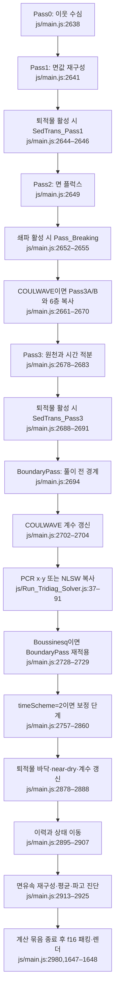

# Lynett et al. 2026과 Celeris-WebGPU 코드 대조

## 1 요약

분류별 개수: A=5, B=14, C=28, D=0, E=2, F=1, H=28, X=2. 차이 80개와 일치 37개를 합쳐 고유 항목 117개를 대조했다. 개수의 출처는 이 보고서 CP3-001–117이다.

표준 모드의 AB3 예측식과 AM4 보정식 계수는 논문과 같다. 물리 모델 선택과 재구성 차수 선택은 코드에서 독립이다. 논문의 거품 생성 설명과 스칼라 확산식은 게재 전 코드와도 다르다. 활성 HLLC와 비활성 HLLEM의 접촉파 보정에는 코드 결함 후보가 있다. 이 두 후보의 근거 강도는 강함이다. 근거는 CP3-022·023·028·030·034·035·107과 §5.2이다.

유체 수치 연산은 f32이다. 렌더 캐시는 rgba16float 저장 형식을 쓴다. f16 저장을 f16 유체 적분으로 해석하지 않는다. 현행의 구면 NLSW·시계열 경계·nested 출력·선형 구조물 편집은 논문 게재 후 추가이다. 근거는 CP3-071·076·081·098–100과 §5.1이다.

이 보고서는 AI가 작성한 원문 대조 기록이다. 논문 주장을 실행 검증 결과로 승격하지 않는다. 작성일은 2026-11-04이다. 쓰기 대상은 이 파일 하나이다. 모델과 브라우저를 실행하지 않았다.

논문은 *An Interactive Nearshore Wave Simulator for Rapid Design Prototyping and Natural Hazard Education*, DOI 10.1061/JWPED5.WWENG-2370이다. 논문 p.1은 투고일 2025-06-06, 승인일 2026-01-27, 온라인 게재일 2026-04-03을 적는다. 논문은 프로그램을 “Celeris-WebGPU (version 1)”로 부른다. Fig. 2는 별도로 “v.2025.01.21” 화면을 인용한다. 논문은 재현용 코드 커밋을 지정하지 않는다.

코드 기준은 공개 저장소 사본 `ebca435`(2026-07-20, `fixed time series write bug`)이다. 이하 `js/`, `shaders/`, `transect_version/`, `docs/`, HTML, `scripts/` 경로의 기준 디렉터리는 `models/Celeris/raw/source_code/Celeris-WebGPU/`이다. 현재 코드 인용은 `ebca435:파일:줄`을 뜻한다. 과거 판은 HASH를 따로 적는다. 노트 경로의 기준 디렉터리는 `models/Celeris/`이다.

논문 쪽은 인쇄 쪽 번호 04026007-N의 N을 쓴다. 추출본은 `_staging/recovery/extract/Celeris/pdf-md/cel-lynett2026.md`이다. 추출본의 문단 배치는 인쇄 쪽과 일부 다르다. 판정에는 300 dpi 원문 쪽 이미지를 사용한다. 판독 기록은 원문 위치를 찾는 색인으로만 사용한다.

표의 “일치”는 해당 구현 문장의 정적 대조 결과이다. 수렴 차수, 양수 보존, 정확도, 성능의 실측 확인을 뜻하지 않는다. “문서에만”인 성능·사례·이론은 H로 분류한다. 구현이 없다는 D 판정과 구분한다. 세부식이 인용 논문에만 있으면 X로 분류한다. 동일 항목을 여러 절에서 다시 설명할 때는 기존 행 ID를 참조한다.

### 쪽별 범위

| 쪽 | 확인 대상 | 대응 위치 |
|---|---|---|
| p.1 | 제목·초록·Practical Applications·키워드·서지·이론 계보 | CP3-001–004, CP3-055 |
| p.2 | 이전 구현·모델 선택·총수심·표준 모드 연속식과 운동량식·고차 모드 도입 | CP3-005–012 |
| p.3 | 고차 모드 질량식·쇄파·마찰·수동 스칼라식·공간 이산화 | CP3-013–025 |
| p.4 | 4차 재구성·HLL/HLLC·분산 차분·삼중대각계·시간식·WebGPU·UI | CP3-026–040 |
| p.5 | Fig. 1·입력 형식·계산 순서·두 시점과 거품 설명 | CP3-041–046 |
| p.6 | Fig. 2·퇴적물 메뉴·이전 판 기능 비교·외부 자동화·검증 개요 | CP3-047–050 |
| p.7 | 규칙파 설정·Fig. 3의 다섯 패널·공간 수렴 논의 시작 | CP3-051–054 |
| p.8 | Fig. 4·격자 권고·모드 혼합·원추형 섬 설정 | CP3-056–059 |
| p.9 | Fig. 5·Duck 설정·Fig. 6 설명·Oceanside 설정 | CP3-060–063 |
| p.10 | Fig. 6·성능 수치·불투수 구조물·출력·작업시간 | CP3-064–068 |
| p.11 | Fig. 7·표시값·큰 영역의 적용 한계 | CP3-069–070 |
| p.12 | 메모리·브라우저·정밀도·설계 조건·결론·자료 제공·사사 | CP3-071–078 |
| p.13 | 저자 기여·참고문헌·서지 연도 | CP3-079–080 |

빈 쪽은 없다. p.5는 Fig. 1과 본문을 함께 싣는다. p.7은 Fig. 3과 본문을 함께 싣는다. p.8–11도 그림과 본문을 함께 싣는다. p.13은 저자 기여와 참고문헌 쪽이다. 번호가 붙은 표는 없다. 독립 표시식은 p.2의 두 식, p.3의 두 식, p.4의 두 식이다. 이 여섯 식에는 인쇄 식 번호가 없다. 본문 관계식 `H=h+η`와 `(∂U/∂t)=F`에도 식 번호가 없다. 이하 임의 식 번호를 붙이지 않는다.

## 2 대조 표

### 2.1 서지·모델·방정식

| 행 ID | 문서 위치와 원문 | 코드 위치와 원문 | 판정 | 이유 |
|---|---|---|---|---|
| CP3-001 | p.1 초록: “Celeris-WebGPU (version 1) is a browser-based interactive simulator” | `js/main.js:2222` `async function frame() {`와 `js/main.js:1541` `Pass1_ShaderCode = await fetchShader('/shaders/Pass1_HighOrder.wgsl');` | 일치 | JavaScript가 브라우저에서 WGSL을 가져와 계산을 제어한다. version 1을 특정 git HASH로 대응시키지는 않는다. |
| CP3-002 | p.1 초록: “standard mode”와 “high-order mode” | `js/constants_load_calc.js:36` `NLSW_or_Bous: 0,  // Choose 0 for Non-linear Shallow Water (NLSW), 1 for Madsen Boussinesq, 2 for Fully Non-linear Boussinesq (COULWAVE equations)` | 일치 | 표준 Boussinesq는 1이다. 완전비선형 Boussinesq는 2이다. 0은 별도 NLSW 경로이다. |
| CP3-003 | p.1 초록: “standard mode’s accuracy is of second-order in space, while the high-order mode’s accuracy is of fourth-order” | `js/constants_load_calc.js:39` `Accuracy_mode: 0,  // Accuracy model choice: 0: 2nd-order, 1: 4th-order.` | 불일치 | 초록은 모드 전체의 차수처럼 적는다. p.3–4는 분산 미분을 2차라고 한정한다. 코드도 재구성 차수와 물리 모델을 별도로 선택한다. 고차 모드 전체를 무조건 공간 4차라고 확정할 수 없다. B. |
| CP3-004 | p.1 Practical Applications: “no installation required”; “comparison of different designs in minutes rather than hours” | `js/main.js:2530` `runComputeShader(device, MouseClickChange_uniformBuffer, MouseClickChange_uniforms, MouseClickChange_Pipeline, MouseClickChange_BindGroup, calc_constants.DispatchX, calc_constants.DispatchY);  // update depth/friction based on mouse click` | 문서에만 | 대화형 편집 구현은 있다. 설치·공유·설계시간·교육 효과는 적용·사용성 주장이다. H. |
| CP3-005 | p.2: “DirectX shaders”; “Unity3D game engine”; “migrates to WebGPU and JavaScript” | `js/main.js:1548` `Pass2_ShaderCode = await fetchShader('/shaders/Pass2_HighOrder_HLLC.wgsl');` | 불일치 | 2017·2020 논문의 native/game-engine 구현과 WGSL 코드는 서로 다른 프로그램 판이다. 이 행의 불일치는 A이다. 2026 논문이 설명한 전환과는 일치한다. |
| CP3-006 | p.2: “revert to the Nonlinear Shallow Water (NLSW) equations (by turning off dispersion)” | `js/Run_Tridiag_Solver.js:37–39` `if (calc_constants.NLSW_or_Bous == 0) {`<br>`runCopyTextures(device, calc_constants, current_stateUVstar, txNewState)`<br>`}` | 일치 | NLSW 경로는 삼중대각계를 풀지 않고 중간 상태를 복사한다. 단순히 Bcoef를 0으로 바꾸는 옵션과 동일시하지 않는다. |
| CP3-007 | p.2: $H=h+\eta$; “depth-averaged horizontal velocity vector” | `shaders/Pass3_Bous.wgsl:117` `let B_here = textureLoad(txBottom, idx, 0).z;`와 `:123` `let h_here = in_state_here.x - B_here;` | 불일치 | 논문의 h는 양의 정수심이다. 코드의 B는 바닥 표고이다. 코드의 h_here는 총수심이다. $h_{\rm paper}=-B$, $H_{\rm paper}=h_{\rm here}$로 놓으면 같다. F. |
| CP3-008 | p.2 번호 없는 연속식: $\displaystyle \frac{\partial\eta}{\partial t}+\nabla\cdot(H\boldsymbol{u})=0$ | `shaders/Pass2.wgsl:123` `NumericalFlux(aplus, aminus, hW_east * uW_east, h_here.y * u_here.y, mass_diff_x),`와 `shaders/Pass3_Bous.wgsl:394` `let d_by_dt = (xflux_west - xflux_here) * globals.one_over_dx + (yflux_south - yflux_here) * globals.one_over_dy + source_term + vorticity_dissipation;` | 일치 | 플럭스의 첫 성분은 수심 곱하기 유속이다. 서쪽 빼기 동쪽 플럭스는 발산의 음수이다. 지형 강제·침투 원천이 없는 유체식 부분을 대조했다. 추가 원천은 §3에서 분리한다. |
| CP3-009 | p.2 번호 없는 운동량식: $\displaystyle \frac{\partial(H\boldsymbol{u})}{\partial t}+\nabla\cdot(H\boldsymbol{u}\otimes\boldsymbol{u})+gH\nabla\eta+\boldsymbol{Q}_{\mathrm{disp}}=\boldsymbol{D}_{\mathrm{dissipation}}$ | `shaders/Pass3_Bous.wgsl:392` `let source_term = vec4<f32>(dhdt + overflow_dry, -globals.g * h_here * detadx - in_state_here.y * friction_ + breaking_x + (Psi1x + Psi2x) + press_x, -globals.g * h_here * detady - in_state_here.z * friction_ + breaking_y + (Psi1y + Psi2y) + press_y, hc_by_dx_dx + hc_by_dy_dy + 2.0 * hc_by_dx_dy + c_dissipation);` | 일치 | 압력기울기와 마찰은 우변에서 음수이다. 쇄파는 양의 점성 발산이다. 분산의 세부 계수 일치는 이 총괄식만으로 판정하지 않는다. |
| CP3-010 | p.2: “third-order spatial derivatives of η”; “kh of approximately 1” | `shaders/Pass3_Bous.wgsl:282` `Psi1x = globals.Bcoef_g * d3_here * ((eta_right_right - 2.0 * eta_right + 2.0 * eta_left - eta_left_left) * (0.5 * globals.one_over_d3x) + (eta_up_right - eta_up_left - 2.0 * eta_right + 2.0 * eta_left + eta_down_right - eta_down_left) * (0.5 * globals.one_over_dx * globals.one_over_d2y));` | 일치 | 3차 미분 스텐실은 있다. kh의 정확도 범위는 식의 이론적 성질이며 코드 실행으로 확인하지 않았다. 그 범위 자체는 CP3-055의 H이다. |
| CP3-011 | p.2–3: “follows the formulation of Kim et al. (2009) minus the horizontal vorticity terms” | `js/main.js:1568–1570` `else if (calc_constants.NLSW_or_Bous == 2) {`<br>`console.log("Using COULWAVE equations in Boussinesq mode");`<br>`Pass3_ShaderCode_Bous = await fetchShader('/shaders/Pass3_COULWAVE.wgsl');` | 일치 | 별도 COULWAVE 분산 경로가 있다. 와도에 따른 운동량 혼합 옵션은 Kim의 수평 와도 정식화와 구분해야 한다. 외부 정식화의 항별 동일성은 CP3-013에서 X로 분리한다. |
| CP3-012 | p.3 번호 없는 질량식: $\displaystyle \frac{\partial\eta}{\partial t}+\nabla\cdot(H\boldsymbol{u}_{\alpha})+M_{\mathrm{disp}}=0$ | `shaders/Pass3_COULWAVE.wgsl:486` `let source_term = vec4<f32>(dhdt + overflow_dry + E_src, -globals.g * h_here * detadx - in_state_here.y * friction_ + breaking_x + (Psi1x + Psi2x) + press_x, -globals.g * h_here * detady - in_state_here.z * friction_ + breaking_y + (Psi1y + Psi2y) + press_y, hc_by_dx_dx + hc_by_dy_dy + 2.0 * hc_by_dx_dy + c_dissipation);` | 일치 | 질량식에 E_src를 추가하는 구조는 있다. 좌변 M_disp와 우변 E_src는 부호가 반대인 정의이다. 실제 E_src의 상세식은 외부 원문이 필요하다. |
| CP3-013 | p.3: “Kim et al. (2009) provided the detailed form of these equations”; “particular elevation, zα” | `js/constants_load_calc.js:38` `Bous_alpha: -0.531,  // extended Boussinesq (Nwogu) parameter,` | 문서에만 | 논문은 유속 평가 높이의 선택값과 세부 분산식을 인쇄하지 않는다. Kim et al. 2009, *Ocean Modelling* 27:198–214, DOI 10.1016/j.ocemod.2009.01.005의 보존형 지배식·평가높이 정의와 -0.531 및 E/F/G 계수를 대조해야 한다. 이 논문에는 해당 외부 식 번호를 제시하지 않는다. X. |

### 2.2 쇄파·마찰·수동 스칼라

| 행 ID | 문서 위치와 원문 | 코드 위치와 원문 | 판정 | 이유 |
|---|---|---|---|---|
| CP3-014 | p.3: “temporal free-surface rate of change ∂η/∂t exceeding a threshold” | `shaders/Pass_Breaking.wgsl:55` `let detadt = textureLoad(dU_by_dt, idx, 0).x;`와 `:115–118` `if(detadt < dzdt_star) {`<br>`t_here = 0.0;`<br>`} else if (detadt > 2.0 * dzdt_star) {`<br>`B_Breaking = 1.0;` | 일치 | 시작·종료를 지배하는 값은 시간 수면 변화율이다. 2배를 넘으면 B=1이다. 사이 구간은 선형 램프이다. |
| CP3-015 | p.3: “breaking event continues until this free-surface transient dips below a second threshold” | `shaders/Pass_Breaking.wgsl:106–112` `if(t_here <= globals.dt){`<br>`dzdt_star = dzdt_I;`<br>`} else if (globals.total_time - t_here <= T_star) {`<br>`dzdt_star = dzdt_I + (globals.total_time - t_here) / T_star * (dzdt_F - dzdt_I);`<br>`} else {`<br>`dzdt_star = dzdt_F;`<br>`}` | 일치 | 코드가 경과 시간으로 시작 임계값에서 종료 임계값으로 보간한다. 두 임계값 사이의 보간 과정은 논문의 압축 설명보다 구체적이다. |
| CP3-016 | p.3: “eddy-viscosity is proportional to the local free-surface transient and the age of the breaking event” | `shaders/Pass_Breaking.wgsl:125` `let nu_breaking = min(1.0 * globals.dx * globals.dy / globals.dt, B_Breaking * globals.delta_breaking * h_here * detadt);` | 불일치 | 나이는 임계값과 B에 간접 반영된다. 점성은 나이와 선형 비례하지 않는다. 격자·시간간격에 따른 상한도 있다. 논문은 비례 관계를 부정확하게 압축했다. B. |
| CP3-017 | p.3: “breaking parameters as given in Kennedy et al. (2000) are used here” | `js/constants_load_calc.js:57–60` `delta_breaking: 2.0,  // eddy viscosity coefficient`<br>`T_star_coef: 5.0,  // defines length of time until breaking becomes fully developed`<br>`dzdt_I_coef: 0.50,  // start breaking parameter`<br>`dzdt_F_coef: 0.15,  // end breaking parameter` | 문서에만 | 논문은 숫자를 제시하지 않는다. Kennedy et al. 2000, *JWPCOE* 126(1):39–47, DOI 10.1061/(ASCE)0733-950X(2000)126:1(39)의 쇄파 점성·임계값·전이시간 식 및 매개변수 문단과 2.0, 5.0, 0.50, 0.15를 대조해야 한다. 외부 식 번호는 대상 논문에 없다. X. |
| CP3-018 | p.3: “applied identically in both standard and high-order modes”; “neither model relies on numerical dissipation through limiters to mimic breaking” | `js/main.js:1552` `const PassBreaking_ShaderCode = await fetchShader('/shaders/Pass_Breaking.wgsl');`와 `shaders/Pass3_Bous.wgsl:361–362` `breaking_x = dPdxx + 0.5 * dPdyy + 0.5 * dQdxy;`<br>`breaking_y = dQdyy + 0.5 * dPdyx + 0.5 * dQdxx;` | 일치 | 두 경로가 같은 쇄파 패스를 사용한다. COULWAVE의 동일 결합식은 `Pass3_COULWAVE.wgsl:455–456`에 있다. 제한자의 수치소산이 전혀 없다는 뜻으로 옮기지 않는다. |
| CP3-019 | p.3: “quadratic bottom friction”; “alternatively formulated in terms of a Manning’s n” | `shaders/Pass3_Bous.wgsl:82–86` `if (globals.isManning == 1) {`<br>`f = globals.g * pow(friction_here, 2.0) * pow(abs(divide_by_h), 1.0 / 3.0);`<br>`} else {`<br>`f = friction_here;`<br>`}`와 `:90` `f = f * sqrt(hu * hu + hv * hv) * divide_by_h2;` | 일치 | Manning 변환은 $gn^2H^{-1/3}$에 해당한다. 운동량 원천은 다시 운동량을 곱해 이차 항이 된다. 작은 수심의 정규화는 별도 코드 처리이다. |
| CP3-020 | p.3: “spatially uniform or variable in space” | `shaders/Pass3_Bous.wgsl:302` `let friction_here = max(globals.friction, textureLoad(txBottomFriction, idx, 0).x);` | 일치 | 균일값과 공간장을 지원한다. 실제 결합은 합이 아니라 최댓값이다. 작은 공간장 값은 균일값 아래로 낮추지 못한다. |
| CP3-021 | p.3 번호 없는 스칼라식: $\displaystyle \frac{\partial HC}{\partial t}+\nabla\cdot(HC\boldsymbol{u})=\nabla\cdot(DH\nabla C)+S$ | `shaders/Pass1.wgsl:150` `c = divide_by_h * hc;`와 `shaders/Pass2.wgsl:126` `NumericalFlux(aplus, aminus, hW_east * uW_east * cW_east, h_here.y * u_here.y * c_here.y, phix * (hW_east * cW_east - h_here.y * c_here.y))` | 일치 | 저장 스칼라는 HC에 해당한다. 경계 재구성 시 H로 나눠 C를 구한 뒤 HCu 플럭스를 만든다. 확산 우변의 차이는 다음 행에서 분리한다. |
| CP3-022 | p.3 위 식의 $\nabla\cdot(DH\nabla C)$; “D=effective diffusivity” | `shaders/Pass3_Bous.wgsl:328–334` `let Dxx = globals.whiteWaterDispersion;`<br>`let Dxy = globals.whiteWaterDispersion;`<br>`let Dyy = globals.whiteWaterDispersion;`<br>`let hc_by_dx_dx = Dxx * globals.one_over_d2x * (C_state_right - 2.0 * in_state_here.a + C_state_left);`<br>`let hc_by_dy_dy = Dyy * globals.one_over_d2y * (C_state_up - 2.0 * in_state_here.a + C_state_down);`<br>`let hc_by_dx_dy = 0.25 * Dxy * globals.one_over_dxdy * (C_state_up_right - C_state_up_left - C_state_down_right + C_state_down_left);` | 불일치 | 331행은 빈 줄이다. 코드가 HC 자체에 상수 확산 텐서의 2차 미분을 적용한다. 혼합미분도 source_term에서 2배 더한다. 일반적인 가변 H에서 논문의 등방성 식과 같지 않다. 논문 시점 코드도 같은 형태이므로 B이다. |
| CP3-023 | p.3·5–6: “C is generated proportional to the breaking eddy-viscosity” | `shaders/Pass3_Bous.wgsl:412–415` `if(globals.showBreaking ==1) {`<br>`// add breaking source`<br>`newState.a = max(newState.a, breaking_B);  // use the B value from Kennedy et al as a foam intensity`<br>`}` | 불일치 | breaking_B는 `txBreaking.z`이다. 점성은 `txBreaking.y`이다. max 연산은 점성에 비례한 농도 원천이 아니다. 코드 주석이 의도를 명시하므로 B로 분류한다. |
| CP3-024 | p.3: “does not affect the fluid motion”; “same velocity field”; “initial or boundary conditions” | `shaders/Pass3_Bous.wgsl:392`의 앞 세 성분에는 `.a`가 없고 마지막 성분만 스칼라이다. `shaders/Pass3_Bous.wgsl:417–418` `let contaminent_source = textureLoad(txContSource, idx, 0).r;`<br>`newState.a = min(1.0, newState.a + contaminent_source);` | 일치 | 스칼라는 유체 운동량에 피드백하지 않는다. 원천의 구체 구현은 오염원 텍스처와 표시 모드 조건을 사용한다. 일반 농도 경계자료 형식은 논문에 없다. |

### 2.3 공간·시간 이산화

| 행 ID | 문서 위치와 원문 | 코드 위치와 원문 | 판정 | 이유 |
|---|---|---|---|---|
| CP3-025 | p.3: “Each grid cell holds the conserved quantities (H, Hu, Hv, HC)” | `js/main.js:451` `const txState = create_2D_Texture(device, calc_constants.WIDTH, calc_constants.HEIGHT, allTextures);  // the values of the current (n) "state", or eta, P, Q, and c` | 불일치 | 첫 채널은 총수심 H가 아니라 수면 표고 η이다. 고정 바닥이면 두 값의 시간미분은 같지만 저장량은 다르다. CP3-007의 기호 대응과 별개로, 이 저장 설명은 B이다. |
| CP3-026 | p.3: “KP07 scheme”; “monotonized central (MC) slope and flux limiter” | `shaders/Pass1.wgsl:41–51`의 재구성은 `let z1 = TWO_THETAc * (here - west);`, `let z2 = (east - west);`, `let z3 = TWO_THETAc * (east - here);`, `let dx_grad_over_two = 0.25 * MinMod(z1, z2, z3);`, `let out_east = here + dx_grad_over_two;`, `let out_west = here - dx_grad_over_two;`, `return vec2(out_west, out_east);`이다. | 일치 | 최소절댓값의 부호 제한 기울기로 좌우 경계값을 만든다. 기본 Theta=2이다. 해안선 근처에서는 제한 강도가 달라진다. |
| CP3-027 | p.4: “fourth-order MUSCL scheme”; “integrating minmod limiters”; “smooth regions” | `shaders/Pass1_HighOrder.wgsl:86` `fn ReconstructMUSCL4(z_m3: f32, z_m2: f32, z_m1: f32, z0:   f32, z1:   f32, z2:   f32, z3:   f32, dh_max: f32) -> vec2<f32> {`와 `:90–93` `var ilim_c = 0; // 1 = TVD limiter, 0 = no limiter`<br>`if (dh_max > 0.60) {`<br>`ilim_c = 1;`<br>`}` | 일치 | 7점 스텐실과 minmod형 보정을 쓴다. 추가 제한은 국소 dh_max 조건에 달린다. 전체 해의 4차 수렴을 이 함수명만으로 확정하지 않는다. |
| CP3-028 | p.4: “By default, the standard mode employs the second-order scheme and the high-order mode the fourth-order scheme.” | `js/main.js:1539–1551`은 `if (calc_constants.Accuracy_mode == 1)`에서 `Pass1_HighOrder.wgsl`, `Pass2_HighOrder_HLLC.wgsl`을 선택한다. `js/constants_load_calc.js:36,39`의 기본값은 각각 `NLSW_or_Bous: 0,`와 `Accuracy_mode: 0,`이다. | 불일치 | 코드의 물리 모델 선택과 재구성 선택은 독립이다. “high-order”를 재구성 선택의 이름으로 읽으면 맞지만 COULWAVE 선택이 4차 재구성을 자동 강제하지는 않는다. 논문이 옵션 간 관계를 생략했다. C. |
| CP3-029 | p.4: “HLL solver”; “two-wave approximation” | `shaders/Pass2.wgsl:36–42` `fn NumericalFlux(aplus: f32, aminus: f32, Fplus: f32, Fminus: f32, Udifference: f32) -> f32 {`<br>`if (aplus - aminus != 0.0) {`<br>`return (aplus * Fminus - aminus * Fplus + aplus * aminus * Udifference) / (aplus - aminus);`<br>`} else {`<br>`return 0.0;`<br>`}`<br>`}` | 일치 | 양·음 두 파속을 사용한다. 완전한 양수 보존 증명은 수행하지 않았다. 건습 셀의 별도 플럭스 수정은 §3에 있다. |
| CP3-030 | p.4: “HLLC solver, which explicitly restores the contact wave” | `shaders/Pass2_HighOrder_HLLC.wgsl:141–143` `let wavespeed_max = max(abs(aminus), abs(aplus));`<br>`let psi = max(0.0, 1.0 - wavespeed_max / (abs(uRoe) + 1e-6));`<br>`return Fhll + psi * (F_final - Fhll);` | 불일치 | 정상적인 양의 수심에서 최대 파속은 Roe 평균 속도 절댓값보다 크다. 그 차이가 1e-6 이상이면 psi=0이다. 이 조건에서는 접촉파 보정이 사라진다. 같은 판 논문과 코드 자체의 접촉파 복원 주석에 모순된다. E 후보, 강함. 상세 반대 근거 검색은 §5에 있다. |
| CP3-031 | p.3–4: “Derivative terms are determined with second-order finite-difference equations”; “remaining spatial derivatives, those in the dispersive terms” | `shaders/Pass3_Bous.wgsl:241–242` `detadx = 1.0 / 12.0 * (eta_left_left - 8.0 * eta_left + 8.0 * eta_right - eta_right_right) * globals.one_over_dx;`<br>`detady = 1.0 / 12.0 * (eta_down_down - 8.0 * eta_down + 8.0 * eta_up - eta_up_up) * globals.one_over_dy;`와 `:265` `let eta_by_dx_dx = globals.one_over_d2x * (eta_right - 2.0 * eta_here + eta_left);` | 불일치 | 2차·3차 미분의 주요 스텐실은 2차 정확도이다. 그러나 수면 1차 미분과 바닥 1차 미분에는 4차 차분도 있다. 모든 원천항 미분이 2차라는 p.3 문장은 과도하다. B. |
| CP3-032 | p.4: “two tridiagonal systems”; fully nonlinear coefficients “are a function of η” | `shaders/Update_TriDiag_coef_COULWAVE.wgsl:65–69` `let zx_loc = (textureLoad(current_stateUVstar, rightIdx, 0).x - textureLoad(current_stateUVstar, leftIdx, 0).x) / globals.dx / 2.;`<br>`a =     (za2-zloc2)/2.*globals.one_over_d2x +   (za-z_loc)*d_west*globals.one_over_d2x + zx_loc*(z_loc+d_west)/globals.dx/2.;`<br>`b = 1.0-(za2-zloc2)*globals.one_over_d2x  - 2.0*(za-z_loc)*d_here*globals.one_over_d2x;`<br>`c =     (za2-zloc2)/2.*globals.one_over_d2x +   (za-z_loc)*d_east*globals.one_over_d2x - zx_loc*(z_loc+d_east)/globals.dx/2.;` | 일치 | 66행은 빈 줄이다. x·y 계수는 수면과 수면기울기에 의존한다. `js/Run_Tridiag_Solver.js:48,73`은 방향별 PCR 반복이다. |
| CP3-033 | p.4: weakly nonlinear coefficients “need only be updated when the local depth changes” | `shaders/Update_TriDiag_coef.wgsl:67–69` `a =  d_here * d_dx / (6.0 * globals.dx) - (globals.Bcoef + 1.0 / 3.0) * d_here * d_here / (globals.dx * globals.dx);`<br>`b = 1.0 + 2.0 * (globals.Bcoef + 1.0 / 3.0) * d_here * d_here / (globals.dx * globals.dx);`<br>`c = -d_here * d_dx / (6.0 * globals.dx) - (globals.Bcoef + 1.0 / 3.0) * d_here * d_here / (globals.dx * globals.dx);` | 일치 | NLSW_or_Bous=1의 계수는 바닥 수심과 그 기울기로 정해진다. 여기서 depth changes는 매 시각 총수심 변화가 아니라 바닥 지형 변화로 읽어야 한다. |
| CP3-034 | p.4 번호 없는 예측식: $\displaystyle U^{n+1}=U^n+\frac{\Delta t}{12}(23F^n-16F^{n-1}+5F^{n-2})$; 일반형 $(\partial U/\partial t)=F$ | `shaders/Pass3_Bous.wgsl:402–404` `} else if (globals.pred_or_corrector == 1) {`<br>`newState = in_state_here_UV + globals.dt / 12.0 * (23.0 * d_by_dt - 16.0 * oldies + 5.0 * oldOldies);` | 일치 | 403행은 빈 줄이다. 계수 23, -16, 5와 분모 12가 같다. COULWAVE `:498`과 transect `Pass3_Bous.wgsl:400`도 같은 계수이다. |
| CP3-035 | p.4 번호 없는 보정식: $\displaystyle U^{n+1}=U^n+\frac{\Delta t}{24}(9F^{n+1}+19F^n-5F^{n-1}+F^{n-2})$ | `shaders/Pass3_Bous.wgsl:406–409` `} else if (globals.pred_or_corrector == 2) {`<br>`let predicted = textureLoad(predictedGradients, idx, 0);`<br>`newState = in_state_here_UV + globals.dt / 24.0 * (9.0 * d_by_dt + 19.0 * predicted - 5.0 * oldies + oldOldies);` | 일치 | 407행은 빈 줄이다. predictedGradients는 예측식에서 계산한 F^n이다. 보정 단계의 d_by_dt는 예측 상태에서 구한 F^{n+1}이다. 9, 19, -5, 1과 분모 24가 같다. |
| CP3-036 | p.4: “implicit corrector”; “achieving fourth-order temporal accuracy” | `js/main.js:2757` `if (calc_constants.timeScheme == 2)  // only called when using Predictor+Corrector method.  Adding corrector allows for a time step twice as large (also adds twice the computation) and provides a more accurate solution`와 `:2766` `runCopyTextures_EncStack(commandEncoderStack, calc_constants, txNewState, txState)` | 불일치 | 호스트는 예측 상태에서 보정을 한 번 수행한다. 보정식을 수렴할 때까지 푸는 비선형 반복은 없다. Adams–Moulton 계수와 실제 단일 보정 구현을 구분해야 한다. 전체 분산·원천·클램프 경로의 시간 4차 수렴 주장은 H이다. 이 행은 그 검증 주장을 분류하며 식 계수 일치인 CP3-035를 바꾸지 않는다. |

### 2.4 WebGPU 구조·계산 순서·화면

| 행 ID | 문서 위치와 원문 | 코드 위치와 원문 | 판정 | 이유 |
|---|---|---|---|---|
| CP3-037 | p.4: “client-side web application”; “no server-side computation”; WGSL compute와 JavaScript control | `js/main.js:254` `device = await adapter.requestDevice({`와 `:1541`의 WGSL fetch, `:2222`의 frame 함수 | 일치 | 물리 계산은 GPU 패스이다. 설정 파싱·입력 로딩·파 생성·시간 제어는 JavaScript이다. “모든 수치 계산이 GPU”를 입력 생성까지 확장하지 않는다. |
| CP3-038 | p.4: “can even function offline after the initial page load” | `js/main.js:1541` `Pass1_ShaderCode = await fetchShader('/shaders/Pass1_HighOrder.wgsl');`와 `index.html:1594` `<script src="https://cdn.jsdelivr.net/npm/chart.js"></script>` | 문서에만 | 초기 자산·선택할 셰이더·자료가 로드 또는 캐시되어 있다는 조건이 필요하다. 온라인 지도·외부 URL fetch는 따로 존재한다. 오프라인 가용성은 브라우저 캐시를 실행 확인해야 하는 사용성 주장이다. H. |
| CP3-039 | p.4: “JSON files and bathymetry data”; “Start Simulation” | `js/main.js:201` `await init_sim_parameters(canvas, configContent);`와 `:204` `let bathy2D = await loadDepthSurface(bathymetryContent, calc_constants);`와 `:206` `let { numberOfWaves, waveData } = await loadWaveData(waveContent, calc_constants);` | 일치 | 설정 초기화, 지형 로드, 파랑 로드 순서를 따른다. 파일의 열 순서와 오류 처리는 §3에서 분리한다. |
| CP3-040 | p.4: “checks for user input at the end of each time step (or after a small batch of steps)” | `js/main.js:2502` `if (calc_constants.click_update > 0) {`와 `:2615` `for (let frame_c = 0; frame_c < calc_constants.render_step; frame_c++) {  // loop through the compute shaders "render_step" time` | 일치 | 클릭 편집 블록은 프레임의 계산 묶음 전에 있다. 직전 묶음 종료와 다음 묶음 시작 사이라는 의미에서 설명과 맞는다. 계산 중간에 임의 쓰기하지 않는다. |
| CP3-041 | p.5 Fig. 1: “Pass 1 – Reconstruction”; “Pass 2 – Flux Calculation”; “Pass 3 – Calculation of dispersive terms”; “Tridiagonal Pass”; “Boundary Pass” | `js/main.js:2694` `runComputeShader_EncStack(device, commandEncoderStack, BoundaryPass_uniformBuffer, BoundaryPass_uniforms, BoundaryPass_Pipeline, BoundaryPass_BindGroup, calc_constants.DispatchX, calc_constants.DispatchY);`와 `:2729` `runComputeShader_EncStack(device, commandEncoderStack, BoundaryPass_uniformBuffer, BoundaryPass_uniforms, BoundaryPass_Pipeline, BoundaryPass_BindGroup_NewState, calc_constants.DispatchX, calc_constants.DispatchY);` | 불일치 | 그림은 삼중대각계 뒤 경계 패스만 그린다. 코드는 풀이 전후 모두 경계 패스를 실행한다. Pass0, 쇄파, COULWAVE 보조 패스도 그림에서 생략한다. C. |
| CP3-042 | p.5 Fig. 1: “Update tridiagonal coefficients [high-order only]” | `js/main.js:2702–2704` `if (calc_constants.NLSW_or_Bous == 2) {`<br>`// COULWAVE Model - need to update nonlinear tridaig coefficents before running tridiag solver`<br>`runComputeShader_EncStack(device, commandEncoderStack, UpdateTrid_uniformBuffer, UpdateTrid_uniforms, UpdateTrid_Pipeline, UpdateTrid_BindGroup, calc_constants.DispatchX, calc_constants.DispatchY);  //need to update tridiagonal coefficients due to change inn depth` | 일치 | 이 그림의 high-order는 물리 모델 COULWAVE를 뜻한다. Accuracy_mode=1만으로 계수를 매번 갱신하는 것은 아니다. 표준 모드의 지형 편집 시 갱신은 그림 밖의 별도 경로이다. |
| CP3-043 | p.5 Fig. 1: “run for n_RENDER time steps”; HTML·JS·compute·render의 연결 | `js/main.js:2615`의 render_step 반복과 `:2980` `runComputeShader(device, Copytxf32_txf16_uniformBuffer, Copytxf32_txf16_uniforms, Copytxf32_txf16_Pipeline, Copytxf32_txf16_BindGroup, calc_constants.DispatchX, calc_constants.DispatchY);` | 일치 | 묶음 계산 뒤 렌더용 텍스처를 패킹한다. n_RENDER는 코드의 render_step에 대응한다. 논문은 기본값을 지정하지 않는다. |
| CP3-044 | p.5 Fig. 1 입력 상자: “configuration [json], bathymetry [txt], wave spectrum [txt], friction map[txt, optional], overlay image [jpg, optional], building / structure layout [json]” | `js/main.js:174–180`은 `config.json`, `bathy.txt`, `waves.txt`, `overlay.jpg`, `etaInitCond.txt`를 로드한다. `js/File_Loader.js:41` `const depthValues = lines[y].split(/\s+/).filter(Boolean);` | 일치 | JSON·공백 구분 격자·파 성분·그림 입력의 큰 형식은 맞는다. 구조물 JSON은 물리적 다공성 구조물 모형을 뜻하지 않는다. 초기 수면·hard bottom·시계열 경계는 그림에 없는 추가 입력이다. |
| CP3-045 | p.5: Design view와 Explorer view “have their own vertex shaders but share the same fragment shader” | `js/main.js:1647–1648` `const RenderPipeline_quad = createRenderPipeline(device, vertexShaderCode, fragmentShaderCode, swapChainFormat, RenderBindGroupLayout, 'depth24plus');`<br>`const RenderPipeline_vertexgrid = createRenderPipeline_vertexgrid(device, vertex3DShaderCode, fragmentShaderCode, swapChainFormat, RenderBindGroupLayout, 'depth24plus');` | 일치 | 두 수면 렌더 경로는 같은 fragmentShaderCode를 쓴다. skybox·model 표시 전용 셰이더 내부는 범위 밖이다. |
| CP3-046 | p.5–6: foam “visualization-oriented”; “does not alter the hydrodynamics”; “not a two-phase air–water model” | `shaders/Copytxf32_txf16.wgsl:42` `let output_layer0 = vec4<f32>(eta, max_eta, bottom, foam);`와 `shaders/Pass3_Bous.wgsl:414`의 `.a` 변경 | 일치 | 거품은 별도 스칼라 채널로 수송·표시한다. 두 상 유체의 질량·운동량 교환은 이 경로에 없다. 거품 생성량의 오류는 CP3-023에서 따로 판정했다. |
| CP3-047 | p.6 Fig. 2: “Configure Sediment Transport Model” | `index.html:859` `<span><center> Configure Sediment Transport Model </center></span>`와 `:904` `<option value="1">Include Sediment Transport</option>` | 일치 | 퇴적물 선택 메뉴가 있다. 그림만으로 침식·퇴적·소류사·지형 갱신의 수식을 설명하지 않는다. 상세 구현은 §3의 C이다. |
| CP3-048 | p.6 Fig. 2: “Reprinted … v.2025.01.21 © 2024.”; 화면 모의시간 6.2 min·비율 1.2 | `index.html:1382` `<select id="nlsw-select" name="nlswValue">` | 문서에만 | 그림은 지정된 옛 UI의 한 시점이다. 6.2와 1.2는 화면 표시값이다. 현재 코드 기본값이나 성능 보증이 아니다. H. |
| CP3-049 | p.6: Unity의 VR·조명·그림자와 WebGPU의 “basic directional lighting”; “no external rendering libraries” | `js/main.js:1611–1613` `const vertexShaderCode = await fetchShader('/shaders/vertex.wgsl');`<br>`const vertex3DShaderCode = await fetchShader('/shaders/vertex3D.wgsl');`<br>`const fragmentShaderCode = await fetchShader('/shaders/fragment.wgsl');` | 일치 | 수면은 자체 WGSL 렌더 경로를 쓴다. 2017·2020의 VR·Unity 기능을 현재 WebGPU 기능으로 이식해 서술하면 안 된다. |
| CP3-050 | p.6: “Python version 3, automation via Selenium”; 세 검증 사례와 동급 정확도 소개 | 해당 외부 자동화 도구 내부와 사례 입력 파일은 지정 제외 범위이다. | 문서에만 | 외부 도구 사용 가능성·교육 및 협업 효과·검증 개요는 H이다. 이 요청에서 automation·benchmarks·examples를 판독하지 않았다. |

### 2.5 검증 주장·그림·설계 예제

이 절에서 H는 사례의 설정값이나 논문이 보고한 결과를 뜻한다. 구현의 존재 여부와 별개이다. 사례 파일이 제외 범위이므로 논문 설정값을 현재 기본값과 비교하여 불일치로 만들지 않는다.

| 행 ID | 문서 위치와 원문 | 코드 위치와 원문 | 판정 | 이유 |
|---|---|---|---|---|
| CP3-051 | p.7 규칙파: “depth=36 cm”; “1:34.26 sloping beach”; “kh … 0.37 to 1.6”; “0.025 m … all cases” | 사례 입력과 benchmarks는 제외 범위이다. | 문서에만 | Hansen and Svendsen 1979의 실험·모의 설정이다. 물리 기본값이 아니다. H. |
| CP3-052 | p.7 Fig. 3(a–e)의 제목은 031041, 041041, 051041, 061071, 10112이다. 각 패널의 [kh, ka]는 [0.37,0.02], [0.5,0.03], [0.64,0.03], [0.79,0.07], [1.6,0.14]이다. | 그림을 생성한 원자료는 이 코드 대조 범위 밖이다. | 문서에만 | 가로축은 Depth (cm)이다. 왼쪽은 Wave Height (cm)이다. 오른쪽은 Setup / Setdown (cm)이다. 파란 원은 파고 관측이다. 빨간 ×는 평균수면 관측이다. 실선은 고차, 파선은 표준이다. 그림에는 ka의 a 정의가 없다. H. |
| CP3-053 | p.7 Fig. 3 캡션: “(d) Case 067071”; 같은 패널 제목: “Case: 061071 [kh = 0.79, ka = 0.07]” | 코드 대조 없이 같은 그림 안에서 확인한다. | 불일치 | 캡션의 067071과 그래프 제목의 061071이 다르다. p.7 본문과 p.8 Fig. 4도 061071이다. B. |
| CP3-054 | p.7: high-order “clearly more accurate”; standard “underpredict shoaling”와 “breakpoint in shallower water” | 재구성과 물리식 선택 구현은 CP3-002·027–030에 있다. | 문서에만 | 실험 비교의 정확도 주장이다. 그림에서 코드 결함 유무나 수렴 차수를 역으로 확정하지 않는다. H. |
| CP3-055 | p.1–2 이론 계보와 “kh of approximately 1”; p.3 MC 제한자의 오차가 물리 분산과 비슷할 수 있다는 설명; p.4 HLL/HLLC의 이론적 성질 | `js/constants_load_calc.js:37` `Bcoef: 1.0 / 15.0,  // Dispersion parameter, 1/15 is optimum value for this set of equations.` | 문서에만 | Peregrine·Madsen·Nwogu·Wei 등의 이론적 적용 범위, 절단오차 논의, 일반 Riemann solver의 성질은 H이다. 이 코드의 실제 HLLC 보정은 CP3-030으로 따로 다룬다. |
| CP3-056 | p.8 Fig. 4: “Case 061071”; 고차 dx=2.5 cm와 5.0 cm, 완전비선형+2차 dx=5.0 cm, 약비선형+4차 dx=2.5 cm | `js/constants_load_calc.js:36,39`는 물리 모델과 재구성을 별도 값으로 둔다. | 문서에만 | 그림의 혼합 조합은 코드 선택 구조와 양립한다. 가로축은 Depth (cm)이다. 세로축은 Wave Height (cm)이다. 파란 원은 실험이다. 빨간 실선·노란 파선·보라 일점쇄선·녹색 점선이 네 모의이다. 결과의 수렴성은 H이다. |
| CP3-057 | p.8: “0.05 m … equivalent to a 1.5 m resolution … offshore boundary depth of 10 m”; “1.5 m or smaller … should be used” | 코드는 `dx`, `dy`를 입력받는다. `js/constants_load_calc.js:27–28` 기본값은 각각 `dx: 1.0,`와 `dy: 1.0,`이다. | 문서에만 | 이 문장은 해당 규칙파 실험의 상사·격자 권고이다. 모든 수심·주기·모델의 보편적 격자 상한으로 바꾸지 않는다. H. |
| CP3-058 | p.8 세 결론: high-order는 모든 비교 사례에 정확한 파고·setup, standard는 쇄파점·외측 쇄파대 부정확, 물리와 수치 차수의 혼합 이점은 작음 | 물리·수치 옵션의 존재는 CP3-028에 있다. | 문서에만 | 조건은 “for regular wave shoaling”이다. Duck의 불규칙파에도 고차 모드가 반드시 더 정확하다고 확대하지 않는다. H. |
| CP3-059 | p.8 고립파: “circular 1:4 slope island”; “base diameter approximately 7.2 m”; depth 0.32 m; H=0.06 m; grid 3 cm | 고립파 생성 경로는 `shaders/BoundaryPass.wgsl:455–459`의 `globals.incident_wave_type == 3` 분기와 `BCState = SolitaryWave(idx, x0, y0, theta);`이다. | 문서에만 | Briggs et al. 1995 사례 설정은 H이다. 여기서 H는 파고이다. p.2의 총수심 H와 뜻이 다르므로 노트에서 따로 정의해야 한다. |
| CP3-060 | p.9 Fig. 5(a–c)와 p.8 설명: 앞·옆·뒤 관측점 #6, #16, #22; (d) run-up extent | 시계열 추출 구현은 `js/main.js:43`의 Run_Compute_Shader import와 별도 ExtractTimeSeries 패스에 있다. 사례 출력은 실행하지 않았다. | 문서에만 | (a–c) 가로축은 Time (seconds)이다. 세로축은 Wave Elevation (cm)이다. 파란 실선은 고차, 주황 파선은 표준, 파란 점은 실험이다. (d) 실선·파선은 처오름 경계, 원은 실험이다. 파는 그림 아래에서 입사한다. 두 모드가 거의 같다는 결론은 H이다. |
| CP3-061 | p.8–9 Duck: “March 14, 2018 … 00:00 UTC”; survey “2 days later”; Hs=2.0 m; Tp=13.5 s; nominal depth 9 m; 거의 shore-normal·long-crested·약한 연안방향 변화 | `transect_version/`은 별도 호스트·셰이더를 둔다. 이 사례가 그 폴더를 사용했다는 실행 식별자는 논문에 없다. | 문서에만 | 1D 수평 근사의 근거와 현장 설정은 H이다. 논문의 “1D model”을 특정 transect 실행과 자동 연결하지 않는다. |
| CP3-062 | p.9: total·infragravity significant wave height; “periods greater than 25 s”; spectral mean period·skewness·asymmetry; 세 모델의 유사 결과 | `shaders/CalcWaveHeight.wgsl:40` `let H_sig = sigma * 4.000;   // sig wave height` | 문서에만 | Hs 진단은 있다. 이 행의 25 s 대역분리, $T_{m(0,1)}$, 왜도, 비대칭도의 정의식과 결과 후처리는 논문에 없다. 그림 결과는 외부 후처리를 포함할 수 있으므로 H이다. 구현 부재 D로 단정하지 않는다. |
| CP3-063 | p.9 Oceanside: NOAA 자료; 회전 격자; TMA Hs=2.0 m·Tp=18 s·10° off-normal; depth 10 m; lateral periodic; 750 m×2,000 m; dx=1.0 m·dy=1.5 m; “750 by 1,340 points, or 1 million” | `js/Wave_Generator.js:270` `let nearestIntegerWaves = Math.round(wavesAlongBoundary);`와 `:280–282`의 정수 파수·asin 각도 보정 | 문서에만 | 사례의 수치 설정은 H이다. 750×1340=1,005,000이므로 “1 million”은 근사이다. 2,000/1.5를 엄밀히 1340으로 계산한 등식으로 옮기지 않는다. 주기경계 각도 보정 구현 자체는 일치한다. |
| CP3-064 | p.10 Fig. 6(a–e): 총·장주기 Hs, $T_{m(0,1)}$, Skewness, Asymmetry, beach profile | 진단 구현 중 Hs는 CP3-062이다. 나머지 그림 생성 자료는 대조 범위 밖이다. | 문서에만 | 공통 가로축은 Crossshore Distance (m, FRF)이다. (a)는 m, (b)는 sec, (c–d)는 무차원, (e)는 Elevation (m, MSL)이다. 녹색 점선은 COULWAVE, 파란 파선은 standard, 빨간 실선은 high-order이다. 파란 원·사각형은 관측이다. 노란 선은 지형이다. H. |
| CP3-065 | p.10: RTX 4090에서 high-order “3.4 times faster than real time”, standard “4.2 times” | `js/main.js:2615`의 계산 묶음 반복과 `:2247`의 render_step 적응 조건이 있다. | 문서에만 | 하드웨어·사례별 실측 주장이다. 고차 시간비 4.2/3.4=약 1.235는 결론의 20–30% 추가 비용과 양립한다. 이 보고서는 해당 성능을 재측정하지 않았다. H. |
| CP3-066 | p.10: 클릭을 JS가 잡고 WGSL로 지형·마찰 수정; “permeability and wave transmission through porous structures are not included” | `shaders/MouseClickChange.wgsl:112–118`은 surfaceToChange=1이면 `txBottom`, =2이면 `txBottomFriction`을 읽는다. `js/main.js:2530`은 편집 패스를 실행한다. | 일치 | 지형·조도 편집으로 불투수 구조물을 표현한다. 수면을 넘는 월파나 주변 회절까지 없다는 뜻이 아니다. porous 내부 전달을 구현했다고 서술하지 않는다. |
| CP3-067 | p.10: significant wave height와 time-averaged current; “saved as images or as binary output files” | `shaders/CalcMeans.wgsl:78` `let means_new = means_here*old_frac + state_here*update_frac;`와 `js/File_Writer.js:22–23` `const bufferData = new Float32Array(buffer.getMappedRange());`<br>`const flatData = new Float32Array(width * height);` | 일치 | 시간평균·파고 진단과 f32 출력 경로가 있다. `scripts/load_WebGPUCeleris_output.m:18`은 `bathytopo = fread(fid, [nx, ny], 'float32');`이다. 출력 형식 세부는 §3에 있다. |
| CP3-068 | p.10: 약 10 min 모의·구조물 추가·검토 전체가 RTX4090에서 “roughly 5 min”; traditional model은 “no less than an hour” | 작업시간은 코드의 상수가 아니다. | 문서에만 | 약·최소의 수량 조건을 보존한다. 모든 사용자가 5분 안에 완료한다는 보장은 아니다. H. |
| CP3-069 | p.11 Fig. 7(a–d): 기존 파면, V자 이안제 추가, Hs 색상도, 3D 평균유속 화살표 | 편집은 CP3-066이다. 평균유속은 `CalcMeans.wgsl:44–45`의 `let u = (u4.x + u4.y + u4.z + u4.w) / 4.0;`와 `let v = (v4.x + v4.y + v4.z + v4.w) / 4.0;`를 평균한다. | 문서에만 | 화면 값은 simulated time=8.3 min, ratio=1.4, 수위=0, Set to Value on Click=2, Lengthscale=30 m, Hs 색막대=0.63–1.88 m이다. “Change in stil water level”의 철자도 화면 그대로이다. 화면값은 기본값이 아니다. H. |
| CP3-070 | p.10–11: “a few million grid cells or less”; 수천만 셀 이상은 통상 GPU·브라우저 용량을 넘음; 큰 문제에는 HPC | `js/main.js:449–452`는 전체 WIDTH×HEIGHT 텍스처를 만든다. | 문서에만 | 통상 장치의 적용 규모와 실용성에 대한 권고이다. 모든 장치에서 수백만 셀을 보장하지 않는다. H. |

### 2.6 메모리·정밀도·결론·서지

| 행 ID | 문서 위치와 원문 | 코드 위치와 원문 | 판정 | 이유 |
|---|---|---|---|---|
| CP3-071 | p.12: “maximum dimension size of 8,192 grid cells” | `js/main.js:249` `const requestedMaxTextureDimension2D = adapter.limits?.maxTextureDimension2D \|\| 8192;`와 `:260` `maxTextureDimension2D: requestedMaxTextureDimension2D,` | 불일치 | 현행은 adapter 한계를 요청한다. 8192는 fallback이다. `bb99fee`(2026-07-02)의 게재 후 변경이다. A. |
| CP3-072 | p.12: “no runtime mechanism to partition or stream”; “entire simulation grid must fit in GPU memory” | `js/main.js:449` `const txBottom = create_2D_Texture(device, calc_constants.WIDTH, calc_constants.HEIGHT, allTextures);  // stores information about the bathy/topo`와 `:451`의 동일 크기 txState | 일치 | 물리 격자 전체를 장치 텍스처로 둔다. 7월 추가된 nested-grid 출력은 영역 분할 병렬 계산과 다르다. |
| CP3-073 | p.12: 표준 1-million cells에 2.5 GB; high-order “10%–20% more”; 8 GB면 roughly 3 million; M4 Pro 64 GB·RTX6000 96 GB면 tens of millions 가능하나 느릴 수 있음 | `js/main.js:515` `txCW_groupings = create_3D_Data_Texture(device, calc_constants.WIDTH, calc_constants.HEIGHT, 6, allTextures);` | 문서에만 | COULWAVE 추가 메모리는 구현상 존재한다. 총 메모리와 장치별 수용 규모는 자산·옵션·드라이버·읽기버퍼를 포함하는 측정·추정이다. 실제 할당량을 재측정하지 않았다. H. |
| CP3-074 | p.12: “As of 2025”; Chrome 145.0.7632.160·Edge145·Opera124·Safari17+·macOS Sequoia15/iPadOS17/18; Firefox145 experimental flag | `js/main.js:240` `adapter = await gpu.requestAdapter(options);` | 문서에만 | 브라우저 지원표는 외부 플랫폼 상태이다. 논문 표기를 기록했다. 현재 브라우저 지원 여부를 이 소스로 검증하지 않았다. H. |
| CP3-075 | p.12: “single device (no multi-GPU support)” | `js/main.js:240,254`에서 adapter 하나와 device 하나를 받는다. | 일치 | 단일 WebGPU 장치가 물리 계산·렌더 자원을 소유한다. |
| CP3-076 | p.12: “All computations … use 32-bit floating-point precision (f32)” | `js/Create_Textures.js:5` `format: 'rgba32float',`; `shaders/Copytxf32_txf16.wgsl:42` `let output_layer0 = vec4<f32>(eta, max_eta, bottom, foam);` | 일치 | 유체·분산의 수치 연산과 상태는 f32이다. 렌더 패킹도 vec4<f32>를 계산한다. f16 캐시 저장은 f16 산술과 다르다. 논문은 렌더 캐시 저장 형식을 설명하지 않는다. 그 누락은 CP3-081의 C이다. |
| CP3-077 | p.12: “10,000s of wave periods”; “more than six to seven digits”; “straightforward workarounds”; 고차 비용 “20%–30%”; “must be followed by detailed engineering analysis and validation” | `shaders/Pass_Breaking.wgsl:11` `total_time: f32,` | 문서에만 | 장시간 위상 정밀도·비용은 경험·성능 주장이다. 구체 우회식은 논문에 없다. 설계 후속 해석과 검증은 의무 조건이다. 결론의 모드·MUSCL·쇄파·마찰·스칼라·교육 설명은 앞 행들의 요약이다. H. |
| CP3-078 | p.12 Data Availability: “available from the corresponding author upon reasonable request”; USACE W912HZ23C0021·ORISE W81EWF32060680 및 Bak 지원사업 | 코드 요구사항이 아니다. | 문서에만 | 자료 제공 조건과 연구비 사사이다. 공개 git 사본이 논문의 모든 결과 자료를 포함한다는 뜻이 아니다. H. |
| CP3-079 | p.13 Author Contributions와 References | 코드 요구사항이 아니다. | 문서에만 | Lynett·Ebrahimi·Son·Hwang·Bak의 기여 및 이론·검증·수치법·NOAA 서지를 확인했다. Tavakkol2017 DOI는 10.1016/j.cpc.2017.03.002이다. Tavakkol2020 DOI는 10.1016/j.cpc.2019.106966이다. Hwang2025 DOI는 10.1016/j.cpc.2025.109539이다. 독립 수식·그림·표는 없다. H. |
| CP3-080 | p.13: “Bak, A. S., and P. J. Lynett. 2025.”; “Preprint, submitted January 14, 2026.” | 코드 요구사항이 아니다. | 문서에만 | 인용 연도와 제출일의 연도가 다르다. 발표연도와 개별 판 제출일은 서로 다를 수 있으므로 이 문장만으로 오기를 확정하지 않는다. DOI 10.21203/rs.3.rs-8552631/v1의 외부 서지 확인 대상이다. 이 보고서에서는 서지 기록 H로 둔다. |

### 2.7 연결된 조건문 원문

표에서 나눈 시간·쇄파 조건은 아래의 연결 원문으로 함께 읽는다. 빈 줄과 코드 주석을 유지했다. 현재 기준은 ebca435이다.

`shaders/Pass_Breaking.wgsl:100–125` — CP3-014–017·089

```wgsl
	let T_star=globals.T_star_coef*sqrt(h_here/globals.g);   
	let dzdt_I=globals.dzdt_I_coef*c_here;
	let dzdt_F=globals.dzdt_F_coef*c_here;

    var dzdt_star = 0.0;

    if(t_here <= globals.dt){
        dzdt_star = dzdt_I;
    } else if (globals.total_time - t_here <= T_star) {
        dzdt_star = dzdt_I + (globals.total_time - t_here) / T_star * (dzdt_F - dzdt_I);
    } else {
        dzdt_star = dzdt_F;
    }

    var B_Breaking = 0.;
    if(detadt < dzdt_star) {
        t_here = 0.0;
    } else if (detadt > 2.0 * dzdt_star) {
        B_Breaking = 1.0;
         if(t_here <= globals.dt) {t_here = globals.total_time;}
    } else {
        B_Breaking = detadt / dzdt_star - 1.0;
         if(t_here <= globals.dt) {t_here = globals.total_time;}
    }

    let nu_breaking = min(1.0 * globals.dx * globals.dy / globals.dt, B_Breaking * globals.delta_breaking * h_here * detadt);
```

`shaders/Pass3_Bous.wgsl:399–424` — CP3-023·034–036·084·088

```wgsl
    if (globals.timeScheme == 0) {
        newState = in_state_here_UV + globals.dt * d_by_dt;

    } else if (globals.pred_or_corrector == 1) {

        newState = in_state_here_UV + globals.dt / 12.0 * (23.0 * d_by_dt - 16.0 * oldies + 5.0 * oldOldies);

    } else if (globals.pred_or_corrector == 2) {

        let predicted = textureLoad(predictedGradients, idx, 0);
        newState = in_state_here_UV + globals.dt / 24.0 * (9.0 * d_by_dt + 19.0 * predicted - 5.0 * oldies + oldOldies);
    }

    if(globals.showBreaking ==1) {
        // add breaking source
        newState.a = max(newState.a, breaking_B);  // use the B value from Kennedy et al as a foam intensity
    }
    else if(globals.showBreaking == 2) {
        let contaminent_source = textureLoad(txContSource, idx, 0).r; 
        newState.a = min(1.0, newState.a + contaminent_source); 
    }

    // clear concentration if set
    if (globals.clearConc == 1){
        newState.a = 0.0; 
    }
```

### 2.8 확인한 계산 패스 순서

이 그림은 Fig. 1에서 생략한 패스를 보충한다. 출처는 각 상자에 적었다. timeScheme=2이면 예측 상태를 입력으로 같은 수력 패스를 보정 단계에서 한 번 더 실행한다. 퇴적물 바닥 갱신과 이력 이동은 그 뒤에 실행한다. NLSW는 PCR 대신 복사한다.



## 3 코드에만 있는 처리

이 절의 “코드에만”은 대상 논문에 해당 세부 설명이 없다는 뜻이다. 상류 README·architecture·파일별 설명이 전혀 없다는 뜻이 아니다. 논문이 이름만 제시한 퇴적물 메뉴의 수식도 이 절에 넣었다. 각 행은 §5에서 최종 분류한다.

| 행 ID | 논문에서 빠진 항목 | 코드 위치와 원문 | 판정 | 구체 동작 |
|---|---|---|---|---|
| CP3-081 | 렌더 캐시의 저장 정밀도와 층 | `js/Create_Textures.js:18` `format: 'rgba16float',`; `Copytxf32_txf16.wgsl:42–48`은 `let output_layer0 = vec4<f32>(eta, max_eta, bottom, foam);`, `let output_layer1 = vec4<f32>(u, v, 0.0, vort_mean);`, `let output_layer2 = vec4<f32>(bottom, hard_bottom, avaliable_depth, 0.0);`를 `textureStore`한다. | 코드에만 | f32 값으로 계산한 뒤 rgba16float 3층에 저장한다. 표시용 변환이다. 유체 상태를 f16으로 적분하지 않는다. C. |
| CP3-082 | 정확한 기본값·물리 계수 | `js/constants_load_calc.js:23–28`은 WIDTH=800, HEIGHT=600, dx=1.0, dy=1.0이다. `:31` `Courant_num: 0.15,`; `:37` `Bcoef: 1.0 / 15.0,`; `:38` `Bous_alpha: -0.531,`; `:42` `g: 9.80665,`; `:44` `base_depth: 20.0,`; `:45` `Theta: 2.0,`; `:46–47` `friction: 0.000,`와 `isManning: 0,`이다. | 코드에만 | 논문 사례의 입력값과 코드 기본값을 구분한다. 기본 물리 모델은 NLSW=0이다. 기본 재구성은 0이다. 기본 마찰은 0이다. C. |
| CP3-083 | 고정 시간간격과 건습 정규화 | `js/constants_load_calc.js:486` `calc_constants.dt = calc_constants.Courant_num * Math.min(calc_constants.dx,calc_constants.dy) / Math.sqrt(calc_constants.g * calc_constants.base_depth);`; `:501–502` `calc_constants.delta = Math.min(calc_constants.min_allowable_depth,calc_constants.base_depth / 5000.0);`<br>`calc_constants.epsilon = Math.pow(calc_constants.delta, 2);` | 코드에만 | Cartesian dt는 기준 수심·격자·Courant_num에서 정한다. 매 스텝 국소 최대 유속으로 갱신하는 CFL 식이 아니다. min_allowable_depth 기본값은 0.005이다. C. |
| CP3-084 | Euler·예측만 실행하는 선택 | `js/constants_load_calc.js:32` `timeScheme: 2,  // Time integration choices: 0: Euler, 1: 3rd-order A-B predictor, 2: A-B 4th-order predictor+corrector.`; `shaders/Pass3_Bous.wgsl:399–400` `if (globals.timeScheme == 0) {`<br>`newState = in_state_here_UV + globals.dt * d_by_dt;` | 코드에만 | 0은 Euler이다. 1은 예측만 실행한다. 2만 보정 패스를 추가한다. 논문은 기본 예측·보정식만 설명한다. C. |
| CP3-085 | 해안선 재구성 제한·역수·Froude 제한 | `shaders/Pass1.wgsl:117–118` `let rampcoef = min(max(0.0, wetdry / (0.02 * globals.base_depth)), 1.0);`<br>`let TWO_THETAc = globals.TWO_THETA * rampcoef + 2.0 * (1.0 - rampcoef);  // transition to full upwinding near the shoreline / inundation limit, start transition with a total water depth of base_depth/50.`; `:147` `let divide_by_h = 2.0 * h / (h2 + max(h2, epsilon_c));`; `:159` `let Fr_maxallowed = 3.0 / max(1.0, dBds_max);` | 코드에만 | 작은 수심에서 제한 강도를 바꾼다. 표고차를 정규화 분모에 반영한다. 경사에 따라 허용 Froude 수를 낮춘다. C. |
| CP3-086 | 마찰 정밀도 완화·상한·공간장 결합 | `shaders/Pass3_Bous.wgsl:77` `let divide_by_h2 = 2.0 * h2 / (h4 + max(h4, 1.e-6)) / globals.base_depth / globals.base_depth;`; `:88` `f = min(f, 0.5);  // non-physical above 0.5`; `:302`의 max 결합 | 코드에만 | h_scaled를 기준으로 1e-6을 적용한다. 주석 :69–73은 기준 수심의 약 5% 아래에서 마찰을 작게 만들 수 있다고 명시한다. 이는 의도된 정밀도 대응이다. E로 분류하지 않는다. C. |
| CP3-087 | 침투·이동 바닥·압력·와도 혼합 | `shaders/Pass3_Bous.wgsl:306` `let dhdt = textureLoad(txBoundaryForcing, idx, 0).y;`; `:314–315` `let press_x = -0.5 * h_here * globals.g_over_dx * (P_right - P_left);`<br>`let press_y = -0.5 * h_here * globals.g_over_dy * (P_up - P_down);`; `:388–390` `if(B_here > 0.0) {`<br>`overflow_dry = -globals.infiltrationRate;  // hydraulic conductivity of coarse, unsaturated sand`<br>`}` | 코드에만 | 표고가 양수인 곳에 침투 손실을 넣는다. 입력 압력과 dhdt를 원천으로 더한다. `vort_friction_factor>0.0`이면 :291–300에서 운동량 혼합을 더한다. 기본 계수는 0이다. C. |
| CP3-088 | 스칼라 감쇠·원천 상한·지우기 | `shaders/Pass3_Bous.wgsl:336` `let c_dissipation = -globals.whiteWaterDecayRate * C_state_here;`; `:418` `newState.a = min(1.0, newState.a + contaminent_source);`; `:422–424` `if (globals.clearConc == 1){`<br>`newState.a = 0.0;`<br>`}` | 코드에만 | 감쇠 기본값은 `whiteWaterDecayRate: 0.02`이다. 확산 기본값은 `whiteWaterDispersion: 0.1`이다. 오염원은 showBreaking=2에서만 적용한다. 원천을 dt에 곱하는 형식으로 바꿔 적으면 안 된다. C. |
| CP3-089 | 쇄파 시각 전파·점성 상한·Smagorinsky 비활성 | `shaders/Pass_Breaking.wgsl:83` `t_here = max(t_here, max(t1, max(t2, t3)));`; `:129` `let nu_Smag = 0.0; //Smag_cm * globals.dx * globals.dy * sqrt(2. * dPdx * dPdx + 2. * dQdy * dQdy + (dPdy + dQdx) * (dPdy + dQdx)) * divide_by_h;  // temporary, needs to be corrected to strain rate, right now has extra dHdx terms` | 코드에만 | 지배 유향의 상류 세 셀과 자기 셀에서 시작 시각 마커의 최댓값을 택한다. Smagorinsky 항은 계산하지 않는다. 점성 상한은 CP3-016의 식이다. C. |
| CP3-090 | PCR·중간 상태·COULWAVE 그룹 | `js/Run_Tridiag_Solver.js:50` `let s = 1 << p;`; `:57` `const TridiagX_BindGroup_Current = (p == 0) ? TridiagX_BindGroup_BaseToA : ((p % 2 == 1) ? TridiagX_BindGroup : TridiagX_BindGroup_BToA);`; `shaders/Pass3A_COULWAVE.wgsl:44` `let za_here = -d_here + ( 1.0 + globals.Bous_alpha ) * H_here;` | 코드에만 | PCR은 간격을 2배씩 늘리고 계수 텍스처를 번갈아 쓴다. 평가 높이는 순간 H를 사용한다. Pass3A/B가 만든 S/T/E/F/G 보조량은 6층 3D 텍스처에 모은다. 논문은 이 구현과 -0.531을 생략한다. C. |
| CP3-091 | 퇴적물 기본값과 단위 | `js/constants_load_calc.js:106–114`은 `useSedTransModel: 0,`, `sedC1_d50: 0.2,`, `sedC1_n: 0.40,`, `sedC1_psi: 0.00005,`, `sedC1_criticalshields: 0.045,`, `sedC1_denrat: 2.65,`, `sedTurbDispersion: 0.01,`, `sedBreakingDispersionCoef: 0.1,`, `loadHardBottom: 0,`이다. | 코드에만 | 퇴적물은 기본 비활성이다. d50 입력은 mm이다. 코드가 /1000으로 m로 바꾼다. 네 채널을 할당하지만 주된 closure는 class 1이다. C. |
| CP3-092 | 퇴적물 계수 생성·침강속도 | `js/constants_load_calc.js:616` `calc_constants.sedC1_erosion = calc_constants.sedC1_psi*Math.pow(calc_constants.sedC1_d50/1000.,-0.2);`; `:618` `calc_constants.sedC1_shields = 1.0 / ( (calc_constants.sedC1_denrat - 1.0) * calc_constants.g  * calc_constants.sedC1_d50/1000.);`; `:620` `calc_constants.sedC1_bedloadMPM = 8.0 * Math.sqrt(calc_constants.g  * (calc_constants.sedC1_denrat - 1.0) * Math.pow(calc_constants.sedC1_d50/1000., 3.0));` | 코드에만 | 침강식은 :622–630에서 nu=0.000001, A=25, B=1.25, n=1.0을 사용한다. 논문 본문에는 퇴적물 계수·식이 없다. C. |
| CP3-093 | Shields 침식·hard bottom 차단 | `shaders/SedTrans_Pass3.wgsl:139–150`은 `let shear_velocity = sqrt(f) * local_speed;`, `let shields = shear_velocity * shear_velocity * globals.sedC1_shields;`, `if (shields > globals.sedC1_criticalshields) { erosion = globals.sedC1_erosion * (shields - globals.sedC1_criticalshields) * local_speed; erosion = max(erosion, 0.0); }`, `let hardbottom = textureLoad(txHardBottom, idx, 0).x;`, `let avaliable_depth = B - hardbottom;`, `if (avaliable_depth < globals.delta) { erosion = 0.0; }`이다. | 코드에만 | 유체 마찰 경로와 달리 침식 전단계수 f는 globals.friction을 사용한다. 공간 마찰장과 자동으로 같다고 가정하지 않는다. hard bottom 아래로의 새 침식 원천을 끈다. C. |
| CP3-094 | 소류사·침강·부유사 원천·음수 제한 | `shaders/SedTrans_Pass3.wgsl:165` `let bedload_left = globals.sedC1_bedloadMPM * pow(shields_left - globals.sedC1_criticalshields, 1.5);`; `:212` `var deposition = min(2.0 * C_state_here.x, h * (1.0 - globals.sedC1_n)) * globals.sedC1_fallvel;`; `:215` `let source_term = (erosion - deposition) * divide_by_h;  // do not add bedload here, since this is only for suspended load`; `:235` `newState = max(newState, vec4<f32>(0.0, 0.0, 0.0, 0.0)); // ensure no negative concentrations` | 코드에만 | 소류사 발산은 지형 갱신용 erosion_Sed에만 더한다. 부유사 원천에 직접 더하지 않는다. C. |
| CP3-095 | 바닥 갱신·공극률·경계 ramp | `shaders/SedTrans_UpdateBottom.wgsl:84` `let dB_here = globals.dt * (e_here_average - d_here_average) / (1.0 - globals.sedC1_n); // this is positive when eroding - when increasing depth, or decreasing elevation`; `:115` `let B_new = B_here - dB;  // B is elevation, so a positive dB (eroding) should decrease the elevation`; `:117` `dB_cumulative = B_new - textureLoad(txBottomInitial, idx, 0); // update cumulative change in bottom elevation` | 코드에만 | 침식 양수는 바닥 표고를 낮춘다. 조파 경계에서는 :90–104의 10셀 조건과 5셀 ramp로 지형변화를 줄인다. hard-bottom 벡터는 만들지만 이 B_new 식에 clamp로 사용하지 않는다. C. |
| CP3-096 | 퇴적물 확산의 수치 경로 차이 | `shaders/Pass2.wgsl:141` `let k_here =  globals.sedTurbDispersion + globals.sedBreakingDispersionCoef * textureLoad(txBreaking, idx, 0).y;`; `shaders/Pass2_HighOrder_HLLC.wgsl:268–269` `// diffusion terms have NOT been incorporating into the HLLEM fluxes`<br>`// as currently configured, that would require a divide by zero` | 코드에만 | 표준 경로는 class 1의 확산 플럭스를 포함한다. 고차 경로는 k를 계산해도 수송 플럭스에 확산을 넣지 않는다. 주석이 의도적 제외를 밝힌다. E로 올리지 않는다. C. |
| CP3-097 | 경계 종류·두 셀 overlap·건습 정리 | `shaders/BoundaryPass.wgsl:297` `let periodic_overlap = 2; // number of cells that overlap between periodic boundaries`; `:360` `if (globals.west_boundary_type == 1 && idx.x <= 2 + globals.BoundaryWidth) {`; `:578` `if (globals.west_boundary_type == 4) { // west boundary is assumed to be the upstream boundary`; `:714` `BCState = vec4<f32>(max(BCState.x,B_here), 0.0, 0.0, 0.0);` | 코드에만 | 0은 벽, 1은 sponge, 2는 조파, 3은 주기, 4는 하천이다. BoundaryWidth 기본값은 20셀이다. 경계는 운동량 반사·감쇠·퇴적물 초기화·쇄파 마커 복사·음수 수심·단일 젖은 셀 및 좁은 수로 끝 정리를 포함한다. C. |
| CP3-098 | 구면 NLSW 격자 | `js/main.js:2300–2301` `console.warn("Spherical grid mode is currently NLSW-only; forcing NLSW_or_Bous to 0.");`<br>`calc_constants.NLSW_or_Bous = 0;`; `:1560` `Pass3_ShaderCode_NLSW = await fetchShader('/shaders/Pass3_NLSW_Spherical.wgsl');` | 코드에만 | `afc1fe7`(2026-06-19)의 게재 후 추가이다. grid_type=2에서는 NLSW와 표준 재구성을 강제한다. A. |
| CP3-099 | 경계 시계열·nested-grid 출력·여러 출력 사각형 | `shaders/BoundaryPass.wgsl:517` `if (globals.west_boundary_type == 5 && idx.x <= 2) {`; `js/main.js:2893` `captureNestedGridBoundaryOutputsIfNeeded(commandEncoderStack, total_time);`; `js/constants_load_calc.js:578` `const nestedOutputMaxSamples = Math.max(1, Math.floor(calc_constants.nestedGridOutput_max_samples \|\| 8192));` | 코드에만 | `bb99fee`(2026-07-02)와 `c4be488`(2026-07-13)의 게재 후 추가이다. eta/hu/hv를 경계 위치와 시간에서 보간한다. 출력은 단방향 자료 전달이다. 전체 영역을 메모리 밖에서 분할 적분하는 기능은 아니다. A. |
| CP3-100 | 선형 구조물 형상 편집 | `shaders/MouseClickChange.wgsl:98–100` `let crest_half_width = 0.5 * globals.designcomponent_CrestWidth;`<br>`let side_distance = max(0.0, r - crest_half_width);`<br>`return globals.designcomponent_CrestElev - globals.designcomponent_SideSlope * side_distance;` | 코드에만 | `d778fe7`(2026-06-02)의 게재 후 추가이다. 선분 끝·마루폭·측면경사·표고로 지형을 편집한다. 논문의 붓 편집과 구분한다. A. |
| CP3-101 | waves.txt·지형·검사·초기조건 파일 | `js/File_Loader.js:290–292` `const numberOfWaves = parseInt(lines[0].split(' ')[1], 10);`<br>`const waveData = lines.slice(2).map(line => line.trim().split(/\s+/).map(Number));`; `:43–45` `if (depthValues.length !== calc_constants.WIDTH) {`<br>`console.error("Bathytopo file at " + filePath + " is not in the correct format.");`<br>`return null;` | 코드에만 | 291행은 빈 줄이다. 파 성분 행은 진폭·주기·방향 rad·위상 rad이다. 지형은 한 행에 WIDTH값, HEIGHT행이다. parseFloat·NaN 검사가 있다. 가장자리 지형은 :58–78에서 평탄화한다. etaInitCond·friction·hard bottom 입력은 별도이다. C. |
| CP3-102 | JS 파 생성·주기경계 각도·무작위 위상·캐시 | `js/Wave_Generator.js:4` `export const GENERATED_BOUNDARY_WAVE_TEXTURE_CAPACITY = 4096;`; `:11–19`의 계수는 gammaS=3.3, spreadO=50, 방향간격=5°, 반폭=20°, truncationRatio=0.01, gravity=9.81, frequencyCount=100, 주파수 범위=fp/3–3fp이다. `:137` `Math.random() * TWO_PI` | 코드에만 | UI 방향은 degree이다. 저장 방향은 rad이다. 정수 연안방향 파수로 주기 위상을 맞춘다. 최신 TMA 결과를 캐시한다. 단일파는 H/2를 진폭으로 쓴다. 세부 계수·캐시·4096 용량은 논문에 없다. C. |
| CP3-103 | transect의 별도 forcing·고차 플럭스 파일 | `transect_version/js/main.js:79` `let waveData = await loadTransectWaveData(waveContent, calc_constants);  // Start this only after the first function completes`; `:1042` `Pass2_ShaderCode = await fetchShader('/transect_version/shaders/Pass2_HighOrder.wgsl');` | 코드에만 | 본판의 HLLC 파일 선택과 같지 않다. txWaves_Transect는 파 성분×HEIGHT 텍스처이다. docs/README.md:5도 transect가 설명 대상에서 제외되었다고 밝힌다. 본판 문서를 transect 구현 근거로 대신하지 않는다. C. |
| CP3-104 | HTML 진입점 변형 | `index_headless.html:112`, `index_nots.html:1486`, `river.html:1468`, `MC_examples.html:1468`은 모두 `<script type="module" src="js/main.js"></script>`이다. | 코드에만 | 동일한 main.js를 사용하는 별도 UI이다. HTML 이름만으로 다른 유체 솔버나 다른 시간 적분을 가정하지 않는다. transect는 별도 main.js를 쓴다. C. |
| CP3-105 | 이진 자료 순서·패딩 제거·MATLAB 읽기 | `js/File_Writer.js:8` `const requiredBytesPerRow = Math.ceil((width * 4 * 4) / 256) * 256; // width * RGBA * f32, padded`; `:29` `flatData[rowBaseReal + x] = bufferData[rowBasePadded + (x << 2) + chanOffset];`; `:604` `const blob = new Blob([data.buffer], { type: 'application/octet-stream' });` | 코드에만 | GPU 행 패딩을 제거하고 선택 채널을 x가 가장 빠른 f32 배열로 쓴다. `scripts/load_WebGPUCeleris_output.m:30`의 `eta = fread(fid, [nx, ny], 'float32');`와 대응한다. PNG/JPEG/GIF/동영상의 라이브러리 내부는 제외한다. C. |
| CP3-106 | 파고·평균·최댓값 진단의 구체식 | `shaders/CalcWaveHeight.wgsl:39–40` `let H_mean = sigma * 2.829;  // RMS wave height`<br>`let H_sig = sigma * 4.000;   // sig wave height`; `shaders/CalcMeans.wgsl:75` `let update_frac = 1. / f32(globals.n_time_steps_means);` | 코드에만 | 2.829σ 채널의 이름 H_mean과 주석 RMS를 구분한다. 평균은 표본수 가중 갱신이다. 평균수면·면유속 평균·속력·최대수면·운동량 플럭스·절대와도 진단이 있다. 시계열·툴팁 추출은 별도 패스이다. C. |
| CP3-107 | 비활성 HLLEM의 접촉파 가중치 | `shaders/Pass2_HighOrder_HLLEM.wgsl:119–124` `let epsilon: f32 = 1e-6;`<br>`let wavespeed_max = max(abs(aminus), abs(aplus));`<br>`let psi = max(0.0, 1.0 - wavespeed_max / (abs(uRoe) + epsilon));`<br>`return Fhll + psi * (Froe - Fhll);` | 코드에만 | 122–123행에는 설명 주석과 빈 줄이 있다. CP3-030과 같은 가중치 조건이다. 현재 실행 경로에서 호출되지 않음. 선택 근거는 main.js:1546–1551이다. 문서·자기 주석과 모순되는 E 후보, 강함. |
| CP3-108 | 렌더 묶음 자동조절·큐 동기화·버퍼 결합 | `js/main.js:2226–2228` `if (nowFlush - lastGpuSyncTime > 600000) {   // once per 10 minutes`<br>`console.log("Flushing GPU queue / clearing internal GPU resources");`<br>`await device.queue.onSubmittedWorkDone();`; `js/Run_Compute_Shader.js:58` `device.queue.writeBuffer(uniformBuffer, 0, uniforms);` | 코드에만 | 동기화는 매 프레임이 아니라 10분 조건이다. render_step은 성능·응답성에 따라 적응한다. handler의 binding 순서와 WGSL binding 번호를 맞춘다. EncStack은 패스들을 하나의 encoder에 쌓고 별도 함수는 즉시 제출한다. C. |
| CP3-109 | 충격성 파원·지형운동·배 압력 유산 파일 | `shaders/AddDisturbance.wgsl:182,187,196,203,210`은 각각 `if (globals.disturbanceType == 1) {      // solitary wave`, `} else if (globals.disturbanceType == 2) {   // earthquake`, `} else if (globals.disturbanceType == 3) {   // submerged landslide`, `} else if (globals.disturbanceType == 4) {   // subaerial landslide`, `} else if (globals.disturbanceType == 5) {   // prescribed depth motion`이다. | 코드에만 | Fig. 2에는 Earthquake·Landslide 메뉴만 보인다. 구체 강제법과 바닥 시간변화는 본문에서 설명하지 않는다. `js/main.js:507`은 txBoundaryForcing을 “stores ship pressure - not used in WebGPU yet”라고 주석 처리한다. Ship_pressure.compute의 존재를 현재 WebGPU 호출 증거로 쓰지 않는다. C. |
| CP3-110 | 지도 요청·색상·카메라·설계 표시 옵션 | `js/File_Loader.js:597` `const url = new URL('https://maps.googleapis.com/maps/api/staticmap');`; `:622` `const response = await fetch(url);`; `js/constants_load_calc.js:229` `ShowArrows: 0, // =0 do not show arrows, =1 show instantaneous velocity arrows, =2 arrows show time-averaged velocity` | 코드에만 | 위경도 모서리 기반 지도는 외부 HTTP 입력이다. surfaceToPlot·색상 범위·foam/tracer 표시·2D/3D 카메라·화살표 밀도·출력 시각은 물리 모델 선택과 구분한다. 논문은 기능군만 설명하고 세부 옵션을 열거하지 않는다. C. |

## 4 노트 대조와 수정안

이 절은 수정안만 제시한다. 현재 노트 파일은 변경하지 않았다. 인용은 현재 노트의 원문이다. 여러 노트가 같은 주장을 반복하면 같은 CP3 행을 참조한다. 추가 오기는 CP3-111–117로 식별한다.

| 관련 행 ID | 현재 노트 파일:줄 원문 | 대조 결과 | 노트 수정안 |
|---|---|---|---|
| CP3-003·036·054·065·077 | `web-refs/celeris-lynett-2026.md:18` “standard는 공간 2차, high-order는 4차 정확도.”; “일반 데스크탑 하드웨어로 **faster-than-real-time** 성능을 낸다.” | 논문 초록을 요약한 문장이다. 구현 전체의 검증 결과로 읽힐 수 있다. | “논문 초록은 표준·고차 모드의 공간 정확도를 각각 2차·4차로 기술한다. 본문 p.3–4는 분산 미분에 2차 유한차분을 사용한다고 기술한다. 본 보고서는 전체 해의 수렴 차수와 성능을 실행 검증하지 않았다.”를 덧붙인다. |
| CP3-001·002·079 | `web-refs/celeris-lynett-2026.md:52` “모드 구분 … **독립 일치**한다.”; `:67` “모든 인용은 동봉 PDF 첫 페이지 … 에서 직접 추출.” | 모드 명칭의 일치는 맞다. 노트의 근거 범위는 첫 쪽이다. 본문 상세식과 검증 결과까지 검증했다고 확대하면 안 된다. | 첫 쪽 요약과 13쪽 전체 대조를 별도 절로 나눈다. “모드 명칭과 구현 경로가 대응한다”로 한정한다. 식·쇄파·HLLC·성능 조건은 해당 쪽과 CP3 행을 연결한다. |
| CP3-111 | `web-refs/celeris-lynett-2026.md:59` “C#/HLSL Direct3D (Windows)”; `web-refs/celeris-official-resources.md:15` “**원판**: C#/HLSL Direct3D (Windows)” | 불일치, B. Tavakkol 2017 p.1 Program summary는 “Programming language: C++, HLSL”이다. Tavakkol 2020 p.1은 “C#, HLSL”이다. | 두 노트의 2017 원판을 “C++/HLSL·Direct3D”로 고친다. 2020 Base는 “C#/HLSL·Unity3D”로 유지한다. WebGPU는 JavaScript/WGSL로 따로 적는다. |
| CP3-112 | `manual-notes/celeris-architecture-and-config.md:40` “`Courant`”; `:49` “`gravity`”; `:47` “`TWO_THETA`”를 직접 로드 필드로 제시한다. | 불일치, B. 실제 키는 `Courant_num`, `g`, `Theta`이다. TWO_THETA는 파생값이다. | 직접 입력 키를 `Courant_num`, `g`, `Theta`로 고친다. `TWO_THETA`는 파생 상수 표로 옮긴다. dt·sedC1_erosion·sedC1_fallvel도 파생값임을 명시한다. |
| CP3-113 | `source-analysis/celeris-breaking-boundary.md:66` “δ_b가 길이 스케일 역할” | 불일치, B. 점성식은 $\nu=B\,\delta_b H\eta_t$이다. Hη_t의 차원은 이미 길이²/시간이다. 따라서 δ_b는 무차원 계수이다. | “코드의 delta_breaking은 점성식의 무차원 곱셈 계수이다. Kennedy 원문의 δ 또는 δ²와의 대응은 원문 식과 대조해야 한다.”로 고친다. 계수값 비교는 CP3-017의 X를 유지한다. |
| CP3-014–020·089 | `source-analysis/celeris-breaking-boundary.md:37`의 0.50·0.15·5.0·2.0; `:73` “(t_here, nu_breaking, B_Breaking, nu_Smag)” | 기본값과 채널 순서는 코드와 같다. 논문은 계수값을 싣지 않는다. | 코드 기본값의 출처를 유지한다. “논문도 같은 숫자를 제시한다”는 문장은 추가하지 않는다. 거품 생성은 ν가 아니라 B를 max로 주입한다고 구분한다. |
| CP3-114 | `source-analysis/celeris-coulwave.md:24` “Pass1(flux) → Pass2(explicit)” | 불일치, B. main.js:2641은 재구성, :2649는 플럭스, :2679는 적분 패스이다. 같은 상류 ARCHITECTURE.md:46–51도 이 역할을 나눈다. | “Pass1은 면값을 재구성한다. Pass2는 수치 플럭스를 계산한다. Pass3A/B는 COULWAVE 보조량을 만든다. Pass3_COULWAVE는 발산·원천·시간 적분을 계산한다.”로 고친다. 경계 패스를 삼중대각계 전후에 적는다. |
| CP3-013·090 | `source-analysis/celeris-coulwave.md:39` “`za = -d + (1+Bous_alpha)*H`”; `web-refs/celeris-coulwave-theory.md:32` “단일 z_α (α=−0.531)” | 코드와 같다. 논문 p.3은 평가높이 숫자와 식을 제시하지 않는다. | 순간 H에 의존하는 코드 식을 유지한다. -0.531을 논문 p.3의 명시값으로 인용하지 않는다. Kim2009 전체 식과의 항별 일치는 외부 원문 대조 전 확정하지 않는다. |
| CP3-115 | `source-analysis/celeris-fv-reconstruction.md:148` “파속이 클수록 0에 가까워져 사실상 HLL로 수렴”; `:190` “전단/소용돌이·물질 경계에서 수치 소산이 덜하다.” | 불일치, B. psi가 0인 조건에서 보정은 정확히 사라진다. 소산 감소는 해당 경로에 대해 입증되지 않았다. | “max(abs(aminus),abs(aplus))≥abs(uRoe)+1e-6이면 psi=0이다. 이 조건에서 반환값은 HLL이다. 접촉파 복원 주장과의 모순은 코드 결함 후보이다.”로 바꾼다. FUNWAVE 대비 소산이 더 작다는 단정을 제거한다. |
| CP3-003·028·031·034–036 | `source-analysis/celeris-boussinesq-solver.md:48` “detadx는 분산 켜질 때 4차 차분”; `:196` “4차 Adams-Moulton corrector — (9, 19, −5, 1)/24” | 해당 차분·계수 전사는 맞다. 시간 적분식의 차수와 전체 솔버 수렴 차수는 다르다. | 표준 재구성·고차 재구성·분산 미분·압력기울기·시간 예측·시간 보정을 각각 구분한다. “timeScheme=2에서 예측 상태로 한 번 보정한다”를 추가한다. |
| CP3-116 | `source-analysis/celeris-pipeline-graph.md:30` “프레임 시작 시 `await device.queue.onSubmittedWorkDone()`로 큐 플러시” | 불일치, B. 같은 현재 main.js:2226은 `nowFlush - lastGpuSyncTime > 600000` 조건이다. | “프레임 시작부에서 600000 ms가 지난 경우에만 GPU 작업 완료를 기다린다.”로 고친다. |
| CP3-041·090·099·108 | `source-analysis/celeris-source-map.md:152`의 Pass2 dispatch “`1904`”; `source-analysis/celeris-pipeline-graph.md:86`의 f16 패킹 “`:2184`” | 현재 줄 위치와 다르다. 과거 줄 인용을 현재 판의 줄로 쓰면 원문을 찾을 수 없다. | 기준 HASH를 ebca435로 명시한다. Pass2 호출은 main.js:2649, f16 패킹은 :2980으로 갱신한다. 알고리즘 설명과 줄 위치 변경을 구분한다. |
| CP3-117 | `source-analysis/celeris-webgpu-infrastructure.md:16` “모든 시뮬레이션 텍스처는 `rgba32float`, `WIDTH × HEIGHT`” | 불일치, B. 같은 노트 :26은 3D 그룹, :27은 1×W 입력을 열거한다. 코드 main.js:515도 깊이 6의 3D 텍스처를 만든다. | “주요 2D 유체 상태는 WIDTH×HEIGHT의 rgba32float이다. COULWAVE 그룹은 3D이다. 파 성분·시계열·더미 텍스처는 별도 크기이다. 렌더 캐시는 rgba16float이다.”로 고친다. |
| CP3-081·076 | `source-analysis/celeris-render.md:22` “단일 `rgba16float` 2D-array 텍스처 … 3 layer” | 코드와 같다. f16 저장을 f16 유체 계산이라고 바꾸면 안 된다. | 현재 설명을 유지한다. 논문 p.12의 f32는 수치 연산 설명이며 렌더 캐시 저장 형식은 별도라고 연결한다. 대역폭 절감 효과를 실측 성능 향상으로 확정하지 않는다. |
| CP3-091–096 | `source-analysis/celeris-sediment.md:17` “단일 부유사 클래스(Class 1)”; `:23` “corrector 후, gradient shift 전” | 클래스·삽입 위치는 코드와 같다. 논문은 메뉴만 표시한다. | 논문 기반 기능 설명과 소스코드 기반 퇴적물 식을 구분한다. 고차 플럭스의 확산 제외, 전역 마찰 사용, hard-bottom 원천 차단과 최종 바닥 clamp의 차이를 추가한다. |
| CP3-002·005·058·077 | `models/Celeris/README.md:46–53`의 소스 분석 맵; `:57` “탐색·스크리닝에 강함” | 기능 노트 연결은 유효하다. 설계 사용에는 논문 p.12의 후속 검증 의무가 있다. | “논문은 신속한 예비설계 보조로 규정한다. 상세 공학 해석과 검증이 반드시 뒤따라야 한다.”를 함께 적는다. 문서·구현·실행·수치 검증 상태를 나눈다. |

## 5 차이 결론

### 5.1 판 차이와 문서 오기의 근거

CP3-005의 A는 구현 계보 차이이다. Tavakkol 2017 p.1은 C++·HLSL·Direct3D 프로그램이다. Tavakkol 2020 p.1은 C#·HLSL·Unity3D 프로그램이다. WebGPU 저장소의 첫 커밋은 `abb3875`(2023-10-09, `Initial commit`)이다. 이 커밋에는 `.gitignore`와 LICENSE만 있다. 실제 JavaScript·WGSL 업로드는 `fd57bb7`(2023-10-09, `Add files via upload`)이다. `fd57bb7:js/main.js:32`는 `await init_sim_parameters(canvas);`이다. `fd57bb7:js/main.js:40`은 `async function initializeWebGPUApp() {`이다. 따라서 이전 native 구현과 WebGPU의 언어·플랫폼 차이를 현행 코드 결함으로 보지 않는다. 2017 원판을 C#으로 적은 현재 노트의 오류는 이 A와 별개인 CP3-111의 B이다.

CP3-071의 A는 장치 한계 요청 변경이다. 게재 전 마지막 저장소 커밋은 `89c9824`(2026-03-04, `slight beta change update`)이다. 이 판을 논문 실행판과 동일하다고 단정하지 않는다. 다만 게재 전 존재한 코드의 확인점으로 쓴다. `89c9824:js/main.js:115`는 `requiredLimits: {},`이다. `bb99fee`(2026-07-02, `Added grid nesting`)의 diff는 이를 `requiredLimits: { maxTextureDimension2D: requestedMaxTextureDimension2D, }`로 바꾼다. `bb99fee:js/main.js:249`는 `const requestedMaxTextureDimension2D = adapter.limits?.maxTextureDimension2D || 8192;`이다. `:260`은 `maxTextureDimension2D: requestedMaxTextureDimension2D,`이다. 논문 게재일은 2026-04-03이다.

CP3-098의 A는 `afc1fe7`(2026-06-19, `Added Spherical NLSW Solver, Japan 2011 example`)에서 추가한 구면 경로이다. 해당 diff는 `Pass3_NLSW_Spherical.wgsl`과 구면 metric 업로드를 추가한다. `afc1fe7:js/main.js:418`은 `const txSphericalMetrics = create_2D_Texture(device, calc_constants.WIDTH, calc_constants.HEIGHT, allTextures);`이다. 현행 선택 줄은 `ebca435:js/main.js:1560`이다.

CP3-099의 A는 `bb99fee`(2026-07-02, `Added grid nesting`)의 type-5 시계열 경계·nested 출력 추가와 `c4be488`(2026-07-13, `allow multiple nested grids`)의 여러 사각형 확장이다. `c4be488:js/main.js:2883`은 `captureNestedGridBoundaryOutputsIfNeeded(commandEncoderStack, total_time);`이다. `bb99fee`의 diff는 `maxTextureDimension2D`를 넘는 출력 텍스처의 오류 검사를 추가한다. 이 기능은 논문 게재 뒤에 들어왔다.

CP3-100의 A는 `d778fe7`(2026-06-02, `Added linear structures functionality`)의 형상 편집 추가이다. `d778fe7:shaders/MouseClickChange.wgsl:98–100`은 `let crest_half_width = 0.5 * globals.designcomponent_CrestWidth;`, `let side_distance = max(0.0, r - crest_half_width);`, `return globals.designcomponent_CrestElev - globals.designcomponent_SideSlope * side_distance;`이다. 이 추가는 기존의 원형 붓 편집과 구분한다.

CP3-016·022·023은 게재 후 변경으로 설명하지 않는다. `git log -S'B_Breaking * globals.delta_breaking' -- shaders/Pass_Breaking.wgsl`은 `366ee34`(2024-04-08, `photorealism update`)를 찾았다. `git log -S'let Dxy = globals.whiteWaterDispersion;' -- shaders/Pass3_Bous.wgsl`도 같은 커밋을 찾았다. `git log -S'newState.a = max(newState.a, breaking_B)' -- shaders/Pass3_Bous.wgsl`도 `366ee34`를 찾았다. `89c9824:shaders/Pass_Breaking.wgsl:125`와 현행 :125의 점성 상한식은 같다. `89c9824:shaders/Pass3_Bous.wgsl:328–334`와 현행의 HC 텐서 확산식은 같다. `89c9824:shaders/Pass3_Bous.wgsl:414`와 현행의 `newState.a = max(newState.a, breaking_B);`도 같다. 코드 주석은 거품 강도로 B를 쓰는 의도를 밝힌다. 따라서 ν에 비례한 거품 생성이라는 문장을 B로 판정한다.

CP3-003·025·031·053은 같은 문서 또는 같은 판 코드의 직접 근거로 B를 판정한다. 초록의 공간차수와 p.3–4의 분산 차수는 구분해야 한다. p.3의 저장량 설명은 η와 H를 구분하지 않는다. p.3의 모든 미분 2차 설명은 코드의 4차 수면·바닥 1차 미분을 포괄하지 못한다. Fig. 3(d)의 캡션과 그래프 제목은 서로 다른 사례 번호를 적는다. 어느 항목도 2017·2020 판 차이로 설명하지 않는다.

### 5.2 코드 결함 후보의 반대 근거와 강도

CP3-030은 **E, 근거 강함**이다. 반대 근거를 먼저 확인했다. `19b63cf`(2025-11-07)의 커밋 메시지는 `convert Pass2 High-order to HLLC`이다. 이 커밋은 HLLC 함수를 새로 넣는다. 함수의 :69 주석은 `// HLLC FLUX – 1:1 with HLLEM structure, GPU-safe`이다. :137은 `// 5) Mass fix + HLLEM-style anti-diffusion`이다. 이 주석들은 HLLC와 안정성 처리를 의도했음을 보여 준다. 그러나 접촉파 보정을 통상 젖은 셀에서 의도적으로 없앤다는 설명은 없다. near-dry 조건은 DU_flag에만 적용한다. 현행 :213–214는 x·y 양 방향에서 HLLC_Flux를 호출한다. 대체 HLL 분기는 :208–212에서 주석 처리되어 있다.

`git log --follow -p -- shaders/Pass2_HighOrder_HLLC.wgsl`과 `git log -S'psi = max' -- shaders/Pass2_HighOrder_HLLC.wgsl`을 확인했다. 가중치의 도입 커밋은 `19b63cf`이다. 이후 이를 고치는 변경을 찾지 못했다. `git log --grep='HLLC\|HLLEM\|flux\|diffus\|precision\|foam' -i`에서 해당 보정을 설명하는 후속 커밋을 찾지 못했다. 상류 `docs/source/shaders/Pass2_HighOrder_HLLC_wgsl.md:11`은 “blends toward a contact-restoring HLLC star flux”라고 적는다. 같은 파일 :19는 “less diffusive … than the standard scalar HLL formula”라고 적는다. 이는 게재 논문의 접촉파 복원 주장 외에 같은 판 문서의 두 번째 모순 근거이다.

해석: 양쪽 수심이 양수이면 `uRoe`는 양쪽 속도의 양의 가중평균이다. `Pass2_HighOrder_HLLC.wgsl:174–178`의 파속 경계는 각 셀의 $u\pm\sqrt{gH}$와 0을 포함한다. 따라서 최대 파속 절댓값은 양쪽 유속 절댓값의 최댓값 이상이다. 최소 중력파속이 1e-6 이상이면 최대 파속은 `abs(uRoe)+1e-6` 이상이다. 이 조건에서 :142의 psi는 0이다. 유한한 중간 상태에서는 :143이 Fhll을 반환한다. 파속이나 수심이 비정상인 극단값, NaN 발생, 실제 파고 오차는 이 정적 논증으로 판정하지 않았다. 이 후보는 현재 활성 경로에 있다. 논문의 세 검증 결과를 이 후보만으로 부정하지 않는다.

CP3-107도 **E, 근거 강함**이다. 반대 근거로 `Pass2_HighOrder_HLLEM.wgsl:117–118`의 접촉파 복원 주석과 :119의 epsilon을 확인했다. 동일 가중치 조건에서 psi=0이라는 대수 결과는 변하지 않는다. 상류 `docs/source/shaders/Pass2_HighOrder_HLLEM_wgsl.md:7`도 “contact-restoring correction”을 명시한다. 이 셰이더는 **현재 실행 경로에서 호출되지 않음**이다. 근거는 `js/main.js:1546–1551`이 Accuracy_mode=1에서 HLLC 파일만 선택한다는 것이다. `git log --follow -- shaders/Pass2_HighOrder_HLLEM.wgsl`은 `c215adf`(2025-05-12, `Added HLLEM Flux Solver`)에서 시작해 `19b63cf`까지의 변경을 보인다. 활성 선택과 비활성 파일의 오류를 분리한다.

의도적 제외를 E로 올리지 않은 항목도 확인했다. 마찰의 작은 수심 정규화는 주석이 정밀도 제약과 결과를 밝힌다. 고차 퇴적물 확산 제외는 0 나눗셈 회피 주석이 밝힌다. Smagorinsky는 0으로 비활성화했다. Ship_pressure.compute의 존재는 현재 호출 증거가 아니다. 이 항목들은 CP3-086·089·096·109의 C이다.

### 5.3 최종 분류표

§2–4의 고유 ID를 집계한다. 같은 ID의 재인용은 중복 집계하지 않는다. 일치한 37개 행은 아래 차이 표에서 제외한다. 차이 80개 행에는 결론을 하나씩 부여한다. A=5, B=14, C=28, D=0, E=2, F=1, H=28, X=2이다.

| 행 ID | 항목 | 결론 | 근거(원문 인용) | 노트에 쓸 결론 문장 |
|---|---|---|---|---|
| CP3-003 | 모드 전체 공간차수 | B 문서 오기 | p.1 “high-order … fourth-order”; p.4 “dispersive terms … second-order finite differences” | 논문의 4차 표현은 재구성 차수와 구분한다. 전체 솔버의 공간 4차 수렴은 확인하지 않았다. |
| CP3-004 | 설치·설계시간·교육 효과 | H 코드 대조 대상 아님 | p.1 “minutes rather than hours” | 논문은 대화형 설계·교육 효용을 제시한다. 해당 시간과 효과를 재측정하지 않았다. |
| CP3-005 | 이전 프로그램과 WebGPU | A 판 차이 | Tavakkol2017 p.1 “C++, HLSL”; Tavakkol2020 p.1 “C#, HLSL”; `fd57bb7:js/main.js:40` `async function initializeWebGPUApp() {` | 2017·2020 구현과 2026 WebGPU 구현의 플랫폼 차이를 분리한다. |
| CP3-007 | 수심·바닥 표고 기호 | F 표기 차이 | p.2 $H=h+\eta$; `shaders/Pass3_Bous.wgsl:123` `let h_here = in_state_here.x - B_here;` | 논문의 h는 -B이고 논문의 H는 코드의 h_here이다. |
| CP3-013 | 완전비선형 세부식·평가높이 | X 외부 원문 필요 | p.3 “Kim et al. (2009) provided the detailed form”; `constants_load_calc.js:38` `Bous_alpha: -0.531,` | Kim2009의 보존형 식과 평가높이 정의를 확보해 -0.531·E/F/G·와도 제외 항을 대조해야 한다. 대상 논문은 외부 식 번호를 명시하지 않는다. |
| CP3-016 | 점성과 쇄파 나이의 비례 | B 문서 오기 | p.3 “proportional … age”; `89c9824:shaders/Pass_Breaking.wgsl:125` `let nu_breaking = min(1.0 * globals.dx * globals.dy / globals.dt, B_Breaking * globals.delta_breaking * h_here * detadt);` | 나이는 임계값과 B에 반영된다. 점성은 나이에 선형 비례하지 않는다. |
| CP3-017 | Kennedy 매개변수 동일성 | X 외부 원문 필요 | p.3 “parameters as given in Kennedy et al. (2000)”; 코드 :57–60의 2.0·5.0·0.50·0.15 | Kennedy2000의 쇄파 점성·임계값·전이시간 식 및 계수 문단과 대조해야 한다. 외부 식 번호는 대상 논문에 없다. |
| CP3-022 | 스칼라 확산식 | B 문서 오기 | p.3 $\nabla\cdot(DH\nabla C)$; `89c9824:shaders/Pass3_Bous.wgsl:329` `let Dxy = globals.whiteWaterDispersion;` | 코드는 HC에 상수 텐서 확산을 적용한다. 일반적인 가변 수심에서 논문의 등방성 식과 다르다. |
| CP3-023 | 거품 원천 | B 문서 오기 | p.5 “proportional … eddy-viscosity”; `89c9824:shaders/Pass3_Bous.wgsl:414` `newState.a = max(newState.a, breaking_B);  // use the B value from Kennedy et al as a foam intensity` | 거품은 점성 ν에 비례한 원천이 아니라 쇄파 강도 B와 기존 값의 최댓값으로 갱신한다. |
| CP3-025 | 셀 저장량 H·η | B 문서 오기 | p.3 “holds … (H, Hu, Hv, HC)”; `js/main.js:451` “eta, P, Q, and c” | 첫 저장 채널은 총수심 H가 아니라 수면 표고 η이다. |
| CP3-028 | 물리 모델·재구성 선택 관계 | C 문서 누락 | `js/main.js:1539` `if (calc_constants.Accuracy_mode == 1) {`; `:1568` `else if (calc_constants.NLSW_or_Bous == 2) {` | 물리 모델과 재구성 차수는 독립적으로 선택한다. |
| CP3-030 | 활성 HLLC의 접촉파 보정 | E 코드 결함 후보·강함 | `Pass2_HighOrder_HLLC.wgsl:142` `let psi = max(0.0, 1.0 - wavespeed_max / (abs(uRoe) + 1e-6));` | 통상 젖은 셀에서 psi=0이면 접촉파 보정이 사라진다. 활성 코드의 결함 후보이다. |
| CP3-031 | 모든 미분 2차라는 설명 | B 문서 오기 | p.3 “Derivative terms … second-order”; `Pass3_Bous.wgsl:241`의 `(1,-8,8,-1)/12` 차분 | 분산의 주요 고차 미분은 2차 차분이지만 수면·바닥 1차 미분에는 4차 차분도 사용한다. |
| CP3-036 | 시간 적분의 전체 정확도 | H 코드 대조 대상 아님 | p.4 “achieving fourth-order temporal accuracy”; `js/main.js:2757` `if (calc_constants.timeScheme == 2)` | AB3·AM4 계수와 단일 보정을 확인했다. 전체 솔버의 시간 4차 수렴은 확인하지 않았다. |
| CP3-038 | 오프라인 동작 | H 코드 대조 대상 아님 | p.4 “offline after the initial page load” | 필요한 자산 로드·캐시 조건에서의 오프라인 동작을 별도 실행 확인해야 한다. |
| CP3-041 | Fig. 1의 생략 패스 | C 문서 누락 | `js/main.js:2694,2729`의 두 BoundaryPass 호출 | 경계 패스는 삼중대각계 풀이 전후에 있다. Pass0·쇄파·COULWAVE 보조 패스도 있다. |
| CP3-048 | Fig. 2의 화면판·표시값 | H 코드 대조 대상 아님 | p.6 “v.2025.01.21”; 화면 “6.2”와 “1.2” | Fig. 2는 지정된 화면판의 한 시점이다. 표시값은 기본값이 아니다. |
| CP3-050 | 외부 자동화·검증 개요 | H 코드 대조 대상 아님 | p.6 “automation via Selenium” | 외부 도구 내부와 사례 결과는 이 대조의 코드 판독 범위에서 제외했다. |
| CP3-051 | 규칙파 사례 입력 | H 코드 대조 대상 아님 | p.7 “36 cm”, “1:34.26”, “0.025 m” | 이 값은 Hansen–Svendsen 사례 설정이다. 코드 기본값이 아니다. |
| CP3-052 | Fig. 3 그래프·무차원 값 | H 코드 대조 대상 아님 | p.7 “Depth (cm)”; “Wave Height (cm)”; kh·ka 표기 | 다섯 사례의 파고·setup 비교를 논문 결과로 기록한다. |
| CP3-053 | Fig. 3(d) 사례 번호 | B 문서 오기 | 그래프 “061071”; 캡션 “067071” | Fig. 3(d)의 캡션 번호 067071은 그래프·본문·Fig. 4와 맞지 않는다. |
| CP3-054 | 규칙파 정확도 우위 | H 코드 대조 대상 아님 | p.7 “clearly more accurate”; “underpredict shoaling” | 논문은 이 규칙파 사례에서 고차 모드의 개선을 보고한다. |
| CP3-055 | 이론 계보·kh·제한자 오차 | H 코드 대조 대상 아님 | p.2 “kh of approximately 1” | 이론적 적용 범위와 일반 수치법 성질은 현재 코드의 실행 검증과 구분한다. |
| CP3-056 | Fig. 4의 혼합 모드·수렴 | H 코드 대조 대상 아님 | p.8 “High-Order Mode, dx = 2.5 cm”; “dx = 5.0 cm” | 논문은 해당 사례에서 물리식·재구성·격자 민감도를 비교한다. |
| CP3-057 | 1.5 m 격자 권고 | H 코드 대조 대상 아님 | p.8 “1.5 m or smaller … should be used” | 이 권고는 제시된 규칙파 상사 조건을 따른다. 보편적 상한으로 쓰지 않는다. |
| CP3-058 | 고차 선택의 권고 조건 | H 코드 대조 대상 아님 | p.8 “for regular wave shoaling” | 정확도 우선·속도 우선의 권고에는 규칙파 천수 조건을 보존한다. |
| CP3-059 | 원추형 섬 입력 | H 코드 대조 대상 아님 | p.8 “7.2 m”, “0.32 m”, “H=0.06 m”, “3 cm” | 이 값은 원추형 섬 고립파 사례의 설정이다. |
| CP3-060 | Fig. 5 처오름·시계열 결과 | H 코드 대조 대상 아님 | p.9 “front of, alongside, and behind the island”; “run-up extent” | 논문은 세 관측점과 처오름에서 두 모드의 유사한 결과를 보고한다. |
| CP3-061 | Duck 관측·1D 근사 | H 코드 대조 대상 아님 | p.8–9 “March 14, 2018”; “2.0 m”; “13.5 s”; “9 m” | Duck의 관측 조건과 1D 근사 조건을 사례별로 보존한다. |
| CP3-062 | 장주기파·주기·왜도·비대칭 결과 | H 코드 대조 대상 아님 | p.9 “periods greater than 25 s” | 25 s 대역과 스펙트럼 통계는 논문의 후처리 결과로 기록한다. |
| CP3-063 | Oceanside 입력과 규모 | H 코드 대조 대상 아님 | p.9 “750 by 1,340 points, or 1 million” | Oceanside 설정값을 기본값과 구분한다. 셀 수는 근삿값이다. |
| CP3-064 | Fig. 6의 현장 비교 | H 코드 대조 대상 아님 | p.10 “spectral mean wave period”; “skewness”; “asymmetry” | 세 모델의 비교는 논문이 제시한 관측·후처리 조건에 한정한다. |
| CP3-065 | RTX4090 속도 | H 코드 대조 대상 아님 | p.10 “3.4 times”와 “4.2 times” | 이 성능은 해당 사례와 RTX4090에서 논문이 보고한 값이다. |
| CP3-068 | 전체 설계 작업시간 | H 코드 대조 대상 아님 | p.10 “roughly 5 min”; “no less than an hour” | 작업시간 비교에서 약 5분과 최소 1시간의 조건을 보존한다. |
| CP3-069 | Fig. 7 표시값 | H 코드 대조 대상 아님 | p.11 화면의 8.3·1.4·2·30·0.63·1.88 | Fig. 7의 화면값을 기본값·권장값으로 옮기지 않는다. |
| CP3-070 | 데스크톱·HPC 적용 규모 | H 코드 대조 대상 아님 | p.10–11 “a few million grid cells or less” | 논문의 영역 규모 권고를 장치별 실행 보증으로 쓰지 않는다. |
| CP3-071 | 8192 텍스처 한계 | A 판 차이 | `89c9824:js/main.js:115` `requiredLimits: {},`; `bb99fee:js/main.js:260` `maxTextureDimension2D: requestedMaxTextureDimension2D,` | 2026-07-02 이후 코드는 adapter의 2D 텍스처 한계를 요청한다. |
| CP3-073 | 메모리 수치·장치 용량 | H 코드 대조 대상 아님 | p.12 “2.5 GB”; “10%–20% more”; “roughly 3 million” | 총 메모리와 장치 용량은 논문의 측정·추정값으로 표시한다. |
| CP3-074 | 브라우저 지원 버전 | H 코드 대조 대상 아님 | p.12 “As of 2025”; Chrome145·Firefox145 표기 | 논문의 브라우저 버전 표기를 현재 지원 상태로 재사용하지 않는다. |
| CP3-077 | 장시간 정밀도·비용·설계 의무 | H 코드 대조 대상 아님 | p.12 “10,000s of wave periods”; “20%–30%”; “must be followed” | 장시간 정밀도 경험·비용 주장과 상세 해석·검증 의무를 구분해 기록한다. |
| CP3-078 | 자료 제공·연구비 | H 코드 대조 대상 아님 | p.12 “upon reasonable request” | 자료는 합리적 요청 시 교신저자에게 제공받는 조건이다. |
| CP3-079 | 기여·참고문헌 | H 코드 대조 대상 아님 | p.13 “Author Contributions”; “References” | 저자 기여와 참고문헌은 구현 요구사항이 아니다. |
| CP3-080 | Bak 서지의 두 연도 | H 코드 대조 대상 아님 | p.13 “2025”; “submitted January 14, 2026” | 인용 연도와 판 제출일을 그대로 기록한다. 이 차이만으로 오기를 단정하지 않는다. |
| CP3-081 | f16 렌더 캐시 | C 문서 누락 | `js/Create_Textures.js:18` `format: 'rgba16float',`; `Copytxf32_txf16.wgsl:42` `let output_layer0 = vec4<f32>(eta, max_eta, bottom, foam);` | 유체 계산은 f32이다. 렌더 캐시는 f16 저장 형식을 사용한다. |
| CP3-082 | 설정 기본값 | C 문서 누락 | `js/constants_load_calc.js:36` `NLSW_or_Bous: 0,`; `:46` `friction: 0.000,` | 논문 설정값과 코드 기본값을 구분한다. 기본 모델은 NLSW이고 기본 마찰은 0이다. |
| CP3-083 | 시간간격·건습 상수 | C 문서 누락 | `constants_load_calc.js:486`의 Courant_num·min(dx,dy)/sqrt(g·base_depth) 식; `:502` `calc_constants.epsilon = Math.pow(calc_constants.delta, 2);` | dt는 기준 수심을 사용한 고정값이다. 건습 상수는 delta와 delta²이다. |
| CP3-084 | 추가 시간 스킴 | C 문서 누락 | `constants_load_calc.js:32` “0: Euler, 1: 3rd-order A-B predictor, 2: … predictor+corrector” | timeScheme=0·1·2의 실행 경로를 각각 적는다. |
| CP3-085 | 해안선·Froude 제한 | C 문서 누락 | `Pass1.wgsl:159` `let Fr_maxallowed = 3.0 / max(1.0, dBds_max);` | 해안선 근처는 재구성·역수·허용 Froude 수를 별도로 제한한다. |
| CP3-086 | 마찰 정규화 | C 문서 누락 | `Pass3_Bous.wgsl:72` “this approach will make bottom friction much SMALLER in these small flow depths”; `:88` `f = min(f, 0.5);` | 작은 수심의 마찰 정규화와 f≤0.5 상한을 포함해 설명한다. |
| CP3-087 | 추가 유체 원천 | C 문서 누락 | `Pass3_Bous.wgsl:389` `overflow_dry = -globals.infiltrationRate;` | 침투·이동바닥·압력·선택적 와도 혼합 원천을 기본 파랑식과 구분한다. |
| CP3-088 | 스칼라 감쇠·상한·삭제 | C 문서 누락 | `Pass3_Bous.wgsl:336` `let c_dissipation = -globals.whiteWaterDecayRate * C_state_here;` | 스칼라는 선형 감쇠·원천 상한·지우기 처리를 포함한다. |
| CP3-089 | 쇄파 마커 전파·비활성 점성 | C 문서 누락 | `Pass_Breaking.wgsl:83` `t_here = max(t_here, max(t1, max(t2, t3)));`; `:129` `let nu_Smag = 0.0;` | 쇄파 마커는 상류 이웃에서 전파한다. Smagorinsky 항은 비활성이다. |
| CP3-090 | PCR·평가높이·보조 그룹 | C 문서 누락 | `Run_Tridiag_Solver.js:50` `let s = 1 << p;`; `Pass3A_COULWAVE.wgsl:44`의 순간 H 식 | PCR과 COULWAVE의 6층 보조량·순간 평가높이를 코드 근거로 설명한다. |
| CP3-091 | 퇴적물 기본값 | C 문서 누락 | `constants_load_calc.js:106` `useSedTransModel: 0,`; `:107` `sedC1_d50: 0.2,` | 퇴적물은 기본 비활성이다. 입경 입력은 mm이며 class 1 중심이다. |
| CP3-092 | 퇴적물 계수·침강 | C 문서 누락 | `constants_load_calc.js:620`의 MPM 계수; `:629`의 fall_vel 식 | 침식·Shields·MPM·침강 계수는 코드의 단위 변환과 식으로 기록한다. |
| CP3-093 | 침식·hard bottom | C 문서 누락 | `SedTrans_Pass3.wgsl:144` `erosion = globals.sedC1_erosion * (shields - globals.sedC1_criticalshields) * local_speed;` | 임계 Shields 초과 시 침식 원천을 만든다. 가용 퇴적층이 얇으면 원천을 끈다. |
| CP3-094 | 침강·소류사 분리 | C 문서 누락 | `SedTrans_Pass3.wgsl:215` “do not add bedload here, since this is only for suspended load” | 소류사는 지형 갱신에만 넣고 부유사 원천에는 넣지 않는다. |
| CP3-095 | 지형 갱신·누적량 | C 문서 누락 | `SedTrans_UpdateBottom.wgsl:115` `let B_new = B_here - dB;` | 침식 양수이면 바닥 표고를 낮춘다. 경계 ramp와 누적 변화량을 별도로 계산한다. |
| CP3-096 | 고차 퇴적물 확산 제외 | C 문서 누락 | `Pass2_HighOrder_HLLC.wgsl:268–269` “diffusion terms have NOT been incorporating”; “require a divide by zero” | 고차 퇴적물 플럭스는 확산을 의도적으로 제외한다. |
| CP3-097 | 경계·건습 세부 처리 | C 문서 누락 | `BoundaryPass.wgsl:297` `let periodic_overlap = 2;`; `:714`의 운동량 0 처리 | 벽·sponge·조파·주기·하천·건습 정리를 각각 설명한다. |
| CP3-098 | 구면 NLSW | A 판 차이 | `afc1fe7` 2026-06-19; `afc1fe7:js/main.js:418`의 txSphericalMetrics 할당 | 논문 게재 후 구면 NLSW 경로를 추가했다. |
| CP3-099 | 시계열 경계·nested 출력 | A 판 차이 | `bb99fee` 2026-07-02; `c4be488` 2026-07-13; `c4be488:js/main.js:2883` `captureNestedGridBoundaryOutputsIfNeeded(commandEncoderStack, total_time);` | 논문 게재 후 시계열 경계와 여러 nested 출력 사각형을 추가했다. |
| CP3-100 | 선형 구조물 편집 | A 판 차이 | `d778fe7` 2026-06-02; `d778fe7:shaders/MouseClickChange.wgsl:100`의 마루표고·측면경사 식 | 논문 게재 후 선형 구조물 형상 편집을 추가했다. |
| CP3-101 | 입력 형식·검사 | C 문서 누락 | `File_Loader.js:292` `const waveData = lines.slice(2).map(line => line.trim().split(/\s+/).map(Number));` | 파 성분·지형·초기조건·마찰·hard bottom의 자료 순서와 검사를 명시한다. |
| CP3-102 | 파 생성 계수·위상·캐시 | C 문서 누락 | `Wave_Generator.js:137` `Math.random() * TWO_PI`; `:4`의 4096 용량 | TMA 계수·무작위 위상·각도 단위·주기경계 보정·캐시를 분리해 설명한다. |
| CP3-103 | transect 별도 경로 | C 문서 누락 | `transect_version/js/main.js:1042` `Pass2_ShaderCode = await fetchShader('/transect_version/shaders/Pass2_HighOrder.wgsl');` | transect의 고차 파일과 경계 forcing은 본판과 따로 확인한다. |
| CP3-104 | HTML 변형 | C 문서 누락 | `index_headless.html:112` `<script type="module" src="js/main.js"></script>` | headless·nots·river·MC 화면은 본판 main.js를 공유한다. |
| CP3-105 | 이진 출력 형식 | C 문서 누락 | `File_Writer.js:29`의 x 우선 배열; `scripts/load_WebGPUCeleris_output.m:30` `eta = fread(fid, [nx, ny], 'float32');` | 선택 채널의 f32 배열을 x가 가장 빠른 순서로 저장한다. GPU 행 패딩은 제거한다. |
| CP3-106 | 진단 계수 | C 문서 누락 | `CalcWaveHeight.wgsl:40` `let H_sig = sigma * 4.000;   // sig wave height` | 파고 진단은 4σ와 2.829σ를 사용한다. 시간평균은 표본수로 갱신한다. |
| CP3-107 | 비활성 HLLEM | E 코드 결함 후보·강함 | `Pass2_HighOrder_HLLEM.wgsl:121`의 psi; `js/main.js:1548`의 HLLC 선택 | HLLEM도 같은 보정 소실 후보를 가진다. 현재 실행 경로에서 호출되지 않음. |
| CP3-108 | 제출·동기화·binding | C 문서 누락 | `js/main.js:2226` `if (nowFlush - lastGpuSyncTime > 600000) {`; `Run_Compute_Shader.js:58`의 writeBuffer | 동기화는 10분 조건이다. 묶음 제출과 즉시 제출을 구분한다. |
| CP3-109 | 파원·이동바닥·배 압력 유산 | C 문서 누락 | `AddDisturbance.wgsl:210` `} else if (globals.disturbanceType == 5) {   // prescribed depth motion`; `js/main.js:507` “not used in WebGPU yet” | 충격 파원과 이동바닥의 선택을 기록한다. 배 압력 파일의 존재를 활성 기능으로 세지 않는다. |
| CP3-110 | 지도·표시 옵션 | C 문서 누락 | `File_Loader.js:597`의 staticmap URL; `constants_load_calc.js:229`의 ShowArrows | 외부 지도 요청과 표시용 옵션을 유체 계산 옵션과 구분한다. |
| CP3-111 | 현재 노트의 2017 언어 | B 문서 오기 | `web-refs/celeris-lynett-2026.md:59` “C#/HLSL”; Tavakkol2017 p.1 “C++, HLSL” | 2017 원판의 구현 언어는 C++/HLSL이다. |
| CP3-112 | 현재 노트의 설정 키 | B 문서 오기 | `manual-notes/celeris-architecture-and-config.md:40,49` “Courant”, “gravity”; `constants_load_calc.js:489` `calc_constants.TWO_THETA = calc_constants.Theta * 2.0;` | 직접 입력 키는 Courant_num·g·Theta이다. TWO_THETA는 파생값이다. |
| CP3-113 | 현재 노트의 점성 계수 차원 | B 문서 오기 | `celeris-breaking-boundary.md:66` “길이 스케일”; `Pass_Breaking.wgsl:125`의 B·delta_breaking·H·η_t | delta_breaking은 이 코드 식에서 무차원 계수이다. |
| CP3-114 | 현재 노트의 패스 역할 | B 문서 오기 | `celeris-coulwave.md:24` “Pass1(flux) → Pass2(explicit)”; `main.js:2641,2649,2679` | Pass1은 재구성, Pass2는 플럭스, Pass3는 적분이다. |
| CP3-115 | 현재 노트의 소산 감소 단정 | B 문서 오기 | `celeris-fv-reconstruction.md:190` “수치 소산이 덜하다”; HLLC :142의 psi | 접촉파 보정의 활성 조건을 먼저 확인해야 한다. 소산 감소를 단정하지 않는다. |
| CP3-116 | 현재 노트의 큐 대기 주기 | B 문서 오기 | `celeris-pipeline-graph.md:30` “프레임 시작 시”; main.js:2226의 600000 조건 | 프레임 시작부에서 10분이 지난 경우에만 대기한다. |
| CP3-117 | 현재 노트의 모든 텍스처 크기 | B 문서 오기 | `celeris-webgpu-infrastructure.md:16` “모든 … WIDTH × HEIGHT”; 같은 노트 :26–27의 3D·1D 항목 | 주요 2D 상태와 3D 그룹·1D 입력·더미·렌더 캐시를 구분한다. |

### 5.4 집계와 확인 한계

분류 D에 해당하는 행은 없다. 구현하지 않은 기능이라고 판정한 항목이 없으므로 D를 위한 부재 증명 검색 결과를 만들지 않았다. 성능·적용·외부 도구·이론 주장은 H로 처리했다. 외부 논문의 세부식·계수 비교는 X로 처리했다. X 두 행은 “근거 부족”이라는 미분류 행이 아니다. 필요한 원문과 비교할 값을 명시한 결론이다.

확인한 범위는 논문 전체 13쪽의 본문·수식·그림·캡션·서지와 관련 코드·현재 노트의 정적 대조이다. Tavakkol2017·2020은 구현 판 식별에 필요한 p.1을 직접 열었다. 이 두 논문 전체를 이 작업에서 다시 대조하지 않았다. 원문 그림·표는 모델 실행 결과로 다시 생성하지 않았다. Mermaid 도식은 호출 순서를 옮긴 텍스트 정의이며 렌더링은 수행하지 않았다. 실행·수치 수렴·성능 측정·물리 검증은 수행하지 않았다. CelerisAgent·automation·benchmarks·examples·externals·자산과 표시 전용 skybox/duck/model 셰이더 내부는 판독하지 않았다.

분류별 개수: A=5, B=14, C=28, D=0, E=2, F=1, H=28, X=2. 차이 결론은 80개이다. 일치 37개를 포함한 고유 항목은 117개이다. 개수의 출처는 이 보고서 CP3-001–117의 고유 ID이다.

분류별 개수: A=5, B=14, C=28, D=0, E=2, F=1, H=28, X=2. 열지 못한 파일: `transect_version/shaders/Pass2_HighOrder_HLLC.wgsl`은 존재하지 않는다. 실제 선택 파일 `transect_version/shaders/Pass2_HighOrder.wgsl`을 대신 열었다. 존재하는 대상 파일과 논문 쪽 이미지의 열기 실패는 없다.
