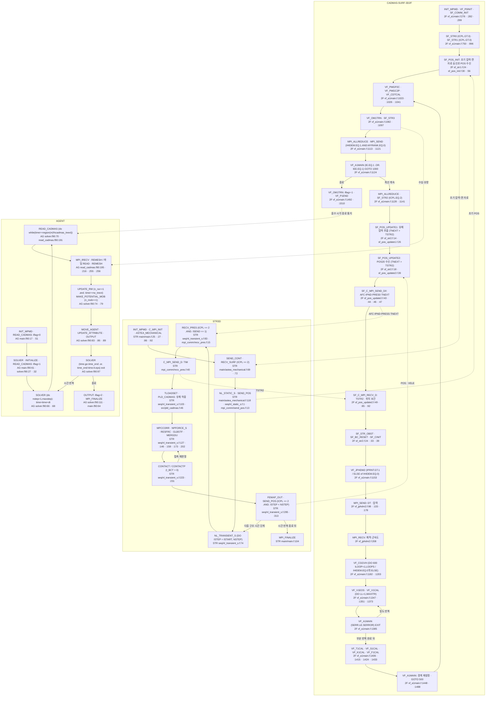

# CADMAS-SURF 계산 호출 흐름

분류별 개수: A 0, B 10, C 6, D 1, E 2, F 1, H 1, X 0. 합계 21행. 집계 근거는 §8의 RF-001–RF-021이다.

판독일: 2026-11-04. 이 보고서는 소스 판독 결과와 AI 해석을 구분한다. 모델을 실행하지 않았다. 다른 노트는 수정하지 않았다.

판독 기준: 주 프로그램의 `CALL`을 1단계로 센다. 그 피호출 루틴의 `CALL`을 2단계로 센다. STR3D는 실제 시간 반복을 가진 `NL_TRANSIENT_S`도 계산 기준점으로 삼는다. AGENT는 `SOLVER`도 계산 기준점으로 삼는다. 같은 루틴을 여러 곳에서 호출하면 호출 위치를 각각 기록하고, 피호출 루틴 내부 표는 한 번만 적는다. 3단계 이하의 연결은 이름과 호출·정의 위치로 적는다. MPI·수학 라이브러리의 내부 구현은 분석하지 않는다.

경로 기준: `S`는 `models/CADMAS-SURF/raw/source_code/Multiscale-and-Multiphysics-Integrated-Simulator-for-Tsunami/Simulators/`이다. `3D 파일`은 `S/CADMAS-SURF-3D/Source code/파일`이다. `2F 파일`은 `S/CADMAS-SURF-3D2F/Source code/파일`이다. `STR 파일`은 `S/STR3D/Source code/파일`이다. `AG 파일`은 `S/AGENT/Source code/파일`이다. 각 약칭 뒤의 `파일:줄`은 이 경로에서 원문 줄을 가리킨다. 표의 ` `는 원문의 줄바꿈이다. 고정형식 연속 줄은 각각 인용한다. 조건 열의 `ELSE`는 같은 표의 앞 분기와 원문 위치를 함께 읽는다. 호출 원문에 붙은 단문 `IF`도 실행 조건이다. 오류 처리 호출도 표에 포함한다.

판 근거: 3D `vf_a1main.f:33`은 `C----------------------------------------------------------2012.03 start`이다. 2F `vf_a1main.f:33`은 `C----------------------------------------------------------2016.09 start`이다. AG `main.f90:13`은 `  write(*,*)"agent_ver3.5 start"`이다. 날짜 표지 하나를 파일 전체의 작성일로 확대하지 않는다. 3D와 2F의 다른 사본은 각자 인용한다. 사용자 지정 동일 파일 목록의 바이트 일치는 별도로 확인한다.

요약: 3D는 입력을 세 번 읽는다. 3D는 반복 머리에서 중첩 격자 자료 교환과 결과 출력을 수행한다. 3D는 속도·압력의 부분 시간 단계 뒤에 온도, 농도, 난류, VOF를 계산한다. 3D는 VOF 계산 후 셀 표지에 맞춰 경계값과 확산계수를 재설정한다. 2F는 구조물 상태 반영과 기상 밀도 반복을 추가한다. STR3D의 제공 소스에는 `NL_TRANSIENT_S`가 있다. STR3D가 별도로 호출하는 `NL_TRANSIENT`의 정의는 제공 소스에서 찾지 못했다. AGENT는 CADMAS 자료를 파일 또는 MPI로 받아 자체 시간 단계에서 피난 행위자를 이동한다. 각 사실의 원문은 아래 표에 적는다.

## 1 시작·입력 읽기 순서

### 1.1 빌드·입력 판독 기준

각 실행 파일의 주 프로그램과 Makefile의 객체 목록을 대조한다. `A11111.in`은 입력 형식 설명으로 읽는다. 주 프로그램은 이 이름을 고정하지 않는다. 입력 파일 이름과 MPI communicator는 초기화·입력 루틴에서 결정한다.

115개 동일 파일 목록을 모두 바이트 비교했다. 목록의 115행에서 불일치를 찾지 못했다. 목록 파일은 `_staging/recovery/scripts/cadmas-3d2f-identical-to-3d.txt`이다. 2F 표는 해당 파일의 정의 위치를 유지한다. 의미 판독은 3D 사본을 함께 사용한다.

| 대상 | 빌드·입력 근거 원문 | 연결 |
|---|---|---|
| 3D | 3D Makefile:6 `EXE	= a.3d-mg10-opt` 3D Makefile:17 `         vf_a1main.f                                     \` | VF_A1MAIN을 시작점으로 사용한다. |
| 2F | 2F obj_list.txt:33 `       sf_str0.o                sf_str1.o                sf_str2.o                sf_str3.o                \` | 구조 연성 루틴을 객체 목록과 대조한다. |
| STR | STR makefile:29 `	$(FCOMP) -o str.exe module/*.o contact/*.o femap/*.o geo/*.o glb_comm/*.o input/*.o input/*/*.o \` `                 main/*.o mpi_comm/*.o partition/*.o seq/*.o src/*.o util/*.o $(LIBS)` | main/main.f를 시작점으로 사용한다. |
| AG | AG Makefile:5 `LOAD = ma.out` AG Makefile:17 `       main.f90                       \` AG Makefile:37 `       solver.f90                     \` | main.f90와 solver.f90를 구분한다. |

### 1.2 3D 시작·입력·초기 조건의 모든 직접 호출

배열 할당 사이의 기본값 설정도 호출 순서에 포함한다. 초기 조건 분기는 `IRETYP.LT.0`이다. 재시작 분기는 같은 `IF`의 `ELSE`이다.

| 순서 | 호출 위치 파일:줄 원문 | 조건(입력 키워드·MPI 랭크·선택 변수) | 피호출 정의 파일:줄 |
|---|---|---|---|
| 3D-I-001 | 3D `vf_a1main.f:351` `      call init_mpmd` | 상위 호출 조건을 따른다. 이 루틴 내부의 블록 조건 없음. | 3D `mod_comm.f90:80` |
| 3D-I-002 | 3D `vf_a1main.f:354` `      CALL VF_P0TIME(WTM1)` | 상위 호출 조건을 따른다. 이 루틴 내부의 블록 조건 없음. | 3D `vf_p0time.f:1` |
| 3D-I-003 | 3D `vf_a1main.f:357` `      CALL VF_P0INIT()` | 상위 호출 조건을 따른다. 이 루틴 내부의 블록 조건 없음. | 3D `vf_p0init.f:1` |
| 3D-I-004 | 3D `vf_a1main.f:360` `      CALL VF_A2CPUT(0,ICPUIN,0     )` | 상위 호출 조건을 따른다. 이 루틴 내부의 블록 조건 없음. | 3D `vf_a2cput.f:1` |
| 3D-I-005 | 3D `vf_a1main.f:361` `      CALL VF_A2CPUT(0,ICPUST,KCP0AL)` | 상위 호출 조건을 따른다. 이 루틴 내부의 블록 조건 없음. | 3D `vf_a2cput.f:1` |
| 3D-I-006 | 3D `vf_a1main.f:362` `      CALL VF_A2CPUT(0,ICPUST,KCP1PR)` | 상위 호출 조건을 따른다. 이 루틴 내부의 블록 조건 없음. | 3D `vf_a2cput.f:1` |
| 3D-I-007 | 3D `vf_a1main.f:367` `      CALL VF_PMGINP()` | 상위 호출 조건을 따른다. 이 루틴 내부의 블록 조건 없음. | 3D `vf_pmginp.f:1` |
| 3D-I-008 | 3D `vf_a1main.f:390` `      CALL VF_A2DFLT()` | 상위 호출 조건을 따른다. 이 루틴 내부의 블록 조건 없음. | 3D `vf_a2dflt.f:1` |
| 3D-I-009 | 3D `vf_a1main.f:394` `      CALL VF_STOC_INIT(IERR)` | 상위 호출 조건을 따른다. 이 루틴 내부의 블록 조건 없음. | 3D `vf_stoc_init.f:1` |
| 3D-I-010 | 3D `vf_a1main.f:402` `      CALL VF_II1INP(XX,YY,ZZ,CM0,CD0,GGV,GGX,GGY,GGZ,` `     &               XPF,YPF,ZPF,IPF,JPF,KPF,` `     &               BCU,BCV,BCW,BCP,BCF,BCVI,BCK,BCE,BCT,BCTI,BCC,BCCI,` `     &               NF,INDX,INDY,INDZ,INDB,INDBK,INDBE,INDBT,INDBC,` `     &               DBUF,IBUF,XXWK,YYWK,ZZWK)` | 상위 호출 조건을 따른다. 이 루틴 내부의 블록 조건 없음. | 3D `vf_ii1inp.f:1` |
| 3D-I-011 | 3D `vf_a1main.f:491` `      IF (IERR.NE.0) CALL VF_A2ERR('VF_A1MAIN','CAN NOT ALLOC.')` | 상위 호출 조건을 따른다. 이 루틴 내부의 블록 조건 없음. | 3D `vf_a2err.f:1` |
| 3D-I-012 | 3D `vf_a1main.f:492` `      CALL VF_ZSETR2(XX  ,0.0D0,MAXG1,NUMI)` | 상위 호출 조건을 따른다. 이 루틴 내부의 블록 조건 없음. | 3D `vf_zsetr2.f:1` |
| 3D-I-013 | 3D `vf_a1main.f:493` `      CALL VF_ZSETR2(YY  ,0.0D0,MAXG1,NUMJ)` | 상위 호출 조건을 따른다. 이 루틴 내부의 블록 조건 없음. | 3D `vf_zsetr2.f:1` |
| 3D-I-014 | 3D `vf_a1main.f:494` `      CALL VF_ZSETR2(ZZ  ,0.0D0,MAXG1,NUMK)` | 상위 호출 조건을 따른다. 이 루틴 내부의 블록 조건 없음. | 3D `vf_zsetr2.f:1` |
| 3D-I-015 | 3D `vf_a1main.f:495` `      CALL VF_ZSETR3(UU  ,0.0D0,NUMI,NUMJ,NUMK)` | 상위 호출 조건을 따른다. 이 루틴 내부의 블록 조건 없음. | 3D `vf_zsetr3.f:1` |
| 3D-I-016 | 3D `vf_a1main.f:496` `      CALL VF_ZSETR3(VV  ,0.0D0,NUMI,NUMJ,NUMK)` | 상위 호출 조건을 따른다. 이 루틴 내부의 블록 조건 없음. | 3D `vf_zsetr3.f:1` |
| 3D-I-017 | 3D `vf_a1main.f:497` `      CALL VF_ZSETR3(WW  ,0.0D0,NUMI,NUMJ,NUMK)` | 상위 호출 조건을 따른다. 이 루틴 내부의 블록 조건 없음. | 3D `vf_zsetr3.f:1` |
| 3D-I-018 | 3D `vf_a1main.f:498` `      CALL VF_ZSETR3(PP  ,0.0D0,NUMI,NUMJ,NUMK)` | 상위 호출 조건을 따른다. 이 루틴 내부의 블록 조건 없음. | 3D `vf_zsetr3.f:1` |
| 3D-I-019 | 3D `vf_a1main.f:499` `      CALL VF_ZSETR3(FF  ,0.0D0,NUMI,NUMJ,NUMK)` | 상위 호출 조건을 따른다. 이 루틴 내부의 블록 조건 없음. | 3D `vf_zsetr3.f:1` |
| 3D-I-020 | 3D `vf_a1main.f:500` `      CALL VF_ZSETR3(ANU ,0.0D0,NUMI,NUMJ,NUMK)` | 상위 호출 조건을 따른다. 이 루틴 내부의 블록 조건 없음. | 3D `vf_zsetr3.f:1` |
| 3D-I-021 | 3D `vf_a1main.f:501` `      CALL VF_ZSETR3(CM0 ,0.0D0,NUMI,NUMJ,NUMK)` | 상위 호출 조건을 따른다. 이 루틴 내부의 블록 조건 없음. | 3D `vf_zsetr3.f:1` |
| 3D-I-022 | 3D `vf_a1main.f:502` `      CALL VF_ZSETR3(CD0 ,0.0D0,NUMI,NUMJ,NUMK)` | 상위 호출 조건을 따른다. 이 루틴 내부의 블록 조건 없음. | 3D `vf_zsetr3.f:1` |
| 3D-I-023 | 3D `vf_a1main.f:503` `      CALL VF_ZSETR3(GGV ,1.0D0,NUMI,NUMJ,NUMK)` | 상위 호출 조건을 따른다. 이 루틴 내부의 블록 조건 없음. | 3D `vf_zsetr3.f:1` |
| 3D-I-024 | 3D `vf_a1main.f:504` `      CALL VF_ZSETR3(GGX ,1.0D0,NUMI,NUMJ,NUMK)` | 상위 호출 조건을 따른다. 이 루틴 내부의 블록 조건 없음. | 3D `vf_zsetr3.f:1` |
| 3D-I-025 | 3D `vf_a1main.f:505` `      CALL VF_ZSETR3(GGY ,1.0D0,NUMI,NUMJ,NUMK)` | 상위 호출 조건을 따른다. 이 루틴 내부의 블록 조건 없음. | 3D `vf_zsetr3.f:1` |
| 3D-I-026 | 3D `vf_a1main.f:506` `      CALL VF_ZSETR3(GGZ ,1.0D0,NUMI,NUMJ,NUMK)` | 상위 호출 조건을 따른다. 이 루틴 내부의 블록 조건 없음. | 3D `vf_zsetr3.f:1` |
| 3D-I-027 | 3D `vf_a1main.f:507` `      CALL VF_ZSETR3(GLV ,1.0D0,NUMI,NUMJ,NUMK)` | 상위 호출 조건을 따른다. 이 루틴 내부의 블록 조건 없음. | 3D `vf_zsetr3.f:1` |
| 3D-I-028 | 3D `vf_a1main.f:508` `      CALL VF_ZSETR3(GLX ,1.0D0,NUMI,NUMJ,NUMK)` | 상위 호출 조건을 따른다. 이 루틴 내부의 블록 조건 없음. | 3D `vf_zsetr3.f:1` |
| 3D-I-029 | 3D `vf_a1main.f:509` `      CALL VF_ZSETR3(GLY ,1.0D0,NUMI,NUMJ,NUMK)` | 상위 호출 조건을 따른다. 이 루틴 내부의 블록 조건 없음. | 3D `vf_zsetr3.f:1` |
| 3D-I-030 | 3D `vf_a1main.f:510` `      CALL VF_ZSETR3(GLZ ,1.0D0,NUMI,NUMJ,NUMK)` | 상위 호출 조건을 따른다. 이 루틴 내부의 블록 조건 없음. | 3D `vf_zsetr3.f:1` |
| 3D-I-031 | 3D `vf_a1main.f:511` `      CALL VF_ZSETR1(TBUB,0.0D0,NUMK)` | 상위 호출 조건을 따른다. 이 루틴 내부의 블록 조건 없음. | 3D `vf_zsetr1.f:1` |
| 3D-I-032 | 3D `vf_a1main.f:512` `      CALL VF_ZSETR3(DROPTX,0.0D0,NUMI,NUMJ,NUMK)` | 상위 호출 조건을 따른다. 이 루틴 내부의 블록 조건 없음. | 3D `vf_zsetr3.f:1` |
| 3D-I-033 | 3D `vf_a1main.f:513` `      CALL VF_ZSETR3(DROPTY,0.0D0,NUMI,NUMJ,NUMK)` | 상위 호출 조건을 따른다. 이 루틴 내부의 블록 조건 없음. | 3D `vf_zsetr3.f:1` |
| 3D-I-034 | 3D `vf_a1main.f:514` `      CALL VF_ZSETR3(DROPTZ,0.0D0,NUMI,NUMJ,NUMK)` | 상위 호출 조건을 따른다. 이 루틴 내부의 블록 조건 없음. | 3D `vf_zsetr3.f:1` |
| 3D-I-035 | 3D `vf_a1main.f:515` `      CALL VF_ZSETR3(DROPUU,0.0D0,NUMI,NUMJ,NUMK)` | 상위 호출 조건을 따른다. 이 루틴 내부의 블록 조건 없음. | 3D `vf_zsetr3.f:1` |
| 3D-I-036 | 3D `vf_a1main.f:516` `      CALL VF_ZSETR3(DROPVV,0.0D0,NUMI,NUMJ,NUMK)` | 상위 호출 조건을 따른다. 이 루틴 내부의 블록 조건 없음. | 3D `vf_zsetr3.f:1` |
| 3D-I-037 | 3D `vf_a1main.f:517` `      CALL VF_ZSETR3(DROPWW,0.0D0,NUMI,NUMJ,NUMK)` | 상위 호출 조건을 따른다. 이 루틴 내부의 블록 조건 없음. | 3D `vf_zsetr3.f:1` |
| 3D-I-038 | 3D `vf_a1main.f:519` `        CALL VF_ZSETR3(ANUT,0.0D0,NUMI,NUMJ,NUMK)` | 3D `vf_a1main.f:518` `      IF (LEQK.NE.0) THEN` | 3D `vf_zsetr3.f:1` |
| 3D-I-039 | 3D `vf_a1main.f:520` `        CALL VF_ZSETR3(AK  ,0.0D0,NUMI,NUMJ,NUMK)` | 3D `vf_a1main.f:518` `      IF (LEQK.NE.0) THEN` | 3D `vf_zsetr3.f:1` |
| 3D-I-040 | 3D `vf_a1main.f:521` `        CALL VF_ZSETR3(AE  ,0.0D0,NUMI,NUMJ,NUMK)` | 3D `vf_a1main.f:518` `      IF (LEQK.NE.0) THEN` | 3D `vf_zsetr3.f:1` |
| 3D-I-041 | 3D `vf_a1main.f:524` `        CALL VF_ZSETR3(TT ,0.0D0,NUMI,NUMJ,NUMK)` | 3D `vf_a1main.f:523` `      IF (LEQT.NE.0) THEN` | 3D `vf_zsetr3.f:1` |
| 3D-I-042 | 3D `vf_a1main.f:525` `        CALL VF_ZSETR3(ALM,0.0D0,NUMI,NUMJ,NUMK)` | 3D `vf_a1main.f:523` `      IF (LEQT.NE.0) THEN` | 3D `vf_zsetr3.f:1` |
| 3D-I-043 | 3D `vf_a1main.f:528` `        CALL VF_ZSETR3(CC(1,1,1,LC),0.0D0,NUMI,NUMJ,NUMK)` | 3D `vf_a1main.f:527` `      DO 100 LC=1,LEQC` | 3D `vf_zsetr3.f:1` |
| 3D-I-044 | 3D `vf_a1main.f:529` `        CALL VF_ZSETR3(DD(1,1,1,LC),0.0D0,NUMI,NUMJ,NUMK)` | 3D `vf_a1main.f:527` `      DO 100 LC=1,LEQC` | 3D `vf_zsetr3.f:1` |
| 3D-I-045 | 3D `vf_a1main.f:531` `      CALL VF_ZSETR1(DBUF,0.0D0,NUMBUF*MAXBUF )` | 상위 호출 조건을 따른다. 이 루틴 내부의 블록 조건 없음. | 3D `vf_zsetr1.f:1` |
| 3D-I-046 | 3D `vf_a1main.f:532` `      CALL VF_ZSETR3(WK01,0.0D0,NUMI,NUMJ,NUMK)` | 상위 호출 조건을 따른다. 이 루틴 내부의 블록 조건 없음. | 3D `vf_zsetr3.f:1` |
| 3D-I-047 | 3D `vf_a1main.f:533` `      CALL VF_ZSETR3(WK02,0.0D0,NUMI,NUMJ,NUMK)` | 상위 호출 조건을 따른다. 이 루틴 내부의 블록 조건 없음. | 3D `vf_zsetr3.f:1` |
| 3D-I-048 | 3D `vf_a1main.f:534` `      CALL VF_ZSETR3(WK03,0.0D0,NUMI,NUMJ,NUMK)` | 상위 호출 조건을 따른다. 이 루틴 내부의 블록 조건 없음. | 3D `vf_zsetr3.f:1` |
| 3D-I-049 | 3D `vf_a1main.f:535` `      CALL VF_ZSETR3(WK04,0.0D0,NUMI,NUMJ,NUMK)` | 상위 호출 조건을 따른다. 이 루틴 내부의 블록 조건 없음. | 3D `vf_zsetr3.f:1` |
| 3D-I-050 | 3D `vf_a1main.f:536` `      CALL VF_ZSETR3(WK05,0.0D0,NUMI,NUMJ,NUMK)` | 상위 호출 조건을 따른다. 이 루틴 내부의 블록 조건 없음. | 3D `vf_zsetr3.f:1` |
| 3D-I-051 | 3D `vf_a1main.f:537` `      CALL VF_ZSETR3(WK06,0.0D0,NUMI,NUMJ,NUMK)` | 상위 호출 조건을 따른다. 이 루틴 내부의 블록 조건 없음. | 3D `vf_zsetr3.f:1` |
| 3D-I-052 | 3D `vf_a1main.f:538` `      CALL VF_ZSETR3(WK07,0.0D0,NUMI,NUMJ,NUMK)` | 상위 호출 조건을 따른다. 이 루틴 내부의 블록 조건 없음. | 3D `vf_zsetr3.f:1` |
| 3D-I-053 | 3D `vf_a1main.f:539` `      CALL VF_ZSETR3(WK08,0.0D0,NUMI,NUMJ,NUMK)` | 상위 호출 조건을 따른다. 이 루틴 내부의 블록 조건 없음. | 3D `vf_zsetr3.f:1` |
| 3D-I-054 | 3D `vf_a1main.f:540` `      CALL VF_ZSETR3(WK09,0.0D0,NUMI,NUMJ,NUMK)` | 상위 호출 조건을 따른다. 이 루틴 내부의 블록 조건 없음. | 3D `vf_zsetr3.f:1` |
| 3D-I-055 | 3D `vf_a1main.f:541` `      CALL VF_ZSETR3(WK10,0.0D0,NUMI,NUMJ,NUMK)` | 상위 호출 조건을 따른다. 이 루틴 내부의 블록 조건 없음. | 3D `vf_zsetr3.f:1` |
| 3D-I-056 | 3D `vf_a1main.f:542` `      CALL VF_ZSETR3(WK11,0.0D0,NUMI,NUMJ,NUMK)` | 상위 호출 조건을 따른다. 이 루틴 내부의 블록 조건 없음. | 3D `vf_zsetr3.f:1` |
| 3D-I-057 | 3D `vf_a1main.f:543` `      CALL VF_ZSETR3(WK12,0.0D0,NUMI,NUMJ,NUMK)` | 상위 호출 조건을 따른다. 이 루틴 내부의 블록 조건 없음. | 3D `vf_zsetr3.f:1` |
| 3D-I-058 | 3D `vf_a1main.f:544` `      CALL VF_ZSETR3(WK13,0.0D0,NUMI,NUMJ,NUMK)` | 상위 호출 조건을 따른다. 이 루틴 내부의 블록 조건 없음. | 3D `vf_zsetr3.f:1` |
| 3D-I-059 | 3D `vf_a1main.f:545` `      CALL VF_ZSETR3(WK14,0.0D0,NUMI,NUMJ,NUMK)` | 상위 호출 조건을 따른다. 이 루틴 내부의 블록 조건 없음. | 3D `vf_zsetr3.f:1` |
| 3D-I-060 | 3D `vf_a1main.f:546` `      CALL VF_ZSETR3(WK15,0.0D0,NUMI,NUMJ,NUMK)` | 상위 호출 조건을 따른다. 이 루틴 내부의 블록 조건 없음. | 3D `vf_zsetr3.f:1` |
| 3D-I-061 | 3D `vf_a1main.f:547` `      CALL VF_ZSETR3(WK16,0.0D0,NUMI,NUMJ,NUMK)` | 상위 호출 조건을 따른다. 이 루틴 내부의 블록 조건 없음. | 3D `vf_zsetr3.f:1` |
| 3D-I-062 | 3D `vf_a1main.f:548` `      CALL VF_ZSETR3(WK17,0.0D0,NUMI,NUMJ,NUMK)` | 상위 호출 조건을 따른다. 이 루틴 내부의 블록 조건 없음. | 3D `vf_zsetr3.f:1` |
| 3D-I-063 | 3D `vf_a1main.f:549` `      CALL VF_ZSETR3(FFLXX,0.0D0,NUMI,NUMJ,NUMK)` | 상위 호출 조건을 따른다. 이 루틴 내부의 블록 조건 없음. | 3D `vf_zsetr3.f:1` |
| 3D-I-064 | 3D `vf_a1main.f:550` `      CALL VF_ZSETR3(FFLXY,0.0D0,NUMI,NUMJ,NUMK)` | 상위 호출 조건을 따른다. 이 루틴 내부의 블록 조건 없음. | 3D `vf_zsetr3.f:1` |
| 3D-I-065 | 3D `vf_a1main.f:551` `      CALL VF_ZSETI3(NF  ,    0,NUMI,NUMJ,NUMK)` | 상위 호출 조건을 따른다. 이 루틴 내부의 블록 조건 없음. | 3D `vf_zseti3.f:1` |
| 3D-I-066 | 3D `vf_a1main.f:552` `      CALL VF_ZSETI3(INDX,    0,NUMI,NUMJ,NUMK)` | 상위 호출 조건을 따른다. 이 루틴 내부의 블록 조건 없음. | 3D `vf_zseti3.f:1` |
| 3D-I-067 | 3D `vf_a1main.f:553` `      CALL VF_ZSETI3(INDY,    0,NUMI,NUMJ,NUMK)` | 상위 호출 조건을 따른다. 이 루틴 내부의 블록 조건 없음. | 3D `vf_zseti3.f:1` |
| 3D-I-068 | 3D `vf_a1main.f:554` `      CALL VF_ZSETI3(INDZ,    0,NUMI,NUMJ,NUMK)` | 상위 호출 조건을 따른다. 이 루틴 내부의 블록 조건 없음. | 3D `vf_zseti3.f:1` |
| 3D-I-069 | 3D `vf_a1main.f:555` `      CALL VF_ZSETI3(INDC,    0,NUMI,NUMJ,NUMK)` | 상위 호출 조건을 따른다. 이 루틴 내부의 블록 조건 없음. | 3D `vf_zseti3.f:1` |
| 3D-I-070 | 3D `vf_a1main.f:556` `      CALL VF_ZSETI1(INDS,    0,NUMI*NUMJ*NUMK)` | 상위 호출 조건을 따른다. 이 루틴 내부의 블록 조건 없음. | 3D `vf_zseti1.f:1` |
| 3D-I-071 | 3D `vf_a1main.f:557` `      CALL VF_ZSETI1(IBUF,    0,NUMBUF*MAXBUF )` | 상위 호출 조건을 따른다. 이 루틴 내부의 블록 조건 없음. | 3D `vf_zseti1.f:1` |
| 3D-I-072 | 3D `vf_a1main.f:558` `      CALL VF_ZSETI3(NWK1,    0,NUMI,NUMJ,NUMK)` | 상위 호출 조건을 따른다. 이 루틴 내부의 블록 조건 없음. | 3D `vf_zseti3.f:1` |
| 3D-I-073 | 3D `vf_a1main.f:560` `      CALL VF_ZSETR1(XPF,0.0D0,NUMI)` | 상위 호출 조건을 따른다. 이 루틴 내부의 블록 조건 없음. | 3D `vf_zsetr1.f:1` |
| 3D-I-074 | 3D `vf_a1main.f:561` `      CALL VF_ZSETR1(YPF,0.0D0,NUMJ)` | 상위 호출 조건을 따른다. 이 루틴 내부의 블록 조건 없음. | 3D `vf_zsetr1.f:1` |
| 3D-I-075 | 3D `vf_a1main.f:562` `      CALL VF_ZSETR1(ZPF,0.0D0,NUMK)` | 상위 호출 조건을 따른다. 이 루틴 내부의 블록 조건 없음. | 3D `vf_zsetr1.f:1` |
| 3D-I-076 | 3D `vf_a1main.f:565` `      CALL VF_II1INP(XX,YY,ZZ,CM0,CD0,GGV,GGX,GGY,GGZ,` `     &               XPF,YPF,ZPF,IPF,JPF,KPF,` `     &               BCU,BCV,BCW,BCP,BCF,BCVI,BCK,BCE,BCT,BCTI,BCC,BCCI,` `     &               NF,INDX,INDY,INDZ,INDB,INDBK,INDBE,INDBT,INDBC,` `     &               DBUF,IBUF,XXWK,YYWK,ZZWK)` | 상위 호출 조건을 따른다. 이 루틴 내부의 블록 조건 없음. | 3D `vf_ii1inp.f:1` |
| 3D-I-077 | 3D `vf_a1main.f:617` `      IF (IERR.NE.0) CALL VF_A2ERR('VF_A1MAIN','CAN NOT ALLOC.')` | 상위 호출 조건을 따른다. 이 루틴 내부의 블록 조건 없음. | 3D `vf_a2err.f:1` |
| 3D-I-078 | 3D `vf_a1main.f:618` `      CALL VF_ZSETR1(BCU  ,0.0D0,NUMBX)` | 상위 호출 조건을 따른다. 이 루틴 내부의 블록 조건 없음. | 3D `vf_zsetr1.f:1` |
| 3D-I-079 | 3D `vf_a1main.f:619` `      CALL VF_ZSETR1(BCV  ,0.0D0,NUMBX)` | 상위 호출 조건을 따른다. 이 루틴 내부의 블록 조건 없음. | 3D `vf_zsetr1.f:1` |
| 3D-I-080 | 3D `vf_a1main.f:620` `      CALL VF_ZSETR1(BCW  ,0.0D0,NUMBX)` | 상위 호출 조건을 따른다. 이 루틴 내부의 블록 조건 없음. | 3D `vf_zsetr1.f:1` |
| 3D-I-081 | 3D `vf_a1main.f:621` `      CALL VF_ZSETR1(BCP  ,0.0D0,NUMBX)` | 상위 호출 조건을 따른다. 이 루틴 내부의 블록 조건 없음. | 3D `vf_zsetr1.f:1` |
| 3D-I-082 | 3D `vf_a1main.f:622` `      CALL VF_ZSETR1(BCF  ,0.0D0,NUMBX)` | 상위 호출 조건을 따른다. 이 루틴 내부의 블록 조건 없음. | 3D `vf_zsetr1.f:1` |
| 3D-I-083 | 3D `vf_a1main.f:623` `      CALL VF_ZSETR1(BCVI ,0.0D0,NUMBX)` | 상위 호출 조건을 따른다. 이 루틴 내부의 블록 조건 없음. | 3D `vf_zsetr1.f:1` |
| 3D-I-084 | 3D `vf_a1main.f:625` `        CALL VF_ZSETR1(BCK ,0.0D0,  NUMBX)` | 3D `vf_a1main.f:624` `      IF (LEQK.NE.0) THEN` | 3D `vf_zsetr1.f:1` |
| 3D-I-085 | 3D `vf_a1main.f:626` `        CALL VF_ZSETR1(BCE ,0.0D0,  NUMBX)` | 3D `vf_a1main.f:624` `      IF (LEQK.NE.0) THEN` | 3D `vf_zsetr1.f:1` |
| 3D-I-086 | 3D `vf_a1main.f:629` `        CALL VF_ZSETR1(BCT ,0.0D0,  NUMBX)` | 3D `vf_a1main.f:628` `      IF (LEQT.NE.0) THEN` | 3D `vf_zsetr1.f:1` |
| 3D-I-087 | 3D `vf_a1main.f:630` `        CALL VF_ZSETR2(BCTI,0.0D0,2,NUMBX)` | 3D `vf_a1main.f:628` `      IF (LEQT.NE.0) THEN` | 3D `vf_zsetr2.f:1` |
| 3D-I-088 | 3D `vf_a1main.f:633` `        CALL VF_ZSETR1(BCC (  1,LC),0.0D0,  NUMBX)` | 3D `vf_a1main.f:632` `      DO 110 LC=1,LEQC` | 3D `vf_zsetr1.f:1` |
| 3D-I-089 | 3D `vf_a1main.f:634` `        CALL VF_ZSETR2(BCCI(1,1,LC),0.0D0,2,NUMBX)` | 3D `vf_a1main.f:632` `      DO 110 LC=1,LEQC` | 3D `vf_zsetr2.f:1` |
| 3D-I-090 | 3D `vf_a1main.f:636` `      CALL VF_ZSETR1(WKBC ,0.0D0,NUMBX)` | 상위 호출 조건을 따른다. 이 루틴 내부의 블록 조건 없음. | 3D `vf_zsetr1.f:1` |
| 3D-I-091 | 3D `vf_a1main.f:637` `      CALL VF_ZSETI2(INDB ,    0,MAXB1,NUMBX)` | 상위 호출 조건을 따른다. 이 루틴 내부의 블록 조건 없음. | 3D `vf_zseti2.f:1` |
| 3D-I-092 | 3D `vf_a1main.f:639` `        CALL VF_ZSETI1(INDBK,  0,NUMBX)` | 3D `vf_a1main.f:638` `      IF (LEQK.NE.0) THEN` | 3D `vf_zseti1.f:1` |
| 3D-I-093 | 3D `vf_a1main.f:640` `        CALL VF_ZSETI1(INDBE,  0,NUMBX)` | 3D `vf_a1main.f:638` `      IF (LEQK.NE.0) THEN` | 3D `vf_zseti1.f:1` |
| 3D-I-094 | 3D `vf_a1main.f:643` `        CALL VF_ZSETI1(INDBT,  0,NUMBX)` | 3D `vf_a1main.f:642` `      IF (LEQT.NE.0) THEN` | 3D `vf_zseti1.f:1` |
| 3D-I-095 | 3D `vf_a1main.f:646` `        CALL VF_ZSETI1(INDBC(1,LC),0,NUMBX)` | 3D `vf_a1main.f:645` `      DO 120 LC=1,LEQC` | 3D `vf_zseti1.f:1` |
| 3D-I-096 | 3D `vf_a1main.f:648` `      CALL VF_ZSETI1(NWKBC,    0,NUMBX)` | 상위 호출 조건을 따른다. 이 루틴 내부의 블록 조건 없음. | 3D `vf_zseti1.f:1` |
| 3D-I-097 | 3D `vf_a1main.f:651` `        CALL VF_ZSETI1(IPF,0,MGPINF(1)+1)` | 3D `vf_a1main.f:650` `      IF(MGPARE(MGRANK+1).GT.0) THEN` | 3D `vf_zseti1.f:1` |
| 3D-I-098 | 3D `vf_a1main.f:652` `        CALL VF_ZSETI1(JPF,0,MGPINF(2)+1)` | 3D `vf_a1main.f:650` `      IF(MGPARE(MGRANK+1).GT.0) THEN` | 3D `vf_zseti1.f:1` |
| 3D-I-099 | 3D `vf_a1main.f:653` `        CALL VF_ZSETI1(KPF,0,MGPINF(3)+1)` | 3D `vf_a1main.f:650` `      IF(MGPARE(MGRANK+1).GT.0) THEN` | 3D `vf_zseti1.f:1` |
| 3D-I-100 | 3D `vf_a1main.f:657` `      CALL VF_II1INP(XX,YY,ZZ,CM0,CD0,GGV,GGX,GGY,GGZ,` `     &               XPF,YPF,ZPF,IPF,JPF,KPF,` `     &               BCU,BCV,BCW,BCP,BCF,BCVI,BCK,BCE,BCT,BCTI,BCC,BCCI,` `     &               NF,INDX,INDY,INDZ,INDB,INDBK,INDBE,INDBT,INDBC,` `     &               DBUF,IBUF,XXWK,YYWK,ZZWK)` | 상위 호출 조건을 따른다. 이 루틴 내부의 블록 조건 없음. | 3D `vf_ii1inp.f:1` |
| 3D-I-101 | 3D `vf_a1main.f:684` `      IF (IERR.NE.0) CALL VF_A2ERR('VF_A1MAIN','CAN NOT ALLOC.')` | 상위 호출 조건을 따른다. 이 루틴 내부의 블록 조건 없음. | 3D `vf_a2err.f:1` |
| 3D-I-102 | 3D `vf_a1main.f:685` `      CALL VF_ZSETR2(SRCUV,0.0D0,NUMIJ,NUMK)` | 상위 호출 조건을 따른다. 이 루틴 내부의 블록 조건 없음. | 3D `vf_zsetr2.f:1` |
| 3D-I-103 | 3D `vf_a1main.f:687` `        CALL VF_ZSETR3(PPPVC,0.0D0,NUMI,NUMJ,NUMK)` | 3D `vf_a1main.f:686` `      IF (PVCP0.GE.ZERO) THEN` | 3D `vf_zsetr3.f:1` |
| 3D-I-104 | 3D `vf_a1main.f:688` `        CALL VF_ZSETI3(IPVC ,    0,NUMI,NUMJ,NUMK)` | 3D `vf_a1main.f:686` `      IF (PVCP0.GE.ZERO) THEN` | 3D `vf_zseti3.f:1` |
| 3D-I-105 | 3D `vf_a1main.f:694` `        CALL VF_ZSETR2(DELH   ,0.0D0,NUMI0,NUMJ0)` | 3D `vf_a1main.f:691` `      IF(ISEABT.NE.0) THEN` | 3D `vf_zsetr2.f:1` |
| 3D-I-106 | 3D `vf_a1main.f:695` `        CALL VF_ZSETR2(DELH_IN,0.0D0,NUMI0,NUMJ0)` | 3D `vf_a1main.f:691` `      IF(ISEABT.NE.0) THEN` | 3D `vf_zsetr2.f:1` |
| 3D-I-107 | 3D `vf_a1main.f:701` `      CALL VF_IP1INP(0.0D0,GGVOLD,GGVNOW)` | 상위 호출 조건을 따른다. 이 루틴 내부의 블록 조건 없음. | 3D `vf_ip1inp.f:1` |
| 3D-I-108 | 3D `vf_a1main.f:706` `        IF (IERR.NE.0) CALL VF_A2ERR('VF_A1MAIN','CAN NOT ALLOC.')` | 3D `vf_a1main.f:703` `      IF (IPRNP.GE.1) THEN` | 3D `vf_a2err.f:1` |
| 3D-I-109 | 3D `vf_a1main.f:707` `        CALL VF_ZSETR1(GGVOLD,1.0D0,IPRNP)` | 3D `vf_a1main.f:703` `      IF (IPRNP.GE.1) THEN` | 3D `vf_zsetr1.f:1` |
| 3D-I-110 | 3D `vf_a1main.f:708` `        CALL VF_ZSETR1(GGVNOW,1.0D0,IPRNP)` | 3D `vf_a1main.f:703` `      IF (IPRNP.GE.1) THEN` | 3D `vf_zsetr1.f:1` |
| 3D-I-111 | 3D `vf_a1main.f:713` `        IF (IERR.NE.0) CALL VF_A2ERR('VF_A1MAIN','CAN NOT ALLOC.')` | 3D `vf_a1main.f:710` `      IF (IPRNT.GT.1) THEN` | 3D `vf_a2err.f:1` |
| 3D-I-112 | 3D `vf_a1main.f:714` `        CALL VF_ZSETR3(GGV0,1.0D0,NUMI,NUMJ,NUMK)` | 3D `vf_a1main.f:710` `      IF (IPRNT.GT.1) THEN` | 3D `vf_zsetr3.f:1` |
| 3D-I-113 | 3D `vf_a1main.f:715` `        CALL VF_ZSETR3(GLV0,1.0D0,NUMI,NUMJ,NUMK)` | 3D `vf_a1main.f:710` `      IF (IPRNT.GT.1) THEN` | 3D `vf_zsetr3.f:1` |
| 3D-I-114 | 3D `vf_a1main.f:718` `        CALL VF_IP1INP(0.0D0,GGVOLD,GGVNOW)` | 3D `vf_a1main.f:717` `      IF (IPRNT.EQ.1) THEN` | 3D `vf_ip1inp.f:1` |
| 3D-I-115 | 3D `vf_a1main.f:719` `        CALL VF_CGGV  (0,0.0D0,0.0D0,0.0D0,GGV,GGV0,GGVOLD,GGVNOW,NF)` | 3D `vf_a1main.f:717` `      IF (IPRNT.EQ.1) THEN` | 3D `vf_cggv.f:1` |
| 3D-I-116 | 3D `vf_a1main.f:720` `        CALL VF_CGGXYZ(0,XX,YY,ZZ,GGV,GGX,GGY,GGZ,GGV0,DBUF,` `     &                 NF,INDX,INDY,INDZ)` | 3D `vf_a1main.f:717` `      IF (IPRNT.EQ.1) THEN` | 3D `vf_cggxyz.f:1` |
| 3D-I-117 | 3D `vf_a1main.f:723` `      CALL VF_CGLV  (CM0,GGV,GLV,NF)` | 상위 호출 조건을 따른다. 이 루틴 내부의 블록 조건 없음. | 3D `vf_cglv.f:1` |
| 3D-I-118 | 3D `vf_a1main.f:724` `      CALL VF_CGLXYZ(XX,YY,ZZ,CM0,GGX,GGY,GGZ,GLX,GLY,GLZ,DBUF,` `     &               NF,INDX,INDY,INDZ)` | 상위 호출 조건을 따른다. 이 루틴 내부의 블록 조건 없음. | 3D `vf_cglxyz.f:1` |
| 3D-I-119 | 3D `vf_a1main.f:730` `        CALL VF_IM1INP(DMTBTT,DMTBZZ,DMTBHH,DMTBUN,DMTBUT)` | 3D `vf_a1main.f:728` `      IF (MTBTYP.GE.1) THEN` | 3D `vf_im1inp.f:1` |
| 3D-I-120 | 3D `vf_a1main.f:741` `        IF (IERR.NE.0) CALL VF_A2ERR('VF_A1MAIN','CAN NOT ALLOC.')` | 3D `vf_a1main.f:728` `      IF (MTBTYP.GE.1) THEN` | 3D `vf_a2err.f:1` |
| 3D-I-121 | 3D `vf_a1main.f:742` `        CALL VF_ZSETR1(DMTBTT,0.0D0,MTBTT)` | 3D `vf_a1main.f:728` `      IF (MTBTYP.GE.1) THEN` | 3D `vf_zsetr1.f:1` |
| 3D-I-122 | 3D `vf_a1main.f:744` `          CALL VF_ZSETR1(DMTBHH,0.0D0,MTBTT)` | 3D `vf_a1main.f:728` `      IF (MTBTYP.GE.1) THEN` 3D `vf_a1main.f:743` `        IF (MTBTYP.NE.2) THEN` | 3D `vf_zsetr1.f:1` |
| 3D-I-123 | 3D `vf_a1main.f:747` `          CALL VF_ZSETR1(DMTBZZ,0.0D0,MTBZZ)` | 3D `vf_a1main.f:728` `      IF (MTBTYP.GE.1) THEN` 3D `vf_a1main.f:746` `        IF (MTBTYP.NE.3) THEN` | 3D `vf_zsetr1.f:1` |
| 3D-I-124 | 3D `vf_a1main.f:748` `          CALL VF_ZSETR2(DMTBUN,0.0D0,MTBZZ,MTBTT)` | 3D `vf_a1main.f:728` `      IF (MTBTYP.GE.1) THEN` 3D `vf_a1main.f:746` `        IF (MTBTYP.NE.3) THEN` | 3D `vf_zsetr2.f:1` |
| 3D-I-125 | 3D `vf_a1main.f:749` `          CALL VF_ZSETR2(DMTBUT,0.0D0,MTBZZ,MTBTT)` | 3D `vf_a1main.f:728` `      IF (MTBTYP.GE.1) THEN` 3D `vf_a1main.f:746` `        IF (MTBTYP.NE.3) THEN` | 3D `vf_zsetr2.f:1` |
| 3D-I-126 | 3D `vf_a1main.f:752` `        CALL VF_IM1INP(DMTBTT,DMTBZZ,DMTBHH,DMTBUN,DMTBUT)` | 3D `vf_a1main.f:728` `      IF (MTBTYP.GE.1) THEN` | 3D `vf_im1inp.f:1` |
| 3D-I-127 | 3D `vf_a1main.f:756` `        CALL VF_IM2INP(DMTBTT2,DMTBZZ2,DMTBHH2,DMTBUN2,DMTBUT2)` | 3D `vf_a1main.f:754` `      IF (MTBTYP2.GE.1) THEN` | 3D `vf_im2inp.f:1` |
| 3D-I-128 | 3D `vf_a1main.f:767` `        IF (IERR.NE.0) CALL VF_A2ERR('VF_A1MAIN','CAN NOT ALLOC.')` | 3D `vf_a1main.f:754` `      IF (MTBTYP2.GE.1) THEN` | 3D `vf_a2err.f:1` |
| 3D-I-129 | 3D `vf_a1main.f:768` `        CALL VF_ZSETR1(DMTBTT2,0.0D0,MTBTT2)` | 3D `vf_a1main.f:754` `      IF (MTBTYP2.GE.1) THEN` | 3D `vf_zsetr1.f:1` |
| 3D-I-130 | 3D `vf_a1main.f:770` `          CALL VF_ZSETR1(DMTBHH2,0.0D0,MTBTT2)` | 3D `vf_a1main.f:754` `      IF (MTBTYP2.GE.1) THEN` 3D `vf_a1main.f:769` `        IF (MTBTYP2.NE.2) THEN` | 3D `vf_zsetr1.f:1` |
| 3D-I-131 | 3D `vf_a1main.f:773` `          CALL VF_ZSETR1(DMTBZZ2,0.0D0,MTBZZ2)` | 3D `vf_a1main.f:754` `      IF (MTBTYP2.GE.1) THEN` 3D `vf_a1main.f:772` `        IF (MTBTYP2.NE.3) THEN` | 3D `vf_zsetr1.f:1` |
| 3D-I-132 | 3D `vf_a1main.f:774` `          CALL VF_ZSETR2(DMTBUN2,0.0D0,MTBZZ2,MTBTT2)` | 3D `vf_a1main.f:754` `      IF (MTBTYP2.GE.1) THEN` 3D `vf_a1main.f:772` `        IF (MTBTYP2.NE.3) THEN` | 3D `vf_zsetr2.f:1` |
| 3D-I-133 | 3D `vf_a1main.f:775` `          CALL VF_ZSETR2(DMTBUT2,0.0D0,MTBZZ2,MTBTT2)` | 3D `vf_a1main.f:754` `      IF (MTBTYP2.GE.1) THEN` 3D `vf_a1main.f:772` `        IF (MTBTYP2.NE.3) THEN` | 3D `vf_zsetr2.f:1` |
| 3D-I-134 | 3D `vf_a1main.f:778` `        CALL VF_IM2INP(DMTBTT2,DMTBZZ2,DMTBHH2,DMTBUN2,DMTBUT2)` | 3D `vf_a1main.f:754` `      IF (MTBTYP2.GE.1) THEN` | 3D `vf_im2inp.f:1` |
| 3D-I-135 | 3D `vf_a1main.f:784` `      CALL VF_CSETUP(XX,YY,ZZ,BCU,BCV,BCW,BCP,BCF,BCVI,BCK,BCE,` `     &               NF,INDX,INDY,INDZ,INDB,INDBK,INDBE)` | 상위 호출 조건을 따른다. 이 루틴 내부의 블록 조건 없음. | 3D `vf_csetup.f:1` |
| 3D-I-136 | 3D `vf_a1main.f:790` `      CALL VF_OL1INI(XX,YY,ZZ,` `     &               CM0,CD0,GGV,GGX,GGY,GGZ,GLV,GLX,GLY,GLZ,` `     &               BCU,BCV,BCW,BCP,BCF,BCK,BCE,BCT,BCTI,BCC,BCCI,` `     &               NF,INDX,INDY,INDZ,INDB,INDBK,INDBE,INDBT,INDBC)` | 상위 호출 조건을 따른다. 이 루틴 내부의 블록 조건 없음. | 3D `vf_ol1ini.f:1` |
| 3D-I-137 | 3D `vf_a1main.f:807` `          CALL VF_IP1INP(TNOW,GGVOLD,GGVNOW)` | 3D `vf_a1main.f:796` `      IF (IRETYP.LT.0) THEN` 3D `vf_a1main.f:806` `        IF (IPRNT.GT.1) THEN` | 3D `vf_ip1inp.f:1` |
| 3D-I-138 | 3D `vf_a1main.f:808` `          CALL VF_CGGV  (0,0.0D0,0.0D0,0.0D0,GGV,GGV0,GGVOLD,GGVNOW,NF)` | 3D `vf_a1main.f:796` `      IF (IRETYP.LT.0) THEN` 3D `vf_a1main.f:806` `        IF (IPRNT.GT.1) THEN` | 3D `vf_cggv.f:1` |
| 3D-I-139 | 3D `vf_a1main.f:809` `          CALL VF_CGGXYZ(0,XX,YY,ZZ,GGV,GGX,GGY,GGZ,GGV0,DBUF,` `     &                   NF,INDX,INDY,INDZ)` | 3D `vf_a1main.f:796` `      IF (IRETYP.LT.0) THEN` 3D `vf_a1main.f:806` `        IF (IPRNT.GT.1) THEN` | 3D `vf_cggxyz.f:1` |
| 3D-I-140 | 3D `vf_a1main.f:811` `          CALL VF_CGLV  (CM0,GGV,GLV,NF)` | 3D `vf_a1main.f:796` `      IF (IRETYP.LT.0) THEN` 3D `vf_a1main.f:806` `        IF (IPRNT.GT.1) THEN` | 3D `vf_cglv.f:1` |
| 3D-I-141 | 3D `vf_a1main.f:812` `          CALL VF_CGLXYZ(XX,YY,ZZ,CM0,GGX,GGY,GGZ,GLX,GLY,GLZ,DBUF,` `     &                   NF,INDX,INDY,INDZ)` | 3D `vf_a1main.f:796` `      IF (IRETYP.LT.0) THEN` 3D `vf_a1main.f:806` `        IF (IPRNT.GT.1) THEN` | 3D `vf_cglxyz.f:1` |
| 3D-I-142 | 3D `vf_a1main.f:815` `        CALL VF_CINIT(XX ,YY ,ZZ, ` `     &                UU ,VV ,WW ,PP ,FF ,` `     &                ANU,GGV,GGX,GGY,GGZ,` `     &                BCU,BCV,BCW,BCP,BCF,BCVI,TBUB,` `     &                DROPTX,DROPTY,DROPTZ,DROPUU,DROPVV,DROPWW,` `     &                ANUT,AK,AE,BCK,BCE,` `     &                TT,ALM,BCT,BCTI,CC,DD,BCC,BCCI,` `     &                DMTBTT ,DMTBZZ ,DMTBHH ,DMTBUN ,DMTBUT ,` `     &                DMTBTT2,DMTBZZ2,DMTBHH2,DMTBUN2,DMTBUT2,` `     &                DBUF,PPPVC,WK01,WK02,WK03,` `     &                DELH,DELH_IN,` `     &                NF,INDX,INDY,INDZ,INDC,INDB,INDS,` `     &                INDBK,INDBE,INDBT,INDBC,IPVC,IBUF,NWK1)` | 3D `vf_a1main.f:796` `      IF (IRETYP.LT.0) THEN` | 3D `vf_cinit.f:1` |
| 3D-I-143 | 3D `vf_a1main.f:835` `        CALL VF_IR1INP(UU,VV,WW,PP,FF,ANU,GGV,BCU,BCV,BCW,BCP,BCF,` `     &                 ANUT,AK,AE,BCK,BCE,TT,ALM,BCT,CC,DD,BCC,` `     &                 TBUB,DROPTX,DROPTY,DROPTZ,` `     &                 DROPUU,DROPVV,DROPWW,` `     &                 FFLXX,FFLXY,DELH,` `     &                 NF,INDC,INDS)` | 3D `vf_a1main.f:796` `      IF (IRETYP.LT.0) THEN` 3D `vf_a1main.f:832` `      ELSE` | 3D `vf_ir1inp.f:1` |
| 3D-I-144 | 3D `vf_a1main.f:842` `          CALL VF_CGGXYZ(0,XX,YY,ZZ,GGV,GGX,GGY,GGZ,GGV0,DBUF,` `     &                   NF,INDX,INDY,INDZ)` | 3D `vf_a1main.f:796` `      IF (IRETYP.LT.0) THEN` 3D `vf_a1main.f:832` `      ELSE` 3D `vf_a1main.f:841` `        IF (IPRNT.GT.1) THEN` | 3D `vf_cggxyz.f:1` |
| 3D-I-145 | 3D `vf_a1main.f:844` `          CALL VF_CGLV  (CM0,GGV,GLV,NF)` | 3D `vf_a1main.f:796` `      IF (IRETYP.LT.0) THEN` 3D `vf_a1main.f:832` `      ELSE` 3D `vf_a1main.f:841` `        IF (IPRNT.GT.1) THEN` | 3D `vf_cglv.f:1` |
| 3D-I-146 | 3D `vf_a1main.f:845` `          CALL VF_CGLXYZ(XX,YY,ZZ,CM0,GGX,GGY,GGZ,GLX,GLY,GLZ,DBUF,` `     &                   NF,INDX,INDY,INDZ)` | 3D `vf_a1main.f:796` `      IF (IRETYP.LT.0) THEN` 3D `vf_a1main.f:832` `      ELSE` 3D `vf_a1main.f:841` `        IF (IPRNT.GT.1) THEN` | 3D `vf_cglxyz.f:1` |
| 3D-I-147 | 3D `vf_a1main.f:851` `        CALL VF_STOC_RECV(STBUF,NBUF)` | 3D `vf_a1main.f:849` `      IF (NB_SC.GT.0) THEN` | 3D `vf_stoc_recv.f:1` |
| 3D-I-148 | 3D `vf_a1main.f:853` `        CALL VF_STOC_SEND(XX,YY,ZZ,UU,VV,WW,FF,NF,STBUF,NBUF,` `     &                    GGV,FFLXX,FFLXY)` | 3D `vf_a1main.f:849` `      IF (NB_SC.GT.0) THEN` | 3D `vf_stoc_send.f:1` |
| 3D-I-149 | 3D `vf_a1main.f:858` `      CALL VF_OG1INI(XX,YY,ZZ,GGV,INDB,NWKBC)` | 상위 호출 조건을 따른다. 이 루틴 내부의 블록 조건 없음. | 3D `vf_og1ini.f:1` |
| 3D-I-150 | 3D `vf_a1main.f:862` `      CALL VF_OR1INI(GGV,ETIME)` | 상위 호출 조건을 따른다. 이 루틴 내부의 블록 조건 없음. | 3D `vf_or1ini.f:1` |
| 3D-I-151 | 3D `vf_a1main.f:865` `      CALL VF_OM1INI(XX,YY,ZZ,GGV,WK01,NF)` | 상위 호출 조건을 따른다. 이 루틴 내부의 블록 조건 없음. | 3D `vf_om1ini.f:1` |
| 3D-I-152 | 3D `vf_a1main.f:868` `      CALL VF_OT1INI()` | 상위 호출 조건을 따른다. 이 루틴 내부의 블록 조건 없음. | 3D `vf_ot1ini.f:1` |
| 3D-I-153 | 3D `vf_a1main.f:912` `      CALL VF_A2CPUT(0,ICPUEN,KCP1PR)` | 상위 호출 조건을 따른다. 이 루틴 내부의 블록 조건 없음. | 3D `vf_a2cput.f:1` |
| 3D-I-154 | 3D `vf_a1main.f:913` `      CALL VF_A2CPUT(0,ICPUST,KCP1CL)` | 상위 호출 조건을 따른다. 이 루틴 내부의 블록 조건 없음. | 3D `vf_a2cput.f:1` |

### 1.3 2F 시작·입력·초기 조건의 모든 직접 호출

`SF_STR0`와 `SF_STM0`는 설정 단계에서 분기한다. `VF_V1EOS`는 시간 반복에 들어가기 전에도 한 번 호출된다.

| 순서 | 호출 위치 파일:줄 원문 | 조건(입력 키워드·MPI 랭크·선택 변수) | 피호출 정의 파일:줄 |
|---|---|---|---|
| 2F-I-001 | 2F `vf_a1main.f:276` `      call init_mpmd` | 상위 호출 조건을 따른다. 이 루틴 내부의 블록 조건 없음. | 2F `mod_comm.f90:82` |
| 2F-I-002 | 2F `vf_a1main.f:279` `      CALL VF_P0TIME(WTM1)` | 상위 호출 조건을 따른다. 이 루틴 내부의 블록 조건 없음. | 2F `vf_p0time.f:1` |
| 2F-I-003 | 2F `vf_a1main.f:282` `      CALL VF_P0INIT()` | 상위 호출 조건을 따른다. 이 루틴 내부의 블록 조건 없음. | 2F `vf_p0init.f:1` |
| 2F-I-004 | 2F `vf_a1main.f:287` `      CALL VF_A2CPUT(0,ICPUIN,0     )` | 상위 호출 조건을 따른다. 이 루틴 내부의 블록 조건 없음. | 2F `vf_a2cput.f:1` |
| 2F-I-005 | 2F `vf_a1main.f:288` `      CALL VF_A2CPUT(0,ICPUST,KCP0AL)` | 상위 호출 조건을 따른다. 이 루틴 내부의 블록 조건 없음. | 2F `vf_a2cput.f:1` |
| 2F-I-006 | 2F `vf_a1main.f:289` `      CALL VF_A2CPUT(0,ICPUST,KCP1PR)` | 상위 호출 조건을 따른다. 이 루틴 내부의 블록 조건 없음. | 2F `vf_a2cput.f:1` |
| 2F-I-007 | 2F `vf_a1main.f:295` `      CALL VF_PMGINP()` | 상위 호출 조건을 따른다. 이 루틴 내부의 블록 조건 없음. | 2F `vf_pmginp.f:1` |
| 2F-I-008 | 2F `vf_a1main.f:299` `      CALL SF_COMM_INIT()` | 상위 호출 조건을 따른다. 이 루틴 내부의 블록 조건 없음. | 2F `sf_comm_init.f:1` |
| 2F-I-009 | 2F `vf_a1main.f:302` `      CALL SF_STM_COMM_INIT()` | 상위 호출 조건을 따른다. 이 루틴 내부의 블록 조건 없음. | 2F `sf_stm_comm_init.f:1` |
| 2F-I-010 | 2F `vf_a1main.f:329` `      CALL VF_A2DFLT()` | 상위 호출 조건을 따른다. 이 루틴 내부의 블록 조건 없음. | 2F `vf_a2dflt.f:1` |
| 2F-I-011 | 2F `vf_a1main.f:333` `      CALL VF_STOC_INIT(IERR)` | 상위 호출 조건을 따른다. 이 루틴 내부의 블록 조건 없음. | 2F `vf_stoc_init.f:1` |
| 2F-I-012 | 2F `vf_a1main.f:341` `      CALL VF_II1INP(XX,YY,ZZ,CM0,CD0,GGV,GGX,GGY,GGZ,` `     &               XPF,YPF,ZPF,IPF,JPF,KPF,` `     &               BCU,BCV,BCW,BCP,BCF,BCVI,BCK,BCE,BCT,BCTI,BCC,BCCI,` `     &               NF,INDX,INDY,INDZ,INDB,INDBK,INDBE,INDBT,INDBC,` `     &               DBUF,IBUF)` | 상위 호출 조건을 따른다. 이 루틴 내부의 블록 조건 없음. | 2F `vf_ii1inp.f:1` |
| 2F-I-013 | 2F `vf_a1main.f:449` `      IF (IERR.NE.0) CALL VF_A2ERR('VF_A1MAIN','CAN NOT ALLOC.')` | 상위 호출 조건을 따른다. 이 루틴 내부의 블록 조건 없음. | 2F `vf_a2err.f:1` |
| 2F-I-014 | 2F `vf_a1main.f:450` `      CALL VF_ZSETR2(XX  ,0.0D0,MAXG1,NUMI)` | 상위 호출 조건을 따른다. 이 루틴 내부의 블록 조건 없음. | 2F `vf_zsetr2.f:1` |
| 2F-I-015 | 2F `vf_a1main.f:451` `      CALL VF_ZSETR2(YY  ,0.0D0,MAXG1,NUMJ)` | 상위 호출 조건을 따른다. 이 루틴 내부의 블록 조건 없음. | 2F `vf_zsetr2.f:1` |
| 2F-I-016 | 2F `vf_a1main.f:452` `      CALL VF_ZSETR2(ZZ  ,0.0D0,MAXG1,NUMK)` | 상위 호출 조건을 따른다. 이 루틴 내부의 블록 조건 없음. | 2F `vf_zsetr2.f:1` |
| 2F-I-017 | 2F `vf_a1main.f:453` `      CALL VF_ZSETR3(UU  ,0.0D0,NUMI,NUMJ,NUMK)` | 상위 호출 조건을 따른다. 이 루틴 내부의 블록 조건 없음. | 2F `vf_zsetr3.f:1` |
| 2F-I-018 | 2F `vf_a1main.f:454` `      CALL VF_ZSETR3(VV  ,0.0D0,NUMI,NUMJ,NUMK)` | 상위 호출 조건을 따른다. 이 루틴 내부의 블록 조건 없음. | 2F `vf_zsetr3.f:1` |
| 2F-I-019 | 2F `vf_a1main.f:455` `      CALL VF_ZSETR3(WW  ,0.0D0,NUMI,NUMJ,NUMK)` | 상위 호출 조건을 따른다. 이 루틴 내부의 블록 조건 없음. | 2F `vf_zsetr3.f:1` |
| 2F-I-020 | 2F `vf_a1main.f:456` `      CALL VF_ZSETR3(PP  ,0.0D0,NUMI,NUMJ,NUMK)` | 상위 호출 조건을 따른다. 이 루틴 내부의 블록 조건 없음. | 2F `vf_zsetr3.f:1` |
| 2F-I-021 | 2F `vf_a1main.f:457` `      CALL VF_ZSETR3(PPBK ,0.0D0,NUMI,NUMJ,NUMK)` | 상위 호출 조건을 따른다. 이 루틴 내부의 블록 조건 없음. | 2F `vf_zsetr3.f:1` |
| 2F-I-022 | 2F `vf_a1main.f:458` `      CALL VF_ZSETR3(FF  ,0.0D0,NUMI,NUMJ,NUMK)` | 상위 호출 조건을 따른다. 이 루틴 내부의 블록 조건 없음. | 2F `vf_zsetr3.f:1` |
| 2F-I-023 | 2F `vf_a1main.f:459` `      CALL VF_ZSETR3(FX  ,0.0D0,NUMI,NUMJ,NUMK)` | 상위 호출 조건을 따른다. 이 루틴 내부의 블록 조건 없음. | 2F `vf_zsetr3.f:1` |
| 2F-I-024 | 2F `vf_a1main.f:460` `      CALL VF_ZSETR3(FY  ,0.0D0,NUMI,NUMJ,NUMK)` | 상위 호출 조건을 따른다. 이 루틴 내부의 블록 조건 없음. | 2F `vf_zsetr3.f:1` |
| 2F-I-025 | 2F `vf_a1main.f:461` `      CALL VF_ZSETR3(FZ  ,0.0D0,NUMI,NUMJ,NUMK)` | 상위 호출 조건을 따른다. 이 루틴 내부의 블록 조건 없음. | 2F `vf_zsetr3.f:1` |
| 2F-I-026 | 2F `vf_a1main.f:462` `      CALL VF_ZSETR3(ANU ,0.0D0,NUMI,NUMJ,NUMK)` | 상위 호출 조건을 따른다. 이 루틴 내부의 블록 조건 없음. | 2F `vf_zsetr3.f:1` |
| 2F-I-027 | 2F `vf_a1main.f:463` `      CALL VF_ZSETR3(CM0 ,0.0D0,NUMI,NUMJ,NUMK)` | 상위 호출 조건을 따른다. 이 루틴 내부의 블록 조건 없음. | 2F `vf_zsetr3.f:1` |
| 2F-I-028 | 2F `vf_a1main.f:464` `      CALL VF_ZSETR3(CD0 ,0.0D0,NUMI,NUMJ,NUMK)` | 상위 호출 조건을 따른다. 이 루틴 내부의 블록 조건 없음. | 2F `vf_zsetr3.f:1` |
| 2F-I-029 | 2F `vf_a1main.f:465` `      CALL VF_ZSETR3(GGV ,1.0D0,NUMI,NUMJ,NUMK)` | 상위 호출 조건을 따른다. 이 루틴 내부의 블록 조건 없음. | 2F `vf_zsetr3.f:1` |
| 2F-I-030 | 2F `vf_a1main.f:466` `      CALL VF_ZSETR3(GGX ,1.0D0,NUMI,NUMJ,NUMK)` | 상위 호출 조건을 따른다. 이 루틴 내부의 블록 조건 없음. | 2F `vf_zsetr3.f:1` |
| 2F-I-031 | 2F `vf_a1main.f:467` `      CALL VF_ZSETR3(GGY ,1.0D0,NUMI,NUMJ,NUMK)` | 상위 호출 조건을 따른다. 이 루틴 내부의 블록 조건 없음. | 2F `vf_zsetr3.f:1` |
| 2F-I-032 | 2F `vf_a1main.f:468` `      CALL VF_ZSETR3(GGZ ,1.0D0,NUMI,NUMJ,NUMK)` | 상위 호출 조건을 따른다. 이 루틴 내부의 블록 조건 없음. | 2F `vf_zsetr3.f:1` |
| 2F-I-033 | 2F `vf_a1main.f:469` `      CALL VF_ZSETR3(GLV ,1.0D0,NUMI,NUMJ,NUMK)` | 상위 호출 조건을 따른다. 이 루틴 내부의 블록 조건 없음. | 2F `vf_zsetr3.f:1` |
| 2F-I-034 | 2F `vf_a1main.f:470` `      CALL VF_ZSETR3(GLX ,1.0D0,NUMI,NUMJ,NUMK)` | 상위 호출 조건을 따른다. 이 루틴 내부의 블록 조건 없음. | 2F `vf_zsetr3.f:1` |
| 2F-I-035 | 2F `vf_a1main.f:471` `      CALL VF_ZSETR3(GLY ,1.0D0,NUMI,NUMJ,NUMK)` | 상위 호출 조건을 따른다. 이 루틴 내부의 블록 조건 없음. | 2F `vf_zsetr3.f:1` |
| 2F-I-036 | 2F `vf_a1main.f:472` `      CALL VF_ZSETR3(GLZ ,1.0D0,NUMI,NUMJ,NUMK)` | 상위 호출 조건을 따른다. 이 루틴 내부의 블록 조건 없음. | 2F `vf_zsetr3.f:1` |
| 2F-I-037 | 2F `vf_a1main.f:473` `      CALL VF_ZSETR1(TBUB,0.0D0,NUMK)` | 상위 호출 조건을 따른다. 이 루틴 내부의 블록 조건 없음. | 2F `vf_zsetr1.f:1` |
| 2F-I-038 | 2F `vf_a1main.f:474` `      CALL VF_ZSETR3(DROPTX,0.0D0,NUMI,NUMJ,NUMK)` | 상위 호출 조건을 따른다. 이 루틴 내부의 블록 조건 없음. | 2F `vf_zsetr3.f:1` |
| 2F-I-039 | 2F `vf_a1main.f:475` `      CALL VF_ZSETR3(DROPTY,0.0D0,NUMI,NUMJ,NUMK)` | 상위 호출 조건을 따른다. 이 루틴 내부의 블록 조건 없음. | 2F `vf_zsetr3.f:1` |
| 2F-I-040 | 2F `vf_a1main.f:476` `      CALL VF_ZSETR3(DROPTZ,0.0D0,NUMI,NUMJ,NUMK)` | 상위 호출 조건을 따른다. 이 루틴 내부의 블록 조건 없음. | 2F `vf_zsetr3.f:1` |
| 2F-I-041 | 2F `vf_a1main.f:477` `      CALL VF_ZSETR3(DROPUU,0.0D0,NUMI,NUMJ,NUMK)` | 상위 호출 조건을 따른다. 이 루틴 내부의 블록 조건 없음. | 2F `vf_zsetr3.f:1` |
| 2F-I-042 | 2F `vf_a1main.f:478` `      CALL VF_ZSETR3(DROPVV,0.0D0,NUMI,NUMJ,NUMK)` | 상위 호출 조건을 따른다. 이 루틴 내부의 블록 조건 없음. | 2F `vf_zsetr3.f:1` |
| 2F-I-043 | 2F `vf_a1main.f:479` `      CALL VF_ZSETR3(DROPWW,0.0D0,NUMI,NUMJ,NUMK)` | 상위 호출 조건을 따른다. 이 루틴 내부의 블록 조건 없음. | 2F `vf_zsetr3.f:1` |
| 2F-I-044 | 2F `vf_a1main.f:481` `        CALL VF_ZSETR3(ANUT,0.0D0,NUMI,NUMJ,NUMK)` | 2F `vf_a1main.f:480` `      IF (LEQK.NE.0) THEN` | 2F `vf_zsetr3.f:1` |
| 2F-I-045 | 2F `vf_a1main.f:482` `        CALL VF_ZSETR3(AK  ,0.0D0,NUMI,NUMJ,NUMK)` | 2F `vf_a1main.f:480` `      IF (LEQK.NE.0) THEN` | 2F `vf_zsetr3.f:1` |
| 2F-I-046 | 2F `vf_a1main.f:483` `        CALL VF_ZSETR3(AE  ,0.0D0,NUMI,NUMJ,NUMK)` | 2F `vf_a1main.f:480` `      IF (LEQK.NE.0) THEN` | 2F `vf_zsetr3.f:1` |
| 2F-I-047 | 2F `vf_a1main.f:486` `        CALL VF_ZSETR3(TT ,0.0D0,NUMI,NUMJ,NUMK)` | 2F `vf_a1main.f:485` `      IF (LEQT.NE.0) THEN` | 2F `vf_zsetr3.f:1` |
| 2F-I-048 | 2F `vf_a1main.f:487` `        CALL VF_ZSETR3(ALM,0.0D0,NUMI,NUMJ,NUMK)` | 2F `vf_a1main.f:485` `      IF (LEQT.NE.0) THEN` | 2F `vf_zsetr3.f:1` |
| 2F-I-049 | 2F `vf_a1main.f:490` `        CALL VF_ZSETR3(CC(1,1,1,LC),0.0D0,NUMI,NUMJ,NUMK)` | 2F `vf_a1main.f:489` `      DO 100 LC=1,LEQC` | 2F `vf_zsetr3.f:1` |
| 2F-I-050 | 2F `vf_a1main.f:491` `        CALL VF_ZSETR3(DD(1,1,1,LC),0.0D0,NUMI,NUMJ,NUMK)` | 2F `vf_a1main.f:489` `      DO 100 LC=1,LEQC` | 2F `vf_zsetr3.f:1` |
| 2F-I-051 | 2F `vf_a1main.f:493` `      CALL VF_ZSETR1(DBUF,0.0D0,NUMBUF*MAXBUF )` | 상위 호출 조건을 따른다. 이 루틴 내부의 블록 조건 없음. | 2F `vf_zsetr1.f:1` |
| 2F-I-052 | 2F `vf_a1main.f:494` `      CALL VF_ZSETR3(WK01,0.0D0,NUMI,NUMJ,NUMK)` | 상위 호출 조건을 따른다. 이 루틴 내부의 블록 조건 없음. | 2F `vf_zsetr3.f:1` |
| 2F-I-053 | 2F `vf_a1main.f:495` `      CALL VF_ZSETR3(WK02,0.0D0,NUMI,NUMJ,NUMK)` | 상위 호출 조건을 따른다. 이 루틴 내부의 블록 조건 없음. | 2F `vf_zsetr3.f:1` |
| 2F-I-054 | 2F `vf_a1main.f:496` `      CALL VF_ZSETR3(WK03,0.0D0,NUMI,NUMJ,NUMK)` | 상위 호출 조건을 따른다. 이 루틴 내부의 블록 조건 없음. | 2F `vf_zsetr3.f:1` |
| 2F-I-055 | 2F `vf_a1main.f:497` `      CALL VF_ZSETR3(WK04,0.0D0,NUMI,NUMJ,NUMK)` | 상위 호출 조건을 따른다. 이 루틴 내부의 블록 조건 없음. | 2F `vf_zsetr3.f:1` |
| 2F-I-056 | 2F `vf_a1main.f:498` `      CALL VF_ZSETR3(WK05,0.0D0,NUMI,NUMJ,NUMK)` | 상위 호출 조건을 따른다. 이 루틴 내부의 블록 조건 없음. | 2F `vf_zsetr3.f:1` |
| 2F-I-057 | 2F `vf_a1main.f:499` `      CALL VF_ZSETR3(WK06,0.0D0,NUMI,NUMJ,NUMK)` | 상위 호출 조건을 따른다. 이 루틴 내부의 블록 조건 없음. | 2F `vf_zsetr3.f:1` |
| 2F-I-058 | 2F `vf_a1main.f:500` `      CALL VF_ZSETR3(WK07,0.0D0,NUMI,NUMJ,NUMK)` | 상위 호출 조건을 따른다. 이 루틴 내부의 블록 조건 없음. | 2F `vf_zsetr3.f:1` |
| 2F-I-059 | 2F `vf_a1main.f:501` `      CALL VF_ZSETR3(WK08,0.0D0,NUMI,NUMJ,NUMK)` | 상위 호출 조건을 따른다. 이 루틴 내부의 블록 조건 없음. | 2F `vf_zsetr3.f:1` |
| 2F-I-060 | 2F `vf_a1main.f:502` `      CALL VF_ZSETR3(WK09,0.0D0,NUMI,NUMJ,NUMK)` | 상위 호출 조건을 따른다. 이 루틴 내부의 블록 조건 없음. | 2F `vf_zsetr3.f:1` |
| 2F-I-061 | 2F `vf_a1main.f:503` `      CALL VF_ZSETR3(WK10,0.0D0,NUMI,NUMJ,NUMK)` | 상위 호출 조건을 따른다. 이 루틴 내부의 블록 조건 없음. | 2F `vf_zsetr3.f:1` |
| 2F-I-062 | 2F `vf_a1main.f:504` `      CALL VF_ZSETR3(WK11,0.0D0,NUMI,NUMJ,NUMK)` | 상위 호출 조건을 따른다. 이 루틴 내부의 블록 조건 없음. | 2F `vf_zsetr3.f:1` |
| 2F-I-063 | 2F `vf_a1main.f:505` `      CALL VF_ZSETR3(WK12,0.0D0,NUMI,NUMJ,NUMK)` | 상위 호출 조건을 따른다. 이 루틴 내부의 블록 조건 없음. | 2F `vf_zsetr3.f:1` |
| 2F-I-064 | 2F `vf_a1main.f:506` `      CALL VF_ZSETR3(WK13,0.0D0,NUMI,NUMJ,NUMK)` | 상위 호출 조건을 따른다. 이 루틴 내부의 블록 조건 없음. | 2F `vf_zsetr3.f:1` |
| 2F-I-065 | 2F `vf_a1main.f:507` `      CALL VF_ZSETR3(WK14,0.0D0,NUMI,NUMJ,NUMK)` | 상위 호출 조건을 따른다. 이 루틴 내부의 블록 조건 없음. | 2F `vf_zsetr3.f:1` |
| 2F-I-066 | 2F `vf_a1main.f:508` `      CALL VF_ZSETR3(WK15,0.0D0,NUMI,NUMJ,NUMK)` | 상위 호출 조건을 따른다. 이 루틴 내부의 블록 조건 없음. | 2F `vf_zsetr3.f:1` |
| 2F-I-067 | 2F `vf_a1main.f:509` `      CALL VF_ZSETR3(WK16,0.0D0,NUMI,NUMJ,NUMK)` | 상위 호출 조건을 따른다. 이 루틴 내부의 블록 조건 없음. | 2F `vf_zsetr3.f:1` |
| 2F-I-068 | 2F `vf_a1main.f:510` `      CALL VF_ZSETR3(WK17,0.0D0,NUMI,NUMJ,NUMK)` | 상위 호출 조건을 따른다. 이 루틴 내부의 블록 조건 없음. | 2F `vf_zsetr3.f:1` |
| 2F-I-069 | 2F `vf_a1main.f:511` `      CALL VF_ZSETR3(WK18,0.0D0,NUMI,NUMJ,NUMK)` | 상위 호출 조건을 따른다. 이 루틴 내부의 블록 조건 없음. | 2F `vf_zsetr3.f:1` |
| 2F-I-070 | 2F `vf_a1main.f:512` `      CALL VF_ZSETI3(NF  ,    0,NUMI,NUMJ,NUMK)` | 상위 호출 조건을 따른다. 이 루틴 내부의 블록 조건 없음. | 2F `vf_zseti3.f:1` |
| 2F-I-071 | 2F `vf_a1main.f:513` `      CALL VF_ZSETI3(INDX,    0,NUMI,NUMJ,NUMK)` | 상위 호출 조건을 따른다. 이 루틴 내부의 블록 조건 없음. | 2F `vf_zseti3.f:1` |
| 2F-I-072 | 2F `vf_a1main.f:514` `      CALL VF_ZSETI3(INDY,    0,NUMI,NUMJ,NUMK)` | 상위 호출 조건을 따른다. 이 루틴 내부의 블록 조건 없음. | 2F `vf_zseti3.f:1` |
| 2F-I-073 | 2F `vf_a1main.f:515` `      CALL VF_ZSETI3(INDZ,    0,NUMI,NUMJ,NUMK)` | 상위 호출 조건을 따른다. 이 루틴 내부의 블록 조건 없음. | 2F `vf_zseti3.f:1` |
| 2F-I-074 | 2F `vf_a1main.f:516` `      CALL VF_ZSETI3(INDC,    0,NUMI,NUMJ,NUMK)` | 상위 호출 조건을 따른다. 이 루틴 내부의 블록 조건 없음. | 2F `vf_zseti3.f:1` |
| 2F-I-075 | 2F `vf_a1main.f:517` `      CALL VF_ZSETI1(INDS,    0,NUMI*NUMJ*NUMK)` | 상위 호출 조건을 따른다. 이 루틴 내부의 블록 조건 없음. | 2F `vf_zseti1.f:1` |
| 2F-I-076 | 2F `vf_a1main.f:518` `      CALL VF_ZSETI1(IBUF,    0,NUMBUF*MAXBUF )` | 상위 호출 조건을 따른다. 이 루틴 내부의 블록 조건 없음. | 2F `vf_zseti1.f:1` |
| 2F-I-077 | 2F `vf_a1main.f:519` `      CALL VF_ZSETI3(NWK1,    0,NUMI,NUMJ,NUMK)` | 상위 호출 조건을 따른다. 이 루틴 내부의 블록 조건 없음. | 2F `vf_zseti3.f:1` |
| 2F-I-078 | 2F `vf_a1main.f:521` `      CALL VF_ZSETR1(XPF,0.0D0,NUMI)` | 상위 호출 조건을 따른다. 이 루틴 내부의 블록 조건 없음. | 2F `vf_zsetr1.f:1` |
| 2F-I-079 | 2F `vf_a1main.f:522` `      CALL VF_ZSETR1(YPF,0.0D0,NUMJ)` | 상위 호출 조건을 따른다. 이 루틴 내부의 블록 조건 없음. | 2F `vf_zsetr1.f:1` |
| 2F-I-080 | 2F `vf_a1main.f:523` `      CALL VF_ZSETR1(ZPF,0.0D0,NUMK)` | 상위 호출 조건을 따른다. 이 루틴 내부의 블록 조건 없음. | 2F `vf_zsetr1.f:1` |
| 2F-I-081 | 2F `vf_a1main.f:526` `      CALL VF_ZSETR3(GGW,1.0D0,NUMI,NUMJ,NUMK)` | 상위 호출 조건을 따른다. 이 루틴 내부의 블록 조건 없음. | 2F `vf_zsetr3.f:1` |
| 2F-I-082 | 2F `vf_a1main.f:527` `      CALL VF_ZSETR3(GGR,0.0D0,NUMI,NUMJ,NUMK)` | 상위 호출 조건을 따른다. 이 루틴 내부의 블록 조건 없음. | 2F `vf_zsetr3.f:1` |
| 2F-I-083 | 2F `vf_a1main.f:528` `      CALL VF_ZSETR3(FLFU,0.0D0,NUMI,NUMJ,NUMK)` | 상위 호출 조건을 따른다. 이 루틴 내부의 블록 조건 없음. | 2F `vf_zsetr3.f:1` |
| 2F-I-084 | 2F `vf_a1main.f:529` `      CALL VF_ZSETR3(FLFV,0.0D0,NUMI,NUMJ,NUMK)` | 상위 호출 조건을 따른다. 이 루틴 내부의 블록 조건 없음. | 2F `vf_zsetr3.f:1` |
| 2F-I-085 | 2F `vf_a1main.f:530` `      CALL VF_ZSETI2(LNDC,0,NUMI,NUMJ)` | 상위 호출 조건을 따른다. 이 루틴 내부의 블록 조건 없음. | 2F `vf_zseti2.f:1` |
| 2F-I-086 | 2F `vf_a1main.f:531` `      CALL VF_ZSETI2(LNDC0,0,NUMI,NUMJ)` | 상위 호출 조건을 따른다. 이 루틴 내부의 블록 조건 없음. | 2F `vf_zseti2.f:1` |
| 2F-I-087 | 2F `vf_a1main.f:532` `      CALL VF_ZSETI2(LNDC_0,0,NUMI,NUMJ)` | 상위 호출 조건을 따른다. 이 루틴 내부의 블록 조건 없음. | 2F `vf_zseti2.f:1` |
| 2F-I-088 | 2F `vf_a1main.f:533` `      CALL VF_ZSETI2(KST,0,NUMI,NUMJ)` | 상위 호출 조건을 따른다. 이 루틴 내부의 블록 조건 없음. | 2F `vf_zseti2.f:1` |
| 2F-I-089 | 2F `vf_a1main.f:534` `      CALL VF_ZSETR2(DZ,0.0D0,NUMI,NUMJ)` | 상위 호출 조건을 따른다. 이 루틴 내부의 블록 조건 없음. | 2F `vf_zsetr2.f:1` |
| 2F-I-090 | 2F `vf_a1main.f:535` `      CALL VF_ZSETR2(SUMZ,0.0D0,NUMI,NUMJ)` | 상위 호출 조건을 따른다. 이 루틴 내부의 블록 조건 없음. | 2F `vf_zsetr2.f:1` |
| 2F-I-091 | 2F `vf_a1main.f:536` `      CALL VF_ZSETR3(WK19,0.0D0,NUMI,NUMJ,NUMK)` | 상위 호출 조건을 따른다. 이 루틴 내부의 블록 조건 없음. | 2F `vf_zsetr3.f:1` |
| 2F-I-092 | 2F `vf_a1main.f:537` `      CALL VF_ZSETR3(WK20,0.0D0,NUMI,NUMJ,NUMK)` | 상위 호출 조건을 따른다. 이 루틴 내부의 블록 조건 없음. | 2F `vf_zsetr3.f:1` |
| 2F-I-093 | 2F `vf_a1main.f:540` `      CALL VF_II1INP(XX,YY,ZZ,CM0,CD0,GGV,GGX,GGY,GGZ,` `     &               XPF,YPF,ZPF,IPF,JPF,KPF,` `     &               BCU,BCV,BCW,BCP,BCF,BCVI,BCK,BCE,BCT,BCTI,BCC,BCCI,` `     &               NF,INDX,INDY,INDZ,INDB,INDBK,INDBE,INDBT,INDBC,` `     &               DBUF,IBUF)` | 상위 호출 조건을 따른다. 이 루틴 내부의 블록 조건 없음. | 2F `vf_ii1inp.f:1` |
| 2F-I-094 | 2F `vf_a1main.f:586` `      IF (IERR.NE.0) CALL VF_A2ERR('VF_A1MAIN','CAN NOT ALLOC.')` | 상위 호출 조건을 따른다. 이 루틴 내부의 블록 조건 없음. | 2F `vf_a2err.f:1` |
| 2F-I-095 | 2F `vf_a1main.f:587` `      CALL VF_ZSETR2(BCU  ,0.0D0,NUMB,3)` | 상위 호출 조건을 따른다. 이 루틴 내부의 블록 조건 없음. | 2F `vf_zsetr2.f:1` |
| 2F-I-096 | 2F `vf_a1main.f:588` `      CALL VF_ZSETR2(BCV  ,0.0D0,NUMB,3)` | 상위 호출 조건을 따른다. 이 루틴 내부의 블록 조건 없음. | 2F `vf_zsetr2.f:1` |
| 2F-I-097 | 2F `vf_a1main.f:589` `      CALL VF_ZSETR2(BCW  ,0.0D0,NUMB,3)` | 상위 호출 조건을 따른다. 이 루틴 내부의 블록 조건 없음. | 2F `vf_zsetr2.f:1` |
| 2F-I-098 | 2F `vf_a1main.f:590` `      CALL VF_ZSETR2(BCP  ,0.0D0,NUMB,3)` | 상위 호출 조건을 따른다. 이 루틴 내부의 블록 조건 없음. | 2F `vf_zsetr2.f:1` |
| 2F-I-099 | 2F `vf_a1main.f:591` `      CALL VF_ZSETR1(BCF  ,0.0D0,NUMB)` | 상위 호출 조건을 따른다. 이 루틴 내부의 블록 조건 없음. | 2F `vf_zsetr1.f:1` |
| 2F-I-100 | 2F `vf_a1main.f:592` `      CALL VF_ZSETR1(BCVI ,0.0D0,NUMB)` | 상위 호출 조건을 따른다. 이 루틴 내부의 블록 조건 없음. | 2F `vf_zsetr1.f:1` |
| 2F-I-101 | 2F `vf_a1main.f:594` `        CALL VF_ZSETR2(BCK ,0.0D0,NUMB,3)` | 2F `vf_a1main.f:593` `      IF (LEQK.NE.0) THEN` | 2F `vf_zsetr2.f:1` |
| 2F-I-102 | 2F `vf_a1main.f:595` `        CALL VF_ZSETR2(BCE ,0.0D0,NUMB,3)` | 2F `vf_a1main.f:593` `      IF (LEQK.NE.0) THEN` | 2F `vf_zsetr2.f:1` |
| 2F-I-103 | 2F `vf_a1main.f:598` `        CALL VF_ZSETR1(BCT ,0.0D0,  NUMB)` | 2F `vf_a1main.f:597` `      IF (LEQT.NE.0) THEN` | 2F `vf_zsetr1.f:1` |
| 2F-I-104 | 2F `vf_a1main.f:599` `        CALL VF_ZSETR2(BCTI,0.0D0,2,NUMB)` | 2F `vf_a1main.f:597` `      IF (LEQT.NE.0) THEN` | 2F `vf_zsetr2.f:1` |
| 2F-I-105 | 2F `vf_a1main.f:602` `        CALL VF_ZSETR1(BCC (  1,LC),0.0D0,  NUMB)` | 2F `vf_a1main.f:601` `      DO 110 LC=1,LEQC` | 2F `vf_zsetr1.f:1` |
| 2F-I-106 | 2F `vf_a1main.f:603` `        CALL VF_ZSETR2(BCCI(1,1,LC),0.0D0,2,NUMB)` | 2F `vf_a1main.f:601` `      DO 110 LC=1,LEQC` | 2F `vf_zsetr2.f:1` |
| 2F-I-107 | 2F `vf_a1main.f:605` `      CALL VF_ZSETR1(WKBC ,0.0D0,NUMB*3)` | 상위 호출 조건을 따른다. 이 루틴 내부의 블록 조건 없음. | 2F `vf_zsetr1.f:1` |
| 2F-I-108 | 2F `vf_a1main.f:606` `      CALL VF_ZSETI2(INDB ,    0,MAXB1,NUMB)` | 상위 호출 조건을 따른다. 이 루틴 내부의 블록 조건 없음. | 2F `vf_zseti2.f:1` |
| 2F-I-109 | 2F `vf_a1main.f:608` `        CALL VF_ZSETI2(INDBK,  0,MAXBK1,NUMB)` | 2F `vf_a1main.f:607` `      IF (LEQK.NE.0) THEN` | 2F `vf_zseti2.f:1` |
| 2F-I-110 | 2F `vf_a1main.f:609` `        CALL VF_ZSETI2(INDBE,  0,MAXBE1,NUMB)` | 2F `vf_a1main.f:607` `      IF (LEQK.NE.0) THEN` | 2F `vf_zseti2.f:1` |
| 2F-I-111 | 2F `vf_a1main.f:612` `        CALL VF_ZSETI1(INDBT,  0,NUMB)` | 2F `vf_a1main.f:611` `      IF (LEQT.NE.0) THEN` | 2F `vf_zseti1.f:1` |
| 2F-I-112 | 2F `vf_a1main.f:615` `        CALL VF_ZSETI1(INDBC(1,LC),0,NUMB)` | 2F `vf_a1main.f:614` `      DO 120 LC=1,LEQC` | 2F `vf_zseti1.f:1` |
| 2F-I-113 | 2F `vf_a1main.f:617` `      CALL VF_ZSETI1(NWKBC,    0,NUMB)` | 상위 호출 조건을 따른다. 이 루틴 내부의 블록 조건 없음. | 2F `vf_zseti1.f:1` |
| 2F-I-114 | 2F `vf_a1main.f:620` `        CALL VF_ZSETI1(IPF,0,MGPINF(1)+1)` | 2F `vf_a1main.f:619` `      IF(MGPARE(MGRANK+1).GT.0) THEN` | 2F `vf_zseti1.f:1` |
| 2F-I-115 | 2F `vf_a1main.f:621` `        CALL VF_ZSETI1(JPF,0,MGPINF(2)+1)` | 2F `vf_a1main.f:619` `      IF(MGPARE(MGRANK+1).GT.0) THEN` | 2F `vf_zseti1.f:1` |
| 2F-I-116 | 2F `vf_a1main.f:622` `        CALL VF_ZSETI1(KPF,0,MGPINF(3)+1)` | 2F `vf_a1main.f:619` `      IF(MGPARE(MGRANK+1).GT.0) THEN` | 2F `vf_zseti1.f:1` |
| 2F-I-117 | 2F `vf_a1main.f:626` `      CALL VF_II1INP(XX,YY,ZZ,CM0,CD0,GGV,GGX,GGY,GGZ,` `     &               XPF,YPF,ZPF,IPF,JPF,KPF,` `     &               BCU,BCV,BCW,BCP,BCF,BCVI,BCK,BCE,BCT,BCTI,BCC,BCCI,` `     &               NF,INDX,INDY,INDZ,INDB,INDBK,INDBE,INDBT,INDBC,` `     &               DBUF,IBUF)` | 상위 호출 조건을 따른다. 이 루틴 내부의 블록 조건 없음. | 2F `vf_ii1inp.f:1` |
| 2F-I-118 | 2F `vf_a1main.f:637` `        CALL VF_ZSETR2(DELH   ,0.0D0,NUMI0,NUMJ0)` | 2F `vf_a1main.f:634` `      IF(ISEABT.NE.0) THEN` | 2F `vf_zsetr2.f:1` |
| 2F-I-119 | 2F `vf_a1main.f:638` `        CALL VF_ZSETR2(DELH_IN,0.0D0,NUMI0,NUMJ0)` | 2F `vf_a1main.f:634` `      IF(ISEABT.NE.0) THEN` | 2F `vf_zsetr2.f:1` |
| 2F-I-120 | 2F `vf_a1main.f:645` `        CALL VF_IP1INP(0.0D0,GGVOLD,GGVNOW,GGVLO,GGVLN)` | 2F `vf_a1main.f:644` `      IF (IHIDEM.EQ.0) THEN` | 2F `vf_ip1inp.f:1` |
| 2F-I-121 | 2F `vf_a1main.f:647` `        CALL VF_JPHDM1(XX,YY,ZZ)` | 2F `vf_a1main.f:644` `      IF (IHIDEM.EQ.0) THEN` 2F `vf_a1main.f:646` `      ELSE` | 2F `vf_jphdm1.f:1` |
| 2F-I-122 | 2F `vf_a1main.f:651` `      CALL VF_ZSETR3(PPPVC,0.0D0,NUMI,NUMJ,NUMK)` | 상위 호출 조건을 따른다. 이 루틴 내부의 블록 조건 없음. | 2F `vf_zsetr3.f:1` |
| 2F-I-123 | 2F `vf_a1main.f:652` `      CALL VF_ZSETI3(IPVC ,    0,NUMI,NUMJ,NUMK)` | 상위 호출 조건을 따른다. 이 루틴 내부의 블록 조건 없음. | 2F `vf_zseti3.f:1` |
| 2F-I-124 | 2F `vf_a1main.f:667` `        IF (IERR.NE.0) CALL VF_A2ERR('VF_A1MAIN','CAN NOT ALLOC.')` | 2F `vf_a1main.f:655` `      IF (IPRNP.GE.1) THEN` | 2F `vf_a2err.f:1` |
| 2F-I-125 | 2F `vf_a1main.f:668` `        CALL VF_ZSETR1(GGVOLD,1.0D0,IPRNP)` | 2F `vf_a1main.f:655` `      IF (IPRNP.GE.1) THEN` | 2F `vf_zsetr1.f:1` |
| 2F-I-126 | 2F `vf_a1main.f:669` `        CALL VF_ZSETR1(GGVNOW,1.0D0,IPRNP)` | 2F `vf_a1main.f:655` `      IF (IPRNP.GE.1) THEN` | 2F `vf_zsetr1.f:1` |
| 2F-I-127 | 2F `vf_a1main.f:671` `          CALL VF_ZSETR2(GGVLO,0.0D0,3,IPRNB)` | 2F `vf_a1main.f:655` `      IF (IPRNP.GE.1) THEN` 2F `vf_a1main.f:670` `        IF (IHIDEM.EQ.0) THEN` | 2F `vf_zsetr2.f:1` |
| 2F-I-128 | 2F `vf_a1main.f:672` `          CALL VF_ZSETR2(GGVLN,0.0D0,3,IPRNB)` | 2F `vf_a1main.f:655` `      IF (IPRNP.GE.1) THEN` 2F `vf_a1main.f:670` `        IF (IHIDEM.EQ.0) THEN` | 2F `vf_zsetr2.f:1` |
| 2F-I-129 | 2F `vf_a1main.f:674` `          CALL VF_ZSETR2(GGVELO,0.0D0,3,IPRNP)` | 2F `vf_a1main.f:655` `      IF (IPRNP.GE.1) THEN` 2F `vf_a1main.f:670` `        IF (IHIDEM.EQ.0) THEN` 2F `vf_a1main.f:673` `        ELSE` | 2F `vf_zsetr2.f:1` |
| 2F-I-130 | 2F `vf_a1main.f:675` `          CALL VF_ZSETR2(GGVELN,0.0D0,3,IPRNP)` | 2F `vf_a1main.f:655` `      IF (IPRNP.GE.1) THEN` 2F `vf_a1main.f:670` `        IF (IHIDEM.EQ.0) THEN` 2F `vf_a1main.f:673` `        ELSE` | 2F `vf_zsetr2.f:1` |
| 2F-I-131 | 2F `vf_a1main.f:676` `          CALL VF_ZSETR1(RBUF,0.0D0,IPRNP)` | 2F `vf_a1main.f:655` `      IF (IPRNP.GE.1) THEN` 2F `vf_a1main.f:670` `        IF (IHIDEM.EQ.0) THEN` 2F `vf_a1main.f:673` `        ELSE` | 2F `vf_zsetr1.f:1` |
| 2F-I-132 | 2F `vf_a1main.f:678` `        CALL VF_ZSETR2(GGVEL ,0.0D0,3,IPRNP)` | 2F `vf_a1main.f:655` `      IF (IPRNP.GE.1) THEN` | 2F `vf_zsetr2.f:1` |
| 2F-I-133 | 2F `vf_a1main.f:684` `        IF (IERR.NE.0) CALL VF_A2ERR('VF_A1MAIN','CAN NOT ALLOC.')` | 2F `vf_a1main.f:680` `      IF (IPRNT.GT.1) THEN` | 2F `vf_a2err.f:1` |
| 2F-I-134 | 2F `vf_a1main.f:685` `        CALL VF_ZSETR3(GGV0,1.0D0,NUMI,NUMJ,NUMK)` | 2F `vf_a1main.f:680` `      IF (IPRNT.GT.1) THEN` | 2F `vf_zsetr3.f:1` |
| 2F-I-135 | 2F `vf_a1main.f:686` `        CALL VF_ZSETR3(GLV0,1.0D0,NUMI,NUMJ,NUMK)` | 2F `vf_a1main.f:680` `      IF (IPRNT.GT.1) THEN` | 2F `vf_zsetr3.f:1` |
| 2F-I-136 | 2F `vf_a1main.f:687` `        CALL VF_ZSETR3(GVL0,1.0D0,NUMI,NUMJ,NUMK)` | 2F `vf_a1main.f:680` `      IF (IPRNT.GT.1) THEN` | 2F `vf_zsetr3.f:1` |
| 2F-I-137 | 2F `vf_a1main.f:691` `        CALL VF_IP1INP(0.0D0,GGVOLD,GGVNOW,GGVLO,GGVLN)` | 2F `vf_a1main.f:690` `      IF (IPRNT.EQ.1) THEN` | 2F `vf_ip1inp.f:1` |
| 2F-I-138 | 2F `vf_a1main.f:692` `        CALL VF_CGGV  (0,0.0D0,0.0D0,0.0D0,GGV,GGV0,GGVOLD,GGVNOW,` `     &                 GGVEL,GGVLO,GGVLN,NF)` | 2F `vf_a1main.f:690` `      IF (IPRNT.EQ.1) THEN` | 2F `vf_cggv.f:1` |
| 2F-I-139 | 2F `vf_a1main.f:694` `        CALL VF_CGGXYZ(0,XX,YY,ZZ,GGV,GGX,GGY,GGZ,GGV0,DBUF,` `     &                 NF,INDX,INDY,INDZ)` | 2F `vf_a1main.f:690` `      IF (IPRNT.EQ.1) THEN` | 2F `vf_cggxyz.f:1` |
| 2F-I-140 | 2F `vf_a1main.f:697` `      CALL VF_CGLV  (CM0,GGV,GLV,NF)` | 상위 호출 조건을 따른다. 이 루틴 내부의 블록 조건 없음. | 2F `vf_cglv.f:1` |
| 2F-I-141 | 2F `vf_a1main.f:698` `      CALL VF_CGLXYZ(XX,YY,ZZ,CM0,GGX,GGY,GGZ,GLX,GLY,GLZ,DBUF,` `     &               NF,INDX,INDY,INDZ)` | 상위 호출 조건을 따른다. 이 루틴 내부의 블록 조건 없음. | 2F `vf_cglxyz.f:1` |
| 2F-I-142 | 2F `vf_a1main.f:707` `        IF (IERR.NE.0) CALL VF_A2ERR('VF_A1MAIN','CAN NOT ALLOC.')` | 2F `vf_a1main.f:702` `      IF(ICPL.GT.0 .OR. ISTM.EQ.1) THEN` | 2F `vf_a2err.f:1` |
| 2F-I-143 | 2F `vf_a1main.f:708` `        CALL VF_ZSETR3(GGV0,1.0D0,NUMI,NUMJ,NUMK)` | 2F `vf_a1main.f:702` `      IF(ICPL.GT.0 .OR. ISTM.EQ.1) THEN` | 2F `vf_zsetr3.f:1` |
| 2F-I-144 | 2F `vf_a1main.f:709` `        CALL VF_ZSETR3(GLV0,1.0D0,NUMI,NUMJ,NUMK)` | 2F `vf_a1main.f:702` `      IF(ICPL.GT.0 .OR. ISTM.EQ.1) THEN` | 2F `vf_zsetr3.f:1` |
| 2F-I-145 | 2F `vf_a1main.f:710` `        CALL VF_ZSETR3(DGGV,0.0D0,NUMI,NUMJ,NUMK)` | 2F `vf_a1main.f:702` `      IF(ICPL.GT.0 .OR. ISTM.EQ.1) THEN` | 2F `vf_zsetr3.f:1` |
| 2F-I-146 | 2F `vf_a1main.f:711` `        CALL VF_ZSETR3(DGLV,0.0D0,NUMI,NUMJ,NUMK)` | 2F `vf_a1main.f:702` `      IF(ICPL.GT.0 .OR. ISTM.EQ.1) THEN` | 2F `vf_zsetr3.f:1` |
| 2F-I-147 | 2F `vf_a1main.f:717` `        CALL VF_IM1INP(DMTBTT,DMTBZZ,DMTBHH,DMTBUN,DMTBUT)` | 2F `vf_a1main.f:715` `      IF (MTBTYP.GE.1) THEN` | 2F `vf_im1inp.f:1` |
| 2F-I-148 | 2F `vf_a1main.f:728` `        IF (IERR.NE.0) CALL VF_A2ERR('VF_A1MAIN','CAN NOT ALLOC.')` | 2F `vf_a1main.f:715` `      IF (MTBTYP.GE.1) THEN` | 2F `vf_a2err.f:1` |
| 2F-I-149 | 2F `vf_a1main.f:729` `        CALL VF_ZSETR1(DMTBTT,0.0D0,MTBTT)` | 2F `vf_a1main.f:715` `      IF (MTBTYP.GE.1) THEN` | 2F `vf_zsetr1.f:1` |
| 2F-I-150 | 2F `vf_a1main.f:731` `          CALL VF_ZSETR1(DMTBHH,0.0D0,MTBTT)` | 2F `vf_a1main.f:715` `      IF (MTBTYP.GE.1) THEN` 2F `vf_a1main.f:730` `        IF (MTBTYP.NE.2) THEN` | 2F `vf_zsetr1.f:1` |
| 2F-I-151 | 2F `vf_a1main.f:734` `          CALL VF_ZSETR1(DMTBZZ,0.0D0,MTBZZ)` | 2F `vf_a1main.f:715` `      IF (MTBTYP.GE.1) THEN` 2F `vf_a1main.f:733` `        IF (MTBTYP.NE.3) THEN` | 2F `vf_zsetr1.f:1` |
| 2F-I-152 | 2F `vf_a1main.f:735` `          CALL VF_ZSETR2(DMTBUN,0.0D0,MTBZZ,MTBTT)` | 2F `vf_a1main.f:715` `      IF (MTBTYP.GE.1) THEN` 2F `vf_a1main.f:733` `        IF (MTBTYP.NE.3) THEN` | 2F `vf_zsetr2.f:1` |
| 2F-I-153 | 2F `vf_a1main.f:736` `          CALL VF_ZSETR2(DMTBUT,0.0D0,MTBZZ,MTBTT)` | 2F `vf_a1main.f:715` `      IF (MTBTYP.GE.1) THEN` 2F `vf_a1main.f:733` `        IF (MTBTYP.NE.3) THEN` | 2F `vf_zsetr2.f:1` |
| 2F-I-154 | 2F `vf_a1main.f:739` `        CALL VF_IM1INP(DMTBTT,DMTBZZ,DMTBHH,DMTBUN,DMTBUT)` | 2F `vf_a1main.f:715` `      IF (MTBTYP.GE.1) THEN` | 2F `vf_im1inp.f:1` |
| 2F-I-155 | 2F `vf_a1main.f:745` `      CALL VF_CSETUP(XX,YY,ZZ,BCU,BCV,BCW,BCP,BCF,BCVI,BCK,BCE,` `     &               NF,INDX,INDY,INDZ,INDB,INDBK,INDBE)` | 상위 호출 조건을 따른다. 이 루틴 내부의 블록 조건 없음. | 2F `vf_csetup.f:1` |
| 2F-I-156 | 2F `vf_a1main.f:750` `        CALL SF_STR0()` | 2F `vf_a1main.f:749` `      IF(ICPL.GT.0) THEN` | 2F `sf_str0.f:1` |
| 2F-I-157 | 2F `vf_a1main.f:752` `        CALL SF_STM0()` | 2F `vf_a1main.f:749` `      IF(ICPL.GT.0) THEN` 2F `vf_a1main.f:751` `      ELSEIF(ISTM.EQ.1) THEN` | 2F `sf_stm0.f:1` |
| 2F-I-158 | 2F `vf_a1main.f:758` `      CALL VF_OL1INI(XX,YY,ZZ,` `     &               CM0,CD0,GGV,GGX,GGY,GGZ,GLV,GLX,GLY,GLZ,` `     &               BCU,BCV,BCW,BCP,BCF,BCK,BCE,BCT,BCTI,BCC,BCCI,` `     &               NF,INDX,INDY,INDZ,INDB,INDBK,INDBE,INDBT,INDBC)` | 상위 호출 조건을 따른다. 이 루틴 내부의 블록 조건 없음. | 2F `vf_ol1ini.f:1` |
| 2F-I-159 | 2F `vf_a1main.f:778` `          CALL VF_IP1INP(TNOW,GGVOLD,GGVNOW,GGVLO,GGVLN)` | 2F `vf_a1main.f:764` `      IF (IRETYP.LT.0) THEN` 2F `vf_a1main.f:776` `        IF (IPRNT.GT.1.AND.IHIDEM.EQ.0) THEN` | 2F `vf_ip1inp.f:1` |
| 2F-I-160 | 2F `vf_a1main.f:779` `          CALL VF_CGGV  (0,0.0D0,0.0D0,0.0D0,GGV,GGV0,GGVOLD,GGVNOW,` `     &                   GGVEL,GGVLO,GGVLN,NF)` | 2F `vf_a1main.f:764` `      IF (IRETYP.LT.0) THEN` 2F `vf_a1main.f:776` `        IF (IPRNT.GT.1.AND.IHIDEM.EQ.0) THEN` | 2F `vf_cggv.f:1` |
| 2F-I-161 | 2F `vf_a1main.f:781` `          CALL VF_CGGXYZ(0,XX,YY,ZZ,GGV,GGX,GGY,GGZ,GGV0,DBUF,` `     &                   NF,INDX,INDY,INDZ)` | 2F `vf_a1main.f:764` `      IF (IRETYP.LT.0) THEN` 2F `vf_a1main.f:776` `        IF (IPRNT.GT.1.AND.IHIDEM.EQ.0) THEN` | 2F `vf_cggxyz.f:1` |
| 2F-I-162 | 2F `vf_a1main.f:783` `          CALL VF_CGLV  (CM0,GGV,GLV,NF)` | 2F `vf_a1main.f:764` `      IF (IRETYP.LT.0) THEN` 2F `vf_a1main.f:776` `        IF (IPRNT.GT.1.AND.IHIDEM.EQ.0) THEN` | 2F `vf_cglv.f:1` |
| 2F-I-163 | 2F `vf_a1main.f:784` `          CALL VF_CGLXYZ(XX,YY,ZZ,CM0,GGX,GGY,GGZ,GLX,GLY,GLZ,DBUF,` `     &                   NF,INDX,INDY,INDZ)` | 2F `vf_a1main.f:764` `      IF (IRETYP.LT.0) THEN` 2F `vf_a1main.f:776` `        IF (IPRNT.GT.1.AND.IHIDEM.EQ.0) THEN` | 2F `vf_cglxyz.f:1` |
| 2F-I-164 | 2F `vf_a1main.f:787` `        CALL VF_CINIT(XX ,YY ,ZZ, ` `     &                UU ,VV ,WW ,PP ,FF ,FX ,FY ,FZ ,` `     &                ANU,GGV,GGX,GGY,GGZ,` `     &                BCU,BCV,BCW,BCP,BCF,BCVI,TBUB,` `     &                DROPTX,DROPTY,DROPTZ,DROPUU,DROPVV,DROPWW,` `     &                ANUT,AK,AE,BCK,BCE,` `     &                TT,ALM,BCT,BCTI,CC,DD,BCC,BCCI,` `     &                DMTBTT,DMTBZZ,DMTBHH,DMTBUN,DMTBUT,DBUF,` `     &                WK01,WK02,WK03,` `     &                DELH,DELH_IN,` `     &                NF,INDX,INDY,INDZ,INDC,INDB,INDS,` `     &                INDBK,INDBE,INDBT,INDBC,IBUF,NWK1)` | 2F `vf_a1main.f:764` `      IF (IRETYP.LT.0) THEN` | 2F `vf_cinit.f:1` |
| 2F-I-165 | 2F `vf_a1main.f:804` `          CALL VF_JPHDM2(0,DT,XX,YY,ZZ,UU,VV,WW,PP,PPBK,WK18,` `     &                   GGVOLD,GGVNOW,GGVELO,GGVELN,` `     &                   NF,INDX,INDY,INDZ,INDB,` `     &                   WK01,WK02,WK03,WK04,WK05,` `     &                   WK06,WK07,WK08,WK09,WK10,` `     &                   WK11,WK12,WK13,WK14,WK15,` `     &                   WK16,WK17,DBUF,RBUF,NWK1)` | 2F `vf_a1main.f:764` `      IF (IRETYP.LT.0) THEN` 2F `vf_a1main.f:802` `        IF (IPRNT.GT.1.AND.IHIDEM.NE.0) THEN` | 2F `vf_jphdm2.f:1` |
| 2F-I-166 | 2F `vf_a1main.f:811` `          CALL VF_CGGVH(0,0.0D0,0.0D0,GGV,GGV0,GGVOLD,GGVNOW,` `     &                  GGVEL,GGVELO,GGVELN,NF)` | 2F `vf_a1main.f:764` `      IF (IRETYP.LT.0) THEN` 2F `vf_a1main.f:802` `        IF (IPRNT.GT.1.AND.IHIDEM.NE.0) THEN` | 2F `vf_cggvh.f:1` |
| 2F-I-167 | 2F `vf_a1main.f:813` `          CALL VF_CGGXYZ(0,XX,YY,ZZ,GGV,GGX,GGY,GGZ,GGV0,DBUF,` `     &                   NF,INDX,INDY,INDZ)` | 2F `vf_a1main.f:764` `      IF (IRETYP.LT.0) THEN` 2F `vf_a1main.f:802` `        IF (IPRNT.GT.1.AND.IHIDEM.NE.0) THEN` | 2F `vf_cggxyz.f:1` |
| 2F-I-168 | 2F `vf_a1main.f:815` `          CALL VF_CGLV  (CM0,GGV,GLV,NF)` | 2F `vf_a1main.f:764` `      IF (IRETYP.LT.0) THEN` 2F `vf_a1main.f:802` `        IF (IPRNT.GT.1.AND.IHIDEM.NE.0) THEN` | 2F `vf_cglv.f:1` |
| 2F-I-169 | 2F `vf_a1main.f:816` `          CALL VF_CGLXYZ(XX,YY,ZZ,CM0,GGX,GGY,GGZ,GLX,GLY,GLZ,DBUF,` `     &                   NF,INDX,INDY,INDZ)` | 2F `vf_a1main.f:764` `      IF (IRETYP.LT.0) THEN` 2F `vf_a1main.f:802` `        IF (IPRNT.GT.1.AND.IHIDEM.NE.0) THEN` | 2F `vf_cglxyz.f:1` |
| 2F-I-170 | 2F `vf_a1main.f:824` `        CALL VF_IR1INP(UU,VV,WW,PP,FF,ANU,GGV,BCU,BCV,BCW,BCP,BCF,` `     &                 ANUT,AK,AE,BCK,BCE,TT,ALM,BCT,CC,DD,BCC,` `     &                 TBUB,DROPTX,DROPTY,DROPTZ,` `     &                 DROPUU,DROPVV,DROPWW,` `     &                 NF,INDC,INDS)` | 2F `vf_a1main.f:764` `      IF (IRETYP.LT.0) THEN` 2F `vf_a1main.f:821` `      ELSEIF(ICPL.EQ.0 .AND. ISTM.EQ.0) THEN` | 2F `vf_ir1inp.f:1` |
| 2F-I-171 | 2F `vf_a1main.f:830` `        CALL VF_CFXYZ(XX,YY,ZZ,FF,FX,FY,FZ,GGV,` `     &                DBUF,NF,INDX,INDY,INDZ)` | 2F `vf_a1main.f:764` `      IF (IRETYP.LT.0) THEN` 2F `vf_a1main.f:821` `      ELSEIF(ICPL.EQ.0 .AND. ISTM.EQ.0) THEN` | 2F `vf_cfxyz.f:1` |
| 2F-I-172 | 2F `vf_a1main.f:835` `          CALL VF_CGGXYZ(0,XX,YY,ZZ,GGV,GGX,GGY,GGZ,GGV0,DBUF,` `     &                   NF,INDX,INDY,INDZ)` | 2F `vf_a1main.f:764` `      IF (IRETYP.LT.0) THEN` 2F `vf_a1main.f:821` `      ELSEIF(ICPL.EQ.0 .AND. ISTM.EQ.0) THEN` 2F `vf_a1main.f:834` `        IF (IPRNT.GT.1.AND.IHIDEM.EQ.0) THEN` | 2F `vf_cggxyz.f:1` |
| 2F-I-173 | 2F `vf_a1main.f:837` `          CALL VF_CGLV  (CM0,GGV,GLV,NF)` | 2F `vf_a1main.f:764` `      IF (IRETYP.LT.0) THEN` 2F `vf_a1main.f:821` `      ELSEIF(ICPL.EQ.0 .AND. ISTM.EQ.0) THEN` 2F `vf_a1main.f:834` `        IF (IPRNT.GT.1.AND.IHIDEM.EQ.0) THEN` | 2F `vf_cglv.f:1` |
| 2F-I-174 | 2F `vf_a1main.f:838` `          CALL VF_CGLXYZ(XX,YY,ZZ,CM0,GGX,GGY,GGZ,GLX,GLY,GLZ,DBUF,` `     &                   NF,INDX,INDY,INDZ)` | 2F `vf_a1main.f:764` `      IF (IRETYP.LT.0) THEN` 2F `vf_a1main.f:821` `      ELSEIF(ICPL.EQ.0 .AND. ISTM.EQ.0) THEN` 2F `vf_a1main.f:834` `        IF (IPRNT.GT.1.AND.IHIDEM.EQ.0) THEN` | 2F `vf_cglxyz.f:1` |
| 2F-I-175 | 2F `vf_a1main.f:842` `          CALL VF_JPHDM2(0,DT,XX,YY,ZZ,UU,VV,WW,PP,PPBK,WK18,` `     &                   GGVOLD,GGVNOW,GGVELO,GGVELN,` `     &                   NF,INDX,INDY,INDZ,INDB,` `     &                   WK01,WK02,WK03,WK04,WK05,` `     &                   WK06,WK07,WK08,WK09,WK10,` `     &                   WK11,WK12,WK13,WK14,WK15,` `     &                   WK16,WK17,DBUF,RBUF,NWK1)` | 2F `vf_a1main.f:764` `      IF (IRETYP.LT.0) THEN` 2F `vf_a1main.f:821` `      ELSEIF(ICPL.EQ.0 .AND. ISTM.EQ.0) THEN` 2F `vf_a1main.f:841` `        IF (IPRNT.GT.1.AND.IHIDEM.NE.0) THEN` | 2F `vf_jphdm2.f:1` |
| 2F-I-176 | 2F `vf_a1main.f:849` `          CALL VF_CGGVH(0,0.0D0,0.0D0,GGV,GGV0,GGVOLD,GGVNOW,` `     &                  GGVEL,GGVELO,GGVELN,NF)` | 2F `vf_a1main.f:764` `      IF (IRETYP.LT.0) THEN` 2F `vf_a1main.f:821` `      ELSEIF(ICPL.EQ.0 .AND. ISTM.EQ.0) THEN` 2F `vf_a1main.f:841` `        IF (IPRNT.GT.1.AND.IHIDEM.NE.0) THEN` | 2F `vf_cggvh.f:1` |
| 2F-I-177 | 2F `vf_a1main.f:851` `          CALL VF_CGGXYZ(0,XX,YY,ZZ,GGV,GGX,GGY,GGZ,GGV0,DBUF,` `     &                   NF,INDX,INDY,INDZ)` | 2F `vf_a1main.f:764` `      IF (IRETYP.LT.0) THEN` 2F `vf_a1main.f:821` `      ELSEIF(ICPL.EQ.0 .AND. ISTM.EQ.0) THEN` 2F `vf_a1main.f:841` `        IF (IPRNT.GT.1.AND.IHIDEM.NE.0) THEN` | 2F `vf_cggxyz.f:1` |
| 2F-I-178 | 2F `vf_a1main.f:853` `          CALL VF_CGLV  (CM0,GGV,GLV,NF)` | 2F `vf_a1main.f:764` `      IF (IRETYP.LT.0) THEN` 2F `vf_a1main.f:821` `      ELSEIF(ICPL.EQ.0 .AND. ISTM.EQ.0) THEN` 2F `vf_a1main.f:841` `        IF (IPRNT.GT.1.AND.IHIDEM.NE.0) THEN` | 2F `vf_cglv.f:1` |
| 2F-I-179 | 2F `vf_a1main.f:854` `          CALL VF_CGLXYZ(XX,YY,ZZ,CM0,GGX,GGY,GGZ,GLX,GLY,GLZ,DBUF,` `     &                   NF,INDX,INDY,INDZ)` | 2F `vf_a1main.f:764` `      IF (IRETYP.LT.0) THEN` 2F `vf_a1main.f:821` `      ELSEIF(ICPL.EQ.0 .AND. ISTM.EQ.0) THEN` 2F `vf_a1main.f:841` `        IF (IPRNT.GT.1.AND.IHIDEM.NE.0) THEN` | 2F `vf_cglxyz.f:1` |
| 2F-I-180 | 2F `vf_a1main.f:866` `        CALL VF_CGIND0(INDX,INDY,INDZ,INDB,INDX0,INDY0,INDZ0,INDB0)` | 2F `vf_a1main.f:860` `      IF (IPRNT.GE.1) THEN` | 2F `vf_cgind0.f:1` |
| 2F-I-181 | 2F `vf_a1main.f:867` `        CALL VF_CGINDX(UU,VV,WW,GGVEL,NF,INDB0,INDC,INDS,` `     &                 INDX,INDY,INDZ,INDX0,INDY0,INDZ0,` `     &                 GGV,FF,BCF,IBUF,NWK1,IPVC)` | 2F `vf_a1main.f:860` `      IF (IPRNT.GE.1) THEN` | 2F `vf_cgindx.f:1` |
| 2F-I-182 | 2F `vf_a1main.f:872` `        CALL VF_CGINDB(NF,INDX,INDY,INDZ,INDB0,INDB,NWK1)` | 2F `vf_a1main.f:860` `      IF (IPRNT.GE.1) THEN` | 2F `vf_cgindb.f:1` |
| 2F-I-183 | 2F `vf_a1main.f:906` `          CALL VF_CGCPR2(WKBC,BCU,NUMB,NUMB0)` | 2F `vf_a1main.f:860` `      IF (IPRNT.GE.1) THEN` 2F `vf_a1main.f:895` `        IF (NUMB.GT.NUMB0) THEN` | 2F `vf_cgcpr2.f:1` |
| 2F-I-184 | 2F `vf_a1main.f:909` `          CALL VF_CGCPR2(BCU,WKBC,NUMB,NUMB )` | 2F `vf_a1main.f:860` `      IF (IPRNT.GE.1) THEN` 2F `vf_a1main.f:895` `        IF (NUMB.GT.NUMB0) THEN` | 2F `vf_cgcpr2.f:1` |
| 2F-I-185 | 2F `vf_a1main.f:911` `          CALL VF_CGCPR2(WKBC,BCV,NUMB,NUMB0)` | 2F `vf_a1main.f:860` `      IF (IPRNT.GE.1) THEN` 2F `vf_a1main.f:895` `        IF (NUMB.GT.NUMB0) THEN` | 2F `vf_cgcpr2.f:1` |
| 2F-I-186 | 2F `vf_a1main.f:914` `          CALL VF_CGCPR2(BCV,WKBC,NUMB,NUMB )` | 2F `vf_a1main.f:860` `      IF (IPRNT.GE.1) THEN` 2F `vf_a1main.f:895` `        IF (NUMB.GT.NUMB0) THEN` | 2F `vf_cgcpr2.f:1` |
| 2F-I-187 | 2F `vf_a1main.f:916` `          CALL VF_CGCPR2(WKBC,BCW,NUMB,NUMB0)` | 2F `vf_a1main.f:860` `      IF (IPRNT.GE.1) THEN` 2F `vf_a1main.f:895` `        IF (NUMB.GT.NUMB0) THEN` | 2F `vf_cgcpr2.f:1` |
| 2F-I-188 | 2F `vf_a1main.f:919` `          CALL VF_CGCPR2(BCW,WKBC,NUMB,NUMB )` | 2F `vf_a1main.f:860` `      IF (IPRNT.GE.1) THEN` 2F `vf_a1main.f:895` `        IF (NUMB.GT.NUMB0) THEN` | 2F `vf_cgcpr2.f:1` |
| 2F-I-189 | 2F `vf_a1main.f:921` `          CALL VF_CGCPR2(WKBC,BCP,NUMB,NUMB0)` | 2F `vf_a1main.f:860` `      IF (IPRNT.GE.1) THEN` 2F `vf_a1main.f:895` `        IF (NUMB.GT.NUMB0) THEN` | 2F `vf_cgcpr2.f:1` |
| 2F-I-190 | 2F `vf_a1main.f:924` `          CALL VF_CGCPR2(BCP,WKBC,NUMB,NUMB )` | 2F `vf_a1main.f:860` `      IF (IPRNT.GE.1) THEN` 2F `vf_a1main.f:895` `        IF (NUMB.GT.NUMB0) THEN` | 2F `vf_cgcpr2.f:1` |
| 2F-I-191 | 2F `vf_a1main.f:926` `          CALL VF_CGCPR1(WKBC,BCF,NUMB,NUMB0)` | 2F `vf_a1main.f:860` `      IF (IPRNT.GE.1) THEN` 2F `vf_a1main.f:895` `        IF (NUMB.GT.NUMB0) THEN` | 2F `vf_cgcpr1.f:1` |
| 2F-I-192 | 2F `vf_a1main.f:929` `          CALL VF_CGCPR1(BCF,WKBC,NUMB,NUMB )` | 2F `vf_a1main.f:860` `      IF (IPRNT.GE.1) THEN` 2F `vf_a1main.f:895` `        IF (NUMB.GT.NUMB0) THEN` | 2F `vf_cgcpr1.f:1` |
| 2F-I-193 | 2F `vf_a1main.f:931` `          CALL VF_CGCPR1(WKBC,BCVI,NUMB,NUMB0)` | 2F `vf_a1main.f:860` `      IF (IPRNT.GE.1) THEN` 2F `vf_a1main.f:895` `        IF (NUMB.GT.NUMB0) THEN` | 2F `vf_cgcpr1.f:1` |
| 2F-I-194 | 2F `vf_a1main.f:934` `          CALL VF_CGCPR1(BCVI,WKBC,NUMB,NUMB )` | 2F `vf_a1main.f:860` `      IF (IPRNT.GE.1) THEN` 2F `vf_a1main.f:895` `        IF (NUMB.GT.NUMB0) THEN` | 2F `vf_cgcpr1.f:1` |
| 2F-I-195 | 2F `vf_a1main.f:937` `            CALL VF_CGCPR2(WKBC,BCK,NUMB,NUMB0)` | 2F `vf_a1main.f:860` `      IF (IPRNT.GE.1) THEN` 2F `vf_a1main.f:895` `        IF (NUMB.GT.NUMB0) THEN` 2F `vf_a1main.f:936` `          IF (LEQK.NE.0) THEN` | 2F `vf_cgcpr2.f:1` |
| 2F-I-196 | 2F `vf_a1main.f:940` `            CALL VF_CGCPR2(BCK,WKBC,NUMB,NUMB )` | 2F `vf_a1main.f:860` `      IF (IPRNT.GE.1) THEN` 2F `vf_a1main.f:895` `        IF (NUMB.GT.NUMB0) THEN` 2F `vf_a1main.f:936` `          IF (LEQK.NE.0) THEN` | 2F `vf_cgcpr2.f:1` |
| 2F-I-197 | 2F `vf_a1main.f:941` `            CALL VF_CGCPR2(WKBC,BCE,NUMB,NUMB0)` | 2F `vf_a1main.f:860` `      IF (IPRNT.GE.1) THEN` 2F `vf_a1main.f:895` `        IF (NUMB.GT.NUMB0) THEN` 2F `vf_a1main.f:936` `          IF (LEQK.NE.0) THEN` | 2F `vf_cgcpr2.f:1` |
| 2F-I-198 | 2F `vf_a1main.f:944` `            CALL VF_CGCPR2(BCE,WKBC,NUMB,NUMB )` | 2F `vf_a1main.f:860` `      IF (IPRNT.GE.1) THEN` 2F `vf_a1main.f:895` `        IF (NUMB.GT.NUMB0) THEN` 2F `vf_a1main.f:936` `          IF (LEQK.NE.0) THEN` | 2F `vf_cgcpr2.f:1` |
| 2F-I-199 | 2F `vf_a1main.f:970` `          CALL VF_ZSETR1(WKBC ,0.0D0,NUMB*3)` | 2F `vf_a1main.f:860` `      IF (IPRNT.GE.1) THEN` 2F `vf_a1main.f:895` `        IF (NUMB.GT.NUMB0) THEN` | 2F `vf_zsetr1.f:1` |
| 2F-I-200 | 2F `vf_a1main.f:971` `          CALL VF_ZSETI1(NWKBC,    0,NUMB)` | 2F `vf_a1main.f:860` `      IF (IPRNT.GE.1) THEN` 2F `vf_a1main.f:895` `        IF (NUMB.GT.NUMB0) THEN` | 2F `vf_zseti1.f:1` |
| 2F-I-201 | 2F `vf_a1main.f:977` `      CALL VF_V1EOS(RHOG,DRHODP,DRHODT,DBUF` `     &             ,UU,VV,WW,PP,RHOGO` `     &             ,GGV,GGX,GGY,GGZ,GLV,XX,YY,ZZ,NF,INDC)` | 상위 호출 조건을 따른다. 이 루틴 내부의 블록 조건 없음. | 2F `vf_v1eos.f:1` |
| 2F-I-202 | 2F `vf_a1main.f:983` `      CALL VF_OG1INI(XX,YY,ZZ,GGV,INDB,NWKBC)` | 상위 호출 조건을 따른다. 이 루틴 내부의 블록 조건 없음. | 2F `vf_og1ini.f:1` |
| 2F-I-203 | 2F `vf_a1main.f:986` `      CALL VF_OR1INI(GGV,ETIME)` | 상위 호출 조건을 따른다. 이 루틴 내부의 블록 조건 없음. | 2F `vf_or1ini.f:1` |
| 2F-I-204 | 2F `vf_a1main.f:989` `      CALL VF_OM1INI(XX,YY,ZZ,GGV,WK01,NF)` | 상위 호출 조건을 따른다. 이 루틴 내부의 블록 조건 없음. | 2F `vf_om1ini.f:1` |
| 2F-I-205 | 2F `vf_a1main.f:992` `      CALL VF_OT1INI()` | 상위 호출 조건을 따른다. 이 루틴 내부의 블록 조건 없음. | 2F `vf_ot1ini.f:1` |
| 2F-I-206 | 2F `vf_a1main.f:996` `        CALL SF_STR1(DT)` | 2F `vf_a1main.f:995` `      IF(ICPL.GT.0) THEN` | 2F `sf_str1.f:1` |
| 2F-I-207 | 2F `vf_a1main.f:998` `        CALL SF_STM1(DT)` | 2F `vf_a1main.f:995` `      IF(ICPL.GT.0) THEN` 2F `vf_a1main.f:997` `      ELSEIF(ISTM.EQ.1) THEN` | 2F `sf_stm1.f:1` |
| 2F-I-208 | 2F `vf_a1main.f:1002` `      CALL VF_A2CPUT(0,ICPUEN,KCP1PR)` | 상위 호출 조건을 따른다. 이 루틴 내부의 블록 조건 없음. | 2F `vf_a2cput.f:1` |
| 2F-I-209 | 2F `vf_a1main.f:1003` `      CALL VF_A2CPUT(0,ICPUST,KCP1CL)` | 상위 호출 조건을 따른다. 이 루틴 내부의 블록 조건 없음. | 2F `vf_a2cput.f:1` |

### 1.4 STR 주 프로그램의 모든 직접 호출

주 프로그램은 행렬 풀이 선택과 MPI 랭크에 따라 관리 프로세스와 계산 프로세스를 나눈다. 시간 반복은 §2.3에서 따로 적는다.

| 순서 | 호출 위치 파일:줄 원문 | 조건(입력 키워드·MPI 랭크·선택 변수) | 피호출 정의 파일:줄 |
|---|---|---|---|
| STR-M-001 | STR `main/main.f:22` `      CALL GETPRM( FLNAME, MEM, ISLV, IPRE, ICK(2) )` | 상위 호출 조건을 따른다. 이 루틴 내부의 블록 조건 없음. | STR `main/getprm.f:1` |
| STR-M-002 | STR `main/main.f:23` `      CALL FLNSET1( FLNAME, NLEN0, NLEN )` | 상위 호출 조건을 따른다. 이 루틴 내부의 블록 조건 없음. | STR `main/flnset1.f:1` |
| STR-M-003 | STR `main/main.f:25` `      CALL INIT_MPMD()` | 상위 호출 조건을 따른다. 이 루틴 내부의 블록 조건 없음. | STR `module/mod_comm.f90:82` |
| STR-M-004 | STR `main/main.f:27` `      CALL C_MPI_INIT()` | 상위 호출 조건을 따른다. 이 루틴 내부의 블록 조건 없음. | STR `mpi_comm/c_mpi_init.f:1` |
| STR-M-005 | STR `main/main.f:63` `        CALL INPUT( KK, RR, ICK(1), ITI, ITO )` | STR `main/main.f:29` `      IF( MYRANK == 0 ) THEN` | STR `input/input.f:1` |
| STR-M-006 | STR `main/main.f:67` `        IF( ICPL == 2 ) CALL C_MPI_SEND_I(IBDF,1,IROOTC)` | STR `main/main.f:29` `      IF( MYRANK == 0 ) THEN` | STR `mpi_comm/c_mpi_send_i.f:1` |
| STR-M-007 | STR `main/main.f:71` `        CALL FEMAP_GEOM( KK, IFMP )` | STR `main/main.f:29` `      IF( MYRANK == 0 ) THEN` | STR `femap/femap_geom.f:1` |
| STR-M-008 | STR `main/main.f:79` `        IF( MYRANK == 0 .AND. KK(92) > 0 ) CALL CONT_TBL_G(KK,ITO)` | STR `main/main.f:77` `      IF( MOD(ISLV,10) == 1 .AND. NPROCS > 1 ) THEN` | STR `partition/cont_tbl_g.f:1` |
| STR-M-009 | STR `main/main.f:81` `        CALL PARTITION( KK, RR, IFL, ICK )` | STR `main/main.f:77` `      IF( MOD(ISLV,10) == 1 .AND. NPROCS > 1 ) THEN` | STR `partition/partition.f:1` |
| STR-M-010 | STR `main/main.f:84` `          CALL GLB_COMM( KK, RR, IFL, FLNAME, NLEN0, ICK(3) )` | STR `main/main.f:77` `      IF( MOD(ISLV,10) == 1 .AND. NPROCS > 1 ) THEN` STR `main/main.f:83` `        IF( MYRANK == 0 ) THEN` | STR `glb_comm/glb_comm.f:1` |
| STR-M-011 | STR `main/main.f:86` `          CALL ASTEA_MECHANICAL( KK, RR, IFL, FLNAME, NLEN0, ICK )` | STR `main/main.f:77` `      IF( MOD(ISLV,10) == 1 .AND. NPROCS > 1 ) THEN` STR `main/main.f:83` `        IF( MYRANK == 0 ) THEN` STR `main/main.f:85` `        ELSE` | STR `main/astea_mechanical.f:1` |
| STR-M-012 | STR `main/main.f:92` `          CALL ASTEA_MECHANICAL( KK, RR, IFL, FLNAME, NLEN0, ICK )` | STR `main/main.f:77` `      IF( MOD(ISLV,10) == 1 .AND. NPROCS > 1 ) THEN` STR `main/main.f:89` `      ELSE` STR `main/main.f:91` `        IF( MYRANK == 0 ) THEN` | STR `main/astea_mechanical.f:1` |
| STR-M-013 | STR `main/main.f:94` `          CALL MUMPS_PARA()` | STR `main/main.f:77` `      IF( MOD(ISLV,10) == 1 .AND. NPROCS > 1 ) THEN` STR `main/main.f:89` `      ELSE` STR `main/main.f:91` `        IF( MYRANK == 0 ) THEN` STR `main/main.f:93` `        ELSE` | STR `main/mumps_para.f:1` |
| STR-M-014 | STR `main/main.f:104` `      CALL MPI_FINALIZE( IERR )` | 상위 호출 조건을 따른다. 이 루틴 내부의 블록 조건 없음. | 외부 MPI 또는 Fortran 표준 루틴 |

### 1.5 AG 주 프로그램의 모든 직접 호출

`read_cadmas(0,ierr)`는 초기 격자·지형을 읽는다. `solver(ierr)`가 시간 반복을 수행한다.

| 순서 | 호출 위치 파일:줄 원문 | 조건(입력 키워드·MPI 랭크·선택 변수) | 피호출 정의 파일:줄 |
|---|---|---|---|
| AG-M-001 | AG `main.f90:14` `  call cpu_time(time_begin_s)` | 상위 호출 조건을 따른다. 이 루틴 내부의 블록 조건 없음. | 외부 MPI 또는 Fortran 표준 루틴 |
| AG-M-002 | AG `main.f90:17` `  call init_mpmd` | 상위 호출 조건을 따른다. 이 루틴 내부의 블록 조건 없음. | AG `mod_comm.f90:80` |
| AG-M-003 | AG `main.f90:21` `  call open_file(0,ierr)                  ! LOG出力(装置番号：90)開始` | 상위 호출 조건을 따른다. 이 루틴 내부의 블록 조건 없음. | AG `open_file.f90:1` |
| AG-M-004 | AG `main.f90:22` `   if(ierr<0) call errstop(rout,ierr)` | 상위 호출 조건을 따른다. 이 루틴 내부의 블록 조건 없음. | AG `errstop.f90:1` |
| AG-M-005 | AG `main.f90:31` `  call read_condition(ierr)               ! 計算条件の読み込み` | 상위 호출 조건을 따른다. 이 루틴 내부의 블록 조건 없음. | AG `read_condition.f90:1` |
| AG-M-006 | AG `main.f90:32` `   if(ierr<0) call errstop(rout,ierr)` | 상위 호출 조건을 따른다. 이 루틴 내부의 블록 조건 없음. | AG `errstop.f90:1` |
| AG-M-007 | AG `main.f90:36` `   call read_agent(ierr)                   ! エージェントデータの読み込み` | 상위 호출 조건을 따른다. 이 루틴 내부의 블록 조건 없음. | AG `read_agent.f90:1` |
| AG-M-008 | AG `main.f90:37` `    if(ierr<0) call errstop(rout,ierr)` | 상위 호출 조건을 따른다. 이 루틴 내부의 블록 조건 없음. | AG `errstop.f90:1` |
| AG-M-009 | AG `main.f90:41` `  call allocate_potential(ierr)           ! 使用するポテンシャル関連配列へのメモリ割り当て` | 상위 호출 조건을 따른다. 이 루틴 내부의 블록 조건 없음. | AG `allocate_potential.f90:1` |
| AG-M-010 | AG `main.f90:42` `   if(ierr<0) call errstop(rout,ierr)` | 상위 호출 조건을 따른다. 이 루틴 내부의 블록 조건 없음. | AG `errstop.f90:1` |
| AG-M-011 | AG `main.f90:46` `  call read_potential(ierr)               ! ポテンシャル関連入力データの読み込み` | 상위 호출 조건을 따른다. 이 루틴 내부의 블록 조건 없음. | AG `read_potential.f90:1` |
| AG-M-012 | AG `main.f90:47` `   if(ierr<0) call errstop(rout,ierr)` | 상위 호출 조건을 따른다. 이 루틴 내부의 블록 조건 없음. | AG `errstop.f90:1` |
| AG-M-013 | AG `main.f90:51` `  call read_cadmas(0,ierr)                ! CADMAS-SURF出力データの読み込み(初期設定＆地形読み込み)` | 상위 호출 조건을 따른다. 이 루틴 내부의 블록 조건 없음. | AG `read_cadmas.f90:1` |
| AG-M-014 | AG `main.f90:52` `   if(ierr<0) call errstop(rout,ierr)` | 상위 호출 조건을 따른다. 이 루틴 내부의 블록 조건 없음. | AG `errstop.f90:1` |
| AG-M-015 | AG `main.f90:61` `  call solver(ierr)` | 상위 호출 조건을 따른다. 이 루틴 내부의 블록 조건 없음. | AG `solver.f90:1` |
| AG-M-016 | AG `main.f90:62` `  if(ierr<0) call errstop(rout,ierr)` | 상위 호출 조건을 따른다. 이 루틴 내부의 블록 조건 없음. | AG `errstop.f90:1` |
| AG-M-017 | AG `main.f90:64` `  call mpi_finalize(ierr)` | 상위 호출 조건을 따른다. 이 루틴 내부의 블록 조건 없음. | 외부 MPI 또는 Fortran 표준 루틴 |
| AG-M-018 | AG `main.f90:66` `  call open_file(1,ierr)                  ! LOG出力(装置番号：90)終了` | 상위 호출 조건을 따른다. 이 루틴 내부의 블록 조건 없음. | AG `open_file.f90:1` |
| AG-M-019 | AG `main.f90:67` `   if(ierr<0) call errstop(rout,ierr)` | 상위 호출 조건을 따른다. 이 루틴 내부의 블록 조건 없음. | AG `errstop.f90:1` |

### 1.6 입력 해석의 2단계 호출

3D `VF_II1INP`는 `LEVEL`에 따라 입력을 해석한다. `PARALLEL`·`EQUATION`은 첫 판독에서 처리한다. `GRID`는 격자 수와 좌표를 나눠 처리한다. `OBST`는 셀 표지를 만든다. `POROUS`는 공극률과 저항계수를 입력한다. 원문 조건과 2F의 추가 입력 해석은 다음 표에 적는다.

#### 3D VF_II1INP

| 순서 | 호출 위치 파일:줄 원문 | 조건(입력 키워드·MPI 랭크·선택 변수) | 피호출 정의 파일:줄 |
|---|---|---|---|
| 3D-IN2-001 | 3D `vf_ii1inp.f:118` `      IF (LEVEL.EQ.1) CALL VF_CNFDFL(NF)` | 상위 호출 조건을 따른다. 이 루틴 내부의 블록 조건 없음. | 3D `vf_cnfdfl.f:1` |
| 3D-IN2-002 | 3D `vf_ii1inp.f:121` `      IF (LEVEL.EQ.2) CALL VF_CINDB(NF,INDX,INDY,INDZ,INDB)` | 상위 호출 조건을 따른다. 이 루틴 내부의 블록 조건 없음. | 3D `vf_cindb.f:1` |
| 3D-IN2-003 | 3D `vf_ii1inp.f:153` `              CALL VF_A2ERR('VF_II1INP','UNEXPECTED ERROR 1.')` | 3D `vf_ii1inp.f:143` `        IF (IEOF.NE.0) THEN` 3D `vf_ii1inp.f:145` `          IF (LEVEL.EQ.1.AND.MODEOBS.EQ.1 ) THEN` 3D `vf_ii1inp.f:146` `            IF(IINFIL.EQ.MFILIN) THEN ! 1回目のEOFでファイルを切り替え` 3D `vf_ii1inp.f:149` `            ELSEIF(IINFIL.EQ.MFILOB) THEN  ! 2回目のEOFでループ抜け` 3D `vf_ii1inp.f:152` `            ELSE` | 3D `vf_a2err.f:1` |
| 3D-IN2-004 | 3D `vf_ii1inp.f:165` `              CALL VF_A2ERR('VF_II1INP','UNEXPECTED ERROR 2.')` | 3D `vf_ii1inp.f:143` `        IF (IEOF.NE.0) THEN` 3D `vf_ii1inp.f:145` `          IF (LEVEL.EQ.1.AND.MODEOBS.EQ.1 ) THEN` 3D `vf_ii1inp.f:157` `          ELSEIF (LEVEL.GE.2 .AND.MODEPRS.EQ.1 ) THEN` 3D `vf_ii1inp.f:158` `            IF(IINFIL.EQ.MFILIN) THEN ! 1回目のEOFでファイルを切り替え` 3D `vf_ii1inp.f:161` `            ELSEIF(IINFIL.EQ.MFILPS) THEN  ! 2回目のEOFでループ抜け` 3D `vf_ii1inp.f:164` `            ELSE` | 3D `vf_a2err.f:1` |
| 3D-IN2-005 | 3D `vf_ii1inp.f:174` `        CALL VF_ZGETLN(IS,IE,MAXWDS,NWD,IINFIL,IEOF,TEXT)` | 상위 호출 조건을 따른다. 이 루틴 내부의 블록 조건 없음. | 3D `vf_zgetln.f:1` 3D `vf_zgetln_mpversion.f:1` |
| 3D-IN2-006 | 3D `vf_ii1inp.f:181` `            CALL VF_IIPARA(IS,IE,NWD,TEXT)` | 3D `vf_ii1inp.f:178` `        IF     (TEXT(IS(1):IE(1)).EQ.'PARALLEL') THEN` 3D `vf_ii1inp.f:179` `          IF (LEVEL.LE.0) THEN` | 3D `vf_iipara.f:1` |
| 3D-IN2-007 | 3D `vf_ii1inp.f:188` `            CALL VF_IIEQUA(IS,IE,NWD,TEXT)` | 3D `vf_ii1inp.f:178` `        IF     (TEXT(IS(1):IE(1)).EQ.'PARALLEL') THEN` 3D `vf_ii1inp.f:185` `        ELSEIF (TEXT(IS(1):IE(1)).EQ.'EQUATION') THEN` 3D `vf_ii1inp.f:186` `          IF (LEVEL.LE.0) THEN` | 3D `vf_iiequa.f:1` |
| 3D-IN2-008 | 3D `vf_ii1inp.f:194` `          IF (NWD.LT.2) CALL VF_A2ERR('VF_II1INP','SYNTAX ERROR.')` | 3D `vf_ii1inp.f:178` `        IF     (TEXT(IS(1):IE(1)).EQ.'PARALLEL') THEN` 3D `vf_ii1inp.f:185` `        ELSEIF (TEXT(IS(1):IE(1)).EQ.'EQUATION') THEN` 3D `vf_ii1inp.f:192` `        ELSEIF (TEXT(IS(1):IE(1)).EQ.'GRID') THEN` | 3D `vf_a2err.f:1` |
| 3D-IN2-009 | 3D `vf_ii1inp.f:197` `            CALL VF_IIGRID(1,NI,NUMI,XX,IEOF,LEVEL,IS,IE,NWD,TEXT,` `     &                     NUMI0,XXWK)` | 3D `vf_ii1inp.f:178` `        IF     (TEXT(IS(1):IE(1)).EQ.'PARALLEL') THEN` 3D `vf_ii1inp.f:185` `        ELSEIF (TEXT(IS(1):IE(1)).EQ.'EQUATION') THEN` 3D `vf_ii1inp.f:192` `        ELSEIF (TEXT(IS(1):IE(1)).EQ.'GRID') THEN` 3D `vf_ii1inp.f:196` `          IF     (TEXT(IS(2):IE(2)).EQ.'X') THEN` | 3D `vf_iigrid.f:1` |
| 3D-IN2-010 | 3D `vf_ii1inp.f:201` `            CALL VF_IIGRID(2,NJ,NUMJ,YY,IEOF,LEVEL,IS,IE,NWD,TEXT,` `     &                     NUMJ0,YYWK)` | 3D `vf_ii1inp.f:178` `        IF     (TEXT(IS(1):IE(1)).EQ.'PARALLEL') THEN` 3D `vf_ii1inp.f:185` `        ELSEIF (TEXT(IS(1):IE(1)).EQ.'EQUATION') THEN` 3D `vf_ii1inp.f:192` `        ELSEIF (TEXT(IS(1):IE(1)).EQ.'GRID') THEN` 3D `vf_ii1inp.f:196` `          IF     (TEXT(IS(2):IE(2)).EQ.'X') THEN` 3D `vf_ii1inp.f:200` `          ELSEIF (TEXT(IS(2):IE(2)).EQ.'Y') THEN` | 3D `vf_iigrid.f:1` |
| 3D-IN2-011 | 3D `vf_ii1inp.f:205` `            CALL VF_IIGRID(3,NK,NUMK,ZZ,IEOF,LEVEL,IS,IE,NWD,TEXT,` `     &                     NUMK ,ZZWK)` | 3D `vf_ii1inp.f:178` `        IF     (TEXT(IS(1):IE(1)).EQ.'PARALLEL') THEN` 3D `vf_ii1inp.f:185` `        ELSEIF (TEXT(IS(1):IE(1)).EQ.'EQUATION') THEN` 3D `vf_ii1inp.f:192` `        ELSEIF (TEXT(IS(1):IE(1)).EQ.'GRID') THEN` 3D `vf_ii1inp.f:196` `          IF     (TEXT(IS(2):IE(2)).EQ.'X') THEN` 3D `vf_ii1inp.f:200` `          ELSEIF (TEXT(IS(2):IE(2)).EQ.'Y') THEN` 3D `vf_ii1inp.f:204` `          ELSEIF (TEXT(IS(2):IE(2)).EQ.'Z') THEN` | 3D `vf_iigrid.f:1` |
| 3D-IN2-012 | 3D `vf_ii1inp.f:209` `            CALL VF_A2ERR('VF_II1INP','UNKNOWN WORD.')` | 3D `vf_ii1inp.f:178` `        IF     (TEXT(IS(1):IE(1)).EQ.'PARALLEL') THEN` 3D `vf_ii1inp.f:185` `        ELSEIF (TEXT(IS(1):IE(1)).EQ.'EQUATION') THEN` 3D `vf_ii1inp.f:192` `        ELSEIF (TEXT(IS(1):IE(1)).EQ.'GRID') THEN` 3D `vf_ii1inp.f:196` `          IF     (TEXT(IS(2):IE(2)).EQ.'X') THEN` 3D `vf_ii1inp.f:200` `          ELSEIF (TEXT(IS(2):IE(2)).EQ.'Y') THEN` 3D `vf_ii1inp.f:204` `          ELSEIF (TEXT(IS(2):IE(2)).EQ.'Z') THEN` 3D `vf_ii1inp.f:208` `          ELSE` | 3D `vf_a2err.f:1` |
| 3D-IN2-013 | 3D `vf_ii1inp.f:224` `                CALL VF_A2ERR('VF_II1INP',` `     $                        'MULTIPLE DEFINITION OF OBST FILE.')` | 3D `vf_ii1inp.f:178` `        IF     (TEXT(IS(1):IE(1)).EQ.'PARALLEL') THEN` 3D `vf_ii1inp.f:185` `        ELSEIF (TEXT(IS(1):IE(1)).EQ.'EQUATION') THEN` 3D `vf_ii1inp.f:192` `        ELSEIF (TEXT(IS(1):IE(1)).EQ.'GRID') THEN` 3D `vf_ii1inp.f:213` `        ELSEIF (TEXT(IS(1):IE(1)).EQ.'OBST') THEN` 3D `vf_ii1inp.f:214` `          IF(TEXT(IS(2):IE(2)).EQ.'FILE') THEN` 3D `vf_ii1inp.f:215` `            IF (LEVEL.LE.0) THEN` 3D `vf_ii1inp.f:216` `              IF(MODEOBS.EQ.0) THEN` 3D `vf_ii1inp.f:223` `              ELSE` | 3D `vf_a2err.f:1` |
| 3D-IN2-014 | 3D `vf_ii1inp.f:232` `              CALL VF_IIOBST(NF,IS,IE,NWD,TEXT)` | 3D `vf_ii1inp.f:178` `        IF     (TEXT(IS(1):IE(1)).EQ.'PARALLEL') THEN` 3D `vf_ii1inp.f:185` `        ELSEIF (TEXT(IS(1):IE(1)).EQ.'EQUATION') THEN` 3D `vf_ii1inp.f:192` `        ELSEIF (TEXT(IS(1):IE(1)).EQ.'GRID') THEN` 3D `vf_ii1inp.f:213` `        ELSEIF (TEXT(IS(1):IE(1)).EQ.'OBST') THEN` 3D `vf_ii1inp.f:214` `          IF(TEXT(IS(2):IE(2)).EQ.'FILE') THEN` 3D `vf_ii1inp.f:228` `          ELSE` 3D `vf_ii1inp.f:229` `            IF (LEVEL.EQ.1) THEN` | 3D `vf_iiobst.f:1` |
| 3D-IN2-015 | 3D `vf_ii1inp.f:248` `                CALL VF_A2ERR('VF_II1INP',` `     $                        'MULTIPLE DEFINITION OF OBST FILE.')` | 3D `vf_ii1inp.f:178` `        IF     (TEXT(IS(1):IE(1)).EQ.'PARALLEL') THEN` 3D `vf_ii1inp.f:185` `        ELSEIF (TEXT(IS(1):IE(1)).EQ.'EQUATION') THEN` 3D `vf_ii1inp.f:192` `        ELSEIF (TEXT(IS(1):IE(1)).EQ.'GRID') THEN` 3D `vf_ii1inp.f:213` `        ELSEIF (TEXT(IS(1):IE(1)).EQ.'OBST') THEN` 3D `vf_ii1inp.f:237` `        ELSEIF (TEXT(IS(1):IE(1)).EQ.'POROUS') THEN` 3D `vf_ii1inp.f:238` `          IF(TEXT(IS(2):IE(2)).EQ.'FILE') THEN` 3D `vf_ii1inp.f:239` `            IF (LEVEL.LE.0) THEN` 3D `vf_ii1inp.f:240` `              IF(MODEPRS.EQ.0) THEN` 3D `vf_ii1inp.f:247` `              ELSE` | 3D `vf_a2err.f:1` |
| 3D-IN2-016 | 3D `vf_ii1inp.f:256` `              CALL VF_IIPORO(CM0,CD0,GGV,GGX,GGY,GGZ,` `     &                       NF,INDX,INDY,INDZ,IS,IE,NWD,TEXT)` | 3D `vf_ii1inp.f:178` `        IF     (TEXT(IS(1):IE(1)).EQ.'PARALLEL') THEN` 3D `vf_ii1inp.f:185` `        ELSEIF (TEXT(IS(1):IE(1)).EQ.'EQUATION') THEN` 3D `vf_ii1inp.f:192` `        ELSEIF (TEXT(IS(1):IE(1)).EQ.'GRID') THEN` 3D `vf_ii1inp.f:213` `        ELSEIF (TEXT(IS(1):IE(1)).EQ.'OBST') THEN` 3D `vf_ii1inp.f:237` `        ELSEIF (TEXT(IS(1):IE(1)).EQ.'POROUS') THEN` 3D `vf_ii1inp.f:238` `          IF(TEXT(IS(2):IE(2)).EQ.'FILE') THEN` 3D `vf_ii1inp.f:252` `          ELSE` 3D `vf_ii1inp.f:253` `            IF (LEVEL.GE.2) THEN` | 3D `vf_iiporo.f:1` |
| 3D-IN2-017 | 3D `vf_ii1inp.f:265` `            IF (NWD.LT.2) CALL VF_A2ERR('VF_II1INP','SYNTAX ERROR.')` | 3D `vf_ii1inp.f:178` `        IF     (TEXT(IS(1):IE(1)).EQ.'PARALLEL') THEN` 3D `vf_ii1inp.f:185` `        ELSEIF (TEXT(IS(1):IE(1)).EQ.'EQUATION') THEN` 3D `vf_ii1inp.f:192` `        ELSEIF (TEXT(IS(1):IE(1)).EQ.'GRID') THEN` 3D `vf_ii1inp.f:213` `        ELSEIF (TEXT(IS(1):IE(1)).EQ.'OBST') THEN` 3D `vf_ii1inp.f:237` `        ELSEIF (TEXT(IS(1):IE(1)).EQ.'POROUS') THEN` 3D `vf_ii1inp.f:262` `        ELSEIF (TEXT(IS(1):IE(1)).EQ.'B.C.') THEN` 3D `vf_ii1inp.f:263` `          IF (LEVEL.GE.2) THEN` | 3D `vf_a2err.f:1` |
| 3D-IN2-018 | 3D `vf_ii1inp.f:268` `              CALL VF_IIBOUN(BCU,BCV,BCW,BCP,BCF,BCVI,` `     &                       BCK,BCE,BCT,BCTI,BCC,BCCI,` `     &                       -1,INDX,INDB,INDBK,INDBE,INDBT,INDBC,` `     &                       IS,IE,NWD,TEXT)` | 3D `vf_ii1inp.f:178` `        IF     (TEXT(IS(1):IE(1)).EQ.'PARALLEL') THEN` 3D `vf_ii1inp.f:185` `        ELSEIF (TEXT(IS(1):IE(1)).EQ.'EQUATION') THEN` 3D `vf_ii1inp.f:192` `        ELSEIF (TEXT(IS(1):IE(1)).EQ.'GRID') THEN` 3D `vf_ii1inp.f:213` `        ELSEIF (TEXT(IS(1):IE(1)).EQ.'OBST') THEN` 3D `vf_ii1inp.f:237` `        ELSEIF (TEXT(IS(1):IE(1)).EQ.'POROUS') THEN` 3D `vf_ii1inp.f:262` `        ELSEIF (TEXT(IS(1):IE(1)).EQ.'B.C.') THEN` 3D `vf_ii1inp.f:263` `          IF (LEVEL.GE.2) THEN` 3D `vf_ii1inp.f:267` `            IF     (TEXT(IS(2):IE(2)).EQ.'D') THEN` | 3D `vf_iiboun.f:1` |
| 3D-IN2-019 | 3D `vf_ii1inp.f:272` `              CALL VF_IIBOUN(BCU,BCV,BCW,BCP,BCF,BCVI,` `     &                       BCK,BCE,BCT,BCTI,BCC,BCCI,` `     &                       -2,INDY,INDB,INDBK,INDBE,INDBT,INDBC,` `     &                       IS,IE,NWD,TEXT)` | 3D `vf_ii1inp.f:178` `        IF     (TEXT(IS(1):IE(1)).EQ.'PARALLEL') THEN` 3D `vf_ii1inp.f:185` `        ELSEIF (TEXT(IS(1):IE(1)).EQ.'EQUATION') THEN` 3D `vf_ii1inp.f:192` `        ELSEIF (TEXT(IS(1):IE(1)).EQ.'GRID') THEN` 3D `vf_ii1inp.f:213` `        ELSEIF (TEXT(IS(1):IE(1)).EQ.'OBST') THEN` 3D `vf_ii1inp.f:237` `        ELSEIF (TEXT(IS(1):IE(1)).EQ.'POROUS') THEN` 3D `vf_ii1inp.f:262` `        ELSEIF (TEXT(IS(1):IE(1)).EQ.'B.C.') THEN` 3D `vf_ii1inp.f:263` `          IF (LEVEL.GE.2) THEN` 3D `vf_ii1inp.f:267` `            IF     (TEXT(IS(2):IE(2)).EQ.'D') THEN` | 3D `vf_iiboun.f:1` |
| 3D-IN2-020 | 3D `vf_ii1inp.f:276` `              CALL VF_IIBOUN(BCU,BCV,BCW,BCP,BCF,BCVI,` `     &                       BCK,BCE,BCT,BCTI,BCC,BCCI,` `     &                       -3,INDZ,INDB,INDBK,INDBE,INDBT,INDBC,` `     &                       IS,IE,NWD,TEXT)` | 3D `vf_ii1inp.f:178` `        IF     (TEXT(IS(1):IE(1)).EQ.'PARALLEL') THEN` 3D `vf_ii1inp.f:185` `        ELSEIF (TEXT(IS(1):IE(1)).EQ.'EQUATION') THEN` 3D `vf_ii1inp.f:192` `        ELSEIF (TEXT(IS(1):IE(1)).EQ.'GRID') THEN` 3D `vf_ii1inp.f:213` `        ELSEIF (TEXT(IS(1):IE(1)).EQ.'OBST') THEN` 3D `vf_ii1inp.f:237` `        ELSEIF (TEXT(IS(1):IE(1)).EQ.'POROUS') THEN` 3D `vf_ii1inp.f:262` `        ELSEIF (TEXT(IS(1):IE(1)).EQ.'B.C.') THEN` 3D `vf_ii1inp.f:263` `          IF (LEVEL.GE.2) THEN` 3D `vf_ii1inp.f:267` `            IF     (TEXT(IS(2):IE(2)).EQ.'D') THEN` | 3D `vf_iiboun.f:1` |
| 3D-IN2-021 | 3D `vf_ii1inp.f:282` `              CALL VF_IIBOUN(BCU,BCV,BCW,BCP,BCF,BCVI,` `     &                       BCK,BCE,BCT,BCTI,BCC,BCCI,` `     &                       +1,INDX,INDB,INDBK,INDBE,INDBT,INDBC,` `     &                       IS,IE,NWD,TEXT)` | 3D `vf_ii1inp.f:178` `        IF     (TEXT(IS(1):IE(1)).EQ.'PARALLEL') THEN` 3D `vf_ii1inp.f:185` `        ELSEIF (TEXT(IS(1):IE(1)).EQ.'EQUATION') THEN` 3D `vf_ii1inp.f:192` `        ELSEIF (TEXT(IS(1):IE(1)).EQ.'GRID') THEN` 3D `vf_ii1inp.f:213` `        ELSEIF (TEXT(IS(1):IE(1)).EQ.'OBST') THEN` 3D `vf_ii1inp.f:237` `        ELSEIF (TEXT(IS(1):IE(1)).EQ.'POROUS') THEN` 3D `vf_ii1inp.f:262` `        ELSEIF (TEXT(IS(1):IE(1)).EQ.'B.C.') THEN` 3D `vf_ii1inp.f:263` `          IF (LEVEL.GE.2) THEN` 3D `vf_ii1inp.f:267` `            IF     (TEXT(IS(2):IE(2)).EQ.'D') THEN` 3D `vf_ii1inp.f:281` `            ELSEIF (TEXT(IS(2):IE(2)).EQ.'X') THEN` | 3D `vf_iiboun.f:1` |
| 3D-IN2-022 | 3D `vf_ii1inp.f:288` `              CALL VF_IIBOUN(BCU,BCV,BCW,BCP,BCF,BCVI,` `     &                       BCK,BCE,BCT,BCTI,BCC,BCCI,` `     &                       +2,INDY,INDB,INDBK,INDBE,INDBT,INDBC,` `     &                       IS,IE,NWD,TEXT)` | 3D `vf_ii1inp.f:178` `        IF     (TEXT(IS(1):IE(1)).EQ.'PARALLEL') THEN` 3D `vf_ii1inp.f:185` `        ELSEIF (TEXT(IS(1):IE(1)).EQ.'EQUATION') THEN` 3D `vf_ii1inp.f:192` `        ELSEIF (TEXT(IS(1):IE(1)).EQ.'GRID') THEN` 3D `vf_ii1inp.f:213` `        ELSEIF (TEXT(IS(1):IE(1)).EQ.'OBST') THEN` 3D `vf_ii1inp.f:237` `        ELSEIF (TEXT(IS(1):IE(1)).EQ.'POROUS') THEN` 3D `vf_ii1inp.f:262` `        ELSEIF (TEXT(IS(1):IE(1)).EQ.'B.C.') THEN` 3D `vf_ii1inp.f:263` `          IF (LEVEL.GE.2) THEN` 3D `vf_ii1inp.f:267` `            IF     (TEXT(IS(2):IE(2)).EQ.'D') THEN` 3D `vf_ii1inp.f:281` `            ELSEIF (TEXT(IS(2):IE(2)).EQ.'X') THEN` 3D `vf_ii1inp.f:287` `            ELSEIF (TEXT(IS(2):IE(2)).EQ.'Y') THEN` | 3D `vf_iiboun.f:1` |
| 3D-IN2-023 | 3D `vf_ii1inp.f:294` `              CALL VF_IIBOUN(BCU,BCV,BCW,BCP,BCF,BCVI,` `     &                       BCK,BCE,BCT,BCTI,BCC,BCCI,` `     &                       +3,INDZ,INDB,INDBK,INDBE,INDBT,INDBC,` `     &                       IS,IE,NWD,TEXT)` | 3D `vf_ii1inp.f:178` `        IF     (TEXT(IS(1):IE(1)).EQ.'PARALLEL') THEN` 3D `vf_ii1inp.f:185` `        ELSEIF (TEXT(IS(1):IE(1)).EQ.'EQUATION') THEN` 3D `vf_ii1inp.f:192` `        ELSEIF (TEXT(IS(1):IE(1)).EQ.'GRID') THEN` 3D `vf_ii1inp.f:213` `        ELSEIF (TEXT(IS(1):IE(1)).EQ.'OBST') THEN` 3D `vf_ii1inp.f:237` `        ELSEIF (TEXT(IS(1):IE(1)).EQ.'POROUS') THEN` 3D `vf_ii1inp.f:262` `        ELSEIF (TEXT(IS(1):IE(1)).EQ.'B.C.') THEN` 3D `vf_ii1inp.f:263` `          IF (LEVEL.GE.2) THEN` 3D `vf_ii1inp.f:267` `            IF     (TEXT(IS(2):IE(2)).EQ.'D') THEN` 3D `vf_ii1inp.f:281` `            ELSEIF (TEXT(IS(2):IE(2)).EQ.'X') THEN` 3D `vf_ii1inp.f:287` `            ELSEIF (TEXT(IS(2):IE(2)).EQ.'Y') THEN` 3D `vf_ii1inp.f:293` `            ELSEIF (TEXT(IS(2):IE(2)).EQ.'Z') THEN` | 3D `vf_iiboun.f:1` |
| 3D-IN2-024 | 3D `vf_ii1inp.f:300` `              CALL VF_A2ERR('VF_II1INP','UNKNOWN WORD.')` | 3D `vf_ii1inp.f:178` `        IF     (TEXT(IS(1):IE(1)).EQ.'PARALLEL') THEN` 3D `vf_ii1inp.f:185` `        ELSEIF (TEXT(IS(1):IE(1)).EQ.'EQUATION') THEN` 3D `vf_ii1inp.f:192` `        ELSEIF (TEXT(IS(1):IE(1)).EQ.'GRID') THEN` 3D `vf_ii1inp.f:213` `        ELSEIF (TEXT(IS(1):IE(1)).EQ.'OBST') THEN` 3D `vf_ii1inp.f:237` `        ELSEIF (TEXT(IS(1):IE(1)).EQ.'POROUS') THEN` 3D `vf_ii1inp.f:262` `        ELSEIF (TEXT(IS(1):IE(1)).EQ.'B.C.') THEN` 3D `vf_ii1inp.f:263` `          IF (LEVEL.GE.2) THEN` 3D `vf_ii1inp.f:267` `            IF     (TEXT(IS(2):IE(2)).EQ.'D') THEN` 3D `vf_ii1inp.f:281` `            ELSEIF (TEXT(IS(2):IE(2)).EQ.'X') THEN` 3D `vf_ii1inp.f:287` `            ELSEIF (TEXT(IS(2):IE(2)).EQ.'Y') THEN` 3D `vf_ii1inp.f:293` `            ELSEIF (TEXT(IS(2):IE(2)).EQ.'Z') THEN` 3D `vf_ii1inp.f:299` `            ELSE` | 3D `vf_a2err.f:1` |
| 3D-IN2-025 | 3D `vf_ii1inp.f:308` `            CALL VF_IITIME(IS,IE,NWD,TEXT)` | 3D `vf_ii1inp.f:178` `        IF     (TEXT(IS(1):IE(1)).EQ.'PARALLEL') THEN` 3D `vf_ii1inp.f:185` `        ELSEIF (TEXT(IS(1):IE(1)).EQ.'EQUATION') THEN` 3D `vf_ii1inp.f:192` `        ELSEIF (TEXT(IS(1):IE(1)).EQ.'GRID') THEN` 3D `vf_ii1inp.f:213` `        ELSEIF (TEXT(IS(1):IE(1)).EQ.'OBST') THEN` 3D `vf_ii1inp.f:237` `        ELSEIF (TEXT(IS(1):IE(1)).EQ.'POROUS') THEN` 3D `vf_ii1inp.f:262` `        ELSEIF (TEXT(IS(1):IE(1)).EQ.'B.C.') THEN` 3D `vf_ii1inp.f:305` `        ELSEIF (TEXT(IS(1):IE(1)).EQ.'TIME') THEN` 3D `vf_ii1inp.f:306` `          IF (LEVEL.GE.2) THEN` | 3D `vf_iitime.f:1` |
| 3D-IN2-026 | 3D `vf_ii1inp.f:315` `            CALL VF_IIMATE(IS,IE,NWD,TEXT)` | 3D `vf_ii1inp.f:178` `        IF     (TEXT(IS(1):IE(1)).EQ.'PARALLEL') THEN` 3D `vf_ii1inp.f:185` `        ELSEIF (TEXT(IS(1):IE(1)).EQ.'EQUATION') THEN` 3D `vf_ii1inp.f:192` `        ELSEIF (TEXT(IS(1):IE(1)).EQ.'GRID') THEN` 3D `vf_ii1inp.f:213` `        ELSEIF (TEXT(IS(1):IE(1)).EQ.'OBST') THEN` 3D `vf_ii1inp.f:237` `        ELSEIF (TEXT(IS(1):IE(1)).EQ.'POROUS') THEN` 3D `vf_ii1inp.f:262` `        ELSEIF (TEXT(IS(1):IE(1)).EQ.'B.C.') THEN` 3D `vf_ii1inp.f:305` `        ELSEIF (TEXT(IS(1):IE(1)).EQ.'TIME') THEN` 3D `vf_ii1inp.f:312` `        ELSEIF (TEXT(IS(1):IE(1)).EQ.'MATE') THEN` 3D `vf_ii1inp.f:313` `          IF (LEVEL.GE.2) THEN` | 3D `vf_iimate.f:1` |
| 3D-IN2-027 | 3D `vf_ii1inp.f:322` `            CALL VF_IIMDL(IS,IE,NWD,TEXT)` | 3D `vf_ii1inp.f:178` `        IF     (TEXT(IS(1):IE(1)).EQ.'PARALLEL') THEN` 3D `vf_ii1inp.f:185` `        ELSEIF (TEXT(IS(1):IE(1)).EQ.'EQUATION') THEN` 3D `vf_ii1inp.f:192` `        ELSEIF (TEXT(IS(1):IE(1)).EQ.'GRID') THEN` 3D `vf_ii1inp.f:213` `        ELSEIF (TEXT(IS(1):IE(1)).EQ.'OBST') THEN` 3D `vf_ii1inp.f:237` `        ELSEIF (TEXT(IS(1):IE(1)).EQ.'POROUS') THEN` 3D `vf_ii1inp.f:262` `        ELSEIF (TEXT(IS(1):IE(1)).EQ.'B.C.') THEN` 3D `vf_ii1inp.f:305` `        ELSEIF (TEXT(IS(1):IE(1)).EQ.'TIME') THEN` 3D `vf_ii1inp.f:312` `        ELSEIF (TEXT(IS(1):IE(1)).EQ.'MATE') THEN` 3D `vf_ii1inp.f:319` `        ELSEIF (TEXT(IS(1):IE(1)).EQ.'MODEL') THEN` 3D `vf_ii1inp.f:320` `          IF (LEVEL.GE.2) THEN` | 3D `vf_iimdl.f:1` |
| 3D-IN2-028 | 3D `vf_ii1inp.f:329` `            CALL VF_IICOMP(IS,IE,NWD,TEXT)` | 3D `vf_ii1inp.f:178` `        IF     (TEXT(IS(1):IE(1)).EQ.'PARALLEL') THEN` 3D `vf_ii1inp.f:185` `        ELSEIF (TEXT(IS(1):IE(1)).EQ.'EQUATION') THEN` 3D `vf_ii1inp.f:192` `        ELSEIF (TEXT(IS(1):IE(1)).EQ.'GRID') THEN` 3D `vf_ii1inp.f:213` `        ELSEIF (TEXT(IS(1):IE(1)).EQ.'OBST') THEN` 3D `vf_ii1inp.f:237` `        ELSEIF (TEXT(IS(1):IE(1)).EQ.'POROUS') THEN` 3D `vf_ii1inp.f:262` `        ELSEIF (TEXT(IS(1):IE(1)).EQ.'B.C.') THEN` 3D `vf_ii1inp.f:305` `        ELSEIF (TEXT(IS(1):IE(1)).EQ.'TIME') THEN` 3D `vf_ii1inp.f:312` `        ELSEIF (TEXT(IS(1):IE(1)).EQ.'MATE') THEN` 3D `vf_ii1inp.f:319` `        ELSEIF (TEXT(IS(1):IE(1)).EQ.'MODEL') THEN` 3D `vf_ii1inp.f:326` `        ELSEIF (TEXT(IS(1):IE(1)).EQ.'COMP') THEN` 3D `vf_ii1inp.f:327` `          IF (LEVEL.GE.2) THEN` | 3D `vf_iicomp.f:1` |
| 3D-IN2-029 | 3D `vf_ii1inp.f:339` `              IF (NWD.LT.3) CALL VF_A2ERR('VF_II1INP','SYNTAX ERROR.')` | 3D `vf_ii1inp.f:178` `        IF     (TEXT(IS(1):IE(1)).EQ.'PARALLEL') THEN` 3D `vf_ii1inp.f:185` `        ELSEIF (TEXT(IS(1):IE(1)).EQ.'EQUATION') THEN` 3D `vf_ii1inp.f:192` `        ELSEIF (TEXT(IS(1):IE(1)).EQ.'GRID') THEN` 3D `vf_ii1inp.f:213` `        ELSEIF (TEXT(IS(1):IE(1)).EQ.'OBST') THEN` 3D `vf_ii1inp.f:237` `        ELSEIF (TEXT(IS(1):IE(1)).EQ.'POROUS') THEN` 3D `vf_ii1inp.f:262` `        ELSEIF (TEXT(IS(1):IE(1)).EQ.'B.C.') THEN` 3D `vf_ii1inp.f:305` `        ELSEIF (TEXT(IS(1):IE(1)).EQ.'TIME') THEN` 3D `vf_ii1inp.f:312` `        ELSEIF (TEXT(IS(1):IE(1)).EQ.'MATE') THEN` 3D `vf_ii1inp.f:319` `        ELSEIF (TEXT(IS(1):IE(1)).EQ.'MODEL') THEN` 3D `vf_ii1inp.f:326` `        ELSEIF (TEXT(IS(1):IE(1)).EQ.'COMP') THEN` 3D `vf_ii1inp.f:333` `        ELSEIF (TEXT(IS(1):IE(1)).EQ.'FILE') THEN` 3D `vf_ii1inp.f:336` `          IF( TEXT(IS(2):IE(2)).EQ.'RES' ) THEN` 3D `vf_ii1inp.f:337` `            IF (LEVEL.LE.0) THEN` | 3D `vf_a2err.f:1` |
| 3D-IN2-030 | 3D `vf_ii1inp.f:354` `                  CALL VF_P1BCSI(IRETYP,1,0)` | 3D `vf_ii1inp.f:178` `        IF     (TEXT(IS(1):IE(1)).EQ.'PARALLEL') THEN` 3D `vf_ii1inp.f:185` `        ELSEIF (TEXT(IS(1):IE(1)).EQ.'EQUATION') THEN` 3D `vf_ii1inp.f:192` `        ELSEIF (TEXT(IS(1):IE(1)).EQ.'GRID') THEN` 3D `vf_ii1inp.f:213` `        ELSEIF (TEXT(IS(1):IE(1)).EQ.'OBST') THEN` 3D `vf_ii1inp.f:237` `        ELSEIF (TEXT(IS(1):IE(1)).EQ.'POROUS') THEN` 3D `vf_ii1inp.f:262` `        ELSEIF (TEXT(IS(1):IE(1)).EQ.'B.C.') THEN` 3D `vf_ii1inp.f:305` `        ELSEIF (TEXT(IS(1):IE(1)).EQ.'TIME') THEN` 3D `vf_ii1inp.f:312` `        ELSEIF (TEXT(IS(1):IE(1)).EQ.'MATE') THEN` 3D `vf_ii1inp.f:319` `        ELSEIF (TEXT(IS(1):IE(1)).EQ.'MODEL') THEN` 3D `vf_ii1inp.f:326` `        ELSEIF (TEXT(IS(1):IE(1)).EQ.'COMP') THEN` 3D `vf_ii1inp.f:333` `        ELSEIF (TEXT(IS(1):IE(1)).EQ.'FILE') THEN` 3D `vf_ii1inp.f:336` `          IF( TEXT(IS(2):IE(2)).EQ.'RES' ) THEN` 3D `vf_ii1inp.f:337` `            IF (LEVEL.LE.0) THEN` 3D `vf_ii1inp.f:341` `              IF( TEXT(IS(3):IE(3)).EQ.'AUTO' ) THEN` 3D `vf_ii1inp.f:353` `                IF (NPROCS.NE.1) THEN` | 3D `vf_p1bcsi.f:1` |
| 3D-IN2-031 | 3D `vf_ii1inp.f:356` `                IF (IRETYP.EQ.-999)` `     &          CALL VF_A2ERR('VF_II1INP','CALCULATION END.')` | 3D `vf_ii1inp.f:178` `        IF     (TEXT(IS(1):IE(1)).EQ.'PARALLEL') THEN` 3D `vf_ii1inp.f:185` `        ELSEIF (TEXT(IS(1):IE(1)).EQ.'EQUATION') THEN` 3D `vf_ii1inp.f:192` `        ELSEIF (TEXT(IS(1):IE(1)).EQ.'GRID') THEN` 3D `vf_ii1inp.f:213` `        ELSEIF (TEXT(IS(1):IE(1)).EQ.'OBST') THEN` 3D `vf_ii1inp.f:237` `        ELSEIF (TEXT(IS(1):IE(1)).EQ.'POROUS') THEN` 3D `vf_ii1inp.f:262` `        ELSEIF (TEXT(IS(1):IE(1)).EQ.'B.C.') THEN` 3D `vf_ii1inp.f:305` `        ELSEIF (TEXT(IS(1):IE(1)).EQ.'TIME') THEN` 3D `vf_ii1inp.f:312` `        ELSEIF (TEXT(IS(1):IE(1)).EQ.'MATE') THEN` 3D `vf_ii1inp.f:319` `        ELSEIF (TEXT(IS(1):IE(1)).EQ.'MODEL') THEN` 3D `vf_ii1inp.f:326` `        ELSEIF (TEXT(IS(1):IE(1)).EQ.'COMP') THEN` 3D `vf_ii1inp.f:333` `        ELSEIF (TEXT(IS(1):IE(1)).EQ.'FILE') THEN` 3D `vf_ii1inp.f:336` `          IF( TEXT(IS(2):IE(2)).EQ.'RES' ) THEN` 3D `vf_ii1inp.f:337` `            IF (LEVEL.LE.0) THEN` 3D `vf_ii1inp.f:341` `              IF( TEXT(IS(3):IE(3)).EQ.'AUTO' ) THEN` | 3D `vf_a2err.f:1` |
| 3D-IN2-032 | 3D `vf_ii1inp.f:359` `                CALL VF_ZSTOI(IRETYP,TEXT(IS(3):IE(3)))` | 3D `vf_ii1inp.f:178` `        IF     (TEXT(IS(1):IE(1)).EQ.'PARALLEL') THEN` 3D `vf_ii1inp.f:185` `        ELSEIF (TEXT(IS(1):IE(1)).EQ.'EQUATION') THEN` 3D `vf_ii1inp.f:192` `        ELSEIF (TEXT(IS(1):IE(1)).EQ.'GRID') THEN` 3D `vf_ii1inp.f:213` `        ELSEIF (TEXT(IS(1):IE(1)).EQ.'OBST') THEN` 3D `vf_ii1inp.f:237` `        ELSEIF (TEXT(IS(1):IE(1)).EQ.'POROUS') THEN` 3D `vf_ii1inp.f:262` `        ELSEIF (TEXT(IS(1):IE(1)).EQ.'B.C.') THEN` 3D `vf_ii1inp.f:305` `        ELSEIF (TEXT(IS(1):IE(1)).EQ.'TIME') THEN` 3D `vf_ii1inp.f:312` `        ELSEIF (TEXT(IS(1):IE(1)).EQ.'MATE') THEN` 3D `vf_ii1inp.f:319` `        ELSEIF (TEXT(IS(1):IE(1)).EQ.'MODEL') THEN` 3D `vf_ii1inp.f:326` `        ELSEIF (TEXT(IS(1):IE(1)).EQ.'COMP') THEN` 3D `vf_ii1inp.f:333` `        ELSEIF (TEXT(IS(1):IE(1)).EQ.'FILE') THEN` 3D `vf_ii1inp.f:336` `          IF( TEXT(IS(2):IE(2)).EQ.'RES' ) THEN` 3D `vf_ii1inp.f:337` `            IF (LEVEL.LE.0) THEN` 3D `vf_ii1inp.f:341` `              IF( TEXT(IS(3):IE(3)).EQ.'AUTO' ) THEN` 3D `vf_ii1inp.f:358` `              ELSE` | 3D `vf_zstoi.f:1` |
| 3D-IN2-033 | 3D `vf_ii1inp.f:360` `                IF (IRETYP.LT.0)` `     &          CALL VF_A2ERR('VF_II1INP','INVALID VALUE.')` | 3D `vf_ii1inp.f:178` `        IF     (TEXT(IS(1):IE(1)).EQ.'PARALLEL') THEN` 3D `vf_ii1inp.f:185` `        ELSEIF (TEXT(IS(1):IE(1)).EQ.'EQUATION') THEN` 3D `vf_ii1inp.f:192` `        ELSEIF (TEXT(IS(1):IE(1)).EQ.'GRID') THEN` 3D `vf_ii1inp.f:213` `        ELSEIF (TEXT(IS(1):IE(1)).EQ.'OBST') THEN` 3D `vf_ii1inp.f:237` `        ELSEIF (TEXT(IS(1):IE(1)).EQ.'POROUS') THEN` 3D `vf_ii1inp.f:262` `        ELSEIF (TEXT(IS(1):IE(1)).EQ.'B.C.') THEN` 3D `vf_ii1inp.f:305` `        ELSEIF (TEXT(IS(1):IE(1)).EQ.'TIME') THEN` 3D `vf_ii1inp.f:312` `        ELSEIF (TEXT(IS(1):IE(1)).EQ.'MATE') THEN` 3D `vf_ii1inp.f:319` `        ELSEIF (TEXT(IS(1):IE(1)).EQ.'MODEL') THEN` 3D `vf_ii1inp.f:326` `        ELSEIF (TEXT(IS(1):IE(1)).EQ.'COMP') THEN` 3D `vf_ii1inp.f:333` `        ELSEIF (TEXT(IS(1):IE(1)).EQ.'FILE') THEN` 3D `vf_ii1inp.f:336` `          IF( TEXT(IS(2):IE(2)).EQ.'RES' ) THEN` 3D `vf_ii1inp.f:337` `            IF (LEVEL.LE.0) THEN` 3D `vf_ii1inp.f:341` `              IF( TEXT(IS(3):IE(3)).EQ.'AUTO' ) THEN` 3D `vf_ii1inp.f:358` `              ELSE` | 3D `vf_a2err.f:1` |
| 3D-IN2-034 | 3D `vf_ii1inp.f:374` `                CALL VF_A2ERR('VF_II1INP','UNKNOWN VALUE.')` | 3D `vf_ii1inp.f:178` `        IF     (TEXT(IS(1):IE(1)).EQ.'PARALLEL') THEN` 3D `vf_ii1inp.f:185` `        ELSEIF (TEXT(IS(1):IE(1)).EQ.'EQUATION') THEN` 3D `vf_ii1inp.f:192` `        ELSEIF (TEXT(IS(1):IE(1)).EQ.'GRID') THEN` 3D `vf_ii1inp.f:213` `        ELSEIF (TEXT(IS(1):IE(1)).EQ.'OBST') THEN` 3D `vf_ii1inp.f:237` `        ELSEIF (TEXT(IS(1):IE(1)).EQ.'POROUS') THEN` 3D `vf_ii1inp.f:262` `        ELSEIF (TEXT(IS(1):IE(1)).EQ.'B.C.') THEN` 3D `vf_ii1inp.f:305` `        ELSEIF (TEXT(IS(1):IE(1)).EQ.'TIME') THEN` 3D `vf_ii1inp.f:312` `        ELSEIF (TEXT(IS(1):IE(1)).EQ.'MATE') THEN` 3D `vf_ii1inp.f:319` `        ELSEIF (TEXT(IS(1):IE(1)).EQ.'MODEL') THEN` 3D `vf_ii1inp.f:326` `        ELSEIF (TEXT(IS(1):IE(1)).EQ.'COMP') THEN` 3D `vf_ii1inp.f:333` `        ELSEIF (TEXT(IS(1):IE(1)).EQ.'FILE') THEN` 3D `vf_ii1inp.f:336` `          IF( TEXT(IS(2):IE(2)).EQ.'RES' ) THEN` 3D `vf_ii1inp.f:366` `          ELSEIF( TEXT(IS(2):IE(2)).EQ.'OBS' ) THEN` 3D `vf_ii1inp.f:367` `            IF (LEVEL.LE.0) THEN` 3D `vf_ii1inp.f:369` `              IF ( TEXT(IS(3):IE(3)).EQ.'ON' ) THEN` 3D `vf_ii1inp.f:371` `              ELSEIF ( TEXT(IS(3):IE(3)).EQ.'OFF' ) THEN` 3D `vf_ii1inp.f:373` `              ELSE` | 3D `vf_a2err.f:1` |
| 3D-IN2-035 | 3D `vf_ii1inp.f:380` `              CALL VF_IIFILE(IS,IE,NWD,TEXT)` | 3D `vf_ii1inp.f:178` `        IF     (TEXT(IS(1):IE(1)).EQ.'PARALLEL') THEN` 3D `vf_ii1inp.f:185` `        ELSEIF (TEXT(IS(1):IE(1)).EQ.'EQUATION') THEN` 3D `vf_ii1inp.f:192` `        ELSEIF (TEXT(IS(1):IE(1)).EQ.'GRID') THEN` 3D `vf_ii1inp.f:213` `        ELSEIF (TEXT(IS(1):IE(1)).EQ.'OBST') THEN` 3D `vf_ii1inp.f:237` `        ELSEIF (TEXT(IS(1):IE(1)).EQ.'POROUS') THEN` 3D `vf_ii1inp.f:262` `        ELSEIF (TEXT(IS(1):IE(1)).EQ.'B.C.') THEN` 3D `vf_ii1inp.f:305` `        ELSEIF (TEXT(IS(1):IE(1)).EQ.'TIME') THEN` 3D `vf_ii1inp.f:312` `        ELSEIF (TEXT(IS(1):IE(1)).EQ.'MATE') THEN` 3D `vf_ii1inp.f:319` `        ELSEIF (TEXT(IS(1):IE(1)).EQ.'MODEL') THEN` 3D `vf_ii1inp.f:326` `        ELSEIF (TEXT(IS(1):IE(1)).EQ.'COMP') THEN` 3D `vf_ii1inp.f:333` `        ELSEIF (TEXT(IS(1):IE(1)).EQ.'FILE') THEN` 3D `vf_ii1inp.f:336` `          IF( TEXT(IS(2):IE(2)).EQ.'RES' ) THEN` 3D `vf_ii1inp.f:366` `          ELSEIF( TEXT(IS(2):IE(2)).EQ.'OBS' ) THEN` 3D `vf_ii1inp.f:377` `          ELSE` 3D `vf_ii1inp.f:378` `            IF (LEVEL.GE.2) THEN` | 3D `vf_iifile.f:1` |
| 3D-IN2-036 | 3D `vf_ii1inp.f:393` `            CALL VF_IIOPT(IS,IE,NWD,TEXT,IINFIL,IEOF)` | 3D `vf_ii1inp.f:178` `        IF     (TEXT(IS(1):IE(1)).EQ.'PARALLEL') THEN` 3D `vf_ii1inp.f:185` `        ELSEIF (TEXT(IS(1):IE(1)).EQ.'EQUATION') THEN` 3D `vf_ii1inp.f:192` `        ELSEIF (TEXT(IS(1):IE(1)).EQ.'GRID') THEN` 3D `vf_ii1inp.f:213` `        ELSEIF (TEXT(IS(1):IE(1)).EQ.'OBST') THEN` 3D `vf_ii1inp.f:237` `        ELSEIF (TEXT(IS(1):IE(1)).EQ.'POROUS') THEN` 3D `vf_ii1inp.f:262` `        ELSEIF (TEXT(IS(1):IE(1)).EQ.'B.C.') THEN` 3D `vf_ii1inp.f:305` `        ELSEIF (TEXT(IS(1):IE(1)).EQ.'TIME') THEN` 3D `vf_ii1inp.f:312` `        ELSEIF (TEXT(IS(1):IE(1)).EQ.'MATE') THEN` 3D `vf_ii1inp.f:319` `        ELSEIF (TEXT(IS(1):IE(1)).EQ.'MODEL') THEN` 3D `vf_ii1inp.f:326` `        ELSEIF (TEXT(IS(1):IE(1)).EQ.'COMP') THEN` 3D `vf_ii1inp.f:333` `        ELSEIF (TEXT(IS(1):IE(1)).EQ.'FILE') THEN` 3D `vf_ii1inp.f:390` `        ELSEIF (TEXT(IS(1):IE(1)).EQ.'OPTION') THEN` 3D `vf_ii1inp.f:391` `          IF (LEVEL.GE.2) THEN` | 3D `vf_iiopt.f:1` |
| 3D-IN2-037 | 3D `vf_ii1inp.f:397` `            CALL VF_ZSTOI(IDRGN,TEXT(IS(4):IE(4)))` | 3D `vf_ii1inp.f:178` `        IF     (TEXT(IS(1):IE(1)).EQ.'PARALLEL') THEN` 3D `vf_ii1inp.f:185` `        ELSEIF (TEXT(IS(1):IE(1)).EQ.'EQUATION') THEN` 3D `vf_ii1inp.f:192` `        ELSEIF (TEXT(IS(1):IE(1)).EQ.'GRID') THEN` 3D `vf_ii1inp.f:213` `        ELSEIF (TEXT(IS(1):IE(1)).EQ.'OBST') THEN` 3D `vf_ii1inp.f:237` `        ELSEIF (TEXT(IS(1):IE(1)).EQ.'POROUS') THEN` 3D `vf_ii1inp.f:262` `        ELSEIF (TEXT(IS(1):IE(1)).EQ.'B.C.') THEN` 3D `vf_ii1inp.f:305` `        ELSEIF (TEXT(IS(1):IE(1)).EQ.'TIME') THEN` 3D `vf_ii1inp.f:312` `        ELSEIF (TEXT(IS(1):IE(1)).EQ.'MATE') THEN` 3D `vf_ii1inp.f:319` `        ELSEIF (TEXT(IS(1):IE(1)).EQ.'MODEL') THEN` 3D `vf_ii1inp.f:326` `        ELSEIF (TEXT(IS(1):IE(1)).EQ.'COMP') THEN` 3D `vf_ii1inp.f:333` `        ELSEIF (TEXT(IS(1):IE(1)).EQ.'FILE') THEN` 3D `vf_ii1inp.f:390` `        ELSEIF (TEXT(IS(1):IE(1)).EQ.'OPTION') THEN` 3D `vf_ii1inp.f:396` `          IF (LEVEL.LT.2 .AND. TEXT(IS(2):IE(2)).EQ.'DRAG-DF') THEN` | 3D `vf_zstoi.f:1` |
| 3D-IN2-038 | 3D `vf_ii1inp.f:399` `              CALL VF_ZGETLN(IS,IE,MAXWDS,NWD,IINFIL,IEOF,TEXT)` | 3D `vf_ii1inp.f:178` `        IF     (TEXT(IS(1):IE(1)).EQ.'PARALLEL') THEN` 3D `vf_ii1inp.f:185` `        ELSEIF (TEXT(IS(1):IE(1)).EQ.'EQUATION') THEN` 3D `vf_ii1inp.f:192` `        ELSEIF (TEXT(IS(1):IE(1)).EQ.'GRID') THEN` 3D `vf_ii1inp.f:213` `        ELSEIF (TEXT(IS(1):IE(1)).EQ.'OBST') THEN` 3D `vf_ii1inp.f:237` `        ELSEIF (TEXT(IS(1):IE(1)).EQ.'POROUS') THEN` 3D `vf_ii1inp.f:262` `        ELSEIF (TEXT(IS(1):IE(1)).EQ.'B.C.') THEN` 3D `vf_ii1inp.f:305` `        ELSEIF (TEXT(IS(1):IE(1)).EQ.'TIME') THEN` 3D `vf_ii1inp.f:312` `        ELSEIF (TEXT(IS(1):IE(1)).EQ.'MATE') THEN` 3D `vf_ii1inp.f:319` `        ELSEIF (TEXT(IS(1):IE(1)).EQ.'MODEL') THEN` 3D `vf_ii1inp.f:326` `        ELSEIF (TEXT(IS(1):IE(1)).EQ.'COMP') THEN` 3D `vf_ii1inp.f:333` `        ELSEIF (TEXT(IS(1):IE(1)).EQ.'FILE') THEN` 3D `vf_ii1inp.f:390` `        ELSEIF (TEXT(IS(1):IE(1)).EQ.'OPTION') THEN` 3D `vf_ii1inp.f:396` `          IF (LEVEL.LT.2 .AND. TEXT(IS(2):IE(2)).EQ.'DRAG-DF') THEN` 3D `vf_ii1inp.f:398` `            DO 200 II=1,IDRGN` | 3D `vf_zgetln.f:1` 3D `vf_zgetln_mpversion.f:1` |
| 3D-IN2-039 | 3D `vf_ii1inp.f:407` `            CALL VF_IIDBG(IS,IE,NWD,TEXT)` | 3D `vf_ii1inp.f:178` `        IF     (TEXT(IS(1):IE(1)).EQ.'PARALLEL') THEN` 3D `vf_ii1inp.f:185` `        ELSEIF (TEXT(IS(1):IE(1)).EQ.'EQUATION') THEN` 3D `vf_ii1inp.f:192` `        ELSEIF (TEXT(IS(1):IE(1)).EQ.'GRID') THEN` 3D `vf_ii1inp.f:213` `        ELSEIF (TEXT(IS(1):IE(1)).EQ.'OBST') THEN` 3D `vf_ii1inp.f:237` `        ELSEIF (TEXT(IS(1):IE(1)).EQ.'POROUS') THEN` 3D `vf_ii1inp.f:262` `        ELSEIF (TEXT(IS(1):IE(1)).EQ.'B.C.') THEN` 3D `vf_ii1inp.f:305` `        ELSEIF (TEXT(IS(1):IE(1)).EQ.'TIME') THEN` 3D `vf_ii1inp.f:312` `        ELSEIF (TEXT(IS(1):IE(1)).EQ.'MATE') THEN` 3D `vf_ii1inp.f:319` `        ELSEIF (TEXT(IS(1):IE(1)).EQ.'MODEL') THEN` 3D `vf_ii1inp.f:326` `        ELSEIF (TEXT(IS(1):IE(1)).EQ.'COMP') THEN` 3D `vf_ii1inp.f:333` `        ELSEIF (TEXT(IS(1):IE(1)).EQ.'FILE') THEN` 3D `vf_ii1inp.f:390` `        ELSEIF (TEXT(IS(1):IE(1)).EQ.'OPTION') THEN` 3D `vf_ii1inp.f:404` `        ELSEIF (TEXT(IS(1):IE(1)).EQ.'DEBUG') THEN` 3D `vf_ii1inp.f:405` `          IF (LEVEL.GE.2) THEN` | 3D `vf_iidbg.f:1` |
| 3D-IN2-040 | 3D `vf_ii1inp.f:413` `          CALL VF_A2ERR('VF_II1INP','UNKNOWN HEADER.')` | 3D `vf_ii1inp.f:178` `        IF     (TEXT(IS(1):IE(1)).EQ.'PARALLEL') THEN` 3D `vf_ii1inp.f:185` `        ELSEIF (TEXT(IS(1):IE(1)).EQ.'EQUATION') THEN` 3D `vf_ii1inp.f:192` `        ELSEIF (TEXT(IS(1):IE(1)).EQ.'GRID') THEN` 3D `vf_ii1inp.f:213` `        ELSEIF (TEXT(IS(1):IE(1)).EQ.'OBST') THEN` 3D `vf_ii1inp.f:237` `        ELSEIF (TEXT(IS(1):IE(1)).EQ.'POROUS') THEN` 3D `vf_ii1inp.f:262` `        ELSEIF (TEXT(IS(1):IE(1)).EQ.'B.C.') THEN` 3D `vf_ii1inp.f:305` `        ELSEIF (TEXT(IS(1):IE(1)).EQ.'TIME') THEN` 3D `vf_ii1inp.f:312` `        ELSEIF (TEXT(IS(1):IE(1)).EQ.'MATE') THEN` 3D `vf_ii1inp.f:319` `        ELSEIF (TEXT(IS(1):IE(1)).EQ.'MODEL') THEN` 3D `vf_ii1inp.f:326` `        ELSEIF (TEXT(IS(1):IE(1)).EQ.'COMP') THEN` 3D `vf_ii1inp.f:333` `        ELSEIF (TEXT(IS(1):IE(1)).EQ.'FILE') THEN` 3D `vf_ii1inp.f:390` `        ELSEIF (TEXT(IS(1):IE(1)).EQ.'OPTION') THEN` 3D `vf_ii1inp.f:404` `        ELSEIF (TEXT(IS(1):IE(1)).EQ.'DEBUG') THEN` 3D `vf_ii1inp.f:411` `        ELSE` | 3D `vf_a2err.f:1` |
| 3D-IN2-041 | 3D `vf_ii1inp.f:430` `      IF (NI.LE.0) CALL VF_A2ERR('VF_II1INP','NOT FOUND (GRID X).')` | 상위 호출 조건을 따른다. 이 루틴 내부의 블록 조건 없음. | 3D `vf_a2err.f:1` |
| 3D-IN2-042 | 3D `vf_ii1inp.f:431` `      IF (NJ.LE.0) CALL VF_A2ERR('VF_II1INP','NOT FOUND (GRID Y).')` | 상위 호출 조건을 따른다. 이 루틴 내부의 블록 조건 없음. | 3D `vf_a2err.f:1` |
| 3D-IN2-043 | 3D `vf_ii1inp.f:432` `      IF (NK.LE.0) CALL VF_A2ERR('VF_II1INP','NOT FOUND (GRID Z).')` | 상위 호출 조건을 따른다. 이 루틴 내부의 블록 조건 없음. | 3D `vf_a2err.f:1` |
| 3D-IN2-044 | 3D `vf_ii1inp.f:435` `      IF (LEVEL.LE.0) CALL VF_CPARA()` | 상위 호출 조건을 따른다. 이 루틴 내부의 블록 조건 없음. | 3D `vf_cpara.f:1` |
| 3D-IN2-045 | 3D `vf_ii1inp.f:487` `      IF (LEVEL.ge.1)` `     &  CALL VF_PMGSET(XX,YY,ZZ,GGV,GGX,GGY,GGZ,XPF,YPF,ZPF,NF` `     &                ,XXWK,YYWK,ZZWK,dbuf,ibuf,level)` | 상위 호출 조건을 따른다. 이 루틴 내부의 블록 조건 없음. | 3D `vf_pmgset.f:5` |
| 3D-IN2-046 | 3D `vf_ii1inp.f:491` `      IF (LEVEL.EQ.2) CALL VF_PMGST2(XPF,YPF,ZPF,IPF,JPF,KPF)` | 상위 호출 조건을 따른다. 이 루틴 내부의 블록 조건 없음. | 3D `vf_pmgst2.f:1` |
| 3D-IN2-047 | 3D `vf_ii1inp.f:495` `      IF (LEVEL.EQ.1) CALL VF_STOC_AREA(XXWK,YYWK,ZZWK)` | 상위 호출 조건을 따른다. 이 루틴 내부의 블록 조건 없음. | 3D `vf_stoc_area.f:1` |
| 3D-IN2-048 | 3D `vf_ii1inp.f:496` `      IF (LEVEL.EQ.1) CALL VF_STOC_OBST(NF,IBUF)` | 상위 호출 조건을 따른다. 이 루틴 내부의 블록 조건 없음. | 3D `vf_stoc_obst.f:1` |
| 3D-IN2-049 | 3D `vf_ii1inp.f:497` `      IF (LEVEL.EQ.2) CALL VF_STOC_PORS(GGV,GGX,GGY,GGZ,` `     &                                  NF,INDX,INDY,INDZ,DBUF)` | 상위 호출 조건을 따른다. 이 루틴 내부의 블록 조건 없음. | 3D `vf_stoc_pors.f:1` |
| 3D-IN2-050 | 3D `vf_ii1inp.f:501` `      IF (LEVEL.EQ.1) CALL VF_CINDX(NF,INDX,INDY,INDZ)` | 상위 호출 조건을 따른다. 이 루틴 내부의 블록 조건 없음. | 3D `vf_cindx.f:1` |
| 3D-IN2-051 | 3D `vf_ii1inp.f:504` `      IF (LEVEL.GE.2) CALL VF_PMGBC0(BCU,BCV,BCW,BCP,BCF,` `     &                               INDX,INDY,INDB)` | 상위 호출 조건을 따른다. 이 루틴 내부의 블록 조건 없음. | 3D `vf_pmgbc0.f:1` |
| 3D-IN2-052 | 3D `vf_ii1inp.f:513` `      CALL VF_A2ERR('VF_II1INP','CAN NOT OPEN (*****.in).')` | 상위 호출 조건을 따른다. 이 루틴 내부의 블록 조건 없음. | 3D `vf_a2err.f:1` |
| 3D-IN2-053 | 3D `vf_ii1inp.f:517` `      CALL VF_A2ERR('VF_II1INP',` `     &              'CAN NOT OPEN OBST FILE ([OBST FILE ...]).')` | 상위 호출 조건을 따른다. 이 루틴 내부의 블록 조건 없음. | 3D `vf_a2err.f:1` |
| 3D-IN2-054 | 3D `vf_ii1inp.f:522` `      CALL VF_A2ERR('VF_II1INP',` `     &              'CAN NOT OPEN POROUS FILE ([POROUS FILE ...]).')` | 상위 호출 조건을 따른다. 이 루틴 내부의 블록 조건 없음. | 3D `vf_a2err.f:1` |
| 3D-IN2-055 | 3D `vf_ii1inp.f:527` `      CALL VF_A2ERR('VF_II1INP','CAN NOT OPEN OBS FILE([FILE OBS ON]).')` | 상위 호출 조건을 따른다. 이 루틴 내부의 블록 조건 없음. | 3D `vf_a2err.f:1` |
| 3D-IN2-056 | 3D `vf_ii1inp.f:531` `      CALL VF_A2ERR('VF_II1INP','READ ERROR OBS FILE([FILE OBS ON]).')` | 상위 호출 조건을 따른다. 이 루틴 내부의 블록 조건 없음. | 3D `vf_a2err.f:1` |

#### 2F VF_II1INP

| 순서 | 호출 위치 파일:줄 원문 | 조건(입력 키워드·MPI 랭크·선택 변수) | 피호출 정의 파일:줄 |
|---|---|---|---|
| 2F-IN2-001 | 2F `vf_ii1inp.f:111` `      IF (LEVEL.EQ.1) CALL VF_CNFDFL(NF)` | 상위 호출 조건을 따른다. 이 루틴 내부의 블록 조건 없음. | 2F `vf_cnfdfl.f:1` |
| 2F-IN2-002 | 2F `vf_ii1inp.f:114` `      IF (LEVEL.EQ.2) CALL VF_CINDB(NF,INDX,INDY,INDZ,INDB)` | 상위 호출 조건을 따른다. 이 루틴 내부의 블록 조건 없음. | 2F `vf_cindb.f:1` |
| 2F-IN2-003 | 2F `vf_ii1inp.f:140` `        CALL VF_ZGETLN(IS,IE,MAXWDS,NWD,IINFIL,IEOF,TEXT)` | 상위 호출 조건을 따른다. 이 루틴 내부의 블록 조건 없음. | 2F `vf_zgetln.f:1` |
| 2F-IN2-004 | 2F `vf_ii1inp.f:147` `            CALL VF_IIPARA(IS,IE,NWD,TEXT)` | 2F `vf_ii1inp.f:144` `        IF     (TEXT(IS(1):IE(1)).EQ.'PARALLEL') THEN` 2F `vf_ii1inp.f:145` `          IF (LEVEL.LE.0) THEN` | 2F `vf_iipara.f:1` |
| 2F-IN2-005 | 2F `vf_ii1inp.f:154` `            CALL VF_IIHIDM(IS,IE,NWD,TEXT)` | 2F `vf_ii1inp.f:144` `        IF     (TEXT(IS(1):IE(1)).EQ.'PARALLEL') THEN` 2F `vf_ii1inp.f:151` `        ELSEIF (TEXT(IS(1):IE(1)).EQ.'HIDEM') THEN` 2F `vf_ii1inp.f:152` `          IF (LEVEL.LE.0) THEN` | 2F `vf_iihidm.f:1` |
| 2F-IN2-006 | 2F `vf_ii1inp.f:161` `            CALL VF_IIEQUA(IS,IE,NWD,TEXT)` | 2F `vf_ii1inp.f:144` `        IF     (TEXT(IS(1):IE(1)).EQ.'PARALLEL') THEN` 2F `vf_ii1inp.f:151` `        ELSEIF (TEXT(IS(1):IE(1)).EQ.'HIDEM') THEN` 2F `vf_ii1inp.f:158` `        ELSEIF (TEXT(IS(1):IE(1)).EQ.'EQUATION') THEN` 2F `vf_ii1inp.f:159` `          IF (LEVEL.LE.0) THEN` | 2F `vf_iiequa.f:1` |
| 2F-IN2-007 | 2F `vf_ii1inp.f:167` `          IF (NWD.LT.2) CALL VF_A2ERR('VF_II1INP','SYNTAX ERROR.')` | 2F `vf_ii1inp.f:144` `        IF     (TEXT(IS(1):IE(1)).EQ.'PARALLEL') THEN` 2F `vf_ii1inp.f:151` `        ELSEIF (TEXT(IS(1):IE(1)).EQ.'HIDEM') THEN` 2F `vf_ii1inp.f:158` `        ELSEIF (TEXT(IS(1):IE(1)).EQ.'EQUATION') THEN` 2F `vf_ii1inp.f:165` `        ELSEIF (TEXT(IS(1):IE(1)).EQ.'GRID') THEN` | 2F `vf_a2err.f:1` |
| 2F-IN2-008 | 2F `vf_ii1inp.f:170` `            CALL VF_IIGRID(1,NI,NUMI,XX,IEOF,LEVEL,IS,IE,NWD,TEXT)` | 2F `vf_ii1inp.f:144` `        IF     (TEXT(IS(1):IE(1)).EQ.'PARALLEL') THEN` 2F `vf_ii1inp.f:151` `        ELSEIF (TEXT(IS(1):IE(1)).EQ.'HIDEM') THEN` 2F `vf_ii1inp.f:158` `        ELSEIF (TEXT(IS(1):IE(1)).EQ.'EQUATION') THEN` 2F `vf_ii1inp.f:165` `        ELSEIF (TEXT(IS(1):IE(1)).EQ.'GRID') THEN` 2F `vf_ii1inp.f:169` `          IF     (TEXT(IS(2):IE(2)).EQ.'X') THEN` | 2F `vf_iigrid.f:1` |
| 2F-IN2-009 | 2F `vf_ii1inp.f:173` `            CALL VF_IIGRID(2,NJ,NUMJ,YY,IEOF,LEVEL,IS,IE,NWD,TEXT)` | 2F `vf_ii1inp.f:144` `        IF     (TEXT(IS(1):IE(1)).EQ.'PARALLEL') THEN` 2F `vf_ii1inp.f:151` `        ELSEIF (TEXT(IS(1):IE(1)).EQ.'HIDEM') THEN` 2F `vf_ii1inp.f:158` `        ELSEIF (TEXT(IS(1):IE(1)).EQ.'EQUATION') THEN` 2F `vf_ii1inp.f:165` `        ELSEIF (TEXT(IS(1):IE(1)).EQ.'GRID') THEN` 2F `vf_ii1inp.f:169` `          IF     (TEXT(IS(2):IE(2)).EQ.'X') THEN` 2F `vf_ii1inp.f:172` `          ELSEIF (TEXT(IS(2):IE(2)).EQ.'Y') THEN` | 2F `vf_iigrid.f:1` |
| 2F-IN2-010 | 2F `vf_ii1inp.f:176` `            CALL VF_IIGRID(3,NK,NUMK,ZZ,IEOF,LEVEL,IS,IE,NWD,TEXT)` | 2F `vf_ii1inp.f:144` `        IF     (TEXT(IS(1):IE(1)).EQ.'PARALLEL') THEN` 2F `vf_ii1inp.f:151` `        ELSEIF (TEXT(IS(1):IE(1)).EQ.'HIDEM') THEN` 2F `vf_ii1inp.f:158` `        ELSEIF (TEXT(IS(1):IE(1)).EQ.'EQUATION') THEN` 2F `vf_ii1inp.f:165` `        ELSEIF (TEXT(IS(1):IE(1)).EQ.'GRID') THEN` 2F `vf_ii1inp.f:169` `          IF     (TEXT(IS(2):IE(2)).EQ.'X') THEN` 2F `vf_ii1inp.f:172` `          ELSEIF (TEXT(IS(2):IE(2)).EQ.'Y') THEN` 2F `vf_ii1inp.f:175` `          ELSEIF (TEXT(IS(2):IE(2)).EQ.'Z') THEN` | 2F `vf_iigrid.f:1` |
| 2F-IN2-011 | 2F `vf_ii1inp.f:179` `            CALL VF_A2ERR('VF_II1INP','UNKNOWN WORD.')` | 2F `vf_ii1inp.f:144` `        IF     (TEXT(IS(1):IE(1)).EQ.'PARALLEL') THEN` 2F `vf_ii1inp.f:151` `        ELSEIF (TEXT(IS(1):IE(1)).EQ.'HIDEM') THEN` 2F `vf_ii1inp.f:158` `        ELSEIF (TEXT(IS(1):IE(1)).EQ.'EQUATION') THEN` 2F `vf_ii1inp.f:165` `        ELSEIF (TEXT(IS(1):IE(1)).EQ.'GRID') THEN` 2F `vf_ii1inp.f:169` `          IF     (TEXT(IS(2):IE(2)).EQ.'X') THEN` 2F `vf_ii1inp.f:172` `          ELSEIF (TEXT(IS(2):IE(2)).EQ.'Y') THEN` 2F `vf_ii1inp.f:175` `          ELSEIF (TEXT(IS(2):IE(2)).EQ.'Z') THEN` 2F `vf_ii1inp.f:178` `          ELSE` | 2F `vf_a2err.f:1` |
| 2F-IN2-012 | 2F `vf_ii1inp.f:186` `            CALL VF_IIOBST(NF,IS,IE,NWD,TEXT)` | 2F `vf_ii1inp.f:144` `        IF     (TEXT(IS(1):IE(1)).EQ.'PARALLEL') THEN` 2F `vf_ii1inp.f:151` `        ELSEIF (TEXT(IS(1):IE(1)).EQ.'HIDEM') THEN` 2F `vf_ii1inp.f:158` `        ELSEIF (TEXT(IS(1):IE(1)).EQ.'EQUATION') THEN` 2F `vf_ii1inp.f:165` `        ELSEIF (TEXT(IS(1):IE(1)).EQ.'GRID') THEN` 2F `vf_ii1inp.f:183` `        ELSEIF (TEXT(IS(1):IE(1)).EQ.'OBST') THEN` 2F `vf_ii1inp.f:184` `          IF (LEVEL.EQ.1) THEN` | 2F `vf_iiobst.f:1` |
| 2F-IN2-013 | 2F `vf_ii1inp.f:193` `            CALL VF_IIPORO(CM0,CD0,GGV,GGX,GGY,GGZ,` `     &                     NF,INDX,INDY,INDZ,IS,IE,NWD,TEXT)` | 2F `vf_ii1inp.f:144` `        IF     (TEXT(IS(1):IE(1)).EQ.'PARALLEL') THEN` 2F `vf_ii1inp.f:151` `        ELSEIF (TEXT(IS(1):IE(1)).EQ.'HIDEM') THEN` 2F `vf_ii1inp.f:158` `        ELSEIF (TEXT(IS(1):IE(1)).EQ.'EQUATION') THEN` 2F `vf_ii1inp.f:165` `        ELSEIF (TEXT(IS(1):IE(1)).EQ.'GRID') THEN` 2F `vf_ii1inp.f:183` `        ELSEIF (TEXT(IS(1):IE(1)).EQ.'OBST') THEN` 2F `vf_ii1inp.f:190` `        ELSEIF (TEXT(IS(1):IE(1)).EQ.'POROUS') THEN` 2F `vf_ii1inp.f:191` `          IF (LEVEL.GE.2) THEN` | 2F `vf_iiporo.f:1` |
| 2F-IN2-014 | 2F `vf_ii1inp.f:201` `            IF (NWD.LT.2) CALL VF_A2ERR('VF_II1INP','SYNTAX ERROR.')` | 2F `vf_ii1inp.f:144` `        IF     (TEXT(IS(1):IE(1)).EQ.'PARALLEL') THEN` 2F `vf_ii1inp.f:151` `        ELSEIF (TEXT(IS(1):IE(1)).EQ.'HIDEM') THEN` 2F `vf_ii1inp.f:158` `        ELSEIF (TEXT(IS(1):IE(1)).EQ.'EQUATION') THEN` 2F `vf_ii1inp.f:165` `        ELSEIF (TEXT(IS(1):IE(1)).EQ.'GRID') THEN` 2F `vf_ii1inp.f:183` `        ELSEIF (TEXT(IS(1):IE(1)).EQ.'OBST') THEN` 2F `vf_ii1inp.f:190` `        ELSEIF (TEXT(IS(1):IE(1)).EQ.'POROUS') THEN` 2F `vf_ii1inp.f:198` `        ELSEIF (TEXT(IS(1):IE(1)).EQ.'B.C.') THEN` 2F `vf_ii1inp.f:199` `          IF (LEVEL.GE.2) THEN` | 2F `vf_a2err.f:1` |
| 2F-IN2-015 | 2F `vf_ii1inp.f:204` `              CALL VF_IIBOUN(BCU,BCV,BCW,BCP,BCF,BCVI,` `     &                       BCK,BCE,BCT,BCTI,BCC,BCCI,` `     &                       -1,INDX,INDB,INDBK,INDBE,INDBT,INDBC,` `     &                       IS,IE,NWD,TEXT)` | 2F `vf_ii1inp.f:144` `        IF     (TEXT(IS(1):IE(1)).EQ.'PARALLEL') THEN` 2F `vf_ii1inp.f:151` `        ELSEIF (TEXT(IS(1):IE(1)).EQ.'HIDEM') THEN` 2F `vf_ii1inp.f:158` `        ELSEIF (TEXT(IS(1):IE(1)).EQ.'EQUATION') THEN` 2F `vf_ii1inp.f:165` `        ELSEIF (TEXT(IS(1):IE(1)).EQ.'GRID') THEN` 2F `vf_ii1inp.f:183` `        ELSEIF (TEXT(IS(1):IE(1)).EQ.'OBST') THEN` 2F `vf_ii1inp.f:190` `        ELSEIF (TEXT(IS(1):IE(1)).EQ.'POROUS') THEN` 2F `vf_ii1inp.f:198` `        ELSEIF (TEXT(IS(1):IE(1)).EQ.'B.C.') THEN` 2F `vf_ii1inp.f:199` `          IF (LEVEL.GE.2) THEN` 2F `vf_ii1inp.f:203` `            IF     (TEXT(IS(2):IE(2)).EQ.'D') THEN` | 2F `vf_iiboun.f:1` |
| 2F-IN2-016 | 2F `vf_ii1inp.f:208` `              CALL VF_IIBOUN(BCU,BCV,BCW,BCP,BCF,BCVI,` `     &                       BCK,BCE,BCT,BCTI,BCC,BCCI,` `     &                       -2,INDY,INDB,INDBK,INDBE,INDBT,INDBC,` `     &                       IS,IE,NWD,TEXT)` | 2F `vf_ii1inp.f:144` `        IF     (TEXT(IS(1):IE(1)).EQ.'PARALLEL') THEN` 2F `vf_ii1inp.f:151` `        ELSEIF (TEXT(IS(1):IE(1)).EQ.'HIDEM') THEN` 2F `vf_ii1inp.f:158` `        ELSEIF (TEXT(IS(1):IE(1)).EQ.'EQUATION') THEN` 2F `vf_ii1inp.f:165` `        ELSEIF (TEXT(IS(1):IE(1)).EQ.'GRID') THEN` 2F `vf_ii1inp.f:183` `        ELSEIF (TEXT(IS(1):IE(1)).EQ.'OBST') THEN` 2F `vf_ii1inp.f:190` `        ELSEIF (TEXT(IS(1):IE(1)).EQ.'POROUS') THEN` 2F `vf_ii1inp.f:198` `        ELSEIF (TEXT(IS(1):IE(1)).EQ.'B.C.') THEN` 2F `vf_ii1inp.f:199` `          IF (LEVEL.GE.2) THEN` 2F `vf_ii1inp.f:203` `            IF     (TEXT(IS(2):IE(2)).EQ.'D') THEN` | 2F `vf_iiboun.f:1` |
| 2F-IN2-017 | 2F `vf_ii1inp.f:212` `              CALL VF_IIBOUN(BCU,BCV,BCW,BCP,BCF,BCVI,` `     &                       BCK,BCE,BCT,BCTI,BCC,BCCI,` `     &                       -3,INDZ,INDB,INDBK,INDBE,INDBT,INDBC,` `     &                       IS,IE,NWD,TEXT)` | 2F `vf_ii1inp.f:144` `        IF     (TEXT(IS(1):IE(1)).EQ.'PARALLEL') THEN` 2F `vf_ii1inp.f:151` `        ELSEIF (TEXT(IS(1):IE(1)).EQ.'HIDEM') THEN` 2F `vf_ii1inp.f:158` `        ELSEIF (TEXT(IS(1):IE(1)).EQ.'EQUATION') THEN` 2F `vf_ii1inp.f:165` `        ELSEIF (TEXT(IS(1):IE(1)).EQ.'GRID') THEN` 2F `vf_ii1inp.f:183` `        ELSEIF (TEXT(IS(1):IE(1)).EQ.'OBST') THEN` 2F `vf_ii1inp.f:190` `        ELSEIF (TEXT(IS(1):IE(1)).EQ.'POROUS') THEN` 2F `vf_ii1inp.f:198` `        ELSEIF (TEXT(IS(1):IE(1)).EQ.'B.C.') THEN` 2F `vf_ii1inp.f:199` `          IF (LEVEL.GE.2) THEN` 2F `vf_ii1inp.f:203` `            IF     (TEXT(IS(2):IE(2)).EQ.'D') THEN` | 2F `vf_iiboun.f:1` |
| 2F-IN2-018 | 2F `vf_ii1inp.f:218` `              CALL VF_IIBOUN(BCU,BCV,BCW,BCP,BCF,BCVI,` `     &                       BCK,BCE,BCT,BCTI,BCC,BCCI,` `     &                       +1,INDX,INDB,INDBK,INDBE,INDBT,INDBC,` `     &                       IS,IE,NWD,TEXT)` | 2F `vf_ii1inp.f:144` `        IF     (TEXT(IS(1):IE(1)).EQ.'PARALLEL') THEN` 2F `vf_ii1inp.f:151` `        ELSEIF (TEXT(IS(1):IE(1)).EQ.'HIDEM') THEN` 2F `vf_ii1inp.f:158` `        ELSEIF (TEXT(IS(1):IE(1)).EQ.'EQUATION') THEN` 2F `vf_ii1inp.f:165` `        ELSEIF (TEXT(IS(1):IE(1)).EQ.'GRID') THEN` 2F `vf_ii1inp.f:183` `        ELSEIF (TEXT(IS(1):IE(1)).EQ.'OBST') THEN` 2F `vf_ii1inp.f:190` `        ELSEIF (TEXT(IS(1):IE(1)).EQ.'POROUS') THEN` 2F `vf_ii1inp.f:198` `        ELSEIF (TEXT(IS(1):IE(1)).EQ.'B.C.') THEN` 2F `vf_ii1inp.f:199` `          IF (LEVEL.GE.2) THEN` 2F `vf_ii1inp.f:203` `            IF     (TEXT(IS(2):IE(2)).EQ.'D') THEN` 2F `vf_ii1inp.f:217` `            ELSEIF (TEXT(IS(2):IE(2)).EQ.'X') THEN` | 2F `vf_iiboun.f:1` |
| 2F-IN2-019 | 2F `vf_ii1inp.f:224` `              CALL VF_IIBOUN(BCU,BCV,BCW,BCP,BCF,BCVI,` `     &                       BCK,BCE,BCT,BCTI,BCC,BCCI,` `     &                       +2,INDY,INDB,INDBK,INDBE,INDBT,INDBC,` `     &                       IS,IE,NWD,TEXT)` | 2F `vf_ii1inp.f:144` `        IF     (TEXT(IS(1):IE(1)).EQ.'PARALLEL') THEN` 2F `vf_ii1inp.f:151` `        ELSEIF (TEXT(IS(1):IE(1)).EQ.'HIDEM') THEN` 2F `vf_ii1inp.f:158` `        ELSEIF (TEXT(IS(1):IE(1)).EQ.'EQUATION') THEN` 2F `vf_ii1inp.f:165` `        ELSEIF (TEXT(IS(1):IE(1)).EQ.'GRID') THEN` 2F `vf_ii1inp.f:183` `        ELSEIF (TEXT(IS(1):IE(1)).EQ.'OBST') THEN` 2F `vf_ii1inp.f:190` `        ELSEIF (TEXT(IS(1):IE(1)).EQ.'POROUS') THEN` 2F `vf_ii1inp.f:198` `        ELSEIF (TEXT(IS(1):IE(1)).EQ.'B.C.') THEN` 2F `vf_ii1inp.f:199` `          IF (LEVEL.GE.2) THEN` 2F `vf_ii1inp.f:203` `            IF     (TEXT(IS(2):IE(2)).EQ.'D') THEN` 2F `vf_ii1inp.f:217` `            ELSEIF (TEXT(IS(2):IE(2)).EQ.'X') THEN` 2F `vf_ii1inp.f:223` `            ELSEIF (TEXT(IS(2):IE(2)).EQ.'Y') THEN` | 2F `vf_iiboun.f:1` |
| 2F-IN2-020 | 2F `vf_ii1inp.f:230` `              CALL VF_IIBOUN(BCU,BCV,BCW,BCP,BCF,BCVI,` `     &                       BCK,BCE,BCT,BCTI,BCC,BCCI,` `     &                       +3,INDZ,INDB,INDBK,INDBE,INDBT,INDBC,` `     &                       IS,IE,NWD,TEXT)` | 2F `vf_ii1inp.f:144` `        IF     (TEXT(IS(1):IE(1)).EQ.'PARALLEL') THEN` 2F `vf_ii1inp.f:151` `        ELSEIF (TEXT(IS(1):IE(1)).EQ.'HIDEM') THEN` 2F `vf_ii1inp.f:158` `        ELSEIF (TEXT(IS(1):IE(1)).EQ.'EQUATION') THEN` 2F `vf_ii1inp.f:165` `        ELSEIF (TEXT(IS(1):IE(1)).EQ.'GRID') THEN` 2F `vf_ii1inp.f:183` `        ELSEIF (TEXT(IS(1):IE(1)).EQ.'OBST') THEN` 2F `vf_ii1inp.f:190` `        ELSEIF (TEXT(IS(1):IE(1)).EQ.'POROUS') THEN` 2F `vf_ii1inp.f:198` `        ELSEIF (TEXT(IS(1):IE(1)).EQ.'B.C.') THEN` 2F `vf_ii1inp.f:199` `          IF (LEVEL.GE.2) THEN` 2F `vf_ii1inp.f:203` `            IF     (TEXT(IS(2):IE(2)).EQ.'D') THEN` 2F `vf_ii1inp.f:217` `            ELSEIF (TEXT(IS(2):IE(2)).EQ.'X') THEN` 2F `vf_ii1inp.f:223` `            ELSEIF (TEXT(IS(2):IE(2)).EQ.'Y') THEN` 2F `vf_ii1inp.f:229` `            ELSEIF (TEXT(IS(2):IE(2)).EQ.'Z') THEN` | 2F `vf_iiboun.f:1` |
| 2F-IN2-021 | 2F `vf_ii1inp.f:236` `              CALL VF_A2ERR('VF_II1INP','UNKNOWN WORD.')` | 2F `vf_ii1inp.f:144` `        IF     (TEXT(IS(1):IE(1)).EQ.'PARALLEL') THEN` 2F `vf_ii1inp.f:151` `        ELSEIF (TEXT(IS(1):IE(1)).EQ.'HIDEM') THEN` 2F `vf_ii1inp.f:158` `        ELSEIF (TEXT(IS(1):IE(1)).EQ.'EQUATION') THEN` 2F `vf_ii1inp.f:165` `        ELSEIF (TEXT(IS(1):IE(1)).EQ.'GRID') THEN` 2F `vf_ii1inp.f:183` `        ELSEIF (TEXT(IS(1):IE(1)).EQ.'OBST') THEN` 2F `vf_ii1inp.f:190` `        ELSEIF (TEXT(IS(1):IE(1)).EQ.'POROUS') THEN` 2F `vf_ii1inp.f:198` `        ELSEIF (TEXT(IS(1):IE(1)).EQ.'B.C.') THEN` 2F `vf_ii1inp.f:199` `          IF (LEVEL.GE.2) THEN` 2F `vf_ii1inp.f:203` `            IF     (TEXT(IS(2):IE(2)).EQ.'D') THEN` 2F `vf_ii1inp.f:217` `            ELSEIF (TEXT(IS(2):IE(2)).EQ.'X') THEN` 2F `vf_ii1inp.f:223` `            ELSEIF (TEXT(IS(2):IE(2)).EQ.'Y') THEN` 2F `vf_ii1inp.f:229` `            ELSEIF (TEXT(IS(2):IE(2)).EQ.'Z') THEN` 2F `vf_ii1inp.f:235` `            ELSE` | 2F `vf_a2err.f:1` |
| 2F-IN2-022 | 2F `vf_ii1inp.f:244` `            CALL VF_IITIME(IS,IE,NWD,TEXT)` | 2F `vf_ii1inp.f:144` `        IF     (TEXT(IS(1):IE(1)).EQ.'PARALLEL') THEN` 2F `vf_ii1inp.f:151` `        ELSEIF (TEXT(IS(1):IE(1)).EQ.'HIDEM') THEN` 2F `vf_ii1inp.f:158` `        ELSEIF (TEXT(IS(1):IE(1)).EQ.'EQUATION') THEN` 2F `vf_ii1inp.f:165` `        ELSEIF (TEXT(IS(1):IE(1)).EQ.'GRID') THEN` 2F `vf_ii1inp.f:183` `        ELSEIF (TEXT(IS(1):IE(1)).EQ.'OBST') THEN` 2F `vf_ii1inp.f:190` `        ELSEIF (TEXT(IS(1):IE(1)).EQ.'POROUS') THEN` 2F `vf_ii1inp.f:198` `        ELSEIF (TEXT(IS(1):IE(1)).EQ.'B.C.') THEN` 2F `vf_ii1inp.f:241` `        ELSEIF (TEXT(IS(1):IE(1)).EQ.'TIME') THEN` 2F `vf_ii1inp.f:242` `          IF (LEVEL.GE.2) THEN` | 2F `vf_iitime.f:1` |
| 2F-IN2-023 | 2F `vf_ii1inp.f:251` `            CALL VF_IIMATE(IS,IE,NWD,TEXT)` | 2F `vf_ii1inp.f:144` `        IF     (TEXT(IS(1):IE(1)).EQ.'PARALLEL') THEN` 2F `vf_ii1inp.f:151` `        ELSEIF (TEXT(IS(1):IE(1)).EQ.'HIDEM') THEN` 2F `vf_ii1inp.f:158` `        ELSEIF (TEXT(IS(1):IE(1)).EQ.'EQUATION') THEN` 2F `vf_ii1inp.f:165` `        ELSEIF (TEXT(IS(1):IE(1)).EQ.'GRID') THEN` 2F `vf_ii1inp.f:183` `        ELSEIF (TEXT(IS(1):IE(1)).EQ.'OBST') THEN` 2F `vf_ii1inp.f:190` `        ELSEIF (TEXT(IS(1):IE(1)).EQ.'POROUS') THEN` 2F `vf_ii1inp.f:198` `        ELSEIF (TEXT(IS(1):IE(1)).EQ.'B.C.') THEN` 2F `vf_ii1inp.f:241` `        ELSEIF (TEXT(IS(1):IE(1)).EQ.'TIME') THEN` 2F `vf_ii1inp.f:248` `        ELSEIF (TEXT(IS(1):IE(1)).EQ.'MATE') THEN` 2F `vf_ii1inp.f:249` `          IF (LEVEL.GE.2) THEN` | 2F `vf_iimate.f:1` |
| 2F-IN2-024 | 2F `vf_ii1inp.f:258` `            CALL VF_IIMDL(IS,IE,NWD,TEXT)` | 2F `vf_ii1inp.f:144` `        IF     (TEXT(IS(1):IE(1)).EQ.'PARALLEL') THEN` 2F `vf_ii1inp.f:151` `        ELSEIF (TEXT(IS(1):IE(1)).EQ.'HIDEM') THEN` 2F `vf_ii1inp.f:158` `        ELSEIF (TEXT(IS(1):IE(1)).EQ.'EQUATION') THEN` 2F `vf_ii1inp.f:165` `        ELSEIF (TEXT(IS(1):IE(1)).EQ.'GRID') THEN` 2F `vf_ii1inp.f:183` `        ELSEIF (TEXT(IS(1):IE(1)).EQ.'OBST') THEN` 2F `vf_ii1inp.f:190` `        ELSEIF (TEXT(IS(1):IE(1)).EQ.'POROUS') THEN` 2F `vf_ii1inp.f:198` `        ELSEIF (TEXT(IS(1):IE(1)).EQ.'B.C.') THEN` 2F `vf_ii1inp.f:241` `        ELSEIF (TEXT(IS(1):IE(1)).EQ.'TIME') THEN` 2F `vf_ii1inp.f:248` `        ELSEIF (TEXT(IS(1):IE(1)).EQ.'MATE') THEN` 2F `vf_ii1inp.f:255` `        ELSEIF (TEXT(IS(1):IE(1)).EQ.'MODEL') THEN` 2F `vf_ii1inp.f:256` `          IF (LEVEL.GE.2) THEN` | 2F `vf_iimdl.f:1` |
| 2F-IN2-025 | 2F `vf_ii1inp.f:265` `            CALL VF_IICOMP(IS,IE,NWD,TEXT)` | 2F `vf_ii1inp.f:144` `        IF     (TEXT(IS(1):IE(1)).EQ.'PARALLEL') THEN` 2F `vf_ii1inp.f:151` `        ELSEIF (TEXT(IS(1):IE(1)).EQ.'HIDEM') THEN` 2F `vf_ii1inp.f:158` `        ELSEIF (TEXT(IS(1):IE(1)).EQ.'EQUATION') THEN` 2F `vf_ii1inp.f:165` `        ELSEIF (TEXT(IS(1):IE(1)).EQ.'GRID') THEN` 2F `vf_ii1inp.f:183` `        ELSEIF (TEXT(IS(1):IE(1)).EQ.'OBST') THEN` 2F `vf_ii1inp.f:190` `        ELSEIF (TEXT(IS(1):IE(1)).EQ.'POROUS') THEN` 2F `vf_ii1inp.f:198` `        ELSEIF (TEXT(IS(1):IE(1)).EQ.'B.C.') THEN` 2F `vf_ii1inp.f:241` `        ELSEIF (TEXT(IS(1):IE(1)).EQ.'TIME') THEN` 2F `vf_ii1inp.f:248` `        ELSEIF (TEXT(IS(1):IE(1)).EQ.'MATE') THEN` 2F `vf_ii1inp.f:255` `        ELSEIF (TEXT(IS(1):IE(1)).EQ.'MODEL') THEN` 2F `vf_ii1inp.f:262` `        ELSEIF (TEXT(IS(1):IE(1)).EQ.'COMP') THEN` 2F `vf_ii1inp.f:263` `          IF (LEVEL.GE.2) THEN` | 2F `vf_iicomp.f:1` |
| 2F-IN2-026 | 2F `vf_ii1inp.f:272` `            CALL VF_IIFILE(IS,IE,NWD,TEXT)` | 2F `vf_ii1inp.f:144` `        IF     (TEXT(IS(1):IE(1)).EQ.'PARALLEL') THEN` 2F `vf_ii1inp.f:151` `        ELSEIF (TEXT(IS(1):IE(1)).EQ.'HIDEM') THEN` 2F `vf_ii1inp.f:158` `        ELSEIF (TEXT(IS(1):IE(1)).EQ.'EQUATION') THEN` 2F `vf_ii1inp.f:165` `        ELSEIF (TEXT(IS(1):IE(1)).EQ.'GRID') THEN` 2F `vf_ii1inp.f:183` `        ELSEIF (TEXT(IS(1):IE(1)).EQ.'OBST') THEN` 2F `vf_ii1inp.f:190` `        ELSEIF (TEXT(IS(1):IE(1)).EQ.'POROUS') THEN` 2F `vf_ii1inp.f:198` `        ELSEIF (TEXT(IS(1):IE(1)).EQ.'B.C.') THEN` 2F `vf_ii1inp.f:241` `        ELSEIF (TEXT(IS(1):IE(1)).EQ.'TIME') THEN` 2F `vf_ii1inp.f:248` `        ELSEIF (TEXT(IS(1):IE(1)).EQ.'MATE') THEN` 2F `vf_ii1inp.f:255` `        ELSEIF (TEXT(IS(1):IE(1)).EQ.'MODEL') THEN` 2F `vf_ii1inp.f:262` `        ELSEIF (TEXT(IS(1):IE(1)).EQ.'COMP') THEN` 2F `vf_ii1inp.f:269` `        ELSEIF (TEXT(IS(1):IE(1)).EQ.'FILE') THEN` 2F `vf_ii1inp.f:270` `          IF (LEVEL.GE.2) THEN` | 2F `vf_iifile.f:1` |
| 2F-IN2-027 | 2F `vf_ii1inp.f:284` `            CALL VF_IIOPT(IS,IE,NWD,TEXT)` | 2F `vf_ii1inp.f:144` `        IF     (TEXT(IS(1):IE(1)).EQ.'PARALLEL') THEN` 2F `vf_ii1inp.f:151` `        ELSEIF (TEXT(IS(1):IE(1)).EQ.'HIDEM') THEN` 2F `vf_ii1inp.f:158` `        ELSEIF (TEXT(IS(1):IE(1)).EQ.'EQUATION') THEN` 2F `vf_ii1inp.f:165` `        ELSEIF (TEXT(IS(1):IE(1)).EQ.'GRID') THEN` 2F `vf_ii1inp.f:183` `        ELSEIF (TEXT(IS(1):IE(1)).EQ.'OBST') THEN` 2F `vf_ii1inp.f:190` `        ELSEIF (TEXT(IS(1):IE(1)).EQ.'POROUS') THEN` 2F `vf_ii1inp.f:198` `        ELSEIF (TEXT(IS(1):IE(1)).EQ.'B.C.') THEN` 2F `vf_ii1inp.f:241` `        ELSEIF (TEXT(IS(1):IE(1)).EQ.'TIME') THEN` 2F `vf_ii1inp.f:248` `        ELSEIF (TEXT(IS(1):IE(1)).EQ.'MATE') THEN` 2F `vf_ii1inp.f:255` `        ELSEIF (TEXT(IS(1):IE(1)).EQ.'MODEL') THEN` 2F `vf_ii1inp.f:262` `        ELSEIF (TEXT(IS(1):IE(1)).EQ.'COMP') THEN` 2F `vf_ii1inp.f:269` `        ELSEIF (TEXT(IS(1):IE(1)).EQ.'FILE') THEN` 2F `vf_ii1inp.f:281` `        ELSEIF (TEXT(IS(1):IE(1)).EQ.'OPTION') THEN` 2F `vf_ii1inp.f:282` `          IF (LEVEL.GE.2) THEN` | 2F `vf_iiopt.f:1` |
| 2F-IN2-028 | 2F `vf_ii1inp.f:291` `            CALL VF_IIDBG(IS,IE,NWD,TEXT)` | 2F `vf_ii1inp.f:144` `        IF     (TEXT(IS(1):IE(1)).EQ.'PARALLEL') THEN` 2F `vf_ii1inp.f:151` `        ELSEIF (TEXT(IS(1):IE(1)).EQ.'HIDEM') THEN` 2F `vf_ii1inp.f:158` `        ELSEIF (TEXT(IS(1):IE(1)).EQ.'EQUATION') THEN` 2F `vf_ii1inp.f:165` `        ELSEIF (TEXT(IS(1):IE(1)).EQ.'GRID') THEN` 2F `vf_ii1inp.f:183` `        ELSEIF (TEXT(IS(1):IE(1)).EQ.'OBST') THEN` 2F `vf_ii1inp.f:190` `        ELSEIF (TEXT(IS(1):IE(1)).EQ.'POROUS') THEN` 2F `vf_ii1inp.f:198` `        ELSEIF (TEXT(IS(1):IE(1)).EQ.'B.C.') THEN` 2F `vf_ii1inp.f:241` `        ELSEIF (TEXT(IS(1):IE(1)).EQ.'TIME') THEN` 2F `vf_ii1inp.f:248` `        ELSEIF (TEXT(IS(1):IE(1)).EQ.'MATE') THEN` 2F `vf_ii1inp.f:255` `        ELSEIF (TEXT(IS(1):IE(1)).EQ.'MODEL') THEN` 2F `vf_ii1inp.f:262` `        ELSEIF (TEXT(IS(1):IE(1)).EQ.'COMP') THEN` 2F `vf_ii1inp.f:269` `        ELSEIF (TEXT(IS(1):IE(1)).EQ.'FILE') THEN` 2F `vf_ii1inp.f:281` `        ELSEIF (TEXT(IS(1):IE(1)).EQ.'OPTION') THEN` 2F `vf_ii1inp.f:288` `        ELSEIF (TEXT(IS(1):IE(1)).EQ.'DEBUG') THEN` 2F `vf_ii1inp.f:289` `          IF (LEVEL.GE.2) THEN` | 2F `vf_iidbg.f:1` |
| 2F-IN2-029 | 2F `vf_ii1inp.f:297` `          CALL VF_A2ERR('VF_II1INP','UNKNOWN HEADER.')` | 2F `vf_ii1inp.f:144` `        IF     (TEXT(IS(1):IE(1)).EQ.'PARALLEL') THEN` 2F `vf_ii1inp.f:151` `        ELSEIF (TEXT(IS(1):IE(1)).EQ.'HIDEM') THEN` 2F `vf_ii1inp.f:158` `        ELSEIF (TEXT(IS(1):IE(1)).EQ.'EQUATION') THEN` 2F `vf_ii1inp.f:165` `        ELSEIF (TEXT(IS(1):IE(1)).EQ.'GRID') THEN` 2F `vf_ii1inp.f:183` `        ELSEIF (TEXT(IS(1):IE(1)).EQ.'OBST') THEN` 2F `vf_ii1inp.f:190` `        ELSEIF (TEXT(IS(1):IE(1)).EQ.'POROUS') THEN` 2F `vf_ii1inp.f:198` `        ELSEIF (TEXT(IS(1):IE(1)).EQ.'B.C.') THEN` 2F `vf_ii1inp.f:241` `        ELSEIF (TEXT(IS(1):IE(1)).EQ.'TIME') THEN` 2F `vf_ii1inp.f:248` `        ELSEIF (TEXT(IS(1):IE(1)).EQ.'MATE') THEN` 2F `vf_ii1inp.f:255` `        ELSEIF (TEXT(IS(1):IE(1)).EQ.'MODEL') THEN` 2F `vf_ii1inp.f:262` `        ELSEIF (TEXT(IS(1):IE(1)).EQ.'COMP') THEN` 2F `vf_ii1inp.f:269` `        ELSEIF (TEXT(IS(1):IE(1)).EQ.'FILE') THEN` 2F `vf_ii1inp.f:281` `        ELSEIF (TEXT(IS(1):IE(1)).EQ.'OPTION') THEN` 2F `vf_ii1inp.f:288` `        ELSEIF (TEXT(IS(1):IE(1)).EQ.'DEBUG') THEN` 2F `vf_ii1inp.f:295` `        ELSE` | 2F `vf_a2err.f:1` |
| 2F-IN2-030 | 2F `vf_ii1inp.f:311` `      IF (NI.LE.0) CALL VF_A2ERR('VF_II1INP','NOT FOUND (GRID X).')` | 상위 호출 조건을 따른다. 이 루틴 내부의 블록 조건 없음. | 2F `vf_a2err.f:1` |
| 2F-IN2-031 | 2F `vf_ii1inp.f:312` `      IF (NJ.LE.0) CALL VF_A2ERR('VF_II1INP','NOT FOUND (GRID Y).')` | 상위 호출 조건을 따른다. 이 루틴 내부의 블록 조건 없음. | 2F `vf_a2err.f:1` |
| 2F-IN2-032 | 2F `vf_ii1inp.f:313` `      IF (NK.LE.0) CALL VF_A2ERR('VF_II1INP','NOT FOUND (GRID Z).')` | 상위 호출 조건을 따른다. 이 루틴 내부의 블록 조건 없음. | 2F `vf_a2err.f:1` |
| 2F-IN2-033 | 2F `vf_ii1inp.f:316` `      IF (LEVEL.LE.0) CALL VF_CPARA()` | 상위 호출 조건을 따른다. 이 루틴 내부의 블록 조건 없음. | 2F `vf_cpara.f:1` |
| 2F-IN2-034 | 2F `vf_ii1inp.f:323` `      IF (LEVEL.ge.1)` `     &  CALL VF_PMGSET(XX,YY,ZZ,GGV,GGX,GGY,GGZ,XPF,YPF,ZPF,NF,` `     &                 dbuf,ibuf,level)` | 상위 호출 조건을 따른다. 이 루틴 내부의 블록 조건 없음. | 2F `vf_pmgset.f:4` |
| 2F-IN2-035 | 2F `vf_ii1inp.f:327` `      IF (LEVEL.EQ.2) CALL VF_PMGST2(XPF,YPF,ZPF,IPF,JPF,KPF)` | 상위 호출 조건을 따른다. 이 루틴 내부의 블록 조건 없음. | 2F `vf_pmgst2.f:1` |
| 2F-IN2-036 | 2F `vf_ii1inp.f:331` `      IF (LEVEL.EQ.1) CALL VF_CINDX(NF,INDX,INDY,INDZ)` | 상위 호출 조건을 따른다. 이 루틴 내부의 블록 조건 없음. | 2F `vf_cindx.f:1` |
| 2F-IN2-037 | 2F `vf_ii1inp.f:335` `        CALL VF_CSET2F(BCU,BCV,BCW,BCP,BCK,BCE,INDB,INDBK,INDBE)` | 2F `vf_ii1inp.f:334` `      IF (LEVEL.GE.2) THEN` | 2F `vf_cset2f.f:1` |
| 2F-IN2-038 | 2F `vf_ii1inp.f:337` `        CALL VF_PMGBC0(BCU,BCV,BCW,BCP,BCF,INDX,INDY,INDB)` | 2F `vf_ii1inp.f:334` `      IF (LEVEL.GE.2) THEN` | 2F `vf_pmgbc0.f:1` |
| 2F-IN2-039 | 2F `vf_ii1inp.f:349` `      CALL VF_A2ERR('VF_II1INP','CAN NOT OPEN ('` `     &                  //TRIM(MGNAME(MGRANK+1))//'.in).')` | 상위 호출 조건을 따른다. 이 루틴 내부의 블록 조건 없음. | 2F `vf_a2err.f:1` |

## 2 계산 순서와 호출 단계

### 2.1 3D 반복과 종료의 모든 직접 호출

반복 입구는 3D `vf_a1main.f:919` ` 500  CONTINUE`이다. 반복 재진입은 3D `vf_a1main.f:1145` `        GOTO 500`이다. 속도·압력 부분 반복은 3D `vf_a1main.f:1044` `        DO 600 ILOOP=1,LOOPS`이다.

종료 후보는 3D `vf_a1main.f:947` `        IF (NNOW.GE.NEND .OR. (TNOW+0.5D0*DT).GE.TEND) IEND(1)=1`이다. 경과 시간 후보는 3D `vf_a1main.f:1002` `        IF(WTM2-WTM1.GT.ETIME) IEND1(2)=1`이다. MPI 최대값 집계 뒤의 분기는 3D `vf_a1main.f:1007` `        IF (IE.EQ.1 .OR. IEE.EQ.1) GOTO 1000`이다. 이 분기는 결과 출력보다 뒤에 있다.

| 순서 | 호출 위치 파일:줄 원문 | 조건(입력 키워드·MPI 랭크·선택 변수) | 피호출 정의 파일:줄 |
|---|---|---|---|
| 3D-T-001 | 3D `vf_a1main.f:923` `        CALL VF_PMGP2C(XX,YY,ZZ,UU,VV,WW,FF,` `     &                 GGV,GGX,GGY,XPF,YPF,ZPF,IPF,JPF,KPF,` `     &                 BCU,BCV,BCW,BCF,DBUF,NF,INDX,INDY,INDB)` | 상위 호출 조건을 따른다. 이 루틴 내부의 블록 조건 없음. | 3D `vf_pmgp2c.f:1` |
| 3D-T-002 | 3D `vf_a1main.f:929` `        CALL VF_PMGC2P(XX,YY,ZZ,UU,VV,WW,FF,` `     &                 GGV,GGX,GGY,XPF,YPF,ZPF,IPF,JPF,KPF,` `     &                 BCU,BCV,BCW,BCF,DBUF,NF,INDX,INDY,INDB)` | 상위 호출 조건을 따른다. 이 루틴 내부의 블록 조건 없음. | 3D `vf_pmgc2p.f:1` |
| 3D-T-003 | 3D `vf_a1main.f:940` `          CALL VF_CDTCAL(DT,XX,YY,ZZ,UU,VV,WW,FF,ANU,` `     &                   GGV,GGX,GGY,GGZ,BCF,ALM,DD,WK01,` `     &                   NF,INDX,INDY,INDZ)` | 3D `vf_a1main.f:937` `        IF (IDTTYP.EQ.0) THEN` 3D `vf_a1main.f:939` `        ELSE` | 3D `vf_cdtcal.f:1` |
| 3D-T-004 | 3D `vf_a1main.f:952` `        CALL VF_A2CPUT(0,ICPUST,KCP2FL)` | 상위 호출 조건을 따른다. 이 루틴 내부의 블록 조건 없음. | 3D `vf_a2cput.f:1` |
| 3D-T-005 | 3D `vf_a1main.f:954` `        CALL VF_CDIV00(DV,XX,YY,ZZ,UU,VV,WW,GGX,GGY,GGZ,INDC)` | 상위 호출 조건을 따른다. 이 루틴 내부의 블록 조건 없음. | 3D `vf_cdiv00.f:1` |
| 3D-T-006 | 3D `vf_a1main.f:962` `        CALL VF_OL1TRN(DT ,` `     &                 UU ,VV ,WW ,PP ,FF ,ANU,` `     &                 GGV,GGX,GGY,GGZ,GLV,GLX,GLY,GLZ,` `     &                 BCU,BCV,BCW,BCP,BCF,` `     &                 ANUT,AK,AE,BCK,BCE,` `     &                 TT,ALM,BCT,BCTI,CC,DD,BCC,BCCI,PPPVC,` `     &                 NF ,INDB,INDBK,INDBE,INDBT,INDBC,IPVC)` | 상위 호출 조건을 따른다. 이 루틴 내부의 블록 조건 없음. | 3D `vf_ol1trn.f:1` |
| 3D-T-007 | 3D `vf_a1main.f:971` `        CALL VF_OG1TRN(DT ,XX ,YY ,ZZ ,` `     &                 UU ,VV ,WW ,PP ,FF ,GGV ,` `     &                 BCU,BCV,BCW,BCP,BCF,` `     &                 AK,AE,BCK,BCE,TT,BCT,CC,BCC,` `     &                 WK01,WK02,WK03,WKBC,` `     &                 NF,INDX,INDY,INDZ,INDB)` | 상위 호출 조건을 따른다. 이 루틴 내부의 블록 조건 없음. | 3D `vf_og1trn.f:1` |
| 3D-T-008 | 3D `vf_a1main.f:979` `        CALL VF_OM1TRN(DT,ZZ,UU,VV,FF,GGV,WK01,NF,0)` | 상위 호출 조건을 따른다. 이 루틴 내부의 블록 조건 없음. | 3D `vf_om1trn.f:1` |
| 3D-T-009 | 3D `vf_a1main.f:982` `        CALL VF_OR1TRN(DT,UU,VV,WW,PP,FF,GGV,BCU,BCV,BCW,BCP,BCF,` `     &                 AK,AE,BCK,BCE,TT,BCT,CC,BCC,` `     &                 TBUB,DROPTX,DROPTY,DROPTZ,` `     &                 DROPUU,DROPVV,DROPWW,` `     &                 FFLXX,FFLXY,DELH,` `     &                 NF)` | 상위 호출 조건을 따른다. 이 루틴 내부의 블록 조건 없음. | 3D `vf_or1trn.f:1` |
| 3D-T-010 | 3D `vf_a1main.f:990` `        CALL VF_OT1TRN(DT,XX,YY,ZZ,UU,VV,WW,PP,FF,GGV,AK,AE,TT,CC,` `     &                 BCU,BCV,BCW,NF,INDX,INDY,INDZ)` | 상위 호출 조건을 따른다. 이 루틴 내부의 블록 조건 없음. | 3D `vf_ot1trn.f:1` |
| 3D-T-011 | 3D `vf_a1main.f:992` `        CALL VF_A2CPUT(0,ICPUEN,KCP2FL)` | 상위 호출 조건을 따른다. 이 루틴 내부의 블록 조건 없음. | 3D `vf_a2cput.f:1` |
| 3D-T-012 | 3D `vf_a1main.f:1000` `        CALL VF_P0TIME(WTM2)` | 상위 호출 조건을 따른다. 이 루틴 내부의 블록 조건 없음. | 3D `vf_p0time.f:1` |
| 3D-T-013 | 3D `vf_a1main.f:1003` `        CALL MPI_ALLREDUCE(IEND1,IEND,2,MPI_INTEGER,MPI_MAX,` `     $                     comm_mlicdsmg2fc,IERR)` | 상위 호출 조건을 따른다. 이 루틴 내부의 블록 조건 없음. | 외부 MPI 또는 Fortran 표준 루틴 |
| 3D-T-014 | 3D `vf_a1main.f:1011` `          CALL VF_STOC_RECV(STBUF,NBUF)` | 3D `vf_a1main.f:1010` `        IF (NB_SC.GT.0) THEN` | 3D `vf_stoc_recv.f:1` |
| 3D-T-015 | 3D `vf_a1main.f:1012` `          CALL VF_STOC_SEND(XX,YY,ZZ,UU,VV,WW,FF,NF,STBUF,NBUF,` `     &                      GGV,FFLXX,FFLXY)` | 3D `vf_a1main.f:1010` `        IF (NB_SC.GT.0) THEN` | 3D `vf_stoc_send.f:1` |
| 3D-T-016 | 3D `vf_a1main.f:1018` `        CALL MPI_ALLREDUCE( DT0,DT,1,MPI_DOUBLE_PRECISION,MPI_MIN,` `     $                      comm_mlicdsmg2fc,IERR )` | 상위 호출 조건을 따른다. 이 루틴 내부의 블록 조건 없음. | 외부 MPI 또는 Fortran 표준 루틴 |
| 3D-T-017 | 3D `vf_a1main.f:1021` `          CALL VF_BWUWN(XX,YY,ZZ,UU,VV,WW,FF,BCU,BCV,BCW,` `     &                 DMTBTT ,DMTBZZ ,DMTBHH ,DMTBUN ,DMTBUT ,` `     &                 DMTBTT2,DMTBZZ2,DMTBHH2,DMTBUN2,DMTBUT2,DBUF,` `     &                 WK01,WK02,WK03,NF,INDX,INDY,INDB)` | 3D `vf_a1main.f:1020` `        IF(NB_SC.GT.0) THEN` | 3D `vf_bwuwn.f:1` |
| 3D-T-018 | 3D `vf_a1main.f:1025` `          CALL VF_BWUWT(XX,YY,ZZ,UU,VV,WW,ANU,BCU,BCV,BCW,BCVI,INDB)` | 3D `vf_a1main.f:1020` `        IF(NB_SC.GT.0) THEN` | 3D `vf_bwuwt.f:1` |
| 3D-T-019 | 3D `vf_a1main.f:1026` `          CALL VF_BWFF (ZZ,FF,BCF,INDX,INDY,INDB)` | 3D `vf_a1main.f:1020` `        IF(NB_SC.GT.0) THEN` | 3D `vf_bwff.f:1` |
| 3D-T-020 | 3D `vf_a1main.f:1033` `          CALL VF_IP1INP(T0,GGVOLD,GGVNOW)` | 3D `vf_a1main.f:1031` `        IF (IPRNT.GT.1) THEN` | 3D `vf_ip1inp.f:1` |
| 3D-T-021 | 3D `vf_a1main.f:1037` `          CALL VF_CWMSRC(T0,ZZ,FF,SRCUV,` `     &                   DMTBTT,DMTBZZ,DMTBHH,DMTBUN,DMTBUT,` `     &                   NF)` | 3D `vf_a1main.f:1035` `        IF (ISCTYP(1).NE.0) THEN` | 3D `vf_cwmsrc.f:1` |
| 3D-T-022 | 3D `vf_a1main.f:1043` `        CALL VF_A2CPUT(0,ICPUST,KCP2VL)` | 상위 호출 조건을 따른다. 이 루틴 내부의 블록 조건 없음. | 3D `vf_a2cput.f:1` |
| 3D-T-023 | 3D `vf_a1main.f:1053` `            CALL VF_CGGV(1,T0,TNOW,DTNOW,GGV,GGV0,GGVOLD,GGVNOW,NF)` | 3D `vf_a1main.f:1044` `        DO 600 ILOOP=1,LOOPS` 3D `vf_a1main.f:1052` `          IF (IPRNT.GT.1) THEN` | 3D `vf_cggv.f:1` |
| 3D-T-024 | 3D `vf_a1main.f:1054` `            CALL VF_CGLV(CM0,GGV0,GLV0,NF)` | 3D `vf_a1main.f:1044` `        DO 600 ILOOP=1,LOOPS` 3D `vf_a1main.f:1052` `          IF (IPRNT.GT.1) THEN` | 3D `vf_cglv.f:1` |
| 3D-T-025 | 3D `vf_a1main.f:1058` `          CALL VF_V1CAL(ILOOP,XX,YY,ZZ,UU,VV,WW,PP,FF,ANU,CM0,CD0,` `     &                  GGV,GGX,GGY,GGZ,GLV,GLX,GLY,GLZ,` `     &                  BCU,BCV,BCW,BCP,BCVI,GGV0,GLV0,AK,TT,CC,` `     &                  DMTBTT ,DMTBZZ ,DMTBHH ,DMTBUN ,DMTBUT ,` `     &                  DMTBTT2,DMTBZZ2,DMTBHH2,DMTBUN2,DMTBUT2,` `     &                  DBUF,SRCUV,WK01,WK02,WK03,WK04,WK05,` `     &                  WK06,WK07,WK08,WK09,WK10,` `     &                  WK11,WK12,WK13,WK14,WK15,WK16,WK17,` `     &                  NF,INDX,INDY,INDZ,INDC,INDB,INDS)` | 3D `vf_a1main.f:1044` `        DO 600 ILOOP=1,LOOPS` | 3D `vf_v1cal.f:1` |
| 3D-T-026 | 3D `vf_a1main.f:1069` `        CALL VF_A2CPUT(0,ICPUEN,KCP2VL)` | 상위 호출 조건을 따른다. 이 루틴 내부의 블록 조건 없음. | 3D `vf_a2cput.f:1` |
| 3D-T-027 | 3D `vf_a1main.f:1076` `          CALL VF_A2CPUT(0,ICPUST,KCP2TT)` | 3D `vf_a1main.f:1075` `        IF (LEQT.NE.0) THEN` | 3D `vf_a2cput.f:1` |
| 3D-T-028 | 3D `vf_a1main.f:1077` `          CALL VF_T1CAL(XX,YY,ZZ,UU,VV,WW,GGV,GGX,GGY,GGZ,GGV0,` `     &                  TT,ALM,BCT,BCTI,DBUF,WK01,WK02,WK03,WK04,` `     &                  NF,INDX,INDY,INDZ,INDB,INDS,INDBT)` | 3D `vf_a1main.f:1075` `        IF (LEQT.NE.0) THEN` | 3D `vf_t1cal.f:1` |
| 3D-T-029 | 3D `vf_a1main.f:1080` `          CALL VF_A2CPUT(0,ICPUEN,KCP2TT)` | 3D `vf_a1main.f:1075` `        IF (LEQT.NE.0) THEN` | 3D `vf_a2cput.f:1` |
| 3D-T-030 | 3D `vf_a1main.f:1085` `          CALL VF_A2CPUT(0,ICPUST,KCP2SS)` | 3D `vf_a1main.f:1084` `        IF (LEQC.GT.0) THEN` | 3D `vf_a2cput.f:1` |
| 3D-T-031 | 3D `vf_a1main.f:1086` `          CALL VF_S1CAL(XX,YY,ZZ,UU,VV,WW,GGV,GGX,GGY,GGZ,GGV0,` `     &                  CC,DD,BCC,BCCI,DBUF,WK01,WK02,WK03,WK04,` `     &                  NF,INDX,INDY,INDZ,INDB,INDS,INDBC)` | 3D `vf_a1main.f:1084` `        IF (LEQC.GT.0) THEN` | 3D `vf_s1cal.f:1` |
| 3D-T-032 | 3D `vf_a1main.f:1089` `          CALL VF_A2CPUT(0,ICPUEN,KCP2SS)` | 3D `vf_a1main.f:1084` `        IF (LEQC.GT.0) THEN` | 3D `vf_a2cput.f:1` |
| 3D-T-033 | 3D `vf_a1main.f:1094` `          CALL VF_A2CPUT(0,ICPUST,KCP2KE)` | 3D `vf_a1main.f:1093` `        IF (LEQK.NE.0) THEN` | 3D `vf_a2cput.f:1` |
| 3D-T-034 | 3D `vf_a1main.f:1095` `          CALL VF_K1CAL(XX,YY,ZZ,UU,VV,WW,GGV,GGX,GGY,GGZ,GGV0,` `     &                  BCU,BCV,BCW,BCVI,ANUT,AK,AE,BCK,BCE,DBUF,` `     &                  WK01,WK02,WK03,WK04,WK05,WK06,WK07,WK08,WK09,` `     &                  NF,INDX,INDY,INDZ,INDB,INDS,INDBK,INDBE)` | 3D `vf_a1main.f:1093` `        IF (LEQK.NE.0) THEN` | 3D `vf_k1cal.f:1` |
| 3D-T-035 | 3D `vf_a1main.f:1099` `          CALL VF_A2CPUT(0,ICPUEN,KCP2KE)` | 3D `vf_a1main.f:1093` `        IF (LEQK.NE.0) THEN` | 3D `vf_a2cput.f:1` |
| 3D-T-036 | 3D `vf_a1main.f:1103` `        CALL VF_A2CPUT(0,ICPUST,KCP2FF)` | 상위 호출 조건을 따른다. 이 루틴 내부의 블록 조건 없음. | 3D `vf_a2cput.f:1` |
| 3D-T-037 | 3D `vf_a1main.f:1104` `        CALL VF_F1CAL(XX,YY,ZZ,UU,VV,WW,PP,FF,ANU,GGV,GGX,GGY,GGZ,` `     &                BCU,BCV,BCW,BCP,BCF,BCVI,TBUB,` `     &                DROPTX,DROPTY,DROPTZ,DROPUU,DROPVV,DROPWW,` `     &                GGV0,DMTBTT,DMTBHH,DMTBTT2,DMTBHH2,` `     &                DBUF,SRCUV,PPPVC,` `     &                WK01,WK02,WK03,WK04,WK05,` `     &                WK06,WK07,WK08,WK09,WK10,WK11,` `     &                NF,INDX,INDY,INDZ,INDC,INDB,INDS,IPVC,IBUF,NWK1,` `     &                FFLXX,FFLXY,DELH,DELH_IN)` | 상위 호출 조건을 따른다. 이 루틴 내부의 블록 조건 없음. | 3D `vf_f1cal.f:1` |
| 3D-T-038 | 3D `vf_a1main.f:1116` `        CALL VF_A2CPUT(0,ICPUEN,KCP2FF)` | 상위 호출 조건을 따른다. 이 루틴 내부의 블록 조건 없음. | 3D `vf_a2cput.f:1` |
| 3D-T-039 | 3D `vf_a1main.f:1120` `          CALL VF_BWKELG(XX,YY,ZZ,UU,VV,WW,BCVI,AK,AE,DBUF,` `     &                   NF,INDX,INDY,INDZ,INDB)` | 3D `vf_a1main.f:1119` `        IF (LEQK.NE.0) THEN` | 3D `vf_bwkelg.f:1` |
| 3D-T-040 | 3D `vf_a1main.f:1122` `          CALL VF_BSSS (AK,DBUF,NF)` | 3D `vf_a1main.f:1119` `        IF (LEQK.NE.0) THEN` | 3D `vf_bsss.f:1` |
| 3D-T-041 | 3D `vf_a1main.f:1123` `          CALL VF_BSSS (AE,DBUF,NF)` | 3D `vf_a1main.f:1119` `        IF (LEQK.NE.0) THEN` | 3D `vf_bsss.f:1` |
| 3D-T-042 | 3D `vf_a1main.f:1124` `          CALL VF_CNUT0(AK,AE,ANUT,NF)` | 3D `vf_a1main.f:1119` `        IF (LEQK.NE.0) THEN` | 3D `vf_cnut0.f:1` |
| 3D-T-043 | 3D `vf_a1main.f:1125` `          CALL VF_CNU00(ANUT,ANU,NF)` | 3D `vf_a1main.f:1119` `        IF (LEQK.NE.0) THEN` | 3D `vf_cnu00.f:1` |
| 3D-T-044 | 3D `vf_a1main.f:1126` `          CALL VF_BWKE (AK,AE,BCK,BCE,INDB,INDBK,INDBE)` | 3D `vf_a1main.f:1119` `        IF (LEQK.NE.0) THEN` | 3D `vf_bwke.f:1` |
| 3D-T-045 | 3D `vf_a1main.f:1127` `          CALL VF_BWUWT(XX,YY,ZZ,UU,VV,WW,ANU,BCU,BCV,BCW,BCVI,INDB)` | 3D `vf_a1main.f:1119` `        IF (LEQK.NE.0) THEN` | 3D `vf_bwuwt.f:1` |
| 3D-T-046 | 3D `vf_a1main.f:1130` `          CALL VF_BSSS(TT,DBUF,NF)` | 3D `vf_a1main.f:1129` `        IF (LEQT.NE.0) THEN` | 3D `vf_bsss.f:1` |
| 3D-T-047 | 3D `vf_a1main.f:1131` `          IF (LEQK.NE.0) CALL VF_CLM00(ANUT,ALM,NF)` | 3D `vf_a1main.f:1129` `        IF (LEQT.NE.0) THEN` | 3D `vf_clm00.f:1` |
| 3D-T-048 | 3D `vf_a1main.f:1132` `          CALL VF_BWSS(XX,YY,ZZ,GGX,GGY,GGZ,TT,ALM,BCT,BCTI,` `     &                 NF,INDB,INDBT)` | 3D `vf_a1main.f:1129` `        IF (LEQT.NE.0) THEN` | 3D `vf_bwss.f:1` |
| 3D-T-049 | 3D `vf_a1main.f:1136` `          CALL VF_BSSS(CC(1,1,1,LC),DBUF,NF)` | 3D `vf_a1main.f:1135` `        DO 700 LC=1,LEQC` | 3D `vf_bsss.f:1` |
| 3D-T-050 | 3D `vf_a1main.f:1138` `        IF (LEQK.NE.0) CALL VF_CDD00(ANUT,DD,NF)` | 상위 호출 조건을 따른다. 이 루틴 내부의 블록 조건 없음. | 3D `vf_cdd00.f:1` |
| 3D-T-051 | 3D `vf_a1main.f:1140` `          CALL VF_BWSS(XX,YY,ZZ,GGX,GGY,GGZ,CC(1,1,1,LC),DD(1,1,1,LC),` `     &                 BCC(1,LC),BCCI(1,1,LC),NF,INDB,INDBC(1,LC))` | 3D `vf_a1main.f:1139` `        DO 710 LC=1,LEQC` | 3D `vf_bwss.f:1` |
| 3D-T-052 | 3D `vf_a1main.f:1170` `        CALL VF_OR1TRN(DT,UU,VV,WW,PP,FF,GGV,BCU,BCV,BCW,BCP,BCF,` `     &                 AK,AE,BCK,BCE,TT,BCT,CC,BCC,` `     &                 TBUB,DROPTX,DROPTY,DROPTZ,` `     &                 DROPUU,DROPVV,DROPWW,` `     &                 FFLXX,FFLXY,DELH,` `     &                 NF)` | 3D `vf_a1main.f:1150` `      IF ( IEE.EQ.1 ) THEN` | 3D `vf_or1trn.f:1` |
| 3D-T-053 | 3D `vf_a1main.f:1179` `      CALL VF_OM1TRN(DT,ZZ,UU,VV,FF,GGV,WK01,NF,-1)` | 상위 호출 조건을 따른다. 이 루틴 내부의 블록 조건 없음. | 3D `vf_om1trn.f:1` |
| 3D-T-054 | 3D `vf_a1main.f:1182` `      CALL VF_A2CPUT(0     ,ICPUEN,KCP1CL)` | 상위 호출 조건을 따른다. 이 루틴 내부의 블록 조건 없음. | 3D `vf_a2cput.f:1` |
| 3D-T-055 | 3D `vf_a1main.f:1183` `      CALL VF_A2CPUT(0     ,ICPUEN,KCP0AL)` | 상위 호출 조건을 따른다. 이 루틴 내부의 블록 조건 없음. | 3D `vf_a2cput.f:1` |
| 3D-T-056 | 3D `vf_a1main.f:1184` `      CALL VF_A2CPUT(ILPFIL,ICPUOU,0     )` | 상위 호출 조건을 따른다. 이 루틴 내부의 블록 조건 없음. | 3D `vf_a2cput.f:1` |
| 3D-T-057 | 3D `vf_a1main.f:1191` `      CALL VF_A2CLOS()` | 상위 호출 조건을 따른다. 이 루틴 내부의 블록 조건 없음. | 3D `vf_a2clos.f:1` |
| 3D-T-058 | 3D `vf_a1main.f:1194` `      CALL VF_P0END()` | 상위 호출 조건을 따른다. 이 루틴 내부의 블록 조건 없음. | 3D `vf_p0end.f:1` |
| 3D-T-059 | 3D `vf_a1main.f:1202` `      CALL VF_A2ERR('VF_A1MAIN','CAN NOT OPEN (*****.list).')` | 상위 호출 조건을 따른다. 이 루틴 내부의 블록 조건 없음. | 3D `vf_a2err.f:1` |

### 2.2 2F 반복과 종료의 모든 직접 호출

반복 입구는 2F `vf_a1main.f:1019` ` 500  CONTINUE`이다. 반복 재진입은 2F `vf_a1main.f:1488` `        GOTO 500`이다. 부분 반복은 2F `vf_a1main.f:1182` `        DO 600 ILOOP=1,LOOPS`이다. 기상 밀도 반복은 2F `vf_a1main.f:1347` `          DO LL=1,MAXITR`이다. 기상 밀도 반복의 탈출은 2F `vf_a1main.f:1385` `          IF(SERR.LE.SERROR) EXIT`이다.

2F `vf_a1main.f:1178`은 `        if(nnow.ge.100) ICOMP = 1`이다. 이 대입은 부분 반복 앞에 있다. 2F 소스 전체의 `rg -n 'ICOMP'` 결과에서 이 변수의 소비 위치를 찾지 못했다. 압축성 계산의 실제 선택 변수는 `ISTATE`이다(2F `vf_v1eos.f:67` `      IF(ISTATE.EQ.0) RETURN`). 해석: 이 지역 대입은 100단계에서 압축성 계산을 켜는 근거가 아니다. RF-004에서 문서에 적히지 않은 지역 대입으로 분류한다.

| 순서 | 호출 위치 파일:줄 원문 | 조건(입력 키워드·MPI 랭크·선택 변수) | 피호출 정의 파일:줄 |
|---|---|---|---|
| 2F-T-001 | 2F `vf_a1main.f:1023` `        CALL VF_PMGP2C(XX,YY,ZZ,UU,VV,WW,FF,` `     &                 GGV,GGX,GGY,XPF,YPF,ZPF,IPF,JPF,KPF,` `     &                 BCU,BCV,BCW,BCF,DBUF,NF,INDX,INDY,INDB)` | 상위 호출 조건을 따른다. 이 루틴 내부의 블록 조건 없음. | 2F `vf_pmgp2c.f:1` |
| 2F-T-002 | 2F `vf_a1main.f:1026` `        CALL VF_PMGC2P(XX,YY,ZZ,UU,VV,WW,FF,` `     &                 GGV,GGX,GGY,XPF,YPF,ZPF,IPF,JPF,KPF,` `     &                 BCU,BCV,BCW,BCF,DBUF,NF,INDX,INDY,INDB)` | 상위 호출 조건을 따른다. 이 루틴 내부의 블록 조건 없음. | 2F `vf_pmgc2p.f:1` |
| 2F-T-003 | 2F `vf_a1main.f:1032` `        IF(ICPL.EQ.2 .OR. ISTM.EQ.1)` `     &    CALL SF_PMGBC0(BCU0,BCV0,BCW0,BCP0,BCF0,INDX0,INDY0` `     &                  ,BCU,BCV,BCW,BCP,BCF,INDX,INDY)` | 상위 호출 조건을 따른다. 이 루틴 내부의 블록 조건 없음. | 2F `sf_pmgbc0.f:1` |
| 2F-T-004 | 2F `vf_a1main.f:1041` `          CALL VF_CDTCAL(DT,XX,YY,ZZ,UU,VV,WW,FF,ANU,` `     &                   RHOG,` `     &                   GGV,GGX,GGY,GGZ,BCF,ALM,DD,WK01,` `     &                   NF,INDX,INDY,INDZ)` | 2F `vf_a1main.f:1038` `        IF (IDTTYP.EQ.0) THEN` 2F `vf_a1main.f:1040` `        ELSE` | 2F `vf_cdtcal.f:1` |
| 2F-T-005 | 2F `vf_a1main.f:1059` `        CALL VF_A2CPUT(0,ICPUST,KCP2FL)` | 상위 호출 조건을 따른다. 이 루틴 내부의 블록 조건 없음. | 2F `vf_a2cput.f:1` |
| 2F-T-006 | 2F `vf_a1main.f:1061` `        CALL VF_CDIV00(DV,XX,YY,ZZ,UU,VV,WW,GGX,GGY,GGZ,INDC)` | 상위 호출 조건을 따른다. 이 루틴 내부의 블록 조건 없음. | 2F `vf_cdiv00.f:1` |
| 2F-T-007 | 2F `vf_a1main.f:1065` `        CALL VF_OL1TRN(DT ,` `     &                 UU ,VV ,WW ,PP ,FF ,ANU,` `     &                 GGV,GGX,GGY,GGZ,GLV,GLX,GLY,GLZ,` `     &                 BCU,BCV,BCW,BCP,BCF,` `     &                 ANUT,AK,AE,BCK,BCE,` `     &                 TT,ALM,BCT,BCTI,CC,DD,BCC,BCCI,` `     &                 NF ,INDB,INDBK,INDBE,INDBT,INDBC)` | 상위 호출 조건을 따른다. 이 루틴 내부의 블록 조건 없음. | 2F `vf_ol1trn.f:1` |
| 2F-T-008 | 2F `vf_a1main.f:1074` `        CALL VF_OG1TRN(IOG,DT ,XX ,YY ,ZZ ,` `     &                 UU ,VV ,WW ,PP ,FF ,GGV ,` `     &                 BCU,BCV,BCW,BCP,BCF,` `     &                 AK,AE,BCK,BCE,TT,BCT,CC,BCC,` `     &                 WK01,WK02,WK03,WKBC,` `     &                 NF,INDX,INDY,INDZ,INDB,NWK1)` | 상위 호출 조건을 따른다. 이 루틴 내부의 블록 조건 없음. | 2F `vf_og1trn.f:1` |
| 2F-T-009 | 2F `vf_a1main.f:1082` `        CALL VF_OM1TRN(DT,ZZ,UU,VV,FF,GGV,WK01,NF,0)` | 상위 호출 조건을 따른다. 이 루틴 내부의 블록 조건 없음. | 2F `vf_om1trn.f:1` |
| 2F-T-010 | 2F `vf_a1main.f:1085` `        CALL VF_OR1TRN(DT,UU,VV,WW,PP,FF,GGV,BCU,BCV,BCW,BCP,BCF,` `     &                 AK,AE,BCK,BCE,TT,BCT,CC,BCC,` `     &                 TBUB,DROPTX,DROPTY,DROPTZ,` `     &                 DROPUU,DROPVV,DROPWW,` `     &                 NF)` | 상위 호출 조건을 따른다. 이 루틴 내부의 블록 조건 없음. | 2F `vf_or1trn.f:1` |
| 2F-T-011 | 2F `vf_a1main.f:1092` `        CALL VF_OT1TRN(DT,XX,YY,ZZ,UU,VV,WW,PP,FF,GGV,AK,AE,TT,CC,` `     &                 BCU,BCV,BCW,NF,INDX,INDY,INDZ)` | 상위 호출 조건을 따른다. 이 루틴 내부의 블록 조건 없음. | 2F `vf_ot1trn.f:1` |
| 2F-T-012 | 2F `vf_a1main.f:1097` `          CALL SF_STR3(DT)` | 2F `vf_a1main.f:1096` `        IF(ICPL.GT.0) THEN` | 2F `sf_str3.f:1` |
| 2F-T-013 | 2F `vf_a1main.f:1099` `          CALL SF_STM3(DT)` | 2F `vf_a1main.f:1096` `        IF(ICPL.GT.0) THEN` 2F `vf_a1main.f:1098` `        ELSEIF(ISTM.EQ.1) THEN` | 2F `sf_stm3.f:1` |
| 2F-T-014 | 2F `vf_a1main.f:1102` `        CALL VF_A2CPUT(0,ICPUEN,KCP2FL)` | 상위 호출 조건을 따른다. 이 루틴 내부의 블록 조건 없음. | 2F `vf_a2cput.f:1` |
| 2F-T-015 | 2F `vf_a1main.f:1110` `        CALL VF_P0TIME(WTM2)` | 상위 호출 조건을 따른다. 이 루틴 내부의 블록 조건 없음. | 2F `vf_p0time.f:1` |
| 2F-T-016 | 2F `vf_a1main.f:1113` `        CALL MPI_ALLREDUCE(IEND1,IEND,2,MPI_INTEGER,MPI_MAX,` `     $                     comm_mlicdsmg2fc,IERR)` | 상위 호출 조건을 따른다. 이 루틴 내부의 블록 조건 없음. | 외부 MPI 또는 Fortran 표준 루틴 |
| 2F-T-017 | 2F `vf_a1main.f:1121` `          CALL MPI_SEND(IWORK,2,MPI_INTEGER,IHIDM,0,comm_2fc_dem,IERR)` | 2F `vf_a1main.f:1118` `        IF (IHIDEM.EQ.1.AND.MYRANK.EQ.0) THEN` | 외부 MPI 또는 Fortran 표준 루틴 |
| 2F-T-018 | 2F `vf_a1main.f:1128` `        CALL MPI_ALLREDUCE( DT0,DT,1,MPI_DOUBLE_PRECISION,MPI_MIN,` `     $                      comm_mlicdsmg2fc,IERR )` | 상위 호출 조건을 따른다. 이 루틴 내부의 블록 조건 없음. | 외부 MPI 또는 Fortran 표준 루틴 |
| 2F-T-019 | 2F `vf_a1main.f:1141` `          CALL SF_STR2(DT,DTOLD)` | 2F `vf_a1main.f:1140` `        IF(ICPL.EQ.2) THEN` | 2F `sf_str2.f:1` |
| 2F-T-020 | 2F `vf_a1main.f:1143` `          CALL SF_STM2(DT,DTOLD)` | 2F `vf_a1main.f:1140` `        IF(ICPL.EQ.2) THEN` 2F `vf_a1main.f:1142` `        ELSEIF(ISTM.EQ.1) THEN` | 2F `sf_stm2.f:1` |
| 2F-T-021 | 2F `vf_a1main.f:1151` `            CALL VF_IP1INP(T0,GGVOLD,GGVNOW,GGVLO,GGVLN)` | 2F `vf_a1main.f:1148` `        IF (IPRNT.GT.1) THEN` 2F `vf_a1main.f:1150` `          IF (IHIDEM.EQ.0) THEN` | 2F `vf_ip1inp.f:1` |
| 2F-T-022 | 2F `vf_a1main.f:1153` `            CALL VF_JPHDM2(1,DT,XX,YY,ZZ,UU,VV,WW,PP,PPBK,WK18,` `     &                     GGVOLD,GGVNOW,GGVELO,GGVELN,` `     &                     NF,INDX,INDY,INDZ,INDB,` `     &                     WK01,WK02,WK03,WK04,WK05,` `     &                     WK06,WK07,WK08,WK09,WK10,` `     &                     WK11,WK12,WK13,WK14,WK15,` `     &                     WK16,WK17,DBUF,RBUF,NWK1)` | 2F `vf_a1main.f:1148` `        IF (IPRNT.GT.1) THEN` 2F `vf_a1main.f:1150` `          IF (IHIDEM.EQ.0) THEN` 2F `vf_a1main.f:1152` `          ELSE` | 2F `vf_jphdm2.f:1` |
| 2F-T-023 | 2F `vf_a1main.f:1181` `        CALL VF_A2CPUT(0,ICPUST,KCP2VL)` | 상위 호출 조건을 따른다. 이 루틴 내부의 블록 조건 없음. | 2F `vf_a2cput.f:1` |
| 2F-T-024 | 2F `vf_a1main.f:1199` `              CALL VF_CGGV(1,T0,TNOW,DTNOW,GGV,GGV0,GGVOLD,GGVNOW,` `     &                     GGVEL,GGVLO,GGVLN,NF)` | 2F `vf_a1main.f:1182` `        DO 600 ILOOP=1,LOOPS` 2F `vf_a1main.f:1197` `          IF (IPRNT.GT.1) THEN` 2F `vf_a1main.f:1198` `            IF (IHIDEM.EQ.0) THEN` | 2F `vf_cggv.f:1` |
| 2F-T-025 | 2F `vf_a1main.f:1203` `              CALL VF_CGGVH(1,W,DTOLD,` `     &                      GGV,GGV0,GGVOLD,GGVNOW,` `     &                      GGVEL,GGVELO,GGVELN,NF)` | 2F `vf_a1main.f:1182` `        DO 600 ILOOP=1,LOOPS` 2F `vf_a1main.f:1197` `          IF (IPRNT.GT.1) THEN` 2F `vf_a1main.f:1198` `            IF (IHIDEM.EQ.0) THEN` 2F `vf_a1main.f:1201` `            ELSE` | 2F `vf_cggvh.f:1` |
| 2F-T-026 | 2F `vf_a1main.f:1207` `            CALL VF_CGLV(CM0,GGV0,GLV0,NF)` | 2F `vf_a1main.f:1182` `        DO 600 ILOOP=1,LOOPS` 2F `vf_a1main.f:1197` `          IF (IPRNT.GT.1) THEN` | 2F `vf_cglv.f:1` |
| 2F-T-027 | 2F `vf_a1main.f:1211` `            CALL VF_CGINDX(UU,VV,WW,GGVEL,NF,INDB0,INDC,INDS,` `     &                     INDX,INDY,INDZ,INDX0,INDY0,INDZ0,` `     &                     GGV0,FF,BCF,IBUF,NWK1,IPVC)` | 2F `vf_a1main.f:1182` `        DO 600 ILOOP=1,LOOPS` 2F `vf_a1main.f:1197` `          IF (IPRNT.GT.1) THEN` | 2F `vf_cgindx.f:1` |
| 2F-T-028 | 2F `vf_a1main.f:1218` `            CALL VF_CGINDB(NF,INDX,INDY,INDZ,INDB0,INDB,NWK1)` | 2F `vf_a1main.f:1182` `        DO 600 ILOOP=1,LOOPS` 2F `vf_a1main.f:1197` `          IF (IPRNT.GT.1) THEN` | 2F `vf_cgindb.f:1` |
| 2F-T-029 | 2F `vf_a1main.f:1255` `              CALL VF_CGCPR2(WKBC,BCU,NUMB,NUMB1)` | 2F `vf_a1main.f:1182` `        DO 600 ILOOP=1,LOOPS` 2F `vf_a1main.f:1197` `          IF (IPRNT.GT.1) THEN` 2F `vf_a1main.f:1244` `            IF (NUMB.NE.NUMB1) THEN` | 2F `vf_cgcpr2.f:1` |
| 2F-T-030 | 2F `vf_a1main.f:1258` `              CALL VF_CGCPR2(BCU,WKBC,NUMB,NUMB )` | 2F `vf_a1main.f:1182` `        DO 600 ILOOP=1,LOOPS` 2F `vf_a1main.f:1197` `          IF (IPRNT.GT.1) THEN` 2F `vf_a1main.f:1244` `            IF (NUMB.NE.NUMB1) THEN` | 2F `vf_cgcpr2.f:1` |
| 2F-T-031 | 2F `vf_a1main.f:1260` `              CALL VF_CGCPR2(WKBC,BCV,NUMB,NUMB1)` | 2F `vf_a1main.f:1182` `        DO 600 ILOOP=1,LOOPS` 2F `vf_a1main.f:1197` `          IF (IPRNT.GT.1) THEN` 2F `vf_a1main.f:1244` `            IF (NUMB.NE.NUMB1) THEN` | 2F `vf_cgcpr2.f:1` |
| 2F-T-032 | 2F `vf_a1main.f:1263` `              CALL VF_CGCPR2(BCV,WKBC,NUMB,NUMB )` | 2F `vf_a1main.f:1182` `        DO 600 ILOOP=1,LOOPS` 2F `vf_a1main.f:1197` `          IF (IPRNT.GT.1) THEN` 2F `vf_a1main.f:1244` `            IF (NUMB.NE.NUMB1) THEN` | 2F `vf_cgcpr2.f:1` |
| 2F-T-033 | 2F `vf_a1main.f:1265` `              CALL VF_CGCPR2(WKBC,BCW,NUMB,NUMB1)` | 2F `vf_a1main.f:1182` `        DO 600 ILOOP=1,LOOPS` 2F `vf_a1main.f:1197` `          IF (IPRNT.GT.1) THEN` 2F `vf_a1main.f:1244` `            IF (NUMB.NE.NUMB1) THEN` | 2F `vf_cgcpr2.f:1` |
| 2F-T-034 | 2F `vf_a1main.f:1268` `              CALL VF_CGCPR2(BCW,WKBC,NUMB,NUMB )` | 2F `vf_a1main.f:1182` `        DO 600 ILOOP=1,LOOPS` 2F `vf_a1main.f:1197` `          IF (IPRNT.GT.1) THEN` 2F `vf_a1main.f:1244` `            IF (NUMB.NE.NUMB1) THEN` | 2F `vf_cgcpr2.f:1` |
| 2F-T-035 | 2F `vf_a1main.f:1270` `              CALL VF_CGCPR2(WKBC,BCP,NUMB,NUMB1)` | 2F `vf_a1main.f:1182` `        DO 600 ILOOP=1,LOOPS` 2F `vf_a1main.f:1197` `          IF (IPRNT.GT.1) THEN` 2F `vf_a1main.f:1244` `            IF (NUMB.NE.NUMB1) THEN` | 2F `vf_cgcpr2.f:1` |
| 2F-T-036 | 2F `vf_a1main.f:1273` `              CALL VF_CGCPR2(BCP,WKBC,NUMB,NUMB )` | 2F `vf_a1main.f:1182` `        DO 600 ILOOP=1,LOOPS` 2F `vf_a1main.f:1197` `          IF (IPRNT.GT.1) THEN` 2F `vf_a1main.f:1244` `            IF (NUMB.NE.NUMB1) THEN` | 2F `vf_cgcpr2.f:1` |
| 2F-T-037 | 2F `vf_a1main.f:1275` `              CALL VF_CGCPR1(WKBC,BCF,NUMB,NUMB1)` | 2F `vf_a1main.f:1182` `        DO 600 ILOOP=1,LOOPS` 2F `vf_a1main.f:1197` `          IF (IPRNT.GT.1) THEN` 2F `vf_a1main.f:1244` `            IF (NUMB.NE.NUMB1) THEN` | 2F `vf_cgcpr1.f:1` |
| 2F-T-038 | 2F `vf_a1main.f:1278` `              CALL VF_CGCPR1(BCF,WKBC,NUMB,NUMB )` | 2F `vf_a1main.f:1182` `        DO 600 ILOOP=1,LOOPS` 2F `vf_a1main.f:1197` `          IF (IPRNT.GT.1) THEN` 2F `vf_a1main.f:1244` `            IF (NUMB.NE.NUMB1) THEN` | 2F `vf_cgcpr1.f:1` |
| 2F-T-039 | 2F `vf_a1main.f:1280` `              CALL VF_CGCPR1(WKBC,BCVI,NUMB,NUMB1)` | 2F `vf_a1main.f:1182` `        DO 600 ILOOP=1,LOOPS` 2F `vf_a1main.f:1197` `          IF (IPRNT.GT.1) THEN` 2F `vf_a1main.f:1244` `            IF (NUMB.NE.NUMB1) THEN` | 2F `vf_cgcpr1.f:1` |
| 2F-T-040 | 2F `vf_a1main.f:1283` `              CALL VF_CGCPR1(BCVI,WKBC,NUMB,NUMB )` | 2F `vf_a1main.f:1182` `        DO 600 ILOOP=1,LOOPS` 2F `vf_a1main.f:1197` `          IF (IPRNT.GT.1) THEN` 2F `vf_a1main.f:1244` `            IF (NUMB.NE.NUMB1) THEN` | 2F `vf_cgcpr1.f:1` |
| 2F-T-041 | 2F `vf_a1main.f:1286` `                CALL VF_CGCPR2(WKBC,BCK,NUMB,NUMB1)` | 2F `vf_a1main.f:1182` `        DO 600 ILOOP=1,LOOPS` 2F `vf_a1main.f:1197` `          IF (IPRNT.GT.1) THEN` 2F `vf_a1main.f:1244` `            IF (NUMB.NE.NUMB1) THEN` 2F `vf_a1main.f:1285` `              IF (LEQK.NE.0) THEN` | 2F `vf_cgcpr2.f:1` |
| 2F-T-042 | 2F `vf_a1main.f:1289` `                CALL VF_CGCPR2(BCK,WKBC,NUMB,NUMB )` | 2F `vf_a1main.f:1182` `        DO 600 ILOOP=1,LOOPS` 2F `vf_a1main.f:1197` `          IF (IPRNT.GT.1) THEN` 2F `vf_a1main.f:1244` `            IF (NUMB.NE.NUMB1) THEN` 2F `vf_a1main.f:1285` `              IF (LEQK.NE.0) THEN` | 2F `vf_cgcpr2.f:1` |
| 2F-T-043 | 2F `vf_a1main.f:1290` `                CALL VF_CGCPR2(WKBC,BCE,NUMB,NUMB1)` | 2F `vf_a1main.f:1182` `        DO 600 ILOOP=1,LOOPS` 2F `vf_a1main.f:1197` `          IF (IPRNT.GT.1) THEN` 2F `vf_a1main.f:1244` `            IF (NUMB.NE.NUMB1) THEN` 2F `vf_a1main.f:1285` `              IF (LEQK.NE.0) THEN` | 2F `vf_cgcpr2.f:1` |
| 2F-T-044 | 2F `vf_a1main.f:1293` `                CALL VF_CGCPR2(BCE,WKBC,NUMB,NUMB )` | 2F `vf_a1main.f:1182` `        DO 600 ILOOP=1,LOOPS` 2F `vf_a1main.f:1197` `          IF (IPRNT.GT.1) THEN` 2F `vf_a1main.f:1244` `            IF (NUMB.NE.NUMB1) THEN` 2F `vf_a1main.f:1285` `              IF (LEQK.NE.0) THEN` | 2F `vf_cgcpr2.f:1` |
| 2F-T-045 | 2F `vf_a1main.f:1319` `              CALL VF_ZSETR1(WKBC ,0.0D0,NUMB*3)` | 2F `vf_a1main.f:1182` `        DO 600 ILOOP=1,LOOPS` 2F `vf_a1main.f:1197` `          IF (IPRNT.GT.1) THEN` 2F `vf_a1main.f:1244` `            IF (NUMB.NE.NUMB1) THEN` | 2F `vf_zsetr1.f:1` |
| 2F-T-046 | 2F `vf_a1main.f:1320` `              CALL VF_ZSETI1(NWKBC,    0,NUMB)` | 2F `vf_a1main.f:1182` `        DO 600 ILOOP=1,LOOPS` 2F `vf_a1main.f:1197` `          IF (IPRNT.GT.1) THEN` 2F `vf_a1main.f:1244` `            IF (NUMB.NE.NUMB1) THEN` | 2F `vf_zseti1.f:1` |
| 2F-T-047 | 2F `vf_a1main.f:1327` `              CALL VF_BWPP(PP,BCP,INDB)` | 2F `vf_a1main.f:1182` `        DO 600 ILOOP=1,LOOPS` 2F `vf_a1main.f:1197` `          IF (IPRNT.GT.1) THEN` 2F `vf_a1main.f:1244` `            IF (NUMB.NE.NUMB1) THEN` | 2F `vf_bwpp.f:1` |
| 2F-T-048 | 2F `vf_a1main.f:1328` `              CALL VF_BWFF(FF,BCF,INDB)` | 2F `vf_a1main.f:1182` `        DO 600 ILOOP=1,LOOPS` 2F `vf_a1main.f:1197` `          IF (IPRNT.GT.1) THEN` 2F `vf_a1main.f:1244` `            IF (NUMB.NE.NUMB1) THEN` | 2F `vf_bwff.f:1` |
| 2F-T-049 | 2F `vf_a1main.f:1351` `          CALL VF_V1EOS(RHOG,DRHODP,DRHODT,DBUF` `     &                 ,UU,VV,WW,PP,RHOGO` `     &                 ,GGV,GGX,GGY,GGZ,GLV,XX,YY,ZZ,NF,INDC)` | 2F `vf_a1main.f:1182` `        DO 600 ILOOP=1,LOOPS` 2F `vf_a1main.f:1347` `          DO LL=1,MAXITR` | 2F `vf_v1eos.f:1` |
| 2F-T-050 | 2F `vf_a1main.f:1369` `          CALL VF_P1MAXD(W,SERR)` | 2F `vf_a1main.f:1182` `        DO 600 ILOOP=1,LOOPS` 2F `vf_a1main.f:1347` `          DO LL=1,MAXITR` | 2F `vf_p1maxd.f:1` |
| 2F-T-051 | 2F `vf_a1main.f:1373` `          CALL VF_V1CAL(ILOOP,XX,YY,ZZ,UU,VV,WW,PP,FF,FX,FY,FZ,ANU,` `     &                  CM0,CD0,GGV,GGX,GGY,GGZ,GLV,GLX,GLY,GLZ,GGVEL,` `     &                  BCU,BCV,BCW,BCP,BCF,BCVI,GGV0,GLV0,AK,TT,CC,` `     &                  RHOG,RHOGO,UUO,VVO,WWO,PPO,DRHODP,DRHODT,` `     &                  DMTBTT,DMTBZZ,DMTBHH,DMTBUN,DMTBUT,DBUF,` `     &                  WK01,WK02,WK03,WK04,WK05,` `     &                  WK06,WK07,WK08,WK09,WK10,` `     &                  WK11,WK12,WK13,WK14,WK15,WK16,WK17,` `     &                  NF,INDX,INDY,INDZ,INDC,INDB,INDS)` | 2F `vf_a1main.f:1182` `        DO 600 ILOOP=1,LOOPS` 2F `vf_a1main.f:1347` `          DO LL=1,MAXITR` | 2F `vf_v1cal.f:1` |
| 2F-T-052 | 2F `vf_a1main.f:1392` `        CALL VF_A2CPUT(0,ICPUEN,KCP2VL)` | 상위 호출 조건을 따른다. 이 루틴 내부의 블록 조건 없음. | 2F `vf_a2cput.f:1` |
| 2F-T-053 | 2F `vf_a1main.f:1397` `          CALL VF_BWUWG(0,XX,YY,ZZ,UU,VV,WW,ANU,GGVEL,` `     &                  BCU,BCV,BCW,BCF,BCVI,INDB)` | 2F `vf_a1main.f:1396` `        IF (IPRNT.GT.1) THEN` | 2F `vf_bwuwg.f:1` |
| 2F-T-054 | 2F `vf_a1main.f:1399` `          CALL VF_BWUWG(1,XX,YY,ZZ,UU,VV,WW,ANU,GGVEL,` `     &                  BCU,BCV,BCW,BCF,BCVI,INDB)` | 2F `vf_a1main.f:1396` `        IF (IPRNT.GT.1) THEN` | 2F `vf_bwuwg.f:1` |
| 2F-T-055 | 2F `vf_a1main.f:1405` `          CALL VF_A2CPUT(0,ICPUST,KCP2TT)` | 2F `vf_a1main.f:1404` `        IF (LEQT.NE.0) THEN` | 2F `vf_a2cput.f:1` |
| 2F-T-056 | 2F `vf_a1main.f:1406` `          CALL VF_T1CAL(XX,YY,ZZ,UU,VV,WW,GGV,GGX,GGY,GGZ,GGV0,` `     &                  TT,ALM,BCT,BCTI,DBUF,WK01,WK02,WK03,WK04,` `     &                  NF,INDX,INDY,INDZ,INDC,INDB,INDS,INDBT)` | 2F `vf_a1main.f:1404` `        IF (LEQT.NE.0) THEN` | 2F `vf_t1cal.f:1` |
| 2F-T-057 | 2F `vf_a1main.f:1409` `          CALL VF_A2CPUT(0,ICPUEN,KCP2TT)` | 2F `vf_a1main.f:1404` `        IF (LEQT.NE.0) THEN` | 2F `vf_a2cput.f:1` |
| 2F-T-058 | 2F `vf_a1main.f:1414` `          CALL VF_A2CPUT(0,ICPUST,KCP2SS)` | 2F `vf_a1main.f:1413` `        IF (LEQC.GT.0) THEN` | 2F `vf_a2cput.f:1` |
| 2F-T-059 | 2F `vf_a1main.f:1415` `          CALL VF_S1CAL(XX,YY,ZZ,UU,VV,WW,GGV,GGX,GGY,GGZ,GGV0,` `     &                  CC,DD,BCC,BCCI,DBUF,WK01,WK02,WK03,WK04,` `     &                  NF,INDX,INDY,INDZ,INDC,INDB,INDS,INDBC)` | 2F `vf_a1main.f:1413` `        IF (LEQC.GT.0) THEN` | 2F `vf_s1cal.f:1` |
| 2F-T-060 | 2F `vf_a1main.f:1418` `          CALL VF_A2CPUT(0,ICPUEN,KCP2SS)` | 2F `vf_a1main.f:1413` `        IF (LEQC.GT.0) THEN` | 2F `vf_a2cput.f:1` |
| 2F-T-061 | 2F `vf_a1main.f:1423` `          CALL VF_A2CPUT(0,ICPUST,KCP2KE)` | 2F `vf_a1main.f:1422` `        IF (LEQK.NE.0) THEN` | 2F `vf_a2cput.f:1` |
| 2F-T-062 | 2F `vf_a1main.f:1424` `          CALL VF_K1CAL(XX,YY,ZZ,UU,VV,WW,FF,GGV,GGX,GGY,GGZ,GGV0,` `     &                  BCU,BCV,BCW,BCVI,ANUT,AK,AE,BCK,BCE,BCF,DBUF,` `     &                  WK01,WK02,WK03,WK04,WK05,WK06,WK07,WK08,WK09,` `     &                  NF,INDX,INDY,INDZ,INDC,INDB,INDS,INDBK,INDBE)` | 2F `vf_a1main.f:1422` `        IF (LEQK.NE.0) THEN` | 2F `vf_k1cal.f:1` |
| 2F-T-063 | 2F `vf_a1main.f:1428` `          CALL VF_A2CPUT(0,ICPUEN,KCP2KE)` | 2F `vf_a1main.f:1422` `        IF (LEQK.NE.0) THEN` | 2F `vf_a2cput.f:1` |
| 2F-T-064 | 2F `vf_a1main.f:1432` `        CALL VF_A2CPUT(0,ICPUST,KCP2FF)` | 상위 호출 조건을 따른다. 이 루틴 내부의 블록 조건 없음. | 2F `vf_a2cput.f:1` |
| 2F-T-065 | 2F `vf_a1main.f:1433` `        CALL VF_F1CAL(XX,YY,ZZ,UU,VV,WW,PP,FF,FX,FY,FZ,ANU,` `     &                GGV,GGX,GGY,GGZ,BCU,BCV,BCW,BCP,BCF,BCVI,TBUB,` `     &                DROPTX,DROPTY,DROPTZ,DROPUU,DROPVV,DROPWW,` `     &                GGV0,DMTBTT,DMTBHH,DBUF,WK01,WK02,WK03,WK04,WK05,` `     &                WK06,WK07,WK08,WK09,WK10,WK11,` `     &                NF,INDX,INDY,INDZ,INDC,INDB,INDS,IBUF,NWK1)` | 상위 호출 조건을 따른다. 이 루틴 내부의 블록 조건 없음. | 2F `vf_f1cal.f:1` |
| 2F-T-066 | 2F `vf_a1main.f:1439` `        CALL VF_A2CPUT(0,ICPUEN,KCP2FF)` | 상위 호출 조건을 따른다. 이 루틴 내부의 블록 조건 없음. | 2F `vf_a2cput.f:1` |
| 2F-T-067 | 2F `vf_a1main.f:1448` `          CALL VF_BWKELG(XX,YY,ZZ,UU,VV,WW,FF,BCVI,AK,AE,DBUF,` `     &                   NF,INDX,INDY,INDZ,INDB)` | 2F `vf_a1main.f:1447` `        IF (LEQK.NE.0) THEN` | 2F `vf_bwkelg.f:1` |
| 2F-T-068 | 2F `vf_a1main.f:1452` `          CALL VF_CNUT0(AK,AE,ANUT,NF)` | 2F `vf_a1main.f:1447` `        IF (LEQK.NE.0) THEN` | 2F `vf_cnut0.f:1` |
| 2F-T-069 | 2F `vf_a1main.f:1453` `          CALL VF_CNU00(ANUT,ANU,NF,FF)` | 2F `vf_a1main.f:1447` `        IF (LEQK.NE.0) THEN` | 2F `vf_cnu00.f:1` |
| 2F-T-070 | 2F `vf_a1main.f:1454` `          CALL VF_BWKE (AK,AE,BCK,BCE,BCF,INDB,INDBK,INDBE)` | 2F `vf_a1main.f:1447` `        IF (LEQK.NE.0) THEN` | 2F `vf_bwke.f:1` |
| 2F-T-071 | 2F `vf_a1main.f:1455` `          CALL VF_BWUWN(XX,YY,ZZ,UU,VV,WW,FF,BCU,BCV,BCW,BCF,` `     &                  DMTBTT,DMTBZZ,DMTBHH,DMTBUN,DMTBUT,DBUF,` `     &                  WK13,WK14,WK15,NF,INDX,INDY,INDB)` | 2F `vf_a1main.f:1447` `        IF (LEQK.NE.0) THEN` | 2F `vf_bwuwn.f:1` |
| 2F-T-072 | 2F `vf_a1main.f:1458` `          CALL VF_BWUWT(XX,YY,ZZ,UU,VV,WW,ANU,BCU,BCV,BCW,BCF,BCVI,INDB)` | 2F `vf_a1main.f:1447` `        IF (LEQK.NE.0) THEN` | 2F `vf_bwuwt.f:1` |
| 2F-T-073 | 2F `vf_a1main.f:1460` `            CALL VF_BWUWG(0,XX,YY,ZZ,UU,VV,WW,ANU,GGVEL,` `     &                    BCU,BCV,BCW,BCF,BCVI,INDB)` | 2F `vf_a1main.f:1447` `        IF (LEQK.NE.0) THEN` 2F `vf_a1main.f:1459` `          IF (IPRNT.GT.1) THEN` | 2F `vf_bwuwg.f:1` |
| 2F-T-074 | 2F `vf_a1main.f:1462` `            CALL VF_BWUWG(1,XX,YY,ZZ,UU,VV,WW,ANU,GGVEL,` `     &                    BCU,BCV,BCW,BCF,BCVI,INDB)` | 2F `vf_a1main.f:1447` `        IF (LEQK.NE.0) THEN` 2F `vf_a1main.f:1459` `          IF (IPRNT.GT.1) THEN` | 2F `vf_bwuwg.f:1` |
| 2F-T-075 | 2F `vf_a1main.f:1467` `          CALL VF_CNU00(ANUT,ANU,NF,FF)` | 2F `vf_a1main.f:1447` `        IF (LEQK.NE.0) THEN` 2F `vf_a1main.f:1466` `        ELSE` | 2F `vf_cnu00.f:1` |
| 2F-T-076 | 2F `vf_a1main.f:1472` `          IF (LEQK.NE.0) CALL VF_CLM00(ANUT,ALM,NF,FF)` | 2F `vf_a1main.f:1470` `        IF (LEQT.NE.0) THEN` | 2F `vf_clm00.f:1` |
| 2F-T-077 | 2F `vf_a1main.f:1473` `          CALL VF_BWSS(XX,YY,ZZ,GGX,GGY,GGZ,TT,ALM,BCT,BCTI,` `     &                 NF,INDB,INDBT)` | 2F `vf_a1main.f:1470` `        IF (LEQT.NE.0) THEN` | 2F `vf_bwss.f:1` |
| 2F-T-078 | 2F `vf_a1main.f:1479` `        IF (LEQK.NE.0) CALL VF_CDD00(ANUT,DD,NF)` | 상위 호출 조건을 따른다. 이 루틴 내부의 블록 조건 없음. | 2F `vf_cdd00.f:1` |
| 2F-T-079 | 2F `vf_a1main.f:1481` `          CALL VF_BWSS(XX,YY,ZZ,GGX,GGY,GGZ,CC(1,1,1,LC),DD(1,1,1,LC),` `     &                 BCC(1,LC),BCCI(1,1,LC),NF,INDB,INDBC(1,LC))` | 2F `vf_a1main.f:1480` `        DO 710 LC=1,LEQC` | 2F `vf_bwss.f:1` |
| 2F-T-080 | 2F `vf_a1main.f:1492` `      CALL VF_OM1TRN(DT,ZZ,UU,VV,FF,GGV,WK01,NF,-1)` | 상위 호출 조건을 따른다. 이 루틴 내부의 블록 조건 없음. | 2F `vf_om1trn.f:1` |
| 2F-T-081 | 2F `vf_a1main.f:1495` `      IF(ISTM.GT.0) CALL SF_STM_FINALIZE()` | 상위 호출 조건을 따른다. 이 루틴 내부의 블록 조건 없음. | 2F `sf_stm_finalize.f:1` |
| 2F-T-082 | 2F `vf_a1main.f:1498` `      CALL VF_A2CPUT(0     ,ICPUEN,KCP1CL)` | 상위 호출 조건을 따른다. 이 루틴 내부의 블록 조건 없음. | 2F `vf_a2cput.f:1` |
| 2F-T-083 | 2F `vf_a1main.f:1499` `      CALL VF_A2CPUT(0     ,ICPUEN,KCP0AL)` | 상위 호출 조건을 따른다. 이 루틴 내부의 블록 조건 없음. | 2F `vf_a2cput.f:1` |
| 2F-T-084 | 2F `vf_a1main.f:1500` `      CALL VF_A2CPUT(ILPFIL,ICPUOU,0     )` | 상위 호출 조건을 따른다. 이 루틴 내부의 블록 조건 없음. | 2F `vf_a2cput.f:1` |
| 2F-T-085 | 2F `vf_a1main.f:1507` `      CALL VF_A2CLOS()` | 상위 호출 조건을 따른다. 이 루틴 내부의 블록 조건 없음. | 2F `vf_a2clos.f:1` |
| 2F-T-086 | 2F `vf_a1main.f:1510` `      CALL VF_P1END()` | 상위 호출 조건을 따른다. 이 루틴 내부의 블록 조건 없음. | 2F `vf_p1end.f:1` |
| 2F-T-087 | 2F `vf_a1main.f:1518` `      CALL VF_A2ERR('VF_A1MAIN','CAN NOT OPEN (*****.list).')` | 상위 호출 조건을 따른다. 이 루틴 내부의 블록 조건 없음. | 2F `vf_a2err.f:1` |

### 2.3 STR 계산 진입·시간 반복·관리 프로세스

`ASTEA_MECHANICAL`은 `KK(1) == 0`에서 `NL_TRANSIENT`를 호출한다. 제공 소스는 이 루틴의 정의를 포함하지 않는다. 아래의 시간 반복은 제공된 `NL_TRANSIENT_S`의 경로이다. 이 경로는 `KK(1) == 0`의 `ELSE`에서 호출된다. 이를 두 경로 모두의 구현으로 일반화하지 않는다.

#### ASTEA_MECHANICAL의 모든 직접 호출

| 순서 | 호출 위치 파일:줄 원문 | 조건(입력 키워드·MPI 랭크·선택 변수) | 피호출 정의 파일:줄 |
|---|---|---|---|
| STR-A-001 | STR `main/astea_mechanical.f:21` `          CALL CONT_TBL(KK,ITO)` | STR `main/astea_mechanical.f:19` `      IF( KK(92) > 0 ) THEN` STR `main/astea_mechanical.f:20` `        IF( MYRANK == 0 ) THEN` | STR `contact/cont_tbl.f:1` |
| STR-A-002 | STR `main/astea_mechanical.f:23` `          CALL CONT_TBL_P(KK)` | STR `main/astea_mechanical.f:19` `      IF( KK(92) > 0 ) THEN` STR `main/astea_mechanical.f:20` `        IF( MYRANK == 0 ) THEN` STR `main/astea_mechanical.f:22` `        ELSE` | STR `contact/cont_tbl_p.f:1` |
| STR-A-003 | STR `main/astea_mechanical.f:29` `      CALL NCGSET(KK,IELM,KK(37))` | 상위 호출 조건을 따른다. 이 루틴 내부의 블록 조건 없음. | STR `main/ncgset.f:1` |
| STR-A-004 | STR `main/astea_mechanical.f:31` `      CALL ALLOC(KK)` | 상위 호출 조건을 따른다. 이 루틴 내부의 블록 조건 없음. | STR `main/alloc.f:1` |
| STR-A-005 | STR `main/astea_mechanical.f:33` `      CALL DFLT_DAMP(AMAT,KK(11),GRID,IELM,KK(37),KK(12),RR(5),ITO)` | 상위 호출 조건을 따른다. 이 루틴 내부의 블록 조건 없음. | STR `src/dflt_damp.f:1` |
| STR-A-006 | STR `main/astea_mechanical.f:38` `      CALL TSTEPSET(I_TSTEP,KK)` | 상위 호출 조건을 따른다. 이 루틴 내부의 블록 조건 없음. | STR `main/tstepset.f:1` |
| STR-A-007 | STR `main/astea_mechanical.f:41` `        CALL RECV_RST(KK)` | STR `main/astea_mechanical.f:40` `      IF( ICPL == 2 ) THEN` | STR `mpi_comm/recv_rst.f:1` |
| STR-A-008 | STR `main/astea_mechanical.f:43` `        CALL RST_CNTL(KK)` | STR `main/astea_mechanical.f:40` `      IF( ICPL == 2 ) THEN` STR `main/astea_mechanical.f:42` `      ELSE` | STR `main/rst_cntl.f:1` |
| STR-A-009 | STR `main/astea_mechanical.f:64` `      IF( I_BCT > 0 )` `     &  CALL BCTSET(ICTB,FRTB,I_BCT,KK,KK(92),ICPA,NCPA,ICPR,NCPR,CPR` `     &             ,ICRG,ITO)` | 상위 호출 조건을 따른다. 이 루틴 내부의 블록 조건 없음. | STR `contact/bctset.f:1` |
| STR-A-010 | STR `main/astea_mechanical.f:68` `      IF( ICPL == 2 ) ` `     &  CALL SEND_CONT(I_BCT,KK(92),KK(93),ICRG,ICSF,ICTB)` | 상위 호출 조건을 따른다. 이 루틴 내부의 블록 조건 없음. | STR `mpi_comm/send_cont.f:1` |
| STR-A-011 | STR `main/astea_mechanical.f:72` `        CALL RECV_SURF(KK,RR)` | STR `main/astea_mechanical.f:71` `      IF( ICPL == 2 ) THEN` | STR `mpi_comm/recv_surf.f:1` |
| STR-A-012 | STR `main/astea_mechanical.f:74` `        CALL RDPRESS(KK,RR,IFL(14),FLNAME,NLEN)` | STR `main/astea_mechanical.f:71` `      IF( ICPL == 2 ) THEN` STR `main/astea_mechanical.f:73` `      ELSE` | STR `main/rdpress.f:1` |
| STR-A-013 | STR `main/astea_mechanical.f:79` `          CALL RMSH_INIT(IRMSH,RMSH,KK(8),KK(81),IRF,IRND,IPFC,GRID,ITO)` | STR `main/astea_mechanical.f:77` `      IF( ISTM == 1 ) THEN` STR `main/astea_mechanical.f:78` `        IF( MYRANK == 0 ) THEN` | STR `main/rmsh_init.f:1` |
| STR-A-014 | STR `main/astea_mechanical.f:81` `          CALL RMSH_INITP(IRMSH,RMSH,KK(8),IRND,GRID,ITO)` | STR `main/astea_mechanical.f:77` `      IF( ISTM == 1 ) THEN` STR `main/astea_mechanical.f:78` `        IF( MYRANK == 0 ) THEN` STR `main/astea_mechanical.f:80` `        ELSE` | STR `main/rmsh_initp.f:1` |
| STR-A-015 | STR `main/astea_mechanical.f:87` `          CALL ENS_GEOM(KK,IFL(20),FLNAME,NLEN,ICK(3))` | STR `main/astea_mechanical.f:85` `      IF( ICK(3) > 0 ) THEN` STR `main/astea_mechanical.f:86` `        IF( MYRANK == 0 ) THEN` | STR `main/ens_geom.f:1` |
| STR-A-016 | STR `main/astea_mechanical.f:88` `          CALL ENS_CASE(KK,IOUT,D_T,IFL(20),FLNAME,NLEN,ICK(3))` | STR `main/astea_mechanical.f:85` `      IF( ICK(3) > 0 ) THEN` STR `main/astea_mechanical.f:86` `        IF( MYRANK == 0 ) THEN` | STR `main/ens_case.f:1` |
| STR-A-017 | STR `main/astea_mechanical.f:90` `          CALL M_MPI_SEND_I(6,1,0)  ! SEND IOP=6 TO GLB_COMM` | STR `main/astea_mechanical.f:85` `      IF( ICK(3) > 0 ) THEN` STR `main/astea_mechanical.f:86` `        IF( MYRANK == 0 ) THEN` STR `main/astea_mechanical.f:89` `        ELSEIF( MYRANK == 1 ) THEN` | STR `mpi_comm/m_mpi_send_i.f:1` |
| STR-A-018 | STR `main/astea_mechanical.f:94` `      CALL ELEM_INIT(KK)` | 상위 호출 조건을 따른다. 이 루틴 내부의 블록 조건 없음. | STR `main/elem_init.f:1` |
| STR-A-019 | STR `main/astea_mechanical.f:98` `          CALL CONT_INIT(ISLV,RSLV,POS,POSO,EDML,IFRIC,KK,KK(92),ICBD` `     &                  ,IELC,INDA,INDC,IEDA,IEDG,IELQ,IFCQ,IEDQ,IVRQ` `     &                  ,ICTB,GRID,IELM,IBEL,WRK3,RR(14))` | STR `main/astea_mechanical.f:96` `      IF( I_BCT > 0 ) THEN` STR `main/astea_mechanical.f:97` `        IF( MYRANK == 0 ) THEN` | STR `contact/cont_init.f:1` |
| STR-A-020 | STR `main/astea_mechanical.f:102` `          CALL CONT_INIT_P(ISLV0,ISLVP,RSLV0,PSLV,ISTICK,POS,POSO,KK` `     &                    ,KK(92),GRID,IELM,KK(37),IBEL,INDA0,ICBD,IELC` `     &                    ,IELCB,INDA,INDC,IEDA,IEDG,IEDGB,ICTB,RR(14))` | STR `main/astea_mechanical.f:96` `      IF( I_BCT > 0 ) THEN` STR `main/astea_mechanical.f:97` `        IF( MYRANK == 0 ) THEN` STR `main/astea_mechanical.f:101` `        ELSE` | STR `contact/cont_init_p.f:1` |
| STR-A-021 | STR `main/astea_mechanical.f:112` `        IF( KK(84) <= 0 ) CALL NL_STATIC(KK,RR,IFL,FLNAME,NLEN,ICK)` | STR `main/astea_mechanical.f:110` `      IF( KK(1) == 0 ) THEN` | STR `src/nl_static.f:1` |
| STR-A-022 | STR `main/astea_mechanical.f:114` `        CALL NL_TRANSIENT(KK,RR,IFL,FLNAME,NLEN,ICK)` | STR `main/astea_mechanical.f:110` `      IF( KK(1) == 0 ) THEN` | `NL_TRANSIENT` 정의 없음(§2·§8 참조) |
| STR-A-023 | STR `main/astea_mechanical.f:118` `        IF( KK(84) <= 0 ) CALL NL_STATIC_S(KK,RR,IFL,FLNAME,NLEN,ICK)` | STR `main/astea_mechanical.f:110` `      IF( KK(1) == 0 ) THEN` STR `main/astea_mechanical.f:116` `      ELSE` | STR `seq/nl_static_s.f:1` |
| STR-A-024 | STR `main/astea_mechanical.f:120` `        CALL NL_TRANSIENT_S(KK,RR,IFL,FLNAME,NLEN,ICK)` | STR `main/astea_mechanical.f:110` `      IF( KK(1) == 0 ) THEN` STR `main/astea_mechanical.f:116` `      ELSE` | STR `seq/nl_transient_s.f:1` |
| STR-A-025 | STR `main/astea_mechanical.f:134` `        CALL M_MPI_BCAST_I(0,1)` | STR `main/astea_mechanical.f:133` `      IF( MYRANK == 0 ) THEN` | STR `mpi_comm/m_mpi_bcast_i.f:1` |
| STR-A-026 | STR `main/astea_mechanical.f:136` `        CALL M_MPI_SEND_I(0,1,0)` | STR `main/astea_mechanical.f:133` `      IF( MYRANK == 0 ) THEN` STR `main/astea_mechanical.f:135` `      ELSEIF( MYRANK == 1 ) THEN` | STR `mpi_comm/m_mpi_send_i.f:1` |

#### NL_TRANSIENT_S의 모든 직접 호출

시간 반복은 STR `seq/nl_transient_s.f:74` `      DO ISTEP = ISTART, NSTEP`이다. 접촉 반복은 STR `seq/nl_transient_s.f:111` `        DO ITER2 = 1, MAXITER2`이다. 비선형 반복은 STR `seq/nl_transient_s.f:123` `          DO ITER = 1, MAXITER + 1`이다. 각 반복의 탈출은 같은 파일 166–167행 `            IF( ICONV == 1 ) THEN` `              EXIT`와 248행 `          IF( ICONV2 == 1 ) EXIT`이다.

| 순서 | 호출 위치 파일:줄 원문 | 조건(입력 키워드·MPI 랭크·선택 변수) | 피호출 정의 파일:줄 |
|---|---|---|---|
| STR-T-001 | STR `seq/nl_transient_s.f:22` `      CALL SPCSET(I_SPC,INDOF0,KK,IELM,KK(37),ISPA,NSPA,ISP1,NSP1,ISPC` `     &           ,NSPC,SPC,DUM,1,1,ITO)` | 상위 호출 조건을 따른다. 이 루틴 내부의 블록 조건 없음. | STR `src/spcset.f:1` |
| STR-T-002 | STR `seq/nl_transient_s.f:25` `      CALL TSPCDSETI(INDOF0,I_DLOAD,KK,IDLD,LIDL,ITL1,ISPD,NSPD,1)` | 상위 호출 조건을 따른다. 이 루틴 내부의 블록 조건 없음. | STR `src/tspcdseti.f:1` |
| STR-T-003 | STR `seq/nl_transient_s.f:27` `      IF( KK(25) > 0 ) ` `     &  CALL PCNSTRI(INDOP0,IELM,KK(8),KK(12),KK(37))` | 상위 호출 조건을 따른다. 이 루틴 내부의 블록 조건 없음. | STR `geo/pcnstri.f:1` |
| STR-T-004 | STR `seq/nl_transient_s.f:59` `          CALL RD_RESTART(IFL(17),KK,ISTART,TIM3,DT1)` | STR `seq/nl_transient_s.f:57` `      IF( KK(84) > 0 ) THEN` STR `seq/nl_transient_s.f:58` `        IF( MYRANK == 0 ) THEN` | STR `src/rd_restart.f:1` |
| STR-T-005 | STR `seq/nl_transient_s.f:61` `          CALL RD_RESTARTP(IFL(17),KK,ISTART,TIM3,DT1)` | STR `seq/nl_transient_s.f:57` `      IF( KK(84) > 0 ) THEN` STR `seq/nl_transient_s.f:58` `        IF( MYRANK == 0 ) THEN` STR `seq/nl_transient_s.f:60` `        ELSE` | STR `src/rd_restartp.f:1` |
| STR-T-006 | STR `seq/nl_transient_s.f:64` `          CALL SEND_POS(ISEND,KK(25),KK(8),KK(26),KK(10),POS,VELE,TIM3` `     &                 ,TIM3)` | STR `seq/nl_transient_s.f:57` `      IF( KK(84) > 0 ) THEN` STR `seq/nl_transient_s.f:63` `        IF( ICPL == 2 ) THEN` | STR `mpi_comm/send_pos.f:1` |
| STR-T-007 | STR `seq/nl_transient_s.f:67` `            CALL WT_RESTART(IFL(16),IFL(18),KK,ISTART-1,TIM3,DT1,1)` | STR `seq/nl_transient_s.f:57` `      IF( KK(84) > 0 ) THEN` STR `seq/nl_transient_s.f:63` `        IF( ICPL == 2 ) THEN` STR `seq/nl_transient_s.f:66` `          IF( MYRANK == 0 ) THEN` | `WT_RESTART` 정의 없음(§2·§8 참조) |
| STR-T-008 | STR `seq/nl_transient_s.f:69` `            CALL WT_RESTARTP(IFL(16),IFL(18),KK,ISTART-1,TIM3,DT1,1)` | STR `seq/nl_transient_s.f:57` `      IF( KK(84) > 0 ) THEN` STR `seq/nl_transient_s.f:63` `        IF( ICPL == 2 ) THEN` STR `seq/nl_transient_s.f:66` `          IF( MYRANK == 0 ) THEN` STR `seq/nl_transient_s.f:68` `          ELSE` | STR `src/wt_restartp.f:1` |
| STR-T-009 | STR `seq/nl_transient_s.f:81` `          CALL STPRESS(PPND,KK(8),KK(82),PTIM,PND,TIM3)` | STR `seq/nl_transient_s.f:74` `      DO ISTEP = ISTART, NSTEP` STR `seq/nl_transient_s.f:80` `        IF( ICPL == 1 ) THEN` | STR `src/stpress.f:1` |
| STR-T-010 | STR `seq/nl_transient_s.f:83` `          CALL RECV_PRES(AFC,IPND,PPND,TNEXT,D_T,KK(7),KK(8),KK(81)` `     &                  ,I_BCT)` | STR `seq/nl_transient_s.f:74` `      DO ISTEP = ISTART, NSTEP` STR `seq/nl_transient_s.f:80` `        IF( ICPL == 1 ) THEN` STR `seq/nl_transient_s.f:82` `        ELSEIF( ICPL == 2 .AND. ISEND == 1 ) THEN` | STR `mpi_comm/recv_pres.f:1` |
| STR-T-011 | STR `seq/nl_transient_s.f:85` `          IF( ISTM == 1 )` `     &      CALL REMESH(DELZ,SUMZ,GRID,POS,KK,IRND,IRMSH,RMSH,IELM,IBEL` `     &                 ,I_BCT,WRK1,WRK2,WRK3)` | STR `seq/nl_transient_s.f:74` `      DO ISTEP = ISTART, NSTEP` STR `seq/nl_transient_s.f:80` `        IF( ICPL == 1 ) THEN` STR `seq/nl_transient_s.f:82` `        ELSEIF( ICPL == 2 .AND. ISEND == 1 ) THEN` | STR `mpi_comm/remesh.f:1` |
| STR-T-012 | STR `seq/nl_transient_s.f:92` `            CALL MDPRESS(IPND,PPND,KK(8),KK(98),GRID,POS,PG2,IELC,GELC` `     &                  ,IELG,TIM3,RR(8),RR(9),KK(1))` | STR `seq/nl_transient_s.f:74` `      DO ISTEP = ISTART, NSTEP` STR `seq/nl_transient_s.f:90` `        IF( KK(25) > 0 ) THEN` STR `seq/nl_transient_s.f:91` `          IF( MYRANK == 0 ) THEN` | STR `src/mdpress.f:1` |
| STR-T-013 | STR `seq/nl_transient_s.f:95` `            CALL MDPRESSP(IPND,PPND,KK(8),KK(26),KK(98),GRID,POS,PG2` `     &                   ,IELC,IELCB,GELC,IELG,TIM3,RR(8),RR(9),KK(1))` | STR `seq/nl_transient_s.f:74` `      DO ISTEP = ISTART, NSTEP` STR `seq/nl_transient_s.f:90` `        IF( KK(25) > 0 ) THEN` STR `seq/nl_transient_s.f:91` `          IF( MYRANK == 0 ) THEN` STR `seq/nl_transient_s.f:94` `          ELSE` | STR `src/mdpressp.f:1` |
| STR-T-014 | STR `seq/nl_transient_s.f:100` `        CALL TSPCDSETU(DUG,I_DLOAD,KK,IDLD,SDLD,SIDL,LIDL,ITL1,ITD1,TBD1` `     &                ,ISPD,NSPD,SPCD,UG1,UG2,TIM3,DT1,DT2,1,0.D0)` | STR `seq/nl_transient_s.f:74` `      DO ISTEP = ISTART, NSTEP` | STR `src/tspcdsetu.f:1` |
| STR-T-015 | STR `seq/nl_transient_s.f:103` `        CALL TLOADSET(FTO,FCO,WRK1,WRK2,KK(8),TIM3,RR(4),I_DLOAD,KK,ICRD` `     &               ,TRNS,GRID,IELM,AMAT,RODA,BARD,IDLD,SDLD,SIDL,LIDL` `     &               ,ITL1,ITD1,TBD1,LOAD,SLOD,SILD,LILD,IFC,NFC,FC,IPL4` `     &               ,NPL4,PLD4,IGRV,GRAV,IRFC,RFRC,IPFC,AFC,IPND,PPND` `     &               ,POS,1,ICPL,ITO)` | STR `seq/nl_transient_s.f:74` `      DO ISTEP = ISTART, NSTEP` | STR `src/tloadset.f:1` |
| STR-T-016 | STR `seq/nl_transient_s.f:114` `            CALL RECV_TBLX(KK)` | STR `seq/nl_transient_s.f:74` `      DO ISTEP = ISTART, NSTEP` STR `seq/nl_transient_s.f:111` `        DO ITER2 = 1, MAXITER2` STR `seq/nl_transient_s.f:113` `          IF( MYRANK > 0 .AND. I_BCT > 0 ) THEN` | STR `partition/recv_tblx.f:1` |
| STR-T-017 | STR `seq/nl_transient_s.f:115` `            CALL COMM_TBLX(KK)` | STR `seq/nl_transient_s.f:74` `      DO ISTEP = ISTART, NSTEP` STR `seq/nl_transient_s.f:111` `        DO ITER2 = 1, MAXITER2` STR `seq/nl_transient_s.f:113` `          IF( MYRANK > 0 .AND. I_BCT > 0 ) THEN` | STR `mpi_comm/comm_tblx.f:1` |
| STR-T-018 | STR `seq/nl_transient_s.f:116` `            CALL FRICINT(IFRIC,KK(26),KK(95)+KK(103),ISLV,INDC,IELC,IEDG` `     &                  ,IELQ,IFCQ,IEDQ)` | STR `seq/nl_transient_s.f:74` `      DO ISTEP = ISTART, NSTEP` STR `seq/nl_transient_s.f:111` `        DO ITER2 = 1, MAXITER2` STR `seq/nl_transient_s.f:113` `          IF( MYRANK > 0 .AND. I_BCT > 0 ) THEN` | STR `contact/fricint.f:1` |
| STR-T-019 | STR `seq/nl_transient_s.f:120` `          IF( I_BCT > 0 .OR. ITER2 == 1 ) ` `     &      CALL MKINDEX_S(KK,I_BCT,0,FLNAME,NLEN,IFL(12),IFL(13),ITO)` | STR `seq/nl_transient_s.f:74` `      DO ISTEP = ISTART, NSTEP` STR `seq/nl_transient_s.f:111` `        DO ITER2 = 1, MAXITER2` | STR `seq/mkindex_s.f:1` |
| STR-T-020 | STR `seq/nl_transient_s.f:127` `              CALL MPCCORR(UG3,POS,ISLV,RSLV,KK(95)+KK(103),KK(86),INDOF` `     &                    ,IELC,INDC,IEDG,IRANK)` | STR `seq/nl_transient_s.f:74` `      DO ISTEP = ISTART, NSTEP` STR `seq/nl_transient_s.f:111` `        DO ITER2 = 1, MAXITER2` STR `seq/nl_transient_s.f:123` `          DO ITER = 1, MAXITER + 1` STR `seq/nl_transient_s.f:125` `            IF( I_BCT > 0 ) THEN` | STR `contact/mpccorr.f:1` |
| STR-T-021 | STR `seq/nl_transient_s.f:130` `              IF( KK(87) > 0 )` `     &          CALL RMPCCAL(RMPC,KK(95)+KK(103),ISLV,INDC,IEDG,IELC` `     &                      ,IVRQ,IEDQ,IFCQ,POS,ITO)` | STR `seq/nl_transient_s.f:74` `      DO ISTEP = ISTART, NSTEP` STR `seq/nl_transient_s.f:111` `        DO ITER2 = 1, MAXITER2` STR `seq/nl_transient_s.f:123` `          DO ITER = 1, MAXITER + 1` STR `seq/nl_transient_s.f:125` `            IF( I_BCT > 0 ) THEN` | STR `contact/rmpccal.f:1` |
| STR-T-022 | STR `seq/nl_transient_s.f:134` `              IF( KK(96) > 0 .AND. ITER == 1 )` `     &          CALL FRICSET(U0,RL0,IFRIC,KK(95)+KK(103),ISLV,INDC,IEDG` `     &                      ,IELC,UG3,POS,ISTEP,ITER2,1)` | STR `seq/nl_transient_s.f:74` `      DO ISTEP = ISTART, NSTEP` STR `seq/nl_transient_s.f:111` `        DO ITER2 = 1, MAXITER2` STR `seq/nl_transient_s.f:123` `          DO ITER = 1, MAXITER + 1` STR `seq/nl_transient_s.f:125` `            IF( I_BCT > 0 ) THEN` | STR `contact/fricset.f:1` |
| STR-T-023 | STR `seq/nl_transient_s.f:146` `            CALL NPFORCE_S(FTI,FCK,FCD,FCM,FCMD,FCP,EPSG,SIGG,KK(36),KK` `     &                    ,N4,KK(33),RR,GRID,IELM,KK(37),AMAT,RODA,BARD` `     &                    ,BVEC,DMT,UG3,VG,PPND,DT1,DT2,ITER,ITER2,1` `     &                    ,ITO)` | STR `seq/nl_transient_s.f:74` `      DO ISTEP = ISTART, NSTEP` STR `seq/nl_transient_s.f:111` `        DO ITER2 = 1, MAXITER2` STR `seq/nl_transient_s.f:123` `          DO ITER = 1, MAXITER + 1` | STR `seq/npforce_s.f:1` |
| STR-T-024 | STR `seq/nl_transient_s.f:151` `            IF( KK(96) > 0 )` `     &        CALL NPFRIC(IFRIC,FRIC,FRCI,FCK(1,1,3),FTI,WRK1,N4` `     &                   ,KK(95)+KK(103),KK(86),INDG,ISLV,INDC,IEDG,IELC` `     &                   ,IELQ,IEDQ,IFCQ,IRANK,U0,RL0,UG3,POS,FTO,FTID` `     &                   ,KK(96),KK(111),KK(112),KK(113),RR(10),RR(11),1` `     &                   ,RR(4),1.D0,ISTEP,ITER2,ITER)` | STR `seq/nl_transient_s.f:74` `      DO ISTEP = ISTART, NSTEP` STR `seq/nl_transient_s.f:111` `        DO ITER2 = 1, MAXITER2` STR `seq/nl_transient_s.f:123` `          DO ITER = 1, MAXITER + 1` | STR `contact/npfric.f:1` |
| STR-T-025 | STR `seq/nl_transient_s.f:158` `            CALL RESFRC(RHV,RFCO,RFCI,ICONV,KK,RR,INDG,INDOF,INDMPC,MPCF` `     &                 ,RMPC,FTO,FTI,INDOP,FLO,FLI,FNRM,TIM3,ISTEP` `     &                 ,ITER-1,ITER2,ITO)` | STR `seq/nl_transient_s.f:74` `      DO ISTEP = ISTART, NSTEP` STR `seq/nl_transient_s.f:111` `        DO ITER2 = 1, MAXITER2` STR `seq/nl_transient_s.f:123` `          DO ITER = 1, MAXITER + 1` | STR `src/resfrc.f:1` |
| STR-T-026 | STR `seq/nl_transient_s.f:162` `            IF( KK(96) == 2 )` `     &        CALL RESFRIC(IFRIC,KK(26),KK(92),KK(95)+KK(103),INDOF,INDC` `     &                    ,RHV,FNRM,RR,ISTEP,ITER2,ITER)` | STR `seq/nl_transient_s.f:74` `      DO ISTEP = ISTART, NSTEP` STR `seq/nl_transient_s.f:111` `        DO ITER2 = 1, MAXITER2` STR `seq/nl_transient_s.f:123` `          DO ITER = 1, MAXITER + 1` | STR `contact/resfric.f:1` |
| STR-T-027 | STR `seq/nl_transient_s.f:170` `              CALL ERRSTP(40,ITO)` | STR `seq/nl_transient_s.f:74` `      DO ISTEP = ISTART, NSTEP` STR `seq/nl_transient_s.f:111` `        DO ITER2 = 1, MAXITER2` STR `seq/nl_transient_s.f:123` `          DO ITER = 1, MAXITER + 1` STR `seq/nl_transient_s.f:166` `            IF( ICONV == 1 ) THEN` STR `seq/nl_transient_s.f:168` `            ELSEIF( ITER == MAXITER + 1 ) THEN` | STR `util/errstp.f:1` |
| STR-T-028 | STR `seq/nl_transient_s.f:173` `            CALL GLBSTF(STF,RHV,KK,KK(33),KK(34),KK(35),RR,GRID,IELM` `     &                 ,KK(37),AMAT,RODA,BARD,BVEC,INDOF,INDMPC,MPCF` `     &                 ,RMPC,IDSK,IDCG,DUG,UG3,VG,DMT,SIGG,KK(36),DT1` `     &                 ,DT2,ITER,ITER2,I_BCT,1,ITO)` | STR `seq/nl_transient_s.f:74` `      DO ISTEP = ISTART, NSTEP` STR `seq/nl_transient_s.f:111` `        DO ITER2 = 1, MAXITER2` STR `seq/nl_transient_s.f:123` `          DO ITER = 1, MAXITER + 1` | `GLBSTF` 정의 없음(§2·§8 참조) |
| STR-T-029 | STR `seq/nl_transient_s.f:178` `            IF( KK(96) > 0 )` `     &        CALL FRICSTF(STF,RHV,KK(33),KK(34),KK(35),KK(95)+KK(103)` `     &                    ,ISLV,INDC,IEDG,IELC,IELQ,IEDQ,IFCQ,IFRIC,U0` `     &                    ,RL0,FRIC,UG3,DUG,INDOF,INDMPC,MPCF,RMPC,IDSK` `     &                    ,IDCG,KK(21),KK(96),KK(110),1,RR(4),1.D0,ITER` `     &                    ,ITER2,ITO)` | STR `seq/nl_transient_s.f:74` `      DO ISTEP = ISTART, NSTEP` STR `seq/nl_transient_s.f:111` `        DO ITER2 = 1, MAXITER2` STR `seq/nl_transient_s.f:123` `          DO ITER = 1, MAXITER + 1` | STR `contact/fricstf.f:1` |
| STR-T-030 | STR `seq/nl_transient_s.f:185` `            IF( ITER2 == 1 .AND. ITER == 1 ) ` `     &        CALL FNORM(FNRM,KK,INDOF,INDOP,RHV,KK(21))` | STR `seq/nl_transient_s.f:74` `      DO ISTEP = ISTART, NSTEP` STR `seq/nl_transient_s.f:111` `        DO ITER2 = 1, MAXITER2` STR `seq/nl_transient_s.f:123` `          DO ITER = 1, MAXITER + 1` | STR `src/fnorm.f:1` |
| STR-T-031 | STR `seq/nl_transient_s.f:190` `              CALL ICCG(STF,LOW,RHV,X,CGWK,KK(27),KK(19),KK(20),IDSK` `     &                 ,IDCG,INDOF,6,KK(22),RR(1),ITO,KK(23),I_BCT)` | STR `seq/nl_transient_s.f:74` `      DO ISTEP = ISTART, NSTEP` STR `seq/nl_transient_s.f:111` `        DO ITER2 = 1, MAXITER2` STR `seq/nl_transient_s.f:123` `          DO ITER = 1, MAXITER + 1` STR `seq/nl_transient_s.f:188` `            SELECT CASE( KK(21) )` STR `seq/nl_transient_s.f:189` `            CASE( 1 )` | STR `src/iccg.f:1` |
| STR-T-032 | STR `seq/nl_transient_s.f:196` `              CALL PARSLV(STF,RHV,X,KK(19),KK(20),IDSK,IDCG,PT,IPARM` `     &                   ,KK(21),ITER,ITO)` | STR `seq/nl_transient_s.f:74` `      DO ISTEP = ISTART, NSTEP` STR `seq/nl_transient_s.f:111` `        DO ITER2 = 1, MAXITER2` STR `seq/nl_transient_s.f:123` `          DO ITER = 1, MAXITER + 1` STR `seq/nl_transient_s.f:188` `            SELECT CASE( KK(21) )` STR `seq/nl_transient_s.f:195` `            CASE( 3 )` | `PARSLV` 정의 없음(§2·§8 참조) |
| STR-T-033 | STR `seq/nl_transient_s.f:199` `              CALL MUMPS(X,KK(19),ITO)` | STR `seq/nl_transient_s.f:74` `      DO ISTEP = ISTART, NSTEP` STR `seq/nl_transient_s.f:111` `        DO ITER2 = 1, MAXITER2` STR `seq/nl_transient_s.f:123` `          DO ITER = 1, MAXITER + 1` STR `seq/nl_transient_s.f:188` `            SELECT CASE( KK(21) )` STR `seq/nl_transient_s.f:198` `            CASE( 4 )` | STR `src/mumps.f:1` |
| STR-T-034 | STR `seq/nl_transient_s.f:202` `            CALL MERGDU(UGP,VGP,UG3,VG,DUG,X,VG0,INDOF,INDMPC,MPCF,RMPC` `     &                 ,POS,IELM,KK(37),IBEL,IELQ,I_BCT,PG3,DPG,INDOP,KK` `     &                 ,ITER,ITER2,KK(2))` | STR `seq/nl_transient_s.f:74` `      DO ISTEP = ISTART, NSTEP` STR `seq/nl_transient_s.f:111` `        DO ITER2 = 1, MAXITER2` STR `seq/nl_transient_s.f:123` `          DO ITER = 1, MAXITER + 1` | `MERGDU` 정의 없음(§2·§8 참조) |
| STR-T-035 | STR `seq/nl_transient_s.f:207` `              CALL NPFORCED(FTID,KK,N4,RR,GRID,IELM,KK(37),AMAT,RODA` `     &                     ,BARD,BVEC,DUG,UGP,VGP,FTI,DMT,SIGG,KK(36)` `     &                     ,DT1,DT2,1,ITO)` | STR `seq/nl_transient_s.f:74` `      DO ISTEP = ISTART, NSTEP` STR `seq/nl_transient_s.f:111` `        DO ITER2 = 1, MAXITER2` STR `seq/nl_transient_s.f:123` `          DO ITER = 1, MAXITER + 1` STR `seq/nl_transient_s.f:206` `            IF( KK(96) > 0 ) THEN` | STR `contact/npforced.f:1` |
| STR-T-036 | STR `seq/nl_transient_s.f:210` `              CALL NPFRICD(FTID,KK(95)+KK(103),ISLV,INDC,IEDG,IELC,IELQ` `     &                    ,IEDQ,IFCQ,IFRIC,U0,RL0,FRIC,UGP,DUG,KK(96)` `     &                    ,KK(110),1,RR(4),1.D0,ITER)` | STR `seq/nl_transient_s.f:74` `      DO ISTEP = ISTART, NSTEP` STR `seq/nl_transient_s.f:111` `        DO ITER2 = 1, MAXITER2` STR `seq/nl_transient_s.f:123` `          DO ITER = 1, MAXITER + 1` STR `seq/nl_transient_s.f:206` `            IF( KK(96) > 0 ) THEN` | STR `contact/npfricd.f:1` |
| STR-T-037 | STR `seq/nl_transient_s.f:219` `            CALL CNTRFC(RFCI,N4,KK(95)+KK(103),KK(87),KK(86),FTI,FTO` `     &                 ,INDC,IRANK,WRK1)` | STR `seq/nl_transient_s.f:74` `      DO ISTEP = ISTART, NSTEP` STR `seq/nl_transient_s.f:111` `        DO ITER2 = 1, MAXITER2` STR `seq/nl_transient_s.f:217` `          IF( I_BCT > 0 ) THEN` | STR `contact/cntrfc.f:1` |
| STR-T-038 | STR `seq/nl_transient_s.f:223` `              CALL CONTACT(ICONV2,ISLV,ISLVO,RSLV,IFRIC,FRIC,ISTK,KK(8)` `     &                    ,KK(92),KK(97),KK(95),KK(94),KK(96),INDG,ICBD` `     &                    ,IELC,INDA,INDC,IEDA,IEDG,IELA,ICELA,ICEL,IBTE` `     &                    ,ICEDA,ICED,ICFCA,ICFC,GELC,IELQ,IFCQ,IEDQ` `     &                    ,IVRQ,ICTB,FRTB,EDML,RR(12),RR(13),RR(15),POS` `     &                    ,POSO,RFCI,WRK1,WRK2,WRK3,ISTEP,ITER2,MAXITER2` `     &                    ,1,ITO)` | STR `seq/nl_transient_s.f:74` `      DO ISTEP = ISTART, NSTEP` STR `seq/nl_transient_s.f:111` `        DO ITER2 = 1, MAXITER2` STR `seq/nl_transient_s.f:217` `          IF( I_BCT > 0 ) THEN` STR `seq/nl_transient_s.f:222` `            IF( MYRANK == 0 ) THEN` | STR `contact/contact.f:1` |
| STR-T-039 | STR `seq/nl_transient_s.f:231` `              CALL CONTACTP(ICONV2,ISLV0,ISLVP,RSLV0,PSLV,ISTICK,KK(26)` `     &                     ,KK(8),KK(28),KK(12),KK(29),KK(92),KK(94)` `     &                     ,KK(108),KK(102),KK(95),KK(96),IELM,KK(37)` `     &                     ,IBEL,IBTE,ICBD,IELC,IELCB,INDA0,IEDG,IELA` `     &                     ,ICELA,ICEL,ICEDA,ICED,ICFCA,ICFC,GELC,ICTB` `     &                     ,IFRIC,FRIC,U0,RL0,RR(13),RR(15),POS,POSO` `     &                     ,RFCI,ISTEP,ITER2,MAXITER2,1,ITO)` | STR `seq/nl_transient_s.f:74` `      DO ISTEP = ISTART, NSTEP` STR `seq/nl_transient_s.f:111` `        DO ITER2 = 1, MAXITER2` STR `seq/nl_transient_s.f:217` `          IF( I_BCT > 0 ) THEN` STR `seq/nl_transient_s.f:222` `            IF( MYRANK == 0 ) THEN` STR `seq/nl_transient_s.f:230` `            ELSE` | STR `contact/contactp.f:1` |
| STR-T-040 | STR `seq/nl_transient_s.f:246` `          CALL CLSINDEX_S(I_BCT,0,KK,IFL(12),IFL(13))` | STR `seq/nl_transient_s.f:74` `      DO ISTEP = ISTART, NSTEP` STR `seq/nl_transient_s.f:111` `        DO ITER2 = 1, MAXITER2` | STR `seq/clsindex_s.f:1` |
| STR-T-041 | STR `seq/nl_transient_s.f:252` `        IF( KK(80) == 1 )` `     &    CALL IST_UPDT(IST,SIGY,SIGG,DMT,KK,KK(36),KK(37),IELM,MAT` `     &                 ,AMAT,EPSG,ITO)` | STR `seq/nl_transient_s.f:74` `      DO ISTEP = ISTART, NSTEP` | STR `src/ist_updt.f:1` |
| STR-T-042 | STR `seq/nl_transient_s.f:258` `          CALL PCNSTR(DPG,KK(8),INDOP0,IPND,PPND,PG2)` | STR `seq/nl_transient_s.f:74` `      DO ISTEP = ISTART, NSTEP` STR `seq/nl_transient_s.f:256` `        IF( KK(25) > 0 ) THEN` | STR `geo/pcnstr.f:1` |
| STR-T-043 | STR `seq/nl_transient_s.f:260` `          CALL MKINDEX_S(KK,I_BCT,1,FLNAME,NLEN,IFL(12),IFL(13),ITO)` | STR `seq/nl_transient_s.f:74` `      DO ISTEP = ISTART, NSTEP` STR `seq/nl_transient_s.f:256` `        IF( KK(25) > 0 ) THEN` | STR `seq/mkindex_s.f:1` |
| STR-T-044 | STR `seq/nl_transient_s.f:262` `          CALL NPFLOW_S(FLI,FLO,FCP,VELG,KK(36),VELE,RHV,KK,RR,GRID,IELM` `     &                 ,KK(37),AMAT,INDOP,UG1,UG2,UG3,PG1,PG3,DT1,DT2,1` `     &                 ,0,ITO)` | STR `seq/nl_transient_s.f:74` `      DO ISTEP = ISTART, NSTEP` STR `seq/nl_transient_s.f:256` `        IF( KK(25) > 0 ) THEN` | STR `seq/npflow_s.f:1` |
| STR-T-045 | STR `seq/nl_transient_s.f:266` `          CALL GLBSTFG_S(STF,RHV,KK,RR,GRID,IELM,KK(37),AMAT,INDOP,IDSK` `     &                  ,IDCG,DPG,DT1,DT2,1,ITO)` | STR `seq/nl_transient_s.f:74` `      DO ISTEP = ISTART, NSTEP` STR `seq/nl_transient_s.f:256` `        IF( KK(25) > 0 ) THEN` | STR `seq/glbstfg_s.f:1` |
| STR-T-046 | STR `seq/nl_transient_s.f:271` `            CALL ICCG(STF,LOW,RHV,X,CGWK,KK(27),KK(19),KK(20),IDSK,IDCG` `     &               ,INDOP,1,KK(22),RR(1),ITO,KK(23),0)` | STR `seq/nl_transient_s.f:74` `      DO ISTEP = ISTART, NSTEP` STR `seq/nl_transient_s.f:256` `        IF( KK(25) > 0 ) THEN` STR `seq/nl_transient_s.f:269` `          SELECT CASE( KK(21) )` STR `seq/nl_transient_s.f:270` `          CASE( 1 )` | STR `src/iccg.f:1` |
| STR-T-047 | STR `seq/nl_transient_s.f:277` `            CALL PARSLV(STF,RHV,X,KK(19),KK(20),IDSK,IDCG,PT,IPARM` `     &                 ,ITER,ITO)` | STR `seq/nl_transient_s.f:74` `      DO ISTEP = ISTART, NSTEP` STR `seq/nl_transient_s.f:256` `        IF( KK(25) > 0 ) THEN` STR `seq/nl_transient_s.f:269` `          SELECT CASE( KK(21) )` STR `seq/nl_transient_s.f:276` `          CASE( 3 )` | `PARSLV` 정의 없음(§2·§8 참조) |
| STR-T-048 | STR `seq/nl_transient_s.f:280` `            CALL MUMPS(X,KK(19),ITO)` | STR `seq/nl_transient_s.f:74` `      DO ISTEP = ISTART, NSTEP` STR `seq/nl_transient_s.f:256` `        IF( KK(25) > 0 ) THEN` STR `seq/nl_transient_s.f:269` `          SELECT CASE( KK(21) )` STR `seq/nl_transient_s.f:279` `          CASE( 4 )` | STR `src/mumps.f:1` |
| STR-T-049 | STR `seq/nl_transient_s.f:283` `          CALL MERGDP(PG3,DPG,X,INDOP,IELM,KK(37),IBEL,I_BCT,KK(8)` `     &               ,KK(28),KK(12))` | STR `seq/nl_transient_s.f:74` `      DO ISTEP = ISTART, NSTEP` STR `seq/nl_transient_s.f:256` `        IF( KK(25) > 0 ) THEN` | STR `geo/mergdp.f:1` |
| STR-T-050 | STR `seq/nl_transient_s.f:286` `          CALL NPFLOW_S(FLI,FLO,FCP,VELG,KK(36),VELE,RHV,KK,RR,GRID,IELM` `     &                 ,KK(37),AMAT,INDOP,UG1,UG2,UG3,PG1,PG3,DT1,DT2,1` `     &                 ,1,ITO)` | STR `seq/nl_transient_s.f:74` `      DO ISTEP = ISTART, NSTEP` STR `seq/nl_transient_s.f:256` `        IF( KK(25) > 0 ) THEN` | STR `seq/npflow_s.f:1` |
| STR-T-051 | STR `seq/nl_transient_s.f:290` `          CALL CLSINDEX_S(I_BCT,1,KK,IFL(12),IFL(13))` | STR `seq/nl_transient_s.f:74` `      DO ISTEP = ISTART, NSTEP` STR `seq/nl_transient_s.f:256` `        IF( KK(25) > 0 ) THEN` | STR `seq/clsindex_s.f:1` |
| STR-T-052 | STR `seq/nl_transient_s.f:295` `          CALL FEMAP_OUT(KK,INDG,GRID,IELM,DT1,DT2,UG1,UG2,UG3,SUMZ,WRK2` `     &                  ,WRK1,WRK3,RFCO,PPND,PG3,EPSG,SIGG,VELG,VELE` `     &                  ,ISTEP,TIM3,1,ITO,IFL(15))` | STR `seq/nl_transient_s.f:74` `      DO ISTEP = ISTART, NSTEP` STR `seq/nl_transient_s.f:294` `        IF( IOUT(ISTEP) == 1 ) THEN` | STR `femap/femap_out.f:1` |
| STR-T-053 | STR `seq/nl_transient_s.f:300` `              CALL ENS_CASE_T(KK,IFL(20),FLNAME,NLEN,ICK(3))` | STR `seq/nl_transient_s.f:74` `      DO ISTEP = ISTART, NSTEP` STR `seq/nl_transient_s.f:294` `        IF( IOUT(ISTEP) == 1 ) THEN` STR `seq/nl_transient_s.f:298` `          IF( ICK(3) > 0 ) THEN` STR `seq/nl_transient_s.f:299` `            IF( MYRANK == 0 ) THEN` | STR `main/ens_case_t.f:1` |
| STR-T-054 | STR `seq/nl_transient_s.f:302` `              CALL M_MPI_SEND_I(7,1,0)  ! SEND IOP=7 TO GLB_COMM` | STR `seq/nl_transient_s.f:74` `      DO ISTEP = ISTART, NSTEP` STR `seq/nl_transient_s.f:294` `        IF( IOUT(ISTEP) == 1 ) THEN` STR `seq/nl_transient_s.f:298` `          IF( ICK(3) > 0 ) THEN` STR `seq/nl_transient_s.f:299` `            IF( MYRANK == 0 ) THEN` STR `seq/nl_transient_s.f:301` `            ELSEIF( MYRANK == 1 ) THEN` | STR `mpi_comm/m_mpi_send_i.f:1` |
| STR-T-055 | STR `seq/nl_transient_s.f:304` `            CALL OUTPUT(KK,KK(8),KK(94),KK(36),GRID,IELM,IELQ,IVRQ,DT1` `     &                 ,DT2,UG1,UG2,UG3,SUMZ,WRK2,WRK1,WRK3,RFCO,PG3` `     &                 ,PPND,AFC,EPSG,SIGG,VELG,VELE,N_PART,NP_ENS` `     &                 ,NE_ENS,IE_ENS,NG_ENS,IG_ENS,NG_ENSW,IG_ENSW` `     &                 ,NE_ENSW,IE_ENSW,1,ITO,IFL,FLNAME,NLEN,ICK(3))` | STR `seq/nl_transient_s.f:74` `      DO ISTEP = ISTART, NSTEP` STR `seq/nl_transient_s.f:294` `        IF( IOUT(ISTEP) == 1 ) THEN` STR `seq/nl_transient_s.f:298` `          IF( ICK(3) > 0 ) THEN` | STR `src/output.f:1` |
| STR-T-056 | STR `seq/nl_transient_s.f:312` `        IF( ICPL == 2 .AND. ISTEP < NSTEP ) ` `     &    CALL SEND_POS(ISEND,KK(25),KK(8),KK(26),KK(10),POS,VELE,TIM3` `     &                 ,TNEXT)` | STR `seq/nl_transient_s.f:74` `      DO ISTEP = ISTART, NSTEP` | STR `mpi_comm/send_pos.f:1` |
| STR-T-057 | STR `seq/nl_transient_s.f:334` `          CALL WT_RESTART(IFL(16),IFL(18),KK,ISTEP,TIM3,DT1,ISEND)` | STR `seq/nl_transient_s.f:74` `      DO ISTEP = ISTART, NSTEP` STR `seq/nl_transient_s.f:333` `        IF( MYRANK == 0 ) THEN` | `WT_RESTART` 정의 없음(§2·§8 참조) |
| STR-T-058 | STR `seq/nl_transient_s.f:336` `          CALL WT_RESTARTP(IFL(16),IFL(18),KK,ISTEP,TIM3,DT1,ISEND)` | STR `seq/nl_transient_s.f:74` `      DO ISTEP = ISTART, NSTEP` STR `seq/nl_transient_s.f:333` `        IF( MYRANK == 0 ) THEN` STR `seq/nl_transient_s.f:335` `        ELSE` | STR `src/wt_restartp.f:1` |

#### GLB_COMM의 모든 직접 호출

| 순서 | 호출 위치 파일:줄 원문 | 조건(입력 키워드·MPI 랭크·선택 변수) | 피호출 정의 파일:줄 |
|---|---|---|---|
| STR-G-001 | STR `glb_comm/glb_comm.f:13` `        CALL M_MPI_RECV_I(IOP,1,1)` | STR `glb_comm/glb_comm.f:11` `      DO` | STR `mpi_comm/m_mpi_recv_i.f:1` |
| STR-G-002 | STR `glb_comm/glb_comm.f:19` `          CALL RECV_KK(KK)` | STR `glb_comm/glb_comm.f:11` `      DO` STR `glb_comm/glb_comm.f:15` `        SELECT CASE( IOP )` STR `glb_comm/glb_comm.f:18` `        CASE( 1 ) ` | STR `mpi_comm/recv_kk.f:1` |
| STR-G-003 | STR `glb_comm/glb_comm.f:21` `          CALL RECV_RR(RR)` | STR `glb_comm/glb_comm.f:11` `      DO` STR `glb_comm/glb_comm.f:15` `        SELECT CASE( IOP )` STR `glb_comm/glb_comm.f:20` `        CASE( 2 ) ` | STR `mpi_comm/recv_rr.f:1` |
| STR-G-004 | STR `glb_comm/glb_comm.f:23` `          CALL RESFRC0(RR,IFL(11))` | STR `glb_comm/glb_comm.f:11` `      DO` STR `glb_comm/glb_comm.f:15` `        SELECT CASE( IOP )` STR `glb_comm/glb_comm.f:22` `        CASE( 3 ) ` | STR `glb_comm/resfrc0.f:1` |
| STR-G-005 | STR `glb_comm/glb_comm.f:25` `          CALL NPFLOW0(IFL(11))` | STR `glb_comm/glb_comm.f:11` `      DO` STR `glb_comm/glb_comm.f:15` `        SELECT CASE( IOP )` STR `glb_comm/glb_comm.f:24` `        CASE( 4 ) ` | STR `glb_comm/npflow0.f:1` |
| STR-G-006 | STR `glb_comm/glb_comm.f:27` `          CALL FEMAP_OUT0(KK,INDG,IFL(15))` | STR `glb_comm/glb_comm.f:11` `      DO` STR `glb_comm/glb_comm.f:15` `        SELECT CASE( IOP )` STR `glb_comm/glb_comm.f:26` `        CASE( 5 )` | STR `glb_comm/femap_out0.f:1` |
| STR-G-007 | STR `glb_comm/glb_comm.f:29` `          CALL ENS_GEOM0(KK,IFL(20),FLNAME,NLEN,ICHK)` | STR `glb_comm/glb_comm.f:11` `      DO` STR `glb_comm/glb_comm.f:15` `        SELECT CASE( IOP )` STR `glb_comm/glb_comm.f:28` `        CASE( 6 )` | STR `glb_comm/ens_geom0.f:1` |
| STR-G-008 | STR `glb_comm/glb_comm.f:31` `          CALL ENS_CASE_T(KK,IFL(20),FLNAME,NLEN,ICHK)` | STR `glb_comm/glb_comm.f:11` `      DO` STR `glb_comm/glb_comm.f:15` `        SELECT CASE( IOP )` STR `glb_comm/glb_comm.f:30` `        CASE( 7 )` | STR `main/ens_case_t.f:1` |
| STR-G-009 | STR `glb_comm/glb_comm.f:33` `          CALL OUTPUT0(KK,IFL,FLNAME,NLEN,ICHK)` | STR `glb_comm/glb_comm.f:11` `      DO` STR `glb_comm/glb_comm.f:15` `        SELECT CASE( IOP )` STR `glb_comm/glb_comm.f:32` `        CASE( 8 )` | STR `glb_comm/output0.f:1` |
| STR-G-010 | STR `glb_comm/glb_comm.f:35` `          CALL RDPRESS0(KK,RR,IFL(14),FLNAME,NLEN,ICHK)` | STR `glb_comm/glb_comm.f:11` `      DO` STR `glb_comm/glb_comm.f:15` `        SELECT CASE( IOP )` STR `glb_comm/glb_comm.f:34` `        CASE( 10 )` | STR `glb_comm/rdpress0.f:1` |
| STR-G-011 | STR `glb_comm/glb_comm.f:37` `          CALL RECV_SURF0(KK,RR,ICHK)` | STR `glb_comm/glb_comm.f:11` `      DO` STR `glb_comm/glb_comm.f:15` `        SELECT CASE( IOP )` STR `glb_comm/glb_comm.f:36` `        CASE( 11 )` | STR `glb_comm/recv_surf0.f:1` |
| STR-G-012 | STR `glb_comm/glb_comm.f:39` `          CALL RECV_PRES0(KK)` | STR `glb_comm/glb_comm.f:11` `      DO` STR `glb_comm/glb_comm.f:15` `        SELECT CASE( IOP )` STR `glb_comm/glb_comm.f:38` `        CASE( 12 )` | STR `glb_comm/recv_pres0.f:1` |
| STR-G-013 | STR `glb_comm/glb_comm.f:41` `          CALL SEND_POS0(KK(8),KK(10),KK(25))` | STR `glb_comm/glb_comm.f:11` `      DO` STR `glb_comm/glb_comm.f:15` `        SELECT CASE( IOP )` STR `glb_comm/glb_comm.f:40` `        CASE( 14 )` | STR `glb_comm/send_pos0.f:1` |
| STR-G-014 | STR `glb_comm/glb_comm.f:43` `          CALL RMSH_INIT0(KK,ICHK)` | STR `glb_comm/glb_comm.f:11` `      DO` STR `glb_comm/glb_comm.f:15` `        SELECT CASE( IOP )` STR `glb_comm/glb_comm.f:42` `        CASE( 15 )` | STR `glb_comm/rmsh_init0.f:1` |
| STR-G-015 | STR `glb_comm/glb_comm.f:45` `          CALL REMESH0(KK)` | STR `glb_comm/glb_comm.f:11` `      DO` STR `glb_comm/glb_comm.f:15` `        SELECT CASE( IOP )` STR `glb_comm/glb_comm.f:44` `        CASE( 16 )` | STR `glb_comm/remesh0.f:1` |
| STR-G-016 | STR `glb_comm/glb_comm.f:47` `          CALL BCTSET0(KK)` | STR `glb_comm/glb_comm.f:11` `      DO` STR `glb_comm/glb_comm.f:15` `        SELECT CASE( IOP )` STR `glb_comm/glb_comm.f:46` `        CASE( 20 )` | STR `glb_comm/bctset0.f:1` |
| STR-G-017 | STR `glb_comm/glb_comm.f:49` `          CALL SEND_CONT0(KK)` | STR `glb_comm/glb_comm.f:11` `      DO` STR `glb_comm/glb_comm.f:15` `        SELECT CASE( IOP )` STR `glb_comm/glb_comm.f:48` `        CASE( 21 )` | STR `glb_comm/send_cont0.f:1` |
| STR-G-018 | STR `glb_comm/glb_comm.f:51` `          CALL CONT_INIT_0(KK)` | STR `glb_comm/glb_comm.f:11` `      DO` STR `glb_comm/glb_comm.f:15` `        SELECT CASE( IOP )` STR `glb_comm/glb_comm.f:50` `        CASE( 22 )` | STR `glb_comm/cont_init_0.f:1` |
| STR-G-019 | STR `glb_comm/glb_comm.f:53` `          CALL PART_SEND_TBLX(KK)` | STR `glb_comm/glb_comm.f:11` `      DO` STR `glb_comm/glb_comm.f:15` `        SELECT CASE( IOP )` STR `glb_comm/glb_comm.f:52` `        CASE( 23 )` | STR `partition/part_send_tblx.f:1` |
| STR-G-020 | STR `glb_comm/glb_comm.f:55` `          CALL CONTACT0(KK,RR,IFL(11))` | STR `glb_comm/glb_comm.f:11` `      DO` STR `glb_comm/glb_comm.f:15` `        SELECT CASE( IOP )` STR `glb_comm/glb_comm.f:54` `        CASE( 24 )` | STR `glb_comm/contact0.f:1` |
| STR-G-021 | STR `glb_comm/glb_comm.f:57` `          CALL MDPRESS0(KK)` | STR `glb_comm/glb_comm.f:11` `      DO` STR `glb_comm/glb_comm.f:15` `        SELECT CASE( IOP )` STR `glb_comm/glb_comm.f:56` `        CASE( 25 )` | STR `glb_comm/mdpress0.f:1` |
| STR-G-022 | STR `glb_comm/glb_comm.f:59` `          CALL WT_RESTART0(KK,IFL,FLNAME,NLEN)` | STR `glb_comm/glb_comm.f:11` `      DO` STR `glb_comm/glb_comm.f:15` `        SELECT CASE( IOP )` STR `glb_comm/glb_comm.f:58` `        CASE( 30 )` | STR `glb_comm/wt_restart0.f:1` |
| STR-G-023 | STR `glb_comm/glb_comm.f:61` `          CALL RD_RESTART0(KK,IFL(17),FLNAME,NLEN)` | STR `glb_comm/glb_comm.f:11` `      DO` STR `glb_comm/glb_comm.f:15` `        SELECT CASE( IOP )` STR `glb_comm/glb_comm.f:60` `        CASE( 31 )` | STR `glb_comm/rd_restart0.f:1` |
| STR-G-024 | STR `glb_comm/glb_comm.f:63` `          CALL RECV_RST0()` | STR `glb_comm/glb_comm.f:11` `      DO` STR `glb_comm/glb_comm.f:15` `        SELECT CASE( IOP )` STR `glb_comm/glb_comm.f:62` `        CASE( 32 )` | STR `glb_comm/recv_rst0.f:1` |

### 2.4 AG 초기 처리·시간 반복·종료의 모든 직접 호출

AG `solver.f90:66`은 `  do nstep=1,maxstep`이다. AG `solver.f90:68`은 `     time=time+dt                                         ! 時間の更新`이다. 일본어 뜻은 “시간 갱신”이다. AG `solver.f90:97`은 `     if( time.ge.time_end .or. time_end-time.lt.eps) exit ! 終了判定`이다. 일본어 뜻은 “종료 판정”이다.

| 순서 | 호출 위치 파일:줄 원문 | 조건(입력 키워드·MPI 랭크·선택 변수) | 피호출 정의 파일:줄 |
|---|---|---|---|
| AG-T-001 | AG `solver.f90:27` `  call initialize(ierr)                                   ! 初期化` | 상위 호출 조건을 따른다. 이 루틴 내부의 블록 조건 없음. | AG `initialize.f90:1` |
| AG-T-002 | AG `solver.f90:28` `   if(ierr<0) call errstop(rout,ierr)` | 상위 호출 조건을 따른다. 이 루틴 내부의 블록 조건 없음. | AG `errstop.f90:1` |
| AG-T-003 | AG `solver.f90:32` `  call read_cadmas(1,ierr)                                ! CADMAS-SURF出力データの読み込み(津波データの更新)` | 상위 호출 조건을 따른다. 이 루틴 내부의 블록 조건 없음. | AG `read_cadmas.f90:1` |
| AG-T-004 | AG `solver.f90:33` `   if(ierr<0) call errstop(rout,ierr)` | 상위 호출 조건을 따른다. 이 루틴 내부의 블록 조건 없음. | AG `errstop.f90:1` |
| AG-T-005 | AG `solver.f90:38` `     call make_signpost(ierr)                             ! 道標の設定` | AG `solver.f90:37` `  if(n_signpost>0)then` | AG `make_signpost.f90:1` |
| AG-T-006 | AG `solver.f90:39` `      if(ierr<0) call errstop(rout,ierr)` | AG `solver.f90:37` `  if(n_signpost>0)then` | AG `errstop.f90:1` |
| AG-T-007 | AG `solver.f90:46` `     call make_potential_shelter(ierr)                    ! 避難経路ポテンシャルの設定` | AG `solver.f90:45` `  if(n_shelter>0)then` | AG `make_potential_shelter.f90:1` |
| AG-T-008 | AG `solver.f90:47` `      if(ierr<0) call errstop(rout,ierr)` | AG `solver.f90:45` `  if(n_shelter>0)then` | AG `errstop.f90:1` |
| AG-T-009 | AG `solver.f90:52` `  call update_attribute(ierr)                             ! エージェントの属性の更新` | 상위 호출 조건을 따른다. 이 루틴 내부의 블록 조건 없음. | AG `update_attribute.f90:1` |
| AG-T-010 | AG `solver.f90:53` `   if(ierr<0) call errstop(rout,ierr)` | 상위 호출 조건을 따른다. 이 루틴 내부의 블록 조건 없음. | AG `errstop.f90:1` |
| AG-T-011 | AG `solver.f90:57` `  call output(0,ierr)                                     ! ファイル出力の初期処理` | 상위 호출 조건을 따른다. 이 루틴 내부의 블록 조건 없음. | AG `output.f90:1` |
| AG-T-012 | AG `solver.f90:58` `   if(ierr<0) call errstop(rout,ierr)` | 상위 호출 조건을 따른다. 이 루틴 내부의 블록 조건 없음. | AG `errstop.f90:1` |
| AG-T-013 | AG `solver.f90:70` `     call read_cadmas(1,ierr)                             ! CADMAS-SURF出力データの読み込み(津波データの更新)` | AG `solver.f90:66` `  do nstep=1,maxstep` | AG `read_cadmas.f90:1` |
| AG-T-014 | AG `solver.f90:71` `       if(ierr<0) call errstop(rout,ierr)` | AG `solver.f90:66` `  do nstep=1,maxstep` | AG `errstop.f90:1` |
| AG-T-015 | AG `solver.f90:74` `       call update_rw(ierr)                               ! RandomWalk情報の更新` | AG `solver.f90:66` `  do nstep=1,maxstep` AG `solver.f90:73` `     if(n_rw==1 .and. time>=rw_tnext)then` | AG `update_rw.f90:1` |
| AG-T-016 | AG `solver.f90:75` `        if(ierr<0) call errstop(rout,ierr)` | AG `solver.f90:66` `  do nstep=1,maxstep` AG `solver.f90:73` `     if(n_rw==1 .and. time>=rw_tnext)then` | AG `errstop.f90:1` |
| AG-T-017 | AG `solver.f90:79` `       call make_potential_mob(ierr)                      ! 群衆心理ポテンシャルの設定` | AG `solver.f90:66` `  do nstep=1,maxstep` AG `solver.f90:78` `     if(n_mob==1)then` | AG `make_potential_mob.f90:1` |
| AG-T-018 | AG `solver.f90:80` `        if(ierr<0) call errstop(rout,ierr)` | AG `solver.f90:66` `  do nstep=1,maxstep` AG `solver.f90:78` `     if(n_mob==1)then` | AG `errstop.f90:1` |
| AG-T-019 | AG `solver.f90:83` `     call move_agent(ierr)                                ! エージェントの移動計算` | AG `solver.f90:66` `  do nstep=1,maxstep` | AG `move_agent.f90:1` |
| AG-T-020 | AG `solver.f90:84` `      if(ierr<0) call errstop(rout,ierr)` | AG `solver.f90:66` `  do nstep=1,maxstep` | AG `errstop.f90:1` |
| AG-T-021 | AG `solver.f90:86` `     call update_attribute(ierr)                          ! エージェントの属性の更新` | AG `solver.f90:66` `  do nstep=1,maxstep` | AG `update_attribute.f90:1` |
| AG-T-022 | AG `solver.f90:87` `      if(ierr<0) call errstop(rout,ierr)` | AG `solver.f90:66` `  do nstep=1,maxstep` | AG `errstop.f90:1` |
| AG-T-023 | AG `solver.f90:89` `     call output(1,ierr)                                  ! ファイル出力` | AG `solver.f90:66` `  do nstep=1,maxstep` | AG `output.f90:1` |
| AG-T-024 | AG `solver.f90:90` `      if(ierr<0) call errstop(rout,ierr)` | AG `solver.f90:66` `  do nstep=1,maxstep` | AG `errstop.f90:1` |
| AG-T-025 | AG `solver.f90:111` `  call output(2,ierr)                                     ! ファイルのクローズ` | 상위 호출 조건을 따른다. 이 루틴 내부의 블록 조건 없음. | AG `output.f90:1` |
| AG-T-026 | AG `solver.f90:112` `  if(ierr<0) call errstop(rout,ierr)` | 상위 호출 조건을 따른다. 이 루틴 내부의 블록 조건 없음. | AG `errstop.f90:1` |

### 2.5 2단계 호출 사전의 적용

아래 사전은 시작·입력·반복·출력·종료를 포함한다. §1.6의 `VF_II1INP`, §2.3의 `ASTEA_MECHANICAL`·`NL_TRANSIENT_S`·`GLB_COMM`, §2.4의 `SOLVER`는 이미 적었으므로 반복하지 않는다. 주 프로그램의 직접 호출 위치는 §1·§2.1–2.4에 모두 남긴다. 라이브러리 호출은 정의 위치 대신 외부 경계를 적는다.

### 2.5.1 3D 2단계 호출 사전

상위 호출 조건과 아래 루틴 내부 조건을 함께 적용한다.

#### 3D INIT_MPMD — 3D `mod_comm.f90:80`

| 순서 | 호출 위치 파일:줄 원문 | 조건(입력 키워드·MPI 랭크·선택 변수) | 피호출 정의 파일:줄 |
|---|---|---|---|
| 3D-2-INIT_MPMD-001 | 3D `mod_comm.f90:98` `    call mpi_init(ierr)` | 상위 호출 조건을 따른다. 이 루틴 내부의 블록 조건 없음. | 외부 MPI 또는 Fortran 표준 루틴 |
| 3D-2-INIT_MPMD-002 | 3D `mod_comm.f90:100` `    call mpi_comm_size(mpi_comm_world,nsize_all,ierr)` | 상위 호출 조건을 따른다. 이 루틴 내부의 블록 조건 없음. | 외부 MPI 또는 Fortran 표준 루틴 |
| 3D-2-INIT_MPMD-003 | 3D `mod_comm.f90:102` `    call mpi_comm_rank(mpi_comm_world,nrank_all,ierr)` | 상위 호출 조건을 따른다. 이 루틴 내부의 블록 조건 없음. | 외부 MPI 또는 Fortran 표준 루틴 |
| 3D-2-INIT_MPMD-004 | 3D `mod_comm.f90:109` `    call mpi_allgather(my_group,1,mpi_integer,l_group,1,mpi_integer &    ! l_groupの作成` `         &            ,mpi_comm_world,ierr)` | 상위 호출 조건을 따른다. 이 루틴 내부의 블록 조건 없음. | 외부 MPI 또는 Fortran 표준 루틴 |
| 3D-2-INIT_MPMD-005 | 3D `mod_comm.f90:112` `    call mpi_allgather(my_model,1,mpi_integer,l_model,1,mpi_integer &    ! l_modelの作成` `         &            ,mpi_comm_world,ierr)` | 상위 호출 조건을 따른다. 이 루틴 내부의 블록 조건 없음. | 외부 MPI 또는 Fortran 표준 루틴 |
| 3D-2-INIT_MPMD-006 | 3D `mod_comm.f90:118` `    call mpi_comm_split(mpi_comm_world,my_group,nrank_all,comm_group &        ! comm_groupの作成` `         &            ,ierr)` | 상위 호출 조건을 따른다. 이 루틴 내부의 블록 조건 없음. | 외부 MPI 또는 Fortran 표준 루틴 |
| 3D-2-INIT_MPMD-007 | 3D `mod_comm.f90:121` `    call mpi_comm_size(comm_group,nsize_grp,ierr)` | 상위 호출 조건을 따른다. 이 루틴 내부의 블록 조건 없음. | 외부 MPI 또는 Fortran 표준 루틴 |
| 3D-2-INIT_MPMD-008 | 3D `mod_comm.f90:123` `    call mpi_comm_rank(comm_group,nrank_grp,ierr)` | 상위 호출 조건을 따른다. 이 루틴 내부의 블록 조건 없음. | 외부 MPI 또는 Fortran 표준 루틴 |
| 3D-2-INIT_MPMD-009 | 3D `mod_comm.f90:134` `    call mpi_comm_split(mpi_comm_world,imodel,nrank_all,comm_model &          ! comm_modelの作成` `         &            ,ierr)` | 상위 호출 조건을 따른다. 이 루틴 내부의 블록 조건 없음. | 외부 MPI 또는 Fortran 표준 루틴 |
| 3D-2-INIT_MPMD-010 | 3D `mod_comm.f90:143` `    call mpi_comm_split(mpi_comm_world,imodel,nrank_all,comm_mlicdsmg2fc &          ! comm_mlicdsmg2fcの作成` `         &            ,ierr)` | 상위 호출 조건을 따른다. 이 루틴 내부의 블록 조건 없음. | 외부 MPI 또는 Fortran 표준 루틴 |
| 3D-2-INIT_MPMD-011 | 3D `mod_comm.f90:156` `    call mpi_comm_split(mpi_comm_world,imodel,nrank_all,comm_work_mlicds_dm  &! comm_work_mlicds_dmの作成` `         &            ,ierr)` | 상위 호출 조건을 따른다. 이 루틴 내부의 블록 조건 없음. | 외부 MPI 또는 Fortran 표준 루틴 |
| 3D-2-INIT_MPMD-012 | 3D `mod_comm.f90:167` `    call mpi_comm_split(mpi_comm_world,imodel,nrank_all,comm_work_mlicds_oil &! comm_work_mlicds_oilの作成` `         &            ,ierr)` | 상위 호출 조건을 따른다. 이 루틴 내부의 블록 조건 없음. | 외부 MPI 또는 Fortran 표준 루틴 |
| 3D-2-INIT_MPMD-013 | 3D `mod_comm.f90:177` `    call mpi_comm_split(mpi_comm_world,imodel,nrank_all,comm_work_ic_mg &     ! comm_work_ic_mgの作成` `         &            ,ierr)` | 상위 호출 조건을 따른다. 이 루틴 내부의 블록 조건 없음. | 외부 MPI 또는 Fortran 표준 루틴 |
| 3D-2-INIT_MPMD-014 | 3D `mod_comm.f90:187` `    call mpi_comm_split(mpi_comm_world,imodel,nrank_all,comm_work_mg_2fc &    ! comm_work_mg_2fcの作成` `         &            ,ierr)` | 상위 호출 조건을 따른다. 이 루틴 내부의 블록 조건 없음. | 외부 MPI 또는 Fortran 표준 루틴 |
| 3D-2-INIT_MPMD-015 | 3D `mod_comm.f90:197` `    call mpi_comm_split(mpi_comm_world,imodel,nrank_all,comm_work_2fc_dem &   ! comm_work_2fc_demの作成` `         &            ,ierr)` | 상위 호출 조건을 따른다. 이 루틴 내부의 블록 조건 없음. | 외부 MPI 또는 Fortran 표준 루틴 |
| 3D-2-INIT_MPMD-016 | 3D `mod_comm.f90:207` `    call mpi_comm_split(mpi_comm_world,imodel,nrank_all,comm_work_2fc_str &   ! comm_work_2fc_strの作成` `         &            ,ierr)` | 상위 호출 조건을 따른다. 이 루틴 내부의 블록 조건 없음. | 외부 MPI 또는 Fortran 표준 루틴 |
| 3D-2-INIT_MPMD-017 | 3D `mod_comm.f90:218` `    call mpi_comm_split(mpi_comm_world,imodel,nrank_all,comm_work_mlicdsmg2fc_mlt &    ! comm_work_mlicdsmg2fc_mltの作成` `         &            ,ierr)` | 상위 호출 조건을 따른다. 이 루틴 내부의 블록 조건 없음. | 외부 MPI 또는 Fortran 표준 루틴 |
| 3D-2-INIT_MPMD-018 | 3D `mod_comm.f90:235` `       call mpi_bcast(dirname,256,mpi_character,0,mpi_comm_world,ierr)` | 3D `mod_comm.f90:231` `    if( m==1 ) then                             ! STOCとCADMASの連成ありのときディレクトリを分ける` | 외부 MPI 또는 Fortran 표준 루틴 |
| 3D-2-INIT_MPMD-019 | 3D `mod_comm.f90:327` `    call mpi_abort(mpi_comm_world,icode,ierr)` | 상위 호출 조건을 따른다. 이 루틴 내부의 블록 조건 없음. | 외부 MPI 또는 Fortran 표준 루틴 |

#### 3D VF_P0TIME — 3D `vf_p0time.f:1`

| 순서 | 호출 위치 파일:줄 원문 | 조건(입력 키워드·MPI 랭크·선택 변수) | 피호출 정의 파일:줄 |
|---|---|---|---|
| 3D-2-VF_P0TIME-001 | 3D `vf_p0time.f:16` `      CALL VF_ZXMG_WTIME(PT)` | 상위 호출 조건을 따른다. 이 루틴 내부의 블록 조건 없음. | 3D `vf_zxmg_wtime.f:1` |

#### 3D VF_P0INIT — 3D `vf_p0init.f:1`

| 순서 | 호출 위치 파일:줄 원문 | 조건(입력 키워드·MPI 랭크·선택 변수) | 피호출 정의 파일:줄 |
|---|---|---|---|
| 3D-2-VF_P0INIT-001 | 3D `vf_p0init.f:27` `      CALL VF_ZSETI1(MGNLEN,0,MAXPRO)` | 상위 호출 조건을 따른다. 이 루틴 내부의 블록 조건 없음. | 3D `vf_zseti1.f:1` |
| 3D-2-VF_P0INIT-002 | 3D `vf_p0init.f:28` `      CALL VF_ZSETI1(MGNPIN,0,MAXPRO)` | 상위 호출 조건을 따른다. 이 루틴 내부의 블록 조건 없음. | 3D `vf_zseti1.f:1` |
| 3D-2-VF_P0INIT-003 | 3D `vf_p0init.f:29` `      CALL VF_ZSETI1(MGPARE,0,MAXPRO)` | 상위 호출 조건을 따른다. 이 루틴 내부의 블록 조건 없음. | 3D `vf_zseti1.f:1` |
| 3D-2-VF_P0INIT-004 | 3D `vf_p0init.f:30` `      CALL VF_ZSETI1(MGAREA,0,MAXPRO)` | 상위 호출 조건을 따른다. 이 루틴 내부의 블록 조건 없음. | 3D `vf_zseti1.f:1` |
| 3D-2-VF_P0INIT-005 | 3D `vf_p0init.f:32` `      CALL VF_ZSETI1(MGPINF,0,9)` | 상위 호출 조건을 따른다. 이 루틴 내부의 블록 조건 없음. | 3D `vf_zseti1.f:1` |
| 3D-2-VF_P0INIT-006 | 3D `vf_p0init.f:34` `      CALL VF_ZSETI1(MGCRNK,0,  MAXPRO)` | 상위 호출 조건을 따른다. 이 루틴 내부의 블록 조건 없음. | 3D `vf_zseti1.f:1` |
| 3D-2-VF_P0INIT-007 | 3D `vf_p0init.f:35` `      CALL VF_ZSETI1(MGCINF,0,9*MAXPRO)` | 상위 호출 조건을 따른다. 이 루틴 내부의 블록 조건 없음. | 3D `vf_zseti1.f:1` |
| 3D-2-VF_P0INIT-008 | 3D `vf_p0init.f:36` `      CALL VF_ZSETI1(MGCPOS,0,6*MAXPRO)` | 상위 호출 조건을 따른다. 이 루틴 내부의 블록 조건 없음. | 3D `vf_zseti1.f:1` |
| 3D-2-VF_P0INIT-009 | 3D `vf_p0init.f:58` `      CALL VF_ZSETI1(IPROCS,0,MAXNPI+1)` | 상위 호출 조건을 따른다. 이 루틴 내부의 블록 조건 없음. | 3D `vf_zseti1.f:1` |
| 3D-2-VF_P0INIT-010 | 3D `vf_p0init.f:59` `      CALL VF_ZSETI1(JPROCS,0,MAXNPJ+1)` | 상위 호출 조건을 따른다. 이 루틴 내부의 블록 조건 없음. | 3D `vf_zseti1.f:1` |
| 3D-2-VF_P0INIT-011 | 3D `vf_p0init.f:68` `      CALL VF_ZXMG_INIT(IERR)` | 상위 호출 조건을 따른다. 이 루틴 내부의 블록 조건 없음. | 3D `vf_zxmg_init.f:1` |
| 3D-2-VF_P0INIT-012 | 3D `vf_p0init.f:71` `      CALL VF_ZXMG_CSIZE(MGPROC,IERR)` | 상위 호출 조건을 따른다. 이 루틴 내부의 블록 조건 없음. | 3D `vf_zxmg_csize.f:1` |
| 3D-2-VF_P0INIT-013 | 3D `vf_p0init.f:74` `      CALL VF_ZXMG_CRANK(MGRANK,IERR)` | 상위 호출 조건을 따른다. 이 루틴 내부의 블록 조건 없음. | 3D `vf_zxmg_crank.f:1` |

#### 3D VF_A2CPUT — 3D `vf_a2cput.f:1`

| 순서 | 호출 위치 파일:줄 원문 | 조건(입력 키워드·MPI 랭크·선택 변수) | 피호출 정의 파일:줄 |
|---|---|---|---|
| 3D-2-VF_A2CPUT-001 | 3D `vf_a2cput.f:26` `        CALL VF_ZSETR1(CPUS, 0.0D0,KCP0AL)` | 3D `vf_a2cput.f:25` `      IF     (IC.EQ.ICPUIN) THEN` | 3D `vf_zsetr1.f:1` |
| 3D-2-VF_A2CPUT-002 | 3D `vf_a2cput.f:27` `        CALL VF_ZSETR1(CPUW,-1.0D0,KCP0AL)` | 3D `vf_a2cput.f:25` `      IF     (IC.EQ.ICPUIN) THEN` | 3D `vf_zsetr1.f:1` |
| 3D-2-VF_A2CPUT-003 | 3D `vf_a2cput.f:31` `        IF (KC.LT.1           ) CALL VF_A2ERR('VF_A2CPUT','P.G. ERROR.')` | 3D `vf_a2cput.f:25` `      IF     (IC.EQ.ICPUIN) THEN` 3D `vf_a2cput.f:30` `      ELSEIF (IC.EQ.ICPUST) THEN` | 3D `vf_a2err.f:1` |
| 3D-2-VF_A2CPUT-004 | 3D `vf_a2cput.f:32` `        IF (KC.GT.KCP0AL      ) CALL VF_A2ERR('VF_A2CPUT','P.G. ERROR.')` | 3D `vf_a2cput.f:25` `      IF     (IC.EQ.ICPUIN) THEN` 3D `vf_a2cput.f:30` `      ELSEIF (IC.EQ.ICPUST) THEN` | 3D `vf_a2err.f:1` |
| 3D-2-VF_A2CPUT-005 | 3D `vf_a2cput.f:33` `        IF (CPUW(KC).GT.-0.1D0) CALL VF_A2ERR('VF_A2CPUT','P.G. ERROR.')` | 3D `vf_a2cput.f:25` `      IF     (IC.EQ.ICPUIN) THEN` 3D `vf_a2cput.f:30` `      ELSEIF (IC.EQ.ICPUST) THEN` | 3D `vf_a2err.f:1` |
| 3D-2-VF_A2CPUT-006 | 3D `vf_a2cput.f:34` `        CALL VF_ZTIMEC(TALL,TUSER,TSYS)` | 3D `vf_a2cput.f:25` `      IF     (IC.EQ.ICPUIN) THEN` 3D `vf_a2cput.f:30` `      ELSEIF (IC.EQ.ICPUST) THEN` | 3D `vf_ztimec.f:1` |
| 3D-2-VF_A2CPUT-007 | 3D `vf_a2cput.f:39` `        IF (KC.LT.1           ) CALL VF_A2ERR('VF_A2CPUT','P.G. ERROR.')` | 3D `vf_a2cput.f:25` `      IF     (IC.EQ.ICPUIN) THEN` 3D `vf_a2cput.f:30` `      ELSEIF (IC.EQ.ICPUST) THEN` 3D `vf_a2cput.f:38` `      ELSEIF (IC.EQ.ICPUEN) THEN` | 3D `vf_a2err.f:1` |
| 3D-2-VF_A2CPUT-008 | 3D `vf_a2cput.f:40` `        IF (KC.GT.KCP0AL      ) CALL VF_A2ERR('VF_A2CPUT','P.G. ERROR.')` | 3D `vf_a2cput.f:25` `      IF     (IC.EQ.ICPUIN) THEN` 3D `vf_a2cput.f:30` `      ELSEIF (IC.EQ.ICPUST) THEN` 3D `vf_a2cput.f:38` `      ELSEIF (IC.EQ.ICPUEN) THEN` | 3D `vf_a2err.f:1` |
| 3D-2-VF_A2CPUT-009 | 3D `vf_a2cput.f:41` `        IF (CPUW(KC).LT.-0.1D0) CALL VF_A2ERR('VF_A2CPUT','P.G. ERROR.')` | 3D `vf_a2cput.f:25` `      IF     (IC.EQ.ICPUIN) THEN` 3D `vf_a2cput.f:30` `      ELSEIF (IC.EQ.ICPUST) THEN` 3D `vf_a2cput.f:38` `      ELSEIF (IC.EQ.ICPUEN) THEN` | 3D `vf_a2err.f:1` |
| 3D-2-VF_A2CPUT-010 | 3D `vf_a2cput.f:42` `        CALL VF_ZTIMEC(TALL,TUSER,TSYS)` | 3D `vf_a2cput.f:25` `      IF     (IC.EQ.ICPUIN) THEN` 3D `vf_a2cput.f:30` `      ELSEIF (IC.EQ.ICPUST) THEN` 3D `vf_a2cput.f:38` `      ELSEIF (IC.EQ.ICPUEN) THEN` | 3D `vf_ztimec.f:1` |
| 3D-2-VF_A2CPUT-011 | 3D `vf_a2cput.f:85` `        CALL VF_A2ERR('VF_A2CPUT','P.G. ERROR.')` | 3D `vf_a2cput.f:25` `      IF     (IC.EQ.ICPUIN) THEN` 3D `vf_a2cput.f:30` `      ELSEIF (IC.EQ.ICPUST) THEN` 3D `vf_a2cput.f:38` `      ELSEIF (IC.EQ.ICPUEN) THEN` 3D `vf_a2cput.f:47` `      ELSEIF (IC.EQ.ICPUOU) THEN` 3D `vf_a2cput.f:84` `      ELSE` | 3D `vf_a2err.f:1` |

#### 3D VF_PMGINP — 3D `vf_pmginp.f:1`

| 순서 | 호출 위치 파일:줄 원문 | 조건(입력 키워드·MPI 랭크·선택 변수) | 피호출 정의 파일:줄 |
|---|---|---|---|
| 3D-2-VF_PMGINP-001 | 3D `vf_pmginp.f:56` `      CALL VF_P0BCSI(MGARAN,     1,0)` | 상위 호출 조건을 따른다. 이 루틴 내부의 블록 조건 없음. | 3D `vf_p0bcsi.f:1` |
| 3D-2-VF_PMGINP-002 | 3D `vf_pmginp.f:57` `      CALL VF_P0BCSI(MGNLEN,MGARAN,0)` | 상위 호출 조건을 따른다. 이 루틴 내부의 블록 조건 없음. | 3D `vf_p0bcsi.f:1` |
| 3D-2-VF_PMGINP-003 | 3D `vf_pmginp.f:58` `      CALL VF_P0BCSI(MGNPIN,MGARAN,0)` | 상위 호출 조건을 따른다. 이 루틴 내부의 블록 조건 없음. | 3D `vf_p0bcsi.f:1` |
| 3D-2-VF_PMGINP-004 | 3D `vf_pmginp.f:59` `      CALL VF_P0BCSI(MGPARE,MGARAN,0)` | 상위 호출 조건을 따른다. 이 루틴 내부의 블록 조건 없음. | 3D `vf_p0bcsi.f:1` |
| 3D-2-VF_PMGINP-005 | 3D `vf_pmginp.f:61` `        CALL VF_P0BCSC(MGNAME(I),MGNLEN(I),0)` | 3D `vf_pmginp.f:60` `      DO 200 I=1,MGARAN` | 3D `vf_p0bcsc.f:1` |
| 3D-2-VF_PMGINP-006 | 3D `vf_pmginp.f:125` `      CALL VF_ZXMG_SPLIT(MGAREA(MGRANK+1),MYRANK,MGCOMM,IERR)` | 상위 호출 조건을 따른다. 이 루틴 내부의 블록 조건 없음. | 3D `vf_zxmg_split.f:1` |
| 3D-2-VF_PMGINP-007 | 3D `vf_pmginp.f:126` `      CALL VF_ZXMP_CSIZE(NP,IERR)` | 상위 호출 조건을 따른다. 이 루틴 내부의 블록 조건 없음. | 3D `vf_zxmp_csize.f:1` |
| 3D-2-VF_PMGINP-008 | 3D `vf_pmginp.f:127` `      CALL VF_ZXMP_CRANK(MY,IERR)` | 상위 호출 조건을 따른다. 이 루틴 내부의 블록 조건 없음. | 3D `vf_zxmp_crank.f:1` |
| 3D-2-VF_PMGINP-009 | 3D `vf_pmginp.f:139` `      CALL VF_A2CLOS()` | 상위 호출 조건을 따른다. 이 루틴 내부의 블록 조건 없음. | 3D `vf_a2clos.f:1` |
| 3D-2-VF_PMGINP-010 | 3D `vf_pmginp.f:140` `      CALL VF_P0ENDA()` | 상위 호출 조건을 따른다. 이 루틴 내부의 블록 조건 없음. | 3D `vf_p0enda.f:1` |
| 3D-2-VF_PMGINP-011 | 3D `vf_pmginp.f:147` `      CALL VF_A2CLOS()` | 상위 호출 조건을 따른다. 이 루틴 내부의 블록 조건 없음. | 3D `vf_a2clos.f:1` |
| 3D-2-VF_PMGINP-012 | 3D `vf_pmginp.f:148` `      CALL VF_P0ENDA()` | 상위 호출 조건을 따른다. 이 루틴 내부의 블록 조건 없음. | 3D `vf_p0enda.f:1` |
| 3D-2-VF_PMGINP-013 | 3D `vf_pmginp.f:155` `      CALL VF_A2CLOS()` | 상위 호출 조건을 따른다. 이 루틴 내부의 블록 조건 없음. | 3D `vf_a2clos.f:1` |
| 3D-2-VF_PMGINP-014 | 3D `vf_pmginp.f:156` `      CALL VF_P0ENDA()` | 상위 호출 조건을 따른다. 이 루틴 내부의 블록 조건 없음. | 3D `vf_p0enda.f:1` |
| 3D-2-VF_PMGINP-015 | 3D `vf_pmginp.f:163` `      CALL VF_A2CLOS()` | 상위 호출 조건을 따른다. 이 루틴 내부의 블록 조건 없음. | 3D `vf_a2clos.f:1` |
| 3D-2-VF_PMGINP-016 | 3D `vf_pmginp.f:164` `      CALL VF_P0ENDA()` | 상위 호출 조건을 따른다. 이 루틴 내부의 블록 조건 없음. | 3D `vf_p0enda.f:1` |
| 3D-2-VF_PMGINP-017 | 3D `vf_pmginp.f:171` `      CALL VF_A2CLOS()` | 상위 호출 조건을 따른다. 이 루틴 내부의 블록 조건 없음. | 3D `vf_a2clos.f:1` |
| 3D-2-VF_PMGINP-018 | 3D `vf_pmginp.f:172` `      CALL VF_P0ENDA()` | 상위 호출 조건을 따른다. 이 루틴 내부의 블록 조건 없음. | 3D `vf_p0enda.f:1` |
| 3D-2-VF_PMGINP-019 | 3D `vf_pmginp.f:179` `      CALL VF_A2CLOS()` | 상위 호출 조건을 따른다. 이 루틴 내부의 블록 조건 없음. | 3D `vf_a2clos.f:1` |
| 3D-2-VF_PMGINP-020 | 3D `vf_pmginp.f:180` `      CALL VF_P0ENDA()` | 상위 호출 조건을 따른다. 이 루틴 내부의 블록 조건 없음. | 3D `vf_p0enda.f:1` |

#### 3D VF_A2DFLT — 3D `vf_a2dflt.f:1`

| 순서 | 호출 위치 파일:줄 원문 | 조건(입력 키워드·MPI 랭크·선택 변수) | 피호출 정의 파일:줄 |
|---|---|---|---|
| 3D-2-VF_A2DFLT-001 | 3D `vf_a2dflt.f:44` `      CALL VF_ZSETI1(ISCMC,0,MAXNC)` | 상위 호출 조건을 따른다. 이 루틴 내부의 블록 조건 없음. | 3D `vf_zseti1.f:1` |
| 3D-2-VF_A2DFLT-002 | 3D `vf_a2dflt.f:63` `      CALL VF_ZSETR1(SCMC,1.0D0,MAXNC)` | 상위 호출 조건을 따른다. 이 루틴 내부의 블록 조건 없음. | 3D `vf_zsetr1.f:1` |
| 3D-2-VF_A2DFLT-003 | 3D `vf_a2dflt.f:69` `      CALL VF_ZSETI1(IDBGF ,0,6)` | 상위 호출 조건을 따른다. 이 루틴 내부의 블록 조건 없음. | 3D `vf_zseti1.f:1` |
| 3D-2-VF_A2DFLT-004 | 3D `vf_a2dflt.f:70` `      CALL VF_ZSETI1(IDBGTD,0,6)` | 상위 호출 조건을 따른다. 이 루틴 내부의 블록 조건 없음. | 3D `vf_zseti1.f:1` |
| 3D-2-VF_A2DFLT-005 | 3D `vf_a2dflt.f:74` `      CALL VF_ZSETR1(RDBGTD,0.0D0,3)` | 상위 호출 조건을 따른다. 이 루틴 내부의 블록 조건 없음. | 3D `vf_zsetr1.f:1` |
| 3D-2-VF_A2DFLT-006 | 3D `vf_a2dflt.f:90` `      CALL VF_ZSETI1(ILPTRN,0,3)` | 상위 호출 조건을 따른다. 이 루틴 내부의 블록 조건 없음. | 3D `vf_zseti1.f:1` |
| 3D-2-VF_A2DFLT-007 | 3D `vf_a2dflt.f:91` `      CALL VF_ZSETI1(ILPARA,1,3)` | 상위 호출 조건을 따른다. 이 루틴 내부의 블록 조건 없음. | 3D `vf_zseti1.f:1` |
| 3D-2-VF_A2DFLT-008 | 3D `vf_a2dflt.f:92` `      CALL VF_ZSETI1(ILPON ,0,19)` | 상위 호출 조건을 따른다. 이 루틴 내부의 블록 조건 없음. | 3D `vf_zseti1.f:1` |
| 3D-2-VF_A2DFLT-009 | 3D `vf_a2dflt.f:94` `      CALL VF_ZSETI1(IGRTRN,0,3)` | 상위 호출 조건을 따른다. 이 루틴 내부의 블록 조건 없음. | 3D `vf_zseti1.f:1` |
| 3D-2-VF_A2DFLT-010 | 3D `vf_a2dflt.f:95` `      CALL VF_ZSETI1(IGRARA,1,6)` | 상위 호출 조건을 따른다. 이 루틴 내부의 블록 조건 없음. | 3D `vf_zseti1.f:1` |
| 3D-2-VF_A2DFLT-011 | 3D `vf_a2dflt.f:98` `      CALL VF_ZSETI1(IRSTRN,0,3)` | 상위 호출 조건을 따른다. 이 루틴 내부의 블록 조건 없음. | 3D `vf_zseti1.f:1` |
| 3D-2-VF_A2DFLT-012 | 3D `vf_a2dflt.f:101` `      CALL VF_ZSETI1(ITRTRN,0,3)` | 상위 호출 조건을 따른다. 이 루틴 내부의 블록 조건 없음. | 3D `vf_zseti1.f:1` |
| 3D-2-VF_A2DFLT-013 | 3D `vf_a2dflt.f:103` `      CALL VF_ZSETI2(ITRPRM,0,MAXTR1,MAXTR)` | 상위 호출 조건을 따른다. 이 루틴 내부의 블록 조건 없음. | 3D `vf_zseti2.f:1` |
| 3D-2-VF_A2DFLT-014 | 3D `vf_a2dflt.f:105` `      CALL VF_ZSETI1(IMMTRN,0,3)` | 상위 호출 조건을 따른다. 이 루틴 내부의 블록 조건 없음. | 3D `vf_zseti1.f:1` |
| 3D-2-VF_A2DFLT-015 | 3D `vf_a2dflt.f:109` `      CALL VF_ZSETI2(IPRARA,0,6,MAXPRB)` | 상위 호출 조건을 따른다. 이 루틴 내부의 블록 조건 없음. | 3D `vf_zseti2.f:1` |
| 3D-2-VF_A2DFLT-016 | 3D `vf_a2dflt.f:121` `      CALL VF_ZSETR1(RLPTRN,0.0D0,4)` | 상위 호출 조건을 따른다. 이 루틴 내부의 블록 조건 없음. | 3D `vf_zsetr1.f:1` |
| 3D-2-VF_A2DFLT-017 | 3D `vf_a2dflt.f:122` `      CALL VF_ZSETR1(RGRTRN,0.0D0,4)` | 상위 호출 조건을 따른다. 이 루틴 내부의 블록 조건 없음. | 3D `vf_zsetr1.f:1` |
| 3D-2-VF_A2DFLT-018 | 3D `vf_a2dflt.f:123` `      CALL VF_ZSETR1(RRSTRN,0.0D0,4)` | 상위 호출 조건을 따른다. 이 루틴 내부의 블록 조건 없음. | 3D `vf_zsetr1.f:1` |
| 3D-2-VF_A2DFLT-019 | 3D `vf_a2dflt.f:124` `      CALL VF_ZSETR1(RTRTRN,0.0D0,4)` | 상위 호출 조건을 따른다. 이 루틴 내부의 블록 조건 없음. | 3D `vf_zsetr1.f:1` |
| 3D-2-VF_A2DFLT-020 | 3D `vf_a2dflt.f:125` `      CALL VF_ZSETR1(RTRVAL,0.0D0,MAXTR)` | 상위 호출 조건을 따른다. 이 루틴 내부의 블록 조건 없음. | 3D `vf_zsetr1.f:1` |
| 3D-2-VF_A2DFLT-021 | 3D `vf_a2dflt.f:126` `      CALL VF_ZSETR1(RMMTRN,0.0D0,4)` | 상위 호출 조건을 따른다. 이 루틴 내부의 블록 조건 없음. | 3D `vf_zsetr1.f:1` |
| 3D-2-VF_A2DFLT-022 | 3D `vf_a2dflt.f:149` `      CALL VF_ZSETI2(IBCTYP, 0,4,4)` | 상위 호출 조건을 따른다. 이 루틴 내부의 블록 조건 없음. | 3D `vf_zseti2.f:1` |
| 3D-2-VF_A2DFLT-023 | 3D `vf_a2dflt.f:150` `      CALL VF_ZSETI1(IDAMP ,-1,4)` | 상위 호출 조건을 따른다. 이 루틴 내부의 블록 조건 없음. | 3D `vf_zseti1.f:1` |
| 3D-2-VF_A2DFLT-024 | 3D `vf_a2dflt.f:152` `      CALL VF_ZSETI1(ISCTYP, 0,2)` | 상위 호출 조건을 따른다. 이 루틴 내부의 블록 조건 없음. | 3D `vf_zseti1.f:1` |
| 3D-2-VF_A2DFLT-025 | 3D `vf_a2dflt.f:154` `      CALL VF_ZSETI1(IPVCBC, 0,MAXPVC)` | 상위 호출 조건을 따른다. 이 루틴 내부의 블록 조건 없음. | 3D `vf_zseti1.f:1` |
| 3D-2-VF_A2DFLT-026 | 3D `vf_a2dflt.f:178` `      CALL VF_ZSETR1(AKSM,1.0D0,MAXNC)` | 상위 호출 조건을 따른다. 이 루틴 내부의 블록 조건 없음. | 3D `vf_zsetr1.f:1` |
| 3D-2-VF_A2DFLT-027 | 3D `vf_a2dflt.f:184` `      CALL VF_ZSETR1(CINI,0.0D0,MAXNC)` | 상위 호출 조건을 따른다. 이 루틴 내부의 블록 조건 없음. | 3D `vf_zsetr1.f:1` |
| 3D-2-VF_A2DFLT-028 | 3D `vf_a2dflt.f:185` `      CALL VF_ZSETR1(CDF0,0.0D0,MAXNC)` | 상위 호출 조건을 따른다. 이 루틴 내부의 블록 조건 없음. | 3D `vf_zsetr1.f:1` |
| 3D-2-VF_A2DFLT-029 | 3D `vf_a2dflt.f:186` `      CALL VF_ZSETR1(CDC0,0.0D0,MAXNC)` | 상위 호출 조건을 따른다. 이 루틴 내부의 블록 조건 없음. | 3D `vf_zsetr1.f:1` |
| 3D-2-VF_A2DFLT-030 | 3D `vf_a2dflt.f:187` `      CALL VF_ZSETR1(CDR0,0.0D0,MAXNC)` | 상위 호출 조건을 따른다. 이 루틴 내부의 블록 조건 없음. | 3D `vf_zsetr1.f:1` |
| 3D-2-VF_A2DFLT-031 | 3D `vf_a2dflt.f:188` `      CALL VF_ZSETR2(BCTYP,0.0D0,11,4)` | 상위 호출 조건을 따른다. 이 루틴 내부의 블록 조건 없음. | 3D `vf_zsetr2.f:1` |
| 3D-2-VF_A2DFLT-032 | 3D `vf_a2dflt.f:206` `      CALL VF_ZSETR1(SCTYP,0.0D0,8)` | 상위 호출 조건을 따른다. 이 루틴 내부의 블록 조건 없음. | 3D `vf_zsetr1.f:1` |
| 3D-2-VF_A2DFLT-033 | 3D `vf_a2dflt.f:209` `      CALL VF_ZSETR1(PVCDIV,0.0D0,MAXPVC)` | 상위 호출 조건을 따른다. 이 루틴 내부의 블록 조건 없음. | 3D `vf_zsetr1.f:1` |
| 3D-2-VF_A2DFLT-034 | 3D `vf_a2dflt.f:210` `      CALL VF_ZSETR1(PVCPES,0.0D0,MAXPVC)` | 상위 호출 조건을 따른다. 이 루틴 내부의 블록 조건 없음. | 3D `vf_zsetr1.f:1` |
| 3D-2-VF_A2DFLT-035 | 3D `vf_a2dflt.f:211` `      CALL VF_ZSETR1(PVCPFS,0.0D0,MAXPVC)` | 상위 호출 조건을 따른다. 이 루틴 내부의 블록 조건 없음. | 3D `vf_zsetr1.f:1` |
| 3D-2-VF_A2DFLT-036 | 3D `vf_a2dflt.f:212` `      CALL VF_ZSETR1(PVCVES,0.0D0,MAXPVC)` | 상위 호출 조건을 따른다. 이 루틴 내부의 블록 조건 없음. | 3D `vf_zsetr1.f:1` |
| 3D-2-VF_A2DFLT-037 | 3D `vf_a2dflt.f:213` `      CALL VF_ZSETR1(PVCVFS,0.0D0,MAXPVC)` | 상위 호출 조건을 따른다. 이 루틴 내부의 블록 조건 없음. | 3D `vf_zsetr1.f:1` |
| 3D-2-VF_A2DFLT-038 | 3D `vf_a2dflt.f:215` `      CALL VF_ZSETR1(DRGDR,0.0D0,MAXDRG)` | 상위 호출 조건을 따른다. 이 루틴 내부의 블록 조건 없음. | 3D `vf_zsetr1.f:1` |
| 3D-2-VF_A2DFLT-039 | 3D `vf_a2dflt.f:216` `      CALL VF_ZSETR1(DRGAP,0.0D0,MAXDRG)` | 상위 호출 조건을 따른다. 이 루틴 내부의 블록 조건 없음. | 3D `vf_zsetr1.f:1` |
| 3D-2-VF_A2DFLT-040 | 3D `vf_a2dflt.f:217` `      CALL VF_ZSETR1(DRGBT,0.0D0,MAXDRG)` | 상위 호출 조건을 따른다. 이 루틴 내부의 블록 조건 없음. | 3D `vf_zsetr1.f:1` |

#### 3D VF_STOC_INIT — 3D `vf_stoc_init.f:1`

| 순서 | 호출 위치 파일:줄 원문 | 조건(입력 키워드·MPI 랭크·선택 변수) | 피호출 정의 파일:줄 |
|---|---|---|---|
| 3D-2-VF_STOC_INIT-001 | 3D `vf_stoc_init.f:44` `      CALL MPI_COMM_SPLIT(comm_work_ic_mg,NB_SC,NRANK_ALL,comm_ic_mg,` `     $                    IERR)` | 상위 호출 조건을 따른다. 이 루틴 내부의 블록 조건 없음. | 외부 MPI 또는 Fortran 표준 루틴 |
| 3D-2-VF_STOC_INIT-002 | 3D `vf_stoc_init.f:52` `      CALL MPI_COMM_SIZE(comm_ic_mg,ITMP,IERR)` | 상위 호출 조건을 따른다. 이 루틴 내부의 블록 조건 없음. | 외부 MPI 또는 Fortran 표준 루틴 |
| 3D-2-VF_STOC_INIT-003 | 3D `vf_stoc_init.f:53` `      CALL MPI_COMM_RANK(comm_ic_mg,IRANK,IERR)` | 상위 호출 조건을 따른다. 이 루틴 내부의 블록 조건 없음. | 외부 MPI 또는 Fortran 표준 루틴 |
| 3D-2-VF_STOC_INIT-004 | 3D `vf_stoc_init.f:56` `      CALL MPI_ALLREDUCE(ISIZ1,ISIZ2,1,MPI_INTEGER` `     $                   ,mpi_sum,comm_ic_mg,ierr)` | 상위 호출 조건을 따른다. 이 루틴 내부의 블록 조건 없음. | 외부 MPI 또는 Fortran 표준 루틴 |
| 3D-2-VF_STOC_INIT-005 | 3D `vf_stoc_init.f:65` `      CALL MPI_ALLGATHER(IWORK0,1,MPI_INTEGER,` `     $                   IWORK,1,MPI_INTEGER,comm_ic_mg,IERR)` | 상위 호출 조건을 따른다. 이 루틴 내부의 블록 조건 없음. | 외부 MPI 또는 Fortran 표준 루틴 |
| 3D-2-VF_STOC_INIT-006 | 3D `vf_stoc_init.f:83` `      CALL MPI_ALLGATHER(IWORK0,1,MPI_INTEGER,` `     $                   IWORK,1,MPI_INTEGER,comm_ic_mg,IERR)` | 상위 호출 조건을 따른다. 이 루틴 내부의 블록 조건 없음. | 외부 MPI 또는 Fortran 표준 루틴 |

#### 3D VF_A2ERR — 3D `vf_a2err.f:1`

| 순서 | 호출 위치 파일:줄 원문 | 조건(입력 키워드·MPI 랭크·선택 변수) | 피호출 정의 파일:줄 |
|---|---|---|---|
| 3D-2-VF_A2ERR-001 | 3D `vf_a2err.f:46` `      CALL VF_A2CLOS()` | 상위 호출 조건을 따른다. 이 루틴 내부의 블록 조건 없음. | 3D `vf_a2clos.f:1` |
| 3D-2-VF_A2ERR-002 | 3D `vf_a2err.f:49` `      CALL VF_P0ENDA()` | 상위 호출 조건을 따른다. 이 루틴 내부의 블록 조건 없음. | 3D `vf_p0enda.f:1` |

#### 3D VF_ZSETR2 — 3D `vf_zsetr2.f:1`

직접 `CALL` 없음.

#### 3D VF_ZSETR3 — 3D `vf_zsetr3.f:1`

직접 `CALL` 없음.

#### 3D VF_ZSETR1 — 3D `vf_zsetr1.f:1`

직접 `CALL` 없음.

#### 3D VF_ZSETI3 — 3D `vf_zseti3.f:1`

직접 `CALL` 없음.

#### 3D VF_ZSETI1 — 3D `vf_zseti1.f:1`

직접 `CALL` 없음.

#### 3D VF_ZSETI2 — 3D `vf_zseti2.f:1`

직접 `CALL` 없음.

#### 3D VF_IP1INP — 3D `vf_ip1inp.f:1`

| 순서 | 호출 위치 파일:줄 원문 | 조건(입력 키워드·MPI 랭크·선택 변수) | 피호출 정의 파일:줄 |
|---|---|---|---|
| 3D-2-VF_IP1INP-001 | 3D `vf_ip1inp.f:40` `          CALL VF_P1BCSI(IPRNB,1,0)` | 3D `vf_ip1inp.f:29` `      IF (IPRNT.GE.1 .AND. IPRIT.LT.0) THEN` 3D `vf_ip1inp.f:39` `        IF (NPROCS.NE.1) THEN` | 3D `vf_p1bcsi.f:1` |
| 3D-2-VF_IP1INP-002 | 3D `vf_ip1inp.f:42` `        IF (IPRNB.GT.MAXPRB) CALL VF_A2ERR('VF_IP1INP','AREA IS FULL.')` | 3D `vf_ip1inp.f:29` `      IF (IPRNT.GE.1 .AND. IPRIT.LT.0) THEN` | 3D `vf_a2err.f:1` |
| 3D-2-VF_IP1INP-003 | 3D `vf_ip1inp.f:49` `            CALL VF_P1BCSI(IPRARA(1,IB),6,0)` | 3D `vf_ip1inp.f:29` `      IF (IPRNT.GE.1 .AND. IPRIT.LT.0) THEN` 3D `vf_ip1inp.f:44` `        DO 110 IB=1,IPRNB` 3D `vf_ip1inp.f:48` `          IF (NPROCS.NE.1) THEN` | 3D `vf_p1bcsi.f:1` |
| 3D-2-VF_IP1INP-004 | 3D `vf_ip1inp.f:54` `          IF ((IPRARA(1,IB).GT.IPRARA(4,IB)) .OR.` `     &        (IPRARA(2,IB).GT.IPRARA(5,IB)) .OR.` `     &        (IPRARA(3,IB).GT.IPRARA(6,IB)) .OR.` `     &        (IPRARA(1,IB).LE.1           ) .OR.` `     &        (IPRARA(2,IB).LE.1           ) .OR.` `     &        (IPRARA(3,IB).LE.1           ) .OR.` `     &        (IPRARA(4,IB).GE.NUMI0       ) .OR.` `     &        (IPRARA(5,IB).GE.NUMJ0       ) .OR.` `     &        (IPRARA(6,IB).GE.NUMK        )     )` `     &                 CALL VF_A2ERR('VF_IP1INP','INVALID VALUE.')` | 3D `vf_ip1inp.f:29` `      IF (IPRNT.GE.1 .AND. IPRIT.LT.0) THEN` 3D `vf_ip1inp.f:44` `        DO 110 IB=1,IPRNB` | 3D `vf_a2err.f:1` |
| 3D-2-VF_IP1INP-005 | 3D `vf_ip1inp.f:106` `          CALL VF_P1BCSI(IPRIT ,    1,0)` | 3D `vf_ip1inp.f:29` `      IF (IPRNT.GE.1 .AND. IPRIT.LT.0) THEN` 3D `vf_ip1inp.f:71` `      ELSEIF (IPRNT.GE.1) THEN` 3D `vf_ip1inp.f:105` `        IF (NPROCS.NE.1) THEN` | 3D `vf_p1bcsi.f:1` |
| 3D-2-VF_IP1INP-006 | 3D `vf_ip1inp.f:107` `          CALL VF_P1BCSD(PRTOLD,    1,0)` | 3D `vf_ip1inp.f:29` `      IF (IPRNT.GE.1 .AND. IPRIT.LT.0) THEN` 3D `vf_ip1inp.f:71` `      ELSEIF (IPRNT.GE.1) THEN` 3D `vf_ip1inp.f:105` `        IF (NPROCS.NE.1) THEN` | 3D `vf_p1bcsd.f:1` |
| 3D-2-VF_IP1INP-007 | 3D `vf_ip1inp.f:108` `          CALL VF_P1BCSD(PRTNOW,    1,0)` | 3D `vf_ip1inp.f:29` `      IF (IPRNT.GE.1 .AND. IPRIT.LT.0) THEN` 3D `vf_ip1inp.f:71` `      ELSEIF (IPRNT.GE.1) THEN` 3D `vf_ip1inp.f:105` `        IF (NPROCS.NE.1) THEN` | 3D `vf_p1bcsd.f:1` |
| 3D-2-VF_IP1INP-008 | 3D `vf_ip1inp.f:109` `          CALL VF_P1BCSD(GGVOLD,IPRNP,0)` | 3D `vf_ip1inp.f:29` `      IF (IPRNT.GE.1 .AND. IPRIT.LT.0) THEN` 3D `vf_ip1inp.f:71` `      ELSEIF (IPRNT.GE.1) THEN` 3D `vf_ip1inp.f:105` `        IF (NPROCS.NE.1) THEN` | 3D `vf_p1bcsd.f:1` |
| 3D-2-VF_IP1INP-009 | 3D `vf_ip1inp.f:110` `          CALL VF_P1BCSD(GGVNOW,IPRNP,0)` | 3D `vf_ip1inp.f:29` `      IF (IPRNT.GE.1 .AND. IPRIT.LT.0) THEN` 3D `vf_ip1inp.f:71` `      ELSEIF (IPRNT.GE.1) THEN` 3D `vf_ip1inp.f:105` `        IF (NPROCS.NE.1) THEN` | 3D `vf_p1bcsd.f:1` |
| 3D-2-VF_IP1INP-010 | 3D `vf_ip1inp.f:120` `      CALL VF_A2ERR('VF_IP1INP','CAN NOT OPEN (*****.poro).')` | 상위 호출 조건을 따른다. 이 루틴 내부의 블록 조건 없음. | 3D `vf_a2err.f:1` |
| 3D-2-VF_IP1INP-011 | 3D `vf_ip1inp.f:124` `      CALL VF_A2ERR('VF_IP1INP','END OF FILE (*****.poro).')` | 상위 호출 조건을 따른다. 이 루틴 내부의 블록 조건 없음. | 3D `vf_a2err.f:1` |
| 3D-2-VF_IP1INP-012 | 3D `vf_ip1inp.f:128` `      CALL VF_A2ERR('VF_IP1INP','I/O ERROR (*****.poro).')` | 상위 호출 조건을 따른다. 이 루틴 내부의 블록 조건 없음. | 3D `vf_a2err.f:1` |

#### 3D VF_CGGV — 3D `vf_cggv.f:1`

직접 `CALL` 없음.

#### 3D VF_CGGXYZ — 3D `vf_cggxyz.f:1`

| 순서 | 호출 위치 파일:줄 원문 | 조건(입력 키워드·MPI 랭크·선택 변수) | 피호출 정의 파일:줄 |
|---|---|---|---|
| 3D-2-VF_CGGXYZ-001 | 3D `vf_cggxyz.f:137` `      CALL VF_P3SRD2(GGX,DBUF,1)` | 상위 호출 조건을 따른다. 이 루틴 내부의 블록 조건 없음. | 3D `vf_p3srd2.f:1` |
| 3D-2-VF_CGGXYZ-002 | 3D `vf_cggxyz.f:138` `      CALL VF_P3SRD2(GGY,DBUF,2)` | 상위 호출 조건을 따른다. 이 루틴 내부의 블록 조건 없음. | 3D `vf_p3srd2.f:1` |
| 3D-2-VF_CGGXYZ-003 | 3D `vf_cggxyz.f:139` `      CALL VF_P3SRD2(GGZ,DBUF,3)` | 상위 호출 조건을 따른다. 이 루틴 내부의 블록 조건 없음. | 3D `vf_p3srd2.f:1` |

#### 3D VF_CGLV — 3D `vf_cglv.f:1`

직접 `CALL` 없음.

#### 3D VF_CGLXYZ — 3D `vf_cglxyz.f:1`

| 순서 | 호출 위치 파일:줄 원문 | 조건(입력 키워드·MPI 랭크·선택 변수) | 피호출 정의 파일:줄 |
|---|---|---|---|
| 3D-2-VF_CGLXYZ-001 | 3D `vf_cglxyz.f:99` `      CALL VF_P3SRD2(GLX,DBUF,1)` | 상위 호출 조건을 따른다. 이 루틴 내부의 블록 조건 없음. | 3D `vf_p3srd2.f:1` |
| 3D-2-VF_CGLXYZ-002 | 3D `vf_cglxyz.f:100` `      CALL VF_P3SRD2(GLY,DBUF,2)` | 상위 호출 조건을 따른다. 이 루틴 내부의 블록 조건 없음. | 3D `vf_p3srd2.f:1` |
| 3D-2-VF_CGLXYZ-003 | 3D `vf_cglxyz.f:101` `      CALL VF_P3SRD2(GLZ,DBUF,3)` | 상위 호출 조건을 따른다. 이 루틴 내부의 블록 조건 없음. | 3D `vf_p3srd2.f:1` |

#### 3D VF_IM1INP — 3D `vf_im1inp.f:1`

| 순서 | 호출 위치 파일:줄 원문 | 조건(입력 키워드·MPI 랭크·선택 변수) | 피호출 정의 파일:줄 |
|---|---|---|---|
| 3D-2-VF_IM1INP-001 | 3D `vf_im1inp.f:57` `        CALL VF_ZGETIM(IS,IE,MAXWDS,NWD,IMTFIL,IEOF,TEXT)` | 3D `vf_im1inp.f:56` `      IF (IP.GT.NWD) THEN` | 3D `vf_zgetim.f:1` |
| 3D-2-VF_IM1INP-002 | 3D `vf_im1inp.f:58` `        IF (NWD.LE.0) CALL VF_A2ERR('VF_IM1INP','SYNTAX.')` | 3D `vf_im1inp.f:56` `      IF (IP.GT.NWD) THEN` | 3D `vf_a2err.f:1` |
| 3D-2-VF_IM1INP-003 | 3D `vf_im1inp.f:68` `        CALL VF_A2ERR('VF_IM1INP','UNKNOWN WORD.')` | 3D `vf_im1inp.f:61` `      IF     (TEXT(IS(IP):IE(IP)).EQ.'LEVEL-ON'  ) THEN` 3D `vf_im1inp.f:63` `      ELSEIF (TEXT(IS(IP):IE(IP)).EQ.'LEVEL-OFF' ) THEN` 3D `vf_im1inp.f:65` `      ELSEIF (TEXT(IS(IP):IE(IP)).EQ.'LEVEL-ONLY') THEN` 3D `vf_im1inp.f:67` `      ELSE` | 3D `vf_a2err.f:1` |
| 3D-2-VF_IM1INP-004 | 3D `vf_im1inp.f:75` `          CALL VF_ZGETIM(IS,IE,MAXWDS,NWD,IMTFIL,IEOF,TEXT)` | 3D `vf_im1inp.f:72` `      IF (MTBTYP.NE.3) THEN` 3D `vf_im1inp.f:74` `        IF (IP.GT.NWD) THEN` | 3D `vf_zgetim.f:1` |
| 3D-2-VF_IM1INP-005 | 3D `vf_im1inp.f:76` `          IF (NWD.LE.0) CALL VF_A2ERR('VF_IM1INP','SYNTAX.')` | 3D `vf_im1inp.f:72` `      IF (MTBTYP.NE.3) THEN` 3D `vf_im1inp.f:74` `        IF (IP.GT.NWD) THEN` | 3D `vf_a2err.f:1` |
| 3D-2-VF_IM1INP-006 | 3D `vf_im1inp.f:79` `        CALL VF_ZSTOI(MTBZZ,TEXT(IS(IP):IE(IP)))` | 3D `vf_im1inp.f:72` `      IF (MTBTYP.NE.3) THEN` | 3D `vf_zstoi.f:1` |
| 3D-2-VF_IM1INP-007 | 3D `vf_im1inp.f:80` `        IF (MTBZZ.LE.0) CALL VF_A2ERR('VF_IM1INP','INVALID VALUE.')` | 3D `vf_im1inp.f:72` `      IF (MTBTYP.NE.3) THEN` | 3D `vf_a2err.f:1` |
| 3D-2-VF_IM1INP-008 | 3D `vf_im1inp.f:86` `        CALL VF_ZGETIM(IS,IE,MAXWDS,NWD,IMTFIL,IEOF,TEXT)` | 3D `vf_im1inp.f:85` `      IF (IP.GT.NWD) THEN` | 3D `vf_zgetim.f:1` |
| 3D-2-VF_IM1INP-009 | 3D `vf_im1inp.f:87` `        IF (NWD.LE.0) CALL VF_A2ERR('VF_IM1INP','SYNTAX.')` | 3D `vf_im1inp.f:85` `      IF (IP.GT.NWD) THEN` | 3D `vf_a2err.f:1` |
| 3D-2-VF_IM1INP-010 | 3D `vf_im1inp.f:90` `      CALL VF_ZSTOI(MTBTT,TEXT(IS(IP):IE(IP)))` | 상위 호출 조건을 따른다. 이 루틴 내부의 블록 조건 없음. | 3D `vf_zstoi.f:1` |
| 3D-2-VF_IM1INP-011 | 3D `vf_im1inp.f:91` `      IF (MTBTT.LE.0) CALL VF_A2ERR('VF_IM1INP','INVALID VALUE.')` | 상위 호출 조건을 따른다. 이 루틴 내부의 블록 조건 없음. | 3D `vf_a2err.f:1` |
| 3D-2-VF_IM1INP-012 | 3D `vf_im1inp.f:96` `        CALL VF_ZGETIM(IS,IE,MAXWDS,NWD,IMTFIL,IEOF,TEXT)` | 3D `vf_im1inp.f:95` `      IF (IP.GT.NWD) THEN` | 3D `vf_zgetim.f:1` |
| 3D-2-VF_IM1INP-013 | 3D `vf_im1inp.f:97` `        IF (NWD.LE.0) CALL VF_A2ERR('VF_IM1INP','SYNTAX.')` | 3D `vf_im1inp.f:95` `      IF (IP.GT.NWD) THEN` | 3D `vf_a2err.f:1` |
| 3D-2-VF_IM1INP-014 | 3D `vf_im1inp.f:100` `      CALL VF_ZSTOR(DMTBT0,TEXT(IS(IP):IE(IP)))` | 상위 호출 조건을 따른다. 이 루틴 내부의 블록 조건 없음. | 3D `vf_zstor.f:1` |
| 3D-2-VF_IM1INP-015 | 3D `vf_im1inp.f:101` `      IF (DMTBT0.LT.0.0D0 .OR. DMTBT0.GT.1.0D0) ` `     &                CALL VF_A2ERR('VF_IM1INP','INVALID VALUE.')` | 상위 호출 조건을 따른다. 이 루틴 내부의 블록 조건 없음. | 3D `vf_a2err.f:1` |
| 3D-2-VF_IM1INP-016 | 3D `vf_im1inp.f:112` `              CALL VF_ZGETIM(IS,IE,MAXWDS,NWD,IMTFIL,IEOF,TEXT)` | 3D `vf_im1inp.f:105` `      IF (ISW.NE.0) THEN` 3D `vf_im1inp.f:108` `        IF (MTBTYP.NE.3) THEN` 3D `vf_im1inp.f:109` `          DO 100 K=1,MTBZZ` 3D `vf_im1inp.f:111` `            IF (IP.GT.NWD) THEN` | 3D `vf_zgetim.f:1` |
| 3D-2-VF_IM1INP-017 | 3D `vf_im1inp.f:113` `              IF (NWD.LE.0) CALL VF_A2ERR('VF_IM1INP','SYNTAX.')` | 3D `vf_im1inp.f:105` `      IF (ISW.NE.0) THEN` 3D `vf_im1inp.f:108` `        IF (MTBTYP.NE.3) THEN` 3D `vf_im1inp.f:109` `          DO 100 K=1,MTBZZ` 3D `vf_im1inp.f:111` `            IF (IP.GT.NWD) THEN` | 3D `vf_a2err.f:1` |
| 3D-2-VF_IM1INP-018 | 3D `vf_im1inp.f:116` `            CALL VF_ZSTOR(DMTBZZ(K),TEXT(IS(IP):IE(IP)))` | 3D `vf_im1inp.f:105` `      IF (ISW.NE.0) THEN` 3D `vf_im1inp.f:108` `        IF (MTBTYP.NE.3) THEN` 3D `vf_im1inp.f:109` `          DO 100 K=1,MTBZZ` | 3D `vf_zstor.f:1` |
| 3D-2-VF_IM1INP-019 | 3D `vf_im1inp.f:118` `              IF (DMTBZZ(K).LE.DMTBZZ(K-1))` `     &                 CALL VF_A2ERR('VF_IM1INP','INVALID VALUE.')` | 3D `vf_im1inp.f:105` `      IF (ISW.NE.0) THEN` 3D `vf_im1inp.f:108` `        IF (MTBTYP.NE.3) THEN` 3D `vf_im1inp.f:109` `          DO 100 K=1,MTBZZ` 3D `vf_im1inp.f:117` `            IF (K.GT.1) THEN` | 3D `vf_a2err.f:1` |
| 3D-2-VF_IM1INP-020 | 3D `vf_im1inp.f:128` `            CALL VF_ZGETIM(IS,IE,MAXWDS,NWD,IMTFIL,IEOF,TEXT)` | 3D `vf_im1inp.f:105` `      IF (ISW.NE.0) THEN` 3D `vf_im1inp.f:125` `        DO 210 I=1,MTBTT` 3D `vf_im1inp.f:127` `          IF (IP.GT.NWD) THEN` | 3D `vf_zgetim.f:1` |
| 3D-2-VF_IM1INP-021 | 3D `vf_im1inp.f:129` `            IF (NWD.LE.0) CALL VF_A2ERR('VF_IM1INP','SYNTAX.')` | 3D `vf_im1inp.f:105` `      IF (ISW.NE.0) THEN` 3D `vf_im1inp.f:125` `        DO 210 I=1,MTBTT` 3D `vf_im1inp.f:127` `          IF (IP.GT.NWD) THEN` | 3D `vf_a2err.f:1` |
| 3D-2-VF_IM1INP-022 | 3D `vf_im1inp.f:132` `          IF (TEXT(IS(IP):IE(IP)).NE.'T' )` `     &                    CALL VF_A2ERR('VF_IM1INP','UNKNOWN WORD.')` | 3D `vf_im1inp.f:105` `      IF (ISW.NE.0) THEN` 3D `vf_im1inp.f:125` `        DO 210 I=1,MTBTT` | 3D `vf_a2err.f:1` |
| 3D-2-VF_IM1INP-023 | 3D `vf_im1inp.f:136` `            CALL VF_ZGETIM(IS,IE,MAXWDS,NWD,IMTFIL,IEOF,TEXT)` | 3D `vf_im1inp.f:105` `      IF (ISW.NE.0) THEN` 3D `vf_im1inp.f:125` `        DO 210 I=1,MTBTT` 3D `vf_im1inp.f:135` `          IF (IP.GT.NWD) THEN` | 3D `vf_zgetim.f:1` |
| 3D-2-VF_IM1INP-024 | 3D `vf_im1inp.f:137` `            IF (NWD.LE.0) CALL VF_A2ERR('VF_IM1INP','SYNTAX.')` | 3D `vf_im1inp.f:105` `      IF (ISW.NE.0) THEN` 3D `vf_im1inp.f:125` `        DO 210 I=1,MTBTT` 3D `vf_im1inp.f:135` `          IF (IP.GT.NWD) THEN` | 3D `vf_a2err.f:1` |
| 3D-2-VF_IM1INP-025 | 3D `vf_im1inp.f:140` `          CALL VF_ZSTOR(DMTBTT(I),TEXT(IS(IP):IE(IP)))` | 3D `vf_im1inp.f:105` `      IF (ISW.NE.0) THEN` 3D `vf_im1inp.f:125` `        DO 210 I=1,MTBTT` | 3D `vf_zstor.f:1` |
| 3D-2-VF_IM1INP-026 | 3D `vf_im1inp.f:142` `          IF (DMTBTT(I).LT.0.0D0 .OR. DMTBTT(I).GT.1.0D0)` `     &                    CALL VF_A2ERR('VF_IM1INP','INVALID VALUE.')` | 3D `vf_im1inp.f:105` `      IF (ISW.NE.0) THEN` 3D `vf_im1inp.f:125` `        DO 210 I=1,MTBTT` | 3D `vf_a2err.f:1` |
| 3D-2-VF_IM1INP-027 | 3D `vf_im1inp.f:145` `            IF (DMTBTT(I).LE.DMTBTT(I-1))` `     &                    CALL VF_A2ERR('VF_IM1INP','INVALID VALUE.')` | 3D `vf_im1inp.f:105` `      IF (ISW.NE.0) THEN` 3D `vf_im1inp.f:125` `        DO 210 I=1,MTBTT` 3D `vf_im1inp.f:144` `          IF (I.GT.1) THEN` | 3D `vf_a2err.f:1` |
| 3D-2-VF_IM1INP-028 | 3D `vf_im1inp.f:151` `              CALL VF_ZGETIM(IS,IE,MAXWDS,NWD,IMTFIL,IEOF,TEXT)` | 3D `vf_im1inp.f:105` `      IF (ISW.NE.0) THEN` 3D `vf_im1inp.f:125` `        DO 210 I=1,MTBTT` 3D `vf_im1inp.f:148` `          IF (MTBTYP.NE.2) THEN` 3D `vf_im1inp.f:150` `            IF (IP.GT.NWD) THEN` | 3D `vf_zgetim.f:1` |
| 3D-2-VF_IM1INP-029 | 3D `vf_im1inp.f:152` `              IF (NWD.LE.0) CALL VF_A2ERR('VF_IM1INP','SYNTAX.')` | 3D `vf_im1inp.f:105` `      IF (ISW.NE.0) THEN` 3D `vf_im1inp.f:125` `        DO 210 I=1,MTBTT` 3D `vf_im1inp.f:148` `          IF (MTBTYP.NE.2) THEN` 3D `vf_im1inp.f:150` `            IF (IP.GT.NWD) THEN` | 3D `vf_a2err.f:1` |
| 3D-2-VF_IM1INP-030 | 3D `vf_im1inp.f:155` `            CALL VF_ZSTOR(DMTBHH(I),TEXT(IS(IP):IE(IP)))` | 3D `vf_im1inp.f:105` `      IF (ISW.NE.0) THEN` 3D `vf_im1inp.f:125` `        DO 210 I=1,MTBTT` 3D `vf_im1inp.f:148` `          IF (MTBTYP.NE.2) THEN` | 3D `vf_zstor.f:1` |
| 3D-2-VF_IM1INP-031 | 3D `vf_im1inp.f:161` `                CALL VF_ZGETIM(IS,IE,MAXWDS,NWD,IMTFIL,IEOF,TEXT)` | 3D `vf_im1inp.f:105` `      IF (ISW.NE.0) THEN` 3D `vf_im1inp.f:125` `        DO 210 I=1,MTBTT` 3D `vf_im1inp.f:157` `          IF (MTBTYP.NE.3) THEN` 3D `vf_im1inp.f:158` `            DO 200 K=1,MTBZZ` 3D `vf_im1inp.f:160` `              IF (IP.GT.NWD) THEN` | 3D `vf_zgetim.f:1` |
| 3D-2-VF_IM1INP-032 | 3D `vf_im1inp.f:162` `                IF (NWD.LE.0) CALL VF_A2ERR('VF_IM1INP','SYNTAX.')` | 3D `vf_im1inp.f:105` `      IF (ISW.NE.0) THEN` 3D `vf_im1inp.f:125` `        DO 210 I=1,MTBTT` 3D `vf_im1inp.f:157` `          IF (MTBTYP.NE.3) THEN` 3D `vf_im1inp.f:158` `            DO 200 K=1,MTBZZ` 3D `vf_im1inp.f:160` `              IF (IP.GT.NWD) THEN` | 3D `vf_a2err.f:1` |
| 3D-2-VF_IM1INP-033 | 3D `vf_im1inp.f:165` `              CALL VF_ZSTOR(DMTBUN(K,I),TEXT(IS(IP):IE(IP)))` | 3D `vf_im1inp.f:105` `      IF (ISW.NE.0) THEN` 3D `vf_im1inp.f:125` `        DO 210 I=1,MTBTT` 3D `vf_im1inp.f:157` `          IF (MTBTYP.NE.3) THEN` 3D `vf_im1inp.f:158` `            DO 200 K=1,MTBZZ` | 3D `vf_zstor.f:1` |
| 3D-2-VF_IM1INP-034 | 3D `vf_im1inp.f:168` `                CALL VF_ZGETIM(IS,IE,MAXWDS,NWD,IMTFIL,IEOF,TEXT)` | 3D `vf_im1inp.f:105` `      IF (ISW.NE.0) THEN` 3D `vf_im1inp.f:125` `        DO 210 I=1,MTBTT` 3D `vf_im1inp.f:157` `          IF (MTBTYP.NE.3) THEN` 3D `vf_im1inp.f:158` `            DO 200 K=1,MTBZZ` 3D `vf_im1inp.f:167` `              IF (IP.GT.NWD) THEN` | 3D `vf_zgetim.f:1` |
| 3D-2-VF_IM1INP-035 | 3D `vf_im1inp.f:169` `                IF (NWD.LE.0) CALL VF_A2ERR('VF_IM1INP','SYNTAX.')` | 3D `vf_im1inp.f:105` `      IF (ISW.NE.0) THEN` 3D `vf_im1inp.f:125` `        DO 210 I=1,MTBTT` 3D `vf_im1inp.f:157` `          IF (MTBTYP.NE.3) THEN` 3D `vf_im1inp.f:158` `            DO 200 K=1,MTBZZ` 3D `vf_im1inp.f:167` `              IF (IP.GT.NWD) THEN` | 3D `vf_a2err.f:1` |
| 3D-2-VF_IM1INP-036 | 3D `vf_im1inp.f:172` `              CALL VF_ZSTOR(DMTBUT(K,I),TEXT(IS(IP):IE(IP)))` | 3D `vf_im1inp.f:105` `      IF (ISW.NE.0) THEN` 3D `vf_im1inp.f:125` `        DO 210 I=1,MTBTT` 3D `vf_im1inp.f:157` `          IF (MTBTYP.NE.3) THEN` 3D `vf_im1inp.f:158` `            DO 200 K=1,MTBZZ` | 3D `vf_zstor.f:1` |
| 3D-2-VF_IM1INP-037 | 3D `vf_im1inp.f:189` `      CALL VF_A2ERR('VF_IM1INP','CAN NOT OPEN (*****.mtb).')` | 상위 호출 조건을 따른다. 이 루틴 내부의 블록 조건 없음. | 3D `vf_a2err.f:1` |

#### 3D VF_IM2INP — 3D `vf_im2inp.f:1`

| 순서 | 호출 위치 파일:줄 원문 | 조건(입력 키워드·MPI 랭크·선택 변수) | 피호출 정의 파일:줄 |
|---|---|---|---|
| 3D-2-VF_IM2INP-001 | 3D `vf_im2inp.f:57` `        CALL VF_ZGETIM(IS,IE,MAXWDS,NWD,IMTFIL2,IEOF,TEXT)` | 3D `vf_im2inp.f:56` `      IF (IP.GT.NWD) THEN` | 3D `vf_zgetim.f:1` |
| 3D-2-VF_IM2INP-002 | 3D `vf_im2inp.f:58` `        IF (NWD.LE.0) CALL VF_A2ERR('VF_IM2INP','SYNTAX.')` | 3D `vf_im2inp.f:56` `      IF (IP.GT.NWD) THEN` | 3D `vf_a2err.f:1` |
| 3D-2-VF_IM2INP-003 | 3D `vf_im2inp.f:68` `        CALL VF_A2ERR('VF_IM2INP','UNKNOWN WORD.')` | 3D `vf_im2inp.f:61` `      IF     (TEXT(IS(IP):IE(IP)).EQ.'LEVEL-ON'  ) THEN` 3D `vf_im2inp.f:63` `      ELSEIF (TEXT(IS(IP):IE(IP)).EQ.'LEVEL-OFF' ) THEN` 3D `vf_im2inp.f:65` `      ELSEIF (TEXT(IS(IP):IE(IP)).EQ.'LEVEL-ONLY') THEN` 3D `vf_im2inp.f:67` `      ELSE` | 3D `vf_a2err.f:1` |
| 3D-2-VF_IM2INP-004 | 3D `vf_im2inp.f:75` `          CALL VF_ZGETIM(IS,IE,MAXWDS,NWD,IMTFIL2,IEOF,TEXT)` | 3D `vf_im2inp.f:72` `      IF (MTBTYP2.NE.3) THEN` 3D `vf_im2inp.f:74` `        IF (IP.GT.NWD) THEN` | 3D `vf_zgetim.f:1` |
| 3D-2-VF_IM2INP-005 | 3D `vf_im2inp.f:76` `          IF (NWD.LE.0) CALL VF_A2ERR('VF_IM2INP','SYNTAX.')` | 3D `vf_im2inp.f:72` `      IF (MTBTYP2.NE.3) THEN` 3D `vf_im2inp.f:74` `        IF (IP.GT.NWD) THEN` | 3D `vf_a2err.f:1` |
| 3D-2-VF_IM2INP-006 | 3D `vf_im2inp.f:79` `        CALL VF_ZSTOI(MTBZZ2,TEXT(IS(IP):IE(IP)))` | 3D `vf_im2inp.f:72` `      IF (MTBTYP2.NE.3) THEN` | 3D `vf_zstoi.f:1` |
| 3D-2-VF_IM2INP-007 | 3D `vf_im2inp.f:80` `        IF (MTBZZ2.LE.0) CALL VF_A2ERR('VF_IM2INP','INVALID VALUE.')` | 3D `vf_im2inp.f:72` `      IF (MTBTYP2.NE.3) THEN` | 3D `vf_a2err.f:1` |
| 3D-2-VF_IM2INP-008 | 3D `vf_im2inp.f:86` `        CALL VF_ZGETIM(IS,IE,MAXWDS,NWD,IMTFIL2,IEOF,TEXT)` | 3D `vf_im2inp.f:85` `      IF (IP.GT.NWD) THEN` | 3D `vf_zgetim.f:1` |
| 3D-2-VF_IM2INP-009 | 3D `vf_im2inp.f:87` `        IF (NWD.LE.0) CALL VF_A2ERR('VF_IM2INP','SYNTAX.')` | 3D `vf_im2inp.f:85` `      IF (IP.GT.NWD) THEN` | 3D `vf_a2err.f:1` |
| 3D-2-VF_IM2INP-010 | 3D `vf_im2inp.f:90` `      CALL VF_ZSTOI(MTBTT2,TEXT(IS(IP):IE(IP)))` | 상위 호출 조건을 따른다. 이 루틴 내부의 블록 조건 없음. | 3D `vf_zstoi.f:1` |
| 3D-2-VF_IM2INP-011 | 3D `vf_im2inp.f:91` `      IF (MTBTT2.LE.0) CALL VF_A2ERR('VF_IM2INP','INVALID VALUE.')` | 상위 호출 조건을 따른다. 이 루틴 내부의 블록 조건 없음. | 3D `vf_a2err.f:1` |
| 3D-2-VF_IM2INP-012 | 3D `vf_im2inp.f:96` `        CALL VF_ZGETIM(IS,IE,MAXWDS,NWD,IMTFIL2,IEOF,TEXT)` | 3D `vf_im2inp.f:95` `      IF (IP.GT.NWD) THEN` | 3D `vf_zgetim.f:1` |
| 3D-2-VF_IM2INP-013 | 3D `vf_im2inp.f:97` `        IF (NWD.LE.0) CALL VF_A2ERR('VF_IM2INP','SYNTAX.')` | 3D `vf_im2inp.f:95` `      IF (IP.GT.NWD) THEN` | 3D `vf_a2err.f:1` |
| 3D-2-VF_IM2INP-014 | 3D `vf_im2inp.f:100` `      CALL VF_ZSTOR(DMTBT02,TEXT(IS(IP):IE(IP)))` | 상위 호출 조건을 따른다. 이 루틴 내부의 블록 조건 없음. | 3D `vf_zstor.f:1` |
| 3D-2-VF_IM2INP-015 | 3D `vf_im2inp.f:101` `      IF (DMTBT02.LT.0.0D0 .OR. DMTBT02.GT.1.0D0) ` `     &                CALL VF_A2ERR('VF_IM2INP','INVALID VALUE.')` | 상위 호출 조건을 따른다. 이 루틴 내부의 블록 조건 없음. | 3D `vf_a2err.f:1` |
| 3D-2-VF_IM2INP-016 | 3D `vf_im2inp.f:112` `              CALL VF_ZGETIM(IS,IE,MAXWDS,NWD,IMTFIL2,IEOF,TEXT)` | 3D `vf_im2inp.f:105` `      IF (ISW.NE.0) THEN` 3D `vf_im2inp.f:108` `        IF (MTBTYP2.NE.3) THEN` 3D `vf_im2inp.f:109` `          DO 100 K=1,MTBZZ2` 3D `vf_im2inp.f:111` `            IF (IP.GT.NWD) THEN` | 3D `vf_zgetim.f:1` |
| 3D-2-VF_IM2INP-017 | 3D `vf_im2inp.f:113` `              IF (NWD.LE.0) CALL VF_A2ERR('VF_IM2INP','SYNTAX.')` | 3D `vf_im2inp.f:105` `      IF (ISW.NE.0) THEN` 3D `vf_im2inp.f:108` `        IF (MTBTYP2.NE.3) THEN` 3D `vf_im2inp.f:109` `          DO 100 K=1,MTBZZ2` 3D `vf_im2inp.f:111` `            IF (IP.GT.NWD) THEN` | 3D `vf_a2err.f:1` |
| 3D-2-VF_IM2INP-018 | 3D `vf_im2inp.f:116` `            CALL VF_ZSTOR(DMTBZZ(K),TEXT(IS(IP):IE(IP)))` | 3D `vf_im2inp.f:105` `      IF (ISW.NE.0) THEN` 3D `vf_im2inp.f:108` `        IF (MTBTYP2.NE.3) THEN` 3D `vf_im2inp.f:109` `          DO 100 K=1,MTBZZ2` | 3D `vf_zstor.f:1` |
| 3D-2-VF_IM2INP-019 | 3D `vf_im2inp.f:118` `              IF (DMTBZZ(K).LE.DMTBZZ(K-1))` `     &                 CALL VF_A2ERR('VF_IM2INP','INVALID VALUE.')` | 3D `vf_im2inp.f:105` `      IF (ISW.NE.0) THEN` 3D `vf_im2inp.f:108` `        IF (MTBTYP2.NE.3) THEN` 3D `vf_im2inp.f:109` `          DO 100 K=1,MTBZZ2` 3D `vf_im2inp.f:117` `            IF (K.GT.1) THEN` | 3D `vf_a2err.f:1` |
| 3D-2-VF_IM2INP-020 | 3D `vf_im2inp.f:128` `            CALL VF_ZGETIM(IS,IE,MAXWDS,NWD,IMTFIL2,IEOF,TEXT)` | 3D `vf_im2inp.f:105` `      IF (ISW.NE.0) THEN` 3D `vf_im2inp.f:125` `        DO 210 I=1,MTBTT2` 3D `vf_im2inp.f:127` `          IF (IP.GT.NWD) THEN` | 3D `vf_zgetim.f:1` |
| 3D-2-VF_IM2INP-021 | 3D `vf_im2inp.f:129` `            IF (NWD.LE.0) CALL VF_A2ERR('VF_IM2INP','SYNTAX.')` | 3D `vf_im2inp.f:105` `      IF (ISW.NE.0) THEN` 3D `vf_im2inp.f:125` `        DO 210 I=1,MTBTT2` 3D `vf_im2inp.f:127` `          IF (IP.GT.NWD) THEN` | 3D `vf_a2err.f:1` |
| 3D-2-VF_IM2INP-022 | 3D `vf_im2inp.f:132` `          IF (TEXT(IS(IP):IE(IP)).NE.'T' )` `     &                    CALL VF_A2ERR('VF_IM2INP','UNKNOWN WORD.')` | 3D `vf_im2inp.f:105` `      IF (ISW.NE.0) THEN` 3D `vf_im2inp.f:125` `        DO 210 I=1,MTBTT2` | 3D `vf_a2err.f:1` |
| 3D-2-VF_IM2INP-023 | 3D `vf_im2inp.f:136` `            CALL VF_ZGETIM(IS,IE,MAXWDS,NWD,IMTFIL2,IEOF,TEXT)` | 3D `vf_im2inp.f:105` `      IF (ISW.NE.0) THEN` 3D `vf_im2inp.f:125` `        DO 210 I=1,MTBTT2` 3D `vf_im2inp.f:135` `          IF (IP.GT.NWD) THEN` | 3D `vf_zgetim.f:1` |
| 3D-2-VF_IM2INP-024 | 3D `vf_im2inp.f:137` `            IF (NWD.LE.0) CALL VF_A2ERR('VF_IM2INP','SYNTAX.')` | 3D `vf_im2inp.f:105` `      IF (ISW.NE.0) THEN` 3D `vf_im2inp.f:125` `        DO 210 I=1,MTBTT2` 3D `vf_im2inp.f:135` `          IF (IP.GT.NWD) THEN` | 3D `vf_a2err.f:1` |
| 3D-2-VF_IM2INP-025 | 3D `vf_im2inp.f:140` `          CALL VF_ZSTOR(DMTBTT(I),TEXT(IS(IP):IE(IP)))` | 3D `vf_im2inp.f:105` `      IF (ISW.NE.0) THEN` 3D `vf_im2inp.f:125` `        DO 210 I=1,MTBTT2` | 3D `vf_zstor.f:1` |
| 3D-2-VF_IM2INP-026 | 3D `vf_im2inp.f:142` `          IF (DMTBTT(I).LT.0.0D0 .OR. DMTBTT(I).GT.1.0D0)` `     &                    CALL VF_A2ERR('VF_IM2INP','INVALID VALUE.')` | 3D `vf_im2inp.f:105` `      IF (ISW.NE.0) THEN` 3D `vf_im2inp.f:125` `        DO 210 I=1,MTBTT2` | 3D `vf_a2err.f:1` |
| 3D-2-VF_IM2INP-027 | 3D `vf_im2inp.f:145` `            IF (DMTBTT(I).LE.DMTBTT(I-1))` `     &                    CALL VF_A2ERR('VF_IM2INP','INVALID VALUE.')` | 3D `vf_im2inp.f:105` `      IF (ISW.NE.0) THEN` 3D `vf_im2inp.f:125` `        DO 210 I=1,MTBTT2` 3D `vf_im2inp.f:144` `          IF (I.GT.1) THEN` | 3D `vf_a2err.f:1` |
| 3D-2-VF_IM2INP-028 | 3D `vf_im2inp.f:151` `              CALL VF_ZGETIM(IS,IE,MAXWDS,NWD,IMTFIL2,IEOF,TEXT)` | 3D `vf_im2inp.f:105` `      IF (ISW.NE.0) THEN` 3D `vf_im2inp.f:125` `        DO 210 I=1,MTBTT2` 3D `vf_im2inp.f:148` `          IF (MTBTYP2.NE.2) THEN` 3D `vf_im2inp.f:150` `            IF (IP.GT.NWD) THEN` | 3D `vf_zgetim.f:1` |
| 3D-2-VF_IM2INP-029 | 3D `vf_im2inp.f:152` `              IF (NWD.LE.0) CALL VF_A2ERR('VF_IM2INP','SYNTAX.')` | 3D `vf_im2inp.f:105` `      IF (ISW.NE.0) THEN` 3D `vf_im2inp.f:125` `        DO 210 I=1,MTBTT2` 3D `vf_im2inp.f:148` `          IF (MTBTYP2.NE.2) THEN` 3D `vf_im2inp.f:150` `            IF (IP.GT.NWD) THEN` | 3D `vf_a2err.f:1` |
| 3D-2-VF_IM2INP-030 | 3D `vf_im2inp.f:155` `            CALL VF_ZSTOR(DMTBHH(I),TEXT(IS(IP):IE(IP)))` | 3D `vf_im2inp.f:105` `      IF (ISW.NE.0) THEN` 3D `vf_im2inp.f:125` `        DO 210 I=1,MTBTT2` 3D `vf_im2inp.f:148` `          IF (MTBTYP2.NE.2) THEN` | 3D `vf_zstor.f:1` |
| 3D-2-VF_IM2INP-031 | 3D `vf_im2inp.f:161` `                CALL VF_ZGETIM(IS,IE,MAXWDS,NWD,IMTFIL2,IEOF,TEXT)` | 3D `vf_im2inp.f:105` `      IF (ISW.NE.0) THEN` 3D `vf_im2inp.f:125` `        DO 210 I=1,MTBTT2` 3D `vf_im2inp.f:157` `          IF (MTBTYP2.NE.3) THEN` 3D `vf_im2inp.f:158` `            DO 200 K=1,MTBZZ2` 3D `vf_im2inp.f:160` `              IF (IP.GT.NWD) THEN` | 3D `vf_zgetim.f:1` |
| 3D-2-VF_IM2INP-032 | 3D `vf_im2inp.f:162` `                IF (NWD.LE.0) CALL VF_A2ERR('VF_IM2INP','SYNTAX.')` | 3D `vf_im2inp.f:105` `      IF (ISW.NE.0) THEN` 3D `vf_im2inp.f:125` `        DO 210 I=1,MTBTT2` 3D `vf_im2inp.f:157` `          IF (MTBTYP2.NE.3) THEN` 3D `vf_im2inp.f:158` `            DO 200 K=1,MTBZZ2` 3D `vf_im2inp.f:160` `              IF (IP.GT.NWD) THEN` | 3D `vf_a2err.f:1` |
| 3D-2-VF_IM2INP-033 | 3D `vf_im2inp.f:165` `              CALL VF_ZSTOR(DMTBUN(K,I),TEXT(IS(IP):IE(IP)))` | 3D `vf_im2inp.f:105` `      IF (ISW.NE.0) THEN` 3D `vf_im2inp.f:125` `        DO 210 I=1,MTBTT2` 3D `vf_im2inp.f:157` `          IF (MTBTYP2.NE.3) THEN` 3D `vf_im2inp.f:158` `            DO 200 K=1,MTBZZ2` | 3D `vf_zstor.f:1` |
| 3D-2-VF_IM2INP-034 | 3D `vf_im2inp.f:168` `                CALL VF_ZGETIM(IS,IE,MAXWDS,NWD,IMTFIL2,IEOF,TEXT)` | 3D `vf_im2inp.f:105` `      IF (ISW.NE.0) THEN` 3D `vf_im2inp.f:125` `        DO 210 I=1,MTBTT2` 3D `vf_im2inp.f:157` `          IF (MTBTYP2.NE.3) THEN` 3D `vf_im2inp.f:158` `            DO 200 K=1,MTBZZ2` 3D `vf_im2inp.f:167` `              IF (IP.GT.NWD) THEN` | 3D `vf_zgetim.f:1` |
| 3D-2-VF_IM2INP-035 | 3D `vf_im2inp.f:169` `                IF (NWD.LE.0) CALL VF_A2ERR('VF_IM2INP','SYNTAX.')` | 3D `vf_im2inp.f:105` `      IF (ISW.NE.0) THEN` 3D `vf_im2inp.f:125` `        DO 210 I=1,MTBTT2` 3D `vf_im2inp.f:157` `          IF (MTBTYP2.NE.3) THEN` 3D `vf_im2inp.f:158` `            DO 200 K=1,MTBZZ2` 3D `vf_im2inp.f:167` `              IF (IP.GT.NWD) THEN` | 3D `vf_a2err.f:1` |
| 3D-2-VF_IM2INP-036 | 3D `vf_im2inp.f:172` `              CALL VF_ZSTOR(DMTBUT(K,I),TEXT(IS(IP):IE(IP)))` | 3D `vf_im2inp.f:105` `      IF (ISW.NE.0) THEN` 3D `vf_im2inp.f:125` `        DO 210 I=1,MTBTT2` 3D `vf_im2inp.f:157` `          IF (MTBTYP2.NE.3) THEN` 3D `vf_im2inp.f:158` `            DO 200 K=1,MTBZZ2` | 3D `vf_zstor.f:1` |
| 3D-2-VF_IM2INP-037 | 3D `vf_im2inp.f:189` `      CALL VF_A2ERR('VF_IM2INP','CAN NOT OPEN (*****.mtb2).')` | 상위 호출 조건을 따른다. 이 루틴 내부의 블록 조건 없음. | 3D `vf_a2err.f:1` |

#### 3D VF_CSETUP — 3D `vf_csetup.f:1`

| 순서 | 호출 위치 파일:줄 원문 | 조건(입력 키워드·MPI 랭크·선택 변수) | 피호출 정의 파일:줄 |
|---|---|---|---|
| 3D-2-VF_CSETUP-001 | 3D `vf_csetup.f:68` `            IF (D.LT.ZERO)` `     &        CALL VF_A2ERR('VF_CSETUP','(WAVE-BC DEPTH) NOT FOUND.')` | 3D `vf_csetup.f:57` `      DO 140 JD=1,4` 3D `vf_csetup.f:60` `        IF     (IBCTYP(1,JD).EQ.1) THEN` 3D `vf_csetup.f:67` `          IF     (N.EQ.-3 .AND. MTBTYP.EQ.1) THEN` | 3D `vf_a2err.f:1` |
| 3D-2-VF_CSETUP-002 | 3D `vf_csetup.f:70` `            IF (T.LT.ZERO)` `     &        CALL VF_A2ERR('VF_CSETUP','(WAVE-BC PERIOD) NOT FOUND.')` | 3D `vf_csetup.f:57` `      DO 140 JD=1,4` 3D `vf_csetup.f:60` `        IF     (IBCTYP(1,JD).EQ.1) THEN` 3D `vf_csetup.f:67` `          IF     (N.EQ.-3 .AND. MTBTYP.EQ.1) THEN` | 3D `vf_a2err.f:1` |
| 3D-2-VF_CSETUP-003 | 3D `vf_csetup.f:73` `            IF (T.LT.ZERO)` `     &        CALL VF_A2ERR('VF_CSETUP','(WAVE-BC PERIOD) NOT FOUND.')` | 3D `vf_csetup.f:57` `      DO 140 JD=1,4` 3D `vf_csetup.f:60` `        IF     (IBCTYP(1,JD).EQ.1) THEN` 3D `vf_csetup.f:67` `          IF     (N.EQ.-3 .AND. MTBTYP.EQ.1) THEN` 3D `vf_csetup.f:72` `          ELSEIF (N.EQ.-3 .AND. MTBTYP.EQ.2) THEN` | 3D `vf_a2err.f:1` |
| 3D-2-VF_CSETUP-004 | 3D `vf_csetup.f:76` `            IF (T.LT.ZERO)` `     &        CALL VF_A2ERR('VF_CSETUP','(WAVE-BC PERIOD) NOT FOUND.')` | 3D `vf_csetup.f:57` `      DO 140 JD=1,4` 3D `vf_csetup.f:60` `        IF     (IBCTYP(1,JD).EQ.1) THEN` 3D `vf_csetup.f:67` `          IF     (N.EQ.-3 .AND. MTBTYP.EQ.1) THEN` 3D `vf_csetup.f:72` `          ELSEIF (N.EQ.-3 .AND. MTBTYP.EQ.2) THEN` 3D `vf_csetup.f:75` `          ELSEIF (N.EQ.-3 .AND. MTBTYP.EQ.3) THEN` | 3D `vf_a2err.f:1` |
| 3D-2-VF_CSETUP-005 | 3D `vf_csetup.f:79` `            IF (D.LT.ZERO)` `     &        CALL VF_A2ERR('VF_CSETUP','(WAVE-BC DEPTH) NOT FOUND.')` | 3D `vf_csetup.f:57` `      DO 140 JD=1,4` 3D `vf_csetup.f:60` `        IF     (IBCTYP(1,JD).EQ.1) THEN` 3D `vf_csetup.f:67` `          IF     (N.EQ.-3 .AND. MTBTYP.EQ.1) THEN` 3D `vf_csetup.f:72` `          ELSEIF (N.EQ.-3 .AND. MTBTYP.EQ.2) THEN` 3D `vf_csetup.f:75` `          ELSEIF (N.EQ.-3 .AND. MTBTYP.EQ.3) THEN` 3D `vf_csetup.f:78` `          ELSEIF (N.EQ.-4 .AND. MTBTYP2.EQ.1) THEN` | 3D `vf_a2err.f:1` |
| 3D-2-VF_CSETUP-006 | 3D `vf_csetup.f:81` `            IF (T.LT.ZERO)` `     &        CALL VF_A2ERR('VF_CSETUP','(WAVE-BC PERIOD) NOT FOUND.')` | 3D `vf_csetup.f:57` `      DO 140 JD=1,4` 3D `vf_csetup.f:60` `        IF     (IBCTYP(1,JD).EQ.1) THEN` 3D `vf_csetup.f:67` `          IF     (N.EQ.-3 .AND. MTBTYP.EQ.1) THEN` 3D `vf_csetup.f:72` `          ELSEIF (N.EQ.-3 .AND. MTBTYP.EQ.2) THEN` 3D `vf_csetup.f:75` `          ELSEIF (N.EQ.-3 .AND. MTBTYP.EQ.3) THEN` 3D `vf_csetup.f:78` `          ELSEIF (N.EQ.-4 .AND. MTBTYP2.EQ.1) THEN` | 3D `vf_a2err.f:1` |
| 3D-2-VF_CSETUP-007 | 3D `vf_csetup.f:84` `            IF (T.LT.ZERO)` `     &        CALL VF_A2ERR('VF_CSETUP','(WAVE-BC PERIOD) NOT FOUND.')` | 3D `vf_csetup.f:57` `      DO 140 JD=1,4` 3D `vf_csetup.f:60` `        IF     (IBCTYP(1,JD).EQ.1) THEN` 3D `vf_csetup.f:67` `          IF     (N.EQ.-3 .AND. MTBTYP.EQ.1) THEN` 3D `vf_csetup.f:72` `          ELSEIF (N.EQ.-3 .AND. MTBTYP.EQ.2) THEN` 3D `vf_csetup.f:75` `          ELSEIF (N.EQ.-3 .AND. MTBTYP.EQ.3) THEN` 3D `vf_csetup.f:78` `          ELSEIF (N.EQ.-4 .AND. MTBTYP2.EQ.1) THEN` 3D `vf_csetup.f:83` `          ELSEIF (N.EQ.-4 .AND. MTBTYP2.EQ.2) THEN` | 3D `vf_a2err.f:1` |
| 3D-2-VF_CSETUP-008 | 3D `vf_csetup.f:87` `            IF (T.LT.ZERO)` `     &        CALL VF_A2ERR('VF_CSETUP','(WAVE-BC PERIOD) NOT FOUND.')` | 3D `vf_csetup.f:57` `      DO 140 JD=1,4` 3D `vf_csetup.f:60` `        IF     (IBCTYP(1,JD).EQ.1) THEN` 3D `vf_csetup.f:67` `          IF     (N.EQ.-3 .AND. MTBTYP.EQ.1) THEN` 3D `vf_csetup.f:72` `          ELSEIF (N.EQ.-3 .AND. MTBTYP.EQ.2) THEN` 3D `vf_csetup.f:75` `          ELSEIF (N.EQ.-3 .AND. MTBTYP.EQ.3) THEN` 3D `vf_csetup.f:78` `          ELSEIF (N.EQ.-4 .AND. MTBTYP2.EQ.1) THEN` 3D `vf_csetup.f:83` `          ELSEIF (N.EQ.-4 .AND. MTBTYP2.EQ.2) THEN` 3D `vf_csetup.f:86` `          ELSEIF (N.EQ.-4 .AND. MTBTYP2.EQ.3) THEN` | 3D `vf_a2err.f:1` |
| 3D-2-VF_CSETUP-009 | 3D `vf_csetup.f:90` `            IF (D.LT.ZERO)` `     &        CALL VF_A2ERR('VF_CSETUP','(WAVE-BC DEPTH) NOT FOUND.')` | 3D `vf_csetup.f:57` `      DO 140 JD=1,4` 3D `vf_csetup.f:60` `        IF     (IBCTYP(1,JD).EQ.1) THEN` 3D `vf_csetup.f:67` `          IF     (N.EQ.-3 .AND. MTBTYP.EQ.1) THEN` 3D `vf_csetup.f:72` `          ELSEIF (N.EQ.-3 .AND. MTBTYP.EQ.2) THEN` 3D `vf_csetup.f:75` `          ELSEIF (N.EQ.-3 .AND. MTBTYP.EQ.3) THEN` 3D `vf_csetup.f:78` `          ELSEIF (N.EQ.-4 .AND. MTBTYP2.EQ.1) THEN` 3D `vf_csetup.f:83` `          ELSEIF (N.EQ.-4 .AND. MTBTYP2.EQ.2) THEN` 3D `vf_csetup.f:86` `          ELSEIF (N.EQ.-4 .AND. MTBTYP2.EQ.3) THEN` 3D `vf_csetup.f:89` `          ELSE` | 3D `vf_a2err.f:1` |
| 3D-2-VF_CSETUP-010 | 3D `vf_csetup.f:92` `            IF (H.LT.ZERO)` `     &        CALL VF_A2ERR('VF_CSETUP','(WAVE-BC HEIGHT) NOT FOUND.')` | 3D `vf_csetup.f:57` `      DO 140 JD=1,4` 3D `vf_csetup.f:60` `        IF     (IBCTYP(1,JD).EQ.1) THEN` 3D `vf_csetup.f:67` `          IF     (N.EQ.-3 .AND. MTBTYP.EQ.1) THEN` 3D `vf_csetup.f:72` `          ELSEIF (N.EQ.-3 .AND. MTBTYP.EQ.2) THEN` 3D `vf_csetup.f:75` `          ELSEIF (N.EQ.-3 .AND. MTBTYP.EQ.3) THEN` 3D `vf_csetup.f:78` `          ELSEIF (N.EQ.-4 .AND. MTBTYP2.EQ.1) THEN` 3D `vf_csetup.f:83` `          ELSEIF (N.EQ.-4 .AND. MTBTYP2.EQ.2) THEN` 3D `vf_csetup.f:86` `          ELSEIF (N.EQ.-4 .AND. MTBTYP2.EQ.3) THEN` 3D `vf_csetup.f:89` `          ELSE` | 3D `vf_a2err.f:1` |
| 3D-2-VF_CSETUP-011 | 3D `vf_csetup.f:94` `            IF (T.LT.ZERO)` `     &        CALL VF_A2ERR('VF_CSETUP','(WAVE-BC PERIOD) NOT FOUND.')` | 3D `vf_csetup.f:57` `      DO 140 JD=1,4` 3D `vf_csetup.f:60` `        IF     (IBCTYP(1,JD).EQ.1) THEN` 3D `vf_csetup.f:67` `          IF     (N.EQ.-3 .AND. MTBTYP.EQ.1) THEN` 3D `vf_csetup.f:72` `          ELSEIF (N.EQ.-3 .AND. MTBTYP.EQ.2) THEN` 3D `vf_csetup.f:75` `          ELSEIF (N.EQ.-3 .AND. MTBTYP.EQ.3) THEN` 3D `vf_csetup.f:78` `          ELSEIF (N.EQ.-4 .AND. MTBTYP2.EQ.1) THEN` 3D `vf_csetup.f:83` `          ELSEIF (N.EQ.-4 .AND. MTBTYP2.EQ.2) THEN` 3D `vf_csetup.f:86` `          ELSEIF (N.EQ.-4 .AND. MTBTYP2.EQ.3) THEN` 3D `vf_csetup.f:89` `          ELSE` | 3D `vf_a2err.f:1` |
| 3D-2-VF_CSETUP-012 | 3D `vf_csetup.f:98` `            IF (ABS(BCTYP(9,JD)).GT.ZERO)` `     &        CALL VF_A2ERR('VF_CSETUP','(WAVE-BC ANGLE) CAN NOT USE.')` | 3D `vf_csetup.f:57` `      DO 140 JD=1,4` 3D `vf_csetup.f:60` `        IF     (IBCTYP(1,JD).EQ.1) THEN` 3D `vf_csetup.f:97` `          IF (N.EQ.-3 .OR. N.EQ.-4) THEN` | 3D `vf_a2err.f:1` |
| 3D-2-VF_CSETUP-013 | 3D `vf_csetup.f:113` `          CALL VF_CWMAK0(D,T,H,WLN,N)` | 3D `vf_csetup.f:57` `      DO 140 JD=1,4` 3D `vf_csetup.f:60` `        IF     (IBCTYP(1,JD).EQ.1) THEN` | 3D `vf_cwmak0.f:1` |
| 3D-2-VF_CSETUP-014 | 3D `vf_csetup.f:116` `            CALL VF_CWZERO(WT0,N)` | 3D `vf_csetup.f:57` `      DO 140 JD=1,4` 3D `vf_csetup.f:60` `        IF     (IBCTYP(1,JD).EQ.1) THEN` 3D `vf_csetup.f:115` `          IF (N.NE.-3 .AND. N.NE.-4) THEN` | 3D `vf_cwzero.f:1` |
| 3D-2-VF_CSETUP-015 | 3D `vf_csetup.f:134` `          IF (D.LT.ZERO)` `     &        CALL VF_A2ERR('VF_CSETUP','(OPEN-BC DEPTH) NOT FOUND.')` | 3D `vf_csetup.f:57` `      DO 140 JD=1,4` 3D `vf_csetup.f:60` `        IF     (IBCTYP(1,JD).EQ.1) THEN` 3D `vf_csetup.f:128` `        ELSEIF (IBCTYP(1,JD).EQ.2) THEN` | 3D `vf_a2err.f:1` |
| 3D-2-VF_CSETUP-016 | 3D `vf_csetup.f:136` `          IF (T.LT.ZERO)` `     &        CALL VF_A2ERR('VF_CSETUP','(OPEN-BC PERIOD) NOT FOUND.')` | 3D `vf_csetup.f:57` `      DO 140 JD=1,4` 3D `vf_csetup.f:60` `        IF     (IBCTYP(1,JD).EQ.1) THEN` 3D `vf_csetup.f:128` `        ELSEIF (IBCTYP(1,JD).EQ.2) THEN` | 3D `vf_a2err.f:1` |
| 3D-2-VF_CSETUP-017 | 3D `vf_csetup.f:139` `          CALL VF_COMAK0(D,T,PI,GRZ0,WLN,N)` | 3D `vf_csetup.f:57` `      DO 140 JD=1,4` 3D `vf_csetup.f:60` `        IF     (IBCTYP(1,JD).EQ.1) THEN` 3D `vf_csetup.f:128` `        ELSEIF (IBCTYP(1,JD).EQ.2) THEN` | 3D `vf_comak0.f:1` |
| 3D-2-VF_CSETUP-018 | 3D `vf_csetup.f:227` `          IF (N.LT.0)` `     &        CALL VF_A2ERR('VF_CSETUP','(DAMP DEGREE) NOT FOUND.')` | 3D `vf_csetup.f:222` `      DO 200 JD=1,4` 3D `vf_csetup.f:223` `        IF (IDAMP(JD).NE.-1) THEN` | 3D `vf_a2err.f:1` |
| 3D-2-VF_CSETUP-019 | 3D `vf_csetup.f:229` `          IF (W.LT.ZERO)` `     &        CALL VF_A2ERR('VF_CSETUP','(DAMP WIDTH) NOT FOUND.')` | 3D `vf_csetup.f:222` `      DO 200 JD=1,4` 3D `vf_csetup.f:223` `        IF (IDAMP(JD).NE.-1) THEN` | 3D `vf_a2err.f:1` |
| 3D-2-VF_CSETUP-020 | 3D `vf_csetup.f:231` `          IF (D.LT.ZERO)` `     &        CALL VF_A2ERR('VF_CSETUP','(DAMP DEPTH) NOT FOUND.')` | 3D `vf_csetup.f:222` `      DO 200 JD=1,4` 3D `vf_csetup.f:223` `        IF (IDAMP(JD).NE.-1) THEN` | 3D `vf_a2err.f:1` |
| 3D-2-VF_CSETUP-021 | 3D `vf_csetup.f:260` `          IF (D.LT.ZERO)` `     &      CALL VF_A2ERR('VF_CSETUP','(WAVE-SRC DEPTH) NOT FOUND.')` | 3D `vf_csetup.f:254` `      IF (ISCTYP(1).NE.0) THEN` 3D `vf_csetup.f:259` `        IF     (N.EQ.-3 .AND. MTBTYP.EQ.1) THEN` | 3D `vf_a2err.f:1` |
| 3D-2-VF_CSETUP-022 | 3D `vf_csetup.f:262` `          IF (T.LT.ZERO)` `     &      CALL VF_A2ERR('VF_CSETUP','(WAVE-SRC PERIOD) NOT FOUND.')` | 3D `vf_csetup.f:254` `      IF (ISCTYP(1).NE.0) THEN` 3D `vf_csetup.f:259` `        IF     (N.EQ.-3 .AND. MTBTYP.EQ.1) THEN` | 3D `vf_a2err.f:1` |
| 3D-2-VF_CSETUP-023 | 3D `vf_csetup.f:265` `          IF (T.LT.ZERO)` `     &      CALL VF_A2ERR('VF_CSETUP','(WAVE-SRC PERIOD) NOT FOUND.')` | 3D `vf_csetup.f:254` `      IF (ISCTYP(1).NE.0) THEN` 3D `vf_csetup.f:259` `        IF     (N.EQ.-3 .AND. MTBTYP.EQ.1) THEN` 3D `vf_csetup.f:264` `        ELSEIF (N.EQ.-3 .AND. MTBTYP.EQ.2) THEN` | 3D `vf_a2err.f:1` |
| 3D-2-VF_CSETUP-024 | 3D `vf_csetup.f:268` `          CALL VF_A2ERR('VF_CSETUP','(WAVE-SRC) MTBTYP ERROR.')` | 3D `vf_csetup.f:254` `      IF (ISCTYP(1).NE.0) THEN` 3D `vf_csetup.f:259` `        IF     (N.EQ.-3 .AND. MTBTYP.EQ.1) THEN` 3D `vf_csetup.f:264` `        ELSEIF (N.EQ.-3 .AND. MTBTYP.EQ.2) THEN` 3D `vf_csetup.f:267` `        ELSEIF (N.EQ.-3 .AND. MTBTYP.EQ.3) THEN` | 3D `vf_a2err.f:1` |
| 3D-2-VF_CSETUP-025 | 3D `vf_csetup.f:270` `          IF (D.LT.ZERO)` `     &      CALL VF_A2ERR('VF_CSETUP','(WAVE-SRC DEPTH) NOT FOUND.')` | 3D `vf_csetup.f:254` `      IF (ISCTYP(1).NE.0) THEN` 3D `vf_csetup.f:259` `        IF     (N.EQ.-3 .AND. MTBTYP.EQ.1) THEN` 3D `vf_csetup.f:264` `        ELSEIF (N.EQ.-3 .AND. MTBTYP.EQ.2) THEN` 3D `vf_csetup.f:267` `        ELSEIF (N.EQ.-3 .AND. MTBTYP.EQ.3) THEN` 3D `vf_csetup.f:269` `        ELSE` | 3D `vf_a2err.f:1` |
| 3D-2-VF_CSETUP-026 | 3D `vf_csetup.f:272` `          IF (H.LT.ZERO)` `     &      CALL VF_A2ERR('VF_CSETUP','(WAVE-SRC HEIGHT) NOT FOUND.')` | 3D `vf_csetup.f:254` `      IF (ISCTYP(1).NE.0) THEN` 3D `vf_csetup.f:259` `        IF     (N.EQ.-3 .AND. MTBTYP.EQ.1) THEN` 3D `vf_csetup.f:264` `        ELSEIF (N.EQ.-3 .AND. MTBTYP.EQ.2) THEN` 3D `vf_csetup.f:267` `        ELSEIF (N.EQ.-3 .AND. MTBTYP.EQ.3) THEN` 3D `vf_csetup.f:269` `        ELSE` | 3D `vf_a2err.f:1` |
| 3D-2-VF_CSETUP-027 | 3D `vf_csetup.f:274` `          IF (T.LT.ZERO)` `     &      CALL VF_A2ERR('VF_CSETUP','(WAVE-SRC PERIOD) NOT FOUND.')` | 3D `vf_csetup.f:254` `      IF (ISCTYP(1).NE.0) THEN` 3D `vf_csetup.f:259` `        IF     (N.EQ.-3 .AND. MTBTYP.EQ.1) THEN` 3D `vf_csetup.f:264` `        ELSEIF (N.EQ.-3 .AND. MTBTYP.EQ.2) THEN` 3D `vf_csetup.f:267` `        ELSEIF (N.EQ.-3 .AND. MTBTYP.EQ.3) THEN` 3D `vf_csetup.f:269` `        ELSE` | 3D `vf_a2err.f:1` |
| 3D-2-VF_CSETUP-028 | 3D `vf_csetup.f:289` `        CALL VF_CWMAK0(D,T,H,WLN,N)` | 3D `vf_csetup.f:254` `      IF (ISCTYP(1).NE.0) THEN` | 3D `vf_cwmak0.f:1` |
| 3D-2-VF_CSETUP-029 | 3D `vf_csetup.f:292` `          CALL VF_CWZERO(WT0,N)` | 3D `vf_csetup.f:254` `      IF (ISCTYP(1).NE.0) THEN` 3D `vf_csetup.f:291` `        IF (N.NE.-3) THEN` | 3D `vf_cwzero.f:1` |

#### 3D VF_OL1INI — 3D `vf_ol1ini.f:1`

| 순서 | 호출 위치 파일:줄 원문 | 조건(입력 키워드·MPI 랭크·선택 변수) | 피호출 정의 파일:줄 |
|---|---|---|---|
| 3D-2-VF_OL1INI-001 | 3D `vf_ol1ini.f:144` `        IF (CDF0(LC).LT.ZERO)` `     &               CALL VF_A2ERR('VF_OL1INI','INVALID VALUE.')` | 3D `vf_ol1ini.f:142` `      DO 100 LC=1,LEQC` | 3D `vf_a2err.f:1` |
| 3D-2-VF_OL1INI-002 | 3D `vf_ol1ini.f:384` `        IF (L.GE.2) CALL VF_A2ERR('VF_OL1INI','INVALID VALUE.')` | 3D `vf_ol1ini.f:358` `      IF (IGRTYP.EQ.0) THEN` 3D `vf_ol1ini.f:360` `      ELSE` | 3D `vf_a2err.f:1` |
| 3D-2-VF_OL1INI-003 | 3D `vf_ol1ini.f:487` `        CALL VF_OL3DNF(NF)` | 3D `vf_ol1ini.f:485` `      IF (ILPON(1).NE.0) THEN` | 3D `vf_ol3dnf.f:1` |
| 3D-2-VF_OL1INI-004 | 3D `vf_ol1ini.f:491` `        CALL VF_OL3DR(CM0,0)` | 3D `vf_ol1ini.f:489` `      IF (ILPON(3).NE.0) THEN` | 3D `vf_ol3dr.f:1` |
| 3D-2-VF_OL1INI-005 | 3D `vf_ol1ini.f:495` `        CALL VF_OL3DR(CD0,0)` | 3D `vf_ol1ini.f:493` `      IF (ILPON(4).NE.0) THEN` | 3D `vf_ol3dr.f:1` |
| 3D-2-VF_OL1INI-006 | 3D `vf_ol1ini.f:499` `        CALL VF_OL3DR(GGV,0)` | 3D `vf_ol1ini.f:497` `      IF (ILPON(5).NE.0 .AND. IPRNT.LE.1) THEN` | 3D `vf_ol3dr.f:1` |
| 3D-2-VF_OL1INI-007 | 3D `vf_ol1ini.f:501` `        CALL VF_OL3DR(GGX,1)` | 3D `vf_ol1ini.f:497` `      IF (ILPON(5).NE.0 .AND. IPRNT.LE.1) THEN` | 3D `vf_ol3dr.f:1` |
| 3D-2-VF_OL1INI-008 | 3D `vf_ol1ini.f:503` `        CALL VF_OL3DR(GGY,1)` | 3D `vf_ol1ini.f:497` `      IF (ILPON(5).NE.0 .AND. IPRNT.LE.1) THEN` | 3D `vf_ol3dr.f:1` |
| 3D-2-VF_OL1INI-009 | 3D `vf_ol1ini.f:505` `        CALL VF_OL3DR(GGZ,1)` | 3D `vf_ol1ini.f:497` `      IF (ILPON(5).NE.0 .AND. IPRNT.LE.1) THEN` | 3D `vf_ol3dr.f:1` |
| 3D-2-VF_OL1INI-010 | 3D `vf_ol1ini.f:509` `        CALL VF_OL3DR(GLV,0)` | 3D `vf_ol1ini.f:507` `      IF (ILPON(6).NE.0 .AND. IPRNT.LE.1) THEN` | 3D `vf_ol3dr.f:1` |
| 3D-2-VF_OL1INI-011 | 3D `vf_ol1ini.f:511` `        CALL VF_OL3DR(GLX,1)` | 3D `vf_ol1ini.f:507` `      IF (ILPON(6).NE.0 .AND. IPRNT.LE.1) THEN` | 3D `vf_ol3dr.f:1` |
| 3D-2-VF_OL1INI-012 | 3D `vf_ol1ini.f:513` `        CALL VF_OL3DR(GLY,1)` | 3D `vf_ol1ini.f:507` `      IF (ILPON(6).NE.0 .AND. IPRNT.LE.1) THEN` | 3D `vf_ol3dr.f:1` |
| 3D-2-VF_OL1INI-013 | 3D `vf_ol1ini.f:515` `        CALL VF_OL3DR(GLZ,1)` | 3D `vf_ol1ini.f:507` `      IF (ILPON(6).NE.0 .AND. IPRNT.LE.1) THEN` | 3D `vf_ol3dr.f:1` |
| 3D-2-VF_OL1INI-014 | 3D `vf_ol1ini.f:522` `        CALL VF_OL3DI(INDX,1)` | 3D `vf_ol1ini.f:520` `      IF (ILPON(2).NE.0) THEN` | 3D `vf_ol3di.f:1` |
| 3D-2-VF_OL1INI-015 | 3D `vf_ol1ini.f:524` `        CALL VF_OL3DI(INDY,1)` | 3D `vf_ol1ini.f:520` `      IF (ILPON(2).NE.0) THEN` | 3D `vf_ol3di.f:1` |
| 3D-2-VF_OL1INI-016 | 3D `vf_ol1ini.f:526` `        CALL VF_OL3DI(INDZ,1)` | 3D `vf_ol1ini.f:520` `      IF (ILPON(2).NE.0) THEN` | 3D `vf_ol3di.f:1` |
| 3D-2-VF_OL1INI-017 | 3D `vf_ol1ini.f:528` `        CALL VF_OLBC(BCU,BCV,BCW,BCP,BCF,BCK,BCE,BCT,BCTI,BCC,BCCI,` `     &               INDB,INDBK,INDBE,INDBT,INDBC)` | 3D `vf_ol1ini.f:520` `      IF (ILPON(2).NE.0) THEN` | 3D `vf_olbc.f:1` |
| 3D-2-VF_OL1INI-018 | 3D `vf_ol1ini.f:532` `        IF (INDB(3,L).EQ.0 .OR. INDB(4,L).EQ.0)` `     &                 CALL VF_A2ERR('VF_OL1INI','UNDEFINED.')` | 3D `vf_ol1ini.f:531` `      DO 610 L=1,NUMB` | 3D `vf_a2err.f:1` |
| 3D-2-VF_OL1INI-019 | 3D `vf_ol1ini.f:535` `          IF (INDBK (L).EQ.0) CALL VF_A2ERR('VF_OL1INI','UNDEFINED.')` | 3D `vf_ol1ini.f:531` `      DO 610 L=1,NUMB` 3D `vf_ol1ini.f:534` `        IF (LEQK.NE.0) THEN` | 3D `vf_a2err.f:1` |
| 3D-2-VF_OL1INI-020 | 3D `vf_ol1ini.f:538` `          IF (INDBE (L).EQ.0) CALL VF_A2ERR('VF_OL1INI','UNDEFINED.')` | 3D `vf_ol1ini.f:531` `      DO 610 L=1,NUMB` 3D `vf_ol1ini.f:537` `        IF (LEQK.NE.0) THEN` | 3D `vf_a2err.f:1` |
| 3D-2-VF_OL1INI-021 | 3D `vf_ol1ini.f:541` `          IF (INDBT (L).EQ.0) CALL VF_A2ERR('VF_OL1INI','UNDEFINED.')` | 3D `vf_ol1ini.f:531` `      DO 610 L=1,NUMB` 3D `vf_ol1ini.f:540` `        IF (LEQT.NE.0) THEN` | 3D `vf_a2err.f:1` |
| 3D-2-VF_OL1INI-022 | 3D `vf_ol1ini.f:544` `          IF (INDBC(L,LC).EQ.0)` `     &                 CALL VF_A2ERR('VF_OL1INI','UNDEFINED.')` | 3D `vf_ol1ini.f:531` `      DO 610 L=1,NUMB` 3D `vf_ol1ini.f:543` `        DO 600 LC=1,LEQC` | 3D `vf_a2err.f:1` |

#### 3D VF_CINIT — 3D `vf_cinit.f:1`

| 순서 | 호출 위치 파일:줄 원문 | 조건(입력 키워드·MPI 랭크·선택 변수) | 피호출 정의 파일:줄 |
|---|---|---|---|
| 3D-2-VF_CINIT-001 | 3D `vf_cinit.f:156` `      CALL VF_ZSETR3(FF,0.0D0,NUMI,NUMJ,NUMK)` | 상위 호출 조건을 따른다. 이 루틴 내부의 블록 조건 없음. | 3D `vf_zsetr3.f:1` |
| 3D-2-VF_CINIT-002 | 3D `vf_cinit.f:177` `      CALL VF_BWFFSF(ZZ,FF,DMTBTT,DMTBHH,DMTBTT2,DMTBHH2,DBUF,` `     &               NF,INDX,INDY,INDB)` | 상위 호출 조건을 따른다. 이 루틴 내부의 블록 조건 없음. | 3D `vf_bwffsf.f:1` |
| 3D-2-VF_CINIT-003 | 3D `vf_cinit.f:195` `        CALL VF_FSEABT(XX,YY,ZZ,FF,GGV,DELH,DELH_IN,NF)` | 3D `vf_cinit.f:194` `      IF(ISEABT.NE.0) THEN` | 3D `vf_fseabt.f:1` |
| 3D-2-VF_CINIT-004 | 3D `vf_cinit.f:198` `      CALL VF_FCUT01(XX,YY,ZZ,FF,GGV,DBUF,NF)` | 상위 호출 조건을 따른다. 이 루틴 내부의 블록 조건 없음. | 3D `vf_fcut01.f:1` |
| 3D-2-VF_CINIT-005 | 3D `vf_cinit.f:199` `      CALL VF_BWFF(ZZ,FF,BCF,INDX,INDY,INDB)` | 상위 호출 조건을 따른다. 이 루틴 내부의 블록 조건 없음. | 3D `vf_bwff.f:1` |
| 3D-2-VF_CINIT-006 | 3D `vf_cinit.f:202` `      CALL VF_FNFINI(FF,BCF,NF,INDX,INDY,INDZ,INDS,IBUF)` | 상위 호출 조건을 따른다. 이 루틴 내부의 블록 조건 없음. | 3D `vf_fnfini.f:1` |
| 3D-2-VF_CINIT-007 | 3D `vf_cinit.f:203` `      CALL VF_FNFPRV(FF,BCF,NF,INDX,INDY,INDZ,INDS,IBUF)` | 상위 호출 조건을 따른다. 이 루틴 내부의 블록 조건 없음. | 3D `vf_fnfprv.f:1` |
| 3D-2-VF_CINIT-008 | 3D `vf_cinit.f:206` `      CALL VF_ZSETI3(INDC,-1,NUMI,NUMJ,NUMK)` | 상위 호출 조건을 따른다. 이 루틴 내부의 블록 조건 없음. | 3D `vf_zseti3.f:1` |
| 3D-2-VF_CINIT-009 | 3D `vf_cinit.f:207` `      CALL VF_CINDC(NF,INDC)` | 상위 호출 조건을 따른다. 이 루틴 내부의 블록 조건 없음. | 3D `vf_cindc.f:1` |
| 3D-2-VF_CINIT-010 | 3D `vf_cinit.f:211` `        CALL VF_FPVCIP(NF,IPVC,IBUF,NWK1)` | 3D `vf_cinit.f:210` `      IF (PVCP0.GE.ZERO) THEN` | 3D `vf_fpvcip.f:1` |
| 3D-2-VF_CINIT-011 | 3D `vf_cinit.f:223` `      CALL VF_ZSETR3(UU,0.0D0,NUMI,NUMJ,NUMK)` | 상위 호출 조건을 따른다. 이 루틴 내부의 블록 조건 없음. | 3D `vf_zsetr3.f:1` |
| 3D-2-VF_CINIT-012 | 3D `vf_cinit.f:224` `      CALL VF_ZSETR3(VV,0.0D0,NUMI,NUMJ,NUMK)` | 상위 호출 조건을 따른다. 이 루틴 내부의 블록 조건 없음. | 3D `vf_zsetr3.f:1` |
| 3D-2-VF_CINIT-013 | 3D `vf_cinit.f:225` `      CALL VF_ZSETR3(WW,0.0D0,NUMI,NUMJ,NUMK)` | 상위 호출 조건을 따른다. 이 루틴 내부의 블록 조건 없음. | 3D `vf_zsetr3.f:1` |
| 3D-2-VF_CINIT-014 | 3D `vf_cinit.f:265` `      CALL VF_P3SRD2(UU,DBUF,1)` | 상위 호출 조건을 따른다. 이 루틴 내부의 블록 조건 없음. | 3D `vf_p3srd2.f:1` |
| 3D-2-VF_CINIT-015 | 3D `vf_cinit.f:266` `      CALL VF_P3SRD2(VV,DBUF,2)` | 상위 호출 조건을 따른다. 이 루틴 내부의 블록 조건 없음. | 3D `vf_p3srd2.f:1` |
| 3D-2-VF_CINIT-016 | 3D `vf_cinit.f:267` `      CALL VF_P3SRD2(WW,DBUF,3)` | 상위 호출 조건을 따른다. 이 루틴 내부의 블록 조건 없음. | 3D `vf_p3srd2.f:1` |
| 3D-2-VF_CINIT-017 | 3D `vf_cinit.f:278` `      CALL VF_ZSETR3(PP,0.0D0,NUMI,NUMJ,NUMK)` | 상위 호출 조건을 따른다. 이 루틴 내부의 블록 조건 없음. | 3D `vf_zsetr3.f:1` |
| 3D-2-VF_CINIT-018 | 3D `vf_cinit.f:280` `        CALL VF_ZSETR3(PPPVC,1.0D30,NUMI,NUMJ,NUMK)` | 3D `vf_cinit.f:279` `      IF (PVCP0.GE.ZERO) THEN` | 3D `vf_zsetr3.f:1` |
| 3D-2-VF_CINIT-019 | 3D `vf_cinit.f:304` `        CALL VF_ZSETR3(AK,0.0D0,NUMI,NUMJ,NUMK)` | 3D `vf_cinit.f:295` `      IF (LEQK.NE.0) THEN` | 3D `vf_zsetr3.f:1` |
| 3D-2-VF_CINIT-020 | 3D `vf_cinit.f:305` `        CALL VF_ZSETR3(AE,0.0D0,NUMI,NUMJ,NUMK)` | 3D `vf_cinit.f:295` `      IF (LEQK.NE.0) THEN` | 3D `vf_zsetr3.f:1` |
| 3D-2-VF_CINIT-021 | 3D `vf_cinit.f:328` `        CALL VF_ZSETR3(TT,0.0D0,NUMI,NUMJ,NUMK)` | 3D `vf_cinit.f:319` `      IF (LEQT.NE.0) THEN` | 3D `vf_zsetr3.f:1` |
| 3D-2-VF_CINIT-022 | 3D `vf_cinit.f:348` `        CALL VF_ZSETR3(CC(1,1,1,LC),0.0D0,NUMI,NUMJ,NUMK)` | 3D `vf_cinit.f:347` `      DO 630 LC=1,LEQC` | 3D `vf_zsetr3.f:1` |
| 3D-2-VF_CINIT-023 | 3D `vf_cinit.f:360` `        CALL VF_ZSETR3(ANUT,0.0D0,NUMI,NUMJ,NUMK)` | 3D `vf_cinit.f:359` `      IF (LEQK.NE.0) THEN` | 3D `vf_zsetr3.f:1` |
| 3D-2-VF_CINIT-024 | 3D `vf_cinit.f:361` `        CALL VF_CNUT0(AK,AE,ANUT,NF)` | 3D `vf_cinit.f:359` `      IF (LEQK.NE.0) THEN` | 3D `vf_cnut0.f:1` |
| 3D-2-VF_CINIT-025 | 3D `vf_cinit.f:363` `      CALL VF_ZSETR3(ANU,0.0D0,NUMI,NUMJ,NUMK)` | 상위 호출 조건을 따른다. 이 루틴 내부의 블록 조건 없음. | 3D `vf_zsetr3.f:1` |
| 3D-2-VF_CINIT-026 | 3D `vf_cinit.f:364` `      CALL VF_CNU00(ANUT,ANU,NF)` | 상위 호출 조건을 따른다. 이 루틴 내부의 블록 조건 없음. | 3D `vf_cnu00.f:1` |
| 3D-2-VF_CINIT-027 | 3D `vf_cinit.f:366` `        CALL VF_ZSETR3(ALM,0.0D0,NUMI,NUMJ,NUMK)` | 3D `vf_cinit.f:365` `      IF (LEQT.NE.0) THEN` | 3D `vf_zsetr3.f:1` |
| 3D-2-VF_CINIT-028 | 3D `vf_cinit.f:367` `        CALL VF_CLM00(ANUT,ALM,NF)` | 3D `vf_cinit.f:365` `      IF (LEQT.NE.0) THEN` | 3D `vf_clm00.f:1` |
| 3D-2-VF_CINIT-029 | 3D `vf_cinit.f:371` `          CALL VF_ZSETR3(DD(1,1,1,LC),0.0D0,NUMI,NUMJ,NUMK)` | 3D `vf_cinit.f:369` `      IF (LEQC.GT.0) THEN` 3D `vf_cinit.f:370` `        DO 650 LC=1,LEQC` | 3D `vf_zsetr3.f:1` |
| 3D-2-VF_CINIT-030 | 3D `vf_cinit.f:373` `        CALL VF_CDD00(ANUT,DD,NF)` | 3D `vf_cinit.f:369` `      IF (LEQC.GT.0) THEN` | 3D `vf_cdd00.f:1` |
| 3D-2-VF_CINIT-031 | 3D `vf_cinit.f:387` `      CALL VF_BWUWN (XX,YY,ZZ,UU,VV,WW,FF,BCU,BCV,BCW,` `     &               DMTBTT ,DMTBZZ ,DMTBHH ,DMTBUN ,DMTBUT ,` `     &               DMTBTT2,DMTBZZ2,DMTBHH2,DMTBUN2,DMTBUT2,DBUF,` `     &               WK01,WK02,WK03,NF,INDX,INDY,INDB)` | 상위 호출 조건을 따른다. 이 루틴 내부의 블록 조건 없음. | 3D `vf_bwuwn.f:1` |
| 3D-2-VF_CINIT-032 | 3D `vf_cinit.f:391` `      CALL VF_BSUWT (XX,YY,ZZ,UU,VV,WW,DBUF,NF,INDX,INDY,INDZ)` | 상위 호출 조건을 따른다. 이 루틴 내부의 블록 조건 없음. | 3D `vf_bsuwt.f:1` |
| 3D-2-VF_CINIT-033 | 3D `vf_cinit.f:392` `      CALL VF_BSUWT2(UU,VV,WW,DBUF,NF,INDX,INDY,INDZ,INDS)` | 상위 호출 조건을 따른다. 이 루틴 내부의 블록 조건 없음. | 3D `vf_bsuwt2.f:1` |
| 3D-2-VF_CINIT-034 | 3D `vf_cinit.f:393` `      CALL VF_BSUWN3(XX,YY,ZZ,UU,VV,WW,DBUF,NF,INDS)` | 상위 호출 조건을 따른다. 이 루틴 내부의 블록 조건 없음. | 3D `vf_bsuwn3.f:1` |
| 3D-2-VF_CINIT-035 | 3D `vf_cinit.f:394` `      CALL VF_BSPP  (XX,YY,ZZ,PP,FF,DBUF,NF)` | 상위 호출 조건을 따른다. 이 루틴 내부의 블록 조건 없음. | 3D `vf_bspp.f:1` |
| 3D-2-VF_CINIT-036 | 3D `vf_cinit.f:395` `      CALL VF_BWUWT (XX,YY,ZZ,UU,VV,WW,ANU,BCU,BCV,BCW,BCVI,INDB)` | 상위 호출 조건을 따른다. 이 루틴 내부의 블록 조건 없음. | 3D `vf_bwuwt.f:1` |
| 3D-2-VF_CINIT-037 | 3D `vf_cinit.f:396` `      CALL VF_BWPP  (PP,BCP,INDB)` | 상위 호출 조건을 따른다. 이 루틴 내부의 블록 조건 없음. | 3D `vf_bwpp.f:1` |
| 3D-2-VF_CINIT-038 | 3D `vf_cinit.f:398` `        CALL VF_BSSS(AK,DBUF,NF)` | 3D `vf_cinit.f:397` `      IF (LEQK.NE.0) THEN` | 3D `vf_bsss.f:1` |
| 3D-2-VF_CINIT-039 | 3D `vf_cinit.f:399` `        CALL VF_BSSS(AE,DBUF,NF)` | 3D `vf_cinit.f:397` `      IF (LEQK.NE.0) THEN` | 3D `vf_bsss.f:1` |
| 3D-2-VF_CINIT-040 | 3D `vf_cinit.f:400` `        CALL VF_BWKE(AK,AE,BCK,BCE,INDB,INDBK,INDBE)` | 3D `vf_cinit.f:397` `      IF (LEQK.NE.0) THEN` | 3D `vf_bwke.f:1` |
| 3D-2-VF_CINIT-041 | 3D `vf_cinit.f:403` `        CALL VF_BSSS(TT,DBUF,NF)` | 3D `vf_cinit.f:402` `      IF (LEQT.NE.0) THEN` | 3D `vf_bsss.f:1` |
| 3D-2-VF_CINIT-042 | 3D `vf_cinit.f:404` `        CALL VF_BWSS(XX,YY,ZZ,GGX,GGY,GGZ,TT,ALM,BCT,BCTI,NF,INDB,INDBT)` | 3D `vf_cinit.f:402` `      IF (LEQT.NE.0) THEN` | 3D `vf_bwss.f:1` |
| 3D-2-VF_CINIT-043 | 3D `vf_cinit.f:407` `        CALL VF_BSSS(CC(1,1,1,LC),DBUF,NF)` | 3D `vf_cinit.f:406` `      DO 730 LC=1,LEQC` | 3D `vf_bsss.f:1` |
| 3D-2-VF_CINIT-044 | 3D `vf_cinit.f:408` `        CALL VF_BWSS(XX,YY,ZZ,GGX,GGY,GGZ,CC(1,1,1,LC),DD(1,1,1,LC),` `     &               BCC(1,LC),BCCI(1,1,LC),NF,INDB,INDBC(1,LC))` | 3D `vf_cinit.f:406` `      DO 730 LC=1,LEQC` | 3D `vf_bwss.f:1` |

#### 3D VF_IR1INP — 3D `vf_ir1inp.f:1`

| 순서 | 호출 위치 파일:줄 원문 | 조건(입력 키워드·MPI 랭크·선택 변수) | 피호출 정의 파일:줄 |
|---|---|---|---|
| 3D-2-VF_IR1INP-001 | 3D `vf_ir1inp.f:129` `      IF (NUMI.NE.I1 .OR. NUMJ.NE.I2 .OR. NUMK.NE.I3)` `     &    CALL VF_A2ERR('VF_IR1INP','INVALID NUMBER OF GRID.')` | 상위 호출 조건을 따른다. 이 루틴 내부의 블록 조건 없음. | 3D `vf_a2err.f:1` |
| 3D-2-VF_IR1INP-002 | 3D `vf_ir1inp.f:131` `      IF (NUMB.NE.I4)` `     &    CALL VF_A2ERR('VF_IR1INP','INVALID NUMBER OF B.C.')` | 상위 호출 조건을 따른다. 이 루틴 내부의 블록 조건 없음. | 3D `vf_a2err.f:1` |
| 3D-2-VF_IR1INP-003 | 3D `vf_ir1inp.f:137` `        IF (NPROCS.NE.I1)` `     &    CALL VF_A2ERR('VF_IR1INP','INVALID VALUE FOR PARALLEL(1).')` | 3D `vf_ir1inp.f:135` `      IF (NPROCS.NE.1) THEN` | 3D `vf_a2err.f:1` |
| 3D-2-VF_IR1INP-004 | 3D `vf_ir1inp.f:140` `        IF (MYIS .NE.I1 .OR. MYIE .NE.I2 .OR.` `     &      MYJS .NE.I3 .OR. MYJE .NE.I4     )` `     &    CALL VF_A2ERR('VF_IR1INP','INVALID VALUE FOR PARALLEL(2).')` | 3D `vf_ir1inp.f:135` `      IF (NPROCS.NE.1) THEN` | 3D `vf_a2err.f:1` |
| 3D-2-VF_IR1INP-005 | 3D `vf_ir1inp.f:144` `        IF (MYMIS.NE.I1 .OR. MYMIE.NE.I2 .OR.` `     &      MYMJS.NE.I3 .OR. MYMJE.NE.I4     )` `     &    CALL VF_A2ERR('VF_IR1INP','INVALID VALUE FOR PARALLEL(3).')` | 3D `vf_ir1inp.f:135` `      IF (NPROCS.NE.1) THEN` | 3D `vf_a2err.f:1` |
| 3D-2-VF_IR1INP-006 | 3D `vf_ir1inp.f:148` `        IF (MYGIS.NE.I1 .OR. MYGIE.NE.I2 .OR.` `     &      MYGJS.NE.I3 .OR. MYGJE.NE.I4     )` `     &    CALL VF_A2ERR('VF_IR1INP','INVALID VALUE FOR PARALLEL(4).')` | 3D `vf_ir1inp.f:135` `      IF (NPROCS.NE.1) THEN` | 3D `vf_a2err.f:1` |
| 3D-2-VF_IR1INP-007 | 3D `vf_ir1inp.f:155` `      IF (LK.NE.LEQK)` `     &    CALL VF_A2ERR('VF_IR1INP','INVALID EQUATION (K-EPS).')` | 상위 호출 조건을 따른다. 이 루틴 내부의 블록 조건 없음. | 3D `vf_a2err.f:1` |
| 3D-2-VF_IR1INP-008 | 3D `vf_ir1inp.f:157` `      IF (LT.NE.LEQT)` `     &    CALL VF_A2ERR('VF_IR1INP','INVALID EQUATION (TEMP).')` | 상위 호출 조건을 따른다. 이 루틴 내부의 블록 조건 없음. | 3D `vf_a2err.f:1` |
| 3D-2-VF_IR1INP-009 | 3D `vf_ir1inp.f:159` `      IF (LS.NE.LEQC)` `     &    CALL VF_A2ERR('VF_IR1INP','INVALID EQUATION (CONC).')` | 상위 호출 조건을 따른다. 이 루틴 내부의 블록 조건 없음. | 3D `vf_a2err.f:1` |
| 3D-2-VF_IR1INP-010 | 3D `vf_ir1inp.f:317` `      IF (ION.EQ.0) CALL VF_A2ERR('VF_IR1RES','INVALID STEP.')` | 상위 호출 조건을 따른다. 이 루틴 내부의 블록 조건 없음. | 3D `vf_a2err.f:1` |
| 3D-2-VF_IR1INP-011 | 3D `vf_ir1inp.f:320` `      CALL VF_ZSETI3(INDC,-1,NUMI,NUMJ,NUMK)` | 상위 호출 조건을 따른다. 이 루틴 내부의 블록 조건 없음. | 3D `vf_zseti3.f:1` |
| 3D-2-VF_IR1INP-012 | 3D `vf_ir1inp.f:321` `      CALL VF_CINDC(NF,INDC)` | 상위 호출 조건을 따른다. 이 루틴 내부의 블록 조건 없음. | 3D `vf_cindc.f:1` |
| 3D-2-VF_IR1INP-013 | 3D `vf_ir1inp.f:339` `      IF (LEQK.NE.0) CALL VF_CNUT0(AK,AE,ANUT,NF)` | 상위 호출 조건을 따른다. 이 루틴 내부의 블록 조건 없음. | 3D `vf_cnut0.f:1` |
| 3D-2-VF_IR1INP-014 | 3D `vf_ir1inp.f:340` `      CALL VF_CNU00(ANUT,ANU,NF)` | 상위 호출 조건을 따른다. 이 루틴 내부의 블록 조건 없음. | 3D `vf_cnu00.f:1` |
| 3D-2-VF_IR1INP-015 | 3D `vf_ir1inp.f:341` `      IF (LEQT.NE.0) CALL VF_CLM00(ANUT ,ALM ,NF)` | 상위 호출 조건을 따른다. 이 루틴 내부의 블록 조건 없음. | 3D `vf_clm00.f:1` |
| 3D-2-VF_IR1INP-016 | 3D `vf_ir1inp.f:342` `      IF (LEQC.GT.0) CALL VF_CDD00(ANUT ,DD,  NF)` | 상위 호출 조건을 따른다. 이 루틴 내부의 블록 조건 없음. | 3D `vf_cdd00.f:1` |
| 3D-2-VF_IR1INP-017 | 3D `vf_ir1inp.f:351` `      CALL VF_A2ERR('VF_IR1INI','CAN NOT OPEN (*****.res).')` | 상위 호출 조건을 따른다. 이 루틴 내부의 블록 조건 없음. | 3D `vf_a2err.f:1` |
| 3D-2-VF_IR1INP-018 | 3D `vf_ir1inp.f:355` `      CALL VF_A2ERR('VF_IR1INI','READ ERROR (*****.res).')` | 상위 호출 조건을 따른다. 이 루틴 내부의 블록 조건 없음. | 3D `vf_a2err.f:1` |

#### 3D VF_STOC_RECV — 3D `vf_stoc_recv.f:1`

| 순서 | 호출 위치 파일:줄 원문 | 조건(입력 키워드·MPI 랭크·선택 변수) | 피호출 정의 파일:줄 |
|---|---|---|---|
| 3D-2-VF_STOC_RECV-001 | 3D `vf_stoc_recv.f:31` `      CALL MPI_IRECV(T1,ISIZE,MPI_DOUBLE_PRECISION,IRANK,` `     $               ITAG,comm_ic_mg,IREQ,IERR)` | 상위 호출 조건을 따른다. 이 루틴 내부의 블록 조건 없음. | 외부 MPI 또는 Fortran 표준 루틴 |
| 3D-2-VF_STOC_RECV-002 | 3D `vf_stoc_recv.f:33` `      CALL MPI_WAIT(IREQ,ISTT,IERR)` | 상위 호출 조건을 따른다. 이 루틴 내부의 블록 조건 없음. | 외부 MPI 또는 Fortran 표준 루틴 |
| 3D-2-VF_STOC_RECV-003 | 3D `vf_stoc_recv.f:47` `         CALL MPI_IRECV(STBUF,ISIZE,MPI_DOUBLE_PRECISION,IRANK,` `     $                 ITAG,comm_ic_mg,IREQ,IERR)` | 3D `vf_stoc_recv.f:38` `      IF( IWST.EQ.1 ) THEN` 3D `vf_stoc_recv.f:39` `         DO M=1,NB_STOC` | 외부 MPI 또는 Fortran 표준 루틴 |
| 3D-2-VF_STOC_RECV-004 | 3D `vf_stoc_recv.f:49` `         CALL MPI_WAIT(IREQ,ISTT,IERR)` | 3D `vf_stoc_recv.f:38` `      IF( IWST.EQ.1 ) THEN` 3D `vf_stoc_recv.f:39` `         DO M=1,NB_STOC` | 외부 MPI 또는 Fortran 표준 루틴 |
| 3D-2-VF_STOC_RECV-005 | 3D `vf_stoc_recv.f:76` `         CALL MPI_IRECV(STBUF,ISIZE,MPI_DOUBLE_PRECISION,IRANK,` `     $                  ITAG,comm_ic_mg,IREQ,IERR)` | 3D `vf_stoc_recv.f:67` `      IF( IEST.EQ.1 ) THEN` 3D `vf_stoc_recv.f:68` `         DO M=1,NB_STOC` | 외부 MPI 또는 Fortran 표준 루틴 |
| 3D-2-VF_STOC_RECV-006 | 3D `vf_stoc_recv.f:78` `         CALL MPI_WAIT(IREQ,ISTT,IERR)` | 3D `vf_stoc_recv.f:67` `      IF( IEST.EQ.1 ) THEN` 3D `vf_stoc_recv.f:68` `         DO M=1,NB_STOC` | 외부 MPI 또는 Fortran 표준 루틴 |
| 3D-2-VF_STOC_RECV-007 | 3D `vf_stoc_recv.f:105` `         CALL MPI_IRECV(STBUF,ISIZE,MPI_DOUBLE_PRECISION,IRANK,` `     $                  ITAG,comm_ic_mg,IREQ,IERR)` | 3D `vf_stoc_recv.f:96` `      IF( JSST.EQ.1 ) THEN` 3D `vf_stoc_recv.f:97` `         DO M=1,NB_STOC` | 외부 MPI 또는 Fortran 표준 루틴 |
| 3D-2-VF_STOC_RECV-008 | 3D `vf_stoc_recv.f:107` `         CALL MPI_WAIT(IREQ,ISTT,IERR)` | 3D `vf_stoc_recv.f:96` `      IF( JSST.EQ.1 ) THEN` 3D `vf_stoc_recv.f:97` `         DO M=1,NB_STOC` | 외부 MPI 또는 Fortran 표준 루틴 |
| 3D-2-VF_STOC_RECV-009 | 3D `vf_stoc_recv.f:134` `         CALL MPI_IRECV(STBUF,ISIZE,MPI_DOUBLE_PRECISION,IRANK,` `     $                  ITAG,comm_ic_mg,IREQ,IERR)` | 3D `vf_stoc_recv.f:125` `      IF( JNST.EQ.1 ) THEN` 3D `vf_stoc_recv.f:126` `         DO M=1,NB_STOC` | 외부 MPI 또는 Fortran 표준 루틴 |
| 3D-2-VF_STOC_RECV-010 | 3D `vf_stoc_recv.f:136` `         CALL MPI_WAIT(IREQ,ISTT,IERR)` | 3D `vf_stoc_recv.f:125` `      IF( JNST.EQ.1 ) THEN` 3D `vf_stoc_recv.f:126` `         DO M=1,NB_STOC` | 외부 MPI 또는 Fortran 표준 루틴 |

#### 3D VF_STOC_SEND — 3D `vf_stoc_send.f:1`

| 순서 | 호출 위치 파일:줄 원문 | 조건(입력 키워드·MPI 랭크·선택 변수) | 피호출 정의 파일:줄 |
|---|---|---|---|
| 3D-2-VF_STOC_SEND-001 | 3D `vf_stoc_send.f:135` `      CALL MPI_ISEND(STBUF,ISIZE,MPI_DOUBLE_PRECISION,IRANK,` `     $               ITAG,comm_ic_mg,IREQ,IERR)` | 3D `vf_stoc_send.f:39` `      IF( IWST.EQ.1 ) THEN` 3D `vf_stoc_send.f:41` `      DO M=1,NB_STOC` | 외부 MPI 또는 Fortran 표준 루틴 |
| 3D-2-VF_STOC_SEND-002 | 3D `vf_stoc_send.f:137` `      CALL MPI_WAIT(IREQ,ISTT,IERR)` | 3D `vf_stoc_send.f:39` `      IF( IWST.EQ.1 ) THEN` 3D `vf_stoc_send.f:41` `      DO M=1,NB_STOC` | 외부 MPI 또는 Fortran 표준 루틴 |
| 3D-2-VF_STOC_SEND-003 | 3D `vf_stoc_send.f:239` `      CALL MPI_ISEND(STBUF,ISIZE,MPI_DOUBLE_PRECISION,IRANK,` `     $               ITAG,comm_ic_mg,IREQ,IERR)` | 3D `vf_stoc_send.f:143` `      IF( IEST.EQ.1 ) THEN` 3D `vf_stoc_send.f:145` `      DO M=1,NB_STOC` | 외부 MPI 또는 Fortran 표준 루틴 |
| 3D-2-VF_STOC_SEND-004 | 3D `vf_stoc_send.f:241` `      CALL MPI_WAIT(IREQ,ISTT,IERR)` | 3D `vf_stoc_send.f:143` `      IF( IEST.EQ.1 ) THEN` 3D `vf_stoc_send.f:145` `      DO M=1,NB_STOC` | 외부 MPI 또는 Fortran 표준 루틴 |
| 3D-2-VF_STOC_SEND-005 | 3D `vf_stoc_send.f:343` `      CALL MPI_ISEND(STBUF,ISIZE,MPI_DOUBLE_PRECISION,IRANK,` `     $               ITAG,comm_ic_mg,IREQ,IERR)` | 3D `vf_stoc_send.f:247` `      IF( JSST.EQ.1 ) THEN` 3D `vf_stoc_send.f:249` `      DO M=1,NB_STOC` | 외부 MPI 또는 Fortran 표준 루틴 |
| 3D-2-VF_STOC_SEND-006 | 3D `vf_stoc_send.f:345` `      CALL MPI_WAIT(IREQ,ISTT,IERR)` | 3D `vf_stoc_send.f:247` `      IF( JSST.EQ.1 ) THEN` 3D `vf_stoc_send.f:249` `      DO M=1,NB_STOC` | 외부 MPI 또는 Fortran 표준 루틴 |
| 3D-2-VF_STOC_SEND-007 | 3D `vf_stoc_send.f:448` `      CALL MPI_ISEND(STBUF,ISIZE,MPI_DOUBLE_PRECISION,IRANK,` `     $               ITAG,comm_ic_mg,IREQ,IERR)` | 3D `vf_stoc_send.f:351` `      IF( JNST.EQ.1 ) THEN` 3D `vf_stoc_send.f:353` `      DO M=1,NB_STOC` | 외부 MPI 또는 Fortran 표준 루틴 |
| 3D-2-VF_STOC_SEND-008 | 3D `vf_stoc_send.f:450` `      CALL MPI_WAIT(IREQ,ISTT,IERR)` | 3D `vf_stoc_send.f:351` `      IF( JNST.EQ.1 ) THEN` 3D `vf_stoc_send.f:353` `      DO M=1,NB_STOC` | 외부 MPI 또는 Fortran 표준 루틴 |

#### 3D VF_OG1INI — 3D `vf_og1ini.f:1`

| 순서 | 호출 위치 파일:줄 원문 | 조건(입력 키워드·MPI 랭크·선택 변수) | 피호출 정의 파일:줄 |
|---|---|---|---|
| 3D-2-VF_OG1INI-001 | 3D `vf_og1ini.f:39` `      CALL VF_OGBCNM(INDB,NBX,NBY,NBZ)` | 상위 호출 조건을 따른다. 이 루틴 내부의 블록 조건 없음. | 3D `vf_ogbcnm.f:1` |
| 3D-2-VF_OG1INI-002 | 3D `vf_og1ini.f:112` `        CALL VF_OGBCIN(INDB,NWKBC,NBX,NBY,NBZ)` | 3D `vf_og1ini.f:111` `      IF (NB.GT.0) THEN` | 3D `vf_ogbcin.f:1` |
| 3D-2-VF_OG1INI-003 | 3D `vf_og1ini.f:128` `      CALL VF_A2ERR('VF_OG1INI','CAN NOT OPEN (*****.grp).')` | 상위 호출 조건을 따른다. 이 루틴 내부의 블록 조건 없음. | 3D `vf_a2err.f:1` |
| 3D-2-VF_OG1INI-004 | 3D `vf_og1ini.f:132` `      CALL VF_A2ERR('VF_OG1INI','WRITE ERROR (*****.grp).')` | 상위 호출 조건을 따른다. 이 루틴 내부의 블록 조건 없음. | 3D `vf_a2err.f:1` |

#### 3D VF_OR1INI — 3D `vf_or1ini.f:1`

| 순서 | 호출 위치 파일:줄 원문 | 조건(입력 키워드·MPI 랭크·선택 변수) | 피호출 정의 파일:줄 |
|---|---|---|---|
| 3D-2-VF_OR1INI-001 | 3D `vf_or1ini.f:91` `      CALL VF_A2ERR('VF_OR1INI','CAN NOT OPEN (*****.rsl).')` | 상위 호출 조건을 따른다. 이 루틴 내부의 블록 조건 없음. | 3D `vf_a2err.f:1` |
| 3D-2-VF_OR1INI-002 | 3D `vf_or1ini.f:95` `      CALL VF_A2ERR('VF_OR1INI','WRITE ERROR (*****.rsl).')` | 상위 호출 조건을 따른다. 이 루틴 내부의 블록 조건 없음. | 3D `vf_a2err.f:1` |

#### 3D VF_OM1INI — 3D `vf_om1ini.f:1`

| 순서 | 호출 위치 파일:줄 원문 | 조건(입력 키워드·MPI 랭크·선택 변수) | 피호출 정의 파일:줄 |
|---|---|---|---|
| 3D-2-VF_OM1INI-001 | 3D `vf_om1ini.f:45` `      call mpi_comm_split(comm_work_mlicdsmg2fc_mlt,icolor,nrank_all,` `     $                    comm_mlicdsmg2fc_mlt,ierr)` | 상위 호출 조건을 따른다. 이 루틴 내부의 블록 조건 없음. | 외부 MPI 또는 Fortran 표준 루틴 |
| 3D-2-VF_OM1INI-002 | 3D `vf_om1ini.f:51` `      call mpi_comm_size(comm_mlicdsmg2fc_mlt,isize,ierr)` | 상위 호출 조건을 따른다. 이 루틴 내부의 블록 조건 없음. | 외부 MPI 또는 Fortran 표준 루틴 |
| 3D-2-VF_OM1INI-003 | 3D `vf_om1ini.f:52` `      call mpi_comm_rank(comm_mlicdsmg2fc_mlt,irank,ierr)` | 상위 호출 조건을 따른다. 이 루틴 내부의 블록 조건 없음. | 외부 MPI 또는 Fortran 표준 루틴 |
| 3D-2-VF_OM1INI-004 | 3D `vf_om1ini.f:55` `      call mpi_allreduce(iwork,ma_rank,1,mpi_integer,mpi_max,` `     $                   comm_mlicdsmg2fc_mlt,ierr)` | 상위 호출 조건을 따른다. 이 루틴 내부의 블록 조건 없음. | 외부 MPI 또는 Fortran 표준 루틴 |
| 3D-2-VF_OM1INI-005 | 3D `vf_om1ini.f:60` `      call mpi_isend(irank,1,mpi_integer,ma_rank,itag,` `     $               comm_mlicdsmg2fc_mlt,ireq,ierr)` | 3D `vf_om1ini.f:58` `      if( ma_rank.ge.0 ) then` | 외부 MPI 또는 Fortran 표준 루틴 |
| 3D-2-VF_OM1INI-006 | 3D `vf_om1ini.f:62` `      call mpi_wait(ireq,istat,ierr)` | 3D `vf_om1ini.f:58` `      if( ma_rank.ge.0 ) then` | 외부 MPI 또는 Fortran 표준 루틴 |
| 3D-2-VF_OM1INI-007 | 3D `vf_om1ini.f:88` `         call mpi_isend(ig,1,mpi_integer,ma_rank` `     $                 ,itag,comm_mlicdsmg2fc_mlt,ireq,ierr)` | 3D `vf_om1ini.f:85` `      if( ma_rank.ge.0 ) then` | 외부 MPI 또는 Fortran 표준 루틴 |
| 3D-2-VF_OM1INI-008 | 3D `vf_om1ini.f:90` `         call mpi_wait(ireq,istat,ierr)` | 3D `vf_om1ini.f:85` `      if( ma_rank.ge.0 ) then` | 외부 MPI 또는 Fortran 표준 루틴 |
| 3D-2-VF_OM1INI-009 | 3D `vf_om1ini.f:94` `         call mpi_isend(jg,1,mpi_integer,ma_rank` `     $                 ,itag,comm_mlicdsmg2fc_mlt,ireq,ierr)` | 3D `vf_om1ini.f:85` `      if( ma_rank.ge.0 ) then` | 외부 MPI 또는 Fortran 표준 루틴 |
| 3D-2-VF_OM1INI-010 | 3D `vf_om1ini.f:96` `         call mpi_wait(ireq,istat,ierr)` | 3D `vf_om1ini.f:85` `      if( ma_rank.ge.0 ) then` | 외부 MPI 또는 Fortran 표준 루틴 |
| 3D-2-VF_OM1INI-011 | 3D `vf_om1ini.f:105` `         call mpi_isend(xywk,NUMI-1,mpi_double_precision,ma_rank` `     $                 ,itag,comm_mlicdsmg2fc_mlt,ireq,ierr)` | 3D `vf_om1ini.f:85` `      if( ma_rank.ge.0 ) then` | 외부 MPI 또는 Fortran 표준 루틴 |
| 3D-2-VF_OM1INI-012 | 3D `vf_om1ini.f:107` `         call mpi_wait(ireq,istat,ierr)` | 3D `vf_om1ini.f:85` `      if( ma_rank.ge.0 ) then` | 외부 MPI 또는 Fortran 표준 루틴 |
| 3D-2-VF_OM1INI-013 | 3D `vf_om1ini.f:113` `         call mpi_isend(xywk,NUMJ-1,mpi_double_precision,ma_rank` `     $                 ,itag,comm_mlicdsmg2fc_mlt,ireq,ierr)` | 3D `vf_om1ini.f:85` `      if( ma_rank.ge.0 ) then` | 외부 MPI 또는 Fortran 표준 루틴 |
| 3D-2-VF_OM1INI-014 | 3D `vf_om1ini.f:115` `         call mpi_wait(ireq,istat,ierr)` | 3D `vf_om1ini.f:85` `      if( ma_rank.ge.0 ) then` | 외부 MPI 또는 Fortran 표준 루틴 |
| 3D-2-VF_OM1INI-015 | 3D `vf_om1ini.f:119` `         call mpi_isend(WK01,m,mpi_real,ma_rank` `     $                 ,itag,comm_mlicdsmg2fc_mlt,ireq,ierr)` | 3D `vf_om1ini.f:85` `      if( ma_rank.ge.0 ) then` | 외부 MPI 또는 Fortran 표준 루틴 |
| 3D-2-VF_OM1INI-016 | 3D `vf_om1ini.f:121` `         call mpi_wait(ireq,istat,ierr)` | 3D `vf_om1ini.f:85` `      if( ma_rank.ge.0 ) then` | 외부 MPI 또는 Fortran 표준 루틴 |
| 3D-2-VF_OM1INI-017 | 3D `vf_om1ini.f:160` `      CALL VF_A2ERR('VF_OM1INI','CAN NOT OPEN (data.ma).')` | 상위 호출 조건을 따른다. 이 루틴 내부의 블록 조건 없음. | 3D `vf_a2err.f:1` |
| 3D-2-VF_OM1INI-018 | 3D `vf_om1ini.f:164` `      CALL VF_A2ERR('VF_OM1INI','WRITE ERROR (data.ma).')` | 상위 호출 조건을 따른다. 이 루틴 내부의 블록 조건 없음. | 3D `vf_a2err.f:1` |

#### 3D VF_OT1INI — 3D `vf_ot1ini.f:1`

| 순서 | 호출 위치 파일:줄 원문 | 조건(입력 키워드·MPI 랭크·선택 변수) | 피호출 정의 파일:줄 |
|---|---|---|---|
| 3D-2-VF_OT1INI-001 | 3D `vf_ot1ini.f:51` `          CALL VF_A2ERR('VF_OT1INI','P.G ERROR(1).')` | 3D `vf_ot1ini.f:35` `      DO 100 L=1,ITRNUM` 3D `vf_ot1ini.f:36` `        IF     (ITRPRM(1,L).EQ. 0) THEN` 3D `vf_ot1ini.f:38` `        ELSEIF (ITRPRM(1,L).EQ. 1) THEN` 3D `vf_ot1ini.f:40` `        ELSEIF (ITRPRM(1,L).EQ. 2) THEN` 3D `vf_ot1ini.f:42` `        ELSEIF (ITRPRM(1,L).EQ. 3) THEN` 3D `vf_ot1ini.f:44` `        ELSEIF (ITRPRM(1,L).EQ. 4) THEN` 3D `vf_ot1ini.f:46` `        ELSEIF (ITRPRM(1,L).EQ. 5) THEN` 3D `vf_ot1ini.f:48` `        ELSEIF (ITRPRM(1,L).EQ.11) THEN` 3D `vf_ot1ini.f:50` `        ELSE` | 3D `vf_a2err.f:1` |
| 3D-2-VF_OT1INI-002 | 3D `vf_ot1ini.f:96` `          CALL VF_A2ERR('VF_OT1INI','P.G ERROR(2).')` | 3D `vf_ot1ini.f:35` `      DO 100 L=1,ITRNUM` 3D `vf_ot1ini.f:53` `        IF     (ITRPRM(2,L).EQ.0) THEN` 3D `vf_ot1ini.f:59` `        ELSEIF (ITRPRM(2,L).EQ. 1) THEN` 3D `vf_ot1ini.f:61` `        ELSEIF (ITRPRM(2,L).EQ. 2) THEN` 3D `vf_ot1ini.f:63` `        ELSEIF (ITRPRM(2,L).EQ. 3) THEN` 3D `vf_ot1ini.f:65` `        ELSEIF (ITRPRM(2,L).EQ. 4) THEN` 3D `vf_ot1ini.f:67` `        ELSEIF (ITRPRM(2,L).EQ. 5) THEN` 3D `vf_ot1ini.f:69` `        ELSEIF (ITRPRM(2,L).EQ. 6) THEN` 3D `vf_ot1ini.f:71` `        ELSEIF (ITRPRM(2,L).EQ. 7) THEN` 3D `vf_ot1ini.f:73` `        ELSEIF (ITRPRM(2,L).EQ. 8) THEN` 3D `vf_ot1ini.f:75` `        ELSEIF (ITRPRM(2,L).LE.-1) THEN` 3D `vf_ot1ini.f:77` `        ELSEIF (ITRPRM(2,L).EQ.11) THEN` 3D `vf_ot1ini.f:79` `        ELSEIF (ITRPRM(2,L).EQ.12) THEN` 3D `vf_ot1ini.f:81` `        ELSEIF (ITRPRM(2,L).EQ.13) THEN` 3D `vf_ot1ini.f:83` `        ELSEIF (ITRPRM(2,L).EQ.14) THEN` 3D `vf_ot1ini.f:85` `        ELSEIF (ITRPRM(2,L).EQ.15) THEN` 3D `vf_ot1ini.f:87` `        ELSEIF (ITRPRM(2,L).EQ.16) THEN` 3D `vf_ot1ini.f:89` `        ELSEIF (ITRPRM(2,L).EQ.17) THEN` 3D `vf_ot1ini.f:91` `        ELSEIF (ITRPRM(2,L).EQ.18) THEN` 3D `vf_ot1ini.f:93` `        ELSEIF (ITRPRM(2,L).EQ.19) THEN` 3D `vf_ot1ini.f:95` `        ELSE` | 3D `vf_a2err.f:1` |
| 3D-2-VF_OT1INI-003 | 3D `vf_ot1ini.f:129` `          CALL VF_A2ERR('VF_OT1INI','P.G ERROR(3).')` | 3D `vf_ot1ini.f:35` `      DO 100 L=1,ITRNUM` 3D `vf_ot1ini.f:98` `        IF     (ITRPRM(3,L).GE. 0) THEN` 3D `vf_ot1ini.f:108` `        ELSEIF (ITRPRM(3,L).EQ.-1) THEN` 3D `vf_ot1ini.f:112` `        ELSEIF (ITRPRM(3,L).EQ.-2) THEN` 3D `vf_ot1ini.f:116` `        ELSEIF (ITRPRM(3,L).EQ.-3) THEN` 3D `vf_ot1ini.f:120` `        ELSEIF (ITRPRM(3,L).EQ.-4) THEN` 3D `vf_ot1ini.f:124` `        ELSEIF (ITRPRM(3,L).EQ.-5) THEN` 3D `vf_ot1ini.f:128` `        ELSE` | 3D `vf_a2err.f:1` |
| 3D-2-VF_OT1INI-004 | 3D `vf_ot1ini.f:143` `      CALL VF_A2ERR('VF_OT1INI','CAN NOT OPEN (*****.tran).')` | 상위 호출 조건을 따른다. 이 루틴 내부의 블록 조건 없음. | 3D `vf_a2err.f:1` |

#### 3D VF_PMGP2C — 3D `vf_pmgp2c.f:1`

| 순서 | 호출 위치 파일:줄 원문 | 조건(입력 키워드·MPI 랭크·선택 변수) | 피호출 정의 파일:줄 |
|---|---|---|---|
| 3D-2-VF_PMGP2C-001 | 3D `vf_pmgp2c.f:118` `                CALL VF_PMGP2C_PF(DBUF(NN+1),` `     &                            XX,YY,ZZ,GGV,GGX,GGY,UU,VV,WW,FF,` `     &                            BCU,BCV,BCW,BCF,NF,INDX,INDY,INDB,` `     &                            IS,J,K,-1,MGNV)` | 3D `vf_pmgp2c.f:72` `      DO 300 IC=1,MGCNUM` 3D `vf_pmgp2c.f:95` `          IF (MGCINF(4,IC).EQ.0) THEN` 3D `vf_pmgp2c.f:96` `            DO 110 K=KS,KE` 3D `vf_pmgp2c.f:97` `              DO 100 J=JS,JE` 3D `vf_pmgp2c.f:100` `                IF( ISG.LE.I.AND.I.LE.IEG .AND.` 3D `vf_pmgp2c.f:101` `     $              JSG.LE.J.AND.J.LE.JEG ) THEN` | 3D `vf_pmgp2c_pf.f:1` |
| 3D-2-VF_PMGP2C-002 | 3D `vf_pmgp2c.f:159` `                CALL VF_PMGP2C_PF(DBUF(NN+1),` `     &                            XX,YY,ZZ,GGV,GGX,GGY,UU,VV,WW,FF,` `     &                            BCU,BCV,BCW,BCF,NF,INDX,INDY,INDB,` `     &                            IE+1,J,K,+1,MGNV)` | 3D `vf_pmgp2c.f:72` `      DO 300 IC=1,MGCNUM` 3D `vf_pmgp2c.f:136` `          IF (MGCINF(7,IC).EQ.0) THEN` 3D `vf_pmgp2c.f:137` `            DO 160 K=KS,KE` 3D `vf_pmgp2c.f:138` `              DO 150 J=JS,JE` 3D `vf_pmgp2c.f:141` `                IF( ISG.LE.I.AND.I.LE.IEG .AND.` 3D `vf_pmgp2c.f:142` `     $              JSG.LE.J.AND.J.LE.JEG ) THEN` | 3D `vf_pmgp2c_pf.f:1` |
| 3D-2-VF_PMGP2C-003 | 3D `vf_pmgp2c.f:200` `                CALL VF_PMGP2C_PF(DBUF(NN+1),` `     &                            XX,YY,ZZ,GGV,GGX,GGY,UU,VV,WW,FF,` `     &                            BCU,BCV,BCW,BCF,NF,INDX,INDY,INDB,` `     &                            I,JS,K,-2,MGNV)` | 3D `vf_pmgp2c.f:72` `      DO 300 IC=1,MGCNUM` 3D `vf_pmgp2c.f:177` `          IF (MGCINF(5,IC).EQ.0) THEN` 3D `vf_pmgp2c.f:178` `            DO 210 K=KS,KE` 3D `vf_pmgp2c.f:179` `              DO 200 I=IS,IE` 3D `vf_pmgp2c.f:182` `                IF( ISG.LE.I.AND.I.LE.IEG .AND.` 3D `vf_pmgp2c.f:183` `     $              JSG.LE.J.AND.J.LE.JEG ) THEN` | 3D `vf_pmgp2c_pf.f:1` |
| 3D-2-VF_PMGP2C-004 | 3D `vf_pmgp2c.f:241` `                CALL VF_PMGP2C_PF(DBUF(NN+1),` `     &                            XX,YY,ZZ,GGV,GGX,GGY,UU,VV,WW,FF,` `     &                            BCU,BCV,BCW,BCF,NF,INDX,INDY,INDB,` `     &                            I,JE+1,K,+2,MGNV)` | 3D `vf_pmgp2c.f:72` `      DO 300 IC=1,MGCNUM` 3D `vf_pmgp2c.f:218` `          IF (MGCINF(8,IC).EQ.0) THEN` 3D `vf_pmgp2c.f:219` `            DO 260 K=KS,KE` 3D `vf_pmgp2c.f:220` `              DO 250 I=IS,IE` 3D `vf_pmgp2c.f:223` `                IF( ISG.LE.I.AND.I.LE.IEG .AND.` 3D `vf_pmgp2c.f:224` `     $              JSG.LE.J.AND.J.LE.JEG ) THEN` | 3D `vf_pmgp2c_pf.f:1` |
| 3D-2-VF_PMGP2C-005 | 3D `vf_pmgp2c.f:269` `         CALL SET_P2C(rbuf,DBUF,MYRANK,NPROCS)` | 3D `vf_pmgp2c.f:268` `      if( mgcnum.gt.0 ) then` | 3D `mod_apara.f:826` |
| 3D-2-VF_PMGP2C-006 | 3D `vf_pmgp2c.f:276` `               CALL VF_ZXMG_ISENDD(RBUF(NN),NSEND(IC),MGCRNK(IC),` `     $                             IREQ,IERR)` | 3D `vf_pmgp2c.f:268` `      if( mgcnum.gt.0 ) then` 3D `vf_pmgp2c.f:271` `         if( myrank.eq.0 ) then` 3D `vf_pmgp2c.f:273` `            DO 310 IC=1,MGCNUM` | 3D `vf_zxmg_isendd.f:1` |
| 3D-2-VF_PMGP2C-007 | 3D `vf_pmgp2c.f:278` `               CALL VF_ZXMG_WAIT(IREQ,IERR)` | 3D `vf_pmgp2c.f:268` `      if( mgcnum.gt.0 ) then` 3D `vf_pmgp2c.f:271` `         if( myrank.eq.0 ) then` 3D `vf_pmgp2c.f:273` `            DO 310 IC=1,MGCNUM` | 3D `vf_zxmg_wait.f:1` |
| 3D-2-VF_PMGP2C-008 | 3D `vf_pmgp2c.f:303` `          CALL VF_ZXMG_IRECVD(DBUF,NN,MGPRNK,IREQ,IERR)` | 3D `vf_pmgp2c.f:286` `      IF (MGPRNK.GE.0) THEN` | 3D `vf_zxmg_irecvd.f:1` |
| 3D-2-VF_PMGP2C-009 | 3D `vf_pmgp2c.f:304` `          CALL VF_ZXMG_WAIT(IREQ,IERR)` | 3D `vf_pmgp2c.f:286` `      IF (MGPRNK.GE.0) THEN` | 3D `vf_zxmg_wait.f:1` |
| 3D-2-VF_PMGP2C-010 | 3D `vf_pmgp2c.f:330` `                CALL VF_PMGP2C_CF(DBUF(NN+1),` `     &                            XX,YY,ZZ,UU,VV,WW,FF,` `     &                            XPF,YPF,ZPF,IPF,JPF,KPF,` `     &                            BCU,BCV,BCW,BCF,NF,INDX,INDY,INDB,` `     &                            IS,JJ,KK,-1,MGNV)` | 3D `vf_pmgp2c.f:286` `      IF (MGPRNK.GE.0) THEN` 3D `vf_pmgp2c.f:306` `          IF (MGPINF(4).EQ.0) THEN` 3D `vf_pmgp2c.f:307` `            DO 430 KK=1,MGPINF(3)` 3D `vf_pmgp2c.f:308` `              DO 420 JJ=1,MGPINF(2)` | 3D `vf_pmgp2c_cf.f:1` |
| 3D-2-VF_PMGP2C-011 | 3D `vf_pmgp2c.f:371` `                CALL VF_PMGP2C_CF(DBUF(NN+1),` `     &                            XX,YY,ZZ,UU,VV,WW,FF,` `     &                            XPF,YPF,ZPF,IPF,JPF,KPF,` `     &                            BCU,BCV,BCW,BCF,NF,INDX,INDY,INDB,` `     &                            IE+1,JJ,KK,+1,MGNV)` | 3D `vf_pmgp2c.f:286` `      IF (MGPRNK.GE.0) THEN` 3D `vf_pmgp2c.f:347` `          IF (MGPINF(7).EQ.0) THEN` 3D `vf_pmgp2c.f:348` `            DO 480 KK=1,MGPINF(3)` 3D `vf_pmgp2c.f:349` `              DO 470 JJ=1,MGPINF(2)` | 3D `vf_pmgp2c_cf.f:1` |
| 3D-2-VF_PMGP2C-012 | 3D `vf_pmgp2c.f:412` `                CALL VF_PMGP2C_CF(DBUF(NN+1),` `     &                            XX,YY,ZZ,UU,VV,WW,FF,` `     &                            XPF,YPF,ZPF,IPF,JPF,KPF,` `     &                            BCU,BCV,BCW,BCF,NF,INDX,INDY,INDB,` `     &                            II,JS,KK,-2,MGNV)` | 3D `vf_pmgp2c.f:286` `      IF (MGPRNK.GE.0) THEN` 3D `vf_pmgp2c.f:388` `          IF (MGPINF(5).EQ.0) THEN` 3D `vf_pmgp2c.f:389` `            DO 530 KK=1,MGPINF(3)` 3D `vf_pmgp2c.f:390` `              DO 520 II=1,MGPINF(1)` | 3D `vf_pmgp2c_cf.f:1` |
| 3D-2-VF_PMGP2C-013 | 3D `vf_pmgp2c.f:453` `                CALL VF_PMGP2C_CF(DBUF(NN+1),` `     &                            XX,YY,ZZ,UU,VV,WW,FF,` `     &                            XPF,YPF,ZPF,IPF,JPF,KPF,` `     &                            BCU,BCV,BCW,BCF,NF,INDX,INDY,INDB,` `     &                            II,JE+1,KK,+2,MGNV)` | 3D `vf_pmgp2c.f:286` `      IF (MGPRNK.GE.0) THEN` 3D `vf_pmgp2c.f:429` `          IF (MGPINF(8).EQ.0) THEN` 3D `vf_pmgp2c.f:430` `            DO 580 KK=1,MGPINF(3)` 3D `vf_pmgp2c.f:431` `              DO 570 II=1,MGPINF(1)` | 3D `vf_pmgp2c_cf.f:1` |

#### 3D VF_PMGC2P — 3D `vf_pmgc2p.f:1`

| 순서 | 호출 위치 파일:줄 원문 | 조건(입력 키워드·MPI 랭크·선택 변수) | 피호출 정의 파일:줄 |
|---|---|---|---|
| 3D-2-VF_PMGC2P-001 | 3D `vf_pmgc2p.f:130` `                CALL VF_PMGC2P_CF(DBUF(NN+1),` `     &                            XX,YY,ZZ,GGV,GGX,GGY,UU,VV,WW,FF,` `     &                            XPF,YPF,ZPF,IPF,JPF,KPF,` `     &                            BCU,BCV,BCW,BCF,NF,INDX,INDY,INDB,` `     &                            IS,JJ,KK,-1,MGNV)` | 3D `vf_pmgc2p.f:85` `      IF (MGPRNK.GE.0) THEN` 3D `vf_pmgc2p.f:100` `          IF (MGPINF(4).EQ.0) THEN` 3D `vf_pmgc2p.f:101` `            DO 130 KK=KS,KE` 3D `vf_pmgc2p.f:102` `              DO 120 JJ=JS,JE` | 3D `vf_pmgc2p_cf.f:1` |
| 3D-2-VF_PMGC2P-002 | 3D `vf_pmgc2p.f:177` `                CALL VF_PMGC2P_CF(DBUF(NN+1),` `     &                            XX,YY,ZZ,GGV,GGX,GGY,UU,VV,WW,FF,` `     &                            XPF,YPF,ZPF,IPF,JPF,KPF,` `     &                            BCU,BCV,BCW,BCF,NF,INDX,INDY,INDB,` `     &                            IE+1,JJ,KK,+1,MGNV)` | 3D `vf_pmgc2p.f:85` `      IF (MGPRNK.GE.0) THEN` 3D `vf_pmgc2p.f:147` `          IF (MGPINF(7).EQ.0) THEN` 3D `vf_pmgc2p.f:148` `            DO 180 KK=KS,KE` 3D `vf_pmgc2p.f:149` `              DO 170 JJ=JS,JE` | 3D `vf_pmgc2p_cf.f:1` |
| 3D-2-VF_PMGC2P-003 | 3D `vf_pmgc2p.f:224` `                CALL VF_PMGC2P_CF(DBUF(NN+1),` `     &                            XX,YY,ZZ,GGV,GGX,GGY,UU,VV,WW,FF,` `     &                            XPF,YPF,ZPF,IPF,JPF,KPF,` `     &                            BCU,BCV,BCW,BCF,NF,INDX,INDY,INDB,` `     &                            II,JS,KK,-2,MGNV)` | 3D `vf_pmgc2p.f:85` `      IF (MGPRNK.GE.0) THEN` 3D `vf_pmgc2p.f:194` `          IF (MGPINF(5).EQ.0) THEN` 3D `vf_pmgc2p.f:195` `            DO 230 KK=KS,KE` 3D `vf_pmgc2p.f:196` `              DO 220 II=IS,IE` | 3D `vf_pmgc2p_cf.f:1` |
| 3D-2-VF_PMGC2P-004 | 3D `vf_pmgc2p.f:271` `                CALL VF_PMGC2P_CF(DBUF(NN+1),` `     &                            XX,YY,ZZ,GGV,GGX,GGY,UU,VV,WW,FF,` `     &                            XPF,YPF,ZPF,IPF,JPF,KPF,` `     &                            BCU,BCV,BCW,BCF,NF,INDX,INDY,INDB,` `     &                            II,JE+1,KK,+2,MGNV)` | 3D `vf_pmgc2p.f:85` `      IF (MGPRNK.GE.0) THEN` 3D `vf_pmgc2p.f:241` `          IF (MGPINF(8).EQ.0) THEN` 3D `vf_pmgc2p.f:242` `            DO 280 KK=KS,KE` 3D `vf_pmgc2p.f:243` `              DO 270 II=IS,IE` | 3D `vf_pmgc2p_cf.f:1` |
| 3D-2-VF_PMGC2P-005 | 3D `vf_pmgc2p.f:289` `          CALL VF_ZXMG_ISENDD(DBUF,NN,MGPRNK,IREQ,IERR)` | 3D `vf_pmgc2p.f:85` `      IF (MGPRNK.GE.0) THEN` | 3D `vf_zxmg_isendd.f:1` |
| 3D-2-VF_PMGC2P-006 | 3D `vf_pmgc2p.f:290` `          CALL VF_ZXMG_WAIT(IREQ,IERR)` | 3D `vf_pmgc2p.f:85` `      IF (MGPRNK.GE.0) THEN` | 3D `vf_zxmg_wait.f:1` |
| 3D-2-VF_PMGC2P-007 | 3D `vf_pmgc2p.f:304` `               CALL VF_ZXMG_IRECVD(RBUF(NN),NRECV(IC),MGCRNK(IC),` `     $                             IREQ,IERR)` | 3D `vf_pmgc2p.f:298` `      if( mgcnum.gt.0 ) then` 3D `vf_pmgc2p.f:300` `         if( myrank.eq.0 ) then` 3D `vf_pmgc2p.f:302` `            DO 610 IC=1,MGCNUM` | 3D `vf_zxmg_irecvd.f:1` |
| 3D-2-VF_PMGC2P-008 | 3D `vf_pmgc2p.f:306` `               CALL VF_ZXMG_WAIT(IREQ,IERR)` | 3D `vf_pmgc2p.f:298` `      if( mgcnum.gt.0 ) then` 3D `vf_pmgc2p.f:300` `         if( myrank.eq.0 ) then` 3D `vf_pmgc2p.f:302` `            DO 610 IC=1,MGCNUM` | 3D `vf_zxmg_wait.f:1` |
| 3D-2-VF_PMGC2P-009 | 3D `vf_pmgc2p.f:312` `         CALL SET_C2P(rbuf,DBUF,MYRANK,NPROCS)` | 3D `vf_pmgc2p.f:298` `      if( mgcnum.gt.0 ) then` | 3D `mod_apara.f:1074` |
| 3D-2-VF_PMGC2P-010 | 3D `vf_pmgc2p.f:687` `          CALL VF_ZXMG_ISENDD(DBUF,NN,IPARENT,IREQ,IERR)` | 3D `vf_pmgc2p.f:539` `       IF (MGPRNK.GE.0) THEN` | 3D `vf_zxmg_isendd.f:1` |
| 3D-2-VF_PMGC2P-011 | 3D `vf_pmgc2p.f:688` `          CALL VF_ZXMG_WAIT(IREQ,IERR)` | 3D `vf_pmgc2p.f:539` `       IF (MGPRNK.GE.0) THEN` | 3D `vf_zxmg_wait.f:1` |
| 3D-2-VF_PMGC2P-012 | 3D `vf_pmgc2p.f:723` `          CALL VF_ZXMG_IRECVD(DBUF,NN,MGCRNK(IC),IREQ,IERR)` | 3D `vf_pmgc2p.f:695` `      if( IAMPARENT.EQ.1 ) then` 3D `vf_pmgc2p.f:697` `      DO 1110 IC=1,MGCNUM` | 3D `vf_zxmg_irecvd.f:1` |
| 3D-2-VF_PMGC2P-013 | 3D `vf_pmgc2p.f:724` `          CALL VF_ZXMG_WAIT(IREQ,IERR)` | 3D `vf_pmgc2p.f:695` `      if( IAMPARENT.EQ.1 ) then` 3D `vf_pmgc2p.f:697` `      DO 1110 IC=1,MGCNUM` | 3D `vf_zxmg_wait.f:1` |

#### 3D VF_CDTCAL — 3D `vf_cdtcal.f:1`

| 순서 | 호출 위치 파일:줄 원문 | 조건(입력 키워드·MPI 랭크·선택 변수) | 피호출 정의 파일:줄 |
|---|---|---|---|
| 3D-2-VF_CDTCAL-001 | 3D `vf_cdtcal.f:143` `      CALL VF_P0MIND(W,DT)` | 상위 호출 조건을 따른다. 이 루틴 내부의 블록 조건 없음. | 3D `vf_p0mind.f:1` |

#### 3D VF_CDIV00 — 3D `vf_cdiv00.f:1`

| 순서 | 호출 위치 파일:줄 원문 | 조건(입력 키워드·MPI 랭크·선택 변수) | 피호출 정의 파일:줄 |
|---|---|---|---|
| 3D-2-VF_CDIV00-001 | 3D `vf_cdiv00.f:55` `      CALL VF_P1SUMD(W,VAL)` | 상위 호출 조건을 따른다. 이 루틴 내부의 블록 조건 없음. | 3D `vf_p1sumd.f:1` |

#### 3D VF_OL1TRN — 3D `vf_ol1trn.f:1`

| 순서 | 호출 위치 파일:줄 원문 | 조건(입력 키워드·MPI 랭크·선택 변수) | 피호출 정의 파일:줄 |
|---|---|---|---|
| 3D-2-VF_OL1TRN-001 | 3D `vf_ol1trn.f:115` `        CALL VF_OL3DNF(NF)` | 3D `vf_ol1trn.f:113` `      IF (ILPON(7).NE.0) THEN` | 3D `vf_ol3dnf.f:1` |
| 3D-2-VF_OL1TRN-002 | 3D `vf_ol1trn.f:121` `        CALL VF_OL3DI(IPVC,0)` | 3D `vf_ol1trn.f:119` `      IF (ILPON(20).NE.0 .AND. PVCP0.GE.ZERO) THEN` | 3D `vf_ol3di.f:1` |
| 3D-2-VF_OL1TRN-003 | 3D `vf_ol1trn.f:127` `        CALL VF_OL3DR(FF,0)` | 3D `vf_ol1trn.f:125` `      IF (ILPON(8).NE.0) THEN` | 3D `vf_ol3dr.f:1` |
| 3D-2-VF_OL1TRN-004 | 3D `vf_ol1trn.f:133` `        CALL VF_OL3DR(UU,1)` | 3D `vf_ol1trn.f:131` `      IF (ILPON(9).NE.0) THEN` | 3D `vf_ol3dr.f:1` |
| 3D-2-VF_OL1TRN-005 | 3D `vf_ol1trn.f:135` `        CALL VF_OL3DR(VV,1)` | 3D `vf_ol1trn.f:131` `      IF (ILPON(9).NE.0) THEN` | 3D `vf_ol3dr.f:1` |
| 3D-2-VF_OL1TRN-006 | 3D `vf_ol1trn.f:137` `        CALL VF_OL3DR(WW,1)` | 3D `vf_ol1trn.f:131` `      IF (ILPON(9).NE.0) THEN` | 3D `vf_ol3dr.f:1` |
| 3D-2-VF_OL1TRN-007 | 3D `vf_ol1trn.f:143` `        CALL VF_OL3DR(PP,0)` | 3D `vf_ol1trn.f:141` `      IF (ILPON(10).NE.0) THEN` | 3D `vf_ol3dr.f:1` |
| 3D-2-VF_OL1TRN-008 | 3D `vf_ol1trn.f:149` `        CALL VF_OL3DR(PPPVC,0)` | 3D `vf_ol1trn.f:147` `      IF (ILPON(21).NE.0 .AND. PVCP0.GE.ZERO) THEN` | 3D `vf_ol3dr.f:1` |
| 3D-2-VF_OL1TRN-009 | 3D `vf_ol1trn.f:155` `        CALL VF_OL3DR(AK,0)` | 3D `vf_ol1trn.f:153` `      IF (ILPON(17).NE.0 .AND. LEQK.NE.0) THEN` | 3D `vf_ol3dr.f:1` |
| 3D-2-VF_OL1TRN-010 | 3D `vf_ol1trn.f:161` `        CALL VF_OL3DR(AE,0)` | 3D `vf_ol1trn.f:159` `      IF (ILPON(18).NE.0 .AND. LEQK.NE.0) THEN` | 3D `vf_ol3dr.f:1` |
| 3D-2-VF_OL1TRN-011 | 3D `vf_ol1trn.f:167` `        CALL VF_OL3DR(ANUT,0)` | 3D `vf_ol1trn.f:165` `      IF (ILPON(19).NE.0 .AND. LEQK.NE.0) THEN` | 3D `vf_ol3dr.f:1` |
| 3D-2-VF_OL1TRN-012 | 3D `vf_ol1trn.f:173` `        CALL VF_OL3DR(ANU,0)` | 3D `vf_ol1trn.f:171` `      IF (ILPON(11).NE.0) THEN` | 3D `vf_ol3dr.f:1` |
| 3D-2-VF_OL1TRN-013 | 3D `vf_ol1trn.f:179` `        CALL VF_OL3DR(TT,0)` | 3D `vf_ol1trn.f:177` `      IF (ILPON(13).NE.0 .AND. LEQT.NE.0) THEN` | 3D `vf_ol3dr.f:1` |
| 3D-2-VF_OL1TRN-014 | 3D `vf_ol1trn.f:185` `        CALL VF_OL3DR(ALM,0)` | 3D `vf_ol1trn.f:183` `      IF (ILPON(14).NE.0 .AND. LEQT.NE.0) THEN` | 3D `vf_ol3dr.f:1` |
| 3D-2-VF_OL1TRN-015 | 3D `vf_ol1trn.f:192` `          CALL VF_OL3DR(CC(1,1,1,LC),0)` | 3D `vf_ol1trn.f:189` `      IF (ILPON(15).NE.0) THEN` 3D `vf_ol1trn.f:190` `        DO 100 LC=1,LEQC` | 3D `vf_ol3dr.f:1` |
| 3D-2-VF_OL1TRN-016 | 3D `vf_ol1trn.f:200` `          CALL VF_OL3DR(DD(1,1,1,LC),0)` | 3D `vf_ol1trn.f:197` `      IF (ILPON(16).NE.0) THEN` 3D `vf_ol1trn.f:198` `        DO 200 LC=1,LEQC` | 3D `vf_ol3dr.f:1` |
| 3D-2-VF_OL1TRN-017 | 3D `vf_ol1trn.f:207` `        CALL VF_OL3DR(GGV,0)` | 3D `vf_ol1trn.f:205` `      IF (ILPON(5).NE.0 .AND. IPRNT.GT.1) THEN` | 3D `vf_ol3dr.f:1` |
| 3D-2-VF_OL1TRN-018 | 3D `vf_ol1trn.f:209` `        CALL VF_OL3DR(GGX,1)` | 3D `vf_ol1trn.f:205` `      IF (ILPON(5).NE.0 .AND. IPRNT.GT.1) THEN` | 3D `vf_ol3dr.f:1` |
| 3D-2-VF_OL1TRN-019 | 3D `vf_ol1trn.f:211` `        CALL VF_OL3DR(GGY,1)` | 3D `vf_ol1trn.f:205` `      IF (ILPON(5).NE.0 .AND. IPRNT.GT.1) THEN` | 3D `vf_ol3dr.f:1` |
| 3D-2-VF_OL1TRN-020 | 3D `vf_ol1trn.f:213` `        CALL VF_OL3DR(GGZ,1)` | 3D `vf_ol1trn.f:205` `      IF (ILPON(5).NE.0 .AND. IPRNT.GT.1) THEN` | 3D `vf_ol3dr.f:1` |
| 3D-2-VF_OL1TRN-021 | 3D `vf_ol1trn.f:217` `        CALL VF_OL3DR(GLV,0)` | 3D `vf_ol1trn.f:215` `      IF (ILPON(6).NE.0 .AND. IPRNT.GT.1) THEN` | 3D `vf_ol3dr.f:1` |
| 3D-2-VF_OL1TRN-022 | 3D `vf_ol1trn.f:219` `        CALL VF_OL3DR(GLX,1)` | 3D `vf_ol1trn.f:215` `      IF (ILPON(6).NE.0 .AND. IPRNT.GT.1) THEN` | 3D `vf_ol3dr.f:1` |
| 3D-2-VF_OL1TRN-023 | 3D `vf_ol1trn.f:221` `        CALL VF_OL3DR(GLY,1)` | 3D `vf_ol1trn.f:215` `      IF (ILPON(6).NE.0 .AND. IPRNT.GT.1) THEN` | 3D `vf_ol3dr.f:1` |
| 3D-2-VF_OL1TRN-024 | 3D `vf_ol1trn.f:223` `        CALL VF_OL3DR(GLZ,1)` | 3D `vf_ol1trn.f:215` `      IF (ILPON(6).NE.0 .AND. IPRNT.GT.1) THEN` | 3D `vf_ol3dr.f:1` |
| 3D-2-VF_OL1TRN-025 | 3D `vf_ol1trn.f:229` `        CALL VF_OLBC(BCU,BCV,BCW,BCP,BCF,BCK,BCE,BCT,BCTI,BCC,BCCI,` `     &               INDB,INDBK,INDBE,INDBT,INDBC)` | 3D `vf_ol1trn.f:227` `      IF (ILPON(12).NE.0) THEN` | 3D `vf_olbc.f:1` |

#### 3D VF_OG1TRN — 3D `vf_og1trn.f:1`

| 순서 | 호출 위치 파일:줄 원문 | 조건(입력 키워드·MPI 랭크·선택 변수) | 피호출 정의 파일:줄 |
|---|---|---|---|
| 3D-2-VF_OG1TRN-001 | 3D `vf_og1trn.f:113` `      CALL VF_OGBCNM(INDB,NBX,NBY,NBZ)` | 상위 호출 조건을 따른다. 이 루틴 내부의 블록 조건 없음. | 3D `vf_ogbcnm.f:1` |
| 3D-2-VF_OG1TRN-002 | 3D `vf_og1trn.f:127` `        CALL VF_OGBCVL(BCU,WKBC,INDB,NBX,NBY,NBZ)` | 3D `vf_og1trn.f:126` `      IF (NB.GT.0) THEN` | 3D `vf_ogbcvl.f:1` |
| 3D-2-VF_OG1TRN-003 | 3D `vf_og1trn.f:129` `        CALL VF_OGBCVL(BCV,WKBC,INDB,NBX,NBY,NBZ)` | 3D `vf_og1trn.f:126` `      IF (NB.GT.0) THEN` | 3D `vf_ogbcvl.f:1` |
| 3D-2-VF_OG1TRN-004 | 3D `vf_og1trn.f:131` `        CALL VF_OGBCVL(BCW,WKBC,INDB,NBX,NBY,NBZ)` | 3D `vf_og1trn.f:126` `      IF (NB.GT.0) THEN` | 3D `vf_ogbcvl.f:1` |
| 3D-2-VF_OG1TRN-005 | 3D `vf_og1trn.f:138` `        CALL VF_OGBCVL(BCP,WKBC,INDB,NBX,NBY,NBZ)` | 3D `vf_og1trn.f:137` `      IF (NB.GT.0) THEN` | 3D `vf_ogbcvl.f:1` |
| 3D-2-VF_OG1TRN-006 | 3D `vf_og1trn.f:145` `        CALL VF_OGBCVL(BCF,WKBC,INDB,NBX,NBY,NBZ)` | 3D `vf_og1trn.f:144` `      IF (NB.GT.0) THEN` | 3D `vf_ogbcvl.f:1` |
| 3D-2-VF_OG1TRN-007 | 3D `vf_og1trn.f:154` `          CALL VF_OGBCVL(BCK,WKBC,INDB,NBX,NBY,NBZ)` | 3D `vf_og1trn.f:150` `      IF (LEQK.NE.0) THEN` 3D `vf_og1trn.f:153` `        IF (NB.GT.0) THEN` | 3D `vf_ogbcvl.f:1` |
| 3D-2-VF_OG1TRN-008 | 3D `vf_og1trn.f:156` `          CALL VF_OGBCVL(BCE,WKBC,INDB,NBX,NBY,NBZ)` | 3D `vf_og1trn.f:150` `      IF (LEQK.NE.0) THEN` 3D `vf_og1trn.f:153` `        IF (NB.GT.0) THEN` | 3D `vf_ogbcvl.f:1` |
| 3D-2-VF_OG1TRN-009 | 3D `vf_og1trn.f:165` `          CALL VF_OGBCVL(BCT,WKBC,INDB,NBX,NBY,NBZ)` | 3D `vf_og1trn.f:162` `      IF (LEQT.NE.0) THEN` 3D `vf_og1trn.f:164` `        IF (NB.GT.0) THEN` | 3D `vf_ogbcvl.f:1` |
| 3D-2-VF_OG1TRN-010 | 3D `vf_og1trn.f:179` `              CALL VF_CVORT(XX,YY,ZZ,UU,VV,WW,BCU,BCV,BCW,` `     &                      NF,INDX,INDY,INDZ,` `     &                      0,1,I,J,K,WK01(I,J,K))` | 3D `vf_og1trn.f:175` `      IF (IGRVOR.NE.0) THEN` 3D `vf_og1trn.f:176` `        DO 130 K=K1,K2` 3D `vf_og1trn.f:177` `          DO 120 J=J1,J2` 3D `vf_og1trn.f:178` `            DO 110 I=I1,I2` | 3D `vf_cvort.f:1` |
| 3D-2-VF_OG1TRN-011 | 3D `vf_og1trn.f:182` `              CALL VF_CVORT(XX,YY,ZZ,UU,VV,WW,BCU,BCV,BCW,` `     &                      NF,INDX,INDY,INDZ,` `     &                      0,2,I,J,K,WK02(I,J,K))` | 3D `vf_og1trn.f:175` `      IF (IGRVOR.NE.0) THEN` 3D `vf_og1trn.f:176` `        DO 130 K=K1,K2` 3D `vf_og1trn.f:177` `          DO 120 J=J1,J2` 3D `vf_og1trn.f:178` `            DO 110 I=I1,I2` | 3D `vf_cvort.f:1` |
| 3D-2-VF_OG1TRN-012 | 3D `vf_og1trn.f:185` `              CALL VF_CVORT(XX,YY,ZZ,UU,VV,WW,BCU,BCV,BCW,` `     &                      NF,INDX,INDY,INDZ,` `     &                      0,3,I,J,K,WK03(I,J,K))` | 3D `vf_og1trn.f:175` `      IF (IGRVOR.NE.0) THEN` 3D `vf_og1trn.f:176` `        DO 130 K=K1,K2` 3D `vf_og1trn.f:177` `          DO 120 J=J1,J2` 3D `vf_og1trn.f:178` `            DO 110 I=I1,I2` | 3D `vf_cvort.f:1` |
| 3D-2-VF_OG1TRN-013 | 3D `vf_og1trn.f:197` `          CALL VF_OGBCVL(BCC(1,LC),WKBC,INDB,NBX,NBY,NBZ)` | 3D `vf_og1trn.f:195` `      IF (NB.GT.0) THEN` 3D `vf_og1trn.f:196` `        DO 200 LC=1,LEQC` | 3D `vf_ogbcvl.f:1` |
| 3D-2-VF_OG1TRN-014 | 3D `vf_og1trn.f:222` `      CALL VF_A2ERR('VF_OG1TRN','WRITE ERROR (*****.grp).')` | 상위 호출 조건을 따른다. 이 루틴 내부의 블록 조건 없음. | 3D `vf_a2err.f:1` |

#### 3D VF_OM1TRN — 3D `vf_om1trn.f:1`

| 순서 | 호출 위치 파일:줄 원문 | 조건(입력 키워드·MPI 랭크·선택 변수) | 피호출 정의 파일:줄 |
|---|---|---|---|
| 3D-2-VF_OM1TRN-001 | 3D `vf_om1trn.f:96` `         call mpi_isend(TIMWK,1,mpi_real,ma_rank` `     $                 ,itag,comm_mlicdsmg2fc_mlt,ireq,ierr)` | 3D `vf_om1trn.f:45` `      if(iflag.eq.0)then` 3D `vf_om1trn.f:93` `      if( ma_rank.ge.0 ) then` | 외부 MPI 또는 Fortran 표준 루틴 |
| 3D-2-VF_OM1TRN-002 | 3D `vf_om1trn.f:98` `         call mpi_wait(ireq,istat,ierr)` | 3D `vf_om1trn.f:45` `      if(iflag.eq.0)then` 3D `vf_om1trn.f:93` `      if( ma_rank.ge.0 ) then` | 외부 MPI 또는 Fortran 표준 루틴 |
| 3D-2-VF_OM1TRN-003 | 3D `vf_om1trn.f:102` `         call mpi_isend(WK01(2,2,1),n,mpi_real,ma_rank` `     $                 ,itag,comm_mlicdsmg2fc_mlt,ireq,ierr)` | 3D `vf_om1trn.f:45` `      if(iflag.eq.0)then` 3D `vf_om1trn.f:93` `      if( ma_rank.ge.0 ) then` | 외부 MPI 또는 Fortran 표준 루틴 |
| 3D-2-VF_OM1TRN-004 | 3D `vf_om1trn.f:104` `         call mpi_wait(ireq,istat,ierr)` | 3D `vf_om1trn.f:45` `      if(iflag.eq.0)then` 3D `vf_om1trn.f:93` `      if( ma_rank.ge.0 ) then` | 외부 MPI 또는 Fortran 표준 루틴 |
| 3D-2-VF_OM1TRN-005 | 3D `vf_om1trn.f:107` `         call mpi_isend(WK01(2,2,2),n,mpi_real,ma_rank` `     $                 ,itag,comm_mlicdsmg2fc_mlt,ireq,ierr)` | 3D `vf_om1trn.f:45` `      if(iflag.eq.0)then` 3D `vf_om1trn.f:93` `      if( ma_rank.ge.0 ) then` | 외부 MPI 또는 Fortran 표준 루틴 |
| 3D-2-VF_OM1TRN-006 | 3D `vf_om1trn.f:109` `         call mpi_wait(ireq,istat,ierr)` | 3D `vf_om1trn.f:45` `      if(iflag.eq.0)then` 3D `vf_om1trn.f:93` `      if( ma_rank.ge.0 ) then` | 외부 MPI 또는 Fortran 표준 루틴 |
| 3D-2-VF_OM1TRN-007 | 3D `vf_om1trn.f:112` `         call mpi_isend(WK01(2,2,3),n,mpi_real,ma_rank` `     $                 ,itag,comm_mlicdsmg2fc_mlt,ireq,ierr)` | 3D `vf_om1trn.f:45` `      if(iflag.eq.0)then` 3D `vf_om1trn.f:93` `      if( ma_rank.ge.0 ) then` | 외부 MPI 또는 Fortran 표준 루틴 |
| 3D-2-VF_OM1TRN-008 | 3D `vf_om1trn.f:114` `         call mpi_wait(ireq,istat,ierr)` | 3D `vf_om1trn.f:45` `      if(iflag.eq.0)then` 3D `vf_om1trn.f:93` `      if( ma_rank.ge.0 ) then` | 외부 MPI 또는 Fortran 표준 루틴 |
| 3D-2-VF_OM1TRN-009 | 3D `vf_om1trn.f:139` `          call mpi_isend(TIMWK,1,mpi_real,ma_rank` `     $                  ,itag,comm_mlicdsmg2fc_mlt,ireq,ierr)` | 3D `vf_om1trn.f:45` `      if(iflag.eq.0)then` 3D `vf_om1trn.f:135` `      elseif(iflag.eq.-1)then` 3D `vf_om1trn.f:136` `        if( immtyp.gt.0 .and. ma_rank.ge.0 ) then` | 외부 MPI 또는 Fortran 표준 루틴 |
| 3D-2-VF_OM1TRN-010 | 3D `vf_om1trn.f:141` `          call mpi_wait(ireq,istat,ierr)` | 3D `vf_om1trn.f:45` `      if(iflag.eq.0)then` 3D `vf_om1trn.f:135` `      elseif(iflag.eq.-1)then` 3D `vf_om1trn.f:136` `        if( immtyp.gt.0 .and. ma_rank.ge.0 ) then` | 외부 MPI 또는 Fortran 표준 루틴 |
| 3D-2-VF_OM1TRN-011 | 3D `vf_om1trn.f:150` `      CALL VF_A2ERR('VF_OM1TRN','WRITE ERROR (data.mam).')` | 상위 호출 조건을 따른다. 이 루틴 내부의 블록 조건 없음. | 3D `vf_a2err.f:1` |

#### 3D VF_OR1TRN — 3D `vf_or1trn.f:1`

| 순서 | 호출 위치 파일:줄 원문 | 조건(입력 키워드·MPI 랭크·선택 변수) | 피호출 정의 파일:줄 |
|---|---|---|---|
| 3D-2-VF_OR1TRN-001 | 3D `vf_or1trn.f:233` `      CALL VF_A2ERR('VF_OR1TRN','WRITE ERROR (*****.rsl).')` | 상위 호출 조건을 따른다. 이 루틴 내부의 블록 조건 없음. | 3D `vf_a2err.f:1` |

#### 3D VF_OT1TRN — 3D `vf_ot1trn.f:1`

| 순서 | 호출 위치 파일:줄 원문 | 조건(입력 키워드·MPI 랭크·선택 변수) | 피호출 정의 파일:줄 |
|---|---|---|---|
| 3D-2-VF_OT1TRN-001 | 3D `vf_ot1trn.f:94` `            CALL VF_CWLVL(ZZ,FF,RTRVAL(L),NF,ITRPRM(3,L),ITRPRM(4,L))` | 3D `vf_ot1trn.f:81` `      DO 100 L=1,ITRNUM` 3D `vf_ot1trn.f:82` `        IF     (ITRPRM(1,L).EQ.0) THEN` 3D `vf_ot1trn.f:83` `          IF     (ITRPRM(3,L).EQ.-1) THEN` 3D `vf_ot1trn.f:85` `          ELSEIF (ITRPRM(3,L).EQ.-2) THEN` 3D `vf_ot1trn.f:87` `          ELSEIF (ITRPRM(3,L).EQ.-3) THEN` 3D `vf_ot1trn.f:89` `          ELSEIF (ITRPRM(3,L).EQ.-4) THEN` 3D `vf_ot1trn.f:91` `          ELSEIF (ITRPRM(3,L).EQ.-5) THEN` 3D `vf_ot1trn.f:93` `          ELSE` | 3D `vf_cwlvl.f:1` |
| 3D-2-VF_OT1TRN-002 | 3D `vf_ot1trn.f:114` `            CALL VF_P1SUMD(W,RTRVAL(L))` | 3D `vf_ot1trn.f:81` `      DO 100 L=1,ITRNUM` 3D `vf_ot1trn.f:82` `        IF     (ITRPRM(1,L).EQ.0) THEN` 3D `vf_ot1trn.f:96` `        ELSEIF (ITRPRM(1,L).EQ.1) THEN` 3D `vf_ot1trn.f:100` `          IF     (ITRPRM(2,L).EQ.1) THEN` | 3D `vf_p1sumd.f:1` |
| 3D-2-VF_OT1TRN-003 | 3D `vf_ot1trn.f:129` `            CALL VF_P1SUMD(W,RTRVAL(L))` | 3D `vf_ot1trn.f:81` `      DO 100 L=1,ITRNUM` 3D `vf_ot1trn.f:82` `        IF     (ITRPRM(1,L).EQ.0) THEN` 3D `vf_ot1trn.f:96` `        ELSEIF (ITRPRM(1,L).EQ.1) THEN` 3D `vf_ot1trn.f:100` `          IF     (ITRPRM(2,L).EQ.1) THEN` 3D `vf_ot1trn.f:115` `          ELSEIF (ITRPRM(2,L).EQ.2) THEN` | 3D `vf_p1sumd.f:1` |
| 3D-2-VF_OT1TRN-004 | 3D `vf_ot1trn.f:137` `            CALL VF_P1SUMD(W,RTRVAL(L))` | 3D `vf_ot1trn.f:81` `      DO 100 L=1,ITRNUM` 3D `vf_ot1trn.f:82` `        IF     (ITRPRM(1,L).EQ.0) THEN` 3D `vf_ot1trn.f:96` `        ELSEIF (ITRPRM(1,L).EQ.1) THEN` 3D `vf_ot1trn.f:100` `          IF     (ITRPRM(2,L).EQ.1) THEN` 3D `vf_ot1trn.f:115` `          ELSEIF (ITRPRM(2,L).EQ.2) THEN` 3D `vf_ot1trn.f:130` `          ELSEIF (ITRPRM(2,L).EQ.3) THEN` | 3D `vf_p1sumd.f:1` |
| 3D-2-VF_OT1TRN-005 | 3D `vf_ot1trn.f:145` `            CALL VF_P1SUMD(W,RTRVAL(L))` | 3D `vf_ot1trn.f:81` `      DO 100 L=1,ITRNUM` 3D `vf_ot1trn.f:82` `        IF     (ITRPRM(1,L).EQ.0) THEN` 3D `vf_ot1trn.f:96` `        ELSEIF (ITRPRM(1,L).EQ.1) THEN` 3D `vf_ot1trn.f:100` `          IF     (ITRPRM(2,L).EQ.1) THEN` 3D `vf_ot1trn.f:115` `          ELSEIF (ITRPRM(2,L).EQ.2) THEN` 3D `vf_ot1trn.f:130` `          ELSEIF (ITRPRM(2,L).EQ.3) THEN` 3D `vf_ot1trn.f:138` `          ELSEIF (ITRPRM(2,L).EQ.4) THEN` | 3D `vf_p1sumd.f:1` |
| 3D-2-VF_OT1TRN-006 | 3D `vf_ot1trn.f:153` `            CALL VF_P1SUMD(W,RTRVAL(L))` | 3D `vf_ot1trn.f:81` `      DO 100 L=1,ITRNUM` 3D `vf_ot1trn.f:82` `        IF     (ITRPRM(1,L).EQ.0) THEN` 3D `vf_ot1trn.f:96` `        ELSEIF (ITRPRM(1,L).EQ.1) THEN` 3D `vf_ot1trn.f:100` `          IF     (ITRPRM(2,L).EQ.1) THEN` 3D `vf_ot1trn.f:115` `          ELSEIF (ITRPRM(2,L).EQ.2) THEN` 3D `vf_ot1trn.f:130` `          ELSEIF (ITRPRM(2,L).EQ.3) THEN` 3D `vf_ot1trn.f:138` `          ELSEIF (ITRPRM(2,L).EQ.4) THEN` 3D `vf_ot1trn.f:146` `          ELSEIF (ITRPRM(2,L).EQ.5) THEN` | 3D `vf_p1sumd.f:1` |
| 3D-2-VF_OT1TRN-007 | 3D `vf_ot1trn.f:163` `            CALL VF_P1SUMD(W,RTRVAL(L))` | 3D `vf_ot1trn.f:81` `      DO 100 L=1,ITRNUM` 3D `vf_ot1trn.f:82` `        IF     (ITRPRM(1,L).EQ.0) THEN` 3D `vf_ot1trn.f:96` `        ELSEIF (ITRPRM(1,L).EQ.1) THEN` 3D `vf_ot1trn.f:100` `          IF     (ITRPRM(2,L).EQ.1) THEN` 3D `vf_ot1trn.f:115` `          ELSEIF (ITRPRM(2,L).EQ.2) THEN` 3D `vf_ot1trn.f:130` `          ELSEIF (ITRPRM(2,L).EQ.3) THEN` 3D `vf_ot1trn.f:138` `          ELSEIF (ITRPRM(2,L).EQ.4) THEN` 3D `vf_ot1trn.f:146` `          ELSEIF (ITRPRM(2,L).EQ.5) THEN` 3D `vf_ot1trn.f:154` `          ELSEIF (ITRPRM(2,L).EQ.6) THEN` | 3D `vf_p1sumd.f:1` |
| 3D-2-VF_OT1TRN-008 | 3D `vf_ot1trn.f:173` `            CALL VF_P1SUMD(W,RTRVAL(L))` | 3D `vf_ot1trn.f:81` `      DO 100 L=1,ITRNUM` 3D `vf_ot1trn.f:82` `        IF     (ITRPRM(1,L).EQ.0) THEN` 3D `vf_ot1trn.f:96` `        ELSEIF (ITRPRM(1,L).EQ.1) THEN` 3D `vf_ot1trn.f:100` `          IF     (ITRPRM(2,L).EQ.1) THEN` 3D `vf_ot1trn.f:115` `          ELSEIF (ITRPRM(2,L).EQ.2) THEN` 3D `vf_ot1trn.f:130` `          ELSEIF (ITRPRM(2,L).EQ.3) THEN` 3D `vf_ot1trn.f:138` `          ELSEIF (ITRPRM(2,L).EQ.4) THEN` 3D `vf_ot1trn.f:146` `          ELSEIF (ITRPRM(2,L).EQ.5) THEN` 3D `vf_ot1trn.f:154` `          ELSEIF (ITRPRM(2,L).EQ.6) THEN` 3D `vf_ot1trn.f:164` `          ELSEIF (ITRPRM(2,L).EQ.7) THEN` | 3D `vf_p1sumd.f:1` |
| 3D-2-VF_OT1TRN-009 | 3D `vf_ot1trn.f:183` `            CALL VF_P1SUMD(W,RTRVAL(L))` | 3D `vf_ot1trn.f:81` `      DO 100 L=1,ITRNUM` 3D `vf_ot1trn.f:82` `        IF     (ITRPRM(1,L).EQ.0) THEN` 3D `vf_ot1trn.f:96` `        ELSEIF (ITRPRM(1,L).EQ.1) THEN` 3D `vf_ot1trn.f:100` `          IF     (ITRPRM(2,L).EQ.1) THEN` 3D `vf_ot1trn.f:115` `          ELSEIF (ITRPRM(2,L).EQ.2) THEN` 3D `vf_ot1trn.f:130` `          ELSEIF (ITRPRM(2,L).EQ.3) THEN` 3D `vf_ot1trn.f:138` `          ELSEIF (ITRPRM(2,L).EQ.4) THEN` 3D `vf_ot1trn.f:146` `          ELSEIF (ITRPRM(2,L).EQ.5) THEN` 3D `vf_ot1trn.f:154` `          ELSEIF (ITRPRM(2,L).EQ.6) THEN` 3D `vf_ot1trn.f:164` `          ELSEIF (ITRPRM(2,L).EQ.7) THEN` 3D `vf_ot1trn.f:174` `          ELSEIF (ITRPRM(2,L).EQ.8) THEN` | 3D `vf_p1sumd.f:1` |
| 3D-2-VF_OT1TRN-010 | 3D `vf_ot1trn.f:193` `            CALL VF_P1SUMD(W,RTRVAL(L))` | 3D `vf_ot1trn.f:81` `      DO 100 L=1,ITRNUM` 3D `vf_ot1trn.f:82` `        IF     (ITRPRM(1,L).EQ.0) THEN` 3D `vf_ot1trn.f:96` `        ELSEIF (ITRPRM(1,L).EQ.1) THEN` 3D `vf_ot1trn.f:100` `          IF     (ITRPRM(2,L).EQ.1) THEN` 3D `vf_ot1trn.f:115` `          ELSEIF (ITRPRM(2,L).EQ.2) THEN` 3D `vf_ot1trn.f:130` `          ELSEIF (ITRPRM(2,L).EQ.3) THEN` 3D `vf_ot1trn.f:138` `          ELSEIF (ITRPRM(2,L).EQ.4) THEN` 3D `vf_ot1trn.f:146` `          ELSEIF (ITRPRM(2,L).EQ.5) THEN` 3D `vf_ot1trn.f:154` `          ELSEIF (ITRPRM(2,L).EQ.6) THEN` 3D `vf_ot1trn.f:164` `          ELSEIF (ITRPRM(2,L).EQ.7) THEN` 3D `vf_ot1trn.f:174` `          ELSEIF (ITRPRM(2,L).EQ.8) THEN` 3D `vf_ot1trn.f:184` `          ELSEIF (ITRPRM(2,L).LE.-1) THEN` | 3D `vf_p1sumd.f:1` |
| 3D-2-VF_OT1TRN-011 | 3D `vf_ot1trn.f:195` `            CALL VF_CVORT(XX,YY,ZZ,UU,VV,WW,BCU,BCV,BCW,` `     &                    NF,INDX,INDY,INDZ,` `     &                    1,1,ITRPRM(3,L),ITRPRM(4,L),ITRPRM(5,L),` `     &                    RTRVAL(L))` | 3D `vf_ot1trn.f:81` `      DO 100 L=1,ITRNUM` 3D `vf_ot1trn.f:82` `        IF     (ITRPRM(1,L).EQ.0) THEN` 3D `vf_ot1trn.f:96` `        ELSEIF (ITRPRM(1,L).EQ.1) THEN` 3D `vf_ot1trn.f:100` `          IF     (ITRPRM(2,L).EQ.1) THEN` 3D `vf_ot1trn.f:115` `          ELSEIF (ITRPRM(2,L).EQ.2) THEN` 3D `vf_ot1trn.f:130` `          ELSEIF (ITRPRM(2,L).EQ.3) THEN` 3D `vf_ot1trn.f:138` `          ELSEIF (ITRPRM(2,L).EQ.4) THEN` 3D `vf_ot1trn.f:146` `          ELSEIF (ITRPRM(2,L).EQ.5) THEN` 3D `vf_ot1trn.f:154` `          ELSEIF (ITRPRM(2,L).EQ.6) THEN` 3D `vf_ot1trn.f:164` `          ELSEIF (ITRPRM(2,L).EQ.7) THEN` 3D `vf_ot1trn.f:174` `          ELSEIF (ITRPRM(2,L).EQ.8) THEN` 3D `vf_ot1trn.f:184` `          ELSEIF (ITRPRM(2,L).LE.-1) THEN` 3D `vf_ot1trn.f:194` `          ELSEIF (ITRPRM(2,L).EQ.17) THEN` | 3D `vf_cvort.f:1` |
| 3D-2-VF_OT1TRN-012 | 3D `vf_ot1trn.f:200` `            CALL VF_CVORT(XX,YY,ZZ,UU,VV,WW,BCU,BCV,BCW,` `     &                    NF,INDX,INDY,INDZ,` `     &                    1,2,ITRPRM(3,L),ITRPRM(4,L),ITRPRM(5,L),` `     &                    RTRVAL(L))` | 3D `vf_ot1trn.f:81` `      DO 100 L=1,ITRNUM` 3D `vf_ot1trn.f:82` `        IF     (ITRPRM(1,L).EQ.0) THEN` 3D `vf_ot1trn.f:96` `        ELSEIF (ITRPRM(1,L).EQ.1) THEN` 3D `vf_ot1trn.f:100` `          IF     (ITRPRM(2,L).EQ.1) THEN` 3D `vf_ot1trn.f:115` `          ELSEIF (ITRPRM(2,L).EQ.2) THEN` 3D `vf_ot1trn.f:130` `          ELSEIF (ITRPRM(2,L).EQ.3) THEN` 3D `vf_ot1trn.f:138` `          ELSEIF (ITRPRM(2,L).EQ.4) THEN` 3D `vf_ot1trn.f:146` `          ELSEIF (ITRPRM(2,L).EQ.5) THEN` 3D `vf_ot1trn.f:154` `          ELSEIF (ITRPRM(2,L).EQ.6) THEN` 3D `vf_ot1trn.f:164` `          ELSEIF (ITRPRM(2,L).EQ.7) THEN` 3D `vf_ot1trn.f:174` `          ELSEIF (ITRPRM(2,L).EQ.8) THEN` 3D `vf_ot1trn.f:184` `          ELSEIF (ITRPRM(2,L).LE.-1) THEN` 3D `vf_ot1trn.f:194` `          ELSEIF (ITRPRM(2,L).EQ.17) THEN` 3D `vf_ot1trn.f:199` `          ELSEIF (ITRPRM(2,L).EQ.18) THEN` | 3D `vf_cvort.f:1` |
| 3D-2-VF_OT1TRN-013 | 3D `vf_ot1trn.f:205` `            CALL VF_CVORT(XX,YY,ZZ,UU,VV,WW,BCU,BCV,BCW,` `     &                    NF,INDX,INDY,INDZ,` `     &                    1,3,ITRPRM(3,L),ITRPRM(4,L),ITRPRM(5,L),` `     &                    RTRVAL(L))` | 3D `vf_ot1trn.f:81` `      DO 100 L=1,ITRNUM` 3D `vf_ot1trn.f:82` `        IF     (ITRPRM(1,L).EQ.0) THEN` 3D `vf_ot1trn.f:96` `        ELSEIF (ITRPRM(1,L).EQ.1) THEN` 3D `vf_ot1trn.f:100` `          IF     (ITRPRM(2,L).EQ.1) THEN` 3D `vf_ot1trn.f:115` `          ELSEIF (ITRPRM(2,L).EQ.2) THEN` 3D `vf_ot1trn.f:130` `          ELSEIF (ITRPRM(2,L).EQ.3) THEN` 3D `vf_ot1trn.f:138` `          ELSEIF (ITRPRM(2,L).EQ.4) THEN` 3D `vf_ot1trn.f:146` `          ELSEIF (ITRPRM(2,L).EQ.5) THEN` 3D `vf_ot1trn.f:154` `          ELSEIF (ITRPRM(2,L).EQ.6) THEN` 3D `vf_ot1trn.f:164` `          ELSEIF (ITRPRM(2,L).EQ.7) THEN` 3D `vf_ot1trn.f:174` `          ELSEIF (ITRPRM(2,L).EQ.8) THEN` 3D `vf_ot1trn.f:184` `          ELSEIF (ITRPRM(2,L).LE.-1) THEN` 3D `vf_ot1trn.f:194` `          ELSEIF (ITRPRM(2,L).EQ.17) THEN` 3D `vf_ot1trn.f:199` `          ELSEIF (ITRPRM(2,L).EQ.18) THEN` 3D `vf_ot1trn.f:204` `          ELSEIF (ITRPRM(2,L).EQ.19) THEN` | 3D `vf_cvort.f:1` |
| 3D-2-VF_OT1TRN-014 | 3D `vf_ot1trn.f:210` `            CALL VF_A2ERR('VF_OT1TRN','P.G ERROR.')` | 3D `vf_ot1trn.f:81` `      DO 100 L=1,ITRNUM` 3D `vf_ot1trn.f:82` `        IF     (ITRPRM(1,L).EQ.0) THEN` 3D `vf_ot1trn.f:96` `        ELSEIF (ITRPRM(1,L).EQ.1) THEN` 3D `vf_ot1trn.f:100` `          IF     (ITRPRM(2,L).EQ.1) THEN` 3D `vf_ot1trn.f:115` `          ELSEIF (ITRPRM(2,L).EQ.2) THEN` 3D `vf_ot1trn.f:130` `          ELSEIF (ITRPRM(2,L).EQ.3) THEN` 3D `vf_ot1trn.f:138` `          ELSEIF (ITRPRM(2,L).EQ.4) THEN` 3D `vf_ot1trn.f:146` `          ELSEIF (ITRPRM(2,L).EQ.5) THEN` 3D `vf_ot1trn.f:154` `          ELSEIF (ITRPRM(2,L).EQ.6) THEN` 3D `vf_ot1trn.f:164` `          ELSEIF (ITRPRM(2,L).EQ.7) THEN` 3D `vf_ot1trn.f:174` `          ELSEIF (ITRPRM(2,L).EQ.8) THEN` 3D `vf_ot1trn.f:184` `          ELSEIF (ITRPRM(2,L).LE.-1) THEN` 3D `vf_ot1trn.f:194` `          ELSEIF (ITRPRM(2,L).EQ.17) THEN` 3D `vf_ot1trn.f:199` `          ELSEIF (ITRPRM(2,L).EQ.18) THEN` 3D `vf_ot1trn.f:204` `          ELSEIF (ITRPRM(2,L).EQ.19) THEN` 3D `vf_ot1trn.f:209` `          ELSE` | 3D `vf_a2err.f:1` |
| 3D-2-VF_OT1TRN-015 | 3D `vf_ot1trn.f:214` `            CALL VF_CAREAP(XX,YY,ZZ,GGV,FF,NF,1,UU,` `     &                     ITRPRM(3,L),ITRPRM(4,L),ITRPRM(5,L),` `     &                     ITRPRM(6,L),ITRPRM(7,L),ITRPRM(8,L),` `     &                     VMIN,VMAX,VAV,VINT)` | 3D `vf_ot1trn.f:81` `      DO 100 L=1,ITRNUM` 3D `vf_ot1trn.f:82` `        IF     (ITRPRM(1,L).EQ.0) THEN` 3D `vf_ot1trn.f:96` `        ELSEIF (ITRPRM(1,L).EQ.1) THEN` 3D `vf_ot1trn.f:212` `        ELSEIF (ITRPRM(1,L).GE.2 .AND. ITRPRM(1,L).LE.5) THEN` 3D `vf_ot1trn.f:213` `          IF     (ITRPRM(2,L).EQ.1) THEN` | 3D `vf_careap.f:1` |
| 3D-2-VF_OT1TRN-016 | 3D `vf_ot1trn.f:219` `            CALL VF_CAREAP(XX,YY,ZZ,GGV,FF,NF,2,VV,` `     &                     ITRPRM(3,L),ITRPRM(4,L),ITRPRM(5,L),` `     &                     ITRPRM(6,L),ITRPRM(7,L),ITRPRM(8,L),` `     &                     VMIN,VMAX,VAV,VINT)` | 3D `vf_ot1trn.f:81` `      DO 100 L=1,ITRNUM` 3D `vf_ot1trn.f:82` `        IF     (ITRPRM(1,L).EQ.0) THEN` 3D `vf_ot1trn.f:96` `        ELSEIF (ITRPRM(1,L).EQ.1) THEN` 3D `vf_ot1trn.f:212` `        ELSEIF (ITRPRM(1,L).GE.2 .AND. ITRPRM(1,L).LE.5) THEN` 3D `vf_ot1trn.f:213` `          IF     (ITRPRM(2,L).EQ.1) THEN` 3D `vf_ot1trn.f:218` `          ELSEIF (ITRPRM(2,L).EQ.2) THEN` | 3D `vf_careap.f:1` |
| 3D-2-VF_OT1TRN-017 | 3D `vf_ot1trn.f:224` `            CALL VF_CAREAP(XX,YY,ZZ,GGV,FF,NF,3,WW,` `     &                     ITRPRM(3,L),ITRPRM(4,L),ITRPRM(5,L),` `     &                     ITRPRM(6,L),ITRPRM(7,L),ITRPRM(8,L),` `     &                     VMIN,VMAX,VAV,VINT)` | 3D `vf_ot1trn.f:81` `      DO 100 L=1,ITRNUM` 3D `vf_ot1trn.f:82` `        IF     (ITRPRM(1,L).EQ.0) THEN` 3D `vf_ot1trn.f:96` `        ELSEIF (ITRPRM(1,L).EQ.1) THEN` 3D `vf_ot1trn.f:212` `        ELSEIF (ITRPRM(1,L).GE.2 .AND. ITRPRM(1,L).LE.5) THEN` 3D `vf_ot1trn.f:213` `          IF     (ITRPRM(2,L).EQ.1) THEN` 3D `vf_ot1trn.f:218` `          ELSEIF (ITRPRM(2,L).EQ.2) THEN` 3D `vf_ot1trn.f:223` `          ELSEIF (ITRPRM(2,L).EQ.3) THEN` | 3D `vf_careap.f:1` |
| 3D-2-VF_OT1TRN-018 | 3D `vf_ot1trn.f:229` `            CALL VF_CAREAP(XX,YY,ZZ,GGV,FF,NF,4,PP,` `     &                     ITRPRM(3,L),ITRPRM(4,L),ITRPRM(5,L),` `     &                     ITRPRM(6,L),ITRPRM(7,L),ITRPRM(8,L),` `     &                     VMIN,VMAX,VAV,VINT)` | 3D `vf_ot1trn.f:81` `      DO 100 L=1,ITRNUM` 3D `vf_ot1trn.f:82` `        IF     (ITRPRM(1,L).EQ.0) THEN` 3D `vf_ot1trn.f:96` `        ELSEIF (ITRPRM(1,L).EQ.1) THEN` 3D `vf_ot1trn.f:212` `        ELSEIF (ITRPRM(1,L).GE.2 .AND. ITRPRM(1,L).LE.5) THEN` 3D `vf_ot1trn.f:213` `          IF     (ITRPRM(2,L).EQ.1) THEN` 3D `vf_ot1trn.f:218` `          ELSEIF (ITRPRM(2,L).EQ.2) THEN` 3D `vf_ot1trn.f:223` `          ELSEIF (ITRPRM(2,L).EQ.3) THEN` 3D `vf_ot1trn.f:228` `          ELSEIF (ITRPRM(2,L).EQ.4) THEN` | 3D `vf_careap.f:1` |
| 3D-2-VF_OT1TRN-019 | 3D `vf_ot1trn.f:234` `            CALL VF_CAREAP(XX,YY,ZZ,GGV,FF,NF,5,FF,` `     &                     ITRPRM(3,L),ITRPRM(4,L),ITRPRM(5,L),` `     &                     ITRPRM(6,L),ITRPRM(7,L),ITRPRM(8,L),` `     &                     VMIN,VMAX,VAV,VINT)` | 3D `vf_ot1trn.f:81` `      DO 100 L=1,ITRNUM` 3D `vf_ot1trn.f:82` `        IF     (ITRPRM(1,L).EQ.0) THEN` 3D `vf_ot1trn.f:96` `        ELSEIF (ITRPRM(1,L).EQ.1) THEN` 3D `vf_ot1trn.f:212` `        ELSEIF (ITRPRM(1,L).GE.2 .AND. ITRPRM(1,L).LE.5) THEN` 3D `vf_ot1trn.f:213` `          IF     (ITRPRM(2,L).EQ.1) THEN` 3D `vf_ot1trn.f:218` `          ELSEIF (ITRPRM(2,L).EQ.2) THEN` 3D `vf_ot1trn.f:223` `          ELSEIF (ITRPRM(2,L).EQ.3) THEN` 3D `vf_ot1trn.f:228` `          ELSEIF (ITRPRM(2,L).EQ.4) THEN` 3D `vf_ot1trn.f:233` `          ELSEIF (ITRPRM(2,L).EQ.5) THEN` | 3D `vf_careap.f:1` |
| 3D-2-VF_OT1TRN-020 | 3D `vf_ot1trn.f:240` `              CALL VF_CAREAP(XX,YY,ZZ,GGV,FF,NF,6,AK,` `     &                       ITRPRM(3,L),ITRPRM(4,L),ITRPRM(5,L),` `     &                       ITRPRM(6,L),ITRPRM(7,L),ITRPRM(8,L),` `     &                       VMIN,VMAX,VAV,VINT)` | 3D `vf_ot1trn.f:81` `      DO 100 L=1,ITRNUM` 3D `vf_ot1trn.f:82` `        IF     (ITRPRM(1,L).EQ.0) THEN` 3D `vf_ot1trn.f:96` `        ELSEIF (ITRPRM(1,L).EQ.1) THEN` 3D `vf_ot1trn.f:212` `        ELSEIF (ITRPRM(1,L).GE.2 .AND. ITRPRM(1,L).LE.5) THEN` 3D `vf_ot1trn.f:213` `          IF     (ITRPRM(2,L).EQ.1) THEN` 3D `vf_ot1trn.f:218` `          ELSEIF (ITRPRM(2,L).EQ.2) THEN` 3D `vf_ot1trn.f:223` `          ELSEIF (ITRPRM(2,L).EQ.3) THEN` 3D `vf_ot1trn.f:228` `          ELSEIF (ITRPRM(2,L).EQ.4) THEN` 3D `vf_ot1trn.f:233` `          ELSEIF (ITRPRM(2,L).EQ.5) THEN` 3D `vf_ot1trn.f:238` `          ELSEIF (ITRPRM(2,L).EQ.6) THEN` 3D `vf_ot1trn.f:239` `            IF (LEQK.NE.0) THEN` | 3D `vf_careap.f:1` |
| 3D-2-VF_OT1TRN-021 | 3D `vf_ot1trn.f:252` `              CALL VF_CAREAP(XX,YY,ZZ,GGV,FF,NF,6,AE,` `     &                       ITRPRM(3,L),ITRPRM(4,L),ITRPRM(5,L),` `     &                       ITRPRM(6,L),ITRPRM(7,L),ITRPRM(8,L),` `     &                       VMIN,VMAX,VAV,VINT)` | 3D `vf_ot1trn.f:81` `      DO 100 L=1,ITRNUM` 3D `vf_ot1trn.f:82` `        IF     (ITRPRM(1,L).EQ.0) THEN` 3D `vf_ot1trn.f:96` `        ELSEIF (ITRPRM(1,L).EQ.1) THEN` 3D `vf_ot1trn.f:212` `        ELSEIF (ITRPRM(1,L).GE.2 .AND. ITRPRM(1,L).LE.5) THEN` 3D `vf_ot1trn.f:213` `          IF     (ITRPRM(2,L).EQ.1) THEN` 3D `vf_ot1trn.f:218` `          ELSEIF (ITRPRM(2,L).EQ.2) THEN` 3D `vf_ot1trn.f:223` `          ELSEIF (ITRPRM(2,L).EQ.3) THEN` 3D `vf_ot1trn.f:228` `          ELSEIF (ITRPRM(2,L).EQ.4) THEN` 3D `vf_ot1trn.f:233` `          ELSEIF (ITRPRM(2,L).EQ.5) THEN` 3D `vf_ot1trn.f:238` `          ELSEIF (ITRPRM(2,L).EQ.6) THEN` 3D `vf_ot1trn.f:250` `          ELSEIF (ITRPRM(2,L).EQ.7) THEN` 3D `vf_ot1trn.f:251` `            IF (LEQK.NE.0) THEN` | 3D `vf_careap.f:1` |
| 3D-2-VF_OT1TRN-022 | 3D `vf_ot1trn.f:264` `              CALL VF_CAREAP(XX,YY,ZZ,GGV,FF,NF,6,TT,` `     &                       ITRPRM(3,L),ITRPRM(4,L),ITRPRM(5,L),` `     &                       ITRPRM(6,L),ITRPRM(7,L),ITRPRM(8,L),` `     &                       VMIN,VMAX,VAV,VINT)` | 3D `vf_ot1trn.f:81` `      DO 100 L=1,ITRNUM` 3D `vf_ot1trn.f:82` `        IF     (ITRPRM(1,L).EQ.0) THEN` 3D `vf_ot1trn.f:96` `        ELSEIF (ITRPRM(1,L).EQ.1) THEN` 3D `vf_ot1trn.f:212` `        ELSEIF (ITRPRM(1,L).GE.2 .AND. ITRPRM(1,L).LE.5) THEN` 3D `vf_ot1trn.f:213` `          IF     (ITRPRM(2,L).EQ.1) THEN` 3D `vf_ot1trn.f:218` `          ELSEIF (ITRPRM(2,L).EQ.2) THEN` 3D `vf_ot1trn.f:223` `          ELSEIF (ITRPRM(2,L).EQ.3) THEN` 3D `vf_ot1trn.f:228` `          ELSEIF (ITRPRM(2,L).EQ.4) THEN` 3D `vf_ot1trn.f:233` `          ELSEIF (ITRPRM(2,L).EQ.5) THEN` 3D `vf_ot1trn.f:238` `          ELSEIF (ITRPRM(2,L).EQ.6) THEN` 3D `vf_ot1trn.f:250` `          ELSEIF (ITRPRM(2,L).EQ.7) THEN` 3D `vf_ot1trn.f:262` `          ELSEIF (ITRPRM(2,L).EQ.8) THEN` 3D `vf_ot1trn.f:263` `            IF (LEQT.NE.0) THEN` | 3D `vf_careap.f:1` |
| 3D-2-VF_OT1TRN-023 | 3D `vf_ot1trn.f:276` `              CALL VF_CAREAP(XX,YY,ZZ,GGV,FF,NF,6,` `     &                       CC(1,1,1,-ITRPRM(2,L)),` `     &                       ITRPRM(3,L),ITRPRM(4,L),ITRPRM(5,L),` `     &                       ITRPRM(6,L),ITRPRM(7,L),ITRPRM(8,L),` `     &                       VMIN,VMAX,VAV,VINT)` | 3D `vf_ot1trn.f:81` `      DO 100 L=1,ITRNUM` 3D `vf_ot1trn.f:82` `        IF     (ITRPRM(1,L).EQ.0) THEN` 3D `vf_ot1trn.f:96` `        ELSEIF (ITRPRM(1,L).EQ.1) THEN` 3D `vf_ot1trn.f:212` `        ELSEIF (ITRPRM(1,L).GE.2 .AND. ITRPRM(1,L).LE.5) THEN` 3D `vf_ot1trn.f:213` `          IF     (ITRPRM(2,L).EQ.1) THEN` 3D `vf_ot1trn.f:218` `          ELSEIF (ITRPRM(2,L).EQ.2) THEN` 3D `vf_ot1trn.f:223` `          ELSEIF (ITRPRM(2,L).EQ.3) THEN` 3D `vf_ot1trn.f:228` `          ELSEIF (ITRPRM(2,L).EQ.4) THEN` 3D `vf_ot1trn.f:233` `          ELSEIF (ITRPRM(2,L).EQ.5) THEN` 3D `vf_ot1trn.f:238` `          ELSEIF (ITRPRM(2,L).EQ.6) THEN` 3D `vf_ot1trn.f:250` `          ELSEIF (ITRPRM(2,L).EQ.7) THEN` 3D `vf_ot1trn.f:262` `          ELSEIF (ITRPRM(2,L).EQ.8) THEN` 3D `vf_ot1trn.f:274` `          ELSEIF (ITRPRM(2,L).LE.-1) THEN` 3D `vf_ot1trn.f:275` `            IF (-ITRPRM(2,L).LE.LEQC) THEN` | 3D `vf_careap.f:1` |
| 3D-2-VF_OT1TRN-024 | 3D `vf_ot1trn.f:288` `            CALL VF_A2ERR('VF_OT1TRN','P.G ERROR.')` | 3D `vf_ot1trn.f:81` `      DO 100 L=1,ITRNUM` 3D `vf_ot1trn.f:82` `        IF     (ITRPRM(1,L).EQ.0) THEN` 3D `vf_ot1trn.f:96` `        ELSEIF (ITRPRM(1,L).EQ.1) THEN` 3D `vf_ot1trn.f:212` `        ELSEIF (ITRPRM(1,L).GE.2 .AND. ITRPRM(1,L).LE.5) THEN` 3D `vf_ot1trn.f:213` `          IF     (ITRPRM(2,L).EQ.1) THEN` 3D `vf_ot1trn.f:218` `          ELSEIF (ITRPRM(2,L).EQ.2) THEN` 3D `vf_ot1trn.f:223` `          ELSEIF (ITRPRM(2,L).EQ.3) THEN` 3D `vf_ot1trn.f:228` `          ELSEIF (ITRPRM(2,L).EQ.4) THEN` 3D `vf_ot1trn.f:233` `          ELSEIF (ITRPRM(2,L).EQ.5) THEN` 3D `vf_ot1trn.f:238` `          ELSEIF (ITRPRM(2,L).EQ.6) THEN` 3D `vf_ot1trn.f:250` `          ELSEIF (ITRPRM(2,L).EQ.7) THEN` 3D `vf_ot1trn.f:262` `          ELSEIF (ITRPRM(2,L).EQ.8) THEN` 3D `vf_ot1trn.f:274` `          ELSEIF (ITRPRM(2,L).LE.-1) THEN` 3D `vf_ot1trn.f:287` `          ELSE` | 3D `vf_a2err.f:1` |
| 3D-2-VF_OT1TRN-025 | 3D `vf_ot1trn.f:301` `            CALL VF_CFORCE(XX,YY,ZZ,PP,FF,NF,1,RTRVAL(L),` `     &                     ITRPRM(3,L),ITRPRM(4,L),ITRPRM(5,L),` `     &                     ITRPRM(6,L),ITRPRM(7,L),ITRPRM(8,L) )` | 3D `vf_ot1trn.f:81` `      DO 100 L=1,ITRNUM` 3D `vf_ot1trn.f:82` `        IF     (ITRPRM(1,L).EQ.0) THEN` 3D `vf_ot1trn.f:96` `        ELSEIF (ITRPRM(1,L).EQ.1) THEN` 3D `vf_ot1trn.f:212` `        ELSEIF (ITRPRM(1,L).GE.2 .AND. ITRPRM(1,L).LE.5) THEN` 3D `vf_ot1trn.f:299` `        ELSEIF (ITRPRM(1,L).EQ.11) THEN` 3D `vf_ot1trn.f:300` `          IF     (ITRPRM(2,L).EQ.11) THEN` | 3D `vf_cforce.f:1` |
| 3D-2-VF_OT1TRN-026 | 3D `vf_ot1trn.f:305` `            CALL VF_CFORCE(XX,YY,ZZ,PP,FF,NF,2,RTRVAL(L),` `     &                     ITRPRM(3,L),ITRPRM(4,L),ITRPRM(5,L),` `     &                     ITRPRM(6,L),ITRPRM(7,L),ITRPRM(8,L) )` | 3D `vf_ot1trn.f:81` `      DO 100 L=1,ITRNUM` 3D `vf_ot1trn.f:82` `        IF     (ITRPRM(1,L).EQ.0) THEN` 3D `vf_ot1trn.f:96` `        ELSEIF (ITRPRM(1,L).EQ.1) THEN` 3D `vf_ot1trn.f:212` `        ELSEIF (ITRPRM(1,L).GE.2 .AND. ITRPRM(1,L).LE.5) THEN` 3D `vf_ot1trn.f:299` `        ELSEIF (ITRPRM(1,L).EQ.11) THEN` 3D `vf_ot1trn.f:300` `          IF     (ITRPRM(2,L).EQ.11) THEN` 3D `vf_ot1trn.f:304` `          ELSEIF (ITRPRM(2,L).EQ.12) THEN` | 3D `vf_cforce.f:1` |
| 3D-2-VF_OT1TRN-027 | 3D `vf_ot1trn.f:309` `            CALL VF_CFORCE(XX,YY,ZZ,PP,FF,NF,3,RTRVAL(L),` `     &                     ITRPRM(3,L),ITRPRM(4,L),ITRPRM(5,L),` `     &                     ITRPRM(6,L),ITRPRM(7,L),ITRPRM(8,L) )` | 3D `vf_ot1trn.f:81` `      DO 100 L=1,ITRNUM` 3D `vf_ot1trn.f:82` `        IF     (ITRPRM(1,L).EQ.0) THEN` 3D `vf_ot1trn.f:96` `        ELSEIF (ITRPRM(1,L).EQ.1) THEN` 3D `vf_ot1trn.f:212` `        ELSEIF (ITRPRM(1,L).GE.2 .AND. ITRPRM(1,L).LE.5) THEN` 3D `vf_ot1trn.f:299` `        ELSEIF (ITRPRM(1,L).EQ.11) THEN` 3D `vf_ot1trn.f:300` `          IF     (ITRPRM(2,L).EQ.11) THEN` 3D `vf_ot1trn.f:304` `          ELSEIF (ITRPRM(2,L).EQ.12) THEN` 3D `vf_ot1trn.f:308` `          ELSEIF (ITRPRM(2,L).EQ.13) THEN` | 3D `vf_cforce.f:1` |
| 3D-2-VF_OT1TRN-028 | 3D `vf_ot1trn.f:313` `            CALL VF_CFORCE(XX,YY,ZZ,PP,FF,NF,4,RTRVAL(L),` `     &                     ITRPRM(3,L),ITRPRM(4,L),ITRPRM(5,L),` `     &                     ITRPRM(6,L),ITRPRM(7,L),ITRPRM(8,L) )` | 3D `vf_ot1trn.f:81` `      DO 100 L=1,ITRNUM` 3D `vf_ot1trn.f:82` `        IF     (ITRPRM(1,L).EQ.0) THEN` 3D `vf_ot1trn.f:96` `        ELSEIF (ITRPRM(1,L).EQ.1) THEN` 3D `vf_ot1trn.f:212` `        ELSEIF (ITRPRM(1,L).GE.2 .AND. ITRPRM(1,L).LE.5) THEN` 3D `vf_ot1trn.f:299` `        ELSEIF (ITRPRM(1,L).EQ.11) THEN` 3D `vf_ot1trn.f:300` `          IF     (ITRPRM(2,L).EQ.11) THEN` 3D `vf_ot1trn.f:304` `          ELSEIF (ITRPRM(2,L).EQ.12) THEN` 3D `vf_ot1trn.f:308` `          ELSEIF (ITRPRM(2,L).EQ.13) THEN` 3D `vf_ot1trn.f:312` `          ELSEIF (ITRPRM(2,L).EQ.14) THEN` | 3D `vf_cforce.f:1` |
| 3D-2-VF_OT1TRN-029 | 3D `vf_ot1trn.f:317` `            CALL VF_CFORCE(XX,YY,ZZ,PP,FF,NF,5,RTRVAL(L),` `     &                     ITRPRM(3,L),ITRPRM(4,L),ITRPRM(5,L),` `     &                     ITRPRM(6,L),ITRPRM(7,L),ITRPRM(8,L) )` | 3D `vf_ot1trn.f:81` `      DO 100 L=1,ITRNUM` 3D `vf_ot1trn.f:82` `        IF     (ITRPRM(1,L).EQ.0) THEN` 3D `vf_ot1trn.f:96` `        ELSEIF (ITRPRM(1,L).EQ.1) THEN` 3D `vf_ot1trn.f:212` `        ELSEIF (ITRPRM(1,L).GE.2 .AND. ITRPRM(1,L).LE.5) THEN` 3D `vf_ot1trn.f:299` `        ELSEIF (ITRPRM(1,L).EQ.11) THEN` 3D `vf_ot1trn.f:300` `          IF     (ITRPRM(2,L).EQ.11) THEN` 3D `vf_ot1trn.f:304` `          ELSEIF (ITRPRM(2,L).EQ.12) THEN` 3D `vf_ot1trn.f:308` `          ELSEIF (ITRPRM(2,L).EQ.13) THEN` 3D `vf_ot1trn.f:312` `          ELSEIF (ITRPRM(2,L).EQ.14) THEN` 3D `vf_ot1trn.f:316` `          ELSEIF (ITRPRM(2,L).EQ.15) THEN` | 3D `vf_cforce.f:1` |
| 3D-2-VF_OT1TRN-030 | 3D `vf_ot1trn.f:321` `            CALL VF_CFORCE(XX,YY,ZZ,PP,FF,NF,6,RTRVAL(L),` `     &                     ITRPRM(3,L),ITRPRM(4,L),ITRPRM(5,L),` `     &                     ITRPRM(6,L),ITRPRM(7,L),ITRPRM(8,L) )` | 3D `vf_ot1trn.f:81` `      DO 100 L=1,ITRNUM` 3D `vf_ot1trn.f:82` `        IF     (ITRPRM(1,L).EQ.0) THEN` 3D `vf_ot1trn.f:96` `        ELSEIF (ITRPRM(1,L).EQ.1) THEN` 3D `vf_ot1trn.f:212` `        ELSEIF (ITRPRM(1,L).GE.2 .AND. ITRPRM(1,L).LE.5) THEN` 3D `vf_ot1trn.f:299` `        ELSEIF (ITRPRM(1,L).EQ.11) THEN` 3D `vf_ot1trn.f:300` `          IF     (ITRPRM(2,L).EQ.11) THEN` 3D `vf_ot1trn.f:304` `          ELSEIF (ITRPRM(2,L).EQ.12) THEN` 3D `vf_ot1trn.f:308` `          ELSEIF (ITRPRM(2,L).EQ.13) THEN` 3D `vf_ot1trn.f:312` `          ELSEIF (ITRPRM(2,L).EQ.14) THEN` 3D `vf_ot1trn.f:316` `          ELSEIF (ITRPRM(2,L).EQ.15) THEN` 3D `vf_ot1trn.f:320` `          ELSEIF (ITRPRM(2,L).EQ.16) THEN` | 3D `vf_cforce.f:1` |
| 3D-2-VF_OT1TRN-031 | 3D `vf_ot1trn.f:325` `            CALL VF_A2ERR('VF_OT1TRN','P.G ERROR.')` | 3D `vf_ot1trn.f:81` `      DO 100 L=1,ITRNUM` 3D `vf_ot1trn.f:82` `        IF     (ITRPRM(1,L).EQ.0) THEN` 3D `vf_ot1trn.f:96` `        ELSEIF (ITRPRM(1,L).EQ.1) THEN` 3D `vf_ot1trn.f:212` `        ELSEIF (ITRPRM(1,L).GE.2 .AND. ITRPRM(1,L).LE.5) THEN` 3D `vf_ot1trn.f:299` `        ELSEIF (ITRPRM(1,L).EQ.11) THEN` 3D `vf_ot1trn.f:300` `          IF     (ITRPRM(2,L).EQ.11) THEN` 3D `vf_ot1trn.f:304` `          ELSEIF (ITRPRM(2,L).EQ.12) THEN` 3D `vf_ot1trn.f:308` `          ELSEIF (ITRPRM(2,L).EQ.13) THEN` 3D `vf_ot1trn.f:312` `          ELSEIF (ITRPRM(2,L).EQ.14) THEN` 3D `vf_ot1trn.f:316` `          ELSEIF (ITRPRM(2,L).EQ.15) THEN` 3D `vf_ot1trn.f:320` `          ELSEIF (ITRPRM(2,L).EQ.16) THEN` 3D `vf_ot1trn.f:324` `          ELSE` | 3D `vf_a2err.f:1` |
| 3D-2-VF_OT1TRN-032 | 3D `vf_ot1trn.f:328` `          CALL VF_A2ERR('VF_OT1TRN','P.G ERROR.')` | 3D `vf_ot1trn.f:81` `      DO 100 L=1,ITRNUM` 3D `vf_ot1trn.f:82` `        IF     (ITRPRM(1,L).EQ.0) THEN` 3D `vf_ot1trn.f:96` `        ELSEIF (ITRPRM(1,L).EQ.1) THEN` 3D `vf_ot1trn.f:212` `        ELSEIF (ITRPRM(1,L).GE.2 .AND. ITRPRM(1,L).LE.5) THEN` 3D `vf_ot1trn.f:299` `        ELSEIF (ITRPRM(1,L).EQ.11) THEN` 3D `vf_ot1trn.f:327` `        ELSE` | 3D `vf_a2err.f:1` |

#### 3D MPI_ALLREDUCE — MPI_ALLREDUCE

외부 MPI 또는 Fortran 표준 루틴. 내부 판독 대상이 없거나 외부 루틴이다.

#### 3D VF_BWUWN — 3D `vf_bwuwn.f:1`

| 순서 | 호출 위치 파일:줄 원문 | 조건(입력 키워드·MPI 랭크·선택 변수) | 피호출 정의 파일:줄 |
|---|---|---|---|
| 3D-2-VF_BWUWN-001 | 3D `vf_bwuwn.f:217` `            CALL VF_A2ERR('VF_BWUWN','P.G ERROR.')` | 3D `vf_bwuwn.f:84` `      DO 100 L=1,NUMB` 3D `vf_bwuwn.f:94` `        IF     (IB.EQ.1) THEN` 3D `vf_bwuwn.f:107` `        ELSEIF (IB.EQ.2) THEN` 3D `vf_bwuwn.f:120` `        ELSEIF (IB.EQ.3) THEN` 3D `vf_bwuwn.f:133` `        ELSEIF (IB.EQ.4) THEN` 3D `vf_bwuwn.f:161` `        ELSEIF (IB.EQ.5) THEN` 3D `vf_bwuwn.f:164` `          IF     (NS.EQ.1) THEN` 3D `vf_bwuwn.f:177` `          ELSEIF (NS.EQ.2) THEN` 3D `vf_bwuwn.f:190` `          ELSEIF (NS.EQ.3) THEN` 3D `vf_bwuwn.f:203` `          ELSEIF (NS.EQ.4) THEN` 3D `vf_bwuwn.f:216` `          ELSE` | 3D `vf_a2err.f:1` |
| 3D-2-VF_BWUWN-002 | 3D `vf_bwuwn.f:252` `          CALL VF_A2ERR('VF_BWUWN','P.G ERROR.')` | 3D `vf_bwuwn.f:84` `      DO 100 L=1,NUMB` 3D `vf_bwuwn.f:94` `        IF     (IB.EQ.1) THEN` 3D `vf_bwuwn.f:107` `        ELSEIF (IB.EQ.2) THEN` 3D `vf_bwuwn.f:120` `        ELSEIF (IB.EQ.3) THEN` 3D `vf_bwuwn.f:133` `        ELSEIF (IB.EQ.4) THEN` 3D `vf_bwuwn.f:161` `        ELSEIF (IB.EQ.5) THEN` 3D `vf_bwuwn.f:221` `        ELSEIF (IB.EQ.6) THEN` 3D `vf_bwuwn.f:234` `        ELSEIF (IB.EQ.7) THEN` 3D `vf_bwuwn.f:238` `        ELSEIF (IB.EQ.8) THEN` 3D `vf_bwuwn.f:251` `        ELSE` | 3D `vf_a2err.f:1` |
| 3D-2-VF_BWUWN-003 | 3D `vf_bwuwn.f:286` `          CALL VF_CWMAK0(D,T,H,WLN,N)` | 3D `vf_bwuwn.f:257` `      DO 500 JD=1,4` 3D `vf_bwuwn.f:260` `        IF     (IBCTYP(1,JD).EQ.1) THEN` | 3D `vf_cwmak0.f:1` |
| 3D-2-VF_BWUWN-004 | 3D `vf_bwuwn.f:290` `            CALL VF_CWMTB1 (WVT,WMT1,WMT2,WVZ,DMTBTT ,DMTBHH )` | 3D `vf_bwuwn.f:257` `      DO 500 JD=1,4` 3D `vf_bwuwn.f:260` `        IF     (IBCTYP(1,JD).EQ.1) THEN` 3D `vf_bwuwn.f:289` `          IF     (N.EQ.-3) THEN` | 3D `vf_cwmtb1.f:1` |
| 3D-2-VF_BWUWN-005 | 3D `vf_bwuwn.f:292` `            CALL VF_CWMTB12(WVT,WMT1,WMT2,WVZ,DMTBTT2,DMTBHH2)` | 3D `vf_bwuwn.f:257` `      DO 500 JD=1,4` 3D `vf_bwuwn.f:260` `        IF     (IBCTYP(1,JD).EQ.1) THEN` 3D `vf_bwuwn.f:289` `          IF     (N.EQ.-3) THEN` 3D `vf_bwuwn.f:291` `          ELSEIF (N.EQ.-4) THEN` | 3D `vf_cwmtb12.f:1` |
| 3D-2-VF_BWUWN-006 | 3D `vf_bwuwn.f:294` `            CALL VF_CWMAK1(WVT,WVZ,N)` | 3D `vf_bwuwn.f:257` `      DO 500 JD=1,4` 3D `vf_bwuwn.f:260` `        IF     (IBCTYP(1,JD).EQ.1) THEN` 3D `vf_bwuwn.f:289` `          IF     (N.EQ.-3) THEN` 3D `vf_bwuwn.f:291` `          ELSEIF (N.EQ.-4) THEN` 3D `vf_bwuwn.f:293` `          ELSE` | 3D `vf_cwmak1.f:1` |
| 3D-2-VF_BWUWN-007 | 3D `vf_bwuwn.f:354` `                        CALL VF_CWMAK1(WVT,WVZ,N)` | 3D `vf_bwuwn.f:257` `      DO 500 JD=1,4` 3D `vf_bwuwn.f:260` `        IF     (IBCTYP(1,JD).EQ.1) THEN` 3D `vf_bwuwn.f:330` `          IF     (N.EQ.-3 .AND. MTBTYP .EQ.3) THEN` 3D `vf_bwuwn.f:331` `          ELSEIF (N.EQ.-4 .AND. MTBTYP2.EQ.3) THEN` 3D `vf_bwuwn.f:332` `          ELSE` 3D `vf_bwuwn.f:334` `            IF (JD.EQ.1 .OR. JD.EQ.2) THEN` 3D `vf_bwuwn.f:342` `              IF (MYGIS.LE.I .AND. I.LE.MYGIE) THEN` 3D `vf_bwuwn.f:344` `                DO 230 J=IBCTYP(3,JD),IBCTYP(4,JD)` 3D `vf_bwuwn.f:345` `                  IF (MYGJS+1.LE.J .AND. J.LE.MYGJE-1) THEN` 3D `vf_bwuwn.f:347` `                    IF (ISA.NE.0) THEN` 3D `vf_bwuwn.f:353` `                      IF (N.NE.-3 .AND. N.NE.-4) THEN` | 3D `vf_cwmak1.f:1` |
| 3D-2-VF_BWUWN-008 | 3D `vf_bwuwn.f:356` `                        CALL VF_A2ERR('VF_BWUWN','P.G ERROR.')` | 3D `vf_bwuwn.f:257` `      DO 500 JD=1,4` 3D `vf_bwuwn.f:260` `        IF     (IBCTYP(1,JD).EQ.1) THEN` 3D `vf_bwuwn.f:330` `          IF     (N.EQ.-3 .AND. MTBTYP .EQ.3) THEN` 3D `vf_bwuwn.f:331` `          ELSEIF (N.EQ.-4 .AND. MTBTYP2.EQ.3) THEN` 3D `vf_bwuwn.f:332` `          ELSE` 3D `vf_bwuwn.f:334` `            IF (JD.EQ.1 .OR. JD.EQ.2) THEN` 3D `vf_bwuwn.f:342` `              IF (MYGIS.LE.I .AND. I.LE.MYGIE) THEN` 3D `vf_bwuwn.f:344` `                DO 230 J=IBCTYP(3,JD),IBCTYP(4,JD)` 3D `vf_bwuwn.f:345` `                  IF (MYGJS+1.LE.J .AND. J.LE.MYGJE-1) THEN` 3D `vf_bwuwn.f:347` `                    IF (ISA.NE.0) THEN` 3D `vf_bwuwn.f:353` `                      IF (N.NE.-3 .AND. N.NE.-4) THEN` 3D `vf_bwuwn.f:355` `                      ELSE` | 3D `vf_a2err.f:1` |
| 3D-2-VF_BWUWN-009 | 3D `vf_bwuwn.f:389` `                          CALL VF_CWMTB2 (KMT,WMT1,WMT2,ZC,UN,UT,` `     &                                    DMTBZZ ,DMTBUN ,DMTBUT )` | 3D `vf_bwuwn.f:257` `      DO 500 JD=1,4` 3D `vf_bwuwn.f:260` `        IF     (IBCTYP(1,JD).EQ.1) THEN` 3D `vf_bwuwn.f:330` `          IF     (N.EQ.-3 .AND. MTBTYP .EQ.3) THEN` 3D `vf_bwuwn.f:331` `          ELSEIF (N.EQ.-4 .AND. MTBTYP2.EQ.3) THEN` 3D `vf_bwuwn.f:332` `          ELSE` 3D `vf_bwuwn.f:334` `            IF (JD.EQ.1 .OR. JD.EQ.2) THEN` 3D `vf_bwuwn.f:342` `              IF (MYGIS.LE.I .AND. I.LE.MYGIE) THEN` 3D `vf_bwuwn.f:344` `                DO 230 J=IBCTYP(3,JD),IBCTYP(4,JD)` 3D `vf_bwuwn.f:345` `                  IF (MYGJS+1.LE.J .AND. J.LE.MYGJE-1) THEN` 3D `vf_bwuwn.f:383` `                    DO 220 K=2,NUMK-1` 3D `vf_bwuwn.f:385` `                      IF (L.GE.1) THEN` 3D `vf_bwuwn.f:388` `                        IF     (N.EQ.-3) THEN` | 3D `vf_cwmtb2.f:1` |
| 3D-2-VF_BWUWN-010 | 3D `vf_bwuwn.f:392` `                          CALL VF_CWMTB22(KMT,WMT1,WMT2,ZC,UN,UT,` `     &                                    DMTBZZ2,DMTBUN2,DMTBUT2)` | 3D `vf_bwuwn.f:257` `      DO 500 JD=1,4` 3D `vf_bwuwn.f:260` `        IF     (IBCTYP(1,JD).EQ.1) THEN` 3D `vf_bwuwn.f:330` `          IF     (N.EQ.-3 .AND. MTBTYP .EQ.3) THEN` 3D `vf_bwuwn.f:331` `          ELSEIF (N.EQ.-4 .AND. MTBTYP2.EQ.3) THEN` 3D `vf_bwuwn.f:332` `          ELSE` 3D `vf_bwuwn.f:334` `            IF (JD.EQ.1 .OR. JD.EQ.2) THEN` 3D `vf_bwuwn.f:342` `              IF (MYGIS.LE.I .AND. I.LE.MYGIE) THEN` 3D `vf_bwuwn.f:344` `                DO 230 J=IBCTYP(3,JD),IBCTYP(4,JD)` 3D `vf_bwuwn.f:345` `                  IF (MYGJS+1.LE.J .AND. J.LE.MYGJE-1) THEN` 3D `vf_bwuwn.f:383` `                    DO 220 K=2,NUMK-1` 3D `vf_bwuwn.f:385` `                      IF (L.GE.1) THEN` 3D `vf_bwuwn.f:388` `                        IF     (N.EQ.-3) THEN` 3D `vf_bwuwn.f:391` `                        ELSEIF (N.EQ.-4) THEN` | 3D `vf_cwmtb22.f:1` |
| 3D-2-VF_BWUWN-011 | 3D `vf_bwuwn.f:395` `                          CALL VF_CWMAK2(WVT,ZC,UN,UT,N)` | 3D `vf_bwuwn.f:257` `      DO 500 JD=1,4` 3D `vf_bwuwn.f:260` `        IF     (IBCTYP(1,JD).EQ.1) THEN` 3D `vf_bwuwn.f:330` `          IF     (N.EQ.-3 .AND. MTBTYP .EQ.3) THEN` 3D `vf_bwuwn.f:331` `          ELSEIF (N.EQ.-4 .AND. MTBTYP2.EQ.3) THEN` 3D `vf_bwuwn.f:332` `          ELSE` 3D `vf_bwuwn.f:334` `            IF (JD.EQ.1 .OR. JD.EQ.2) THEN` 3D `vf_bwuwn.f:342` `              IF (MYGIS.LE.I .AND. I.LE.MYGIE) THEN` 3D `vf_bwuwn.f:344` `                DO 230 J=IBCTYP(3,JD),IBCTYP(4,JD)` 3D `vf_bwuwn.f:345` `                  IF (MYGJS+1.LE.J .AND. J.LE.MYGJE-1) THEN` 3D `vf_bwuwn.f:383` `                    DO 220 K=2,NUMK-1` 3D `vf_bwuwn.f:385` `                      IF (L.GE.1) THEN` 3D `vf_bwuwn.f:388` `                        IF     (N.EQ.-3) THEN` 3D `vf_bwuwn.f:391` `                        ELSEIF (N.EQ.-4) THEN` 3D `vf_bwuwn.f:394` `                        ELSE` | 3D `vf_cwmak2.f:1` |
| 3D-2-VF_BWUWN-012 | 3D `vf_bwuwn.f:427` `                        CALL VF_CWMAK1(WVT,WVZ,N)` | 3D `vf_bwuwn.f:257` `      DO 500 JD=1,4` 3D `vf_bwuwn.f:260` `        IF     (IBCTYP(1,JD).EQ.1) THEN` 3D `vf_bwuwn.f:330` `          IF     (N.EQ.-3 .AND. MTBTYP .EQ.3) THEN` 3D `vf_bwuwn.f:331` `          ELSEIF (N.EQ.-4 .AND. MTBTYP2.EQ.3) THEN` 3D `vf_bwuwn.f:332` `          ELSE` 3D `vf_bwuwn.f:334` `            IF (JD.EQ.1 .OR. JD.EQ.2) THEN` 3D `vf_bwuwn.f:407` `            ELSE` 3D `vf_bwuwn.f:415` `              IF (MYGJS.LE.J .AND. J.LE.MYGJE) THEN` 3D `vf_bwuwn.f:417` `                DO 280 I=IBCTYP(3,JD),IBCTYP(4,JD)` 3D `vf_bwuwn.f:418` `                  IF (MYGIS+1.LE.I .AND. I.LE.MYGIE-1) THEN` 3D `vf_bwuwn.f:420` `                    IF (ISA.NE.0) THEN` 3D `vf_bwuwn.f:426` `                      IF (N.NE.-3 .AND. N.NE.-4) THEN` | 3D `vf_cwmak1.f:1` |
| 3D-2-VF_BWUWN-013 | 3D `vf_bwuwn.f:429` `                        CALL VF_A2ERR('VF_BWUWN','P.G ERROR.')` | 3D `vf_bwuwn.f:257` `      DO 500 JD=1,4` 3D `vf_bwuwn.f:260` `        IF     (IBCTYP(1,JD).EQ.1) THEN` 3D `vf_bwuwn.f:330` `          IF     (N.EQ.-3 .AND. MTBTYP .EQ.3) THEN` 3D `vf_bwuwn.f:331` `          ELSEIF (N.EQ.-4 .AND. MTBTYP2.EQ.3) THEN` 3D `vf_bwuwn.f:332` `          ELSE` 3D `vf_bwuwn.f:334` `            IF (JD.EQ.1 .OR. JD.EQ.2) THEN` 3D `vf_bwuwn.f:407` `            ELSE` 3D `vf_bwuwn.f:415` `              IF (MYGJS.LE.J .AND. J.LE.MYGJE) THEN` 3D `vf_bwuwn.f:417` `                DO 280 I=IBCTYP(3,JD),IBCTYP(4,JD)` 3D `vf_bwuwn.f:418` `                  IF (MYGIS+1.LE.I .AND. I.LE.MYGIE-1) THEN` 3D `vf_bwuwn.f:420` `                    IF (ISA.NE.0) THEN` 3D `vf_bwuwn.f:426` `                      IF (N.NE.-3 .AND. N.NE.-4) THEN` 3D `vf_bwuwn.f:428` `                      ELSE` | 3D `vf_a2err.f:1` |
| 3D-2-VF_BWUWN-014 | 3D `vf_bwuwn.f:462` `                          CALL VF_CWMTB2 (KMT,WMT1,WMT2,ZC,UN,UT,` `     &                                    DMTBZZ ,DMTBUN ,DMTBUT )` | 3D `vf_bwuwn.f:257` `      DO 500 JD=1,4` 3D `vf_bwuwn.f:260` `        IF     (IBCTYP(1,JD).EQ.1) THEN` 3D `vf_bwuwn.f:330` `          IF     (N.EQ.-3 .AND. MTBTYP .EQ.3) THEN` 3D `vf_bwuwn.f:331` `          ELSEIF (N.EQ.-4 .AND. MTBTYP2.EQ.3) THEN` 3D `vf_bwuwn.f:332` `          ELSE` 3D `vf_bwuwn.f:334` `            IF (JD.EQ.1 .OR. JD.EQ.2) THEN` 3D `vf_bwuwn.f:407` `            ELSE` 3D `vf_bwuwn.f:415` `              IF (MYGJS.LE.J .AND. J.LE.MYGJE) THEN` 3D `vf_bwuwn.f:417` `                DO 280 I=IBCTYP(3,JD),IBCTYP(4,JD)` 3D `vf_bwuwn.f:418` `                  IF (MYGIS+1.LE.I .AND. I.LE.MYGIE-1) THEN` 3D `vf_bwuwn.f:456` `                    DO 270 K=2,NUMK-1` 3D `vf_bwuwn.f:458` `                      IF (L.GE.1) THEN` 3D `vf_bwuwn.f:461` `                        IF     (N.EQ.-3) THEN` | 3D `vf_cwmtb2.f:1` |
| 3D-2-VF_BWUWN-015 | 3D `vf_bwuwn.f:465` `                          CALL VF_CWMTB22(KMT,WMT1,WMT2,ZC,UN,UT,` `     &                                    DMTBZZ2,DMTBUN2,DMTBUT2)` | 3D `vf_bwuwn.f:257` `      DO 500 JD=1,4` 3D `vf_bwuwn.f:260` `        IF     (IBCTYP(1,JD).EQ.1) THEN` 3D `vf_bwuwn.f:330` `          IF     (N.EQ.-3 .AND. MTBTYP .EQ.3) THEN` 3D `vf_bwuwn.f:331` `          ELSEIF (N.EQ.-4 .AND. MTBTYP2.EQ.3) THEN` 3D `vf_bwuwn.f:332` `          ELSE` 3D `vf_bwuwn.f:334` `            IF (JD.EQ.1 .OR. JD.EQ.2) THEN` 3D `vf_bwuwn.f:407` `            ELSE` 3D `vf_bwuwn.f:415` `              IF (MYGJS.LE.J .AND. J.LE.MYGJE) THEN` 3D `vf_bwuwn.f:417` `                DO 280 I=IBCTYP(3,JD),IBCTYP(4,JD)` 3D `vf_bwuwn.f:418` `                  IF (MYGIS+1.LE.I .AND. I.LE.MYGIE-1) THEN` 3D `vf_bwuwn.f:456` `                    DO 270 K=2,NUMK-1` 3D `vf_bwuwn.f:458` `                      IF (L.GE.1) THEN` 3D `vf_bwuwn.f:461` `                        IF     (N.EQ.-3) THEN` 3D `vf_bwuwn.f:464` `                        ELSEIF (N.EQ.-4) THEN` | 3D `vf_cwmtb22.f:1` |
| 3D-2-VF_BWUWN-016 | 3D `vf_bwuwn.f:468` `                          CALL VF_CWMAK2(WVT,ZC,UN,UT,N)` | 3D `vf_bwuwn.f:257` `      DO 500 JD=1,4` 3D `vf_bwuwn.f:260` `        IF     (IBCTYP(1,JD).EQ.1) THEN` 3D `vf_bwuwn.f:330` `          IF     (N.EQ.-3 .AND. MTBTYP .EQ.3) THEN` 3D `vf_bwuwn.f:331` `          ELSEIF (N.EQ.-4 .AND. MTBTYP2.EQ.3) THEN` 3D `vf_bwuwn.f:332` `          ELSE` 3D `vf_bwuwn.f:334` `            IF (JD.EQ.1 .OR. JD.EQ.2) THEN` 3D `vf_bwuwn.f:407` `            ELSE` 3D `vf_bwuwn.f:415` `              IF (MYGJS.LE.J .AND. J.LE.MYGJE) THEN` 3D `vf_bwuwn.f:417` `                DO 280 I=IBCTYP(3,JD),IBCTYP(4,JD)` 3D `vf_bwuwn.f:418` `                  IF (MYGIS+1.LE.I .AND. I.LE.MYGIE-1) THEN` 3D `vf_bwuwn.f:456` `                    DO 270 K=2,NUMK-1` 3D `vf_bwuwn.f:458` `                      IF (L.GE.1) THEN` 3D `vf_bwuwn.f:461` `                        IF     (N.EQ.-3) THEN` 3D `vf_bwuwn.f:464` `                        ELSEIF (N.EQ.-4) THEN` 3D `vf_bwuwn.f:467` `                        ELSE` | 3D `vf_cwmak2.f:1` |
| 3D-2-VF_BWUWN-017 | 3D `vf_bwuwn.f:687` `      CALL VF_P3SRD2(UU,DBUF,1)` | 상위 호출 조건을 따른다. 이 루틴 내부의 블록 조건 없음. | 3D `vf_p3srd2.f:1` |
| 3D-2-VF_BWUWN-018 | 3D `vf_bwuwn.f:688` `      CALL VF_P3SRD2(VV,DBUF,2)` | 상위 호출 조건을 따른다. 이 루틴 내부의 블록 조건 없음. | 3D `vf_p3srd2.f:1` |
| 3D-2-VF_BWUWN-019 | 3D `vf_bwuwn.f:689` `      CALL VF_P3SRD2(WW,DBUF,3)` | 상위 호출 조건을 따른다. 이 루틴 내부의 블록 조건 없음. | 3D `vf_p3srd2.f:1` |
| 3D-2-VF_BWUWN-020 | 3D `vf_bwuwn.f:736` `      CALL VF_STOC_1D(BCX,DBUF,1)` | 3D `vf_bwuwn.f:693` `      IF (NB_SC.GT.0) THEN` | 3D `vf_stoc_1d.f:1` |
| 3D-2-VF_BWUWN-021 | 3D `vf_bwuwn.f:737` `      CALL VF_STOC_1D(BCY,DBUF,2)` | 3D `vf_bwuwn.f:693` `      IF (NB_SC.GT.0) THEN` | 3D `vf_stoc_1d.f:1` |

#### 3D VF_BWUWT — 3D `vf_bwuwt.f:1`

| 순서 | 호출 위치 파일:줄 원문 | 조건(입력 키워드·MPI 랭크·선택 변수) | 피호출 정의 파일:줄 |
|---|---|---|---|
| 3D-2-VF_BWUWT-001 | 3D `vf_bwuwt.f:115` `            CALL VF_A2ERR('VF_BWUWT','P.G ERROR.')` | 3D `vf_bwuwt.f:42` `      DO 100 L=1,NUMB` 3D `vf_bwuwt.f:52` `        IF     (IB.EQ.1 .OR. IB.EQ.4) THEN` 3D `vf_bwuwt.f:74` `        ELSEIF (IB.EQ.2) THEN` 3D `vf_bwuwt.f:77` `        ELSEIF (IB.EQ.3) THEN` 3D `vf_bwuwt.f:80` `        ELSEIF (IB.EQ.5) THEN` 3D `vf_bwuwt.f:82` `          IF     (NS.EQ.1) THEN` 3D `vf_bwuwt.f:90` `          ELSEIF (NS.EQ.2) THEN` 3D `vf_bwuwt.f:98` `          ELSEIF (NS.EQ.3) THEN` 3D `vf_bwuwt.f:106` `          ELSEIF (NS.EQ.4) THEN` 3D `vf_bwuwt.f:114` `          ELSE` | 3D `vf_a2err.f:1` |
| 3D-2-VF_BWUWT-002 | 3D `vf_bwuwt.f:160` `            CALL VF_CLOGLW(DL,VA,VT)` | 3D `vf_bwuwt.f:42` `      DO 100 L=1,NUMB` 3D `vf_bwuwt.f:52` `        IF     (IB.EQ.1 .OR. IB.EQ.4) THEN` 3D `vf_bwuwt.f:74` `        ELSEIF (IB.EQ.2) THEN` 3D `vf_bwuwt.f:77` `        ELSEIF (IB.EQ.3) THEN` 3D `vf_bwuwt.f:80` `        ELSEIF (IB.EQ.5) THEN` 3D `vf_bwuwt.f:119` `        ELSEIF (IB.EQ.6 .OR. IB.EQ.8) THEN` 3D `vf_bwuwt.f:152` `          IF (VA.LT.ZERO .OR. AN.LT.ZERO) THEN` 3D `vf_bwuwt.f:159` `          ELSEIF (IB.EQ.6) THEN` | 3D `vf_cloglw.f:1` |
| 3D-2-VF_BWUWT-003 | 3D `vf_bwuwt.f:162` `            CALL VF_CLOGKS(DL,VA,BCVI(L),VT)` | 3D `vf_bwuwt.f:42` `      DO 100 L=1,NUMB` 3D `vf_bwuwt.f:52` `        IF     (IB.EQ.1 .OR. IB.EQ.4) THEN` 3D `vf_bwuwt.f:74` `        ELSEIF (IB.EQ.2) THEN` 3D `vf_bwuwt.f:77` `        ELSEIF (IB.EQ.3) THEN` 3D `vf_bwuwt.f:80` `        ELSEIF (IB.EQ.5) THEN` 3D `vf_bwuwt.f:119` `        ELSEIF (IB.EQ.6 .OR. IB.EQ.8) THEN` 3D `vf_bwuwt.f:152` `          IF (VA.LT.ZERO .OR. AN.LT.ZERO) THEN` 3D `vf_bwuwt.f:159` `          ELSEIF (IB.EQ.6) THEN` 3D `vf_bwuwt.f:161` `          ELSE` | 3D `vf_clogks.f:1` |
| 3D-2-VF_BWUWT-004 | 3D `vf_bwuwt.f:183` `          CALL VF_A2ERR('VF_BWUWT','P.G ERROR.')` | 3D `vf_bwuwt.f:42` `      DO 100 L=1,NUMB` 3D `vf_bwuwt.f:52` `        IF     (IB.EQ.1 .OR. IB.EQ.4) THEN` 3D `vf_bwuwt.f:74` `        ELSEIF (IB.EQ.2) THEN` 3D `vf_bwuwt.f:77` `        ELSEIF (IB.EQ.3) THEN` 3D `vf_bwuwt.f:80` `        ELSEIF (IB.EQ.5) THEN` 3D `vf_bwuwt.f:119` `        ELSEIF (IB.EQ.6 .OR. IB.EQ.8) THEN` 3D `vf_bwuwt.f:179` `        ELSEIF (IB.EQ.7) THEN` 3D `vf_bwuwt.f:182` `        ELSE` | 3D `vf_a2err.f:1` |

#### 3D VF_BWFF — 3D `vf_bwff.f:1`

| 순서 | 호출 위치 파일:줄 원문 | 조건(입력 키워드·MPI 랭크·선택 변수) | 피호출 정의 파일:줄 |
|---|---|---|---|
| 3D-2-VF_BWFF-001 | 3D `vf_bwff.f:73` `            CALL VF_A2ERR('VF_BWFF','P.G ERROR.')` | 3D `vf_bwff.f:33` `      DO 100 L=1,NUMB` 3D `vf_bwff.f:43` `        IF     (IB.EQ.1) THEN` 3D `vf_bwff.f:47` `        ELSEIF (IB.EQ.2) THEN` 3D `vf_bwff.f:63` `        ELSEIF (IB.EQ.5) THEN` 3D `vf_bwff.f:64` `          IF     (NS.EQ.1) THEN` 3D `vf_bwff.f:66` `          ELSEIF (NS.EQ.2) THEN` 3D `vf_bwff.f:68` `          ELSEIF (NS.EQ.3) THEN` 3D `vf_bwff.f:70` `          ELSEIF (NS.EQ.4) THEN` 3D `vf_bwff.f:72` `          ELSE` | 3D `vf_a2err.f:1` |
| 3D-2-VF_BWFF-002 | 3D `vf_bwff.f:87` `            CALL VF_A2ERR('VF_BWFF','P.G ERROR.')` | 3D `vf_bwff.f:33` `      DO 100 L=1,NUMB` 3D `vf_bwff.f:43` `        IF     (IB.EQ.1) THEN` 3D `vf_bwff.f:47` `        ELSEIF (IB.EQ.2) THEN` 3D `vf_bwff.f:63` `        ELSEIF (IB.EQ.5) THEN` 3D `vf_bwff.f:77` `        ELSEIF (IB.EQ.7) THEN` 3D `vf_bwff.f:78` `          IF     (NS.EQ.1) THEN` 3D `vf_bwff.f:80` `          ELSEIF (NS.EQ.2) THEN` 3D `vf_bwff.f:82` `          ELSEIF (NS.EQ.3) THEN` 3D `vf_bwff.f:84` `          ELSEIF (NS.EQ.4) THEN` 3D `vf_bwff.f:86` `          ELSE` | 3D `vf_a2err.f:1` |
| 3D-2-VF_BWFF-003 | 3D `vf_bwff.f:92` `          CALL VF_A2ERR('VF_BWFF','P.G ERROR.')` | 3D `vf_bwff.f:33` `      DO 100 L=1,NUMB` 3D `vf_bwff.f:43` `        IF     (IB.EQ.1) THEN` 3D `vf_bwff.f:47` `        ELSEIF (IB.EQ.2) THEN` 3D `vf_bwff.f:63` `        ELSEIF (IB.EQ.5) THEN` 3D `vf_bwff.f:77` `        ELSEIF (IB.EQ.7) THEN` 3D `vf_bwff.f:91` `        ELSE` | 3D `vf_a2err.f:1` |

#### 3D VF_CWMSRC — 3D `vf_cwmsrc.f:1`

| 순서 | 호출 위치 파일:줄 원문 | 조건(입력 키워드·MPI 랭크·선택 변수) | 피호출 정의 파일:줄 |
|---|---|---|---|
| 3D-2-VF_CWMSRC-001 | 3D `vf_cwmsrc.f:65` `        CALL VF_A2ERR('VF_CWMSRC','P.G ERROR.')` | 3D `vf_cwmsrc.f:46` `      IF     (ISCTYP(1).GT.0) THEN` 3D `vf_cwmsrc.f:55` `      ELSEIF (ISCTYP(1).LT.0) THEN` 3D `vf_cwmsrc.f:64` `      ELSE` | 3D `vf_a2err.f:1` |
| 3D-2-VF_CWMSRC-002 | 3D `vf_cwmsrc.f:91` `      CALL VF_CWMAK0(D,T,H,WLN,N)` | 상위 호출 조건을 따른다. 이 루틴 내부의 블록 조건 없음. | 3D `vf_cwmak0.f:1` |
| 3D-2-VF_CWMSRC-003 | 3D `vf_cwmsrc.f:95` `        CALL VF_CWMAK1(WVT,WVZ,N)` | 3D `vf_cwmsrc.f:94` `      IF (N.NE.-3) THEN` | 3D `vf_cwmak1.f:1` |
| 3D-2-VF_CWMSRC-004 | 3D `vf_cwmsrc.f:97` `        CALL VF_CWMTB1(WVT,WMT1,WMT2,WVZ,DMTBTT,DMTBHH)` | 3D `vf_cwmsrc.f:94` `      IF (N.NE.-3) THEN` 3D `vf_cwmsrc.f:96` `      ELSE` | 3D `vf_cwmtb1.f:1` |
| 3D-2-VF_CWMSRC-005 | 3D `vf_cwmsrc.f:137` `              CALL VF_CWMAK2(WVT,ZC,UN,UT,N)` | 3D `vf_cwmsrc.f:102` `      IF (IJP.NE.0) THEN` 3D `vf_cwmsrc.f:103` `        DO 200 IJ=IJ1,IJ2` 3D `vf_cwmsrc.f:133` `          DO 120 K=2,NUMK-1` 3D `vf_cwmsrc.f:136` `            IF (N.NE.-3) THEN` | 3D `vf_cwmak2.f:1` |
| 3D-2-VF_CWMSRC-006 | 3D `vf_cwmsrc.f:139` `              CALL VF_CWMTB2(KMT,WMT1,WMT2,ZC,UN,UT,` `     &                       DMTBZZ,DMTBUN,DMTBUT)` | 3D `vf_cwmsrc.f:102` `      IF (IJP.NE.0) THEN` 3D `vf_cwmsrc.f:103` `        DO 200 IJ=IJ1,IJ2` 3D `vf_cwmsrc.f:133` `          DO 120 K=2,NUMK-1` 3D `vf_cwmsrc.f:136` `            IF (N.NE.-3) THEN` 3D `vf_cwmsrc.f:138` `            ELSE` | 3D `vf_cwmtb2.f:1` |

#### 3D VF_V1CAL — 3D `vf_v1cal.f:1`

| 순서 | 호출 위치 파일:줄 원문 | 조건(입력 키워드·MPI 랭크·선택 변수) | 피호출 정의 파일:줄 |
|---|---|---|---|
| 3D-2-VF_V1CAL-001 | 3D `vf_v1cal.f:116` `        CALL VF_BSUWN3(XX,YY,ZZ,UU,VV,WW,DBUF,NF,INDS)` | 3D `vf_v1cal.f:115` `      IF (ILOOP.GE.2) THEN` | 3D `vf_bsuwn3.f:1` |
| 3D-2-VF_V1CAL-002 | 3D `vf_v1cal.f:117` `        CALL VF_BWUWT (XX,YY,ZZ,UU,VV,WW,ANU,BCU,BCV,BCW,BCVI,INDB)` | 3D `vf_v1cal.f:115` `      IF (ILOOP.GE.2) THEN` | 3D `vf_bwuwt.f:1` |
| 3D-2-VF_V1CAL-003 | 3D `vf_v1cal.f:153` `      CALL VF_A2CPUT(0,ICPUST,KCPVFL)` | 상위 호출 조건을 따른다. 이 루틴 내부의 블록 조건 없음. | 3D `vf_a2cput.f:1` |
| 3D-2-VF_V1CAL-004 | 3D `vf_v1cal.f:155` `        CALL VF_VFLXDU(XX,YY,ZZ,UU,VV,WW,ANU,` `     &                 GGX,GGY,GGZ,GLX,GLY,GLZ,BCU,` `     &                 WK01,WK02,WK03,` `     &                 NF,INDX,INDY,INDZ,INDC,INDB)` | 3D `vf_v1cal.f:154` `      IF (ISCMVP.EQ.0) THEN` | 3D `vf_vflxdu.f:1` |
| 3D-2-VF_V1CAL-005 | 3D `vf_v1cal.f:160` `        CALL VF_A2ERR('VF_V1CAL','DONOR ONLY.')` | 3D `vf_v1cal.f:154` `      IF (ISCMVP.EQ.0) THEN` 3D `vf_v1cal.f:159` `      ELSE` | 3D `vf_a2err.f:1` |
| 3D-2-VF_V1CAL-006 | 3D `vf_v1cal.f:169` `        CALL VF_VFLXDV(XX,YY,ZZ,UU,VV,WW,ANU,` `     &                 GGX,GGY,GGZ,GLX,GLY,GLZ,BCV,` `     &                 WK05,WK06,WK07,` `     &                 NF,INDX,INDY,INDZ,INDC,INDB)` | 3D `vf_v1cal.f:168` `      IF (ISCMVP.EQ.0) THEN` | 3D `vf_vflxdv.f:1` |
| 3D-2-VF_V1CAL-007 | 3D `vf_v1cal.f:174` `        CALL VF_A2ERR('VF_V1CAL','DONOR ONLY.')` | 3D `vf_v1cal.f:168` `      IF (ISCMVP.EQ.0) THEN` 3D `vf_v1cal.f:173` `      ELSE` | 3D `vf_a2err.f:1` |
| 3D-2-VF_V1CAL-008 | 3D `vf_v1cal.f:183` `        CALL VF_VFLXDW(XX,YY,ZZ,UU,VV,WW,ANU,` `     &                 GGX,GGY,GGZ,GLX,GLY,GLZ,BCW,` `     &                 WK09,WK10,WK11,` `     &                 NF,INDX,INDY,INDZ,INDC,INDB)` | 3D `vf_v1cal.f:182` `      IF (ISCMVP.EQ.0) THEN` | 3D `vf_vflxdw.f:1` |
| 3D-2-VF_V1CAL-009 | 3D `vf_v1cal.f:188` `        CALL VF_A2ERR('VF_V1CAL','DONOR ONLY.')` | 3D `vf_v1cal.f:182` `      IF (ISCMVP.EQ.0) THEN` 3D `vf_v1cal.f:187` `      ELSE` | 3D `vf_a2err.f:1` |
| 3D-2-VF_V1CAL-010 | 3D `vf_v1cal.f:190` `      CALL VF_A2CPUT(0,ICPUEN,KCPVFL)` | 상위 호출 조건을 따른다. 이 루틴 내부의 블록 조건 없음. | 3D `vf_a2cput.f:1` |
| 3D-2-VF_V1CAL-011 | 3D `vf_v1cal.f:197` `      CALL VF_A2CPUT(0,ICPUST,KCPVGN)` | 상위 호출 조건을 따른다. 이 루틴 내부의 블록 조건 없음. | 3D `vf_a2cput.f:1` |
| 3D-2-VF_V1CAL-012 | 3D `vf_v1cal.f:199` `        CALL VF_VGENE(XX,YY,ZZ,UU,VV,WW,PP,` `     &                CD0,GGV ,GGX,GGY,GGZ,AK,TT,CC,` `     &                SRCUV,WK04,WK08,WK12,` `     &                NF,INDX,INDY,INDZ)` | 3D `vf_v1cal.f:198` `      IF (IPRNT.LE.1) THEN` | 3D `vf_vgene.f:1` |
| 3D-2-VF_V1CAL-013 | 3D `vf_v1cal.f:204` `        CALL VF_VGENE(XX,YY,ZZ,UU,VV,WW,PP,` `     &                CD0,GGV0,GGX,GGY,GGZ,AK,TT,CC,` `     &                SRCUV,WK04,WK08,WK12,` `     &                NF,INDX,INDY,INDZ)` | 3D `vf_v1cal.f:198` `      IF (IPRNT.LE.1) THEN` 3D `vf_v1cal.f:203` `      ELSE` | 3D `vf_vgene.f:1` |
| 3D-2-VF_V1CAL-014 | 3D `vf_v1cal.f:209` `      CALL VF_A2CPUT(0,ICPUEN,KCPVGN)` | 상위 호출 조건을 따른다. 이 루틴 내부의 블록 조건 없음. | 3D `vf_a2cput.f:1` |
| 3D-2-VF_V1CAL-015 | 3D `vf_v1cal.f:216` `      CALL VF_A2CPUT(0,ICPUST,KCPVEL)` | 상위 호출 조건을 따른다. 이 루틴 내부의 블록 조건 없음. | 3D `vf_a2cput.f:1` |
| 3D-2-VF_V1CAL-016 | 3D `vf_v1cal.f:218` `        CALL VF_VEULER(XX,YY,ZZ,UU,VV,WW,GGV ,GLV,GLV ,DBUF,` `     &                 WK01,WK02,WK03,WK04,` `     &                 WK05,WK06,WK07,WK08,` `     &                 WK09,WK10,WK11,WK12,` `     &                 NF,INDX,INDY,INDZ)` | 3D `vf_v1cal.f:217` `      IF (IPRNT.LE.1) THEN` | 3D `vf_veuler.f:1` |
| 3D-2-VF_V1CAL-017 | 3D `vf_v1cal.f:224` `        CALL VF_VEULER(XX,YY,ZZ,UU,VV,WW,GGV0,GLV,GLV0,DBUF,` `     &                 WK01,WK02,WK03,WK04,` `     &                 WK05,WK06,WK07,WK08,` `     &                 WK09,WK10,WK11,WK12,` `     &                 NF,INDX,INDY,INDZ)` | 3D `vf_v1cal.f:217` `      IF (IPRNT.LE.1) THEN` 3D `vf_v1cal.f:223` `      ELSE` | 3D `vf_veuler.f:1` |
| 3D-2-VF_V1CAL-018 | 3D `vf_v1cal.f:230` `      CALL VF_A2CPUT(0,ICPUEN,KCPVEL)` | 상위 호출 조건을 따른다. 이 루틴 내부의 블록 조건 없음. | 3D `vf_a2cput.f:1` |
| 3D-2-VF_V1CAL-019 | 3D `vf_v1cal.f:234` `        CALL VF_CGGXYZ(1,XX,YY,ZZ,GGV,GGX,GGY,GGZ,GGV0,DBUF,` `     &                 NF,INDX,INDY,INDZ)` | 3D `vf_v1cal.f:233` `      IF (IPRNT.GT.1) THEN` | 3D `vf_cggxyz.f:1` |
| 3D-2-VF_V1CAL-020 | 3D `vf_v1cal.f:245` `        CALL VF_CGLXYZ(XX,YY,ZZ,CM0,GGX,GGY,GGZ,GLX,GLY,GLZ,DBUF,` `     &                 NF,INDX,INDY,INDZ)` | 3D `vf_v1cal.f:233` `      IF (IPRNT.GT.1) THEN` | 3D `vf_cglxyz.f:1` |
| 3D-2-VF_V1CAL-021 | 3D `vf_v1cal.f:251` `      CALL VF_BWUWN(XX,YY,ZZ,UU,VV,WW,FF,BCU,BCV,BCW,` `     &              DMTBTT ,DMTBZZ ,DMTBHH ,DMTBUN ,DMTBUT ,` `     &              DMTBTT2,DMTBZZ2,DMTBHH2,DMTBUN2,DMTBUT2,DBUF,` `     &              WK13,WK14,WK15,NF,INDX,INDY,INDB)` | 상위 호출 조건을 따른다. 이 루틴 내부의 블록 조건 없음. | 3D `vf_bwuwn.f:1` |
| 3D-2-VF_V1CAL-022 | 3D `vf_v1cal.f:259` `      CALL VF_A2CPUT(0,ICPUST,KCPVPC)` | 상위 호출 조건을 따른다. 이 루틴 내부의 블록 조건 없음. | 3D `vf_a2cput.f:1` |
| 3D-2-VF_V1CAL-023 | 3D `vf_v1cal.f:261` `        CALL VF_VPCOEF(XX,YY,ZZ,UU,VV,WW,PP,FF,` `     &                 GGV,GGX,GGY,GGZ,GLV,GGV ,DBUF,SRCUV,` `     &                 WK01,WK02,WK03,WK04,WK05,WK06,WK07,WK08,` `     &                 NF,INDX,INDY,INDZ,INDC,INDB)` | 3D `vf_v1cal.f:260` `      IF (IPRNT.LE.1) THEN` | 3D `vf_vpcoef.f:1` |
| 3D-2-VF_V1CAL-024 | 3D `vf_v1cal.f:266` `        CALL VF_VPCOEF(XX,YY,ZZ,UU,VV,WW,PP,FF,` `     &                 GGV,GGX,GGY,GGZ,GLV,GGV0,DBUF,SRCUV,` `     &                 WK01,WK02,WK03,WK04,WK05,WK06,WK07,WK08,` `     &                 NF,INDX,INDY,INDZ,INDC,INDB)` | 3D `vf_v1cal.f:260` `      IF (IPRNT.LE.1) THEN` 3D `vf_v1cal.f:265` `      ELSE` | 3D `vf_vpcoef.f:1` |
| 3D-2-VF_V1CAL-025 | 3D `vf_v1cal.f:271` `      CALL VF_A2CPUT(0,ICPUEN,KCPVPC)` | 상위 호출 조건을 따른다. 이 루틴 내부의 블록 조건 없음. | 3D `vf_a2cput.f:1` |
| 3D-2-VF_V1CAL-026 | 3D `vf_v1cal.f:277` `      CALL VF_A2CPUT(0,ICPUST,KCPVPS)` | 상위 호출 조건을 따른다. 이 루틴 내부의 블록 조건 없음. | 3D `vf_a2cput.f:1` |
| 3D-2-VF_V1CAL-027 | 3D `vf_v1cal.f:278` `      CALL VF_VPSOL(DBUF,` `     &              WK01,WK02,WK03,WK04,WK05,` `     &              WK06,WK07,WK08,WK09,WK10,` `     &              WK11,WK12,WK13,WK14,WK15,WK16,WK17,INDC)` | 상위 호출 조건을 따른다. 이 루틴 내부의 블록 조건 없음. | 3D `vf_vpsol.f:1` |
| 3D-2-VF_V1CAL-028 | 3D `vf_v1cal.f:282` `      CALL VF_A2CPUT(0,ICPUEN,KCPVPS)` | 상위 호출 조건을 따른다. 이 루틴 내부의 블록 조건 없음. | 3D `vf_a2cput.f:1` |
| 3D-2-VF_V1CAL-029 | 3D `vf_v1cal.f:286` `      CALL VF_A2CPUT(0,ICPUST,KCPVMD)` | 상위 호출 조건을 따른다. 이 루틴 내부의 블록 조건 없음. | 3D `vf_a2cput.f:1` |
| 3D-2-VF_V1CAL-030 | 3D `vf_v1cal.f:287` `      CALL VF_VMODIF(XX,YY,ZZ,UU,VV,WW,PP,GGV,GLV,` `     &               BCU,BCV,BCW,DBUF,WK09,` `     &               NF,INDX,INDY,INDZ,INDC,INDB)` | 상위 호출 조건을 따른다. 이 루틴 내부의 블록 조건 없음. | 3D `vf_vmodif.f:1` |
| 3D-2-VF_V1CAL-031 | 3D `vf_v1cal.f:290` `      CALL VF_A2CPUT(0,ICPUEN,KCPVMD)` | 상위 호출 조건을 따른다. 이 루틴 내부의 블록 조건 없음. | 3D `vf_a2cput.f:1` |
| 3D-2-VF_V1CAL-032 | 3D `vf_v1cal.f:293` `      CALL VF_BSUWT (XX,YY,ZZ,UU,VV,WW,DBUF,NF,INDX,INDY,INDZ)` | 상위 호출 조건을 따른다. 이 루틴 내부의 블록 조건 없음. | 3D `vf_bsuwt.f:1` |
| 3D-2-VF_V1CAL-033 | 3D `vf_v1cal.f:294` `      CALL VF_BSUWT2(UU,VV,WW,DBUF,NF,INDX,INDY,INDZ,INDS)` | 상위 호출 조건을 따른다. 이 루틴 내부의 블록 조건 없음. | 3D `vf_bsuwt2.f:1` |
| 3D-2-VF_V1CAL-034 | 3D `vf_v1cal.f:295` `      CALL VF_BSUWN (XX,YY,ZZ,UU,VV,WW,GGX,GGY,GGZ,DBUF,SRCUV,NF,INDS)` | 상위 호출 조건을 따른다. 이 루틴 내부의 블록 조건 없음. | 3D `vf_bsuwn.f:1` |
| 3D-2-VF_V1CAL-035 | 3D `vf_v1cal.f:296` `      CALL VF_BWUWT (XX,YY,ZZ,UU,VV,WW,ANU,BCU,BCV,BCW,BCVI,INDB)` | 상위 호출 조건을 따른다. 이 루틴 내부의 블록 조건 없음. | 3D `vf_bwuwt.f:1` |
| 3D-2-VF_V1CAL-036 | 3D `vf_v1cal.f:297` `      CALL VF_BWPP  (PP,BCP,INDB)` | 상위 호출 조건을 따른다. 이 루틴 내부의 블록 조건 없음. | 3D `vf_bwpp.f:1` |

#### 3D VF_T1CAL — 3D `vf_t1cal.f:1`

| 순서 | 호출 위치 파일:줄 원문 | 조건(입력 키워드·MPI 랭크·선택 변수) | 피호출 정의 파일:줄 |
|---|---|---|---|
| 3D-2-VF_T1CAL-001 | 3D `vf_t1cal.f:80` `        CALL VF_SCONVD(0,XX,YY,ZZ,UU,VV,WW,TT,GGX,GGY,GGZ,BCT,` `     &                 FLTU,FLTV,FLTW,NF,INDX,INDY,INDZ,INDBT)` | 3D `vf_t1cal.f:79` `      IF (ISCMT.EQ.0) THEN` | 3D `vf_sconvd.f:1` |
| 3D-2-VF_T1CAL-002 | 3D `vf_t1cal.f:83` `        CALL VF_A2ERR('VF_T1CAL','DONOR ONLY.')` | 3D `vf_t1cal.f:79` `      IF (ISCMT.EQ.0) THEN` 3D `vf_t1cal.f:82` `      ELSE` | 3D `vf_a2err.f:1` |
| 3D-2-VF_T1CAL-003 | 3D `vf_t1cal.f:87` `      CALL VF_SDIFF(0,XX,YY,ZZ,TT,GGX,GGY,GGZ,BCT,ALM,` `     &              FLTU,FLTV,FLTW,NF,INDX,INDY,INDZ)` | 상위 호출 조건을 따른다. 이 루틴 내부의 블록 조건 없음. | 3D `vf_sdiff.f:1` |
| 3D-2-VF_T1CAL-004 | 3D `vf_t1cal.f:95` `        CALL VF_SEULER(XX,YY,ZZ,TT,GGV,GGV ,DBUF,FLTU,FLTV,FLTW,QT,NF)` | 3D `vf_t1cal.f:94` `      IF (IPRNT.LE.1) THEN` | 3D `vf_seuler.f:1` |
| 3D-2-VF_T1CAL-005 | 3D `vf_t1cal.f:97` `        CALL VF_SEULER(XX,YY,ZZ,TT,GGV,GGV0,DBUF,FLTU,FLTV,FLTW,QT,NF)` | 3D `vf_t1cal.f:94` `      IF (IPRNT.LE.1) THEN` 3D `vf_t1cal.f:96` `      ELSE` | 3D `vf_seuler.f:1` |
| 3D-2-VF_T1CAL-006 | 3D `vf_t1cal.f:101` `      CALL VF_BSSS(TT,DBUF,NF)` | 상위 호출 조건을 따른다. 이 루틴 내부의 블록 조건 없음. | 3D `vf_bsss.f:1` |
| 3D-2-VF_T1CAL-007 | 3D `vf_t1cal.f:102` `      CALL VF_BWSS(XX,YY,ZZ,GGX,GGY,GGZ,TT,ALM,BCT,BCTI,NF,INDB,INDBT)` | 상위 호출 조건을 따른다. 이 루틴 내부의 블록 조건 없음. | 3D `vf_bwss.f:1` |

#### 3D VF_S1CAL — 3D `vf_s1cal.f:1`

| 순서 | 호출 위치 파일:줄 원문 | 조건(입력 키워드·MPI 랭크·선택 변수) | 피호출 정의 파일:줄 |
|---|---|---|---|
| 3D-2-VF_S1CAL-001 | 3D `vf_s1cal.f:83` `          CALL VF_SCONVD(LC,XX,YY,ZZ,UU,VV,WW,` `     &                   CC(1,1,1,LC),GGX,GGY,GGZ,BCC(1,LC),` `     &                   FLCU,FLCV,FLCW,NF,INDX,INDY,INDZ,INDBC(1,LC))` | 3D `vf_s1cal.f:67` `      DO 1000 LC=1,LEQC` 3D `vf_s1cal.f:82` `        IF (ISCMC(LC).EQ.0) THEN` | 3D `vf_sconvd.f:1` |
| 3D-2-VF_S1CAL-002 | 3D `vf_s1cal.f:87` `          CALL VF_A2ERR('VF_T1CAL','DONOR ONLY.')` | 3D `vf_s1cal.f:67` `      DO 1000 LC=1,LEQC` 3D `vf_s1cal.f:82` `        IF (ISCMC(LC).EQ.0) THEN` 3D `vf_s1cal.f:86` `        ELSE` | 3D `vf_a2err.f:1` |
| 3D-2-VF_S1CAL-003 | 3D `vf_s1cal.f:91` `        CALL VF_SDIFF(LC,XX,YY,ZZ,CC(1,1,1,LC),` `     &                GGX,GGY,GGZ,BCC(1,LC),DD(1,1,1,LC),` `     &                FLCU,FLCV,FLCW,NF,INDX,INDY,INDZ)` | 3D `vf_s1cal.f:67` `      DO 1000 LC=1,LEQC` | 3D `vf_sdiff.f:1` |
| 3D-2-VF_S1CAL-004 | 3D `vf_s1cal.f:100` `          CALL VF_SEULER(XX,YY,ZZ,CC(1,1,1,LC),` `     &                   GGV,GGV ,DBUF,FLCU,FLCV,FLCW,QC,NF)` | 3D `vf_s1cal.f:67` `      DO 1000 LC=1,LEQC` 3D `vf_s1cal.f:99` `        IF (IPRNT.LE.1) THEN` | 3D `vf_seuler.f:1` |
| 3D-2-VF_S1CAL-005 | 3D `vf_s1cal.f:103` `          CALL VF_SEULER(XX,YY,ZZ,CC(1,1,1,LC),` `     &                   GGV,GGV0,DBUF,FLCU,FLCV,FLCW,QC,NF)` | 3D `vf_s1cal.f:67` `      DO 1000 LC=1,LEQC` 3D `vf_s1cal.f:99` `        IF (IPRNT.LE.1) THEN` 3D `vf_s1cal.f:102` `        ELSE` | 3D `vf_seuler.f:1` |
| 3D-2-VF_S1CAL-006 | 3D `vf_s1cal.f:108` `        CALL VF_BSSS(CC(1,1,1,LC),DBUF,NF)` | 3D `vf_s1cal.f:67` `      DO 1000 LC=1,LEQC` | 3D `vf_bsss.f:1` |
| 3D-2-VF_S1CAL-007 | 3D `vf_s1cal.f:109` `        CALL VF_BWSS(XX,YY,ZZ,GGX,GGY,GGZ,CC(1,1,1,LC),DD(1,1,1,LC),` `     &               BCC(1,LC),BCCI(1,1,LC),NF,INDB,INDBC(1,LC))` | 3D `vf_s1cal.f:67` `      DO 1000 LC=1,LEQC` | 3D `vf_bwss.f:1` |

#### 3D VF_K1CAL — 3D `vf_k1cal.f:1`

| 순서 | 호출 위치 파일:줄 원문 | 조건(입력 키워드·MPI 랭크·선택 변수) | 피호출 정의 파일:줄 |
|---|---|---|---|
| 3D-2-VF_K1CAL-001 | 3D `vf_k1cal.f:104` `        CALL VF_SCONVD(-1,XX,YY,ZZ,UU,VV,WW,AK,GGX,GGY,GGZ,BCK,` `     &                 FLKU,FLKV,FLKW,NF,INDX,INDY,INDZ,INDBK)` | 3D `vf_k1cal.f:103` `      IF (ISCMK.EQ.0) THEN` | 3D `vf_sconvd.f:1` |
| 3D-2-VF_K1CAL-002 | 3D `vf_k1cal.f:106` `        CALL VF_SCONVD(-1,XX,YY,ZZ,UU,VV,WW,AE,GGX,GGY,GGZ,BCE,` `     &                 FLEU,FLEV,FLEW,NF,INDX,INDY,INDZ,INDBE)` | 3D `vf_k1cal.f:103` `      IF (ISCMK.EQ.0) THEN` | 3D `vf_sconvd.f:1` |
| 3D-2-VF_K1CAL-003 | 3D `vf_k1cal.f:109` `        CALL VF_A2ERR('VF_K1CAL','DONOR ONLY.')` | 3D `vf_k1cal.f:103` `      IF (ISCMK.EQ.0) THEN` 3D `vf_k1cal.f:108` `      ELSE` | 3D `vf_a2err.f:1` |
| 3D-2-VF_K1CAL-004 | 3D `vf_k1cal.f:121` `      CALL VF_SDIFF(-1,XX,YY,ZZ,AK,GGX,GGY,GGZ,BCK,WKNU,` `     &              FLKU,FLKV,FLKW,NF,INDX,INDY,INDZ)` | 상위 호출 조건을 따른다. 이 루틴 내부의 블록 조건 없음. | 3D `vf_sdiff.f:1` |
| 3D-2-VF_K1CAL-005 | 3D `vf_k1cal.f:131` `      CALL VF_SDIFF(-1,XX,YY,ZZ,AE,GGX,GGY,GGZ,BCE,WKNU,` `     &              FLEU,FLEV,FLEW,NF,INDX,INDY,INDZ)` | 상위 호출 조건을 따른다. 이 루틴 내부의 블록 조건 없음. | 3D `vf_sdiff.f:1` |
| 3D-2-VF_K1CAL-006 | 3D `vf_k1cal.f:135` `      CALL VF_KGENE(XX,YY,ZZ,UU,VV,WW,GGV,BCU,BCV,BCW,` `     &              ANUT,AK,AE,QK,QE,NF,INDX,INDY,INDZ)` | 상위 호출 조건을 따른다. 이 루틴 내부의 블록 조건 없음. | 3D `vf_kgene.f:1` |
| 3D-2-VF_K1CAL-007 | 3D `vf_k1cal.f:140` `        CALL VF_SEULER(XX,YY,ZZ,AK,GGV,GGV ,DBUF,FLKU,FLKV,FLKW,QK,NF)` | 3D `vf_k1cal.f:139` `      IF (IPRNT.LE.1) THEN` | 3D `vf_seuler.f:1` |
| 3D-2-VF_K1CAL-008 | 3D `vf_k1cal.f:141` `        CALL VF_SEULER(XX,YY,ZZ,AE,GGV,GGV ,DBUF,FLEU,FLEV,FLEW,QE,NF)` | 3D `vf_k1cal.f:139` `      IF (IPRNT.LE.1) THEN` | 3D `vf_seuler.f:1` |
| 3D-2-VF_K1CAL-009 | 3D `vf_k1cal.f:143` `        CALL VF_SEULER(XX,YY,ZZ,AK,GGV,GGV0,DBUF,FLKU,FLKV,FLKW,QK,NF)` | 3D `vf_k1cal.f:139` `      IF (IPRNT.LE.1) THEN` 3D `vf_k1cal.f:142` `      ELSE` | 3D `vf_seuler.f:1` |
| 3D-2-VF_K1CAL-010 | 3D `vf_k1cal.f:144` `        CALL VF_SEULER(XX,YY,ZZ,AE,GGV,GGV0,DBUF,FLEU,FLEV,FLEW,QE,NF)` | 3D `vf_k1cal.f:139` `      IF (IPRNT.LE.1) THEN` 3D `vf_k1cal.f:142` `      ELSE` | 3D `vf_seuler.f:1` |
| 3D-2-VF_K1CAL-011 | 3D `vf_k1cal.f:148` `      CALL VF_BWKELG(XX,YY,ZZ,UU,VV,WW,BCVI,AK,AE,DBUF,` `     &               NF,INDX,INDY,INDZ,INDB)` | 상위 호출 조건을 따른다. 이 루틴 내부의 블록 조건 없음. | 3D `vf_bwkelg.f:1` |
| 3D-2-VF_K1CAL-012 | 3D `vf_k1cal.f:168` `      CALL VF_BSSS(AK,DBUF,NF)` | 상위 호출 조건을 따른다. 이 루틴 내부의 블록 조건 없음. | 3D `vf_bsss.f:1` |
| 3D-2-VF_K1CAL-013 | 3D `vf_k1cal.f:169` `      CALL VF_BSSS(AE,DBUF,NF)` | 상위 호출 조건을 따른다. 이 루틴 내부의 블록 조건 없음. | 3D `vf_bsss.f:1` |
| 3D-2-VF_K1CAL-014 | 3D `vf_k1cal.f:170` `      CALL VF_BWKE(AK,AE,BCK,BCE,INDB,INDBK,INDBE)` | 상위 호출 조건을 따른다. 이 루틴 내부의 블록 조건 없음. | 3D `vf_bwke.f:1` |

#### 3D VF_F1CAL — 3D `vf_f1cal.f:1`

| 순서 | 호출 위치 파일:줄 원문 | 조건(입력 키워드·MPI 랭크·선택 변수) | 피호출 정의 파일:줄 |
|---|---|---|---|
| 3D-2-VF_F1CAL-001 | 3D `vf_f1cal.f:137` `      CALL VF_A2CPUT(0,ICPUST,KCPFFL)` | 상위 호출 조건을 따른다. 이 루틴 내부의 블록 조건 없음. | 3D `vf_a2cput.f:1` |
| 3D-2-VF_F1CAL-002 | 3D `vf_f1cal.f:139` `        CALL VF_FCONV (XX,YY,ZZ,UU,VV,WW,FF,GGV,GGX,GGY,GGZ,BCF,` `     &                 FLFU,FLFV,FLFW,NF,INDX,INDY,INDZ,NLIM)` | 3D `vf_f1cal.f:138` `      IF (ISCMFF.EQ.0) THEN` | 3D `vf_fconv.f:1` |
| 3D-2-VF_F1CAL-003 | 3D `vf_f1cal.f:142` `        CALL VF_FCONVS(XX,YY,ZZ,UU,VV,WW,FF,GGV,GGX,GGY,GGZ,BCF,` `     &                 DBUF,FLFU,FLFV,FLFW,` `     &                 NF,INDX,INDY,INDZ,IBUF,NLIM,` `     &                 WK05,WK06,WK07,WK08)` | 3D `vf_f1cal.f:138` `      IF (ISCMFF.EQ.0) THEN` 3D `vf_f1cal.f:141` `      ELSE` | 3D `vf_fconvs.f:1` |
| 3D-2-VF_F1CAL-004 | 3D `vf_f1cal.f:149` `        CALL VF_STOC_FCONV(XX,YY,UU,VV,FF,GGV,GGX,GGY,BCF,` `     &                     FLFU,FLFV,NF,INDX,INDY)` | 3D `vf_f1cal.f:148` `      IF (NB_SC.GT.0) THEN` | 3D `vf_stoc_fconv.f:1` |
| 3D-2-VF_F1CAL-005 | 3D `vf_f1cal.f:152` `      CALL VF_A2CPUT(0,ICPUEN,KCPFFL)` | 상위 호출 조건을 따른다. 이 루틴 내부의 블록 조건 없음. | 3D `vf_a2cput.f:1` |
| 3D-2-VF_F1CAL-006 | 3D `vf_f1cal.f:155` `      CALL VF_FGENE(XX,YY,FF,SRCUV,QF,NF)` | 상위 호출 조건을 따른다. 이 루틴 내부의 블록 조건 없음. | 3D `vf_fgene.f:1` |
| 3D-2-VF_F1CAL-007 | 3D `vf_f1cal.f:158` `      CALL VF_A2CPUT(0,ICPUST,KCPFEL)` | 상위 호출 조건을 따른다. 이 루틴 내부의 블록 조건 없음. | 3D `vf_a2cput.f:1` |
| 3D-2-VF_F1CAL-008 | 3D `vf_f1cal.f:160` `        CALL VF_FEULER(XX,YY,ZZ,FF,GGV,GGV ,DBUF,FLFU,FLFV,FLFW,QF,NF)` | 3D `vf_f1cal.f:159` `      IF (IPRNT.LE.1) THEN` | 3D `vf_feuler.f:1` |
| 3D-2-VF_F1CAL-009 | 3D `vf_f1cal.f:162` `        CALL VF_FEULER(XX,YY,ZZ,FF,GGV,GGV0,DBUF,FLFU,FLFV,FLFW,QF,NF)` | 3D `vf_f1cal.f:159` `      IF (IPRNT.LE.1) THEN` 3D `vf_f1cal.f:161` `      ELSE` | 3D `vf_feuler.f:1` |
| 3D-2-VF_F1CAL-010 | 3D `vf_f1cal.f:167` `        CALL VF_FSEABT(XX,YY,ZZ,FF,GGV,DELH,DELH_IN,NF)` | 3D `vf_f1cal.f:166` `      IF(ISEABT.NE.0) THEN` | 3D `vf_fseabt.f:1` |
| 3D-2-VF_F1CAL-011 | 3D `vf_f1cal.f:179` `      CALL VF_A2CPUT(0,ICPUEN,KCPFEL)` | 상위 호출 조건을 따른다. 이 루틴 내부의 블록 조건 없음. | 3D `vf_a2cput.f:1` |
| 3D-2-VF_F1CAL-012 | 3D `vf_f1cal.f:180` `      CALL VF_BWFFSF(ZZ,FF,DMTBTT,DMTBHH,DMTBTT2,DMTBHH2,DBUF,` `     &               NF,INDX,INDY,INDB)` | 상위 호출 조건을 따른다. 이 루틴 내부의 블록 조건 없음. | 3D `vf_bwffsf.f:1` |
| 3D-2-VF_F1CAL-013 | 3D `vf_f1cal.f:184` `      CALL VF_A2CPUT(0,ICPUST,KCPFMD)` | 상위 호출 조건을 따른다. 이 루틴 내부의 블록 조건 없음. | 3D `vf_a2cput.f:1` |
| 3D-2-VF_F1CAL-014 | 3D `vf_f1cal.f:185` `      CALL VF_FMOD1(XX,YY,ZZ,FF,GGV,DBUF,NF,INDS,IBUF,NLIM)` | 상위 호출 조건을 따른다. 이 루틴 내부의 블록 조건 없음. | 3D `vf_fmod1.f:1` |
| 3D-2-VF_F1CAL-015 | 3D `vf_f1cal.f:188` `      CALL VF_FCUT01(XX,YY,ZZ,FF,GGV,DBUF,NF)` | 상위 호출 조건을 따른다. 이 루틴 내부의 블록 조건 없음. | 3D `vf_fcut01.f:1` |
| 3D-2-VF_F1CAL-016 | 3D `vf_f1cal.f:189` `      CALL VF_A2CPUT(0,ICPUEN,KCPFMD)` | 상위 호출 조건을 따른다. 이 루틴 내부의 블록 조건 없음. | 3D `vf_a2cput.f:1` |
| 3D-2-VF_F1CAL-017 | 3D `vf_f1cal.f:192` `      CALL VF_BWFF(ZZ,FF,BCF,INDX,INDY,INDB)` | 상위 호출 조건을 따른다. 이 루틴 내부의 블록 조건 없음. | 3D `vf_bwff.f:1` |
| 3D-2-VF_F1CAL-018 | 3D `vf_f1cal.f:193` `      CALL VF_BSUWN3(XX,YY,ZZ,UU,VV,WW,DBUF,NF,INDS)` | 상위 호출 조건을 따른다. 이 루틴 내부의 블록 조건 없음. | 3D `vf_bsuwn3.f:1` |
| 3D-2-VF_F1CAL-019 | 3D `vf_f1cal.f:194` `      CALL VF_BSUWEM(UU,VV,WW,DBUF,NF,INDS,IBUF,NLIM)` | 상위 호출 조건을 따른다. 이 루틴 내부의 블록 조건 없음. | 3D `vf_bsuwem.f:1` |
| 3D-2-VF_F1CAL-020 | 3D `vf_f1cal.f:206` `      CALL VF_A2CPUT(0,ICPUST,KCPFNF)` | 상위 호출 조건을 따른다. 이 루틴 내부의 블록 조건 없음. | 3D `vf_a2cput.f:1` |
| 3D-2-VF_F1CAL-021 | 3D `vf_f1cal.f:207` `      CALL VF_FNFINI(FF,BCF,NF,INDX,INDY,INDZ,INDS,IBUF)` | 상위 호출 조건을 따른다. 이 루틴 내부의 블록 조건 없음. | 3D `vf_fnfini.f:1` |
| 3D-2-VF_F1CAL-022 | 3D `vf_f1cal.f:209` `        CALL VF_FBUBUP(ZZ,FF,GGV,TBUB,DBUF,NF)` | 3D `vf_f1cal.f:208` `      IF (WBUB.GE.ZERO) THEN` | 3D `vf_fbubup.f:1` |
| 3D-2-VF_F1CAL-023 | 3D `vf_f1cal.f:210` `        CALL VF_FNFINI(FF,BCF,NF,INDX,INDY,INDZ,INDS,IBUF)` | 3D `vf_f1cal.f:208` `      IF (WBUB.GE.ZERO) THEN` | 3D `vf_fnfini.f:1` |
| 3D-2-VF_F1CAL-024 | 3D `vf_f1cal.f:213` `        CALL VF_FDROPF(XX,YY,ZZ,UU,VV,WW,FF,GGV,` `     &                 DROPTX,DROPTY,DROPTZ,DROPUU,DROPVV,DROPWW,` `     &                 DBUF,WK05,WK06,WK07,WK08,WK09,WK10,WK11,NF)` | 3D `vf_f1cal.f:212` `      IF (IDROP.GE.1) THEN` | 3D `vf_fdropf.f:1` |
| 3D-2-VF_F1CAL-025 | 3D `vf_f1cal.f:216` `        CALL VF_FNFINI(FF,BCF,NF,INDX,INDY,INDZ,INDS,IBUF)` | 3D `vf_f1cal.f:212` `      IF (IDROP.GE.1) THEN` | 3D `vf_fnfini.f:1` |
| 3D-2-VF_F1CAL-026 | 3D `vf_f1cal.f:218` `      CALL VF_FNFPRV(FF,BCF,NF,INDX,INDY,INDZ,INDS,IBUF)` | 상위 호출 조건을 따른다. 이 루틴 내부의 블록 조건 없음. | 3D `vf_fnfprv.f:1` |
| 3D-2-VF_F1CAL-027 | 3D `vf_f1cal.f:219` `      CALL VF_CINDC(NF,INDC)` | 상위 호출 조건을 따른다. 이 루틴 내부의 블록 조건 없음. | 3D `vf_cindc.f:1` |
| 3D-2-VF_F1CAL-028 | 3D `vf_f1cal.f:220` `      CALL VF_A2CPUT(0,ICPUEN,KCPFNF)` | 상위 호출 조건을 따른다. 이 루틴 내부의 블록 조건 없음. | 3D `vf_a2cput.f:1` |
| 3D-2-VF_F1CAL-029 | 3D `vf_f1cal.f:225` `        CALL VF_FPVCIP(NF,IPVC,IBUF,NLIM)` | 3D `vf_f1cal.f:223` `      IF (PVCP0.GE.ZERO) THEN` | 3D `vf_fpvcip.f:1` |
| 3D-2-VF_F1CAL-030 | 3D `vf_f1cal.f:226` `        CALL VF_FPVCPP(XX,YY,ZZ,UU,VV,WW,PP,FF,GGV,GGX,GGY,GGZ,` `     &                 DBUF,PPPVC,NF,INDX,INDY,INDZ,INDB,IPVC)` | 3D `vf_f1cal.f:223` `      IF (PVCP0.GE.ZERO) THEN` | 3D `vf_fpvcpp.f:1` |
| 3D-2-VF_F1CAL-031 | 3D `vf_f1cal.f:230` `        CALL VF_BSPPFL(PP,FF,DBUF,WK05,NF,NLIM)` | 3D `vf_f1cal.f:223` `      IF (PVCP0.GE.ZERO) THEN` 3D `vf_f1cal.f:228` `      ELSE` | 3D `vf_bsppfl.f:1` |
| 3D-2-VF_F1CAL-032 | 3D `vf_f1cal.f:234` `      CALL VF_BSUWT (XX,YY,ZZ,UU,VV,WW,DBUF,NF,INDX,INDY,INDZ)` | 상위 호출 조건을 따른다. 이 루틴 내부의 블록 조건 없음. | 3D `vf_bsuwt.f:1` |
| 3D-2-VF_F1CAL-033 | 3D `vf_f1cal.f:235` `      CALL VF_BSUWT2(UU,VV,WW,DBUF,NF,INDX,INDY,INDZ,INDS)` | 상위 호출 조건을 따른다. 이 루틴 내부의 블록 조건 없음. | 3D `vf_bsuwt2.f:1` |
| 3D-2-VF_F1CAL-034 | 3D `vf_f1cal.f:236` `      CALL VF_BSUWN3(XX,YY,ZZ,UU,VV,WW,DBUF,NF,INDS)` | 상위 호출 조건을 따른다. 이 루틴 내부의 블록 조건 없음. | 3D `vf_bsuwn3.f:1` |
| 3D-2-VF_F1CAL-035 | 3D `vf_f1cal.f:237` `      CALL VF_BSPP  (XX,YY,ZZ,PP,FF,DBUF,NF)` | 상위 호출 조건을 따른다. 이 루틴 내부의 블록 조건 없음. | 3D `vf_bspp.f:1` |
| 3D-2-VF_F1CAL-036 | 3D `vf_f1cal.f:238` `      CALL VF_BWUWT (XX,YY,ZZ,UU,VV,WW,ANU,BCU,BCV,BCW,BCVI,INDB)` | 상위 호출 조건을 따른다. 이 루틴 내부의 블록 조건 없음. | 3D `vf_bwuwt.f:1` |
| 3D-2-VF_F1CAL-037 | 3D `vf_f1cal.f:239` `      CALL VF_BWPP  (PP,BCP,INDB)` | 상위 호출 조건을 따른다. 이 루틴 내부의 블록 조건 없음. | 3D `vf_bwpp.f:1` |

#### 3D VF_BWKELG — 3D `vf_bwkelg.f:1`

| 순서 | 호출 위치 파일:줄 원문 | 조건(입력 키워드·MPI 랭크·선택 변수) | 피호출 정의 파일:줄 |
|---|---|---|---|
| 3D-2-VF_BWKELG-001 | 3D `vf_bwkelg.f:91` `                  IF (VX.GE.ZERO .AND. ANU0.GE.ZERO)` `     &                                      CALL VF_CLOGLW(DX,VX,UT)` | 3D `vf_bwkelg.f:51` `      DO 120 K=2,NUMK-1` 3D `vf_bwkelg.f:52` `        DO 110 J=MYJS,MYJE` 3D `vf_bwkelg.f:53` `          DO 100 I=MYIS,MYIE` 3D `vf_bwkelg.f:54` `            IF (NF(I,J,K).EQ.0) THEN` 3D `vf_bwkelg.f:73` `              IF (IXM.EQ.6 .OR. IXP.EQ.6 .OR. ` 3D `vf_bwkelg.f:74` `     &            IYM.EQ.6 .OR. IYP.EQ.6 .OR. ` 3D `vf_bwkelg.f:75` `     &            IZM.EQ.6 .OR. IZP.EQ.6 .OR. ` 3D `vf_bwkelg.f:76` `     &            IXM.EQ.8 .OR. IXP.EQ.8 .OR. ` 3D `vf_bwkelg.f:77` `     &            IYM.EQ.8 .OR. IYP.EQ.8 .OR. ` 3D `vf_bwkelg.f:78` `     &            IZM.EQ.8 .OR. IZP.EQ.8     ) THEN` 3D `vf_bwkelg.f:90` `                IF (IXM.EQ.6 .OR. IXP.EQ.6) THEN` | 3D `vf_cloglw.f:1` |
| 3D-2-VF_BWKELG-002 | 3D `vf_bwkelg.f:99` `                  IF (VY.GE.ZERO .AND. ANU0.GE.ZERO)` `     &                                      CALL VF_CLOGLW(DY,VY,VT)` | 3D `vf_bwkelg.f:51` `      DO 120 K=2,NUMK-1` 3D `vf_bwkelg.f:52` `        DO 110 J=MYJS,MYJE` 3D `vf_bwkelg.f:53` `          DO 100 I=MYIS,MYIE` 3D `vf_bwkelg.f:54` `            IF (NF(I,J,K).EQ.0) THEN` 3D `vf_bwkelg.f:73` `              IF (IXM.EQ.6 .OR. IXP.EQ.6 .OR. ` 3D `vf_bwkelg.f:74` `     &            IYM.EQ.6 .OR. IYP.EQ.6 .OR. ` 3D `vf_bwkelg.f:75` `     &            IZM.EQ.6 .OR. IZP.EQ.6 .OR. ` 3D `vf_bwkelg.f:76` `     &            IXM.EQ.8 .OR. IXP.EQ.8 .OR. ` 3D `vf_bwkelg.f:77` `     &            IYM.EQ.8 .OR. IYP.EQ.8 .OR. ` 3D `vf_bwkelg.f:78` `     &            IZM.EQ.8 .OR. IZP.EQ.8     ) THEN` 3D `vf_bwkelg.f:98` `                IF (IYM.EQ.6 .OR. IYP.EQ.6) THEN` | 3D `vf_cloglw.f:1` |
| 3D-2-VF_BWKELG-003 | 3D `vf_bwkelg.f:107` `                  IF (VZ.GE.ZERO .AND. ANU0.GE.ZERO)` `     &                                      CALL VF_CLOGLW(DZ,VZ,WT)` | 3D `vf_bwkelg.f:51` `      DO 120 K=2,NUMK-1` 3D `vf_bwkelg.f:52` `        DO 110 J=MYJS,MYJE` 3D `vf_bwkelg.f:53` `          DO 100 I=MYIS,MYIE` 3D `vf_bwkelg.f:54` `            IF (NF(I,J,K).EQ.0) THEN` 3D `vf_bwkelg.f:73` `              IF (IXM.EQ.6 .OR. IXP.EQ.6 .OR. ` 3D `vf_bwkelg.f:74` `     &            IYM.EQ.6 .OR. IYP.EQ.6 .OR. ` 3D `vf_bwkelg.f:75` `     &            IZM.EQ.6 .OR. IZP.EQ.6 .OR. ` 3D `vf_bwkelg.f:76` `     &            IXM.EQ.8 .OR. IXP.EQ.8 .OR. ` 3D `vf_bwkelg.f:77` `     &            IYM.EQ.8 .OR. IYP.EQ.8 .OR. ` 3D `vf_bwkelg.f:78` `     &            IZM.EQ.8 .OR. IZP.EQ.8     ) THEN` 3D `vf_bwkelg.f:106` `                IF (IZM.EQ.6 .OR. IZP.EQ.6) THEN` | 3D `vf_cloglw.f:1` |
| 3D-2-VF_BWKELG-004 | 3D `vf_bwkelg.f:115` `                  IF (VX.GE.ZERO) CALL VF_CLOGKS(DX,VX,BCVI(LXM),UTM)` | 3D `vf_bwkelg.f:51` `      DO 120 K=2,NUMK-1` 3D `vf_bwkelg.f:52` `        DO 110 J=MYJS,MYJE` 3D `vf_bwkelg.f:53` `          DO 100 I=MYIS,MYIE` 3D `vf_bwkelg.f:54` `            IF (NF(I,J,K).EQ.0) THEN` 3D `vf_bwkelg.f:73` `              IF (IXM.EQ.6 .OR. IXP.EQ.6 .OR. ` 3D `vf_bwkelg.f:74` `     &            IYM.EQ.6 .OR. IYP.EQ.6 .OR. ` 3D `vf_bwkelg.f:75` `     &            IZM.EQ.6 .OR. IZP.EQ.6 .OR. ` 3D `vf_bwkelg.f:76` `     &            IXM.EQ.8 .OR. IXP.EQ.8 .OR. ` 3D `vf_bwkelg.f:77` `     &            IYM.EQ.8 .OR. IYP.EQ.8 .OR. ` 3D `vf_bwkelg.f:78` `     &            IZM.EQ.8 .OR. IZP.EQ.8     ) THEN` 3D `vf_bwkelg.f:114` `                IF (IXM.EQ.8) THEN` | 3D `vf_clogks.f:1` |
| 3D-2-VF_BWKELG-005 | 3D `vf_bwkelg.f:121` `                  IF (VX.GE.ZERO) CALL VF_CLOGKS(DX,VX,BCVI(LXP),UTP)` | 3D `vf_bwkelg.f:51` `      DO 120 K=2,NUMK-1` 3D `vf_bwkelg.f:52` `        DO 110 J=MYJS,MYJE` 3D `vf_bwkelg.f:53` `          DO 100 I=MYIS,MYIE` 3D `vf_bwkelg.f:54` `            IF (NF(I,J,K).EQ.0) THEN` 3D `vf_bwkelg.f:73` `              IF (IXM.EQ.6 .OR. IXP.EQ.6 .OR. ` 3D `vf_bwkelg.f:74` `     &            IYM.EQ.6 .OR. IYP.EQ.6 .OR. ` 3D `vf_bwkelg.f:75` `     &            IZM.EQ.6 .OR. IZP.EQ.6 .OR. ` 3D `vf_bwkelg.f:76` `     &            IXM.EQ.8 .OR. IXP.EQ.8 .OR. ` 3D `vf_bwkelg.f:77` `     &            IYM.EQ.8 .OR. IYP.EQ.8 .OR. ` 3D `vf_bwkelg.f:78` `     &            IZM.EQ.8 .OR. IZP.EQ.8     ) THEN` 3D `vf_bwkelg.f:120` `                IF (IXP.EQ.8) THEN` | 3D `vf_clogks.f:1` |
| 3D-2-VF_BWKELG-006 | 3D `vf_bwkelg.f:127` `                  IF (VY.GE.ZERO) CALL VF_CLOGKS(DY,VY,BCVI(LYM),VTM)` | 3D `vf_bwkelg.f:51` `      DO 120 K=2,NUMK-1` 3D `vf_bwkelg.f:52` `        DO 110 J=MYJS,MYJE` 3D `vf_bwkelg.f:53` `          DO 100 I=MYIS,MYIE` 3D `vf_bwkelg.f:54` `            IF (NF(I,J,K).EQ.0) THEN` 3D `vf_bwkelg.f:73` `              IF (IXM.EQ.6 .OR. IXP.EQ.6 .OR. ` 3D `vf_bwkelg.f:74` `     &            IYM.EQ.6 .OR. IYP.EQ.6 .OR. ` 3D `vf_bwkelg.f:75` `     &            IZM.EQ.6 .OR. IZP.EQ.6 .OR. ` 3D `vf_bwkelg.f:76` `     &            IXM.EQ.8 .OR. IXP.EQ.8 .OR. ` 3D `vf_bwkelg.f:77` `     &            IYM.EQ.8 .OR. IYP.EQ.8 .OR. ` 3D `vf_bwkelg.f:78` `     &            IZM.EQ.8 .OR. IZP.EQ.8     ) THEN` 3D `vf_bwkelg.f:126` `                IF (IYM.EQ.8) THEN` | 3D `vf_clogks.f:1` |
| 3D-2-VF_BWKELG-007 | 3D `vf_bwkelg.f:133` `                  IF (VY.GE.ZERO) CALL VF_CLOGKS(DY,VY,BCVI(LYP),VTP)` | 3D `vf_bwkelg.f:51` `      DO 120 K=2,NUMK-1` 3D `vf_bwkelg.f:52` `        DO 110 J=MYJS,MYJE` 3D `vf_bwkelg.f:53` `          DO 100 I=MYIS,MYIE` 3D `vf_bwkelg.f:54` `            IF (NF(I,J,K).EQ.0) THEN` 3D `vf_bwkelg.f:73` `              IF (IXM.EQ.6 .OR. IXP.EQ.6 .OR. ` 3D `vf_bwkelg.f:74` `     &            IYM.EQ.6 .OR. IYP.EQ.6 .OR. ` 3D `vf_bwkelg.f:75` `     &            IZM.EQ.6 .OR. IZP.EQ.6 .OR. ` 3D `vf_bwkelg.f:76` `     &            IXM.EQ.8 .OR. IXP.EQ.8 .OR. ` 3D `vf_bwkelg.f:77` `     &            IYM.EQ.8 .OR. IYP.EQ.8 .OR. ` 3D `vf_bwkelg.f:78` `     &            IZM.EQ.8 .OR. IZP.EQ.8     ) THEN` 3D `vf_bwkelg.f:132` `                IF (IYP.EQ.8) THEN` | 3D `vf_clogks.f:1` |
| 3D-2-VF_BWKELG-008 | 3D `vf_bwkelg.f:139` `                  IF (VZ.GE.ZERO) CALL VF_CLOGKS(DZ,VZ,BCVI(LZM),WTM)` | 3D `vf_bwkelg.f:51` `      DO 120 K=2,NUMK-1` 3D `vf_bwkelg.f:52` `        DO 110 J=MYJS,MYJE` 3D `vf_bwkelg.f:53` `          DO 100 I=MYIS,MYIE` 3D `vf_bwkelg.f:54` `            IF (NF(I,J,K).EQ.0) THEN` 3D `vf_bwkelg.f:73` `              IF (IXM.EQ.6 .OR. IXP.EQ.6 .OR. ` 3D `vf_bwkelg.f:74` `     &            IYM.EQ.6 .OR. IYP.EQ.6 .OR. ` 3D `vf_bwkelg.f:75` `     &            IZM.EQ.6 .OR. IZP.EQ.6 .OR. ` 3D `vf_bwkelg.f:76` `     &            IXM.EQ.8 .OR. IXP.EQ.8 .OR. ` 3D `vf_bwkelg.f:77` `     &            IYM.EQ.8 .OR. IYP.EQ.8 .OR. ` 3D `vf_bwkelg.f:78` `     &            IZM.EQ.8 .OR. IZP.EQ.8     ) THEN` 3D `vf_bwkelg.f:138` `                IF (IZM.EQ.8) THEN` | 3D `vf_clogks.f:1` |
| 3D-2-VF_BWKELG-009 | 3D `vf_bwkelg.f:145` `                  IF (VZ.GE.ZERO) CALL VF_CLOGKS(DZ,VZ,BCVI(LZP),WTP)` | 3D `vf_bwkelg.f:51` `      DO 120 K=2,NUMK-1` 3D `vf_bwkelg.f:52` `        DO 110 J=MYJS,MYJE` 3D `vf_bwkelg.f:53` `          DO 100 I=MYIS,MYIE` 3D `vf_bwkelg.f:54` `            IF (NF(I,J,K).EQ.0) THEN` 3D `vf_bwkelg.f:73` `              IF (IXM.EQ.6 .OR. IXP.EQ.6 .OR. ` 3D `vf_bwkelg.f:74` `     &            IYM.EQ.6 .OR. IYP.EQ.6 .OR. ` 3D `vf_bwkelg.f:75` `     &            IZM.EQ.6 .OR. IZP.EQ.6 .OR. ` 3D `vf_bwkelg.f:76` `     &            IXM.EQ.8 .OR. IXP.EQ.8 .OR. ` 3D `vf_bwkelg.f:77` `     &            IYM.EQ.8 .OR. IYP.EQ.8 .OR. ` 3D `vf_bwkelg.f:78` `     &            IZM.EQ.8 .OR. IZP.EQ.8     ) THEN` 3D `vf_bwkelg.f:144` `                IF (IZP.EQ.8) THEN` | 3D `vf_clogks.f:1` |
| 3D-2-VF_BWKELG-010 | 3D `vf_bwkelg.f:173` `      CALL VF_P3SRD2(AK,DBUF,0)` | 상위 호출 조건을 따른다. 이 루틴 내부의 블록 조건 없음. | 3D `vf_p3srd2.f:1` |
| 3D-2-VF_BWKELG-011 | 3D `vf_bwkelg.f:174` `      CALL VF_P3SRD2(AE,DBUF,0)` | 상위 호출 조건을 따른다. 이 루틴 내부의 블록 조건 없음. | 3D `vf_p3srd2.f:1` |

#### 3D VF_BSSS — 3D `vf_bsss.f:1`

| 순서 | 호출 위치 파일:줄 원문 | 조건(입력 키워드·MPI 랭크·선택 변수) | 피호출 정의 파일:줄 |
|---|---|---|---|
| 3D-2-VF_BSSS-001 | 3D `vf_bsss.f:68` `      CALL VF_P3SRD2(SC,DBUF,0)` | 상위 호출 조건을 따른다. 이 루틴 내부의 블록 조건 없음. | 3D `vf_p3srd2.f:1` |

#### 3D VF_CNUT0 — 3D `vf_cnut0.f:1`

| 순서 | 호출 위치 파일:줄 원문 | 조건(입력 키워드·MPI 랭크·선택 변수) | 피호출 정의 파일:줄 |
|---|---|---|---|
| 3D-2-VF_CNUT0-001 | 3D `vf_cnut0.f:29` `      IF (LEQK.EQ.0) CALL VF_A2ERR('VF_CNUT0','P.G ERROR.')` | 상위 호출 조건을 따른다. 이 루틴 내부의 블록 조건 없음. | 3D `vf_a2err.f:1` |

#### 3D VF_CNU00 — 3D `vf_cnu00.f:1`

직접 `CALL` 없음.

#### 3D VF_BWKE — 3D `vf_bwke.f:1`

| 순서 | 호출 위치 파일:줄 원문 | 조건(입력 키워드·MPI 랭크·선택 변수) | 피호출 정의 파일:줄 |
|---|---|---|---|
| 3D-2-VF_BWKE-001 | 3D `vf_bwke.f:82` `          CALL VF_A2ERR('VF_BWKE','P.G ERROR.')` | 3D `vf_bwke.f:33` `      DO 100 L=1,NUMB` 3D `vf_bwke.f:65` `        IF     (IBK.EQ.1) THEN` 3D `vf_bwke.f:69` `        ELSEIF (IBK.EQ.2) THEN` 3D `vf_bwke.f:73` `        ELSEIF (IBK.EQ.6) THEN` 3D `vf_bwke.f:77` `        ELSEIF (IBK.EQ.8) THEN` 3D `vf_bwke.f:81` `        ELSE` | 3D `vf_a2err.f:1` |
| 3D-2-VF_BWKE-002 | 3D `vf_bwke.f:103` `          CALL VF_A2ERR('VF_BWKE','P.G ERROR.')` | 3D `vf_bwke.f:33` `      DO 100 L=1,NUMB` 3D `vf_bwke.f:86` `        IF     (IBE.EQ.1) THEN` 3D `vf_bwke.f:90` `        ELSEIF (IBE.EQ.2) THEN` 3D `vf_bwke.f:94` `        ELSEIF (IBE.EQ.6) THEN` 3D `vf_bwke.f:98` `        ELSEIF (IBE.EQ.8) THEN` 3D `vf_bwke.f:102` `        ELSE` | 3D `vf_a2err.f:1` |

#### 3D VF_CLM00 — 3D `vf_clm00.f:1`

직접 `CALL` 없음.

#### 3D VF_BWSS — 3D `vf_bwss.f:1`

| 순서 | 호출 위치 파일:줄 원문 | 조건(입력 키워드·MPI 랭크·선택 변수) | 피호출 정의 파일:줄 |
|---|---|---|---|
| 3D-2-VF_BWSS-001 | 3D `vf_bwss.f:111` `          CALL VF_A2ERR('VF_BWSS','P.G ERROR.')` | 3D `vf_bwss.f:41` `      DO 100 L=1,NUMB` 3D `vf_bwss.f:84` `        IF     (IB.EQ.1) THEN` 3D `vf_bwss.f:88` `        ELSEIF (IB.EQ.2) THEN` 3D `vf_bwss.f:92` `        ELSEIF (IB.EQ.3) THEN` 3D `vf_bwss.f:101` `        ELSEIF (IB.EQ.4) THEN` 3D `vf_bwss.f:110` `        ELSE` | 3D `vf_a2err.f:1` |

#### 3D VF_CDD00 — 3D `vf_cdd00.f:1`

직접 `CALL` 없음.

#### 3D VF_A2CLOS — 3D `vf_a2clos.f:1`

직접 `CALL` 없음.

#### 3D VF_P0END — 3D `vf_p0end.f:1`

| 순서 | 호출 위치 파일:줄 원문 | 조건(입력 키워드·MPI 랭크·선택 변수) | 피호출 정의 파일:줄 |
|---|---|---|---|
| 3D-2-VF_P0END-001 | 3D `vf_p0end.f:15` `      CALL VF_ZXMG_FINAL(IERR)` | 상위 호출 조건을 따른다. 이 루틴 내부의 블록 조건 없음. | 3D `vf_zxmg_final.f:1` |

### 2.5.2 2F 2단계 호출 사전

상위 호출 조건과 아래 루틴 내부 조건을 함께 적용한다.

#### 2F INIT_MPMD — 2F `mod_comm.f90:82`

| 순서 | 호출 위치 파일:줄 원문 | 조건(입력 키워드·MPI 랭크·선택 변수) | 피호출 정의 파일:줄 |
|---|---|---|---|
| 2F-2-INIT_MPMD-001 | 2F `mod_comm.f90:100` `    call mpi_init(ierr)` | 상위 호출 조건을 따른다. 이 루틴 내부의 블록 조건 없음. | 외부 MPI 또는 Fortran 표준 루틴 |
| 2F-2-INIT_MPMD-002 | 2F `mod_comm.f90:102` `    call mpi_comm_size(mpi_comm_world,nsize_all,ierr)` | 상위 호출 조건을 따른다. 이 루틴 내부의 블록 조건 없음. | 외부 MPI 또는 Fortran 표준 루틴 |
| 2F-2-INIT_MPMD-003 | 2F `mod_comm.f90:104` `    call mpi_comm_rank(mpi_comm_world,nrank_all,ierr)` | 상위 호출 조건을 따른다. 이 루틴 내부의 블록 조건 없음. | 외부 MPI 또는 Fortran 표준 루틴 |
| 2F-2-INIT_MPMD-004 | 2F `mod_comm.f90:111` `    call mpi_allgather(my_group,1,mpi_integer,l_group,1,mpi_integer &    ! l_groupの作成` `         &            ,mpi_comm_world,ierr)` | 상위 호출 조건을 따른다. 이 루틴 내부의 블록 조건 없음. | 외부 MPI 또는 Fortran 표준 루틴 |
| 2F-2-INIT_MPMD-005 | 2F `mod_comm.f90:114` `    call mpi_allgather(my_model,1,mpi_integer,l_model,1,mpi_integer &    ! l_modelの作成` `         &            ,mpi_comm_world,ierr)` | 상위 호출 조건을 따른다. 이 루틴 내부의 블록 조건 없음. | 외부 MPI 또는 Fortran 표준 루틴 |
| 2F-2-INIT_MPMD-006 | 2F `mod_comm.f90:120` `    call mpi_comm_split(mpi_comm_world,my_group,nrank_all,comm_group &        ! comm_groupの作成` `         &            ,ierr)` | 상위 호출 조건을 따른다. 이 루틴 내부의 블록 조건 없음. | 외부 MPI 또는 Fortran 표준 루틴 |
| 2F-2-INIT_MPMD-007 | 2F `mod_comm.f90:123` `    call mpi_comm_size(comm_group,nsize_grp,ierr)` | 상위 호출 조건을 따른다. 이 루틴 내부의 블록 조건 없음. | 외부 MPI 또는 Fortran 표준 루틴 |
| 2F-2-INIT_MPMD-008 | 2F `mod_comm.f90:125` `    call mpi_comm_rank(comm_group,nrank_grp,ierr)` | 상위 호출 조건을 따른다. 이 루틴 내부의 블록 조건 없음. | 외부 MPI 또는 Fortran 표준 루틴 |
| 2F-2-INIT_MPMD-009 | 2F `mod_comm.f90:136` `    call mpi_comm_split(mpi_comm_world,imodel,nrank_all,comm_model &          ! comm_modelの作成` `         &            ,ierr)` | 상위 호출 조건을 따른다. 이 루틴 내부의 블록 조건 없음. | 외부 MPI 또는 Fortran 표준 루틴 |
| 2F-2-INIT_MPMD-010 | 2F `mod_comm.f90:145` `    call mpi_comm_split(mpi_comm_world,imodel,nrank_all,comm_mlicdsmg2fc &          ! comm_mlicdsmg2fcの作成` `         &            ,ierr)` | 상위 호출 조건을 따른다. 이 루틴 내부의 블록 조건 없음. | 외부 MPI 또는 Fortran 표준 루틴 |
| 2F-2-INIT_MPMD-011 | 2F `mod_comm.f90:158` `    call mpi_comm_split(mpi_comm_world,imodel,nrank_all,comm_work_mlicds_dm  &! comm_work_mlicds_dmの作成` `         &            ,ierr)` | 상위 호출 조건을 따른다. 이 루틴 내부의 블록 조건 없음. | 외부 MPI 또는 Fortran 표준 루틴 |
| 2F-2-INIT_MPMD-012 | 2F `mod_comm.f90:169` `    call mpi_comm_split(mpi_comm_world,imodel,nrank_all,comm_work_mlicds_oil &! comm_work_mlicds_oilの作成` `         &            ,ierr)` | 상위 호출 조건을 따른다. 이 루틴 내부의 블록 조건 없음. | 외부 MPI 또는 Fortran 표준 루틴 |
| 2F-2-INIT_MPMD-013 | 2F `mod_comm.f90:179` `    call mpi_comm_split(mpi_comm_world,imodel,nrank_all,comm_work_ic_mg &     ! comm_work_ic_mgの作成` `         &            ,ierr)` | 상위 호출 조건을 따른다. 이 루틴 내부의 블록 조건 없음. | 외부 MPI 또는 Fortran 표준 루틴 |
| 2F-2-INIT_MPMD-014 | 2F `mod_comm.f90:189` `    call mpi_comm_split(mpi_comm_world,imodel,nrank_all,comm_work_mg_2fc &    ! comm_work_mg_2fcの作成` `         &            ,ierr)` | 상위 호출 조건을 따른다. 이 루틴 내부의 블록 조건 없음. | 외부 MPI 또는 Fortran 표준 루틴 |
| 2F-2-INIT_MPMD-015 | 2F `mod_comm.f90:199` `    call mpi_comm_split(mpi_comm_world,imodel,nrank_all,comm_work_2fc_dem &   ! comm_work_2fc_demの作成` `         &            ,ierr)` | 상위 호출 조건을 따른다. 이 루틴 내부의 블록 조건 없음. | 외부 MPI 또는 Fortran 표준 루틴 |
| 2F-2-INIT_MPMD-016 | 2F `mod_comm.f90:209` `    call mpi_comm_split(mpi_comm_world,imodel,nrank_all,comm_work_2fc_str &   ! comm_work_2fc_strの作成` `         &            ,ierr)` | 상위 호출 조건을 따른다. 이 루틴 내부의 블록 조건 없음. | 외부 MPI 또는 Fortran 표준 루틴 |
| 2F-2-INIT_MPMD-017 | 2F `mod_comm.f90:219` `    call mpi_comm_split(mpi_comm_world,imodel,nrank_all,comm_work_2fc_stm &   ! comm_work_2fc_stmの作成` `         &            ,ierr)` | 상위 호출 조건을 따른다. 이 루틴 내부의 블록 조건 없음. | 외부 MPI 또는 Fortran 표준 루틴 |
| 2F-2-INIT_MPMD-018 | 2F `mod_comm.f90:230` `    call mpi_comm_split(mpi_comm_world,imodel,nrank_all,comm_work_mlicdsmg2fc_mlt &    ! comm_work_mlicdsmg2fc_mltの作成` `         &            ,ierr)` | 상위 호출 조건을 따른다. 이 루틴 내부의 블록 조건 없음. | 외부 MPI 또는 Fortran 표준 루틴 |
| 2F-2-INIT_MPMD-019 | 2F `mod_comm.f90:247` `       call mpi_bcast(dirname,256,mpi_character,0,mpi_comm_world,ierr)` | 2F `mod_comm.f90:243` `    if( m==1 ) then                             ! STOCとCADMASの連成ありのときディレクトリを分ける` | 외부 MPI 또는 Fortran 표준 루틴 |
| 2F-2-INIT_MPMD-020 | 2F `mod_comm.f90:339` `    call mpi_abort(mpi_comm_world,icode,ierr)` | 상위 호출 조건을 따른다. 이 루틴 내부의 블록 조건 없음. | 외부 MPI 또는 Fortran 표준 루틴 |

#### 2F VF_P0TIME — 2F `vf_p0time.f:1`

| 순서 | 호출 위치 파일:줄 원문 | 조건(입력 키워드·MPI 랭크·선택 변수) | 피호출 정의 파일:줄 |
|---|---|---|---|
| 2F-2-VF_P0TIME-001 | 2F `vf_p0time.f:16` `      CALL VF_ZXMG_WTIME(PT)` | 상위 호출 조건을 따른다. 이 루틴 내부의 블록 조건 없음. | 2F `vf_zxmg_wtime.f:1` |

#### 2F VF_P0INIT — 2F `vf_p0init.f:1`

| 순서 | 호출 위치 파일:줄 원문 | 조건(입력 키워드·MPI 랭크·선택 변수) | 피호출 정의 파일:줄 |
|---|---|---|---|
| 2F-2-VF_P0INIT-001 | 2F `vf_p0init.f:30` `      CALL VF_ZSETI1(MGNLEN,0,MAXPRO)` | 상위 호출 조건을 따른다. 이 루틴 내부의 블록 조건 없음. | 2F `vf_zseti1.f:1` |
| 2F-2-VF_P0INIT-002 | 2F `vf_p0init.f:31` `      CALL VF_ZSETI1(MGNPIN,0,MAXPRO)` | 상위 호출 조건을 따른다. 이 루틴 내부의 블록 조건 없음. | 2F `vf_zseti1.f:1` |
| 2F-2-VF_P0INIT-003 | 2F `vf_p0init.f:32` `      CALL VF_ZSETI1(MGPARE,0,MAXPRO)` | 상위 호출 조건을 따른다. 이 루틴 내부의 블록 조건 없음. | 2F `vf_zseti1.f:1` |
| 2F-2-VF_P0INIT-004 | 2F `vf_p0init.f:33` `      CALL VF_ZSETI1(MGAREA,0,MAXPRO)` | 상위 호출 조건을 따른다. 이 루틴 내부의 블록 조건 없음. | 2F `vf_zseti1.f:1` |
| 2F-2-VF_P0INIT-005 | 2F `vf_p0init.f:35` `      CALL VF_ZSETI1(MGPINF,0,9)` | 상위 호출 조건을 따른다. 이 루틴 내부의 블록 조건 없음. | 2F `vf_zseti1.f:1` |
| 2F-2-VF_P0INIT-006 | 2F `vf_p0init.f:37` `      CALL VF_ZSETI1(MGCRNK,0,  MAXPRO)` | 상위 호출 조건을 따른다. 이 루틴 내부의 블록 조건 없음. | 2F `vf_zseti1.f:1` |
| 2F-2-VF_P0INIT-007 | 2F `vf_p0init.f:38` `      CALL VF_ZSETI1(MGCINF,0,9*MAXPRO)` | 상위 호출 조건을 따른다. 이 루틴 내부의 블록 조건 없음. | 2F `vf_zseti1.f:1` |
| 2F-2-VF_P0INIT-008 | 2F `vf_p0init.f:39` `      CALL VF_ZSETI1(MGCPOS,0,6*MAXPRO)` | 상위 호출 조건을 따른다. 이 루틴 내부의 블록 조건 없음. | 2F `vf_zseti1.f:1` |
| 2F-2-VF_P0INIT-009 | 2F `vf_p0init.f:61` `      CALL VF_ZSETI1(IPROCS,0,MAXNPI+1)` | 상위 호출 조건을 따른다. 이 루틴 내부의 블록 조건 없음. | 2F `vf_zseti1.f:1` |
| 2F-2-VF_P0INIT-010 | 2F `vf_p0init.f:62` `      CALL VF_ZSETI1(JPROCS,0,MAXNPJ+1)` | 상위 호출 조건을 따른다. 이 루틴 내부의 블록 조건 없음. | 2F `vf_zseti1.f:1` |
| 2F-2-VF_P0INIT-011 | 2F `vf_p0init.f:73` `      CALL VF_ZXMG_INIT(IERR)` | 상위 호출 조건을 따른다. 이 루틴 내부의 블록 조건 없음. | 2F `vf_zxmg_init.f:1` |
| 2F-2-VF_P0INIT-012 | 2F `vf_p0init.f:76` `      CALL VF_ZXMG_CSIZE(MGPROC,IERR)` | 상위 호출 조건을 따른다. 이 루틴 내부의 블록 조건 없음. | 2F `vf_zxmg_csize.f:1` |
| 2F-2-VF_P0INIT-013 | 2F `vf_p0init.f:79` `      CALL VF_ZXMG_CRANK(MGRANK,IERR)` | 상위 호출 조건을 따른다. 이 루틴 내부의 블록 조건 없음. | 2F `vf_zxmg_crank.f:1` |
| 2F-2-VF_P0INIT-014 | 2F `vf_p0init.f:87` `      CALL MPI_COMM_SIZE(comm_2fc_dem,NPRWLD,IERR)` | 상위 호출 조건을 따른다. 이 루틴 내부의 블록 조건 없음. | 외부 MPI 또는 Fortran 표준 루틴 |
| 2F-2-VF_P0INIT-015 | 2F `vf_p0init.f:88` `      CALL MPI_COMM_RANK(comm_2fc_dem,MYRWLD,IERR)` | 상위 호출 조건을 따른다. 이 루틴 내부의 블록 조건 없음. | 외부 MPI 또는 Fortran 표준 루틴 |

#### 2F VF_A2CPUT — 2F `vf_a2cput.f:1`

| 순서 | 호출 위치 파일:줄 원문 | 조건(입력 키워드·MPI 랭크·선택 변수) | 피호출 정의 파일:줄 |
|---|---|---|---|
| 2F-2-VF_A2CPUT-001 | 2F `vf_a2cput.f:26` `        CALL VF_ZSETR1(CPUS, 0.0D0,KCP0AL)` | 2F `vf_a2cput.f:25` `      IF     (IC.EQ.ICPUIN) THEN` | 2F `vf_zsetr1.f:1` |
| 2F-2-VF_A2CPUT-002 | 2F `vf_a2cput.f:27` `        CALL VF_ZSETR1(CPUW,-1.0D0,KCP0AL)` | 2F `vf_a2cput.f:25` `      IF     (IC.EQ.ICPUIN) THEN` | 2F `vf_zsetr1.f:1` |
| 2F-2-VF_A2CPUT-003 | 2F `vf_a2cput.f:31` `        IF (KC.LT.1           ) CALL VF_A2ERR('VF_A2CPUT','P.G. ERROR.')` | 2F `vf_a2cput.f:25` `      IF     (IC.EQ.ICPUIN) THEN` 2F `vf_a2cput.f:30` `      ELSEIF (IC.EQ.ICPUST) THEN` | 2F `vf_a2err.f:1` |
| 2F-2-VF_A2CPUT-004 | 2F `vf_a2cput.f:32` `        IF (KC.GT.KCP0AL      ) CALL VF_A2ERR('VF_A2CPUT','P.G. ERROR.')` | 2F `vf_a2cput.f:25` `      IF     (IC.EQ.ICPUIN) THEN` 2F `vf_a2cput.f:30` `      ELSEIF (IC.EQ.ICPUST) THEN` | 2F `vf_a2err.f:1` |
| 2F-2-VF_A2CPUT-005 | 2F `vf_a2cput.f:33` `        IF (CPUW(KC).GT.-0.1D0) CALL VF_A2ERR('VF_A2CPUT','P.G. ERROR.')` | 2F `vf_a2cput.f:25` `      IF     (IC.EQ.ICPUIN) THEN` 2F `vf_a2cput.f:30` `      ELSEIF (IC.EQ.ICPUST) THEN` | 2F `vf_a2err.f:1` |
| 2F-2-VF_A2CPUT-006 | 2F `vf_a2cput.f:34` `        CALL VF_ZTIMEC(TALL,TUSER,TSYS)` | 2F `vf_a2cput.f:25` `      IF     (IC.EQ.ICPUIN) THEN` 2F `vf_a2cput.f:30` `      ELSEIF (IC.EQ.ICPUST) THEN` | 2F `vf_ztimec.f:1` |
| 2F-2-VF_A2CPUT-007 | 2F `vf_a2cput.f:39` `        IF (KC.LT.1           ) CALL VF_A2ERR('VF_A2CPUT','P.G. ERROR.')` | 2F `vf_a2cput.f:25` `      IF     (IC.EQ.ICPUIN) THEN` 2F `vf_a2cput.f:30` `      ELSEIF (IC.EQ.ICPUST) THEN` 2F `vf_a2cput.f:38` `      ELSEIF (IC.EQ.ICPUEN) THEN` | 2F `vf_a2err.f:1` |
| 2F-2-VF_A2CPUT-008 | 2F `vf_a2cput.f:40` `        IF (KC.GT.KCP0AL      ) CALL VF_A2ERR('VF_A2CPUT','P.G. ERROR.')` | 2F `vf_a2cput.f:25` `      IF     (IC.EQ.ICPUIN) THEN` 2F `vf_a2cput.f:30` `      ELSEIF (IC.EQ.ICPUST) THEN` 2F `vf_a2cput.f:38` `      ELSEIF (IC.EQ.ICPUEN) THEN` | 2F `vf_a2err.f:1` |
| 2F-2-VF_A2CPUT-009 | 2F `vf_a2cput.f:41` `        IF (CPUW(KC).LT.-0.1D0) CALL VF_A2ERR('VF_A2CPUT','P.G. ERROR.')` | 2F `vf_a2cput.f:25` `      IF     (IC.EQ.ICPUIN) THEN` 2F `vf_a2cput.f:30` `      ELSEIF (IC.EQ.ICPUST) THEN` 2F `vf_a2cput.f:38` `      ELSEIF (IC.EQ.ICPUEN) THEN` | 2F `vf_a2err.f:1` |
| 2F-2-VF_A2CPUT-010 | 2F `vf_a2cput.f:42` `        CALL VF_ZTIMEC(TALL,TUSER,TSYS)` | 2F `vf_a2cput.f:25` `      IF     (IC.EQ.ICPUIN) THEN` 2F `vf_a2cput.f:30` `      ELSEIF (IC.EQ.ICPUST) THEN` 2F `vf_a2cput.f:38` `      ELSEIF (IC.EQ.ICPUEN) THEN` | 2F `vf_ztimec.f:1` |
| 2F-2-VF_A2CPUT-011 | 2F `vf_a2cput.f:85` `        CALL VF_A2ERR('VF_A2CPUT','P.G. ERROR.')` | 2F `vf_a2cput.f:25` `      IF     (IC.EQ.ICPUIN) THEN` 2F `vf_a2cput.f:30` `      ELSEIF (IC.EQ.ICPUST) THEN` 2F `vf_a2cput.f:38` `      ELSEIF (IC.EQ.ICPUEN) THEN` 2F `vf_a2cput.f:47` `      ELSEIF (IC.EQ.ICPUOU) THEN` 2F `vf_a2cput.f:84` `      ELSE` | 2F `vf_a2err.f:1` |

#### 2F VF_PMGINP — 2F `vf_pmginp.f:1`

| 순서 | 호출 위치 파일:줄 원문 | 조건(입력 키워드·MPI 랭크·선택 변수) | 피호출 정의 파일:줄 |
|---|---|---|---|
| 2F-2-VF_PMGINP-001 | 2F `vf_pmginp.f:73` `      CALL VF_P0BCSI(MGARAN,     1,0)` | 상위 호출 조건을 따른다. 이 루틴 내부의 블록 조건 없음. | 2F `vf_p0bcsi.f:1` |
| 2F-2-VF_PMGINP-002 | 2F `vf_pmginp.f:74` `      CALL VF_P0BCSI(MGNLEN,MGARAN,0)` | 상위 호출 조건을 따른다. 이 루틴 내부의 블록 조건 없음. | 2F `vf_p0bcsi.f:1` |
| 2F-2-VF_PMGINP-003 | 2F `vf_pmginp.f:75` `      CALL VF_P0BCSI(MGNPIN,MGARAN,0)` | 상위 호출 조건을 따른다. 이 루틴 내부의 블록 조건 없음. | 2F `vf_p0bcsi.f:1` |
| 2F-2-VF_PMGINP-004 | 2F `vf_pmginp.f:76` `      CALL VF_P0BCSI(MGPARE,MGARAN,0)` | 상위 호출 조건을 따른다. 이 루틴 내부의 블록 조건 없음. | 2F `vf_p0bcsi.f:1` |
| 2F-2-VF_PMGINP-005 | 2F `vf_pmginp.f:78` `        CALL VF_P0BCSC(MGNAME(I),MGNLEN(I),0)` | 2F `vf_pmginp.f:77` `      DO 200 I=1,MGARAN` | 2F `vf_p0bcsc.f:1` |
| 2F-2-VF_PMGINP-006 | 2F `vf_pmginp.f:128` `      CALL VF_ZXMG_SPLIT(MGAREA(MGRANK+1),MYRANK,MGCOMM,IERR)` | 상위 호출 조건을 따른다. 이 루틴 내부의 블록 조건 없음. | 2F `vf_zxmg_split.f:1` |
| 2F-2-VF_PMGINP-007 | 2F `vf_pmginp.f:129` `      CALL VF_ZXMP_CSIZE(NP,IERR)` | 상위 호출 조건을 따른다. 이 루틴 내부의 블록 조건 없음. | 2F `vf_zxmp_csize.f:1` |
| 2F-2-VF_PMGINP-008 | 2F `vf_pmginp.f:130` `      CALL VF_ZXMP_CRANK(MY,IERR)` | 상위 호출 조건을 따른다. 이 루틴 내부의 블록 조건 없음. | 2F `vf_zxmp_crank.f:1` |
| 2F-2-VF_PMGINP-009 | 2F `vf_pmginp.f:142` `      CALL VF_A2CLOS()` | 상위 호출 조건을 따른다. 이 루틴 내부의 블록 조건 없음. | 2F `vf_a2clos.f:1` |
| 2F-2-VF_PMGINP-010 | 2F `vf_pmginp.f:143` `      CALL VF_P0ENDA()` | 상위 호출 조건을 따른다. 이 루틴 내부의 블록 조건 없음. | 2F `vf_p0enda.f:1` |
| 2F-2-VF_PMGINP-011 | 2F `vf_pmginp.f:150` `      CALL VF_A2CLOS()` | 상위 호출 조건을 따른다. 이 루틴 내부의 블록 조건 없음. | 2F `vf_a2clos.f:1` |
| 2F-2-VF_PMGINP-012 | 2F `vf_pmginp.f:151` `      CALL VF_P0ENDA()` | 상위 호출 조건을 따른다. 이 루틴 내부의 블록 조건 없음. | 2F `vf_p0enda.f:1` |
| 2F-2-VF_PMGINP-013 | 2F `vf_pmginp.f:158` `      CALL VF_A2CLOS()` | 상위 호출 조건을 따른다. 이 루틴 내부의 블록 조건 없음. | 2F `vf_a2clos.f:1` |
| 2F-2-VF_PMGINP-014 | 2F `vf_pmginp.f:159` `      CALL VF_P0ENDA()` | 상위 호출 조건을 따른다. 이 루틴 내부의 블록 조건 없음. | 2F `vf_p0enda.f:1` |
| 2F-2-VF_PMGINP-015 | 2F `vf_pmginp.f:166` `      CALL VF_A2CLOS()` | 상위 호출 조건을 따른다. 이 루틴 내부의 블록 조건 없음. | 2F `vf_a2clos.f:1` |
| 2F-2-VF_PMGINP-016 | 2F `vf_pmginp.f:167` `      CALL VF_P0ENDA()` | 상위 호출 조건을 따른다. 이 루틴 내부의 블록 조건 없음. | 2F `vf_p0enda.f:1` |
| 2F-2-VF_PMGINP-017 | 2F `vf_pmginp.f:174` `      CALL VF_A2CLOS()` | 상위 호출 조건을 따른다. 이 루틴 내부의 블록 조건 없음. | 2F `vf_a2clos.f:1` |
| 2F-2-VF_PMGINP-018 | 2F `vf_pmginp.f:175` `      CALL VF_P0ENDA()` | 상위 호출 조건을 따른다. 이 루틴 내부의 블록 조건 없음. | 2F `vf_p0enda.f:1` |
| 2F-2-VF_PMGINP-019 | 2F `vf_pmginp.f:182` `      CALL VF_A2CLOS()` | 상위 호출 조건을 따른다. 이 루틴 내부의 블록 조건 없음. | 2F `vf_a2clos.f:1` |
| 2F-2-VF_PMGINP-020 | 2F `vf_pmginp.f:183` `      CALL VF_P0ENDA()` | 상위 호출 조건을 따른다. 이 루틴 내부의 블록 조건 없음. | 2F `vf_p0enda.f:1` |

#### 2F SF_COMM_INIT — 2F `sf_comm_init.f:1`

| 순서 | 호출 위치 파일:줄 원문 | 조건(입력 키워드·MPI 랭크·선택 변수) | 피호출 정의 파일:줄 |
|---|---|---|---|
| 2F-2-SF_COMM_INIT-001 | 2F `sf_comm_init.f:17` `      CALL SF_C_MPI_COMM_SIZE(MPROCS)` | 상위 호출 조건을 따른다. 이 루틴 내부의 블록 조건 없음. | 2F `sf_c_mpi_comm_size.f:1` |
| 2F-2-SF_COMM_INIT-002 | 2F `sf_comm_init.f:35` `        CALL SF_C_MPI_COMM_RANK(IRANK)` | 2F `sf_comm_init.f:19` `      IF( MPROCS > NPROCS ) THEN` | 2F `sf_c_mpi_comm_rank.f:1` |
| 2F-2-SF_COMM_INIT-003 | 2F `sf_comm_init.f:46` `            CALL SF_C_MPI_RECV_I(JRANK,1,I)` | 2F `sf_comm_init.f:19` `      IF( MPROCS > NPROCS ) THEN` 2F `sf_comm_init.f:43` `        IF( IRANK == 0 ) THEN` 2F `sf_comm_init.f:45` `          DO I = 1, MPROCS - 1` | 2F `sf_c_mpi_recv_i.f:1` |
| 2F-2-SF_COMM_INIT-004 | 2F `sf_comm_init.f:50` `            CALL SF_C_MPI_SEND_I(IROOTC,1,I)` | 2F `sf_comm_init.f:19` `      IF( MPROCS > NPROCS ) THEN` 2F `sf_comm_init.f:43` `        IF( IRANK == 0 ) THEN` 2F `sf_comm_init.f:49` `          DO I = 1, MPROCS - 1` | 2F `sf_c_mpi_send_i.f:1` |
| 2F-2-SF_COMM_INIT-005 | 2F `sf_comm_init.f:53` `          CALL SF_C_MPI_SEND_I(JRANK,1,0)` | 2F `sf_comm_init.f:19` `      IF( MPROCS > NPROCS ) THEN` 2F `sf_comm_init.f:43` `        IF( IRANK == 0 ) THEN` 2F `sf_comm_init.f:52` `        ELSE` | 2F `sf_c_mpi_send_i.f:1` |
| 2F-2-SF_COMM_INIT-006 | 2F `sf_comm_init.f:54` `          CALL SF_C_MPI_RECV_I(IROOTC,1,0)` | 2F `sf_comm_init.f:19` `      IF( MPROCS > NPROCS ) THEN` 2F `sf_comm_init.f:43` `        IF( IRANK == 0 ) THEN` 2F `sf_comm_init.f:52` `        ELSE` | 2F `sf_c_mpi_recv_i.f:1` |
| 2F-2-SF_COMM_INIT-007 | 2F `sf_comm_init.f:62` `            CALL SF_C_MPI_RECV_I(JRANK,1,I)` | 2F `sf_comm_init.f:19` `      IF( MPROCS > NPROCS ) THEN` 2F `sf_comm_init.f:59` `        IF( IRANK == 0 ) THEN` 2F `sf_comm_init.f:61` `          DO I = 1, MPROCS - 1` | 2F `sf_c_mpi_recv_i.f:1` |
| 2F-2-SF_COMM_INIT-008 | 2F `sf_comm_init.f:66` `            CALL SF_C_MPI_SEND_I(IROOTS,1,I)` | 2F `sf_comm_init.f:19` `      IF( MPROCS > NPROCS ) THEN` 2F `sf_comm_init.f:59` `        IF( IRANK == 0 ) THEN` 2F `sf_comm_init.f:65` `          DO I = 1, MPROCS - 1` | 2F `sf_c_mpi_send_i.f:1` |
| 2F-2-SF_COMM_INIT-009 | 2F `sf_comm_init.f:69` `          CALL SF_C_MPI_SEND_I(JRANK,1,0)` | 2F `sf_comm_init.f:19` `      IF( MPROCS > NPROCS ) THEN` 2F `sf_comm_init.f:59` `        IF( IRANK == 0 ) THEN` 2F `sf_comm_init.f:68` `        ELSE` | 2F `sf_c_mpi_send_i.f:1` |
| 2F-2-SF_COMM_INIT-010 | 2F `sf_comm_init.f:70` `          CALL SF_C_MPI_RECV_I(IROOTS,1,0)` | 2F `sf_comm_init.f:19` `      IF( MPROCS > NPROCS ) THEN` 2F `sf_comm_init.f:59` `        IF( IRANK == 0 ) THEN` 2F `sf_comm_init.f:68` `        ELSE` | 2F `sf_c_mpi_recv_i.f:1` |
| 2F-2-SF_COMM_INIT-011 | 2F `sf_comm_init.f:80` `      CALL VF_P1BCSI(ICPL,1,0)` | 상위 호출 조건을 따른다. 이 루틴 내부의 블록 조건 없음. | 2F `vf_p1bcsi.f:1` |

#### 2F SF_STM_COMM_INIT — 2F `sf_stm_comm_init.f:1`

| 순서 | 호출 위치 파일:줄 원문 | 조건(입력 키워드·MPI 랭크·선택 변수) | 피호출 정의 파일:줄 |
|---|---|---|---|
| 2F-2-SF_STM_COMM_INIT-001 | 2F `sf_stm_comm_init.f:15` `      CALL SF_STM_C_MPI_COMM_SIZE(MPROCS)` | 상위 호출 조건을 따른다. 이 루틴 내부의 블록 조건 없음. | 2F `sf_stm_c_mpi_comm_size.f:1` |
| 2F-2-SF_STM_COMM_INIT-002 | 2F `sf_stm_comm_init.f:21` `        IF( ICPL == 1 )` `     &    CALL VF_A2ERR('SF_STM_COMM_INIT','STR PROCESS NOT FOUND.')` | 2F `sf_stm_comm_init.f:17` `      IF( MPROCS > NPROCS ) THEN` | 2F `vf_a2err.f:1` |
| 2F-2-SF_STM_COMM_INIT-003 | 2F `sf_stm_comm_init.f:24` `        CALL SF_STM_C_MPI_COMM_RANK(IRANK)` | 2F `sf_stm_comm_init.f:17` `      IF( MPROCS > NPROCS ) THEN` | 2F `sf_stm_c_mpi_comm_rank.f:1` |
| 2F-2-SF_STM_COMM_INIT-004 | 2F `sf_stm_comm_init.f:35` `            CALL SF_STM_C_MPI_RECV_I(JRANK,1,I)` | 2F `sf_stm_comm_init.f:17` `      IF( MPROCS > NPROCS ) THEN` 2F `sf_stm_comm_init.f:32` `        IF( IRANK == 0 ) THEN` 2F `sf_stm_comm_init.f:34` `          DO I = 1, MPROCS - 1` | 2F `sf_stm_c_mpi_recv_i.f:1` |
| 2F-2-SF_STM_COMM_INIT-005 | 2F `sf_stm_comm_init.f:39` `            CALL SF_STM_C_MPI_SEND_I(IROOTC,1,I)` | 2F `sf_stm_comm_init.f:17` `      IF( MPROCS > NPROCS ) THEN` 2F `sf_stm_comm_init.f:32` `        IF( IRANK == 0 ) THEN` 2F `sf_stm_comm_init.f:38` `          DO I = 1, MPROCS - 1` | 2F `sf_stm_c_mpi_send_i.f:1` |
| 2F-2-SF_STM_COMM_INIT-006 | 2F `sf_stm_comm_init.f:42` `          CALL SF_STM_C_MPI_SEND_I(JRANK,1,0)` | 2F `sf_stm_comm_init.f:17` `      IF( MPROCS > NPROCS ) THEN` 2F `sf_stm_comm_init.f:32` `        IF( IRANK == 0 ) THEN` 2F `sf_stm_comm_init.f:41` `        ELSE` | 2F `sf_stm_c_mpi_send_i.f:1` |
| 2F-2-SF_STM_COMM_INIT-007 | 2F `sf_stm_comm_init.f:43` `          CALL SF_STM_C_MPI_RECV_I(IROOTC,1,0)` | 2F `sf_stm_comm_init.f:17` `      IF( MPROCS > NPROCS ) THEN` 2F `sf_stm_comm_init.f:32` `        IF( IRANK == 0 ) THEN` 2F `sf_stm_comm_init.f:41` `        ELSE` | 2F `sf_stm_c_mpi_recv_i.f:1` |
| 2F-2-SF_STM_COMM_INIT-008 | 2F `sf_stm_comm_init.f:51` `            CALL SF_STM_C_MPI_RECV_I(JRANK,1,I)` | 2F `sf_stm_comm_init.f:17` `      IF( MPROCS > NPROCS ) THEN` 2F `sf_stm_comm_init.f:48` `        IF( IRANK == 0 ) THEN` 2F `sf_stm_comm_init.f:50` `          DO I = 1, MPROCS - 1` | 2F `sf_stm_c_mpi_recv_i.f:1` |
| 2F-2-SF_STM_COMM_INIT-009 | 2F `sf_stm_comm_init.f:55` `            CALL SF_STM_C_MPI_SEND_I(IROOTSTM,1,I)` | 2F `sf_stm_comm_init.f:17` `      IF( MPROCS > NPROCS ) THEN` 2F `sf_stm_comm_init.f:48` `        IF( IRANK == 0 ) THEN` 2F `sf_stm_comm_init.f:54` `          DO I = 1, MPROCS - 1` | 2F `sf_stm_c_mpi_send_i.f:1` |
| 2F-2-SF_STM_COMM_INIT-010 | 2F `sf_stm_comm_init.f:58` `          CALL SF_STM_C_MPI_SEND_I(JRANK,1,0)` | 2F `sf_stm_comm_init.f:17` `      IF( MPROCS > NPROCS ) THEN` 2F `sf_stm_comm_init.f:48` `        IF( IRANK == 0 ) THEN` 2F `sf_stm_comm_init.f:57` `        ELSE` | 2F `sf_stm_c_mpi_send_i.f:1` |
| 2F-2-SF_STM_COMM_INIT-011 | 2F `sf_stm_comm_init.f:59` `          CALL SF_STM_C_MPI_RECV_I(IROOTSTM,1,0)` | 2F `sf_stm_comm_init.f:17` `      IF( MPROCS > NPROCS ) THEN` 2F `sf_stm_comm_init.f:48` `        IF( IRANK == 0 ) THEN` 2F `sf_stm_comm_init.f:57` `        ELSE` | 2F `sf_stm_c_mpi_recv_i.f:1` |
| 2F-2-SF_STM_COMM_INIT-012 | 2F `sf_stm_comm_init.f:64` `      CALL VF_P1BCSI(ISTM,1,0)` | 상위 호출 조건을 따른다. 이 루틴 내부의 블록 조건 없음. | 2F `vf_p1bcsi.f:1` |
| 2F-2-SF_STM_COMM_INIT-013 | 2F `sf_stm_comm_init.f:66` `      IF( ICPL == 2 .AND. MYRANK == 0 )` `     &  CALL SF_C_MPI_SEND_I(ISTM,1,IROOTS)` | 상위 호출 조건을 따른다. 이 루틴 내부의 블록 조건 없음. | 2F `sf_c_mpi_send_i.f:1` |

#### 2F VF_A2DFLT — 2F `vf_a2dflt.f:1`

| 순서 | 호출 위치 파일:줄 원문 | 조건(입력 키워드·MPI 랭크·선택 변수) | 피호출 정의 파일:줄 |
|---|---|---|---|
| 2F-2-VF_A2DFLT-001 | 2F `vf_a2dflt.f:44` `      CALL VF_ZSETI1(ISCMC,0,MAXNC)` | 상위 호출 조건을 따른다. 이 루틴 내부의 블록 조건 없음. | 2F `vf_zseti1.f:1` |
| 2F-2-VF_A2DFLT-002 | 2F `vf_a2dflt.f:67` `      CALL VF_ZSETR1(SCMC,1.0D0,MAXNC)` | 상위 호출 조건을 따른다. 이 루틴 내부의 블록 조건 없음. | 2F `vf_zsetr1.f:1` |
| 2F-2-VF_A2DFLT-003 | 2F `vf_a2dflt.f:69` `      CALL VF_ZSETR1(SPARAM,0.0D0,10)` | 상위 호출 조건을 따른다. 이 루틴 내부의 블록 조건 없음. | 2F `vf_zsetr1.f:1` |
| 2F-2-VF_A2DFLT-004 | 2F `vf_a2dflt.f:81` `      CALL VF_ZSETI1(IDBGF ,0,6)` | 상위 호출 조건을 따른다. 이 루틴 내부의 블록 조건 없음. | 2F `vf_zseti1.f:1` |
| 2F-2-VF_A2DFLT-005 | 2F `vf_a2dflt.f:82` `      CALL VF_ZSETI1(IDBGTD,0,6)` | 상위 호출 조건을 따른다. 이 루틴 내부의 블록 조건 없음. | 2F `vf_zseti1.f:1` |
| 2F-2-VF_A2DFLT-006 | 2F `vf_a2dflt.f:86` `      CALL VF_ZSETR1(RDBGTD,0.0D0,3)` | 상위 호출 조건을 따른다. 이 루틴 내부의 블록 조건 없음. | 2F `vf_zsetr1.f:1` |
| 2F-2-VF_A2DFLT-007 | 2F `vf_a2dflt.f:101` `      CALL VF_ZSETI1(ILPTRN,0,3)` | 상위 호출 조건을 따른다. 이 루틴 내부의 블록 조건 없음. | 2F `vf_zseti1.f:1` |
| 2F-2-VF_A2DFLT-008 | 2F `vf_a2dflt.f:102` `      CALL VF_ZSETI1(ILPARA,1,3)` | 상위 호출 조건을 따른다. 이 루틴 내부의 블록 조건 없음. | 2F `vf_zseti1.f:1` |
| 2F-2-VF_A2DFLT-009 | 2F `vf_a2dflt.f:103` `      CALL VF_ZSETI1(ILPON ,0,19)` | 상위 호출 조건을 따른다. 이 루틴 내부의 블록 조건 없음. | 2F `vf_zseti1.f:1` |
| 2F-2-VF_A2DFLT-010 | 2F `vf_a2dflt.f:105` `      CALL VF_ZSETI1(IGRTRN,0,3)` | 상위 호출 조건을 따른다. 이 루틴 내부의 블록 조건 없음. | 2F `vf_zseti1.f:1` |
| 2F-2-VF_A2DFLT-011 | 2F `vf_a2dflt.f:106` `      CALL VF_ZSETI1(IGRARA,1,6)` | 상위 호출 조건을 따른다. 이 루틴 내부의 블록 조건 없음. | 2F `vf_zseti1.f:1` |
| 2F-2-VF_A2DFLT-012 | 2F `vf_a2dflt.f:109` `      CALL VF_ZSETI1(IRSTRN,0,3)` | 상위 호출 조건을 따른다. 이 루틴 내부의 블록 조건 없음. | 2F `vf_zseti1.f:1` |
| 2F-2-VF_A2DFLT-013 | 2F `vf_a2dflt.f:112` `      CALL VF_ZSETI1(ITRTRN,0,3)` | 상위 호출 조건을 따른다. 이 루틴 내부의 블록 조건 없음. | 2F `vf_zseti1.f:1` |
| 2F-2-VF_A2DFLT-014 | 2F `vf_a2dflt.f:114` `      CALL VF_ZSETI2(ITRPRM,0,MAXTR1,MAXTR)` | 상위 호출 조건을 따른다. 이 루틴 내부의 블록 조건 없음. | 2F `vf_zseti2.f:1` |
| 2F-2-VF_A2DFLT-015 | 2F `vf_a2dflt.f:116` `      CALL VF_ZSETI1(IMMTRN,0,3)` | 상위 호출 조건을 따른다. 이 루틴 내부의 블록 조건 없음. | 2F `vf_zseti1.f:1` |
| 2F-2-VF_A2DFLT-016 | 2F `vf_a2dflt.f:120` `      CALL VF_ZSETI2(IPRARA,0,6,MAXPRB)` | 상위 호출 조건을 따른다. 이 루틴 내부의 블록 조건 없음. | 2F `vf_zseti2.f:1` |
| 2F-2-VF_A2DFLT-017 | 2F `vf_a2dflt.f:128` `      CALL VF_ZSETR1(RLPTRN,0.0D0,4)` | 상위 호출 조건을 따른다. 이 루틴 내부의 블록 조건 없음. | 2F `vf_zsetr1.f:1` |
| 2F-2-VF_A2DFLT-018 | 2F `vf_a2dflt.f:129` `      CALL VF_ZSETR1(RGRTRN,0.0D0,4)` | 상위 호출 조건을 따른다. 이 루틴 내부의 블록 조건 없음. | 2F `vf_zsetr1.f:1` |
| 2F-2-VF_A2DFLT-019 | 2F `vf_a2dflt.f:130` `      CALL VF_ZSETR1(RRSTRN,0.0D0,4)` | 상위 호출 조건을 따른다. 이 루틴 내부의 블록 조건 없음. | 2F `vf_zsetr1.f:1` |
| 2F-2-VF_A2DFLT-020 | 2F `vf_a2dflt.f:131` `      CALL VF_ZSETR1(RTRTRN,0.0D0,4)` | 상위 호출 조건을 따른다. 이 루틴 내부의 블록 조건 없음. | 2F `vf_zsetr1.f:1` |
| 2F-2-VF_A2DFLT-021 | 2F `vf_a2dflt.f:132` `      CALL VF_ZSETR1(RTRVAL,0.0D0,MAXTR)` | 상위 호출 조건을 따른다. 이 루틴 내부의 블록 조건 없음. | 2F `vf_zsetr1.f:1` |
| 2F-2-VF_A2DFLT-022 | 2F `vf_a2dflt.f:133` `      CALL VF_ZSETR1(RMMTRN,0.0D0,4)` | 상위 호출 조건을 따른다. 이 루틴 내부의 블록 조건 없음. | 2F `vf_zsetr1.f:1` |
| 2F-2-VF_A2DFLT-023 | 2F `vf_a2dflt.f:154` `      CALL VF_ZSETI2(IBCTYP, 0,4,4)` | 상위 호출 조건을 따른다. 이 루틴 내부의 블록 조건 없음. | 2F `vf_zseti2.f:1` |
| 2F-2-VF_A2DFLT-024 | 2F `vf_a2dflt.f:155` `      CALL VF_ZSETI1(IDAMP ,-1,4)` | 상위 호출 조건을 따른다. 이 루틴 내부의 블록 조건 없음. | 2F `vf_zseti1.f:1` |
| 2F-2-VF_A2DFLT-025 | 2F `vf_a2dflt.f:161` `      CALL VF_ZSETI1(IPVCBC, 0,MAXPVC)` | 상위 호출 조건을 따른다. 이 루틴 내부의 블록 조건 없음. | 2F `vf_zseti1.f:1` |
| 2F-2-VF_A2DFLT-026 | 2F `vf_a2dflt.f:191` `      CALL VF_ZSETR1(AKSM,1.0D0,MAXNC)` | 상위 호출 조건을 따른다. 이 루틴 내부의 블록 조건 없음. | 2F `vf_zsetr1.f:1` |
| 2F-2-VF_A2DFLT-027 | 2F `vf_a2dflt.f:197` `      CALL VF_ZSETR1(CINI,0.0D0,MAXNC)` | 상위 호출 조건을 따른다. 이 루틴 내부의 블록 조건 없음. | 2F `vf_zsetr1.f:1` |
| 2F-2-VF_A2DFLT-028 | 2F `vf_a2dflt.f:198` `      CALL VF_ZSETR1(CDF0,0.0D0,MAXNC)` | 상위 호출 조건을 따른다. 이 루틴 내부의 블록 조건 없음. | 2F `vf_zsetr1.f:1` |
| 2F-2-VF_A2DFLT-029 | 2F `vf_a2dflt.f:199` `      CALL VF_ZSETR1(CDC0,0.0D0,MAXNC)` | 상위 호출 조건을 따른다. 이 루틴 내부의 블록 조건 없음. | 2F `vf_zsetr1.f:1` |
| 2F-2-VF_A2DFLT-030 | 2F `vf_a2dflt.f:200` `      CALL VF_ZSETR1(CDR0,0.0D0,MAXNC)` | 상위 호출 조건을 따른다. 이 루틴 내부의 블록 조건 없음. | 2F `vf_zsetr1.f:1` |
| 2F-2-VF_A2DFLT-031 | 2F `vf_a2dflt.f:201` `      CALL VF_ZSETR2(BCTYP,0.0D0,11,4)` | 상위 호출 조건을 따른다. 이 루틴 내부의 블록 조건 없음. | 2F `vf_zsetr2.f:1` |
| 2F-2-VF_A2DFLT-032 | 2F `vf_a2dflt.f:221` `      CALL VF_ZSETR1(PVCDIV,0.0D0,MAXPVC)` | 상위 호출 조건을 따른다. 이 루틴 내부의 블록 조건 없음. | 2F `vf_zsetr1.f:1` |
| 2F-2-VF_A2DFLT-033 | 2F `vf_a2dflt.f:222` `      CALL VF_ZSETR1(PVCPES,0.0D0,MAXPVC)` | 상위 호출 조건을 따른다. 이 루틴 내부의 블록 조건 없음. | 2F `vf_zsetr1.f:1` |
| 2F-2-VF_A2DFLT-034 | 2F `vf_a2dflt.f:223` `      CALL VF_ZSETR1(PVCPFS,0.0D0,MAXPVC)` | 상위 호출 조건을 따른다. 이 루틴 내부의 블록 조건 없음. | 2F `vf_zsetr1.f:1` |
| 2F-2-VF_A2DFLT-035 | 2F `vf_a2dflt.f:224` `      CALL VF_ZSETR1(PVCVES,0.0D0,MAXPVC)` | 상위 호출 조건을 따른다. 이 루틴 내부의 블록 조건 없음. | 2F `vf_zsetr1.f:1` |
| 2F-2-VF_A2DFLT-036 | 2F `vf_a2dflt.f:225` `      CALL VF_ZSETR1(PVCVFS,0.0D0,MAXPVC)` | 상위 호출 조건을 따른다. 이 루틴 내부의 블록 조건 없음. | 2F `vf_zsetr1.f:1` |

#### 2F VF_STOC_INIT — 2F `vf_stoc_init.f:1`

| 순서 | 호출 위치 파일:줄 원문 | 조건(입력 키워드·MPI 랭크·선택 변수) | 피호출 정의 파일:줄 |
|---|---|---|---|
| 2F-2-VF_STOC_INIT-001 | 2F `vf_stoc_init.f:45` `      CALL MPI_COMM_SPLIT(comm_work_ic_mg,NB_SC,NRANK_ALL,comm_ic_mg,` `     $                    IERR)` | 상위 호출 조건을 따른다. 이 루틴 내부의 블록 조건 없음. | 외부 MPI 또는 Fortran 표준 루틴 |
| 2F-2-VF_STOC_INIT-002 | 2F `vf_stoc_init.f:53` `      CALL MPI_COMM_SIZE(comm_ic_mg,ITMP,IERR)` | 상위 호출 조건을 따른다. 이 루틴 내부의 블록 조건 없음. | 외부 MPI 또는 Fortran 표준 루틴 |
| 2F-2-VF_STOC_INIT-003 | 2F `vf_stoc_init.f:54` `      CALL MPI_COMM_RANK(comm_ic_mg,IRANK,IERR)` | 상위 호출 조건을 따른다. 이 루틴 내부의 블록 조건 없음. | 외부 MPI 또는 Fortran 표준 루틴 |
| 2F-2-VF_STOC_INIT-004 | 2F `vf_stoc_init.f:60` `      CALL MPI_ALLREDUCE(IB_STOC0,IB_STOC,1,MPI_INTEGER,MPI_MAX,` `     $                   comm_ic_mg,IERR)` | 상위 호출 조건을 따른다. 이 루틴 내부의 블록 조건 없음. | 외부 MPI 또는 Fortran 표준 루틴 |
| 2F-2-VF_STOC_INIT-005 | 2F `vf_stoc_init.f:66` `      CALL MPI_ALLGATHER(IWORK0,1,MPI_INTEGER,` `     $                   IWORK,1,MPI_INTEGER,comm_ic_mg,IERR)` | 상위 호출 조건을 따른다. 이 루틴 내부의 블록 조건 없음. | 외부 MPI 또는 Fortran 표준 루틴 |

#### 2F VF_A2ERR — 2F `vf_a2err.f:1`

| 순서 | 호출 위치 파일:줄 원문 | 조건(입력 키워드·MPI 랭크·선택 변수) | 피호출 정의 파일:줄 |
|---|---|---|---|
| 2F-2-VF_A2ERR-001 | 2F `vf_a2err.f:46` `      CALL VF_A2CLOS()` | 상위 호출 조건을 따른다. 이 루틴 내부의 블록 조건 없음. | 2F `vf_a2clos.f:1` |
| 2F-2-VF_A2ERR-002 | 2F `vf_a2err.f:49` `      CALL VF_P1ENDA()` | 상위 호출 조건을 따른다. 이 루틴 내부의 블록 조건 없음. | 2F `vf_p1enda.f:1` |

#### 2F VF_ZSETR2 — 2F `vf_zsetr2.f:1`

직접 `CALL` 없음.

#### 2F VF_ZSETR3 — 2F `vf_zsetr3.f:1`

직접 `CALL` 없음.

#### 2F VF_ZSETR1 — 2F `vf_zsetr1.f:1`

직접 `CALL` 없음.

#### 2F VF_ZSETI3 — 2F `vf_zseti3.f:1`

직접 `CALL` 없음.

#### 2F VF_ZSETI1 — 2F `vf_zseti1.f:1`

직접 `CALL` 없음.

#### 2F VF_ZSETI2 — 2F `vf_zseti2.f:1`

직접 `CALL` 없음.

#### 2F VF_IP1INP — 2F `vf_ip1inp.f:1`

| 순서 | 호출 위치 파일:줄 원문 | 조건(입력 키워드·MPI 랭크·선택 변수) | 피호출 정의 파일:줄 |
|---|---|---|---|
| 2F-2-VF_IP1INP-001 | 2F `vf_ip1inp.f:70` `          CALL VF_P1BCSI(IPRNB,1,0)` | 2F `vf_ip1inp.f:43` `      IF (IPRNT.GE.1 .AND. IPRIT.LT.0) THEN` 2F `vf_ip1inp.f:69` `        IF (NPROCS.NE.1) THEN` | 2F `vf_p1bcsi.f:1` |
| 2F-2-VF_IP1INP-002 | 2F `vf_ip1inp.f:72` `        IF (IPRNB.GT.MAXPRB) CALL VF_A2ERR('VF_IP1INP','AREA IS FULL.')` | 2F `vf_ip1inp.f:43` `      IF (IPRNT.GE.1 .AND. IPRIT.LT.0) THEN` | 2F `vf_a2err.f:1` |
| 2F-2-VF_IP1INP-003 | 2F `vf_ip1inp.f:87` `            CALL VF_P1BCSI(IPRARA(1,IB),6,0)` | 2F `vf_ip1inp.f:43` `      IF (IPRNT.GE.1 .AND. IPRIT.LT.0) THEN` 2F `vf_ip1inp.f:74` `        DO 110 IB=1,IPRNB` 2F `vf_ip1inp.f:86` `          IF (NPROCS.NE.1) THEN` | 2F `vf_p1bcsi.f:1` |
| 2F-2-VF_IP1INP-004 | 2F `vf_ip1inp.f:92` `          IF ((IPRARA(1,IB).GT.IPRARA(4,IB)) .OR.` `     &        (IPRARA(2,IB).GT.IPRARA(5,IB)) .OR.` `     &        (IPRARA(3,IB).GT.IPRARA(6,IB)) .OR.` `     &        (IPRARA(1,IB).LE.1           ) .OR.` `     &        (IPRARA(2,IB).LE.1           ) .OR.` `     &        (IPRARA(3,IB).LE.1           ) .OR.` `     &        (IPRARA(4,IB).GE.NUMI0       ) .OR.` `     &        (IPRARA(5,IB).GE.NUMJ0       ) .OR.` `     &        (IPRARA(6,IB).GE.NUMK        )     )` `     &                 CALL VF_A2ERR('VF_IP1INP','INVALID VALUE.')` | 2F `vf_ip1inp.f:43` `      IF (IPRNT.GE.1 .AND. IPRIT.LT.0) THEN` 2F `vf_ip1inp.f:74` `        DO 110 IB=1,IPRNB` | 2F `vf_a2err.f:1` |
| 2F-2-VF_IP1INP-005 | 2F `vf_ip1inp.f:184` `          CALL VF_P1BCSI(IPRIT ,    1,0)` | 2F `vf_ip1inp.f:43` `      IF (IPRNT.GE.1 .AND. IPRIT.LT.0) THEN` 2F `vf_ip1inp.f:109` `      ELSEIF (IPRNT.GE.1) THEN` 2F `vf_ip1inp.f:183` `        IF (NPROCS.NE.1) THEN` | 2F `vf_p1bcsi.f:1` |
| 2F-2-VF_IP1INP-006 | 2F `vf_ip1inp.f:185` `          CALL VF_P1BCSD(PRTOLD,    1,0)` | 2F `vf_ip1inp.f:43` `      IF (IPRNT.GE.1 .AND. IPRIT.LT.0) THEN` 2F `vf_ip1inp.f:109` `      ELSEIF (IPRNT.GE.1) THEN` 2F `vf_ip1inp.f:183` `        IF (NPROCS.NE.1) THEN` | 2F `vf_p1bcsd.f:1` |
| 2F-2-VF_IP1INP-007 | 2F `vf_ip1inp.f:186` `          CALL VF_P1BCSD(PRTNOW,    1,0)` | 2F `vf_ip1inp.f:43` `      IF (IPRNT.GE.1 .AND. IPRIT.LT.0) THEN` 2F `vf_ip1inp.f:109` `      ELSEIF (IPRNT.GE.1) THEN` 2F `vf_ip1inp.f:183` `        IF (NPROCS.NE.1) THEN` | 2F `vf_p1bcsd.f:1` |
| 2F-2-VF_IP1INP-008 | 2F `vf_ip1inp.f:187` `          CALL VF_P1BCSD(GGVOLD,IPRNP,0)` | 2F `vf_ip1inp.f:43` `      IF (IPRNT.GE.1 .AND. IPRIT.LT.0) THEN` 2F `vf_ip1inp.f:109` `      ELSEIF (IPRNT.GE.1) THEN` 2F `vf_ip1inp.f:183` `        IF (NPROCS.NE.1) THEN` | 2F `vf_p1bcsd.f:1` |
| 2F-2-VF_IP1INP-009 | 2F `vf_ip1inp.f:188` `          CALL VF_P1BCSD(GGVNOW,IPRNP,0)` | 2F `vf_ip1inp.f:43` `      IF (IPRNT.GE.1 .AND. IPRIT.LT.0) THEN` 2F `vf_ip1inp.f:109` `      ELSEIF (IPRNT.GE.1) THEN` 2F `vf_ip1inp.f:183` `        IF (NPROCS.NE.1) THEN` | 2F `vf_p1bcsd.f:1` |
| 2F-2-VF_IP1INP-010 | 2F `vf_ip1inp.f:189` `          CALL VF_P1BCSD(GGVLO,IPRNB,0)` | 2F `vf_ip1inp.f:43` `      IF (IPRNT.GE.1 .AND. IPRIT.LT.0) THEN` 2F `vf_ip1inp.f:109` `      ELSEIF (IPRNT.GE.1) THEN` 2F `vf_ip1inp.f:183` `        IF (NPROCS.NE.1) THEN` | 2F `vf_p1bcsd.f:1` |
| 2F-2-VF_IP1INP-011 | 2F `vf_ip1inp.f:190` `          CALL VF_P1BCSD(GGVLN,IPRNB,0)` | 2F `vf_ip1inp.f:43` `      IF (IPRNT.GE.1 .AND. IPRIT.LT.0) THEN` 2F `vf_ip1inp.f:109` `      ELSEIF (IPRNT.GE.1) THEN` 2F `vf_ip1inp.f:183` `        IF (NPROCS.NE.1) THEN` | 2F `vf_p1bcsd.f:1` |
| 2F-2-VF_IP1INP-012 | 2F `vf_ip1inp.f:202` `      CALL VF_A2ERR('VF_IP1INP','CAN NOT OPEN ('` `     &                  //TRIM(MGNAME(MGRANK+1))//'.poro).')` | 상위 호출 조건을 따른다. 이 루틴 내부의 블록 조건 없음. | 2F `vf_a2err.f:1` |
| 2F-2-VF_IP1INP-013 | 2F `vf_ip1inp.f:210` `      CALL VF_A2ERR('VF_IP1INP','END OF FILE ('` `     &                 //TRIM(MGNAME(MGRANK+1))//'.poro).')` | 상위 호출 조건을 따른다. 이 루틴 내부의 블록 조건 없음. | 2F `vf_a2err.f:1` |
| 2F-2-VF_IP1INP-014 | 2F `vf_ip1inp.f:218` `      CALL VF_A2ERR('VF_IP1INP','I/O ERROR ('` `     &               //TRIM(MGNAME(MGRANK+1))//'.poro).')` | 상위 호출 조건을 따른다. 이 루틴 내부의 블록 조건 없음. | 2F `vf_a2err.f:1` |

#### 2F VF_JPHDM1 — 2F `vf_jphdm1.f:1`

| 순서 | 호출 위치 파일:줄 원문 | 조건(입력 키워드·MPI 랭크·선택 변수) | 피호출 정의 파일:줄 |
|---|---|---|---|
| 2F-2-VF_JPHDM1-001 | 2F `vf_jphdm1.f:55` `      call mpi_allgather(-(myrank+1),   1, MPI_INTEGER,` `     $                   nrank_2fc_dem, 1, MPI_INTEGER,` `     $                   comm_2fc_dem, ierr)` | 상위 호출 조건을 따른다. 이 루틴 내부의 블록 조건 없음. | 외부 MPI 또는 Fortran 표준 루틴 |
| 2F-2-VF_JPHDM1-002 | 2F `vf_jphdm1.f:77` `        call MPI_RECV(xhidem_sub,6*nsize_dem,MPI_DOUBLE_PRECISION,` `     &                IHIDM, 0, comm_2fc_dem, STATUS, IERR)` | 2F `vf_jphdm1.f:76` `      if(myrank==0) then` | 외부 MPI 또는 Fortran 표준 루틴 |
| 2F-2-VF_JPHDM1-003 | 2F `vf_jphdm1.f:80` `      CALL MPI_BCAST(xhidem_sub,6*nsize_dem,MPI_DOUBLE_PRECISION,0,` `     &               MGCOMM,IERR)` | 상위 호출 조건을 따른다. 이 루틴 내부의 블록 조건 없음. | 외부 MPI 또는 Fortran 표준 루틴 |
| 2F-2-VF_JPHDM1-004 | 2F `vf_jphdm1.f:175` `      CALL MPI_GATHER(ncadm_sub,3*nsize_dem,MPI_INTEGER` `     &               ,ncadm_all,3*nsize_dem,MPI_INTEGER` `     &               ,0,MGCOMM,IERR)` | 상위 호출 조건을 따른다. 이 루틴 내부의 블록 조건 없음. | 외부 MPI 또는 Fortran 표준 루틴 |
| 2F-2-VF_JPHDM1-005 | 2F `vf_jphdm1.f:180` `        CALL MPI_SEND(ncadm_all,3*nsize_dem*nprocs,MPI_INTEGER` `     &               ,ihidm,0,comm_2fc_dem,IERR)` | 2F `vf_jphdm1.f:179` `      IF(MYRANK==0) THEN` | 외부 MPI 또는 Fortran 표준 루틴 |
| 2F-2-VF_JPHDM1-006 | 2F `vf_jphdm1.f:196` `      CALL MPI_ALLREDUCE(JCADM(1),IPRARA(1,IPRNB),3` `     &                  ,MPI_INTEGER,MPI_MIN,MGCOMM,IERR)` | 상위 호출 조건을 따른다. 이 루틴 내부의 블록 조건 없음. | 외부 MPI 또는 Fortran 표준 루틴 |
| 2F-2-VF_JPHDM1-007 | 2F `vf_jphdm1.f:198` `      CALL MPI_ALLREDUCE(JCADM(4),IPRARA(4,IPRNB),3` `     &                  ,MPI_INTEGER,MPI_MAX,MGCOMM,IERR)` | 상위 호출 조건을 따른다. 이 루틴 내부의 블록 조건 없음. | 외부 MPI 또는 Fortran 표준 루틴 |
| 2F-2-VF_JPHDM1-008 | 2F `vf_jphdm1.f:226` `          call mpi_send(buff1,3+nx+ny+nz,MPI_REAL8` `     &                 ,nrank_dem(lpe),myrwld,comm_2fc_dem,ierr)` | 2F `vf_jphdm1.f:214` `      do lpe=0,nsize_dem-1` 2F `vf_jphdm1.f:218` `        if(nx*ny*nz/=0) then` | 외부 MPI 또는 Fortran 표준 루틴 |

#### 2F VF_CGGV — 2F `vf_cggv.f:1`

직접 `CALL` 없음.

#### 2F VF_CGGXYZ — 2F `vf_cggxyz.f:1`

| 순서 | 호출 위치 파일:줄 원문 | 조건(입력 키워드·MPI 랭크·선택 변수) | 피호출 정의 파일:줄 |
|---|---|---|---|
| 2F-2-VF_CGGXYZ-001 | 2F `vf_cggxyz.f:143` `      CALL VF_P3SRD2(GGX,DBUF,1)` | 상위 호출 조건을 따른다. 이 루틴 내부의 블록 조건 없음. | 2F `vf_p3srd2.f:1` |
| 2F-2-VF_CGGXYZ-002 | 2F `vf_cggxyz.f:144` `      CALL VF_P3SRD2(GGY,DBUF,2)` | 상위 호출 조건을 따른다. 이 루틴 내부의 블록 조건 없음. | 2F `vf_p3srd2.f:1` |
| 2F-2-VF_CGGXYZ-003 | 2F `vf_cggxyz.f:145` `      CALL VF_P3SRD2(GGZ,DBUF,3)` | 상위 호출 조건을 따른다. 이 루틴 내부의 블록 조건 없음. | 2F `vf_p3srd2.f:1` |

#### 2F VF_CGLV — 2F `vf_cglv.f:1`

직접 `CALL` 없음.

#### 2F VF_CGLXYZ — 2F `vf_cglxyz.f:1`

| 순서 | 호출 위치 파일:줄 원문 | 조건(입력 키워드·MPI 랭크·선택 변수) | 피호출 정의 파일:줄 |
|---|---|---|---|
| 2F-2-VF_CGLXYZ-001 | 2F `vf_cglxyz.f:99` `      CALL VF_P3SRD2(GLX,DBUF,1)` | 상위 호출 조건을 따른다. 이 루틴 내부의 블록 조건 없음. | 2F `vf_p3srd2.f:1` |
| 2F-2-VF_CGLXYZ-002 | 2F `vf_cglxyz.f:100` `      CALL VF_P3SRD2(GLY,DBUF,2)` | 상위 호출 조건을 따른다. 이 루틴 내부의 블록 조건 없음. | 2F `vf_p3srd2.f:1` |
| 2F-2-VF_CGLXYZ-003 | 2F `vf_cglxyz.f:101` `      CALL VF_P3SRD2(GLZ,DBUF,3)` | 상위 호출 조건을 따른다. 이 루틴 내부의 블록 조건 없음. | 2F `vf_p3srd2.f:1` |

#### 2F VF_IM1INP — 2F `vf_im1inp.f:1`

| 순서 | 호출 위치 파일:줄 원문 | 조건(입력 키워드·MPI 랭크·선택 변수) | 피호출 정의 파일:줄 |
|---|---|---|---|
| 2F-2-VF_IM1INP-001 | 2F `vf_im1inp.f:59` `        CALL VF_ZGETLN(IS,IE,MAXWDS,NWD,IMTFIL,IEOF,TEXT)` | 2F `vf_im1inp.f:58` `      IF (IP.GT.NWD) THEN` | 2F `vf_zgetln.f:1` |
| 2F-2-VF_IM1INP-002 | 2F `vf_im1inp.f:60` `        IF (NWD.LE.0) CALL VF_A2ERR('VF_IM1INP','SYNTAX.')` | 2F `vf_im1inp.f:58` `      IF (IP.GT.NWD) THEN` | 2F `vf_a2err.f:1` |
| 2F-2-VF_IM1INP-003 | 2F `vf_im1inp.f:70` `        CALL VF_A2ERR('VF_IM1INP','UNKNOWN WORD.')` | 2F `vf_im1inp.f:63` `      IF     (TEXT(IS(IP):IE(IP)).EQ.'LEVEL-ON'  ) THEN` 2F `vf_im1inp.f:65` `      ELSEIF (TEXT(IS(IP):IE(IP)).EQ.'LEVEL-OFF' ) THEN` 2F `vf_im1inp.f:67` `      ELSEIF (TEXT(IS(IP):IE(IP)).EQ.'LEVEL-ONLY') THEN` 2F `vf_im1inp.f:69` `      ELSE` | 2F `vf_a2err.f:1` |
| 2F-2-VF_IM1INP-004 | 2F `vf_im1inp.f:77` `          CALL VF_ZGETLN(IS,IE,MAXWDS,NWD,IMTFIL,IEOF,TEXT)` | 2F `vf_im1inp.f:74` `      IF (MTBTYP.NE.3) THEN` 2F `vf_im1inp.f:76` `        IF (IP.GT.NWD) THEN` | 2F `vf_zgetln.f:1` |
| 2F-2-VF_IM1INP-005 | 2F `vf_im1inp.f:78` `          IF (NWD.LE.0) CALL VF_A2ERR('VF_IM1INP','SYNTAX.')` | 2F `vf_im1inp.f:74` `      IF (MTBTYP.NE.3) THEN` 2F `vf_im1inp.f:76` `        IF (IP.GT.NWD) THEN` | 2F `vf_a2err.f:1` |
| 2F-2-VF_IM1INP-006 | 2F `vf_im1inp.f:81` `        CALL VF_ZSTOI(MTBZZ,TEXT(IS(IP):IE(IP)))` | 2F `vf_im1inp.f:74` `      IF (MTBTYP.NE.3) THEN` | 2F `vf_zstoi.f:1` |
| 2F-2-VF_IM1INP-007 | 2F `vf_im1inp.f:82` `        IF (MTBZZ.LE.0) CALL VF_A2ERR('VF_IM1INP','INVALID VALUE.')` | 2F `vf_im1inp.f:74` `      IF (MTBTYP.NE.3) THEN` | 2F `vf_a2err.f:1` |
| 2F-2-VF_IM1INP-008 | 2F `vf_im1inp.f:88` `        CALL VF_ZGETLN(IS,IE,MAXWDS,NWD,IMTFIL,IEOF,TEXT)` | 2F `vf_im1inp.f:87` `      IF (IP.GT.NWD) THEN` | 2F `vf_zgetln.f:1` |
| 2F-2-VF_IM1INP-009 | 2F `vf_im1inp.f:89` `        IF (NWD.LE.0) CALL VF_A2ERR('VF_IM1INP','SYNTAX.')` | 2F `vf_im1inp.f:87` `      IF (IP.GT.NWD) THEN` | 2F `vf_a2err.f:1` |
| 2F-2-VF_IM1INP-010 | 2F `vf_im1inp.f:92` `      CALL VF_ZSTOI(MTBTT,TEXT(IS(IP):IE(IP)))` | 상위 호출 조건을 따른다. 이 루틴 내부의 블록 조건 없음. | 2F `vf_zstoi.f:1` |
| 2F-2-VF_IM1INP-011 | 2F `vf_im1inp.f:93` `      IF (MTBTT.LE.0) CALL VF_A2ERR('VF_IM1INP','INVALID VALUE.')` | 상위 호출 조건을 따른다. 이 루틴 내부의 블록 조건 없음. | 2F `vf_a2err.f:1` |
| 2F-2-VF_IM1INP-012 | 2F `vf_im1inp.f:98` `        CALL VF_ZGETLN(IS,IE,MAXWDS,NWD,IMTFIL,IEOF,TEXT)` | 2F `vf_im1inp.f:97` `      IF (IP.GT.NWD) THEN` | 2F `vf_zgetln.f:1` |
| 2F-2-VF_IM1INP-013 | 2F `vf_im1inp.f:99` `        IF (NWD.LE.0) CALL VF_A2ERR('VF_IM1INP','SYNTAX.')` | 2F `vf_im1inp.f:97` `      IF (IP.GT.NWD) THEN` | 2F `vf_a2err.f:1` |
| 2F-2-VF_IM1INP-014 | 2F `vf_im1inp.f:102` `      CALL VF_ZSTOR(DMTBT0,TEXT(IS(IP):IE(IP)))` | 상위 호출 조건을 따른다. 이 루틴 내부의 블록 조건 없음. | 2F `vf_zstor.f:1` |
| 2F-2-VF_IM1INP-015 | 2F `vf_im1inp.f:103` `      IF (DMTBT0.LT.0.0D0 .OR. DMTBT0.GT.1.0D0) ` `     &                CALL VF_A2ERR('VF_IM1INP','INVALID VALUE.')` | 상위 호출 조건을 따른다. 이 루틴 내부의 블록 조건 없음. | 2F `vf_a2err.f:1` |
| 2F-2-VF_IM1INP-016 | 2F `vf_im1inp.f:114` `              CALL VF_ZGETLN(IS,IE,MAXWDS,NWD,IMTFIL,IEOF,TEXT)` | 2F `vf_im1inp.f:107` `      IF (ISW.NE.0) THEN` 2F `vf_im1inp.f:110` `        IF (MTBTYP.NE.3) THEN` 2F `vf_im1inp.f:111` `          DO 100 K=1,MTBZZ` 2F `vf_im1inp.f:113` `            IF (IP.GT.NWD) THEN` | 2F `vf_zgetln.f:1` |
| 2F-2-VF_IM1INP-017 | 2F `vf_im1inp.f:115` `              IF (NWD.LE.0) CALL VF_A2ERR('VF_IM1INP','SYNTAX.')` | 2F `vf_im1inp.f:107` `      IF (ISW.NE.0) THEN` 2F `vf_im1inp.f:110` `        IF (MTBTYP.NE.3) THEN` 2F `vf_im1inp.f:111` `          DO 100 K=1,MTBZZ` 2F `vf_im1inp.f:113` `            IF (IP.GT.NWD) THEN` | 2F `vf_a2err.f:1` |
| 2F-2-VF_IM1INP-018 | 2F `vf_im1inp.f:118` `            CALL VF_ZSTOR(DMTBZZ(K),TEXT(IS(IP):IE(IP)))` | 2F `vf_im1inp.f:107` `      IF (ISW.NE.0) THEN` 2F `vf_im1inp.f:110` `        IF (MTBTYP.NE.3) THEN` 2F `vf_im1inp.f:111` `          DO 100 K=1,MTBZZ` | 2F `vf_zstor.f:1` |
| 2F-2-VF_IM1INP-019 | 2F `vf_im1inp.f:120` `              IF (DMTBZZ(K).LE.DMTBZZ(K-1))` `     &                 CALL VF_A2ERR('VF_IM1INP','INVALID VALUE.')` | 2F `vf_im1inp.f:107` `      IF (ISW.NE.0) THEN` 2F `vf_im1inp.f:110` `        IF (MTBTYP.NE.3) THEN` 2F `vf_im1inp.f:111` `          DO 100 K=1,MTBZZ` 2F `vf_im1inp.f:119` `            IF (K.GT.1) THEN` | 2F `vf_a2err.f:1` |
| 2F-2-VF_IM1INP-020 | 2F `vf_im1inp.f:130` `            CALL VF_ZGETLN(IS,IE,MAXWDS,NWD,IMTFIL,IEOF,TEXT)` | 2F `vf_im1inp.f:107` `      IF (ISW.NE.0) THEN` 2F `vf_im1inp.f:127` `        DO 210 I=1,MTBTT` 2F `vf_im1inp.f:129` `          IF (IP.GT.NWD) THEN` | 2F `vf_zgetln.f:1` |
| 2F-2-VF_IM1INP-021 | 2F `vf_im1inp.f:131` `            IF (NWD.LE.0) CALL VF_A2ERR('VF_IM1INP','SYNTAX.')` | 2F `vf_im1inp.f:107` `      IF (ISW.NE.0) THEN` 2F `vf_im1inp.f:127` `        DO 210 I=1,MTBTT` 2F `vf_im1inp.f:129` `          IF (IP.GT.NWD) THEN` | 2F `vf_a2err.f:1` |
| 2F-2-VF_IM1INP-022 | 2F `vf_im1inp.f:134` `          IF (TEXT(IS(IP):IE(IP)).NE.'T' )` `     &                    CALL VF_A2ERR('VF_IM1INP','UNKNOWN WORD.')` | 2F `vf_im1inp.f:107` `      IF (ISW.NE.0) THEN` 2F `vf_im1inp.f:127` `        DO 210 I=1,MTBTT` | 2F `vf_a2err.f:1` |
| 2F-2-VF_IM1INP-023 | 2F `vf_im1inp.f:138` `            CALL VF_ZGETLN(IS,IE,MAXWDS,NWD,IMTFIL,IEOF,TEXT)` | 2F `vf_im1inp.f:107` `      IF (ISW.NE.0) THEN` 2F `vf_im1inp.f:127` `        DO 210 I=1,MTBTT` 2F `vf_im1inp.f:137` `          IF (IP.GT.NWD) THEN` | 2F `vf_zgetln.f:1` |
| 2F-2-VF_IM1INP-024 | 2F `vf_im1inp.f:139` `            IF (NWD.LE.0) CALL VF_A2ERR('VF_IM1INP','SYNTAX.')` | 2F `vf_im1inp.f:107` `      IF (ISW.NE.0) THEN` 2F `vf_im1inp.f:127` `        DO 210 I=1,MTBTT` 2F `vf_im1inp.f:137` `          IF (IP.GT.NWD) THEN` | 2F `vf_a2err.f:1` |
| 2F-2-VF_IM1INP-025 | 2F `vf_im1inp.f:142` `          CALL VF_ZSTOR(DMTBTT(I),TEXT(IS(IP):IE(IP)))` | 2F `vf_im1inp.f:107` `      IF (ISW.NE.0) THEN` 2F `vf_im1inp.f:127` `        DO 210 I=1,MTBTT` | 2F `vf_zstor.f:1` |
| 2F-2-VF_IM1INP-026 | 2F `vf_im1inp.f:144` `          IF (DMTBTT(I).LT.0.0D0 .OR. DMTBTT(I).GT.1.0D0)` `     &                    CALL VF_A2ERR('VF_IM1INP','INVALID VALUE.')` | 2F `vf_im1inp.f:107` `      IF (ISW.NE.0) THEN` 2F `vf_im1inp.f:127` `        DO 210 I=1,MTBTT` | 2F `vf_a2err.f:1` |
| 2F-2-VF_IM1INP-027 | 2F `vf_im1inp.f:147` `            IF (DMTBTT(I).LE.DMTBTT(I-1))` `     &                    CALL VF_A2ERR('VF_IM1INP','INVALID VALUE.')` | 2F `vf_im1inp.f:107` `      IF (ISW.NE.0) THEN` 2F `vf_im1inp.f:127` `        DO 210 I=1,MTBTT` 2F `vf_im1inp.f:146` `          IF (I.GT.1) THEN` | 2F `vf_a2err.f:1` |
| 2F-2-VF_IM1INP-028 | 2F `vf_im1inp.f:153` `              CALL VF_ZGETLN(IS,IE,MAXWDS,NWD,IMTFIL,IEOF,TEXT)` | 2F `vf_im1inp.f:107` `      IF (ISW.NE.0) THEN` 2F `vf_im1inp.f:127` `        DO 210 I=1,MTBTT` 2F `vf_im1inp.f:150` `          IF (MTBTYP.NE.2) THEN` 2F `vf_im1inp.f:152` `            IF (IP.GT.NWD) THEN` | 2F `vf_zgetln.f:1` |
| 2F-2-VF_IM1INP-029 | 2F `vf_im1inp.f:154` `              IF (NWD.LE.0) CALL VF_A2ERR('VF_IM1INP','SYNTAX.')` | 2F `vf_im1inp.f:107` `      IF (ISW.NE.0) THEN` 2F `vf_im1inp.f:127` `        DO 210 I=1,MTBTT` 2F `vf_im1inp.f:150` `          IF (MTBTYP.NE.2) THEN` 2F `vf_im1inp.f:152` `            IF (IP.GT.NWD) THEN` | 2F `vf_a2err.f:1` |
| 2F-2-VF_IM1INP-030 | 2F `vf_im1inp.f:157` `            CALL VF_ZSTOR(DMTBHH(I),TEXT(IS(IP):IE(IP)))` | 2F `vf_im1inp.f:107` `      IF (ISW.NE.0) THEN` 2F `vf_im1inp.f:127` `        DO 210 I=1,MTBTT` 2F `vf_im1inp.f:150` `          IF (MTBTYP.NE.2) THEN` | 2F `vf_zstor.f:1` |
| 2F-2-VF_IM1INP-031 | 2F `vf_im1inp.f:163` `                CALL VF_ZGETLN(IS,IE,MAXWDS,NWD,IMTFIL,IEOF,TEXT)` | 2F `vf_im1inp.f:107` `      IF (ISW.NE.0) THEN` 2F `vf_im1inp.f:127` `        DO 210 I=1,MTBTT` 2F `vf_im1inp.f:159` `          IF (MTBTYP.NE.3) THEN` 2F `vf_im1inp.f:160` `            DO 200 K=1,MTBZZ` 2F `vf_im1inp.f:162` `              IF (IP.GT.NWD) THEN` | 2F `vf_zgetln.f:1` |
| 2F-2-VF_IM1INP-032 | 2F `vf_im1inp.f:164` `                IF (NWD.LE.0) CALL VF_A2ERR('VF_IM1INP','SYNTAX.')` | 2F `vf_im1inp.f:107` `      IF (ISW.NE.0) THEN` 2F `vf_im1inp.f:127` `        DO 210 I=1,MTBTT` 2F `vf_im1inp.f:159` `          IF (MTBTYP.NE.3) THEN` 2F `vf_im1inp.f:160` `            DO 200 K=1,MTBZZ` 2F `vf_im1inp.f:162` `              IF (IP.GT.NWD) THEN` | 2F `vf_a2err.f:1` |
| 2F-2-VF_IM1INP-033 | 2F `vf_im1inp.f:167` `              CALL VF_ZSTOR(DMTBUN(K,I),TEXT(IS(IP):IE(IP)))` | 2F `vf_im1inp.f:107` `      IF (ISW.NE.0) THEN` 2F `vf_im1inp.f:127` `        DO 210 I=1,MTBTT` 2F `vf_im1inp.f:159` `          IF (MTBTYP.NE.3) THEN` 2F `vf_im1inp.f:160` `            DO 200 K=1,MTBZZ` | 2F `vf_zstor.f:1` |
| 2F-2-VF_IM1INP-034 | 2F `vf_im1inp.f:170` `                CALL VF_ZGETLN(IS,IE,MAXWDS,NWD,IMTFIL,IEOF,TEXT)` | 2F `vf_im1inp.f:107` `      IF (ISW.NE.0) THEN` 2F `vf_im1inp.f:127` `        DO 210 I=1,MTBTT` 2F `vf_im1inp.f:159` `          IF (MTBTYP.NE.3) THEN` 2F `vf_im1inp.f:160` `            DO 200 K=1,MTBZZ` 2F `vf_im1inp.f:169` `              IF (IP.GT.NWD) THEN` | 2F `vf_zgetln.f:1` |
| 2F-2-VF_IM1INP-035 | 2F `vf_im1inp.f:171` `                IF (NWD.LE.0) CALL VF_A2ERR('VF_IM1INP','SYNTAX.')` | 2F `vf_im1inp.f:107` `      IF (ISW.NE.0) THEN` 2F `vf_im1inp.f:127` `        DO 210 I=1,MTBTT` 2F `vf_im1inp.f:159` `          IF (MTBTYP.NE.3) THEN` 2F `vf_im1inp.f:160` `            DO 200 K=1,MTBZZ` 2F `vf_im1inp.f:169` `              IF (IP.GT.NWD) THEN` | 2F `vf_a2err.f:1` |
| 2F-2-VF_IM1INP-036 | 2F `vf_im1inp.f:174` `              CALL VF_ZSTOR(DMTBUT(K,I),TEXT(IS(IP):IE(IP)))` | 2F `vf_im1inp.f:107` `      IF (ISW.NE.0) THEN` 2F `vf_im1inp.f:127` `        DO 210 I=1,MTBTT` 2F `vf_im1inp.f:159` `          IF (MTBTYP.NE.3) THEN` 2F `vf_im1inp.f:160` `            DO 200 K=1,MTBZZ` | 2F `vf_zstor.f:1` |
| 2F-2-VF_IM1INP-037 | 2F `vf_im1inp.f:193` `      CALL VF_A2ERR('VF_IM1INP','CAN NOT OPEN ('` `     &                  //TRIM(MGNAME(MGRANK+1))//'.mtb).')` | 상위 호출 조건을 따른다. 이 루틴 내부의 블록 조건 없음. | 2F `vf_a2err.f:1` |

#### 2F VF_CSETUP — 2F `vf_csetup.f:1`

| 순서 | 호출 위치 파일:줄 원문 | 조건(입력 키워드·MPI 랭크·선택 변수) | 피호출 정의 파일:줄 |
|---|---|---|---|
| 2F-2-VF_CSETUP-001 | 2F `vf_csetup.f:66` `            IF (D.LT.ZERO)` `     &        CALL VF_A2ERR('VF_CSETUP','(WAVE-BC DEPTH) NOT FOUND.')` | 2F `vf_csetup.f:55` `      DO 140 JD=1,4` 2F `vf_csetup.f:58` `        IF     (IBCTYP(1,JD).EQ.1) THEN` 2F `vf_csetup.f:65` `          IF     (N.EQ.-3 .AND. MTBTYP.EQ.1) THEN` | 2F `vf_a2err.f:1` |
| 2F-2-VF_CSETUP-002 | 2F `vf_csetup.f:68` `            IF (T.LT.ZERO)` `     &        CALL VF_A2ERR('VF_CSETUP','(WAVE-BC PERIOD) NOT FOUND.')` | 2F `vf_csetup.f:55` `      DO 140 JD=1,4` 2F `vf_csetup.f:58` `        IF     (IBCTYP(1,JD).EQ.1) THEN` 2F `vf_csetup.f:65` `          IF     (N.EQ.-3 .AND. MTBTYP.EQ.1) THEN` | 2F `vf_a2err.f:1` |
| 2F-2-VF_CSETUP-003 | 2F `vf_csetup.f:71` `            IF (T.LT.ZERO)` `     &        CALL VF_A2ERR('VF_CSETUP','(WAVE-BC PERIOD) NOT FOUND.')` | 2F `vf_csetup.f:55` `      DO 140 JD=1,4` 2F `vf_csetup.f:58` `        IF     (IBCTYP(1,JD).EQ.1) THEN` 2F `vf_csetup.f:65` `          IF     (N.EQ.-3 .AND. MTBTYP.EQ.1) THEN` 2F `vf_csetup.f:70` `          ELSEIF (N.EQ.-3 .AND. MTBTYP.EQ.2) THEN` | 2F `vf_a2err.f:1` |
| 2F-2-VF_CSETUP-004 | 2F `vf_csetup.f:74` `            IF (T.LT.ZERO)` `     &        CALL VF_A2ERR('VF_CSETUP','(WAVE-BC PERIOD) NOT FOUND.')` | 2F `vf_csetup.f:55` `      DO 140 JD=1,4` 2F `vf_csetup.f:58` `        IF     (IBCTYP(1,JD).EQ.1) THEN` 2F `vf_csetup.f:65` `          IF     (N.EQ.-3 .AND. MTBTYP.EQ.1) THEN` 2F `vf_csetup.f:70` `          ELSEIF (N.EQ.-3 .AND. MTBTYP.EQ.2) THEN` 2F `vf_csetup.f:73` `          ELSEIF (N.EQ.-3 .AND. MTBTYP.EQ.3) THEN` | 2F `vf_a2err.f:1` |
| 2F-2-VF_CSETUP-005 | 2F `vf_csetup.f:77` `            IF (D.LT.ZERO)` `     &        CALL VF_A2ERR('VF_CSETUP','(WAVE-BC DEPTH) NOT FOUND.')` | 2F `vf_csetup.f:55` `      DO 140 JD=1,4` 2F `vf_csetup.f:58` `        IF     (IBCTYP(1,JD).EQ.1) THEN` 2F `vf_csetup.f:65` `          IF     (N.EQ.-3 .AND. MTBTYP.EQ.1) THEN` 2F `vf_csetup.f:70` `          ELSEIF (N.EQ.-3 .AND. MTBTYP.EQ.2) THEN` 2F `vf_csetup.f:73` `          ELSEIF (N.EQ.-3 .AND. MTBTYP.EQ.3) THEN` 2F `vf_csetup.f:76` `          ELSE` | 2F `vf_a2err.f:1` |
| 2F-2-VF_CSETUP-006 | 2F `vf_csetup.f:79` `            IF (H.LT.ZERO)` `     &        CALL VF_A2ERR('VF_CSETUP','(WAVE-BC HEIGHT) NOT FOUND.')` | 2F `vf_csetup.f:55` `      DO 140 JD=1,4` 2F `vf_csetup.f:58` `        IF     (IBCTYP(1,JD).EQ.1) THEN` 2F `vf_csetup.f:65` `          IF     (N.EQ.-3 .AND. MTBTYP.EQ.1) THEN` 2F `vf_csetup.f:70` `          ELSEIF (N.EQ.-3 .AND. MTBTYP.EQ.2) THEN` 2F `vf_csetup.f:73` `          ELSEIF (N.EQ.-3 .AND. MTBTYP.EQ.3) THEN` 2F `vf_csetup.f:76` `          ELSE` | 2F `vf_a2err.f:1` |
| 2F-2-VF_CSETUP-007 | 2F `vf_csetup.f:81` `            IF (T.LT.ZERO)` `     &        CALL VF_A2ERR('VF_CSETUP','(WAVE-BC PERIOD) NOT FOUND.')` | 2F `vf_csetup.f:55` `      DO 140 JD=1,4` 2F `vf_csetup.f:58` `        IF     (IBCTYP(1,JD).EQ.1) THEN` 2F `vf_csetup.f:65` `          IF     (N.EQ.-3 .AND. MTBTYP.EQ.1) THEN` 2F `vf_csetup.f:70` `          ELSEIF (N.EQ.-3 .AND. MTBTYP.EQ.2) THEN` 2F `vf_csetup.f:73` `          ELSEIF (N.EQ.-3 .AND. MTBTYP.EQ.3) THEN` 2F `vf_csetup.f:76` `          ELSE` | 2F `vf_a2err.f:1` |
| 2F-2-VF_CSETUP-008 | 2F `vf_csetup.f:85` `            IF (ABS(BCTYP(9,JD)).GT.ZERO)` `     &        CALL VF_A2ERR('VF_CSETUP','(WAVE-BC ANGLE) CAN NOT USE.')` | 2F `vf_csetup.f:55` `      DO 140 JD=1,4` 2F `vf_csetup.f:58` `        IF     (IBCTYP(1,JD).EQ.1) THEN` 2F `vf_csetup.f:84` `          IF (N.EQ.-3) THEN` | 2F `vf_a2err.f:1` |
| 2F-2-VF_CSETUP-009 | 2F `vf_csetup.f:100` `          CALL VF_CWMAK0(D,T,H,WLN,N)` | 2F `vf_csetup.f:55` `      DO 140 JD=1,4` 2F `vf_csetup.f:58` `        IF     (IBCTYP(1,JD).EQ.1) THEN` | 2F `vf_cwmak0.f:1` |
| 2F-2-VF_CSETUP-010 | 2F `vf_csetup.f:103` `            CALL VF_CWZERO(WT0,N)` | 2F `vf_csetup.f:55` `      DO 140 JD=1,4` 2F `vf_csetup.f:58` `        IF     (IBCTYP(1,JD).EQ.1) THEN` 2F `vf_csetup.f:102` `          IF (N.NE.-3) THEN` | 2F `vf_cwzero.f:1` |
| 2F-2-VF_CSETUP-011 | 2F `vf_csetup.f:119` `          IF (D.LT.ZERO)` `     &        CALL VF_A2ERR('VF_CSETUP','(OPEN-BC DEPTH) NOT FOUND.')` | 2F `vf_csetup.f:55` `      DO 140 JD=1,4` 2F `vf_csetup.f:58` `        IF     (IBCTYP(1,JD).EQ.1) THEN` 2F `vf_csetup.f:113` `        ELSEIF (IBCTYP(1,JD).EQ.2) THEN` | 2F `vf_a2err.f:1` |
| 2F-2-VF_CSETUP-012 | 2F `vf_csetup.f:121` `          IF (T.LT.ZERO)` `     &        CALL VF_A2ERR('VF_CSETUP','(OPEN-BC PERIOD) NOT FOUND.')` | 2F `vf_csetup.f:55` `      DO 140 JD=1,4` 2F `vf_csetup.f:58` `        IF     (IBCTYP(1,JD).EQ.1) THEN` 2F `vf_csetup.f:113` `        ELSEIF (IBCTYP(1,JD).EQ.2) THEN` | 2F `vf_a2err.f:1` |
| 2F-2-VF_CSETUP-013 | 2F `vf_csetup.f:124` `          CALL VF_COMAK0(D,T,PI,GRZ0,WLN,N)` | 2F `vf_csetup.f:55` `      DO 140 JD=1,4` 2F `vf_csetup.f:58` `        IF     (IBCTYP(1,JD).EQ.1) THEN` 2F `vf_csetup.f:113` `        ELSEIF (IBCTYP(1,JD).EQ.2) THEN` | 2F `vf_comak0.f:1` |
| 2F-2-VF_CSETUP-014 | 2F `vf_csetup.f:230` `          IF (N.LT.0)` `     &        CALL VF_A2ERR('VF_CSETUP','(DAMP DEGREE) NOT FOUND.')` | 2F `vf_csetup.f:225` `      DO 200 JD=1,4` 2F `vf_csetup.f:226` `        IF (IDAMP(JD).NE.-1) THEN` | 2F `vf_a2err.f:1` |
| 2F-2-VF_CSETUP-015 | 2F `vf_csetup.f:232` `          IF (W.LT.ZERO)` `     &        CALL VF_A2ERR('VF_CSETUP','(DAMP WIDTH) NOT FOUND.')` | 2F `vf_csetup.f:225` `      DO 200 JD=1,4` 2F `vf_csetup.f:226` `        IF (IDAMP(JD).NE.-1) THEN` | 2F `vf_a2err.f:1` |
| 2F-2-VF_CSETUP-016 | 2F `vf_csetup.f:234` `          IF (D.LT.ZERO)` `     &        CALL VF_A2ERR('VF_CSETUP','(DAMP DEPTH) NOT FOUND.')` | 2F `vf_csetup.f:225` `      DO 200 JD=1,4` 2F `vf_csetup.f:226` `        IF (IDAMP(JD).NE.-1) THEN` | 2F `vf_a2err.f:1` |

#### 2F SF_STR0 — 2F `sf_str0.f:1`

| 순서 | 호출 위치 파일:줄 원문 | 조건(입력 키워드·MPI 랭크·선택 변수) | 피호출 정의 파일:줄 |
|---|---|---|---|
| 2F-2-SF_STR0-001 | 2F `sf_str0.f:10` `      IF(ICPL.EQ.2) CALL SF_SEND_RST()` | 상위 호출 조건을 따른다. 이 루틴 내부의 블록 조건 없음. | 2F `sf_send_rst.f:1` |
| 2F-2-SF_STR0-002 | 2F `sf_str0.f:11` `      CALL SF_RD_OBST()` | 상위 호출 조건을 따른다. 이 루틴 내부의 블록 조건 없음. | 2F `sf_rd_obst.f:1` |
| 2F-2-SF_STR0-003 | 2F `sf_str0.f:12` `      CALL SF_PFACE0()` | 상위 호출 조건을 따른다. 이 루틴 내부의 블록 조건 없음. | 2F `sf_pface0.f:1` |
| 2F-2-SF_STR0-004 | 2F `sf_str0.f:13` `      IF( ISTM == 1 ) CALL SF_RFACE0()` | 상위 호출 조건을 따른다. 이 루틴 내부의 블록 조건 없음. | 2F `sf_rface0.f:1` |
| 2F-2-SF_STR0-005 | 2F `sf_str0.f:14` `      CALL SF_BCS_OBST()` | 상위 호출 조건을 따른다. 이 루틴 내부의 블록 조건 없음. | 2F `sf_bcs_obst.f:1` |
| 2F-2-SF_STR0-006 | 2F `sf_str0.f:15` `      IF(ICPL.EQ.2) CALL SF_RECV_CONT()` | 상위 호출 조건을 따른다. 이 루틴 내부의 블록 조건 없음. | 2F `sf_recv_cont.f:1` |
| 2F-2-SF_STR0-007 | 2F `sf_str0.f:16` `      CALL SF_ALLOC0()` | 상위 호출 조건을 따른다. 이 루틴 내부의 블록 조건 없음. | 2F `sf_alloc0.f:1` |
| 2F-2-SF_STR0-008 | 2F `sf_str0.f:17` `      CALL SF_PFACE1()` | 상위 호출 조건을 따른다. 이 루틴 내부의 블록 조건 없음. | 2F `sf_pface1.f:1` |
| 2F-2-SF_STR0-009 | 2F `sf_str0.f:18` `      CALL SF_PFACE3()` | 상위 호출 조건을 따른다. 이 루틴 내부의 블록 조건 없음. | 2F `sf_pface3.f:1` |
| 2F-2-SF_STR0-010 | 2F `sf_str0.f:19` `      CALL SF_STR_OBST(GGV,GGX,GGY,GGZ,GGW,GGR,GLV,GLX,GLY,GLZ,NF,INDC` `     &                ,INDX,INDY,INDZ,SPC,LNDC_0,LNDC0,LNDC,KST,GGV_0` `     &                ,GGX_0,GGY_0,GGZ_0,XX,YY,ZZ,CM0,SUMZ,IELM,POS,POR` `     &                ,0,WK01,WK02,WK03,WK04,WK05,WK06,WK07,WK08,WK09` `     &                ,WK10,WK11,WK12,WK13,DBUF,WK14,WK15,WK16,WK17,WK18` `     &                ,WK19,WK20)` | 상위 호출 조건을 따른다. 이 루틴 내부의 블록 조건 없음. | 2F `sf_str_obst.f:1` |
| 2F-2-SF_STR0-011 | 2F `sf_str0.f:25` `      CALL SF_PFACE2()` | 상위 호출 조건을 따른다. 이 루틴 내부의 블록 조건 없음. | 2F `sf_pface2.f:1` |
| 2F-2-SF_STR0-012 | 2F `sf_str0.f:26` `      CALL SF_ALLOC1()` | 상위 호출 조건을 따른다. 이 루틴 내부의 블록 조건 없음. | 2F `sf_alloc1.f:1` |
| 2F-2-SF_STR0-013 | 2F `sf_str0.f:27` `      CALL SF_BC_RESET(INDB,INDBK,INDBE,INDBT,INDBC,BCU,BCV,BCW,BCP` `     &                ,BCF,BCVI,BCK,BCE,BCT,BCTI,BCC,BCCI,GGX,GGY` `     &                ,GGZ,GLX,GLY,GLZ,NF,INDX,INDY,INDZ,INDX0,INDY0` `     &                ,INDZ0,INDB0,INDBK0,INDBE0,INDBT0,INDBC0,BCU0` `     &                ,BCV0,BCW0,BCP0,BCF0,BCVI0,BCK0,BCE0,BCT0` `     &                ,BCTI0,BCC0,BCCI0,XX,YY,ZZ,IELM,POS,DVEL)` | 상위 호출 조건을 따른다. 이 루틴 내부의 블록 조건 없음. | 2F `sf_bc_reset.f:1` |
| 2F-2-SF_STR0-014 | 2F `sf_str0.f:33` `      IF (ICPL.EQ.1) CALL SF_DEALLOC()` | 상위 호출 조건을 따른다. 이 루틴 내부의 블록 조건 없음. | 2F `sf_dealloc.f:1` |

#### 2F SF_STM0 — 2F `sf_stm0.f:1`

| 순서 | 호출 위치 파일:줄 원문 | 조건(입력 키워드·MPI 랭크·선택 변수) | 피호출 정의 파일:줄 |
|---|---|---|---|
| 2F-2-SF_STM0-001 | 2F `sf_stm0.f:12` `      IF( MYRANK == 0 ) CALL SF_STM_C_MPI_SEND_I(IRETYP,1,IROOTSTM)` | 상위 호출 조건을 따른다. 이 루틴 내부의 블록 조건 없음. | 2F `sf_stm_c_mpi_send_i.f:1` |
| 2F-2-SF_STM0-002 | 2F `sf_stm0.f:13` `      CALL SF_ALLOC0()` | 상위 호출 조건을 따른다. 이 루틴 내부의 블록 조건 없음. | 2F `sf_alloc0.f:1` |
| 2F-2-SF_STM0-003 | 2F `sf_stm0.f:14` `      CALL SF_OBST_POR(GGV_0,GGV,NF,DBUF)` | 상위 호출 조건을 따른다. 이 루틴 내부의 블록 조건 없음. | 2F `sf_obst_por.f:1` |
| 2F-2-SF_STM0-004 | 2F `sf_stm0.f:15` `      CALL SF_MDPORO_H(GGV,GGX,GGY,GGZ,GGW,KST,NF,INDC,ZZ,SUMZ` `     &                ,0,WK01,DBUF)` | 상위 호출 조건을 따른다. 이 루틴 내부의 블록 조건 없음. | 2F `sf_mdporo_h.f:1` |

#### 2F VF_OL1INI — 2F `vf_ol1ini.f:1`

| 순서 | 호출 위치 파일:줄 원문 | 조건(입력 키워드·MPI 랭크·선택 변수) | 피호출 정의 파일:줄 |
|---|---|---|---|
| 2F-2-VF_OL1INI-001 | 2F `vf_ol1ini.f:145` `        IF (CDF0(LC).LT.ZERO)` `     &               CALL VF_A2ERR('VF_OL1INI','INVALID VALUE.')` | 2F `vf_ol1ini.f:143` `      DO 100 LC=1,LEQC` | 2F `vf_a2err.f:1` |
| 2F-2-VF_OL1INI-002 | 2F `vf_ol1ini.f:359` `        IF (L.GE.2) CALL VF_A2ERR('VF_OL1INI','INVALID VALUE.')` | 2F `vf_ol1ini.f:333` `      IF (IGRTYP.EQ.0) THEN` 2F `vf_ol1ini.f:335` `      ELSE` | 2F `vf_a2err.f:1` |
| 2F-2-VF_OL1INI-003 | 2F `vf_ol1ini.f:447` `        CALL VF_OL3DNF(NF)` | 2F `vf_ol1ini.f:445` `      IF (ILPON(1).NE.0) THEN` | 2F `vf_ol3dnf.f:1` |
| 2F-2-VF_OL1INI-004 | 2F `vf_ol1ini.f:451` `        CALL VF_OL3DR(CM0,0)` | 2F `vf_ol1ini.f:449` `      IF (ILPON(3).NE.0) THEN` | 2F `vf_ol3dr.f:1` |
| 2F-2-VF_OL1INI-005 | 2F `vf_ol1ini.f:455` `        CALL VF_OL3DR(CD0,0)` | 2F `vf_ol1ini.f:453` `      IF (ILPON(4).NE.0) THEN` | 2F `vf_ol3dr.f:1` |
| 2F-2-VF_OL1INI-006 | 2F `vf_ol1ini.f:461` `        CALL VF_OL3DR(GGV,0)` | 2F `vf_ol1ini.f:458` `      IF (ILPON(5).NE.0 .AND. IPRNT.LE.1 .AND. ` 2F `vf_ol1ini.f:459` `     &    ICPL.LE.1 .AND. ISTM.EQ.0) THEN` | 2F `vf_ol3dr.f:1` |
| 2F-2-VF_OL1INI-007 | 2F `vf_ol1ini.f:463` `        CALL VF_OL3DR(GGX,1)` | 2F `vf_ol1ini.f:458` `      IF (ILPON(5).NE.0 .AND. IPRNT.LE.1 .AND. ` 2F `vf_ol1ini.f:459` `     &    ICPL.LE.1 .AND. ISTM.EQ.0) THEN` | 2F `vf_ol3dr.f:1` |
| 2F-2-VF_OL1INI-008 | 2F `vf_ol1ini.f:465` `        CALL VF_OL3DR(GGY,1)` | 2F `vf_ol1ini.f:458` `      IF (ILPON(5).NE.0 .AND. IPRNT.LE.1 .AND. ` 2F `vf_ol1ini.f:459` `     &    ICPL.LE.1 .AND. ISTM.EQ.0) THEN` | 2F `vf_ol3dr.f:1` |
| 2F-2-VF_OL1INI-009 | 2F `vf_ol1ini.f:467` `        CALL VF_OL3DR(GGZ,1)` | 2F `vf_ol1ini.f:458` `      IF (ILPON(5).NE.0 .AND. IPRNT.LE.1 .AND. ` 2F `vf_ol1ini.f:459` `     &    ICPL.LE.1 .AND. ISTM.EQ.0) THEN` | 2F `vf_ol3dr.f:1` |
| 2F-2-VF_OL1INI-010 | 2F `vf_ol1ini.f:473` `        CALL VF_OL3DR(GLV,0)` | 2F `vf_ol1ini.f:470` `      IF (ILPON(6).NE.0 .AND. IPRNT.LE.1 .AND. ` 2F `vf_ol1ini.f:471` `     &    ICPL.LE.1 .AND. ISTM.EQ.0) THEN` | 2F `vf_ol3dr.f:1` |
| 2F-2-VF_OL1INI-011 | 2F `vf_ol1ini.f:475` `        CALL VF_OL3DR(GLX,1)` | 2F `vf_ol1ini.f:470` `      IF (ILPON(6).NE.0 .AND. IPRNT.LE.1 .AND. ` 2F `vf_ol1ini.f:471` `     &    ICPL.LE.1 .AND. ISTM.EQ.0) THEN` | 2F `vf_ol3dr.f:1` |
| 2F-2-VF_OL1INI-012 | 2F `vf_ol1ini.f:477` `        CALL VF_OL3DR(GLY,1)` | 2F `vf_ol1ini.f:470` `      IF (ILPON(6).NE.0 .AND. IPRNT.LE.1 .AND. ` 2F `vf_ol1ini.f:471` `     &    ICPL.LE.1 .AND. ISTM.EQ.0) THEN` | 2F `vf_ol3dr.f:1` |
| 2F-2-VF_OL1INI-013 | 2F `vf_ol1ini.f:479` `        CALL VF_OL3DR(GLZ,1)` | 2F `vf_ol1ini.f:470` `      IF (ILPON(6).NE.0 .AND. IPRNT.LE.1 .AND. ` 2F `vf_ol1ini.f:471` `     &    ICPL.LE.1 .AND. ISTM.EQ.0) THEN` | 2F `vf_ol3dr.f:1` |
| 2F-2-VF_OL1INI-014 | 2F `vf_ol1ini.f:486` `        CALL VF_OL3DI(INDX,1)` | 2F `vf_ol1ini.f:484` `      IF (ILPON(2).NE.0) THEN` | 2F `vf_ol3di.f:1` |
| 2F-2-VF_OL1INI-015 | 2F `vf_ol1ini.f:488` `        CALL VF_OL3DI(INDY,1)` | 2F `vf_ol1ini.f:484` `      IF (ILPON(2).NE.0) THEN` | 2F `vf_ol3di.f:1` |
| 2F-2-VF_OL1INI-016 | 2F `vf_ol1ini.f:490` `        CALL VF_OL3DI(INDZ,1)` | 2F `vf_ol1ini.f:484` `      IF (ILPON(2).NE.0) THEN` | 2F `vf_ol3di.f:1` |
| 2F-2-VF_OL1INI-017 | 2F `vf_ol1ini.f:492` `        CALL VF_OLBC(BCU,BCV,BCW,BCP,BCF,BCK,BCE,BCT,BCTI,BCC,BCCI,` `     &               INDB,INDBK,INDBE,INDBT,INDBC)` | 2F `vf_ol1ini.f:484` `      IF (ILPON(2).NE.0) THEN` | 2F `vf_olbc.f:1` |
| 2F-2-VF_OL1INI-018 | 2F `vf_ol1ini.f:496` `        IF (INDB(3,L).EQ.0 .OR. INDB(4,L).EQ.0)` `     &                 CALL VF_A2ERR('VF_OL1INI','UNDEFINED.')` | 2F `vf_ol1ini.f:495` `      DO 610 L=1,NUMB` | 2F `vf_a2err.f:1` |
| 2F-2-VF_OL1INI-019 | 2F `vf_ol1ini.f:499` `          IF (INDBK(1,L).EQ.0) CALL VF_A2ERR('VF_OL1INI','UNDEFINED.')` | 2F `vf_ol1ini.f:495` `      DO 610 L=1,NUMB` 2F `vf_ol1ini.f:498` `        IF (LEQK.NE.0) THEN` | 2F `vf_a2err.f:1` |
| 2F-2-VF_OL1INI-020 | 2F `vf_ol1ini.f:502` `          IF (INDBE(1,L).EQ.0) CALL VF_A2ERR('VF_OL1INI','UNDEFINED.')` | 2F `vf_ol1ini.f:495` `      DO 610 L=1,NUMB` 2F `vf_ol1ini.f:501` `        IF (LEQK.NE.0) THEN` | 2F `vf_a2err.f:1` |
| 2F-2-VF_OL1INI-021 | 2F `vf_ol1ini.f:505` `          IF (INDBT (L).EQ.0) CALL VF_A2ERR('VF_OL1INI','UNDEFINED.')` | 2F `vf_ol1ini.f:495` `      DO 610 L=1,NUMB` 2F `vf_ol1ini.f:504` `        IF (LEQT.NE.0) THEN` | 2F `vf_a2err.f:1` |
| 2F-2-VF_OL1INI-022 | 2F `vf_ol1ini.f:508` `          IF (INDBC(L,LC).EQ.0)` `     &                 CALL VF_A2ERR('VF_OL1INI','UNDEFINED.')` | 2F `vf_ol1ini.f:495` `      DO 610 L=1,NUMB` 2F `vf_ol1ini.f:507` `        DO 600 LC=1,LEQC` | 2F `vf_a2err.f:1` |

#### 2F VF_CINIT — 2F `vf_cinit.f:1`

| 순서 | 호출 위치 파일:줄 원문 | 조건(입력 키워드·MPI 랭크·선택 변수) | 피호출 정의 파일:줄 |
|---|---|---|---|
| 2F-2-VF_CINIT-001 | 2F `vf_cinit.f:151` `      CALL VF_ZSETR3(FF,0.0D0,NUMI,NUMJ,NUMK)` | 상위 호출 조건을 따른다. 이 루틴 내부의 블록 조건 없음. | 2F `vf_zsetr3.f:1` |
| 2F-2-VF_CINIT-002 | 2F `vf_cinit.f:178` `      CALL VF_BWFFSF(ZZ,FF,DMTBTT,DMTBHH,DBUF,NF,INDX,INDY,INDB)` | 상위 호출 조건을 따른다. 이 루틴 내부의 블록 조건 없음. | 2F `vf_bwffsf.f:1` |
| 2F-2-VF_CINIT-003 | 2F `vf_cinit.f:197` `        CALL VF_FSEABT(XX,YY,ZZ,FF,GGV,DELH,DELH_IN,NF)` | 2F `vf_cinit.f:196` `      IF(ISEABT.NE.0) THEN` | 2F `vf_fseabt.f:1` |
| 2F-2-VF_CINIT-004 | 2F `vf_cinit.f:200` `      CALL VF_FCUT01(XX,YY,ZZ,FF,GGV,DBUF,NF)` | 상위 호출 조건을 따른다. 이 루틴 내부의 블록 조건 없음. | 2F `vf_fcut01.f:1` |
| 2F-2-VF_CINIT-005 | 2F `vf_cinit.f:201` `      CALL VF_BWFF(FF,BCF,INDB)` | 상위 호출 조건을 따른다. 이 루틴 내부의 블록 조건 없음. | 2F `vf_bwff.f:1` |
| 2F-2-VF_CINIT-006 | 2F `vf_cinit.f:204` `      CALL VF_FNFINI(FF,BCF,NF,INDX,INDY,INDZ,INDS,IBUF)` | 상위 호출 조건을 따른다. 이 루틴 내부의 블록 조건 없음. | 2F `vf_fnfini.f:1` |
| 2F-2-VF_CINIT-007 | 2F `vf_cinit.f:205` `      CALL VF_FNFBUB(FF,BCF,NF,INDX,INDY,INDZ,INDS,IBUF,NWK1)` | 상위 호출 조건을 따른다. 이 루틴 내부의 블록 조건 없음. | 2F `vf_fnfbub.f:1` |
| 2F-2-VF_CINIT-008 | 2F `vf_cinit.f:206` `      CALL VF_FNFPRV(FF,BCF,NF,INDX,INDY,INDZ,INDS,IBUF)` | 상위 호출 조건을 따른다. 이 루틴 내부의 블록 조건 없음. | 2F `vf_fnfprv.f:1` |
| 2F-2-VF_CINIT-009 | 2F `vf_cinit.f:209` `      CALL VF_ZSETI3(INDC,-1,NUMI,NUMJ,NUMK)` | 상위 호출 조건을 따른다. 이 루틴 내부의 블록 조건 없음. | 2F `vf_zseti3.f:1` |
| 2F-2-VF_CINIT-010 | 2F `vf_cinit.f:210` `      CALL VF_CINDC(NF,INDC)` | 상위 호출 조건을 따른다. 이 루틴 내부의 블록 조건 없음. | 2F `vf_cindc.f:1` |
| 2F-2-VF_CINIT-011 | 2F `vf_cinit.f:221` `      CALL VF_ZSETR3(UU,0.0D0,NUMI,NUMJ,NUMK)` | 상위 호출 조건을 따른다. 이 루틴 내부의 블록 조건 없음. | 2F `vf_zsetr3.f:1` |
| 2F-2-VF_CINIT-012 | 2F `vf_cinit.f:222` `      CALL VF_ZSETR3(VV,0.0D0,NUMI,NUMJ,NUMK)` | 상위 호출 조건을 따른다. 이 루틴 내부의 블록 조건 없음. | 2F `vf_zsetr3.f:1` |
| 2F-2-VF_CINIT-013 | 2F `vf_cinit.f:223` `      CALL VF_ZSETR3(WW,0.0D0,NUMI,NUMJ,NUMK)` | 상위 호출 조건을 따른다. 이 루틴 내부의 블록 조건 없음. | 2F `vf_zsetr3.f:1` |
| 2F-2-VF_CINIT-014 | 2F `vf_cinit.f:260` `      CALL VF_P3SRD2(UU,DBUF,1)` | 상위 호출 조건을 따른다. 이 루틴 내부의 블록 조건 없음. | 2F `vf_p3srd2.f:1` |
| 2F-2-VF_CINIT-015 | 2F `vf_cinit.f:261` `      CALL VF_P3SRD2(VV,DBUF,2)` | 상위 호출 조건을 따른다. 이 루틴 내부의 블록 조건 없음. | 2F `vf_p3srd2.f:1` |
| 2F-2-VF_CINIT-016 | 2F `vf_cinit.f:262` `      CALL VF_P3SRD2(WW,DBUF,3)` | 상위 호출 조건을 따른다. 이 루틴 내부의 블록 조건 없음. | 2F `vf_p3srd2.f:1` |
| 2F-2-VF_CINIT-017 | 2F `vf_cinit.f:273` `      CALL VF_ZSETR3(PP,0.0D0,NUMI,NUMJ,NUMK)` | 상위 호출 조건을 따른다. 이 루틴 내부의 블록 조건 없음. | 2F `vf_zsetr3.f:1` |
| 2F-2-VF_CINIT-018 | 2F `vf_cinit.f:301` `        CALL VF_ZSETR3(AK,0.0D0,NUMI,NUMJ,NUMK)` | 2F `vf_cinit.f:292` `      IF (LEQK.NE.0) THEN` | 2F `vf_zsetr3.f:1` |
| 2F-2-VF_CINIT-019 | 2F `vf_cinit.f:302` `        CALL VF_ZSETR3(AE,0.0D0,NUMI,NUMJ,NUMK)` | 2F `vf_cinit.f:292` `      IF (LEQK.NE.0) THEN` | 2F `vf_zsetr3.f:1` |
| 2F-2-VF_CINIT-020 | 2F `vf_cinit.f:327` `        CALL VF_ZSETR3(TT,0.0D0,NUMI,NUMJ,NUMK)` | 2F `vf_cinit.f:318` `      IF (LEQT.NE.0) THEN` | 2F `vf_zsetr3.f:1` |
| 2F-2-VF_CINIT-021 | 2F `vf_cinit.f:347` `        CALL VF_ZSETR3(CC(1,1,1,LC),0.0D0,NUMI,NUMJ,NUMK)` | 2F `vf_cinit.f:346` `      DO 630 LC=1,LEQC` | 2F `vf_zsetr3.f:1` |
| 2F-2-VF_CINIT-022 | 2F `vf_cinit.f:359` `        CALL VF_ZSETR3(ANUT,0.0D0,NUMI,NUMJ,NUMK)` | 2F `vf_cinit.f:358` `      IF (LEQK.NE.0) THEN` | 2F `vf_zsetr3.f:1` |
| 2F-2-VF_CINIT-023 | 2F `vf_cinit.f:360` `        CALL VF_CNUT0(AK,AE,ANUT,NF)` | 2F `vf_cinit.f:358` `      IF (LEQK.NE.0) THEN` | 2F `vf_cnut0.f:1` |
| 2F-2-VF_CINIT-024 | 2F `vf_cinit.f:362` `      CALL VF_ZSETR3(ANU,0.0D0,NUMI,NUMJ,NUMK)` | 상위 호출 조건을 따른다. 이 루틴 내부의 블록 조건 없음. | 2F `vf_zsetr3.f:1` |
| 2F-2-VF_CINIT-025 | 2F `vf_cinit.f:363` `      CALL VF_CNU00(ANUT,ANU,NF,FF)` | 상위 호출 조건을 따른다. 이 루틴 내부의 블록 조건 없음. | 2F `vf_cnu00.f:1` |
| 2F-2-VF_CINIT-026 | 2F `vf_cinit.f:365` `        CALL VF_ZSETR3(ALM,0.0D0,NUMI,NUMJ,NUMK)` | 2F `vf_cinit.f:364` `      IF (LEQT.NE.0) THEN` | 2F `vf_zsetr3.f:1` |
| 2F-2-VF_CINIT-027 | 2F `vf_cinit.f:366` `        CALL VF_CLM00(ANUT,ALM,NF,FF)` | 2F `vf_cinit.f:364` `      IF (LEQT.NE.0) THEN` | 2F `vf_clm00.f:1` |
| 2F-2-VF_CINIT-028 | 2F `vf_cinit.f:370` `          CALL VF_ZSETR3(DD(1,1,1,LC),0.0D0,NUMI,NUMJ,NUMK)` | 2F `vf_cinit.f:368` `      IF (LEQC.GT.0) THEN` 2F `vf_cinit.f:369` `        DO 650 LC=1,LEQC` | 2F `vf_zsetr3.f:1` |
| 2F-2-VF_CINIT-029 | 2F `vf_cinit.f:372` `        CALL VF_CDD00(ANUT,DD,NF)` | 2F `vf_cinit.f:368` `      IF (LEQC.GT.0) THEN` | 2F `vf_cdd00.f:1` |
| 2F-2-VF_CINIT-030 | 2F `vf_cinit.f:386` `      CALL VF_BWUWN (XX,YY,ZZ,UU,VV,WW,FF,BCU,BCV,BCW,BCF,` `     &               DMTBTT,DMTBZZ,DMTBHH,DMTBUN,DMTBUT,DBUF,` `     &               WK01,WK02,WK03,NF,INDX,INDY,INDB)` | 상위 호출 조건을 따른다. 이 루틴 내부의 블록 조건 없음. | 2F `vf_bwuwn.f:1` |
| 2F-2-VF_CINIT-031 | 2F `vf_cinit.f:393` `      CALL VF_BWUWT (XX,YY,ZZ,UU,VV,WW,ANU,BCU,BCV,BCW,BCF,BCVI,INDB)` | 상위 호출 조건을 따른다. 이 루틴 내부의 블록 조건 없음. | 2F `vf_bwuwt.f:1` |
| 2F-2-VF_CINIT-032 | 2F `vf_cinit.f:394` `      CALL VF_BWPP  (PP,BCP,INDB)` | 상위 호출 조건을 따른다. 이 루틴 내부의 블록 조건 없음. | 2F `vf_bwpp.f:1` |
| 2F-2-VF_CINIT-033 | 2F `vf_cinit.f:398` `        CALL VF_BWKE(AK,AE,BCK,BCE,BCF,INDB,INDBK,INDBE)` | 2F `vf_cinit.f:395` `      IF (LEQK.NE.0) THEN` | 2F `vf_bwke.f:1` |
| 2F-2-VF_CINIT-034 | 2F `vf_cinit.f:402` `        CALL VF_BWSS(XX,YY,ZZ,GGX,GGY,GGZ,TT,ALM,BCT,BCTI,NF,INDB,INDBT)` | 2F `vf_cinit.f:400` `      IF (LEQT.NE.0) THEN` | 2F `vf_bwss.f:1` |
| 2F-2-VF_CINIT-035 | 2F `vf_cinit.f:406` `        CALL VF_BWSS(XX,YY,ZZ,GGX,GGY,GGZ,CC(1,1,1,LC),DD(1,1,1,LC),` `     &               BCC(1,LC),BCCI(1,1,LC),NF,INDB,INDBC(1,LC))` | 2F `vf_cinit.f:404` `      DO 730 LC=1,LEQC` | 2F `vf_bwss.f:1` |
| 2F-2-VF_CINIT-036 | 2F `vf_cinit.f:449` `      CALL VF_P3SRD2(FX,DBUF,1)` | 상위 호출 조건을 따른다. 이 루틴 내부의 블록 조건 없음. | 2F `vf_p3srd2.f:1` |
| 2F-2-VF_CINIT-037 | 2F `vf_cinit.f:450` `      CALL VF_P3SRD2(FY,DBUF,2)` | 상위 호출 조건을 따른다. 이 루틴 내부의 블록 조건 없음. | 2F `vf_p3srd2.f:1` |
| 2F-2-VF_CINIT-038 | 2F `vf_cinit.f:451` `      CALL VF_P3SRD2(FZ,DBUF,3)` | 상위 호출 조건을 따른다. 이 루틴 내부의 블록 조건 없음. | 2F `vf_p3srd2.f:1` |

#### 2F VF_JPHDM2 — 2F `vf_jphdm2.f:1`

| 순서 | 호출 위치 파일:줄 원문 | 조건(입력 키워드·MPI 랭크·선택 변수) | 피호출 정의 파일:줄 |
|---|---|---|---|
| 2F-2-VF_JPHDM2-001 | 2F `vf_jphdm2.f:98` `        CALL MPI_SEND(DT,1,MPI_DOUBLE_PRECISION,IHIDM,0,` `     &                comm_2fc_dem,IERR)` | 2F `vf_jphdm2.f:97` `      IF (MYRANK.EQ.0) THEN` | 외부 MPI 또는 Fortran 표준 루틴 |
| 2F-2-VF_JPHDM2-002 | 2F `vf_jphdm2.f:133` `          call mpi_send(buff,nx*ny*nz,MPI_REAL8` `     &                 ,nrank_dem(lpe),myrwld,comm_2fc_dem,ierr)` | 2F `vf_jphdm2.f:106` `      IF (ISW.EQ.0) THEN` 2F `vf_jphdm2.f:108` `        do lpe=0,nsize_dem-1` | 외부 MPI 또는 Fortran 표준 루틴 |
| 2F-2-VF_JPHDM2-003 | 2F `vf_jphdm2.f:143` `        CALL VF_JPCOEF(XX,YY,ZZ,PP,` `     &                 WK01,WK02,WK03,WK04,WK05,WK06,WK07,WK08,WK09,` `     &                 NF,INDX,INDY,INDZ,INDC2)` | 2F `vf_jphdm2.f:106` `      IF (ISW.EQ.0) THEN` 2F `vf_jphdm2.f:139` `      ELSE` | 2F `vf_jpcoef.f:1` |
| 2F-2-VF_JPHDM2-004 | 2F `vf_jphdm2.f:146` `        CALL VF_VPSOL (1,DBUF,` `     &                 WK01,WK02,WK03,WK04,WK05,WK06,WK07,WK08,WK09,` `     &                 WK10,WK11,WK12,WK13,WK14,WK15,WK16,WK17,INDC2)` | 2F `vf_jphdm2.f:106` `      IF (ISW.EQ.0) THEN` 2F `vf_jphdm2.f:139` `      ELSE` | 2F `vf_vpsol.f:1` |
| 2F-2-VF_JPHDM2-005 | 2F `vf_jphdm2.f:178` `          call mpi_send(buff,nx*ny*nz,MPI_REAL8` `     &                 ,nrank_dem(lpe),myrwld,comm_2fc_dem,ierr)` | 2F `vf_jphdm2.f:106` `      IF (ISW.EQ.0) THEN` 2F `vf_jphdm2.f:139` `      ELSE` 2F `vf_jphdm2.f:152` `        do lpe=0,nsize_dem-1` | 외부 MPI 또는 Fortran 표준 루틴 |
| 2F-2-VF_JPHDM2-006 | 2F `vf_jphdm2.f:208` `        CALL MPI_RECV(buff,4*nx*ny*nz,MPI_REAL8` `     &               ,nrank_dem(lpe),myrwld` `     &               ,comm_2fc_dem,ISTT,IERR)` | 2F `vf_jphdm2.f:193` `      do lpe=0,nsize_dem-1` | 외부 MPI 또는 Fortran 표준 루틴 |

#### 2F VF_CGGVH — 2F `vf_cggvh.f:1`

직접 `CALL` 없음.

#### 2F VF_IR1INP — 2F `vf_ir1inp.f:1`

| 순서 | 호출 위치 파일:줄 원문 | 조건(입력 키워드·MPI 랭크·선택 변수) | 피호출 정의 파일:줄 |
|---|---|---|---|
| 2F-2-VF_IR1INP-001 | 2F `vf_ir1inp.f:129` `      IF (NUMI.NE.I1 .OR. NUMJ.NE.I2 .OR. NUMK.NE.I3)` `     &    CALL VF_A2ERR('VF_IR1INP','INVALID NUMBER OF GRID.')` | 상위 호출 조건을 따른다. 이 루틴 내부의 블록 조건 없음. | 2F `vf_a2err.f:1` |
| 2F-2-VF_IR1INP-002 | 2F `vf_ir1inp.f:132` `      IF (NUMB.GT.I4)` `     &    CALL VF_A2ERR('VF_IR1INP','INVALID NUMBER OF B.C.')` | 상위 호출 조건을 따른다. 이 루틴 내부의 블록 조건 없음. | 2F `vf_a2err.f:1` |
| 2F-2-VF_IR1INP-003 | 2F `vf_ir1inp.f:138` `        IF (NPROCS.NE.I1)` `     &    CALL VF_A2ERR('VF_IR1INP','INVALID VALUE FOR PARALLEL(1).')` | 2F `vf_ir1inp.f:136` `      IF (NPROCS.NE.1) THEN` | 2F `vf_a2err.f:1` |
| 2F-2-VF_IR1INP-004 | 2F `vf_ir1inp.f:141` `        IF (MYIS .NE.I1 .OR. MYIE .NE.I2 .OR.` `     &      MYJS .NE.I3 .OR. MYJE .NE.I4     )` `     &    CALL VF_A2ERR('VF_IR1INP','INVALID VALUE FOR PARALLEL(2).')` | 2F `vf_ir1inp.f:136` `      IF (NPROCS.NE.1) THEN` | 2F `vf_a2err.f:1` |
| 2F-2-VF_IR1INP-005 | 2F `vf_ir1inp.f:145` `        IF (MYMIS.NE.I1 .OR. MYMIE.NE.I2 .OR.` `     &      MYMJS.NE.I3 .OR. MYMJE.NE.I4     )` `     &    CALL VF_A2ERR('VF_IR1INP','INVALID VALUE FOR PARALLEL(3).')` | 2F `vf_ir1inp.f:136` `      IF (NPROCS.NE.1) THEN` | 2F `vf_a2err.f:1` |
| 2F-2-VF_IR1INP-006 | 2F `vf_ir1inp.f:149` `        IF (MYGIS.NE.I1 .OR. MYGIE.NE.I2 .OR.` `     &      MYGJS.NE.I3 .OR. MYGJE.NE.I4     )` `     &    CALL VF_A2ERR('VF_IR1INP','INVALID VALUE FOR PARALLEL(4).')` | 2F `vf_ir1inp.f:136` `      IF (NPROCS.NE.1) THEN` | 2F `vf_a2err.f:1` |
| 2F-2-VF_IR1INP-007 | 2F `vf_ir1inp.f:156` `      IF (LK.NE.LEQK)` `     &    CALL VF_A2ERR('VF_IR1INP','INVALID EQUATION (K-EPS).')` | 상위 호출 조건을 따른다. 이 루틴 내부의 블록 조건 없음. | 2F `vf_a2err.f:1` |
| 2F-2-VF_IR1INP-008 | 2F `vf_ir1inp.f:158` `      IF (LT.NE.LEQT)` `     &    CALL VF_A2ERR('VF_IR1INP','INVALID EQUATION (TEMP).')` | 상위 호출 조건을 따른다. 이 루틴 내부의 블록 조건 없음. | 2F `vf_a2err.f:1` |
| 2F-2-VF_IR1INP-009 | 2F `vf_ir1inp.f:160` `      IF (LS.NE.LEQC)` `     &    CALL VF_A2ERR('VF_IR1INP','INVALID EQUATION (CONC).')` | 상위 호출 조건을 따른다. 이 루틴 내부의 블록 조건 없음. | 2F `vf_a2err.f:1` |
| 2F-2-VF_IR1INP-010 | 2F `vf_ir1inp.f:286` `      IF (ION.EQ.0) CALL VF_A2ERR('VF_IR1RES','INVALID STEP.')` | 상위 호출 조건을 따른다. 이 루틴 내부의 블록 조건 없음. | 2F `vf_a2err.f:1` |
| 2F-2-VF_IR1INP-011 | 2F `vf_ir1inp.f:289` `      CALL VF_ZSETI3(INDC,-1,NUMI,NUMJ,NUMK)` | 상위 호출 조건을 따른다. 이 루틴 내부의 블록 조건 없음. | 2F `vf_zseti3.f:1` |
| 2F-2-VF_IR1INP-012 | 2F `vf_ir1inp.f:290` `      CALL VF_CINDC(NF,INDC)` | 상위 호출 조건을 따른다. 이 루틴 내부의 블록 조건 없음. | 2F `vf_cindc.f:1` |
| 2F-2-VF_IR1INP-013 | 2F `vf_ir1inp.f:308` `      IF (LEQK.NE.0) CALL VF_CNUT0(AK,AE,ANUT,NF)` | 상위 호출 조건을 따른다. 이 루틴 내부의 블록 조건 없음. | 2F `vf_cnut0.f:1` |
| 2F-2-VF_IR1INP-014 | 2F `vf_ir1inp.f:309` `      CALL VF_CNU00(ANUT,ANU,NF,FF)` | 상위 호출 조건을 따른다. 이 루틴 내부의 블록 조건 없음. | 2F `vf_cnu00.f:1` |
| 2F-2-VF_IR1INP-015 | 2F `vf_ir1inp.f:310` `      IF (LEQT.NE.0) CALL VF_CLM00(ANUT ,ALM ,NF ,FF)` | 상위 호출 조건을 따른다. 이 루틴 내부의 블록 조건 없음. | 2F `vf_clm00.f:1` |
| 2F-2-VF_IR1INP-016 | 2F `vf_ir1inp.f:311` `      IF (LEQC.GT.0) CALL VF_CDD00(ANUT ,DD,  NF)` | 상위 호출 조건을 따른다. 이 루틴 내부의 블록 조건 없음. | 2F `vf_cdd00.f:1` |
| 2F-2-VF_IR1INP-017 | 2F `vf_ir1inp.f:322` `      CALL VF_A2ERR('VF_IR1INI','CAN NOT OPEN ('` `     &                  //TRIM(MGNAME(MGRANK+1))//'.res).')` | 상위 호출 조건을 따른다. 이 루틴 내부의 블록 조건 없음. | 2F `vf_a2err.f:1` |
| 2F-2-VF_IR1INP-018 | 2F `vf_ir1inp.f:330` `      CALL VF_A2ERR('VF_IR1INI','READ ERROR ('` `     &                //TRIM(MGNAME(MGRANK+1))//'.res).')` | 상위 호출 조건을 따른다. 이 루틴 내부의 블록 조건 없음. | 2F `vf_a2err.f:1` |

#### 2F VF_CFXYZ — 2F `vf_cfxyz.f:1`

| 순서 | 호출 위치 파일:줄 원문 | 조건(입력 키워드·MPI 랭크·선택 변수) | 피호출 정의 파일:줄 |
|---|---|---|---|
| 2F-2-VF_CFXYZ-001 | 2F `vf_cfxyz.f:237` `      CALL VF_P3SRD2(FX,DBUF,1)` | 상위 호출 조건을 따른다. 이 루틴 내부의 블록 조건 없음. | 2F `vf_p3srd2.f:1` |
| 2F-2-VF_CFXYZ-002 | 2F `vf_cfxyz.f:238` `      CALL VF_P3SRD2(FY,DBUF,2)` | 상위 호출 조건을 따른다. 이 루틴 내부의 블록 조건 없음. | 2F `vf_p3srd2.f:1` |
| 2F-2-VF_CFXYZ-003 | 2F `vf_cfxyz.f:239` `      CALL VF_P3SRD2(FZ,DBUF,3)` | 상위 호출 조건을 따른다. 이 루틴 내부의 블록 조건 없음. | 2F `vf_p3srd2.f:1` |

#### 2F VF_CGIND0 — 2F `vf_cgind0.f:1`

직접 `CALL` 없음.

#### 2F VF_CGINDX — 2F `vf_cgindx.f:1`

| 순서 | 호출 위치 파일:줄 원문 | 조건(입력 키워드·MPI 랭크·선택 변수) | 피호출 정의 파일:줄 |
|---|---|---|---|
| 2F-2-VF_CGINDX-001 | 2F `vf_cgindx.f:159` `      CALL VF_FPVCIP(NF,IPVC,IBUF,NWK1)` | 상위 호출 조건을 따른다. 이 루틴 내부의 블록 조건 없음. | 2F `vf_fpvcip.f:1` |
| 2F-2-VF_CGINDX-002 | 2F `vf_cgindx.f:181` `      CALL VF_FNFINI(FF,BCF,NF,INDX,INDY,INDZ,INDS,IBUF)` | 상위 호출 조건을 따른다. 이 루틴 내부의 블록 조건 없음. | 2F `vf_fnfini.f:1` |
| 2F-2-VF_CGINDX-003 | 2F `vf_cgindx.f:182` `      CALL VF_FNFPRV(FF,BCF,NF,INDX,INDY,INDZ,INDS,IBUF)` | 상위 호출 조건을 따른다. 이 루틴 내부의 블록 조건 없음. | 2F `vf_fnfprv.f:1` |
| 2F-2-VF_CGINDX-004 | 2F `vf_cgindx.f:183` `      CALL VF_FNFBUB(FF,BCF,NF,INDX,INDY,INDZ,INDS,IBUF,NWK1)` | 상위 호출 조건을 따른다. 이 루틴 내부의 블록 조건 없음. | 2F `vf_fnfbub.f:1` |
| 2F-2-VF_CGINDX-005 | 2F `vf_cgindx.f:184` `      CALL VF_CINDC(NF,INDC)` | 상위 호출 조건을 따른다. 이 루틴 내부의 블록 조건 없음. | 2F `vf_cindc.f:1` |

#### 2F VF_CGINDB — 2F `vf_cgindb.f:1`

직접 `CALL` 없음.

#### 2F VF_CGCPR2 — 2F `vf_cgcpr2.f:1`

직접 `CALL` 없음.

#### 2F VF_CGCPR1 — 2F `vf_cgcpr1.f:1`

직접 `CALL` 없음.

#### 2F VF_V1EOS — 2F `vf_v1eos.f:1`

| 순서 | 호출 위치 파일:줄 원문 | 조건(입력 키워드·MPI 랭크·선택 변수) | 피호출 정의 파일:줄 |
|---|---|---|---|
| 2F-2-VF_V1EOS-001 | 2F `vf_v1eos.f:73` `              CALL USER_EOS(ISTATE,SPARAM,PP(I,J,K)` `     &                     ,RHOG(I,J,K),DRHODP(I,J,K))` | 2F `vf_v1eos.f:69` `      DO 120 K=2,NUMK-1` 2F `vf_v1eos.f:70` `        DO 110 J=MYJS,MYJE` 2F `vf_v1eos.f:71` `          DO 100 I=MYIS,MYIE` 2F `vf_v1eos.f:72` `            IF(INDC(I,J,K).NE.-1) THEN` | 2F `user_eos.f:1` |
| 2F-2-VF_V1EOS-002 | 2F `vf_v1eos.f:80` `      CALL VF_P3SRD1(RHOG  ,DBUF,0)` | 상위 호출 조건을 따른다. 이 루틴 내부의 블록 조건 없음. | 2F `vf_p3srd1.f:1` |
| 2F-2-VF_V1EOS-003 | 2F `vf_v1eos.f:81` `      CALL VF_P3SRD1(DRHODP,DBUF,0)` | 상위 호출 조건을 따른다. 이 루틴 내부의 블록 조건 없음. | 2F `vf_p3srd1.f:1` |
| 2F-2-VF_V1EOS-004 | 2F `vf_v1eos.f:178` `      CALL VF_P3SRD1(DRHODT,DBUF,0)` | 상위 호출 조건을 따른다. 이 루틴 내부의 블록 조건 없음. | 2F `vf_p3srd1.f:1` |

#### 2F VF_OG1INI — 2F `vf_og1ini.f:1`

| 순서 | 호출 위치 파일:줄 원문 | 조건(입력 키워드·MPI 랭크·선택 변수) | 피호출 정의 파일:줄 |
|---|---|---|---|
| 2F-2-VF_OG1INI-001 | 2F `vf_og1ini.f:40` `      CALL VF_OGBCNM(INDB,NBX,NBY,NBZ)` | 상위 호출 조건을 따른다. 이 루틴 내부의 블록 조건 없음. | 2F `vf_ogbcnm.f:1` |
| 2F-2-VF_OG1INI-002 | 2F `vf_og1ini.f:130` `        CALL VF_OGBCIN(INDB,NWKBC,NBX,NBY,NBZ)` | 2F `vf_og1ini.f:129` `      IF (NB.GT.0) THEN` | 2F `vf_ogbcin.f:1` |
| 2F-2-VF_OG1INI-003 | 2F `vf_og1ini.f:149` `      CALL VF_A2ERR('VF_OG1INI','CAN NOT OPEN ('` `     &                  //TRIM(MGNAME(MGRANK+1))//'.grp).')` | 상위 호출 조건을 따른다. 이 루틴 내부의 블록 조건 없음. | 2F `vf_a2err.f:1` |
| 2F-2-VF_OG1INI-004 | 2F `vf_og1ini.f:157` `      CALL VF_A2ERR('VF_OG1INI','WRITE ERROR ('` `     &                 //TRIM(MGNAME(MGRANK+1))//'.grp).')` | 상위 호출 조건을 따른다. 이 루틴 내부의 블록 조건 없음. | 2F `vf_a2err.f:1` |

#### 2F VF_OR1INI — 2F `vf_or1ini.f:1`

| 순서 | 호출 위치 파일:줄 원문 | 조건(입력 키워드·MPI 랭크·선택 변수) | 피호출 정의 파일:줄 |
|---|---|---|---|
| 2F-2-VF_OR1INI-001 | 2F `vf_or1ini.f:101` `      CALL VF_A2ERR('VF_OR1INI','CAN NOT OPEN ('` `     &                  //TRIM(MGNAME(MGRANK+1))//'.rsl).')` | 상위 호출 조건을 따른다. 이 루틴 내부의 블록 조건 없음. | 2F `vf_a2err.f:1` |
| 2F-2-VF_OR1INI-002 | 2F `vf_or1ini.f:109` `      CALL VF_A2ERR('VF_OR1INI','WRITE ERROR ('` `     &                 //TRIM(MGNAME(MGRANK+1))//'.rsl).')` | 상위 호출 조건을 따른다. 이 루틴 내부의 블록 조건 없음. | 2F `vf_a2err.f:1` |

#### 2F VF_OM1INI — 2F `vf_om1ini.f:1`

| 순서 | 호출 위치 파일:줄 원문 | 조건(입력 키워드·MPI 랭크·선택 변수) | 피호출 정의 파일:줄 |
|---|---|---|---|
| 2F-2-VF_OM1INI-001 | 2F `vf_om1ini.f:45` `      call mpi_comm_split(comm_work_mlicdsmg2fc_mlt,icolor,nrank_all,` `     $                    comm_mlicdsmg2fc_mlt,ierr)` | 상위 호출 조건을 따른다. 이 루틴 내부의 블록 조건 없음. | 외부 MPI 또는 Fortran 표준 루틴 |
| 2F-2-VF_OM1INI-002 | 2F `vf_om1ini.f:51` `      call mpi_comm_size(comm_mlicdsmg2fc_mlt,isize,ierr)` | 상위 호출 조건을 따른다. 이 루틴 내부의 블록 조건 없음. | 외부 MPI 또는 Fortran 표준 루틴 |
| 2F-2-VF_OM1INI-003 | 2F `vf_om1ini.f:52` `      call mpi_comm_rank(comm_mlicdsmg2fc_mlt,irank,ierr)` | 상위 호출 조건을 따른다. 이 루틴 내부의 블록 조건 없음. | 외부 MPI 또는 Fortran 표준 루틴 |
| 2F-2-VF_OM1INI-004 | 2F `vf_om1ini.f:55` `      call mpi_allreduce(iwork,ma_rank,1,mpi_integer,mpi_max,` `     $                   comm_mlicdsmg2fc_mlt,ierr)` | 상위 호출 조건을 따른다. 이 루틴 내부의 블록 조건 없음. | 외부 MPI 또는 Fortran 표준 루틴 |
| 2F-2-VF_OM1INI-005 | 2F `vf_om1ini.f:60` `      call mpi_isend(irank,1,mpi_integer,ma_rank,itag,` `     $               comm_mlicdsmg2fc_mlt,ireq,ierr)` | 2F `vf_om1ini.f:58` `      if( ma_rank.ge.0 ) then` | 외부 MPI 또는 Fortran 표준 루틴 |
| 2F-2-VF_OM1INI-006 | 2F `vf_om1ini.f:62` `      call mpi_wait(ireq,istat,ierr)` | 2F `vf_om1ini.f:58` `      if( ma_rank.ge.0 ) then` | 외부 MPI 또는 Fortran 표준 루틴 |
| 2F-2-VF_OM1INI-007 | 2F `vf_om1ini.f:88` `         call mpi_isend(ig,1,mpi_integer,ma_rank` `     $                 ,itag,comm_mlicdsmg2fc_mlt,ireq,ierr)` | 2F `vf_om1ini.f:85` `      if( ma_rank.ge.0 ) then` | 외부 MPI 또는 Fortran 표준 루틴 |
| 2F-2-VF_OM1INI-008 | 2F `vf_om1ini.f:90` `         call mpi_wait(ireq,istat,ierr)` | 2F `vf_om1ini.f:85` `      if( ma_rank.ge.0 ) then` | 외부 MPI 또는 Fortran 표준 루틴 |
| 2F-2-VF_OM1INI-009 | 2F `vf_om1ini.f:94` `         call mpi_isend(jg,1,mpi_integer,ma_rank` `     $                 ,itag,comm_mlicdsmg2fc_mlt,ireq,ierr)` | 2F `vf_om1ini.f:85` `      if( ma_rank.ge.0 ) then` | 외부 MPI 또는 Fortran 표준 루틴 |
| 2F-2-VF_OM1INI-010 | 2F `vf_om1ini.f:96` `         call mpi_wait(ireq,istat,ierr)` | 2F `vf_om1ini.f:85` `      if( ma_rank.ge.0 ) then` | 외부 MPI 또는 Fortran 표준 루틴 |
| 2F-2-VF_OM1INI-011 | 2F `vf_om1ini.f:105` `         call mpi_isend(xywk,NUMI-1,mpi_double_precision,ma_rank` `     $                 ,itag,comm_mlicdsmg2fc_mlt,ireq,ierr)` | 2F `vf_om1ini.f:85` `      if( ma_rank.ge.0 ) then` | 외부 MPI 또는 Fortran 표준 루틴 |
| 2F-2-VF_OM1INI-012 | 2F `vf_om1ini.f:107` `         call mpi_wait(ireq,istat,ierr)` | 2F `vf_om1ini.f:85` `      if( ma_rank.ge.0 ) then` | 외부 MPI 또는 Fortran 표준 루틴 |
| 2F-2-VF_OM1INI-013 | 2F `vf_om1ini.f:113` `         call mpi_isend(xywk,NUMJ-1,mpi_double_precision,ma_rank` `     $                 ,itag,comm_mlicdsmg2fc_mlt,ireq,ierr)` | 2F `vf_om1ini.f:85` `      if( ma_rank.ge.0 ) then` | 외부 MPI 또는 Fortran 표준 루틴 |
| 2F-2-VF_OM1INI-014 | 2F `vf_om1ini.f:115` `         call mpi_wait(ireq,istat,ierr)` | 2F `vf_om1ini.f:85` `      if( ma_rank.ge.0 ) then` | 외부 MPI 또는 Fortran 표준 루틴 |
| 2F-2-VF_OM1INI-015 | 2F `vf_om1ini.f:119` `         call mpi_isend(WK01,m,mpi_real,ma_rank` `     $                 ,itag,comm_mlicdsmg2fc_mlt,ireq,ierr)` | 2F `vf_om1ini.f:85` `      if( ma_rank.ge.0 ) then` | 외부 MPI 또는 Fortran 표준 루틴 |
| 2F-2-VF_OM1INI-016 | 2F `vf_om1ini.f:121` `         call mpi_wait(ireq,istat,ierr)` | 2F `vf_om1ini.f:85` `      if( ma_rank.ge.0 ) then` | 외부 MPI 또는 Fortran 표준 루틴 |
| 2F-2-VF_OM1INI-017 | 2F `vf_om1ini.f:160` `      CALL VF_A2ERR('VF_OM1INI','CAN NOT OPEN (data.ma).')` | 상위 호출 조건을 따른다. 이 루틴 내부의 블록 조건 없음. | 2F `vf_a2err.f:1` |
| 2F-2-VF_OM1INI-018 | 2F `vf_om1ini.f:164` `      CALL VF_A2ERR('VF_OM1INI','WRITE ERROR (data.ma).')` | 상위 호출 조건을 따른다. 이 루틴 내부의 블록 조건 없음. | 2F `vf_a2err.f:1` |

#### 2F VF_OT1INI — 2F `vf_ot1ini.f:1`

| 순서 | 호출 위치 파일:줄 원문 | 조건(입력 키워드·MPI 랭크·선택 변수) | 피호출 정의 파일:줄 |
|---|---|---|---|
| 2F-2-VF_OT1INI-001 | 2F `vf_ot1ini.f:53` `          CALL VF_A2ERR('VF_OT1INI','P.G ERROR.')` | 2F `vf_ot1ini.f:37` `      DO 100 L=1,ITRNUM` 2F `vf_ot1ini.f:38` `        IF     (ITRPRM(1,L).EQ. 0) THEN` 2F `vf_ot1ini.f:40` `        ELSEIF (ITRPRM(1,L).EQ. 1) THEN` 2F `vf_ot1ini.f:42` `        ELSEIF (ITRPRM(1,L).EQ. 2) THEN` 2F `vf_ot1ini.f:44` `        ELSEIF (ITRPRM(1,L).EQ. 3) THEN` 2F `vf_ot1ini.f:46` `        ELSEIF (ITRPRM(1,L).EQ. 4) THEN` 2F `vf_ot1ini.f:48` `        ELSEIF (ITRPRM(1,L).EQ. 5) THEN` 2F `vf_ot1ini.f:50` `        ELSEIF (ITRPRM(1,L).EQ.11) THEN` 2F `vf_ot1ini.f:52` `        ELSE` | 2F `vf_a2err.f:1` |
| 2F-2-VF_OT1INI-002 | 2F `vf_ot1ini.f:98` `          CALL VF_A2ERR('VF_OT1INI','P.G ERROR.')` | 2F `vf_ot1ini.f:37` `      DO 100 L=1,ITRNUM` 2F `vf_ot1ini.f:55` `        IF     (ITRPRM(2,L).EQ.0) THEN` 2F `vf_ot1ini.f:61` `        ELSEIF (ITRPRM(2,L).EQ. 1) THEN` 2F `vf_ot1ini.f:63` `        ELSEIF (ITRPRM(2,L).EQ. 2) THEN` 2F `vf_ot1ini.f:65` `        ELSEIF (ITRPRM(2,L).EQ. 3) THEN` 2F `vf_ot1ini.f:67` `        ELSEIF (ITRPRM(2,L).EQ. 4) THEN` 2F `vf_ot1ini.f:69` `        ELSEIF (ITRPRM(2,L).EQ. 5) THEN` 2F `vf_ot1ini.f:71` `        ELSEIF (ITRPRM(2,L).EQ. 6) THEN` 2F `vf_ot1ini.f:73` `        ELSEIF (ITRPRM(2,L).EQ. 7) THEN` 2F `vf_ot1ini.f:75` `        ELSEIF (ITRPRM(2,L).EQ. 8) THEN` 2F `vf_ot1ini.f:77` `        ELSEIF (ITRPRM(2,L).LE.-1) THEN` 2F `vf_ot1ini.f:79` `        ELSEIF (ITRPRM(2,L).EQ.11) THEN` 2F `vf_ot1ini.f:81` `        ELSEIF (ITRPRM(2,L).EQ.12) THEN` 2F `vf_ot1ini.f:83` `        ELSEIF (ITRPRM(2,L).EQ.13) THEN` 2F `vf_ot1ini.f:85` `        ELSEIF (ITRPRM(2,L).EQ.14) THEN` 2F `vf_ot1ini.f:87` `        ELSEIF (ITRPRM(2,L).EQ.15) THEN` 2F `vf_ot1ini.f:89` `        ELSEIF (ITRPRM(2,L).EQ.16) THEN` 2F `vf_ot1ini.f:91` `        ELSEIF (ITRPRM(2,L).EQ.17) THEN` 2F `vf_ot1ini.f:93` `        ELSEIF (ITRPRM(2,L).EQ.18) THEN` 2F `vf_ot1ini.f:95` `        ELSEIF (ITRPRM(2,L).EQ.19) THEN` 2F `vf_ot1ini.f:97` `        ELSE` | 2F `vf_a2err.f:1` |
| 2F-2-VF_OT1INI-003 | 2F `vf_ot1ini.f:127` `          CALL VF_A2ERR('VF_OT1INI','P.G ERROR.')` | 2F `vf_ot1ini.f:37` `      DO 100 L=1,ITRNUM` 2F `vf_ot1ini.f:100` `        IF     (ITRPRM(3,L).GE. 0) THEN` 2F `vf_ot1ini.f:110` `        ELSEIF (ITRPRM(3,L).EQ.-1) THEN` 2F `vf_ot1ini.f:114` `        ELSEIF (ITRPRM(3,L).EQ.-2) THEN` 2F `vf_ot1ini.f:118` `        ELSEIF (ITRPRM(3,L).EQ.-3) THEN` 2F `vf_ot1ini.f:122` `        ELSEIF (ITRPRM(3,L).EQ.-4) THEN` 2F `vf_ot1ini.f:126` `        ELSE` | 2F `vf_a2err.f:1` |
| 2F-2-VF_OT1INI-004 | 2F `vf_ot1ini.f:143` `      CALL VF_A2ERR('VF_OT1INI','CAN NOT OPEN ('` `     &                  //TRIM(MGNAME(MGRANK+1))//'.tran).')` | 상위 호출 조건을 따른다. 이 루틴 내부의 블록 조건 없음. | 2F `vf_a2err.f:1` |

#### 2F SF_STR1 — 2F `sf_str1.f:1`

| 순서 | 호출 위치 파일:줄 원문 | 조건(입력 키워드·MPI 랭크·선택 변수) | 피호출 정의 파일:줄 |
|---|---|---|---|
| 2F-2-SF_STR1-001 | 2F `sf_str1.f:12` `      IF( ICPL == 1 ) CALL SF_PRSINI(IPFACE0,AFC,IPGRID0,IPND0,ZZ)` | 상위 호출 조건을 따른다. 이 루틴 내부의 블록 조건 없음. | 2F `sf_prsini.f:1` |
| 2F-2-SF_STR1-002 | 2F `sf_str1.f:15` `      IF( IENS == 1 ) CALL SF_ENS_GEOM(XX,YY,ZZ)` | 상위 호출 조건을 따른다. 이 루틴 내부의 블록 조건 없음. | 2F `sf_ens_geom.f:1` |
| 2F-2-SF_STR1-003 | 2F `sf_str1.f:17` `      IF( ISTM == 1 ) CALL SF_DPTH_INIT(XX,YY,ZZ,FF,GGW,GGR,NF)` | 상위 호출 조건을 따른다. 이 루틴 내부의 블록 조건 없음. | 2F `sf_dpth_init.f:1` |
| 2F-2-SF_STR1-004 | 2F `sf_str1.f:20` `        IF( ICPL == 2 )` `     &    CALL SF_SEND_SURF(IPND0,IPFACE0,AFC,IPGRID0,ZZ,IRFACE,IRGRID0)` | 2F `sf_str1.f:19` `      IF( IRETYP > 0 ) THEN` | 2F `sf_send_surf.f:1` |
| 2F-2-SF_STR1-005 | 2F `sf_str1.f:22` `        CALL SF_RD_RESTART(DT)` | 2F `sf_str1.f:19` `      IF( IRETYP > 0 ) THEN` | 2F `sf_rd_restart.f:1` |
| 2F-2-SF_STR1-006 | 2F `sf_str1.f:24` `        CALL SF_POS_INIT(POS,POS2,DVEL,DVEL2,POS0,POS20,DVEL20,IPND0` `     &                  ,PRES0,IPFACE0,AFC,IPGRID,IPGRID0,IRFACE,IRGRID0` `     &                  ,IGNO,IENO,ZZ,NF,PP,DZ)` | 2F `sf_str1.f:19` `      IF( IRETYP > 0 ) THEN` 2F `sf_str1.f:23` `      ELSEIF( ICPL == 2 ) THEN` | 2F `sf_pos_init.f:1` |
| 2F-2-SF_STR1-007 | 2F `sf_str1.f:27` `        CALL SF_PFACE1()` | 2F `sf_str1.f:19` `      IF( IRETYP > 0 ) THEN` 2F `sf_str1.f:23` `      ELSEIF( ICPL == 2 ) THEN` | 2F `sf_pface1.f:1` |
| 2F-2-SF_STR1-008 | 2F `sf_str1.f:28` `        CALL SF_PFACE3()` | 2F `sf_str1.f:19` `      IF( IRETYP > 0 ) THEN` 2F `sf_str1.f:23` `      ELSEIF( ICPL == 2 ) THEN` | 2F `sf_pface3.f:1` |
| 2F-2-SF_STR1-009 | 2F `sf_str1.f:29` `        CALL SF_STR_OBST(GGV,GGX,GGY,GGZ,GGW,GGR,GLV,GLX,GLY,GLZ,NF,INDC` `     &                  ,INDX,INDY,INDZ,SPC,LNDC_0,LNDC0,LNDC,KST,GGV_0` `     &                  ,GGX_0,GGY_0,GGZ_0,XX,YY,ZZ,CM0,SUMZ,IELM,POS` `     &                  ,POR,1,WK01,WK02,WK03,WK04,WK05,WK06,WK07,WK08` `     &                  ,WK09,WK10,WK11,WK12,WK13,DBUF,WK14,WK15,WK16` `     &                  ,WK17,WK18,WK19,WK20)` | 2F `sf_str1.f:19` `      IF( IRETYP > 0 ) THEN` 2F `sf_str1.f:23` `      ELSEIF( ICPL == 2 ) THEN` | 2F `sf_str_obst.f:1` |
| 2F-2-SF_STR1-010 | 2F `sf_str1.f:35` `        CALL SF_PFACE2()` | 2F `sf_str1.f:19` `      IF( IRETYP > 0 ) THEN` 2F `sf_str1.f:23` `      ELSEIF( ICPL == 2 ) THEN` | 2F `sf_pface2.f:1` |
| 2F-2-SF_STR1-011 | 2F `sf_str1.f:36` `        IF( ISTM == 1 ) CALL SF_RFACE2()` | 2F `sf_str1.f:19` `      IF( IRETYP > 0 ) THEN` 2F `sf_str1.f:23` `      ELSEIF( ICPL == 2 ) THEN` | 2F `sf_rface2.f:1` |
| 2F-2-SF_STR1-012 | 2F `sf_str1.f:37` `        CALL SF_ALLOC1()` | 2F `sf_str1.f:19` `      IF( IRETYP > 0 ) THEN` 2F `sf_str1.f:23` `      ELSEIF( ICPL == 2 ) THEN` | 2F `sf_alloc1.f:1` |
| 2F-2-SF_STR1-013 | 2F `sf_str1.f:38` `        CALL SF_BC_RESET(INDB,INDBK,INDBE,INDBT,INDBC,BCU,BCV,BCW,BCP` `     &                  ,BCF,BCVI,BCK,BCE,BCT,BCTI,BCC,BCCI,GGX,GGY` `     &                  ,GGZ,GLX,GLY,GLZ,NF,INDX,INDY,INDZ,INDX0,INDY0` `     &                  ,INDZ0,INDB0,INDBK0,INDBE0,INDBT0,INDBC0,BCU0` `     &                  ,BCV0,BCW0,BCP0,BCF0,BCVI0,BCK0,BCE0,BCT0` `     &                  ,BCTI0,BCC0,BCCI0,XX,YY,ZZ,IELM,POS,DVEL)` | 2F `sf_str1.f:19` `      IF( IRETYP > 0 ) THEN` 2F `sf_str1.f:23` `      ELSEIF( ICPL == 2 ) THEN` | 2F `sf_bc_reset.f:1` |
| 2F-2-SF_STR1-014 | 2F `sf_str1.f:44` `        CALL SF_CINIT(XX,YY,ZZ,UU,VV,WW,PP,FF,FX,FY,FZ,ANU,GGV,GGX,GGY` `     &               ,GGZ,BCU,BCV,BCW,BCP,BCF,BCVI,DMTBTT,DMTBZZ,DMTBHH` `     &               ,DMTBUN,DMTBUT,DBUF,WK01,WK02,WK03,NF,INDX,INDY` `     &               ,INDZ,INDB,INDS,IBUF,WK14,WK15,WK16,WK17,WK18,WK19` `     &               ,WK20)` | 2F `sf_str1.f:19` `      IF( IRETYP > 0 ) THEN` 2F `sf_str1.f:23` `      ELSEIF( ICPL == 2 ) THEN` | 2F `sf_cinit.f:1` |

#### 2F SF_STM1 — 2F `sf_stm1.f:1`

| 순서 | 호출 위치 파일:줄 원문 | 조건(입력 키워드·MPI 랭크·선택 변수) | 피호출 정의 파일:줄 |
|---|---|---|---|
| 2F-2-SF_STM1-001 | 2F `sf_stm1.f:12` `      IF( IENS == 1 ) CALL SF_ENS_GEOM(XX,YY,ZZ)` | 상위 호출 조건을 따른다. 이 루틴 내부의 블록 조건 없음. | 2F `sf_ens_geom.f:1` |
| 2F-2-SF_STM1-002 | 2F `sf_stm1.f:14` `      CALL SF_DPTH_INIT(XX,YY,ZZ,FF,GGW,GGR,NF)` | 상위 호출 조건을 따른다. 이 루틴 내부의 블록 조건 없음. | 2F `sf_dpth_init.f:1` |
| 2F-2-SF_STM1-003 | 2F `sf_stm1.f:16` `      IF( IRETYP > 0 ) CALL SF_RD_RESTART(DT)` | 상위 호출 조건을 따른다. 이 루틴 내부의 블록 조건 없음. | 2F `sf_rd_restart.f:1` |

#### 2F VF_PMGP2C — 2F `vf_pmgp2c.f:1`

| 순서 | 호출 위치 파일:줄 원문 | 조건(입력 키워드·MPI 랭크·선택 변수) | 피호출 정의 파일:줄 |
|---|---|---|---|
| 2F-2-VF_PMGP2C-001 | 2F `vf_pmgp2c.f:101` `                CALL VF_PMGP2C_PF(DBUF(NN+1),` `     &                            XX,YY,ZZ,GGV,GGX,GGY,UU,VV,WW,FF,` `     &                            BCU,BCV,BCW,BCF,NF,INDX,INDY,INDB,` `     &                            IS,J,K,-1,MGNV)` | 2F `vf_pmgp2c.f:71` `      DO 300 IC=1,MGCNUM` 2F `vf_pmgp2c.f:82` `          IF (MGCINF(4,IC).EQ.0) THEN` 2F `vf_pmgp2c.f:83` `            DO 110 K=KS,KE` 2F `vf_pmgp2c.f:84` `              DO 100 J=JS,JE` | 2F `vf_pmgp2c_pf.f:1` |
| 2F-2-VF_PMGP2C-002 | 2F `vf_pmgp2c.f:129` `                CALL VF_PMGP2C_PF(DBUF(NN+1),` `     &                            XX,YY,ZZ,GGV,GGX,GGY,UU,VV,WW,FF,` `     &                            BCU,BCV,BCW,BCF,NF,INDX,INDY,INDB,` `     &                            IE+1,J,K,+1,MGNV)` | 2F `vf_pmgp2c.f:71` `      DO 300 IC=1,MGCNUM` 2F `vf_pmgp2c.f:110` `          IF (MGCINF(7,IC).EQ.0) THEN` 2F `vf_pmgp2c.f:111` `            DO 160 K=KS,KE` 2F `vf_pmgp2c.f:112` `              DO 150 J=JS,JE` | 2F `vf_pmgp2c_pf.f:1` |
| 2F-2-VF_PMGP2C-003 | 2F `vf_pmgp2c.f:157` `                CALL VF_PMGP2C_PF(DBUF(NN+1),` `     &                            XX,YY,ZZ,GGV,GGX,GGY,UU,VV,WW,FF,` `     &                            BCU,BCV,BCW,BCF,NF,INDX,INDY,INDB,` `     &                            I,JS,K,-2,MGNV)` | 2F `vf_pmgp2c.f:71` `      DO 300 IC=1,MGCNUM` 2F `vf_pmgp2c.f:138` `          IF (MGCINF(5,IC).EQ.0) THEN` 2F `vf_pmgp2c.f:139` `            DO 210 K=KS,KE` 2F `vf_pmgp2c.f:140` `              DO 200 I=IS,IE` | 2F `vf_pmgp2c_pf.f:1` |
| 2F-2-VF_PMGP2C-004 | 2F `vf_pmgp2c.f:185` `                CALL VF_PMGP2C_PF(DBUF(NN+1),` `     &                            XX,YY,ZZ,GGV,GGX,GGY,UU,VV,WW,FF,` `     &                            BCU,BCV,BCW,BCF,NF,INDX,INDY,INDB,` `     &                            I,JE+1,K,+2,MGNV)` | 2F `vf_pmgp2c.f:71` `      DO 300 IC=1,MGCNUM` 2F `vf_pmgp2c.f:166` `          IF (MGCINF(8,IC).EQ.0) THEN` 2F `vf_pmgp2c.f:167` `            DO 260 K=KS,KE` 2F `vf_pmgp2c.f:168` `              DO 250 I=IS,IE` | 2F `vf_pmgp2c_pf.f:1` |
| 2F-2-VF_PMGP2C-005 | 2F `vf_pmgp2c.f:194` `          CALL VF_ZXMG_ISENDD(DBUF,NN,MGCRNK(IC),IREQ,IERR)` | 2F `vf_pmgp2c.f:71` `      DO 300 IC=1,MGCNUM` | 2F `vf_zxmg_isendd.f:1` |
| 2F-2-VF_PMGP2C-006 | 2F `vf_pmgp2c.f:195` `          CALL VF_ZXMG_WAIT(IREQ,IERR)` | 2F `vf_pmgp2c.f:71` `      DO 300 IC=1,MGCNUM` | 2F `vf_zxmg_wait.f:1` |
| 2F-2-VF_PMGP2C-007 | 2F `vf_pmgp2c.f:218` `          CALL VF_ZXMG_IRECVD(DBUF,NN,MGPRNK,IREQ,IERR)` | 2F `vf_pmgp2c.f:202` `      IF (MGPRNK.GE.0) THEN` | 2F `vf_zxmg_irecvd.f:1` |
| 2F-2-VF_PMGP2C-008 | 2F `vf_pmgp2c.f:219` `          CALL VF_ZXMG_WAIT(IREQ,IERR)` | 2F `vf_pmgp2c.f:202` `      IF (MGPRNK.GE.0) THEN` | 2F `vf_zxmg_wait.f:1` |
| 2F-2-VF_PMGP2C-009 | 2F `vf_pmgp2c.f:245` `                CALL VF_PMGP2C_CF(DBUF(NN+1),` `     &                            XX,YY,ZZ,UU,VV,WW,FF,` `     &                            XPF,YPF,ZPF,IPF,JPF,KPF,` `     &                            BCU,BCV,BCW,BCF,NF,INDX,INDY,INDB,` `     &                            IS,JJ,KK,-1,MGNV)` | 2F `vf_pmgp2c.f:202` `      IF (MGPRNK.GE.0) THEN` 2F `vf_pmgp2c.f:221` `          IF (MGPINF(4).EQ.0) THEN` 2F `vf_pmgp2c.f:222` `            DO 430 KK=1,MGPINF(3)` 2F `vf_pmgp2c.f:223` `              DO 420 JJ=1,MGPINF(2)` | 2F `vf_pmgp2c_cf.f:1` |
| 2F-2-VF_PMGP2C-010 | 2F `vf_pmgp2c.f:279` `                CALL VF_PMGP2C_CF(DBUF(NN+1),` `     &                            XX,YY,ZZ,UU,VV,WW,FF,` `     &                            XPF,YPF,ZPF,IPF,JPF,KPF,` `     &                            BCU,BCV,BCW,BCF,NF,INDX,INDY,INDB,` `     &                            IE+1,JJ,KK,+1,MGNV)` | 2F `vf_pmgp2c.f:202` `      IF (MGPRNK.GE.0) THEN` 2F `vf_pmgp2c.f:255` `          IF (MGPINF(7).EQ.0) THEN` 2F `vf_pmgp2c.f:256` `            DO 480 KK=1,MGPINF(3)` 2F `vf_pmgp2c.f:257` `              DO 470 JJ=1,MGPINF(2)` | 2F `vf_pmgp2c_cf.f:1` |
| 2F-2-VF_PMGP2C-011 | 2F `vf_pmgp2c.f:313` `                CALL VF_PMGP2C_CF(DBUF(NN+1),` `     &                            XX,YY,ZZ,UU,VV,WW,FF,` `     &                            XPF,YPF,ZPF,IPF,JPF,KPF,` `     &                            BCU,BCV,BCW,BCF,NF,INDX,INDY,INDB,` `     &                            II,JS,KK,-2,MGNV)` | 2F `vf_pmgp2c.f:202` `      IF (MGPRNK.GE.0) THEN` 2F `vf_pmgp2c.f:289` `          IF (MGPINF(5).EQ.0) THEN` 2F `vf_pmgp2c.f:290` `            DO 530 KK=1,MGPINF(3)` 2F `vf_pmgp2c.f:291` `              DO 520 II=1,MGPINF(1)` | 2F `vf_pmgp2c_cf.f:1` |
| 2F-2-VF_PMGP2C-012 | 2F `vf_pmgp2c.f:347` `                CALL VF_PMGP2C_CF(DBUF(NN+1),` `     &                            XX,YY,ZZ,UU,VV,WW,FF,` `     &                            XPF,YPF,ZPF,IPF,JPF,KPF,` `     &                            BCU,BCV,BCW,BCF,NF,INDX,INDY,INDB,` `     &                            II,JE+1,KK,+2,MGNV)` | 2F `vf_pmgp2c.f:202` `      IF (MGPRNK.GE.0) THEN` 2F `vf_pmgp2c.f:323` `          IF (MGPINF(8).EQ.0) THEN` 2F `vf_pmgp2c.f:324` `            DO 580 KK=1,MGPINF(3)` 2F `vf_pmgp2c.f:325` `              DO 570 II=1,MGPINF(1)` | 2F `vf_pmgp2c_cf.f:1` |

#### 2F VF_PMGC2P — 2F `vf_pmgc2p.f:1`

| 순서 | 호출 위치 파일:줄 원문 | 조건(입력 키워드·MPI 랭크·선택 변수) | 피호출 정의 파일:줄 |
|---|---|---|---|
| 2F-2-VF_PMGC2P-001 | 2F `vf_pmgc2p.f:129` `                CALL VF_PMGC2P_CF(DBUF(NN+1),` `     &                            XX,YY,ZZ,GGV,GGX,GGY,UU,VV,WW,FF,` `     &                            XPF,YPF,ZPF,IPF,JPF,KPF,` `     &                            BCU,BCV,BCW,BCF,NF,INDX,INDY,INDB,` `     &                            IS,JJ,KK,-1,MGNV)` | 2F `vf_pmgc2p.f:84` `      IF (MGPRNK.GE.0) THEN` 2F `vf_pmgc2p.f:99` `          IF (MGPINF(4).EQ.0) THEN` 2F `vf_pmgc2p.f:100` `            DO 130 KK=KS,KE` 2F `vf_pmgc2p.f:101` `              DO 120 JJ=JS,JE` | 2F `vf_pmgc2p_cf.f:1` |
| 2F-2-VF_PMGC2P-002 | 2F `vf_pmgc2p.f:176` `                CALL VF_PMGC2P_CF(DBUF(NN+1),` `     &                            XX,YY,ZZ,GGV,GGX,GGY,UU,VV,WW,FF,` `     &                            XPF,YPF,ZPF,IPF,JPF,KPF,` `     &                            BCU,BCV,BCW,BCF,NF,INDX,INDY,INDB,` `     &                            IE+1,JJ,KK,+1,MGNV)` | 2F `vf_pmgc2p.f:84` `      IF (MGPRNK.GE.0) THEN` 2F `vf_pmgc2p.f:146` `          IF (MGPINF(7).EQ.0) THEN` 2F `vf_pmgc2p.f:147` `            DO 180 KK=KS,KE` 2F `vf_pmgc2p.f:148` `              DO 170 JJ=JS,JE` | 2F `vf_pmgc2p_cf.f:1` |
| 2F-2-VF_PMGC2P-003 | 2F `vf_pmgc2p.f:223` `                CALL VF_PMGC2P_CF(DBUF(NN+1),` `     &                            XX,YY,ZZ,GGV,GGX,GGY,UU,VV,WW,FF,` `     &                            XPF,YPF,ZPF,IPF,JPF,KPF,` `     &                            BCU,BCV,BCW,BCF,NF,INDX,INDY,INDB,` `     &                            II,JS,KK,-2,MGNV)` | 2F `vf_pmgc2p.f:84` `      IF (MGPRNK.GE.0) THEN` 2F `vf_pmgc2p.f:193` `          IF (MGPINF(5).EQ.0) THEN` 2F `vf_pmgc2p.f:194` `            DO 230 KK=KS,KE` 2F `vf_pmgc2p.f:195` `              DO 220 II=IS,IE` | 2F `vf_pmgc2p_cf.f:1` |
| 2F-2-VF_PMGC2P-004 | 2F `vf_pmgc2p.f:270` `                CALL VF_PMGC2P_CF(DBUF(NN+1),` `     &                            XX,YY,ZZ,GGV,GGX,GGY,UU,VV,WW,FF,` `     &                            XPF,YPF,ZPF,IPF,JPF,KPF,` `     &                            BCU,BCV,BCW,BCF,NF,INDX,INDY,INDB,` `     &                            II,JE+1,KK,+2,MGNV)` | 2F `vf_pmgc2p.f:84` `      IF (MGPRNK.GE.0) THEN` 2F `vf_pmgc2p.f:240` `          IF (MGPINF(8).EQ.0) THEN` 2F `vf_pmgc2p.f:241` `            DO 280 KK=KS,KE` 2F `vf_pmgc2p.f:242` `              DO 270 II=IS,IE` | 2F `vf_pmgc2p_cf.f:1` |
| 2F-2-VF_PMGC2P-005 | 2F `vf_pmgc2p.f:287` `          CALL VF_ZXMG_ISENDD(DBUF,NN,MGPRNK,IREQ,IERR)` | 2F `vf_pmgc2p.f:84` `      IF (MGPRNK.GE.0) THEN` | 2F `vf_zxmg_isendd.f:1` |
| 2F-2-VF_PMGC2P-006 | 2F `vf_pmgc2p.f:288` `          CALL VF_ZXMG_WAIT(IREQ,IERR)` | 2F `vf_pmgc2p.f:84` `      IF (MGPRNK.GE.0) THEN` | 2F `vf_zxmg_wait.f:1` |
| 2F-2-VF_PMGC2P-007 | 2F `vf_pmgc2p.f:320` `          CALL VF_ZXMG_IRECVD(DBUF,NN,MGCRNK(IC),IREQ,IERR)` | 2F `vf_pmgc2p.f:298` `      DO 600 IC=1,MGCNUM` | 2F `vf_zxmg_irecvd.f:1` |
| 2F-2-VF_PMGC2P-008 | 2F `vf_pmgc2p.f:321` `          CALL VF_ZXMG_WAIT(IREQ,IERR)` | 2F `vf_pmgc2p.f:298` `      DO 600 IC=1,MGCNUM` | 2F `vf_zxmg_wait.f:1` |
| 2F-2-VF_PMGC2P-009 | 2F `vf_pmgc2p.f:623` `          CALL VF_ZXMG_ISENDD(DBUF,NN,IPARENT,IREQ,IERR)` | 2F `vf_pmgc2p.f:475` `       IF (MGPRNK.GE.0) THEN` | 2F `vf_zxmg_isendd.f:1` |
| 2F-2-VF_PMGC2P-010 | 2F `vf_pmgc2p.f:624` `          CALL VF_ZXMG_WAIT(IREQ,IERR)` | 2F `vf_pmgc2p.f:475` `       IF (MGPRNK.GE.0) THEN` | 2F `vf_zxmg_wait.f:1` |
| 2F-2-VF_PMGC2P-011 | 2F `vf_pmgc2p.f:659` `          CALL VF_ZXMG_IRECVD(DBUF,NN,MGCRNK(IC),IREQ,IERR)` | 2F `vf_pmgc2p.f:631` `      if( IAMPARENT.EQ.1 ) then` 2F `vf_pmgc2p.f:633` `      DO 1110 IC=1,MGCNUM` | 2F `vf_zxmg_irecvd.f:1` |
| 2F-2-VF_PMGC2P-012 | 2F `vf_pmgc2p.f:660` `          CALL VF_ZXMG_WAIT(IREQ,IERR)` | 2F `vf_pmgc2p.f:631` `      if( IAMPARENT.EQ.1 ) then` 2F `vf_pmgc2p.f:633` `      DO 1110 IC=1,MGCNUM` | 2F `vf_zxmg_wait.f:1` |

#### 2F SF_PMGBC0 — 2F `sf_pmgbc0.f:1`

| 순서 | 호출 위치 파일:줄 원문 | 조건(입력 키워드·MPI 랭크·선택 변수) | 피호출 정의 파일:줄 |
|---|---|---|---|
| 2F-2-SF_PMGBC0-001 | 2F `sf_pmgbc0.f:34` `                CALL VF_A2ERR('SF_PMGBC0','P.G ERROR.')` | 2F `sf_pmgbc0.f:17` `      IF (MGPRNK.GE.0) THEN` 2F `sf_pmgbc0.f:22` `        IF (MGPINF(4).EQ.0) THEN` 2F `sf_pmgbc0.f:23` `          DO 410 K=2,NUMK-1` 2F `sf_pmgbc0.f:24` `            DO 400 J=JS,JE` 2F `sf_pmgbc0.f:27` `              IF(L0.GE.1 .AND. L.GE.1) THEN` 2F `sf_pmgbc0.f:33` `              ELSEIF(L0.GE.1 .OR. L.GE.1) THEN` | 2F `vf_a2err.f:1` |
| 2F-2-SF_PMGBC0-002 | 2F `sf_pmgbc0.f:51` `                CALL VF_A2ERR('SF_PMGBC0','P.G ERROR.')` | 2F `sf_pmgbc0.f:17` `      IF (MGPRNK.GE.0) THEN` 2F `sf_pmgbc0.f:39` `        IF (MGPINF(7).EQ.0) THEN` 2F `sf_pmgbc0.f:40` `          DO 460 K=2,NUMK-1` 2F `sf_pmgbc0.f:41` `            DO 450 J=JS,JE` 2F `sf_pmgbc0.f:44` `              IF(L0.GE.1 .AND. L.GE.1) THEN` 2F `sf_pmgbc0.f:50` `              ELSEIF(L0.GE.1 .OR. L.GE.1) THEN` | 2F `vf_a2err.f:1` |
| 2F-2-SF_PMGBC0-003 | 2F `sf_pmgbc0.f:68` `                CALL VF_A2ERR('SF_PMGBC0','P.G ERROR.')` | 2F `sf_pmgbc0.f:17` `      IF (MGPRNK.GE.0) THEN` 2F `sf_pmgbc0.f:56` `        IF (MGPINF(5).EQ.0) THEN` 2F `sf_pmgbc0.f:57` `          DO 510 K=2,NUMK-1` 2F `sf_pmgbc0.f:58` `            DO 500 I=IS,IE` 2F `sf_pmgbc0.f:61` `              IF(L0.GE.1 .AND. L.GE.1) THEN` 2F `sf_pmgbc0.f:67` `              ELSEIF(L0.GE.1 .OR. L.GE.1) THEN` | 2F `vf_a2err.f:1` |
| 2F-2-SF_PMGBC0-004 | 2F `sf_pmgbc0.f:85` `                CALL VF_A2ERR('SF_PMGBC0','P.G ERROR.')` | 2F `sf_pmgbc0.f:17` `      IF (MGPRNK.GE.0) THEN` 2F `sf_pmgbc0.f:73` `        IF (MGPINF(8).EQ.0) THEN` 2F `sf_pmgbc0.f:74` `          DO 560 K=2,NUMK-1` 2F `sf_pmgbc0.f:75` `            DO 550 I=IS,IE` 2F `sf_pmgbc0.f:78` `              IF(L0.GE.1 .AND. L.GE.1) THEN` 2F `sf_pmgbc0.f:84` `              ELSEIF(L0.GE.1 .OR. L.GE.1) THEN` | 2F `vf_a2err.f:1` |

#### 2F VF_CDTCAL — 2F `vf_cdtcal.f:1`

| 순서 | 호출 위치 파일:줄 원문 | 조건(입력 키워드·MPI 랭크·선택 변수) | 피호출 정의 파일:줄 |
|---|---|---|---|
| 2F-2-VF_CDTCAL-001 | 2F `vf_cdtcal.f:154` `      CALL VF_P0MIND(W,DT)` | 상위 호출 조건을 따른다. 이 루틴 내부의 블록 조건 없음. | 2F `vf_p0mind.f:1` |

#### 2F VF_CDIV00 — 2F `vf_cdiv00.f:1`

| 순서 | 호출 위치 파일:줄 원문 | 조건(입력 키워드·MPI 랭크·선택 변수) | 피호출 정의 파일:줄 |
|---|---|---|---|
| 2F-2-VF_CDIV00-001 | 2F `vf_cdiv00.f:55` `      CALL VF_P1SUMD(W,VAL)` | 상위 호출 조건을 따른다. 이 루틴 내부의 블록 조건 없음. | 2F `vf_p1sumd.f:1` |

#### 2F VF_OL1TRN — 2F `vf_ol1trn.f:1`

| 순서 | 호출 위치 파일:줄 원문 | 조건(입력 키워드·MPI 랭크·선택 변수) | 피호출 정의 파일:줄 |
|---|---|---|---|
| 2F-2-VF_OL1TRN-001 | 2F `vf_ol1trn.f:112` `        CALL VF_OL3DNF(NF)` | 2F `vf_ol1trn.f:110` `      IF (ILPON(7).NE.0) THEN` | 2F `vf_ol3dnf.f:1` |
| 2F-2-VF_OL1TRN-002 | 2F `vf_ol1trn.f:118` `        CALL VF_OL3DR(FF,0)` | 2F `vf_ol1trn.f:116` `      IF (ILPON(8).NE.0) THEN` | 2F `vf_ol3dr.f:1` |
| 2F-2-VF_OL1TRN-003 | 2F `vf_ol1trn.f:124` `        CALL VF_OL3DR(UU,1)` | 2F `vf_ol1trn.f:122` `      IF (ILPON(9).NE.0) THEN` | 2F `vf_ol3dr.f:1` |
| 2F-2-VF_OL1TRN-004 | 2F `vf_ol1trn.f:126` `        CALL VF_OL3DR(VV,1)` | 2F `vf_ol1trn.f:122` `      IF (ILPON(9).NE.0) THEN` | 2F `vf_ol3dr.f:1` |
| 2F-2-VF_OL1TRN-005 | 2F `vf_ol1trn.f:128` `        CALL VF_OL3DR(WW,1)` | 2F `vf_ol1trn.f:122` `      IF (ILPON(9).NE.0) THEN` | 2F `vf_ol3dr.f:1` |
| 2F-2-VF_OL1TRN-006 | 2F `vf_ol1trn.f:134` `        CALL VF_OL3DR(PP,0)` | 2F `vf_ol1trn.f:132` `      IF (ILPON(10).NE.0) THEN` | 2F `vf_ol3dr.f:1` |
| 2F-2-VF_OL1TRN-007 | 2F `vf_ol1trn.f:140` `        CALL VF_OL3DR(AK,0)` | 2F `vf_ol1trn.f:138` `      IF (ILPON(17).NE.0 .AND. LEQK.NE.0) THEN` | 2F `vf_ol3dr.f:1` |
| 2F-2-VF_OL1TRN-008 | 2F `vf_ol1trn.f:146` `        CALL VF_OL3DR(AE,0)` | 2F `vf_ol1trn.f:144` `      IF (ILPON(18).NE.0 .AND. LEQK.NE.0) THEN` | 2F `vf_ol3dr.f:1` |
| 2F-2-VF_OL1TRN-009 | 2F `vf_ol1trn.f:152` `        CALL VF_OL3DR(ANUT,0)` | 2F `vf_ol1trn.f:150` `      IF (ILPON(19).NE.0 .AND. LEQK.NE.0) THEN` | 2F `vf_ol3dr.f:1` |
| 2F-2-VF_OL1TRN-010 | 2F `vf_ol1trn.f:158` `        CALL VF_OL3DR(ANU,0)` | 2F `vf_ol1trn.f:156` `      IF (ILPON(11).NE.0) THEN` | 2F `vf_ol3dr.f:1` |
| 2F-2-VF_OL1TRN-011 | 2F `vf_ol1trn.f:164` `        CALL VF_OL3DR(TT,0)` | 2F `vf_ol1trn.f:162` `      IF (ILPON(13).NE.0 .AND. LEQT.NE.0) THEN` | 2F `vf_ol3dr.f:1` |
| 2F-2-VF_OL1TRN-012 | 2F `vf_ol1trn.f:170` `        CALL VF_OL3DR(ALM,0)` | 2F `vf_ol1trn.f:168` `      IF (ILPON(14).NE.0 .AND. LEQT.NE.0) THEN` | 2F `vf_ol3dr.f:1` |
| 2F-2-VF_OL1TRN-013 | 2F `vf_ol1trn.f:177` `          CALL VF_OL3DR(CC(1,1,1,LC),0)` | 2F `vf_ol1trn.f:174` `      IF (ILPON(15).NE.0) THEN` 2F `vf_ol1trn.f:175` `        DO 100 LC=1,LEQC` | 2F `vf_ol3dr.f:1` |
| 2F-2-VF_OL1TRN-014 | 2F `vf_ol1trn.f:185` `          CALL VF_OL3DR(DD(1,1,1,LC),0)` | 2F `vf_ol1trn.f:182` `      IF (ILPON(16).NE.0) THEN` 2F `vf_ol1trn.f:183` `        DO 200 LC=1,LEQC` | 2F `vf_ol3dr.f:1` |
| 2F-2-VF_OL1TRN-015 | 2F `vf_ol1trn.f:194` `        CALL VF_OL3DR(GGV,0)` | 2F `vf_ol1trn.f:191` `      IF (ILPON(5).NE.0 .AND. ` 2F `vf_ol1trn.f:192` `     &    (IPRNT.GT.1 .OR. ICPL.GT.1 .OR. ISTM.EQ.1)) THEN` | 2F `vf_ol3dr.f:1` |
| 2F-2-VF_OL1TRN-016 | 2F `vf_ol1trn.f:196` `        CALL VF_OL3DR(GGX,1)` | 2F `vf_ol1trn.f:191` `      IF (ILPON(5).NE.0 .AND. ` 2F `vf_ol1trn.f:192` `     &    (IPRNT.GT.1 .OR. ICPL.GT.1 .OR. ISTM.EQ.1)) THEN` | 2F `vf_ol3dr.f:1` |
| 2F-2-VF_OL1TRN-017 | 2F `vf_ol1trn.f:198` `        CALL VF_OL3DR(GGY,1)` | 2F `vf_ol1trn.f:191` `      IF (ILPON(5).NE.0 .AND. ` 2F `vf_ol1trn.f:192` `     &    (IPRNT.GT.1 .OR. ICPL.GT.1 .OR. ISTM.EQ.1)) THEN` | 2F `vf_ol3dr.f:1` |
| 2F-2-VF_OL1TRN-018 | 2F `vf_ol1trn.f:200` `        CALL VF_OL3DR(GGZ,1)` | 2F `vf_ol1trn.f:191` `      IF (ILPON(5).NE.0 .AND. ` 2F `vf_ol1trn.f:192` `     &    (IPRNT.GT.1 .OR. ICPL.GT.1 .OR. ISTM.EQ.1)) THEN` | 2F `vf_ol3dr.f:1` |
| 2F-2-VF_OL1TRN-019 | 2F `vf_ol1trn.f:206` `        CALL VF_OL3DR(GLV,0)` | 2F `vf_ol1trn.f:203` `      IF (ILPON(6).NE.0 .AND. ` 2F `vf_ol1trn.f:204` `     &    (IPRNT.GT.1 .OR. ICPL.GT.1 .OR. ISTM.EQ.1)) THEN` | 2F `vf_ol3dr.f:1` |
| 2F-2-VF_OL1TRN-020 | 2F `vf_ol1trn.f:208` `        CALL VF_OL3DR(GLX,1)` | 2F `vf_ol1trn.f:203` `      IF (ILPON(6).NE.0 .AND. ` 2F `vf_ol1trn.f:204` `     &    (IPRNT.GT.1 .OR. ICPL.GT.1 .OR. ISTM.EQ.1)) THEN` | 2F `vf_ol3dr.f:1` |
| 2F-2-VF_OL1TRN-021 | 2F `vf_ol1trn.f:210` `        CALL VF_OL3DR(GLY,1)` | 2F `vf_ol1trn.f:203` `      IF (ILPON(6).NE.0 .AND. ` 2F `vf_ol1trn.f:204` `     &    (IPRNT.GT.1 .OR. ICPL.GT.1 .OR. ISTM.EQ.1)) THEN` | 2F `vf_ol3dr.f:1` |
| 2F-2-VF_OL1TRN-022 | 2F `vf_ol1trn.f:212` `        CALL VF_OL3DR(GLZ,1)` | 2F `vf_ol1trn.f:203` `      IF (ILPON(6).NE.0 .AND. ` 2F `vf_ol1trn.f:204` `     &    (IPRNT.GT.1 .OR. ICPL.GT.1 .OR. ISTM.EQ.1)) THEN` | 2F `vf_ol3dr.f:1` |
| 2F-2-VF_OL1TRN-023 | 2F `vf_ol1trn.f:218` `        CALL VF_OLBC(BCU,BCV,BCW,BCP,BCF,BCK,BCE,BCT,BCTI,BCC,BCCI,` `     &               INDB,INDBK,INDBE,INDBT,INDBC)` | 2F `vf_ol1trn.f:216` `      IF (ILPON(12).NE.0) THEN` | 2F `vf_olbc.f:1` |

#### 2F VF_OG1TRN — 2F `vf_og1trn.f:1`

| 순서 | 호출 위치 파일:줄 원문 | 조건(입력 키워드·MPI 랭크·선택 변수) | 피호출 정의 파일:줄 |
|---|---|---|---|
| 2F-2-VF_OG1TRN-001 | 2F `vf_og1trn.f:110` `      CALL VF_OGBCNM(INDB,NBX,NBY,NBZ)` | 상위 호출 조건을 따른다. 이 루틴 내부의 블록 조건 없음. | 2F `vf_ogbcnm.f:1` |
| 2F-2-VF_OG1TRN-002 | 2F `vf_og1trn.f:158` `        CALL VF_OGBCVL(BCU,WKBC,INDB,NBX,NBY,NBZ)` | 2F `vf_og1trn.f:157` `      IF (NB.GT.0) THEN` | 2F `vf_ogbcvl.f:1` |
| 2F-2-VF_OG1TRN-003 | 2F `vf_og1trn.f:160` `        CALL VF_OGBCVL(BCV,WKBC,INDB,NBX,NBY,NBZ)` | 2F `vf_og1trn.f:157` `      IF (NB.GT.0) THEN` | 2F `vf_ogbcvl.f:1` |
| 2F-2-VF_OG1TRN-004 | 2F `vf_og1trn.f:162` `        CALL VF_OGBCVL(BCW,WKBC,INDB,NBX,NBY,NBZ)` | 2F `vf_og1trn.f:157` `      IF (NB.GT.0) THEN` | 2F `vf_ogbcvl.f:1` |
| 2F-2-VF_OG1TRN-005 | 2F `vf_og1trn.f:169` `        CALL VF_OGBCVL(BCP,WKBC,INDB,NBX,NBY,NBZ)` | 2F `vf_og1trn.f:168` `      IF (NB.GT.0) THEN` | 2F `vf_ogbcvl.f:1` |
| 2F-2-VF_OG1TRN-006 | 2F `vf_og1trn.f:176` `        CALL VF_OGBCVL(BCF,WKBC,INDB,NBX,NBY,NBZ)` | 2F `vf_og1trn.f:175` `      IF (NB.GT.0) THEN` | 2F `vf_ogbcvl.f:1` |
| 2F-2-VF_OG1TRN-007 | 2F `vf_og1trn.f:185` `          CALL VF_OGBCVL(BCK,WKBC,INDB,NBX,NBY,NBZ)` | 2F `vf_og1trn.f:181` `      IF (LEQK.NE.0) THEN` 2F `vf_og1trn.f:184` `        IF (NB.GT.0) THEN` | 2F `vf_ogbcvl.f:1` |
| 2F-2-VF_OG1TRN-008 | 2F `vf_og1trn.f:187` `          CALL VF_OGBCVL(BCE,WKBC,INDB,NBX,NBY,NBZ)` | 2F `vf_og1trn.f:181` `      IF (LEQK.NE.0) THEN` 2F `vf_og1trn.f:184` `        IF (NB.GT.0) THEN` | 2F `vf_ogbcvl.f:1` |
| 2F-2-VF_OG1TRN-009 | 2F `vf_og1trn.f:196` `          CALL VF_OGBCVL(BCT,WKBC,INDB,NBX,NBY,NBZ)` | 2F `vf_og1trn.f:193` `      IF (LEQT.NE.0) THEN` 2F `vf_og1trn.f:195` `        IF (NB.GT.0) THEN` | 2F `vf_ogbcvl.f:1` |
| 2F-2-VF_OG1TRN-010 | 2F `vf_og1trn.f:210` `              CALL VF_CVORT(XX,YY,ZZ,UU,VV,WW,BCU,BCV,BCW,` `     &                      NF,INDX,INDY,INDZ,` `     &                      0,1,I,J,K,WK01(I,J,K))` | 2F `vf_og1trn.f:206` `      IF (IGRVOR.NE.0) THEN` 2F `vf_og1trn.f:207` `        DO 130 K=K1,K2` 2F `vf_og1trn.f:208` `          DO 120 J=J1,J2` 2F `vf_og1trn.f:209` `            DO 110 I=I1,I2` | 2F `vf_cvort.f:1` |
| 2F-2-VF_OG1TRN-011 | 2F `vf_og1trn.f:213` `              CALL VF_CVORT(XX,YY,ZZ,UU,VV,WW,BCU,BCV,BCW,` `     &                      NF,INDX,INDY,INDZ,` `     &                      0,2,I,J,K,WK02(I,J,K))` | 2F `vf_og1trn.f:206` `      IF (IGRVOR.NE.0) THEN` 2F `vf_og1trn.f:207` `        DO 130 K=K1,K2` 2F `vf_og1trn.f:208` `          DO 120 J=J1,J2` 2F `vf_og1trn.f:209` `            DO 110 I=I1,I2` | 2F `vf_cvort.f:1` |
| 2F-2-VF_OG1TRN-012 | 2F `vf_og1trn.f:216` `              CALL VF_CVORT(XX,YY,ZZ,UU,VV,WW,BCU,BCV,BCW,` `     &                      NF,INDX,INDY,INDZ,` `     &                      0,3,I,J,K,WK03(I,J,K))` | 2F `vf_og1trn.f:206` `      IF (IGRVOR.NE.0) THEN` 2F `vf_og1trn.f:207` `        DO 130 K=K1,K2` 2F `vf_og1trn.f:208` `          DO 120 J=J1,J2` 2F `vf_og1trn.f:209` `            DO 110 I=I1,I2` | 2F `vf_cvort.f:1` |
| 2F-2-VF_OG1TRN-013 | 2F `vf_og1trn.f:228` `          CALL VF_OGBCVL(BCC(1,LC),WKBC,INDB,NBX,NBY,NBZ)` | 2F `vf_og1trn.f:226` `      IF (NB.GT.0) THEN` 2F `vf_og1trn.f:227` `        DO 200 LC=1,LEQC` | 2F `vf_ogbcvl.f:1` |
| 2F-2-VF_OG1TRN-014 | 2F `vf_og1trn.f:256` `      CALL VF_A2ERR('VF_OG1TRN','WRITE ERROR ('` `     &                 //TRIM(MGNAME(MGRANK+1))//'.grp).')` | 상위 호출 조건을 따른다. 이 루틴 내부의 블록 조건 없음. | 2F `vf_a2err.f:1` |

#### 2F VF_OM1TRN — 2F `vf_om1trn.f:1`

| 순서 | 호출 위치 파일:줄 원문 | 조건(입력 키워드·MPI 랭크·선택 변수) | 피호출 정의 파일:줄 |
|---|---|---|---|
| 2F-2-VF_OM1TRN-001 | 2F `vf_om1trn.f:96` `         call mpi_isend(TIMWK,1,mpi_real,ma_rank` `     $                 ,itag,comm_mlicdsmg2fc_mlt,ireq,ierr)` | 2F `vf_om1trn.f:45` `      if(iflag.eq.0)then` 2F `vf_om1trn.f:93` `      if( ma_rank.ge.0 ) then` | 외부 MPI 또는 Fortran 표준 루틴 |
| 2F-2-VF_OM1TRN-002 | 2F `vf_om1trn.f:98` `         call mpi_wait(ireq,istat,ierr)` | 2F `vf_om1trn.f:45` `      if(iflag.eq.0)then` 2F `vf_om1trn.f:93` `      if( ma_rank.ge.0 ) then` | 외부 MPI 또는 Fortran 표준 루틴 |
| 2F-2-VF_OM1TRN-003 | 2F `vf_om1trn.f:102` `         call mpi_isend(WK01(2,2,1),n,mpi_real,ma_rank` `     $                 ,itag,comm_mlicdsmg2fc_mlt,ireq,ierr)` | 2F `vf_om1trn.f:45` `      if(iflag.eq.0)then` 2F `vf_om1trn.f:93` `      if( ma_rank.ge.0 ) then` | 외부 MPI 또는 Fortran 표준 루틴 |
| 2F-2-VF_OM1TRN-004 | 2F `vf_om1trn.f:104` `         call mpi_wait(ireq,istat,ierr)` | 2F `vf_om1trn.f:45` `      if(iflag.eq.0)then` 2F `vf_om1trn.f:93` `      if( ma_rank.ge.0 ) then` | 외부 MPI 또는 Fortran 표준 루틴 |
| 2F-2-VF_OM1TRN-005 | 2F `vf_om1trn.f:107` `         call mpi_isend(WK01(2,2,2),n,mpi_real,ma_rank` `     $                 ,itag,comm_mlicdsmg2fc_mlt,ireq,ierr)` | 2F `vf_om1trn.f:45` `      if(iflag.eq.0)then` 2F `vf_om1trn.f:93` `      if( ma_rank.ge.0 ) then` | 외부 MPI 또는 Fortran 표준 루틴 |
| 2F-2-VF_OM1TRN-006 | 2F `vf_om1trn.f:109` `         call mpi_wait(ireq,istat,ierr)` | 2F `vf_om1trn.f:45` `      if(iflag.eq.0)then` 2F `vf_om1trn.f:93` `      if( ma_rank.ge.0 ) then` | 외부 MPI 또는 Fortran 표준 루틴 |
| 2F-2-VF_OM1TRN-007 | 2F `vf_om1trn.f:112` `         call mpi_isend(WK01(2,2,3),n,mpi_real,ma_rank` `     $                 ,itag,comm_mlicdsmg2fc_mlt,ireq,ierr)` | 2F `vf_om1trn.f:45` `      if(iflag.eq.0)then` 2F `vf_om1trn.f:93` `      if( ma_rank.ge.0 ) then` | 외부 MPI 또는 Fortran 표준 루틴 |
| 2F-2-VF_OM1TRN-008 | 2F `vf_om1trn.f:114` `         call mpi_wait(ireq,istat,ierr)` | 2F `vf_om1trn.f:45` `      if(iflag.eq.0)then` 2F `vf_om1trn.f:93` `      if( ma_rank.ge.0 ) then` | 외부 MPI 또는 Fortran 표준 루틴 |
| 2F-2-VF_OM1TRN-009 | 2F `vf_om1trn.f:139` `          call mpi_isend(TIMWK,1,mpi_real,ma_rank` `     $                  ,itag,comm_mlicdsmg2fc_mlt,ireq,ierr)` | 2F `vf_om1trn.f:45` `      if(iflag.eq.0)then` 2F `vf_om1trn.f:135` `      elseif(iflag.eq.-1)then` 2F `vf_om1trn.f:136` `        if( immtyp.gt.0 .and. ma_rank.ge.0 ) then` | 외부 MPI 또는 Fortran 표준 루틴 |
| 2F-2-VF_OM1TRN-010 | 2F `vf_om1trn.f:141` `          call mpi_wait(ireq,istat,ierr)` | 2F `vf_om1trn.f:45` `      if(iflag.eq.0)then` 2F `vf_om1trn.f:135` `      elseif(iflag.eq.-1)then` 2F `vf_om1trn.f:136` `        if( immtyp.gt.0 .and. ma_rank.ge.0 ) then` | 외부 MPI 또는 Fortran 표준 루틴 |
| 2F-2-VF_OM1TRN-011 | 2F `vf_om1trn.f:150` `      CALL VF_A2ERR('VF_OM1TRN','WRITE ERROR (data.mam).')` | 상위 호출 조건을 따른다. 이 루틴 내부의 블록 조건 없음. | 2F `vf_a2err.f:1` |

#### 2F VF_OR1TRN — 2F `vf_or1trn.f:1`

| 순서 | 호출 위치 파일:줄 원문 | 조건(입력 키워드·MPI 랭크·선택 변수) | 피호출 정의 파일:줄 |
|---|---|---|---|
| 2F-2-VF_OR1TRN-001 | 2F `vf_or1trn.f:204` `      CALL VF_A2ERR('VF_OR1TRN','WRITE ERROR ('` `     &                 //TRIM(MGNAME(MGRANK+1))//'.rsl).')` | 상위 호출 조건을 따른다. 이 루틴 내부의 블록 조건 없음. | 2F `vf_a2err.f:1` |

#### 2F VF_OT1TRN — 2F `vf_ot1trn.f:1`

| 순서 | 호출 위치 파일:줄 원문 | 조건(입력 키워드·MPI 랭크·선택 변수) | 피호출 정의 파일:줄 |
|---|---|---|---|
| 2F-2-VF_OT1TRN-001 | 2F `vf_ot1trn.f:93` `            CALL VF_CWLVL(ZZ,FF,RTRVAL(L),NF,ITRPRM(3,L),ITRPRM(4,L))` | 2F `vf_ot1trn.f:82` `      DO 100 L=1,ITRNUM` 2F `vf_ot1trn.f:83` `        IF     (ITRPRM(1,L).EQ.0) THEN` 2F `vf_ot1trn.f:84` `          IF     (ITRPRM(3,L).EQ.-1) THEN` 2F `vf_ot1trn.f:86` `          ELSEIF (ITRPRM(3,L).EQ.-2) THEN` 2F `vf_ot1trn.f:88` `          ELSEIF (ITRPRM(3,L).EQ.-3) THEN` 2F `vf_ot1trn.f:90` `          ELSEIF (ITRPRM(3,L).EQ.-4) THEN` 2F `vf_ot1trn.f:92` `          ELSE` | 2F `vf_cwlvl.f:1` |
| 2F-2-VF_OT1TRN-002 | 2F `vf_ot1trn.f:113` `            CALL VF_P1SUMD(W,RTRVAL(L))` | 2F `vf_ot1trn.f:82` `      DO 100 L=1,ITRNUM` 2F `vf_ot1trn.f:83` `        IF     (ITRPRM(1,L).EQ.0) THEN` 2F `vf_ot1trn.f:95` `        ELSEIF (ITRPRM(1,L).EQ.1) THEN` 2F `vf_ot1trn.f:99` `          IF     (ITRPRM(2,L).EQ.1) THEN` | 2F `vf_p1sumd.f:1` |
| 2F-2-VF_OT1TRN-003 | 2F `vf_ot1trn.f:128` `            CALL VF_P1SUMD(W,RTRVAL(L))` | 2F `vf_ot1trn.f:82` `      DO 100 L=1,ITRNUM` 2F `vf_ot1trn.f:83` `        IF     (ITRPRM(1,L).EQ.0) THEN` 2F `vf_ot1trn.f:95` `        ELSEIF (ITRPRM(1,L).EQ.1) THEN` 2F `vf_ot1trn.f:99` `          IF     (ITRPRM(2,L).EQ.1) THEN` 2F `vf_ot1trn.f:114` `          ELSEIF (ITRPRM(2,L).EQ.2) THEN` | 2F `vf_p1sumd.f:1` |
| 2F-2-VF_OT1TRN-004 | 2F `vf_ot1trn.f:136` `            CALL VF_P1SUMD(W,RTRVAL(L))` | 2F `vf_ot1trn.f:82` `      DO 100 L=1,ITRNUM` 2F `vf_ot1trn.f:83` `        IF     (ITRPRM(1,L).EQ.0) THEN` 2F `vf_ot1trn.f:95` `        ELSEIF (ITRPRM(1,L).EQ.1) THEN` 2F `vf_ot1trn.f:99` `          IF     (ITRPRM(2,L).EQ.1) THEN` 2F `vf_ot1trn.f:114` `          ELSEIF (ITRPRM(2,L).EQ.2) THEN` 2F `vf_ot1trn.f:129` `          ELSEIF (ITRPRM(2,L).EQ.3) THEN` | 2F `vf_p1sumd.f:1` |
| 2F-2-VF_OT1TRN-005 | 2F `vf_ot1trn.f:144` `            CALL VF_P1SUMD(W,RTRVAL(L))` | 2F `vf_ot1trn.f:82` `      DO 100 L=1,ITRNUM` 2F `vf_ot1trn.f:83` `        IF     (ITRPRM(1,L).EQ.0) THEN` 2F `vf_ot1trn.f:95` `        ELSEIF (ITRPRM(1,L).EQ.1) THEN` 2F `vf_ot1trn.f:99` `          IF     (ITRPRM(2,L).EQ.1) THEN` 2F `vf_ot1trn.f:114` `          ELSEIF (ITRPRM(2,L).EQ.2) THEN` 2F `vf_ot1trn.f:129` `          ELSEIF (ITRPRM(2,L).EQ.3) THEN` 2F `vf_ot1trn.f:137` `          ELSEIF (ITRPRM(2,L).EQ.4) THEN` | 2F `vf_p1sumd.f:1` |
| 2F-2-VF_OT1TRN-006 | 2F `vf_ot1trn.f:152` `            CALL VF_P1SUMD(W,RTRVAL(L))` | 2F `vf_ot1trn.f:82` `      DO 100 L=1,ITRNUM` 2F `vf_ot1trn.f:83` `        IF     (ITRPRM(1,L).EQ.0) THEN` 2F `vf_ot1trn.f:95` `        ELSEIF (ITRPRM(1,L).EQ.1) THEN` 2F `vf_ot1trn.f:99` `          IF     (ITRPRM(2,L).EQ.1) THEN` 2F `vf_ot1trn.f:114` `          ELSEIF (ITRPRM(2,L).EQ.2) THEN` 2F `vf_ot1trn.f:129` `          ELSEIF (ITRPRM(2,L).EQ.3) THEN` 2F `vf_ot1trn.f:137` `          ELSEIF (ITRPRM(2,L).EQ.4) THEN` 2F `vf_ot1trn.f:145` `          ELSEIF (ITRPRM(2,L).EQ.5) THEN` | 2F `vf_p1sumd.f:1` |
| 2F-2-VF_OT1TRN-007 | 2F `vf_ot1trn.f:162` `            CALL VF_P1SUMD(W,RTRVAL(L))` | 2F `vf_ot1trn.f:82` `      DO 100 L=1,ITRNUM` 2F `vf_ot1trn.f:83` `        IF     (ITRPRM(1,L).EQ.0) THEN` 2F `vf_ot1trn.f:95` `        ELSEIF (ITRPRM(1,L).EQ.1) THEN` 2F `vf_ot1trn.f:99` `          IF     (ITRPRM(2,L).EQ.1) THEN` 2F `vf_ot1trn.f:114` `          ELSEIF (ITRPRM(2,L).EQ.2) THEN` 2F `vf_ot1trn.f:129` `          ELSEIF (ITRPRM(2,L).EQ.3) THEN` 2F `vf_ot1trn.f:137` `          ELSEIF (ITRPRM(2,L).EQ.4) THEN` 2F `vf_ot1trn.f:145` `          ELSEIF (ITRPRM(2,L).EQ.5) THEN` 2F `vf_ot1trn.f:153` `          ELSEIF (ITRPRM(2,L).EQ.6) THEN` | 2F `vf_p1sumd.f:1` |
| 2F-2-VF_OT1TRN-008 | 2F `vf_ot1trn.f:172` `            CALL VF_P1SUMD(W,RTRVAL(L))` | 2F `vf_ot1trn.f:82` `      DO 100 L=1,ITRNUM` 2F `vf_ot1trn.f:83` `        IF     (ITRPRM(1,L).EQ.0) THEN` 2F `vf_ot1trn.f:95` `        ELSEIF (ITRPRM(1,L).EQ.1) THEN` 2F `vf_ot1trn.f:99` `          IF     (ITRPRM(2,L).EQ.1) THEN` 2F `vf_ot1trn.f:114` `          ELSEIF (ITRPRM(2,L).EQ.2) THEN` 2F `vf_ot1trn.f:129` `          ELSEIF (ITRPRM(2,L).EQ.3) THEN` 2F `vf_ot1trn.f:137` `          ELSEIF (ITRPRM(2,L).EQ.4) THEN` 2F `vf_ot1trn.f:145` `          ELSEIF (ITRPRM(2,L).EQ.5) THEN` 2F `vf_ot1trn.f:153` `          ELSEIF (ITRPRM(2,L).EQ.6) THEN` 2F `vf_ot1trn.f:163` `          ELSEIF (ITRPRM(2,L).EQ.7) THEN` | 2F `vf_p1sumd.f:1` |
| 2F-2-VF_OT1TRN-009 | 2F `vf_ot1trn.f:182` `            CALL VF_P1SUMD(W,RTRVAL(L))` | 2F `vf_ot1trn.f:82` `      DO 100 L=1,ITRNUM` 2F `vf_ot1trn.f:83` `        IF     (ITRPRM(1,L).EQ.0) THEN` 2F `vf_ot1trn.f:95` `        ELSEIF (ITRPRM(1,L).EQ.1) THEN` 2F `vf_ot1trn.f:99` `          IF     (ITRPRM(2,L).EQ.1) THEN` 2F `vf_ot1trn.f:114` `          ELSEIF (ITRPRM(2,L).EQ.2) THEN` 2F `vf_ot1trn.f:129` `          ELSEIF (ITRPRM(2,L).EQ.3) THEN` 2F `vf_ot1trn.f:137` `          ELSEIF (ITRPRM(2,L).EQ.4) THEN` 2F `vf_ot1trn.f:145` `          ELSEIF (ITRPRM(2,L).EQ.5) THEN` 2F `vf_ot1trn.f:153` `          ELSEIF (ITRPRM(2,L).EQ.6) THEN` 2F `vf_ot1trn.f:163` `          ELSEIF (ITRPRM(2,L).EQ.7) THEN` 2F `vf_ot1trn.f:173` `          ELSEIF (ITRPRM(2,L).EQ.8) THEN` | 2F `vf_p1sumd.f:1` |
| 2F-2-VF_OT1TRN-010 | 2F `vf_ot1trn.f:192` `            CALL VF_P1SUMD(W,RTRVAL(L))` | 2F `vf_ot1trn.f:82` `      DO 100 L=1,ITRNUM` 2F `vf_ot1trn.f:83` `        IF     (ITRPRM(1,L).EQ.0) THEN` 2F `vf_ot1trn.f:95` `        ELSEIF (ITRPRM(1,L).EQ.1) THEN` 2F `vf_ot1trn.f:99` `          IF     (ITRPRM(2,L).EQ.1) THEN` 2F `vf_ot1trn.f:114` `          ELSEIF (ITRPRM(2,L).EQ.2) THEN` 2F `vf_ot1trn.f:129` `          ELSEIF (ITRPRM(2,L).EQ.3) THEN` 2F `vf_ot1trn.f:137` `          ELSEIF (ITRPRM(2,L).EQ.4) THEN` 2F `vf_ot1trn.f:145` `          ELSEIF (ITRPRM(2,L).EQ.5) THEN` 2F `vf_ot1trn.f:153` `          ELSEIF (ITRPRM(2,L).EQ.6) THEN` 2F `vf_ot1trn.f:163` `          ELSEIF (ITRPRM(2,L).EQ.7) THEN` 2F `vf_ot1trn.f:173` `          ELSEIF (ITRPRM(2,L).EQ.8) THEN` 2F `vf_ot1trn.f:183` `          ELSEIF (ITRPRM(2,L).LE.-1) THEN` | 2F `vf_p1sumd.f:1` |
| 2F-2-VF_OT1TRN-011 | 2F `vf_ot1trn.f:194` `            CALL VF_CVORT(XX,YY,ZZ,UU,VV,WW,BCU,BCV,BCW,` `     &                    NF,INDX,INDY,INDZ,` `     &                    1,1,ITRPRM(3,L),ITRPRM(4,L),ITRPRM(5,L),` `     &                    RTRVAL(L))` | 2F `vf_ot1trn.f:82` `      DO 100 L=1,ITRNUM` 2F `vf_ot1trn.f:83` `        IF     (ITRPRM(1,L).EQ.0) THEN` 2F `vf_ot1trn.f:95` `        ELSEIF (ITRPRM(1,L).EQ.1) THEN` 2F `vf_ot1trn.f:99` `          IF     (ITRPRM(2,L).EQ.1) THEN` 2F `vf_ot1trn.f:114` `          ELSEIF (ITRPRM(2,L).EQ.2) THEN` 2F `vf_ot1trn.f:129` `          ELSEIF (ITRPRM(2,L).EQ.3) THEN` 2F `vf_ot1trn.f:137` `          ELSEIF (ITRPRM(2,L).EQ.4) THEN` 2F `vf_ot1trn.f:145` `          ELSEIF (ITRPRM(2,L).EQ.5) THEN` 2F `vf_ot1trn.f:153` `          ELSEIF (ITRPRM(2,L).EQ.6) THEN` 2F `vf_ot1trn.f:163` `          ELSEIF (ITRPRM(2,L).EQ.7) THEN` 2F `vf_ot1trn.f:173` `          ELSEIF (ITRPRM(2,L).EQ.8) THEN` 2F `vf_ot1trn.f:183` `          ELSEIF (ITRPRM(2,L).LE.-1) THEN` 2F `vf_ot1trn.f:193` `          ELSEIF (ITRPRM(2,L).EQ.17) THEN` | 2F `vf_cvort.f:1` |
| 2F-2-VF_OT1TRN-012 | 2F `vf_ot1trn.f:199` `            CALL VF_CVORT(XX,YY,ZZ,UU,VV,WW,BCU,BCV,BCW,` `     &                    NF,INDX,INDY,INDZ,` `     &                    1,2,ITRPRM(3,L),ITRPRM(4,L),ITRPRM(5,L),` `     &                    RTRVAL(L))` | 2F `vf_ot1trn.f:82` `      DO 100 L=1,ITRNUM` 2F `vf_ot1trn.f:83` `        IF     (ITRPRM(1,L).EQ.0) THEN` 2F `vf_ot1trn.f:95` `        ELSEIF (ITRPRM(1,L).EQ.1) THEN` 2F `vf_ot1trn.f:99` `          IF     (ITRPRM(2,L).EQ.1) THEN` 2F `vf_ot1trn.f:114` `          ELSEIF (ITRPRM(2,L).EQ.2) THEN` 2F `vf_ot1trn.f:129` `          ELSEIF (ITRPRM(2,L).EQ.3) THEN` 2F `vf_ot1trn.f:137` `          ELSEIF (ITRPRM(2,L).EQ.4) THEN` 2F `vf_ot1trn.f:145` `          ELSEIF (ITRPRM(2,L).EQ.5) THEN` 2F `vf_ot1trn.f:153` `          ELSEIF (ITRPRM(2,L).EQ.6) THEN` 2F `vf_ot1trn.f:163` `          ELSEIF (ITRPRM(2,L).EQ.7) THEN` 2F `vf_ot1trn.f:173` `          ELSEIF (ITRPRM(2,L).EQ.8) THEN` 2F `vf_ot1trn.f:183` `          ELSEIF (ITRPRM(2,L).LE.-1) THEN` 2F `vf_ot1trn.f:193` `          ELSEIF (ITRPRM(2,L).EQ.17) THEN` 2F `vf_ot1trn.f:198` `          ELSEIF (ITRPRM(2,L).EQ.18) THEN` | 2F `vf_cvort.f:1` |
| 2F-2-VF_OT1TRN-013 | 2F `vf_ot1trn.f:204` `            CALL VF_CVORT(XX,YY,ZZ,UU,VV,WW,BCU,BCV,BCW,` `     &                    NF,INDX,INDY,INDZ,` `     &                    1,3,ITRPRM(3,L),ITRPRM(4,L),ITRPRM(5,L),` `     &                    RTRVAL(L))` | 2F `vf_ot1trn.f:82` `      DO 100 L=1,ITRNUM` 2F `vf_ot1trn.f:83` `        IF     (ITRPRM(1,L).EQ.0) THEN` 2F `vf_ot1trn.f:95` `        ELSEIF (ITRPRM(1,L).EQ.1) THEN` 2F `vf_ot1trn.f:99` `          IF     (ITRPRM(2,L).EQ.1) THEN` 2F `vf_ot1trn.f:114` `          ELSEIF (ITRPRM(2,L).EQ.2) THEN` 2F `vf_ot1trn.f:129` `          ELSEIF (ITRPRM(2,L).EQ.3) THEN` 2F `vf_ot1trn.f:137` `          ELSEIF (ITRPRM(2,L).EQ.4) THEN` 2F `vf_ot1trn.f:145` `          ELSEIF (ITRPRM(2,L).EQ.5) THEN` 2F `vf_ot1trn.f:153` `          ELSEIF (ITRPRM(2,L).EQ.6) THEN` 2F `vf_ot1trn.f:163` `          ELSEIF (ITRPRM(2,L).EQ.7) THEN` 2F `vf_ot1trn.f:173` `          ELSEIF (ITRPRM(2,L).EQ.8) THEN` 2F `vf_ot1trn.f:183` `          ELSEIF (ITRPRM(2,L).LE.-1) THEN` 2F `vf_ot1trn.f:193` `          ELSEIF (ITRPRM(2,L).EQ.17) THEN` 2F `vf_ot1trn.f:198` `          ELSEIF (ITRPRM(2,L).EQ.18) THEN` 2F `vf_ot1trn.f:203` `          ELSEIF (ITRPRM(2,L).EQ.19) THEN` | 2F `vf_cvort.f:1` |
| 2F-2-VF_OT1TRN-014 | 2F `vf_ot1trn.f:209` `            CALL VF_A2ERR('VF_OT1TRN','P.G ERROR.')` | 2F `vf_ot1trn.f:82` `      DO 100 L=1,ITRNUM` 2F `vf_ot1trn.f:83` `        IF     (ITRPRM(1,L).EQ.0) THEN` 2F `vf_ot1trn.f:95` `        ELSEIF (ITRPRM(1,L).EQ.1) THEN` 2F `vf_ot1trn.f:99` `          IF     (ITRPRM(2,L).EQ.1) THEN` 2F `vf_ot1trn.f:114` `          ELSEIF (ITRPRM(2,L).EQ.2) THEN` 2F `vf_ot1trn.f:129` `          ELSEIF (ITRPRM(2,L).EQ.3) THEN` 2F `vf_ot1trn.f:137` `          ELSEIF (ITRPRM(2,L).EQ.4) THEN` 2F `vf_ot1trn.f:145` `          ELSEIF (ITRPRM(2,L).EQ.5) THEN` 2F `vf_ot1trn.f:153` `          ELSEIF (ITRPRM(2,L).EQ.6) THEN` 2F `vf_ot1trn.f:163` `          ELSEIF (ITRPRM(2,L).EQ.7) THEN` 2F `vf_ot1trn.f:173` `          ELSEIF (ITRPRM(2,L).EQ.8) THEN` 2F `vf_ot1trn.f:183` `          ELSEIF (ITRPRM(2,L).LE.-1) THEN` 2F `vf_ot1trn.f:193` `          ELSEIF (ITRPRM(2,L).EQ.17) THEN` 2F `vf_ot1trn.f:198` `          ELSEIF (ITRPRM(2,L).EQ.18) THEN` 2F `vf_ot1trn.f:203` `          ELSEIF (ITRPRM(2,L).EQ.19) THEN` 2F `vf_ot1trn.f:208` `          ELSE` | 2F `vf_a2err.f:1` |
| 2F-2-VF_OT1TRN-015 | 2F `vf_ot1trn.f:213` `            CALL VF_CAREAP(XX,YY,ZZ,GGV,FF,NF,1,UU,` `     &                     ITRPRM(3,L),ITRPRM(4,L),ITRPRM(5,L),` `     &                     ITRPRM(6,L),ITRPRM(7,L),ITRPRM(8,L),` `     &                     VMIN,VMAX,VAV,VINT)` | 2F `vf_ot1trn.f:82` `      DO 100 L=1,ITRNUM` 2F `vf_ot1trn.f:83` `        IF     (ITRPRM(1,L).EQ.0) THEN` 2F `vf_ot1trn.f:95` `        ELSEIF (ITRPRM(1,L).EQ.1) THEN` 2F `vf_ot1trn.f:211` `        ELSEIF (ITRPRM(1,L).GE.2 .AND. ITRPRM(1,L).LE.5) THEN` 2F `vf_ot1trn.f:212` `          IF     (ITRPRM(2,L).EQ.1) THEN` | 2F `vf_careap.f:1` |
| 2F-2-VF_OT1TRN-016 | 2F `vf_ot1trn.f:218` `            CALL VF_CAREAP(XX,YY,ZZ,GGV,FF,NF,2,VV,` `     &                     ITRPRM(3,L),ITRPRM(4,L),ITRPRM(5,L),` `     &                     ITRPRM(6,L),ITRPRM(7,L),ITRPRM(8,L),` `     &                     VMIN,VMAX,VAV,VINT)` | 2F `vf_ot1trn.f:82` `      DO 100 L=1,ITRNUM` 2F `vf_ot1trn.f:83` `        IF     (ITRPRM(1,L).EQ.0) THEN` 2F `vf_ot1trn.f:95` `        ELSEIF (ITRPRM(1,L).EQ.1) THEN` 2F `vf_ot1trn.f:211` `        ELSEIF (ITRPRM(1,L).GE.2 .AND. ITRPRM(1,L).LE.5) THEN` 2F `vf_ot1trn.f:212` `          IF     (ITRPRM(2,L).EQ.1) THEN` 2F `vf_ot1trn.f:217` `          ELSEIF (ITRPRM(2,L).EQ.2) THEN` | 2F `vf_careap.f:1` |
| 2F-2-VF_OT1TRN-017 | 2F `vf_ot1trn.f:223` `            CALL VF_CAREAP(XX,YY,ZZ,GGV,FF,NF,3,WW,` `     &                     ITRPRM(3,L),ITRPRM(4,L),ITRPRM(5,L),` `     &                     ITRPRM(6,L),ITRPRM(7,L),ITRPRM(8,L),` `     &                     VMIN,VMAX,VAV,VINT)` | 2F `vf_ot1trn.f:82` `      DO 100 L=1,ITRNUM` 2F `vf_ot1trn.f:83` `        IF     (ITRPRM(1,L).EQ.0) THEN` 2F `vf_ot1trn.f:95` `        ELSEIF (ITRPRM(1,L).EQ.1) THEN` 2F `vf_ot1trn.f:211` `        ELSEIF (ITRPRM(1,L).GE.2 .AND. ITRPRM(1,L).LE.5) THEN` 2F `vf_ot1trn.f:212` `          IF     (ITRPRM(2,L).EQ.1) THEN` 2F `vf_ot1trn.f:217` `          ELSEIF (ITRPRM(2,L).EQ.2) THEN` 2F `vf_ot1trn.f:222` `          ELSEIF (ITRPRM(2,L).EQ.3) THEN` | 2F `vf_careap.f:1` |
| 2F-2-VF_OT1TRN-018 | 2F `vf_ot1trn.f:228` `            CALL VF_CAREAP(XX,YY,ZZ,GGV,FF,NF,4,PP,` `     &                     ITRPRM(3,L),ITRPRM(4,L),ITRPRM(5,L),` `     &                     ITRPRM(6,L),ITRPRM(7,L),ITRPRM(8,L),` `     &                     VMIN,VMAX,VAV,VINT)` | 2F `vf_ot1trn.f:82` `      DO 100 L=1,ITRNUM` 2F `vf_ot1trn.f:83` `        IF     (ITRPRM(1,L).EQ.0) THEN` 2F `vf_ot1trn.f:95` `        ELSEIF (ITRPRM(1,L).EQ.1) THEN` 2F `vf_ot1trn.f:211` `        ELSEIF (ITRPRM(1,L).GE.2 .AND. ITRPRM(1,L).LE.5) THEN` 2F `vf_ot1trn.f:212` `          IF     (ITRPRM(2,L).EQ.1) THEN` 2F `vf_ot1trn.f:217` `          ELSEIF (ITRPRM(2,L).EQ.2) THEN` 2F `vf_ot1trn.f:222` `          ELSEIF (ITRPRM(2,L).EQ.3) THEN` 2F `vf_ot1trn.f:227` `          ELSEIF (ITRPRM(2,L).EQ.4) THEN` | 2F `vf_careap.f:1` |
| 2F-2-VF_OT1TRN-019 | 2F `vf_ot1trn.f:233` `            CALL VF_CAREAP(XX,YY,ZZ,GGV,FF,NF,5,FF,` `     &                     ITRPRM(3,L),ITRPRM(4,L),ITRPRM(5,L),` `     &                     ITRPRM(6,L),ITRPRM(7,L),ITRPRM(8,L),` `     &                     VMIN,VMAX,VAV,VINT)` | 2F `vf_ot1trn.f:82` `      DO 100 L=1,ITRNUM` 2F `vf_ot1trn.f:83` `        IF     (ITRPRM(1,L).EQ.0) THEN` 2F `vf_ot1trn.f:95` `        ELSEIF (ITRPRM(1,L).EQ.1) THEN` 2F `vf_ot1trn.f:211` `        ELSEIF (ITRPRM(1,L).GE.2 .AND. ITRPRM(1,L).LE.5) THEN` 2F `vf_ot1trn.f:212` `          IF     (ITRPRM(2,L).EQ.1) THEN` 2F `vf_ot1trn.f:217` `          ELSEIF (ITRPRM(2,L).EQ.2) THEN` 2F `vf_ot1trn.f:222` `          ELSEIF (ITRPRM(2,L).EQ.3) THEN` 2F `vf_ot1trn.f:227` `          ELSEIF (ITRPRM(2,L).EQ.4) THEN` 2F `vf_ot1trn.f:232` `          ELSEIF (ITRPRM(2,L).EQ.5) THEN` | 2F `vf_careap.f:1` |
| 2F-2-VF_OT1TRN-020 | 2F `vf_ot1trn.f:239` `              CALL VF_CAREAP(XX,YY,ZZ,GGV,FF,NF,6,AK,` `     &                       ITRPRM(3,L),ITRPRM(4,L),ITRPRM(5,L),` `     &                       ITRPRM(6,L),ITRPRM(7,L),ITRPRM(8,L),` `     &                       VMIN,VMAX,VAV,VINT)` | 2F `vf_ot1trn.f:82` `      DO 100 L=1,ITRNUM` 2F `vf_ot1trn.f:83` `        IF     (ITRPRM(1,L).EQ.0) THEN` 2F `vf_ot1trn.f:95` `        ELSEIF (ITRPRM(1,L).EQ.1) THEN` 2F `vf_ot1trn.f:211` `        ELSEIF (ITRPRM(1,L).GE.2 .AND. ITRPRM(1,L).LE.5) THEN` 2F `vf_ot1trn.f:212` `          IF     (ITRPRM(2,L).EQ.1) THEN` 2F `vf_ot1trn.f:217` `          ELSEIF (ITRPRM(2,L).EQ.2) THEN` 2F `vf_ot1trn.f:222` `          ELSEIF (ITRPRM(2,L).EQ.3) THEN` 2F `vf_ot1trn.f:227` `          ELSEIF (ITRPRM(2,L).EQ.4) THEN` 2F `vf_ot1trn.f:232` `          ELSEIF (ITRPRM(2,L).EQ.5) THEN` 2F `vf_ot1trn.f:237` `          ELSEIF (ITRPRM(2,L).EQ.6) THEN` 2F `vf_ot1trn.f:238` `            IF (LEQK.NE.0) THEN` | 2F `vf_careap.f:1` |
| 2F-2-VF_OT1TRN-021 | 2F `vf_ot1trn.f:251` `              CALL VF_CAREAP(XX,YY,ZZ,GGV,FF,NF,6,AE,` `     &                       ITRPRM(3,L),ITRPRM(4,L),ITRPRM(5,L),` `     &                       ITRPRM(6,L),ITRPRM(7,L),ITRPRM(8,L),` `     &                       VMIN,VMAX,VAV,VINT)` | 2F `vf_ot1trn.f:82` `      DO 100 L=1,ITRNUM` 2F `vf_ot1trn.f:83` `        IF     (ITRPRM(1,L).EQ.0) THEN` 2F `vf_ot1trn.f:95` `        ELSEIF (ITRPRM(1,L).EQ.1) THEN` 2F `vf_ot1trn.f:211` `        ELSEIF (ITRPRM(1,L).GE.2 .AND. ITRPRM(1,L).LE.5) THEN` 2F `vf_ot1trn.f:212` `          IF     (ITRPRM(2,L).EQ.1) THEN` 2F `vf_ot1trn.f:217` `          ELSEIF (ITRPRM(2,L).EQ.2) THEN` 2F `vf_ot1trn.f:222` `          ELSEIF (ITRPRM(2,L).EQ.3) THEN` 2F `vf_ot1trn.f:227` `          ELSEIF (ITRPRM(2,L).EQ.4) THEN` 2F `vf_ot1trn.f:232` `          ELSEIF (ITRPRM(2,L).EQ.5) THEN` 2F `vf_ot1trn.f:237` `          ELSEIF (ITRPRM(2,L).EQ.6) THEN` 2F `vf_ot1trn.f:249` `          ELSEIF (ITRPRM(2,L).EQ.7) THEN` 2F `vf_ot1trn.f:250` `            IF (LEQK.NE.0) THEN` | 2F `vf_careap.f:1` |
| 2F-2-VF_OT1TRN-022 | 2F `vf_ot1trn.f:263` `              CALL VF_CAREAP(XX,YY,ZZ,GGV,FF,NF,6,TT,` `     &                       ITRPRM(3,L),ITRPRM(4,L),ITRPRM(5,L),` `     &                       ITRPRM(6,L),ITRPRM(7,L),ITRPRM(8,L),` `     &                       VMIN,VMAX,VAV,VINT)` | 2F `vf_ot1trn.f:82` `      DO 100 L=1,ITRNUM` 2F `vf_ot1trn.f:83` `        IF     (ITRPRM(1,L).EQ.0) THEN` 2F `vf_ot1trn.f:95` `        ELSEIF (ITRPRM(1,L).EQ.1) THEN` 2F `vf_ot1trn.f:211` `        ELSEIF (ITRPRM(1,L).GE.2 .AND. ITRPRM(1,L).LE.5) THEN` 2F `vf_ot1trn.f:212` `          IF     (ITRPRM(2,L).EQ.1) THEN` 2F `vf_ot1trn.f:217` `          ELSEIF (ITRPRM(2,L).EQ.2) THEN` 2F `vf_ot1trn.f:222` `          ELSEIF (ITRPRM(2,L).EQ.3) THEN` 2F `vf_ot1trn.f:227` `          ELSEIF (ITRPRM(2,L).EQ.4) THEN` 2F `vf_ot1trn.f:232` `          ELSEIF (ITRPRM(2,L).EQ.5) THEN` 2F `vf_ot1trn.f:237` `          ELSEIF (ITRPRM(2,L).EQ.6) THEN` 2F `vf_ot1trn.f:249` `          ELSEIF (ITRPRM(2,L).EQ.7) THEN` 2F `vf_ot1trn.f:261` `          ELSEIF (ITRPRM(2,L).EQ.8) THEN` 2F `vf_ot1trn.f:262` `            IF (LEQT.NE.0) THEN` | 2F `vf_careap.f:1` |
| 2F-2-VF_OT1TRN-023 | 2F `vf_ot1trn.f:275` `              CALL VF_CAREAP(XX,YY,ZZ,GGV,FF,NF,6,` `     &                       CC(1,1,1,-ITRPRM(2,L)),` `     &                       ITRPRM(3,L),ITRPRM(4,L),ITRPRM(5,L),` `     &                       ITRPRM(6,L),ITRPRM(7,L),ITRPRM(8,L),` `     &                       VMIN,VMAX,VAV,VINT)` | 2F `vf_ot1trn.f:82` `      DO 100 L=1,ITRNUM` 2F `vf_ot1trn.f:83` `        IF     (ITRPRM(1,L).EQ.0) THEN` 2F `vf_ot1trn.f:95` `        ELSEIF (ITRPRM(1,L).EQ.1) THEN` 2F `vf_ot1trn.f:211` `        ELSEIF (ITRPRM(1,L).GE.2 .AND. ITRPRM(1,L).LE.5) THEN` 2F `vf_ot1trn.f:212` `          IF     (ITRPRM(2,L).EQ.1) THEN` 2F `vf_ot1trn.f:217` `          ELSEIF (ITRPRM(2,L).EQ.2) THEN` 2F `vf_ot1trn.f:222` `          ELSEIF (ITRPRM(2,L).EQ.3) THEN` 2F `vf_ot1trn.f:227` `          ELSEIF (ITRPRM(2,L).EQ.4) THEN` 2F `vf_ot1trn.f:232` `          ELSEIF (ITRPRM(2,L).EQ.5) THEN` 2F `vf_ot1trn.f:237` `          ELSEIF (ITRPRM(2,L).EQ.6) THEN` 2F `vf_ot1trn.f:249` `          ELSEIF (ITRPRM(2,L).EQ.7) THEN` 2F `vf_ot1trn.f:261` `          ELSEIF (ITRPRM(2,L).EQ.8) THEN` 2F `vf_ot1trn.f:273` `          ELSEIF (ITRPRM(2,L).LE.-1) THEN` 2F `vf_ot1trn.f:274` `            IF (-ITRPRM(2,L).LE.LEQC) THEN` | 2F `vf_careap.f:1` |
| 2F-2-VF_OT1TRN-024 | 2F `vf_ot1trn.f:287` `            CALL VF_A2ERR('VF_OT1TRN','P.G ERROR.')` | 2F `vf_ot1trn.f:82` `      DO 100 L=1,ITRNUM` 2F `vf_ot1trn.f:83` `        IF     (ITRPRM(1,L).EQ.0) THEN` 2F `vf_ot1trn.f:95` `        ELSEIF (ITRPRM(1,L).EQ.1) THEN` 2F `vf_ot1trn.f:211` `        ELSEIF (ITRPRM(1,L).GE.2 .AND. ITRPRM(1,L).LE.5) THEN` 2F `vf_ot1trn.f:212` `          IF     (ITRPRM(2,L).EQ.1) THEN` 2F `vf_ot1trn.f:217` `          ELSEIF (ITRPRM(2,L).EQ.2) THEN` 2F `vf_ot1trn.f:222` `          ELSEIF (ITRPRM(2,L).EQ.3) THEN` 2F `vf_ot1trn.f:227` `          ELSEIF (ITRPRM(2,L).EQ.4) THEN` 2F `vf_ot1trn.f:232` `          ELSEIF (ITRPRM(2,L).EQ.5) THEN` 2F `vf_ot1trn.f:237` `          ELSEIF (ITRPRM(2,L).EQ.6) THEN` 2F `vf_ot1trn.f:249` `          ELSEIF (ITRPRM(2,L).EQ.7) THEN` 2F `vf_ot1trn.f:261` `          ELSEIF (ITRPRM(2,L).EQ.8) THEN` 2F `vf_ot1trn.f:273` `          ELSEIF (ITRPRM(2,L).LE.-1) THEN` 2F `vf_ot1trn.f:286` `          ELSE` | 2F `vf_a2err.f:1` |
| 2F-2-VF_OT1TRN-025 | 2F `vf_ot1trn.f:300` `            CALL VF_CFORCE(XX,YY,ZZ,PP,FF,NF,1,RTRVAL(L),` `     &                     ITRPRM(3,L),ITRPRM(4,L),ITRPRM(5,L),` `     &                     ITRPRM(6,L),ITRPRM(7,L),ITRPRM(8,L) )` | 2F `vf_ot1trn.f:82` `      DO 100 L=1,ITRNUM` 2F `vf_ot1trn.f:83` `        IF     (ITRPRM(1,L).EQ.0) THEN` 2F `vf_ot1trn.f:95` `        ELSEIF (ITRPRM(1,L).EQ.1) THEN` 2F `vf_ot1trn.f:211` `        ELSEIF (ITRPRM(1,L).GE.2 .AND. ITRPRM(1,L).LE.5) THEN` 2F `vf_ot1trn.f:298` `        ELSEIF (ITRPRM(1,L).EQ.11) THEN` 2F `vf_ot1trn.f:299` `          IF     (ITRPRM(2,L).EQ.11) THEN` | 2F `vf_cforce.f:1` |
| 2F-2-VF_OT1TRN-026 | 2F `vf_ot1trn.f:304` `            CALL VF_CFORCE(XX,YY,ZZ,PP,FF,NF,2,RTRVAL(L),` `     &                     ITRPRM(3,L),ITRPRM(4,L),ITRPRM(5,L),` `     &                     ITRPRM(6,L),ITRPRM(7,L),ITRPRM(8,L) )` | 2F `vf_ot1trn.f:82` `      DO 100 L=1,ITRNUM` 2F `vf_ot1trn.f:83` `        IF     (ITRPRM(1,L).EQ.0) THEN` 2F `vf_ot1trn.f:95` `        ELSEIF (ITRPRM(1,L).EQ.1) THEN` 2F `vf_ot1trn.f:211` `        ELSEIF (ITRPRM(1,L).GE.2 .AND. ITRPRM(1,L).LE.5) THEN` 2F `vf_ot1trn.f:298` `        ELSEIF (ITRPRM(1,L).EQ.11) THEN` 2F `vf_ot1trn.f:299` `          IF     (ITRPRM(2,L).EQ.11) THEN` 2F `vf_ot1trn.f:303` `          ELSEIF (ITRPRM(2,L).EQ.12) THEN` | 2F `vf_cforce.f:1` |
| 2F-2-VF_OT1TRN-027 | 2F `vf_ot1trn.f:308` `            CALL VF_CFORCE(XX,YY,ZZ,PP,FF,NF,3,RTRVAL(L),` `     &                     ITRPRM(3,L),ITRPRM(4,L),ITRPRM(5,L),` `     &                     ITRPRM(6,L),ITRPRM(7,L),ITRPRM(8,L) )` | 2F `vf_ot1trn.f:82` `      DO 100 L=1,ITRNUM` 2F `vf_ot1trn.f:83` `        IF     (ITRPRM(1,L).EQ.0) THEN` 2F `vf_ot1trn.f:95` `        ELSEIF (ITRPRM(1,L).EQ.1) THEN` 2F `vf_ot1trn.f:211` `        ELSEIF (ITRPRM(1,L).GE.2 .AND. ITRPRM(1,L).LE.5) THEN` 2F `vf_ot1trn.f:298` `        ELSEIF (ITRPRM(1,L).EQ.11) THEN` 2F `vf_ot1trn.f:299` `          IF     (ITRPRM(2,L).EQ.11) THEN` 2F `vf_ot1trn.f:303` `          ELSEIF (ITRPRM(2,L).EQ.12) THEN` 2F `vf_ot1trn.f:307` `          ELSEIF (ITRPRM(2,L).EQ.13) THEN` | 2F `vf_cforce.f:1` |
| 2F-2-VF_OT1TRN-028 | 2F `vf_ot1trn.f:312` `            CALL VF_CFORCE(XX,YY,ZZ,PP,FF,NF,4,RTRVAL(L),` `     &                     ITRPRM(3,L),ITRPRM(4,L),ITRPRM(5,L),` `     &                     ITRPRM(6,L),ITRPRM(7,L),ITRPRM(8,L) )` | 2F `vf_ot1trn.f:82` `      DO 100 L=1,ITRNUM` 2F `vf_ot1trn.f:83` `        IF     (ITRPRM(1,L).EQ.0) THEN` 2F `vf_ot1trn.f:95` `        ELSEIF (ITRPRM(1,L).EQ.1) THEN` 2F `vf_ot1trn.f:211` `        ELSEIF (ITRPRM(1,L).GE.2 .AND. ITRPRM(1,L).LE.5) THEN` 2F `vf_ot1trn.f:298` `        ELSEIF (ITRPRM(1,L).EQ.11) THEN` 2F `vf_ot1trn.f:299` `          IF     (ITRPRM(2,L).EQ.11) THEN` 2F `vf_ot1trn.f:303` `          ELSEIF (ITRPRM(2,L).EQ.12) THEN` 2F `vf_ot1trn.f:307` `          ELSEIF (ITRPRM(2,L).EQ.13) THEN` 2F `vf_ot1trn.f:311` `          ELSEIF (ITRPRM(2,L).EQ.14) THEN` | 2F `vf_cforce.f:1` |
| 2F-2-VF_OT1TRN-029 | 2F `vf_ot1trn.f:316` `            CALL VF_CFORCE(XX,YY,ZZ,PP,FF,NF,5,RTRVAL(L),` `     &                     ITRPRM(3,L),ITRPRM(4,L),ITRPRM(5,L),` `     &                     ITRPRM(6,L),ITRPRM(7,L),ITRPRM(8,L) )` | 2F `vf_ot1trn.f:82` `      DO 100 L=1,ITRNUM` 2F `vf_ot1trn.f:83` `        IF     (ITRPRM(1,L).EQ.0) THEN` 2F `vf_ot1trn.f:95` `        ELSEIF (ITRPRM(1,L).EQ.1) THEN` 2F `vf_ot1trn.f:211` `        ELSEIF (ITRPRM(1,L).GE.2 .AND. ITRPRM(1,L).LE.5) THEN` 2F `vf_ot1trn.f:298` `        ELSEIF (ITRPRM(1,L).EQ.11) THEN` 2F `vf_ot1trn.f:299` `          IF     (ITRPRM(2,L).EQ.11) THEN` 2F `vf_ot1trn.f:303` `          ELSEIF (ITRPRM(2,L).EQ.12) THEN` 2F `vf_ot1trn.f:307` `          ELSEIF (ITRPRM(2,L).EQ.13) THEN` 2F `vf_ot1trn.f:311` `          ELSEIF (ITRPRM(2,L).EQ.14) THEN` 2F `vf_ot1trn.f:315` `          ELSEIF (ITRPRM(2,L).EQ.15) THEN` | 2F `vf_cforce.f:1` |
| 2F-2-VF_OT1TRN-030 | 2F `vf_ot1trn.f:320` `            CALL VF_CFORCE(XX,YY,ZZ,PP,FF,NF,6,RTRVAL(L),` `     &                     ITRPRM(3,L),ITRPRM(4,L),ITRPRM(5,L),` `     &                     ITRPRM(6,L),ITRPRM(7,L),ITRPRM(8,L) )` | 2F `vf_ot1trn.f:82` `      DO 100 L=1,ITRNUM` 2F `vf_ot1trn.f:83` `        IF     (ITRPRM(1,L).EQ.0) THEN` 2F `vf_ot1trn.f:95` `        ELSEIF (ITRPRM(1,L).EQ.1) THEN` 2F `vf_ot1trn.f:211` `        ELSEIF (ITRPRM(1,L).GE.2 .AND. ITRPRM(1,L).LE.5) THEN` 2F `vf_ot1trn.f:298` `        ELSEIF (ITRPRM(1,L).EQ.11) THEN` 2F `vf_ot1trn.f:299` `          IF     (ITRPRM(2,L).EQ.11) THEN` 2F `vf_ot1trn.f:303` `          ELSEIF (ITRPRM(2,L).EQ.12) THEN` 2F `vf_ot1trn.f:307` `          ELSEIF (ITRPRM(2,L).EQ.13) THEN` 2F `vf_ot1trn.f:311` `          ELSEIF (ITRPRM(2,L).EQ.14) THEN` 2F `vf_ot1trn.f:315` `          ELSEIF (ITRPRM(2,L).EQ.15) THEN` 2F `vf_ot1trn.f:319` `          ELSEIF (ITRPRM(2,L).EQ.16) THEN` | 2F `vf_cforce.f:1` |
| 2F-2-VF_OT1TRN-031 | 2F `vf_ot1trn.f:324` `            CALL VF_A2ERR('VF_OT1TRN','P.G ERROR.')` | 2F `vf_ot1trn.f:82` `      DO 100 L=1,ITRNUM` 2F `vf_ot1trn.f:83` `        IF     (ITRPRM(1,L).EQ.0) THEN` 2F `vf_ot1trn.f:95` `        ELSEIF (ITRPRM(1,L).EQ.1) THEN` 2F `vf_ot1trn.f:211` `        ELSEIF (ITRPRM(1,L).GE.2 .AND. ITRPRM(1,L).LE.5) THEN` 2F `vf_ot1trn.f:298` `        ELSEIF (ITRPRM(1,L).EQ.11) THEN` 2F `vf_ot1trn.f:299` `          IF     (ITRPRM(2,L).EQ.11) THEN` 2F `vf_ot1trn.f:303` `          ELSEIF (ITRPRM(2,L).EQ.12) THEN` 2F `vf_ot1trn.f:307` `          ELSEIF (ITRPRM(2,L).EQ.13) THEN` 2F `vf_ot1trn.f:311` `          ELSEIF (ITRPRM(2,L).EQ.14) THEN` 2F `vf_ot1trn.f:315` `          ELSEIF (ITRPRM(2,L).EQ.15) THEN` 2F `vf_ot1trn.f:319` `          ELSEIF (ITRPRM(2,L).EQ.16) THEN` 2F `vf_ot1trn.f:323` `          ELSE` | 2F `vf_a2err.f:1` |
| 2F-2-VF_OT1TRN-032 | 2F `vf_ot1trn.f:327` `          CALL VF_A2ERR('VF_OT1TRN','P.G ERROR.')` | 2F `vf_ot1trn.f:82` `      DO 100 L=1,ITRNUM` 2F `vf_ot1trn.f:83` `        IF     (ITRPRM(1,L).EQ.0) THEN` 2F `vf_ot1trn.f:95` `        ELSEIF (ITRPRM(1,L).EQ.1) THEN` 2F `vf_ot1trn.f:211` `        ELSEIF (ITRPRM(1,L).GE.2 .AND. ITRPRM(1,L).LE.5) THEN` 2F `vf_ot1trn.f:298` `        ELSEIF (ITRPRM(1,L).EQ.11) THEN` 2F `vf_ot1trn.f:326` `        ELSE` | 2F `vf_a2err.f:1` |

#### 2F SF_STR3 — 2F `sf_str3.f:1`

| 순서 | 호출 위치 파일:줄 원문 | 조건(입력 키워드·MPI 랭크·선택 변수) | 피호출 정의 파일:줄 |
|---|---|---|---|
| 2F-2-SF_STR3-001 | 2F `sf_str3.f:10` `      IF (ICPL*IOT.EQ.1)` `     &  CALL SF_PRSTRN(PRES0,PP,IPGRID,IGNO,POS,ZZ,NF)` | 상위 호출 조건을 따른다. 이 루틴 내부의 블록 조건 없음. | 2F `sf_prstrn.f:1` |
| 2F-2-SF_STR3-002 | 2F `sf_str3.f:13` `      IF (IENS*IOT.EQ.1)` `     &  CALL SF_ENS_OUT(XX,YY,ZZ,UU,VV,WW,PP,FF,GGV,GGX,GGY,GGZ,NF` `     &                 ,INDX,INDY,INDZ)` | 상위 호출 조건을 따른다. 이 루틴 내부의 블록 조건 없음. | 2F `sf_ens_out.f:1` |
| 2F-2-SF_STR3-003 | 2F `sf_str3.f:17` `      CALL SF_WT_RESTART(DT)` | 상위 호출 조건을 따른다. 이 루틴 내부의 블록 조건 없음. | 2F `sf_wt_restart.f:1` |

#### 2F SF_STM3 — 2F `sf_stm3.f:1`

| 순서 | 호출 위치 파일:줄 원문 | 조건(입력 키워드·MPI 랭크·선택 변수) | 피호출 정의 파일:줄 |
|---|---|---|---|
| 2F-2-SF_STM3-001 | 2F `sf_stm3.f:9` `      IF (IENS*IOT.EQ.1)` `     &  CALL SF_ENS_OUT(XX,YY,ZZ,UU,VV,WW,PP,FF,GGV,GGX,GGY,GGZ,NF` `     &                 ,INDX,INDY,INDZ)` | 상위 호출 조건을 따른다. 이 루틴 내부의 블록 조건 없음. | 2F `sf_ens_out.f:1` |
| 2F-2-SF_STM3-002 | 2F `sf_stm3.f:12` `      CALL SF_WT_RESTART(DT)` | 상위 호출 조건을 따른다. 이 루틴 내부의 블록 조건 없음. | 2F `sf_wt_restart.f:1` |

#### 2F MPI_ALLREDUCE — MPI_ALLREDUCE

외부 MPI 또는 Fortran 표준 루틴. 내부 판독 대상이 없거나 외부 루틴이다.

#### 2F MPI_SEND — MPI_SEND

외부 MPI 또는 Fortran 표준 루틴. 내부 판독 대상이 없거나 외부 루틴이다.

#### 2F SF_STR2 — 2F `sf_str2.f:1`

| 순서 | 호출 위치 파일:줄 원문 | 조건(입력 키워드·MPI 랭크·선택 변수) | 피호출 정의 파일:줄 |
|---|---|---|---|
| 2F-2-SF_STR2-001 | 2F `sf_str2.f:11` `      IF( ISTM == 1 )` `     &  CALL SF_DPTH_UPDATE(DZ,SUMZ,XX,YY,ZZ,UU,VV,FF,FX,FY,GGX,GGY,GGW` `     &                     ,GGR,LNDC,NF,INDX,INDY,FLFU,FLFV,DT,DTO)` | 상위 호출 조건을 따른다. 이 루틴 내부의 블록 조건 없음. | 2F `sf_dpth_update.f:1` |
| 2F-2-SF_STR2-002 | 2F `sf_str2.f:14` `      CALL SF_POS_UPDATE1(IPND0,PRES0,DELZ0,IFIX0,GRID,POS,IPGRID` `     &                   ,IPGRID0,IRGRID,IELM,IGNO,XX,YY,ZZ,NF,PP,DZ` `     &                   ,LNDC0,DT)` | 상위 호출 조건을 따른다. 이 루틴 내부의 블록 조건 없음. | 2F `sf_pos_update1.f:1` |
| 2F-2-SF_STR2-003 | 2F `sf_str2.f:17` `      IF( TNOW + DT > TSTR2 .AND. IPART == 1 ) CALL SF_UPDT_OBST()` | 상위 호출 조건을 따른다. 이 루틴 내부의 블록 조건 없음. | 2F `sf_updt_obst.f:1` |
| 2F-2-SF_STR2-004 | 2F `sf_str2.f:18` `      CALL SF_POS_UPDATE2(POS,POS1,POS2,DVEL,DVEL1,DVEL2,POS0,POS10` `     &                   ,POS20,DVEL10,DVEL20,SPC,IPND0,PRES0,DELZ0` `     &                   ,IFIX0,GRDL,IGFC,IELM,AFC,IGNO,IENO,XX,YY,ZZ` `     &                   ,DT)` | 상위 호출 조건을 따른다. 이 루틴 내부의 블록 조건 없음. | 2F `sf_pos_update2.f:1` |
| 2F-2-SF_STR2-005 | 2F `sf_str2.f:22` `      CALL SF_PFACE1()` | 상위 호출 조건을 따른다. 이 루틴 내부의 블록 조건 없음. | 2F `sf_pface1.f:1` |
| 2F-2-SF_STR2-006 | 2F `sf_str2.f:23` `      CALL SF_PFACE3()` | 상위 호출 조건을 따른다. 이 루틴 내부의 블록 조건 없음. | 2F `sf_pface3.f:1` |
| 2F-2-SF_STR2-007 | 2F `sf_str2.f:24` `      CALL SF_STR_OBST(GGV,GGX,GGY,GGZ,GGW,GGR,GLV,GLX,GLY,GLZ,NF,INDC` `     &                ,INDX,INDY,INDZ,SPC,LNDC_0,LNDC0,LNDC,KST,GGV_0` `     &                ,GGX_0,GGY_0,GGZ_0,XX,YY,ZZ,CM0,SUMZ,IELM,POS,POR` `     &                ,2,WK01,WK02,WK03,WK04,WK05,WK06,WK07,WK08,WK09` `     &                ,WK10,WK11,WK12,WK13,DBUF,WK14,WK15,WK16,WK17,WK18` `     &                ,WK19,WK20)` | 상위 호출 조건을 따른다. 이 루틴 내부의 블록 조건 없음. | 2F `sf_str_obst.f:1` |
| 2F-2-SF_STR2-008 | 2F `sf_str2.f:30` `      CALL SF_PFACE2()` | 상위 호출 조건을 따른다. 이 루틴 내부의 블록 조건 없음. | 2F `sf_pface2.f:1` |
| 2F-2-SF_STR2-009 | 2F `sf_str2.f:31` `      IF( ISTM == 1 ) CALL SF_RFACE2()` | 상위 호출 조건을 따른다. 이 루틴 내부의 블록 조건 없음. | 2F `sf_rface2.f:1` |
| 2F-2-SF_STR2-010 | 2F `sf_str2.f:32` `      CALL SF_ALLOC1()` | 상위 호출 조건을 따른다. 이 루틴 내부의 블록 조건 없음. | 2F `sf_alloc1.f:1` |
| 2F-2-SF_STR2-011 | 2F `sf_str2.f:33` `      CALL SF_BC_RESET(INDB,INDBK,INDBE,INDBT,INDBC,BCU,BCV,BCW,BCP` `     &                ,BCF,BCVI,BCK,BCE,BCT,BCTI,BCC,BCCI,GGX,GGY` `     &                ,GGZ,GLX,GLY,GLZ,NF,INDX,INDY,INDZ,INDX0,INDY0` `     &                ,INDZ0,INDB0,INDBK0,INDBE0,INDBT0,INDBC0,BCU0` `     &                ,BCV0,BCW0,BCP0,BCF0,BCVI0,BCK0,BCE0,BCT0` `     &                ,BCTI0,BCC0,BCCI0,XX,YY,ZZ,IELM,POS,DVEL)` | 상위 호출 조건을 따른다. 이 루틴 내부의 블록 조건 없음. | 2F `sf_bc_reset.f:1` |
| 2F-2-SF_STR2-012 | 2F `sf_str2.f:39` `      CALL SF_CINIT(XX,YY,ZZ,UU,VV,WW,PP,FF,FX,FY,FZ,ANU,GGV,GGX,GGY` `     &             ,GGZ,BCU,BCV,BCW,BCP,BCF,BCVI,DMTBTT,DMTBZZ,DMTBHH` `     &             ,DMTBUN,DMTBUT,DBUF,WK01,WK02,WK03,NF,INDX,INDY` `     &             ,INDZ,INDB,INDS,IBUF,WK14,WK15,WK16,WK17,WK18,WK19` `     &             ,WK20)` | 상위 호출 조건을 따른다. 이 루틴 내부의 블록 조건 없음. | 2F `sf_cinit.f:1` |

#### 2F SF_STM2 — 2F `sf_stm2.f:1`

| 순서 | 호출 위치 파일:줄 원문 | 조건(입력 키워드·MPI 랭크·선택 변수) | 피호출 정의 파일:줄 |
|---|---|---|---|
| 2F-2-SF_STM2-001 | 2F `sf_stm2.f:8` `      CALL SF_DPTH_UPDATE(DZ,SUMZ,XX,YY,ZZ,UU,VV,FF,FX,FY,GGX,GGY,GGW` `     &                   ,GGR,LNDC,NF,INDX,INDY,FLFU,FLFV,DT,DTO)` | 상위 호출 조건을 따른다. 이 루틴 내부의 블록 조건 없음. | 2F `sf_dpth_update.f:1` |
| 2F-2-SF_STM2-002 | 2F `sf_stm2.f:10` `      CALL SF_STM_OBST(GGV,GGX,GGY,GGZ,GGW,GLV,GLX,GLY,GLZ,NF,INDC,INDX` `     &                ,INDY,INDZ,KST,GGV_0,GGX_0,GGY_0,GGZ_0,XX,YY,ZZ` `     &                ,CM0,SUMZ,2,WK01,DBUF,WK14,WK15,WK16,WK17,WK18` `     &                ,WK19,WK20)` | 상위 호출 조건을 따른다. 이 루틴 내부의 블록 조건 없음. | 2F `sf_stm_obst.f:1` |
| 2F-2-SF_STM2-003 | 2F `sf_stm2.f:14` `      CALL SF_ALLOC1()` | 상위 호출 조건을 따른다. 이 루틴 내부의 블록 조건 없음. | 2F `sf_alloc1.f:1` |
| 2F-2-SF_STM2-004 | 2F `sf_stm2.f:15` `      CALL SF_BC_RESET(INDB,INDBK,INDBE,INDBT,INDBC,BCU,BCV,BCW,BCP` `     &                ,BCF,BCVI,BCK,BCE,BCT,BCTI,BCC,BCCI,GGX,GGY` `     &                ,GGZ,GLX,GLY,GLZ,NF,INDX,INDY,INDZ,INDX0,INDY0` `     &                ,INDZ0,INDB0,INDBK0,INDBE0,INDBT0,INDBC0,BCU0` `     &                ,BCV0,BCW0,BCP0,BCF0,BCVI0,BCK0,BCE0,BCT0` `     &                ,BCTI0,BCC0,BCCI0,XX,YY,ZZ,IELM,POS,DVEL)` | 상위 호출 조건을 따른다. 이 루틴 내부의 블록 조건 없음. | 2F `sf_bc_reset.f:1` |
| 2F-2-SF_STM2-005 | 2F `sf_stm2.f:21` `      CALL SF_CINIT(XX,YY,ZZ,UU,VV,WW,PP,FF,FX,FY,FZ,ANU,GGV,GGX,GGY` `     &             ,GGZ,BCU,BCV,BCW,BCP,BCF,BCVI,DMTBTT,DMTBZZ,DMTBHH` `     &             ,DMTBUN,DMTBUT,DBUF,WK01,WK02,WK03,NF,INDX,INDY` `     &             ,INDZ,INDB,INDS,IBUF,WK14,WK15,WK16,WK17,WK18,WK19` `     &             ,WK20)` | 상위 호출 조건을 따른다. 이 루틴 내부의 블록 조건 없음. | 2F `sf_cinit.f:1` |

#### 2F VF_BWPP — 2F `vf_bwpp.f:1`

직접 `CALL` 없음.

#### 2F VF_BWFF — 2F `vf_bwff.f:1`

| 순서 | 호출 위치 파일:줄 원문 | 조건(입력 키워드·MPI 랭크·선택 변수) | 피호출 정의 파일:줄 |
|---|---|---|---|
| 2F-2-VF_BWFF-001 | 2F `vf_bwff.f:67` `            CALL VF_A2ERR('VF_BWFF','P.G ERROR.')` | 2F `vf_bwff.f:26` `      DO 100 L=1,NUMB` 2F `vf_bwff.f:37` `        IF     (IB.EQ.1) THEN` 2F `vf_bwff.f:41` `        ELSEIF (IB.EQ.2) THEN` 2F `vf_bwff.f:57` `        ELSEIF (IB.EQ.5) THEN` 2F `vf_bwff.f:58` `          IF     (NS.EQ.1) THEN` 2F `vf_bwff.f:60` `          ELSEIF (NS.EQ.2) THEN` 2F `vf_bwff.f:62` `          ELSEIF (NS.EQ.3) THEN` 2F `vf_bwff.f:64` `          ELSEIF (NS.EQ.4) THEN` 2F `vf_bwff.f:66` `          ELSE` | 2F `vf_a2err.f:1` |
| 2F-2-VF_BWFF-002 | 2F `vf_bwff.f:81` `            CALL VF_A2ERR('VF_BWFF','P.G ERROR.')` | 2F `vf_bwff.f:26` `      DO 100 L=1,NUMB` 2F `vf_bwff.f:37` `        IF     (IB.EQ.1) THEN` 2F `vf_bwff.f:41` `        ELSEIF (IB.EQ.2) THEN` 2F `vf_bwff.f:57` `        ELSEIF (IB.EQ.5) THEN` 2F `vf_bwff.f:71` `        ELSEIF (IB.EQ.7) THEN` 2F `vf_bwff.f:72` `          IF     (NS.EQ.1) THEN` 2F `vf_bwff.f:74` `          ELSEIF (NS.EQ.2) THEN` 2F `vf_bwff.f:76` `          ELSEIF (NS.EQ.3) THEN` 2F `vf_bwff.f:78` `          ELSEIF (NS.EQ.4) THEN` 2F `vf_bwff.f:80` `          ELSE` | 2F `vf_a2err.f:1` |
| 2F-2-VF_BWFF-003 | 2F `vf_bwff.f:86` `          CALL VF_A2ERR('VF_BWFF','P.G ERROR.')` | 2F `vf_bwff.f:26` `      DO 100 L=1,NUMB` 2F `vf_bwff.f:37` `        IF     (IB.EQ.1) THEN` 2F `vf_bwff.f:41` `        ELSEIF (IB.EQ.2) THEN` 2F `vf_bwff.f:57` `        ELSEIF (IB.EQ.5) THEN` 2F `vf_bwff.f:71` `        ELSEIF (IB.EQ.7) THEN` 2F `vf_bwff.f:85` `        ELSE` | 2F `vf_a2err.f:1` |

#### 2F VF_P1MAXD — 2F `vf_p1maxd.f:1`

| 순서 | 호출 위치 파일:줄 원문 | 조건(입력 키워드·MPI 랭크·선택 변수) | 피호출 정의 파일:줄 |
|---|---|---|---|
| 2F-2-VF_P1MAXD-001 | 2F `vf_p1maxd.f:23` `      CALL VF_A2CPUT(0,ICPUST,KCP9PL)` | 상위 호출 조건을 따른다. 이 루틴 내부의 블록 조건 없음. | 2F `vf_a2cput.f:1` |
| 2F-2-VF_P1MAXD-002 | 2F `vf_p1maxd.f:27` `        CALL VF_ZXMP_ALLMXD(DSEND,DRECV,IERR)` | 2F `vf_p1maxd.f:26` `      IF (NPROCS.NE.1) THEN` | 2F `vf_zxmp_allmxd.f:1` |
| 2F-2-VF_P1MAXD-003 | 2F `vf_p1maxd.f:33` `      CALL VF_A2CPUT(0,ICPUEN,KCP9PL)` | 상위 호출 조건을 따른다. 이 루틴 내부의 블록 조건 없음. | 2F `vf_a2cput.f:1` |

#### 2F VF_V1CAL — 2F `vf_v1cal.f:1`

| 순서 | 호출 위치 파일:줄 원문 | 조건(입력 키워드·MPI 랭크·선택 변수) | 피호출 정의 파일:줄 |
|---|---|---|---|
| 2F-2-VF_V1CAL-001 | 2F `vf_v1cal.f:138` `           CALL VF_BWUWT(XX,YY,ZZ,UU,VV,WW,ANU,` `     &                   BCU,BCV,BCW,BCF,BCVI,INDB)` | 2F `vf_v1cal.f:136` `         IF (ILOOP.GE.2 .AND. ICPL.EQ.0 .AND. ISTM.EQ.0) THEN` | 2F `vf_bwuwt.f:1` |
| 2F-2-VF_V1CAL-002 | 2F `vf_v1cal.f:179` `        CALL VF_BWUWG(0,XX,YY,ZZ,UU,VV,WW,ANU,GGVEL,` `     &                BCU,BCV,BCW,BCF,BCVI,INDB)` | 2F `vf_v1cal.f:178` `      IF (IPRNT.GT.1) THEN` | 2F `vf_bwuwg.f:1` |
| 2F-2-VF_V1CAL-003 | 2F `vf_v1cal.f:181` `        CALL VF_BWUWG(1,XX,YY,ZZ,UU,VV,WW,ANU,GGVEL,` `     &                BCU,BCV,BCW,BCF,BCVI,INDB)` | 2F `vf_v1cal.f:178` `      IF (IPRNT.GT.1) THEN` | 2F `vf_bwuwg.f:1` |
| 2F-2-VF_V1CAL-004 | 2F `vf_v1cal.f:190` `      CALL VF_A2CPUT(0,ICPUST,KCPVFL)` | 상위 호출 조건을 따른다. 이 루틴 내부의 블록 조건 없음. | 2F `vf_a2cput.f:1` |
| 2F-2-VF_V1CAL-005 | 2F `vf_v1cal.f:193` `        CALL VF_VFLXDU(XX,YY,ZZ,UU,VV,WW,ANU,` `     &                 GGX,GGY,GGZ,GLX,GLY,GLZ,BCU,` `     &                 WK01,WK02,WK03,` `     &                 NF,INDX,INDY,INDZ,INDC,INDB)` | 2F `vf_v1cal.f:192` `      IF (ISCMVP.EQ.0) THEN` | 2F `vf_vflxdu.f:1` |
| 2F-2-VF_V1CAL-006 | 2F `vf_v1cal.f:198` `        CALL VF_A2ERR('VF_V1CAL','DONOR ONLY.')` | 2F `vf_v1cal.f:192` `      IF (ISCMVP.EQ.0) THEN` 2F `vf_v1cal.f:197` `      ELSE` | 2F `vf_a2err.f:1` |
| 2F-2-VF_V1CAL-007 | 2F `vf_v1cal.f:207` `        CALL VF_VFLXDV(XX,YY,ZZ,UU,VV,WW,ANU,` `     &                 GGX,GGY,GGZ,GLX,GLY,GLZ,BCV,` `     &                 WK05,WK06,WK07,` `     &                 NF,INDX,INDY,INDZ,INDC,INDB)` | 2F `vf_v1cal.f:206` `      IF (ISCMVP.EQ.0) THEN` | 2F `vf_vflxdv.f:1` |
| 2F-2-VF_V1CAL-008 | 2F `vf_v1cal.f:212` `        CALL VF_A2ERR('VF_V1CAL','DONOR ONLY.')` | 2F `vf_v1cal.f:206` `      IF (ISCMVP.EQ.0) THEN` 2F `vf_v1cal.f:211` `      ELSE` | 2F `vf_a2err.f:1` |
| 2F-2-VF_V1CAL-009 | 2F `vf_v1cal.f:221` `        CALL VF_VFLXDW(XX,YY,ZZ,UU,VV,WW,ANU,` `     &                 GGX,GGY,GGZ,GLX,GLY,GLZ,BCW,` `     &                 WK09,WK10,WK11,` `     &                 NF,INDX,INDY,INDZ,INDC,INDB)` | 2F `vf_v1cal.f:220` `      IF (ISCMVP.EQ.0) THEN` | 2F `vf_vflxdw.f:1` |
| 2F-2-VF_V1CAL-010 | 2F `vf_v1cal.f:226` `        CALL VF_A2ERR('VF_V1CAL','DONOR ONLY.')` | 2F `vf_v1cal.f:220` `      IF (ISCMVP.EQ.0) THEN` 2F `vf_v1cal.f:225` `      ELSE` | 2F `vf_a2err.f:1` |
| 2F-2-VF_V1CAL-011 | 2F `vf_v1cal.f:228` `      CALL VF_A2CPUT(0,ICPUEN,KCPVFL)` | 상위 호출 조건을 따른다. 이 루틴 내부의 블록 조건 없음. | 2F `vf_a2cput.f:1` |
| 2F-2-VF_V1CAL-012 | 2F `vf_v1cal.f:234` `        CALL VF_BWUWG(1,XX,YY,ZZ,UU,VV,WW,ANU,GGVEL,` `     &                BCU,BCV,BCW,BCF,BCVI,INDB)` | 2F `vf_v1cal.f:231` `      IF (IPRNT.GT.1) THEN` | 2F `vf_bwuwg.f:1` |
| 2F-2-VF_V1CAL-013 | 2F `vf_v1cal.f:243` `      CALL VF_A2CPUT(0,ICPUST,KCPVGN)` | 상위 호출 조건을 따른다. 이 루틴 내부의 블록 조건 없음. | 2F `vf_a2cput.f:1` |
| 2F-2-VF_V1CAL-014 | 2F `vf_v1cal.f:246` `        CALL VF_VGENE(XX,YY,ZZ,UU,VV,WW,PP,FF,FX,FY,FZ,` `     &                RHOG,` `     &                CD0,GGV ,GGX,GGY,GGZ,GGV,AK,TT,CC,` `     &                WK04,WK08,WK12,` `     &                NF,INDX,INDY,INDZ,INDC)` | 2F `vf_v1cal.f:245` `      IF (IPRNT.LE.1) THEN` | 2F `vf_vgene.f:1` |
| 2F-2-VF_V1CAL-015 | 2F `vf_v1cal.f:258` `        CALL VF_VGENE(XX,YY,ZZ,UU,VV,WW,PP,FF,FX,FY,FZ,` `     &                RHOG,` `     &                CD0,GGV0,GGX,GGY,GGZ,GGV0,AK,TT,CC,` `     &                WK04,WK08,WK12,` `     &                NF,INDX,INDY,INDZ,INDC)` | 2F `vf_v1cal.f:245` `      IF (IPRNT.LE.1) THEN` 2F `vf_v1cal.f:253` `      ELSE` | 2F `vf_vgene.f:1` |
| 2F-2-VF_V1CAL-016 | 2F `vf_v1cal.f:266` `      CALL VF_A2CPUT(0,ICPUEN,KCPVGN)` | 상위 호출 조건을 따른다. 이 루틴 내부의 블록 조건 없음. | 2F `vf_a2cput.f:1` |
| 2F-2-VF_V1CAL-017 | 2F `vf_v1cal.f:273` `      CALL VF_A2CPUT(0,ICPUST,KCPVEL)` | 상위 호출 조건을 따른다. 이 루틴 내부의 블록 조건 없음. | 2F `vf_a2cput.f:1` |
| 2F-2-VF_V1CAL-018 | 2F `vf_v1cal.f:275` `        CALL VF_VEULER(XX,YY,ZZ,UU,VV,WW,GGV0,GLV0,GLV,DBUF,` `     &                 FX,FY,FZ,UUO,VVO,WWO,DRHODT,` `     &                 WK01,WK02,WK03,WK04,` `     &                 WK05,WK06,WK07,WK08,` `     &                 WK09,WK10,WK11,WK12,` `     &                 NF,INDX,INDY,INDZ)` | 2F `vf_v1cal.f:274` `      IF (ICPL.GT.0 .OR. ISTM.EQ.1) THEN` | 2F `vf_veuler.f:1` |
| 2F-2-VF_V1CAL-019 | 2F `vf_v1cal.f:285` `        CALL VF_VEULER(XX,YY,ZZ,UU,VV,WW,GGV ,GLV,GLV ,DBUF,` `     &                 FX,FY,FZ,UUO,VVO,WWO,DRHODT,` `     &                 WK01,WK02,WK03,WK04,` `     &                 WK05,WK06,WK07,WK08,` `     &                 WK09,WK10,WK11,WK12,` `     &                 NF,INDX,INDY,INDZ)` | 2F `vf_v1cal.f:274` `      IF (ICPL.GT.0 .OR. ISTM.EQ.1) THEN` 2F `vf_v1cal.f:283` `      ELSEIF (IPRNT.LE.1) THEN` | 2F `vf_veuler.f:1` |
| 2F-2-VF_V1CAL-020 | 2F `vf_v1cal.f:299` `        CALL VF_VEULER(XX,YY,ZZ,UU,VV,WW,GGV0,GLV0,GLV0,DBUF,` `     &                 FX,FY,FZ,UUO,VVO,WWO,DRHODT,` `     &                 WK01,WK02,WK03,WK04,` `     &                 WK05,WK06,WK07,WK08,` `     &                 WK09,WK10,WK11,WK12,` `     &                 NF,INDX,INDY,INDZ)` | 2F `vf_v1cal.f:274` `      IF (ICPL.GT.0 .OR. ISTM.EQ.1) THEN` 2F `vf_v1cal.f:283` `      ELSEIF (IPRNT.LE.1) THEN` 2F `vf_v1cal.f:293` `      ELSE` | 2F `vf_veuler.f:1` |
| 2F-2-VF_V1CAL-021 | 2F `vf_v1cal.f:308` `      CALL VF_A2CPUT(0,ICPUEN,KCPVEL)` | 상위 호출 조건을 따른다. 이 루틴 내부의 블록 조건 없음. | 2F `vf_a2cput.f:1` |
| 2F-2-VF_V1CAL-022 | 2F `vf_v1cal.f:312` `        CALL VF_CGGXYZ(1,XX,YY,ZZ,GGV,GGX,GGY,GGZ,GGV0,DBUF,` `     &                 NF,INDX,INDY,INDZ)` | 2F `vf_v1cal.f:311` `      IF (IPRNT.GT.1) THEN` | 2F `vf_cggxyz.f:1` |
| 2F-2-VF_V1CAL-023 | 2F `vf_v1cal.f:323` `        CALL VF_CGLXYZ(XX,YY,ZZ,CM0,GGX,GGY,GGZ,GLX,GLY,GLZ,DBUF,` `     &                 NF,INDX,INDY,INDZ)` | 2F `vf_v1cal.f:311` `      IF (IPRNT.GT.1) THEN` | 2F `vf_cglxyz.f:1` |
| 2F-2-VF_V1CAL-024 | 2F `vf_v1cal.f:329` `      CALL VF_BWUWN(XX,YY,ZZ,UU,VV,WW,FF,BCU,BCV,BCW,BCF,` `     &              DMTBTT,DMTBZZ,DMTBHH,DMTBUN,DMTBUT,DBUF,` `     &              WK13,WK14,WK15,NF,INDX,INDY,INDB)` | 상위 호출 조건을 따른다. 이 루틴 내부의 블록 조건 없음. | 2F `vf_bwuwn.f:1` |
| 2F-2-VF_V1CAL-025 | 2F `vf_v1cal.f:336` `      CALL VF_A2CPUT(0,ICPUST,KCPVPC)` | 상위 호출 조건을 따른다. 이 루틴 내부의 블록 조건 없음. | 2F `vf_a2cput.f:1` |
| 2F-2-VF_V1CAL-026 | 2F `vf_v1cal.f:340` `        CALL VF_VPCOEF(XX,YY,ZZ,UU,VV,WW,PP,FF,FX,FY,FZ,BCF,` `     &                 RHOG,` `     &                 GGV,GGX,GGY,GGZ,GLV,GGV ,DBUF,` `     &                 WK01,WK02,WK03,WK04,WK05,WK06,WK07,WK08,` `     &                 NF,INDX,INDY,INDZ,INDC,INDB)` | 2F `vf_v1cal.f:339` `      IF (IPRNT.LE.1 .AND. ICPL.EQ.0 .AND. ISTM.EQ.0) THEN` | 2F `vf_vpcoef.f:1` |
| 2F-2-VF_V1CAL-027 | 2F `vf_v1cal.f:348` `        CALL VF_VPCOEF(XX,YY,ZZ,UU,VV,WW,PP,FF,FX,FY,FZ,BCF,` `     &                 RHOG,` `     &                 GGV,GGX,GGY,GGZ,GLV,GGV0,DBUF,` `     &                 WK01,WK02,WK03,WK04,WK05,WK06,WK07,WK08,` `     &                 NF,INDX,INDY,INDZ,INDC,INDB)` | 2F `vf_v1cal.f:339` `      IF (IPRNT.LE.1 .AND. ICPL.EQ.0 .AND. ISTM.EQ.0) THEN` 2F `vf_v1cal.f:347` `      ELSE` | 2F `vf_vpcoef.f:1` |
| 2F-2-VF_V1CAL-028 | 2F `vf_v1cal.f:357` `      CALL VF_VPDRDT(WK01,WK02,WK03,WK04,WK05,WK06,WK07,WK08,` `     &               RHOG,RHOGO,DRHODP,DRHODT,` `     &               UU,VV,WW,FF,` `     &               GGV,GGX,GGY,GGZ,GLV,XX,YY,ZZ,NF,INDC)` | 상위 호출 조건을 따른다. 이 루틴 내부의 블록 조건 없음. | 2F `vf_vpdrdt.f:1` |
| 2F-2-VF_V1CAL-029 | 2F `vf_v1cal.f:362` `      CALL VF_A2CPUT(0,ICPUEN,KCPVPC)` | 상위 호출 조건을 따른다. 이 루틴 내부의 블록 조건 없음. | 2F `vf_a2cput.f:1` |
| 2F-2-VF_V1CAL-030 | 2F `vf_v1cal.f:368` `      CALL VF_A2CPUT(0,ICPUST,KCPVPS)` | 상위 호출 조건을 따른다. 이 루틴 내부의 블록 조건 없음. | 2F `vf_a2cput.f:1` |
| 2F-2-VF_V1CAL-031 | 2F `vf_v1cal.f:369` `      CALL VF_VPSOL(0,DBUF,` `     &              WK01,WK02,WK03,WK04,WK05,` `     &              WK06,WK07,WK08,WK09,WK10,` `     &              WK11,WK12,WK13,WK14,WK15,WK16,WK17,INDC)` | 상위 호출 조건을 따른다. 이 루틴 내부의 블록 조건 없음. | 2F `vf_vpsol.f:1` |
| 2F-2-VF_V1CAL-032 | 2F `vf_v1cal.f:373` `      CALL VF_A2CPUT(0,ICPUEN,KCPVPS)` | 상위 호출 조건을 따른다. 이 루틴 내부의 블록 조건 없음. | 2F `vf_a2cput.f:1` |
| 2F-2-VF_V1CAL-033 | 2F `vf_v1cal.f:377` `      CALL VF_A2CPUT(0,ICPUST,KCPVMD)` | 상위 호출 조건을 따른다. 이 루틴 내부의 블록 조건 없음. | 2F `vf_a2cput.f:1` |
| 2F-2-VF_V1CAL-034 | 2F `vf_v1cal.f:378` `      CALL VF_VMODIF(XX,YY,ZZ,UU,VV,WW,PP,FF,FX,FY,FZ,GGV,GLV,` `     &               PPO,` `     &               BCU,BCV,BCW,BCF,DBUF,WK09,` `     &               RHOG,` `     &               NF,INDX,INDY,INDZ,INDC,INDB)` | 상위 호출 조건을 따른다. 이 루틴 내부의 블록 조건 없음. | 2F `vf_vmodif.f:1` |
| 2F-2-VF_V1CAL-035 | 2F `vf_v1cal.f:387` `      CALL VF_A2CPUT(0,ICPUEN,KCPVMD)` | 상위 호출 조건을 따른다. 이 루틴 내부의 블록 조건 없음. | 2F `vf_a2cput.f:1` |
| 2F-2-VF_V1CAL-036 | 2F `vf_v1cal.f:393` `      CALL VF_BWUWT (XX,YY,ZZ,UU,VV,WW,ANU,BCU,BCV,BCW,BCF,BCVI,INDB)` | 상위 호출 조건을 따른다. 이 루틴 내부의 블록 조건 없음. | 2F `vf_bwuwt.f:1` |
| 2F-2-VF_V1CAL-037 | 2F `vf_v1cal.f:394` `      CALL VF_BWPP  (PP,BCP,INDB)` | 상위 호출 조건을 따른다. 이 루틴 내부의 블록 조건 없음. | 2F `vf_bwpp.f:1` |

#### 2F VF_BWUWG — 2F `vf_bwuwg.f:1`

| 순서 | 호출 위치 파일:줄 원문 | 조건(입력 키워드·MPI 랭크·선택 변수) | 피호출 정의 파일:줄 |
|---|---|---|---|
| 2F-2-VF_BWUWG-001 | 2F `vf_bwuwg.f:185` `                CALL VF_CLOGLW(DL,VA,ANU1,VT)` | 2F `vf_bwuwg.f:57` `      DO 8000 L=NUMB0+1,NUMB` 2F `vf_bwuwg.f:70` `        DO 5000 LGF=2,3` 2F `vf_bwuwg.f:88` `          IF     (IFLG.EQ.0) THEN` 2F `vf_bwuwg.f:101` `            IF     (IB.EQ.1) THEN` 2F `vf_bwuwg.f:122` `            ELSEIF (IB.EQ.2) THEN` 2F `vf_bwuwg.f:143` `            ELSEIF (IB.EQ.6 .OR. IB.EQ.8) THEN` 2F `vf_bwuwg.f:176` `              IF (VA.LT.ZERO .OR. AN.LT.ZERO) THEN` 2F `vf_bwuwg.f:183` `              ELSEIF (IB.EQ.6) THEN` | 2F `vf_cloglw.f:1` |
| 2F-2-VF_BWUWG-002 | 2F `vf_bwuwg.f:188` `                CALL VF_CLOGKS(DL,VA,BCVI(LGF),ANU1,VT)` | 2F `vf_bwuwg.f:57` `      DO 8000 L=NUMB0+1,NUMB` 2F `vf_bwuwg.f:70` `        DO 5000 LGF=2,3` 2F `vf_bwuwg.f:88` `          IF     (IFLG.EQ.0) THEN` 2F `vf_bwuwg.f:101` `            IF     (IB.EQ.1) THEN` 2F `vf_bwuwg.f:122` `            ELSEIF (IB.EQ.2) THEN` 2F `vf_bwuwg.f:143` `            ELSEIF (IB.EQ.6 .OR. IB.EQ.8) THEN` 2F `vf_bwuwg.f:176` `              IF (VA.LT.ZERO .OR. AN.LT.ZERO) THEN` 2F `vf_bwuwg.f:183` `              ELSEIF (IB.EQ.6) THEN` 2F `vf_bwuwg.f:186` `              ELSE` | 2F `vf_clogks.f:1` |
| 2F-2-VF_BWUWG-003 | 2F `vf_bwuwg.f:205` `              CALL VF_A2ERR('VF_BWUWG','P.G ERROR.')` | 2F `vf_bwuwg.f:57` `      DO 8000 L=NUMB0+1,NUMB` 2F `vf_bwuwg.f:70` `        DO 5000 LGF=2,3` 2F `vf_bwuwg.f:88` `          IF     (IFLG.EQ.0) THEN` 2F `vf_bwuwg.f:101` `            IF     (IB.EQ.1) THEN` 2F `vf_bwuwg.f:122` `            ELSEIF (IB.EQ.2) THEN` 2F `vf_bwuwg.f:143` `            ELSEIF (IB.EQ.6 .OR. IB.EQ.8) THEN` 2F `vf_bwuwg.f:204` `            ELSE` | 2F `vf_a2err.f:1` |
| 2F-2-VF_BWUWG-004 | 2F `vf_bwuwg.f:240` `            CALL VF_A2ERR('VF_BWUWG','P.G ERROR.')` | 2F `vf_bwuwg.f:57` `      DO 8000 L=NUMB0+1,NUMB` 2F `vf_bwuwg.f:70` `        DO 5000 LGF=2,3` 2F `vf_bwuwg.f:88` `          IF     (IFLG.EQ.0) THEN` 2F `vf_bwuwg.f:209` `          ELSEIF (IFLG.EQ.1) THEN` 2F `vf_bwuwg.f:227` `          ELSEIF (IFLG.EQ.2) THEN` 2F `vf_bwuwg.f:239` `          ELSE` | 2F `vf_a2err.f:1` |

#### 2F VF_T1CAL — 2F `vf_t1cal.f:1`

| 순서 | 호출 위치 파일:줄 원문 | 조건(입력 키워드·MPI 랭크·선택 변수) | 피호출 정의 파일:줄 |
|---|---|---|---|
| 2F-2-VF_T1CAL-001 | 2F `vf_t1cal.f:83` `        CALL VF_SCONVD(0,XX,YY,ZZ,UU,VV,WW,TT,GGX,GGY,GGZ,BCT,` `     &                 FLTU,FLTV,FLTW,NF,INDX,INDY,INDZ,INDC,INDBT)` | 2F `vf_t1cal.f:82` `      IF (ISCMT.EQ.0) THEN` | 2F `vf_sconvd.f:1` |
| 2F-2-VF_T1CAL-002 | 2F `vf_t1cal.f:86` `        CALL VF_A2ERR('VF_T1CAL','DONOR ONLY.')` | 2F `vf_t1cal.f:82` `      IF (ISCMT.EQ.0) THEN` 2F `vf_t1cal.f:85` `      ELSE` | 2F `vf_a2err.f:1` |
| 2F-2-VF_T1CAL-003 | 2F `vf_t1cal.f:90` `      CALL VF_SDIFF(0,XX,YY,ZZ,TT,GGX,GGY,GGZ,BCT,ALM,` `     &              FLTU,FLTV,FLTW,NF,INDX,INDY,INDZ)` | 상위 호출 조건을 따른다. 이 루틴 내부의 블록 조건 없음. | 2F `vf_sdiff.f:1` |
| 2F-2-VF_T1CAL-004 | 2F `vf_t1cal.f:99` `        CALL VF_SEULER(XX,YY,ZZ,TT,GGV,GGV ,DBUF,FLTU,FLTV,FLTW,QT,NF)` | 2F `vf_t1cal.f:98` `      IF (IPRNT.LE.1.AND.ICPL.EQ.0.AND.ISTM.EQ.0) THEN` | 2F `vf_seuler.f:1` |
| 2F-2-VF_T1CAL-005 | 2F `vf_t1cal.f:101` `        CALL VF_SEULER(XX,YY,ZZ,TT,GGV,GGV0,DBUF,FLTU,FLTV,FLTW,QT,NF)` | 2F `vf_t1cal.f:98` `      IF (IPRNT.LE.1.AND.ICPL.EQ.0.AND.ISTM.EQ.0) THEN` 2F `vf_t1cal.f:100` `      ELSE` | 2F `vf_seuler.f:1` |
| 2F-2-VF_T1CAL-006 | 2F `vf_t1cal.f:105` `      CALL VF_BSSS(TT,DBUF,NF)` | 상위 호출 조건을 따른다. 이 루틴 내부의 블록 조건 없음. | 2F `vf_bsss.f:1` |
| 2F-2-VF_T1CAL-007 | 2F `vf_t1cal.f:106` `      CALL VF_BWSS(XX,YY,ZZ,GGX,GGY,GGZ,TT,ALM,BCT,BCTI,NF,INDB,INDBT)` | 상위 호출 조건을 따른다. 이 루틴 내부의 블록 조건 없음. | 2F `vf_bwss.f:1` |

#### 2F VF_S1CAL — 2F `vf_s1cal.f:1`

| 순서 | 호출 위치 파일:줄 원문 | 조건(입력 키워드·MPI 랭크·선택 변수) | 피호출 정의 파일:줄 |
|---|---|---|---|
| 2F-2-VF_S1CAL-001 | 2F `vf_s1cal.f:86` `          CALL VF_SCONVD(LC,XX,YY,ZZ,UU,VV,WW,` `     &                   CC(1,1,1,LC),GGX,GGY,GGZ,BCC(1,LC),` `     &                   FLCU,FLCV,FLCW,NF,INDX,INDY,INDZ,INDC,` `     &                   INDBC(1,LC))` | 2F `vf_s1cal.f:70` `      DO 1000 LC=1,LEQC` 2F `vf_s1cal.f:85` `        IF (ISCMC(LC).EQ.0) THEN` | 2F `vf_sconvd.f:1` |
| 2F-2-VF_S1CAL-002 | 2F `vf_s1cal.f:91` `          CALL VF_A2ERR('VF_T1CAL','DONOR ONLY.')` | 2F `vf_s1cal.f:70` `      DO 1000 LC=1,LEQC` 2F `vf_s1cal.f:85` `        IF (ISCMC(LC).EQ.0) THEN` 2F `vf_s1cal.f:90` `        ELSE` | 2F `vf_a2err.f:1` |
| 2F-2-VF_S1CAL-003 | 2F `vf_s1cal.f:95` `        CALL VF_SDIFF(LC,XX,YY,ZZ,CC(1,1,1,LC),` `     &                GGX,GGY,GGZ,BCC(1,LC),DD(1,1,1,LC),` `     &                FLCU,FLCV,FLCW,INDX,INDY,INDZ,INDC)` | 2F `vf_s1cal.f:70` `      DO 1000 LC=1,LEQC` | 2F `vf_sdiff.f:1` |
| 2F-2-VF_S1CAL-004 | 2F `vf_s1cal.f:105` `          CALL VF_SEULER(XX,YY,ZZ,CC(1,1,1,LC),` `     &                   GGV,GGV ,DBUF,FLCU,FLCV,FLCW,QC,NF)` | 2F `vf_s1cal.f:70` `      DO 1000 LC=1,LEQC` 2F `vf_s1cal.f:104` `        IF (IPRNT.LE.1.AND.ICPL.EQ.0.AND.ISTM.EQ.0) THEN` | 2F `vf_seuler.f:1` |
| 2F-2-VF_S1CAL-005 | 2F `vf_s1cal.f:108` `          CALL VF_SEULER(XX,YY,ZZ,CC(1,1,1,LC),` `     &                   GGV,GGV0,DBUF,FLCU,FLCV,FLCW,QC,NF)` | 2F `vf_s1cal.f:70` `      DO 1000 LC=1,LEQC` 2F `vf_s1cal.f:104` `        IF (IPRNT.LE.1.AND.ICPL.EQ.0.AND.ISTM.EQ.0) THEN` 2F `vf_s1cal.f:107` `        ELSE` | 2F `vf_seuler.f:1` |
| 2F-2-VF_S1CAL-006 | 2F `vf_s1cal.f:113` `        CALL VF_BSSS(CC(1,1,1,LC),DBUF,NF)` | 2F `vf_s1cal.f:70` `      DO 1000 LC=1,LEQC` | 2F `vf_bsss.f:1` |
| 2F-2-VF_S1CAL-007 | 2F `vf_s1cal.f:114` `        CALL VF_BWSS(XX,YY,ZZ,GGX,GGY,GGZ,CC(1,1,1,LC),DD(1,1,1,LC),` `     &               BCC(1,LC),BCCI(1,1,LC),NF,INDB,INDBC(1,LC))` | 2F `vf_s1cal.f:70` `      DO 1000 LC=1,LEQC` | 2F `vf_bwss.f:1` |

#### 2F VF_K1CAL — 2F `vf_k1cal.f:1`

| 순서 | 호출 위치 파일:줄 원문 | 조건(입력 키워드·MPI 랭크·선택 변수) | 피호출 정의 파일:줄 |
|---|---|---|---|
| 2F-2-VF_K1CAL-001 | 2F `vf_k1cal.f:109` `        CALL VF_SCONVD(-1,XX,YY,ZZ,UU,VV,WW,AK,GGX,GGY,GGZ,BCK,` `     &                 FLKU,FLKV,FLKW,NF,INDX,INDY,INDZ,INDC,INDBK)` | 2F `vf_k1cal.f:108` `      IF (ISCMK.EQ.0) THEN` | 2F `vf_sconvd.f:1` |
| 2F-2-VF_K1CAL-002 | 2F `vf_k1cal.f:111` `        CALL VF_SCONVD(-1,XX,YY,ZZ,UU,VV,WW,AE,GGX,GGY,GGZ,BCE,` `     &                 FLEU,FLEV,FLEW,NF,INDX,INDY,INDZ,INDC,INDBE)` | 2F `vf_k1cal.f:108` `      IF (ISCMK.EQ.0) THEN` | 2F `vf_sconvd.f:1` |
| 2F-2-VF_K1CAL-003 | 2F `vf_k1cal.f:114` `        CALL VF_A2ERR('VF_K1CAL','DONOR ONLY.')` | 2F `vf_k1cal.f:108` `      IF (ISCMK.EQ.0) THEN` 2F `vf_k1cal.f:113` `      ELSE` | 2F `vf_a2err.f:1` |
| 2F-2-VF_K1CAL-004 | 2F `vf_k1cal.f:129` `      CALL VF_SDIFF(-1,XX,YY,ZZ,FF,AK,GGX,GGY,GGZ,BCK,WKNU,` `     &              FLKU,FLKV,FLKW,INDX,INDY,INDZ,INDC)` | 상위 호출 조건을 따른다. 이 루틴 내부의 블록 조건 없음. | 2F `vf_sdiff.f:1` |
| 2F-2-VF_K1CAL-005 | 2F `vf_k1cal.f:142` `      CALL VF_SDIFF(-1,XX,YY,ZZ,FF,AE,GGX,GGY,GGZ,BCE,WKNU,` `     &              FLEU,FLEV,FLEW,INDX,INDY,INDZ,INDC)` | 상위 호출 조건을 따른다. 이 루틴 내부의 블록 조건 없음. | 2F `vf_sdiff.f:1` |
| 2F-2-VF_K1CAL-006 | 2F `vf_k1cal.f:146` `      CALL VF_KGENE(XX,YY,ZZ,UU,VV,WW,GGV,BCU,BCV,BCW,` `     &              ANUT,AK,AE,QK,QE,NF,INDX,INDY,INDZ)` | 상위 호출 조건을 따른다. 이 루틴 내부의 블록 조건 없음. | 2F `vf_kgene.f:1` |
| 2F-2-VF_K1CAL-007 | 2F `vf_k1cal.f:152` `        CALL VF_SEULER(XX,YY,ZZ,AK,GGV,GGV ,DBUF,FLKU,FLKV,FLKW,QK,NF)` | 2F `vf_k1cal.f:151` `      IF (IPRNT.LE.1.AND.ICPL.EQ.0.AND.ISTM.EQ.0) THEN` | 2F `vf_seuler.f:1` |
| 2F-2-VF_K1CAL-008 | 2F `vf_k1cal.f:153` `        CALL VF_SEULER(XX,YY,ZZ,AE,GGV,GGV ,DBUF,FLEU,FLEV,FLEW,QE,NF)` | 2F `vf_k1cal.f:151` `      IF (IPRNT.LE.1.AND.ICPL.EQ.0.AND.ISTM.EQ.0) THEN` | 2F `vf_seuler.f:1` |
| 2F-2-VF_K1CAL-009 | 2F `vf_k1cal.f:155` `        CALL VF_SEULER(XX,YY,ZZ,AK,GGV,GGV0,DBUF,FLKU,FLKV,FLKW,QK,NF)` | 2F `vf_k1cal.f:151` `      IF (IPRNT.LE.1.AND.ICPL.EQ.0.AND.ISTM.EQ.0) THEN` 2F `vf_k1cal.f:154` `      ELSE` | 2F `vf_seuler.f:1` |
| 2F-2-VF_K1CAL-010 | 2F `vf_k1cal.f:156` `        CALL VF_SEULER(XX,YY,ZZ,AE,GGV,GGV0,DBUF,FLEU,FLEV,FLEW,QE,NF)` | 2F `vf_k1cal.f:151` `      IF (IPRNT.LE.1.AND.ICPL.EQ.0.AND.ISTM.EQ.0) THEN` 2F `vf_k1cal.f:154` `      ELSE` | 2F `vf_seuler.f:1` |
| 2F-2-VF_K1CAL-011 | 2F `vf_k1cal.f:160` `      CALL VF_BWKELG(XX,YY,ZZ,UU,VV,WW,FF,BCVI,AK,AE,DBUF,` `     &               NF,INDX,INDY,INDZ,INDB)` | 상위 호출 조건을 따른다. 이 루틴 내부의 블록 조건 없음. | 2F `vf_bwkelg.f:1` |
| 2F-2-VF_K1CAL-012 | 2F `vf_k1cal.f:183` `      CALL VF_BWKE(AK,AE,BCK,BCE,BCF,INDB,INDBK,INDBE)` | 상위 호출 조건을 따른다. 이 루틴 내부의 블록 조건 없음. | 2F `vf_bwke.f:1` |

#### 2F VF_F1CAL — 2F `vf_f1cal.f:1`

| 순서 | 호출 위치 파일:줄 원문 | 조건(입력 키워드·MPI 랭크·선택 변수) | 피호출 정의 파일:줄 |
|---|---|---|---|
| 2F-2-VF_F1CAL-001 | 2F `vf_f1cal.f:130` `      CALL VF_A2CPUT(0,ICPUST,KCPFFL)` | 상위 호출 조건을 따른다. 이 루틴 내부의 블록 조건 없음. | 2F `vf_a2cput.f:1` |
| 2F-2-VF_F1CAL-002 | 2F `vf_f1cal.f:132` `        CALL VF_FCONV (XX,YY,ZZ,UU,VV,WW,FF,GGV,GGX,GGY,GGZ,BCF,` `     &                 FLFU,FLFV,FLFW,NF,INDX,INDY,INDZ)` | 2F `vf_f1cal.f:131` `      IF (ISCMFF.EQ.0) THEN` | 2F `vf_fconv.f:1` |
| 2F-2-VF_F1CAL-003 | 2F `vf_f1cal.f:135` `        CALL VF_FCONVS(XX,YY,ZZ,UU,VV,WW,FF,GGV,GGX,GGY,GGZ,BCF,` `     &                 DBUF,FLFU,FLFV,FLFW,` `     &                 NF,INDX,INDY,INDZ,IBUF,NWK1,` `     &                 WK05,WK06,WK07,WK08)` | 2F `vf_f1cal.f:131` `      IF (ISCMFF.EQ.0) THEN` 2F `vf_f1cal.f:134` `      ELSE` | 2F `vf_fconvs.f:1` |
| 2F-2-VF_F1CAL-004 | 2F `vf_f1cal.f:140` `      CALL VF_A2CPUT(0,ICPUEN,KCPFFL)` | 상위 호출 조건을 따른다. 이 루틴 내부의 블록 조건 없음. | 2F `vf_a2cput.f:1` |
| 2F-2-VF_F1CAL-005 | 2F `vf_f1cal.f:146` `      CALL VF_A2CPUT(0,ICPUST,KCPFEL)` | 상위 호출 조건을 따른다. 이 루틴 내부의 블록 조건 없음. | 2F `vf_a2cput.f:1` |
| 2F-2-VF_F1CAL-006 | 2F `vf_f1cal.f:148` `        CALL VF_FEULER(XX,YY,ZZ,FF,GGV,GGV0,DBUF,FLFU,FLFV,FLFW,QF,NF)` | 2F `vf_f1cal.f:147` `      IF (ICPL.GT.0 .OR. ISTM.EQ.1) THEN` | 2F `vf_feuler.f:1` |
| 2F-2-VF_F1CAL-007 | 2F `vf_f1cal.f:151` `        CALL VF_FEULER(XX,YY,ZZ,FF,GGV,GGV ,DBUF,FLFU,FLFV,FLFW,QF,NF)` | 2F `vf_f1cal.f:147` `      IF (ICPL.GT.0 .OR. ISTM.EQ.1) THEN` 2F `vf_f1cal.f:149` `      ELSEIF (IPRNT.LE.1) THEN` | 2F `vf_feuler.f:1` |
| 2F-2-VF_F1CAL-008 | 2F `vf_f1cal.f:154` `        CALL VF_FEULER(XX,YY,ZZ,FF,GGV,GGV ,DBUF,FLFU,FLFV,FLFW,QF,NF)` | 2F `vf_f1cal.f:147` `      IF (ICPL.GT.0 .OR. ISTM.EQ.1) THEN` 2F `vf_f1cal.f:149` `      ELSEIF (IPRNT.LE.1) THEN` 2F `vf_f1cal.f:152` `      ELSE` | 2F `vf_feuler.f:1` |
| 2F-2-VF_F1CAL-009 | 2F `vf_f1cal.f:156` `      CALL VF_A2CPUT(0,ICPUEN,KCPFEL)` | 상위 호출 조건을 따른다. 이 루틴 내부의 블록 조건 없음. | 2F `vf_a2cput.f:1` |
| 2F-2-VF_F1CAL-010 | 2F `vf_f1cal.f:160` `        CALL VF_FSEABT(XX,YY,ZZ,FF,GGV,DELH,DELH_IN,NF)` | 2F `vf_f1cal.f:159` `      IF(ISEABT.NE.0) THEN` | 2F `vf_fseabt.f:1` |
| 2F-2-VF_F1CAL-011 | 2F `vf_f1cal.f:164` `      CALL VF_BWFFSF(ZZ,FF,DMTBTT,DMTBHH,DBUF,NF,INDX,INDY,INDB)` | 상위 호출 조건을 따른다. 이 루틴 내부의 블록 조건 없음. | 2F `vf_bwffsf.f:1` |
| 2F-2-VF_F1CAL-012 | 2F `vf_f1cal.f:167` `      CALL VF_A2CPUT(0,ICPUST,KCPFMD)` | 상위 호출 조건을 따른다. 이 루틴 내부의 블록 조건 없음. | 2F `vf_a2cput.f:1` |
| 2F-2-VF_F1CAL-013 | 2F `vf_f1cal.f:168` `      CALL VF_FMOD1(XX,YY,ZZ,FF,GGV,DBUF,NF,INDS,IBUF,NWK1)` | 상위 호출 조건을 따른다. 이 루틴 내부의 블록 조건 없음. | 2F `vf_fmod1.f:1` |
| 2F-2-VF_F1CAL-014 | 2F `vf_f1cal.f:171` `      CALL VF_FCUT01(XX,YY,ZZ,FF,GGV,DBUF,NF)` | 상위 호출 조건을 따른다. 이 루틴 내부의 블록 조건 없음. | 2F `vf_fcut01.f:1` |
| 2F-2-VF_F1CAL-015 | 2F `vf_f1cal.f:172` `      CALL VF_A2CPUT(0,ICPUEN,KCPFMD)` | 상위 호출 조건을 따른다. 이 루틴 내부의 블록 조건 없음. | 2F `vf_a2cput.f:1` |
| 2F-2-VF_F1CAL-016 | 2F `vf_f1cal.f:175` `      CALL VF_BWFF(FF,BCF,INDB)` | 상위 호출 조건을 따른다. 이 루틴 내부의 블록 조건 없음. | 2F `vf_bwff.f:1` |
| 2F-2-VF_F1CAL-017 | 2F `vf_f1cal.f:189` `      CALL VF_A2CPUT(0,ICPUST,KCPFNF)` | 상위 호출 조건을 따른다. 이 루틴 내부의 블록 조건 없음. | 2F `vf_a2cput.f:1` |
| 2F-2-VF_F1CAL-018 | 2F `vf_f1cal.f:190` `      CALL VF_FNFINI(FF,BCF,NF,INDX,INDY,INDZ,INDS,IBUF)` | 상위 호출 조건을 따른다. 이 루틴 내부의 블록 조건 없음. | 2F `vf_fnfini.f:1` |
| 2F-2-VF_F1CAL-019 | 2F `vf_f1cal.f:192` `        CALL VF_FBUBUP(ZZ,FF,GGV,TBUB,DBUF,NF)` | 2F `vf_f1cal.f:191` `      IF (WBUB.GE.ZERO) THEN` | 2F `vf_fbubup.f:1` |
| 2F-2-VF_F1CAL-020 | 2F `vf_f1cal.f:193` `        CALL VF_FNFINI(FF,BCF,NF,INDX,INDY,INDZ,INDS,IBUF)` | 2F `vf_f1cal.f:191` `      IF (WBUB.GE.ZERO) THEN` | 2F `vf_fnfini.f:1` |
| 2F-2-VF_F1CAL-021 | 2F `vf_f1cal.f:196` `        CALL VF_FDROPF(XX,YY,ZZ,UU,VV,WW,FF,GGV,` `     &                 DROPTX,DROPTY,DROPTZ,DROPUU,DROPVV,DROPWW,` `     &                 DBUF,WK05,WK06,WK07,WK08,WK09,WK10,WK11,NF)` | 2F `vf_f1cal.f:195` `      IF (IDROP.GE.1) THEN` | 2F `vf_fdropf.f:1` |
| 2F-2-VF_F1CAL-022 | 2F `vf_f1cal.f:199` `        CALL VF_FNFINI(FF,BCF,NF,INDX,INDY,INDZ,INDS,IBUF)` | 2F `vf_f1cal.f:195` `      IF (IDROP.GE.1) THEN` | 2F `vf_fnfini.f:1` |
| 2F-2-VF_F1CAL-023 | 2F `vf_f1cal.f:201` `      CALL VF_FNFPRV(FF,BCF,NF,INDX,INDY,INDZ,INDS,IBUF)` | 상위 호출 조건을 따른다. 이 루틴 내부의 블록 조건 없음. | 2F `vf_fnfprv.f:1` |
| 2F-2-VF_F1CAL-024 | 2F `vf_f1cal.f:202` `      CALL VF_FNFBUB(FF,BCF,NF,INDX,INDY,INDZ,INDS,IBUF,NWK1)` | 상위 호출 조건을 따른다. 이 루틴 내부의 블록 조건 없음. | 2F `vf_fnfbub.f:1` |
| 2F-2-VF_F1CAL-025 | 2F `vf_f1cal.f:203` `      CALL VF_CINDC(NF,INDC)` | 상위 호출 조건을 따른다. 이 루틴 내부의 블록 조건 없음. | 2F `vf_cindc.f:1` |
| 2F-2-VF_F1CAL-026 | 2F `vf_f1cal.f:204` `      CALL VF_A2CPUT(0,ICPUEN,KCPFNF)` | 상위 호출 조건을 따른다. 이 루틴 내부의 블록 조건 없음. | 2F `vf_a2cput.f:1` |
| 2F-2-VF_F1CAL-027 | 2F `vf_f1cal.f:207` `      CALL VF_CFXYZ(XX,YY,ZZ,FF,FX,FY,FZ,GGV,DBUF,NF,INDX,INDY,INDZ)` | 상위 호출 조건을 따른다. 이 루틴 내부의 블록 조건 없음. | 2F `vf_cfxyz.f:1` |

#### 2F VF_BWKELG — 2F `vf_bwkelg.f:1`

| 순서 | 호출 위치 파일:줄 원문 | 조건(입력 키워드·MPI 랭크·선택 변수) | 피호출 정의 파일:줄 |
|---|---|---|---|
| 2F-2-VF_BWKELG-001 | 2F `vf_bwkelg.f:103` `                  IF (VX.GE.ZERO .AND. ANU1.GE.ZERO)` `     &                                 CALL VF_CLOGLW(DX,VX,ANU1,UT)` | 2F `vf_bwkelg.f:53` `      DO 120 K=2,NUMK-1` 2F `vf_bwkelg.f:54` `        DO 110 J=MYJS,MYJE` 2F `vf_bwkelg.f:55` `          DO 100 I=MYIS,MYIE` 2F `vf_bwkelg.f:58` `            IF (N.GT.-1) THEN` 2F `vf_bwkelg.f:84` `              IF (IXM.EQ.6 .OR. IXP.EQ.6 .OR. ` 2F `vf_bwkelg.f:85` `     &            IYM.EQ.6 .OR. IYP.EQ.6 .OR. ` 2F `vf_bwkelg.f:86` `     &            IZM.EQ.6 .OR. IZP.EQ.6 .OR. ` 2F `vf_bwkelg.f:87` `     &            IXM.EQ.8 .OR. IXP.EQ.8 .OR. ` 2F `vf_bwkelg.f:88` `     &            IYM.EQ.8 .OR. IYP.EQ.8 .OR. ` 2F `vf_bwkelg.f:89` `     &            IZM.EQ.8 .OR. IZP.EQ.8     ) THEN` 2F `vf_bwkelg.f:102` `                IF (IXM.EQ.6 .OR. IXP.EQ.6) THEN` | 2F `vf_cloglw.f:1` |
| 2F-2-VF_BWKELG-002 | 2F `vf_bwkelg.f:111` `                  IF (VY.GE.ZERO .AND. ANU1.GE.ZERO)` `     &                                 CALL VF_CLOGLW(DY,VY,ANU1,VT)` | 2F `vf_bwkelg.f:53` `      DO 120 K=2,NUMK-1` 2F `vf_bwkelg.f:54` `        DO 110 J=MYJS,MYJE` 2F `vf_bwkelg.f:55` `          DO 100 I=MYIS,MYIE` 2F `vf_bwkelg.f:58` `            IF (N.GT.-1) THEN` 2F `vf_bwkelg.f:84` `              IF (IXM.EQ.6 .OR. IXP.EQ.6 .OR. ` 2F `vf_bwkelg.f:85` `     &            IYM.EQ.6 .OR. IYP.EQ.6 .OR. ` 2F `vf_bwkelg.f:86` `     &            IZM.EQ.6 .OR. IZP.EQ.6 .OR. ` 2F `vf_bwkelg.f:87` `     &            IXM.EQ.8 .OR. IXP.EQ.8 .OR. ` 2F `vf_bwkelg.f:88` `     &            IYM.EQ.8 .OR. IYP.EQ.8 .OR. ` 2F `vf_bwkelg.f:89` `     &            IZM.EQ.8 .OR. IZP.EQ.8     ) THEN` 2F `vf_bwkelg.f:110` `                IF (IYM.EQ.6 .OR. IYP.EQ.6) THEN` | 2F `vf_cloglw.f:1` |
| 2F-2-VF_BWKELG-003 | 2F `vf_bwkelg.f:119` `                  IF (VZ.GE.ZERO .AND. ANU1.GE.ZERO)` `     &                                 CALL VF_CLOGLW(DZ,VZ,ANU1,WT)` | 2F `vf_bwkelg.f:53` `      DO 120 K=2,NUMK-1` 2F `vf_bwkelg.f:54` `        DO 110 J=MYJS,MYJE` 2F `vf_bwkelg.f:55` `          DO 100 I=MYIS,MYIE` 2F `vf_bwkelg.f:58` `            IF (N.GT.-1) THEN` 2F `vf_bwkelg.f:84` `              IF (IXM.EQ.6 .OR. IXP.EQ.6 .OR. ` 2F `vf_bwkelg.f:85` `     &            IYM.EQ.6 .OR. IYP.EQ.6 .OR. ` 2F `vf_bwkelg.f:86` `     &            IZM.EQ.6 .OR. IZP.EQ.6 .OR. ` 2F `vf_bwkelg.f:87` `     &            IXM.EQ.8 .OR. IXP.EQ.8 .OR. ` 2F `vf_bwkelg.f:88` `     &            IYM.EQ.8 .OR. IYP.EQ.8 .OR. ` 2F `vf_bwkelg.f:89` `     &            IZM.EQ.8 .OR. IZP.EQ.8     ) THEN` 2F `vf_bwkelg.f:118` `                IF (IZM.EQ.6 .OR. IZP.EQ.6) THEN` | 2F `vf_cloglw.f:1` |
| 2F-2-VF_BWKELG-004 | 2F `vf_bwkelg.f:127` `                  IF (VX.GE.ZERO)` `     &                      CALL VF_CLOGKS(DX,VX,BCVI(LXM),ANU1,UTM)` | 2F `vf_bwkelg.f:53` `      DO 120 K=2,NUMK-1` 2F `vf_bwkelg.f:54` `        DO 110 J=MYJS,MYJE` 2F `vf_bwkelg.f:55` `          DO 100 I=MYIS,MYIE` 2F `vf_bwkelg.f:58` `            IF (N.GT.-1) THEN` 2F `vf_bwkelg.f:84` `              IF (IXM.EQ.6 .OR. IXP.EQ.6 .OR. ` 2F `vf_bwkelg.f:85` `     &            IYM.EQ.6 .OR. IYP.EQ.6 .OR. ` 2F `vf_bwkelg.f:86` `     &            IZM.EQ.6 .OR. IZP.EQ.6 .OR. ` 2F `vf_bwkelg.f:87` `     &            IXM.EQ.8 .OR. IXP.EQ.8 .OR. ` 2F `vf_bwkelg.f:88` `     &            IYM.EQ.8 .OR. IYP.EQ.8 .OR. ` 2F `vf_bwkelg.f:89` `     &            IZM.EQ.8 .OR. IZP.EQ.8     ) THEN` 2F `vf_bwkelg.f:126` `                IF (IXM.EQ.8) THEN` | 2F `vf_clogks.f:1` |
| 2F-2-VF_BWKELG-005 | 2F `vf_bwkelg.f:134` `                  IF (VX.GE.ZERO)` `     &                      CALL VF_CLOGKS(DX,VX,BCVI(LXP),ANU1,UTP)` | 2F `vf_bwkelg.f:53` `      DO 120 K=2,NUMK-1` 2F `vf_bwkelg.f:54` `        DO 110 J=MYJS,MYJE` 2F `vf_bwkelg.f:55` `          DO 100 I=MYIS,MYIE` 2F `vf_bwkelg.f:58` `            IF (N.GT.-1) THEN` 2F `vf_bwkelg.f:84` `              IF (IXM.EQ.6 .OR. IXP.EQ.6 .OR. ` 2F `vf_bwkelg.f:85` `     &            IYM.EQ.6 .OR. IYP.EQ.6 .OR. ` 2F `vf_bwkelg.f:86` `     &            IZM.EQ.6 .OR. IZP.EQ.6 .OR. ` 2F `vf_bwkelg.f:87` `     &            IXM.EQ.8 .OR. IXP.EQ.8 .OR. ` 2F `vf_bwkelg.f:88` `     &            IYM.EQ.8 .OR. IYP.EQ.8 .OR. ` 2F `vf_bwkelg.f:89` `     &            IZM.EQ.8 .OR. IZP.EQ.8     ) THEN` 2F `vf_bwkelg.f:133` `                IF (IXP.EQ.8) THEN` | 2F `vf_clogks.f:1` |
| 2F-2-VF_BWKELG-006 | 2F `vf_bwkelg.f:141` `                  IF (VY.GE.ZERO)` `     &                      CALL VF_CLOGKS(DY,VY,BCVI(LYM),ANU1,VTM)` | 2F `vf_bwkelg.f:53` `      DO 120 K=2,NUMK-1` 2F `vf_bwkelg.f:54` `        DO 110 J=MYJS,MYJE` 2F `vf_bwkelg.f:55` `          DO 100 I=MYIS,MYIE` 2F `vf_bwkelg.f:58` `            IF (N.GT.-1) THEN` 2F `vf_bwkelg.f:84` `              IF (IXM.EQ.6 .OR. IXP.EQ.6 .OR. ` 2F `vf_bwkelg.f:85` `     &            IYM.EQ.6 .OR. IYP.EQ.6 .OR. ` 2F `vf_bwkelg.f:86` `     &            IZM.EQ.6 .OR. IZP.EQ.6 .OR. ` 2F `vf_bwkelg.f:87` `     &            IXM.EQ.8 .OR. IXP.EQ.8 .OR. ` 2F `vf_bwkelg.f:88` `     &            IYM.EQ.8 .OR. IYP.EQ.8 .OR. ` 2F `vf_bwkelg.f:89` `     &            IZM.EQ.8 .OR. IZP.EQ.8     ) THEN` 2F `vf_bwkelg.f:140` `                IF (IYM.EQ.8) THEN` | 2F `vf_clogks.f:1` |
| 2F-2-VF_BWKELG-007 | 2F `vf_bwkelg.f:148` `                  IF (VY.GE.ZERO)` `     &                      CALL VF_CLOGKS(DY,VY,BCVI(LYP),ANU1,VTP)` | 2F `vf_bwkelg.f:53` `      DO 120 K=2,NUMK-1` 2F `vf_bwkelg.f:54` `        DO 110 J=MYJS,MYJE` 2F `vf_bwkelg.f:55` `          DO 100 I=MYIS,MYIE` 2F `vf_bwkelg.f:58` `            IF (N.GT.-1) THEN` 2F `vf_bwkelg.f:84` `              IF (IXM.EQ.6 .OR. IXP.EQ.6 .OR. ` 2F `vf_bwkelg.f:85` `     &            IYM.EQ.6 .OR. IYP.EQ.6 .OR. ` 2F `vf_bwkelg.f:86` `     &            IZM.EQ.6 .OR. IZP.EQ.6 .OR. ` 2F `vf_bwkelg.f:87` `     &            IXM.EQ.8 .OR. IXP.EQ.8 .OR. ` 2F `vf_bwkelg.f:88` `     &            IYM.EQ.8 .OR. IYP.EQ.8 .OR. ` 2F `vf_bwkelg.f:89` `     &            IZM.EQ.8 .OR. IZP.EQ.8     ) THEN` 2F `vf_bwkelg.f:147` `                IF (IYP.EQ.8) THEN` | 2F `vf_clogks.f:1` |
| 2F-2-VF_BWKELG-008 | 2F `vf_bwkelg.f:155` `                  IF (VZ.GE.ZERO)` `     &                      CALL VF_CLOGKS(DZ,VZ,BCVI(LZM),ANU1,WTM)` | 2F `vf_bwkelg.f:53` `      DO 120 K=2,NUMK-1` 2F `vf_bwkelg.f:54` `        DO 110 J=MYJS,MYJE` 2F `vf_bwkelg.f:55` `          DO 100 I=MYIS,MYIE` 2F `vf_bwkelg.f:58` `            IF (N.GT.-1) THEN` 2F `vf_bwkelg.f:84` `              IF (IXM.EQ.6 .OR. IXP.EQ.6 .OR. ` 2F `vf_bwkelg.f:85` `     &            IYM.EQ.6 .OR. IYP.EQ.6 .OR. ` 2F `vf_bwkelg.f:86` `     &            IZM.EQ.6 .OR. IZP.EQ.6 .OR. ` 2F `vf_bwkelg.f:87` `     &            IXM.EQ.8 .OR. IXP.EQ.8 .OR. ` 2F `vf_bwkelg.f:88` `     &            IYM.EQ.8 .OR. IYP.EQ.8 .OR. ` 2F `vf_bwkelg.f:89` `     &            IZM.EQ.8 .OR. IZP.EQ.8     ) THEN` 2F `vf_bwkelg.f:154` `                IF (IZM.EQ.8) THEN` | 2F `vf_clogks.f:1` |
| 2F-2-VF_BWKELG-009 | 2F `vf_bwkelg.f:162` `                  IF (VZ.GE.ZERO)` `     &                      CALL VF_CLOGKS(DZ,VZ,BCVI(LZP),ANU1,WTP)` | 2F `vf_bwkelg.f:53` `      DO 120 K=2,NUMK-1` 2F `vf_bwkelg.f:54` `        DO 110 J=MYJS,MYJE` 2F `vf_bwkelg.f:55` `          DO 100 I=MYIS,MYIE` 2F `vf_bwkelg.f:58` `            IF (N.GT.-1) THEN` 2F `vf_bwkelg.f:84` `              IF (IXM.EQ.6 .OR. IXP.EQ.6 .OR. ` 2F `vf_bwkelg.f:85` `     &            IYM.EQ.6 .OR. IYP.EQ.6 .OR. ` 2F `vf_bwkelg.f:86` `     &            IZM.EQ.6 .OR. IZP.EQ.6 .OR. ` 2F `vf_bwkelg.f:87` `     &            IXM.EQ.8 .OR. IXP.EQ.8 .OR. ` 2F `vf_bwkelg.f:88` `     &            IYM.EQ.8 .OR. IYP.EQ.8 .OR. ` 2F `vf_bwkelg.f:89` `     &            IZM.EQ.8 .OR. IZP.EQ.8     ) THEN` 2F `vf_bwkelg.f:161` `                IF (IZP.EQ.8) THEN` | 2F `vf_clogks.f:1` |
| 2F-2-VF_BWKELG-010 | 2F `vf_bwkelg.f:191` `      CALL VF_P3SRD2(AK,DBUF,0)` | 상위 호출 조건을 따른다. 이 루틴 내부의 블록 조건 없음. | 2F `vf_p3srd2.f:1` |
| 2F-2-VF_BWKELG-011 | 2F `vf_bwkelg.f:192` `      CALL VF_P3SRD2(AE,DBUF,0)` | 상위 호출 조건을 따른다. 이 루틴 내부의 블록 조건 없음. | 2F `vf_p3srd2.f:1` |

#### 2F VF_CNUT0 — 2F `vf_cnut0.f:1`

| 순서 | 호출 위치 파일:줄 원문 | 조건(입력 키워드·MPI 랭크·선택 변수) | 피호출 정의 파일:줄 |
|---|---|---|---|
| 2F-2-VF_CNUT0-001 | 2F `vf_cnut0.f:29` `      IF (LEQK.EQ.0) CALL VF_A2ERR('VF_CNUT0','P.G ERROR.')` | 상위 호출 조건을 따른다. 이 루틴 내부의 블록 조건 없음. | 2F `vf_a2err.f:1` |

#### 2F VF_CNU00 — 2F `vf_cnu00.f:1`

직접 `CALL` 없음.

#### 2F VF_BWKE — 2F `vf_bwke.f:1`

| 순서 | 호출 위치 파일:줄 원문 | 조건(입력 키워드·MPI 랭크·선택 변수) | 피호출 정의 파일:줄 |
|---|---|---|---|
| 2F-2-VF_BWKE-001 | 2F `vf_bwke.f:89` `            CALL VF_A2ERR('VF_BWKE','P.G ERROR.')` | 2F `vf_bwke.f:34` `      DO 100 L=1,NUMB` 2F `vf_bwke.f:46` `        DO 99 LGF=2,3` 2F `vf_bwke.f:72` `          IF     (IBK.EQ.1) THEN` 2F `vf_bwke.f:76` `          ELSEIF (IBK.EQ.2) THEN` 2F `vf_bwke.f:80` `          ELSEIF (IBK.EQ.6) THEN` 2F `vf_bwke.f:84` `          ELSEIF (IBK.EQ.8) THEN` 2F `vf_bwke.f:88` `          ELSE` | 2F `vf_a2err.f:1` |
| 2F-2-VF_BWKE-002 | 2F `vf_bwke.f:110` `            CALL VF_A2ERR('VF_BWKE','P.G ERROR.')` | 2F `vf_bwke.f:34` `      DO 100 L=1,NUMB` 2F `vf_bwke.f:46` `        DO 99 LGF=2,3` 2F `vf_bwke.f:93` `          IF     (IBE.EQ.1) THEN` 2F `vf_bwke.f:97` `          ELSEIF (IBE.EQ.2) THEN` 2F `vf_bwke.f:101` `          ELSEIF (IBE.EQ.6) THEN` 2F `vf_bwke.f:105` `          ELSEIF (IBE.EQ.8) THEN` 2F `vf_bwke.f:109` `          ELSE` | 2F `vf_a2err.f:1` |

#### 2F VF_BWUWN — 2F `vf_bwuwn.f:1`

| 순서 | 호출 위치 파일:줄 원문 | 조건(입력 키워드·MPI 랭크·선택 변수) | 피호출 정의 파일:줄 |
|---|---|---|---|
| 2F-2-VF_BWUWN-001 | 2F `vf_bwuwn.f:166` `              CALL VF_A2ERR('VF_BWUWN','P.G ERROR.')` | 2F `vf_bwuwn.f:87` `      DO 100 L=1,NUMB1` 2F `vf_bwuwn.f:96` `        DO 99 LGF=2,3` 2F `vf_bwuwn.f:104` `          IF     (IB.EQ.1) THEN` 2F `vf_bwuwn.f:114` `          ELSEIF (IB.EQ.2) THEN` 2F `vf_bwuwn.f:120` `          ELSEIF (IB.EQ.3) THEN` 2F `vf_bwuwn.f:126` `          ELSEIF (IB.EQ.4) THEN` 2F `vf_bwuwn.f:142` `          ELSEIF (IB.EQ.5) THEN` 2F `vf_bwuwn.f:145` `            IF     (NS.EQ.1) THEN` 2F `vf_bwuwn.f:150` `            ELSEIF (NS.EQ.2) THEN` 2F `vf_bwuwn.f:155` `            ELSEIF (NS.EQ.3) THEN` 2F `vf_bwuwn.f:160` `            ELSEIF (NS.EQ.4) THEN` 2F `vf_bwuwn.f:165` `            ELSE` | 2F `vf_a2err.f:1` |
| 2F-2-VF_BWUWN-002 | 2F `vf_bwuwn.f:195` `            CALL VF_A2ERR('VF_BWUWN','P.G ERROR.')` | 2F `vf_bwuwn.f:87` `      DO 100 L=1,NUMB1` 2F `vf_bwuwn.f:96` `        DO 99 LGF=2,3` 2F `vf_bwuwn.f:104` `          IF     (IB.EQ.1) THEN` 2F `vf_bwuwn.f:114` `          ELSEIF (IB.EQ.2) THEN` 2F `vf_bwuwn.f:120` `          ELSEIF (IB.EQ.3) THEN` 2F `vf_bwuwn.f:126` `          ELSEIF (IB.EQ.4) THEN` 2F `vf_bwuwn.f:142` `          ELSEIF (IB.EQ.5) THEN` 2F `vf_bwuwn.f:170` `          ELSEIF (IB.EQ.6) THEN` 2F `vf_bwuwn.f:180` `          ELSEIF (IB.EQ.7) THEN` 2F `vf_bwuwn.f:184` `          ELSEIF (IB.EQ.8) THEN` 2F `vf_bwuwn.f:194` `          ELSE` | 2F `vf_a2err.f:1` |
| 2F-2-VF_BWUWN-003 | 2F `vf_bwuwn.f:244` `          CALL VF_CWMAK0(D,T,H,WLN,N)` | 2F `vf_bwuwn.f:215` `      DO 500 JD=1,4` 2F `vf_bwuwn.f:218` `        IF     (IBCTYP(1,JD).EQ.1) THEN` | 2F `vf_cwmak0.f:1` |
| 2F-2-VF_BWUWN-004 | 2F `vf_bwuwn.f:248` `            CALL VF_CWMAK1(WVT,WVZ,N)` | 2F `vf_bwuwn.f:215` `      DO 500 JD=1,4` 2F `vf_bwuwn.f:218` `        IF     (IBCTYP(1,JD).EQ.1) THEN` 2F `vf_bwuwn.f:247` `          IF (N.NE.-3) THEN` | 2F `vf_cwmak1.f:1` |
| 2F-2-VF_BWUWN-005 | 2F `vf_bwuwn.f:250` `            CALL VF_CWMTB1(WVT,WMT1,WMT2,WVZ,DMTBTT,DMTBHH)` | 2F `vf_bwuwn.f:215` `      DO 500 JD=1,4` 2F `vf_bwuwn.f:218` `        IF     (IBCTYP(1,JD).EQ.1) THEN` 2F `vf_bwuwn.f:247` `          IF (N.NE.-3) THEN` 2F `vf_bwuwn.f:249` `          ELSE` | 2F `vf_cwmtb1.f:1` |
| 2F-2-VF_BWUWN-006 | 2F `vf_bwuwn.f:308` `                        CALL VF_CWMAK1(WVT,WVZ,N)` | 2F `vf_bwuwn.f:215` `      DO 500 JD=1,4` 2F `vf_bwuwn.f:218` `        IF     (IBCTYP(1,JD).EQ.1) THEN` 2F `vf_bwuwn.f:286` `          IF (N.NE.-3 .OR. MTBTYP.NE.3) THEN` 2F `vf_bwuwn.f:288` `            IF (JD.EQ.1 .OR. JD.EQ.2) THEN` 2F `vf_bwuwn.f:296` `              IF (MYGIS.LE.I .AND. I.LE.MYGIE) THEN` 2F `vf_bwuwn.f:298` `                DO 230 J=IBCTYP(3,JD),IBCTYP(4,JD)` 2F `vf_bwuwn.f:299` `                  IF (MYGJS+1.LE.J .AND. J.LE.MYGJE-1) THEN` 2F `vf_bwuwn.f:301` `                    IF (ISA.NE.0) THEN` 2F `vf_bwuwn.f:307` `                      IF (N.NE.-3) THEN` | 2F `vf_cwmak1.f:1` |
| 2F-2-VF_BWUWN-007 | 2F `vf_bwuwn.f:310` `                        CALL VF_A2ERR('VF_BWUWN','P.G ERROR.')` | 2F `vf_bwuwn.f:215` `      DO 500 JD=1,4` 2F `vf_bwuwn.f:218` `        IF     (IBCTYP(1,JD).EQ.1) THEN` 2F `vf_bwuwn.f:286` `          IF (N.NE.-3 .OR. MTBTYP.NE.3) THEN` 2F `vf_bwuwn.f:288` `            IF (JD.EQ.1 .OR. JD.EQ.2) THEN` 2F `vf_bwuwn.f:296` `              IF (MYGIS.LE.I .AND. I.LE.MYGIE) THEN` 2F `vf_bwuwn.f:298` `                DO 230 J=IBCTYP(3,JD),IBCTYP(4,JD)` 2F `vf_bwuwn.f:299` `                  IF (MYGJS+1.LE.J .AND. J.LE.MYGJE-1) THEN` 2F `vf_bwuwn.f:301` `                    IF (ISA.NE.0) THEN` 2F `vf_bwuwn.f:307` `                      IF (N.NE.-3) THEN` 2F `vf_bwuwn.f:309` `                      ELSE` | 2F `vf_a2err.f:1` |
| 2F-2-VF_BWUWN-008 | 2F `vf_bwuwn.f:341` `                          CALL VF_CWMAK2(WVT,ZC,UN,UT,N)` | 2F `vf_bwuwn.f:215` `      DO 500 JD=1,4` 2F `vf_bwuwn.f:218` `        IF     (IBCTYP(1,JD).EQ.1) THEN` 2F `vf_bwuwn.f:286` `          IF (N.NE.-3 .OR. MTBTYP.NE.3) THEN` 2F `vf_bwuwn.f:288` `            IF (JD.EQ.1 .OR. JD.EQ.2) THEN` 2F `vf_bwuwn.f:296` `              IF (MYGIS.LE.I .AND. I.LE.MYGIE) THEN` 2F `vf_bwuwn.f:298` `                DO 230 J=IBCTYP(3,JD),IBCTYP(4,JD)` 2F `vf_bwuwn.f:299` `                  IF (MYGJS+1.LE.J .AND. J.LE.MYGJE-1) THEN` 2F `vf_bwuwn.f:335` `                    DO 220 K=2,NUMK-1` 2F `vf_bwuwn.f:337` `                      IF (L.GE.1) THEN` 2F `vf_bwuwn.f:340` `                        IF (N.NE.-3) THEN` | 2F `vf_cwmak2.f:1` |
| 2F-2-VF_BWUWN-009 | 2F `vf_bwuwn.f:343` `                          CALL VF_CWMTB2(KMT,WMT1,WMT2,ZC,UN,UT,` `     &                                   DMTBZZ,DMTBUN,DMTBUT)` | 2F `vf_bwuwn.f:215` `      DO 500 JD=1,4` 2F `vf_bwuwn.f:218` `        IF     (IBCTYP(1,JD).EQ.1) THEN` 2F `vf_bwuwn.f:286` `          IF (N.NE.-3 .OR. MTBTYP.NE.3) THEN` 2F `vf_bwuwn.f:288` `            IF (JD.EQ.1 .OR. JD.EQ.2) THEN` 2F `vf_bwuwn.f:296` `              IF (MYGIS.LE.I .AND. I.LE.MYGIE) THEN` 2F `vf_bwuwn.f:298` `                DO 230 J=IBCTYP(3,JD),IBCTYP(4,JD)` 2F `vf_bwuwn.f:299` `                  IF (MYGJS+1.LE.J .AND. J.LE.MYGJE-1) THEN` 2F `vf_bwuwn.f:335` `                    DO 220 K=2,NUMK-1` 2F `vf_bwuwn.f:337` `                      IF (L.GE.1) THEN` 2F `vf_bwuwn.f:340` `                        IF (N.NE.-3) THEN` 2F `vf_bwuwn.f:342` `                        ELSE` | 2F `vf_cwmtb2.f:1` |
| 2F-2-VF_BWUWN-010 | 2F `vf_bwuwn.f:387` `                        CALL VF_CWMAK1(WVT,WVZ,N)` | 2F `vf_bwuwn.f:215` `      DO 500 JD=1,4` 2F `vf_bwuwn.f:218` `        IF     (IBCTYP(1,JD).EQ.1) THEN` 2F `vf_bwuwn.f:286` `          IF (N.NE.-3 .OR. MTBTYP.NE.3) THEN` 2F `vf_bwuwn.f:288` `            IF (JD.EQ.1 .OR. JD.EQ.2) THEN` 2F `vf_bwuwn.f:367` `            ELSE` 2F `vf_bwuwn.f:375` `              IF (MYGJS.LE.J .AND. J.LE.MYGJE) THEN` 2F `vf_bwuwn.f:377` `                DO 280 I=IBCTYP(3,JD),IBCTYP(4,JD)` 2F `vf_bwuwn.f:378` `                  IF (MYGIS+1.LE.I .AND. I.LE.MYGIE-1) THEN` 2F `vf_bwuwn.f:380` `                    IF (ISA.NE.0) THEN` 2F `vf_bwuwn.f:386` `                      IF (N.NE.-3) THEN` | 2F `vf_cwmak1.f:1` |
| 2F-2-VF_BWUWN-011 | 2F `vf_bwuwn.f:389` `                        CALL VF_A2ERR('VF_BWUWN','P.G ERROR.')` | 2F `vf_bwuwn.f:215` `      DO 500 JD=1,4` 2F `vf_bwuwn.f:218` `        IF     (IBCTYP(1,JD).EQ.1) THEN` 2F `vf_bwuwn.f:286` `          IF (N.NE.-3 .OR. MTBTYP.NE.3) THEN` 2F `vf_bwuwn.f:288` `            IF (JD.EQ.1 .OR. JD.EQ.2) THEN` 2F `vf_bwuwn.f:367` `            ELSE` 2F `vf_bwuwn.f:375` `              IF (MYGJS.LE.J .AND. J.LE.MYGJE) THEN` 2F `vf_bwuwn.f:377` `                DO 280 I=IBCTYP(3,JD),IBCTYP(4,JD)` 2F `vf_bwuwn.f:378` `                  IF (MYGIS+1.LE.I .AND. I.LE.MYGIE-1) THEN` 2F `vf_bwuwn.f:380` `                    IF (ISA.NE.0) THEN` 2F `vf_bwuwn.f:386` `                      IF (N.NE.-3) THEN` 2F `vf_bwuwn.f:388` `                      ELSE` | 2F `vf_a2err.f:1` |
| 2F-2-VF_BWUWN-012 | 2F `vf_bwuwn.f:420` `                          CALL VF_CWMAK2(WVT,ZC,UN,UT,N)` | 2F `vf_bwuwn.f:215` `      DO 500 JD=1,4` 2F `vf_bwuwn.f:218` `        IF     (IBCTYP(1,JD).EQ.1) THEN` 2F `vf_bwuwn.f:286` `          IF (N.NE.-3 .OR. MTBTYP.NE.3) THEN` 2F `vf_bwuwn.f:288` `            IF (JD.EQ.1 .OR. JD.EQ.2) THEN` 2F `vf_bwuwn.f:367` `            ELSE` 2F `vf_bwuwn.f:375` `              IF (MYGJS.LE.J .AND. J.LE.MYGJE) THEN` 2F `vf_bwuwn.f:377` `                DO 280 I=IBCTYP(3,JD),IBCTYP(4,JD)` 2F `vf_bwuwn.f:378` `                  IF (MYGIS+1.LE.I .AND. I.LE.MYGIE-1) THEN` 2F `vf_bwuwn.f:414` `                    DO 270 K=2,NUMK-1` 2F `vf_bwuwn.f:416` `                      IF (L.GE.1) THEN` 2F `vf_bwuwn.f:419` `                        IF (N.NE.-3) THEN` | 2F `vf_cwmak2.f:1` |
| 2F-2-VF_BWUWN-013 | 2F `vf_bwuwn.f:422` `                          CALL VF_CWMTB2(KMT,WMT1,WMT2,ZC,UN,UT,` `     &                                   DMTBZZ,DMTBUN,DMTBUT)` | 2F `vf_bwuwn.f:215` `      DO 500 JD=1,4` 2F `vf_bwuwn.f:218` `        IF     (IBCTYP(1,JD).EQ.1) THEN` 2F `vf_bwuwn.f:286` `          IF (N.NE.-3 .OR. MTBTYP.NE.3) THEN` 2F `vf_bwuwn.f:288` `            IF (JD.EQ.1 .OR. JD.EQ.2) THEN` 2F `vf_bwuwn.f:367` `            ELSE` 2F `vf_bwuwn.f:375` `              IF (MYGJS.LE.J .AND. J.LE.MYGJE) THEN` 2F `vf_bwuwn.f:377` `                DO 280 I=IBCTYP(3,JD),IBCTYP(4,JD)` 2F `vf_bwuwn.f:378` `                  IF (MYGIS+1.LE.I .AND. I.LE.MYGIE-1) THEN` 2F `vf_bwuwn.f:414` `                    DO 270 K=2,NUMK-1` 2F `vf_bwuwn.f:416` `                      IF (L.GE.1) THEN` 2F `vf_bwuwn.f:419` `                        IF (N.NE.-3) THEN` 2F `vf_bwuwn.f:421` `                        ELSE` | 2F `vf_cwmtb2.f:1` |
| 2F-2-VF_BWUWN-014 | 2F `vf_bwuwn.f:603` `      CALL VF_P3SRD2(UU,DBUF,1)` | 상위 호출 조건을 따른다. 이 루틴 내부의 블록 조건 없음. | 2F `vf_p3srd2.f:1` |
| 2F-2-VF_BWUWN-015 | 2F `vf_bwuwn.f:604` `      CALL VF_P3SRD2(VV,DBUF,2)` | 상위 호출 조건을 따른다. 이 루틴 내부의 블록 조건 없음. | 2F `vf_p3srd2.f:1` |
| 2F-2-VF_BWUWN-016 | 2F `vf_bwuwn.f:605` `      CALL VF_P3SRD2(WW,DBUF,3)` | 상위 호출 조건을 따른다. 이 루틴 내부의 블록 조건 없음. | 2F `vf_p3srd2.f:1` |

#### 2F VF_BWUWT — 2F `vf_bwuwt.f:1`

| 순서 | 호출 위치 파일:줄 원문 | 조건(입력 키워드·MPI 랭크·선택 변수) | 피호출 정의 파일:줄 |
|---|---|---|---|
| 2F-2-VF_BWUWT-001 | 2F `vf_bwuwt.f:133` `              CALL VF_A2ERR('VF_BWUWT','P.G ERROR.')` | 2F `vf_bwuwt.f:60` `      DO 100 L=1,NUMB1` 2F `vf_bwuwt.f:72` `        DO 99 LGF=2,3` 2F `vf_bwuwt.f:78` `          IF     (IB.EQ.1 .OR. IB.EQ.4) THEN` 2F `vf_bwuwt.f:100` `          ELSEIF (IB.EQ.2) THEN` 2F `vf_bwuwt.f:103` `          ELSEIF (IB.EQ.3) THEN` 2F `vf_bwuwt.f:106` `          ELSEIF (IB.EQ.5) THEN` 2F `vf_bwuwt.f:108` `            IF     (NS.EQ.1) THEN` 2F `vf_bwuwt.f:114` `            ELSEIF (NS.EQ.2) THEN` 2F `vf_bwuwt.f:120` `            ELSEIF (NS.EQ.3) THEN` 2F `vf_bwuwt.f:126` `            ELSEIF (NS.EQ.4) THEN` 2F `vf_bwuwt.f:132` `            ELSE` | 2F `vf_a2err.f:1` |
| 2F-2-VF_BWUWT-002 | 2F `vf_bwuwt.f:179` `              CALL VF_CLOGLW(DL,VA,ANU1,VT)` | 2F `vf_bwuwt.f:60` `      DO 100 L=1,NUMB1` 2F `vf_bwuwt.f:72` `        DO 99 LGF=2,3` 2F `vf_bwuwt.f:78` `          IF     (IB.EQ.1 .OR. IB.EQ.4) THEN` 2F `vf_bwuwt.f:100` `          ELSEIF (IB.EQ.2) THEN` 2F `vf_bwuwt.f:103` `          ELSEIF (IB.EQ.3) THEN` 2F `vf_bwuwt.f:106` `          ELSEIF (IB.EQ.5) THEN` 2F `vf_bwuwt.f:137` `          ELSEIF (IB.EQ.6 .OR. IB.EQ.8) THEN` 2F `vf_bwuwt.f:170` `            IF (VA.LT.ZERO .OR. AN.LT.ZERO) THEN` 2F `vf_bwuwt.f:177` `            ELSEIF (IB.EQ.6) THEN` | 2F `vf_cloglw.f:1` |
| 2F-2-VF_BWUWT-003 | 2F `vf_bwuwt.f:182` `              CALL VF_CLOGKS(DL,VA,BCVI(LGF),ANU1,VT)` | 2F `vf_bwuwt.f:60` `      DO 100 L=1,NUMB1` 2F `vf_bwuwt.f:72` `        DO 99 LGF=2,3` 2F `vf_bwuwt.f:78` `          IF     (IB.EQ.1 .OR. IB.EQ.4) THEN` 2F `vf_bwuwt.f:100` `          ELSEIF (IB.EQ.2) THEN` 2F `vf_bwuwt.f:103` `          ELSEIF (IB.EQ.3) THEN` 2F `vf_bwuwt.f:106` `          ELSEIF (IB.EQ.5) THEN` 2F `vf_bwuwt.f:137` `          ELSEIF (IB.EQ.6 .OR. IB.EQ.8) THEN` 2F `vf_bwuwt.f:170` `            IF (VA.LT.ZERO .OR. AN.LT.ZERO) THEN` 2F `vf_bwuwt.f:177` `            ELSEIF (IB.EQ.6) THEN` 2F `vf_bwuwt.f:180` `            ELSE` | 2F `vf_clogks.f:1` |
| 2F-2-VF_BWUWT-004 | 2F `vf_bwuwt.f:203` `            CALL VF_A2ERR('VF_BWUWT','P.G ERROR.')` | 2F `vf_bwuwt.f:60` `      DO 100 L=1,NUMB1` 2F `vf_bwuwt.f:72` `        DO 99 LGF=2,3` 2F `vf_bwuwt.f:78` `          IF     (IB.EQ.1 .OR. IB.EQ.4) THEN` 2F `vf_bwuwt.f:100` `          ELSEIF (IB.EQ.2) THEN` 2F `vf_bwuwt.f:103` `          ELSEIF (IB.EQ.3) THEN` 2F `vf_bwuwt.f:106` `          ELSEIF (IB.EQ.5) THEN` 2F `vf_bwuwt.f:137` `          ELSEIF (IB.EQ.6 .OR. IB.EQ.8) THEN` 2F `vf_bwuwt.f:199` `          ELSEIF (IB.EQ.7) THEN` 2F `vf_bwuwt.f:202` `          ELSE` | 2F `vf_a2err.f:1` |

#### 2F VF_CLM00 — 2F `vf_clm00.f:1`

직접 `CALL` 없음.

#### 2F VF_BWSS — 2F `vf_bwss.f:1`

| 순서 | 호출 위치 파일:줄 원문 | 조건(입력 키워드·MPI 랭크·선택 변수) | 피호출 정의 파일:줄 |
|---|---|---|---|
| 2F-2-VF_BWSS-001 | 2F `vf_bwss.f:112` `          CALL VF_A2ERR('VF_BWSS','P.G ERROR.')` | 2F `vf_bwss.f:41` `      DO 100 L=1,NUMB` 2F `vf_bwss.f:85` `        IF     (IB.EQ.1) THEN` 2F `vf_bwss.f:89` `        ELSEIF (IB.EQ.2) THEN` 2F `vf_bwss.f:93` `        ELSEIF (IB.EQ.3) THEN` 2F `vf_bwss.f:102` `        ELSEIF (IB.EQ.4) THEN` 2F `vf_bwss.f:111` `        ELSE` | 2F `vf_a2err.f:1` |

#### 2F VF_CDD00 — 2F `vf_cdd00.f:1`

직접 `CALL` 없음.

#### 2F SF_STM_FINALIZE — 2F `sf_stm_finalize.f:1`

| 순서 | 호출 위치 파일:줄 원문 | 조건(입력 키워드·MPI 랭크·선택 변수) | 피호출 정의 파일:줄 |
|---|---|---|---|
| 2F-2-SF_STM_FINALIZE-001 | 2F `sf_stm_finalize.f:13` `        CALL SF_STM_C_MPI_RECV_D(DRECV,NUMI0*NUMJ0,IROOTSTM)` | 2F `sf_stm_finalize.f:11` `      IF( MYRANK == 0 ) THEN` | 2F `sf_stm_c_mpi_recv_d.f:1` |
| 2F-2-SF_STM_FINALIZE-002 | 2F `sf_stm_finalize.f:15` `        CALL SF_STM_C_MPI_SEND_I(1,1,IROOTSTM)` | 2F `sf_stm_finalize.f:11` `      IF( MYRANK == 0 ) THEN` | 2F `sf_stm_c_mpi_send_i.f:1` |

#### 2F VF_A2CLOS — 2F `vf_a2clos.f:1`

직접 `CALL` 없음.

#### 2F VF_P1END — 2F `vf_p1end.f:1`

| 순서 | 호출 위치 파일:줄 원문 | 조건(입력 키워드·MPI 랭크·선택 변수) | 피호출 정의 파일:줄 |
|---|---|---|---|
| 2F-2-VF_P1END-001 | 2F `vf_p1end.f:15` `      CALL VF_ZXMP_FINAL(IERR)` | 상위 호출 조건을 따른다. 이 루틴 내부의 블록 조건 없음. | 2F `vf_zxmp_final.f:1` |

### 2.5.3 STR 2단계 호출 사전

상위 호출 조건과 아래 루틴 내부 조건을 함께 적용한다.

#### STR GETPRM — STR `main/getprm.f:1`

| 순서 | 호출 위치 파일:줄 원문 | 조건(입력 키워드·MPI 랭크·선택 변수) | 피호출 정의 파일:줄 |
|---|---|---|---|
| STR-2-GETPRM-001 | STR `main/getprm.f:16` `        CALL GETARG(I,STRING)` | STR `main/getprm.f:15` `      DO 100 I=1,NARG,2` | 외부 MPI 또는 Fortran 표준 루틴 |
| STR-2-GETPRM-002 | STR `main/getprm.f:18` `          CALL GETARG(I+1,STRING)` | STR `main/getprm.f:15` `      DO 100 I=1,NARG,2` STR `main/getprm.f:17` `        IF(STRING(1:2) .EQ. '-F') THEN` | 외부 MPI 또는 Fortran 표준 루틴 |
| STR-2-GETPRM-003 | STR `main/getprm.f:21` `          CALL GETARG(I+1,STRING)` | STR `main/getprm.f:15` `      DO 100 I=1,NARG,2` STR `main/getprm.f:17` `        IF(STRING(1:2) .EQ. '-F') THEN` STR `main/getprm.f:20` `        ELSEIF(STRING(1:2) .EQ. '-M') THEN` | 외부 MPI 또는 Fortran 표준 루틴 |
| STR-2-GETPRM-004 | STR `main/getprm.f:24` `          CALL GETARG(I+1,STRING)` | STR `main/getprm.f:15` `      DO 100 I=1,NARG,2` STR `main/getprm.f:17` `        IF(STRING(1:2) .EQ. '-F') THEN` STR `main/getprm.f:20` `        ELSEIF(STRING(1:2) .EQ. '-M') THEN` STR `main/getprm.f:23` `        ELSEIF(STRING(1:2) .EQ. '-S') THEN` | 외부 MPI 또는 Fortran 표준 루틴 |
| STR-2-GETPRM-005 | STR `main/getprm.f:27` `          CALL GETARG(I+1,STRING)` | STR `main/getprm.f:15` `      DO 100 I=1,NARG,2` STR `main/getprm.f:17` `        IF(STRING(1:2) .EQ. '-F') THEN` STR `main/getprm.f:20` `        ELSEIF(STRING(1:2) .EQ. '-M') THEN` STR `main/getprm.f:23` `        ELSEIF(STRING(1:2) .EQ. '-S') THEN` STR `main/getprm.f:26` `        ELSEIF(STRING(1:2) .EQ. '-P') THEN` | 외부 MPI 또는 Fortran 표준 루틴 |

#### STR FLNSET1 — STR `main/flnset1.f:1`

직접 `CALL` 없음.

#### STR INIT_MPMD — STR `module/mod_comm.f90:82`

| 순서 | 호출 위치 파일:줄 원문 | 조건(입력 키워드·MPI 랭크·선택 변수) | 피호출 정의 파일:줄 |
|---|---|---|---|
| STR-2-INIT_MPMD-001 | STR `module/mod_comm.f90:100` `    call mpi_init(ierr)` | 상위 호출 조건을 따른다. 이 루틴 내부의 블록 조건 없음. | 외부 MPI 또는 Fortran 표준 루틴 |
| STR-2-INIT_MPMD-002 | STR `module/mod_comm.f90:102` `    call mpi_comm_size(mpi_comm_world,nsize_all,ierr)` | 상위 호출 조건을 따른다. 이 루틴 내부의 블록 조건 없음. | 외부 MPI 또는 Fortran 표준 루틴 |
| STR-2-INIT_MPMD-003 | STR `module/mod_comm.f90:104` `    call mpi_comm_rank(mpi_comm_world,nrank_all,ierr)` | 상위 호출 조건을 따른다. 이 루틴 내부의 블록 조건 없음. | 외부 MPI 또는 Fortran 표준 루틴 |
| STR-2-INIT_MPMD-004 | STR `module/mod_comm.f90:111` `    call mpi_allgather(my_group,1,mpi_integer,l_group,1,mpi_integer &    ! l_groupの作成` `         &            ,mpi_comm_world,ierr)` | 상위 호출 조건을 따른다. 이 루틴 내부의 블록 조건 없음. | 외부 MPI 또는 Fortran 표준 루틴 |
| STR-2-INIT_MPMD-005 | STR `module/mod_comm.f90:114` `    call mpi_allgather(my_model,1,mpi_integer,l_model,1,mpi_integer &    ! l_modelの作成` `         &            ,mpi_comm_world,ierr)` | 상위 호출 조건을 따른다. 이 루틴 내부의 블록 조건 없음. | 외부 MPI 또는 Fortran 표준 루틴 |
| STR-2-INIT_MPMD-006 | STR `module/mod_comm.f90:120` `    call mpi_comm_split(mpi_comm_world,my_group,nrank_all,comm_group &        ! comm_groupの作成` `         &            ,ierr)` | 상위 호출 조건을 따른다. 이 루틴 내부의 블록 조건 없음. | 외부 MPI 또는 Fortran 표준 루틴 |
| STR-2-INIT_MPMD-007 | STR `module/mod_comm.f90:123` `    call mpi_comm_size(comm_group,nsize_grp,ierr)` | 상위 호출 조건을 따른다. 이 루틴 내부의 블록 조건 없음. | 외부 MPI 또는 Fortran 표준 루틴 |
| STR-2-INIT_MPMD-008 | STR `module/mod_comm.f90:125` `    call mpi_comm_rank(comm_group,nrank_grp,ierr)` | 상위 호출 조건을 따른다. 이 루틴 내부의 블록 조건 없음. | 외부 MPI 또는 Fortran 표준 루틴 |
| STR-2-INIT_MPMD-009 | STR `module/mod_comm.f90:136` `    call mpi_comm_split(mpi_comm_world,imodel,nrank_all,comm_model &          ! comm_modelの作成` `         &            ,ierr)` | 상위 호출 조건을 따른다. 이 루틴 내부의 블록 조건 없음. | 외부 MPI 또는 Fortran 표준 루틴 |
| STR-2-INIT_MPMD-010 | STR `module/mod_comm.f90:145` `    call mpi_comm_split(mpi_comm_world,imodel,nrank_all,comm_mlicdsmg2fc &          ! comm_mlicdsmg2fcの作成` `         &            ,ierr)` | 상위 호출 조건을 따른다. 이 루틴 내부의 블록 조건 없음. | 외부 MPI 또는 Fortran 표준 루틴 |
| STR-2-INIT_MPMD-011 | STR `module/mod_comm.f90:158` `    call mpi_comm_split(mpi_comm_world,imodel,nrank_all,comm_work_mlicds_dm  &! comm_work_mlicds_dmの作成` `         &            ,ierr)` | 상위 호출 조건을 따른다. 이 루틴 내부의 블록 조건 없음. | 외부 MPI 또는 Fortran 표준 루틴 |
| STR-2-INIT_MPMD-012 | STR `module/mod_comm.f90:169` `    call mpi_comm_split(mpi_comm_world,imodel,nrank_all,comm_work_mlicds_oil &! comm_work_mlicds_oilの作成` `         &            ,ierr)` | 상위 호출 조건을 따른다. 이 루틴 내부의 블록 조건 없음. | 외부 MPI 또는 Fortran 표준 루틴 |
| STR-2-INIT_MPMD-013 | STR `module/mod_comm.f90:179` `    call mpi_comm_split(mpi_comm_world,imodel,nrank_all,comm_work_ic_mg &     ! comm_work_ic_mgの作成` `         &            ,ierr)` | 상위 호출 조건을 따른다. 이 루틴 내부의 블록 조건 없음. | 외부 MPI 또는 Fortran 표준 루틴 |
| STR-2-INIT_MPMD-014 | STR `module/mod_comm.f90:189` `    call mpi_comm_split(mpi_comm_world,imodel,nrank_all,comm_work_mg_2fc &    ! comm_work_mg_2fcの作成` `         &            ,ierr)` | 상위 호출 조건을 따른다. 이 루틴 내부의 블록 조건 없음. | 외부 MPI 또는 Fortran 표준 루틴 |
| STR-2-INIT_MPMD-015 | STR `module/mod_comm.f90:199` `    call mpi_comm_split(mpi_comm_world,imodel,nrank_all,comm_work_2fc_dem &   ! comm_work_2fc_demの作成` `         &            ,ierr)` | 상위 호출 조건을 따른다. 이 루틴 내부의 블록 조건 없음. | 외부 MPI 또는 Fortran 표준 루틴 |
| STR-2-INIT_MPMD-016 | STR `module/mod_comm.f90:209` `    call mpi_comm_split(mpi_comm_world,imodel,nrank_all,comm_work_2fc_str &   ! comm_work_2fc_strの作成` `         &            ,ierr)` | 상위 호출 조건을 따른다. 이 루틴 내부의 블록 조건 없음. | 외부 MPI 또는 Fortran 표준 루틴 |
| STR-2-INIT_MPMD-017 | STR `module/mod_comm.f90:219` `    call mpi_comm_split(mpi_comm_world,imodel,nrank_all,comm_work_2fc_stm &   ! comm_work_2fc_stmの作成` `         &            ,ierr)` | 상위 호출 조건을 따른다. 이 루틴 내부의 블록 조건 없음. | 외부 MPI 또는 Fortran 표준 루틴 |
| STR-2-INIT_MPMD-018 | STR `module/mod_comm.f90:230` `    call mpi_comm_split(mpi_comm_world,imodel,nrank_all,comm_work_mlicdsmg2fc_mlt &    ! comm_work_mlicdsmg2fc_mltの作成` `         &            ,ierr)` | 상위 호출 조건을 따른다. 이 루틴 내부의 블록 조건 없음. | 외부 MPI 또는 Fortran 표준 루틴 |
| STR-2-INIT_MPMD-019 | STR `module/mod_comm.f90:247` `       call mpi_bcast(dirname,256,mpi_character,0,mpi_comm_world,ierr)` | STR `module/mod_comm.f90:243` `    if( m==1 ) then                             ! STOCとCADMASの連成ありのときディレクトリを分ける` | 외부 MPI 또는 Fortran 표준 루틴 |
| STR-2-INIT_MPMD-020 | STR `module/mod_comm.f90:339` `    call mpi_abort(mpi_comm_world,icode,ierr)` | 상위 호출 조건을 따른다. 이 루틴 내부의 블록 조건 없음. | 외부 MPI 또는 Fortran 표준 루틴 |

#### STR C_MPI_INIT — STR `mpi_comm/c_mpi_init.f:1`

| 순서 | 호출 위치 파일:줄 원문 | 조건(입력 키워드·MPI 랭크·선택 변수) | 피호출 정의 파일:줄 |
|---|---|---|---|
| STR-2-C_MPI_INIT-001 | STR `mpi_comm/c_mpi_init.f:10` `      CALL MPI_COMM_SIZE(CPLWORLD,NPROCS0,IERR)` | 상위 호출 조건을 따른다. 이 루틴 내부의 블록 조건 없음. | 외부 MPI 또는 Fortran 표준 루틴 |
| STR-2-C_MPI_INIT-002 | STR `mpi_comm/c_mpi_init.f:12` `      CALL MPI_COMM_RANK(CPLWORLD,MYRANK0,IERR)` | 상위 호출 조건을 따른다. 이 루틴 내부의 블록 조건 없음. | 외부 MPI 또는 Fortran 표준 루틴 |
| STR-2-C_MPI_INIT-003 | STR `mpi_comm/c_mpi_init.f:16` `      CALL MPI_COMM_SIZE(MYWORLD,NPROCS,IERR)` | 상위 호출 조건을 따른다. 이 루틴 내부의 블록 조건 없음. | 외부 MPI 또는 Fortran 표준 루틴 |
| STR-2-C_MPI_INIT-004 | STR `mpi_comm/c_mpi_init.f:18` `      CALL MPI_COMM_RANK(MYWORLD,MYRANK,IERR)` | 상위 호출 조건을 따른다. 이 루틴 내부의 블록 조건 없음. | 외부 MPI 또는 Fortran 표준 루틴 |
| STR-2-C_MPI_INIT-005 | STR `mpi_comm/c_mpi_init.f:21` `        CALL MPI_COMM_SPLIT(MYWORLD,0,0,CGWORLD,IERR)` | STR `mpi_comm/c_mpi_init.f:20` `      IF( MYRANK > 0 ) THEN` | 외부 MPI 또는 Fortran 표준 루틴 |
| STR-2-C_MPI_INIT-006 | STR `mpi_comm/c_mpi_init.f:24` `        CALL MPI_COMM_SPLIT(MYWORLD,1,0,CGWORLD,IERR)` | STR `mpi_comm/c_mpi_init.f:20` `      IF( MYRANK > 0 ) THEN` STR `mpi_comm/c_mpi_init.f:22` `      ELSE` | 외부 MPI 또는 Fortran 표준 루틴 |
| STR-2-C_MPI_INIT-007 | STR `mpi_comm/c_mpi_init.f:50` `            CALL C_MPI_RECV_I(IRANK,1,I)` | STR `mpi_comm/c_mpi_init.f:29` `      IF( NPROCS0 > NPROCS ) THEN` STR `mpi_comm/c_mpi_init.f:47` `        IF( MYRANK0 == 0 ) THEN` STR `mpi_comm/c_mpi_init.f:49` `          DO I = 1, NPROCS0 - 1` | STR `mpi_comm/c_mpi_recv_i.f:1` |
| STR-2-C_MPI_INIT-008 | STR `mpi_comm/c_mpi_init.f:54` `            CALL C_MPI_SEND_I(IROOTC,1,I)` | STR `mpi_comm/c_mpi_init.f:29` `      IF( NPROCS0 > NPROCS ) THEN` STR `mpi_comm/c_mpi_init.f:47` `        IF( MYRANK0 == 0 ) THEN` STR `mpi_comm/c_mpi_init.f:53` `          DO I = 1, NPROCS0 - 1` | STR `mpi_comm/c_mpi_send_i.f:1` |
| STR-2-C_MPI_INIT-009 | STR `mpi_comm/c_mpi_init.f:57` `          CALL C_MPI_SEND_I(IRANK,1,0)` | STR `mpi_comm/c_mpi_init.f:29` `      IF( NPROCS0 > NPROCS ) THEN` STR `mpi_comm/c_mpi_init.f:47` `        IF( MYRANK0 == 0 ) THEN` STR `mpi_comm/c_mpi_init.f:56` `        ELSE` | STR `mpi_comm/c_mpi_send_i.f:1` |
| STR-2-C_MPI_INIT-010 | STR `mpi_comm/c_mpi_init.f:58` `          CALL C_MPI_RECV_I(IROOTC,1,0)` | STR `mpi_comm/c_mpi_init.f:29` `      IF( NPROCS0 > NPROCS ) THEN` STR `mpi_comm/c_mpi_init.f:47` `        IF( MYRANK0 == 0 ) THEN` STR `mpi_comm/c_mpi_init.f:56` `        ELSE` | STR `mpi_comm/c_mpi_recv_i.f:1` |
| STR-2-C_MPI_INIT-011 | STR `mpi_comm/c_mpi_init.f:70` `            CALL C_MPI_RECV_I(IRANK,1,I)` | STR `mpi_comm/c_mpi_init.f:29` `      IF( NPROCS0 > NPROCS ) THEN` STR `mpi_comm/c_mpi_init.f:67` `        IF( MYRANK0 == 0 ) THEN` STR `mpi_comm/c_mpi_init.f:69` `          DO I = 1, NPROCS0 - 1` | STR `mpi_comm/c_mpi_recv_i.f:1` |
| STR-2-C_MPI_INIT-012 | STR `mpi_comm/c_mpi_init.f:74` `            CALL C_MPI_SEND_I(IROOTS,1,I)` | STR `mpi_comm/c_mpi_init.f:29` `      IF( NPROCS0 > NPROCS ) THEN` STR `mpi_comm/c_mpi_init.f:67` `        IF( MYRANK0 == 0 ) THEN` STR `mpi_comm/c_mpi_init.f:73` `          DO I = 1, NPROCS0 - 1` | STR `mpi_comm/c_mpi_send_i.f:1` |
| STR-2-C_MPI_INIT-013 | STR `mpi_comm/c_mpi_init.f:77` `          CALL C_MPI_SEND_I(IRANK,1,0)` | STR `mpi_comm/c_mpi_init.f:29` `      IF( NPROCS0 > NPROCS ) THEN` STR `mpi_comm/c_mpi_init.f:67` `        IF( MYRANK0 == 0 ) THEN` STR `mpi_comm/c_mpi_init.f:76` `        ELSE` | STR `mpi_comm/c_mpi_send_i.f:1` |
| STR-2-C_MPI_INIT-014 | STR `mpi_comm/c_mpi_init.f:78` `          CALL C_MPI_RECV_I(IROOTS,1,0)` | STR `mpi_comm/c_mpi_init.f:29` `      IF( NPROCS0 > NPROCS ) THEN` STR `mpi_comm/c_mpi_init.f:67` `        IF( MYRANK0 == 0 ) THEN` STR `mpi_comm/c_mpi_init.f:76` `        ELSE` | STR `mpi_comm/c_mpi_recv_i.f:1` |
| STR-2-C_MPI_INIT-015 | STR `mpi_comm/c_mpi_init.f:83` `      IF( ICPL == 2 .AND. MYRANK == 0 ) CALL C_MPI_RECV_I(ISTM,1,IROOTC)` | 상위 호출 조건을 따른다. 이 루틴 내부의 블록 조건 없음. | STR `mpi_comm/c_mpi_recv_i.f:1` |
| STR-2-C_MPI_INIT-016 | STR `mpi_comm/c_mpi_init.f:85` `      CALL M_MPI_BCAST_I(ISTM,1)` | 상위 호출 조건을 따른다. 이 루틴 내부의 블록 조건 없음. | STR `mpi_comm/m_mpi_bcast_i.f:1` |

#### STR INPUT — STR `input/input.f:1`

| 순서 | 호출 위치 파일:줄 원문 | 조건(입력 키워드·MPI 랭크·선택 변수) | 피호출 정의 파일:줄 |
|---|---|---|---|
| STR-2-INPUT-001 | STR `input/input.f:6` `      CALL COUNT_DATA( ITI )` | 상위 호출 조건을 따른다. 이 루틴 내부의 블록 조건 없음. | STR `input/Count_data/Count_data.f:1` |
| STR-2-INPUT-002 | STR `input/input.f:10` `      CALL READ_DATA( KK, RR, ITI, ITO )` | 상위 호출 조건을 따른다. 이 루틴 내부의 블록 조건 없음. | STR `input/Read_data/Read_data.f:1` |
| STR-2-INPUT-003 | STR `input/input.f:12` `      CALL SET_TABLE( KK, ITO )` | 상위 호출 조건을 따른다. 이 루틴 내부의 블록 조건 없음. | STR `input/Set_table/Set_table.f:1` |
| STR-2-INPUT-004 | STR `input/input.f:14` `      IF( ICK == 1 ) CALL DATA_CHECK( KK, RR )` | 상위 호출 조건을 따른다. 이 루틴 내부의 블록 조건 없음. | STR `input/data_check.f:1` |

#### STR C_MPI_SEND_I — STR `mpi_comm/c_mpi_send_i.f:1`

| 순서 | 호출 위치 파일:줄 원문 | 조건(입력 키워드·MPI 랭크·선택 변수) | 피호출 정의 파일:줄 |
|---|---|---|---|
| STR-2-C_MPI_SEND_I-001 | STR `mpi_comm/c_mpi_send_i.f:9` `      CALL MPI_SEND(ISEND,N,MPI_INTEGER,IDEST,1,CPLWORLD,IERR)` | 상위 호출 조건을 따른다. 이 루틴 내부의 블록 조건 없음. | 외부 MPI 또는 Fortran 표준 루틴 |

#### STR FEMAP_GEOM — STR `femap/femap_geom.f:1`

| 순서 | 호출 위치 파일:줄 원문 | 조건(입력 키워드·MPI 랭크·선택 변수) | 피호출 정의 파일:줄 |
|---|---|---|---|
| STR-2-FEMAP_GEOM-001 | STR `femap/femap_geom.f:9` `      CALL BLK_S(100,IFL)` | 상위 호출 조건을 따른다. 이 루틴 내부의 블록 조건 없음. | STR `femap/blk_s.f:1` |
| STR-2-FEMAP_GEOM-002 | STR `femap/femap_geom.f:15` `      CALL BLK_E(IFL)` | 상위 호출 조건을 따른다. 이 루틴 내부의 블록 조건 없음. | STR `femap/blk_e.f:1` |
| STR-2-FEMAP_GEOM-003 | STR `femap/femap_geom.f:19` `      CALL BLK_S(403,IFL)` | 상위 호출 조건을 따른다. 이 루틴 내부의 블록 조건 없음. | STR `femap/blk_s.f:1` |
| STR-2-FEMAP_GEOM-004 | STR `femap/femap_geom.f:22` `        CALL FMP_NODE(INDG(I),GRID(1,I),IFL)` | STR `femap/femap_geom.f:21` `      DO I = 1, KK(8)` | STR `femap/fmp_node.f:1` |
| STR-2-FEMAP_GEOM-005 | STR `femap/femap_geom.f:25` `      CALL BLK_E(IFL)` | 상위 호출 조건을 따른다. 이 루틴 내부의 블록 조건 없음. | STR `femap/blk_e.f:1` |
| STR-2-FEMAP_GEOM-006 | STR `femap/femap_geom.f:29` `      CALL BLK_S(404,IFL)` | 상위 호출 조건을 따른다. 이 루틴 내부의 블록 조건 없음. | STR `femap/blk_s.f:1` |
| STR-2-FEMAP_GEOM-007 | STR `femap/femap_geom.f:32` `        CALL FMP_ELEM(KK(11),KK(15),IELM(1,I),IELM(2,I),IELM(4,I)` `     &               ,IELM(5,I),IELM(3,I),IELM(8,I),INDG,IFL)` | STR `femap/femap_geom.f:31` `      DO I = 1, KK(12)` | STR `femap/fmp_elem.f:1` |
| STR-2-FEMAP_GEOM-008 | STR `femap/femap_geom.f:36` `      CALL BLK_E(IFL)` | 상위 호출 조건을 따른다. 이 루틴 내부의 블록 조건 없음. | STR `femap/blk_e.f:1` |
| STR-2-FEMAP_GEOM-009 | STR `femap/femap_geom.f:40` `      CALL BLK_S(402,IFL)` | 상위 호출 조건을 따른다. 이 루틴 내부의 블록 조건 없음. | STR `femap/blk_s.f:1` |
| STR-2-FEMAP_GEOM-010 | STR `femap/femap_geom.f:43` `        CALL FMP_PROP(I,25,IFL)` | STR `femap/femap_geom.f:42` `      DO I = 1, KK(11)` | STR `femap/fmp_prop.f:1` |
| STR-2-FEMAP_GEOM-011 | STR `femap/femap_geom.f:47` `        CALL FMP_PROP(I,1,IFL)` | STR `femap/femap_geom.f:46` `      DO I = KK(11) + 1, KK(11) + KK(15) + KK(17)` | STR `femap/fmp_prop.f:1` |
| STR-2-FEMAP_GEOM-012 | STR `femap/femap_geom.f:50` `      CALL BLK_E(IFL)` | 상위 호출 조건을 따른다. 이 루틴 내부의 블록 조건 없음. | STR `femap/blk_e.f:1` |
| STR-2-FEMAP_GEOM-013 | STR `femap/femap_geom.f:54` `      CALL BLK_S(601,IFL)` | 상위 호출 조건을 따른다. 이 루틴 내부의 블록 조건 없음. | STR `femap/blk_s.f:1` |
| STR-2-FEMAP_GEOM-014 | STR `femap/femap_geom.f:57` `        CALL FMP_MAT(I,IFL)` | STR `femap/femap_geom.f:56` `      DO I = 1, KK(11) + KK(15) + KK(17)` | STR `femap/fmp_mat.f:1` |
| STR-2-FEMAP_GEOM-015 | STR `femap/femap_geom.f:60` `      CALL BLK_E(IFL)` | 상위 호출 조건을 따른다. 이 루틴 내부의 블록 조건 없음. | STR `femap/blk_e.f:1` |

#### STR CONT_TBL_G — STR `partition/cont_tbl_g.f:1`

| 순서 | 호출 위치 파일:줄 원문 | 조건(입력 키워드·MPI 랭크·선택 변수) | 피호출 정의 파일:줄 |
|---|---|---|---|
| STR-2-CONT_TBL_G-001 | STR `partition/cont_tbl_g.f:36` `          CALL CSFTE(ICSF(1,I),NCRG(2,I),IELM(8,IEL),ITO)` | STR `partition/cont_tbl_g.f:29` `      DO I = 1, NNCRG` STR `partition/cont_tbl_g.f:34` `        SELECT CASE( NNP )` STR `partition/cont_tbl_g.f:35` `        CASE( 4 )` | STR `contact/csfte.f:1` |
| STR-2-CONT_TBL_G-002 | STR `partition/cont_tbl_g.f:38` `          CALL CSFPN(ICSF(1,I),NCRG(2,I),IELM(8,IEL),ITO)` | STR `partition/cont_tbl_g.f:29` `      DO I = 1, NNCRG` STR `partition/cont_tbl_g.f:34` `        SELECT CASE( NNP )` STR `partition/cont_tbl_g.f:37` `        CASE( 6 )` | STR `contact/csfpn.f:1` |
| STR-2-CONT_TBL_G-003 | STR `partition/cont_tbl_g.f:40` `          CALL CSFHX(ICSF(1,I),NCRG(2,I),IELM(8,IEL),ITO)` | STR `partition/cont_tbl_g.f:29` `      DO I = 1, NNCRG` STR `partition/cont_tbl_g.f:34` `        SELECT CASE( NNP )` STR `partition/cont_tbl_g.f:39` `        CASE( 8 )` | STR `contact/csfhx.f:1` |
| STR-2-CONT_TBL_G-004 | STR `partition/cont_tbl_g.f:137` `          CALL MKTEPN(IBTE(1,IP),NP,IGSFR(3,I))` | STR `partition/cont_tbl_g.f:121` `      DO I = 1, NSOL` STR `partition/cont_tbl_g.f:128` `        SELECT CASE( NNP )` STR `partition/cont_tbl_g.f:132` `        CASE( 6 )` | STR `contact/mktepn.f:1` |
| STR-2-CONT_TBL_G-005 | STR `partition/cont_tbl_g.f:144` `          CALL MKTEHX(IBTE(1,IP),NP,IGSFR(1,I))` | STR `partition/cont_tbl_g.f:121` `      DO I = 1, NSOL` STR `partition/cont_tbl_g.f:128` `        SELECT CASE( NNP )` STR `partition/cont_tbl_g.f:139` `        CASE( 8 )` | STR `contact/mktehx.f:1` |
| STR-2-CONT_TBL_G-006 | STR `partition/cont_tbl_g.f:181` `        CALL ADDSET3(IS,IE,ICRG,IRG)` | STR `partition/cont_tbl_g.f:179` `      DO IRG = 1, NICRG` | STR `util/addset3.f:1` |
| STR-2-CONT_TBL_G-007 | STR `partition/cont_tbl_g.f:196` `            CALL ELCQUAD(IELC(1,IP),ICSF(1,I),IG5)` | STR `partition/cont_tbl_g.f:179` `      DO IRG = 1, NICRG` STR `partition/cont_tbl_g.f:183` `        DO I = IS, IE` STR `partition/cont_tbl_g.f:185` `          SELECT CASE( ICSF(2,I) )` STR `partition/cont_tbl_g.f:192` `          CASE( 4 )` | STR `contact/elcquad.f:1` |
| STR-2-CONT_TBL_G-008 | STR `partition/cont_tbl_g.f:239` `        CALL ADDSET3(IS,IE,ICRG,IRG)` | STR `partition/cont_tbl_g.f:237` `      DO IRG = 1, NICRG` | STR `util/addset3.f:1` |
| STR-2-CONT_TBL_G-009 | STR `partition/cont_tbl_g.f:314` `        CALL ADDSET3(IS,IE,ICRG,IRG)` | STR `partition/cont_tbl_g.f:310` `      DO IRG = 1, NICRG` | STR `util/addset3.f:1` |
| STR-2-CONT_TBL_G-010 | STR `partition/cont_tbl_g.f:325` `            CALL EDGQUAD(IEDGW(1,KP),IELC(1,IP),IP)` | STR `partition/cont_tbl_g.f:310` `      DO IRG = 1, NICRG` STR `partition/cont_tbl_g.f:316` `        DO I = IS, IE` STR `partition/cont_tbl_g.f:318` `          SELECT CASE( ICSF(2,I) )` STR `partition/cont_tbl_g.f:323` `          CASE( 4 )` | STR `contact/edgquad.f:1` |
| STR-2-CONT_TBL_G-011 | STR `partition/cont_tbl_g.f:339` `        CALL ADDSET4(IS,IE,ICBD,IRG)` | STR `partition/cont_tbl_g.f:310` `      DO IRG = 1, NICRG` | STR `util/addset4.f:1` |

#### STR PARTITION — STR `partition/partition.f:1`

| 순서 | 호출 위치 파일:줄 원문 | 조건(입력 키워드·MPI 랭크·선택 변수) | 피호출 정의 파일:줄 |
|---|---|---|---|
| STR-2-PARTITION-001 | STR `partition/partition.f:12` `        CALL PART(KK,IFL,ICK(4))` | STR `partition/partition.f:11` `      IF( MYRANK == 0 ) THEN` | STR `partition/part.f:1` |
| STR-2-PARTITION-002 | STR `partition/partition.f:13` `        IF( KK(92) > 0 ) CALL PART_C(KK,IFL(11))` | STR `partition/partition.f:11` `      IF( MYRANK == 0 ) THEN` | STR `partition/part_c.f:1` |
| STR-2-PARTITION-003 | STR `partition/partition.f:16` `      CALL BCAST_TBL(KK,RR,ICK)` | 상위 호출 조건을 따른다. 이 루틴 내부의 블록 조건 없음. | STR `partition/bcast_tbl.f:1` |
| STR-2-PARTITION-004 | STR `partition/partition.f:20` `          CALL SEND_TBL(KK,IP)` | STR `partition/partition.f:18` `      IF( MYRANK == 0 ) THEN` STR `partition/partition.f:19` `        DO IP = 1, NPROCS - 1` | STR `partition/send_tbl.f:1` |
| STR-2-PARTITION-005 | STR `partition/partition.f:23` `        CALL RECV_TBL(KK)` | STR `partition/partition.f:18` `      IF( MYRANK == 0 ) THEN` STR `partition/partition.f:22` `      ELSE` | STR `partition/recv_tbl.f:1` |
| STR-2-PARTITION-006 | STR `partition/partition.f:24` `        IF( ICK(1) == 1 ) CALL DATA_CHECK(KK,RR)` | STR `partition/partition.f:18` `      IF( MYRANK == 0 ) THEN` STR `partition/partition.f:22` `      ELSE` | STR `input/data_check.f:1` |
| STR-2-PARTITION-007 | STR `partition/partition.f:28` `        CALL DEALLOC(KK,IFL(11),ICK(3))` | STR `partition/partition.f:27` `      IF( MYRANK == 0 ) THEN` | STR `partition/dealloc.f:1` |

#### STR MUMPS_PARA — STR `main/mumps_para.f:1`

| 순서 | 호출 위치 파일:줄 원문 | 조건(입력 키워드·MPI 랭크·선택 변수) | 피호출 정의 파일:줄 |
|---|---|---|---|
| STR-2-MUMPS_PARA-001 | STR `main/mumps_para.f:10` `        CALL M_MPI_BCAST_I(MUMPS_PAR%JOB,1)` | STR `main/mumps_para.f:8` `      DO` | STR `mpi_comm/m_mpi_bcast_i.f:1` |
| STR-2-MUMPS_PARA-002 | STR `main/mumps_para.f:14` `        CALL DMUMPS(MUMPS_PAR)` | STR `main/mumps_para.f:8` `      DO` | `DMUMPS` 정의 없음(§2·§8 참조) |

#### STR MPI_FINALIZE — MPI_FINALIZE

외부 MPI 또는 Fortran 표준 루틴. 내부 판독 대상이 없거나 외부 루틴이다.

#### STR CONT_TBL — STR `contact/cont_tbl.f:1`

| 순서 | 호출 위치 파일:줄 원문 | 조건(입력 키워드·MPI 랭크·선택 변수) | 피호출 정의 파일:줄 |
|---|---|---|---|
| STR-2-CONT_TBL-001 | STR `contact/cont_tbl.f:32` `          CALL CSFTE(ICSF(1,I),NCRG(2,I),IELM(8,IEL),ITO)` | STR `contact/cont_tbl.f:25` `      DO I = 1, NNCRG` STR `contact/cont_tbl.f:30` `        SELECT CASE( NNP )` STR `contact/cont_tbl.f:31` `        CASE( 4 )` | STR `contact/csfte.f:1` |
| STR-2-CONT_TBL-002 | STR `contact/cont_tbl.f:34` `          CALL CSFPN(ICSF(1,I),NCRG(2,I),IELM(8,IEL),ITO)` | STR `contact/cont_tbl.f:25` `      DO I = 1, NNCRG` STR `contact/cont_tbl.f:30` `        SELECT CASE( NNP )` STR `contact/cont_tbl.f:33` `        CASE( 6 )` | STR `contact/csfpn.f:1` |
| STR-2-CONT_TBL-003 | STR `contact/cont_tbl.f:36` `          CALL CSFHX(ICSF(1,I),NCRG(2,I),IELM(8,IEL),ITO)` | STR `contact/cont_tbl.f:25` `      DO I = 1, NNCRG` STR `contact/cont_tbl.f:30` `        SELECT CASE( NNP )` STR `contact/cont_tbl.f:35` `        CASE( 8 )` | STR `contact/csfhx.f:1` |
| STR-2-CONT_TBL-004 | STR `contact/cont_tbl.f:129` `          CALL MKTEPN(IBTE(1,IP),NP,IGSFR(3,I))` | STR `contact/cont_tbl.f:113` `      DO I = 1, NSOL` STR `contact/cont_tbl.f:120` `        SELECT CASE( NNP )` STR `contact/cont_tbl.f:124` `        CASE( 6 )` | STR `contact/mktepn.f:1` |
| STR-2-CONT_TBL-005 | STR `contact/cont_tbl.f:136` `          CALL MKTEHX(IBTE(1,IP),NP,IGSFR(1,I))` | STR `contact/cont_tbl.f:113` `      DO I = 1, NSOL` STR `contact/cont_tbl.f:120` `        SELECT CASE( NNP )` STR `contact/cont_tbl.f:131` `        CASE( 8 )` | STR `contact/mktehx.f:1` |
| STR-2-CONT_TBL-006 | STR `contact/cont_tbl.f:173` `        CALL ADDSET3(IS,IE,ICRG,IRG)` | STR `contact/cont_tbl.f:171` `      DO IRG = 1, NICRG` | STR `util/addset3.f:1` |
| STR-2-CONT_TBL-007 | STR `contact/cont_tbl.f:188` `            CALL ELCQUAD(IELC(1,IP),ICSF(1,I),IG5)` | STR `contact/cont_tbl.f:171` `      DO IRG = 1, NICRG` STR `contact/cont_tbl.f:175` `        DO I = IS, IE` STR `contact/cont_tbl.f:177` `          SELECT CASE( ICSF(2,I) )` STR `contact/cont_tbl.f:184` `          CASE( 4 )` | STR `contact/elcquad.f:1` |
| STR-2-CONT_TBL-008 | STR `contact/cont_tbl.f:233` `        CALL ADDSET3(IS,IE,ICRG,IRG)` | STR `contact/cont_tbl.f:231` `      DO IRG = 1, NICRG` | STR `util/addset3.f:1` |
| STR-2-CONT_TBL-009 | STR `contact/cont_tbl.f:308` `        CALL ADDSET3(IS,IE,ICRG,IRG)` | STR `contact/cont_tbl.f:304` `      DO IRG = 1, NICRG` | STR `util/addset3.f:1` |
| STR-2-CONT_TBL-010 | STR `contact/cont_tbl.f:319` `            CALL EDGQUAD(IEDGW(1,KP),IELC(1,IP),IP)` | STR `contact/cont_tbl.f:304` `      DO IRG = 1, NICRG` STR `contact/cont_tbl.f:310` `        DO I = IS, IE` STR `contact/cont_tbl.f:312` `          SELECT CASE( ICSF(2,I) )` STR `contact/cont_tbl.f:317` `          CASE( 4 )` | STR `contact/edgquad.f:1` |
| STR-2-CONT_TBL-011 | STR `contact/cont_tbl.f:333` `        CALL ADDSET4(IS,IE,ICBD,IRG)` | STR `contact/cont_tbl.f:304` `      DO IRG = 1, NICRG` | STR `util/addset4.f:1` |
| STR-2-CONT_TBL-012 | STR `contact/cont_tbl.f:568` `          CALL MEAN4(XX(1,3),GRID,3,IELQ(1,IQU),4)` | STR `contact/cont_tbl.f:559` `      DO I = 1, NIELC` STR `contact/cont_tbl.f:565` `        IF( IQU == 0 ) THEN` STR `contact/cont_tbl.f:567` `        ELSE` | STR `util/mean4.f:1` |
| STR-2-CONT_TBL-013 | STR `contact/cont_tbl.f:575` `          CALL LENGTH(DIST,XX(1,J),GX,3)` | STR `contact/cont_tbl.f:559` `      DO I = 1, NIELC` STR `contact/cont_tbl.f:574` `        DO J = 1, 3` | STR `util/length.f:1` |

#### STR CONT_TBL_P — STR `contact/cont_tbl_p.f:1`

| 순서 | 호출 위치 파일:줄 원문 | 조건(입력 키워드·MPI 랭크·선택 변수) | 피호출 정의 파일:줄 |
|---|---|---|---|
| STR-2-CONT_TBL_P-001 | STR `contact/cont_tbl_p.f:263` `          CALL MEAN4(XX(1,3),GRID,3,IELQ(1,IQU),4)` | STR `contact/cont_tbl_p.f:254` `      DO I = 1, NIELC` STR `contact/cont_tbl_p.f:260` `        IF( IQU == 0 ) THEN` STR `contact/cont_tbl_p.f:262` `        ELSE` | STR `util/mean4.f:1` |
| STR-2-CONT_TBL_P-002 | STR `contact/cont_tbl_p.f:270` `          CALL LENGTH(DIST,XX(1,J),GX,3)` | STR `contact/cont_tbl_p.f:254` `      DO I = 1, NIELC` STR `contact/cont_tbl_p.f:269` `        DO J = 1, 3` | STR `util/length.f:1` |

#### STR NCGSET — STR `main/ncgset.f:1`

| 순서 | 호출 위치 파일:줄 원문 | 조건(입력 키워드·MPI 랭크·선택 변수) | 피호출 정의 파일:줄 |
|---|---|---|---|
| STR-2-NCGSET-001 | STR `main/ncgset.f:68` `        CALL CG_MPI_ALLREDUCE_I(NCGMAX,MAX,1,1)` | STR `main/ncgset.f:67` `      IF( MYRANK > 0 ) THEN` | STR `mpi_comm/cg_mpi_allreduce_i.f:1` |
| STR-2-NCGSET-002 | STR `main/ncgset.f:70` `        CALL CG_MPI_ALLREDUCE_I(NCGMAXP,MAX,1,1)` | STR `main/ncgset.f:67` `      IF( MYRANK > 0 ) THEN` | STR `mpi_comm/cg_mpi_allreduce_i.f:1` |
| STR-2-NCGSET-003 | STR `main/ncgset.f:77` `      IF( MYRANK == 1 ) CALL SEND_KK(KK,25)` | 상위 호출 조건을 따른다. 이 루틴 내부의 블록 조건 없음. | STR `mpi_comm/send_kk.f:1` |

#### STR ALLOC — STR `main/alloc.f:1`

| 순서 | 호출 위치 파일:줄 원문 | 조건(입력 키워드·MPI 랭크·선택 변수) | 피호출 정의 파일:줄 |
|---|---|---|---|
| STR-2-ALLOC-001 | STR `main/alloc.f:49` `        CALL CG_MPI_ALLREDUCE_I(MGP,MAX,1,1)` | STR `main/alloc.f:48` `      IF( MYRANK > 0 ) THEN` | STR `mpi_comm/cg_mpi_allreduce_i.f:1` |
| STR-2-ALLOC-002 | STR `main/alloc.f:55` `      IF( MYRANK == 1 ) CALL SEND_KK(KK,36)` | 상위 호출 조건을 따른다. 이 루틴 내부의 블록 조건 없음. | STR `mpi_comm/send_kk.f:1` |

#### STR DFLT_DAMP — STR `src/dflt_damp.f:1`

| 순서 | 호출 위치 파일:줄 원문 | 조건(입력 키워드·MPI 랭크·선택 변수) | 피호출 정의 파일:줄 |
|---|---|---|---|
| STR-2-DFLT_DAMP-001 | STR `src/dflt_damp.f:27` `            CALL TETVOL(X,V)` | STR `src/dflt_damp.f:13` `      DO I = 1, NELM` STR `src/dflt_damp.f:22` `        SELECT CASE( ITYP )` STR `src/dflt_damp.f:23` `        CASE( 2, 6 )` STR `src/dflt_damp.f:25` `          SELECT CASE( NNP )` STR `src/dflt_damp.f:26` `          CASE( 4 )` | STR `src/tetvol.f:1` |
| STR-2-DFLT_DAMP-002 | STR `src/dflt_damp.f:30` `            CALL EVOLTE2(V,X,ITO)` | STR `src/dflt_damp.f:13` `      DO I = 1, NELM` STR `src/dflt_damp.f:22` `        SELECT CASE( ITYP )` STR `src/dflt_damp.f:23` `        CASE( 2, 6 )` STR `src/dflt_damp.f:25` `          SELECT CASE( NNP )` STR `src/dflt_damp.f:29` `          CASE( 10 )` | STR `src/evolte2.f:1` |
| STR-2-DFLT_DAMP-003 | STR `src/dflt_damp.f:33` `            CALL EVOLPN2(V,X,NNP,ITO)` | STR `src/dflt_damp.f:13` `      DO I = 1, NELM` STR `src/dflt_damp.f:22` `        SELECT CASE( ITYP )` STR `src/dflt_damp.f:23` `        CASE( 2, 6 )` STR `src/dflt_damp.f:25` `          SELECT CASE( NNP )` STR `src/dflt_damp.f:32` `          CASE( 6, 15 )` | STR `src/evolpn2.f:1` |
| STR-2-DFLT_DAMP-004 | STR `src/dflt_damp.f:36` `            CALL EVOLHX2(V,X,NNP,ITO)` | STR `src/dflt_damp.f:13` `      DO I = 1, NELM` STR `src/dflt_damp.f:22` `        SELECT CASE( ITYP )` STR `src/dflt_damp.f:23` `        CASE( 2, 6 )` STR `src/dflt_damp.f:25` `          SELECT CASE( NNP )` STR `src/dflt_damp.f:35` `          CASE( 8, 20 )` | `EVOLHX2` 정의 없음(§2·§8 참조) |
| STR-2-DFLT_DAMP-005 | STR `src/dflt_damp.f:43` `          CALL VECML2(RLB(I),X,3)` | STR `src/dflt_damp.f:13` `      DO I = 1, NELM` STR `src/dflt_damp.f:22` `        SELECT CASE( ITYP )` STR `src/dflt_damp.f:41` `        CASE( 3, 4 )` | STR `util/vecml2.f:1` |
| STR-2-DFLT_DAMP-006 | STR `src/dflt_damp.f:66` `          CALL CG_MPI_ALLREDUCE_D(RLB_MIN,DMIN,1,2)` | STR `src/dflt_damp.f:50` `      DO IMAT = 1, NMAT` STR `src/dflt_damp.f:65` `        IF( MYRANK > 0 ) THEN` | STR `mpi_comm/cg_mpi_allreduce_d.f:1` |

#### STR TSTEPSET — STR `main/tstepset.f:1`

| 순서 | 호출 위치 파일:줄 원문 | 조건(입력 키워드·MPI 랭크·선택 변수) | 피호출 정의 파일:줄 |
|---|---|---|---|
| STR-2-TSTEPSET-001 | STR `main/tstepset.f:11` `          CALL ADDSET3(IS,IE,ISTP,I)` | STR `main/tstepset.f:9` `      DO I = 1, KK(78)` STR `main/tstepset.f:10` `        IF( ISTP(1,I) == ISID ) THEN` | STR `util/addset3.f:1` |

#### STR RECV_RST — STR `mpi_comm/recv_rst.f:1`

| 순서 | 호출 위치 파일:줄 원문 | 조건(입력 키워드·MPI 랭크·선택 변수) | 피호출 정의 파일:줄 |
|---|---|---|---|
| STR-2-RECV_RST-001 | STR `mpi_comm/recv_rst.f:8` `        CALL C_MPI_RECV_I(IRSTYP,1,IROOTC)` | STR `mpi_comm/recv_rst.f:7` `      IF( MYRANK == 0 ) THEN` | STR `mpi_comm/c_mpi_recv_i.f:1` |
| STR-2-RECV_RST-002 | STR `mpi_comm/recv_rst.f:9` `        CALL C_MPI_RECV_I(IRETYP,1,IROOTC)` | STR `mpi_comm/recv_rst.f:7` `      IF( MYRANK == 0 ) THEN` | STR `mpi_comm/c_mpi_recv_i.f:1` |
| STR-2-RECV_RST-003 | STR `mpi_comm/recv_rst.f:11` `        IF( MYRANK == 1 ) CALL M_MPI_SEND_I(32,1,0)  ! SEND IOP=32 TO GLB_COMM` | STR `mpi_comm/recv_rst.f:7` `      IF( MYRANK == 0 ) THEN` STR `mpi_comm/recv_rst.f:10` `      ELSE` | STR `mpi_comm/m_mpi_send_i.f:1` |
| STR-2-RECV_RST-004 | STR `mpi_comm/recv_rst.f:12` `        CALL M_MPI_BCAST_I(IRSTYP,1)` | STR `mpi_comm/recv_rst.f:7` `      IF( MYRANK == 0 ) THEN` STR `mpi_comm/recv_rst.f:10` `      ELSE` | STR `mpi_comm/m_mpi_bcast_i.f:1` |
| STR-2-RECV_RST-005 | STR `mpi_comm/recv_rst.f:13` `        CALL M_MPI_BCAST_I(IRETYP,1)` | STR `mpi_comm/recv_rst.f:7` `      IF( MYRANK == 0 ) THEN` STR `mpi_comm/recv_rst.f:10` `      ELSE` | STR `mpi_comm/m_mpi_bcast_i.f:1` |

#### STR RST_CNTL — STR `main/rst_cntl.f:1`

직접 `CALL` 없음.

#### STR BCTSET — STR `contact/bctset.f:1`

| 순서 | 호출 위치 파일:줄 원문 | 조건(입력 키워드·MPI 랭크·선택 변수) | 피호출 정의 파일:줄 |
|---|---|---|---|
| STR-2-BCTSET-001 | STR `contact/bctset.f:20` `          CALL ADDSET3(IS,IE,ICPA,I)` | STR `contact/bctset.f:17` `      DO I = 1, NICPA` STR `contact/bctset.f:18` `        IF( ICPA(1,I) == I_BCT ) THEN` | STR `util/addset3.f:1` |
| STR-2-BCTSET-002 | STR `contact/bctset.f:40` `            CALL ADDSET3(KS,KE,ICPR,J)` | STR `contact/bctset.f:29` `      DO I = IS, IE` STR `contact/bctset.f:38` `        DO J = 1, NICPR` STR `contact/bctset.f:39` `          IF( ICPR(1,J) == ID ) THEN` | STR `util/addset3.f:1` |
| STR-2-BCTSET-003 | STR `contact/bctset.f:69` `            CALL ERRSTP(52,ITO)` | STR `contact/bctset.f:64` `      DO I = 1, NICRG` STR `contact/bctset.f:65` `        DO J = I + 1, NICRG` STR `contact/bctset.f:66` `          IF( ICTB(I,J) == 1 .AND. ICTB(J,I) == 1 ) THEN` | STR `util/errstp.f:1` |
| STR-2-BCTSET-004 | STR `contact/bctset.f:75` `        CALL M_MPI_SEND_I(20,1,0)  ! SEND IOP=20 TO GLB_COMM` | STR `contact/bctset.f:74` `      IF( MYRANK == 1 ) THEN` | STR `mpi_comm/m_mpi_send_i.f:1` |
| STR-2-BCTSET-005 | STR `contact/bctset.f:76` `        CALL M_MPI_SEND_I(ICTB,NICRG*NICRG,0)` | STR `contact/bctset.f:74` `      IF( MYRANK == 1 ) THEN` | STR `mpi_comm/m_mpi_send_i.f:1` |
| STR-2-BCTSET-006 | STR `contact/bctset.f:77` `        CALL M_MPI_SEND_D(FRTB,3*NICRG*NICRG,0)` | STR `contact/bctset.f:74` `      IF( MYRANK == 1 ) THEN` | STR `mpi_comm/m_mpi_send_d.f:1` |
| STR-2-BCTSET-007 | STR `contact/bctset.f:78` `        CALL M_MPI_SEND_I(KK(96),1,0)` | STR `contact/bctset.f:74` `      IF( MYRANK == 1 ) THEN` | STR `mpi_comm/m_mpi_send_i.f:1` |

#### STR SEND_CONT — STR `mpi_comm/send_cont.f:1`

| 순서 | 호출 위치 파일:줄 원문 | 조건(입력 키워드·MPI 랭크·선택 변수) | 피호출 정의 파일:줄 |
|---|---|---|---|
| STR-2-SEND_CONT-001 | STR `mpi_comm/send_cont.f:13` `        CALL C_MPI_SEND_I(I_BCT,1,IROOTC)` | STR `mpi_comm/send_cont.f:11` `      IF( MYRANK == 0 ) THEN` | STR `mpi_comm/c_mpi_send_i.f:1` |
| STR-2-SEND_CONT-002 | STR `mpi_comm/send_cont.f:22` `        CALL C_MPI_SEND_I(NICRG,1,IROOTC)` | STR `mpi_comm/send_cont.f:11` `      IF( MYRANK == 0 ) THEN` | STR `mpi_comm/c_mpi_send_i.f:1` |
| STR-2-SEND_CONT-003 | STR `mpi_comm/send_cont.f:23` `        CALL C_MPI_SEND_I(NNCRG,1,IROOTC)` | STR `mpi_comm/send_cont.f:11` `      IF( MYRANK == 0 ) THEN` | STR `mpi_comm/c_mpi_send_i.f:1` |
| STR-2-SEND_CONT-004 | STR `mpi_comm/send_cont.f:25` `        CALL C_MPI_SEND_I(ICRG2,NICRG,IROOTC)` | STR `mpi_comm/send_cont.f:11` `      IF( MYRANK == 0 ) THEN` | STR `mpi_comm/c_mpi_send_i.f:1` |
| STR-2-SEND_CONT-005 | STR `mpi_comm/send_cont.f:26` `        CALL C_MPI_SEND_I(ICSF2,5*NNCRG,IROOTC)` | STR `mpi_comm/send_cont.f:11` `      IF( MYRANK == 0 ) THEN` | STR `mpi_comm/c_mpi_send_i.f:1` |
| STR-2-SEND_CONT-006 | STR `mpi_comm/send_cont.f:27` `        CALL C_MPI_SEND_I(ICTB,NICRG*NICRG,IROOTC)` | STR `mpi_comm/send_cont.f:11` `      IF( MYRANK == 0 ) THEN` | STR `mpi_comm/c_mpi_send_i.f:1` |
| STR-2-SEND_CONT-007 | STR `mpi_comm/send_cont.f:34` `        CALL M_MPI_SEND_I(21,1,0)  ! SEND IOP=21 TO GLB_COMM` | STR `mpi_comm/send_cont.f:11` `      IF( MYRANK == 0 ) THEN` STR `mpi_comm/send_cont.f:32` `      ELSEIF( MYRANK == 1 ) THEN` | STR `mpi_comm/m_mpi_send_i.f:1` |
| STR-2-SEND_CONT-008 | STR `mpi_comm/send_cont.f:36` `        CALL M_MPI_SEND_I(I_BCT,1,0)` | STR `mpi_comm/send_cont.f:11` `      IF( MYRANK == 0 ) THEN` STR `mpi_comm/send_cont.f:32` `      ELSEIF( MYRANK == 1 ) THEN` | STR `mpi_comm/m_mpi_send_i.f:1` |

#### STR RECV_SURF — STR `mpi_comm/recv_surf.f:1`

| 순서 | 호출 위치 파일:줄 원문 | 조건(입력 키워드·MPI 랭크·선택 변수) | 피호출 정의 파일:줄 |
|---|---|---|---|
| STR-2-RECV_SURF-001 | STR `mpi_comm/recv_surf.f:14` `        CALL C_MPI_RECV_D(WLEVEL,1,IROOTC)` | STR `mpi_comm/recv_surf.f:13` `      IF( MYRANK == 0 ) THEN` | STR `mpi_comm/c_mpi_recv_d.f:1` |
| STR-2-RECV_SURF-002 | STR `mpi_comm/recv_surf.f:15` `        CALL C_MPI_RECV_D(ALEVEL,1,IROOTC)` | STR `mpi_comm/recv_surf.f:13` `      IF( MYRANK == 0 ) THEN` | STR `mpi_comm/c_mpi_recv_d.f:1` |
| STR-2-RECV_SURF-003 | STR `mpi_comm/recv_surf.f:16` `        CALL C_MPI_RECV_I(NPFC,1,IROOTC)` | STR `mpi_comm/recv_surf.f:13` `      IF( MYRANK == 0 ) THEN` | STR `mpi_comm/c_mpi_recv_i.f:1` |
| STR-2-RECV_SURF-004 | STR `mpi_comm/recv_surf.f:18` `        IF( MYRANK == 1 ) CALL M_MPI_SEND_I(11,1,0)  ! SEND IOP=11 TO GLB_COMM` | STR `mpi_comm/recv_surf.f:13` `      IF( MYRANK == 0 ) THEN` STR `mpi_comm/recv_surf.f:17` `      ELSE` | STR `mpi_comm/m_mpi_send_i.f:1` |
| STR-2-RECV_SURF-005 | STR `mpi_comm/recv_surf.f:19` `        CALL M_MPI_BCAST_D(WLEVEL,1)` | STR `mpi_comm/recv_surf.f:13` `      IF( MYRANK == 0 ) THEN` STR `mpi_comm/recv_surf.f:17` `      ELSE` | STR `mpi_comm/m_mpi_bcast_d.f:1` |
| STR-2-RECV_SURF-006 | STR `mpi_comm/recv_surf.f:20` `        CALL M_MPI_BCAST_D(ALEVEL,1)` | STR `mpi_comm/recv_surf.f:13` `      IF( MYRANK == 0 ) THEN` STR `mpi_comm/recv_surf.f:17` `      ELSE` | STR `mpi_comm/m_mpi_bcast_d.f:1` |
| STR-2-RECV_SURF-007 | STR `mpi_comm/recv_surf.f:21` `        CALL M_MPI_RECV_I(NPFC,1,0)` | STR `mpi_comm/recv_surf.f:13` `      IF( MYRANK == 0 ) THEN` STR `mpi_comm/recv_surf.f:17` `      ELSE` | STR `mpi_comm/m_mpi_recv_i.f:1` |
| STR-2-RECV_SURF-008 | STR `mpi_comm/recv_surf.f:34` `        CALL C_MPI_RECV_I(IPFC,10*NPFC,IROOTC)` | STR `mpi_comm/recv_surf.f:33` `      IF( MYRANK == 0 ) THEN` | STR `mpi_comm/c_mpi_recv_i.f:1` |
| STR-2-RECV_SURF-009 | STR `mpi_comm/recv_surf.f:35` `        CALL C_MPI_RECV_D(AFC,NPFC,IROOTC)` | STR `mpi_comm/recv_surf.f:33` `      IF( MYRANK == 0 ) THEN` | STR `mpi_comm/c_mpi_recv_d.f:1` |
| STR-2-RECV_SURF-010 | STR `mpi_comm/recv_surf.f:36` `        CALL C_MPI_RECV_I(IPND,NNOD,IROOTC)` | STR `mpi_comm/recv_surf.f:33` `      IF( MYRANK == 0 ) THEN` | STR `mpi_comm/c_mpi_recv_i.f:1` |
| STR-2-RECV_SURF-011 | STR `mpi_comm/recv_surf.f:38` `        CALL M_MPI_RECV_I(IPFC,10*NPFC,0)` | STR `mpi_comm/recv_surf.f:33` `      IF( MYRANK == 0 ) THEN` STR `mpi_comm/recv_surf.f:37` `      ELSE` | STR `mpi_comm/m_mpi_recv_i.f:1` |
| STR-2-RECV_SURF-012 | STR `mpi_comm/recv_surf.f:39` `        CALL M_MPI_RECV_D(AFC,NPFC,0)` | STR `mpi_comm/recv_surf.f:33` `      IF( MYRANK == 0 ) THEN` STR `mpi_comm/recv_surf.f:37` `      ELSE` | STR `mpi_comm/m_mpi_recv_d.f:1` |
| STR-2-RECV_SURF-013 | STR `mpi_comm/recv_surf.f:40` `        CALL M_MPI_RECV_I(IPND,NNOD,0)` | STR `mpi_comm/recv_surf.f:33` `      IF( MYRANK == 0 ) THEN` STR `mpi_comm/recv_surf.f:37` `      ELSE` | STR `mpi_comm/m_mpi_recv_i.f:1` |
| STR-2-RECV_SURF-014 | STR `mpi_comm/recv_surf.f:49` `        CALL C_MPI_RECV_I(IRF,NPFC,IROOTC)` | STR `mpi_comm/recv_surf.f:48` `      IF( MYRANK == 0 ) THEN` | STR `mpi_comm/c_mpi_recv_i.f:1` |
| STR-2-RECV_SURF-015 | STR `mpi_comm/recv_surf.f:50` `        CALL C_MPI_RECV_I(IRND,NNOD,IROOTC)` | STR `mpi_comm/recv_surf.f:48` `      IF( MYRANK == 0 ) THEN` | STR `mpi_comm/c_mpi_recv_i.f:1` |
| STR-2-RECV_SURF-016 | STR `mpi_comm/recv_surf.f:52` `        CALL M_MPI_RECV_I(IRND,NNOD,0)` | STR `mpi_comm/recv_surf.f:48` `      IF( MYRANK == 0 ) THEN` STR `mpi_comm/recv_surf.f:51` `      ELSE` | STR `mpi_comm/m_mpi_recv_i.f:1` |

#### STR RDPRESS — STR `main/rdpress.f:1`

| 순서 | 호출 위치 파일:줄 원문 | 조건(입력 키워드·MPI 랭크·선택 변수) | 피호출 정의 파일:줄 |
|---|---|---|---|
| STR-2-RDPRESS-001 | STR `main/rdpress.f:102` `        IF( MYRANK == 1 ) CALL M_MPI_SEND_I(10,1,0)  ! SEND IOP=10 TO GLB_COMM` | STR `main/rdpress.f:11` `      IF( MYRANK == 0 ) THEN` STR `main/rdpress.f:100` `      ELSE` | STR `mpi_comm/m_mpi_send_i.f:1` |
| STR-2-RDPRESS-002 | STR `main/rdpress.f:104` `        CALL M_MPI_BCAST_I(ICPL,1)` | STR `main/rdpress.f:11` `      IF( MYRANK == 0 ) THEN` STR `main/rdpress.f:100` `      ELSE` | STR `mpi_comm/m_mpi_bcast_i.f:1` |
| STR-2-RDPRESS-003 | STR `main/rdpress.f:108` `        CALL M_MPI_BCAST_D(RR(8),2)` | STR `main/rdpress.f:11` `      IF( MYRANK == 0 ) THEN` STR `main/rdpress.f:100` `      ELSE` | STR `mpi_comm/m_mpi_bcast_d.f:1` |
| STR-2-RDPRESS-004 | STR `main/rdpress.f:110` `        CALL M_MPI_RECV_I(NPFC,1,0)` | STR `main/rdpress.f:11` `      IF( MYRANK == 0 ) THEN` STR `main/rdpress.f:100` `      ELSE` | STR `mpi_comm/m_mpi_recv_i.f:1` |
| STR-2-RDPRESS-005 | STR `main/rdpress.f:120` `        CALL M_MPI_RECV_I(IPFC,10*NPFC,0)` | STR `main/rdpress.f:11` `      IF( MYRANK == 0 ) THEN` STR `main/rdpress.f:100` `      ELSE` | STR `mpi_comm/m_mpi_recv_i.f:1` |
| STR-2-RDPRESS-006 | STR `main/rdpress.f:121` `        CALL M_MPI_RECV_D(AFC,NPFC,0)` | STR `main/rdpress.f:11` `      IF( MYRANK == 0 ) THEN` STR `main/rdpress.f:100` `      ELSE` | STR `mpi_comm/m_mpi_recv_d.f:1` |
| STR-2-RDPRESS-007 | STR `main/rdpress.f:122` `        CALL M_MPI_RECV_I(IPND,NNOD,0)` | STR `main/rdpress.f:11` `      IF( MYRANK == 0 ) THEN` STR `main/rdpress.f:100` `      ELSE` | STR `mpi_comm/m_mpi_recv_i.f:1` |
| STR-2-RDPRESS-008 | STR `main/rdpress.f:124` `        CALL M_MPI_BCAST_I(NPTIM,1)` | STR `main/rdpress.f:11` `      IF( MYRANK == 0 ) THEN` STR `main/rdpress.f:100` `      ELSE` | STR `mpi_comm/m_mpi_bcast_i.f:1` |
| STR-2-RDPRESS-009 | STR `main/rdpress.f:131` `        CALL M_MPI_BCAST_D(PTIM,NPTIM)` | STR `main/rdpress.f:11` `      IF( MYRANK == 0 ) THEN` STR `main/rdpress.f:100` `      ELSE` | STR `mpi_comm/m_mpi_bcast_d.f:1` |
| STR-2-RDPRESS-010 | STR `main/rdpress.f:134` `          CALL M_MPI_RECV_D(PND(1,IT),NNOD,0)` | STR `main/rdpress.f:11` `      IF( MYRANK == 0 ) THEN` STR `main/rdpress.f:100` `      ELSE` STR `main/rdpress.f:133` `        DO IT = 1, NPTIM` | STR `mpi_comm/m_mpi_recv_d.f:1` |

#### STR RMSH_INIT — STR `main/rmsh_init.f:1`

| 순서 | 호출 위치 파일:줄 원문 | 조건(입력 키워드·MPI 랭크·선택 변수) | 피호출 정의 파일:줄 |
|---|---|---|---|
| STR-2-RMSH_INIT-001 | STR `main/rmsh_init.f:39` `              CALL AREACD2(RL,X)` | STR `main/rmsh_init.f:19` `      DO I = 1, NNOD` STR `main/rmsh_init.f:23` `        DO J = 1, 2` STR `main/rmsh_init.f:25` `          DO K = 1, NPFC` STR `main/rmsh_init.f:34` `            SELECT CASE( N )` STR `main/rmsh_init.f:35` `            CASE( 3 )` | STR `util/areacd2.f:1` |
| STR-2-RMSH_INIT-002 | STR `main/rmsh_init.f:62` `                CALL AREACD2(RL,X)` | STR `main/rmsh_init.f:19` `      DO I = 1, NNOD` STR `main/rmsh_init.f:23` `        DO J = 1, 2` STR `main/rmsh_init.f:25` `          DO K = 1, NPFC` STR `main/rmsh_init.f:34` `            SELECT CASE( N )` STR `main/rmsh_init.f:53` `            CASE( 4 )` STR `main/rmsh_init.f:58` `              DO L = 1, 4` | STR `util/areacd2.f:1` |
| STR-2-RMSH_INIT-003 | STR `main/rmsh_init.f:86` `            CALL ERRSTP(90,ITO)` | STR `main/rmsh_init.f:19` `      DO I = 1, NNOD` STR `main/rmsh_init.f:23` `        DO J = 1, 2` STR `main/rmsh_init.f:84` `   10     IF( IFB(1,J,I) == 0 ) THEN` | STR `util/errstp.f:1` |

#### STR RMSH_INITP — STR `main/rmsh_initp.f:1`

| 순서 | 호출 위치 파일:줄 원문 | 조건(입력 키워드·MPI 랭크·선택 변수) | 피호출 정의 파일:줄 |
|---|---|---|---|
| STR-2-RMSH_INITP-001 | STR `main/rmsh_initp.f:14` `      IF( MYRANK == 1 ) CALL M_MPI_SEND_I(15,1,0)  ! SEND IOP=15 TO GLB_COMM` | 상위 호출 조건을 따른다. 이 루틴 내부의 블록 조건 없음. | STR `mpi_comm/m_mpi_send_i.f:1` |
| STR-2-RMSH_INITP-002 | STR `main/rmsh_initp.f:16` `      CALL M_MPI_BCAST_I(NRFACE,1)` | 상위 호출 조건을 따른다. 이 루틴 내부의 블록 조건 없음. | STR `mpi_comm/m_mpi_bcast_i.f:1` |
| STR-2-RMSH_INITP-003 | STR `main/rmsh_initp.f:21` `      CALL M_MPI_BCAST_I(IRFACE,10*NRFACE)` | 상위 호출 조건을 따른다. 이 루틴 내부의 블록 조건 없음. | STR `mpi_comm/m_mpi_bcast_i.f:1` |
| STR-2-RMSH_INITP-004 | STR `main/rmsh_initp.f:22` `      CALL M_MPI_BCAST_D(RFACE,12*NRFACE)` | 상위 호출 조건을 따른다. 이 루틴 내부의 블록 조건 없음. | STR `mpi_comm/m_mpi_bcast_d.f:1` |
| STR-2-RMSH_INITP-005 | STR `main/rmsh_initp.f:49` `              CALL AREACD2(RL,X)` | STR `main/rmsh_initp.f:30` `      DO I = 1, NNOD` STR `main/rmsh_initp.f:34` `        DO J = 1, 2` STR `main/rmsh_initp.f:36` `          DO K = 1, NRFACE` STR `main/rmsh_initp.f:44` `            SELECT CASE( N )` STR `main/rmsh_initp.f:45` `            CASE( 3 )` | STR `util/areacd2.f:1` |
| STR-2-RMSH_INITP-006 | STR `main/rmsh_initp.f:72` `                CALL AREACD2(RL,X)` | STR `main/rmsh_initp.f:30` `      DO I = 1, NNOD` STR `main/rmsh_initp.f:34` `        DO J = 1, 2` STR `main/rmsh_initp.f:36` `          DO K = 1, NRFACE` STR `main/rmsh_initp.f:44` `            SELECT CASE( N )` STR `main/rmsh_initp.f:63` `            CASE( 4 )` STR `main/rmsh_initp.f:68` `              DO L = 1, 4` | STR `util/areacd2.f:1` |
| STR-2-RMSH_INITP-007 | STR `main/rmsh_initp.f:96` `            CALL ERRSTP(90,ITO)` | STR `main/rmsh_initp.f:30` `      DO I = 1, NNOD` STR `main/rmsh_initp.f:34` `        DO J = 1, 2` STR `main/rmsh_initp.f:94` `   10     IF( IFB(1,J,I) == 0 ) THEN` | STR `util/errstp.f:1` |
| STR-2-RMSH_INITP-008 | STR `main/rmsh_initp.f:148` `      CALL M_MPI_SEND_I(IRMSH,6*NNOD,0)` | 상위 호출 조건을 따른다. 이 루틴 내부의 블록 조건 없음. | STR `mpi_comm/m_mpi_send_i.f:1` |
| STR-2-RMSH_INITP-009 | STR `main/rmsh_initp.f:150` `      CALL M_MPI_RECV_I(IRMSH,6*NNOD,0)` | 상위 호출 조건을 따른다. 이 루틴 내부의 블록 조건 없음. | STR `mpi_comm/m_mpi_recv_i.f:1` |

#### STR ENS_GEOM — STR `main/ens_geom.f:1`

| 순서 | 호출 위치 파일:줄 원문 | 조건(입력 키워드·MPI 랭크·선택 변수) | 피호출 정의 파일:줄 |
|---|---|---|---|
| STR-2-ENS_GEOM-001 | STR `main/ens_geom.f:13` `      CALL MK_DIR(FLD)` | 상위 호출 조건을 따른다. 이 루틴 내부의 블록 조건 없음. | STR `main/mk_dir.c:19` (C 래퍼) |
| STR-2-ENS_GEOM-002 | STR `main/ens_geom.f:32` `      CALL PART_RENUM( N_PART, NP_ENS, IP_ENS, KK, IELM, KK(37) )` | 상위 호출 조건을 따른다. 이 루틴 내부의 블록 조건 없음. | STR `main/part_renum.f:1` |
| STR-2-ENS_GEOM-003 | STR `main/ens_geom.f:47` `        CALL SHELL_GEOM( NG_ENS(IPART), IG_ENS(1,IPART), ` `     &                   NE_ENS(1,IPART), IE_ENS(1,IPART), IP_ENS,` `     &                   IPART, JPART, INDG, GRID, IELM, KK(37),` `     &                   NNOD, NSHL, NUG, LG, IFG )` | STR `main/ens_geom.f:45` `      DO JPART = 1, NP_ENS(1)` | STR `main/shell_geom.f:1` |
| STR-2-ENS_GEOM-004 | STR `main/ens_geom.f:57` `        CALL SOLID_GEOM( NG_ENS(IPART), IG_ENS(1,IPART),` `     &                   NE_ENS(1,IPART), IE_ENS(1,IPART), IP_ENS(ISOL),` `     &                   IPART, JPART, 1, INDG, GRID, IELM(1,ISOL),` `     &                   KK(37), NNOD, NSOL, NUG, LG, IFG )` | STR `main/ens_geom.f:55` `      DO JPART = 1, NP_ENS(2)` | STR `main/solid_geom.f:1` |
| STR-2-ENS_GEOM-005 | STR `main/ens_geom.f:67` `        CALL ROD_GEOM( NG_ENS(IPART), IG_ENS(1,IPART), NE_ENS(1,IPART),` `     &                 IE_ENS(1,IPART), IP_ENS(IROD), IPART, JPART,` `     &                 INDG, GRID, IELM(1,IROD), KK(37), NNOD, NROD,` `     &                 NUG, LG, IFG )` | STR `main/ens_geom.f:65` `      DO JPART = 1, NP_ENS(3)` | STR `main/rod_geom.f:1` |
| STR-2-ENS_GEOM-006 | STR `main/ens_geom.f:77` `        CALL BAR_GEOM( NG_ENS(IPART), IG_ENS(1,IPART), NE_ENS(1,IPART),` `     &                 IE_ENS(1,IPART), IP_ENS(IBAR), IPART, JPART,` `     &                 INDG, GRID, IELM(1,IBAR), KK(37), NNOD, NBAR,` `     &                 NUG, LG, IFG )` | STR `main/ens_geom.f:75` `      DO JPART = 1, NP_ENS(4)` | STR `main/bar_geom.f:1` |
| STR-2-ENS_GEOM-007 | STR `main/ens_geom.f:85` `        CALL SOLID_GEOM( NG_ENS(IPART), IG_ENS(1,IPART),` `     &                   NE_ENS(1,IPART), IE_ENS(1,IPART), IP_ENS(ISOL),` `     &                   IPART, JPART, 2, INDG, GRID, IELM(1,ISOL),` `     &                   KK(37), NNOD, NSOL, NUG, LG, IFG )` | STR `main/ens_geom.f:83` `      DO JPART = 1, NP_ENS(6)` | STR `main/solid_geom.f:1` |
| STR-2-ENS_GEOM-008 | STR `main/ens_geom.f:118` `        CALL PART_SURF( IP_ENS, IELM, IPFC, KK(37), NPFC )` | STR `main/ens_geom.f:114` `      IF( NPFC > 0 ) THEN` | STR `main/part_surf.f:1` |
| STR-2-ENS_GEOM-009 | STR `main/ens_geom.f:122` `          CALL SURF_GEOM( NG_ENSW(IPART), IG_ENSW(1,IPART),` `     &                    NE_ENSW(1,IPART), IE_ENSW(1,IPART), IP_ENS,` `     &                    N_PART+IPART, JPART, INDG, GRID, IPFC, NNOD,` `     &                    NPFC, NUG, LG, IFG )` | STR `main/ens_geom.f:114` `      IF( NPFC > 0 ) THEN` STR `main/ens_geom.f:120` `        DO JPART = 1, NMAT` | STR `main/surf_geom.f:1` |
| STR-2-ENS_GEOM-010 | STR `main/ens_geom.f:146` `        CALL GSURF(GRIDW(1,NNOD+1),GRID,IELM,KK(37),NELM,IBEL,3)` | STR `main/ens_geom.f:132` `      IF( NICRG > 0 ) THEN` | STR `contact/gsurf.f:1` |
| STR-2-ENS_GEOM-011 | STR `main/ens_geom.f:150` `          CALL CONTACT_GEOM( NG_ENSW(IPART), IG_ENSW(1,IPART),` `     &                       N_PART+IPART, JPART, INDGW, GRIDW, ICBD,` `     &                       IELC, NNOD+NIGSF, NUG, LG, IFG )` | STR `main/ens_geom.f:132` `      IF( NICRG > 0 ) THEN` STR `main/ens_geom.f:148` `        DO JPART = 1, NICRG` | STR `main/contact_geom.f:1` |

#### STR ENS_CASE — STR `main/ens_case.f:1`

직접 `CALL` 없음.

#### STR M_MPI_SEND_I — STR `mpi_comm/m_mpi_send_i.f:1`

| 순서 | 호출 위치 파일:줄 원문 | 조건(입력 키워드·MPI 랭크·선택 변수) | 피호출 정의 파일:줄 |
|---|---|---|---|
| STR-2-M_MPI_SEND_I-001 | STR `mpi_comm/m_mpi_send_i.f:9` `      CALL MPI_SEND(ISEND,N,MPI_INTEGER,IDEST,1,MYWORLD,IERR)` | 상위 호출 조건을 따른다. 이 루틴 내부의 블록 조건 없음. | 외부 MPI 또는 Fortran 표준 루틴 |

#### STR ELEM_INIT — STR `main/elem_init.f:1`

| 순서 | 호출 위치 파일:줄 원문 | 조건(입력 키워드·MPI 랭크·선택 변수) | 피호출 정의 파일:줄 |
|---|---|---|---|
| STR-2-ELEM_INIT-001 | STR `main/elem_init.f:17` `          CALL DSOL0(D,AMAT(1,IMAT),AMAT(2,IMAT))` | STR `main/elem_init.f:12` `      DO I = 1, NELM` STR `main/elem_init.f:15` `        SELECT CASE( ITYP )` STR `main/elem_init.f:16` `        CASE( 2, 6 )` | STR `src/dsol0.f:2` |
| STR-2-ELEM_INIT-002 | STR `main/elem_init.f:23` `          CALL DBEAM0(D,AMAT(1,IMAT),AMAT(2,IMAT))` | STR `main/elem_init.f:12` `      DO I = 1, NELM` STR `main/elem_init.f:15` `        SELECT CASE( ITYP )` STR `main/elem_init.f:22` `        CASE( 4 )` | STR `src/dbeam0.f:1` |
| STR-2-ELEM_INIT-003 | STR `main/elem_init.f:44` `        CALL CG_MPI_ALLREDUCE_I(KK(80),MAX,1,1)` | STR `main/elem_init.f:43` `      IF( MYRANK > 0 ) THEN` | STR `mpi_comm/cg_mpi_allreduce_i.f:1` |
| STR-2-ELEM_INIT-004 | STR `main/elem_init.f:46` `        IF( MYRANK == 1 ) CALL SEND_KK(KK,80)` | STR `main/elem_init.f:43` `      IF( MYRANK > 0 ) THEN` | STR `mpi_comm/send_kk.f:1` |
| STR-2-ELEM_INIT-005 | STR `main/elem_init.f:71` `            CALL DIRINIT(VG0(1,1,1,ID),IELM(8,I),BVEC(1,ID),GRID)` | STR `main/elem_init.f:65` `      IF( KK(16) > 0 ) THEN` STR `main/elem_init.f:67` `        DO I = 1, NELM` STR `main/elem_init.f:69` `          IF( ITYP == 4 ) THEN` | STR `main/dirinit.f:1` |

#### STR CONT_INIT — STR `contact/cont_init.f:1`

| 순서 | 호출 위치 파일:줄 원문 | 조건(입력 키워드·MPI 랭크·선택 변수) | 피호출 정의 파일:줄 |
|---|---|---|---|
| STR-2-CONT_INIT-001 | STR `contact/cont_init.f:19` `      CALL GSURF(POS(1,NNOD+1),POS,IELM,KK(37),NELM,IBEL,3)` | 상위 호출 조건을 따른다. 이 루틴 내부의 블록 조건 없음. | STR `contact/gsurf.f:1` |
| STR-2-CONT_INIT-002 | STR `contact/cont_init.f:28` `        CALL ADDSET4(IS,IE,INDA,IBDY)` | STR `contact/cont_init.f:26` `      DO IBDY = 1, NBDY` | STR `util/addset4.f:1` |
| STR-2-CONT_INIT-003 | STR `contact/cont_init.f:38` `            CALL ADDSET4(JS,JE,INDA,JBDY)` | STR `contact/cont_init.f:26` `      DO IBDY = 1, NBDY` STR `contact/cont_init.f:30` `        DO I = IS, IE` STR `contact/cont_init.f:34` `          DO JBDY = 1, NBDY` | STR `util/addset4.f:1` |
| STR-2-CONT_INIT-004 | STR `contact/cont_init.f:42` `              CALL VRTXSTK(ISLV(1,I),POS(1,IND),INDC(J),POS,EPS)` | STR `contact/cont_init.f:26` `      DO IBDY = 1, NBDY` STR `contact/cont_init.f:30` `        DO I = IS, IE` STR `contact/cont_init.f:34` `          DO JBDY = 1, NBDY` STR `contact/cont_init.f:40` `            DO J = JS, JE` | STR `contact/vrtxstk.f:1` |
| STR-2-CONT_INIT-005 | STR `contact/cont_init.f:48` `            CALL ADDSET4(JS,JE,IEDA,JBDY)` | STR `contact/cont_init.f:26` `      DO IBDY = 1, NBDY` STR `contact/cont_init.f:30` `        DO I = IS, IE` STR `contact/cont_init.f:34` `          DO JBDY = 1, NBDY` | STR `util/addset4.f:1` |
| STR-2-CONT_INIT-006 | STR `contact/cont_init.f:52` `              CALL EDGESTK(ISLV(1,I),RSLV(1,I),POS(1,IND),J,IEDG(1,J)` `     &                    ,POS,EPS)` | STR `contact/cont_init.f:26` `      DO IBDY = 1, NBDY` STR `contact/cont_init.f:30` `        DO I = IS, IE` STR `contact/cont_init.f:34` `          DO JBDY = 1, NBDY` STR `contact/cont_init.f:50` `            DO J = JS, JE` | STR `contact/edgestk.f:1` |
| STR-2-CONT_INIT-007 | STR `contact/cont_init.f:59` `            CALL ADDSET4(JS,JE,ICBD,JBDY)` | STR `contact/cont_init.f:26` `      DO IBDY = 1, NBDY` STR `contact/cont_init.f:30` `        DO I = IS, IE` STR `contact/cont_init.f:34` `          DO JBDY = 1, NBDY` | STR `util/addset4.f:1` |
| STR-2-CONT_INIT-008 | STR `contact/cont_init.f:63` `              CALL FACESTK(ISLV(1,I),RSLV(1,I),POS(1,IND),J,IELC(1,J)` `     &                    ,POS,EPS)` | STR `contact/cont_init.f:26` `      DO IBDY = 1, NBDY` STR `contact/cont_init.f:30` `        DO I = IS, IE` STR `contact/cont_init.f:34` `          DO JBDY = 1, NBDY` STR `contact/cont_init.f:61` `            DO J = JS, JE` | STR `contact/facestk.f:1` |
| STR-2-CONT_INIT-009 | STR `contact/cont_init.f:76` `      CALL CIRCHK(ISLV,ISLVG,NNOD,NINDC,INDC,IEDG,IELC,IELQ,IFCQ,IEDQ` `     &           ,IVRQ)` | 상위 호출 조건을 따른다. 이 루틴 내부의 블록 조건 없음. | STR `contact/circhk.f:1` |
| STR-2-CONT_INIT-010 | STR `contact/cont_init.f:80` `        CALL ADDSET4(IS,IE,IEDA,IBDY)` | STR `contact/cont_init.f:79` `      DO IBDY = 1, NBDY` | STR `util/addset4.f:1` |
| STR-2-CONT_INIT-011 | STR `contact/cont_init.f:83` `          CALL LENGTH(DIST,POS(1,IEDG(1,J)),POS(1,IEDG(2,J)),3)` | STR `contact/cont_init.f:79` `      DO IBDY = 1, NBDY` STR `contact/cont_init.f:82` `        DO J = IS, IE` | STR `util/length.f:1` |

#### STR CONT_INIT_P — STR `contact/cont_init_p.f:1`

| 순서 | 호출 위치 파일:줄 원문 | 조건(입력 키워드·MPI 랭크·선택 변수) | 피호출 정의 파일:줄 |
|---|---|---|---|
| STR-2-CONT_INIT_P-001 | STR `contact/cont_init_p.f:14` `      IF( MYRANK == 1 ) CALL M_MPI_SEND_I(22,1,0)  ! SEND IOP=22 TO GLB_COMM` | 상위 호출 조건을 따른다. 이 루틴 내부의 블록 조건 없음. | STR `mpi_comm/m_mpi_send_i.f:1` |
| STR-2-CONT_INIT_P-002 | STR `contact/cont_init_p.f:27` `      CALL M_MPI_SEND_D(POS,3*NNODI,0)` | 상위 호출 조건을 따른다. 이 루틴 내부의 블록 조건 없음. | STR `mpi_comm/m_mpi_send_d.f:1` |
| STR-2-CONT_INIT_P-003 | STR `contact/cont_init_p.f:29` `      IF( NNODC > 0 ) CALL M_MPI_RECV_D(POS(1,NNOD+1),3*NNODC,0)` | 상위 호출 조건을 따른다. 이 루틴 내부의 블록 조건 없음. | STR `mpi_comm/m_mpi_recv_d.f:1` |
| STR-2-CONT_INIT_P-004 | STR `contact/cont_init_p.f:31` `      CALL GSURF(POS(1,NNOD+NNODC+1),POS,IELM,NM,NELM+NELMC,IBEL,3)` | 상위 호출 조건을 따른다. 이 루틴 내부의 블록 조건 없음. | STR `contact/gsurf.f:1` |
| STR-2-CONT_INIT_P-005 | STR `contact/cont_init_p.f:35` `      CALL M_MPI_BCAST_D(PSLV,12*NINDC0)` | 상위 호출 조건을 따른다. 이 루틴 내부의 블록 조건 없음. | STR `mpi_comm/m_mpi_bcast_d.f:1` |
| STR-2-CONT_INIT_P-006 | STR `contact/cont_init_p.f:43` `        CALL ADDSET4(IS,IE,INDA0,IBDY)` | STR `contact/cont_init_p.f:41` `      DO IBDY = 1, NBDY` | STR `util/addset4.f:1` |
| STR-2-CONT_INIT_P-007 | STR `contact/cont_init_p.f:53` `            CALL ADDSET4(JS,JE,INDA,JBDY)` | STR `contact/cont_init_p.f:41` `      DO IBDY = 1, NBDY` STR `contact/cont_init_p.f:45` `        DO I = IS, IE` STR `contact/cont_init_p.f:49` `          DO JBDY = 1, NBDY` | STR `util/addset4.f:1` |
| STR-2-CONT_INIT_P-008 | STR `contact/cont_init_p.f:59` `              CALL VRTXSTK(ISLV0(1,I),POSS,INDC(J),POS,EPS)` | STR `contact/cont_init_p.f:41` `      DO IBDY = 1, NBDY` STR `contact/cont_init_p.f:45` `        DO I = IS, IE` STR `contact/cont_init_p.f:49` `          DO JBDY = 1, NBDY` STR `contact/cont_init_p.f:55` `            DO J = JS, JE` | STR `contact/vrtxstk.f:1` |
| STR-2-CONT_INIT_P-009 | STR `contact/cont_init_p.f:65` `            CALL ADDSET4(JS,JE,IEDA,JBDY)` | STR `contact/cont_init_p.f:41` `      DO IBDY = 1, NBDY` STR `contact/cont_init_p.f:45` `        DO I = IS, IE` STR `contact/cont_init_p.f:49` `          DO JBDY = 1, NBDY` | STR `util/addset4.f:1` |
| STR-2-CONT_INIT_P-010 | STR `contact/cont_init_p.f:71` `              CALL EDGESTK(ISLV0(1,I),RSLV0(1,I),POSS,J,IEDG(1,J),POS` `     &                    ,EPS)` | STR `contact/cont_init_p.f:41` `      DO IBDY = 1, NBDY` STR `contact/cont_init_p.f:45` `        DO I = IS, IE` STR `contact/cont_init_p.f:49` `          DO JBDY = 1, NBDY` STR `contact/cont_init_p.f:67` `            DO J = JS, JE` | STR `contact/edgestk.f:1` |
| STR-2-CONT_INIT_P-011 | STR `contact/cont_init_p.f:78` `            CALL ADDSET4(JS,JE,ICBD,JBDY)` | STR `contact/cont_init_p.f:41` `      DO IBDY = 1, NBDY` STR `contact/cont_init_p.f:45` `        DO I = IS, IE` STR `contact/cont_init_p.f:49` `          DO JBDY = 1, NBDY` | STR `util/addset4.f:1` |
| STR-2-CONT_INIT_P-012 | STR `contact/cont_init_p.f:84` `              CALL FACESTK(ISLV0(1,I),RSLV0(1,I),POSS,J,IELC(1,J),POS` `     &                    ,EPS)` | STR `contact/cont_init_p.f:41` `      DO IBDY = 1, NBDY` STR `contact/cont_init_p.f:45` `        DO I = IS, IE` STR `contact/cont_init_p.f:49` `          DO JBDY = 1, NBDY` STR `contact/cont_init_p.f:80` `            DO J = JS, JE` | STR `contact/facestk.f:1` |
| STR-2-CONT_INIT_P-013 | STR `contact/cont_init_p.f:99` `      CALL M_MPI_SEND_I(ISLV0,2*NINDC0,0)` | 상위 호출 조건을 따른다. 이 루틴 내부의 블록 조건 없음. | STR `mpi_comm/m_mpi_send_i.f:1` |
| STR-2-CONT_INIT_P-014 | STR `contact/cont_init_p.f:100` `      CALL M_MPI_SEND_I(ISLVP,NINDC0,0)` | 상위 호출 조건을 따른다. 이 루틴 내부의 블록 조건 없음. | STR `mpi_comm/m_mpi_send_i.f:1` |
| STR-2-CONT_INIT_P-015 | STR `contact/cont_init_p.f:101` `      CALL M_MPI_SEND_D(RSLV0,3*NINDC0,0)` | 상위 호출 조건을 따른다. 이 루틴 내부의 블록 조건 없음. | STR `mpi_comm/m_mpi_send_d.f:1` |
| STR-2-CONT_INIT_P-016 | STR `contact/cont_init_p.f:103` `      CALL M_MPI_BCAST_I(ISLV0,2*NINDC0)` | 상위 호출 조건을 따른다. 이 루틴 내부의 블록 조건 없음. | STR `mpi_comm/m_mpi_bcast_i.f:1` |
| STR-2-CONT_INIT_P-017 | STR `contact/cont_init_p.f:104` `      CALL M_MPI_BCAST_I(ISLVP,NINDC0)` | 상위 호출 조건을 따른다. 이 루틴 내부의 블록 조건 없음. | STR `mpi_comm/m_mpi_bcast_i.f:1` |
| STR-2-CONT_INIT_P-018 | STR `contact/cont_init_p.f:105` `      CALL M_MPI_BCAST_D(RSLV0,3*NINDC0)` | 상위 호출 조건을 따른다. 이 루틴 내부의 블록 조건 없음. | STR `mpi_comm/m_mpi_bcast_d.f:1` |

#### STR NL_STATIC — STR `src/nl_static.f:1`

| 순서 | 호출 위치 파일:줄 원문 | 조건(입력 키워드·MPI 랭크·선택 변수) | 피호출 정의 파일:줄 |
|---|---|---|---|
| STR-2-NL_STATIC-001 | STR `src/nl_static.f:21` `      CALL SPCSET(I_SPC,INDOF0,KK,IELM,KK(37),ISPA,NSPA,ISP1,NSP1,ISPC` `     &           ,NSPC,SPC,DUM,1,0,ITO)` | 상위 호출 조건을 따른다. 이 루틴 내부의 블록 조건 없음. | STR `src/spcset.f:1` |
| STR-2-NL_STATIC-002 | STR `src/nl_static.f:24` `      CALL TSPCDSETI(INDOF0,I_DLOAD,KK,IDLD,LIDL,ITL1,ISPD,NSPD,0)` | 상위 호출 조건을 따른다. 이 루틴 내부의 블록 조건 없음. | STR `src/tspcdseti.f:1` |
| STR-2-NL_STATIC-003 | STR `src/nl_static.f:26` `      IF( KK(25) > 0 ) ` `     &  CALL PCNSTRI(INDOP0,IELM,KK(8),KK(12),KK(37))` | 상위 호출 조건을 따른다. 이 루틴 내부의 블록 조건 없음. | STR `geo/pcnstri.f:1` |
| STR-2-NL_STATIC-004 | STR `src/nl_static.f:29` `      IF( I_BCT == 0 ) ` `     &  CALL MKINDEX(KK,I_BCT,FLNAME,NLEN,IFL(12),IFL(13),ITO)` | 상위 호출 조건을 따른다. 이 루틴 내부의 블록 조건 없음. | STR `src/mkindex.f:1` |
| STR-2-NL_STATIC-005 | STR `src/nl_static.f:44` `        CALL STPRESS(PPND,KK(8),KK(82),PTIM,PND,0.D0)` | STR `src/nl_static.f:43` `      IF( ICPL == 1 ) THEN` | STR `src/stpress.f:1` |
| STR-2-NL_STATIC-006 | STR `src/nl_static.f:46` `        CALL RECV_PRES(AFC,IPND,PPND,TNEXT,D_T,KK(7),KK(8),KK(81),0)` | STR `src/nl_static.f:43` `      IF( ICPL == 1 ) THEN` STR `src/nl_static.f:45` `      ELSEIF( ICPL == 2 ) THEN` | STR `mpi_comm/recv_pres.f:1` |
| STR-2-NL_STATIC-007 | STR `src/nl_static.f:51` `          CALL MDPRESS(IPND,PPND,KK(8),KK(98),GRID,POS,PG3,IELC,GELC` `     &                ,IELG,0.D0,RR(8),RR(9),KK(1))` | STR `src/nl_static.f:49` `      IF( KK(25) > 0 ) THEN` STR `src/nl_static.f:50` `        IF( MYRANK == 0 ) THEN` | STR `src/mdpress.f:1` |
| STR-2-NL_STATIC-008 | STR `src/nl_static.f:54` `          CALL MDPRESSP(IPND,PPND,KK(8),KK(26),KK(98),GRID,POS,PG3,IELC` `     &                 ,IELCB,GELC,IELG,0.D0,RR(8),RR(9),KK(1))` | STR `src/nl_static.f:49` `      IF( KK(25) > 0 ) THEN` STR `src/nl_static.f:50` `        IF( MYRANK == 0 ) THEN` STR `src/nl_static.f:53` `        ELSE` | STR `src/mdpressp.f:1` |
| STR-2-NL_STATIC-009 | STR `src/nl_static.f:59` `      CALL TSPCDSETU(DUG,I_DLOAD,KK,IDLD,SDLD,SIDL,LIDL,ITL1,ITD1,TBD1` `     &              ,ISPD,NSPD,SPCD,UG1,UG3,0.D0,DT1,DT2,0)` | 상위 호출 조건을 따른다. 이 루틴 내부의 블록 조건 없음. | STR `src/tspcdsetu.f:1` |
| STR-2-NL_STATIC-010 | STR `src/nl_static.f:62` `      IF( KK(25) > 0 ) CALL PCNSTR(DPG,KK(8),INDOP0,IPND,PPND,PG3)` | 상위 호출 조건을 따른다. 이 루틴 내부의 블록 조건 없음. | STR `geo/pcnstr.f:1` |
| STR-2-NL_STATIC-011 | STR `src/nl_static.f:64` `      CALL TLOADSET(FTO,FCO,WRK1,WRK2,KK(8),0.D0,RR(4),I_DLOAD,KK,ICRD` `     &             ,TRNS,GRID,IELM,AMAT,RODA,BARD,IDLD,SDLD,SIDL,LIDL` `     &             ,ITL1,ITD1,TBD1,LOAD,SLOD,SILD,LILD,IFC,NFC,FC,IPL4` `     &             ,NPL4,PLD4,IGRV,GRAV,IRFC,RFRC,IPFC,AFC,IPND,PPND,POS` `     &             ,0,ICPL,ITO)` | 상위 호출 조건을 따른다. 이 루틴 내부의 블록 조건 없음. | STR `src/tloadset.f:1` |
| STR-2-NL_STATIC-012 | STR `src/nl_static.f:75` `          CALL RECV_TBLX(KK)` | STR `src/nl_static.f:72` `      DO ITER2 = 1, MAXITER2` STR `src/nl_static.f:74` `        IF( MYRANK > 0 .AND. I_BCT > 0 ) THEN` | STR `partition/recv_tblx.f:1` |
| STR-2-NL_STATIC-013 | STR `src/nl_static.f:76` `          CALL COMM_TBLX(KK)` | STR `src/nl_static.f:72` `      DO ITER2 = 1, MAXITER2` STR `src/nl_static.f:74` `        IF( MYRANK > 0 .AND. I_BCT > 0 ) THEN` | STR `mpi_comm/comm_tblx.f:1` |
| STR-2-NL_STATIC-014 | STR `src/nl_static.f:77` `          CALL FRICINT(IFRIC,KK(26),KK(95)+KK(103),ISLV,INDC,IELC,IEDG` `     &                ,IELQ,IFCQ,IEDQ)` | STR `src/nl_static.f:72` `      DO ITER2 = 1, MAXITER2` STR `src/nl_static.f:74` `        IF( MYRANK > 0 .AND. I_BCT > 0 ) THEN` | STR `contact/fricint.f:1` |
| STR-2-NL_STATIC-015 | STR `src/nl_static.f:81` `        IF( I_BCT > 0 ) ` `     &    CALL MKINDEX(KK,I_BCT,FLNAME,NLEN,IFL(12),IFL(13),ITO)` | STR `src/nl_static.f:72` `      DO ITER2 = 1, MAXITER2` | STR `src/mkindex.f:1` |
| STR-2-NL_STATIC-016 | STR `src/nl_static.f:88` `            CALL MPCCORR(UG3,POS,ISLV,RSLV,KK(95)+KK(103),KK(86),INDOF` `     &                  ,IELC,INDC,IEDG,IRANK)` | STR `src/nl_static.f:72` `      DO ITER2 = 1, MAXITER2` STR `src/nl_static.f:84` `        DO ITER = 1, MAXITER + 1` STR `src/nl_static.f:86` `          IF( I_BCT > 0 ) THEN` | STR `contact/mpccorr.f:1` |
| STR-2-NL_STATIC-017 | STR `src/nl_static.f:91` `            IF( KK(87) > 0 )` `     &        CALL RMPCCAL(RMPC,KK(95)+KK(103),ISLV,INDC,IEDG,IELC,IVRQ` `     &                    ,IEDQ,IFCQ,POS,ITO)` | STR `src/nl_static.f:72` `      DO ITER2 = 1, MAXITER2` STR `src/nl_static.f:84` `        DO ITER = 1, MAXITER + 1` STR `src/nl_static.f:86` `          IF( I_BCT > 0 ) THEN` | STR `contact/rmpccal.f:1` |
| STR-2-NL_STATIC-018 | STR `src/nl_static.f:95` `            IF( KK(96) > 0 .AND. ITER == 1 )` `     &        CALL FRICSET(U0,RL0,IFRIC,KK(95)+KK(103),ISLV,INDC,IEDG` `     &                    ,IELC,UG3,POS,0,ITER2,0)` | STR `src/nl_static.f:72` `      DO ITER2 = 1, MAXITER2` STR `src/nl_static.f:84` `        DO ITER = 1, MAXITER + 1` STR `src/nl_static.f:86` `          IF( I_BCT > 0 ) THEN` | STR `contact/fricset.f:1` |
| STR-2-NL_STATIC-019 | STR `src/nl_static.f:107` `          CALL NPFORCE(FTI,FCK,FCD,FCM,FCMD,FCP(1,1,2),EPSG,SIGG,KK(36)` `     &                ,KK,N4,KK(33),RR,GRID,IELM,KK(37),AMAT,RODA,BARD` `     &                ,BVEC,DMT,UG3,VG,PPND,DT1,DT2,ITER,ITER2,0,ITO)` | STR `src/nl_static.f:72` `      DO ITER2 = 1, MAXITER2` STR `src/nl_static.f:84` `        DO ITER = 1, MAXITER + 1` | `NPFORCE` 정의 없음(§2·§8 참조) |
| STR-2-NL_STATIC-020 | STR `src/nl_static.f:111` `          IF( KK(25) > 0 )` `     &      CALL NPFLOW(FTI,FLI,FLO,FCP,VELG,KK(36),VELE,KK,N4,RR,GRID` `     &                 ,IELM,KK(37),AMAT,UG1,UG2,UG3,PG1,PG2,PG3,DT1` `     &                 ,DT2,0,ITO)` | STR `src/nl_static.f:72` `      DO ITER2 = 1, MAXITER2` STR `src/nl_static.f:84` `        DO ITER = 1, MAXITER + 1` | STR `geo/npflow.f:1` |
| STR-2-NL_STATIC-021 | STR `src/nl_static.f:116` `          IF( KK(96) > 0 )` `     &      CALL NPFRIC(IFRIC,FRIC,FRCI,FCK(1,1,3),FTI,WRK1,N4` `     &                 ,KK(95)+KK(103),KK(86),INDG,ISLV,INDC,IEDG,IELC` `     &                 ,IELQ,IEDQ,IFCQ,IRANK,U0,RL0,UG3,POS,FTO,FTID` `     &                 ,KK(96),KK(111),KK(112),KK(113),RR(10),RR(11),0` `     &                 ,RR(4),1.D0,0,ITER2,ITER)` | STR `src/nl_static.f:72` `      DO ITER2 = 1, MAXITER2` STR `src/nl_static.f:84` `        DO ITER = 1, MAXITER + 1` | STR `contact/npfric.f:1` |
| STR-2-NL_STATIC-022 | STR `src/nl_static.f:123` `          CALL RESFRC(RHV,RFCO,RFCI,ICONV,KK,RR,INDG,INDOF,INDMPC,MPCF` `     &               ,RMPC,FTO,FTI,INDOP,FLO,FLI,FNRM,0.D0,0,ITER-1` `     &               ,ITER2,ITO)` | STR `src/nl_static.f:72` `      DO ITER2 = 1, MAXITER2` STR `src/nl_static.f:84` `        DO ITER = 1, MAXITER + 1` | STR `src/resfrc.f:1` |
| STR-2-NL_STATIC-023 | STR `src/nl_static.f:131` `            CALL ERRSTP(40,ITO)` | STR `src/nl_static.f:72` `      DO ITER2 = 1, MAXITER2` STR `src/nl_static.f:84` `        DO ITER = 1, MAXITER + 1` STR `src/nl_static.f:127` `          IF( ICONV == 1 ) THEN` STR `src/nl_static.f:129` `          ELSEIF( ITER == MAXITER + 1 ) THEN` | STR `util/errstp.f:1` |
| STR-2-NL_STATIC-024 | STR `src/nl_static.f:134` `          CALL GLBSTF(STF,RHV,KK,KK(33),KK(34),KK(35),RR,GRID,IELM` `     &               ,KK(37),AMAT,RODA,BARD,BVEC,INDOF,INDMPC,MPCF,RMPC` `     &               ,IDSK,IDCG,DUG,UG3,VG,DMT,SIGG,KK(36),DT1,DT2` `     &               ,ITER,ITER2,I_BCT,0,ITO)` | STR `src/nl_static.f:72` `      DO ITER2 = 1, MAXITER2` STR `src/nl_static.f:84` `        DO ITER = 1, MAXITER + 1` | `GLBSTF` 정의 없음(§2·§8 참조) |
| STR-2-NL_STATIC-025 | STR `src/nl_static.f:139` `          IF( KK(25) > 0 )` `     &      CALL GLBSTFG(STF,RHV,KK,KK(34),KK(35),RR,GRID,IELM,KK(37)` `     &                  ,AMAT,INDOF,INDMPC,MPCF,RMPC,INDOP,IDSK,IDCG` `     &                  ,DUG,DPG,DT1,DT2,ITER,ITER2,I_BCT,0,ITO)` | STR `src/nl_static.f:72` `      DO ITER2 = 1, MAXITER2` STR `src/nl_static.f:84` `        DO ITER = 1, MAXITER + 1` | STR `geo/glbstfg.f:1` |
| STR-2-NL_STATIC-026 | STR `src/nl_static.f:144` `          IF( KK(96) > 0 )` `     &      CALL FRICSTF(STF,RHV,KK(33),KK(34),KK(35),KK(95)+KK(103)` `     &                  ,ISLV,INDC,IEDG,IELC,IELQ,IEDQ,IFCQ,IFRIC,U0,RL0` `     &                  ,FRIC,UG3,DUG,INDOF,INDMPC,MPCF,RMPC,IDSK,IDCG` `     &                  ,KK(21),KK(96),KK(110),0,RR(4),1.D0,ITER,ITER2` `     &                  ,ITO)` | STR `src/nl_static.f:72` `      DO ITER2 = 1, MAXITER2` STR `src/nl_static.f:84` `        DO ITER = 1, MAXITER + 1` | STR `contact/fricstf.f:1` |
| STR-2-NL_STATIC-027 | STR `src/nl_static.f:151` `          IF( ITER2 == 1 .AND. ITER == 1 ) ` `     &      CALL FNORM(FNRM,KK,INDOF,INDOP,RHV,KK(21))` | STR `src/nl_static.f:72` `      DO ITER2 = 1, MAXITER2` STR `src/nl_static.f:84` `        DO ITER = 1, MAXITER + 1` | STR `src/fnorm.f:1` |
| STR-2-NL_STATIC-028 | STR `src/nl_static.f:156` `            CALL ICCG(STF,LOW,RHV,X,CGWK,KK(27),KK(19),KK(20),IDSK,IDCG` `     &               ,INDOF,6,KK(22),RR(1),ITO,KK(23),I_BCT)` | STR `src/nl_static.f:72` `      DO ITER2 = 1, MAXITER2` STR `src/nl_static.f:84` `        DO ITER = 1, MAXITER + 1` STR `src/nl_static.f:154` `          SELECT CASE( KK(21) )` STR `src/nl_static.f:155` `          CASE( 1 )` | STR `src/iccg.f:1` |
| STR-2-NL_STATIC-029 | STR `src/nl_static.f:159` `            CALL BCGSTB(STF,RHV,X,CGWK,KK(27),KK(19),IDSK,IDCG,INDOF` `     &                 ,INDOP,KK(22),RR(1),I_BCT,ITO)` | STR `src/nl_static.f:72` `      DO ITER2 = 1, MAXITER2` STR `src/nl_static.f:84` `        DO ITER = 1, MAXITER + 1` STR `src/nl_static.f:154` `          SELECT CASE( KK(21) )` STR `src/nl_static.f:158` `          CASE( 11 )` | STR `src/bcgstb.f:1` |
| STR-2-NL_STATIC-030 | STR `src/nl_static.f:165` `            CALL PARSLV(STF,RHV,X,KK(19),KK(20),IDSK,IDCG,PT,IPARM` `     &                 ,KK(21),ITER,ITO)` | STR `src/nl_static.f:72` `      DO ITER2 = 1, MAXITER2` STR `src/nl_static.f:84` `        DO ITER = 1, MAXITER + 1` STR `src/nl_static.f:154` `          SELECT CASE( KK(21) )` STR `src/nl_static.f:164` `          CASE( 3, 13 )` | `PARSLV` 정의 없음(§2·§8 참조) |
| STR-2-NL_STATIC-031 | STR `src/nl_static.f:168` `            CALL MUMPS(X,KK(19),ITO)` | STR `src/nl_static.f:72` `      DO ITER2 = 1, MAXITER2` STR `src/nl_static.f:84` `        DO ITER = 1, MAXITER + 1` STR `src/nl_static.f:154` `          SELECT CASE( KK(21) )` STR `src/nl_static.f:167` `          CASE( 4, 14 )` | STR `src/mumps.f:1` |
| STR-2-NL_STATIC-032 | STR `src/nl_static.f:171` `          CALL MERGDU(UGP,VGP,UG3,VG,DUG,X,VG0,INDOF,INDMPC,MPCF,RMPC` `     &               ,POS,IELM,KK(37),IBEL,IELQ,I_BCT,PG3,DPG,INDOP,KK` `     &               ,ITER,ITER2,KK(2))` | STR `src/nl_static.f:72` `      DO ITER2 = 1, MAXITER2` STR `src/nl_static.f:84` `        DO ITER = 1, MAXITER + 1` | `MERGDU` 정의 없음(§2·§8 참조) |
| STR-2-NL_STATIC-033 | STR `src/nl_static.f:176` `            CALL NPFORCED(FTID,KK,N4,RR,GRID,IELM,KK(37),AMAT,RODA` `     &                   ,BARD,BVEC,DUG,UGP,VGP,FTI,DMT,SIGG,KK(36)` `     &                   ,DT1,DT2,0,ITO)` | STR `src/nl_static.f:72` `      DO ITER2 = 1, MAXITER2` STR `src/nl_static.f:84` `        DO ITER = 1, MAXITER + 1` STR `src/nl_static.f:175` `          IF( KK(96) > 0 ) THEN` | STR `contact/npforced.f:1` |
| STR-2-NL_STATIC-034 | STR `src/nl_static.f:179` `            IF( KK(25) > 0 )` `     &        CALL NPFLOWD(FTID,KK,RR,GRID,IELM,KK(37),AMAT,DPG,0,ITO)` | STR `src/nl_static.f:72` `      DO ITER2 = 1, MAXITER2` STR `src/nl_static.f:84` `        DO ITER = 1, MAXITER + 1` STR `src/nl_static.f:175` `          IF( KK(96) > 0 ) THEN` | STR `geo/npflowd.f:1` |
| STR-2-NL_STATIC-035 | STR `src/nl_static.f:181` `            CALL NPFRICD(FTID,KK(95)+KK(103),ISLV,INDC,IEDG,IELC,IELQ` `     &                  ,IEDQ,IFCQ,IFRIC,U0,RL0,FRIC,UGP,DUG,KK(96)` `     &                  ,KK(110),0,RR(4),1.D0,ITER)` | STR `src/nl_static.f:72` `      DO ITER2 = 1, MAXITER2` STR `src/nl_static.f:84` `        DO ITER = 1, MAXITER + 1` STR `src/nl_static.f:175` `          IF( KK(96) > 0 ) THEN` | STR `contact/npfricd.f:1` |
| STR-2-NL_STATIC-036 | STR `src/nl_static.f:190` `          CALL CNTRFC(RFCI,N4,KK(95)+KK(103),KK(87),KK(86),FTI,FTO,INDC` `     &               ,IRANK,WRK1)` | STR `src/nl_static.f:72` `      DO ITER2 = 1, MAXITER2` STR `src/nl_static.f:188` `        IF( I_BCT > 0 ) THEN` | STR `contact/cntrfc.f:1` |
| STR-2-NL_STATIC-037 | STR `src/nl_static.f:194` `            CALL CONTACT(ICONV2,ISLV,ISLVO,RSLV,IFRIC,FRIC,ISTK,KK(8)` `     &                  ,KK(92),KK(97),KK(95),KK(94),KK(96),INDG,ICBD` `     &                  ,IELC,INDA,INDC,IEDA,IEDG,IELA,ICELA,ICEL,IBTE` `     &                  ,ICEDA,ICED,ICFCA,ICFC,GELC,IELQ,IFCQ,IEDQ,IVRQ` `     &                  ,ICTB,FRTB,EDML,RR(12),RR(13),RR(15),POS,POSO` `     &                  ,RFCI,WRK1,WRK2,WRK3,0,ITER2,MAXITER2,0,ITO)` | STR `src/nl_static.f:72` `      DO ITER2 = 1, MAXITER2` STR `src/nl_static.f:188` `        IF( I_BCT > 0 ) THEN` STR `src/nl_static.f:193` `          IF( MYRANK == 0 ) THEN` | STR `contact/contact.f:1` |
| STR-2-NL_STATIC-038 | STR `src/nl_static.f:201` `            CALL CONTACTP(ICONV2,ISLV0,ISLVP,RSLV0,PSLV,ISTICK,KK(26)` `     &                   ,KK(8),KK(28),KK(12),KK(29),KK(92),KK(94)` `     &                   ,KK(108),KK(102),KK(95),KK(96),IELM,KK(37),IBEL` `     &                   ,IBTE,ICBD,IELC,IELCB,INDA0,IEDG,IELA,ICELA` `     &                   ,ICEL,ICEDA,ICED,ICFCA,ICFC,GELC,ICTB,IFRIC` `     &                   ,FRIC,U0,RL0,RR(13),RR(15),POS,POSO,RFCI,0` `     &                   ,ITER2,MAXITER2,0,ITO)` | STR `src/nl_static.f:72` `      DO ITER2 = 1, MAXITER2` STR `src/nl_static.f:188` `        IF( I_BCT > 0 ) THEN` STR `src/nl_static.f:193` `          IF( MYRANK == 0 ) THEN` STR `src/nl_static.f:200` `          ELSE` | STR `contact/contactp.f:1` |
| STR-2-NL_STATIC-039 | STR `src/nl_static.f:210` `          CALL CLSINDEX(KK,IFL(12),IFL(13))` | STR `src/nl_static.f:72` `      DO ITER2 = 1, MAXITER2` STR `src/nl_static.f:188` `        IF( I_BCT > 0 ) THEN` | STR `src/clsindex.f:1` |
| STR-2-NL_STATIC-040 | STR `src/nl_static.f:222` `      CALL FEMAP_OUT(KK,INDG,GRID,IELM,DT1,DT2,UG1,UG2,UG3,SUMZ,WRK2` `     &              ,WRK1,WRK3,RFCO,PPND,PG3,EPSG,SIGG,VELG,VELE,0,0.D0` `     &              ,0,ITO,IFL(15))` | 상위 호출 조건을 따른다. 이 루틴 내부의 블록 조건 없음. | STR `femap/femap_out.f:1` |
| STR-2-NL_STATIC-041 | STR `src/nl_static.f:228` `          CALL ENS_CASE_T(KK,IFL(20),FLNAME,NLEN,ICK(3))` | STR `src/nl_static.f:226` `      IF( ICK(3) > 0 ) THEN` STR `src/nl_static.f:227` `        IF( MYRANK == 0 ) THEN` | STR `main/ens_case_t.f:1` |
| STR-2-NL_STATIC-042 | STR `src/nl_static.f:230` `          CALL M_MPI_SEND_I(7,1,0)  ! SEND IOP=7 TO GLB_COMM` | STR `src/nl_static.f:226` `      IF( ICK(3) > 0 ) THEN` STR `src/nl_static.f:227` `        IF( MYRANK == 0 ) THEN` STR `src/nl_static.f:229` `        ELSEIF( MYRANK == 1 ) THEN` | STR `mpi_comm/m_mpi_send_i.f:1` |
| STR-2-NL_STATIC-043 | STR `src/nl_static.f:232` `        CALL OUTPUT(KK,KK(8),KK(94),KK(36),GRID,IELM,IELQ,IVRQ,DT1,DT2` `     &             ,UG1,UG2,UG3,SUMZ,WRK2,WRK1,WRK3,RFCO,PG3,PPND,AFC` `     &             ,EPSG,SIGG,VELG,VELE,N_PART,NP_ENS,NE_ENS,IE_ENS` `     &             ,NG_ENS,IG_ENS,NG_ENSW,IG_ENSW,NE_ENSW,IE_ENSW,0,ITO` `     &             ,IFL,FLNAME,NLEN,ICK(3))` | STR `src/nl_static.f:226` `      IF( ICK(3) > 0 ) THEN` | STR `src/output.f:1` |
| STR-2-NL_STATIC-044 | STR `src/nl_static.f:239` `      IF( ICPL == 2 ) ` `     &  CALL SEND_POS(ISEND,KK(25),KK(8),KK(26),KK(10),POS,VELE,0.D0` `     &               ,TNEXT)` | 상위 호출 조건을 따른다. 이 루틴 내부의 블록 조건 없음. | STR `mpi_comm/send_pos.f:1` |
| STR-2-NL_STATIC-045 | STR `src/nl_static.f:243` `      IF( I_BCT == 0 ) CALL CLSINDEX(KK,IFL(12),IFL(13))` | 상위 호출 조건을 따른다. 이 루틴 내부의 블록 조건 없음. | STR `src/clsindex.f:1` |

#### STR NL_TRANSIENT — NL_TRANSIENT

`NL_TRANSIENT` 정의 없음(§2·§8 참조). 내부 판독 대상이 없거나 외부 루틴이다.

#### STR NL_STATIC_S — STR `seq/nl_static_s.f:1`

| 순서 | 호출 위치 파일:줄 원문 | 조건(입력 키워드·MPI 랭크·선택 변수) | 피호출 정의 파일:줄 |
|---|---|---|---|
| STR-2-NL_STATIC_S-001 | STR `seq/nl_static_s.f:21` `      CALL SPCSET(I_SPC,INDOF0,KK,IELM,KK(37),ISPA,NSPA,ISP1,NSP1,ISPC` `     &           ,NSPC,SPC,DUM,1,0,ITO)` | 상위 호출 조건을 따른다. 이 루틴 내부의 블록 조건 없음. | STR `src/spcset.f:1` |
| STR-2-NL_STATIC_S-002 | STR `seq/nl_static_s.f:24` `      CALL TSPCDSETI(INDOF0,I_DLOAD,KK,IDLD,LIDL,ITL1,ISPD,NSPD,0)` | 상위 호출 조건을 따른다. 이 루틴 내부의 블록 조건 없음. | STR `src/tspcdseti.f:1` |
| STR-2-NL_STATIC_S-003 | STR `seq/nl_static_s.f:26` `      IF( KK(25) > 0 ) ` `     &  CALL PCNSTRI(INDOP0,IELM,KK(8),KK(12),KK(37))` | 상위 호출 조건을 따른다. 이 루틴 내부의 블록 조건 없음. | STR `geo/pcnstri.f:1` |
| STR-2-NL_STATIC_S-004 | STR `seq/nl_static_s.f:41` `        CALL STPRESS(PPND,KK(8),KK(82),PTIM,PND,0.D0)` | STR `seq/nl_static_s.f:40` `      IF( ICPL == 1 ) THEN` | STR `src/stpress.f:1` |
| STR-2-NL_STATIC_S-005 | STR `seq/nl_static_s.f:43` `        CALL RECV_PRES(AFC,IPND,PPND,TNEXT,D_T,KK(7),KK(8),KK(81),0)` | STR `seq/nl_static_s.f:40` `      IF( ICPL == 1 ) THEN` STR `seq/nl_static_s.f:42` `      ELSEIF( ICPL == 2 ) THEN` | STR `mpi_comm/recv_pres.f:1` |
| STR-2-NL_STATIC_S-006 | STR `seq/nl_static_s.f:48` `        CALL PCNSTR(DPG,KK(8),INDOP0,IPND,PPND,PG3)` | STR `seq/nl_static_s.f:46` `      IF( KK(25) > 0 ) THEN` | STR `geo/pcnstr.f:1` |
| STR-2-NL_STATIC_S-007 | STR `seq/nl_static_s.f:50` `        CALL MKINDEX_S(KK,I_BCT,1,FLNAME,NLEN,IFL(12),IFL(13),ITO)` | STR `seq/nl_static_s.f:46` `      IF( KK(25) > 0 ) THEN` | STR `seq/mkindex_s.f:1` |
| STR-2-NL_STATIC_S-008 | STR `seq/nl_static_s.f:52` `        CALL NPFLOW_S(FLI,FLO,FCP,VELG,KK(36),VELE,RHV,KK,RR,GRID,IELM` `     &               ,KK(37),AMAT,INDOP,UG1,UG2,UG3,PG1,PG3,DT1,DT2,0,0` `     &               ,ITO)` | STR `seq/nl_static_s.f:46` `      IF( KK(25) > 0 ) THEN` | STR `seq/npflow_s.f:1` |
| STR-2-NL_STATIC_S-009 | STR `seq/nl_static_s.f:56` `        CALL GLBSTFG_S(STF,RHV,KK,RR,GRID,IELM,KK(37),AMAT,INDOP,IDSK` `     &                ,IDCG,DPG,DT1,DT2,0,ITO)` | STR `seq/nl_static_s.f:46` `      IF( KK(25) > 0 ) THEN` | STR `seq/glbstfg_s.f:1` |
| STR-2-NL_STATIC_S-010 | STR `seq/nl_static_s.f:61` `          CALL ICCG(STF,LOW,RHV,X,CGWK,KK(27),KK(19),KK(20),IDSK,IDCG` `     &             ,INDOP,1,KK(22),RR(1),ITO,KK(23),0)` | STR `seq/nl_static_s.f:46` `      IF( KK(25) > 0 ) THEN` STR `seq/nl_static_s.f:59` `        SELECT CASE( KK(21) )` STR `seq/nl_static_s.f:60` `        CASE( 1 )` | STR `src/iccg.f:1` |
| STR-2-NL_STATIC_S-011 | STR `seq/nl_static_s.f:67` `          CALL PARSLV(STF,RHV,X,KK(19),KK(20),IDSK,IDCG,PT,IPARM` `     &               ,KK(21),ITER,ITO)` | STR `seq/nl_static_s.f:46` `      IF( KK(25) > 0 ) THEN` STR `seq/nl_static_s.f:59` `        SELECT CASE( KK(21) )` STR `seq/nl_static_s.f:66` `        CASE( 3 )` | `PARSLV` 정의 없음(§2·§8 참조) |
| STR-2-NL_STATIC_S-012 | STR `seq/nl_static_s.f:70` `          CALL MUMPS(X,KK(19),ITO)` | STR `seq/nl_static_s.f:46` `      IF( KK(25) > 0 ) THEN` STR `seq/nl_static_s.f:59` `        SELECT CASE( KK(21) )` STR `seq/nl_static_s.f:69` `        CASE( 4 )` | STR `src/mumps.f:1` |
| STR-2-NL_STATIC_S-013 | STR `seq/nl_static_s.f:73` `        CALL MERGDP(PG3,DPG,X,INDOP,IELM,KK(37),IBEL,I_BCT,KK(8)` `     &             ,KK(28),KK(12))` | STR `seq/nl_static_s.f:46` `      IF( KK(25) > 0 ) THEN` | STR `geo/mergdp.f:1` |
| STR-2-NL_STATIC_S-014 | STR `seq/nl_static_s.f:76` `        CALL NPFLOW_S(FLI,FLO,FCP,VELG,KK(36),VELE,RHV,KK,RR,GRID,IELM` `     &               ,KK(37),AMAT,INDOP,UG1,UG2,UG3,PG1,PG3,DT1,DT2,0,1` `     &               ,ITO)` | STR `seq/nl_static_s.f:46` `      IF( KK(25) > 0 ) THEN` | STR `seq/npflow_s.f:1` |
| STR-2-NL_STATIC_S-015 | STR `seq/nl_static_s.f:80` `        CALL CLSINDEX_S(I_BCT,1,KK,IFL(12),IFL(13))` | STR `seq/nl_static_s.f:46` `      IF( KK(25) > 0 ) THEN` | STR `seq/clsindex_s.f:1` |
| STR-2-NL_STATIC_S-016 | STR `seq/nl_static_s.f:86` `          CALL MDPRESS(IPND,PPND,KK(8),KK(98),GRID,POS,PG3,IELC,GELC` `     &                ,IELG,0.D0,RR(8),RR(9),KK(1))` | STR `seq/nl_static_s.f:84` `      IF( KK(25) > 0 ) THEN` STR `seq/nl_static_s.f:85` `        IF( MYRANK == 0 ) THEN` | STR `src/mdpress.f:1` |
| STR-2-NL_STATIC_S-017 | STR `seq/nl_static_s.f:89` `          CALL MDPRESSP(IPND,PPND,KK(8),KK(26),KK(98),GRID,POS,PG3,IELC` `     &                 ,IELCB,GELC,IELG,0.D0,RR(8),RR(9),KK(1))` | STR `seq/nl_static_s.f:84` `      IF( KK(25) > 0 ) THEN` STR `seq/nl_static_s.f:85` `        IF( MYRANK == 0 ) THEN` STR `seq/nl_static_s.f:88` `        ELSE` | STR `src/mdpressp.f:1` |
| STR-2-NL_STATIC_S-018 | STR `seq/nl_static_s.f:94` `      CALL TSPCDSETU(DUG,I_DLOAD,KK,IDLD,SDLD,SIDL,LIDL,ITL1,ITD1,TBD1` `     &              ,ISPD,NSPD,SPCD,UG1,UG3,0.D0,DT1,DT2,0)` | 상위 호출 조건을 따른다. 이 루틴 내부의 블록 조건 없음. | STR `src/tspcdsetu.f:1` |
| STR-2-NL_STATIC_S-019 | STR `seq/nl_static_s.f:97` `      CALL TLOADSET(FTO,FCO,WRK1,WRK2,KK(8),0.D0,RR(4),I_DLOAD,KK,ICRD` `     &             ,TRNS,GRID,IELM,AMAT,RODA,BARD,IDLD,SDLD,SIDL,LIDL` `     &             ,ITL1,ITD1,TBD1,LOAD,SLOD,SILD,LILD,IFC,NFC,FC,IPL4` `     &             ,NPL4,PLD4,IGRV,GRAV,IRFC,RFRC,IPFC,AFC,IPND,PPND,POS` `     &             ,0,ICPL,ITO)` | 상위 호출 조건을 따른다. 이 루틴 내부의 블록 조건 없음. | STR `src/tloadset.f:1` |
| STR-2-NL_STATIC_S-020 | STR `seq/nl_static_s.f:108` `          CALL RECV_TBLX(KK)` | STR `seq/nl_static_s.f:105` `      DO ITER2 = 1, MAXITER2` STR `seq/nl_static_s.f:107` `        IF( MYRANK > 0 .AND. I_BCT > 0 ) THEN` | STR `partition/recv_tblx.f:1` |
| STR-2-NL_STATIC_S-021 | STR `seq/nl_static_s.f:109` `          CALL COMM_TBLX(KK)` | STR `seq/nl_static_s.f:105` `      DO ITER2 = 1, MAXITER2` STR `seq/nl_static_s.f:107` `        IF( MYRANK > 0 .AND. I_BCT > 0 ) THEN` | STR `mpi_comm/comm_tblx.f:1` |
| STR-2-NL_STATIC_S-022 | STR `seq/nl_static_s.f:110` `          CALL FRICINT(IFRIC,KK(26),KK(95)+KK(103),ISLV,INDC,IELC,IEDG` `     &                ,IELQ,IFCQ,IEDQ)` | STR `seq/nl_static_s.f:105` `      DO ITER2 = 1, MAXITER2` STR `seq/nl_static_s.f:107` `        IF( MYRANK > 0 .AND. I_BCT > 0 ) THEN` | STR `contact/fricint.f:1` |
| STR-2-NL_STATIC_S-023 | STR `seq/nl_static_s.f:114` `        IF( I_BCT > 0 .OR. ITER2 == 1 ) ` `     &    CALL MKINDEX_S(KK,I_BCT,0,FLNAME,NLEN,IFL(12),IFL(13),ITO)` | STR `seq/nl_static_s.f:105` `      DO ITER2 = 1, MAXITER2` | STR `seq/mkindex_s.f:1` |
| STR-2-NL_STATIC_S-024 | STR `seq/nl_static_s.f:121` `            CALL MPCCORR(UG3,POS,ISLV,RSLV,KK(95)+KK(103),KK(86),INDOF` `     &                  ,IELC,INDC,IEDG,IRANK)` | STR `seq/nl_static_s.f:105` `      DO ITER2 = 1, MAXITER2` STR `seq/nl_static_s.f:117` `        DO ITER = 1, MAXITER + 1` STR `seq/nl_static_s.f:119` `          IF( I_BCT > 0 ) THEN` | STR `contact/mpccorr.f:1` |
| STR-2-NL_STATIC_S-025 | STR `seq/nl_static_s.f:124` `            IF( KK(87) > 0 )` `     &        CALL RMPCCAL(RMPC,KK(95)+KK(103),ISLV,INDC,IEDG,IELC,IVRQ` `     &                    ,IEDQ,IFCQ,POS,ITO)` | STR `seq/nl_static_s.f:105` `      DO ITER2 = 1, MAXITER2` STR `seq/nl_static_s.f:117` `        DO ITER = 1, MAXITER + 1` STR `seq/nl_static_s.f:119` `          IF( I_BCT > 0 ) THEN` | STR `contact/rmpccal.f:1` |
| STR-2-NL_STATIC_S-026 | STR `seq/nl_static_s.f:128` `            IF( KK(96) > 0 .AND. ITER == 1 )` `     &        CALL FRICSET(U0,RL0,IFRIC,KK(95)+KK(103),ISLV,INDC,IEDG` `     &                    ,IELC,UG3,POS,0,ITER2,0)` | STR `seq/nl_static_s.f:105` `      DO ITER2 = 1, MAXITER2` STR `seq/nl_static_s.f:117` `        DO ITER = 1, MAXITER + 1` STR `seq/nl_static_s.f:119` `          IF( I_BCT > 0 ) THEN` | STR `contact/fricset.f:1` |
| STR-2-NL_STATIC_S-027 | STR `seq/nl_static_s.f:140` `          CALL NPFORCE_S(FTI,FCK,FCD,FCM,FCMD,FCP,EPSG,SIGG,KK(36),KK,N4` `     &                  ,KK(33),RR,GRID,IELM,KK(37),AMAT,RODA,BARD,BVEC` `     &                  ,DMT,UG3,VG,PPND,DT1,DT2,ITER,ITER2,0,ITO)` | STR `seq/nl_static_s.f:105` `      DO ITER2 = 1, MAXITER2` STR `seq/nl_static_s.f:117` `        DO ITER = 1, MAXITER + 1` | STR `seq/npforce_s.f:1` |
| STR-2-NL_STATIC_S-028 | STR `seq/nl_static_s.f:144` `          IF( KK(96) > 0 )` `     &      CALL NPFRIC(IFRIC,FRIC,FRCI,FCK(1,1,3),FTI,WRK1,N4` `     &                 ,KK(95)+KK(103),KK(86),INDG,ISLV,INDC,IEDG,IELC` `     &                 ,IELQ,IEDQ,IFCQ,IRANK,U0,RL0,UG3,POS,FTO,FTID` `     &                 ,KK(96),KK(111),KK(112),KK(113),RR(10),RR(11),0` `     &                 ,RR(4),1.D0,0,ITER2,ITER)` | STR `seq/nl_static_s.f:105` `      DO ITER2 = 1, MAXITER2` STR `seq/nl_static_s.f:117` `        DO ITER = 1, MAXITER + 1` | STR `contact/npfric.f:1` |
| STR-2-NL_STATIC_S-029 | STR `seq/nl_static_s.f:151` `          CALL RESFRC(RHV,RFCO,RFCI,ICONV,KK,RR,INDG,INDOF,INDMPC,MPCF` `     &               ,RMPC,FTO,FTI,INDOP,FLO,FLI,FNRM,0.D0,0,ITER-1` `     &               ,ITER2,ITO)` | STR `seq/nl_static_s.f:105` `      DO ITER2 = 1, MAXITER2` STR `seq/nl_static_s.f:117` `        DO ITER = 1, MAXITER + 1` | STR `src/resfrc.f:1` |
| STR-2-NL_STATIC_S-030 | STR `seq/nl_static_s.f:159` `            CALL ERRSTP(40,ITO)` | STR `seq/nl_static_s.f:105` `      DO ITER2 = 1, MAXITER2` STR `seq/nl_static_s.f:117` `        DO ITER = 1, MAXITER + 1` STR `seq/nl_static_s.f:155` `          IF( ICONV == 1 ) THEN` STR `seq/nl_static_s.f:157` `          ELSEIF( ITER == MAXITER + 1 ) THEN` | STR `util/errstp.f:1` |
| STR-2-NL_STATIC_S-031 | STR `seq/nl_static_s.f:162` `          CALL GLBSTF(STF,RHV,KK,KK(33),KK(34),KK(35),RR,GRID,IELM` `     &               ,KK(37),AMAT,RODA,BARD,BVEC,INDOF,INDMPC,MPCF,RMPC` `     &               ,IDSK,IDCG,DUG,UG3,VG,DMT,SIGG,KK(36),DT1,DT2` `     &               ,ITER,ITER2,I_BCT,0,ITO)` | STR `seq/nl_static_s.f:105` `      DO ITER2 = 1, MAXITER2` STR `seq/nl_static_s.f:117` `        DO ITER = 1, MAXITER + 1` | `GLBSTF` 정의 없음(§2·§8 참조) |
| STR-2-NL_STATIC_S-032 | STR `seq/nl_static_s.f:167` `          IF( KK(96) > 0 )` `     &      CALL FRICSTF(STF,RHV,KK(33),KK(34),KK(35),KK(95)+KK(103)` `     &                  ,ISLV,INDC,IEDG,IELC,IELQ,IEDQ,IFCQ,IFRIC,U0,RL0` `     &                  ,FRIC,UG3,DUG,INDOF,INDMPC,MPCF,RMPC,IDSK,IDCG` `     &                  ,KK(21),KK(96),KK(110),0,RR(4),1.D0,ITER,ITER2` `     &                  ,ITO)` | STR `seq/nl_static_s.f:105` `      DO ITER2 = 1, MAXITER2` STR `seq/nl_static_s.f:117` `        DO ITER = 1, MAXITER + 1` | STR `contact/fricstf.f:1` |
| STR-2-NL_STATIC_S-033 | STR `seq/nl_static_s.f:174` `          IF( ITER2 == 1 .AND. ITER == 1 ) ` `     &      CALL FNORM(FNRM,KK,INDOF,INDOP,RHV,KK(21))` | STR `seq/nl_static_s.f:105` `      DO ITER2 = 1, MAXITER2` STR `seq/nl_static_s.f:117` `        DO ITER = 1, MAXITER + 1` | STR `src/fnorm.f:1` |
| STR-2-NL_STATIC_S-034 | STR `seq/nl_static_s.f:179` `            CALL ICCG(STF,LOW,RHV,X,CGWK,KK(27),KK(19),KK(20),IDSK,IDCG` `     &               ,INDOF,6,KK(22),RR(1),ITO,KK(23),I_BCT)` | STR `seq/nl_static_s.f:105` `      DO ITER2 = 1, MAXITER2` STR `seq/nl_static_s.f:117` `        DO ITER = 1, MAXITER + 1` STR `seq/nl_static_s.f:177` `          SELECT CASE( KK(21) )` STR `seq/nl_static_s.f:178` `          CASE( 1 )` | STR `src/iccg.f:1` |
| STR-2-NL_STATIC_S-035 | STR `seq/nl_static_s.f:185` `            CALL PARSLV(STF,RHV,X,KK(19),KK(20),IDSK,IDCG,PT,IPARM` `     &                 ,ITER,ITO)` | STR `seq/nl_static_s.f:105` `      DO ITER2 = 1, MAXITER2` STR `seq/nl_static_s.f:117` `        DO ITER = 1, MAXITER + 1` STR `seq/nl_static_s.f:177` `          SELECT CASE( KK(21) )` STR `seq/nl_static_s.f:184` `          CASE( 3 )` | `PARSLV` 정의 없음(§2·§8 참조) |
| STR-2-NL_STATIC_S-036 | STR `seq/nl_static_s.f:188` `            CALL MUMPS(X,KK(19),ITO)` | STR `seq/nl_static_s.f:105` `      DO ITER2 = 1, MAXITER2` STR `seq/nl_static_s.f:117` `        DO ITER = 1, MAXITER + 1` STR `seq/nl_static_s.f:177` `          SELECT CASE( KK(21) )` STR `seq/nl_static_s.f:187` `          CASE( 4 )` | STR `src/mumps.f:1` |
| STR-2-NL_STATIC_S-037 | STR `seq/nl_static_s.f:191` `          CALL MERGDU(UGP,VGP,UG3,VG,DUG,X,VG0,INDOF,INDMPC,MPCF,RMPC` `     &               ,POS,IELM,KK(37),IBEL,IELQ,I_BCT,PG3,DPG,INDOP,KK` `     &               ,ITER,ITER2,KK(2))` | STR `seq/nl_static_s.f:105` `      DO ITER2 = 1, MAXITER2` STR `seq/nl_static_s.f:117` `        DO ITER = 1, MAXITER + 1` | `MERGDU` 정의 없음(§2·§8 참조) |
| STR-2-NL_STATIC_S-038 | STR `seq/nl_static_s.f:196` `            CALL NPFORCED(FTID,KK,N4,RR,GRID,IELM,KK(37),AMAT,RODA` `     &                   ,BARD,BVEC,DUG,UGP,VGP,FTI,DMT,SIGG,KK(36)` `     &                   ,DT1,DT2,0,ITO)` | STR `seq/nl_static_s.f:105` `      DO ITER2 = 1, MAXITER2` STR `seq/nl_static_s.f:117` `        DO ITER = 1, MAXITER + 1` STR `seq/nl_static_s.f:195` `          IF( KK(96) > 0 ) THEN` | STR `contact/npforced.f:1` |
| STR-2-NL_STATIC_S-039 | STR `seq/nl_static_s.f:199` `            CALL NPFRICD(FTID,KK(95)+KK(103),ISLV,INDC,IEDG,IELC,IELQ` `     &                  ,IEDQ,IFCQ,IFRIC,U0,RL0,FRIC,UGP,DUG,KK(96)` `     &                  ,KK(110),0,RR(4),1.D0,ITER)` | STR `seq/nl_static_s.f:105` `      DO ITER2 = 1, MAXITER2` STR `seq/nl_static_s.f:117` `        DO ITER = 1, MAXITER + 1` STR `seq/nl_static_s.f:195` `          IF( KK(96) > 0 ) THEN` | STR `contact/npfricd.f:1` |
| STR-2-NL_STATIC_S-040 | STR `seq/nl_static_s.f:208` `          CALL CNTRFC(RFCI,N4,KK(95)+KK(103),KK(87),KK(86),FTI,FTO,INDC` `     &               ,IRANK,WRK1)` | STR `seq/nl_static_s.f:105` `      DO ITER2 = 1, MAXITER2` STR `seq/nl_static_s.f:206` `        IF( I_BCT > 0 ) THEN` | STR `contact/cntrfc.f:1` |
| STR-2-NL_STATIC_S-041 | STR `seq/nl_static_s.f:212` `            CALL CONTACT(ICONV2,ISLV,ISLVO,RSLV,IFRIC,FRIC,ISTK,KK(8)` `     &                  ,KK(92),KK(97),KK(95),KK(94),KK(96),INDG,ICBD` `     &                  ,IELC,INDA,INDC,IEDA,IEDG,IELA,ICELA,ICEL,IBTE` `     &                  ,ICEDA,ICED,ICFCA,ICFC,GELC,IELQ,IFCQ,IEDQ,IVRQ` `     &                  ,ICTB,FRTB,EDML,RR(12),RR(13),RR(15),POS,POSO` `     &                  ,RFCI,WRK1,WRK2,WRK3,0,ITER2,MAXITER2,0,ITO)` | STR `seq/nl_static_s.f:105` `      DO ITER2 = 1, MAXITER2` STR `seq/nl_static_s.f:206` `        IF( I_BCT > 0 ) THEN` STR `seq/nl_static_s.f:211` `          IF( MYRANK == 0 ) THEN` | STR `contact/contact.f:1` |
| STR-2-NL_STATIC_S-042 | STR `seq/nl_static_s.f:219` `            CALL CONTACTP(ICONV2,ISLV0,ISLVP,RSLV0,PSLV,ISTICK,KK(26)` `     &                   ,KK(8),KK(28),KK(12),KK(29),KK(92),KK(94)` `     &                   ,KK(108),KK(102),KK(95),KK(96),IELM,KK(37),IBEL` `     &                   ,IBTE,ICBD,IELC,IELCB,INDA0,IEDG,IELA,ICELA` `     &                   ,ICEL,ICEDA,ICED,ICFCA,ICFC,GELC,ICTB,IFRIC` `     &                   ,FRIC,U0,RL0,RR(13),RR(15),POS,POSO,RFCI,0` `     &                   ,ITER2,MAXITER2,0,ITO)` | STR `seq/nl_static_s.f:105` `      DO ITER2 = 1, MAXITER2` STR `seq/nl_static_s.f:206` `        IF( I_BCT > 0 ) THEN` STR `seq/nl_static_s.f:211` `          IF( MYRANK == 0 ) THEN` STR `seq/nl_static_s.f:218` `          ELSE` | STR `contact/contactp.f:1` |
| STR-2-NL_STATIC_S-043 | STR `seq/nl_static_s.f:234` `        CALL CLSINDEX_S(I_BCT,0,KK,IFL(12),IFL(13))` | STR `seq/nl_static_s.f:105` `      DO ITER2 = 1, MAXITER2` | STR `seq/clsindex_s.f:1` |
| STR-2-NL_STATIC_S-044 | STR `seq/nl_static_s.f:240` `      CALL FEMAP_OUT(KK,INDG,GRID,IELM,DT1,DT2,UG1,UG2,UG3,SUMZ,WRK2` `     &              ,WRK1,WRK3,RFCO,PPND,PG3,EPSG,SIGG,VELG,VELE,0,0.D0` `     &              ,0,ITO,IFL(15))` | 상위 호출 조건을 따른다. 이 루틴 내부의 블록 조건 없음. | STR `femap/femap_out.f:1` |
| STR-2-NL_STATIC_S-045 | STR `seq/nl_static_s.f:246` `          CALL ENS_CASE_T(KK,IFL(20),FLNAME,NLEN,ICK(3))` | STR `seq/nl_static_s.f:244` `      IF( ICK(3) > 0 ) THEN` STR `seq/nl_static_s.f:245` `        IF( MYRANK == 0 ) THEN` | STR `main/ens_case_t.f:1` |
| STR-2-NL_STATIC_S-046 | STR `seq/nl_static_s.f:248` `          CALL M_MPI_SEND_I(7,1,0)  ! SEND IOP=7 TO GLB_COMM` | STR `seq/nl_static_s.f:244` `      IF( ICK(3) > 0 ) THEN` STR `seq/nl_static_s.f:245` `        IF( MYRANK == 0 ) THEN` STR `seq/nl_static_s.f:247` `        ELSEIF( MYRANK == 1 ) THEN` | STR `mpi_comm/m_mpi_send_i.f:1` |
| STR-2-NL_STATIC_S-047 | STR `seq/nl_static_s.f:250` `        CALL OUTPUT(KK,KK(8),KK(94),KK(36),GRID,IELM,IELQ,IVRQ,DT1,DT2` `     &             ,UG1,UG2,UG3,SUMZ,WRK2,WRK1,WRK3,RFCO,PG3,PPND,AFC` `     &             ,EPSG,SIGG,VELG,VELE,N_PART,NP_ENS,NE_ENS,IE_ENS` `     &             ,NG_ENS,IG_ENS,NG_ENSW,IG_ENSW,NE_ENSW,IE_ENSW,0,ITO` `     &             ,IFL,FLNAME,NLEN,ICK(3))` | STR `seq/nl_static_s.f:244` `      IF( ICK(3) > 0 ) THEN` | STR `src/output.f:1` |
| STR-2-NL_STATIC_S-048 | STR `seq/nl_static_s.f:257` `      IF( ICPL == 2 ) ` `     &  CALL SEND_POS(ISEND,KK(25),KK(8),KK(26),KK(10),POS,VELE,0.D0` `     &               ,TNEXT)` | 상위 호출 조건을 따른다. 이 루틴 내부의 블록 조건 없음. | STR `mpi_comm/send_pos.f:1` |

#### STR M_MPI_BCAST_I — STR `mpi_comm/m_mpi_bcast_i.f:1`

| 순서 | 호출 위치 파일:줄 원문 | 조건(입력 키워드·MPI 랭크·선택 변수) | 피호출 정의 파일:줄 |
|---|---|---|---|
| STR-2-M_MPI_BCAST_I-001 | STR `mpi_comm/m_mpi_bcast_i.f:9` `      CALL MPI_BCAST(IBUF,N,MPI_INTEGER,0,MYWORLD,IERR)` | 상위 호출 조건을 따른다. 이 루틴 내부의 블록 조건 없음. | 외부 MPI 또는 Fortran 표준 루틴 |

#### STR SPCSET — STR `src/spcset.f:1`

| 순서 | 호출 위치 파일:줄 원문 | 조건(입력 키워드·MPI 랭크·선택 변수) | 피호출 정의 파일:줄 |
|---|---|---|---|
| STR-2-SPCSET-001 | STR `src/spcset.f:24` `          CALL ADDSET(I,ISPA,IS,NN)` | STR `src/spcset.f:22` `      DO 100 I=1,NISPA` STR `src/spcset.f:23` `        IF(ISPA(1,I) .EQ. ISID) THEN` | STR `util/addset.f:1` |
| STR-2-SPCSET-002 | STR `src/spcset.f:36` `              CALL ADDSET(J,ISP1,IS1,NN1)` | STR `src/spcset.f:30` `  200 IF(IADDFLG .EQ. 1) THEN` STR `src/spcset.f:32` `        DO 300 I=1,NN` STR `src/spcset.f:33` `          DO 310 J=1,NISP1` STR `src/spcset.f:34` `            IF(ISP1(1,J) .EQ. NSPA(IS-1+I)) THEN` | STR `util/addset.f:1` |
| STR-2-SPCSET-003 | STR `src/spcset.f:51` `              CALL ADDSET(J,ISPC,ISC,NNC)` | STR `src/spcset.f:30` `  200 IF(IADDFLG .EQ. 1) THEN` STR `src/spcset.f:32` `        DO 300 I=1,NN` STR `src/spcset.f:48` `  330     DO 320 J=1,NISPC` STR `src/spcset.f:49` `            IF(ISPC(1,J) .EQ. NSPA(IS-1+I)) THEN` | STR `util/addset.f:1` |
| STR-2-SPCSET-004 | STR `src/spcset.f:76` `            CALL ADDSET(J,ISP1,IS1,NN1)` | STR `src/spcset.f:30` `  200 IF(IADDFLG .EQ. 1) THEN` STR `src/spcset.f:71` `      ELSE` STR `src/spcset.f:73` `        DO 410 J=1,NISP1` STR `src/spcset.f:74` `          IF(ISP1(1,J) .EQ. ISID) THEN` | STR `util/addset.f:1` |
| STR-2-SPCSET-005 | STR `src/spcset.f:91` `            CALL ADDSET(J,ISPC,ISC,NNC)` | STR `src/spcset.f:30` `  200 IF(IADDFLG .EQ. 1) THEN` STR `src/spcset.f:71` `      ELSE` STR `src/spcset.f:88` `  430   DO 420 J=1,NISPC` STR `src/spcset.f:89` `          IF(ISPC(1,J) .EQ. ISID) THEN` | STR `util/addset.f:1` |
| STR-2-SPCSET-006 | STR `src/spcset.f:112` `  500 CALL CLEAR0(IWK,NNOD)` | 상위 호출 조건을 따른다. 이 루틴 내부의 블록 조건 없음. | STR `util/clear0.f:2` |

#### STR TSPCDSETI — STR `src/tspcdseti.f:1`

| 순서 | 호출 위치 파일:줄 원문 | 조건(입력 키워드·MPI 랭크·선택 변수) | 피호출 정의 파일:줄 |
|---|---|---|---|
| STR-2-TSPCDSETI-001 | STR `src/tspcdseti.f:15` `          CALL ADDSET(I,IDLD,IS,NN)` | STR `src/tspcdseti.f:13` `      DO 100 I=1,NDLD` STR `src/tspcdseti.f:14` `        IF( IDLD(1,I) .EQ. IDLOAD ) THEN` | STR `util/addset.f:1` |
| STR-2-TSPCDSETI-002 | STR `src/tspcdseti.f:36` `              CALL SPCDSETI(IEX,INDOF,KK,ISPD,NSPD)` | STR `src/tspcdseti.f:21` `  200 IF(IDLFLG .EQ. 1) THEN` STR `src/tspcdseti.f:23` `        DO 300 I=1,NN` STR `src/tspcdseti.f:27` `          DO 310 J=1,NTLD1` STR `src/tspcdseti.f:34` `            IF( ID .EQ. LI .AND. ITYPE .GT. 0 ) THEN` | `SPCDSETI` 정의 없음(§2·§8 참조) |
| STR-2-TSPCDSETI-003 | STR `src/tspcdseti.f:55` `            CALL SPCDSETI(IEX,INDOF,KK,ISPD,NSPD)` | STR `src/tspcdseti.f:21` `  200 IF(IDLFLG .EQ. 1) THEN` STR `src/tspcdseti.f:44` `      ELSE` STR `src/tspcdseti.f:46` `        DO 410 J=1,NTLD1` STR `src/tspcdseti.f:53` `          IF( ID .EQ. IDLOAD .AND. ITYPE .GT. 0 ) THEN` | `SPCDSETI` 정의 없음(§2·§8 참조) |

#### STR PCNSTRI — STR `geo/pcnstri.f:1`

직접 `CALL` 없음.

#### STR RD_RESTART — STR `src/rd_restart.f:1`

직접 `CALL` 없음.

#### STR RD_RESTARTP — STR `src/rd_restartp.f:1`

| 순서 | 호출 위치 파일:줄 원문 | 조건(입력 키워드·MPI 랭크·선택 변수) | 피호출 정의 파일:줄 |
|---|---|---|---|
| STR-2-RD_RESTARTP-001 | STR `src/rd_restartp.f:9` `      IF( MYRANK == 1 ) CALL M_MPI_SEND_I(31,1,0)  ! SEND IOP=31 TO GLB_COMM` | 상위 호출 조건을 따른다. 이 루틴 내부의 블록 조건 없음. | STR `mpi_comm/m_mpi_send_i.f:1` |
| STR-2-RD_RESTARTP-002 | STR `src/rd_restartp.f:13` `      IF( MYRANK == 1 ) CALL M_MPI_SEND_I(IRST,1,0)` | 상위 호출 조건을 따른다. 이 루틴 내부의 블록 조건 없음. | STR `mpi_comm/m_mpi_send_i.f:1` |

#### STR SEND_POS — STR `mpi_comm/send_pos.f:1`

| 순서 | 호출 위치 파일:줄 원문 | 조건(입력 키워드·MPI 랭크·선택 변수) | 피호출 정의 파일:줄 |
|---|---|---|---|
| STR-2-SEND_POS-001 | STR `mpi_comm/send_pos.f:13` `          CALL C_MPI_SEND_D(POS,3*NNOD,IROOTC)` | STR `mpi_comm/send_pos.f:9` `      IF( TIM == 0.D0 ) THEN` STR `mpi_comm/send_pos.f:11` `        IF( MYRANK == 0 ) THEN` | STR `mpi_comm/c_mpi_send_d.f:1` |
| STR-2-SEND_POS-002 | STR `mpi_comm/send_pos.f:14` `          IF( IGEO > 0 ) CALL C_MPI_SEND_D(FLUX,3*NELM,IROOTC)` | STR `mpi_comm/send_pos.f:9` `      IF( TIM == 0.D0 ) THEN` STR `mpi_comm/send_pos.f:11` `        IF( MYRANK == 0 ) THEN` | STR `mpi_comm/c_mpi_send_d.f:1` |
| STR-2-SEND_POS-003 | STR `mpi_comm/send_pos.f:18` `          IF( MYRANK == 1 ) CALL M_MPI_SEND_I(14,1,0)  ! SEND IOP=14 TO GLB_COMM` | STR `mpi_comm/send_pos.f:9` `      IF( TIM == 0.D0 ) THEN` STR `mpi_comm/send_pos.f:11` `        IF( MYRANK == 0 ) THEN` STR `mpi_comm/send_pos.f:16` `        ELSE` | STR `mpi_comm/m_mpi_send_i.f:1` |
| STR-2-SEND_POS-004 | STR `mpi_comm/send_pos.f:19` `          CALL M_MPI_SEND_D(POS,3*NNODI,0)` | STR `mpi_comm/send_pos.f:9` `      IF( TIM == 0.D0 ) THEN` STR `mpi_comm/send_pos.f:11` `        IF( MYRANK == 0 ) THEN` STR `mpi_comm/send_pos.f:16` `        ELSE` | STR `mpi_comm/m_mpi_send_d.f:1` |
| STR-2-SEND_POS-005 | STR `mpi_comm/send_pos.f:29` `          CALL C_MPI_SEND_D(POS,3*NNOD,IROOTC)` | STR `mpi_comm/send_pos.f:25` `      IF( TIM >= TNEXT ) THEN` STR `mpi_comm/send_pos.f:27` `        IF( MYRANK == 0 ) THEN` | STR `mpi_comm/c_mpi_send_d.f:1` |
| STR-2-SEND_POS-006 | STR `mpi_comm/send_pos.f:30` `          IF( IGEO > 0 ) CALL C_MPI_SEND_D(FLUX,3*NELM,IROOTC)` | STR `mpi_comm/send_pos.f:25` `      IF( TIM >= TNEXT ) THEN` STR `mpi_comm/send_pos.f:27` `        IF( MYRANK == 0 ) THEN` | STR `mpi_comm/c_mpi_send_d.f:1` |
| STR-2-SEND_POS-007 | STR `mpi_comm/send_pos.f:34` `          IF( MYRANK == 1 ) CALL M_MPI_SEND_I(14,1,0)  ! SEND IOP=14 TO GLB_COMM` | STR `mpi_comm/send_pos.f:25` `      IF( TIM >= TNEXT ) THEN` STR `mpi_comm/send_pos.f:27` `        IF( MYRANK == 0 ) THEN` STR `mpi_comm/send_pos.f:32` `        ELSE` | STR `mpi_comm/m_mpi_send_i.f:1` |
| STR-2-SEND_POS-008 | STR `mpi_comm/send_pos.f:35` `          CALL M_MPI_SEND_D(POS,3*NNODI,0)` | STR `mpi_comm/send_pos.f:25` `      IF( TIM >= TNEXT ) THEN` STR `mpi_comm/send_pos.f:27` `        IF( MYRANK == 0 ) THEN` STR `mpi_comm/send_pos.f:32` `        ELSE` | STR `mpi_comm/m_mpi_send_d.f:1` |

#### STR WT_RESTART — WT_RESTART

`WT_RESTART` 정의 없음(§2·§8 참조). 내부 판독 대상이 없거나 외부 루틴이다.

#### STR WT_RESTARTP — STR `src/wt_restartp.f:1`

| 순서 | 호출 위치 파일:줄 원문 | 조건(입력 키워드·MPI 랭크·선택 변수) | 피호출 정의 파일:줄 |
|---|---|---|---|
| STR-2-WT_RESTARTP-001 | STR `src/wt_restartp.f:12` `        CALL M_MPI_SEND_I(30,1,0)  ! SEND IOP=30 TO GLB_COMM` | STR `src/wt_restartp.f:11` `      IF( MYRANK == 1 ) THEN` | STR `mpi_comm/m_mpi_send_i.f:1` |
| STR-2-WT_RESTARTP-002 | STR `src/wt_restartp.f:13` `        CALL M_MPI_SEND_I(ISEND,1,0)` | STR `src/wt_restartp.f:11` `      IF( MYRANK == 1 ) THEN` | STR `mpi_comm/m_mpi_send_i.f:1` |
| STR-2-WT_RESTARTP-003 | STR `src/wt_restartp.f:20` `          CALL M_MPI_BCAST_I(N,1)` | STR `src/wt_restartp.f:18` `      IF( ICPL == 2 ) THEN` STR `src/wt_restartp.f:19` `        IF( ISEND == 1 ) THEN` | STR `mpi_comm/m_mpi_bcast_i.f:1` |
| STR-2-WT_RESTARTP-004 | STR `src/wt_restartp.f:22` `            CALL M_MPI_BCAST_I(NNOW,1)` | STR `src/wt_restartp.f:18` `      IF( ICPL == 2 ) THEN` STR `src/wt_restartp.f:19` `        IF( ISEND == 1 ) THEN` STR `src/wt_restartp.f:21` `          IF( N > 0 ) THEN` | STR `mpi_comm/m_mpi_bcast_i.f:1` |
| STR-2-WT_RESTARTP-005 | STR `src/wt_restartp.f:30` `      IF( MYRANK == 1 ) CALL M_MPI_SEND_I(IRW,1,0)` | 상위 호출 조건을 따른다. 이 루틴 내부의 블록 조건 없음. | STR `mpi_comm/m_mpi_send_i.f:1` |
| STR-2-WT_RESTARTP-006 | STR `src/wt_restartp.f:42` `      IF( MYRANK == 1 ) CALL M_MPI_SEND_I(ISTEP,1,0)` | 상위 호출 조건을 따른다. 이 루틴 내부의 블록 조건 없음. | STR `mpi_comm/m_mpi_send_i.f:1` |
| STR-2-WT_RESTARTP-007 | STR `src/wt_restartp.f:58` `      IF( MYRANK == 1 ) CALL M_MPI_SEND_D(TIM3,1,0)` | 상위 호출 조건을 따른다. 이 루틴 내부의 블록 조건 없음. | STR `mpi_comm/m_mpi_send_d.f:1` |

#### STR STPRESS — STR `src/stpress.f:1`

| 순서 | 호출 위치 파일:줄 원문 | 조건(입력 키워드·MPI 랭크·선택 변수) | 피호출 정의 파일:줄 |
|---|---|---|---|
| STR-2-STPRESS-001 | STR `src/stpress.f:6` `      CALL FINDINT(IS,IE,FAC,PTIM,NPTIM,TIM)` | 상위 호출 조건을 따른다. 이 루틴 내부의 블록 조건 없음. | `FINDINT` 정의 없음(§2·§8 참조) |

#### STR RECV_PRES — STR `mpi_comm/recv_pres.f:1`

| 순서 | 호출 위치 파일:줄 원문 | 조건(입력 키워드·MPI 랭크·선택 변수) | 피호출 정의 파일:줄 |
|---|---|---|---|
| STR-2-RECV_PRES-001 | STR `mpi_comm/recv_pres.f:12` `          CALL C_MPI_RECV_D(AFC,NPFC,IROOTC)` | STR `mpi_comm/recv_pres.f:10` `      IF( MYRANK == 0 ) THEN` STR `mpi_comm/recv_pres.f:11` `        IF( I_BCT > 0 ) THEN` | STR `mpi_comm/c_mpi_recv_d.f:1` |
| STR-2-RECV_PRES-002 | STR `mpi_comm/recv_pres.f:13` `          CALL C_MPI_RECV_I(IPND,NNOD,IROOTC)` | STR `mpi_comm/recv_pres.f:10` `      IF( MYRANK == 0 ) THEN` STR `mpi_comm/recv_pres.f:11` `        IF( I_BCT > 0 ) THEN` | STR `mpi_comm/c_mpi_recv_i.f:1` |
| STR-2-RECV_PRES-003 | STR `mpi_comm/recv_pres.f:15` `        CALL C_MPI_RECV_D(PRESS,NNOD,IROOTC)` | STR `mpi_comm/recv_pres.f:10` `      IF( MYRANK == 0 ) THEN` | STR `mpi_comm/c_mpi_recv_d.f:1` |
| STR-2-RECV_PRES-004 | STR `mpi_comm/recv_pres.f:16` `        CALL C_MPI_RECV_D(TNEXT,1,IROOTC)` | STR `mpi_comm/recv_pres.f:10` `      IF( MYRANK == 0 ) THEN` | STR `mpi_comm/c_mpi_recv_d.f:1` |
| STR-2-RECV_PRES-005 | STR `mpi_comm/recv_pres.f:19` `          CALL M_MPI_SEND_I(12,1,0)  ! SEND IOP=12 TO GLB_COMM` | STR `mpi_comm/recv_pres.f:10` `      IF( MYRANK == 0 ) THEN` STR `mpi_comm/recv_pres.f:17` `      ELSE` STR `mpi_comm/recv_pres.f:18` `        IF( MYRANK == 1 ) THEN` | STR `mpi_comm/m_mpi_send_i.f:1` |
| STR-2-RECV_PRES-006 | STR `mpi_comm/recv_pres.f:20` `          CALL M_MPI_SEND_I(I_BCT,1,0)` | STR `mpi_comm/recv_pres.f:10` `      IF( MYRANK == 0 ) THEN` STR `mpi_comm/recv_pres.f:17` `      ELSE` STR `mpi_comm/recv_pres.f:18` `        IF( MYRANK == 1 ) THEN` | STR `mpi_comm/m_mpi_send_i.f:1` |
| STR-2-RECV_PRES-007 | STR `mpi_comm/recv_pres.f:23` `          CALL M_MPI_RECV_D(AFC,NPFC,0)` | STR `mpi_comm/recv_pres.f:10` `      IF( MYRANK == 0 ) THEN` STR `mpi_comm/recv_pres.f:17` `      ELSE` STR `mpi_comm/recv_pres.f:22` `        IF( I_BCT > 0 ) THEN` | STR `mpi_comm/m_mpi_recv_d.f:1` |
| STR-2-RECV_PRES-008 | STR `mpi_comm/recv_pres.f:24` `          CALL M_MPI_RECV_I(IPND,NNOD,0)` | STR `mpi_comm/recv_pres.f:10` `      IF( MYRANK == 0 ) THEN` STR `mpi_comm/recv_pres.f:17` `      ELSE` STR `mpi_comm/recv_pres.f:22` `        IF( I_BCT > 0 ) THEN` | STR `mpi_comm/m_mpi_recv_i.f:1` |
| STR-2-RECV_PRES-009 | STR `mpi_comm/recv_pres.f:26` `        CALL M_MPI_RECV_D(PRESS,NNOD,0)` | STR `mpi_comm/recv_pres.f:10` `      IF( MYRANK == 0 ) THEN` STR `mpi_comm/recv_pres.f:17` `      ELSE` | STR `mpi_comm/m_mpi_recv_d.f:1` |
| STR-2-RECV_PRES-010 | STR `mpi_comm/recv_pres.f:27` `        CALL M_MPI_BCAST_D(TNEXT,1)` | STR `mpi_comm/recv_pres.f:10` `      IF( MYRANK == 0 ) THEN` STR `mpi_comm/recv_pres.f:17` `      ELSE` | STR `mpi_comm/m_mpi_bcast_d.f:1` |
| STR-2-RECV_PRES-011 | STR `mpi_comm/recv_pres.f:40` `        CALL C_MPI_SEND_D(TIM,1,IROOTC)` | STR `mpi_comm/recv_pres.f:39` `      IF( MYRANK == 0 ) THEN` | STR `mpi_comm/c_mpi_send_d.f:1` |
| STR-2-RECV_PRES-012 | STR `mpi_comm/recv_pres.f:42` `        CALL M_MPI_SEND_D(TIM,1,0)` | STR `mpi_comm/recv_pres.f:39` `      IF( MYRANK == 0 ) THEN` STR `mpi_comm/recv_pres.f:41` `      ELSEIF( MYRANK == 1 ) THEN` | STR `mpi_comm/m_mpi_send_d.f:1` |

#### STR REMESH — STR `mpi_comm/remesh.f:1`

| 순서 | 호출 위치 파일:줄 원문 | 조건(입력 키워드·MPI 랭크·선택 변수) | 피호출 정의 파일:줄 |
|---|---|---|---|
| STR-2-REMESH-001 | STR `mpi_comm/remesh.f:18` `        CALL C_MPI_RECV_D(DELZ,NNOD,IROOTC)` | STR `mpi_comm/remesh.f:16` `      IF( MYRANK == 0 ) THEN` | STR `mpi_comm/c_mpi_recv_d.f:1` |
| STR-2-REMESH-002 | STR `mpi_comm/remesh.f:19` `        CALL C_MPI_RECV_I(IFIX,NNOD,IROOTC)` | STR `mpi_comm/remesh.f:16` `      IF( MYRANK == 0 ) THEN` | STR `mpi_comm/c_mpi_recv_i.f:1` |
| STR-2-REMESH-003 | STR `mpi_comm/remesh.f:35` `        IF( MYRANK == 1 ) CALL M_MPI_SEND_I(16,1,0)  ! SEND IOP=16 TO GLB_COMM` | STR `mpi_comm/remesh.f:16` `      IF( MYRANK == 0 ) THEN` STR `mpi_comm/remesh.f:33` `      ELSE` | STR `mpi_comm/m_mpi_send_i.f:1` |
| STR-2-REMESH-004 | STR `mpi_comm/remesh.f:37` `        CALL M_MPI_RECV_I(IFIX,NNOD,0)` | STR `mpi_comm/remesh.f:16` `      IF( MYRANK == 0 ) THEN` STR `mpi_comm/remesh.f:33` `      ELSE` | STR `mpi_comm/m_mpi_recv_i.f:1` |
| STR-2-REMESH-005 | STR `mpi_comm/remesh.f:38` `        CALL M_MPI_RECV_I(NDZ1,1,0)` | STR `mpi_comm/remesh.f:16` `      IF( MYRANK == 0 ) THEN` STR `mpi_comm/remesh.f:33` `      ELSE` | STR `mpi_comm/m_mpi_recv_i.f:1` |
| STR-2-REMESH-006 | STR `mpi_comm/remesh.f:50` `        CALL M_MPI_SEND_I(IFIX1,NDZ1,0)` | STR `mpi_comm/remesh.f:16` `      IF( MYRANK == 0 ) THEN` STR `mpi_comm/remesh.f:33` `      ELSE` | STR `mpi_comm/m_mpi_send_i.f:1` |
| STR-2-REMESH-007 | STR `mpi_comm/remesh.f:52` `        CALL M_MPI_RECV_D(DELZ,NNOD,0)` | STR `mpi_comm/remesh.f:16` `      IF( MYRANK == 0 ) THEN` STR `mpi_comm/remesh.f:33` `      ELSE` | STR `mpi_comm/m_mpi_recv_d.f:1` |
| STR-2-REMESH-008 | STR `mpi_comm/remesh.f:53` `        CALL M_MPI_RECV_D(DELZ1,NDZ1,0)` | STR `mpi_comm/remesh.f:16` `      IF( MYRANK == 0 ) THEN` STR `mpi_comm/remesh.f:33` `      ELSE` | STR `mpi_comm/m_mpi_recv_d.f:1` |
| STR-2-REMESH-009 | STR `mpi_comm/remesh.f:96` `      IF( IMPC > 0 )` `     &  CALL GSURF(POS(1,NNOD+NNODC+1),POS,IELM,KK(37),NELM,IBEL,3)` | 상위 호출 조건을 따른다. 이 루틴 내부의 블록 조건 없음. | STR `contact/gsurf.f:1` |

#### STR MDPRESS — STR `src/mdpress.f:1`

| 순서 | 호출 위치 파일:줄 원문 | 조건(입력 키워드·MPI 랭크·선택 변수) | 피호출 정의 파일:줄 |
|---|---|---|---|
| STR-2-MDPRESS-001 | STR `src/mdpress.f:34` `          CALL MEAN3(XG,X,3,3)` | STR `src/mdpress.f:10` `      DO I = 1, NNOD` STR `src/mdpress.f:28` `        DO J = 1, NIELG` | STR `util/mean3.f:1` |
| STR-2-MDPRESS-002 | STR `src/mdpress.f:36` `          CALL LENGTH(DIST,X(1,4),XG,3)` | STR `src/mdpress.f:10` `      DO I = 1, NNOD` STR `src/mdpress.f:28` `        DO J = 1, NIELG` | STR `util/length.f:1` |
| STR-2-MDPRESS-003 | STR `src/mdpress.f:40` `          CALL AREACD(RL,RN,H,X)` | STR `src/mdpress.f:10` `      DO I = 1, NNOD` STR `src/mdpress.f:28` `        DO J = 1, NIELG` | STR `contact/areacd.f:1` |

#### STR MDPRESSP — STR `src/mdpressp.f:1`

| 순서 | 호출 위치 파일:줄 원문 | 조건(입력 키워드·MPI 랭크·선택 변수) | 피호출 정의 파일:줄 |
|---|---|---|---|
| STR-2-MDPRESSP-001 | STR `src/mdpressp.f:25` `      IF( MYRANK == 1 ) CALL M_MPI_SEND_I(25,1,0)  ! SEND IOP=25 TO GLB_COMM` | 상위 호출 조건을 따른다. 이 루틴 내부의 블록 조건 없음. | STR `mpi_comm/m_mpi_send_i.f:1` |
| STR-2-MDPRESSP-002 | STR `src/mdpressp.f:27` `      CALL M_MPI_SEND_I(IPND,NNODI,0)` | 상위 호출 조건을 따른다. 이 루틴 내부의 블록 조건 없음. | STR `mpi_comm/m_mpi_send_i.f:1` |
| STR-2-MDPRESSP-003 | STR `src/mdpressp.f:28` `      CALL M_MPI_SEND_D(POS,3*NNODI,0)` | 상위 호출 조건을 따른다. 이 루틴 내부의 블록 조건 없음. | STR `mpi_comm/m_mpi_send_d.f:1` |
| STR-2-MDPRESSP-004 | STR `src/mdpressp.f:30` `      CALL M_MPI_BCAST_I(NPM,1)` | 상위 호출 조건을 따른다. 이 루틴 내부의 블록 조건 없음. | STR `mpi_comm/m_mpi_bcast_i.f:1` |
| STR-2-MDPRESSP-005 | STR `src/mdpressp.f:36` `      CALL M_MPI_BCAST_D(PPM,3*NPM)` | 상위 호출 조건을 따른다. 이 루틴 내부의 블록 조건 없음. | STR `mpi_comm/m_mpi_bcast_d.f:1` |
| STR-2-MDPRESSP-006 | STR `src/mdpressp.f:58` `          CALL MEAN3(XG,X,3,3)` | STR `src/mdpressp.f:44` `      DO I = 1, NPM` STR `src/mdpressp.f:50` `        DO J = 1, NIELG` | STR `util/mean3.f:1` |
| STR-2-MDPRESSP-007 | STR `src/mdpressp.f:60` `          CALL LENGTH(DIST,X(1,4),XG,3)` | STR `src/mdpressp.f:44` `      DO I = 1, NPM` STR `src/mdpressp.f:50` `        DO J = 1, NIELG` | STR `util/length.f:1` |
| STR-2-MDPRESSP-008 | STR `src/mdpressp.f:64` `          CALL AREACD(RL,RN,H,X)` | STR `src/mdpressp.f:44` `      DO I = 1, NPM` STR `src/mdpressp.f:50` `        DO J = 1, NIELG` | STR `contact/areacd.f:1` |
| STR-2-MDPRESSP-009 | STR `src/mdpressp.f:101` `      CALL M_MPI_SEND_I(IFD,NPM,0)` | 상위 호출 조건을 따른다. 이 루틴 내부의 블록 조건 없음. | STR `mpi_comm/m_mpi_send_i.f:1` |
| STR-2-MDPRESSP-010 | STR `src/mdpressp.f:102` `      CALL M_MPI_SEND_D(PFD,NPM,0)` | 상위 호출 조건을 따른다. 이 루틴 내부의 블록 조건 없음. | STR `mpi_comm/m_mpi_send_d.f:1` |
| STR-2-MDPRESSP-011 | STR `src/mdpressp.f:103` `      CALL M_MPI_SEND_D(RFD,NPM,0)` | 상위 호출 조건을 따른다. 이 루틴 내부의 블록 조건 없음. | STR `mpi_comm/m_mpi_send_d.f:1` |
| STR-2-MDPRESSP-012 | STR `src/mdpressp.f:112` `      CALL M_MPI_RECV_I(IFND,NNOD,0)` | 상위 호출 조건을 따른다. 이 루틴 내부의 블록 조건 없음. | STR `mpi_comm/m_mpi_recv_i.f:1` |
| STR-2-MDPRESSP-013 | STR `src/mdpressp.f:113` `      CALL M_MPI_RECV_D(PFND,NNOD,0)` | 상위 호출 조건을 따른다. 이 루틴 내부의 블록 조건 없음. | STR `mpi_comm/m_mpi_recv_d.f:1` |

#### STR TSPCDSETU — STR `src/tspcdsetu.f:1`

| 순서 | 호출 위치 파일:줄 원문 | 조건(입력 키워드·MPI 랭크·선택 변수) | 피호출 정의 파일:줄 |
|---|---|---|---|
| STR-2-TSPCDSETU-001 | STR `src/tspcdsetu.f:17` `          CALL ADDSET(I,IDLD,IS,NN)` | STR `src/tspcdsetu.f:15` `      DO 100 I=1,NDLD` STR `src/tspcdsetu.f:16` `        IF( IDLD(1,I) .EQ. IDLOAD ) THEN` | STR `util/addset.f:1` |
| STR-2-TSPCDSETU-002 | STR `src/tspcdsetu.f:49` `              CALL ADDSET2(ITF,ITD1,IP,N)` | STR `src/tspcdsetu.f:24` `  200 IF(IDLFLG .EQ. 1) THEN` STR `src/tspcdsetu.f:26` `        DO 300 I=1,NN` STR `src/tspcdsetu.f:31` `          DO 310 J=1,NTLD1` STR `src/tspcdsetu.f:38` `            IF( ID .EQ. LI .AND. ITYPE .GT. 0 ) THEN` | STR `util/addset2.f:1` |
| STR-2-TSPCDSETU-003 | STR `src/tspcdsetu.f:51` `              CALL INTPL(FAC,TIM,TBD1(1,IP),N)` | STR `src/tspcdsetu.f:24` `  200 IF(IDLFLG .EQ. 1) THEN` STR `src/tspcdsetu.f:26` `        DO 300 I=1,NN` STR `src/tspcdsetu.f:31` `          DO 310 J=1,NTLD1` STR `src/tspcdsetu.f:38` `            IF( ID .EQ. LI .AND. ITYPE .GT. 0 ) THEN` | STR `util/intpl.f:1` |
| STR-2-TSPCDSETU-004 | STR `src/tspcdsetu.f:54` `              CALL SPCDSETDU(IEX,DUG,KK,ISPD,NSPD,SPCD,FAC,ITYPE,UG1,UG2` `     &                      ,DT1,DT2)` | STR `src/tspcdsetu.f:24` `  200 IF(IDLFLG .EQ. 1) THEN` STR `src/tspcdsetu.f:26` `        DO 300 I=1,NN` STR `src/tspcdsetu.f:31` `          DO 310 J=1,NTLD1` STR `src/tspcdsetu.f:38` `            IF( ID .EQ. LI .AND. ITYPE .GT. 0 ) THEN` | STR `src/spcdsetdu.f:1` |
| STR-2-TSPCDSETU-005 | STR `src/tspcdsetu.f:85` `            CALL ADDSET2(ITF,ITD1,IP,N)` | STR `src/tspcdsetu.f:24` `  200 IF(IDLFLG .EQ. 1) THEN` STR `src/tspcdsetu.f:65` `      ELSE` STR `src/tspcdsetu.f:67` `        DO 410 J=1,NTLD1` STR `src/tspcdsetu.f:74` `          IF( ID .EQ. IDLOAD .AND. ITYPE .GT. 0 ) THEN` | STR `util/addset2.f:1` |
| STR-2-TSPCDSETU-006 | STR `src/tspcdsetu.f:87` `            CALL INTPL(FAC,TIM,TBD1(1,IP),N)` | STR `src/tspcdsetu.f:24` `  200 IF(IDLFLG .EQ. 1) THEN` STR `src/tspcdsetu.f:65` `      ELSE` STR `src/tspcdsetu.f:67` `        DO 410 J=1,NTLD1` STR `src/tspcdsetu.f:74` `          IF( ID .EQ. IDLOAD .AND. ITYPE .GT. 0 ) THEN` | STR `util/intpl.f:1` |
| STR-2-TSPCDSETU-007 | STR `src/tspcdsetu.f:89` `            CALL SPCDSETDU(IEX,DUG,KK,ISPD,NSPD,SPCD,FAC,ITYPE,UG1,UG2` `     &                    ,DT1,DT2)` | STR `src/tspcdsetu.f:24` `  200 IF(IDLFLG .EQ. 1) THEN` STR `src/tspcdsetu.f:65` `      ELSE` STR `src/tspcdsetu.f:67` `        DO 410 J=1,NTLD1` STR `src/tspcdsetu.f:74` `          IF( ID .EQ. IDLOAD .AND. ITYPE .GT. 0 ) THEN` | STR `src/spcdsetdu.f:1` |

#### STR TLOADSET — STR `src/tloadset.f:1`

| 순서 | 호출 위치 파일:줄 원문 | 조건(입력 키워드·MPI 랭크·선택 변수) | 피호출 정의 파일:줄 |
|---|---|---|---|
| STR-2-TLOADSET-001 | STR `src/tloadset.f:19` `      CALL CLEAR1(FCO(1,1,3),6*NNOD)` | 상위 호출 조건을 따른다. 이 루틴 내부의 블록 조건 없음. | STR `util/clear1.f:2` |
| STR-2-TLOADSET-002 | STR `src/tloadset.f:20` `      CALL CLEAR1(FCO2,6*NNOD)` | 상위 호출 조건을 따른다. 이 루틴 내부의 블록 조건 없음. | STR `util/clear1.f:2` |
| STR-2-TLOADSET-003 | STR `src/tloadset.f:26` `          CALL ADDSET(I,IDLD,IS,NN)` | STR `src/tloadset.f:24` `      DO 100 I=1,NDLD` STR `src/tloadset.f:25` `        IF( IDLD(1,I) .EQ. IDLOAD ) THEN` | STR `util/addset.f:1` |
| STR-2-TLOADSET-004 | STR `src/tloadset.f:49` `              CALL STLDSET(PFC,IEX,KK,ICRD,TR,GRID,IELM,AMAT,RODA,BARD` `     &                    ,LOAD,SLOD,SILD,LILD,IFC,NFC,FC,IPL4,NPL4,PLD4` `     &                    ,IGRV,GRAV,IRFC,RFRC,ITO)` | STR `src/tloadset.f:33` `  200 IF(IDLFLG .EQ. 1) THEN` STR `src/tloadset.f:35` `        DO 300 I=1,NN` STR `src/tloadset.f:40` `          DO 310 J=1,NTLD1` STR `src/tloadset.f:45` `            IF( ID .EQ. LI .AND. ITYPE .EQ. 0 ) THEN` | STR `src/stldset.f:1` |
| STR-2-TLOADSET-005 | STR `src/tloadset.f:54` `              CALL ADDSET2(ITF,ITD1,IP,N)` | STR `src/tloadset.f:33` `  200 IF(IDLFLG .EQ. 1) THEN` STR `src/tloadset.f:35` `        DO 300 I=1,NN` STR `src/tloadset.f:40` `          DO 310 J=1,NTLD1` STR `src/tloadset.f:45` `            IF( ID .EQ. LI .AND. ITYPE .EQ. 0 ) THEN` | STR `util/addset2.f:1` |
| STR-2-TLOADSET-006 | STR `src/tloadset.f:55` `              CALL INTPL(FAC,TIM3,TBD1(1,IP),N)` | STR `src/tloadset.f:33` `  200 IF(IDLFLG .EQ. 1) THEN` STR `src/tloadset.f:35` `        DO 300 I=1,NN` STR `src/tloadset.f:40` `          DO 310 J=1,NTLD1` STR `src/tloadset.f:45` `            IF( ID .EQ. LI .AND. ITYPE .EQ. 0 ) THEN` | STR `util/intpl.f:1` |
| STR-2-TLOADSET-007 | STR `src/tloadset.f:59` `              CALL RMULT2(FCO(1,1,3),PFC,FAC,6*NNOD)` | STR `src/tloadset.f:33` `  200 IF(IDLFLG .EQ. 1) THEN` STR `src/tloadset.f:35` `        DO 300 I=1,NN` STR `src/tloadset.f:40` `          DO 310 J=1,NTLD1` STR `src/tloadset.f:45` `            IF( ID .EQ. LI .AND. ITYPE .EQ. 0 ) THEN` | STR `util/rmult2.f:1` |
| STR-2-TLOADSET-008 | STR `src/tloadset.f:80` `            CALL STLDSET(PFC,IEX,KK,ICRD,TR,GRID,IELM,AMAT,RODA,BARD` `     &                  ,LOAD,SLOD,SILD,LILD,IFC,NFC,FC,IPL4,NPL4,PLD4` `     &                  ,IGRV,GRAV,IRFC,RFRC,ITO)` | STR `src/tloadset.f:33` `  200 IF(IDLFLG .EQ. 1) THEN` STR `src/tloadset.f:69` `      ELSE` STR `src/tloadset.f:71` `        DO 410 J=1,NTLD1` STR `src/tloadset.f:76` `          IF( ID .EQ. IDLOAD .AND. ITYPE .EQ. 0 ) THEN` | STR `src/stldset.f:1` |
| STR-2-TLOADSET-009 | STR `src/tloadset.f:85` `            CALL ADDSET2(ITF,ITD1,IP,N)` | STR `src/tloadset.f:33` `  200 IF(IDLFLG .EQ. 1) THEN` STR `src/tloadset.f:69` `      ELSE` STR `src/tloadset.f:71` `        DO 410 J=1,NTLD1` STR `src/tloadset.f:76` `          IF( ID .EQ. IDLOAD .AND. ITYPE .EQ. 0 ) THEN` | STR `util/addset2.f:1` |
| STR-2-TLOADSET-010 | STR `src/tloadset.f:86` `            CALL INTPL(FAC,TIM3,TBD1(1,IP),N)` | STR `src/tloadset.f:33` `  200 IF(IDLFLG .EQ. 1) THEN` STR `src/tloadset.f:69` `      ELSE` STR `src/tloadset.f:71` `        DO 410 J=1,NTLD1` STR `src/tloadset.f:76` `          IF( ID .EQ. IDLOAD .AND. ITYPE .EQ. 0 ) THEN` | STR `util/intpl.f:1` |
| STR-2-TLOADSET-011 | STR `src/tloadset.f:88` `            CALL RMULT1(FCO(1,1,3),PFC,FAC,6*NNOD)` | STR `src/tloadset.f:33` `  200 IF(IDLFLG .EQ. 1) THEN` STR `src/tloadset.f:69` `      ELSE` STR `src/tloadset.f:71` `        DO 410 J=1,NTLD1` STR `src/tloadset.f:76` `          IF( ID .EQ. IDLOAD .AND. ITYPE .EQ. 0 ) THEN` | STR `util/rmult1.f:1` |
| STR-2-TLOADSET-012 | STR `src/tloadset.f:100` `      IF( ICPL > 0 )` `     &  CALL PLD_CADMAS(FCO(1,1,3),FCO2,POS,IELM,KK(37),KK(81),IPFC,AFC` `     &                 ,IPND,PPND,ITO)` | 상위 호출 조건을 따른다. 이 루틴 내부의 블록 조건 없음. | STR `src/pld_cadmas.f:1` |

#### STR RECV_TBLX — STR `partition/recv_tblx.f:1`

| 순서 | 호출 위치 파일:줄 원문 | 조건(입력 키워드·MPI 랭크·선택 변수) | 피호출 정의 파일:줄 |
|---|---|---|---|
| STR-2-RECV_TBLX-001 | STR `partition/recv_tblx.f:19` `      IF( MYRANK == 1 ) CALL M_MPI_SEND_I(23,1,0)  ! SEND IOP=23 TO GLB_COMM` | 상위 호출 조건을 따른다. 이 루틴 내부의 블록 조건 없음. | STR `mpi_comm/m_mpi_send_i.f:1` |
| STR-2-RECV_TBLX-002 | STR `partition/recv_tblx.f:43` `      CALL M_MPI_BCAST_I(NS,NPECG)` | STR `partition/recv_tblx.f:37` `      DO IP = 1, NPECG` | STR `mpi_comm/m_mpi_bcast_i.f:1` |
| STR-2-RECV_TBLX-003 | STR `partition/recv_tblx.f:53` `        CALL M_MPI_RECV_I(ISL,NSLV,0)` | STR `partition/recv_tblx.f:37` `      DO IP = 1, NPECG` STR `partition/recv_tblx.f:49` `      IF( NSLV > 0 ) THEN` | STR `mpi_comm/m_mpi_recv_i.f:1` |
| STR-2-RECV_TBLX-004 | STR `partition/recv_tblx.f:97` `        CALL M_MPI_SEND_I(NEP,1,0)` | STR `partition/recv_tblx.f:37` `      DO IP = 1, NPECG` STR `partition/recv_tblx.f:49` `      IF( NSLV > 0 ) THEN` | STR `mpi_comm/m_mpi_send_i.f:1` |
| STR-2-RECV_TBLX-005 | STR `partition/recv_tblx.f:99` `        CALL M_MPI_SEND_I(IELW,NEP,0)` | STR `partition/recv_tblx.f:37` `      DO IP = 1, NPECG` STR `partition/recv_tblx.f:49` `      IF( NSLV > 0 ) THEN` | STR `mpi_comm/m_mpi_send_i.f:1` |
| STR-2-RECV_TBLX-006 | STR `partition/recv_tblx.f:100` `        CALL M_MPI_SEND_I(IELMW,NM*NEP,0)` | STR `partition/recv_tblx.f:37` `      DO IP = 1, NPECG` STR `partition/recv_tblx.f:49` `      IF( NSLV > 0 ) THEN` | STR `mpi_comm/m_mpi_send_i.f:1` |
| STR-2-RECV_TBLX-007 | STR `partition/recv_tblx.f:102` `        CALL M_MPI_SEND_D(DMTW,21*MGP*NEP,0)` | STR `partition/recv_tblx.f:37` `      DO IP = 1, NPECG` STR `partition/recv_tblx.f:49` `      IF( NSLV > 0 ) THEN` | STR `mpi_comm/m_mpi_send_d.f:1` |
| STR-2-RECV_TBLX-008 | STR `partition/recv_tblx.f:103` `        CALL M_MPI_SEND_D(EPSGW,6*MGP*NEP,0)` | STR `partition/recv_tblx.f:37` `      DO IP = 1, NPECG` STR `partition/recv_tblx.f:49` `      IF( NSLV > 0 ) THEN` | STR `mpi_comm/m_mpi_send_d.f:1` |
| STR-2-RECV_TBLX-009 | STR `partition/recv_tblx.f:104` `        CALL M_MPI_SEND_D(SIGGW,6*MGP*NEP,0)` | STR `partition/recv_tblx.f:37` `      DO IP = 1, NPECG` STR `partition/recv_tblx.f:49` `      IF( NSLV > 0 ) THEN` | STR `mpi_comm/m_mpi_send_d.f:1` |
| STR-2-RECV_TBLX-010 | STR `partition/recv_tblx.f:107` `          CALL M_MPI_SEND_I(ISTW,MGP*NEP,0)` | STR `partition/recv_tblx.f:37` `      DO IP = 1, NPECG` STR `partition/recv_tblx.f:49` `      IF( NSLV > 0 ) THEN` STR `partition/recv_tblx.f:106` `        IF( IMATNL == 1 ) THEN` | STR `mpi_comm/m_mpi_send_i.f:1` |
| STR-2-RECV_TBLX-011 | STR `partition/recv_tblx.f:108` `          CALL M_MPI_SEND_D(SIGYW,MGP*NEP,0)` | STR `partition/recv_tblx.f:37` `      DO IP = 1, NPECG` STR `partition/recv_tblx.f:49` `      IF( NSLV > 0 ) THEN` STR `partition/recv_tblx.f:106` `        IF( IMATNL == 1 ) THEN` | STR `mpi_comm/m_mpi_send_d.f:1` |
| STR-2-RECV_TBLX-012 | STR `partition/recv_tblx.f:129` `      CALL M_MPI_RECV_I(NELMX,1,0)` | STR `partition/recv_tblx.f:37` `      DO IP = 1, NPECG` | STR `mpi_comm/m_mpi_recv_i.f:1` |
| STR-2-RECV_TBLX-013 | STR `partition/recv_tblx.f:139` `      IF( NELMX > 0 ) CALL M_MPI_RECV_I(IELM(1,NELM+NELMC+1),NM*NELMX,0)` | STR `partition/recv_tblx.f:37` `      DO IP = 1, NPECG` | STR `mpi_comm/m_mpi_recv_i.f:1` |
| STR-2-RECV_TBLX-014 | STR `partition/recv_tblx.f:150` `      IF( NELMX > 0 )` `     &  CALL M_MPI_RECV_D(DMT(1,NELM+NELMC+1),21*MGP*NELMX,0)` | STR `partition/recv_tblx.f:37` `      DO IP = 1, NPECG` | STR `mpi_comm/m_mpi_recv_d.f:1` |
| STR-2-RECV_TBLX-015 | STR `partition/recv_tblx.f:160` `      IF( NELMX > 0 )` `     &  CALL M_MPI_RECV_D(EPSG(1,NELM+NELMC+1),6*MGP*NELMX,0)` | STR `partition/recv_tblx.f:37` `      DO IP = 1, NPECG` | STR `mpi_comm/m_mpi_recv_d.f:1` |
| STR-2-RECV_TBLX-016 | STR `partition/recv_tblx.f:170` `      IF( NELMX > 0 )` `     &  CALL M_MPI_RECV_D(SIGG(1,NELM+NELMC+1),6*MGP*NELMX,0)` | STR `partition/recv_tblx.f:37` `      DO IP = 1, NPECG` | STR `mpi_comm/m_mpi_recv_d.f:1` |
| STR-2-RECV_TBLX-017 | STR `partition/recv_tblx.f:182` `        IF( NELMX > 0 )` `     &    CALL M_MPI_RECV_I(IST(1,NELM+NELMC+1),MGP*NELMX,0)` | STR `partition/recv_tblx.f:37` `      DO IP = 1, NPECG` STR `partition/recv_tblx.f:173` `      IF( IMATNL == 1 ) THEN` | STR `mpi_comm/m_mpi_recv_i.f:1` |
| STR-2-RECV_TBLX-018 | STR `partition/recv_tblx.f:192` `        IF( NELMX > 0 )` `     &    CALL M_MPI_RECV_D(SIGY(1,NELM+NELMC+1),MGP*NELMX,0)` | STR `partition/recv_tblx.f:37` `      DO IP = 1, NPECG` STR `partition/recv_tblx.f:173` `      IF( IMATNL == 1 ) THEN` | STR `mpi_comm/m_mpi_recv_d.f:1` |
| STR-2-RECV_TBLX-019 | STR `partition/recv_tblx.f:199` `      CALL M_MPI_RECV_I(NNODX,1,0)` | STR `partition/recv_tblx.f:37` `      DO IP = 1, NPECG` | STR `mpi_comm/m_mpi_recv_i.f:1` |
| STR-2-RECV_TBLX-020 | STR `partition/recv_tblx.f:200` `      CALL M_MPI_RECV_I(NIGSFX,1,0)` | STR `partition/recv_tblx.f:37` `      DO IP = 1, NPECG` | STR `mpi_comm/m_mpi_recv_i.f:1` |
| STR-2-RECV_TBLX-021 | STR `partition/recv_tblx.f:206` `      CALL M_MPI_RECV_I(NINDCX,1,0)` | STR `partition/recv_tblx.f:37` `      DO IP = 1, NPECG` | STR `mpi_comm/m_mpi_recv_i.f:1` |
| STR-2-RECV_TBLX-022 | STR `partition/recv_tblx.f:216` `      IF( NINDCX > 0 ) CALL M_MPI_RECV_I(INDC(NINDC+1),NINDCX,0)` | STR `partition/recv_tblx.f:37` `      DO IP = 1, NPECG` | STR `mpi_comm/m_mpi_recv_i.f:1` |
| STR-2-RECV_TBLX-023 | STR `partition/recv_tblx.f:220` `      CALL M_MPI_RECV_I(NIELCX,1,0)` | STR `partition/recv_tblx.f:37` `      DO IP = 1, NPECG` | STR `mpi_comm/m_mpi_recv_i.f:1` |
| STR-2-RECV_TBLX-024 | STR `partition/recv_tblx.f:230` `      IF( NIELCX > 0 ) CALL M_MPI_RECV_I(IELC(1,NIELC+1),3*NIELCX,0)` | STR `partition/recv_tblx.f:37` `      DO IP = 1, NPECG` | STR `mpi_comm/m_mpi_recv_i.f:1` |
| STR-2-RECV_TBLX-025 | STR `partition/recv_tblx.f:234` `      CALL M_MPI_RECV_I(NIEDGX,1,0)` | STR `partition/recv_tblx.f:37` `      DO IP = 1, NPECG` | STR `mpi_comm/m_mpi_recv_i.f:1` |
| STR-2-RECV_TBLX-026 | STR `partition/recv_tblx.f:244` `      IF( NIEDGX > 0 ) CALL M_MPI_RECV_I(IEDG(1,NIEDG+1),6*NIEDGX,0)` | STR `partition/recv_tblx.f:37` `      DO IP = 1, NPECG` | STR `mpi_comm/m_mpi_recv_i.f:1` |
| STR-2-RECV_TBLX-027 | STR `partition/recv_tblx.f:248` `      CALL M_MPI_RECV_I(NIELQX,1,0)` | STR `partition/recv_tblx.f:37` `      DO IP = 1, NPECG` | STR `mpi_comm/m_mpi_recv_i.f:1` |
| STR-2-RECV_TBLX-028 | STR `partition/recv_tblx.f:258` `      IF( NIELQX > 0 ) CALL M_MPI_RECV_I(IELQ(1,NIELQ+1),4*NIELQX,0)` | STR `partition/recv_tblx.f:37` `      DO IP = 1, NPECG` | STR `mpi_comm/m_mpi_recv_i.f:1` |
| STR-2-RECV_TBLX-029 | STR `partition/recv_tblx.f:269` `      IF( NIELCX > 0 ) CALL M_MPI_RECV_I(IFCQ(NIELC+1),NIELCX,0)` | STR `partition/recv_tblx.f:37` `      DO IP = 1, NPECG` | STR `mpi_comm/m_mpi_recv_i.f:1` |
| STR-2-RECV_TBLX-030 | STR `partition/recv_tblx.f:280` `      IF( NIEDGX > 0 ) CALL M_MPI_RECV_I(IEDQ(NIEDG+1),NIEDGX,0)` | STR `partition/recv_tblx.f:37` `      DO IP = 1, NPECG` | STR `mpi_comm/m_mpi_recv_i.f:1` |
| STR-2-RECV_TBLX-031 | STR `partition/recv_tblx.f:292` `      IF( NIGSFX > 0 )` `     &  CALL M_MPI_RECV_I(IVRQ(NNOD+NNODC+NIGSF+NIGSFC+NNODX+1),NIGSFX` `     &                   ,0)` | STR `partition/recv_tblx.f:37` `      DO IP = 1, NPECG` | STR `mpi_comm/m_mpi_recv_i.f:1` |
| STR-2-RECV_TBLX-032 | STR `partition/recv_tblx.f:315` `        CALL M_MPI_RECV_I(ISLV,2*(NINDC+NINDCX),0)` | STR `partition/recv_tblx.f:37` `      DO IP = 1, NPECG` STR `partition/recv_tblx.f:314` `      IF( NINDC + NINDCX > 0 ) THEN` | STR `mpi_comm/m_mpi_recv_i.f:1` |
| STR-2-RECV_TBLX-033 | STR `partition/recv_tblx.f:316` `        CALL M_MPI_RECV_D(RSLV,3*(NINDC+NINDCX),0)` | STR `partition/recv_tblx.f:37` `      DO IP = 1, NPECG` STR `partition/recv_tblx.f:314` `      IF( NINDC + NINDCX > 0 ) THEN` | STR `mpi_comm/m_mpi_recv_d.f:1` |
| STR-2-RECV_TBLX-034 | STR `partition/recv_tblx.f:317` `        CALL M_MPI_RECV_I(IFRIC,10*(NINDC+NINDCX),0)` | STR `partition/recv_tblx.f:37` `      DO IP = 1, NPECG` STR `partition/recv_tblx.f:314` `      IF( NINDC + NINDCX > 0 ) THEN` | STR `mpi_comm/m_mpi_recv_i.f:1` |
| STR-2-RECV_TBLX-035 | STR `partition/recv_tblx.f:318` `        CALL M_MPI_RECV_D(FRIC,10*(NINDC+NINDCX),0)` | STR `partition/recv_tblx.f:37` `      DO IP = 1, NPECG` STR `partition/recv_tblx.f:314` `      IF( NINDC + NINDCX > 0 ) THEN` | STR `mpi_comm/m_mpi_recv_d.f:1` |
| STR-2-RECV_TBLX-036 | STR `partition/recv_tblx.f:319` `        CALL M_MPI_RECV_D(U0,12*(NINDC+NINDCX),0)` | STR `partition/recv_tblx.f:37` `      DO IP = 1, NPECG` STR `partition/recv_tblx.f:314` `      IF( NINDC + NINDCX > 0 ) THEN` | STR `mpi_comm/m_mpi_recv_d.f:1` |
| STR-2-RECV_TBLX-037 | STR `partition/recv_tblx.f:320` `        CALL M_MPI_RECV_D(RL0,3*(NINDC+NINDCX),0)` | STR `partition/recv_tblx.f:37` `      DO IP = 1, NPECG` STR `partition/recv_tblx.f:314` `      IF( NINDC + NINDCX > 0 ) THEN` | STR `mpi_comm/m_mpi_recv_d.f:1` |
| STR-2-RECV_TBLX-038 | STR `partition/recv_tblx.f:327` `      CALL M_MPI_RECV_I(NPIMPX,1,0)` | 상위 호출 조건을 따른다. 이 루틴 내부의 블록 조건 없음. | STR `mpi_comm/m_mpi_recv_i.f:1` |
| STR-2-RECV_TBLX-039 | STR `partition/recv_tblx.f:328` `      CALL M_MPI_RECV_I(NIMPX,1,0)` | 상위 호출 조건을 따른다. 이 루틴 내부의 블록 조건 없음. | STR `mpi_comm/m_mpi_recv_i.f:1` |
| STR-2-RECV_TBLX-040 | STR `partition/recv_tblx.f:343` `        CALL M_MPI_RECV_I(IPIMPX,NPIMPX,0)` | STR `partition/recv_tblx.f:342` `      IF( NPIMPX > 0 ) THEN` | STR `mpi_comm/m_mpi_recv_i.f:1` |
| STR-2-RECV_TBLX-041 | STR `partition/recv_tblx.f:344` `        CALL M_MPI_RECV_I(IDXIMPX,2*NPIMPX,0)` | STR `partition/recv_tblx.f:342` `      IF( NPIMPX > 0 ) THEN` | STR `mpi_comm/m_mpi_recv_i.f:1` |
| STR-2-RECV_TBLX-042 | STR `partition/recv_tblx.f:345` `        CALL M_MPI_RECV_I(NODIMPX,NIMPX,0)` | STR `partition/recv_tblx.f:342` `      IF( NPIMPX > 0 ) THEN` | STR `mpi_comm/m_mpi_recv_i.f:1` |
| STR-2-RECV_TBLX-043 | STR `partition/recv_tblx.f:348` `      CALL M_MPI_RECV_I(NPEXPX,1,0)` | 상위 호출 조건을 따른다. 이 루틴 내부의 블록 조건 없음. | STR `mpi_comm/m_mpi_recv_i.f:1` |
| STR-2-RECV_TBLX-044 | STR `partition/recv_tblx.f:349` `      CALL M_MPI_RECV_I(NEXPX,1,0)` | 상위 호출 조건을 따른다. 이 루틴 내부의 블록 조건 없음. | STR `mpi_comm/m_mpi_recv_i.f:1` |
| STR-2-RECV_TBLX-045 | STR `partition/recv_tblx.f:364` `        CALL M_MPI_RECV_I(IPEXPX,NPEXPX,0)` | STR `partition/recv_tblx.f:363` `      IF( NPEXPX > 0 ) THEN` | STR `mpi_comm/m_mpi_recv_i.f:1` |
| STR-2-RECV_TBLX-046 | STR `partition/recv_tblx.f:365` `        CALL M_MPI_RECV_I(IDXEXPX,2*NPEXPX,0)` | STR `partition/recv_tblx.f:363` `      IF( NPEXPX > 0 ) THEN` | STR `mpi_comm/m_mpi_recv_i.f:1` |
| STR-2-RECV_TBLX-047 | STR `partition/recv_tblx.f:366` `        CALL M_MPI_RECV_I(NODEXPX,NEXPX,0)` | STR `partition/recv_tblx.f:363` `      IF( NPEXPX > 0 ) THEN` | STR `mpi_comm/m_mpi_recv_i.f:1` |

#### STR COMM_TBLX — STR `mpi_comm/comm_tblx.f:1`

| 순서 | 호출 위치 파일:줄 원문 | 조건(입력 키워드·MPI 랭크·선택 변수) | 피호출 정의 파일:줄 |
|---|---|---|---|
| STR-2-COMM_TBLX-001 | STR `mpi_comm/comm_tblx.f:45` `      CALL COMM_INTX(INDG,1)` | 상위 호출 조건을 따른다. 이 루틴 내부의 블록 조건 없음. | STR `mpi_comm/comm_intx.f:1` |
| STR-2-COMM_TBLX-002 | STR `mpi_comm/comm_tblx.f:56` `      CALL COMM_DBLX(GRID,3)` | 상위 호출 조건을 따른다. 이 루틴 내부의 블록 조건 없음. | STR `mpi_comm/comm_dblx.f:1` |
| STR-2-COMM_TBLX-003 | STR `mpi_comm/comm_tblx.f:85` `      CALL COMM_DBLX(UG3,6)` | 상위 호출 조건을 따른다. 이 루틴 내부의 블록 조건 없음. | STR `mpi_comm/comm_dblx.f:1` |
| STR-2-COMM_TBLX-004 | STR `mpi_comm/comm_tblx.f:87` `      CALL GSURFX(UG3(1,N4+1),6,NIGSFX,UG3,IELQ(1,NIELQ+1))` | 상위 호출 조건을 따른다. 이 루틴 내부의 블록 조건 없음. | STR `contact/gsurfx.f:1` |
| STR-2-COMM_TBLX-005 | STR `mpi_comm/comm_tblx.f:103` `      CALL COMM_DBLX(DUG,6)` | 상위 호출 조건을 따른다. 이 루틴 내부의 블록 조건 없음. | STR `mpi_comm/comm_dblx.f:1` |
| STR-2-COMM_TBLX-006 | STR `mpi_comm/comm_tblx.f:114` `      CALL COMM_DBLX(POS,3)` | 상위 호출 조건을 따른다. 이 루틴 내부의 블록 조건 없음. | STR `mpi_comm/comm_dblx.f:1` |
| STR-2-COMM_TBLX-007 | STR `mpi_comm/comm_tblx.f:116` `      CALL GSURFX(POS(1,N4+1),3,NIGSFX,POS,IELQ(1,NIELQ+1))` | 상위 호출 조건을 따른다. 이 루틴 내부의 블록 조건 없음. | STR `contact/gsurfx.f:1` |
| STR-2-COMM_TBLX-008 | STR `mpi_comm/comm_tblx.f:127` `      CALL COMM_DBL(FTO,6)` | 상위 호출 조건을 따른다. 이 루틴 내부의 블록 조건 없음. | STR `mpi_comm/comm_dbl.f:1` |
| STR-2-COMM_TBLX-009 | STR `mpi_comm/comm_tblx.f:128` `      CALL COMM_DBLX(FTO,6)` | 상위 호출 조건을 따른다. 이 루틴 내부의 블록 조건 없음. | STR `mpi_comm/comm_dblx.f:1` |
| STR-2-COMM_TBLX-010 | STR `mpi_comm/comm_tblx.f:144` `      CALL COMM_DBLX(FTID,6)` | 상위 호출 조건을 따른다. 이 루틴 내부의 블록 조건 없음. | STR `mpi_comm/comm_dblx.f:1` |
| STR-2-COMM_TBLX-011 | STR `mpi_comm/comm_tblx.f:155` `      CALL COMM_DBL(FCK(1,1,1),6)` | 상위 호출 조건을 따른다. 이 루틴 내부의 블록 조건 없음. | STR `mpi_comm/comm_dbl.f:1` |
| STR-2-COMM_TBLX-012 | STR `mpi_comm/comm_tblx.f:156` `      CALL COMM_DBLX(FCK(1,1,1),6)` | 상위 호출 조건을 따른다. 이 루틴 내부의 블록 조건 없음. | STR `mpi_comm/comm_dblx.f:1` |
| STR-2-COMM_TBLX-013 | STR `mpi_comm/comm_tblx.f:157` `      CALL COMM_DBL(FCK(1,1,2),6)` | 상위 호출 조건을 따른다. 이 루틴 내부의 블록 조건 없음. | STR `mpi_comm/comm_dbl.f:1` |
| STR-2-COMM_TBLX-014 | STR `mpi_comm/comm_tblx.f:158` `      CALL COMM_DBLX(FCK(1,1,2),6)` | 상위 호출 조건을 따른다. 이 루틴 내부의 블록 조건 없음. | STR `mpi_comm/comm_dblx.f:1` |
| STR-2-COMM_TBLX-015 | STR `mpi_comm/comm_tblx.f:169` `      CALL COMM_DBL(FCD(1,1,1),6)` | 상위 호출 조건을 따른다. 이 루틴 내부의 블록 조건 없음. | STR `mpi_comm/comm_dbl.f:1` |
| STR-2-COMM_TBLX-016 | STR `mpi_comm/comm_tblx.f:170` `      CALL COMM_DBLX(FCD(1,1,1),6)` | 상위 호출 조건을 따른다. 이 루틴 내부의 블록 조건 없음. | STR `mpi_comm/comm_dblx.f:1` |
| STR-2-COMM_TBLX-017 | STR `mpi_comm/comm_tblx.f:171` `      CALL COMM_DBL(FCD(1,1,2),6)` | 상위 호출 조건을 따른다. 이 루틴 내부의 블록 조건 없음. | STR `mpi_comm/comm_dbl.f:1` |
| STR-2-COMM_TBLX-018 | STR `mpi_comm/comm_tblx.f:172` `      CALL COMM_DBLX(FCD(1,1,2),6)` | 상위 호출 조건을 따른다. 이 루틴 내부의 블록 조건 없음. | STR `mpi_comm/comm_dblx.f:1` |
| STR-2-COMM_TBLX-019 | STR `mpi_comm/comm_tblx.f:173` `      CALL COMM_DBL(FCD(1,1,3),6)` | 상위 호출 조건을 따른다. 이 루틴 내부의 블록 조건 없음. | STR `mpi_comm/comm_dbl.f:1` |
| STR-2-COMM_TBLX-020 | STR `mpi_comm/comm_tblx.f:174` `      CALL COMM_DBLX(FCD(1,1,3),6)` | 상위 호출 조건을 따른다. 이 루틴 내부의 블록 조건 없음. | STR `mpi_comm/comm_dblx.f:1` |
| STR-2-COMM_TBLX-021 | STR `mpi_comm/comm_tblx.f:185` `      CALL COMM_DBL(FCM(1,1,1),6)` | 상위 호출 조건을 따른다. 이 루틴 내부의 블록 조건 없음. | STR `mpi_comm/comm_dbl.f:1` |
| STR-2-COMM_TBLX-022 | STR `mpi_comm/comm_tblx.f:186` `      CALL COMM_DBLX(FCM(1,1,1),6)` | 상위 호출 조건을 따른다. 이 루틴 내부의 블록 조건 없음. | STR `mpi_comm/comm_dblx.f:1` |
| STR-2-COMM_TBLX-023 | STR `mpi_comm/comm_tblx.f:187` `      CALL COMM_DBL(FCM(1,1,2),6)` | 상위 호출 조건을 따른다. 이 루틴 내부의 블록 조건 없음. | STR `mpi_comm/comm_dbl.f:1` |
| STR-2-COMM_TBLX-024 | STR `mpi_comm/comm_tblx.f:188` `      CALL COMM_DBLX(FCM(1,1,2),6)` | 상위 호출 조건을 따른다. 이 루틴 내부의 블록 조건 없음. | STR `mpi_comm/comm_dblx.f:1` |
| STR-2-COMM_TBLX-025 | STR `mpi_comm/comm_tblx.f:199` `      CALL COMM_DBL(FCMD(1,1,1),6)` | 상위 호출 조건을 따른다. 이 루틴 내부의 블록 조건 없음. | STR `mpi_comm/comm_dbl.f:1` |
| STR-2-COMM_TBLX-026 | STR `mpi_comm/comm_tblx.f:200` `      CALL COMM_DBLX(FCMD(1,1,1),6)` | 상위 호출 조건을 따른다. 이 루틴 내부의 블록 조건 없음. | STR `mpi_comm/comm_dblx.f:1` |
| STR-2-COMM_TBLX-027 | STR `mpi_comm/comm_tblx.f:201` `      CALL COMM_DBL(FCMD(1,1,2),6)` | 상위 호출 조건을 따른다. 이 루틴 내부의 블록 조건 없음. | STR `mpi_comm/comm_dbl.f:1` |
| STR-2-COMM_TBLX-028 | STR `mpi_comm/comm_tblx.f:202` `      CALL COMM_DBLX(FCMD(1,1,2),6)` | 상위 호출 조건을 따른다. 이 루틴 내부의 블록 조건 없음. | STR `mpi_comm/comm_dblx.f:1` |
| STR-2-COMM_TBLX-029 | STR `mpi_comm/comm_tblx.f:213` `      CALL COMM_DBL(FCP,3)` | 상위 호출 조건을 따른다. 이 루틴 내부의 블록 조건 없음. | STR `mpi_comm/comm_dbl.f:1` |
| STR-2-COMM_TBLX-030 | STR `mpi_comm/comm_tblx.f:214` `      CALL COMM_DBLX(FCP,3)` | 상위 호출 조건을 따른다. 이 루틴 내부의 블록 조건 없음. | STR `mpi_comm/comm_dblx.f:1` |
| STR-2-COMM_TBLX-031 | STR `mpi_comm/comm_tblx.f:235` `      CALL COMM_DBLX(PPND,1)` | 상위 호출 조건을 따른다. 이 루틴 내부의 블록 조건 없음. | STR `mpi_comm/comm_dblx.f:1` |
| STR-2-COMM_TBLX-032 | STR `mpi_comm/comm_tblx.f:251` `      CALL COMM_INTX(INDOF0,6)` | 상위 호출 조건을 따른다. 이 루틴 내부의 블록 조건 없음. | STR `mpi_comm/comm_intx.f:1` |
| STR-2-COMM_TBLX-033 | STR `mpi_comm/comm_tblx.f:274` `      CALL COMM_DBLX(PG1,1)` | 상위 호출 조건을 따른다. 이 루틴 내부의 블록 조건 없음. | STR `mpi_comm/comm_dblx.f:1` |
| STR-2-COMM_TBLX-034 | STR `mpi_comm/comm_tblx.f:285` `      CALL COMM_DBLX(PG2,1)` | 상위 호출 조건을 따른다. 이 루틴 내부의 블록 조건 없음. | STR `mpi_comm/comm_dblx.f:1` |
| STR-2-COMM_TBLX-035 | STR `mpi_comm/comm_tblx.f:296` `      CALL COMM_DBLX(PG3,1)` | 상위 호출 조건을 따른다. 이 루틴 내부의 블록 조건 없음. | STR `mpi_comm/comm_dblx.f:1` |
| STR-2-COMM_TBLX-036 | STR `mpi_comm/comm_tblx.f:307` `      CALL COMM_DBLX(DPG,1)` | 상위 호출 조건을 따른다. 이 루틴 내부의 블록 조건 없음. | STR `mpi_comm/comm_dblx.f:1` |
| STR-2-COMM_TBLX-037 | STR `mpi_comm/comm_tblx.f:338` `      CALL COMM_INTX(INDOP0,1)` | 상위 호출 조건을 따른다. 이 루틴 내부의 블록 조건 없음. | STR `mpi_comm/comm_intx.f:1` |

#### STR FRICINT — STR `contact/fricint.f:1`

직접 `CALL` 없음.

#### STR MKINDEX_S — STR `seq/mkindex_s.f:1`

| 순서 | 호출 위치 파일:줄 원문 | 조건(입력 키워드·MPI 랭크·선택 변수) | 피호출 정의 파일:줄 |
|---|---|---|---|
| STR-2-MKINDEX_S-001 | STR `seq/mkindex_s.f:44` `          CALL MPCSET(KK,ITO)` | STR `seq/mkindex_s.f:25` `      SELECT CASE( ISEEP )` STR `seq/mkindex_s.f:26` `      CASE( 0 )` STR `seq/mkindex_s.f:43` `        IF( I_BCT > 0 ) THEN` | STR `contact/mpcset.f:1` |
| STR-2-MKINDEX_S-002 | STR `seq/mkindex_s.f:46` `          CALL NCRSET2(KK,IELM,KK(37))` | STR `seq/mkindex_s.f:25` `      SELECT CASE( ISEEP )` STR `seq/mkindex_s.f:26` `      CASE( 0 )` STR `seq/mkindex_s.f:43` `        IF( I_BCT > 0 ) THEN` STR `seq/mkindex_s.f:45` `        ELSE` | STR `src/ncrset2.f:1` |
| STR-2-MKINDEX_S-003 | STR `seq/mkindex_s.f:143` `        CALL ERRSTP(20,ITO)` | STR `seq/mkindex_s.f:139` `      IF( MREQ > MAVBL(MUSE) ) THEN` | STR `util/errstp.f:1` |
| STR-2-MKINDEX_S-004 | STR `seq/mkindex_s.f:154` `      CALL CGINDX2_S(NCGSPC,IDCGWK,NJ,IPREV,NEXT,LAST,IELM,KK(37),NELM` `     &              ,NELMC,NELMX,NEQ,KK(34),NCGMAX,MIDX,INDOF,INDMPC` `     &              ,MPCF,I_BCT,INDOP,ISOLV,ISEEP,ITO)` | 상위 호출 조건을 따른다. 이 루틴 내부의 블록 조건 없음. | STR `seq/cgindx2_s.f:1` |
| STR-2-MKINDEX_S-005 | STR `seq/mkindex_s.f:163` `      CALL CGINDX3(IDSK,IDCG,IDCGWK,NCGMAX,NJ,NEXT,NEQ,ISOLV)` | 상위 호출 조건을 따른다. 이 루틴 내부의 블록 조건 없음. | STR `src/cgindx3.f:1` |
| STR-2-MKINDEX_S-006 | STR `seq/mkindex_s.f:179` `          CALL ERRSTP(20,ITO)` | STR `seq/mkindex_s.f:171` `      SELECT CASE( ISOLV )` STR `seq/mkindex_s.f:172` `      CASE( 1 )` STR `seq/mkindex_s.f:177` `        IF( MREQ > MAVBL(MUSE) ) THEN` | STR `util/errstp.f:1` |
| STR-2-MKINDEX_S-007 | STR `seq/mkindex_s.f:188` `          CALL PRNCG(NEQ,MUSE,MAVBL0,MREQ0,ITO)` | STR `seq/mkindex_s.f:171` `      SELECT CASE( ISOLV )` STR `seq/mkindex_s.f:172` `      CASE( 1 )` STR `seq/mkindex_s.f:186` `        IF( MSG(ISEEP) == 0 ) THEN` | STR `src/prncg.f:1` |
| STR-2-MKINDEX_S-008 | STR `seq/mkindex_s.f:199` `          CALL ERRSTP(20,ITO)` | STR `seq/mkindex_s.f:171` `      SELECT CASE( ISOLV )` STR `seq/mkindex_s.f:192` `      CASE( 2 )` STR `seq/mkindex_s.f:197` `        IF( MREQ > MAVBL(MUSE) ) THEN` | STR `util/errstp.f:1` |
| STR-2-MKINDEX_S-009 | STR `seq/mkindex_s.f:213` `          CALL PRNASE(NEQ,MUSE,MREQ0,LNUMI,LNUMO,MAVBL0,1.D0,ITO)` | STR `seq/mkindex_s.f:171` `      SELECT CASE( ISOLV )` STR `seq/mkindex_s.f:192` `      CASE( 2 )` STR `seq/mkindex_s.f:211` `        IF( MSG(ISEEP) == 0 ) THEN` | STR `src/prnase.f:1` |
| STR-2-MKINDEX_S-010 | STR `seq/mkindex_s.f:230` `          CALL ERRSTP(20,ITO)` | STR `seq/mkindex_s.f:171` `      SELECT CASE( ISOLV )` STR `seq/mkindex_s.f:223` `      CASE( 3 )` STR `seq/mkindex_s.f:228` `        IF( MREQ > MAVBL(MUSE) ) THEN` | STR `util/errstp.f:1` |
| STR-2-MKINDEX_S-011 | STR `seq/mkindex_s.f:245` `          CALL ERRSTP(20,ITO)` | STR `seq/mkindex_s.f:171` `      SELECT CASE( ISOLV )` STR `seq/mkindex_s.f:223` `      CASE( 3 )` STR `seq/mkindex_s.f:243` `        IF( IERR == -2 ) THEN` | STR `util/errstp.f:1` |
| STR-2-MKINDEX_S-012 | STR `seq/mkindex_s.f:253` `          CALL ERRSTP(20,ITO)` | STR `seq/mkindex_s.f:171` `      SELECT CASE( ISOLV )` STR `seq/mkindex_s.f:223` `      CASE( 3 )` STR `seq/mkindex_s.f:251` `        IF( MSYM + MNUMI > MAVBL(MUSE) ) THEN` | STR `util/errstp.f:1` |
| STR-2-MKINDEX_S-013 | STR `seq/mkindex_s.f:259` `          CALL PRNPAR(NEQ,MUSE,MAVBL0,MREQ0,ITO)` | STR `seq/mkindex_s.f:171` `      SELECT CASE( ISOLV )` STR `seq/mkindex_s.f:223` `      CASE( 3 )` STR `seq/mkindex_s.f:256` `        IF( MSG(ISEEP) == 0 ) THEN` | STR `src/prnpar.f:1` |
| STR-2-MKINDEX_S-014 | STR `seq/mkindex_s.f:271` `        CALL M_MPI_BCAST_I(MUMPS_PAR%JOB,1)` | STR `seq/mkindex_s.f:171` `      SELECT CASE( ISOLV )` STR `seq/mkindex_s.f:263` `      CASE( 4 )` | STR `mpi_comm/m_mpi_bcast_i.f:1` |
| STR-2-MKINDEX_S-015 | STR `seq/mkindex_s.f:273` `        CALL DMUMPS(MUMPS_PAR)` | STR `seq/mkindex_s.f:171` `      SELECT CASE( ISOLV )` STR `seq/mkindex_s.f:263` `      CASE( 4 )` | `DMUMPS` 정의 없음(§2·§8 참조) |
| STR-2-MKINDEX_S-016 | STR `seq/mkindex_s.f:278` `          CALL ERRSTP(20,ITO)` | STR `seq/mkindex_s.f:171` `      SELECT CASE( ISOLV )` STR `seq/mkindex_s.f:263` `      CASE( 4 )` STR `seq/mkindex_s.f:276` `        IF( MREQ > MAVBL(MUSE) ) THEN` | STR `util/errstp.f:1` |
| STR-2-MKINDEX_S-017 | STR `seq/mkindex_s.f:305` `        CALL M_MPI_BCAST_I(MUMPS_PAR%JOB,1)` | STR `seq/mkindex_s.f:171` `      SELECT CASE( ISOLV )` STR `seq/mkindex_s.f:263` `      CASE( 4 )` | STR `mpi_comm/m_mpi_bcast_i.f:1` |
| STR-2-MKINDEX_S-018 | STR `seq/mkindex_s.f:307` `        CALL DMUMPS(MUMPS_PAR)` | STR `seq/mkindex_s.f:171` `      SELECT CASE( ISOLV )` STR `seq/mkindex_s.f:263` `      CASE( 4 )` | `DMUMPS` 정의 없음(§2·§8 참조) |
| STR-2-MKINDEX_S-019 | STR `seq/mkindex_s.f:313` `          CALL ERRSTP(20,ITO)` | STR `seq/mkindex_s.f:171` `      SELECT CASE( ISOLV )` STR `seq/mkindex_s.f:263` `      CASE( 4 )` STR `seq/mkindex_s.f:311` `        IF( MNUMI > MAVBL(MUSE) ) THEN` | STR `util/errstp.f:1` |
| STR-2-MKINDEX_S-020 | STR `seq/mkindex_s.f:318` `          CALL PRNMUMPS(NEQ,MUSE,MAVBL0,MREQ0,ITO)` | STR `seq/mkindex_s.f:171` `      SELECT CASE( ISOLV )` STR `seq/mkindex_s.f:263` `      CASE( 4 )` STR `seq/mkindex_s.f:316` `        IF( MSG(ISEEP) == 0 ) THEN` | STR `src/prnmumps.f:1` |

#### STR MPCCORR — STR `contact/mpccorr.f:1`

| 순서 | 호출 위치 파일:줄 원문 | 조건(입력 키워드·MPI 랭크·선택 변수) | 피호출 정의 파일:줄 |
|---|---|---|---|
| STR-2-MPCCORR-001 | STR `contact/mpccorr.f:15` `            CALL MPCCORR11(UG,POS,NS,MA)` | STR `contact/mpccorr.f:8` `      DO 200 IR=1,NRANK` STR `contact/mpccorr.f:9` `        DO 100 I=1,NINDC` STR `contact/mpccorr.f:14` `          IF( IST .EQ. 11 ) THEN` | STR `contact/mpccorr11.f:1` |
| STR-2-MPCCORR-002 | STR `contact/mpccorr.f:18` `            CALL MPCCORR12(UG,POS,NS,RSLV(1,I),INDOF(1,NS),IEDG(1,MA))` | STR `contact/mpccorr.f:8` `      DO 200 IR=1,NRANK` STR `contact/mpccorr.f:9` `        DO 100 I=1,NINDC` STR `contact/mpccorr.f:14` `          IF( IST .EQ. 11 ) THEN` STR `contact/mpccorr.f:17` `          ELSEIF( IST .EQ. 12 .OR. IST .EQ. 14 ) THEN` | STR `contact/mpccorr12.f:1` |
| STR-2-MPCCORR-003 | STR `contact/mpccorr.f:21` `            CALL MPCCORR13(UG,POS,NS,RSLV(1,I),INDOF(1,NS),IELC(1,MA))` | STR `contact/mpccorr.f:8` `      DO 200 IR=1,NRANK` STR `contact/mpccorr.f:9` `        DO 100 I=1,NINDC` STR `contact/mpccorr.f:14` `          IF( IST .EQ. 11 ) THEN` STR `contact/mpccorr.f:17` `          ELSEIF( IST .EQ. 12 .OR. IST .EQ. 14 ) THEN` STR `contact/mpccorr.f:20` `          ELSEIF( IST .EQ. 13 .OR. IST .EQ. 15 ) THEN` | STR `contact/mpccorr13.f:1` |
| STR-2-MPCCORR-004 | STR `contact/mpccorr.f:24` `            CALL MPCCORR2(UG,POS,NS,INDOF(1,NS),IEDG(1,MA))` | STR `contact/mpccorr.f:8` `      DO 200 IR=1,NRANK` STR `contact/mpccorr.f:9` `        DO 100 I=1,NINDC` STR `contact/mpccorr.f:14` `          IF( IST .EQ. 11 ) THEN` STR `contact/mpccorr.f:17` `          ELSEIF( IST .EQ. 12 .OR. IST .EQ. 14 ) THEN` STR `contact/mpccorr.f:20` `          ELSEIF( IST .EQ. 13 .OR. IST .EQ. 15 ) THEN` STR `contact/mpccorr.f:23` `          ELSEIF( IST .EQ. 2 ) THEN` | STR `contact/mpccorr2.f:1` |
| STR-2-MPCCORR-005 | STR `contact/mpccorr.f:26` `            CALL MPCCORR3(UG,POS,NS,INDOF(1,NS),IELC(1,MA))` | STR `contact/mpccorr.f:8` `      DO 200 IR=1,NRANK` STR `contact/mpccorr.f:9` `        DO 100 I=1,NINDC` STR `contact/mpccorr.f:14` `          IF( IST .EQ. 11 ) THEN` STR `contact/mpccorr.f:17` `          ELSEIF( IST .EQ. 12 .OR. IST .EQ. 14 ) THEN` STR `contact/mpccorr.f:20` `          ELSEIF( IST .EQ. 13 .OR. IST .EQ. 15 ) THEN` STR `contact/mpccorr.f:23` `          ELSEIF( IST .EQ. 2 ) THEN` STR `contact/mpccorr.f:25` `          ELSEIF( IST .EQ. 3 ) THEN` | STR `contact/mpccorr3.f:1` |

#### STR RMPCCAL — STR `contact/rmpccal.f:1`

| 순서 | 호출 위치 파일:줄 원문 | 조건(입력 키워드·MPI 랭크·선택 변수) | 피호출 정의 파일:줄 |
|---|---|---|---|
| STR-2-RMPCCAL-001 | STR `contact/rmpccal.f:12` `      CALL CRH2SET(CRH,NINDC,ISLV,INDC,IEDG,IELC,IVRQ,IEDQ,IFCQ,POS,IRH)` | 상위 호출 조건을 따른다. 이 루틴 내부의 블록 조건 없음. | STR `contact/crh2set.f:1` |
| STR-2-RMPCCAL-002 | STR `contact/rmpccal.f:17` `      CALL MPCSLV(NIDEP,B,RMPC,IDL,ROWL,COLL,ROWR,COLR,CIDP,IDX,IFRH,CRH` `     &           ,ITO)` | 상위 호출 조건을 따른다. 이 루틴 내부의 블록 조건 없음. | STR `contact/mpcslv.f:1` |

#### STR FRICSET — STR `contact/fricset.f:1`

| 순서 | 호출 위치 파일:줄 원문 | 조건(입력 키워드·MPI 랭크·선택 변수) | 피호출 정의 파일:줄 |
|---|---|---|---|
| STR-2-FRICSET-001 | STR `contact/fricset.f:22` `            CALL FRICEDGE(U0(1,1,I),RL0(1,I),NS,IEDG(1,MA),UG,POS)` | STR `contact/fricset.f:8` `      DO I = 1, NINDC` STR `contact/fricset.f:13` `        IF( IFRIC(1,I) == 1 .OR.` STR `contact/fricset.f:14` `     &      ( IDYN == 1 .AND. IFRIC(1,I) == 2 .AND. ITER2 == 1 .AND.` STR `contact/fricset.f:15` `     &        ( IFRIC(3,I) == 0 .OR. ISTEP == 1 ) ) ) THEN` STR `contact/fricset.f:21` `          IF( IST == 2 ) THEN` | STR `contact/fricedge.f:1` |
| STR-2-FRICSET-002 | STR `contact/fricset.f:24` `            CALL FRICFACE(U0(1,1,I),RL0(1,I),NS,IELC(1,MA),UG,POS)` | STR `contact/fricset.f:8` `      DO I = 1, NINDC` STR `contact/fricset.f:13` `        IF( IFRIC(1,I) == 1 .OR.` STR `contact/fricset.f:14` `     &      ( IDYN == 1 .AND. IFRIC(1,I) == 2 .AND. ITER2 == 1 .AND.` STR `contact/fricset.f:15` `     &        ( IFRIC(3,I) == 0 .OR. ISTEP == 1 ) ) ) THEN` STR `contact/fricset.f:21` `          IF( IST == 2 ) THEN` STR `contact/fricset.f:23` `          ELSEIF( IST == 3 ) THEN` | STR `contact/fricface.f:1` |

#### STR NPFORCE_S — STR `seq/npforce_s.f:1`

| 순서 | 호출 위치 파일:줄 원문 | 조건(입력 키워드·MPI 랭크·선택 변수) | 피호출 정의 파일:줄 |
|---|---|---|---|
| STR-2-NPFORCE_S-001 | STR `seq/npforce_s.f:43` `        CALL ENPFRC(FC,EPS(1,I),S(1,I),GRID,UG,VG(1,I7),ITYP,IELM(8,I)` `     &             ,NNP,RODA(I5),BARD(1,I5),BVEC(1,I7),D(1,I),KK(2),ITO)` | STR `seq/npforce_s.f:28` `      DO I = 1, NELM + NELMC + NELMX` | STR `src/enpfrc.f:1` |
| STR-2-NPFORCE_S-002 | STR `seq/npforce_s.f:46` `        CALL ENPFADD(FCK(1,1,3),FC,NDF,NNP,IELM(8,I))` | STR `seq/npforce_s.f:28` `      DO I = 1, NELM + NELMC + NELMX` | `ENPFADD` 정의 없음(§2·§8 참조) |
| STR-2-NPFORCE_S-003 | STR `seq/npforce_s.f:50` `        CALL ENPFADDG(FCD(1,1,4),GE,FC,NDF,NNP,IELM(8,I))` | STR `seq/npforce_s.f:28` `      DO I = 1, NELM + NELMC + NELMX` | STR `src/enpfaddg.f:1` |
| STR-2-NPFORCE_S-004 | STR `seq/npforce_s.f:52` `        CALL EMASSMTX(EMASS,GRID,ITYP,NDF,NNP,IELM(6,I),IELM(8,I)` `     &               ,AMAT(1,IMAT),RODA(I5),BARD(1,I5),KK(30),ITO)` | STR `seq/npforce_s.f:28` `      DO I = 1, NELM + NELMC + NELMX` | STR `src/emassmtx.f:1` |
| STR-2-NPFORCE_S-005 | STR `seq/npforce_s.f:55` `        CALL ENPFADDM(FCM(1,1,3),FCMD(1,1,3),EMASS,UG,IELM(8,I),NDF,NNP` `     &               ,AMAT(5,IMAT))` | STR `seq/npforce_s.f:28` `      DO I = 1, NELM + NELMC + NELMX` | STR `src/enpfaddm.f:1` |
| STR-2-NPFORCE_S-006 | STR `seq/npforce_s.f:58` `        IF( ITYP == 2 .AND. I5 == 1 ) ` `     &    CALL EFRCP(FCP(1,1,2),GRID,PPND,IELM(8,I),NNP,ITO)` | STR `seq/npforce_s.f:28` `      DO I = 1, NELM + NELMC + NELMX` | STR `src/efrcp.f:1` |

#### STR NPFRIC — STR `contact/npfric.f:1`

| 순서 | 호출 위치 파일:줄 원문 | 조건(입력 키워드·MPI 랭크·선택 변수) | 피호출 정의 파일:줄 |
|---|---|---|---|
| STR-2-NPFRIC-001 | STR `contact/npfric.f:53` `            CALL RFCEDGE(RFCI,NS,IEDG(1,MA),IEDQ(MA),IELQ,POS,RFC)` | STR `contact/npfric.f:36` `      DO IR = NRANK, 1, -1` STR `contact/npfric.f:38` `        DO I = 1, NINDC` STR `contact/npfric.f:50` `          IF( IST == 1 ) THEN` STR `contact/npfric.f:52` `          ELSEIF( IST == 2 ) THEN` | STR `contact/rfcedge.f:1` |
| STR-2-NPFRIC-002 | STR `contact/npfric.f:55` `            CALL RFCFACE(RFCI,NS,IELC(1,MA),IFCQ(MA),IELQ,POS,RFC)` | STR `contact/npfric.f:36` `      DO IR = NRANK, 1, -1` STR `contact/npfric.f:38` `        DO I = 1, NINDC` STR `contact/npfric.f:50` `          IF( IST == 1 ) THEN` STR `contact/npfric.f:52` `          ELSEIF( IST == 2 ) THEN` STR `contact/npfric.f:54` `          ELSEIF( IST == 3 ) THEN` | STR `contact/rfcface.f:1` |
| STR-2-NPFRIC-003 | STR `contact/npfric.f:61` `            CALL NPFEDGE(IFRIC(2,I),FRIC(3,I),FRIC(6,I),FRCI,NS` `     &                  ,IEDG(1,MA),IEDQ(MA),IELQ,U0(1,1,I),RL0(1,I)` `     &                  ,FRIC(1,I),FRIC(2,I),FRIC(4,I),UG,POS,RFC,DT` `     &                  ,IFMDL,EPSD,IDYN)` | STR `contact/npfric.f:36` `      DO IR = NRANK, 1, -1` STR `contact/npfric.f:38` `        DO I = 1, NINDC` STR `contact/npfric.f:60` `          IF( IST == 2 ) THEN` | STR `contact/npfedge.f:1` |
| STR-2-NPFRIC-004 | STR `contact/npfric.f:66` `            CALL NPFFACE(IFRIC(2,I),FRIC(3,I),FRIC(5,I),FRIC(6,I)` `     &                  ,FRIC(7,I),FRCI,VR,FT,NS,IELC(1,MA),IFCQ(MA)` `     &                  ,IELQ,U0(1,1,I),RL0(1,I),IFRIC(3,I),IFRIC(7,I)` `     &                  ,IFRIC(9,I),FRIC(1,I),FRIC(2,I),FRIC(4,I),UG,POS` `     &                  ,RFC,DT,IFMDL,MITER1,MITERD0,MITERD1,EPS0,EPSD` `     &                  ,IDYN,ITER)` | STR `contact/npfric.f:36` `      DO IR = NRANK, 1, -1` STR `contact/npfric.f:38` `        DO I = 1, NINDC` STR `contact/npfric.f:60` `          IF( IST == 2 ) THEN` STR `contact/npfric.f:65` `          ELSEIF( IST == 3 ) THEN` | STR `contact/npfface.f:1` |

#### STR RESFRC — STR `src/resfrc.f:1`

| 순서 | 호출 위치 파일:줄 원문 | 조건(입력 키워드·MPI 랭크·선택 변수) | 피호출 정의 파일:줄 |
|---|---|---|---|
| STR-2-RESFRC-001 | STR `src/resfrc.f:19` `      CALL CLEAR1(RFCI,NNODI*6)` | 상위 호출 조건을 따른다. 이 루틴 내부의 블록 조건 없음. | STR `util/clear1.f:2` |
| STR-2-RESFRC-002 | STR `src/resfrc.f:20` `      CALL CLEAR1(RFCO,NNODI*6)` | 상위 호출 조건을 따른다. 이 루틴 내부의 블록 조건 없음. | STR `util/clear1.f:2` |
| STR-2-RESFRC-003 | STR `src/resfrc.f:21` `      CALL CLEAR1(RNRM,3)` | 상위 호출 조건을 따른다. 이 루틴 내부의 블록 조건 없음. | STR `util/clear1.f:2` |
| STR-2-RESFRC-004 | STR `src/resfrc.f:22` `      CALL CLEAR1(RESMAX,2)` | 상위 호출 조건을 따른다. 이 루틴 내부의 블록 조건 없음. | STR `util/clear1.f:2` |
| STR-2-RESFRC-005 | STR `src/resfrc.f:23` `      CALL CLEAR0(NODMAX,2)` | 상위 호출 조건을 따른다. 이 루틴 내부의 블록 조건 없음. | STR `util/clear0.f:2` |
| STR-2-RESFRC-006 | STR `src/resfrc.f:24` `      CALL CLEAR0(JMAX,2)` | 상위 호출 조건을 따른다. 이 루틴 내부의 블록 조건 없음. | STR `util/clear0.f:2` |
| STR-2-RESFRC-007 | STR `src/resfrc.f:132` `          CALL M_MPI_SEND_I(3,1,0)  ! SEND IOP=3 TO GLB_COMM` | STR `src/resfrc.f:98` `      IF( MYRANK == 0 ) THEN` STR `src/resfrc.f:128` `      ELSE` STR `src/resfrc.f:130` `        IF( MYRANK == 1 ) THEN` | STR `mpi_comm/m_mpi_send_i.f:1` |
| STR-2-RESFRC-008 | STR `src/resfrc.f:134` `          CALL M_MPI_SEND_I(ISTEP,1,0)` | STR `src/resfrc.f:98` `      IF( MYRANK == 0 ) THEN` STR `src/resfrc.f:128` `      ELSE` STR `src/resfrc.f:130` `        IF( MYRANK == 1 ) THEN` | STR `mpi_comm/m_mpi_send_i.f:1` |
| STR-2-RESFRC-009 | STR `src/resfrc.f:135` `          CALL M_MPI_SEND_D(TIM,1,0)` | STR `src/resfrc.f:98` `      IF( MYRANK == 0 ) THEN` STR `src/resfrc.f:128` `      ELSE` STR `src/resfrc.f:130` `        IF( MYRANK == 1 ) THEN` | STR `mpi_comm/m_mpi_send_d.f:1` |
| STR-2-RESFRC-010 | STR `src/resfrc.f:136` `          CALL M_MPI_SEND_I(ITER2,1,0)` | STR `src/resfrc.f:98` `      IF( MYRANK == 0 ) THEN` STR `src/resfrc.f:128` `      ELSE` STR `src/resfrc.f:130` `        IF( MYRANK == 1 ) THEN` | STR `mpi_comm/m_mpi_send_i.f:1` |
| STR-2-RESFRC-011 | STR `src/resfrc.f:137` `          CALL M_MPI_SEND_I(ITER,1,0)` | STR `src/resfrc.f:98` `      IF( MYRANK == 0 ) THEN` STR `src/resfrc.f:128` `      ELSE` STR `src/resfrc.f:130` `        IF( MYRANK == 1 ) THEN` | STR `mpi_comm/m_mpi_send_i.f:1` |
| STR-2-RESFRC-012 | STR `src/resfrc.f:142` `        CALL M_MPI_REDUCE_D(FNRM2,DUM,3,0)` | STR `src/resfrc.f:98` `      IF( MYRANK == 0 ) THEN` STR `src/resfrc.f:128` `      ELSE` | STR `mpi_comm/m_mpi_reduce_d.f:1` |
| STR-2-RESFRC-013 | STR `src/resfrc.f:144` `        CALL M_MPI_REDUCE_D(RNRM,DUM,3,0)` | STR `src/resfrc.f:98` `      IF( MYRANK == 0 ) THEN` STR `src/resfrc.f:128` `      ELSE` | STR `mpi_comm/m_mpi_reduce_d.f:1` |
| STR-2-RESFRC-014 | STR `src/resfrc.f:146` `        CALL M_MPI_BCAST_I(ICONV,1)` | STR `src/resfrc.f:98` `      IF( MYRANK == 0 ) THEN` STR `src/resfrc.f:128` `      ELSE` | STR `mpi_comm/m_mpi_bcast_i.f:1` |

#### STR RESFRIC — STR `contact/resfric.f:1`

| 순서 | 호출 위치 파일:줄 원문 | 조건(입력 키워드·MPI 랭크·선택 변수) | 피호출 정의 파일:줄 |
|---|---|---|---|
| STR-2-RESFRIC-001 | STR `contact/resfric.f:32` `        CALL CG_MPI_ALLREDUCE_D(FNRM,DUM,1,0)` | STR `contact/resfric.f:30` `      IF( MYRANK > 0 ) THEN` | STR `mpi_comm/cg_mpi_allreduce_d.f:1` |
| STR-2-RESFRIC-002 | STR `contact/resfric.f:34` `        CALL CG_MPI_ALLREDUCE_D(RNRM,DSUM,NBDY*NBDY,0)` | STR `contact/resfric.f:30` `      IF( MYRANK > 0 ) THEN` | STR `mpi_comm/cg_mpi_allreduce_d.f:1` |

#### STR ERRSTP — STR `util/errstp.f:1`

| 순서 | 호출 위치 파일:줄 원문 | 조건(입력 키워드·MPI 랭크·선택 변수) | 피호출 정의 파일:줄 |
|---|---|---|---|
| STR-2-ERRSTP-001 | STR `util/errstp.f:8` `      CALL MPI_ABORT(MPI_COMM_WORLD,0,IERR)` | 상위 호출 조건을 따른다. 이 루틴 내부의 블록 조건 없음. | 외부 MPI 또는 Fortran 표준 루틴 |

#### STR GLBSTF — GLBSTF

`GLBSTF` 정의 없음(§2·§8 참조). 내부 판독 대상이 없거나 외부 루틴이다.

#### STR FRICSTF — STR `contact/fricstf.f:1`

| 순서 | 호출 위치 파일:줄 원문 | 조건(입력 키워드·MPI 랭크·선택 변수) | 피호출 정의 파일:줄 |
|---|---|---|---|
| STR-2-FRICSTF-001 | STR `contact/fricstf.f:23` `          CALL ESTFEDGE(ND,KN,ESTF,NS,IEDG(1,MA),IEDQ(MA),IELQ,U0(1,1,I)` `     &                 ,RL0(1,I),FRIC(1,I),FRIC(2,I),FRIC(3,I),FRIC(6,I)` `     &                 ,UG,DT,IFMDL)` | STR `contact/fricstf.f:14` `      DO I = 1, NINDC` STR `contact/fricstf.f:22` `        IF( IST == 2 ) THEN` | STR `contact/estfedge.f:1` |
| STR-2-FRICSTF-002 | STR `contact/fricstf.f:27` `          CALL ESTFFACE(ND,KN,ESTF,NS,IELC(1,MA),IFCQ(MA),IELQ,U0(1,1,I)` `     &                 ,RL0(1,I),IFRIC(2,I),IFRIC(3,I),IFRIC(9,I)` `     &                 ,FRIC(1,I),FRIC(2,I),FRIC(3,I),FRIC(6,I),UG,DT` `     &                 ,IFMDL,MITER0,IDYN,ITER)` | STR `contact/fricstf.f:14` `      DO I = 1, NINDC` STR `contact/fricstf.f:22` `        IF( IST == 2 ) THEN` STR `contact/fricstf.f:26` `        ELSEIF( IST == 3 ) THEN` | STR `contact/estfface.f:1` |
| STR-2-FRICSTF-003 | STR `contact/fricstf.f:38` `        CALL MPCTRNS(1,KN,ND,3,ND*3,RAMBDA,NRAMAX,INDOF,INDMPC,MPCF,RMPC` `     &              ,WK,ESTF,IDCR,NCR)` | STR `contact/fricstf.f:14` `      DO I = 1, NINDC` | STR `src/mpctrns.f:1` |
| STR-2-FRICSTF-004 | STR `contact/fricstf.f:41` `        IF( ITER == 1 .AND. ITER2 == 1 ) ` `     &    CALL SPCDRHV(RHV,ESTF,IDCR,NCR,INDOF,DUG)` | STR `contact/fricstf.f:14` `      DO I = 1, NINDC` | STR `src/spcdrhv.f:1` |
| STR-2-FRICSTF-005 | STR `contact/fricstf.f:44` `        CALL CGADM(STF,ESTF,IDCR,NCR,IDSK,IDCG,INDOF,ISOLV,ITO)` | STR `contact/fricstf.f:14` `      DO I = 1, NINDC` | STR `src/cgadm.f:1` |

#### STR FNORM — STR `src/fnorm.f:1`

| 순서 | 호출 위치 파일:줄 원문 | 조건(입력 키워드·MPI 랭크·선택 변수) | 피호출 정의 파일:줄 |
|---|---|---|---|
| STR-2-FNORM-001 | STR `src/fnorm.f:7` `      CALL CLEAR1(FNRM,3)` | 상위 호출 조건을 따른다. 이 루틴 내부의 블록 조건 없음. | STR `util/clear1.f:2` |

#### STR ICCG — STR `src/iccg.f:1`

| 순서 | 호출 위치 파일:줄 원문 | 조건(입력 키워드·MPI 랭크·선택 변수) | 피호출 정의 파일:줄 |
|---|---|---|---|
| STR-2-ICCG-001 | STR `src/iccg.f:13` `        CALL CG_MPI_ALLREDUCE_I(NEQ,MAXITR,1,0)` | STR `src/iccg.f:12` `      IF(MAXITR.EQ.0) THEN` | STR `mpi_comm/cg_mpi_allreduce_i.f:1` |
| STR-2-ICCG-002 | STR `src/iccg.f:21` `          CALL ERRSTP(90,ITO)` | STR `src/iccg.f:18` `      DO 300 I=1,NEQ` STR `src/iccg.f:19` `        IF( A(IDSK(I)) .LE. 0.D0 ) THEN` | STR `util/errstp.f:1` |
| STR-2-ICCG-003 | STR `src/iccg.f:25` `      CALL SCALSY(NEQ,NEQEXT,WK(1,4),A,B,IDSK,IDCG,INDOF,NDF,IMPC)` | 상위 호출 조건을 따른다. 이 루틴 내부의 블록 조건 없음. | `SCALSY` 정의 없음(§2·§8 참조) |
| STR-2-ICCG-004 | STR `src/iccg.f:26` `      CALL DTPRDCT(BNRM,B,B,NEQ)` | 상위 호출 조건을 따른다. 이 루틴 내부의 블록 조건 없음. | STR `src/dtprdct.f:1` |
| STR-2-ICCG-005 | STR `src/iccg.f:28` `        CALL CLEAR1(X,NEQ)` | STR `src/iccg.f:27` `      IF(BNRM.EQ.0.D0) THEN` | STR `util/clear1.f:2` |
| STR-2-ICCG-006 | STR `src/iccg.f:34` `        CALL CG3ILU(WK(1,3),A,NEQ,IDSK,IDCG,NCGSPC,ITO)` | STR `src/iccg.f:33` `      IF(IDCOMP.EQ.0) THEN` | STR `src/cg3ilu.f:1` |
| STR-2-ICCG-007 | STR `src/iccg.f:35` `        CALL SHIFT1(RLOW,A,NCGSPC)` | STR `src/iccg.f:33` `      IF(IDCOMP.EQ.0) THEN` | STR `util/shift1.f:2` |
| STR-2-ICCG-008 | STR `src/iccg.f:37` `        CALL ICHSKY(WK(1,3),A,RLOW,NEQ,IDSK,IDCG,ITO)` | STR `src/iccg.f:33` `      IF(IDCOMP.EQ.0) THEN` STR `src/iccg.f:36` `      ELSE` | STR `src/ichsky.f:1` |
| STR-2-ICCG-009 | STR `src/iccg.f:40` `      CALL SHIFT1(WK(1,1),B,NEQ)` | 상위 호출 조건을 따른다. 이 루틴 내부의 블록 조건 없음. | STR `util/shift1.f:2` |
| STR-2-ICCG-010 | STR `src/iccg.f:41` `      CALL SHIFT1(WK(1,2),WK(1,1),NEQ)` | 상위 호출 조건을 따른다. 이 루틴 내부의 블록 조건 없음. | STR `util/shift1.f:2` |
| STR-2-ICCG-011 | STR `src/iccg.f:42` `      CALL CG3FWB(WK(1,3),RLOW,WK(1,2),WK(1,6),NEQ,IDSK,IDCG)` | 상위 호출 조건을 따른다. 이 루틴 내부의 블록 조건 없음. | STR `src/cg3fwb.f:1` |
| STR-2-ICCG-012 | STR `src/iccg.f:43` `      CALL DTPRDCT(BETA1,WK(1,2),WK(1,1),NEQ)` | 상위 호출 조건을 따른다. 이 루틴 내부의 블록 조건 없음. | STR `src/dtprdct.f:1` |
| STR-2-ICCG-013 | STR `src/iccg.f:44` `      CALL CLEAR1(X,NEQ)` | 상위 호출 조건을 따른다. 이 루틴 내부의 블록 조건 없음. | STR `util/clear1.f:2` |
| STR-2-ICCG-014 | STR `src/iccg.f:48` `        CALL CG3ML2(WK(1,5),A,WK(1,2),NEQEXT,IDSK,IDCG,NCGSPC,INDOF,NDF` `     &             ,IMPC,ITO)` | STR `src/iccg.f:46` `      DO 100 ITER=1,MAXITR` | STR `src/cg3ml2.f:1` |
| STR-2-ICCG-015 | STR `src/iccg.f:50` `        CALL DTPRDCT(ALP2,WK(1,2),WK(1,5),NEQ)` | STR `src/iccg.f:46` `      DO 100 ITER=1,MAXITR` | STR `src/dtprdct.f:1` |
| STR-2-ICCG-016 | STR `src/iccg.f:52` `        CALL RMULT4(X,X,ALP,WK(1,2),NEQ)` | STR `src/iccg.f:46` `      DO 100 ITER=1,MAXITR` | STR `util/rmult4.f:1` |
| STR-2-ICCG-017 | STR `src/iccg.f:53` `        CALL RMULT4(WK(1,1),WK(1,1),-ALP,WK(1,5),NEQ)` | STR `src/iccg.f:46` `      DO 100 ITER=1,MAXITR` | STR `util/rmult4.f:1` |
| STR-2-ICCG-018 | STR `src/iccg.f:55` `        CALL DTPRDCT(RES,WK(1,1),WK(1,1),NEQ)` | STR `src/iccg.f:46` `      DO 100 ITER=1,MAXITR` | STR `src/dtprdct.f:1` |
| STR-2-ICCG-019 | STR `src/iccg.f:61` `        CALL SHIFT1(WK(1,5),WK(1,1),NEQ)` | STR `src/iccg.f:46` `      DO 100 ITER=1,MAXITR` | STR `util/shift1.f:2` |
| STR-2-ICCG-020 | STR `src/iccg.f:62` `        CALL CG3FWB(WK(1,3),RLOW,WK(1,5),WK(1,6),NEQ,IDSK,IDCG)` | STR `src/iccg.f:46` `      DO 100 ITER=1,MAXITR` | STR `src/cg3fwb.f:1` |
| STR-2-ICCG-021 | STR `src/iccg.f:63` `        CALL DTPRDCT(BETA1,WK(1,5),WK(1,1),NEQ)` | STR `src/iccg.f:46` `      DO 100 ITER=1,MAXITR` | STR `src/dtprdct.f:1` |
| STR-2-ICCG-022 | STR `src/iccg.f:65` `        CALL RMULT4(WK(1,2),WK(1,5),BETA,WK(1,2),NEQ)` | STR `src/iccg.f:46` `      DO 100 ITER=1,MAXITR` | STR `util/rmult4.f:1` |
| STR-2-ICCG-023 | STR `src/iccg.f:69` `      CALL ERRSTP(21,ITO)` | 상위 호출 조건을 따른다. 이 루틴 내부의 블록 조건 없음. | STR `util/errstp.f:1` |
| STR-2-ICCG-024 | STR `src/iccg.f:71` `  200 CALL VECML3(X,WK(1,4),X,NEQ)` | 상위 호출 조건을 따른다. 이 루틴 내부의 블록 조건 없음. | STR `util/vecml3.f:1` |
| STR-2-ICCG-025 | STR `src/iccg.f:74` `        CALL COMM_CG(X,INDOF,NDF)` | STR `src/iccg.f:73` `      IF( NPROCS > 1 ) THEN` | STR `mpi_comm/comm_cg.f:1` |
| STR-2-ICCG-026 | STR `src/iccg.f:75` `        IF( IMPC > 0 ) CALL COMM_CGX(X,INDOF,NDF)` | STR `src/iccg.f:73` `      IF( NPROCS > 1 ) THEN` | STR `mpi_comm/comm_cgx.f:1` |

#### STR PARSLV — PARSLV

`PARSLV` 정의 없음(§2·§8 참조). 내부 판독 대상이 없거나 외부 루틴이다.

#### STR MUMPS — STR `src/mumps.f:1`

| 순서 | 호출 위치 파일:줄 원문 | 조건(입력 키워드·MPI 랭크·선택 변수) | 피호출 정의 파일:줄 |
|---|---|---|---|
| STR-2-MUMPS-001 | STR `src/mumps.f:10` `      CALL M_MPI_BCAST_I(MUMPS_PAR%JOB,1)` | 상위 호출 조건을 따른다. 이 루틴 내부의 블록 조건 없음. | STR `mpi_comm/m_mpi_bcast_i.f:1` |
| STR-2-MUMPS-002 | STR `src/mumps.f:12` `      CALL DMUMPS(MUMPS_PAR)` | 상위 호출 조건을 따른다. 이 루틴 내부의 블록 조건 없음. | `DMUMPS` 정의 없음(§2·§8 참조) |

#### STR MERGDU — MERGDU

`MERGDU` 정의 없음(§2·§8 참조). 내부 판독 대상이 없거나 외부 루틴이다.

#### STR NPFORCED — STR `contact/npforced.f:1`

| 순서 | 호출 위치 파일:줄 원문 | 조건(입력 키워드·MPI 랭크·선택 변수) | 피호출 정의 파일:줄 |
|---|---|---|---|
| STR-2-NPFORCED-001 | STR `contact/npforced.f:39` `        CALL ESTFMTX(ESTF,GRID,UGP,VGP(1,I7),ITYP,IELM(8,I),NNP,RODA(I5)` `     &              ,BARD(1,I5),BVEC(1,I7),D(1,I),S(1,I),KK(2),ITO)` | STR `contact/npforced.f:21` `      DO I = 1, NELM + NELMC + NELMX` | STR `src/estfmtx.f:1` |
| STR-2-NPFORCED-002 | STR `contact/npforced.f:44` `          CALL EMASSMTX(EMASS,GRID,ITYP,NDF,NNP,IELM(6,I),IELM(8,I)` `     &                 ,AMAT(1,IMAT),RODA(I5),BARD(1,I5),KK(30),ITO)` | STR `contact/npforced.f:21` `      DO I = 1, NELM + NELMC + NELMX` STR `contact/npforced.f:42` `        IF( IDYN == 1 ) THEN` | STR `src/emassmtx.f:1` |
| STR-2-NPFORCED-003 | STR `contact/npforced.f:55` `        CALL ENPFRCD(DFC,ESTF,DUG,IELM(8,I),NDF,NNP)` | STR `contact/npforced.f:21` `      DO I = 1, NELM + NELMC + NELMX` | STR `contact/enpfrcd.f:1` |
| STR-2-NPFORCED-004 | STR `contact/npforced.f:57` `        CALL ENPFADD(FTID,DFC,NDF,NNP,IELM(8,I))` | STR `contact/npforced.f:21` `      DO I = 1, NELM + NELMC + NELMX` | `ENPFADD` 정의 없음(§2·§8 참조) |

#### STR NPFRICD — STR `contact/npfricd.f:1`

| 순서 | 호출 위치 파일:줄 원문 | 조건(입력 키워드·MPI 랭크·선택 변수) | 피호출 정의 파일:줄 |
|---|---|---|---|
| STR-2-NPFRICD-001 | STR `contact/npfricd.f:20` `          CALL ESTFEDGE(ND,KN,ESTF,NS,IEDG(1,MA),IEDQ(MA),IELQ,U0(1,1,I)` `     &                 ,RL0(1,I),FRIC(1,I),FRIC(2,I),FRIC(3,I),FRIC(6,I)` `     &                 ,UG,DT,IFMDL)` | STR `contact/npfricd.f:11` `      DO I = 1, NINDC` STR `contact/npfricd.f:19` `        IF( IST == 2 ) THEN` | STR `contact/estfedge.f:1` |
| STR-2-NPFRICD-002 | STR `contact/npfricd.f:24` `          CALL ESTFFACE(ND,KN,ESTF,NS,IELC(1,MA),IFCQ(MA),IELQ,U0(1,1,I)` `     &                 ,RL0(1,I),IFRIC(2,I),IFRIC(3,I),IFRIC(9,I)` `     &                 ,FRIC(1,I),FRIC(2,I),FRIC(3,I),FRIC(6,I),UG,DT` `     &                 ,IFMDL,MITER0,IDYN,ITER)` | STR `contact/npfricd.f:11` `      DO I = 1, NINDC` STR `contact/npfricd.f:19` `        IF( IST == 2 ) THEN` STR `contact/npfricd.f:23` `        ELSEIF( IST == 3 ) THEN` | STR `contact/estfface.f:1` |
| STR-2-NPFRICD-003 | STR `contact/npfricd.f:35` `        CALL ENPFRCD(DFC,ESTF,DUG,KN,3,ND)` | STR `contact/npfricd.f:11` `      DO I = 1, NINDC` | STR `contact/enpfrcd.f:1` |

#### STR CNTRFC — STR `contact/cntrfc.f:1`

직접 `CALL` 없음.

#### STR CONTACT — STR `contact/contact.f:1`

| 순서 | 호출 위치 파일:줄 원문 | 조건(입력 키워드·MPI 랭크·선택 변수) | 피호출 정의 파일:줄 |
|---|---|---|---|
| STR-2-CONTACT-001 | STR `contact/contact.f:29` `          CALL VECML2(RFCA,RFCI(1,IND),3)` | STR `contact/contact.f:23` `      IF( ITER2 .EQ. 1 ) THEN` STR `contact/contact.f:25` `        DO I = 1, NINDC` | STR `util/vecml2.f:1` |
| STR-2-CONTACT-002 | STR `contact/contact.f:37` `      CALL SLVNRM(SNRM,SNRMW,NNOD,NIGSF,NIELC,NINDC,IELC,INDC,POSN)` | 상위 호출 조건을 따른다. 이 루틴 내부의 블록 조건 없음. | STR `contact/slvnrm.f:1` |
| STR-2-CONTACT-003 | STR `contact/contact.f:57` `          CALL RMULT1(RFC,RFCI(1,IND),-1.D0,3)` | STR `contact/contact.f:43` `      DO 100 IBDY=1,NBDY` STR `contact/contact.f:52` `        DO 110 I=IS,IE` | STR `util/rmult1.f:1` |
| STR-2-CONTACT-004 | STR `contact/contact.f:60` `            CALL VRTXCHK(ISLV(1,I),MASTER,RFC,SNRM(1,I),IEDG,IELC,ICELA` `     &                  ,ICEL,IBTE,ICEDA,ICED,POSN,ITO)` | STR `contact/contact.f:43` `      DO 100 IBDY=1,NBDY` STR `contact/contact.f:52` `        DO 110 I=IS,IE` STR `contact/contact.f:59` `          IF( IST .EQ. 1 ) THEN` | STR `contact/vrtxchk.f:1` |
| STR-2-CONTACT-005 | STR `contact/contact.f:63` `            CALL EDGECHK(ISLV(1,I),POSN(1,IND),MASTER,RFC,SNRM(1,I),IELC` `     &                  ,IEDG,POSN,ITO)` | STR `contact/contact.f:43` `      DO 100 IBDY=1,NBDY` STR `contact/contact.f:52` `        DO 110 I=IS,IE` STR `contact/contact.f:59` `          IF( IST .EQ. 1 ) THEN` STR `contact/contact.f:62` `          ELSEIF( IST .EQ. 2 .OR. IST .EQ. 4 ) THEN` | STR `contact/edgechk.f:1` |
| STR-2-CONTACT-006 | STR `contact/contact.f:66` `            CALL FACECHK(ISLV(1,I),RSLV(1,I),POSO(1,IND),POSN(1,IND)` `     &                  ,MASTER,RFC,FTOL,IELC,IEDG,IELA,ICELA,ICEL,IBTE` `     &                  ,ICFCA,ICFC,POSO,POSN,IFRIC(3,I),EPSF,ITO)` | STR `contact/contact.f:43` `      DO 100 IBDY=1,NBDY` STR `contact/contact.f:52` `        DO 110 I=IS,IE` STR `contact/contact.f:59` `          IF( IST .EQ. 1 ) THEN` STR `contact/contact.f:62` `          ELSEIF( IST .EQ. 2 .OR. IST .EQ. 4 ) THEN` STR `contact/contact.f:65` `          ELSEIF( IST .EQ. 3 .OR. IST .EQ. 5 ) THEN` | STR `contact/facechk.f:1` |
| STR-2-CONTACT-007 | STR `contact/contact.f:70` `            CALL PENCHK(ISLV(1,I),RSLV(1,I),POSO(1,IND),POSN(1,IND)` `     &                 ,SNRM(1,I),IBDY,NBDY,ICBD,IELC,IDUM,IEDG,IELA` `     &                 ,ICELA,ICEL,IBTE,GELC,ICTB,POSO,POSN,TOLA,0)` | STR `contact/contact.f:43` `      DO 100 IBDY=1,NBDY` STR `contact/contact.f:52` `        DO 110 I=IS,IE` STR `contact/contact.f:59` `          IF( IST .EQ. 1 ) THEN` STR `contact/contact.f:62` `          ELSEIF( IST .EQ. 2 .OR. IST .EQ. 4 ) THEN` STR `contact/contact.f:65` `          ELSEIF( IST .EQ. 3 .OR. IST .EQ. 5 ) THEN` STR `contact/contact.f:69` `          ELSE` | STR `contact/penchk.f:1` |
| STR-2-CONTACT-008 | STR `contact/contact.f:79` `      CALL CIRCHK(ISLV,ISLVG,NNOD,NINDC,INDC,IEDG,IELC,IELQ,IFCQ,IEDQ` `     &           ,IVRQ)` | 상위 호출 조건을 따른다. 이 루틴 내부의 블록 조건 없음. | STR `contact/circhk.f:1` |
| STR-2-CONTACT-009 | STR `contact/contact.f:84` `      CALL ISTCHK(ICONV2,NNOD,NINDC,INDG,IELC,INDC,IEDG,ISLV,ISLVO,ISTEP` `     &           ,ITER2,MAXITER2,ITO)` | 상위 호출 조건을 따른다. 이 루틴 내부의 블록 조건 없음. | STR `contact/istchk.f:1` |
| STR-2-CONTACT-010 | STR `contact/contact.f:87` `      IF( IFMDL > 0 )` `     &  CALL FRICCHK(IFRIC,FRIC,NBDY,NINDC,ICBD,INDA,IEDA,ISLV,ISLVO` `     &              ,FRTB,EDML,ITO)` | 상위 호출 조건을 따른다. 이 루틴 내부의 블록 조건 없음. | STR `contact/fricchk.f:1` |
| STR-2-CONTACT-011 | STR `contact/contact.f:91` `      IF( IFMDL == 2 )` `     &  CALL STICKCHK(IFRIC,ISTK,NBDY,NINDC,ICBD,INDA,ISLV,ISLVO,FRIC` `     &               ,EPSS,ITER2,MAXITER2,ICONV2,IDYN,ITO)` | 상위 호출 조건을 따른다. 이 루틴 내부의 블록 조건 없음. | STR `contact/stickchk.f:1` |

#### STR CONTACTP — STR `contact/contactp.f:1`

| 순서 | 호출 위치 파일:줄 원문 | 조건(입력 키워드·MPI 랭크·선택 변수) | 피호출 정의 파일:줄 |
|---|---|---|---|
| STR-2-CONTACTP-001 | STR `contact/contactp.f:25` `      IF( MYRANK == 1 ) CALL M_MPI_SEND_I(24,1,0)  ! SEND IOP=24 TO GLB_COMM` | 상위 호출 조건을 따른다. 이 루틴 내부의 블록 조건 없음. | STR `mpi_comm/m_mpi_send_i.f:1` |
| STR-2-CONTACTP-002 | STR `contact/contactp.f:27` `      CALL M_MPI_SEND_D(POSO,3*NNODI,0)` | 상위 호출 조건을 따른다. 이 루틴 내부의 블록 조건 없음. | STR `mpi_comm/m_mpi_send_d.f:1` |
| STR-2-CONTACTP-003 | STR `contact/contactp.f:28` `      CALL M_MPI_SEND_D(POSN,3*NNODI,0)` | 상위 호출 조건을 따른다. 이 루틴 내부의 블록 조건 없음. | STR `mpi_comm/m_mpi_send_d.f:1` |
| STR-2-CONTACTP-004 | STR `contact/contactp.f:29` `      CALL M_MPI_SEND_D(RFCI,6*NNODI,0)` | 상위 호출 조건을 따른다. 이 루틴 내부의 블록 조건 없음. | STR `mpi_comm/m_mpi_send_d.f:1` |
| STR-2-CONTACTP-005 | STR `contact/contactp.f:32` `        CALL M_MPI_RECV_D(POSN(1,NNOD+1),3*NNODC,0)` | STR `contact/contactp.f:31` `      IF( NNODC > 0 ) THEN` | STR `mpi_comm/m_mpi_recv_d.f:1` |
| STR-2-CONTACTP-006 | STR `contact/contactp.f:33` `        CALL GSURF(POSN(1,NNOD+NNODC+NIGSF+1),POSN,IELM(1,NELM+1),NM` `     &            ,NELMC,IBEL(NELM+1),3)` | STR `contact/contactp.f:31` `      IF( NNODC > 0 ) THEN` | STR `contact/gsurf.f:1` |
| STR-2-CONTACTP-007 | STR `contact/contactp.f:37` `      CALL M_MPI_BCAST_D(PSLV,12*NINDC0)` | 상위 호출 조건을 따른다. 이 루틴 내부의 블록 조건 없음. | STR `mpi_comm/m_mpi_bcast_d.f:1` |
| STR-2-CONTACTP-008 | STR `contact/contactp.f:49` `            CALL VECML2(RFCA,PSLV(1,3,I),3)` | STR `contact/contactp.f:43` `      IF( ITER2 == 1 ) THEN` STR `contact/contactp.f:47` `        DO I = 1, NINDC0` STR `contact/contactp.f:48` `          IF( ISLV0(1,I) > 0 ) THEN` | STR `util/vecml2.f:1` |
| STR-2-CONTACTP-009 | STR `contact/contactp.f:62` `        CALL ADDSET4(IS,IE,INDA0,IBDY)` | STR `contact/contactp.f:60` `      DO IBDY = 1, NBDY` | STR `util/addset4.f:1` |
| STR-2-CONTACTP-010 | STR `contact/contactp.f:81` `              CALL VRTXCHK(ISLV0(1,I),MASTER,RFC,SNRM,IEDG,IELC,ICELA` `     &                    ,ICEL,IBTE,ICEDA,ICED,POSN,ITO)` | STR `contact/contactp.f:60` `      DO IBDY = 1, NBDY` STR `contact/contactp.f:64` `        DO I = IS, IE` STR `contact/contactp.f:78` `          IF( IST > 0 .AND. IP == MYRANK ) THEN` STR `contact/contactp.f:79` `            SELECT CASE( IST )` STR `contact/contactp.f:80` `            CASE( 1 )` | STR `contact/vrtxchk.f:1` |
| STR-2-CONTACTP-011 | STR `contact/contactp.f:84` `              CALL EDGECHK(ISLV0(1,I),POSSN,MASTER,RFC,SNRM,IELC,IEDG` `     &                    ,POSN,ITO)` | STR `contact/contactp.f:60` `      DO IBDY = 1, NBDY` STR `contact/contactp.f:64` `        DO I = IS, IE` STR `contact/contactp.f:78` `          IF( IST > 0 .AND. IP == MYRANK ) THEN` STR `contact/contactp.f:79` `            SELECT CASE( IST )` STR `contact/contactp.f:83` `            CASE( 2, 4 )` | STR `contact/edgechk.f:1` |
| STR-2-CONTACTP-012 | STR `contact/contactp.f:87` `              CALL FACECHK(ISLV0(1,I),RSLV0(1,I),POSSO,POSSN,MASTER,RFC` `     &                    ,FTOL,IELC,IEDG,IELA,ICELA,ICEL,IBTE,ICFCA` `     &                    ,ICFC,POSO,POSN,ISTICK(I),EPSF,ITO)` | STR `contact/contactp.f:60` `      DO IBDY = 1, NBDY` STR `contact/contactp.f:64` `        DO I = IS, IE` STR `contact/contactp.f:78` `          IF( IST > 0 .AND. IP == MYRANK ) THEN` STR `contact/contactp.f:79` `            SELECT CASE( IST )` STR `contact/contactp.f:86` `            CASE( 3, 5 )` | STR `contact/facechk.f:1` |
| STR-2-CONTACTP-013 | STR `contact/contactp.f:92` `            CALL PENCHK(ISLV0(1,I),RSLV0(1,I),POSSO,POSSN,SNRM,IBDY,NBDY` `     &                 ,ICBD,IELC,IELCB,IEDG,IELA,ICELA,ICEL,IBTE,GELC` `     &                 ,ICTB,POSO,POSN,TOLA,1)` | STR `contact/contactp.f:60` `      DO IBDY = 1, NBDY` STR `contact/contactp.f:64` `        DO I = IS, IE` STR `contact/contactp.f:78` `          IF( IST > 0 .AND. IP == MYRANK ) THEN` STR `contact/contactp.f:91` `          ELSEIF( IST == 0 ) THEN` | STR `contact/penchk.f:1` |
| STR-2-CONTACTP-014 | STR `contact/contactp.f:105` `      CALL M_MPI_SEND_I(ISLV0,2*NINDC0,0)` | 상위 호출 조건을 따른다. 이 루틴 내부의 블록 조건 없음. | STR `mpi_comm/m_mpi_send_i.f:1` |
| STR-2-CONTACTP-015 | STR `contact/contactp.f:106` `      CALL M_MPI_SEND_I(ISLVP,NINDC0,0)` | 상위 호출 조건을 따른다. 이 루틴 내부의 블록 조건 없음. | STR `mpi_comm/m_mpi_send_i.f:1` |
| STR-2-CONTACTP-016 | STR `contact/contactp.f:107` `      CALL M_MPI_SEND_D(RSLV0,3*NINDC0,0)` | 상위 호출 조건을 따른다. 이 루틴 내부의 블록 조건 없음. | STR `mpi_comm/m_mpi_send_d.f:1` |
| STR-2-CONTACTP-017 | STR `contact/contactp.f:109` `      CALL M_MPI_BCAST_I(ISLV0,2*NINDC0)` | 상위 호출 조건을 따른다. 이 루틴 내부의 블록 조건 없음. | STR `mpi_comm/m_mpi_bcast_i.f:1` |
| STR-2-CONTACTP-018 | STR `contact/contactp.f:110` `      CALL M_MPI_BCAST_I(ISLVP,NINDC0)` | 상위 호출 조건을 따른다. 이 루틴 내부의 블록 조건 없음. | STR `mpi_comm/m_mpi_bcast_i.f:1` |
| STR-2-CONTACTP-019 | STR `contact/contactp.f:111` `      CALL M_MPI_BCAST_D(RSLV0,3*NINDC0)` | 상위 호출 조건을 따른다. 이 루틴 내부의 블록 조건 없음. | STR `mpi_comm/m_mpi_bcast_d.f:1` |
| STR-2-CONTACTP-020 | STR `contact/contactp.f:114` `        CALL M_MPI_SEND_I(ISTEP,1,0)` | STR `contact/contactp.f:113` `      IF( MYRANK == 1 ) THEN` | STR `mpi_comm/m_mpi_send_i.f:1` |
| STR-2-CONTACTP-021 | STR `contact/contactp.f:115` `        CALL M_MPI_SEND_I(ITER2,1,0)` | STR `contact/contactp.f:113` `      IF( MYRANK == 1 ) THEN` | STR `mpi_comm/m_mpi_send_i.f:1` |
| STR-2-CONTACTP-022 | STR `contact/contactp.f:116` `        CALL M_MPI_SEND_I(MAXITER2,1,0)` | STR `contact/contactp.f:113` `      IF( MYRANK == 1 ) THEN` | STR `mpi_comm/m_mpi_send_i.f:1` |
| STR-2-CONTACTP-023 | STR `contact/contactp.f:117` `        CALL M_MPI_SEND_I(IDYN,1,0)` | STR `contact/contactp.f:113` `      IF( MYRANK == 1 ) THEN` | STR `mpi_comm/m_mpi_send_i.f:1` |
| STR-2-CONTACTP-024 | STR `contact/contactp.f:120` `      CALL M_MPI_BCAST_I(ICONV2,1)` | 상위 호출 조건을 따른다. 이 루틴 내부의 블록 조건 없음. | STR `mpi_comm/m_mpi_bcast_i.f:1` |
| STR-2-CONTACTP-025 | STR `contact/contactp.f:123` `        CALL M_MPI_SEND_I(IFRIC,10*NINDC,0)` | STR `contact/contactp.f:122` `      IF( IFMDL == 2 .AND. NINDC > 0 ) THEN` | STR `mpi_comm/m_mpi_send_i.f:1` |
| STR-2-CONTACTP-026 | STR `contact/contactp.f:124` `        CALL M_MPI_SEND_D(FRIC,10*NINDC,0)` | STR `contact/contactp.f:122` `      IF( IFMDL == 2 .AND. NINDC > 0 ) THEN` | STR `mpi_comm/m_mpi_send_d.f:1` |
| STR-2-CONTACTP-027 | STR `contact/contactp.f:125` `        CALL M_MPI_SEND_D(U0,12*NINDC,0)` | STR `contact/contactp.f:122` `      IF( IFMDL == 2 .AND. NINDC > 0 ) THEN` | STR `mpi_comm/m_mpi_send_d.f:1` |
| STR-2-CONTACTP-028 | STR `contact/contactp.f:126` `        CALL M_MPI_SEND_D(RL0,3*NINDC,0)` | STR `contact/contactp.f:122` `      IF( IFMDL == 2 .AND. NINDC > 0 ) THEN` | STR `mpi_comm/m_mpi_send_d.f:1` |
| STR-2-CONTACTP-029 | STR `contact/contactp.f:129` `      IF( IFMDL == 2 ) CALL M_MPI_BCAST_I(ISTICK,NINDC0)` | 상위 호출 조건을 따른다. 이 루틴 내부의 블록 조건 없음. | STR `mpi_comm/m_mpi_bcast_i.f:1` |

#### STR CLSINDEX_S — STR `seq/clsindex_s.f:1`

| 순서 | 호출 위치 파일:줄 원문 | 조건(입력 키워드·MPI 랭크·선택 변수) | 피호출 정의 파일:줄 |
|---|---|---|---|
| STR-2-CLSINDEX_S-001 | STR `seq/clsindex_s.f:65` `        CALL M_MPI_BCAST_I(MUMPS_PAR%JOB,1)` | STR `seq/clsindex_s.f:33` `      SELECT CASE( KK(21) )` STR `seq/clsindex_s.f:58` `      CASE( 4 )` | STR `mpi_comm/m_mpi_bcast_i.f:1` |
| STR-2-CLSINDEX_S-002 | STR `seq/clsindex_s.f:67` `        CALL DMUMPS(MUMPS_PAR)` | STR `seq/clsindex_s.f:33` `      SELECT CASE( KK(21) )` STR `seq/clsindex_s.f:58` `      CASE( 4 )` | `DMUMPS` 정의 없음(§2·§8 참조) |

#### STR IST_UPDT — STR `src/ist_updt.f:1`

| 순서 | 호출 위치 파일:줄 원문 | 조건(입력 키워드·MPI 랭크·선택 변수) | 피호출 정의 파일:줄 |
|---|---|---|---|
| STR-2-IST_UPDT-001 | STR `src/ist_updt.f:29` `          CALL IST_SOL(IST(1,I),SY(1,I),S(1,I),D(1,I),NNP,E,ANU,ST,IYLD` `     &                ,HD,ALP,ITO)` | STR `src/ist_updt.f:11` `      DO I = 1, NELM + NELMC + NELMX` STR `src/ist_updt.f:27` `        SELECT CASE( ITYP )` STR `src/ist_updt.f:28` `        CASE( 2, 6 )` | `IST_SOL` 정의 없음(§2·§8 참조) |
| STR-2-IST_UPDT-002 | STR `src/ist_updt.f:32` `          CALL IST_TRS(IST(1,I),SY(1,I),SY(2,I),S(1,I),D(1,I),E,ST,IYLD` `     &                ,HD,EPS(1,I))` | STR `src/ist_updt.f:11` `      DO I = 1, NELM + NELMC + NELMX` STR `src/ist_updt.f:27` `        SELECT CASE( ITYP )` STR `src/ist_updt.f:31` `        CASE( 3 )` | STR `src/ist_trs.f:1` |
| STR-2-IST_UPDT-003 | STR `src/ist_updt.f:35` `          CALL IST_BEAM(IST(1,I),SY(1,I),S(1,I),D(1,I),E,ANU,ST,IYLD,HD)` | STR `src/ist_updt.f:11` `      DO I = 1, NELM + NELMC + NELMX` STR `src/ist_updt.f:27` `        SELECT CASE( ITYP )` STR `src/ist_updt.f:34` `        CASE( 4 )` | STR `src/ist_beam.f:1` |

#### STR PCNSTR — STR `geo/pcnstr.f:1`

직접 `CALL` 없음.

#### STR NPFLOW_S — STR `seq/npflow_s.f:1`

| 순서 | 호출 위치 파일:줄 원문 | 조건(입력 키워드·MPI 랭크·선택 변수) | 피호출 정의 파일:줄 |
|---|---|---|---|
| STR-2-NPFLOW_S-001 | STR `seq/npflow_s.f:26` `        IF( ITYP == 6 )` `     &    CALL  GNPFLW_S(FLI,FLO,FCP,VELG(1,1,I),VELE(1,I),GRID,UG1,UG2` `     &                  ,UG3,PG1,PG3,IELM(8,I),ND,AMAT(1,IMAT),GRAV,DT1` `     &                  ,DT2,RR(7),IDYN,ITO)` | STR `seq/npflow_s.f:20` `      DO I = 1, NELM` | STR `seq/gnpflw_s.f:1` |
| STR-2-NPFLOW_S-002 | STR `seq/npflow_s.f:71` `        IF( MYRANK == 1 ) CALL M_MPI_SEND_I(4,1,0)  ! SEND IOP=4 TO GLB_COMM` | STR `seq/npflow_s.f:59` `      IF( MYRANK == 0 ) THEN` STR `seq/npflow_s.f:69` `      ELSE` | STR `mpi_comm/m_mpi_send_i.f:1` |
| STR-2-NPFLOW_S-003 | STR `seq/npflow_s.f:73` `        CALL M_MPI_REDUCE_D(RNRM,DUM,1,0)` | STR `seq/npflow_s.f:59` `      IF( MYRANK == 0 ) THEN` STR `seq/npflow_s.f:69` `      ELSE` | STR `mpi_comm/m_mpi_reduce_d.f:1` |
| STR-2-NPFLOW_S-004 | STR `seq/npflow_s.f:74` `        CALL M_MPI_REDUCE_D(DFI,DUM,1,0)` | STR `seq/npflow_s.f:59` `      IF( MYRANK == 0 ) THEN` STR `seq/npflow_s.f:69` `      ELSE` | STR `mpi_comm/m_mpi_reduce_d.f:1` |
| STR-2-NPFLOW_S-005 | STR `seq/npflow_s.f:75` `        CALL M_MPI_REDUCE_D(DFO,DUM,1,0)` | STR `seq/npflow_s.f:59` `      IF( MYRANK == 0 ) THEN` STR `seq/npflow_s.f:69` `      ELSE` | STR `mpi_comm/m_mpi_reduce_d.f:1` |

#### STR GLBSTFG_S — STR `seq/glbstfg_s.f:1`

| 순서 | 호출 위치 파일:줄 원문 | 조건(입력 키워드·MPI 랭크·선택 변수) | 피호출 정의 파일:줄 |
|---|---|---|---|
| STR-2-GLBSTFG_S-001 | STR `seq/glbstfg_s.f:28` `        CALL GEOMTX_S(EKPP,ECPP,ND,NN,IELM(8,I),GRID,AMAT(1,IMAT),ITO)` | STR `seq/glbstfg_s.f:17` `      DO I = 1, NELM` | STR `seq/geomtx_s.f:1` |
| STR-2-GLBSTFG_S-002 | STR `seq/glbstfg_s.f:36` `        CALL SPCDRHVG_S(RHV,ELHM,IELM(8,I),ND,INDOP,DPG)` | STR `seq/glbstfg_s.f:17` `      DO I = 1, NELM` | STR `seq/spcdrhvg_s.f:1` |
| STR-2-GLBSTFG_S-003 | STR `seq/glbstfg_s.f:38` `        CALL CGADMG_S(STF,ELHM,IELM(8,I),ND,IDSK,IDCG,INDOP,KK(21),ITO)` | STR `seq/glbstfg_s.f:17` `      DO I = 1, NELM` | STR `seq/cgadmg_s.f:1` |

#### STR MERGDP — STR `geo/mergdp.f:1`

| 순서 | 호출 위치 파일:줄 원문 | 조건(입력 키워드·MPI 랭크·선택 변수) | 피호출 정의 파일:줄 |
|---|---|---|---|
| STR-2-MERGDP-001 | STR `geo/mergdp.f:19` `      IF( IMPC > 0 ) CALL GSURF(PG(NNOD+NNODC+1),PG,IELM,NM,NELM,IBEL,1)` | 상위 호출 조건을 따른다. 이 루틴 내부의 블록 조건 없음. | STR `contact/gsurf.f:1` |

#### STR FEMAP_OUT — STR `femap/femap_out.f:1`

| 순서 | 호출 위치 파일:줄 원문 | 조건(입력 키워드·MPI 랭크·선택 변수) | 피호출 정의 파일:줄 |
|---|---|---|---|
| STR-2-FEMAP_OUT-001 | STR `femap/femap_out.f:12` `      IF( MYRANK == 1 ) CALL M_MPI_SEND_I(5,1,0)  ! SEND IOP=5 TO GLB_COMM` | 상위 호출 조건을 따른다. 이 루틴 내부의 블록 조건 없음. | STR `mpi_comm/m_mpi_send_i.f:1` |
| STR-2-FEMAP_OUT-002 | STR `femap/femap_out.f:16` `      IF( MYRANK == 0 ) CALL BLK_S(450,IFMP)` | 상위 호출 조건을 따른다. 이 루틴 내부의 블록 조건 없음. | STR `femap/blk_s.f:1` |
| STR-2-FEMAP_OUT-003 | STR `femap/femap_out.f:18` `      CALL FMP_OUS(IOUT,ISTEP,TIME,IFMP)` | 상위 호출 조건을 따른다. 이 루틴 내부의 블록 조건 없음. | STR `femap/fmp_ous.f:1` |
| STR-2-FEMAP_OUT-004 | STR `femap/femap_out.f:20` `      IF( MYRANK == 0 ) CALL BLK_E(IFMP)` | 상위 호출 조건을 따른다. 이 루틴 내부의 블록 조건 없음. | STR `femap/blk_e.f:1` |
| STR-2-FEMAP_OUT-005 | STR `femap/femap_out.f:22` `      IF( MYRANK == 0 ) CALL BLK_S(1051,IFMP)` | 상위 호출 조건을 따른다. 이 루틴 내부의 블록 조건 없음. | STR `femap/blk_s.f:1` |
| STR-2-FEMAP_OUT-006 | STR `femap/femap_out.f:24` `      CALL FMP_NODAL(IOUT,DT1,DT2,INDG,UG1,UG2,UG3,DZ,UG,VEL,ACC,RFCO` `     &              ,PPND,PG3,KK(8),KK(26),KK(81),KK(25),IDYN,IFMP)` | 상위 호출 조건을 따른다. 이 루틴 내부의 블록 조건 없음. | STR `femap/fmp_nodal.f:1` |
| STR-2-FEMAP_OUT-007 | STR `femap/femap_out.f:27` `      CALL FMP_SOL(IOUT,KK,INDG,GRID,IELM,KK(37),EPSG,SIGG,KK(36),PG3` `     &            ,ITO,IFMP)` | 상위 호출 조건을 따른다. 이 루틴 내부의 블록 조건 없음. | STR `femap/fmp_sol.f:1` |
| STR-2-FEMAP_OUT-008 | STR `femap/femap_out.f:30` `      CALL FMP_ROD(IOUT,KK(10),KK(14),IELM,KK(37),SIGG,KK(36),IFMP)` | 상위 호출 조건을 따른다. 이 루틴 내부의 블록 조건 없음. | STR `femap/fmp_rod.f:1` |
| STR-2-FEMAP_OUT-009 | STR `femap/femap_out.f:32` `      CALL FMP_BAR(IOUT,KK(10)+KK(14),KK(16),IELM,KK(37),SIGG,KK(36)` `     &            ,IFMP)` | 상위 호출 조건을 따른다. 이 루틴 내부의 블록 조건 없음. | STR `femap/fmp_bar.f:1` |
| STR-2-FEMAP_OUT-010 | STR `femap/femap_out.f:35` `      IF( KK(25) > 0 ) ` `     &  CALL FMP_SOIL(IOUT,KK,INDG,IELM,KK(37),VELG,KK(36),VELE,IFMP)` | 상위 호출 조건을 따른다. 이 루틴 내부의 블록 조건 없음. | STR `femap/fmp_soil.f:1` |
| STR-2-FEMAP_OUT-011 | STR `femap/femap_out.f:38` `      IF( MYRANK == 0 ) CALL BLK_E(IFMP)` | 상위 호출 조건을 따른다. 이 루틴 내부의 블록 조건 없음. | STR `femap/blk_e.f:1` |

#### STR ENS_CASE_T — STR `main/ens_case_t.f:1`

직접 `CALL` 없음.

#### STR OUTPUT — STR `src/output.f:1`

| 순서 | 호출 위치 파일:줄 원문 | 조건(입력 키워드·MPI 랭크·선택 변수) | 피호출 정의 파일:줄 |
|---|---|---|---|
| STR-2-OUTPUT-001 | STR `src/output.f:21` `      IF( MYRANK == 1 ) CALL M_MPI_SEND_I(8,1,0)  ! SEND IOP=8 TO GLB_COMM` | 상위 호출 조건을 따른다. 이 루틴 내부의 블록 조건 없음. | STR `mpi_comm/m_mpi_send_i.f:1` |
| STR-2-OUTPUT-002 | STR `src/output.f:43` `      CALL OUTNOD(DT1,DT2,UG1,UG2,UG3,UG,VEL,ACC,RFCO,PG3,NNOD,KK(26)` `     &           ,N_PART,NP_ENS,NG_ENS,IG_ENS,KK(25),IDYN,IFL)` | 상위 호출 조건을 따른다. 이 루틴 내부의 블록 조건 없음. | STR `src/outnod.f:1` |
| STR-2-OUTPUT-003 | STR `src/output.f:60` `      CALL OUTSOL(KK,GRID,IELM,KK(37),EPSG,SIGG,MGP,PG3,NP_ENS,NG_ENS` `     &           ,IG_ENS,ITO,IFL)` | 상위 호출 조건을 따른다. 이 루틴 내부의 블록 조건 없음. | STR `src/outsol.f:1` |
| STR-2-OUTPUT-004 | STR `src/output.f:75` `        CALL OUTSOIL(KK,IELM,KK(37),VELG,MGP,VELE,NP_ENS,NG_ENS,IG_ENS` `     &              ,IFL(20))` | STR `src/output.f:71` `      IF( KK(25) > 0 ) THEN` | STR `geo/outsoil.f:1` |
| STR-2-OUTPUT-005 | STR `src/output.f:94` `            CALL GSURFQ(DZ(NNOD+1),1,NIGSF,DZ,IELQ,IVRQ(NNOD+1))` | STR `src/output.f:84` `      IF( MYRANK == 0 ) THEN` STR `src/output.f:91` `        IF( KK(92) > 0 ) THEN` STR `src/output.f:93` `          IF( ISTM == 1 ) THEN` | STR `contact/gsurfq.f:1` |
| STR-2-OUTPUT-006 | STR `src/output.f:100` `        CALL OUTNODW(UG,PPND,NNOD,KK(11),KK(81),KK(92),KK(94),N_PART` `     &              ,NG_ENSW,IG_ENSW,IFL)` | STR `src/output.f:84` `      IF( MYRANK == 0 ) THEN` | STR `src/outnodw.f:1` |
| STR-2-OUTPUT-007 | STR `src/output.f:110` `          CALL WTSURF(AFC,KK(11),KK(81),N_PART,NE_ENSW,IE_ENSW,IFL(20))` | STR `src/output.f:84` `      IF( MYRANK == 0 ) THEN` STR `src/output.f:106` `        IF( KK(81) > 0 ) THEN` | STR `src/wtsurf.f:1` |
| STR-2-OUTPUT-008 | STR `src/output.f:118` `        IF( ICPL > 0 .OR. KK(92) > 0 ) CALL M_MPI_SEND_D(UG,6*KK(26),0)` | STR `src/output.f:84` `      IF( MYRANK == 0 ) THEN` STR `src/output.f:116` `      ELSE` | STR `mpi_comm/m_mpi_send_d.f:1` |
| STR-2-OUTPUT-009 | STR `src/output.f:119` `        IF( ICPL > 0 ) CALL M_MPI_SEND_D(PPND,KK(26),0)` | STR `src/output.f:84` `      IF( MYRANK == 0 ) THEN` STR `src/output.f:116` `      ELSE` | STR `mpi_comm/m_mpi_send_d.f:1` |
| STR-2-OUTPUT-010 | STR `src/output.f:120` `        IF( ICPL > 0 ) CALL M_MPI_SEND_D(AFC,KK(81),0)` | STR `src/output.f:84` `      IF( MYRANK == 0 ) THEN` STR `src/output.f:116` `      ELSE` | STR `mpi_comm/m_mpi_send_d.f:1` |

#### STR M_MPI_RECV_I — STR `mpi_comm/m_mpi_recv_i.f:1`

| 순서 | 호출 위치 파일:줄 원문 | 조건(입력 키워드·MPI 랭크·선택 변수) | 피호출 정의 파일:줄 |
|---|---|---|---|
| STR-2-M_MPI_RECV_I-001 | STR `mpi_comm/m_mpi_recv_i.f:9` `      CALL MPI_RECV(IRECV,N,MPI_INTEGER,ISRC,1,MYWORLD,ISTATUS,IERR)` | 상위 호출 조건을 따른다. 이 루틴 내부의 블록 조건 없음. | 외부 MPI 또는 Fortran 표준 루틴 |

#### STR RECV_KK — STR `mpi_comm/recv_kk.f:1`

| 순서 | 호출 위치 파일:줄 원문 | 조건(입력 키워드·MPI 랭크·선택 변수) | 피호출 정의 파일:줄 |
|---|---|---|---|
| STR-2-RECV_KK-001 | STR `mpi_comm/recv_kk.f:5` `      CALL M_MPI_RECV_I(N,1,1)` | 상위 호출 조건을 따른다. 이 루틴 내부의 블록 조건 없음. | STR `mpi_comm/m_mpi_recv_i.f:1` |
| STR-2-RECV_KK-002 | STR `mpi_comm/recv_kk.f:6` `      CALL M_MPI_RECV_I(KX,1,1)` | 상위 호출 조건을 따른다. 이 루틴 내부의 블록 조건 없음. | STR `mpi_comm/m_mpi_recv_i.f:1` |

#### STR RECV_RR — STR `mpi_comm/recv_rr.f:1`

| 순서 | 호출 위치 파일:줄 원문 | 조건(입력 키워드·MPI 랭크·선택 변수) | 피호출 정의 파일:줄 |
|---|---|---|---|
| STR-2-RECV_RR-001 | STR `mpi_comm/recv_rr.f:6` `      CALL M_MPI_RECV_I(N,1,1)` | 상위 호출 조건을 따른다. 이 루틴 내부의 블록 조건 없음. | STR `mpi_comm/m_mpi_recv_i.f:1` |
| STR-2-RECV_RR-002 | STR `mpi_comm/recv_rr.f:7` `      CALL M_MPI_RECV_D(X,1,1)` | 상위 호출 조건을 따른다. 이 루틴 내부의 블록 조건 없음. | STR `mpi_comm/m_mpi_recv_d.f:1` |

#### STR RESFRC0 — STR `glb_comm/resfrc0.f:1`

| 순서 | 호출 위치 파일:줄 원문 | 조건(입력 키워드·MPI 랭크·선택 변수) | 피호출 정의 파일:줄 |
|---|---|---|---|
| STR-2-RESFRC0-001 | STR `glb_comm/resfrc0.f:6` `      CALL M_MPI_RECV_I(ISTEP,1,1)` | 상위 호출 조건을 따른다. 이 루틴 내부의 블록 조건 없음. | STR `mpi_comm/m_mpi_recv_i.f:1` |
| STR-2-RESFRC0-002 | STR `glb_comm/resfrc0.f:7` `      CALL M_MPI_RECV_D(TIM,1,1)` | 상위 호출 조건을 따른다. 이 루틴 내부의 블록 조건 없음. | STR `mpi_comm/m_mpi_recv_d.f:1` |
| STR-2-RESFRC0-003 | STR `glb_comm/resfrc0.f:8` `      CALL M_MPI_RECV_I(ITER2,1,1)` | 상위 호출 조건을 따른다. 이 루틴 내부의 블록 조건 없음. | STR `mpi_comm/m_mpi_recv_i.f:1` |
| STR-2-RESFRC0-004 | STR `glb_comm/resfrc0.f:9` `      CALL M_MPI_RECV_I(ITER,1,1)` | 상위 호출 조건을 따른다. 이 루틴 내부의 블록 조건 없음. | STR `mpi_comm/m_mpi_recv_i.f:1` |
| STR-2-RESFRC0-005 | STR `glb_comm/resfrc0.f:12` `      CALL M_MPI_REDUCE_D(DUM,FNRM,3,0)` | 상위 호출 조건을 따른다. 이 루틴 내부의 블록 조건 없음. | STR `mpi_comm/m_mpi_reduce_d.f:1` |
| STR-2-RESFRC0-006 | STR `glb_comm/resfrc0.f:19` `      CALL M_MPI_REDUCE_D(DUM,RNRM,3,0)` | 상위 호출 조건을 따른다. 이 루틴 내부의 블록 조건 없음. | STR `mpi_comm/m_mpi_reduce_d.f:1` |
| STR-2-RESFRC0-007 | STR `glb_comm/resfrc0.f:32` `      CALL M_MPI_BCAST_I(ICONV,1)` | 상위 호출 조건을 따른다. 이 루틴 내부의 블록 조건 없음. | STR `mpi_comm/m_mpi_bcast_i.f:1` |

#### STR NPFLOW0 — STR `glb_comm/npflow0.f:1`

| 순서 | 호출 위치 파일:줄 원문 | 조건(입력 키워드·MPI 랭크·선택 변수) | 피호출 정의 파일:줄 |
|---|---|---|---|
| STR-2-NPFLOW0-001 | STR `glb_comm/npflow0.f:6` `      CALL M_MPI_REDUCE_D(DUM,RNRM,1,0)` | 상위 호출 조건을 따른다. 이 루틴 내부의 블록 조건 없음. | STR `mpi_comm/m_mpi_reduce_d.f:1` |
| STR-2-NPFLOW0-002 | STR `glb_comm/npflow0.f:8` `      CALL M_MPI_REDUCE_D(DUM,DFI,1,0)` | 상위 호출 조건을 따른다. 이 루틴 내부의 블록 조건 없음. | STR `mpi_comm/m_mpi_reduce_d.f:1` |
| STR-2-NPFLOW0-003 | STR `glb_comm/npflow0.f:10` `      CALL M_MPI_REDUCE_D(DUM,DFO,1,0)` | 상위 호출 조건을 따른다. 이 루틴 내부의 블록 조건 없음. | STR `mpi_comm/m_mpi_reduce_d.f:1` |

#### STR FEMAP_OUT0 — STR `glb_comm/femap_out0.f:1`

| 순서 | 호출 위치 파일:줄 원문 | 조건(입력 키워드·MPI 랭크·선택 변수) | 피호출 정의 파일:줄 |
|---|---|---|---|
| STR-2-FEMAP_OUT0-001 | STR `glb_comm/femap_out0.f:6` `      CALL BLK_S(450,IFMP)` | 상위 호출 조건을 따른다. 이 루틴 내부의 블록 조건 없음. | STR `femap/blk_s.f:1` |
| STR-2-FEMAP_OUT0-002 | STR `glb_comm/femap_out0.f:8` `      CALL FMP_OUS0(IOUT,IFMP)` | 상위 호출 조건을 따른다. 이 루틴 내부의 블록 조건 없음. | STR `glb_comm/fmp_ous0.f:1` |
| STR-2-FEMAP_OUT0-003 | STR `glb_comm/femap_out0.f:10` `      CALL BLK_E(IFMP)` | 상위 호출 조건을 따른다. 이 루틴 내부의 블록 조건 없음. | STR `femap/blk_e.f:1` |
| STR-2-FEMAP_OUT0-004 | STR `glb_comm/femap_out0.f:12` `      CALL BLK_S(1051,IFMP)` | 상위 호출 조건을 따른다. 이 루틴 내부의 블록 조건 없음. | STR `femap/blk_s.f:1` |
| STR-2-FEMAP_OUT0-005 | STR `glb_comm/femap_out0.f:14` `      CALL FMP_NODAL0(IOUT,INDG,KK(8),KK(81),KK(25),IFMP)` | 상위 호출 조건을 따른다. 이 루틴 내부의 블록 조건 없음. | STR `glb_comm/fmp_nodal0.f:1` |
| STR-2-FEMAP_OUT0-006 | STR `glb_comm/femap_out0.f:16` `      CALL FMP_SOL0(IOUT,INDG,KK(8),IFMP)` | 상위 호출 조건을 따른다. 이 루틴 내부의 블록 조건 없음. | STR `glb_comm/fmp_sol0.f:1` |
| STR-2-FEMAP_OUT0-007 | STR `glb_comm/femap_out0.f:18` `      CALL FMP_ROD0(IOUT,KK(10),KK(14),IFMP)` | 상위 호출 조건을 따른다. 이 루틴 내부의 블록 조건 없음. | STR `glb_comm/fmp_rod0.f:1` |
| STR-2-FEMAP_OUT0-008 | STR `glb_comm/femap_out0.f:20` `      CALL FMP_BAR0(IOUT,KK(10)+KK(14),KK(16),IFMP)` | 상위 호출 조건을 따른다. 이 루틴 내부의 블록 조건 없음. | STR `glb_comm/fmp_bar0.f:1` |
| STR-2-FEMAP_OUT0-009 | STR `glb_comm/femap_out0.f:22` `      IF( KK(25) > 0 ) CALL FMP_SOIL0(IOUT,INDG,KK(8),IFMP)` | 상위 호출 조건을 따른다. 이 루틴 내부의 블록 조건 없음. | STR `glb_comm/fmp_soil0.f:1` |
| STR-2-FEMAP_OUT0-010 | STR `glb_comm/femap_out0.f:24` `      CALL BLK_E(IFMP)` | 상위 호출 조건을 따른다. 이 루틴 내부의 블록 조건 없음. | STR `femap/blk_e.f:1` |

#### STR ENS_GEOM0 — STR `glb_comm/ens_geom0.f:1`

| 순서 | 호출 위치 파일:줄 원문 | 조건(입력 키워드·MPI 랭크·선택 변수) | 피호출 정의 파일:줄 |
|---|---|---|---|
| STR-2-ENS_GEOM0-001 | STR `glb_comm/ens_geom0.f:9` `      CALL ENS_GEOM(KK,IFG,FLNAME,NLEN,ICHK)` | 상위 호출 조건을 따른다. 이 루틴 내부의 블록 조건 없음. | STR `main/ens_geom.f:1` |

#### STR OUTPUT0 — STR `glb_comm/output0.f:1`

| 순서 | 호출 위치 파일:줄 원문 | 조건(입력 키워드·MPI 랭크·선택 변수) | 피호출 정의 파일:줄 |
|---|---|---|---|
| STR-2-OUTPUT0-001 | STR `glb_comm/output0.f:27` `      CALL OUTNOD0(KK(8),KK(25),IFL)` | 상위 호출 조건을 따른다. 이 루틴 내부의 블록 조건 없음. | STR `glb_comm/outnod0.f:1` |
| STR-2-OUTPUT0-002 | STR `glb_comm/output0.f:39` `      CALL OUTSOL0(KK(8),IFL)` | 상위 호출 조건을 따른다. 이 루틴 내부의 블록 조건 없음. | STR `glb_comm/outsol0.f:1` |
| STR-2-OUTPUT0-003 | STR `glb_comm/output0.f:49` `        CALL OUTSOIL0(KK(8),IFL(20))` | STR `glb_comm/output0.f:45` `      IF( KK(25) > 0 ) THEN` | STR `glb_comm/outsoil0.f:1` |
| STR-2-OUTPUT0-004 | STR `glb_comm/output0.f:60` `        CALL GATHER_NODAL_D(UG,6)` | STR `glb_comm/output0.f:57` `      IF( KK(81) > 0 .OR. KK(92) > 0 ) THEN` | STR `glb_comm/gather_nodal_d.f:1` |
| STR-2-OUTPUT0-005 | STR `glb_comm/output0.f:61` `        CALL GSURFQ(UG(1,KK(8)+1),6,KK(94),UG,IELQ,IVRQ(KK(8)+1))` | STR `glb_comm/output0.f:57` `      IF( KK(81) > 0 .OR. KK(92) > 0 ) THEN` | STR `contact/gsurfq.f:1` |
| STR-2-OUTPUT0-006 | STR `glb_comm/output0.f:67` `        CALL GATHER_NODAL_D(PPND,1)` | STR `glb_comm/output0.f:64` `      IF( KK(81) > 0 ) THEN` | STR `glb_comm/gather_nodal_d.f:1` |
| STR-2-OUTPUT0-007 | STR `glb_comm/output0.f:70` `      CALL OUTNODW(UG,PPND,KK(8),KK(11),KK(81),KK(92),KK(94),N_PART` `     &            ,NG_ENSW,IG_ENSW,IFL)` | 상위 호출 조건을 따른다. 이 루틴 내부의 블록 조건 없음. | STR `src/outnodw.f:1` |
| STR-2-OUTPUT0-008 | STR `glb_comm/output0.f:88` `        CALL GATHER_SURFACE(AFC,1)` | STR `glb_comm/output0.f:83` `      IF( KK(81) > 0 ) THEN` | STR `glb_comm/gather_surface.f:1` |
| STR-2-OUTPUT0-009 | STR `glb_comm/output0.f:90` `        CALL WTSURF(AFC,KK(11),KK(81),N_PART,NE_ENSW,IE_ENSW,IFL(20))` | STR `glb_comm/output0.f:83` `      IF( KK(81) > 0 ) THEN` | STR `src/wtsurf.f:1` |

#### STR RDPRESS0 — STR `glb_comm/rdpress0.f:1`

| 순서 | 호출 위치 파일:줄 원문 | 조건(입력 키워드·MPI 랭크·선택 변수) | 피호출 정의 파일:줄 |
|---|---|---|---|
| STR-2-RDPRESS0-001 | STR `glb_comm/rdpress0.f:18` `      CALL M_MPI_BCAST_I(ICPL,1)` | 상위 호출 조건을 따른다. 이 루틴 내부의 블록 조건 없음. | STR `mpi_comm/m_mpi_bcast_i.f:1` |
| STR-2-RDPRESS0-002 | STR `glb_comm/rdpress0.f:29` `      CALL M_MPI_BCAST_D(RR(8),2)` | 상위 호출 조건을 따른다. 이 루틴 내부의 블록 조건 없음. | STR `mpi_comm/m_mpi_bcast_d.f:1` |
| STR-2-RDPRESS0-003 | STR `glb_comm/rdpress0.f:181` `        CALL M_MPI_SEND_I(NPFCW,1,IP)` | STR `glb_comm/rdpress0.f:141` `      DO IP = 1, NPECG` | STR `mpi_comm/m_mpi_send_i.f:1` |
| STR-2-RDPRESS0-004 | STR `glb_comm/rdpress0.f:182` `        CALL M_MPI_SEND_I(IPFCW,10*NPFCW,IP)` | STR `glb_comm/rdpress0.f:141` `      DO IP = 1, NPECG` | STR `mpi_comm/m_mpi_send_i.f:1` |
| STR-2-RDPRESS0-005 | STR `glb_comm/rdpress0.f:192` `      CALL SCATTER_SURFACE(AFC,1)` | 상위 호출 조건을 따른다. 이 루틴 내부의 블록 조건 없음. | STR `glb_comm/scatter_surface.f:1` |
| STR-2-RDPRESS0-006 | STR `glb_comm/rdpress0.f:194` `      CALL SCATTER_NODAL_I(IPND,1)` | 상위 호출 조건을 따른다. 이 루틴 내부의 블록 조건 없음. | STR `glb_comm/scatter_nodal_i.f:1` |
| STR-2-RDPRESS0-007 | STR `glb_comm/rdpress0.f:200` `      CALL M_MPI_BCAST_I(NPTIM,1)` | 상위 호출 조건을 따른다. 이 루틴 내부의 블록 조건 없음. | STR `mpi_comm/m_mpi_bcast_i.f:1` |
| STR-2-RDPRESS0-008 | STR `glb_comm/rdpress0.f:202` `      CALL M_MPI_BCAST_D(PTIM,NPTIM)` | 상위 호출 조건을 따른다. 이 루틴 내부의 블록 조건 없음. | STR `mpi_comm/m_mpi_bcast_d.f:1` |
| STR-2-RDPRESS0-009 | STR `glb_comm/rdpress0.f:205` `        CALL SCATTER_NODAL_D(PND(1,IT),1)` | STR `glb_comm/rdpress0.f:204` `      DO IT = 1, NPTIM` | STR `glb_comm/scatter_nodal_d.f:1` |

#### STR RECV_SURF0 — STR `glb_comm/recv_surf0.f:1`

| 순서 | 호출 위치 파일:줄 원문 | 조건(입력 키워드·MPI 랭크·선택 변수) | 피호출 정의 파일:줄 |
|---|---|---|---|
| STR-2-RECV_SURF0-001 | STR `glb_comm/recv_surf0.f:17` `      CALL C_MPI_RECV_D(WLEVEL,1,IROOTC)` | 상위 호출 조건을 따른다. 이 루틴 내부의 블록 조건 없음. | STR `mpi_comm/c_mpi_recv_d.f:1` |
| STR-2-RECV_SURF0-002 | STR `glb_comm/recv_surf0.f:18` `      CALL C_MPI_RECV_D(ALEVEL,1,IROOTC)` | 상위 호출 조건을 따른다. 이 루틴 내부의 블록 조건 없음. | STR `mpi_comm/c_mpi_recv_d.f:1` |
| STR-2-RECV_SURF0-003 | STR `glb_comm/recv_surf0.f:19` `      CALL C_MPI_RECV_I(NPFC,1,IROOTC)` | 상위 호출 조건을 따른다. 이 루틴 내부의 블록 조건 없음. | STR `mpi_comm/c_mpi_recv_i.f:1` |
| STR-2-RECV_SURF0-004 | STR `glb_comm/recv_surf0.f:24` `      CALL M_MPI_BCAST_D(WLEVEL,1)` | 상위 호출 조건을 따른다. 이 루틴 내부의 블록 조건 없음. | STR `mpi_comm/m_mpi_bcast_d.f:1` |
| STR-2-RECV_SURF0-005 | STR `glb_comm/recv_surf0.f:25` `      CALL M_MPI_BCAST_D(ALEVEL,1)` | 상위 호출 조건을 따른다. 이 루틴 내부의 블록 조건 없음. | STR `mpi_comm/m_mpi_bcast_d.f:1` |
| STR-2-RECV_SURF0-006 | STR `glb_comm/recv_surf0.f:33` `      CALL C_MPI_RECV_I(IPFC,10*NPFC,IROOTC)` | 상위 호출 조건을 따른다. 이 루틴 내부의 블록 조건 없음. | STR `mpi_comm/c_mpi_recv_i.f:1` |
| STR-2-RECV_SURF0-007 | STR `glb_comm/recv_surf0.f:34` `      CALL C_MPI_RECV_D(AFC,NPFC,IROOTC)` | 상위 호출 조건을 따른다. 이 루틴 내부의 블록 조건 없음. | STR `mpi_comm/c_mpi_recv_d.f:1` |
| STR-2-RECV_SURF0-008 | STR `glb_comm/recv_surf0.f:35` `      CALL C_MPI_RECV_I(IPND,NNOD,IROOTC)` | 상위 호출 조건을 따른다. 이 루틴 내부의 블록 조건 없음. | STR `mpi_comm/c_mpi_recv_i.f:1` |
| STR-2-RECV_SURF0-009 | STR `glb_comm/recv_surf0.f:111` `        CALL M_MPI_SEND_I(NPFCW,1,IP)` | STR `glb_comm/recv_surf0.f:71` `      DO IP = 1, NPECG` | STR `mpi_comm/m_mpi_send_i.f:1` |
| STR-2-RECV_SURF0-010 | STR `glb_comm/recv_surf0.f:112` `        CALL M_MPI_SEND_I(IPFCW,10*NPFCW,IP)` | STR `glb_comm/recv_surf0.f:71` `      DO IP = 1, NPECG` | STR `mpi_comm/m_mpi_send_i.f:1` |
| STR-2-RECV_SURF0-011 | STR `glb_comm/recv_surf0.f:122` `      CALL SCATTER_SURFACE(AFC,1)` | 상위 호출 조건을 따른다. 이 루틴 내부의 블록 조건 없음. | STR `glb_comm/scatter_surface.f:1` |
| STR-2-RECV_SURF0-012 | STR `glb_comm/recv_surf0.f:124` `      CALL SCATTER_NODAL_I(IPND,1)` | 상위 호출 조건을 따른다. 이 루틴 내부의 블록 조건 없음. | STR `glb_comm/scatter_nodal_i.f:1` |
| STR-2-RECV_SURF0-013 | STR `glb_comm/recv_surf0.f:135` `      CALL C_MPI_RECV_I(IRF,NPFC,IROOTC)` | 상위 호출 조건을 따른다. 이 루틴 내부의 블록 조건 없음. | STR `mpi_comm/c_mpi_recv_i.f:1` |
| STR-2-RECV_SURF0-014 | STR `glb_comm/recv_surf0.f:136` `      CALL C_MPI_RECV_I(IRND,NNOD,IROOTC)` | 상위 호출 조건을 따른다. 이 루틴 내부의 블록 조건 없음. | STR `mpi_comm/c_mpi_recv_i.f:1` |
| STR-2-RECV_SURF0-015 | STR `glb_comm/recv_surf0.f:138` `      CALL SCATTER_NODAL_I(IRND,1)` | 상위 호출 조건을 따른다. 이 루틴 내부의 블록 조건 없음. | STR `glb_comm/scatter_nodal_i.f:1` |

#### STR RECV_PRES0 — STR `glb_comm/recv_pres0.f:1`

| 순서 | 호출 위치 파일:줄 원문 | 조건(입력 키워드·MPI 랭크·선택 변수) | 피호출 정의 파일:줄 |
|---|---|---|---|
| STR-2-RECV_PRES0-001 | STR `glb_comm/recv_pres0.f:13` `      CALL M_MPI_RECV_I(I_BCT,1,1)` | 상위 호출 조건을 따른다. 이 루틴 내부의 블록 조건 없음. | STR `mpi_comm/m_mpi_recv_i.f:1` |
| STR-2-RECV_PRES0-002 | STR `glb_comm/recv_pres0.f:20` `        CALL C_MPI_RECV_D(AFC,NPFC,IROOTC)` | STR `glb_comm/recv_pres0.f:15` `      IF( I_BCT > 0 ) THEN` | STR `mpi_comm/c_mpi_recv_d.f:1` |
| STR-2-RECV_PRES0-003 | STR `glb_comm/recv_pres0.f:21` `        CALL C_MPI_RECV_I(IPND,NNOD,IROOTC)` | STR `glb_comm/recv_pres0.f:15` `      IF( I_BCT > 0 ) THEN` | STR `mpi_comm/c_mpi_recv_i.f:1` |
| STR-2-RECV_PRES0-004 | STR `glb_comm/recv_pres0.f:23` `        CALL SCATTER_SURFACE(AFC,1)` | STR `glb_comm/recv_pres0.f:15` `      IF( I_BCT > 0 ) THEN` | STR `glb_comm/scatter_surface.f:1` |
| STR-2-RECV_PRES0-005 | STR `glb_comm/recv_pres0.f:24` `        CALL SCATTER_NODAL_I(IPND,1)` | STR `glb_comm/recv_pres0.f:15` `      IF( I_BCT > 0 ) THEN` | STR `glb_comm/scatter_nodal_i.f:1` |
| STR-2-RECV_PRES0-006 | STR `glb_comm/recv_pres0.f:32` `      CALL C_MPI_RECV_D(PRESS,NNOD,IROOTC)` | 상위 호출 조건을 따른다. 이 루틴 내부의 블록 조건 없음. | STR `mpi_comm/c_mpi_recv_d.f:1` |
| STR-2-RECV_PRES0-007 | STR `glb_comm/recv_pres0.f:33` `      CALL SCATTER_NODAL_D(PRESS,1)` | 상위 호출 조건을 따른다. 이 루틴 내부의 블록 조건 없음. | STR `glb_comm/scatter_nodal_d.f:1` |
| STR-2-RECV_PRES0-008 | STR `glb_comm/recv_pres0.f:36` `      CALL C_MPI_RECV_D(TNEXT,1,IROOTC)` | 상위 호출 조건을 따른다. 이 루틴 내부의 블록 조건 없음. | STR `mpi_comm/c_mpi_recv_d.f:1` |
| STR-2-RECV_PRES0-009 | STR `glb_comm/recv_pres0.f:37` `      CALL M_MPI_BCAST_D(TNEXT,1)` | 상위 호출 조건을 따른다. 이 루틴 내부의 블록 조건 없음. | STR `mpi_comm/m_mpi_bcast_d.f:1` |
| STR-2-RECV_PRES0-010 | STR `glb_comm/recv_pres0.f:41` `      CALL M_MPI_RECV_D(TIM,1,1)` | 상위 호출 조건을 따른다. 이 루틴 내부의 블록 조건 없음. | STR `mpi_comm/m_mpi_recv_d.f:1` |
| STR-2-RECV_PRES0-011 | STR `glb_comm/recv_pres0.f:42` `      CALL C_MPI_SEND_D(TIM,1,IROOTC)` | 상위 호출 조건을 따른다. 이 루틴 내부의 블록 조건 없음. | STR `mpi_comm/c_mpi_send_d.f:1` |

#### STR SEND_POS0 — STR `glb_comm/send_pos0.f:1`

| 순서 | 호출 위치 파일:줄 원문 | 조건(입력 키워드·MPI 랭크·선택 변수) | 피호출 정의 파일:줄 |
|---|---|---|---|
| STR-2-SEND_POS0-001 | STR `glb_comm/send_pos0.f:10` `      CALL GATHER_NODAL_D(POS,3)` | 상위 호출 조건을 따른다. 이 루틴 내부의 블록 조건 없음. | STR `glb_comm/gather_nodal_d.f:1` |
| STR-2-SEND_POS0-002 | STR `glb_comm/send_pos0.f:11` `      CALL C_MPI_SEND_D(POS,3*NNOD,IROOTC)` | 상위 호출 조건을 따른다. 이 루틴 내부의 블록 조건 없음. | STR `mpi_comm/c_mpi_send_d.f:1` |
| STR-2-SEND_POS0-003 | STR `glb_comm/send_pos0.f:16` `        CALL C_MPI_SEND_D(FLUX,3*NELM,IROOTC)` | STR `glb_comm/send_pos0.f:14` `      IF( IGEO > 0 ) THEN` | STR `mpi_comm/c_mpi_send_d.f:1` |

#### STR RMSH_INIT0 — STR `glb_comm/rmsh_init0.f:1`

| 순서 | 호출 위치 파일:줄 원문 | 조건(입력 키워드·MPI 랭크·선택 변수) | 피호출 정의 파일:줄 |
|---|---|---|---|
| STR-2-RMSH_INIT0-001 | STR `glb_comm/rmsh_init0.f:48` `      CALL M_MPI_BCAST_I(NRFACE,1)` | 상위 호출 조건을 따른다. 이 루틴 내부의 블록 조건 없음. | STR `mpi_comm/m_mpi_bcast_i.f:1` |
| STR-2-RMSH_INIT0-002 | STR `glb_comm/rmsh_init0.f:49` `      CALL M_MPI_BCAST_I(IRFACE,10*NRFACE)` | 상위 호출 조건을 따른다. 이 루틴 내부의 블록 조건 없음. | STR `mpi_comm/m_mpi_bcast_i.f:1` |
| STR-2-RMSH_INIT0-003 | STR `glb_comm/rmsh_init0.f:50` `      CALL M_MPI_BCAST_D(RFACE,12*NRFACE)` | 상위 호출 조건을 따른다. 이 루틴 내부의 블록 조건 없음. | STR `mpi_comm/m_mpi_bcast_d.f:1` |
| STR-2-RMSH_INIT0-004 | STR `glb_comm/rmsh_init0.f:63` `        CALL M_MPI_RECV_I(IRMSHW,6*NN_EXT(IP),IP)` | STR `glb_comm/rmsh_init0.f:61` `      DO IP = 1, NPECG` | STR `mpi_comm/m_mpi_recv_i.f:1` |
| STR-2-RMSH_INIT0-005 | STR `glb_comm/rmsh_init0.f:100` `        CALL M_MPI_SEND_I(IRMSHW,6*NN_EXT(IP),IP)` | STR `glb_comm/rmsh_init0.f:61` `      DO IP = 1, NPECG` | STR `mpi_comm/m_mpi_send_i.f:1` |

#### STR REMESH0 — STR `glb_comm/remesh0.f:1`

| 순서 | 호출 위치 파일:줄 원문 | 조건(입력 키워드·MPI 랭크·선택 변수) | 피호출 정의 파일:줄 |
|---|---|---|---|
| STR-2-REMESH0-001 | STR `glb_comm/remesh0.f:21` `      CALL C_MPI_RECV_D(DELZ,NNOD,IROOTC)` | 상위 호출 조건을 따른다. 이 루틴 내부의 블록 조건 없음. | STR `mpi_comm/c_mpi_recv_d.f:1` |
| STR-2-REMESH0-002 | STR `glb_comm/remesh0.f:23` `      CALL C_MPI_RECV_I(IFIX,NNOD,IROOTC)` | 상위 호출 조건을 따른다. 이 루틴 내부의 블록 조건 없음. | STR `mpi_comm/c_mpi_recv_i.f:1` |
| STR-2-REMESH0-003 | STR `glb_comm/remesh0.f:25` `      CALL SCATTER_NODAL_I(IFIX,1)` | 상위 호출 조건을 따른다. 이 루틴 내부의 블록 조건 없음. | STR `glb_comm/scatter_nodal_i.f:1` |
| STR-2-REMESH0-004 | STR `glb_comm/remesh0.f:28` `        CALL M_MPI_SEND_I(NDZ(IP),1,IP)` | STR `glb_comm/remesh0.f:27` `      DO IP = 1, NPECG` | STR `mpi_comm/m_mpi_send_i.f:1` |
| STR-2-REMESH0-005 | STR `glb_comm/remesh0.f:32` `        CALL M_MPI_RECV_I(IFIX1W,NDZ(IP),IP)` | STR `glb_comm/remesh0.f:31` `      DO IP = 1, NPECG` | STR `mpi_comm/m_mpi_recv_i.f:1` |
| STR-2-REMESH0-006 | STR `glb_comm/remesh0.f:41` `      CALL SCATTER_NODAL_D(DELZ,1)` | 상위 호출 조건을 따른다. 이 루틴 내부의 블록 조건 없음. | STR `glb_comm/scatter_nodal_d.f:1` |
| STR-2-REMESH0-007 | STR `glb_comm/remesh0.f:45` `        CALL M_MPI_SEND_D(DELZ1W,NDZ(IP),IP)` | STR `glb_comm/remesh0.f:43` `      DO IP = 1, NPECG` | STR `mpi_comm/m_mpi_send_d.f:1` |

#### STR BCTSET0 — STR `glb_comm/bctset0.f:1`

| 순서 | 호출 위치 파일:줄 원문 | 조건(입력 키워드·MPI 랭크·선택 변수) | 피호출 정의 파일:줄 |
|---|---|---|---|
| STR-2-BCTSET0-001 | STR `glb_comm/bctset0.f:10` `      CALL M_MPI_RECV_I(ICTB,NICRG*NICRG,1)` | 상위 호출 조건을 따른다. 이 루틴 내부의 블록 조건 없음. | STR `mpi_comm/m_mpi_recv_i.f:1` |
| STR-2-BCTSET0-002 | STR `glb_comm/bctset0.f:11` `      CALL M_MPI_RECV_D(FRTB,3*NICRG*NICRG,1)` | 상위 호출 조건을 따른다. 이 루틴 내부의 블록 조건 없음. | STR `mpi_comm/m_mpi_recv_d.f:1` |
| STR-2-BCTSET0-003 | STR `glb_comm/bctset0.f:12` `      CALL M_MPI_RECV_I(KK(96),1,1)` | 상위 호출 조건을 따른다. 이 루틴 내부의 블록 조건 없음. | STR `mpi_comm/m_mpi_recv_i.f:1` |

#### STR SEND_CONT0 — STR `glb_comm/send_cont0.f:1`

| 순서 | 호출 위치 파일:줄 원문 | 조건(입력 키워드·MPI 랭크·선택 변수) | 피호출 정의 파일:줄 |
|---|---|---|---|
| STR-2-SEND_CONT0-001 | STR `glb_comm/send_cont0.f:13` `      CALL M_MPI_RECV_I(I_BCT,1,1)` | 상위 호출 조건을 따른다. 이 루틴 내부의 블록 조건 없음. | STR `mpi_comm/m_mpi_recv_i.f:1` |
| STR-2-SEND_CONT0-002 | STR `glb_comm/send_cont0.f:15` `      CALL C_MPI_SEND_I(I_BCT,1,IROOTC)` | 상위 호출 조건을 따른다. 이 루틴 내부의 블록 조건 없음. | STR `mpi_comm/c_mpi_send_i.f:1` |
| STR-2-SEND_CONT0-003 | STR `glb_comm/send_cont0.f:24` `      CALL C_MPI_SEND_I(NICRG,1,IROOTC)` | 상위 호출 조건을 따른다. 이 루틴 내부의 블록 조건 없음. | STR `mpi_comm/c_mpi_send_i.f:1` |
| STR-2-SEND_CONT0-004 | STR `glb_comm/send_cont0.f:25` `      CALL C_MPI_SEND_I(NNCRG,1,IROOTC)` | 상위 호출 조건을 따른다. 이 루틴 내부의 블록 조건 없음. | STR `mpi_comm/c_mpi_send_i.f:1` |
| STR-2-SEND_CONT0-005 | STR `glb_comm/send_cont0.f:27` `      CALL C_MPI_SEND_I(ICRG2,NICRG,IROOTC)` | 상위 호출 조건을 따른다. 이 루틴 내부의 블록 조건 없음. | STR `mpi_comm/c_mpi_send_i.f:1` |
| STR-2-SEND_CONT0-006 | STR `glb_comm/send_cont0.f:28` `      CALL C_MPI_SEND_I(ICSF2,5*NNCRG,IROOTC)` | 상위 호출 조건을 따른다. 이 루틴 내부의 블록 조건 없음. | STR `mpi_comm/c_mpi_send_i.f:1` |
| STR-2-SEND_CONT0-007 | STR `glb_comm/send_cont0.f:29` `      CALL C_MPI_SEND_I(ICTB,NICRG*NICRG,IROOTC)` | 상위 호출 조건을 따른다. 이 루틴 내부의 블록 조건 없음. | STR `mpi_comm/c_mpi_send_i.f:1` |

#### STR CONT_INIT_0 — STR `glb_comm/cont_init_0.f:1`

| 순서 | 호출 위치 파일:줄 원문 | 조건(입력 키워드·MPI 랭크·선택 변수) | 피호출 정의 파일:줄 |
|---|---|---|---|
| STR-2-CONT_INIT_0-001 | STR `glb_comm/cont_init_0.f:20` `      CALL GATHER_NODAL_D(POS,3)` | 상위 호출 조건을 따른다. 이 루틴 내부의 블록 조건 없음. | STR `glb_comm/gather_nodal_d.f:1` |
| STR-2-CONT_INIT_0-002 | STR `glb_comm/cont_init_0.f:22` `      CALL GSURFQ(POS(1,NNOD+1),3,NIGSF,POS,IELQ,IVRQ(NNOD+1))` | 상위 호출 조건을 따른다. 이 루틴 내부의 블록 조건 없음. | STR `contact/gsurfq.f:1` |
| STR-2-CONT_INIT_0-003 | STR `glb_comm/cont_init_0.f:30` `          CALL M_MPI_SEND_D(POSW,3*N,IP)` | STR `glb_comm/cont_init_0.f:26` `      DO IP = 1, NPECG` STR `glb_comm/cont_init_0.f:28` `        IF( N > 0 ) THEN` | STR `mpi_comm/m_mpi_send_d.f:1` |
| STR-2-CONT_INIT_0-004 | STR `glb_comm/cont_init_0.f:42` `      CALL M_MPI_BCAST_D(PSLV,12*NINDC0)` | 상위 호출 조건을 따른다. 이 루틴 내부의 블록 조건 없음. | STR `mpi_comm/m_mpi_bcast_d.f:1` |
| STR-2-CONT_INIT_0-005 | STR `glb_comm/cont_init_0.f:48` `      CALL ISLV_UPDT(ISLV0,ISLVP,RSLV0,NNOD,NINDC0,NPECG,NN_EXT,NN_EXTC` `     &              ,NOD,SIZE(NOD,1),NODG,SIZE(NODG,1),NODP,IEG` `     &              ,SIZE(IEG,1),IEDGP,IEC,SIZE(IEC,1),IELCP,INDC0,IEDG` `     &              ,IELC,IELQ,IFCQ,IEDQ,IVRQ)` | 상위 호출 조건을 따른다. 이 루틴 내부의 블록 조건 없음. | STR `glb_comm/islv_updt.f:1` |
| STR-2-CONT_INIT_0-006 | STR `glb_comm/cont_init_0.f:54` `        CALL ADDSET4(IS,IE,IEDA,IBDY)` | STR `glb_comm/cont_init_0.f:53` `      DO IBDY = 1, NBDY` | STR `util/addset4.f:1` |
| STR-2-CONT_INIT_0-007 | STR `glb_comm/cont_init_0.f:57` `          CALL LENGTH(DIST,POS(1,IEDG(1,J)),POS(1,IEDG(2,J)),3)` | STR `glb_comm/cont_init_0.f:53` `      DO IBDY = 1, NBDY` STR `glb_comm/cont_init_0.f:56` `        DO J = IS, IE` | STR `util/length.f:1` |

#### STR PART_SEND_TBLX — STR `partition/part_send_tblx.f:1`

| 순서 | 호출 위치 파일:줄 원문 | 조건(입력 키워드·MPI 랭크·선택 변수) | 피호출 정의 파일:줄 |
|---|---|---|---|
| STR-2-PART_SEND_TBLX-001 | STR `partition/part_send_tblx.f:17` `        CALL PART_SEND_TBLX1(KK,IP)` | STR `partition/part_send_tblx.f:16` `      DO IP = 1, NPECG` | STR `partition/part_send_tblx1.f:1` |
| STR-2-PART_SEND_TBLX-002 | STR `partition/part_send_tblx.f:26` `      CALL PART_SEND_TBLX2(KK)` | 상위 호출 조건을 따른다. 이 루틴 내부의 블록 조건 없음. | STR `partition/part_send_tblx2.f:1` |

#### STR CONTACT0 — STR `glb_comm/contact0.f:1`

| 순서 | 호출 위치 파일:줄 원문 | 조건(입력 키워드·MPI 랭크·선택 변수) | 피호출 정의 파일:줄 |
|---|---|---|---|
| STR-2-CONTACT0-001 | STR `glb_comm/contact0.f:27` `      CALL GATHER_NODAL_D(POSO,3)` | 상위 호출 조건을 따른다. 이 루틴 내부의 블록 조건 없음. | STR `glb_comm/gather_nodal_d.f:1` |
| STR-2-CONTACT0-002 | STR `glb_comm/contact0.f:28` `      CALL GATHER_NODAL_D(POS,3)` | 상위 호출 조건을 따른다. 이 루틴 내부의 블록 조건 없음. | STR `glb_comm/gather_nodal_d.f:1` |
| STR-2-CONTACT0-003 | STR `glb_comm/contact0.f:29` `      CALL GATHER_NODAL_D(RFCI,6)` | 상위 호출 조건을 따른다. 이 루틴 내부의 블록 조건 없음. | STR `glb_comm/gather_nodal_d.f:1` |
| STR-2-CONTACT0-004 | STR `glb_comm/contact0.f:31` `      CALL GSURFQ(POS(1,NNOD+1),3,NIGSF,POS,IELQ,IVRQ(NNOD+1))` | 상위 호출 조건을 따른다. 이 루틴 내부의 블록 조건 없음. | STR `contact/gsurfq.f:1` |
| STR-2-CONTACT0-005 | STR `glb_comm/contact0.f:39` `          CALL M_MPI_SEND_D(POSW,3*N,IP)` | STR `glb_comm/contact0.f:35` `      DO IP = 1, NPECG` STR `glb_comm/contact0.f:37` `        IF( N > 0 ) THEN` | STR `mpi_comm/m_mpi_send_d.f:1` |
| STR-2-CONTACT0-006 | STR `glb_comm/contact0.f:54` `      CALL SLVNRM(SNRM,SNRMW,NNOD,NIGSF,NIELC,NINDC0,IELC,INDC0,POS)` | 상위 호출 조건을 따른다. 이 루틴 내부의 블록 조건 없음. | STR `contact/slvnrm.f:1` |
| STR-2-CONTACT0-007 | STR `glb_comm/contact0.f:65` `      CALL M_MPI_BCAST_D(PSLV,12*NINDC0)` | 상위 호출 조건을 따른다. 이 루틴 내부의 블록 조건 없음. | STR `mpi_comm/m_mpi_bcast_d.f:1` |
| STR-2-CONTACT0-008 | STR `glb_comm/contact0.f:80` `      CALL ISLV_UPDT(ISLV0,ISLVP,RSLV0,NNOD,NINDC0,NPECG,NN_EXT,NN_EXTC` `     &              ,NOD,SIZE(NOD,1),NODG,SIZE(NODG,1),NODP,IEG` `     &              ,SIZE(IEG,1),IEDGP,IEC,SIZE(IEC,1),IELCP,INDC0,IEDG` `     &              ,IELC,IELQ,IFCQ,IEDQ,IVRQ)` | 상위 호출 조건을 따른다. 이 루틴 내부의 블록 조건 없음. | STR `glb_comm/islv_updt.f:1` |
| STR-2-CONTACT0-009 | STR `glb_comm/contact0.f:85` `      CALL M_MPI_RECV_I(ISTEP,1,1)` | 상위 호출 조건을 따른다. 이 루틴 내부의 블록 조건 없음. | STR `mpi_comm/m_mpi_recv_i.f:1` |
| STR-2-CONTACT0-010 | STR `glb_comm/contact0.f:86` `      CALL M_MPI_RECV_I(ITER2,1,1)` | 상위 호출 조건을 따른다. 이 루틴 내부의 블록 조건 없음. | STR `mpi_comm/m_mpi_recv_i.f:1` |
| STR-2-CONTACT0-011 | STR `glb_comm/contact0.f:87` `      CALL M_MPI_RECV_I(MAXITER2,1,1)` | 상위 호출 조건을 따른다. 이 루틴 내부의 블록 조건 없음. | STR `mpi_comm/m_mpi_recv_i.f:1` |
| STR-2-CONTACT0-012 | STR `glb_comm/contact0.f:88` `      CALL M_MPI_RECV_I(IDYN,1,1)` | 상위 호출 조건을 따른다. 이 루틴 내부의 블록 조건 없음. | STR `mpi_comm/m_mpi_recv_i.f:1` |
| STR-2-CONTACT0-013 | STR `glb_comm/contact0.f:90` `      CALL ISTCHK0(ICONV2,NNOD,NINDC0,INDG,IELC,INDC0,IEDG,ISLV0` `     &            ,ISLV0O,ISLVP,ISLVPO,NN_EXT,NN_EXTC,NOD,SIZE(NOD,1)` `     &            ,NODG,SIZE(NODG,1),IEG,SIZE(IEG,1),IEC,SIZE(IEC,1)` `     &            ,ISTEP,ITER2,MAXITER2,ITO)` | 상위 호출 조건을 따른다. 이 루틴 내부의 블록 조건 없음. | STR `glb_comm/istchk0.f:1` |
| STR-2-CONTACT0-014 | STR `glb_comm/contact0.f:95` `      CALL M_MPI_BCAST_I(ICONV2,1)` | 상위 호출 조건을 따른다. 이 루틴 내부의 블록 조건 없음. | STR `mpi_comm/m_mpi_bcast_i.f:1` |
| STR-2-CONTACT0-015 | STR `glb_comm/contact0.f:104` `      IF( IFMDL == 2 )` `     &  CALL FRIC_UPDT(IFRIC,FRIC,U0,RL0,NPECG,SIZE(INC,1),NINC,INC` `     &                ,INDCP)` | 상위 호출 조건을 따른다. 이 루틴 내부의 블록 조건 없음. | STR `glb_comm/fric_updt.f:1` |
| STR-2-CONTACT0-016 | STR `glb_comm/contact0.f:108` `      IF( IFMDL > 0 ) ` `     &  CALL FRICCHK0(IFRIC,FRIC,NBDY,NINDC0,ICBD,INDA0,IEDA,ISLV0` `     &               ,ISLV0O,FRTB,EDML,ISLVP,IEG,SIZE(IEG,1),IEC` `     &               ,SIZE(IEC,1),ITO)` | 상위 호출 조건을 따른다. 이 루틴 내부의 블록 조건 없음. | STR `glb_comm/fricchk0.f:1` |
| STR-2-CONTACT0-017 | STR `glb_comm/contact0.f:113` `      IF( IFMDL == 2 )` `     &  CALL STICKCHK0(IFRIC,ISTK,NBDY,NINDC0,ICBD,INDA0,ISLV0,ISLV0O` `     &                ,FRIC,ISLVP,IEC,SIZE(IEC,1),EPSS,ITER2,MAXITER2` `     &                ,ICONV2,IDYN,ITO)` | 상위 호출 조건을 따른다. 이 루틴 내부의 블록 조건 없음. | STR `glb_comm/stickchk0.f:1` |
| STR-2-CONTACT0-018 | STR `glb_comm/contact0.f:123` `        CALL M_MPI_BCAST_I(ISTICK,NINDC0)` | STR `glb_comm/contact0.f:120` `      IF( IFMDL == 2 ) THEN` | STR `mpi_comm/m_mpi_bcast_i.f:1` |

#### STR MDPRESS0 — STR `glb_comm/mdpress0.f:1`

| 순서 | 호출 위치 파일:줄 원문 | 조건(입력 키워드·MPI 랭크·선택 변수) | 피호출 정의 파일:줄 |
|---|---|---|---|
| STR-2-MDPRESS0-001 | STR `glb_comm/mdpress0.f:18` `      CALL GATHER_NODAL_I(IPND,1)` | 상위 호출 조건을 따른다. 이 루틴 내부의 블록 조건 없음. | STR `glb_comm/gather_nodal_i.f:1` |
| STR-2-MDPRESS0-002 | STR `glb_comm/mdpress0.f:19` `      CALL GATHER_NODAL_D(POS,3)` | 상위 호출 조건을 따른다. 이 루틴 내부의 블록 조건 없음. | STR `glb_comm/gather_nodal_d.f:1` |
| STR-2-MDPRESS0-003 | STR `glb_comm/mdpress0.f:27` `      CALL M_MPI_BCAST_I(NPM,1)` | 상위 호출 조건을 따른다. 이 루틴 내부의 블록 조건 없음. | STR `mpi_comm/m_mpi_bcast_i.f:1` |
| STR-2-MDPRESS0-004 | STR `glb_comm/mdpress0.f:51` `      CALL M_MPI_BCAST_D(PPM,3*NPM)` | 상위 호출 조건을 따른다. 이 루틴 내부의 블록 조건 없음. | STR `mpi_comm/m_mpi_bcast_d.f:1` |
| STR-2-MDPRESS0-005 | STR `glb_comm/mdpress0.f:66` `        CALL M_MPI_RECV_I(IFD,NPM,IP)` | STR `glb_comm/mdpress0.f:64` `      DO IP = 1, NPECG` | STR `mpi_comm/m_mpi_recv_i.f:1` |
| STR-2-MDPRESS0-006 | STR `glb_comm/mdpress0.f:67` `        CALL M_MPI_RECV_D(PFD,NPM,IP)` | STR `glb_comm/mdpress0.f:64` `      DO IP = 1, NPECG` | STR `mpi_comm/m_mpi_recv_d.f:1` |
| STR-2-MDPRESS0-007 | STR `glb_comm/mdpress0.f:68` `        CALL M_MPI_RECV_D(RFD,NPM,IP)` | STR `glb_comm/mdpress0.f:64` `      DO IP = 1, NPECG` | STR `mpi_comm/m_mpi_recv_d.f:1` |
| STR-2-MDPRESS0-008 | STR `glb_comm/mdpress0.f:91` `      CALL SCATTER_NODAL_I(IFND,1)` | 상위 호출 조건을 따른다. 이 루틴 내부의 블록 조건 없음. | STR `glb_comm/scatter_nodal_i.f:1` |
| STR-2-MDPRESS0-009 | STR `glb_comm/mdpress0.f:92` `      CALL SCATTER_NODAL_D(PFND,1)` | 상위 호출 조건을 따른다. 이 루틴 내부의 블록 조건 없음. | STR `glb_comm/scatter_nodal_d.f:1` |

#### STR WT_RESTART0 — STR `glb_comm/wt_restart0.f:1`

| 순서 | 호출 위치 파일:줄 원문 | 조건(입력 키워드·MPI 랭크·선택 변수) | 피호출 정의 파일:줄 |
|---|---|---|---|
| STR-2-WT_RESTART0-001 | STR `glb_comm/wt_restart0.f:12` `      CALL M_MPI_RECV_I(ISEND,1,1)` | 상위 호출 조건을 따른다. 이 루틴 내부의 블록 조건 없음. | STR `mpi_comm/m_mpi_recv_i.f:1` |
| STR-2-WT_RESTART0-002 | STR `glb_comm/wt_restart0.f:17` `        CALL C_MPI_RECV_I(N,1,IROOTC)` | STR `glb_comm/wt_restart0.f:16` `      IF( ICPL == 2 .AND. ISEND == 1 ) THEN` | STR `mpi_comm/c_mpi_recv_i.f:1` |
| STR-2-WT_RESTART0-003 | STR `glb_comm/wt_restart0.f:19` `          CALL C_MPI_RECV_I(NNOW,N,IROOTC)` | STR `glb_comm/wt_restart0.f:16` `      IF( ICPL == 2 .AND. ISEND == 1 ) THEN` STR `glb_comm/wt_restart0.f:18` `        IF( N > 0 ) THEN` | STR `mpi_comm/c_mpi_recv_i.f:1` |
| STR-2-WT_RESTART0-004 | STR `glb_comm/wt_restart0.f:20` `          CALL C_MPI_RECV_D(TNOW,N,IROOTC)` | STR `glb_comm/wt_restart0.f:16` `      IF( ICPL == 2 .AND. ISEND == 1 ) THEN` STR `glb_comm/wt_restart0.f:18` `        IF( N > 0 ) THEN` | STR `mpi_comm/c_mpi_recv_d.f:1` |
| STR-2-WT_RESTART0-005 | STR `glb_comm/wt_restart0.f:22` `        CALL M_MPI_BCAST_I(N,1)` | STR `glb_comm/wt_restart0.f:16` `      IF( ICPL == 2 .AND. ISEND == 1 ) THEN` | STR `mpi_comm/m_mpi_bcast_i.f:1` |
| STR-2-WT_RESTART0-006 | STR `glb_comm/wt_restart0.f:23` `        IF( N > 0 ) CALL M_MPI_BCAST_I(NNOW(N),1)` | STR `glb_comm/wt_restart0.f:16` `      IF( ICPL == 2 .AND. ISEND == 1 ) THEN` | STR `mpi_comm/m_mpi_bcast_i.f:1` |
| STR-2-WT_RESTART0-007 | STR `glb_comm/wt_restart0.f:26` `      CALL M_MPI_RECV_I(IRW,1,1)` | 상위 호출 조건을 따른다. 이 루틴 내부의 블록 조건 없음. | STR `mpi_comm/m_mpi_recv_i.f:1` |
| STR-2-WT_RESTART0-008 | STR `glb_comm/wt_restart0.f:45` `      CALL M_MPI_RECV_I(ISTEP,1,1)` | 상위 호출 조건을 따른다. 이 루틴 내부의 블록 조건 없음. | STR `mpi_comm/m_mpi_recv_i.f:1` |
| STR-2-WT_RESTART0-009 | STR `glb_comm/wt_restart0.f:52` `      CALL M_MPI_RECV_D(TIM3,1,1)` | 상위 호출 조건을 따른다. 이 루틴 내부의 블록 조건 없음. | STR `mpi_comm/m_mpi_recv_d.f:1` |

#### STR RD_RESTART0 — STR `glb_comm/rd_restart0.f:1`

| 순서 | 호출 위치 파일:줄 원문 | 조건(입력 키워드·MPI 랭크·선택 변수) | 피호출 정의 파일:줄 |
|---|---|---|---|
| STR-2-RD_RESTART0-001 | STR `glb_comm/rd_restart0.f:12` `      CALL M_MPI_RECV_I(IRST,1,1)` | 상위 호출 조건을 따른다. 이 루틴 내부의 블록 조건 없음. | STR `mpi_comm/m_mpi_recv_i.f:1` |

#### STR RECV_RST0 — STR `glb_comm/recv_rst0.f:1`

| 순서 | 호출 위치 파일:줄 원문 | 조건(입력 키워드·MPI 랭크·선택 변수) | 피호출 정의 파일:줄 |
|---|---|---|---|
| STR-2-RECV_RST0-001 | STR `glb_comm/recv_rst0.f:5` `      CALL C_MPI_RECV_I(IRSTYP,1,IROOTC)` | 상위 호출 조건을 따른다. 이 루틴 내부의 블록 조건 없음. | STR `mpi_comm/c_mpi_recv_i.f:1` |
| STR-2-RECV_RST0-002 | STR `glb_comm/recv_rst0.f:6` `      CALL C_MPI_RECV_I(IRETYP,1,IROOTC)` | 상위 호출 조건을 따른다. 이 루틴 내부의 블록 조건 없음. | STR `mpi_comm/c_mpi_recv_i.f:1` |
| STR-2-RECV_RST0-003 | STR `glb_comm/recv_rst0.f:8` `      CALL M_MPI_BCAST_I(IRSTYP,1)` | 상위 호출 조건을 따른다. 이 루틴 내부의 블록 조건 없음. | STR `mpi_comm/m_mpi_bcast_i.f:1` |
| STR-2-RECV_RST0-004 | STR `glb_comm/recv_rst0.f:9` `      CALL M_MPI_BCAST_I(IRETYP,1)` | 상위 호출 조건을 따른다. 이 루틴 내부의 블록 조건 없음. | STR `mpi_comm/m_mpi_bcast_i.f:1` |

### 2.5.4 AG 2단계 호출 사전

상위 호출 조건과 아래 루틴 내부 조건을 함께 적용한다.

#### AG CPU_TIME — CPU_TIME

외부 MPI 또는 Fortran 표준 루틴. 내부 판독 대상이 없거나 외부 루틴이다.

#### AG INIT_MPMD — AG `mod_comm.f90:80`

| 순서 | 호출 위치 파일:줄 원문 | 조건(입력 키워드·MPI 랭크·선택 변수) | 피호출 정의 파일:줄 |
|---|---|---|---|
| AG-2-INIT_MPMD-001 | AG `mod_comm.f90:98` `    call mpi_init(ierr)` | 상위 호출 조건을 따른다. 이 루틴 내부의 블록 조건 없음. | 외부 MPI 또는 Fortran 표준 루틴 |
| AG-2-INIT_MPMD-002 | AG `mod_comm.f90:100` `    call mpi_comm_size(mpi_comm_world,nsize_all,ierr)` | 상위 호출 조건을 따른다. 이 루틴 내부의 블록 조건 없음. | 외부 MPI 또는 Fortran 표준 루틴 |
| AG-2-INIT_MPMD-003 | AG `mod_comm.f90:102` `    call mpi_comm_rank(mpi_comm_world,nrank_all,ierr)` | 상위 호출 조건을 따른다. 이 루틴 내부의 블록 조건 없음. | 외부 MPI 또는 Fortran 표준 루틴 |
| AG-2-INIT_MPMD-004 | AG `mod_comm.f90:109` `    call mpi_allgather(my_group,1,mpi_integer,l_group,1,mpi_integer &    ! l_groupの作成` `         &            ,mpi_comm_world,ierr)` | 상위 호출 조건을 따른다. 이 루틴 내부의 블록 조건 없음. | 외부 MPI 또는 Fortran 표준 루틴 |
| AG-2-INIT_MPMD-005 | AG `mod_comm.f90:112` `    call mpi_allgather(my_model,1,mpi_integer,l_model,1,mpi_integer &    ! l_modelの作成` `         &            ,mpi_comm_world,ierr)` | 상위 호출 조건을 따른다. 이 루틴 내부의 블록 조건 없음. | 외부 MPI 또는 Fortran 표준 루틴 |
| AG-2-INIT_MPMD-006 | AG `mod_comm.f90:118` `    call mpi_comm_split(mpi_comm_world,my_group,nrank_all,comm_group &        ! comm_groupの作成` `         &            ,ierr)` | 상위 호출 조건을 따른다. 이 루틴 내부의 블록 조건 없음. | 외부 MPI 또는 Fortran 표준 루틴 |
| AG-2-INIT_MPMD-007 | AG `mod_comm.f90:121` `    call mpi_comm_size(comm_group,nsize_grp,ierr)` | 상위 호출 조건을 따른다. 이 루틴 내부의 블록 조건 없음. | 외부 MPI 또는 Fortran 표준 루틴 |
| AG-2-INIT_MPMD-008 | AG `mod_comm.f90:123` `    call mpi_comm_rank(comm_group,nrank_grp,ierr)` | 상위 호출 조건을 따른다. 이 루틴 내부의 블록 조건 없음. | 외부 MPI 또는 Fortran 표준 루틴 |
| AG-2-INIT_MPMD-009 | AG `mod_comm.f90:134` `    call mpi_comm_split(mpi_comm_world,imodel,nrank_all,comm_model &          ! comm_modelの作成` `         &            ,ierr)` | 상위 호출 조건을 따른다. 이 루틴 내부의 블록 조건 없음. | 외부 MPI 또는 Fortran 표준 루틴 |
| AG-2-INIT_MPMD-010 | AG `mod_comm.f90:143` `    call mpi_comm_split(mpi_comm_world,imodel,nrank_all,comm_mlicdsmg2fc &          ! comm_mlicdsmg2fcの作成` `         &            ,ierr)` | 상위 호출 조건을 따른다. 이 루틴 내부의 블록 조건 없음. | 외부 MPI 또는 Fortran 표준 루틴 |
| AG-2-INIT_MPMD-011 | AG `mod_comm.f90:156` `    call mpi_comm_split(mpi_comm_world,imodel,nrank_all,comm_work_mlicds_dm  &! comm_work_mlicds_dmの作成` `         &            ,ierr)` | 상위 호출 조건을 따른다. 이 루틴 내부의 블록 조건 없음. | 외부 MPI 또는 Fortran 표준 루틴 |
| AG-2-INIT_MPMD-012 | AG `mod_comm.f90:167` `    call mpi_comm_split(mpi_comm_world,imodel,nrank_all,comm_work_mlicds_oil &! comm_work_mlicds_oilの作成` `         &            ,ierr)` | 상위 호출 조건을 따른다. 이 루틴 내부의 블록 조건 없음. | 외부 MPI 또는 Fortran 표준 루틴 |
| AG-2-INIT_MPMD-013 | AG `mod_comm.f90:177` `    call mpi_comm_split(mpi_comm_world,imodel,nrank_all,comm_work_ic_mg &     ! comm_work_ic_mgの作成` `         &            ,ierr)` | 상위 호출 조건을 따른다. 이 루틴 내부의 블록 조건 없음. | 외부 MPI 또는 Fortran 표준 루틴 |
| AG-2-INIT_MPMD-014 | AG `mod_comm.f90:187` `    call mpi_comm_split(mpi_comm_world,imodel,nrank_all,comm_work_mg_2fc &    ! comm_work_mg_2fcの作成` `         &            ,ierr)` | 상위 호출 조건을 따른다. 이 루틴 내부의 블록 조건 없음. | 외부 MPI 또는 Fortran 표준 루틴 |
| AG-2-INIT_MPMD-015 | AG `mod_comm.f90:197` `    call mpi_comm_split(mpi_comm_world,imodel,nrank_all,comm_work_2fc_dem &   ! comm_work_2fc_demの作成` `         &            ,ierr)` | 상위 호출 조건을 따른다. 이 루틴 내부의 블록 조건 없음. | 외부 MPI 또는 Fortran 표준 루틴 |
| AG-2-INIT_MPMD-016 | AG `mod_comm.f90:207` `    call mpi_comm_split(mpi_comm_world,imodel,nrank_all,comm_work_2fc_str &   ! comm_work_2fc_strの作成` `         &            ,ierr)` | 상위 호출 조건을 따른다. 이 루틴 내부의 블록 조건 없음. | 외부 MPI 또는 Fortran 표준 루틴 |
| AG-2-INIT_MPMD-017 | AG `mod_comm.f90:218` `    call mpi_comm_split(mpi_comm_world,imodel,nrank_all,comm_work_mlicdsmg2fc_mlt &    ! comm_work_mlicdsmg2fc_mltの作成` `         &            ,ierr)` | 상위 호출 조건을 따른다. 이 루틴 내부의 블록 조건 없음. | 외부 MPI 또는 Fortran 표준 루틴 |
| AG-2-INIT_MPMD-018 | AG `mod_comm.f90:235` `       call mpi_bcast(dirname,256,mpi_character,0,mpi_comm_world,ierr)` | AG `mod_comm.f90:231` `    if( m==1 ) then                             ! STOCとCADMASの連成ありのときディレクトリを分ける` | 외부 MPI 또는 Fortran 표준 루틴 |
| AG-2-INIT_MPMD-019 | AG `mod_comm.f90:327` `    call mpi_abort(mpi_comm_world,icode,ierr)` | 상위 호출 조건을 따른다. 이 루틴 내부의 블록 조건 없음. | 외부 MPI 또는 Fortran 표준 루틴 |

#### AG OPEN_FILE — AG `open_file.f90:1`

| 순서 | 호출 위치 파일:줄 원문 | 조건(입력 키워드·MPI 랭크·선택 변수) | 피호출 정의 파일:줄 |
|---|---|---|---|
| AG-2-OPEN_FILE-001 | AG `open_file.f90:41` `  call errmsg(rout,ierr)` | 상위 호출 조건을 따른다. 이 루틴 내부의 블록 조건 없음. | AG `errmsg.f90:1` |

#### AG ERRSTOP — AG `errstop.f90:1`

| 순서 | 호출 위치 파일:줄 원문 | 조건(입력 키워드·MPI 랭크·선택 변수) | 피호출 정의 파일:줄 |
|---|---|---|---|
| AG-2-ERRSTOP-001 | AG `errstop.f90:18` `  call mpi_abort(mpi_comm_world,icode,ierr)` | 상위 호출 조건을 따른다. 이 루틴 내부의 블록 조건 없음. | 외부 MPI 또는 Fortran 표준 루틴 |

#### AG READ_CONDITION — AG `read_condition.f90:1`

| 순서 | 호출 위치 파일:줄 원문 | 조건(입력 키워드·MPI 랭크·선택 변수) | 피호출 정의 파일:줄 |
|---|---|---|---|
| AG-2-READ_CONDITION-001 | AG `read_condition.f90:103` `        call errstop('read_condition',900)` | AG `read_condition.f90:97` `  do n=1,nregion` AG `read_condition.f90:99` `     if( file(n)=='' ) then` | AG `errstop.f90:1` |
| AG-2-READ_CONDITION-002 | AG `read_condition.f90:128` `  call errmsg(rout,ierr)` | 상위 호출 조건을 따른다. 이 루틴 내부의 블록 조건 없음. | AG `errmsg.f90:1` |

#### AG READ_AGENT — AG `read_agent.f90:1`

| 순서 | 호출 위치 파일:줄 원문 | 조건(입력 키워드·MPI 랭크·선택 변수) | 피호출 정의 파일:줄 |
|---|---|---|---|
| AG-2-READ_AGENT-001 | AG `read_agent.f90:49` `  call allocate_agent(ierr)` | 상위 호출 조건을 따른다. 이 루틴 내부의 블록 조건 없음. | AG `m_agent.f90:66` |
| AG-2-READ_AGENT-002 | AG `read_agent.f90:50` `  if(ierr<0) call errstop(rout,ierr)` | 상위 호출 조건을 따른다. 이 루틴 내부의 블록 조건 없음. | AG `errstop.f90:1` |
| AG-2-READ_AGENT-003 | AG `read_agent.f90:65` `     call errmsg(rout,ierr)` | AG `read_agent.f90:53` `  do` | AG `errmsg.f90:1` |
| AG-2-READ_AGENT-004 | AG `read_agent.f90:72` `        call errmsg(rout,ierr)` | AG `read_agent.f90:53` `  do` AG `read_agent.f90:70` `     if(vel(n).lt.0.0d0) then` | AG `errmsg.f90:1` |
| AG-2-READ_AGENT-005 | AG `read_agent.f90:78` `        call errmsg(rout,ierr)` | AG `read_agent.f90:53` `  do` AG `read_agent.f90:76` `     if(rw_sigma_deg.lt.0.0d0) then` | AG `errmsg.f90:1` |
| AG-2-READ_AGENT-006 | AG `read_agent.f90:84` `      call errmsg(rout,ierr)` | AG `read_agent.f90:53` `  do` AG `read_agent.f90:82` `     if(agent_start(n)<0) then` | AG `errmsg.f90:1` |
| AG-2-READ_AGENT-007 | AG `read_agent.f90:123` `  call errmsg(rout,ierr)` | 상위 호출 조건을 따른다. 이 루틴 내부의 블록 조건 없음. | AG `errmsg.f90:1` |

#### AG ALLOCATE_POTENTIAL — AG `allocate_potential.f90:1`

| 순서 | 호출 위치 파일:줄 원문 | 조건(입력 키워드·MPI 랭크·선택 변수) | 피호출 정의 파일:줄 |
|---|---|---|---|
| AG-2-ALLOCATE_POTENTIAL-001 | AG `allocate_potential.f90:27` `  call allocate_move_boundary(ierr)` | 상위 호출 조건을 따른다. 이 루틴 내부의 블록 조건 없음. | AG `m_potential.f90:64` |
| AG-2-ALLOCATE_POTENTIAL-002 | AG `allocate_potential.f90:28` `   if(ierr<0) call errstop(rout,ierr)` | 상위 호출 조건을 따른다. 이 루틴 내부의 블록 조건 없음. | AG `errstop.f90:1` |
| AG-2-ALLOCATE_POTENTIAL-003 | AG `allocate_potential.f90:33` `     call allocate_signpost(ierr)` | AG `allocate_potential.f90:32` `  if(n_signpost>0)then` | AG `m_potential.f90:95` |
| AG-2-ALLOCATE_POTENTIAL-004 | AG `allocate_potential.f90:34` `      if(ierr<0) call errstop(rout,ierr)` | AG `allocate_potential.f90:32` `  if(n_signpost>0)then` | AG `errstop.f90:1` |
| AG-2-ALLOCATE_POTENTIAL-005 | AG `allocate_potential.f90:40` `     call allocate_pot_shelter(ierr)` | AG `allocate_potential.f90:39` `  if(n_shelter>0)then` | AG `m_potential.f90:122` |
| AG-2-ALLOCATE_POTENTIAL-006 | AG `allocate_potential.f90:41` `      if(ierr<0) call errstop(rout,ierr)` | AG `allocate_potential.f90:39` `  if(n_shelter>0)then` | AG `errstop.f90:1` |
| AG-2-ALLOCATE_POTENTIAL-007 | AG `allocate_potential.f90:47` `     call allocate_pot_mob(ierr)` | AG `allocate_potential.f90:46` `  if(n_mob==1)then` | AG `m_potential.f90:149` |
| AG-2-ALLOCATE_POTENTIAL-008 | AG `allocate_potential.f90:48` `      if(ierr<0) call errstop(rout,ierr)` | AG `allocate_potential.f90:46` `  if(n_mob==1)then` | AG `errstop.f90:1` |
| AG-2-ALLOCATE_POTENTIAL-009 | AG `allocate_potential.f90:60` `  call allocate_n_potential(n_agent,ierr)` | 상위 호출 조건을 따른다. 이 루틴 내부의 블록 조건 없음. | AG `m_potential.f90:202` |
| AG-2-ALLOCATE_POTENTIAL-010 | AG `allocate_potential.f90:61` `   if(ierr<0) call errstop(rout,ierr)` | 상위 호출 조건을 따른다. 이 루틴 내부의 블록 조건 없음. | AG `errstop.f90:1` |
| AG-2-ALLOCATE_POTENTIAL-011 | AG `allocate_potential.f90:65` `  call allocate_m_pot_shelter(n_shelter,ierr)` | 상위 호출 조건을 따른다. 이 루틴 내부의 블록 조건 없음. | AG `m_potential.f90:228` |
| AG-2-ALLOCATE_POTENTIAL-012 | AG `allocate_potential.f90:66` `   if(ierr<0) call errstop(rout,ierr)` | 상위 호출 조건을 따른다. 이 루틴 내부의 블록 조건 없음. | AG `errstop.f90:1` |

#### AG READ_POTENTIAL — AG `read_potential.f90:1`

| 순서 | 호출 위치 파일:줄 원문 | 조건(입력 키워드·MPI 랭크·선택 변수) | 피호출 정의 파일:줄 |
|---|---|---|---|
| AG-2-READ_POTENTIAL-001 | AG `read_potential.f90:20` `  call read_move_boundary(ierr)` | 상위 호출 조건을 따른다. 이 루틴 내부의 블록 조건 없음. | AG `read_move_boundary.f90:1` |
| AG-2-READ_POTENTIAL-002 | AG `read_potential.f90:21` `   if(ierr<0) call errstop(rout,ierr)` | 상위 호출 조건을 따른다. 이 루틴 내부의 블록 조건 없음. | AG `errstop.f90:1` |
| AG-2-READ_POTENTIAL-003 | AG `read_potential.f90:26` `     call read_signpost(ierr)` | AG `read_potential.f90:25` `  if(n_signpost>0)then` | AG `read_signpost.f90:1` |
| AG-2-READ_POTENTIAL-004 | AG `read_potential.f90:27` `      if(ierr<0) call errstop(rout,ierr)` | AG `read_potential.f90:25` `  if(n_signpost>0)then` | AG `errstop.f90:1` |
| AG-2-READ_POTENTIAL-005 | AG `read_potential.f90:33` `     call read_shelter(ierr)` | AG `read_potential.f90:32` `  if(n_shelter>0)then` | AG `read_shelter.f90:1` |
| AG-2-READ_POTENTIAL-006 | AG `read_potential.f90:34` `      if(ierr<0) call errstop(rout,ierr)` | AG `read_potential.f90:32` `  if(n_shelter>0)then` | AG `errstop.f90:1` |

#### AG READ_CADMAS — AG `read_cadmas.f90:1`

| 순서 | 호출 위치 파일:줄 원문 | 조건(입력 키워드·MPI 랭크·선택 변수) | 피호출 정의 파일:줄 |
|---|---|---|---|
| AG-2-READ_CADMAS-001 | AG `read_cadmas.f90:36` `   call mpi_comm_split(comm_work_mlicdsmg2fc_mlt,icolor,nrank_all, &` `        &              comm_mlicdsmg2fc_mlt,ierr)` | AG `read_cadmas.f90:33` `  if(iflag==0) then` | 외부 MPI 또는 Fortran 표준 루틴 |
| AG-2-READ_CADMAS-002 | AG `read_cadmas.f90:39` `   call mpi_comm_size(comm_mlicdsmg2fc_mlt,isize,ierr)` | AG `read_cadmas.f90:33` `  if(iflag==0) then` | 외부 MPI 또는 Fortran 표준 루틴 |
| AG-2-READ_CADMAS-003 | AG `read_cadmas.f90:40` `   call mpi_comm_rank(comm_mlicdsmg2fc_mlt,irank,ierr)` | AG `read_cadmas.f90:33` `  if(iflag==0) then` | 외부 MPI 또는 Fortran 표준 루틴 |
| AG-2-READ_CADMAS-004 | AG `read_cadmas.f90:42` `   call allocate_cadmas_0(ierr)` | AG `read_cadmas.f90:33` `  if(iflag==0) then` | AG `m_cadmas.f90:39` |
| AG-2-READ_CADMAS-005 | AG `read_cadmas.f90:45` `   call mpi_allreduce(irank,iwork,1,mpi_integer,mpi_max, &` `        &             comm_mlicdsmg2fc_mlt,ierr)` | AG `read_cadmas.f90:33` `  if(iflag==0) then` | 외부 MPI 또는 Fortran 표준 루틴 |
| AG-2-READ_CADMAS-006 | AG `read_cadmas.f90:52` `      call mpi_irecv(iwork,1,mpi_integer,n,itag, &` `           &         comm_mlicdsmg2fc_mlt,ireq,ierr)` | AG `read_cadmas.f90:33` `  if(iflag==0) then` AG `read_cadmas.f90:49` `   do n=0,isize-1` | 외부 MPI 또는 Fortran 표준 루틴 |
| AG-2-READ_CADMAS-007 | AG `read_cadmas.f90:54` `      call mpi_wait(ireq,istat,ierr)` | AG `read_cadmas.f90:33` `  if(iflag==0) then` AG `read_cadmas.f90:49` `   do n=0,isize-1` | 외부 MPI 또는 Fortran 표준 루틴 |
| AG-2-READ_CADMAS-008 | AG `read_cadmas.f90:55` `      if( iwork/=n ) call mpi_abort(mpi_comm_world,icode,ierr)` | AG `read_cadmas.f90:33` `  if(iflag==0) then` AG `read_cadmas.f90:49` `   do n=0,isize-1` | 외부 MPI 또는 Fortran 표준 루틴 |
| AG-2-READ_CADMAS-009 | AG `read_cadmas.f90:64` `      call mpi_irecv(region(m)%icmax,1,mpi_integer,region(m)%cadmas_rank &` `           &        ,mpi_any_tag,comm_mlicdsmg2fc_mlt,ireq,ierr)` | AG `read_cadmas.f90:33` `  if(iflag==0) then` AG `read_cadmas.f90:61` `   if( region(1)%cadmas_rank>=0 ) then` AG `read_cadmas.f90:63` `      do m=1,n_cadmas` | 외부 MPI 또는 Fortran 표준 루틴 |
| AG-2-READ_CADMAS-010 | AG `read_cadmas.f90:66` `      call mpi_wait(ireq,istat,ierr)` | AG `read_cadmas.f90:33` `  if(iflag==0) then` AG `read_cadmas.f90:61` `   if( region(1)%cadmas_rank>=0 ) then` AG `read_cadmas.f90:63` `      do m=1,n_cadmas` | 외부 MPI 또는 Fortran 표준 루틴 |
| AG-2-READ_CADMAS-011 | AG `read_cadmas.f90:68` `      call mpi_irecv(region(m)%jcmax,1,mpi_integer,region(m)%cadmas_rank &` `           &        ,mpi_any_tag,comm_mlicdsmg2fc_mlt,ireq,ierr)` | AG `read_cadmas.f90:33` `  if(iflag==0) then` AG `read_cadmas.f90:61` `   if( region(1)%cadmas_rank>=0 ) then` AG `read_cadmas.f90:63` `      do m=1,n_cadmas` | 외부 MPI 또는 Fortran 표준 루틴 |
| AG-2-READ_CADMAS-012 | AG `read_cadmas.f90:70` `      call mpi_wait(ireq,istat,ierr)` | AG `read_cadmas.f90:33` `  if(iflag==0) then` AG `read_cadmas.f90:61` `   if( region(1)%cadmas_rank>=0 ) then` AG `read_cadmas.f90:63` `      do m=1,n_cadmas` | 외부 MPI 또는 Fortran 표준 루틴 |
| AG-2-READ_CADMAS-013 | AG `read_cadmas.f90:76` `      call allocate_cadmas_c(m,ierr)` | AG `read_cadmas.f90:33` `  if(iflag==0) then` AG `read_cadmas.f90:61` `   if( region(1)%cadmas_rank>=0 ) then` AG `read_cadmas.f90:63` `      do m=1,n_cadmas` | AG `m_cadmas.f90:75` |
| AG-2-READ_CADMAS-014 | AG `read_cadmas.f90:77` `      if(ierr<0) call errstop(rout,ierr)` | AG `read_cadmas.f90:33` `  if(iflag==0) then` AG `read_cadmas.f90:61` `   if( region(1)%cadmas_rank>=0 ) then` AG `read_cadmas.f90:63` `      do m=1,n_cadmas` | AG `errstop.f90:1` |
| AG-2-READ_CADMAS-015 | AG `read_cadmas.f90:79` `      call mpi_irecv(region(m)%xc,region(m)%icmax+1,mpi_double_precision,region(m)%cadmas_rank &` `           &        ,mpi_any_tag,comm_mlicdsmg2fc_mlt,ireq,ierr)` | AG `read_cadmas.f90:33` `  if(iflag==0) then` AG `read_cadmas.f90:61` `   if( region(1)%cadmas_rank>=0 ) then` AG `read_cadmas.f90:63` `      do m=1,n_cadmas` | 외부 MPI 또는 Fortran 표준 루틴 |
| AG-2-READ_CADMAS-016 | AG `read_cadmas.f90:81` `      call mpi_wait(ireq,istat,ierr)` | AG `read_cadmas.f90:33` `  if(iflag==0) then` AG `read_cadmas.f90:61` `   if( region(1)%cadmas_rank>=0 ) then` AG `read_cadmas.f90:63` `      do m=1,n_cadmas` | 외부 MPI 또는 Fortran 표준 루틴 |
| AG-2-READ_CADMAS-017 | AG `read_cadmas.f90:83` `      call mpi_irecv(region(m)%yc,region(m)%jcmax+1,mpi_double_precision,region(m)%cadmas_rank &` `           &        ,mpi_any_tag,comm_mlicdsmg2fc_mlt,ireq,ierr)` | AG `read_cadmas.f90:33` `  if(iflag==0) then` AG `read_cadmas.f90:61` `   if( region(1)%cadmas_rank>=0 ) then` AG `read_cadmas.f90:63` `      do m=1,n_cadmas` | 외부 MPI 또는 Fortran 표준 루틴 |
| AG-2-READ_CADMAS-018 | AG `read_cadmas.f90:85` `      call mpi_wait(ireq,istat,ierr)` | AG `read_cadmas.f90:33` `  if(iflag==0) then` AG `read_cadmas.f90:61` `   if( region(1)%cadmas_rank>=0 ) then` AG `read_cadmas.f90:63` `      do m=1,n_cadmas` | 외부 MPI 또는 Fortran 표준 루틴 |
| AG-2-READ_CADMAS-019 | AG `read_cadmas.f90:88` `      call mpi_irecv(region(m)%height_c,n,mpi_real,region(m)%cadmas_rank &` `           &        ,mpi_any_tag,comm_mlicdsmg2fc_mlt,ireq,ierr)` | AG `read_cadmas.f90:33` `  if(iflag==0) then` AG `read_cadmas.f90:61` `   if( region(1)%cadmas_rank>=0 ) then` AG `read_cadmas.f90:63` `      do m=1,n_cadmas` | 외부 MPI 또는 Fortran 표준 루틴 |
| AG-2-READ_CADMAS-020 | AG `read_cadmas.f90:90` `      call mpi_wait(ireq,istat,ierr)` | AG `read_cadmas.f90:33` `  if(iflag==0) then` AG `read_cadmas.f90:61` `   if( region(1)%cadmas_rank>=0 ) then` AG `read_cadmas.f90:63` `      do m=1,n_cadmas` | 외부 MPI 또는 Fortran 표준 루틴 |
| AG-2-READ_CADMAS-021 | AG `read_cadmas.f90:92` `      call mpi_irecv(region(m)%cadmas_tnext,1,mpi_real,region(m)%cadmas_rank &` `                & ,mpi_any_tag,comm_mlicdsmg2fc_mlt,ireq,ierr)` | AG `read_cadmas.f90:33` `  if(iflag==0) then` AG `read_cadmas.f90:61` `   if( region(1)%cadmas_rank>=0 ) then` AG `read_cadmas.f90:63` `      do m=1,n_cadmas` | 외부 MPI 또는 Fortran 표준 루틴 |
| AG-2-READ_CADMAS-022 | AG `read_cadmas.f90:94` `      call mpi_wait(ireq,istat,ierr)` | AG `read_cadmas.f90:33` `  if(iflag==0) then` AG `read_cadmas.f90:61` `   if( region(1)%cadmas_rank>=0 ) then` AG `read_cadmas.f90:63` `      do m=1,n_cadmas` | 외부 MPI 또는 Fortran 표준 루틴 |
| AG-2-READ_CADMAS-023 | AG `read_cadmas.f90:109` `      call errmsg(rout,ierr)` | AG `read_cadmas.f90:33` `  if(iflag==0) then` AG `read_cadmas.f90:61` `   if( region(1)%cadmas_rank>=0 ) then` AG `read_cadmas.f90:99` `   else` AG `read_cadmas.f90:101` `   do m=1,n_cadmas` | AG `errmsg.f90:1` |
| AG-2-READ_CADMAS-024 | AG `read_cadmas.f90:116` `    call allocate_cadmas_c(m,ierr)` | AG `read_cadmas.f90:33` `  if(iflag==0) then` AG `read_cadmas.f90:61` `   if( region(1)%cadmas_rank>=0 ) then` AG `read_cadmas.f90:99` `   else` AG `read_cadmas.f90:101` `   do m=1,n_cadmas` | AG `m_cadmas.f90:75` |
| AG-2-READ_CADMAS-025 | AG `read_cadmas.f90:117` `     if(ierr<0) call errstop(rout,ierr)` | AG `read_cadmas.f90:33` `  if(iflag==0) then` AG `read_cadmas.f90:61` `   if( region(1)%cadmas_rank>=0 ) then` AG `read_cadmas.f90:99` `   else` AG `read_cadmas.f90:101` `   do m=1,n_cadmas` | AG `errstop.f90:1` |
| AG-2-READ_CADMAS-026 | AG `read_cadmas.f90:125` `      call errmsg(rout,ierr)` | AG `read_cadmas.f90:33` `  if(iflag==0) then` AG `read_cadmas.f90:61` `   if( region(1)%cadmas_rank>=0 ) then` AG `read_cadmas.f90:99` `   else` AG `read_cadmas.f90:101` `   do m=1,n_cadmas` | AG `errmsg.f90:1` |
| AG-2-READ_CADMAS-027 | AG `read_cadmas.f90:134` `      call errmsg(rout,ierr)` | AG `read_cadmas.f90:33` `  if(iflag==0) then` AG `read_cadmas.f90:61` `   if( region(1)%cadmas_rank>=0 ) then` AG `read_cadmas.f90:99` `   else` AG `read_cadmas.f90:101` `   do m=1,n_cadmas` | AG `errmsg.f90:1` |
| AG-2-READ_CADMAS-028 | AG `read_cadmas.f90:145` `    call errmsg(rout,ierr)` | AG `read_cadmas.f90:33` `  if(iflag==0) then` AG `read_cadmas.f90:61` `   if( region(1)%cadmas_rank>=0 ) then` AG `read_cadmas.f90:99` `   else` AG `read_cadmas.f90:101` `   do m=1,n_cadmas` | AG `errmsg.f90:1` |
| AG-2-READ_CADMAS-029 | AG `read_cadmas.f90:171` `    call allocate_cadmas(ierr)` | AG `read_cadmas.f90:33` `  if(iflag==0) then` | AG `allocate_cadmas.f90:1` |
| AG-2-READ_CADMAS-030 | AG `read_cadmas.f90:172` `     if(ierr<0) call errstop(rout,ierr)` | AG `read_cadmas.f90:33` `  if(iflag==0) then` | AG `errstop.f90:1` |
| AG-2-READ_CADMAS-031 | AG `read_cadmas.f90:174` `   call remesh(-1,m,ierr)` | AG `read_cadmas.f90:33` `  if(iflag==0) then` | AG `remesh.f90:1` |
| AG-2-READ_CADMAS-032 | AG `read_cadmas.f90:177` `    call remesh(0,m,ierr)` | AG `read_cadmas.f90:33` `  if(iflag==0) then` AG `read_cadmas.f90:175` `   do m=1,n_cadmas` | AG `remesh.f90:1` |
| AG-2-READ_CADMAS-033 | AG `read_cadmas.f90:179` `    call remesh(1,m,ierr)  !地形データ` | AG `read_cadmas.f90:33` `  if(iflag==0) then` AG `read_cadmas.f90:175` `   do m=1,n_cadmas` | AG `remesh.f90:1` |
| AG-2-READ_CADMAS-034 | AG `read_cadmas.f90:180` `    call remesh(2,m,ierr)  !水深データ` | AG `read_cadmas.f90:33` `  if(iflag==0) then` AG `read_cadmas.f90:175` `   do m=1,n_cadmas` | AG `remesh.f90:1` |
| AG-2-READ_CADMAS-035 | AG `read_cadmas.f90:181` `    call remesh(3,m,ierr)  !流量データ` | AG `read_cadmas.f90:33` `  if(iflag==0) then` AG `read_cadmas.f90:175` `   do m=1,n_cadmas` | AG `remesh.f90:1` |
| AG-2-READ_CADMAS-036 | AG `read_cadmas.f90:195` `      call mpi_irecv(region(m)%depth_c,n,mpi_real,region(m)%cadmas_rank &` `           &        ,mpi_any_tag,comm_mlicdsmg2fc_mlt,ireq,ierr)` | AG `read_cadmas.f90:33` `  if(iflag==0) then` AG `read_cadmas.f90:188` `  elseif(iflag==1) then` AG `read_cadmas.f90:190` `  do m=1,n_cadmas` AG `read_cadmas.f90:191` `  do while(time>=region(m)%cadmas_tnext)` AG `read_cadmas.f90:193` `    if(region(m)%cadmas_rank>=0) then` | 외부 MPI 또는 Fortran 표준 루틴 |
| AG-2-READ_CADMAS-037 | AG `read_cadmas.f90:197` `      call mpi_wait(ireq,istat,ierr)` | AG `read_cadmas.f90:33` `  if(iflag==0) then` AG `read_cadmas.f90:188` `  elseif(iflag==1) then` AG `read_cadmas.f90:190` `  do m=1,n_cadmas` AG `read_cadmas.f90:191` `  do while(time>=region(m)%cadmas_tnext)` AG `read_cadmas.f90:193` `    if(region(m)%cadmas_rank>=0) then` | 외부 MPI 또는 Fortran 표준 루틴 |
| AG-2-READ_CADMAS-038 | AG `read_cadmas.f90:199` `      call mpi_irecv(region(m)%uu_c,n,mpi_real,region(m)%cadmas_rank &` `           &        ,mpi_any_tag,comm_mlicdsmg2fc_mlt,ireq,ierr)` | AG `read_cadmas.f90:33` `  if(iflag==0) then` AG `read_cadmas.f90:188` `  elseif(iflag==1) then` AG `read_cadmas.f90:190` `  do m=1,n_cadmas` AG `read_cadmas.f90:191` `  do while(time>=region(m)%cadmas_tnext)` AG `read_cadmas.f90:193` `    if(region(m)%cadmas_rank>=0) then` | 외부 MPI 또는 Fortran 표준 루틴 |
| AG-2-READ_CADMAS-039 | AG `read_cadmas.f90:201` `      call mpi_wait(ireq,istat,ierr)` | AG `read_cadmas.f90:33` `  if(iflag==0) then` AG `read_cadmas.f90:188` `  elseif(iflag==1) then` AG `read_cadmas.f90:190` `  do m=1,n_cadmas` AG `read_cadmas.f90:191` `  do while(time>=region(m)%cadmas_tnext)` AG `read_cadmas.f90:193` `    if(region(m)%cadmas_rank>=0) then` | 외부 MPI 또는 Fortran 표준 루틴 |
| AG-2-READ_CADMAS-040 | AG `read_cadmas.f90:203` `      call mpi_irecv(region(m)%vv_c,n,mpi_real,region(m)%cadmas_rank &` `           &        ,mpi_any_tag,comm_mlicdsmg2fc_mlt,ireq,ierr)` | AG `read_cadmas.f90:33` `  if(iflag==0) then` AG `read_cadmas.f90:188` `  elseif(iflag==1) then` AG `read_cadmas.f90:190` `  do m=1,n_cadmas` AG `read_cadmas.f90:191` `  do while(time>=region(m)%cadmas_tnext)` AG `read_cadmas.f90:193` `    if(region(m)%cadmas_rank>=0) then` | 외부 MPI 또는 Fortran 표준 루틴 |
| AG-2-READ_CADMAS-041 | AG `read_cadmas.f90:205` `      call mpi_wait(ireq,istat,ierr)` | AG `read_cadmas.f90:33` `  if(iflag==0) then` AG `read_cadmas.f90:188` `  elseif(iflag==1) then` AG `read_cadmas.f90:190` `  do m=1,n_cadmas` AG `read_cadmas.f90:191` `  do while(time>=region(m)%cadmas_tnext)` AG `read_cadmas.f90:193` `    if(region(m)%cadmas_rank>=0) then` | 외부 MPI 또는 Fortran 표준 루틴 |
| AG-2-READ_CADMAS-042 | AG `read_cadmas.f90:208` `      call mpi_irecv(region(m)%cadmas_tnext,1,mpi_real,region(m)%cadmas_rank &` `                 & ,mpi_any_tag,comm_mlicdsmg2fc_mlt,ireq,ierr)` | AG `read_cadmas.f90:33` `  if(iflag==0) then` AG `read_cadmas.f90:188` `  elseif(iflag==1) then` AG `read_cadmas.f90:190` `  do m=1,n_cadmas` AG `read_cadmas.f90:191` `  do while(time>=region(m)%cadmas_tnext)` AG `read_cadmas.f90:193` `    if(region(m)%cadmas_rank>=0) then` | 외부 MPI 또는 Fortran 표준 루틴 |
| AG-2-READ_CADMAS-043 | AG `read_cadmas.f90:210` `      call mpi_wait(ireq,istat,ierr)` | AG `read_cadmas.f90:33` `  if(iflag==0) then` AG `read_cadmas.f90:188` `  elseif(iflag==1) then` AG `read_cadmas.f90:190` `  do m=1,n_cadmas` AG `read_cadmas.f90:191` `  do while(time>=region(m)%cadmas_tnext)` AG `read_cadmas.f90:193` `    if(region(m)%cadmas_rank>=0) then` | 외부 MPI 또는 Fortran 표준 루틴 |
| AG-2-READ_CADMAS-044 | AG `read_cadmas.f90:220` `        call errmsg(rout,ierr)` | AG `read_cadmas.f90:33` `  if(iflag==0) then` AG `read_cadmas.f90:188` `  elseif(iflag==1) then` AG `read_cadmas.f90:190` `  do m=1,n_cadmas` AG `read_cadmas.f90:191` `  do while(time>=region(m)%cadmas_tnext)` AG `read_cadmas.f90:193` `    if(region(m)%cadmas_rank>=0) then` AG `read_cadmas.f90:214` `    else` | AG `errmsg.f90:1` |
| AG-2-READ_CADMAS-045 | AG `read_cadmas.f90:228` `        call errmsg(rout,ierr)` | AG `read_cadmas.f90:33` `  if(iflag==0) then` AG `read_cadmas.f90:188` `  elseif(iflag==1) then` AG `read_cadmas.f90:190` `  do m=1,n_cadmas` AG `read_cadmas.f90:191` `  do while(time>=region(m)%cadmas_tnext)` AG `read_cadmas.f90:193` `    if(region(m)%cadmas_rank>=0) then` AG `read_cadmas.f90:214` `    else` | AG `errmsg.f90:1` |
| AG-2-READ_CADMAS-046 | AG `read_cadmas.f90:236` `        call errmsg(rout,ierr)` | AG `read_cadmas.f90:33` `  if(iflag==0) then` AG `read_cadmas.f90:188` `  elseif(iflag==1) then` AG `read_cadmas.f90:190` `  do m=1,n_cadmas` AG `read_cadmas.f90:191` `  do while(time>=region(m)%cadmas_tnext)` AG `read_cadmas.f90:193` `    if(region(m)%cadmas_rank>=0) then` AG `read_cadmas.f90:214` `    else` | AG `errmsg.f90:1` |
| AG-2-READ_CADMAS-047 | AG `read_cadmas.f90:247` `      call errmsg(rout,ierr)` | AG `read_cadmas.f90:33` `  if(iflag==0) then` AG `read_cadmas.f90:188` `  elseif(iflag==1) then` AG `read_cadmas.f90:190` `  do m=1,n_cadmas` AG `read_cadmas.f90:191` `  do while(time>=region(m)%cadmas_tnext)` AG `read_cadmas.f90:193` `    if(region(m)%cadmas_rank>=0) then` AG `read_cadmas.f90:214` `    else` | AG `errmsg.f90:1` |
| AG-2-READ_CADMAS-048 | AG `read_cadmas.f90:255` `      call remesh(2,m,ierr)  !水深データ` | AG `read_cadmas.f90:33` `  if(iflag==0) then` AG `read_cadmas.f90:188` `  elseif(iflag==1) then` AG `read_cadmas.f90:190` `  do m=1,n_cadmas` AG `read_cadmas.f90:191` `  do while(time>=region(m)%cadmas_tnext)` AG `read_cadmas.f90:254` `    if(time<region(m)%cadmas_tnext)then` | AG `remesh.f90:1` |
| AG-2-READ_CADMAS-049 | AG `read_cadmas.f90:256` `      call remesh(3,m,ierr)  !流量データ` | AG `read_cadmas.f90:33` `  if(iflag==0) then` AG `read_cadmas.f90:188` `  elseif(iflag==1) then` AG `read_cadmas.f90:190` `  do m=1,n_cadmas` AG `read_cadmas.f90:191` `  do while(time>=region(m)%cadmas_tnext)` AG `read_cadmas.f90:254` `    if(time<region(m)%cadmas_tnext)then` | AG `remesh.f90:1` |
| AG-2-READ_CADMAS-050 | AG `read_cadmas.f90:275` `  call errmsg(rout,ierr)` | 상위 호출 조건을 따른다. 이 루틴 내부의 블록 조건 없음. | AG `errmsg.f90:1` |

#### AG MPI_FINALIZE — MPI_FINALIZE

외부 MPI 또는 Fortran 표준 루틴. 내부 판독 대상이 없거나 외부 루틴이다.

#### AG INITIALIZE — AG `initialize.f90:1`

직접 `CALL` 없음.

#### AG MAKE_SIGNPOST — AG `make_signpost.f90:1`

| 순서 | 호출 위치 파일:줄 원문 | 조건(입력 키워드·MPI 랭크·선택 변수) | 피호출 정의 파일:줄 |
|---|---|---|---|
| AG-2-MAKE_SIGNPOST-001 | AG `make_signpost.f90:27` `     call errmsg(rout,ierr)` | AG `make_signpost.f90:25` `  if(ierror/=0) then` | AG `errmsg.f90:1` |
| AG-2-MAKE_SIGNPOST-002 | AG `make_signpost.f90:33` `      call random_number(rand)` | AG `make_signpost.f90:31` `  do n=1,n_agent` AG `make_signpost.f90:32` `    do m=1,n_signpost` | 외부 MPI 또는 Fortran 표준 루틴 |

#### AG MAKE_POTENTIAL_SHELTER — AG `make_potential_shelter.f90:1`

| 순서 | 호출 위치 파일:줄 원문 | 조건(입력 키워드·MPI 랭크·선택 변수) | 피호출 정의 파일:줄 |
|---|---|---|---|
| AG-2-MAKE_POTENTIAL_SHELTER-001 | AG `make_potential_shelter.f90:46` `      call recursive_search_shelter(0.0d0,i_shelter(n),j_shelter(n),ierr)` | AG `make_potential_shelter.f90:27` `  if(flag_RP==1)then` AG `make_potential_shelter.f90:40` `  else` AG `make_potential_shelter.f90:41` `    do n=1,n_shelter` | AG `recursive_search_shelter.f90:1` |
| AG-2-MAKE_POTENTIAL_SHELTER-002 | AG `make_potential_shelter.f90:48` `        call errstop(rout,ierr)` | AG `make_potential_shelter.f90:27` `  if(flag_RP==1)then` AG `make_potential_shelter.f90:40` `  else` AG `make_potential_shelter.f90:41` `    do n=1,n_shelter` AG `make_potential_shelter.f90:47` `      if(ierr<0)then` | AG `errstop.f90:1` |
| AG-2-MAKE_POTENTIAL_SHELTER-003 | AG `make_potential_shelter.f90:92` `      call make_n_potential(n,1,ierr)` | AG `make_potential_shelter.f90:88` `  if(flag_danger==1)then` AG `make_potential_shelter.f90:91` `    do n=1,n_agent` | AG `make_n_potential.f90:1` |
| AG-2-MAKE_POTENTIAL_SHELTER-004 | AG `make_potential_shelter.f90:101` `          call make_n_potential(n,2,ierr)` | AG `make_potential_shelter.f90:88` `  if(flag_danger==1)then` AG `make_potential_shelter.f90:96` `  elseif(flag_prob==1)then` AG `make_potential_shelter.f90:99` `    if(flag_WPprob == 1)then` AG `make_potential_shelter.f90:100` `        do n=1,n_agent` | AG `make_n_potential.f90:1` |
| AG-2-MAKE_POTENTIAL_SHELTER-005 | AG `make_potential_shelter.f90:126` `            call make_n_potential(n,2,ierr)` | AG `make_potential_shelter.f90:88` `  if(flag_danger==1)then` AG `make_potential_shelter.f90:96` `  elseif(flag_prob==1)then` AG `make_potential_shelter.f90:99` `    if(flag_WPprob == 1)then` AG `make_potential_shelter.f90:114` `    elseif(flag_RPprob == 1) then` AG `make_potential_shelter.f90:124` `    else` AG `make_potential_shelter.f90:125` `        do n=1,n_agent` | AG `make_n_potential.f90:1` |
| AG-2-MAKE_POTENTIAL_SHELTER-006 | AG `make_potential_shelter.f90:135` `      call make_n_potential(n,0,ierr)` | AG `make_potential_shelter.f90:88` `  if(flag_danger==1)then` AG `make_potential_shelter.f90:96` `  elseif(flag_prob==1)then` AG `make_potential_shelter.f90:131` `  else` AG `make_potential_shelter.f90:134` `    do n=1,n_agent` | AG `make_n_potential.f90:1` |

#### AG UPDATE_ATTRIBUTE — AG `update_attribute.f90:1`

직접 `CALL` 없음.

#### AG OUTPUT — AG `output.f90:1`

| 순서 | 호출 위치 파일:줄 원문 | 조건(입력 키워드·MPI 랭크·선택 변수) | 피호출 정의 파일:줄 |
|---|---|---|---|
| AG-2-OUTPUT-001 | AG `output.f90:140` `  call errmsg(rout,ierr)` | 상위 호출 조건을 따른다. 이 루틴 내부의 블록 조건 없음. | AG `errmsg.f90:1` |
| AG-2-OUTPUT-002 | AG `output.f90:146` `  call errmsg(rout,ierr)` | 상위 호출 조건을 따른다. 이 루틴 내부의 블록 조건 없음. | AG `errmsg.f90:1` |
| AG-2-OUTPUT-003 | AG `output.f90:152` `  call errmsg(rout,ierr)` | 상위 호출 조건을 따른다. 이 루틴 내부의 블록 조건 없음. | AG `errmsg.f90:1` |

#### AG UPDATE_RW — AG `update_rw.f90:1`

| 순서 | 호출 위치 파일:줄 원문 | 조건(입력 키워드·MPI 랭크·선택 변수) | 피호출 정의 파일:줄 |
|---|---|---|---|
| AG-2-UPDATE_RW-001 | AG `update_rw.f90:19` `     call random_normal(rw_sigma(n),rw_theta(n),ierr)` | AG `update_rw.f90:18` `  do n=1,n_agent` | AG `random_normal.f90:1` |
| AG-2-UPDATE_RW-002 | AG `update_rw.f90:20` `      if(ierr<0) call errstop(rout,ierr)` | AG `update_rw.f90:18` `  do n=1,n_agent` | AG `errstop.f90:1` |

#### AG MAKE_POTENTIAL_MOB — AG `make_potential_mob.f90:1`

직접 `CALL` 없음.

#### AG MOVE_AGENT — AG `move_agent.f90:1`

| 순서 | 호출 위치 파일:줄 원문 | 조건(입력 키워드·MPI 랭크·선택 변수) | 피호출 정의 파일:줄 |
|---|---|---|---|
| AG-2-MOVE_AGENT-001 | AG `move_agent.f90:61` `       call get_direction(n,theta,ierr)` | AG `move_agent.f90:28` `    do n=1,n_agent` | AG `get_direction.f90:1` |
| AG-2-MOVE_AGENT-002 | AG `move_agent.f90:62` `      if(ierr<0) call errstop(rout,ierr)` | AG `move_agent.f90:28` `    do n=1,n_agent` | AG `errstop.f90:1` |
| AG-2-MOVE_AGENT-003 | AG `move_agent.f90:98` `        call slope_function(S,F)` | AG `move_agent.f90:28` `    do n=1,n_agent` AG `move_agent.f90:74` `      if( n_slope==1 ) then ! 斜面勾配を考慮` | AG `slope_function.f90:1` |

### 2.6 3단계 이하 연결과 외부 경계

다음 표는 위의 2단계 호출 사전에서 더 들어가는 연결이다. 깊은 경로의 분기는 상위 2단계 표와 해당 원문에서 판정한다. 여기서는 이름과 위치만 기록한다. 같은 루틴이 순환 호출에 나타나면 그 정의를 다시 확장하지 않는다. 정의가 없는 이름은 제공 소스의 한계로 표시한다. 외부 MPI·선형대수 라이브러리 내부는 열지 않는다.

#### 3D 3단계 이하 연결

| 루틴과 정의 위치 | 원문 순서의 피호출 이름·호출 위치·정의 위치 |
|---|---|

| `SET_P2C` 3D `mod_apara.f:826` | `VF_ZXMP_GATHERVD` 3D `mod_apara.f:837`; 정의 3D `vf_zxmp_gathervd.f:1` |

| `SET_C2P` 3D `mod_apara.f:1074` | `VF_ZXMP_SCATTERVD` 3D `mod_apara.f:1093`; 정의 3D `vf_zxmp_scattervd.f:1` |

| `MAKE_GGV_LIST` 3D `mod_apara.f:92` | `VF_ZXMG_ABORT` 3D `mod_apara.f:347`; 정의 3D `vf_zxmg_abort.f:1` `VF_ZXMP_ALLSMI` 3D `mod_apara.f:350`; 정의 3D `vf_zxmp_allsmi.f:1` `VF_ZXMP_ALLSMI` 3D `mod_apara.f:351`; 정의 3D `vf_zxmp_allsmi.f:1` `VF_ZXMP_ALLSMI` 3D `mod_apara.f:352`; 정의 3D `vf_zxmp_allsmi.f:1` `VF_ZXMP_ALLSMI` 3D `mod_apara.f:353`; 정의 3D `vf_zxmp_allsmi.f:1` `VF_ZXMP_GATHERI` 3D `mod_apara.f:375`; 정의 3D `vf_zxmp_gatheri.f:1` `VF_ZXMP_GATHERI` 3D `mod_apara.f:376`; 정의 3D `vf_zxmp_gatheri.f:1` `VF_ZXMP_GATHERI` 3D `mod_apara.f:377`; 정의 3D `vf_zxmp_gatheri.f:1` `VF_ZXMP_GATHERI` 3D `mod_apara.f:378`; 정의 3D `vf_zxmp_gatheri.f:1` `VF_ZXMP_GATHERVI` 3D `mod_apara.f:417`; 정의 3D `vf_zxmp_gathervi.f:1` `VF_ZXMP_GATHERVI` 3D `mod_apara.f:419`; 정의 3D `vf_zxmp_gathervi.f:1` `VF_ZXMP_GATHERVI` 3D `mod_apara.f:421`; 정의 3D `vf_zxmp_gathervi.f:1` `VF_ZXMP_GATHERVI` 3D `mod_apara.f:423`; 정의 3D `vf_zxmp_gathervi.f:1` |

| `SET_GGV_F` 3D `mod_apara.f:475` | `VF_ZXMG_ABORT` 3D `mod_apara.f:499`; 정의 3D `vf_zxmg_abort.f:1` `VF_ZXMP_GATHERVD` 3D `mod_apara.f:514`; 정의 3D `vf_zxmp_gathervd.f:1` |

| `SET_GGV_UVW` 3D `mod_apara.f:531` | `VF_ZXMG_ABORT` 3D `mod_apara.f:561`; 정의 3D `vf_zxmg_abort.f:1` `VF_ZXMP_GATHERVD` 3D `mod_apara.f:587`; 정의 3D `vf_zxmp_gathervd.f:1` `VF_ZXMP_GATHERVD` 3D `mod_apara.f:589`; 정의 3D `vf_zxmp_gathervd.f:1` `VF_ZXMP_GATHERVD` 3D `mod_apara.f:591`; 정의 3D `vf_zxmp_gathervd.f:1` |

| `DELETE_GGV_LIST` 3D `mod_apara.f:440` | 직접 `CALL` 없음. |

| `MAKE_P2C_LIST` 3D `mod_apara.f:610` | `VF_ZXMG_ABORT` 3D `mod_apara.f:772`; 정의 3D `vf_zxmg_abort.f:1` `VF_ZXMP_ALLSMI` 3D `mod_apara.f:775`; 정의 3D `vf_zxmp_allsmi.f:1` `VF_ZXMP_GATHERI` 3D `mod_apara.f:782`; 정의 3D `vf_zxmp_gatheri.f:1` `VF_ZXMP_GATHERVI` 3D `mod_apara.f:797`; 정의 3D `vf_zxmp_gathervi.f:1` |

| `MAKE_C2P_LIST` 3D `mod_apara.f:852` | `VF_ZXMG_ABORT` 3D `mod_apara.f:1016`; 정의 3D `vf_zxmg_abort.f:1` `VF_ZXMP_ALLSMI` 3D `mod_apara.f:1019`; 정의 3D `vf_zxmp_allsmi.f:1` `VF_ZXMP_GATHERI` 3D `mod_apara.f:1026`; 정의 3D `vf_zxmp_gatheri.f:1` `VF_ZXMP_GATHERVI` 3D `mod_apara.f:1041`; 정의 3D `vf_zxmp_gathervi.f:1` |

| `SET_UTM` 3D `mod_fault.f:201` | 직접 `CALL` 없음. |

| `SET_PARAM_FAULT` 3D `mod_fault.f:64` | 직접 `CALL` 없음. |

| `LB2LB` 3D `mod_fault.f:297` | 직접 `CALL` 없음. |

| `EN2LB` 3D `mod_fault.f:220` | `SHIGOSEN` 3D `mod_fault.f:255`; 정의 3D `mod_fault.f:350` `SHIGOSEN` 3D `mod_fault.f:260`; 정의 3D `mod_fault.f:350` |

| `DISPLACE` 3D `mod_fault.f:383` | `USCAL` 3D `mod_fault.f:447`; 정의 3D `mod_fault.f:464` `USCAL` 3D `mod_fault.f:448`; 정의 3D `mod_fault.f:464` `USCAL` 3D `mod_fault.f:449`; 정의 3D `mod_fault.f:464` `USCAL` 3D `mod_fault.f:450`; 정의 3D `mod_fault.f:464` `UDCAL` 3D `mod_fault.f:452`; 정의 3D `mod_fault.f:502` `UDCAL` 3D `mod_fault.f:453`; 정의 3D `mod_fault.f:502` `UDCAL` 3D `mod_fault.f:454`; 정의 3D `mod_fault.f:502` `UDCAL` 3D `mod_fault.f:455`; 정의 3D `mod_fault.f:502` |

| `SHIGOSEN` 3D `mod_fault.f:350` | 직접 `CALL` 없음. |

| `USCAL` 3D `mod_fault.f:464` | 직접 `CALL` 없음. |

| `UDCAL` 3D `mod_fault.f:502` | 직접 `CALL` 없음. |

| `VF_BSPP` 3D `vf_bspp.f:1` | `VF_P3SRD2` 3D `vf_bspp.f:106`; 정의 3D `vf_p3srd2.f:1` |

| `VF_BSPPFL` 3D `vf_bsppfl.f:1` | `VF_P3SRD2` 3D `vf_bsppfl.f:69`; 정의 3D `vf_p3srd2.f:1` |

| `VF_BSUWEM` 3D `vf_bsuwem.f:1` | `VF_P3SRI1` 3D `vf_bsuwem.f:70`; 정의 3D `vf_p3sri1.f:1` `VF_P3SRD2` 3D `vf_bsuwem.f:103`; 정의 3D `vf_p3srd2.f:1` `VF_P3SRD2` 3D `vf_bsuwem.f:104`; 정의 3D `vf_p3srd2.f:1` `VF_P3SRD2` 3D `vf_bsuwem.f:105`; 정의 3D `vf_p3srd2.f:1` |

| `VF_BSUWN` 3D `vf_bsuwn.f:1` | `VF_P3SRD2` 3D `vf_bsuwn.f:122`; 정의 3D `vf_p3srd2.f:1` `VF_P3SRD2` 3D `vf_bsuwn.f:123`; 정의 3D `vf_p3srd2.f:1` `VF_P3SRD2` 3D `vf_bsuwn.f:124`; 정의 3D `vf_p3srd2.f:1` |

| `VF_BSUWN3` 3D `vf_bsuwn3.f:1` | `VF_P3SRD2` 3D `vf_bsuwn3.f:341`; 정의 3D `vf_p3srd2.f:1` `VF_P3SRD2` 3D `vf_bsuwn3.f:342`; 정의 3D `vf_p3srd2.f:1` `VF_P3SRD2` 3D `vf_bsuwn3.f:343`; 정의 3D `vf_p3srd2.f:1` |

| `VF_BSUWT` 3D `vf_bsuwt.f:1` | `VF_P3SRD2` 3D `vf_bsuwt.f:460`; 정의 3D `vf_p3srd2.f:1` `VF_P3SRD2` 3D `vf_bsuwt.f:461`; 정의 3D `vf_p3srd2.f:1` `VF_P3SRD2` 3D `vf_bsuwt.f:462`; 정의 3D `vf_p3srd2.f:1` |

| `VF_BSUWT2` 3D `vf_bsuwt2.f:1` | `VF_P3SRD2` 3D `vf_bsuwt2.f:121`; 정의 3D `vf_p3srd2.f:1` `VF_P3SRD2` 3D `vf_bsuwt2.f:122`; 정의 3D `vf_p3srd2.f:1` `VF_P3SRD2` 3D `vf_bsuwt2.f:123`; 정의 3D `vf_p3srd2.f:1` |

| `VF_BWFFSF` 3D `vf_bwffsf.f:1` | `VF_CWMTB1` 3D `vf_bwffsf.f:78`; 정의 3D `vf_cwmtb1.f:1` `VF_CWMTB12` 3D `vf_bwffsf.f:80`; 정의 3D `vf_cwmtb12.f:1` `VF_P3SRD2` 3D `vf_bwffsf.f:135`; 정의 3D `vf_p3srd2.f:1` |

| `VF_BWPP` 3D `vf_bwpp.f:1` | 직접 `CALL` 없음. |

| `VF_CAREAP` 3D `vf_careap.f:1` | `VF_P1MIND` 3D `vf_careap.f:191`; 정의 3D `vf_p1mind.f:1` `VF_P1MAXD` 3D `vf_careap.f:193`; 정의 3D `vf_p1maxd.f:1` `VF_P1SUMD` 3D `vf_careap.f:195`; 정의 3D `vf_p1sumd.f:1` `VF_P1SUMD` 3D `vf_careap.f:197`; 정의 3D `vf_p1sumd.f:1` `VF_P1MIND` 3D `vf_careap.f:201`; 정의 3D `vf_p1mind.f:1` `VF_P1MAXD` 3D `vf_careap.f:203`; 정의 3D `vf_p1maxd.f:1` `VF_P1SUMD` 3D `vf_careap.f:205`; 정의 3D `vf_p1sumd.f:1` `VF_P1SUMD` 3D `vf_careap.f:207`; 정의 3D `vf_p1sumd.f:1` |

| `VF_CFORCE` 3D `vf_cforce.f:1` | `VF_P1SUMD` 3D `vf_cforce.f:278`; 정의 3D `vf_p1sumd.f:1` |

| `VF_CGRID` 3D `vf_cgrid.f:1` | 직접 `CALL` 없음. |

| `VF_CINDB` 3D `vf_cindb.f:1` | 직접 `CALL` 없음. |

| `VF_CINDC` 3D `vf_cindc.f:1` | 직접 `CALL` 없음. |

| `VF_CINDX` 3D `vf_cindx.f:1` | 직접 `CALL` 없음. |

| `VF_CLOGKS` 3D `vf_clogks.f:1` | 직접 `CALL` 없음. |

| `VF_CLOGLW` 3D `vf_cloglw.f:1` | `VF_A2ERR` 3D `vf_cloglw.f:50`; 정의 3D `vf_a2err.f:1` |

| `VF_CNFDFL` 3D `vf_cnfdfl.f:1` | 직접 `CALL` 없음. |

| `VF_COMAK0` 3D `vf_comak0.f:1` | 직접 `CALL` 없음. |

| `VF_CPARA` 3D `vf_cpara.f:1` | `VF_A2ERR` 3D `vf_cpara.f:39`; 정의 3D `vf_a2err.f:1` `VF_A2ERR` 3D `vf_cpara.f:45`; 정의 3D `vf_a2err.f:1` `VF_A2ERR` 3D `vf_cpara.f:59`; 정의 3D `vf_a2err.f:1` |

| `VF_CROOT2` 3D `vf_croot2.f:1` | 직접 `CALL` 없음. |

| `VF_CROOT3` 3D `vf_croot3.f:1` | `VF_CROOT2` 3D `vf_croot3.f:29`; 정의 3D `vf_croot2.f:1` |

| `VF_CVORT` 3D `vf_cvort.f:1` | `VF_A2ERR` 3D `vf_cvort.f:199`; 정의 3D `vf_a2err.f:1` `VF_P1SUMD` 3D `vf_cvort.f:206`; 정의 3D `vf_p1sumd.f:1` |

| `VF_CWLVL` 3D `vf_cwlvl.f:1` | `VF_P1SUMD` 3D `vf_cwlvl.f:58`; 정의 3D `vf_p1sumd.f:1` |

| `VF_CWMAK0` 3D `vf_cwmak0.f:1` | `VF_STK0` 3D `vf_cwmak0.f:34`; 정의 3D `vf_wstk0.f:6` `VF_CND0` 3D `vf_cwmak0.f:41`; 정의 3D `vf_wcnd0.f:6` `VF_SFMB02C` 3D `vf_cwmak0.f:51`; 정의 3D `vf_wsfmb2.f:24` `VF_A2ERR` 3D `vf_cwmak0.f:54`; 정의 3D `vf_a2err.f:1` `VF_A2ERR` 3D `vf_cwmak0.f:61`; 정의 3D `vf_a2err.f:1` |

| `VF_CWMAK1` 3D `vf_cwmak1.f:1` | `VF_STK1` 3D `vf_cwmak1.f:28`; 정의 3D `vf_wstk0.f:123` (ENTRY) `VF_CND1` 3D `vf_cwmak1.f:31`; 정의 3D `vf_wcnd0.f:144` (ENTRY) `VF_SFMB1` 3D `vf_cwmak1.f:34`; 정의 3D `vf_wsfmb2.f:803` `VF_SFMB2` 3D `vf_cwmak1.f:37`; 정의 3D `vf_wsfmb2.f:831` `VF_A2ERR` 3D `vf_cwmak1.f:39`; 정의 3D `vf_a2err.f:1` |

| `VF_CWMAK2` 3D `vf_cwmak2.f:1` | `VF_STK2` 3D `vf_cwmak2.f:31`; 정의 3D `vf_wstk0.f:134` (ENTRY) `VF_CND2` 3D `vf_cwmak2.f:36`; 정의 3D `vf_wcnd0.f:156` (ENTRY) `VF_SFMB2` 3D `vf_cwmak2.f:41`; 정의 3D `vf_wsfmb2.f:831` `VF_A2ERR` 3D `vf_cwmak2.f:45`; 정의 3D `vf_a2err.f:1` |

| `VF_CWMTB1` 3D `vf_cwmtb1.f:1` | `VF_A2ERR` 3D `vf_cwmtb1.f:61`; 정의 3D `vf_a2err.f:1` |

| `VF_CWMTB12` 3D `vf_cwmtb12.f:1` | `VF_A2ERR` 3D `vf_cwmtb12.f:61`; 정의 3D `vf_a2err.f:1` |

| `VF_CWMTB2` 3D `vf_cwmtb2.f:1` | `VF_A2ERR` 3D `vf_cwmtb2.f:51`; 정의 3D `vf_a2err.f:1` |

| `VF_CWMTB22` 3D `vf_cwmtb22.f:1` | `VF_A2ERR` 3D `vf_cwmtb22.f:52`; 정의 3D `vf_a2err.f:1` |

| `VF_CWZERO` 3D `vf_cwzero.f:1` | `VF_CWMAK1` 3D `vf_cwzero.f:38`; 정의 3D `vf_cwmak1.f:1` `VF_CWMAK1` 3D `vf_cwzero.f:47`; 정의 3D `vf_cwmak1.f:1` `VF_CWMAK1` 3D `vf_cwzero.f:65`; 정의 3D `vf_cwmak1.f:1` |

| `VF_FAULTI` 3D `vf_faulti.f:1` | `SET_PARAM_FAULT` 3D `vf_faulti.f:29`; 정의 3D `mod_fault.f:64` `VF_A2ERR` 3D `vf_faulti.f:51`; 정의 3D `vf_a2err.f:1` `VF_A2ERR` 3D `vf_faulti.f:83`; 정의 3D `vf_a2err.f:1` `LB2LB` 3D `vf_faulti.f:91`; 정의 3D `mod_fault.f:297` `VF_HSORT` 3D `vf_faulti.f:98`; 정의 3D `vf_hsort.f:1` `VF_A2ERR` 3D `vf_faulti.f:122`; 정의 3D `vf_a2err.f:1` `VF_A2ERR` 3D `vf_faulti.f:126`; 정의 3D `vf_a2err.f:1` |

| `VF_FAULTT` 3D `vf_faultt.f:1` | `EN2LB` 3D `vf_faultt.f:42`; 정의 3D `mod_fault.f:220` `LB2LB` 3D `vf_faultt.f:45`; 정의 3D `mod_fault.f:297` `DISPLACE` 3D `vf_faultt.f:73`; 정의 3D `mod_fault.f:383` |

| `VF_FBUBUP` 3D `vf_fbubup.f:1` | `VF_P3SRD2` 3D `vf_fbubup.f:55`; 정의 3D `vf_p3srd2.f:1` |

| `VF_FCONV` 3D `vf_fconv.f:1` | 직접 `CALL` 없음. |

| `VF_FCONVS` 3D `vf_fconvs.f:1` | `VF_FSLP2A` 3D `vf_fconvs.f:366`; 정의 3D `vf_fslp2a.f:1` `VF_FSLP2A` 3D `vf_fconvs.f:370`; 정의 3D `vf_fslp2a.f:1` `VF_FSLP2A` 3D `vf_fconvs.f:374`; 정의 3D `vf_fslp2a.f:1` `VF_FSLP3A` 3D `vf_fconvs.f:378`; 정의 3D `vf_fslp3a.f:1` `VF_A2ERR` 3D `vf_fconvs.f:382`; 정의 3D `vf_a2err.f:1` `VF_P3SRI1` 3D `vf_fconvs.f:389`; 정의 3D `vf_p3sri1.f:1` `VF_P3SRD1` 3D `vf_fconvs.f:390`; 정의 3D `vf_p3srd1.f:1` `VF_P3SRD1` 3D `vf_fconvs.f:391`; 정의 3D `vf_p3srd1.f:1` `VF_P3SRD1` 3D `vf_fconvs.f:392`; 정의 3D `vf_p3srd1.f:1` `VF_P3SRD1` 3D `vf_fconvs.f:393`; 정의 3D `vf_p3srd1.f:1` `VF_FSLP2F` 3D `vf_fconvs.f:452`; 정의 3D `vf_fslp2f.f:1` `VF_FSLP2F` 3D `vf_fconvs.f:456`; 정의 3D `vf_fslp2f.f:1` `VF_FSLP3F` 3D `vf_fconvs.f:460`; 정의 3D `vf_fslp3f.f:1` `VF_A2ERR` 3D `vf_fconvs.f:464`; 정의 3D `vf_a2err.f:1` `VF_FSLP2F` 3D `vf_fconvs.f:532`; 정의 3D `vf_fslp2f.f:1` `VF_FSLP2F` 3D `vf_fconvs.f:536`; 정의 3D `vf_fslp2f.f:1` `VF_FSLP3F` 3D `vf_fconvs.f:540`; 정의 3D `vf_fslp3f.f:1` `VF_A2ERR` 3D `vf_fconvs.f:544`; 정의 3D `vf_a2err.f:1` `VF_FSLP2F` 3D `vf_fconvs.f:612`; 정의 3D `vf_fslp2f.f:1` `VF_FSLP2F` 3D `vf_fconvs.f:616`; 정의 3D `vf_fslp2f.f:1` `VF_FSLP3F` 3D `vf_fconvs.f:620`; 정의 3D `vf_fslp3f.f:1` `VF_A2ERR` 3D `vf_fconvs.f:624`; 정의 3D `vf_a2err.f:1` |

| `VF_FCUT01` 3D `vf_fcut01.f:1` | `VF_P1SUMD` 3D `vf_fcut01.f:54`; 정의 3D `vf_p1sumd.f:1` `VF_P1SUMD` 3D `vf_fcut01.f:56`; 정의 3D `vf_p1sumd.f:1` `VF_P3SRD2` 3D `vf_fcut01.f:58`; 정의 3D `vf_p3srd2.f:1` |

| `VF_FDROPF` 3D `vf_fdropf.f:1` | `VF_A2CPUT` 3D `vf_fdropf.f:63`; 정의 3D `vf_a2cput.f:1` `VF_P3SRD1` 3D `vf_fdropf.f:297`; 정의 3D `vf_p3srd1.f:1` `VF_P3SRD1` 3D `vf_fdropf.f:298`; 정의 3D `vf_p3srd1.f:1` `VF_P3SRD1` 3D `vf_fdropf.f:299`; 정의 3D `vf_p3srd1.f:1` `VF_P3SRD1` 3D `vf_fdropf.f:300`; 정의 3D `vf_p3srd1.f:1` `VF_P3SRD1` 3D `vf_fdropf.f:301`; 정의 3D `vf_p3srd1.f:1` `VF_P3SRD1` 3D `vf_fdropf.f:302`; 정의 3D `vf_p3srd1.f:1` `VF_P3SRD1` 3D `vf_fdropf.f:406`; 정의 3D `vf_p3srd1.f:1` `VF_P3SRD1` 3D `vf_fdropf.f:407`; 정의 3D `vf_p3srd1.f:1` `VF_P3SRD1` 3D `vf_fdropf.f:408`; 정의 3D `vf_p3srd1.f:1` `VF_P3SRD1` 3D `vf_fdropf.f:409`; 정의 3D `vf_p3srd1.f:1` `VF_P3SRD1` 3D `vf_fdropf.f:410`; 정의 3D `vf_p3srd1.f:1` `VF_P3SRD1` 3D `vf_fdropf.f:411`; 정의 3D `vf_p3srd1.f:1` `VF_P3SRD1` 3D `vf_fdropf.f:412`; 정의 3D `vf_p3srd1.f:1` `VF_P3SRD1` 3D `vf_fdropf.f:516`; 정의 3D `vf_p3srd1.f:1` `VF_P3SRD1` 3D `vf_fdropf.f:517`; 정의 3D `vf_p3srd1.f:1` `VF_P3SRD1` 3D `vf_fdropf.f:518`; 정의 3D `vf_p3srd1.f:1` `VF_P3SRD1` 3D `vf_fdropf.f:519`; 정의 3D `vf_p3srd1.f:1` `VF_P3SRD1` 3D `vf_fdropf.f:520`; 정의 3D `vf_p3srd1.f:1` `VF_P3SRD1` 3D `vf_fdropf.f:521`; 정의 3D `vf_p3srd1.f:1` `VF_P3SRD1` 3D `vf_fdropf.f:522`; 정의 3D `vf_p3srd1.f:1` `VF_P3SRD2` 3D `vf_fdropf.f:646`; 정의 3D `vf_p3srd2.f:1` `VF_P3SRD2` 3D `vf_fdropf.f:647`; 정의 3D `vf_p3srd2.f:1` `VF_P3SRD2` 3D `vf_fdropf.f:648`; 정의 3D `vf_p3srd2.f:1` `VF_P3SRD2` 3D `vf_fdropf.f:649`; 정의 3D `vf_p3srd2.f:1` `VF_P3SRD2` 3D `vf_fdropf.f:650`; 정의 3D `vf_p3srd2.f:1` `VF_P3SRD2` 3D `vf_fdropf.f:651`; 정의 3D `vf_p3srd2.f:1` `VF_P3SRD2` 3D `vf_fdropf.f:652`; 정의 3D `vf_p3srd2.f:1` `VF_A2CPUT` 3D `vf_fdropf.f:671`; 정의 3D `vf_a2cput.f:1` |

| `VF_FEULER` 3D `vf_feuler.f:1` | `VF_P3SRD2` 3D `vf_feuler.f:58`; 정의 3D `vf_p3srd2.f:1` |

| `VF_FGENE` 3D `vf_fgene.f:1` | 직접 `CALL` 없음. |

| `VF_FMOD1` 3D `vf_fmod1.f:1` | `VF_P3SRI1` 3D `vf_fmod1.f:82`; 정의 3D `vf_p3sri1.f:1` `VF_P3SRD1` 3D `vf_fmod1.f:149`; 정의 3D `vf_p3srd1.f:1` `VF_P3SRD2` 3D `vf_fmod1.f:200`; 정의 3D `vf_p3srd2.f:1` |

| `VF_FNFINI` 3D `vf_fnfini.f:1` | `VF_P3SRI1` 3D `vf_fnfini.f:104`; 정의 3D `vf_p3sri1.f:1` `VF_P3SRI1` 3D `vf_fnfini.f:130`; 정의 3D `vf_p3sri1.f:1` `VF_P3SRI1` 3D `vf_fnfini.f:150`; 정의 3D `vf_p3sri1.f:1` `VF_P1SUMI` 3D `vf_fnfini.f:176`; 정의 3D `vf_p1sumi.f:1` `VF_P3SRI1` 3D `vf_fnfini.f:177`; 정의 3D `vf_p3sri1.f:1` `VF_P3SRI1` 3D `vf_fnfini.f:191`; 정의 3D `vf_p3sri1.f:1` `VF_P3SRI2` 3D `vf_fnfini.f:197`; 정의 3D `vf_p3sri2.f:1` |

| `VF_FNFPRV` 3D `vf_fnfprv.f:1` | `VF_A2ERR` 3D `vf_fnfprv.f:223`; 정의 3D `vf_a2err.f:1` `VF_P3SRI2` 3D `vf_fnfprv.f:227`; 정의 3D `vf_p3sri2.f:1` |

| `VF_FPVCIP` 3D `vf_fpvcip.f:1` | `VF_P1SUMI` 3D `vf_fpvcip.f:116`; 정의 3D `vf_p1sumi.f:1` `VF_P1SUMI` 3D `vf_fpvcip.f:119`; 정의 3D `vf_p1sumi.f:1` `VF_P1SUMI` 3D `vf_fpvcip.f:132`; 정의 3D `vf_p1sumi.f:1` `VF_A2ERR` 3D `vf_fpvcip.f:134`; 정의 3D `vf_a2err.f:1` `VF_P3SRI2` 3D `vf_fpvcip.f:144`; 정의 3D `vf_p3sri2.f:1` `VF_P1MINI` 3D `vf_fpvcip.f:200`; 정의 3D `vf_p1mini.f:1` `VF_P1SUMI` 3D `vf_fpvcip.f:203`; 정의 3D `vf_p1sumi.f:1` `VF_A2ERR` 3D `vf_fpvcip.f:256`; 정의 3D `vf_a2err.f:1` |

| `VF_FPVCPP` 3D `vf_fpvcpp.f:1` | `VF_P1SUMI` 3D `vf_fpvcpp.f:111`; 정의 3D `vf_p1sumi.f:1` `VF_P1SUMD` 3D `vf_fpvcpp.f:141`; 정의 3D `vf_p1sumd.f:1` `VF_P1SUMD` 3D `vf_fpvcpp.f:143`; 정의 3D `vf_p1sumd.f:1` `VF_P1SUMD` 3D `vf_fpvcpp.f:173`; 정의 3D `vf_p1sumd.f:1` `VF_P1SUMD` 3D `vf_fpvcpp.f:175`; 정의 3D `vf_p1sumd.f:1` `VF_P1SUMD` 3D `vf_fpvcpp.f:177`; 정의 3D `vf_p1sumd.f:1` `VF_P1SUMD` 3D `vf_fpvcpp.f:179`; 정의 3D `vf_p1sumd.f:1` |

| `VF_FSEABT` 3D `vf_fseabt.f:1` | `VF_FAULTI` 3D `vf_fseabt.f:59`; 정의 3D `vf_faulti.f:1` `VF_A2ERR` 3D `vf_fseabt.f:68`; 정의 3D `vf_a2err.f:1` `VF_A2ERR` 3D `vf_fseabt.f:75`; 정의 3D `vf_a2err.f:1` `VF_A2ERR` 3D `vf_fseabt.f:92`; 정의 3D `vf_a2err.f:1` `VF_A2ERR` 3D `vf_fseabt.f:98`; 정의 3D `vf_a2err.f:1` `VF_A2ERR` 3D `vf_fseabt.f:115`; 정의 3D `vf_a2err.f:1` `VF_A2ERR` 3D `vf_fseabt.f:129`; 정의 3D `vf_a2err.f:1` `VF_FAULTT` 3D `vf_fseabt.f:144`; 정의 3D `vf_faultt.f:1` `VF_A2ERR` 3D `vf_fseabt.f:161`; 정의 3D `vf_a2err.f:1` `VF_A2ERR` 3D `vf_fseabt.f:191`; 정의 3D `vf_a2err.f:1` `VF_A2ERR` 3D `vf_fseabt.f:232`; 정의 3D `vf_a2err.f:1` |

| `VF_FSLP2A` 3D `vf_fslp2a.f:1` | `VF_CROOT2` 3D `vf_fslp2a.f:57`; 정의 3D `vf_croot2.f:1` `VF_CROOT2` 3D `vf_fslp2a.f:68`; 정의 3D `vf_croot2.f:1` `VF_CROOT2` 3D `vf_fslp2a.f:79`; 정의 3D `vf_croot2.f:1` `VF_A2ERR` 3D `vf_fslp2a.f:81`; 정의 3D `vf_a2err.f:1` `VF_A2ERR` 3D `vf_fslp2a.f:89`; 정의 3D `vf_a2err.f:1` |

| `VF_FSLP2F` 3D `vf_fslp2f.f:1` | 직접 `CALL` 없음. |

| `VF_FSLP3A` 3D `vf_fslp3a.f:1` | `VF_CROOT3` 3D `vf_fslp3a.f:75`; 정의 3D `vf_croot3.f:1` `VF_CROOT3` 3D `vf_fslp3a.f:86`; 정의 3D `vf_croot3.f:1` `VF_CROOT3` 3D `vf_fslp3a.f:97`; 정의 3D `vf_croot3.f:1` `VF_CROOT3` 3D `vf_fslp3a.f:108`; 정의 3D `vf_croot3.f:1` `VF_CROOT3` 3D `vf_fslp3a.f:119`; 정의 3D `vf_croot3.f:1` `VF_CROOT3` 3D `vf_fslp3a.f:130`; 정의 3D `vf_croot3.f:1` `VF_CROOT3` 3D `vf_fslp3a.f:141`; 정의 3D `vf_croot3.f:1` `VF_A2ERR` 3D `vf_fslp3a.f:143`; 정의 3D `vf_a2err.f:1` `VF_CROOT3` 3D `vf_fslp3a.f:161`; 정의 3D `vf_croot3.f:1` `VF_CROOT3` 3D `vf_fslp3a.f:172`; 정의 3D `vf_croot3.f:1` `VF_CROOT3` 3D `vf_fslp3a.f:183`; 정의 3D `vf_croot3.f:1` `VF_CROOT3` 3D `vf_fslp3a.f:194`; 정의 3D `vf_croot3.f:1` `VF_CROOT3` 3D `vf_fslp3a.f:205`; 정의 3D `vf_croot3.f:1` `VF_CROOT3` 3D `vf_fslp3a.f:216`; 정의 3D `vf_croot3.f:1` `VF_CROOT3` 3D `vf_fslp3a.f:227`; 정의 3D `vf_croot3.f:1` `VF_A2ERR` 3D `vf_fslp3a.f:229`; 정의 3D `vf_a2err.f:1` `VF_A2ERR` 3D `vf_fslp3a.f:242`; 정의 3D `vf_a2err.f:1` |

| `VF_FSLP3F` 3D `vf_fslp3f.f:1` | 직접 `CALL` 없음. |

| `VF_HSORT` 3D `vf_hsort.f:1` | `VF_A2ERR` 3D `vf_hsort.f:28`; 정의 3D `vf_a2err.f:1` |

| `VF_IIBOUN` 3D `vf_iiboun.f:1` | `VF_A2ERR` 3D `vf_iiboun.f:91`; 정의 3D `vf_a2err.f:1` `VF_ZSTOI` 3D `vf_iiboun.f:92`; 정의 3D `vf_zstoi.f:1` `VF_ZSTOI` 3D `vf_iiboun.f:93`; 정의 3D `vf_zstoi.f:1` `VF_ZSTOI` 3D `vf_iiboun.f:94`; 정의 3D `vf_zstoi.f:1` `VF_ZSTOI` 3D `vf_iiboun.f:95`; 정의 3D `vf_zstoi.f:1` `VF_ZSTOI` 3D `vf_iiboun.f:96`; 정의 3D `vf_zstoi.f:1` `VF_ZSTOI` 3D `vf_iiboun.f:97`; 정의 3D `vf_zstoi.f:1` `VF_A2ERR` 3D `vf_iiboun.f:98`; 정의 3D `vf_a2err.f:1` `VF_A2ERR` 3D `vf_iiboun.f:105`; 정의 3D `vf_a2err.f:1` `VF_ZSTOI` 3D `vf_iiboun.f:106`; 정의 3D `vf_zstoi.f:1` `VF_ZSTOI` 3D `vf_iiboun.f:107`; 정의 3D `vf_zstoi.f:1` `VF_ZSTOI` 3D `vf_iiboun.f:108`; 정의 3D `vf_zstoi.f:1` `VF_ZSTOI` 3D `vf_iiboun.f:109`; 정의 3D `vf_zstoi.f:1` `VF_ZSTOI` 3D `vf_iiboun.f:110`; 정의 3D `vf_zstoi.f:1` `VF_ZSTOI` 3D `vf_iiboun.f:111`; 정의 3D `vf_zstoi.f:1` `VF_A2ERR` 3D `vf_iiboun.f:112`; 정의 3D `vf_a2err.f:1` `VF_A2ERR` 3D `vf_iiboun.f:119`; 정의 3D `vf_a2err.f:1` `VF_ZSTOI` 3D `vf_iiboun.f:120`; 정의 3D `vf_zstoi.f:1` `VF_ZSTOI` 3D `vf_iiboun.f:121`; 정의 3D `vf_zstoi.f:1` `VF_ZSTOI` 3D `vf_iiboun.f:122`; 정의 3D `vf_zstoi.f:1` `VF_ZSTOI` 3D `vf_iiboun.f:123`; 정의 3D `vf_zstoi.f:1` `VF_ZSTOI` 3D `vf_iiboun.f:124`; 정의 3D `vf_zstoi.f:1` `VF_ZSTOI` 3D `vf_iiboun.f:125`; 정의 3D `vf_zstoi.f:1` `VF_A2ERR` 3D `vf_iiboun.f:126`; 정의 3D `vf_a2err.f:1` `VF_A2ERR` 3D `vf_iiboun.f:132`; 정의 3D `vf_a2err.f:1` `VF_A2ERR` 3D `vf_iiboun.f:143`; 정의 3D `vf_a2err.f:1` `VF_A2ERR` 3D `vf_iiboun.f:148`; 정의 3D `vf_a2err.f:1` `VF_A2ERR` 3D `vf_iiboun.f:165`; 정의 3D `vf_a2err.f:1` `VF_ZSTOR` 3D `vf_iiboun.f:167`; 정의 3D `vf_zstor.f:1` `VF_ZSTOR` 3D `vf_iiboun.f:168`; 정의 3D `vf_zstor.f:1` `VF_ZSTOR` 3D `vf_iiboun.f:169`; 정의 3D `vf_zstor.f:1` `VF_A2ERR` 3D `vf_iiboun.f:188`; 정의 3D `vf_a2err.f:1` `VF_ZSTOR` 3D `vf_iiboun.f:194`; 정의 3D `vf_zstor.f:1` `VF_A2ERR` 3D `vf_iiboun.f:195`; 정의 3D `vf_a2err.f:1` `VF_A2ERR` 3D `vf_iiboun.f:197`; 정의 3D `vf_a2err.f:1` `VF_A2ERR` 3D `vf_iiboun.f:222`; 정의 3D `vf_a2err.f:1` `VF_A2ERR` 3D `vf_iiboun.f:225`; 정의 3D `vf_a2err.f:1` `VF_ZSTOR` 3D `vf_iiboun.f:227`; 정의 3D `vf_zstor.f:1` `VF_A2ERR` 3D `vf_iiboun.f:228`; 정의 3D `vf_a2err.f:1` `VF_A2ERR` 3D `vf_iiboun.f:234`; 정의 3D `vf_a2err.f:1` `VF_A2ERR` 3D `vf_iiboun.f:255`; 정의 3D `vf_a2err.f:1` `VF_A2ERR` 3D `vf_iiboun.f:258`; 정의 3D `vf_a2err.f:1` `VF_ZSTOR` 3D `vf_iiboun.f:260`; 정의 3D `vf_zstor.f:1` `VF_A2ERR` 3D `vf_iiboun.f:261`; 정의 3D `vf_a2err.f:1` `VF_A2ERR` 3D `vf_iiboun.f:264`; 정의 3D `vf_a2err.f:1` `VF_ZSTOR` 3D `vf_iiboun.f:266`; 정의 3D `vf_zstor.f:1` `VF_A2ERR` 3D `vf_iiboun.f:267`; 정의 3D `vf_a2err.f:1` `VF_A2ERR` 3D `vf_iiboun.f:275`; 정의 3D `vf_a2err.f:1` `VF_A2ERR` 3D `vf_iiboun.f:298`; 정의 3D `vf_a2err.f:1` `VF_A2ERR` 3D `vf_iiboun.f:301`; 정의 3D `vf_a2err.f:1` `VF_ZSTOR` 3D `vf_iiboun.f:303`; 정의 3D `vf_zstor.f:1` `VF_A2ERR` 3D `vf_iiboun.f:304`; 정의 3D `vf_a2err.f:1` `VF_A2ERR` 3D `vf_iiboun.f:307`; 정의 3D `vf_a2err.f:1` `VF_ZSTOR` 3D `vf_iiboun.f:309`; 정의 3D `vf_zstor.f:1` `VF_A2ERR` 3D `vf_iiboun.f:310`; 정의 3D `vf_a2err.f:1` `VF_A2ERR` 3D `vf_iiboun.f:318`; 정의 3D `vf_a2err.f:1` `VF_A2ERR` 3D `vf_iiboun.f:341`; 정의 3D `vf_a2err.f:1` `VF_A2ERR` 3D `vf_iiboun.f:344`; 정의 3D `vf_a2err.f:1` `VF_ZSTOR` 3D `vf_iiboun.f:346`; 정의 3D `vf_zstor.f:1` `VF_A2ERR` 3D `vf_iiboun.f:351`; 정의 3D `vf_a2err.f:1` `VF_ZSTOR` 3D `vf_iiboun.f:353`; 정의 3D `vf_zstor.f:1` `VF_A2ERR` 3D `vf_iiboun.f:368`; 정의 3D `vf_a2err.f:1` `VF_ZSTOR` 3D `vf_iiboun.f:371`; 정의 3D `vf_zstor.f:1` `VF_A2ERR` 3D `vf_iiboun.f:375`; 정의 3D `vf_a2err.f:1` `VF_ZSTOR` 3D `vf_iiboun.f:378`; 정의 3D `vf_zstor.f:1` `VF_A2ERR` 3D `vf_iiboun.f:382`; 정의 3D `vf_a2err.f:1` `VF_ZSTOR` 3D `vf_iiboun.f:385`; 정의 3D `vf_zstor.f:1` `VF_ZSTOR` 3D `vf_iiboun.f:386`; 정의 3D `vf_zstor.f:1` `VF_A2ERR` 3D `vf_iiboun.f:387`; 정의 3D `vf_a2err.f:1` `VF_A2ERR` 3D `vf_iiboun.f:390`; 정의 3D `vf_a2err.f:1` `VF_ZSTOR` 3D `vf_iiboun.f:393`; 정의 3D `vf_zstor.f:1` `VF_ZSTOR` 3D `vf_iiboun.f:394`; 정의 3D `vf_zstor.f:1` `VF_A2ERR` 3D `vf_iiboun.f:395`; 정의 3D `vf_a2err.f:1` `VF_A2ERR` 3D `vf_iiboun.f:397`; 정의 3D `vf_a2err.f:1` `VF_A2ERR` 3D `vf_iiboun.f:422`; 정의 3D `vf_a2err.f:1` `VF_ZSTOI` 3D `vf_iiboun.f:423`; 정의 3D `vf_zstoi.f:1` `VF_A2ERR` 3D `vf_iiboun.f:424`; 정의 3D `vf_a2err.f:1` `VF_A2ERR` 3D `vf_iiboun.f:427`; 정의 3D `vf_a2err.f:1` `VF_A2ERR` 3D `vf_iiboun.f:430`; 정의 3D `vf_a2err.f:1` `VF_ZSTOR` 3D `vf_iiboun.f:432`; 정의 3D `vf_zstor.f:1` `VF_A2ERR` 3D `vf_iiboun.f:437`; 정의 3D `vf_a2err.f:1` `VF_ZSTOR` 3D `vf_iiboun.f:439`; 정의 3D `vf_zstor.f:1` `VF_A2ERR` 3D `vf_iiboun.f:454`; 정의 3D `vf_a2err.f:1` `VF_ZSTOR` 3D `vf_iiboun.f:457`; 정의 3D `vf_zstor.f:1` `VF_A2ERR` 3D `vf_iiboun.f:461`; 정의 3D `vf_a2err.f:1` `VF_ZSTOR` 3D `vf_iiboun.f:464`; 정의 3D `vf_zstor.f:1` `VF_A2ERR` 3D `vf_iiboun.f:468`; 정의 3D `vf_a2err.f:1` `VF_ZSTOR` 3D `vf_iiboun.f:471`; 정의 3D `vf_zstor.f:1` `VF_ZSTOR` 3D `vf_iiboun.f:472`; 정의 3D `vf_zstor.f:1` `VF_A2ERR` 3D `vf_iiboun.f:473`; 정의 3D `vf_a2err.f:1` `VF_A2ERR` 3D `vf_iiboun.f:476`; 정의 3D `vf_a2err.f:1` `VF_ZSTOR` 3D `vf_iiboun.f:479`; 정의 3D `vf_zstor.f:1` `VF_ZSTOR` 3D `vf_iiboun.f:480`; 정의 3D `vf_zstor.f:1` `VF_A2ERR` 3D `vf_iiboun.f:481`; 정의 3D `vf_a2err.f:1` `VF_A2ERR` 3D `vf_iiboun.f:483`; 정의 3D `vf_a2err.f:1` `VF_A2ERR` 3D `vf_iiboun.f:507`; 정의 3D `vf_a2err.f:1` |

| `VF_IICOMP` 3D `vf_iicomp.f:1` | `VF_A2ERR` 3D `vf_iicomp.f:29`; 정의 3D `vf_a2err.f:1` `VF_A2ERR` 3D `vf_iicomp.f:33`; 정의 3D `vf_a2err.f:1` `VF_A2ERR` 3D `vf_iicomp.f:36`; 정의 3D `vf_a2err.f:1` `VF_ZSTOR` 3D `vf_iicomp.f:37`; 정의 3D `vf_zstor.f:1` `VF_A2ERR` 3D `vf_iicomp.f:38`; 정의 3D `vf_a2err.f:1` `VF_A2ERR` 3D `vf_iicomp.f:49`; 정의 3D `vf_a2err.f:1` `VF_ZSTOR` 3D `vf_iicomp.f:50`; 정의 3D `vf_zstor.f:1` `VF_A2ERR` 3D `vf_iicomp.f:51`; 정의 3D `vf_a2err.f:1` `VF_A2ERR` 3D `vf_iicomp.f:56`; 정의 3D `vf_a2err.f:1` `VF_ZSTOR` 3D `vf_iicomp.f:57`; 정의 3D `vf_zstor.f:1` `VF_A2ERR` 3D `vf_iicomp.f:58`; 정의 3D `vf_a2err.f:1` `VF_A2ERR` 3D `vf_iicomp.f:63`; 정의 3D `vf_a2err.f:1` `VF_ZSTOI` 3D `vf_iicomp.f:64`; 정의 3D `vf_zstoi.f:1` `VF_ZSTOR` 3D `vf_iicomp.f:65`; 정의 3D `vf_zstor.f:1` `VF_A2ERR` 3D `vf_iicomp.f:66`; 정의 3D `vf_a2err.f:1` `VF_A2ERR` 3D `vf_iicomp.f:68`; 정의 3D `vf_a2err.f:1` `VF_A2ERR` 3D `vf_iicomp.f:74`; 정의 3D `vf_a2err.f:1` `VF_A2ERR` 3D `vf_iicomp.f:79`; 정의 3D `vf_a2err.f:1` `VF_A2ERR` 3D `vf_iicomp.f:85`; 정의 3D `vf_a2err.f:1` `VF_ZSTOR` 3D `vf_iicomp.f:86`; 정의 3D `vf_zstor.f:1` `VF_A2ERR` 3D `vf_iicomp.f:87`; 정의 3D `vf_a2err.f:1` `VF_A2ERR` 3D `vf_iicomp.f:92`; 정의 3D `vf_a2err.f:1` `VF_ZSTOI` 3D `vf_iicomp.f:93`; 정의 3D `vf_zstoi.f:1` `VF_A2ERR` 3D `vf_iicomp.f:94`; 정의 3D `vf_a2err.f:1` `VF_A2ERR` 3D `vf_iicomp.f:97`; 정의 3D `vf_a2err.f:1` `VF_ZSTOR` 3D `vf_iicomp.f:98`; 정의 3D `vf_zstor.f:1` `VF_A2ERR` 3D `vf_iicomp.f:99`; 정의 3D `vf_a2err.f:1` `VF_A2ERR` 3D `vf_iicomp.f:103`; 정의 3D `vf_a2err.f:1` `VF_ZSTOR` 3D `vf_iicomp.f:104`; 정의 3D `vf_zstor.f:1` `VF_A2ERR` 3D `vf_iicomp.f:105`; 정의 3D `vf_a2err.f:1` `VF_A2ERR` 3D `vf_iicomp.f:109`; 정의 3D `vf_a2err.f:1` `VF_A2ERR` 3D `vf_iicomp.f:114`; 정의 3D `vf_a2err.f:1` |

| `VF_IIDBG` 3D `vf_iidbg.f:1` | `VF_A2ERR` 3D `vf_iidbg.f:30`; 정의 3D `vf_a2err.f:1` `VF_A2ERR` 3D `vf_iidbg.f:34`; 정의 3D `vf_a2err.f:1` `VF_ZSTOI` 3D `vf_iidbg.f:36`; 정의 3D `vf_zstoi.f:1` `VF_A2ERR` 3D `vf_iidbg.f:39`; 정의 3D `vf_a2err.f:1` `VF_ZSTOR` 3D `vf_iidbg.f:49`; 정의 3D `vf_zstor.f:1` `VF_A2ERR` 3D `vf_iidbg.f:50`; 정의 3D `vf_a2err.f:1` `VF_A2ERR` 3D `vf_iidbg.f:56`; 정의 3D `vf_a2err.f:1` `VF_ZSTOI` 3D `vf_iidbg.f:58`; 정의 3D `vf_zstoi.f:1` `VF_A2ERR` 3D `vf_iidbg.f:61`; 정의 3D `vf_a2err.f:1` `VF_ZSTOR` 3D `vf_iidbg.f:71`; 정의 3D `vf_zstor.f:1` `VF_ZSTOR` 3D `vf_iidbg.f:72`; 정의 3D `vf_zstor.f:1` `VF_ZSTOR` 3D `vf_iidbg.f:73`; 정의 3D `vf_zstor.f:1` `VF_A2ERR` 3D `vf_iidbg.f:77`; 정의 3D `vf_a2err.f:1` |

| `VF_IIEQUA` 3D `vf_iiequa.f:1` | `VF_A2ERR` 3D `vf_iiequa.f:27`; 정의 3D `vf_a2err.f:1` `VF_A2ERR` 3D `vf_iiequa.f:31`; 정의 3D `vf_a2err.f:1` `VF_A2ERR` 3D `vf_iiequa.f:37`; 정의 3D `vf_a2err.f:1` `VF_A2ERR` 3D `vf_iiequa.f:42`; 정의 3D `vf_a2err.f:1` `VF_A2ERR` 3D `vf_iiequa.f:48`; 정의 3D `vf_a2err.f:1` `VF_A2ERR` 3D `vf_iiequa.f:53`; 정의 3D `vf_a2err.f:1` `VF_ZSTOI` 3D `vf_iiequa.f:54`; 정의 3D `vf_zstoi.f:1` `VF_A2ERR` 3D `vf_iiequa.f:55`; 정의 3D `vf_a2err.f:1` `VF_A2ERR` 3D `vf_iiequa.f:56`; 정의 3D `vf_a2err.f:1` `VF_A2ERR` 3D `vf_iiequa.f:60`; 정의 3D `vf_a2err.f:1` |

| `VF_IIFILE` 3D `vf_iifile.f:1` | `VF_A2ERR` 3D `vf_iifile.f:30`; 정의 3D `vf_a2err.f:1` `VF_A2ERR` 3D `vf_iifile.f:34`; 정의 3D `vf_a2err.f:1` `VF_A2ERR` 3D `vf_iifile.f:37`; 정의 3D `vf_a2err.f:1` `VF_ZSTOI` 3D `vf_iifile.f:38`; 정의 3D `vf_zstoi.f:1` `VF_ZSTOI` 3D `vf_iifile.f:39`; 정의 3D `vf_zstoi.f:1` `VF_ZSTOI` 3D `vf_iifile.f:40`; 정의 3D `vf_zstoi.f:1` `VF_A2ERR` 3D `vf_iifile.f:42`; 정의 3D `vf_a2err.f:1` `VF_A2ERR` 3D `vf_iifile.f:46`; 정의 3D `vf_a2err.f:1` `VF_ZSTOR` 3D `vf_iifile.f:47`; 정의 3D `vf_zstor.f:1` `VF_ZSTOR` 3D `vf_iifile.f:48`; 정의 3D `vf_zstor.f:1` `VF_ZSTOR` 3D `vf_iifile.f:49`; 정의 3D `vf_zstor.f:1` `VF_A2ERR` 3D `vf_iifile.f:51`; 정의 3D `vf_a2err.f:1` `VF_A2ERR` 3D `vf_iifile.f:55`; 정의 3D `vf_a2err.f:1` `VF_A2ERR` 3D `vf_iifile.f:69`; 정의 3D `vf_a2err.f:1` `VF_ZSTOI` 3D `vf_iifile.f:71`; 정의 3D `vf_zstoi.f:1` `VF_ZSTOI` 3D `vf_iifile.f:72`; 정의 3D `vf_zstoi.f:1` `VF_A2ERR` 3D `vf_iifile.f:76`; 정의 3D `vf_a2err.f:1` `VF_A2ERR` 3D `vf_iifile.f:78`; 정의 3D `vf_a2err.f:1` `VF_A2ERR` 3D `vf_iifile.f:81`; 정의 3D `vf_a2err.f:1` `VF_A2ERR` 3D `vf_iifile.f:83`; 정의 3D `vf_a2err.f:1` `VF_A2ERR` 3D `vf_iifile.f:86`; 정의 3D `vf_a2err.f:1` `VF_A2ERR` 3D `vf_iifile.f:88`; 정의 3D `vf_a2err.f:1` `VF_A2ERR` 3D `vf_iifile.f:94`; 정의 3D `vf_a2err.f:1` `VF_A2ERR` 3D `vf_iifile.f:140`; 정의 3D `vf_a2err.f:1` `VF_A2ERR` 3D `vf_iifile.f:144`; 정의 3D `vf_a2err.f:1` `VF_A2ERR` 3D `vf_iifile.f:149`; 정의 3D `vf_a2err.f:1` `VF_A2ERR` 3D `vf_iifile.f:152`; 정의 3D `vf_a2err.f:1` `VF_ZSTOI` 3D `vf_iifile.f:153`; 정의 3D `vf_zstoi.f:1` `VF_ZSTOI` 3D `vf_iifile.f:154`; 정의 3D `vf_zstoi.f:1` `VF_ZSTOI` 3D `vf_iifile.f:155`; 정의 3D `vf_zstoi.f:1` `VF_A2ERR` 3D `vf_iifile.f:157`; 정의 3D `vf_a2err.f:1` `VF_A2ERR` 3D `vf_iifile.f:161`; 정의 3D `vf_a2err.f:1` `VF_ZSTOR` 3D `vf_iifile.f:162`; 정의 3D `vf_zstor.f:1` `VF_ZSTOR` 3D `vf_iifile.f:163`; 정의 3D `vf_zstor.f:1` `VF_ZSTOR` 3D `vf_iifile.f:164`; 정의 3D `vf_zstor.f:1` `VF_A2ERR` 3D `vf_iifile.f:166`; 정의 3D `vf_a2err.f:1` `VF_A2ERR` 3D `vf_iifile.f:170`; 정의 3D `vf_a2err.f:1` `VF_ZSTOI` 3D `vf_iifile.f:172`; 정의 3D `vf_zstoi.f:1` `VF_A2ERR` 3D `vf_iifile.f:181`; 정의 3D `vf_a2err.f:1` `VF_A2ERR` 3D `vf_iifile.f:190`; 정의 3D `vf_a2err.f:1` `VF_A2ERR` 3D `vf_iifile.f:194`; 정의 3D `vf_a2err.f:1` `VF_A2ERR` 3D `vf_iifile.f:198`; 정의 3D `vf_a2err.f:1` `VF_A2ERR` 3D `vf_iifile.f:202`; 정의 3D `vf_a2err.f:1` `VF_A2ERR` 3D `vf_iifile.f:206`; 정의 3D `vf_a2err.f:1` `VF_A2ERR` 3D `vf_iifile.f:211`; 정의 3D `vf_a2err.f:1` `VF_A2ERR` 3D `vf_iifile.f:214`; 정의 3D `vf_a2err.f:1` `VF_ZSTOI` 3D `vf_iifile.f:215`; 정의 3D `vf_zstoi.f:1` `VF_ZSTOI` 3D `vf_iifile.f:216`; 정의 3D `vf_zstoi.f:1` `VF_ZSTOI` 3D `vf_iifile.f:217`; 정의 3D `vf_zstoi.f:1` `VF_A2ERR` 3D `vf_iifile.f:219`; 정의 3D `vf_a2err.f:1` `VF_A2ERR` 3D `vf_iifile.f:223`; 정의 3D `vf_a2err.f:1` `VF_ZSTOR` 3D `vf_iifile.f:224`; 정의 3D `vf_zstor.f:1` `VF_ZSTOR` 3D `vf_iifile.f:225`; 정의 3D `vf_zstor.f:1` `VF_ZSTOR` 3D `vf_iifile.f:226`; 정의 3D `vf_zstor.f:1` `VF_A2ERR` 3D `vf_iifile.f:228`; 정의 3D `vf_a2err.f:1` `VF_A2ERR` 3D `vf_iifile.f:232`; 정의 3D `vf_a2err.f:1` `VF_ZSTOR` 3D `vf_iifile.f:233`; 정의 3D `vf_zstor.f:1` `VF_A2ERR` 3D `vf_iifile.f:237`; 정의 3D `vf_a2err.f:1` `VF_A2ERR` 3D `vf_iifile.f:242`; 정의 3D `vf_a2err.f:1` `VF_ZSTOI` 3D `vf_iifile.f:243`; 정의 3D `vf_zstoi.f:1` `VF_A2ERR` 3D `vf_iifile.f:244`; 정의 3D `vf_a2err.f:1` `VF_A2ERR` 3D `vf_iifile.f:248`; 정의 3D `vf_a2err.f:1` `VF_A2ERR` 3D `vf_iifile.f:251`; 정의 3D `vf_a2err.f:1` `VF_ZSTOI` 3D `vf_iifile.f:252`; 정의 3D `vf_zstoi.f:1` `VF_ZSTOI` 3D `vf_iifile.f:253`; 정의 3D `vf_zstoi.f:1` `VF_ZSTOI` 3D `vf_iifile.f:254`; 정의 3D `vf_zstoi.f:1` `VF_A2ERR` 3D `vf_iifile.f:256`; 정의 3D `vf_a2err.f:1` `VF_A2ERR` 3D `vf_iifile.f:260`; 정의 3D `vf_a2err.f:1` `VF_ZSTOR` 3D `vf_iifile.f:261`; 정의 3D `vf_zstor.f:1` `VF_ZSTOR` 3D `vf_iifile.f:262`; 정의 3D `vf_zstor.f:1` `VF_ZSTOR` 3D `vf_iifile.f:263`; 정의 3D `vf_zstor.f:1` `VF_A2ERR` 3D `vf_iifile.f:265`; 정의 3D `vf_a2err.f:1` `VF_A2ERR` 3D `vf_iifile.f:269`; 정의 3D `vf_a2err.f:1` `VF_A2ERR` 3D `vf_iifile.f:270`; 정의 3D `vf_a2err.f:1` `VF_A2ERR` 3D `vf_iifile.f:287`; 정의 3D `vf_a2err.f:1` `VF_ZSTOI` 3D `vf_iifile.f:291`; 정의 3D `vf_zstoi.f:1` `VF_ZSTOI` 3D `vf_iifile.f:292`; 정의 3D `vf_zstoi.f:1` `VF_A2ERR` 3D `vf_iifile.f:293`; 정의 3D `vf_a2err.f:1` `VF_A2ERR` 3D `vf_iifile.f:295`; 정의 3D `vf_a2err.f:1` `VF_A2ERR` 3D `vf_iifile.f:306`; 정의 3D `vf_a2err.f:1` `VF_A2ERR` 3D `vf_iifile.f:312`; 정의 3D `vf_a2err.f:1` `VF_A2ERR` 3D `vf_iifile.f:316`; 정의 3D `vf_a2err.f:1` `VF_A2ERR` 3D `vf_iifile.f:320`; 정의 3D `vf_a2err.f:1` `VF_A2ERR` 3D `vf_iifile.f:324`; 정의 3D `vf_a2err.f:1` `VF_A2ERR` 3D `vf_iifile.f:328`; 정의 3D `vf_a2err.f:1` `VF_A2ERR` 3D `vf_iifile.f:332`; 정의 3D `vf_a2err.f:1` `VF_A2ERR` 3D `vf_iifile.f:335`; 정의 3D `vf_a2err.f:1` `VF_A2ERR` 3D `vf_iifile.f:353`; 정의 3D `vf_a2err.f:1` `VF_A2ERR` 3D `vf_iifile.f:373`; 정의 3D `vf_a2err.f:1` `VF_ZSTOI` 3D `vf_iifile.f:375`; 정의 3D `vf_zstoi.f:1` `VF_A2ERR` 3D `vf_iifile.f:376`; 정의 3D `vf_a2err.f:1` `VF_A2ERR` 3D `vf_iifile.f:382`; 정의 3D `vf_a2err.f:1` `VF_A2ERR` 3D `vf_iifile.f:386`; 정의 3D `vf_a2err.f:1` `VF_A2ERR` 3D `vf_iifile.f:390`; 정의 3D `vf_a2err.f:1` `VF_A2ERR` 3D `vf_iifile.f:393`; 정의 3D `vf_a2err.f:1` `VF_ZSTOI` 3D `vf_iifile.f:400`; 정의 3D `vf_zstoi.f:1` `VF_ZSTOI` 3D `vf_iifile.f:401`; 정의 3D `vf_zstoi.f:1` `VF_ZSTOI` 3D `vf_iifile.f:402`; 정의 3D `vf_zstoi.f:1` `VF_A2ERR` 3D `vf_iifile.f:405`; 정의 3D `vf_a2err.f:1` `VF_A2ERR` 3D `vf_iifile.f:411`; 정의 3D `vf_a2err.f:1` `VF_A2ERR` 3D `vf_iifile.f:417`; 정의 3D `vf_a2err.f:1` `VF_A2ERR` 3D `vf_iifile.f:422`; 정의 3D `vf_a2err.f:1` `VF_ZSTOI` 3D `vf_iifile.f:428`; 정의 3D `vf_zstoi.f:1` `VF_ZSTOI` 3D `vf_iifile.f:429`; 정의 3D `vf_zstoi.f:1` `VF_ZSTOI` 3D `vf_iifile.f:430`; 정의 3D `vf_zstoi.f:1` `VF_A2ERR` 3D `vf_iifile.f:431`; 정의 3D `vf_a2err.f:1` `VF_A2ERR` 3D `vf_iifile.f:446`; 정의 3D `vf_a2err.f:1` `VF_A2ERR` 3D `vf_iifile.f:449`; 정의 3D `vf_a2err.f:1` `VF_ZSTOI` 3D `vf_iifile.f:450`; 정의 3D `vf_zstoi.f:1` `VF_ZSTOI` 3D `vf_iifile.f:451`; 정의 3D `vf_zstoi.f:1` `VF_ZSTOI` 3D `vf_iifile.f:452`; 정의 3D `vf_zstoi.f:1` `VF_A2ERR` 3D `vf_iifile.f:454`; 정의 3D `vf_a2err.f:1` `VF_A2ERR` 3D `vf_iifile.f:458`; 정의 3D `vf_a2err.f:1` `VF_ZSTOR` 3D `vf_iifile.f:459`; 정의 3D `vf_zstor.f:1` `VF_ZSTOR` 3D `vf_iifile.f:460`; 정의 3D `vf_zstor.f:1` `VF_ZSTOR` 3D `vf_iifile.f:461`; 정의 3D `vf_zstor.f:1` `VF_A2ERR` 3D `vf_iifile.f:463`; 정의 3D `vf_a2err.f:1` `VF_A2ERR` 3D `vf_iifile.f:467`; 정의 3D `vf_a2err.f:1` `VF_A2ERR` 3D `vf_iifile.f:472`; 정의 3D `vf_a2err.f:1` `VF_ZSTOI` 3D `vf_iifile.f:473`; 정의 3D `vf_zstoi.f:1` `VF_A2ERR` 3D `vf_iifile.f:474`; 정의 3D `vf_a2err.f:1` `VF_A2ERR` 3D `vf_iifile.f:478`; 정의 3D `vf_a2err.f:1` |

| `VF_IIGRID` 3D `vf_iigrid.f:1` | `VF_A2ERR` 3D `vf_iigrid.f:46`; 정의 3D `vf_a2err.f:1` `VF_A2ERR` 3D `vf_iigrid.f:77`; 정의 3D `vf_a2err.f:1` `VF_A2ERR` 3D `vf_iigrid.f:82`; 정의 3D `vf_a2err.f:1` `VF_ZSTOR` 3D `vf_iigrid.f:84`; 정의 3D `vf_zstor.f:1` `VF_A2ERR` 3D `vf_iigrid.f:86`; 정의 3D `vf_a2err.f:1` `VF_A2ERR` 3D `vf_iigrid.f:108`; 정의 3D `vf_a2err.f:1` `VF_ZGETLN` 3D `vf_iigrid.f:111`; 정의 3D `vf_zgetln.f:1` 3D `vf_zgetln_mpversion.f:1` `VF_A2ERR` 3D `vf_iigrid.f:121`; 정의 3D `vf_a2err.f:1` `VF_A2ERR` 3D `vf_iigrid.f:122`; 정의 3D `vf_a2err.f:1` `VF_CGRID` 3D `vf_iigrid.f:137`; 정의 3D `vf_cgrid.f:1` |

| `VF_IIMATE` 3D `vf_iimate.f:1` | `VF_A2ERR` 3D `vf_iimate.f:28`; 정의 3D `vf_a2err.f:1` `VF_A2ERR` 3D `vf_iimate.f:32`; 정의 3D `vf_a2err.f:1` `VF_ZSTOR` 3D `vf_iimate.f:33`; 정의 3D `vf_zstor.f:1` `VF_A2ERR` 3D `vf_iimate.f:37`; 정의 3D `vf_a2err.f:1` `VF_ZSTOR` 3D `vf_iimate.f:38`; 정의 3D `vf_zstor.f:1` `VF_A2ERR` 3D `vf_iimate.f:39`; 정의 3D `vf_a2err.f:1` `VF_A2ERR` 3D `vf_iimate.f:43`; 정의 3D `vf_a2err.f:1` `VF_ZSTOR` 3D `vf_iimate.f:44`; 정의 3D `vf_zstor.f:1` `VF_A2ERR` 3D `vf_iimate.f:45`; 정의 3D `vf_a2err.f:1` `VF_A2ERR` 3D `vf_iimate.f:49`; 정의 3D `vf_a2err.f:1` `VF_ZSTOR` 3D `vf_iimate.f:50`; 정의 3D `vf_zstor.f:1` `VF_A2ERR` 3D `vf_iimate.f:51`; 정의 3D `vf_a2err.f:1` `VF_A2ERR` 3D `vf_iimate.f:55`; 정의 3D `vf_a2err.f:1` `VF_ZSTOR` 3D `vf_iimate.f:56`; 정의 3D `vf_zstor.f:1` `VF_A2ERR` 3D `vf_iimate.f:57`; 정의 3D `vf_a2err.f:1` `VF_A2ERR` 3D `vf_iimate.f:61`; 정의 3D `vf_a2err.f:1` `VF_ZSTOR` 3D `vf_iimate.f:62`; 정의 3D `vf_zstor.f:1` `VF_A2ERR` 3D `vf_iimate.f:63`; 정의 3D `vf_a2err.f:1` `VF_A2ERR` 3D `vf_iimate.f:67`; 정의 3D `vf_a2err.f:1` `VF_ZSTOR` 3D `vf_iimate.f:68`; 정의 3D `vf_zstor.f:1` `VF_ZSTOR` 3D `vf_iimate.f:69`; 정의 3D `vf_zstor.f:1` `VF_A2ERR` 3D `vf_iimate.f:73`; 정의 3D `vf_a2err.f:1` `VF_ZSTOI` 3D `vf_iimate.f:74`; 정의 3D `vf_zstoi.f:1` `VF_ZSTOR` 3D `vf_iimate.f:75`; 정의 3D `vf_zstor.f:1` `VF_A2ERR` 3D `vf_iimate.f:76`; 정의 3D `vf_a2err.f:1` `VF_A2ERR` 3D `vf_iimate.f:78`; 정의 3D `vf_a2err.f:1` `VF_A2ERR` 3D `vf_iimate.f:83`; 정의 3D `vf_a2err.f:1` `VF_ZSTOI` 3D `vf_iimate.f:84`; 정의 3D `vf_zstoi.f:1` `VF_ZSTOR` 3D `vf_iimate.f:85`; 정의 3D `vf_zstor.f:1` `VF_ZSTOR` 3D `vf_iimate.f:86`; 정의 3D `vf_zstor.f:1` `VF_A2ERR` 3D `vf_iimate.f:87`; 정의 3D `vf_a2err.f:1` `VF_A2ERR` 3D `vf_iimate.f:94`; 정의 3D `vf_a2err.f:1` `VF_A2ERR` 3D `vf_iimate.f:97`; 정의 3D `vf_a2err.f:1` `VF_ZSTOR` 3D `vf_iimate.f:98`; 정의 3D `vf_zstor.f:1` `VF_ZSTOR` 3D `vf_iimate.f:99`; 정의 3D `vf_zstor.f:1` `VF_ZSTOR` 3D `vf_iimate.f:100`; 정의 3D `vf_zstor.f:1` `VF_A2ERR` 3D `vf_iimate.f:103`; 정의 3D `vf_a2err.f:1` `VF_ZSTOR` 3D `vf_iimate.f:104`; 정의 3D `vf_zstor.f:1` `VF_ZSTOR` 3D `vf_iimate.f:105`; 정의 3D `vf_zstor.f:1` `VF_A2ERR` 3D `vf_iimate.f:106`; 정의 3D `vf_a2err.f:1` `VF_A2ERR` 3D `vf_iimate.f:108`; 정의 3D `vf_a2err.f:1` `VF_A2ERR` 3D `vf_iimate.f:112`; 정의 3D `vf_a2err.f:1` `VF_ZSTOR` 3D `vf_iimate.f:113`; 정의 3D `vf_zstor.f:1` `VF_A2ERR` 3D `vf_iimate.f:116`; 정의 3D `vf_a2err.f:1` `VF_ZSTOI` 3D `vf_iimate.f:117`; 정의 3D `vf_zstoi.f:1` `VF_ZSTOR` 3D `vf_iimate.f:118`; 정의 3D `vf_zstor.f:1` `VF_A2ERR` 3D `vf_iimate.f:119`; 정의 3D `vf_a2err.f:1` `VF_A2ERR` 3D `vf_iimate.f:124`; 정의 3D `vf_a2err.f:1` `VF_A2ERR` 3D `vf_iimate.f:129`; 정의 3D `vf_a2err.f:1` |

| `VF_IIMDL` 3D `vf_iimdl.f:1` | `VF_A2ERR` 3D `vf_iimdl.f:31`; 정의 3D `vf_a2err.f:1` `VF_A2ERR` 3D `vf_iimdl.f:35`; 정의 3D `vf_a2err.f:1` `VF_A2ERR` 3D `vf_iimdl.f:45`; 정의 3D `vf_a2err.f:1` `VF_A2ERR` 3D `vf_iimdl.f:47`; 정의 3D `vf_a2err.f:1` `VF_A2ERR` 3D `vf_iimdl.f:50`; 정의 3D `vf_a2err.f:1` `VF_A2ERR` 3D `vf_iimdl.f:53`; 정의 3D `vf_a2err.f:1` `VF_ZSTOI` 3D `vf_iimdl.f:54`; 정의 3D `vf_zstoi.f:1` `VF_A2ERR` 3D `vf_iimdl.f:55`; 정의 3D `vf_a2err.f:1` `VF_A2ERR` 3D `vf_iimdl.f:71`; 정의 3D `vf_a2err.f:1` `VF_A2ERR` 3D `vf_iimdl.f:74`; 정의 3D `vf_a2err.f:1` `VF_ZSTOR` 3D `vf_iimdl.f:75`; 정의 3D `vf_zstor.f:1` `VF_A2ERR` 3D `vf_iimdl.f:76`; 정의 3D `vf_a2err.f:1` `VF_A2ERR` 3D `vf_iimdl.f:79`; 정의 3D `vf_a2err.f:1` `VF_ZSTOR` 3D `vf_iimdl.f:80`; 정의 3D `vf_zstor.f:1` `VF_A2ERR` 3D `vf_iimdl.f:81`; 정의 3D `vf_a2err.f:1` `VF_A2ERR` 3D `vf_iimdl.f:84`; 정의 3D `vf_a2err.f:1` `VF_ZSTOR` 3D `vf_iimdl.f:85`; 정의 3D `vf_zstor.f:1` `VF_A2ERR` 3D `vf_iimdl.f:86`; 정의 3D `vf_a2err.f:1` `VF_A2ERR` 3D `vf_iimdl.f:89`; 정의 3D `vf_a2err.f:1` `VF_ZSTOR` 3D `vf_iimdl.f:90`; 정의 3D `vf_zstor.f:1` `VF_A2ERR` 3D `vf_iimdl.f:93`; 정의 3D `vf_a2err.f:1` `VF_ZSTOI` 3D `vf_iimdl.f:94`; 정의 3D `vf_zstoi.f:1` `VF_ZSTOI` 3D `vf_iimdl.f:95`; 정의 3D `vf_zstoi.f:1` `VF_A2ERR` 3D `vf_iimdl.f:99`; 정의 3D `vf_a2err.f:1` `VF_A2ERR` 3D `vf_iimdl.f:102`; 정의 3D `vf_a2err.f:1` `VF_A2ERR` 3D `vf_iimdl.f:108`; 정의 3D `vf_a2err.f:1` `VF_ZSTOR` 3D `vf_iimdl.f:109`; 정의 3D `vf_zstor.f:1` `VF_ZSTOR` 3D `vf_iimdl.f:110`; 정의 3D `vf_zstor.f:1` `VF_ZSTOR` 3D `vf_iimdl.f:111`; 정의 3D `vf_zstor.f:1` `VF_A2ERR` 3D `vf_iimdl.f:113`; 정의 3D `vf_a2err.f:1` `VF_A2ERR` 3D `vf_iimdl.f:118`; 정의 3D `vf_a2err.f:1` `VF_A2ERR` 3D `vf_iimdl.f:120`; 정의 3D `vf_a2err.f:1` `VF_ZSTOI` 3D `vf_iimdl.f:121`; 정의 3D `vf_zstoi.f:1` `VF_A2ERR` 3D `vf_iimdl.f:123`; 정의 3D `vf_a2err.f:1` `VF_A2ERR` 3D `vf_iimdl.f:127`; 정의 3D `vf_a2err.f:1` `VF_ZSTOI` 3D `vf_iimdl.f:128`; 정의 3D `vf_zstoi.f:1` `VF_A2ERR` 3D `vf_iimdl.f:130`; 정의 3D `vf_a2err.f:1` `VF_A2ERR` 3D `vf_iimdl.f:134`; 정의 3D `vf_a2err.f:1` `VF_A2ERR` 3D `vf_iimdl.f:136`; 정의 3D `vf_a2err.f:1` `VF_ZSTOI` 3D `vf_iimdl.f:137`; 정의 3D `vf_zstoi.f:1` `VF_A2ERR` 3D `vf_iimdl.f:138`; 정의 3D `vf_a2err.f:1` `VF_A2ERR` 3D `vf_iimdl.f:151`; 정의 3D `vf_a2err.f:1` `VF_A2ERR` 3D `vf_iimdl.f:154`; 정의 3D `vf_a2err.f:1` `VF_ZSTOR` 3D `vf_iimdl.f:155`; 정의 3D `vf_zstor.f:1` `VF_A2ERR` 3D `vf_iimdl.f:156`; 정의 3D `vf_a2err.f:1` `VF_A2ERR` 3D `vf_iimdl.f:159`; 정의 3D `vf_a2err.f:1` `VF_ZSTOR` 3D `vf_iimdl.f:160`; 정의 3D `vf_zstor.f:1` `VF_A2ERR` 3D `vf_iimdl.f:161`; 정의 3D `vf_a2err.f:1` `VF_A2ERR` 3D `vf_iimdl.f:164`; 정의 3D `vf_a2err.f:1` `VF_ZSTOR` 3D `vf_iimdl.f:165`; 정의 3D `vf_zstor.f:1` `VF_A2ERR` 3D `vf_iimdl.f:166`; 정의 3D `vf_a2err.f:1` `VF_A2ERR` 3D `vf_iimdl.f:169`; 정의 3D `vf_a2err.f:1` `VF_ZSTOR` 3D `vf_iimdl.f:170`; 정의 3D `vf_zstor.f:1` `VF_A2ERR` 3D `vf_iimdl.f:173`; 정의 3D `vf_a2err.f:1` `VF_A2ERR` 3D `vf_iimdl.f:178`; 정의 3D `vf_a2err.f:1` `VF_A2ERR` 3D `vf_iimdl.f:188`; 정의 3D `vf_a2err.f:1` `VF_A2ERR` 3D `vf_iimdl.f:190`; 정의 3D `vf_a2err.f:1` `VF_A2ERR` 3D `vf_iimdl.f:195`; 정의 3D `vf_a2err.f:1` `VF_A2ERR` 3D `vf_iimdl.f:200`; 정의 3D `vf_a2err.f:1` `VF_A2ERR` 3D `vf_iimdl.f:203`; 정의 3D `vf_a2err.f:1` `VF_ZSTOR` 3D `vf_iimdl.f:204`; 정의 3D `vf_zstor.f:1` `VF_A2ERR` 3D `vf_iimdl.f:205`; 정의 3D `vf_a2err.f:1` `VF_A2ERR` 3D `vf_iimdl.f:208`; 정의 3D `vf_a2err.f:1` `VF_ZSTOR` 3D `vf_iimdl.f:209`; 정의 3D `vf_zstor.f:1` `VF_A2ERR` 3D `vf_iimdl.f:210`; 정의 3D `vf_a2err.f:1` `VF_A2ERR` 3D `vf_iimdl.f:213`; 정의 3D `vf_a2err.f:1` `VF_A2ERR` 3D `vf_iimdl.f:218`; 정의 3D `vf_a2err.f:1` `VF_A2ERR` 3D `vf_iimdl.f:228`; 정의 3D `vf_a2err.f:1` `VF_A2ERR` 3D `vf_iimdl.f:231`; 정의 3D `vf_a2err.f:1` `VF_A2ERR` 3D `vf_iimdl.f:233`; 정의 3D `vf_a2err.f:1` `VF_ZSTOI` 3D `vf_iimdl.f:234`; 정의 3D `vf_zstoi.f:1` `VF_A2ERR` 3D `vf_iimdl.f:235`; 정의 3D `vf_a2err.f:1` `VF_A2ERR` 3D `vf_iimdl.f:238`; 정의 3D `vf_a2err.f:1` `VF_ZSTOR` 3D `vf_iimdl.f:239`; 정의 3D `vf_zstor.f:1` `VF_A2ERR` 3D `vf_iimdl.f:240`; 정의 3D `vf_a2err.f:1` `VF_A2ERR` 3D `vf_iimdl.f:243`; 정의 3D `vf_a2err.f:1` `VF_ZSTOR` 3D `vf_iimdl.f:244`; 정의 3D `vf_zstor.f:1` `VF_A2ERR` 3D `vf_iimdl.f:245`; 정의 3D `vf_a2err.f:1` `VF_A2ERR` 3D `vf_iimdl.f:248`; 정의 3D `vf_a2err.f:1` `VF_ZSTOR` 3D `vf_iimdl.f:249`; 정의 3D `vf_zstor.f:1` `VF_A2ERR` 3D `vf_iimdl.f:250`; 정의 3D `vf_a2err.f:1` `VF_A2ERR` 3D `vf_iimdl.f:253`; 정의 3D `vf_a2err.f:1` `VF_ZSTOR` 3D `vf_iimdl.f:254`; 정의 3D `vf_zstor.f:1` `VF_A2ERR` 3D `vf_iimdl.f:255`; 정의 3D `vf_a2err.f:1` `VF_A2ERR` 3D `vf_iimdl.f:258`; 정의 3D `vf_a2err.f:1` `VF_A2ERR` 3D `vf_iimdl.f:263`; 정의 3D `vf_a2err.f:1` `VF_A2ERR` 3D `vf_iimdl.f:265`; 정의 3D `vf_a2err.f:1` `VF_ZSTOR` 3D `vf_iimdl.f:266`; 정의 3D `vf_zstor.f:1` `VF_ZSTOR` 3D `vf_iimdl.f:267`; 정의 3D `vf_zstor.f:1` `VF_A2ERR` 3D `vf_iimdl.f:268`; 정의 3D `vf_a2err.f:1` `VF_A2ERR` 3D `vf_iimdl.f:270`; 정의 3D `vf_a2err.f:1` `VF_A2ERR` 3D `vf_iimdl.f:273`; 정의 3D `vf_a2err.f:1` `VF_ZSTOR` 3D `vf_iimdl.f:274`; 정의 3D `vf_zstor.f:1` `VF_ZSTOR` 3D `vf_iimdl.f:275`; 정의 3D `vf_zstor.f:1` `VF_ZSTOR` 3D `vf_iimdl.f:276`; 정의 3D `vf_zstor.f:1` `VF_ZSTOR` 3D `vf_iimdl.f:277`; 정의 3D `vf_zstor.f:1` `VF_ZSTOR` 3D `vf_iimdl.f:278`; 정의 3D `vf_zstor.f:1` `VF_ZSTOR` 3D `vf_iimdl.f:279`; 정의 3D `vf_zstor.f:1` `VF_A2ERR` 3D `vf_iimdl.f:280`; 정의 3D `vf_a2err.f:1` `VF_A2ERR` 3D `vf_iimdl.f:281`; 정의 3D `vf_a2err.f:1` `VF_A2ERR` 3D `vf_iimdl.f:282`; 정의 3D `vf_a2err.f:1` `VF_A2ERR` 3D `vf_iimdl.f:283`; 정의 3D `vf_a2err.f:1` `VF_A2ERR` 3D `vf_iimdl.f:284`; 정의 3D `vf_a2err.f:1` `VF_A2ERR` 3D `vf_iimdl.f:285`; 정의 3D `vf_a2err.f:1` `VF_A2ERR` 3D `vf_iimdl.f:287`; 정의 3D `vf_a2err.f:1` `VF_ZSTOR` 3D `vf_iimdl.f:288`; 정의 3D `vf_zstor.f:1` `VF_ZSTOR` 3D `vf_iimdl.f:289`; 정의 3D `vf_zstor.f:1` `VF_A2ERR` 3D `vf_iimdl.f:290`; 정의 3D `vf_a2err.f:1` `VF_A2ERR` 3D `vf_iimdl.f:291`; 정의 3D `vf_a2err.f:1` `VF_A2ERR` 3D `vf_iimdl.f:293`; 정의 3D `vf_a2err.f:1` `VF_ZSTOR` 3D `vf_iimdl.f:294`; 정의 3D `vf_zstor.f:1` `VF_A2ERR` 3D `vf_iimdl.f:295`; 정의 3D `vf_a2err.f:1` `VF_A2ERR` 3D `vf_iimdl.f:297`; 정의 3D `vf_a2err.f:1` `VF_ZSTOI` 3D `vf_iimdl.f:298`; 정의 3D `vf_zstoi.f:1` `VF_ZSTOR` 3D `vf_iimdl.f:299`; 정의 3D `vf_zstor.f:1` `VF_A2ERR` 3D `vf_iimdl.f:300`; 정의 3D `vf_a2err.f:1` `VF_A2ERR` 3D `vf_iimdl.f:302`; 정의 3D `vf_a2err.f:1` `VF_A2ERR` 3D `vf_iimdl.f:305`; 정의 3D `vf_a2err.f:1` `VF_A2ERR` 3D `vf_iimdl.f:310`; 정의 3D `vf_a2err.f:1` |

| `VF_IIOBST` 3D `vf_iiobst.f:1` | `VF_A2ERR` 3D `vf_iiobst.f:34`; 정의 3D `vf_a2err.f:1` `VF_ZSTOI` 3D `vf_iiobst.f:35`; 정의 3D `vf_zstoi.f:1` `VF_ZSTOI` 3D `vf_iiobst.f:36`; 정의 3D `vf_zstoi.f:1` `VF_ZSTOI` 3D `vf_iiobst.f:37`; 정의 3D `vf_zstoi.f:1` `VF_ZSTOI` 3D `vf_iiobst.f:38`; 정의 3D `vf_zstoi.f:1` `VF_ZSTOI` 3D `vf_iiobst.f:39`; 정의 3D `vf_zstoi.f:1` `VF_ZSTOI` 3D `vf_iiobst.f:40`; 정의 3D `vf_zstoi.f:1` `VF_A2ERR` 3D `vf_iiobst.f:41`; 정의 3D `vf_a2err.f:1` |

| `VF_IIOPT` 3D `vf_iiopt.f:1` | `VF_A2ERR` 3D `vf_iiopt.f:38`; 정의 3D `vf_a2err.f:1` `VF_A2ERR` 3D `vf_iiopt.f:42`; 정의 3D `vf_a2err.f:1` `VF_ZSTOI` 3D `vf_iiopt.f:43`; 정의 3D `vf_zstoi.f:1` `VF_A2ERR` 3D `vf_iiopt.f:44`; 정의 3D `vf_a2err.f:1` `VF_A2ERR` 3D `vf_iiopt.f:48`; 정의 3D `vf_a2err.f:1` `VF_A2ERR` 3D `vf_iiopt.f:54`; 정의 3D `vf_a2err.f:1` `VF_A2ERR` 3D `vf_iiopt.f:59`; 정의 3D `vf_a2err.f:1` `VF_ZSTOR` 3D `vf_iiopt.f:64`; 정의 3D `vf_zstor.f:1` `VF_A2ERR` 3D `vf_iiopt.f:65`; 정의 3D `vf_a2err.f:1` `VF_A2ERR` 3D `vf_iiopt.f:73`; 정의 3D `vf_a2err.f:1` `VF_A2ERR` 3D `vf_iiopt.f:76`; 정의 3D `vf_a2err.f:1` `VF_A2ERR` 3D `vf_iiopt.f:81`; 정의 3D `vf_a2err.f:1` `VF_ZSTOR` 3D `vf_iiopt.f:82`; 정의 3D `vf_zstor.f:1` `VF_ZSTOR` 3D `vf_iiopt.f:83`; 정의 3D `vf_zstor.f:1` `VF_A2ERR` 3D `vf_iiopt.f:84`; 정의 3D `vf_a2err.f:1` `VF_A2ERR` 3D `vf_iiopt.f:85`; 정의 3D `vf_a2err.f:1` `VF_A2ERR` 3D `vf_iiopt.f:89`; 정의 3D `vf_a2err.f:1` `VF_ZSTOR` 3D `vf_iiopt.f:90`; 정의 3D `vf_zstor.f:1` `VF_A2ERR` 3D `vf_iiopt.f:91`; 정의 3D `vf_a2err.f:1` `VF_ZSTOI` 3D `vf_iiopt.f:92`; 정의 3D `vf_zstoi.f:1` `VF_A2ERR` 3D `vf_iiopt.f:93`; 정의 3D `vf_a2err.f:1` `VF_A2ERR` 3D `vf_iiopt.f:94`; 정의 3D `vf_a2err.f:1` `VF_A2ERR` 3D `vf_iiopt.f:96`; 정의 3D `vf_a2err.f:1` `VF_ZGETLN` 3D `vf_iiopt.f:98`; 정의 3D `vf_zgetln.f:1` 3D `vf_zgetln_mpversion.f:1` `VF_A2ERR` 3D `vf_iiopt.f:99`; 정의 3D `vf_a2err.f:1` `VF_ZSTOR` 3D `vf_iiopt.f:100`; 정의 3D `vf_zstor.f:1` `VF_ZSTOR` 3D `vf_iiopt.f:101`; 정의 3D `vf_zstor.f:1` `VF_ZSTOR` 3D `vf_iiopt.f:102`; 정의 3D `vf_zstor.f:1` `VF_A2ERR` 3D `vf_iiopt.f:103`; 정의 3D `vf_a2err.f:1` `VF_A2ERR` 3D `vf_iiopt.f:105`; 정의 3D `vf_a2err.f:1` `VF_A2ERR` 3D `vf_iiopt.f:107`; 정의 3D `vf_a2err.f:1` `VF_A2ERR` 3D `vf_iiopt.f:114`; 정의 3D `vf_a2err.f:1` `VF_A2ERR` 3D `vf_iiopt.f:124`; 정의 3D `vf_a2err.f:1` `VF_A2ERR` 3D `vf_iiopt.f:131`; 정의 3D `vf_a2err.f:1` `VF_ZSTOI` 3D `vf_iiopt.f:133`; 정의 3D `vf_zstoi.f:1` `VF_A2ERR` 3D `vf_iiopt.f:134`; 정의 3D `vf_a2err.f:1` `VF_ZSTOR` 3D `vf_iiopt.f:137`; 정의 3D `vf_zstor.f:1` `SET_UTM` 3D `vf_iiopt.f:138`; 정의 3D `mod_fault.f:201` `VF_A2ERR` 3D `vf_iiopt.f:140`; 정의 3D `vf_a2err.f:1` `VF_A2ERR` 3D `vf_iiopt.f:145`; 정의 3D `vf_a2err.f:1` `VF_A2ERR` 3D `vf_iiopt.f:153`; 정의 3D `vf_a2err.f:1` `VF_A2ERR` 3D `vf_iiopt.f:158`; 정의 3D `vf_a2err.f:1` `VF_A2ERR` 3D `vf_iiopt.f:166`; 정의 3D `vf_a2err.f:1` `VF_A2ERR` 3D `vf_iiopt.f:171`; 정의 3D `vf_a2err.f:1` `VF_ZSTOR` 3D `vf_iiopt.f:172`; 정의 3D `vf_zstor.f:1` `VF_A2ERR` 3D `vf_iiopt.f:173`; 정의 3D `vf_a2err.f:1` `VF_A2ERR` 3D `vf_iiopt.f:177`; 정의 3D `vf_a2err.f:1` |

| `VF_IIPARA` 3D `vf_iipara.f:1` | `VF_A2ERR` 3D `vf_iipara.f:27`; 정의 3D `vf_a2err.f:1` `VF_A2ERR` 3D `vf_iipara.f:31`; 정의 3D `vf_a2err.f:1` `VF_A2ERR` 3D `vf_iipara.f:33`; 정의 3D `vf_a2err.f:1` `VF_ZSTOI` 3D `vf_iipara.f:35`; 정의 3D `vf_zstoi.f:1` `VF_A2ERR` 3D `vf_iipara.f:39`; 정의 3D `vf_a2err.f:1` `VF_A2ERR` 3D `vf_iipara.f:41`; 정의 3D `vf_a2err.f:1` `VF_ZSTOI` 3D `vf_iipara.f:43`; 정의 3D `vf_zstoi.f:1` `VF_A2ERR` 3D `vf_iipara.f:47`; 정의 3D `vf_a2err.f:1` |

| `VF_IIPORO` 3D `vf_iiporo.f:1` | `VF_A2ERR` 3D `vf_iiporo.f:49`; 정의 3D `vf_a2err.f:1` `VF_A2ERR` 3D `vf_iiporo.f:53`; 정의 3D `vf_a2err.f:1` `VF_ZSTOR` 3D `vf_iiporo.f:54`; 정의 3D `vf_zstor.f:1` `VF_A2ERR` 3D `vf_iiporo.f:55`; 정의 3D `vf_a2err.f:1` `VF_A2ERR` 3D `vf_iiporo.f:56`; 정의 3D `vf_a2err.f:1` `VF_A2ERR` 3D `vf_iiporo.f:60`; 정의 3D `vf_a2err.f:1` `VF_ZSTOI` 3D `vf_iiporo.f:61`; 정의 3D `vf_zstoi.f:1` `VF_ZSTOI` 3D `vf_iiporo.f:62`; 정의 3D `vf_zstoi.f:1` `VF_ZSTOI` 3D `vf_iiporo.f:63`; 정의 3D `vf_zstoi.f:1` `VF_ZSTOI` 3D `vf_iiporo.f:64`; 정의 3D `vf_zstoi.f:1` `VF_ZSTOI` 3D `vf_iiporo.f:65`; 정의 3D `vf_zstoi.f:1` `VF_ZSTOI` 3D `vf_iiporo.f:66`; 정의 3D `vf_zstoi.f:1` `VF_ZSTOR` 3D `vf_iiporo.f:67`; 정의 3D `vf_zstor.f:1` `VF_ZSTOR` 3D `vf_iiporo.f:68`; 정의 3D `vf_zstor.f:1` `VF_A2ERR` 3D `vf_iiporo.f:70`; 정의 3D `vf_a2err.f:1` `VF_A2ERR` 3D `vf_iiporo.f:75`; 정의 3D `vf_a2err.f:1` `VF_A2ERR` 3D `vf_iiporo.f:76`; 정의 3D `vf_a2err.f:1` `VF_A2ERR` 3D `vf_iiporo.f:77`; 정의 3D `vf_a2err.f:1` `VF_A2ERR` 3D `vf_iiporo.f:78`; 정의 3D `vf_a2err.f:1` `VF_A2ERR` 3D `vf_iiporo.f:93`; 정의 3D `vf_a2err.f:1` `VF_ZSTOI` 3D `vf_iiporo.f:94`; 정의 3D `vf_zstoi.f:1` `VF_ZSTOI` 3D `vf_iiporo.f:95`; 정의 3D `vf_zstoi.f:1` `VF_ZSTOI` 3D `vf_iiporo.f:96`; 정의 3D `vf_zstoi.f:1` `VF_ZSTOI` 3D `vf_iiporo.f:97`; 정의 3D `vf_zstoi.f:1` `VF_ZSTOI` 3D `vf_iiporo.f:98`; 정의 3D `vf_zstoi.f:1` `VF_ZSTOI` 3D `vf_iiporo.f:99`; 정의 3D `vf_zstoi.f:1` `VF_ZSTOR` 3D `vf_iiporo.f:100`; 정의 3D `vf_zstor.f:1` `VF_ZSTOR` 3D `vf_iiporo.f:101`; 정의 3D `vf_zstor.f:1` `VF_A2ERR` 3D `vf_iiporo.f:103`; 정의 3D `vf_a2err.f:1` `VF_A2ERR` 3D `vf_iiporo.f:108`; 정의 3D `vf_a2err.f:1` `VF_A2ERR` 3D `vf_iiporo.f:109`; 정의 3D `vf_a2err.f:1` `VF_A2ERR` 3D `vf_iiporo.f:110`; 정의 3D `vf_a2err.f:1` `VF_A2ERR` 3D `vf_iiporo.f:111`; 정의 3D `vf_a2err.f:1` `VF_A2ERR` 3D `vf_iiporo.f:126`; 정의 3D `vf_a2err.f:1` `VF_ZSTOI` 3D `vf_iiporo.f:127`; 정의 3D `vf_zstoi.f:1` `VF_ZSTOI` 3D `vf_iiporo.f:128`; 정의 3D `vf_zstoi.f:1` `VF_ZSTOI` 3D `vf_iiporo.f:129`; 정의 3D `vf_zstoi.f:1` `VF_ZSTOI` 3D `vf_iiporo.f:130`; 정의 3D `vf_zstoi.f:1` `VF_ZSTOI` 3D `vf_iiporo.f:131`; 정의 3D `vf_zstoi.f:1` `VF_ZSTOI` 3D `vf_iiporo.f:132`; 정의 3D `vf_zstoi.f:1` `VF_ZSTOR` 3D `vf_iiporo.f:133`; 정의 3D `vf_zstor.f:1` `VF_ZSTOR` 3D `vf_iiporo.f:134`; 정의 3D `vf_zstor.f:1` `VF_A2ERR` 3D `vf_iiporo.f:136`; 정의 3D `vf_a2err.f:1` `VF_A2ERR` 3D `vf_iiporo.f:141`; 정의 3D `vf_a2err.f:1` `VF_A2ERR` 3D `vf_iiporo.f:142`; 정의 3D `vf_a2err.f:1` `VF_A2ERR` 3D `vf_iiporo.f:143`; 정의 3D `vf_a2err.f:1` `VF_A2ERR` 3D `vf_iiporo.f:144`; 정의 3D `vf_a2err.f:1` `VF_A2ERR` 3D `vf_iiporo.f:159`; 정의 3D `vf_a2err.f:1` `VF_ZSTOI` 3D `vf_iiporo.f:160`; 정의 3D `vf_zstoi.f:1` `VF_ZSTOI` 3D `vf_iiporo.f:161`; 정의 3D `vf_zstoi.f:1` `VF_ZSTOI` 3D `vf_iiporo.f:162`; 정의 3D `vf_zstoi.f:1` `VF_ZSTOI` 3D `vf_iiporo.f:163`; 정의 3D `vf_zstoi.f:1` `VF_ZSTOI` 3D `vf_iiporo.f:164`; 정의 3D `vf_zstoi.f:1` `VF_ZSTOI` 3D `vf_iiporo.f:165`; 정의 3D `vf_zstoi.f:1` `VF_ZSTOR` 3D `vf_iiporo.f:166`; 정의 3D `vf_zstor.f:1` `VF_ZSTOR` 3D `vf_iiporo.f:167`; 정의 3D `vf_zstor.f:1` `VF_A2ERR` 3D `vf_iiporo.f:169`; 정의 3D `vf_a2err.f:1` `VF_A2ERR` 3D `vf_iiporo.f:174`; 정의 3D `vf_a2err.f:1` `VF_A2ERR` 3D `vf_iiporo.f:175`; 정의 3D `vf_a2err.f:1` `VF_A2ERR` 3D `vf_iiporo.f:176`; 정의 3D `vf_a2err.f:1` `VF_A2ERR` 3D `vf_iiporo.f:177`; 정의 3D `vf_a2err.f:1` `VF_A2ERR` 3D `vf_iiporo.f:192`; 정의 3D `vf_a2err.f:1` `VF_ZSTOI` 3D `vf_iiporo.f:193`; 정의 3D `vf_zstoi.f:1` `VF_ZSTOI` 3D `vf_iiporo.f:194`; 정의 3D `vf_zstoi.f:1` `VF_ZSTOI` 3D `vf_iiporo.f:195`; 정의 3D `vf_zstoi.f:1` `VF_ZSTOI` 3D `vf_iiporo.f:196`; 정의 3D `vf_zstoi.f:1` `VF_ZSTOI` 3D `vf_iiporo.f:197`; 정의 3D `vf_zstoi.f:1` `VF_ZSTOI` 3D `vf_iiporo.f:198`; 정의 3D `vf_zstoi.f:1` `VF_ZSTOR` 3D `vf_iiporo.f:199`; 정의 3D `vf_zstor.f:1` `VF_A2ERR` 3D `vf_iiporo.f:200`; 정의 3D `vf_a2err.f:1` `VF_A2ERR` 3D `vf_iiporo.f:205`; 정의 3D `vf_a2err.f:1` `VF_A2ERR` 3D `vf_iiporo.f:220`; 정의 3D `vf_a2err.f:1` `VF_ZSTOI` 3D `vf_iiporo.f:221`; 정의 3D `vf_zstoi.f:1` `VF_ZSTOI` 3D `vf_iiporo.f:222`; 정의 3D `vf_zstoi.f:1` `VF_ZSTOI` 3D `vf_iiporo.f:223`; 정의 3D `vf_zstoi.f:1` `VF_ZSTOI` 3D `vf_iiporo.f:224`; 정의 3D `vf_zstoi.f:1` `VF_ZSTOI` 3D `vf_iiporo.f:225`; 정의 3D `vf_zstoi.f:1` `VF_ZSTOI` 3D `vf_iiporo.f:226`; 정의 3D `vf_zstoi.f:1` `VF_ZSTOR` 3D `vf_iiporo.f:227`; 정의 3D `vf_zstor.f:1` `VF_A2ERR` 3D `vf_iiporo.f:228`; 정의 3D `vf_a2err.f:1` `VF_A2ERR` 3D `vf_iiporo.f:233`; 정의 3D `vf_a2err.f:1` `VF_A2ERR` 3D `vf_iiporo.f:248`; 정의 3D `vf_a2err.f:1` |

| `VF_IITIME` 3D `vf_iitime.f:1` | `VF_A2ERR` 3D `vf_iitime.f:28`; 정의 3D `vf_a2err.f:1` `VF_A2ERR` 3D `vf_iitime.f:32`; 정의 3D `vf_a2err.f:1` `VF_ZSTOR` 3D `vf_iitime.f:33`; 정의 3D `vf_zstor.f:1` `VF_A2ERR` 3D `vf_iitime.f:34`; 정의 3D `vf_a2err.f:1` `VF_A2ERR` 3D `vf_iitime.f:39`; 정의 3D `vf_a2err.f:1` `VF_ZSTOR` 3D `vf_iitime.f:40`; 정의 3D `vf_zstor.f:1` `VF_ZSTOR` 3D `vf_iitime.f:41`; 정의 3D `vf_zstor.f:1` `VF_A2ERR` 3D `vf_iitime.f:42`; 정의 3D `vf_a2err.f:1` `VF_A2ERR` 3D `vf_iitime.f:43`; 정의 3D `vf_a2err.f:1` `VF_A2ERR` 3D `vf_iitime.f:48`; 정의 3D `vf_a2err.f:1` `VF_ZSTOR` 3D `vf_iitime.f:49`; 정의 3D `vf_zstor.f:1` `VF_ZSTOR` 3D `vf_iitime.f:50`; 정의 3D `vf_zstor.f:1` `VF_A2ERR` 3D `vf_iitime.f:51`; 정의 3D `vf_a2err.f:1` `VF_A2ERR` 3D `vf_iitime.f:52`; 정의 3D `vf_a2err.f:1` `VF_A2ERR` 3D `vf_iitime.f:56`; 정의 3D `vf_a2err.f:1` `VF_ZSTOI` 3D `vf_iitime.f:57`; 정의 3D `vf_zstoi.f:1` `VF_ZSTOR` 3D `vf_iitime.f:58`; 정의 3D `vf_zstor.f:1` `VF_A2ERR` 3D `vf_iitime.f:59`; 정의 3D `vf_a2err.f:1` `VF_A2ERR` 3D `vf_iitime.f:60`; 정의 3D `vf_a2err.f:1` `VF_A2ERR` 3D `vf_iitime.f:64`; 정의 3D `vf_a2err.f:1` |

| `VF_KGENE` 3D `vf_kgene.f:1` | 직접 `CALL` 없음. |

| `VF_M1BCGS` 3D `vf_m1bcgs.f:1` | `VF_A2CPUT` 3D `vf_m1bcgs.f:76`; 정의 3D `vf_a2cput.f:1` `VF_MZDCMP` 3D `vf_m1bcgs.f:101`; 정의 3D `vf_mzdcmp.f:1` `VF_MZMINV` 3D `vf_m1bcgs.f:111`; 정의 3D `vf_mzminv.f:1` `VF_MZIP` 3D `vf_m1bcgs.f:115`; 정의 3D `vf_mzip.f:1` `VF_MZAX` 3D `vf_m1bcgs.f:121`; 정의 3D `vf_mzax.f:1` `VF_MZMINV` 3D `vf_m1bcgs.f:136`; 정의 3D `vf_mzminv.f:1` `VF_MZIP` 3D `vf_m1bcgs.f:140`; 정의 3D `vf_mzip.f:1` `VF_P3SRD1` 3D `vf_m1bcgs.f:168`; 정의 3D `vf_p3srd1.f:1` `VF_MZAX` 3D `vf_m1bcgs.f:169`; 정의 3D `vf_mzax.f:1` `VF_MZMINV` 3D `vf_m1bcgs.f:173`; 정의 3D `vf_mzminv.f:1` `VF_MZIP` 3D `vf_m1bcgs.f:177`; 정의 3D `vf_mzip.f:1` `VF_P3SRD1` 3D `vf_m1bcgs.f:192`; 정의 3D `vf_p3srd1.f:1` `VF_MZAX` 3D `vf_m1bcgs.f:193`; 정의 3D `vf_mzax.f:1` `VF_MZMINV` 3D `vf_m1bcgs.f:197`; 정의 3D `vf_mzminv.f:1` `VF_MZIP` 3D `vf_m1bcgs.f:201`; 정의 3D `vf_mzip.f:1` `VF_MZIP` 3D `vf_m1bcgs.f:202`; 정의 3D `vf_mzip.f:1` `VF_MZIP` 3D `vf_m1bcgs.f:218`; 정의 3D `vf_mzip.f:1` `VF_MZIP` 3D `vf_m1bcgs.f:226`; 정의 3D `vf_mzip.f:1` `VF_P3SRD1` 3D `vf_m1bcgs.f:262`; 정의 3D `vf_p3srd1.f:1` `VF_A2CPUT` 3D `vf_m1bcgs.f:266`; 정의 3D `vf_a2cput.f:1` |

| `VF_MZAX` 3D `vf_mzax.f:1` | 직접 `CALL` 없음. |

| `VF_MZBKWD` 3D `vf_mzbkwd.f:1` | 직접 `CALL` 없음. |

| `VF_MZDCMP` 3D `vf_mzdcmp.f:1` | 직접 `CALL` 없음. |

| `VF_MZFRWD` 3D `vf_mzfrwd.f:1` | 직접 `CALL` 없음. |

| `VF_MZIP` 3D `vf_mzip.f:1` | `VF_P1SUMD` 3D `vf_mzip.f:43`; 정의 3D `vf_p1sumd.f:1` |

| `VF_MZMINV` 3D `vf_mzminv.f:1` | `VF_MZFRWD` 3D `vf_mzminv.f:38`; 정의 3D `vf_mzfrwd.f:1` `VF_MZBKWD` 3D `vf_mzminv.f:41`; 정의 3D `vf_mzbkwd.f:1` |

| `VF_OGBCIN` 3D `vf_ogbcin.f:1` | 직접 `CALL` 없음. |

| `VF_OGBCNM` 3D `vf_ogbcnm.f:1` | 직접 `CALL` 없음. |

| `VF_OGBCVL` 3D `vf_ogbcvl.f:1` | 직접 `CALL` 없음. |

| `VF_OL3DI` 3D `vf_ol3di.f:1` | 직접 `CALL` 없음. |

| `VF_OL3DNF` 3D `vf_ol3dnf.f:1` | 직접 `CALL` 없음. |

| `VF_OL3DR` 3D `vf_ol3dr.f:1` | 직접 `CALL` 없음. |

| `VF_OLBC` 3D `vf_olbc.f:1` | `VF_A2ERR` 3D `vf_olbc.f:82`; 정의 3D `vf_a2err.f:1` `VF_A2ERR` 3D `vf_olbc.f:96`; 정의 3D `vf_a2err.f:1` `VF_A2ERR` 3D `vf_olbc.f:128`; 정의 3D `vf_a2err.f:1` `VF_A2ERR` 3D `vf_olbc.f:146`; 정의 3D `vf_a2err.f:1` `VF_A2ERR` 3D `vf_olbc.f:182`; 정의 3D `vf_a2err.f:1` `VF_A2ERR` 3D `vf_olbc.f:218`; 정의 3D `vf_a2err.f:1` |

| `VF_P0BCSC` 3D `vf_p0bcsc.f:1` | `VF_A2CPUT` 3D `vf_p0bcsc.f:25`; 정의 3D `vf_a2cput.f:1` `VF_ZXMG_BCASTC` 3D `vf_p0bcsc.f:28`; 정의 3D `vf_zxmg_bcastc.f:1` `VF_A2CPUT` 3D `vf_p0bcsc.f:31`; 정의 3D `vf_a2cput.f:1` |

| `VF_P0BCSI` 3D `vf_p0bcsi.f:1` | `VF_A2CPUT` 3D `vf_p0bcsi.f:25`; 정의 3D `vf_a2cput.f:1` `VF_ZXMG_BCASTI` 3D `vf_p0bcsi.f:28`; 정의 3D `vf_zxmg_bcasti.f:1` `VF_A2CPUT` 3D `vf_p0bcsi.f:31`; 정의 3D `vf_a2cput.f:1` |

| `VF_P0ENDA` 3D `vf_p0enda.f:1` | `VF_ZXMG_ABORT` 3D `vf_p0enda.f:15`; 정의 3D `vf_zxmg_abort.f:1` `VF_ZXMG_FINAL` 3D `vf_p0enda.f:18`; 정의 3D `vf_zxmg_final.f:1` |

| `VF_P0MIND` 3D `vf_p0mind.f:1` | `VF_A2CPUT` 3D `vf_p0mind.f:23`; 정의 3D `vf_a2cput.f:1` `VF_ZXMG_ALLMND` 3D `vf_p0mind.f:27`; 정의 3D `vf_zxmg_allmnd.f:1` `VF_A2CPUT` 3D `vf_p0mind.f:33`; 정의 3D `vf_a2cput.f:1` |

| `VF_P1BCSC` 3D `vf_p1bcsc.f:1` | `VF_A2CPUT` 3D `vf_p1bcsc.f:25`; 정의 3D `vf_a2cput.f:1` `VF_ZXMP_BCASTC` 3D `vf_p1bcsc.f:28`; 정의 3D `vf_zxmp_bcastc.f:1` `VF_A2CPUT` 3D `vf_p1bcsc.f:31`; 정의 3D `vf_a2cput.f:1` |

| `VF_P1BCSD` 3D `vf_p1bcsd.f:1` | `VF_A2CPUT` 3D `vf_p1bcsd.f:25`; 정의 3D `vf_a2cput.f:1` `VF_ZXMP_BCASTD` 3D `vf_p1bcsd.f:28`; 정의 3D `vf_zxmp_bcastd.f:1` `VF_A2CPUT` 3D `vf_p1bcsd.f:31`; 정의 3D `vf_a2cput.f:1` |

| `VF_P1BCSI` 3D `vf_p1bcsi.f:1` | `VF_A2CPUT` 3D `vf_p1bcsi.f:25`; 정의 3D `vf_a2cput.f:1` `VF_ZXMP_BCASTI` 3D `vf_p1bcsi.f:28`; 정의 3D `vf_zxmp_bcasti.f:1` `VF_A2CPUT` 3D `vf_p1bcsi.f:31`; 정의 3D `vf_a2cput.f:1` |

| `VF_P1MAXD` 3D `vf_p1maxd.f:1` | `VF_A2CPUT` 3D `vf_p1maxd.f:23`; 정의 3D `vf_a2cput.f:1` `VF_ZXMP_ALLMXD` 3D `vf_p1maxd.f:27`; 정의 3D `vf_zxmp_allmxd.f:1` `VF_A2CPUT` 3D `vf_p1maxd.f:33`; 정의 3D `vf_a2cput.f:1` |

| `VF_P1MIND` 3D `vf_p1mind.f:1` | `VF_A2CPUT` 3D `vf_p1mind.f:23`; 정의 3D `vf_a2cput.f:1` `VF_ZXMP_ALLMND` 3D `vf_p1mind.f:27`; 정의 3D `vf_zxmp_allmnd.f:1` `VF_A2CPUT` 3D `vf_p1mind.f:33`; 정의 3D `vf_a2cput.f:1` |

| `VF_P1MINI` 3D `vf_p1mini.f:1` | `VF_A2CPUT` 3D `vf_p1mini.f:23`; 정의 3D `vf_a2cput.f:1` `VF_ZXMP_ALLMNI` 3D `vf_p1mini.f:27`; 정의 3D `vf_zxmp_allmni.f:1` `VF_A2CPUT` 3D `vf_p1mini.f:33`; 정의 3D `vf_a2cput.f:1` |

| `VF_P1SUMD` 3D `vf_p1sumd.f:1` | `VF_A2CPUT` 3D `vf_p1sumd.f:23`; 정의 3D `vf_a2cput.f:1` `VF_ZXMP_ALLSMD` 3D `vf_p1sumd.f:27`; 정의 3D `vf_zxmp_allsmd.f:1` `VF_A2CPUT` 3D `vf_p1sumd.f:33`; 정의 3D `vf_a2cput.f:1` |

| `VF_P1SUMI` 3D `vf_p1sumi.f:1` | `VF_A2CPUT` 3D `vf_p1sumi.f:23`; 정의 3D `vf_a2cput.f:1` `VF_ZXMP_ALLSMI` 3D `vf_p1sumi.f:27`; 정의 3D `vf_zxmp_allsmi.f:1` `VF_A2CPUT` 3D `vf_p1sumi.f:33`; 정의 3D `vf_a2cput.f:1` |

| `VF_P3SRD1` 3D `vf_p3srd1.f:1` | `VF_A2CPUT` 3D `vf_p3srd1.f:27`; 정의 3D `vf_a2cput.f:1` `VF_A2ERR` 3D `vf_p3srd1.f:51`; 정의 3D `vf_a2err.f:1` `VF_ZXMP_ISENDD` 3D `vf_p3srd1.f:69`; 정의 3D `vf_zxmp_isendd.f:1` `VF_ZXMP_IRECVD` 3D `vf_p3srd1.f:70`; 정의 3D `vf_zxmp_irecvd.f:1` `VF_ZXMP_ISENDD` 3D `vf_p3srd1.f:84`; 정의 3D `vf_zxmp_isendd.f:1` `VF_ZXMP_IRECVD` 3D `vf_p3srd1.f:85`; 정의 3D `vf_zxmp_irecvd.f:1` `VF_ZXMP_WAIT` 3D `vf_p3srd1.f:88`; 정의 3D `vf_zxmp_wait.f:1` `VF_ZXMP_WAIT` 3D `vf_p3srd1.f:100`; 정의 3D `vf_zxmp_wait.f:1` `VF_ZXMP_WAIT` 3D `vf_p3srd1.f:111`; 정의 3D `vf_zxmp_wait.f:1` `VF_ZXMP_WAIT` 3D `vf_p3srd1.f:112`; 정의 3D `vf_zxmp_wait.f:1` `VF_ZXMP_ISENDD` 3D `vf_p3srd1.f:127`; 정의 3D `vf_zxmp_isendd.f:1` `VF_ZXMP_IRECVD` 3D `vf_p3srd1.f:128`; 정의 3D `vf_zxmp_irecvd.f:1` `VF_ZXMP_ISENDD` 3D `vf_p3srd1.f:142`; 정의 3D `vf_zxmp_isendd.f:1` `VF_ZXMP_IRECVD` 3D `vf_p3srd1.f:143`; 정의 3D `vf_zxmp_irecvd.f:1` `VF_ZXMP_WAIT` 3D `vf_p3srd1.f:146`; 정의 3D `vf_zxmp_wait.f:1` `VF_ZXMP_WAIT` 3D `vf_p3srd1.f:158`; 정의 3D `vf_zxmp_wait.f:1` `VF_ZXMP_WAIT` 3D `vf_p3srd1.f:169`; 정의 3D `vf_zxmp_wait.f:1` `VF_ZXMP_WAIT` 3D `vf_p3srd1.f:170`; 정의 3D `vf_zxmp_wait.f:1` `VF_A2CPUT` 3D `vf_p3srd1.f:174`; 정의 3D `vf_a2cput.f:1` |

| `VF_P3SRD2` 3D `vf_p3srd2.f:1` | `VF_A2CPUT` 3D `vf_p3srd2.f:27`; 정의 3D `vf_a2cput.f:1` `VF_A2ERR` 3D `vf_p3srd2.f:51`; 정의 3D `vf_a2err.f:1` `VF_ZXMP_ISENDD` 3D `vf_p3srd2.f:72`; 정의 3D `vf_zxmp_isendd.f:1` `VF_ZXMP_IRECVD` 3D `vf_p3srd2.f:73`; 정의 3D `vf_zxmp_irecvd.f:1` `VF_ZXMP_ISENDD` 3D `vf_p3srd2.f:90`; 정의 3D `vf_zxmp_isendd.f:1` `VF_ZXMP_IRECVD` 3D `vf_p3srd2.f:91`; 정의 3D `vf_zxmp_irecvd.f:1` `VF_ZXMP_WAIT` 3D `vf_p3srd2.f:94`; 정의 3D `vf_zxmp_wait.f:1` `VF_ZXMP_WAIT` 3D `vf_p3srd2.f:109`; 정의 3D `vf_zxmp_wait.f:1` `VF_ZXMP_WAIT` 3D `vf_p3srd2.f:123`; 정의 3D `vf_zxmp_wait.f:1` `VF_ZXMP_WAIT` 3D `vf_p3srd2.f:124`; 정의 3D `vf_zxmp_wait.f:1` `VF_ZXMP_ISENDD` 3D `vf_p3srd2.f:142`; 정의 3D `vf_zxmp_isendd.f:1` `VF_ZXMP_IRECVD` 3D `vf_p3srd2.f:143`; 정의 3D `vf_zxmp_irecvd.f:1` `VF_ZXMP_ISENDD` 3D `vf_p3srd2.f:160`; 정의 3D `vf_zxmp_isendd.f:1` `VF_ZXMP_IRECVD` 3D `vf_p3srd2.f:161`; 정의 3D `vf_zxmp_irecvd.f:1` `VF_ZXMP_WAIT` 3D `vf_p3srd2.f:164`; 정의 3D `vf_zxmp_wait.f:1` `VF_ZXMP_WAIT` 3D `vf_p3srd2.f:179`; 정의 3D `vf_zxmp_wait.f:1` `VF_ZXMP_WAIT` 3D `vf_p3srd2.f:193`; 정의 3D `vf_zxmp_wait.f:1` `VF_ZXMP_WAIT` 3D `vf_p3srd2.f:194`; 정의 3D `vf_zxmp_wait.f:1` `VF_A2CPUT` 3D `vf_p3srd2.f:198`; 정의 3D `vf_a2cput.f:1` |

| `VF_P3SRI1` 3D `vf_p3sri1.f:1` | `VF_A2CPUT` 3D `vf_p3sri1.f:27`; 정의 3D `vf_a2cput.f:1` `VF_A2ERR` 3D `vf_p3sri1.f:51`; 정의 3D `vf_a2err.f:1` `VF_ZXMP_ISENDI` 3D `vf_p3sri1.f:69`; 정의 3D `vf_zxmp_isendi.f:1` `VF_ZXMP_IRECVI` 3D `vf_p3sri1.f:70`; 정의 3D `vf_zxmp_irecvi.f:1` `VF_ZXMP_ISENDI` 3D `vf_p3sri1.f:84`; 정의 3D `vf_zxmp_isendi.f:1` `VF_ZXMP_IRECVI` 3D `vf_p3sri1.f:85`; 정의 3D `vf_zxmp_irecvi.f:1` `VF_ZXMP_WAIT` 3D `vf_p3sri1.f:88`; 정의 3D `vf_zxmp_wait.f:1` `VF_ZXMP_WAIT` 3D `vf_p3sri1.f:100`; 정의 3D `vf_zxmp_wait.f:1` `VF_ZXMP_WAIT` 3D `vf_p3sri1.f:111`; 정의 3D `vf_zxmp_wait.f:1` `VF_ZXMP_WAIT` 3D `vf_p3sri1.f:112`; 정의 3D `vf_zxmp_wait.f:1` `VF_ZXMP_ISENDI` 3D `vf_p3sri1.f:127`; 정의 3D `vf_zxmp_isendi.f:1` `VF_ZXMP_IRECVI` 3D `vf_p3sri1.f:128`; 정의 3D `vf_zxmp_irecvi.f:1` `VF_ZXMP_ISENDI` 3D `vf_p3sri1.f:142`; 정의 3D `vf_zxmp_isendi.f:1` `VF_ZXMP_IRECVI` 3D `vf_p3sri1.f:143`; 정의 3D `vf_zxmp_irecvi.f:1` `VF_ZXMP_WAIT` 3D `vf_p3sri1.f:146`; 정의 3D `vf_zxmp_wait.f:1` `VF_ZXMP_WAIT` 3D `vf_p3sri1.f:158`; 정의 3D `vf_zxmp_wait.f:1` `VF_ZXMP_WAIT` 3D `vf_p3sri1.f:169`; 정의 3D `vf_zxmp_wait.f:1` `VF_ZXMP_WAIT` 3D `vf_p3sri1.f:170`; 정의 3D `vf_zxmp_wait.f:1` `VF_A2CPUT` 3D `vf_p3sri1.f:174`; 정의 3D `vf_a2cput.f:1` |

| `VF_P3SRI2` 3D `vf_p3sri2.f:1` | `VF_A2CPUT` 3D `vf_p3sri2.f:27`; 정의 3D `vf_a2cput.f:1` `VF_A2ERR` 3D `vf_p3sri2.f:51`; 정의 3D `vf_a2err.f:1` `VF_ZXMP_ISENDI` 3D `vf_p3sri2.f:72`; 정의 3D `vf_zxmp_isendi.f:1` `VF_ZXMP_IRECVI` 3D `vf_p3sri2.f:73`; 정의 3D `vf_zxmp_irecvi.f:1` `VF_ZXMP_ISENDI` 3D `vf_p3sri2.f:90`; 정의 3D `vf_zxmp_isendi.f:1` `VF_ZXMP_IRECVI` 3D `vf_p3sri2.f:91`; 정의 3D `vf_zxmp_irecvi.f:1` `VF_ZXMP_WAIT` 3D `vf_p3sri2.f:94`; 정의 3D `vf_zxmp_wait.f:1` `VF_ZXMP_WAIT` 3D `vf_p3sri2.f:109`; 정의 3D `vf_zxmp_wait.f:1` `VF_ZXMP_WAIT` 3D `vf_p3sri2.f:123`; 정의 3D `vf_zxmp_wait.f:1` `VF_ZXMP_WAIT` 3D `vf_p3sri2.f:124`; 정의 3D `vf_zxmp_wait.f:1` `VF_ZXMP_ISENDI` 3D `vf_p3sri2.f:142`; 정의 3D `vf_zxmp_isendi.f:1` `VF_ZXMP_IRECVI` 3D `vf_p3sri2.f:143`; 정의 3D `vf_zxmp_irecvi.f:1` `VF_ZXMP_ISENDI` 3D `vf_p3sri2.f:160`; 정의 3D `vf_zxmp_isendi.f:1` `VF_ZXMP_IRECVI` 3D `vf_p3sri2.f:161`; 정의 3D `vf_zxmp_irecvi.f:1` `VF_ZXMP_WAIT` 3D `vf_p3sri2.f:164`; 정의 3D `vf_zxmp_wait.f:1` `VF_ZXMP_WAIT` 3D `vf_p3sri2.f:179`; 정의 3D `vf_zxmp_wait.f:1` `VF_ZXMP_WAIT` 3D `vf_p3sri2.f:193`; 정의 3D `vf_zxmp_wait.f:1` `VF_ZXMP_WAIT` 3D `vf_p3sri2.f:194`; 정의 3D `vf_zxmp_wait.f:1` `VF_A2CPUT` 3D `vf_p3sri2.f:198`; 정의 3D `vf_a2cput.f:1` |

| `VF_PMGBC0` 3D `vf_pmgbc0.f:1` | 직접 `CALL` 없음. |

| `VF_PMGC2P_CF` 3D `vf_pmgc2p_cf.f:1` | `VF_PMGFLX` 3D `vf_pmgc2p_cf.f:104`; 정의 3D `vf_pmgflx.f:1` `VF_PMGFLY` 3D `vf_pmgc2p_cf.f:163`; 정의 3D `vf_pmgfly.f:1` |

| `VF_PMGFLX` 3D `vf_pmgflx.f:1` | 직접 `CALL` 없음. |

| `VF_PMGFLY` 3D `vf_pmgfly.f:1` | 직접 `CALL` 없음. |

| `VF_PMGGGT` 3D `vf_pmgggt.f:1` | `VF_A2ERR` 3D `vf_pmgggt.f:48`; 정의 3D `vf_a2err.f:1` `VF_PMGST2` 3D `vf_pmgggt.f:49`; 정의 3D `vf_pmgst2.f:1` `VF_ZXMG_IRECVD` 3D `vf_pmgggt.f:54`; 정의 3D `vf_zxmg_irecvd.f:1` `VF_ZXMG_WAIT` 3D `vf_pmgggt.f:55`; 정의 3D `vf_zxmg_wait.f:1` `VF_A2ERR` 3D `vf_pmgggt.f:104`; 정의 3D `vf_a2err.f:1` `VF_ZXMG_IRECVD` 3D `vf_pmgggt.f:111`; 정의 3D `vf_zxmg_irecvd.f:1` `VF_ZXMG_WAIT` 3D `vf_pmgggt.f:112`; 정의 3D `vf_zxmg_wait.f:1` `VF_A2ERR` 3D `vf_pmgggt.f:168`; 정의 3D `vf_a2err.f:1` `VF_ZXMG_IRECVD` 3D `vf_pmgggt.f:175`; 정의 3D `vf_zxmg_irecvd.f:1` `VF_ZXMG_WAIT` 3D `vf_pmgggt.f:176`; 정의 3D `vf_zxmg_wait.f:1` `VF_A2ERR` 3D `vf_pmgggt.f:232`; 정의 3D `vf_a2err.f:1` `VF_ZXMG_IRECVD` 3D `vf_pmgggt.f:239`; 정의 3D `vf_zxmg_irecvd.f:1` `VF_ZXMG_WAIT` 3D `vf_pmgggt.f:240`; 정의 3D `vf_zxmg_wait.f:1` `VF_A2ERR` 3D `vf_pmgggt.f:294`; 정의 3D `vf_a2err.f:1` |

| `VF_PMGGPT` 3D `vf_pmggpt.f:3` | `VF_A2ERR` 3D `vf_pmggpt.f:83`; 정의 3D `vf_a2err.f:1` `VF_ZXMG_ISENDD` 3D `vf_pmggpt.f:85`; 정의 3D `vf_zxmg_isendd.f:1` `VF_ZXMG_WAIT` 3D `vf_pmggpt.f:86`; 정의 3D `vf_zxmg_wait.f:1` `VF_A2ERR` 3D `vf_pmggpt.f:127`; 정의 3D `vf_a2err.f:1` `VF_ZXMG_ISENDD` 3D `vf_pmggpt.f:129`; 정의 3D `vf_zxmg_isendd.f:1` `VF_ZXMG_WAIT` 3D `vf_pmggpt.f:130`; 정의 3D `vf_zxmg_wait.f:1` `VF_A2ERR` 3D `vf_pmggpt.f:168`; 정의 3D `vf_a2err.f:1` `VF_ZXMG_ISENDD` 3D `vf_pmggpt.f:170`; 정의 3D `vf_zxmg_isendd.f:1` `VF_ZXMG_WAIT` 3D `vf_pmggpt.f:171`; 정의 3D `vf_zxmg_wait.f:1` `VF_A2ERR` 3D `vf_pmggpt.f:209`; 정의 3D `vf_a2err.f:1` `VF_ZXMG_ISENDD` 3D `vf_pmggpt.f:211`; 정의 3D `vf_zxmg_isendd.f:1` `VF_ZXMG_WAIT` 3D `vf_pmggpt.f:212`; 정의 3D `vf_zxmg_wait.f:1` |

| `VF_PMGP2C_CF` 3D `vf_pmgp2c_cf.f:1` | 직접 `CALL` 없음. |

| `VF_PMGP2C_PF` 3D `vf_pmgp2c_pf.f:1` | `VF_PMGFLX` 3D `vf_pmgp2c_pf.f:152`; 정의 3D `vf_pmgflx.f:1` `VF_PMGFLY` 3D `vf_pmgp2c_pf.f:269`; 정의 3D `vf_pmgfly.f:1` |

| `VF_PMGSET` 3D `vf_pmgset.f:5` | `VF_ZXMP_ALLMND` 3D `vf_pmgset.f:83`; 정의 3D `vf_zxmp_allmnd.f:1` `VF_ZXMP_ALLMND` 3D `vf_pmgset.f:84`; 정의 3D `vf_zxmp_allmnd.f:1` `VF_ZXMP_ALLMXD` 3D `vf_pmgset.f:85`; 정의 3D `vf_zxmp_allmxd.f:1` `VF_ZXMP_ALLMXD` 3D `vf_pmgset.f:86`; 정의 3D `vf_zxmp_allmxd.f:1` `VF_ZXMG_ISENDI` 3D `vf_pmgset.f:150`; 정의 3D `vf_zxmg_isendi.f:1` `VF_ZXMG_WAIT` 3D `vf_pmgset.f:151`; 정의 3D `vf_zxmg_wait.f:1` `VF_ZXMG_ISENDD` 3D `vf_pmgset.f:153`; 정의 3D `vf_zxmg_isendd.f:1` `VF_ZXMG_WAIT` 3D `vf_pmgset.f:154`; 정의 3D `vf_zxmg_wait.f:1` `VF_ZXMG_ISENDD` 3D `vf_pmgset.f:155`; 정의 3D `vf_zxmg_isendd.f:1` `VF_ZXMG_WAIT` 3D `vf_pmgset.f:156`; 정의 3D `vf_zxmg_wait.f:1` `VF_ZXMG_ISENDD` 3D `vf_pmgset.f:157`; 정의 3D `vf_zxmg_isendd.f:1` `VF_ZXMG_WAIT` 3D `vf_pmgset.f:158`; 정의 3D `vf_zxmg_wait.f:1` `VF_ZXMG_IRECVI` 3D `vf_pmgset.f:162`; 정의 3D `vf_zxmg_irecvi.f:1` `VF_ZXMG_WAIT` 3D `vf_pmgset.f:163`; 정의 3D `vf_zxmg_wait.f:1` `VF_A2ERR` 3D `vf_pmgset.f:167`; 정의 3D `vf_a2err.f:1` `VF_ZXMG_IRECVI` 3D `vf_pmgset.f:170`; 정의 3D `vf_zxmg_irecvi.f:1` `VF_ZXMG_WAIT` 3D `vf_pmgset.f:171`; 정의 3D `vf_zxmg_wait.f:1` `VF_ZXMG_IRECVD` 3D `vf_pmgset.f:173`; 정의 3D `vf_zxmg_irecvd.f:1` `VF_ZXMG_WAIT` 3D `vf_pmgset.f:174`; 정의 3D `vf_zxmg_wait.f:1` `VF_ZXMG_IRECVD` 3D `vf_pmgset.f:175`; 정의 3D `vf_zxmg_irecvd.f:1` `VF_ZXMG_WAIT` 3D `vf_pmgset.f:176`; 정의 3D `vf_zxmg_wait.f:1` `VF_ZXMG_IRECVD` 3D `vf_pmgset.f:177`; 정의 3D `vf_zxmg_irecvd.f:1` `VF_ZXMG_WAIT` 3D `vf_pmgset.f:178`; 정의 3D `vf_zxmg_wait.f:1` `VF_ZXMG_IRECVI` 3D `vf_pmgset.f:197`; 정의 3D `vf_zxmg_irecvi.f:1` `VF_ZXMG_WAIT` 3D `vf_pmgset.f:198`; 정의 3D `vf_zxmg_wait.f:1` `VF_ZXMG_IRECVD` 3D `vf_pmgset.f:205`; 정의 3D `vf_zxmg_irecvd.f:1` `VF_ZXMG_WAIT` 3D `vf_pmgset.f:206`; 정의 3D `vf_zxmg_wait.f:1` `VF_ZXMG_IRECVD` 3D `vf_pmgset.f:207`; 정의 3D `vf_zxmg_irecvd.f:1` `VF_ZXMG_WAIT` 3D `vf_pmgset.f:208`; 정의 3D `vf_zxmg_wait.f:1` `VF_ZXMG_IRECVD` 3D `vf_pmgset.f:209`; 정의 3D `vf_zxmg_irecvd.f:1` `VF_ZXMG_WAIT` 3D `vf_pmgset.f:210`; 정의 3D `vf_zxmg_wait.f:1` `VF_PMGSTS` 3D `vf_pmgset.f:273`; 정의 3D `vf_pmgsts.f:1` `VF_PMGSTS` 3D `vf_pmgset.f:274`; 정의 3D `vf_pmgsts.f:1` `VF_PMGSTS` 3D `vf_pmgset.f:275`; 정의 3D `vf_pmgsts.f:1` `VF_A2ERR` 3D `vf_pmgset.f:321`; 정의 3D `vf_a2err.f:1` `VF_A2ERR` 3D `vf_pmgset.f:325`; 정의 3D `vf_a2err.f:1` `VF_A2ERR` 3D `vf_pmgset.f:329`; 정의 3D `vf_a2err.f:1` `VF_A2ERR` 3D `vf_pmgset.f:335`; 정의 3D `vf_a2err.f:1` `VF_A2ERR` 3D `vf_pmgset.f:338`; 정의 3D `vf_a2err.f:1` `VF_A2ERR` 3D `vf_pmgset.f:340`; 정의 3D `vf_a2err.f:1` `VF_A2ERR` 3D `vf_pmgset.f:343`; 정의 3D `vf_a2err.f:1` `VF_A2ERR` 3D `vf_pmgset.f:346`; 정의 3D `vf_a2err.f:1` `VF_A2ERR` 3D `vf_pmgset.f:348`; 정의 3D `vf_a2err.f:1` `VF_ZXMG_ISENDI` 3D `vf_pmgset.f:353`; 정의 3D `vf_zxmg_isendi.f:1` `VF_ZXMG_WAIT` 3D `vf_pmgset.f:354`; 정의 3D `vf_zxmg_wait.f:1` `VF_ZXMG_ISENDI` 3D `vf_pmgset.f:356`; 정의 3D `vf_zxmg_isendi.f:1` `VF_ZXMG_WAIT` 3D `vf_pmgset.f:357`; 정의 3D `vf_zxmg_wait.f:1` `VF_ZXMG_ISENDD` 3D `vf_pmgset.f:359`; 정의 3D `vf_zxmg_isendd.f:1` `VF_ZXMG_WAIT` 3D `vf_pmgset.f:360`; 정의 3D `vf_zxmg_wait.f:1` `VF_ZXMG_ISENDD` 3D `vf_pmgset.f:361`; 정의 3D `vf_zxmg_isendd.f:1` `VF_ZXMG_WAIT` 3D `vf_pmgset.f:362`; 정의 3D `vf_zxmg_wait.f:1` `VF_ZXMG_ISENDD` 3D `vf_pmgset.f:363`; 정의 3D `vf_zxmg_isendd.f:1` `VF_ZXMG_WAIT` 3D `vf_pmgset.f:364`; 정의 3D `vf_zxmg_wait.f:1` `VF_ZXMP_BCASTI` 3D `vf_pmgset.f:381`; 정의 3D `vf_zxmp_bcasti.f:1` `VF_ZXMP_BCASTI` 3D `vf_pmgset.f:382`; 정의 3D `vf_zxmp_bcasti.f:1` `VF_ZXMP_BCASTI` 3D `vf_pmgset.f:384`; 정의 3D `vf_zxmp_bcasti.f:1` `VF_ZXMP_BCASTI` 3D `vf_pmgset.f:386`; 정의 3D `vf_zxmp_bcasti.f:1` `VF_ZXMP_BCASTI` 3D `vf_pmgset.f:389`; 정의 3D `vf_zxmp_bcasti.f:1` `MAKE_GGV_LIST` 3D `vf_pmgset.f:433`; 정의 3D `mod_apara.f:92` `SET_GGV_F` 3D `vf_pmgset.f:464`; 정의 3D `mod_apara.f:475` `SET_GGV_UVW` 3D `vf_pmgset.f:468`; 정의 3D `mod_apara.f:531` `SET_GGV_UVW` 3D `vf_pmgset.f:472`; 정의 3D `mod_apara.f:531` `SET_GGV_UVW` 3D `vf_pmgset.f:476`; 정의 3D `mod_apara.f:531` `DELETE_GGV_LIST` 3D `vf_pmgset.f:478`; 정의 3D `mod_apara.f:440` `VF_PMGGGT` 3D `vf_pmgset.f:501`; 정의 3D `vf_pmgggt.f:1` `VF_PMGGGT` 3D `vf_pmgset.f:503`; 정의 3D `vf_pmgggt.f:1` `VF_PMGGPT` 3D `vf_pmgset.f:519`; 정의 3D `vf_pmggpt.f:3` `MAKE_P2C_LIST` 3D `vf_pmgset.f:593`; 정의 3D `mod_apara.f:610` `MAKE_C2P_LIST` 3D `vf_pmgset.f:597`; 정의 3D `mod_apara.f:852` `VF_P3SRI2` 3D `vf_pmgset.f:607`; 정의 3D `vf_p3sri2.f:1` `VF_P3SRD2` 3D `vf_pmgset.f:609`; 정의 3D `vf_p3srd2.f:1` `VF_P3SRD2` 3D `vf_pmgset.f:610`; 정의 3D `vf_p3srd2.f:1` `VF_P3SRD2` 3D `vf_pmgset.f:611`; 정의 3D `vf_p3srd2.f:1` `VF_P3SRD2` 3D `vf_pmgset.f:612`; 정의 3D `vf_p3srd2.f:1` |

| `VF_PMGST2` 3D `vf_pmgst2.f:1` | 직접 `CALL` 없음. |

| `VF_PMGSTS` 3D `vf_pmgsts.f:1` | `VF_A2ERR` 3D `vf_pmgsts.f:105`; 정의 3D `vf_a2err.f:1` |

| `VF_SCONVD` 3D `vf_sconvd.f:1` | `VF_A2ERR` 3D `vf_sconvd.f:64`; 정의 3D `vf_a2err.f:1` |

| `VF_SDIFF` 3D `vf_sdiff.f:1` | `VF_A2ERR` 3D `vf_sdiff.f:59`; 정의 3D `vf_a2err.f:1` |

| `VF_SEULER` 3D `vf_seuler.f:1` | `VF_P3SRD2` 3D `vf_seuler.f:58`; 정의 3D `vf_p3srd2.f:1` |

| `VF_STOC_1D` 3D `vf_stoc_1d.f:1` | `VF_A2CPUT` 3D `vf_stoc_1d.f:33`; 정의 3D `vf_a2cput.f:1` `VF_A2ERR` 3D `vf_stoc_1d.f:50`; 정의 3D `vf_a2err.f:1` `VF_ZXMP_ISENDD` 3D `vf_stoc_1d.f:70`; 정의 3D `vf_zxmp_isendd.f:1` `VF_ZXMP_IRECVD` 3D `vf_stoc_1d.f:71`; 정의 3D `vf_zxmp_irecvd.f:1` `VF_ZXMP_ISENDD` 3D `vf_stoc_1d.f:89`; 정의 3D `vf_zxmp_isendd.f:1` `VF_ZXMP_IRECVD` 3D `vf_stoc_1d.f:90`; 정의 3D `vf_zxmp_irecvd.f:1` `VF_ZXMG_WAIT` 3D `vf_stoc_1d.f:94`; 정의 3D `vf_zxmg_wait.f:1` `VF_ZXMG_WAIT` 3D `vf_stoc_1d.f:110`; 정의 3D `vf_zxmg_wait.f:1` `VF_ZXMG_WAIT` 3D `vf_stoc_1d.f:125`; 정의 3D `vf_zxmg_wait.f:1` `VF_ZXMG_WAIT` 3D `vf_stoc_1d.f:126`; 정의 3D `vf_zxmg_wait.f:1` `VF_ZXMP_ISENDD` 3D `vf_stoc_1d.f:147`; 정의 3D `vf_zxmp_isendd.f:1` `VF_ZXMP_IRECVD` 3D `vf_stoc_1d.f:148`; 정의 3D `vf_zxmp_irecvd.f:1` `VF_ZXMP_ISENDD` 3D `vf_stoc_1d.f:166`; 정의 3D `vf_zxmp_isendd.f:1` `VF_ZXMP_IRECVD` 3D `vf_stoc_1d.f:167`; 정의 3D `vf_zxmp_irecvd.f:1` `VF_ZXMG_WAIT` 3D `vf_stoc_1d.f:171`; 정의 3D `vf_zxmg_wait.f:1` `VF_ZXMG_WAIT` 3D `vf_stoc_1d.f:187`; 정의 3D `vf_zxmg_wait.f:1` `VF_ZXMG_WAIT` 3D `vf_stoc_1d.f:202`; 정의 3D `vf_zxmg_wait.f:1` `VF_ZXMG_WAIT` 3D `vf_stoc_1d.f:203`; 정의 3D `vf_zxmg_wait.f:1` `VF_A2CPUT` 3D `vf_stoc_1d.f:208`; 정의 3D `vf_a2cput.f:1` |

| `VF_STOC_AREA` 3D `vf_stoc_area.f:1` | `MPI_ISEND` 3D `vf_stoc_area.f:45`; 정의 외부 MPI 또는 Fortran 표준 루틴 `MPI_WAIT` 3D `vf_stoc_area.f:47`; 정의 외부 MPI 또는 Fortran 표준 루틴 `MPI_ISEND` 3D `vf_stoc_area.f:51`; 정의 외부 MPI 또는 Fortran 표준 루틴 `MPI_WAIT` 3D `vf_stoc_area.f:53`; 정의 외부 MPI 또는 Fortran 표준 루틴 `MPI_ISEND` 3D `vf_stoc_area.f:57`; 정의 외부 MPI 또는 Fortran 표준 루틴 `MPI_WAIT` 3D `vf_stoc_area.f:59`; 정의 외부 MPI 또는 Fortran 표준 루틴 `MPI_ISEND` 3D `vf_stoc_area.f:63`; 정의 외부 MPI 또는 Fortran 표준 루틴 `MPI_WAIT` 3D `vf_stoc_area.f:65`; 정의 외부 MPI 또는 Fortran 표준 루틴 `MPI_BCAST` 3D `vf_stoc_area.f:78`; 정의 외부 MPI 또는 Fortran 표준 루틴 `MPI_BCAST` 3D `vf_stoc_area.f:79`; 정의 외부 MPI 또는 Fortran 표준 루틴 `MPI_BCAST` 3D `vf_stoc_area.f:80`; 정의 외부 MPI 또는 Fortran 표준 루틴 `MPI_BCAST` 3D `vf_stoc_area.f:81`; 정의 외부 MPI 또는 Fortran 표준 루틴 `MPI_BCAST` 3D `vf_stoc_area.f:82`; 정의 외부 MPI 또는 Fortran 표준 루틴 `MPI_BCAST` 3D `vf_stoc_area.f:83`; 정의 외부 MPI 또는 Fortran 표준 루틴 `MPI_BCAST` 3D `vf_stoc_area.f:84`; 정의 외부 MPI 또는 Fortran 표준 루틴 `MPI_BCAST` 3D `vf_stoc_area.f:85`; 정의 외부 MPI 또는 Fortran 표준 루틴 `MPI_BCAST` 3D `vf_stoc_area.f:86`; 정의 외부 MPI 또는 Fortran 표준 루틴 `MPI_BCAST` 3D `vf_stoc_area.f:87`; 정의 외부 MPI 또는 Fortran 표준 루틴 `MPI_BCAST` 3D `vf_stoc_area.f:93`; 정의 외부 MPI 또는 Fortran 표준 루틴 `MPI_BCAST` 3D `vf_stoc_area.f:94`; 정의 외부 MPI 또는 Fortran 표준 루틴 `MPI_BCAST` 3D `vf_stoc_area.f:95`; 정의 외부 MPI 또는 Fortran 표준 루틴 `MPI_BCAST` 3D `vf_stoc_area.f:97`; 정의 외부 MPI 또는 Fortran 표준 루틴 `MPI_BCAST` 3D `vf_stoc_area.f:98`; 정의 외부 MPI 또는 Fortran 표준 루틴 `MPI_BCAST` 3D `vf_stoc_area.f:99`; 정의 외부 MPI 또는 Fortran 표준 루틴 `VF_ZXMG_ABORT` 3D `vf_stoc_area.f:165`; 정의 3D `vf_zxmg_abort.f:1` `MPI_ISEND` 3D `vf_stoc_area.f:186`; 정의 외부 MPI 또는 Fortran 표준 루틴 `MPI_WAIT` 3D `vf_stoc_area.f:188`; 정의 외부 MPI 또는 Fortran 표준 루틴 `MPI_BCAST` 3D `vf_stoc_area.f:190`; 정의 외부 MPI 또는 Fortran 표준 루틴 `MPI_BCAST` 3D `vf_stoc_area.f:192`; 정의 외부 MPI 또는 Fortran 표준 루틴 `MPI_IRECV` 3D `vf_stoc_area.f:202`; 정의 외부 MPI 또는 Fortran 표준 루틴 `MPI_WAIT` 3D `vf_stoc_area.f:204`; 정의 외부 MPI 또는 Fortran 표준 루틴 `MPI_IRECV` 3D `vf_stoc_area.f:207`; 정의 외부 MPI 또는 Fortran 표준 루틴 `MPI_WAIT` 3D `vf_stoc_area.f:209`; 정의 외부 MPI 또는 Fortran 표준 루틴 |

| `VF_STOC_FCONV` 3D `vf_stoc_fconv.f:1` | 직접 `CALL` 없음. |

| `VF_STOC_OBST` 3D `vf_stoc_obst.f:1` | `MPI_ABORT` 3D `vf_stoc_obst.f:40`; 정의 외부 MPI 또는 Fortran 표준 루틴 `MPI_IRECV` 3D `vf_stoc_obst.f:57`; 정의 외부 MPI 또는 Fortran 표준 루틴 `MPI_WAIT` 3D `vf_stoc_obst.f:59`; 정의 외부 MPI 또는 Fortran 표준 루틴 `MPI_IRECV` 3D `vf_stoc_obst.f:100`; 정의 외부 MPI 또는 Fortran 표준 루틴 `MPI_WAIT` 3D `vf_stoc_obst.f:102`; 정의 외부 MPI 또는 Fortran 표준 루틴 `MPI_IRECV` 3D `vf_stoc_obst.f:143`; 정의 외부 MPI 또는 Fortran 표준 루틴 `MPI_WAIT` 3D `vf_stoc_obst.f:145`; 정의 외부 MPI 또는 Fortran 표준 루틴 `MPI_IRECV` 3D `vf_stoc_obst.f:186`; 정의 외부 MPI 또는 Fortran 표준 루틴 `MPI_WAIT` 3D `vf_stoc_obst.f:188`; 정의 외부 MPI 또는 Fortran 표준 루틴 `VF_P3SRI2` 3D `vf_stoc_obst.f:219`; 정의 3D `vf_p3sri2.f:1` |

| `VF_STOC_PORS` 3D `vf_stoc_pors.f:1` | `MPI_ABORT` 3D `vf_stoc_pors.f:51`; 정의 외부 MPI 또는 Fortran 표준 루틴 `MPI_IRECV` 3D `vf_stoc_pors.f:67`; 정의 외부 MPI 또는 Fortran 표준 루틴 `MPI_WAIT` 3D `vf_stoc_pors.f:69`; 정의 외부 MPI 또는 Fortran 표준 루틴 `MPI_IRECV` 3D `vf_stoc_pors.f:115`; 정의 외부 MPI 또는 Fortran 표준 루틴 `MPI_WAIT` 3D `vf_stoc_pors.f:117`; 정의 외부 MPI 또는 Fortran 표준 루틴 `MPI_IRECV` 3D `vf_stoc_pors.f:163`; 정의 외부 MPI 또는 Fortran 표준 루틴 `MPI_WAIT` 3D `vf_stoc_pors.f:165`; 정의 외부 MPI 또는 Fortran 표준 루틴 `MPI_IRECV` 3D `vf_stoc_pors.f:211`; 정의 외부 MPI 또는 Fortran 표준 루틴 `MPI_WAIT` 3D `vf_stoc_pors.f:213`; 정의 외부 MPI 또는 Fortran 표준 루틴 `VF_P3SRD2` 3D `vf_stoc_pors.f:249`; 정의 3D `vf_p3srd2.f:1` `VF_P3SRD2` 3D `vf_stoc_pors.f:250`; 정의 3D `vf_p3srd2.f:1` `VF_P3SRD2` 3D `vf_stoc_pors.f:251`; 정의 3D `vf_p3srd2.f:1` `VF_P3SRD2` 3D `vf_stoc_pors.f:252`; 정의 3D `vf_p3srd2.f:1` |

| `VF_VEULER` 3D `vf_veuler.f:1` | `VF_P3SRD2` 3D `vf_veuler.f:286`; 정의 3D `vf_p3srd2.f:1` `VF_P3SRD2` 3D `vf_veuler.f:287`; 정의 3D `vf_p3srd2.f:1` `VF_P3SRD2` 3D `vf_veuler.f:288`; 정의 3D `vf_p3srd2.f:1` |

| `VF_VFLXDU` 3D `vf_vflxdu.f:1` | 직접 `CALL` 없음. |

| `VF_VFLXDV` 3D `vf_vflxdv.f:1` | 직접 `CALL` 없음. |

| `VF_VFLXDW` 3D `vf_vflxdw.f:1` | 직접 `CALL` 없음. |

| `VF_VGENE` 3D `vf_vgene.f:1` | 직접 `CALL` 없음. |

| `VF_VMODIF` 3D `vf_vmodif.f:1` | `VF_P3SRD2` 3D `vf_vmodif.f:212`; 정의 3D `vf_p3srd2.f:1` `VF_P3SRD2` 3D `vf_vmodif.f:213`; 정의 3D `vf_p3srd2.f:1` `VF_P3SRD2` 3D `vf_vmodif.f:214`; 정의 3D `vf_p3srd2.f:1` `VF_P3SRD2` 3D `vf_vmodif.f:215`; 정의 3D `vf_p3srd2.f:1` |

| `VF_VPCOEF` 3D `vf_vpcoef.f:1` | `VF_A2ERR` 3D `vf_vpcoef.f:182`; 정의 3D `vf_a2err.f:1` `VF_A2ERR` 3D `vf_vpcoef.f:219`; 정의 3D `vf_a2err.f:1` `VF_A2ERR` 3D `vf_vpcoef.f:256`; 정의 3D `vf_a2err.f:1` `VF_A2ERR` 3D `vf_vpcoef.f:294`; 정의 3D `vf_a2err.f:1` `VF_A2ERR` 3D `vf_vpcoef.f:316`; 정의 3D `vf_a2err.f:1` `VF_A2ERR` 3D `vf_vpcoef.f:338`; 정의 3D `vf_a2err.f:1` `VF_A2ERR` 3D `vf_vpcoef.f:433`; 정의 3D `vf_a2err.f:1` |

| `VF_VPSOL` 3D `vf_vpsol.f:1` | `VF_M1BCGS` 3D `vf_vpsol.f:65`; 정의 3D `vf_m1bcgs.f:1` `VF_A2ERR` 3D `vf_vpsol.f:71`; 정의 3D `vf_a2err.f:1` `VF_A2ERR` 3D `vf_vpsol.f:73`; 정의 3D `vf_a2err.f:1` `VF_A2ERR` 3D `vf_vpsol.f:75`; 정의 3D `vf_a2err.f:1` |

| `VF_CND0` 3D `vf_wcnd0.f:6` | `VF_ELFN` 3D `vf_wcnd0.f:162`; 정의 3D `vf_wcnd0.f:262` (ENTRY) |

| `VF_SFMB02C` 3D `vf_wsfmb2.f:24` | `VF_PREP` 3D `vf_wsfmb2.f:43`; 정의 3D `vf_wsfmb2.f:224` `VF_INIT` 3D `vf_wsfmb2.f:73`; 정의 3D `vf_wsfmb2.f:279` `VF_INITA` 3D `vf_wsfmb2.f:87`; 정의 3D `vf_wsfmb2.f:468` `VF_LSTSQ` 3D `vf_wsfmb2.f:95`; 정의 3D `vf_wsfmb2.f:364` |

| `VF_SFMB1` 3D `vf_wsfmb2.f:803` | `VF_CALETA` 3D `vf_wsfmb2.f:823`; 정의 3D `vf_wsfmb2.f:745` |

| `VF_SFMB2` 3D `vf_wsfmb2.f:831` | 직접 `CALL` 없음. |

| `VF_PREP` 3D `vf_wsfmb2.f:224` | 직접 `CALL` 없음. |

| `VF_INIT` 3D `vf_wsfmb2.f:279` | `VF_WCDSPR` 3D `vf_wsfmb2.f:301`; 정의 3D `vf_wsfmb2.f:344` |

| `VF_INITA` 3D `vf_wsfmb2.f:468` | 직접 `CALL` 없음. |

| `VF_LSTSQ` 3D `vf_wsfmb2.f:364` | `VF_PSIETA` 3D `vf_wsfmb2.f:383`; 정의 3D `vf_wsfmb2.f:666` `VF_FACT` 3D `vf_wsfmb2.f:387`; 정의 3D `vf_wsfmb2.f:495` `VF_DIFE` 3D `vf_wsfmb2.f:403`; 정의 3D `vf_wsfmb2.f:514` `VF_LUDCMP` 3D `vf_wsfmb2.f:422`; 정의 3D `vf_wsfmb2.f:943` `VF_LUBKSB` 3D `vf_wsfmb2.f:423`; 정의 3D `vf_wsfmb2.f:1003` `VF_PSIETA` 3D `vf_wsfmb2.f:454`; 정의 3D `vf_wsfmb2.f:666` |

| `VF_CALETA` 3D `vf_wsfmb2.f:745` | 직접 `CALL` 없음. |

| `VF_WCDSPR` 3D `vf_wsfmb2.f:344` | 직접 `CALL` 없음. |

| `VF_PSIETA` 3D `vf_wsfmb2.f:666` | `VF_CALETA` 3D `vf_wsfmb2.f:693`; 정의 3D `vf_wsfmb2.f:745` |

| `VF_FACT` 3D `vf_wsfmb2.f:495` | 직접 `CALL` 없음. |

| `VF_DIFE` 3D `vf_wsfmb2.f:514` | `VF_CALETA` 3D `vf_wsfmb2.f:556`; 정의 3D `vf_wsfmb2.f:745` |

| `VF_LUDCMP` 3D `vf_wsfmb2.f:943` | 직접 `CALL` 없음. |

| `VF_LUBKSB` 3D `vf_wsfmb2.f:1003` | 직접 `CALL` 없음. |

| `VF_STK0` 3D `vf_wstk0.f:6` | 직접 `CALL` 없음. |

| `VF_ZGETIM` 3D `vf_zgetim.f:1` | `VF_P1BCSC` 3D `vf_zgetim.f:50`; 정의 3D `vf_p1bcsc.f:1` `VF_P1BCSI` 3D `vf_zgetim.f:51`; 정의 3D `vf_p1bcsi.f:1` `VF_ZSTOWS` 3D `vf_zgetim.f:67`; 정의 3D `vf_zstows.f:1` `VF_A2ERR` 3D `vf_zgetim.f:76`; 정의 3D `vf_a2err.f:1` |

| `VF_ZGETLN` 3D `vf_zgetln_mpversion.f:1` | `VF_P1BCSC` 3D `vf_zgetln_mpversion.f:66`; 정의 3D `vf_p1bcsc.f:1` `VF_P1BCSI` 3D `vf_zgetln_mpversion.f:67`; 정의 3D `vf_p1bcsi.f:1` `VF_ZSTOWS` 3D `vf_zgetln_mpversion.f:89`; 정의 3D `vf_zstows.f:1` `VF_A2ERR` 3D `vf_zgetln_mpversion.f:98`; 정의 3D `vf_a2err.f:1` |

| `VF_ZSTOI` 3D `vf_zstoi.f:1` | 직접 `CALL` 없음. |

| `VF_ZSTOR` 3D `vf_zstor.f:1` | `VF_ZSTOI` 3D `vf_zstor.f:100`; 정의 3D `vf_zstoi.f:1` |

| `VF_ZSTOWS` 3D `vf_zstows.f:1` | 직접 `CALL` 없음. |

| `VF_ZTIMEC` 3D `vf_ztimec.f:1` | `VF_P0TIME` 3D `vf_ztimec.f:42`; 정의 3D `vf_p0time.f:1` |

| `VF_ZXMG_ABORT` 3D `vf_zxmg_abort.f:1` | `MPI_ABORT` 3D `vf_zxmg_abort.f:22`; 정의 외부 MPI 또는 Fortran 표준 루틴 |

| `VF_ZXMG_ALLMND` 3D `vf_zxmg_allmnd.f:1` | `MPI_ALLREDUCE` 3D `vf_zxmg_allmnd.f:24`; 정의 외부 MPI 또는 Fortran 표준 루틴 |

| `VF_ZXMG_BCASTC` 3D `vf_zxmg_bcastc.f:1` | `MPI_BCAST` 3D `vf_zxmg_bcastc.f:26`; 정의 외부 MPI 또는 Fortran 표준 루틴 |

| `VF_ZXMG_BCASTI` 3D `vf_zxmg_bcasti.f:1` | `MPI_BCAST` 3D `vf_zxmg_bcasti.f:26`; 정의 외부 MPI 또는 Fortran 표준 루틴 |

| `VF_ZXMG_CRANK` 3D `vf_zxmg_crank.f:1` | `MPI_COMM_RANK` 3D `vf_zxmg_crank.f:23`; 정의 외부 MPI 또는 Fortran 표준 루틴 |

| `VF_ZXMG_CSIZE` 3D `vf_zxmg_csize.f:1` | `MPI_COMM_SIZE` 3D `vf_zxmg_csize.f:23`; 정의 외부 MPI 또는 Fortran 표준 루틴 |

| `VF_ZXMG_FINAL` 3D `vf_zxmg_final.f:1` | `MPI_FINALIZE` 3D `vf_zxmg_final.f:21`; 정의 외부 MPI 또는 Fortran 표준 루틴 |

| `VF_ZXMG_INIT` 3D `vf_zxmg_init.f:1` | 직접 `CALL` 없음. |

| `VF_ZXMG_IRECVD` 3D `vf_zxmg_irecvd.f:1` | `MPI_IRECV` 3D `vf_zxmg_irecvd.f:27`; 정의 외부 MPI 또는 Fortran 표준 루틴 |

| `VF_ZXMG_IRECVI` 3D `vf_zxmg_irecvi.f:1` | `MPI_IRECV` 3D `vf_zxmg_irecvi.f:27`; 정의 외부 MPI 또는 Fortran 표준 루틴 |

| `VF_ZXMG_ISENDD` 3D `vf_zxmg_isendd.f:1` | `MPI_ISEND` 3D `vf_zxmg_isendd.f:27`; 정의 외부 MPI 또는 Fortran 표준 루틴 |

| `VF_ZXMG_ISENDI` 3D `vf_zxmg_isendi.f:1` | `MPI_ISEND` 3D `vf_zxmg_isendi.f:27`; 정의 외부 MPI 또는 Fortran 표준 루틴 |

| `VF_ZXMG_SPLIT` 3D `vf_zxmg_split.f:1` | `MPI_COMM_SPLIT` 3D `vf_zxmg_split.f:25`; 정의 외부 MPI 또는 Fortran 표준 루틴 |

| `VF_ZXMG_WAIT` 3D `vf_zxmg_wait.f:1` | `MPI_WAIT` 3D `vf_zxmg_wait.f:25`; 정의 외부 MPI 또는 Fortran 표준 루틴 |

| `VF_ZXMG_WTIME` 3D `vf_zxmg_wtime.f:1` | 직접 `CALL` 없음. |

| `VF_ZXMP_ALLMND` 3D `vf_zxmp_allmnd.f:1` | `MPI_ALLREDUCE` 3D `vf_zxmp_allmnd.f:25`; 정의 외부 MPI 또는 Fortran 표준 루틴 |

| `VF_ZXMP_ALLMNI` 3D `vf_zxmp_allmni.f:1` | `MPI_ALLREDUCE` 3D `vf_zxmp_allmni.f:25`; 정의 외부 MPI 또는 Fortran 표준 루틴 |

| `VF_ZXMP_ALLMXD` 3D `vf_zxmp_allmxd.f:1` | `MPI_ALLREDUCE` 3D `vf_zxmp_allmxd.f:25`; 정의 외부 MPI 또는 Fortran 표준 루틴 |

| `VF_ZXMP_ALLSMD` 3D `vf_zxmp_allsmd.f:1` | `MPI_ALLREDUCE` 3D `vf_zxmp_allsmd.f:25`; 정의 외부 MPI 또는 Fortran 표준 루틴 |

| `VF_ZXMP_ALLSMI` 3D `vf_zxmp_allsmi.f:1` | `MPI_ALLREDUCE` 3D `vf_zxmp_allsmi.f:25`; 정의 외부 MPI 또는 Fortran 표준 루틴 |

| `VF_ZXMP_BCASTC` 3D `vf_zxmp_bcastc.f:1` | `MPI_BCAST` 3D `vf_zxmp_bcastc.f:27`; 정의 외부 MPI 또는 Fortran 표준 루틴 |

| `VF_ZXMP_BCASTD` 3D `vf_zxmp_bcastd.f:1` | `MPI_BCAST` 3D `vf_zxmp_bcastd.f:27`; 정의 외부 MPI 또는 Fortran 표준 루틴 |

| `VF_ZXMP_BCASTI` 3D `vf_zxmp_bcasti.f:1` | `MPI_BCAST` 3D `vf_zxmp_bcasti.f:27`; 정의 외부 MPI 또는 Fortran 표준 루틴 |

| `VF_ZXMP_CRANK` 3D `vf_zxmp_crank.f:1` | `MPI_COMM_RANK` 3D `vf_zxmp_crank.f:24`; 정의 외부 MPI 또는 Fortran 표준 루틴 |

| `VF_ZXMP_CSIZE` 3D `vf_zxmp_csize.f:1` | `MPI_COMM_SIZE` 3D `vf_zxmp_csize.f:24`; 정의 외부 MPI 또는 Fortran 표준 루틴 |

| `VF_ZXMP_GATHERI` 3D `vf_zxmp_gatheri.f:1` | `MPI_GATHER` 3D `vf_zxmp_gatheri.f:29`; 정의 외부 MPI 또는 Fortran 표준 루틴 |

| `VF_ZXMP_GATHERVD` 3D `vf_zxmp_gathervd.f:1` | `MPI_GATHERV` 3D `vf_zxmp_gathervd.f:33`; 정의 외부 MPI 또는 Fortran 표준 루틴 |

| `VF_ZXMP_GATHERVI` 3D `vf_zxmp_gathervi.f:1` | `MPI_GATHERV` 3D `vf_zxmp_gathervi.f:33`; 정의 외부 MPI 또는 Fortran 표준 루틴 |

| `VF_ZXMP_IRECVD` 3D `vf_zxmp_irecvd.f:1` | `MPI_IRECV` 3D `vf_zxmp_irecvd.f:28`; 정의 외부 MPI 또는 Fortran 표준 루틴 |

| `VF_ZXMP_IRECVI` 3D `vf_zxmp_irecvi.f:1` | `MPI_IRECV` 3D `vf_zxmp_irecvi.f:28`; 정의 외부 MPI 또는 Fortran 표준 루틴 |

| `VF_ZXMP_ISENDD` 3D `vf_zxmp_isendd.f:1` | `MPI_ISEND` 3D `vf_zxmp_isendd.f:28`; 정의 외부 MPI 또는 Fortran 표준 루틴 |

| `VF_ZXMP_ISENDI` 3D `vf_zxmp_isendi.f:1` | `MPI_ISEND` 3D `vf_zxmp_isendi.f:28`; 정의 외부 MPI 또는 Fortran 표준 루틴 |

| `VF_ZXMP_SCATTERVD` 3D `vf_zxmp_scattervd.f:1` | `MPI_SCATTERV` 3D `vf_zxmp_scattervd.f:33`; 정의 외부 MPI 또는 Fortran 표준 루틴 |

| `VF_ZXMP_WAIT` 3D `vf_zxmp_wait.f:1` | `MPI_WAIT` 3D `vf_zxmp_wait.f:25`; 정의 외부 MPI 또는 Fortran 표준 루틴 |

#### 2F 3단계 이하 연결

| 루틴과 정의 위치 | 원문 순서의 피호출 이름·호출 위치·정의 위치 |
|---|---|

| `SET_UTM` 2F `mod_fault.f:201` | 직접 `CALL` 없음. |

| `SET_PARAM_FAULT` 2F `mod_fault.f:64` | 직접 `CALL` 없음. |

| `LB2LB` 2F `mod_fault.f:297` | 직접 `CALL` 없음. |

| `EN2LB` 2F `mod_fault.f:220` | `SHIGOSEN` 2F `mod_fault.f:255`; 정의 2F `mod_fault.f:350` `SHIGOSEN` 2F `mod_fault.f:260`; 정의 2F `mod_fault.f:350` |

| `DISPLACE` 2F `mod_fault.f:383` | `USCAL` 2F `mod_fault.f:447`; 정의 2F `mod_fault.f:464` `USCAL` 2F `mod_fault.f:448`; 정의 2F `mod_fault.f:464` `USCAL` 2F `mod_fault.f:449`; 정의 2F `mod_fault.f:464` `USCAL` 2F `mod_fault.f:450`; 정의 2F `mod_fault.f:464` `UDCAL` 2F `mod_fault.f:452`; 정의 2F `mod_fault.f:502` `UDCAL` 2F `mod_fault.f:453`; 정의 2F `mod_fault.f:502` `UDCAL` 2F `mod_fault.f:454`; 정의 2F `mod_fault.f:502` `UDCAL` 2F `mod_fault.f:455`; 정의 2F `mod_fault.f:502` |

| `SHIGOSEN` 2F `mod_fault.f:350` | 직접 `CALL` 없음. |

| `USCAL` 2F `mod_fault.f:464` | 직접 `CALL` 없음. |

| `UDCAL` 2F `mod_fault.f:502` | 직접 `CALL` 없음. |

| `SF_ADDSET` 2F `sf_addset.f:1` | 직접 `CALL` 없음. |

| `SF_ADJOIN` 2F `sf_adjoin.f:1` | 직접 `CALL` 없음. |

| `SF_ALLOC0` 2F `sf_alloc0.f:1` | `VF_A2ERR` 2F `sf_alloc0.f:18`; 정의 2F `vf_a2err.f:1` `VF_A2ERR` 2F `sf_alloc0.f:57`; 정의 2F `vf_a2err.f:1` |

| `SF_ALLOC1` 2F `sf_alloc1.f:1` | `VF_A2ERR` 2F `sf_alloc1.f:42`; 정의 2F `vf_a2err.f:1` `VF_A2ERR` 2F `sf_alloc1.f:76`; 정의 2F `vf_a2err.f:1` `VF_ZSETR2` 2F `sf_alloc1.f:77`; 정의 2F `vf_zsetr2.f:1` `VF_ZSETR2` 2F `sf_alloc1.f:78`; 정의 2F `vf_zsetr2.f:1` `VF_ZSETR2` 2F `sf_alloc1.f:79`; 정의 2F `vf_zsetr2.f:1` `VF_ZSETR2` 2F `sf_alloc1.f:80`; 정의 2F `vf_zsetr2.f:1` `VF_ZSETR1` 2F `sf_alloc1.f:81`; 정의 2F `vf_zsetr1.f:1` `VF_ZSETR1` 2F `sf_alloc1.f:82`; 정의 2F `vf_zsetr1.f:1` `VF_ZSETR2` 2F `sf_alloc1.f:84`; 정의 2F `vf_zsetr2.f:1` `VF_ZSETR2` 2F `sf_alloc1.f:85`; 정의 2F `vf_zsetr2.f:1` `VF_ZSETR1` 2F `sf_alloc1.f:88`; 정의 2F `vf_zsetr1.f:1` `VF_ZSETR2` 2F `sf_alloc1.f:89`; 정의 2F `vf_zsetr2.f:1` `VF_ZSETR1` 2F `sf_alloc1.f:92`; 정의 2F `vf_zsetr1.f:1` `VF_ZSETR2` 2F `sf_alloc1.f:93`; 정의 2F `vf_zsetr2.f:1` `VF_ZSETR1` 2F `sf_alloc1.f:95`; 정의 2F `vf_zsetr1.f:1` `VF_ZSETI2` 2F `sf_alloc1.f:96`; 정의 2F `vf_zseti2.f:1` `VF_ZSETI2` 2F `sf_alloc1.f:98`; 정의 2F `vf_zseti2.f:1` `VF_ZSETI2` 2F `sf_alloc1.f:99`; 정의 2F `vf_zseti2.f:1` `VF_ZSETI1` 2F `sf_alloc1.f:102`; 정의 2F `vf_zseti1.f:1` `VF_ZSETI1` 2F `sf_alloc1.f:105`; 정의 2F `vf_zseti1.f:1` `VF_ZSETI1` 2F `sf_alloc1.f:107`; 정의 2F `vf_zseti1.f:1` |

| `SF_AXB` 2F `sf_axb.f:2` | 직접 `CALL` 없음. |

| `SF_AXBT` 2F `sf_axbt.f:2` | 직접 `CALL` 없음. |

| `SF_BC_RESET` 2F `sf_bc_reset.f:1` | `VF_A2ERR` 2F `sf_bc_reset.f:44`; 정의 2F `vf_a2err.f:1` `SF_CENT_ELEM` 2F `sf_bc_reset.f:45`; 정의 2F `sf_cent_elem.f:1` `SF_BND_GELEM` 2F `sf_bc_reset.f:113`; 정의 2F `sf_bnd_gelem.f:1` `VF_A2ERR` 2F `sf_bc_reset.f:158`; 정의 2F `vf_a2err.f:1` |

| `SF_BCAST_D` 2F `sf_bcast_d.f:1` | `SF_MPI_RECV_I` 2F `sf_bcast_d.f:19`; 정의 2F `sf_mpi_recv_i.f:1` `SF_MPI_RECV_I` 2F `sf_bcast_d.f:26`; 정의 2F `sf_mpi_recv_i.f:1` `SF_MPI_SEND_D` 2F `sf_bcast_d.f:30`; 정의 2F `sf_mpi_send_d.f:1` `SF_MPI_SEND_I` 2F `sf_bcast_d.f:39`; 정의 2F `sf_mpi_send_i.f:1` `SF_MPI_SEND_I` 2F `sf_bcast_d.f:43`; 정의 2F `sf_mpi_send_i.f:1` `SF_MPI_RECV_D` 2F `sf_bcast_d.f:45`; 정의 2F `sf_mpi_recv_d.f:1` |

| `SF_BCAST_I` 2F `sf_bcast_i.f:1` | `SF_MPI_RECV_I` 2F `sf_bcast_i.f:18`; 정의 2F `sf_mpi_recv_i.f:1` `SF_MPI_RECV_I` 2F `sf_bcast_i.f:25`; 정의 2F `sf_mpi_recv_i.f:1` `SF_MPI_SEND_I` 2F `sf_bcast_i.f:29`; 정의 2F `sf_mpi_send_i.f:1` `SF_MPI_SEND_I` 2F `sf_bcast_i.f:38`; 정의 2F `sf_mpi_send_i.f:1` `SF_MPI_SEND_I` 2F `sf_bcast_i.f:42`; 정의 2F `sf_mpi_send_i.f:1` `SF_MPI_RECV_I` 2F `sf_bcast_i.f:44`; 정의 2F `sf_mpi_recv_i.f:1` |

| `SF_BCS_OBST` 2F `sf_bcs_obst.f:1` | `VF_P1BCSI` 2F `sf_bcs_obst.f:19`; 정의 2F `vf_p1bcsi.f:1` `VF_P1BCSI` 2F `sf_bcs_obst.f:23`; 정의 2F `vf_p1bcsi.f:1` `VF_P1BCSI` 2F `sf_bcs_obst.f:24`; 정의 2F `vf_p1bcsi.f:1` `VF_P1BCSI` 2F `sf_bcs_obst.f:35`; 정의 2F `vf_p1bcsi.f:1` `VF_P1BCSD` 2F `sf_bcs_obst.f:36`; 정의 2F `vf_p1bcsd.f:1` `VF_P1BCSI` 2F `sf_bcs_obst.f:37`; 정의 2F `vf_p1bcsi.f:1` `VF_P1BCSD` 2F `sf_bcs_obst.f:38`; 정의 2F `vf_p1bcsd.f:1` `VF_P1BCSI` 2F `sf_bcs_obst.f:39`; 정의 2F `vf_p1bcsi.f:1` `VF_P1BCSD` 2F `sf_bcs_obst.f:40`; 정의 2F `vf_p1bcsd.f:1` `VF_P1BCSI` 2F `sf_bcs_obst.f:42`; 정의 2F `vf_p1bcsi.f:1` `VF_P1BCSI` 2F `sf_bcs_obst.f:46`; 정의 2F `vf_p1bcsi.f:1` `SF_MPI_RECV_D` 2F `sf_bcs_obst.f:65`; 정의 2F `sf_mpi_recv_d.f:1` `SF_ELEM_SKIP` 2F `sf_bcs_obst.f:76`; 정의 2F `sf_elem_skip.f:1` `SF_MPI_RECV_D` 2F `sf_bcs_obst.f:134`; 정의 2F `sf_mpi_recv_d.f:1` `SF_PFC_SKIP` 2F `sf_bcs_obst.f:147`; 정의 2F `sf_pfc_skip.f:1` `SF_MPI_SEND_I` 2F `sf_bcs_obst.f:173`; 정의 2F `sf_mpi_send_i.f:1` `SF_MPI_SEND_I` 2F `sf_bcs_obst.f:174`; 정의 2F `sf_mpi_send_i.f:1` `SF_MPI_SEND_I` 2F `sf_bcs_obst.f:176`; 정의 2F `sf_mpi_send_i.f:1` `SF_MPI_SEND_D` 2F `sf_bcs_obst.f:177`; 정의 2F `sf_mpi_send_d.f:1` `SF_MPI_SEND_I` 2F `sf_bcs_obst.f:178`; 정의 2F `sf_mpi_send_i.f:1` `SF_MPI_SEND_D` 2F `sf_bcs_obst.f:179`; 정의 2F `sf_mpi_send_d.f:1` `SF_MPI_SEND_I` 2F `sf_bcs_obst.f:180`; 정의 2F `sf_mpi_send_i.f:1` `SF_MPI_SEND_D` 2F `sf_bcs_obst.f:181`; 정의 2F `sf_mpi_send_d.f:1` `SF_MPI_SEND_I` 2F `sf_bcs_obst.f:190`; 정의 2F `sf_mpi_send_i.f:1` `SF_MPI_SEND_I` 2F `sf_bcs_obst.f:191`; 정의 2F `sf_mpi_send_i.f:1` `SF_MPI_SEND_I` 2F `sf_bcs_obst.f:196`; 정의 2F `sf_mpi_send_i.f:1` `SF_MPI_SEND_I` 2F `sf_bcs_obst.f:198`; 정의 2F `sf_mpi_send_i.f:1` `SF_MPI_SEND_I` 2F `sf_bcs_obst.f:202`; 정의 2F `sf_mpi_send_i.f:1` `SF_MPI_SEND_D` 2F `sf_bcs_obst.f:267`; 정의 2F `sf_mpi_send_d.f:1` `SF_MPI_SEND_D` 2F `sf_bcs_obst.f:276`; 정의 2F `sf_mpi_send_d.f:1` `SF_MPI_RECV_I` 2F `sf_bcs_obst.f:278`; 정의 2F `sf_mpi_recv_i.f:1` `SF_MPI_RECV_I` 2F `sf_bcs_obst.f:279`; 정의 2F `sf_mpi_recv_i.f:1` `SF_MPI_RECV_I` 2F `sf_bcs_obst.f:288`; 정의 2F `sf_mpi_recv_i.f:1` `SF_MPI_RECV_D` 2F `sf_bcs_obst.f:289`; 정의 2F `sf_mpi_recv_d.f:1` `SF_MPI_RECV_I` 2F `sf_bcs_obst.f:290`; 정의 2F `sf_mpi_recv_i.f:1` `SF_MPI_RECV_D` 2F `sf_bcs_obst.f:291`; 정의 2F `sf_mpi_recv_d.f:1` `SF_MPI_RECV_I` 2F `sf_bcs_obst.f:292`; 정의 2F `sf_mpi_recv_i.f:1` `SF_MPI_RECV_D` 2F `sf_bcs_obst.f:293`; 정의 2F `sf_mpi_recv_d.f:1` `SF_MPI_RECV_I` 2F `sf_bcs_obst.f:298`; 정의 2F `sf_mpi_recv_i.f:1` `SF_MPI_RECV_I` 2F `sf_bcs_obst.f:299`; 정의 2F `sf_mpi_recv_i.f:1` `SF_MPI_RECV_I` 2F `sf_bcs_obst.f:301`; 정의 2F `sf_mpi_recv_i.f:1` `SF_MPI_RECV_I` 2F `sf_bcs_obst.f:305`; 정의 2F `sf_mpi_recv_i.f:1` `SF_MPI_RECV_I` 2F `sf_bcs_obst.f:309`; 정의 2F `sf_mpi_recv_i.f:1` `VF_P1BCSI` 2F `sf_bcs_obst.f:315`; 정의 2F `vf_p1bcsi.f:1` `VF_P1BCSD` 2F `sf_bcs_obst.f:317`; 정의 2F `vf_p1bcsd.f:1` `VF_P1BCSD` 2F `sf_bcs_obst.f:318`; 정의 2F `vf_p1bcsd.f:1` `VF_P1BCSD` 2F `sf_bcs_obst.f:319`; 정의 2F `vf_p1bcsd.f:1` |

| `SF_BND_GELEM` 2F `sf_bnd_gelem.f:1` | `SF_LENGTH` 2F `sf_bnd_gelem.f:30`; 정의 2F `sf_length.f:1` |

| `SF_C_MPI_COMM_RANK` 2F `sf_c_mpi_comm_rank.f:1` | `MPI_COMM_RANK` 2F `sf_c_mpi_comm_rank.f:7`; 정의 외부 MPI 또는 Fortran 표준 루틴 |

| `SF_C_MPI_COMM_SIZE` 2F `sf_c_mpi_comm_size.f:1` | `MPI_COMM_SIZE` 2F `sf_c_mpi_comm_size.f:7`; 정의 외부 MPI 또는 Fortran 표준 루틴 |

| `SF_C_MPI_RECV_D` 2F `sf_c_mpi_recv_d.f:1` | `VF_A2CPUT` 2F `sf_c_mpi_recv_d.f:14`; 정의 2F `vf_a2cput.f:1` `MPI_RECV` 2F `sf_c_mpi_recv_d.f:16`; 정의 외부 MPI 또는 Fortran 표준 루틴 `VF_A2CPUT` 2F `sf_c_mpi_recv_d.f:19`; 정의 2F `vf_a2cput.f:1` |

| `SF_C_MPI_RECV_I` 2F `sf_c_mpi_recv_i.f:1` | `VF_A2CPUT` 2F `sf_c_mpi_recv_i.f:14`; 정의 2F `vf_a2cput.f:1` `MPI_RECV` 2F `sf_c_mpi_recv_i.f:16`; 정의 외부 MPI 또는 Fortran 표준 루틴 `VF_A2CPUT` 2F `sf_c_mpi_recv_i.f:19`; 정의 2F `vf_a2cput.f:1` |

| `SF_C_MPI_SEND_D` 2F `sf_c_mpi_send_d.f:1` | `VF_A2CPUT` 2F `sf_c_mpi_send_d.f:14`; 정의 2F `vf_a2cput.f:1` `MPI_SEND` 2F `sf_c_mpi_send_d.f:16`; 정의 외부 MPI 또는 Fortran 표준 루틴 `VF_A2CPUT` 2F `sf_c_mpi_send_d.f:19`; 정의 2F `vf_a2cput.f:1` |

| `SF_C_MPI_SEND_I` 2F `sf_c_mpi_send_i.f:1` | `VF_A2CPUT` 2F `sf_c_mpi_send_i.f:14`; 정의 2F `vf_a2cput.f:1` `MPI_SEND` 2F `sf_c_mpi_send_i.f:16`; 정의 외부 MPI 또는 Fortran 표준 루틴 `VF_A2CPUT` 2F `sf_c_mpi_send_i.f:19`; 정의 2F `vf_a2cput.f:1` |

| `SF_CENT_ELEM` 2F `sf_cent_elem.f:1` | 직접 `CALL` 없음. |

| `SF_CINIT` 2F `sf_cinit.f:1` | `SF_RESET_UU` 2F `sf_cinit.f:33`; 정의 2F `sf_reset_uu.f:1` `SF_RESET_UU` 2F `sf_cinit.f:34`; 정의 2F `sf_reset_uu.f:1` `SF_RESET_UU` 2F `sf_cinit.f:35`; 정의 2F `sf_reset_uu.f:1` `SF_RESET_FF` 2F `sf_cinit.f:37`; 정의 2F `sf_reset_ff.f:1` `SF_RESET_FF` 2F `sf_cinit.f:38`; 정의 2F `sf_reset_ff.f:1` `VF_BWFF` 2F `sf_cinit.f:40`; 정의 2F `vf_bwff.f:1` `VF_FNFINI` 2F `sf_cinit.f:41`; 정의 2F `vf_fnfini.f:1` `VF_FNFPRV` 2F `sf_cinit.f:42`; 정의 2F `vf_fnfprv.f:1` `VF_CFXYZ` 2F `sf_cinit.f:43`; 정의 2F `vf_cfxyz.f:1` `SF_MDFXYZ` 2F `sf_cinit.f:45`; 정의 2F `sf_mdfxyz.f:1` `VF_BWUWN` 2F `sf_cinit.f:48`; 정의 2F `vf_bwuwn.f:1` `VF_BWUWT` 2F `sf_cinit.f:52`; 정의 2F `vf_bwuwt.f:1` `VF_BWPP` 2F `sf_cinit.f:54`; 정의 2F `vf_bwpp.f:1` |

| `SF_COL3` 2F `sf_col3.f:1` | 직접 `CALL` 없음. |

| `SF_COL4` 2F `sf_col4.f:1` | 직접 `CALL` 없음. |

| `SF_COLTR` 2F `sf_coltr.f:1` | 직접 `CALL` 없음. |

| `SF_COMM_D_2` 2F `sf_comm_d_2.f:1` | `SF_MPI_ISEND_D` 2F `sf_comm_d_2.f:9`; 정의 2F `sf_mpi_isend_d.f:1` `SF_MPI_IRECV_D` 2F `sf_comm_d_2.f:17`; 정의 2F `sf_mpi_irecv_d.f:1` `SF_MPI_WAITALL` 2F `sf_comm_d_2.f:21`; 정의 2F `sf_mpi_waitall.f:1` `SF_MPI_WAITALL` 2F `sf_comm_d_2.f:22`; 정의 2F `sf_mpi_waitall.f:1` |

| `SF_COMM_I_1` 2F `sf_comm_i_1.f:1` | `SF_MPI_ISEND_I` 2F `sf_comm_i_1.f:8`; 정의 2F `sf_mpi_isend_i.f:1` `SF_MPI_IRECV_I` 2F `sf_comm_i_1.f:12`; 정의 2F `sf_mpi_irecv_i.f:1` `SF_MPI_WAITALL` 2F `sf_comm_i_1.f:15`; 정의 2F `sf_mpi_waitall.f:1` `SF_MPI_WAITALL` 2F `sf_comm_i_1.f:16`; 정의 2F `sf_mpi_waitall.f:1` |

| `SF_COMM_I_2` 2F `sf_comm_i_2.f:1` | `SF_MPI_ISEND_I` 2F `sf_comm_i_2.f:9`; 정의 2F `sf_mpi_isend_i.f:1` `SF_MPI_IRECV_I` 2F `sf_comm_i_2.f:17`; 정의 2F `sf_mpi_irecv_i.f:1` `SF_MPI_WAITALL` 2F `sf_comm_i_2.f:21`; 정의 2F `sf_mpi_waitall.f:1` `SF_MPI_WAITALL` 2F `sf_comm_i_2.f:22`; 정의 2F `sf_mpi_waitall.f:1` |

| `SF_CROSS1` 2F `sf_cross1.f:1` | 직접 `CALL` 없음. |

| `SF_CROSS2` 2F `sf_cross2.f:1` | 직접 `CALL` 없음. |

| `SF_CSCRIB` 2F `sf_cscrib.f:1` | `SF_LENGTH` 2F `sf_cscrib.f:11`; 정의 2F `sf_length.f:1` |

| `SF_CUT2` 2F `sf_cut2.f:1` | `SF_CUT2X` 2F `sf_cut2.f:15`; 정의 2F `sf_cut2x.f:1` `SF_CUT2X` 2F `sf_cut2.f:17`; 정의 2F `sf_cut2x.f:1` `SF_CUT2X` 2F `sf_cut2.f:20`; 정의 2F `sf_cut2x.f:1` `SF_CUT2X` 2F `sf_cut2.f:23`; 정의 2F `sf_cut2x.f:1` `SF_S34` 2F `sf_cut2.f:26`; 정의 2F `sf_s34.f:1` |

| `SF_CUT2TR` 2F `sf_cut2tr.f:1` | `SF_S34` 2F `sf_cut2tr.f:8`; 정의 2F `sf_s34.f:1` `SF_TRM2` 2F `sf_cut2tr.f:11`; 정의 2F `sf_trm2.f:1` `SF_CUT2X` 2F `sf_cut2tr.f:15`; 정의 2F `sf_cut2x.f:1` `SF_TRNS2` 2F `sf_cut2tr.f:19`; 정의 2F `sf_trns2.f:1` `SF_CUT2X` 2F `sf_cut2tr.f:21`; 정의 2F `sf_cut2x.f:1` `SF_TRNS2` 2F `sf_cut2tr.f:25`; 정의 2F `sf_trns2.f:1` `SF_CUT2X` 2F `sf_cut2tr.f:27`; 정의 2F `sf_cut2x.f:1` `SF_S34` 2F `sf_cut2tr.f:30`; 정의 2F `sf_s34.f:1` |

| `SF_CUT2X` 2F `sf_cut2x.f:1` | `SF_S34` 2F `sf_cut2x.f:11`; 정의 2F `sf_s34.f:1` `VF_A2ERR` 2F `sf_cut2x.f:17`; 정의 2F `vf_a2err.f:1` `SF_DIRCOS` 2F `sf_cut2x.f:114`; 정의 2F `sf_dircos.f:1` `SF_DIRCOS` 2F `sf_cut2x.f:115`; 정의 2F `sf_dircos.f:1` `VF_A2ERR` 2F `sf_cut2x.f:152`; 정의 2F `vf_a2err.f:1` |

| `SF_CUT3` 2F `sf_cut3.f:1` | `SF_CUT3X` 2F `sf_cut3.f:19`; 정의 2F `sf_cut3x.f:1` `SF_CUT3X` 2F `sf_cut3.f:22`; 정의 2F `sf_cut3x.f:1` `SF_CUT3X` 2F `sf_cut3.f:25`; 정의 2F `sf_cut3x.f:1` `SF_CUT3X` 2F `sf_cut3.f:28`; 정의 2F `sf_cut3x.f:1` `SF_CUT3X` 2F `sf_cut3.f:31`; 정의 2F `sf_cut3x.f:1` `SF_CUT3X` 2F `sf_cut3.f:34`; 정의 2F `sf_cut3x.f:1` `SF_TETVOL` 2F `sf_cut3.f:37`; 정의 2F `sf_tetvol.f:1` |

| `SF_CUT3X` 2F `sf_cut3x.f:1` | `SF_TETVOL` 2F `sf_cut3x.f:15`; 정의 2F `sf_tetvol.f:1` `VF_A2ERR` 2F `sf_cut3x.f:28`; 정의 2F `vf_a2err.f:1` `SF_MEAN1` 2F `sf_cut3x.f:102`; 정의 2F `sf_mean1.f:1` `SF_CUT2` 2F `sf_cut3x.f:113`; 정의 2F `sf_cut2.f:1` `SF_CUT2` 2F `sf_cut3x.f:175`; 정의 2F `sf_cut2.f:1` `SF_CUT2` 2F `sf_cut3x.f:278`; 정의 2F `sf_cut2.f:1` `SF_CUT2` 2F `sf_cut3x.f:287`; 정의 2F `sf_cut2.f:1` `SF_CUT2` 2F `sf_cut3x.f:408`; 정의 2F `sf_cut2.f:1` `SF_CUT2` 2F `sf_cut3x.f:490`; 정의 2F `sf_cut2.f:1` `SF_MEAN1` 2F `sf_cut3x.f:528`; 정의 2F `sf_mean1.f:1` `SF_CUT2` 2F `sf_cut3x.f:539`; 정의 2F `sf_cut2.f:1` `VF_A2ERR` 2F `sf_cut3x.f:559`; 정의 2F `vf_a2err.f:1` |

| `SF_DEALLOC` 2F `sf_dealloc.f:1` | `VF_A2ERR` 2F `sf_dealloc.f:47`; 정의 2F `vf_a2err.f:1` |

| `SF_DIRCOS` 2F `sf_dircos.f:1` | 직접 `CALL` 없음. |

| `SF_DPTH_INIT` 2F `sf_dpth_init.f:1` | `SF_STM_C_MPI_SEND_I` 2F `sf_dpth_init.f:20`; 정의 2F `sf_stm_c_mpi_send_i.f:1` `SF_STM_C_MPI_RECV_D` 2F `sf_dpth_init.f:21`; 정의 2F `sf_stm_c_mpi_recv_d.f:1` `VF_P1BCSD` 2F `sf_dpth_init.f:23`; 정의 2F `vf_p1bcsd.f:1` `SF_STM_GATHER_D` 2F `sf_dpth_init.f:74`; 정의 2F `sf_stm_gather_d.f:1` `SF_STM_C_MPI_SEND_D` 2F `sf_dpth_init.f:75`; 정의 2F `sf_stm_c_mpi_send_d.f:1` `SF_STM_GATHER_D` 2F `sf_dpth_init.f:77`; 정의 2F `sf_stm_gather_d.f:1` `SF_STM_C_MPI_SEND_D` 2F `sf_dpth_init.f:78`; 정의 2F `sf_stm_c_mpi_send_d.f:1` `SF_STM_GATHER_D` 2F `sf_dpth_init.f:80`; 정의 2F `sf_stm_gather_d.f:1` `SF_STM_C_MPI_SEND_D` 2F `sf_dpth_init.f:81`; 정의 2F `sf_stm_c_mpi_send_d.f:1` `SF_STM_GATHER_D` 2F `sf_dpth_init.f:84`; 정의 2F `sf_stm_gather_d.f:1` `SF_STM_GATHER_D` 2F `sf_dpth_init.f:85`; 정의 2F `sf_stm_gather_d.f:1` `SF_STM_GATHER_D` 2F `sf_dpth_init.f:86`; 정의 2F `sf_stm_gather_d.f:1` |

| `SF_DPTH_UPDATE` 2F `sf_dpth_update.f:1` | `SF_STM_C_MPI_RECV_D` 2F `sf_dpth_update.f:31`; 정의 2F `sf_stm_c_mpi_recv_d.f:1` `SF_STM_SCATTER_D` 2F `sf_dpth_update.f:32`; 정의 2F `sf_stm_scatter_d.f:1` `SF_STM_SCATTER_D` 2F `sf_dpth_update.f:35`; 정의 2F `sf_stm_scatter_d.f:1` `SF_STM_C_MPI_SEND_I` 2F `sf_dpth_update.f:125`; 정의 2F `sf_stm_c_mpi_send_i.f:1` `SF_STM_C_MPI_SEND_D` 2F `sf_dpth_update.f:126`; 정의 2F `sf_stm_c_mpi_send_d.f:1` `SF_STM_GATHER_I` 2F `sf_dpth_update.f:130`; 정의 2F `sf_stm_gather_i.f:1` `SF_STM_C_MPI_SEND_I` 2F `sf_dpth_update.f:131`; 정의 2F `sf_stm_c_mpi_send_i.f:1` `SF_STM_GATHER_D` 2F `sf_dpth_update.f:132`; 정의 2F `sf_stm_gather_d.f:1` `SF_STM_C_MPI_SEND_D` 2F `sf_dpth_update.f:133`; 정의 2F `sf_stm_c_mpi_send_d.f:1` `SF_STM_GATHER_D` 2F `sf_dpth_update.f:135`; 정의 2F `sf_stm_gather_d.f:1` `SF_STM_C_MPI_SEND_D` 2F `sf_dpth_update.f:136`; 정의 2F `sf_stm_c_mpi_send_d.f:1` `SF_STM_GATHER_D` 2F `sf_dpth_update.f:137`; 정의 2F `sf_stm_gather_d.f:1` `SF_STM_C_MPI_SEND_D` 2F `sf_dpth_update.f:139`; 정의 2F `sf_stm_c_mpi_send_d.f:1` `SF_STM_GATHER_D` 2F `sf_dpth_update.f:140`; 정의 2F `sf_stm_gather_d.f:1` `SF_STM_C_MPI_SEND_D` 2F `sf_dpth_update.f:142`; 정의 2F `sf_stm_c_mpi_send_d.f:1` `SF_STM_GATHER_I` 2F `sf_dpth_update.f:147`; 정의 2F `sf_stm_gather_i.f:1` `SF_STM_GATHER_D` 2F `sf_dpth_update.f:148`; 정의 2F `sf_stm_gather_d.f:1` `SF_STM_GATHER_D` 2F `sf_dpth_update.f:150`; 정의 2F `sf_stm_gather_d.f:1` `SF_STM_GATHER_D` 2F `sf_dpth_update.f:151`; 정의 2F `sf_stm_gather_d.f:1` `SF_STM_GATHER_D` 2F `sf_dpth_update.f:152`; 정의 2F `sf_stm_gather_d.f:1` |

| `SF_ELEM_RANGE` 2F `sf_elem_range.f:1` | 직접 `CALL` 없음. |

| `SF_ELEM_SKIP` 2F `sf_elem_skip.f:1` | 직접 `CALL` 없음. |

| `SF_ENS_GEOM` 2F `sf_ens_geom.f:1` | `MK_DIR` 2F `sf_ens_geom.f:23`; 정의 `MK_DIR` 정의 없음(§2·§8 참조) |

| `SF_ENS_OUT` 2F `sf_ens_out.f:1` | 직접 `CALL` 없음. |

| `SF_FILL` 2F `sf_fill.f:1` | 직접 `CALL` 없음. |

| `SF_GDPTH` 2F `sf_gdpth.f:1` | `SF_IJ` 2F `sf_gdpth.f:24`; 정의 2F `sf_ij.f:1` `SF_INTPL_DPTH` 2F `sf_gdpth.f:51`; 정의 2F `sf_intpl_dpth.f:1` `SF_MPI_REDUCE_D` 2F `sf_gdpth.f:56`; 정의 2F `sf_mpi_reduce_d.f:1` `SF_REDUCE_D` 2F `sf_gdpth.f:58`; 정의 2F `sf_reduce_d.f:1` |

| `SF_GIPND` 2F `sf_gipnd.f:1` | 직접 `CALL` 없음. |

| `SF_GPRES` 2F `sf_gpres.f:1` | `SF_IJK` 2F `sf_gpres.f:26`; 정의 2F `sf_ijk.f:1` `SF_MPI_REDUCE_D` 2F `sf_gpres.f:65`; 정의 2F `sf_mpi_reduce_d.f:1` `SF_REDUCE_D` 2F `sf_gpres.f:67`; 정의 2F `sf_reduce_d.f:1` |

| `SF_GRDL` 2F `sf_grdl.f:1` | `SF_LENGTH` 2F `sf_grdl.f:18`; 정의 2F `sf_length.f:1` `SF_LENGTH` 2F `sf_grdl.f:26`; 정의 2F `sf_length.f:1` `SF_LENGTH` 2F `sf_grdl.f:33`; 정의 2F `sf_length.f:1` `SF_LENGTH` 2F `sf_grdl.f:39`; 정의 2F `sf_length.f:1` `SF_LENGTH` 2F `sf_grdl.f:47`; 정의 2F `sf_length.f:1` |

| `SF_GSFHX` 2F `sf_gsfhx.f:1` | `SF_MEAN1` 2F `sf_gsfhx.f:15`; 정의 2F `sf_mean1.f:1` |

| `SF_GSFPN` 2F `sf_gsfpn.f:1` | `SF_MEAN1` 2F `sf_gsfpn.f:15`; 정의 2F `sf_mean1.f:1` |

| `SF_HQU1` 2F `sf_hqu1.f:1` | 직접 `CALL` 없음. |

| `SF_IJ` 2F `sf_ij.f:1` | 직접 `CALL` 없음. |

| `SF_IJK` 2F `sf_ijk.f:1` | 직접 `CALL` 없음. |

| `SF_INDX_RESET` 2F `sf_indx_reset.f:1` | 직접 `CALL` 없음. |

| `SF_INTPL_DPTH` 2F `sf_intpl_dpth.f:1` | `SF_HQU1` 2F `sf_intpl_dpth.f:81`; 정의 2F `sf_hqu1.f:1` |

| `SF_LENGTH` 2F `sf_length.f:1` | 직접 `CALL` 없음. |

| `SF_MDFXYZ` 2F `sf_mdfxyz.f:1` | `VF_P3SRD2` 2F `sf_mdfxyz.f:38`; 정의 2F `vf_p3srd2.f:1` `VF_P3SRD2` 2F `sf_mdfxyz.f:39`; 정의 2F `vf_p3srd2.f:1` `VF_P3SRD2` 2F `sf_mdfxyz.f:40`; 정의 2F `vf_p3srd2.f:1` |

| `SF_MDLNDH` 2F `sf_mdlndh.f:1` | 직접 `CALL` 없음. |

| `SF_MDPORO_H` 2F `sf_mdporo_h.f:1` | `SF_FILL` 2F `sf_mdporo_h.f:77`; 정의 2F `sf_fill.f:1` `SF_REMV` 2F `sf_mdporo_h.f:85`; 정의 2F `sf_remv.f:1` `VF_P3SRD1` 2F `sf_mdporo_h.f:97`; 정의 2F `vf_p3srd1.f:1` `VF_P3SRD2` 2F `sf_mdporo_h.f:149`; 정의 2F `vf_p3srd2.f:1` `VF_P3SRD2` 2F `sf_mdporo_h.f:151`; 정의 2F `vf_p3srd2.f:1` `VF_P3SRD2` 2F `sf_mdporo_h.f:152`; 정의 2F `vf_p3srd2.f:1` `VF_P3SRD2` 2F `sf_mdporo_h.f:153`; 정의 2F `vf_p3srd2.f:1` `VF_P3SRD2` 2F `sf_mdporo_h.f:154`; 정의 2F `vf_p3srd2.f:1` `VF_P3SRD2` 2F `sf_mdporo_h.f:155`; 정의 2F `vf_p3srd2.f:1` `VF_P3SRI2` 2F `sf_mdporo_h.f:156`; 정의 2F `vf_p3sri2.f:1` `VF_P3SRI2` 2F `sf_mdporo_h.f:157`; 정의 2F `vf_p3sri2.f:1` |

| `SF_MDPORO` 2F `sf_mdporo.f:1` | `SF_ELEM_RANGE` 2F `sf_mdporo.f:96`; 정의 2F `sf_elem_range.f:1` `SF_TETDIV` 2F `sf_mdporo.f:104`; 정의 2F `sf_tetdiv.f:1` `SF_CUT3` 2F `sf_mdporo.f:151`; 정의 2F `sf_cut3.f:1` `SF_FILL` 2F `sf_mdporo.f:249`; 정의 2F `sf_fill.f:1` `VF_P3SRD1` 2F `sf_mdporo.f:260`; 정의 2F `vf_p3srd1.f:1` `SF_MDLNDH` 2F `sf_mdporo.f:381`; 정의 2F `sf_mdlndh.f:1` `VF_P3SRD2` 2F `sf_mdporo.f:420`; 정의 2F `vf_p3srd2.f:1` `VF_P3SRD2` 2F `sf_mdporo.f:421`; 정의 2F `vf_p3srd2.f:1` `VF_P3SRD2` 2F `sf_mdporo.f:422`; 정의 2F `vf_p3srd2.f:1` `VF_P3SRD2` 2F `sf_mdporo.f:423`; 정의 2F `vf_p3srd2.f:1` `VF_P3SRD2` 2F `sf_mdporo.f:424`; 정의 2F `vf_p3srd2.f:1` `VF_P3SRD2` 2F `sf_mdporo.f:425`; 정의 2F `vf_p3srd2.f:1` |

| `SF_MEAN1` 2F `sf_mean1.f:1` | 직접 `CALL` 없음. |

| `SF_MEAN4` 2F `sf_mean4.f:1` | 직접 `CALL` 없음. |

| `SF_MKTEHX` 2F `sf_mktehx.f:1` | 직접 `CALL` 없음. |

| `SF_MKTEPN` 2F `sf_mktepn.f:1` | 직접 `CALL` 없음. |

| `SF_MPI_ALLREDUCE_D` 2F `sf_mpi_allreduce_d.f:1` | `VF_A2CPUT` 2F `sf_mpi_allreduce_d.f:13`; 정의 2F `vf_a2cput.f:1` `MPI_ALLREDUCE` 2F `sf_mpi_allreduce_d.f:25`; 정의 외부 MPI 또는 Fortran 표준 루틴 `VF_A2CPUT` 2F `sf_mpi_allreduce_d.f:31`; 정의 2F `vf_a2cput.f:1` |

| `SF_MPI_IRECV_D` 2F `sf_mpi_irecv_d.f:1` | `VF_A2CPUT` 2F `sf_mpi_irecv_d.f:13`; 정의 2F `vf_a2cput.f:1` `MPI_IRECV` 2F `sf_mpi_irecv_d.f:15`; 정의 외부 MPI 또는 Fortran 표준 루틴 `VF_A2CPUT` 2F `sf_mpi_irecv_d.f:18`; 정의 2F `vf_a2cput.f:1` |

| `SF_MPI_IRECV_I` 2F `sf_mpi_irecv_i.f:1` | `VF_A2CPUT` 2F `sf_mpi_irecv_i.f:13`; 정의 2F `vf_a2cput.f:1` `MPI_IRECV` 2F `sf_mpi_irecv_i.f:15`; 정의 외부 MPI 또는 Fortran 표준 루틴 `VF_A2CPUT` 2F `sf_mpi_irecv_i.f:17`; 정의 2F `vf_a2cput.f:1` |

| `SF_MPI_ISEND_D` 2F `sf_mpi_isend_d.f:1` | `VF_A2CPUT` 2F `sf_mpi_isend_d.f:13`; 정의 2F `vf_a2cput.f:1` `MPI_ISEND` 2F `sf_mpi_isend_d.f:15`; 정의 외부 MPI 또는 Fortran 표준 루틴 `VF_A2CPUT` 2F `sf_mpi_isend_d.f:18`; 정의 2F `vf_a2cput.f:1` |

| `SF_MPI_ISEND_I` 2F `sf_mpi_isend_i.f:1` | `VF_A2CPUT` 2F `sf_mpi_isend_i.f:13`; 정의 2F `vf_a2cput.f:1` `MPI_ISEND` 2F `sf_mpi_isend_i.f:15`; 정의 외부 MPI 또는 Fortran 표준 루틴 `VF_A2CPUT` 2F `sf_mpi_isend_i.f:17`; 정의 2F `vf_a2cput.f:1` |

| `SF_MPI_RECV_D` 2F `sf_mpi_recv_d.f:1` | `VF_A2CPUT` 2F `sf_mpi_recv_d.f:13`; 정의 2F `vf_a2cput.f:1` `MPI_RECV` 2F `sf_mpi_recv_d.f:15`; 정의 외부 MPI 또는 Fortran 표준 루틴 `VF_A2CPUT` 2F `sf_mpi_recv_d.f:18`; 정의 2F `vf_a2cput.f:1` |

| `SF_MPI_RECV_I` 2F `sf_mpi_recv_i.f:1` | `VF_A2CPUT` 2F `sf_mpi_recv_i.f:13`; 정의 2F `vf_a2cput.f:1` `MPI_RECV` 2F `sf_mpi_recv_i.f:15`; 정의 외부 MPI 또는 Fortran 표준 루틴 `VF_A2CPUT` 2F `sf_mpi_recv_i.f:17`; 정의 2F `vf_a2cput.f:1` |

| `SF_MPI_REDUCE_D` 2F `sf_mpi_reduce_d.f:1` | `VF_A2CPUT` 2F `sf_mpi_reduce_d.f:13`; 정의 2F `vf_a2cput.f:1` `MPI_REDUCE` 2F `sf_mpi_reduce_d.f:16`; 정의 외부 MPI 또는 Fortran 표준 루틴 `VF_A2CPUT` 2F `sf_mpi_reduce_d.f:22`; 정의 2F `vf_a2cput.f:1` |

| `SF_MPI_REDUCE_I` 2F `sf_mpi_reduce_i.f:1` | `VF_A2CPUT` 2F `sf_mpi_reduce_i.f:13`; 정의 2F `vf_a2cput.f:1` `MPI_REDUCE` 2F `sf_mpi_reduce_i.f:16`; 정의 외부 MPI 또는 Fortran 표준 루틴 `VF_A2CPUT` 2F `sf_mpi_reduce_i.f:22`; 정의 2F `vf_a2cput.f:1` |

| `SF_MPI_SEND_D` 2F `sf_mpi_send_d.f:1` | `VF_A2CPUT` 2F `sf_mpi_send_d.f:13`; 정의 2F `vf_a2cput.f:1` `MPI_SEND` 2F `sf_mpi_send_d.f:15`; 정의 외부 MPI 또는 Fortran 표준 루틴 `VF_A2CPUT` 2F `sf_mpi_send_d.f:17`; 정의 2F `vf_a2cput.f:1` |

| `SF_MPI_SEND_I` 2F `sf_mpi_send_i.f:1` | `VF_A2CPUT` 2F `sf_mpi_send_i.f:13`; 정의 2F `vf_a2cput.f:1` `MPI_SEND` 2F `sf_mpi_send_i.f:15`; 정의 외부 MPI 또는 Fortran 표준 루틴 `VF_A2CPUT` 2F `sf_mpi_send_i.f:17`; 정의 2F `vf_a2cput.f:1` |

| `SF_MPI_WAITALL` 2F `sf_mpi_waitall.f:1` | `MPI_WAITALL` 2F `sf_mpi_waitall.f:7`; 정의 외부 MPI 또는 Fortran 표준 루틴 |

| `SF_NF_RESET` 2F `sf_nf_reset.f:1` | `VF_P3SRI2` 2F `sf_nf_reset.f:135`; 정의 2F `vf_p3sri2.f:1` |

| `SF_NRMVEC` 2F `sf_nrmvec.f:1` | `SF_CROSS2` 2F `sf_nrmvec.f:17`; 정의 2F `sf_cross2.f:1` |

| `SF_OBST_POR` 2F `sf_obst_por.f:1` | `VF_P3SRD2` 2F `sf_obst_por.f:20`; 정의 2F `vf_p3srd2.f:1` |

| `SF_PFACE0` 2F `sf_pface0.f:1` | `SF_COL3` 2F `sf_pface0.f:184`; 정의 2F `sf_col3.f:1` `SF_COL4` 2F `sf_pface0.f:186`; 정의 2F `sf_col4.f:1` |

| `SF_PFACE1` 2F `sf_pface1.f:1` | `SF_IJK` 2F `sf_pface1.f:64`; 정의 2F `sf_ijk.f:1` `SF_IJK` 2F `sf_pface1.f:84`; 정의 2F `sf_ijk.f:1` `SF_MPI_REDUCE_I` 2F `sf_pface1.f:127`; 정의 2F `sf_mpi_reduce_i.f:1` `SF_REDUCE_I` 2F `sf_pface1.f:129`; 정의 2F `sf_reduce_i.f:1` |

| `SF_PFACE2` 2F `sf_pface2.f:1` | `SF_REDUCE_I` 2F `sf_pface2.f:45`; 정의 2F `sf_reduce_i.f:1` `VF_P1BCSI` 2F `sf_pface2.f:67`; 정의 2F `vf_p1bcsi.f:1` `SF_BCAST_I` 2F `sf_pface2.f:69`; 정의 2F `sf_bcast_i.f:1` `SF_IJK` 2F `sf_pface2.f:146`; 정의 2F `sf_ijk.f:1` `SF_ADJOIN` 2F `sf_pface2.f:152`; 정의 2F `sf_adjoin.f:1` `SF_MPI_REDUCE_I` 2F `sf_pface2.f:175`; 정의 2F `sf_mpi_reduce_i.f:1` `SF_REDUCE_I` 2F `sf_pface2.f:177`; 정의 2F `sf_reduce_i.f:1` |

| `SF_PFACE3` 2F `sf_pface3.f:1` | `VF_A2ERR` 2F `sf_pface3.f:37`; 정의 2F `vf_a2err.f:1` `SF_STRIA` 2F `sf_pface3.f:43`; 정의 2F `sf_stria.f:1` `SF_ADDSET` 2F `sf_pface3.f:51`; 정의 2F `sf_addset.f:1` `SF_TRM1` 2F `sf_pface3.f:59`; 정의 2F `sf_trm1.f:1` `SF_CSCRIB` 2F `sf_pface3.f:61`; 정의 2F `sf_cscrib.f:1` `SF_ADDSET` 2F `sf_pface3.f:67`; 정의 2F `sf_addset.f:1` `SF_TRNS1` 2F `sf_pface3.f:75`; 정의 2F `sf_trns1.f:1` `SF_CSCRIB` 2F `sf_pface3.f:83`; 정의 2F `sf_cscrib.f:1` `SF_LENGTH` 2F `sf_pface3.f:85`; 정의 2F `sf_length.f:1` `SF_CUT2TR` 2F `sf_pface3.f:89`; 정의 2F `sf_cut2tr.f:1` `VF_A2ERR` 2F `sf_pface3.f:110`; 정의 2F `vf_a2err.f:1` |

| `SF_PFC_SKIP` 2F `sf_pfc_skip.f:1` | 직접 `CALL` 없음. |

| `SF_POS_INIT` 2F `sf_pos_init.f:1` | `SF_GIPND` 2F `sf_pos_init.f:22`; 정의 2F `sf_gipnd.f:1` `SF_GPRES` 2F `sf_pos_init.f:24`; 정의 2F `sf_gpres.f:1` `SF_C_MPI_SEND_D` 2F `sf_pos_init.f:30`; 정의 2F `sf_c_mpi_send_d.f:1` `SF_C_MPI_SEND_D` 2F `sf_pos_init.f:31`; 정의 2F `sf_c_mpi_send_d.f:1` `SF_C_MPI_SEND_I` 2F `sf_pos_init.f:38`; 정의 2F `sf_c_mpi_send_i.f:1` `SF_C_MPI_SEND_I` 2F `sf_pos_init.f:39`; 정의 2F `sf_c_mpi_send_i.f:1` `SF_C_MPI_SEND_D` 2F `sf_pos_init.f:43`; 정의 2F `sf_c_mpi_send_d.f:1` `SF_C_MPI_SEND_I` 2F `sf_pos_init.f:44`; 정의 2F `sf_c_mpi_send_i.f:1` `SF_C_MPI_SEND_I` 2F `sf_pos_init.f:47`; 정의 2F `sf_c_mpi_send_i.f:1` `SF_C_MPI_SEND_I` 2F `sf_pos_init.f:48`; 정의 2F `sf_c_mpi_send_i.f:1` `SF_C_MPI_SEND_D` 2F `sf_pos_init.f:51`; 정의 2F `sf_c_mpi_send_d.f:1` `SF_C_MPI_SEND_D` 2F `sf_pos_init.f:54`; 정의 2F `sf_c_mpi_send_d.f:1` `SF_C_MPI_RECV_D` 2F `sf_pos_init.f:56`; 정의 2F `sf_c_mpi_recv_d.f:1` `SF_C_MPI_RECV_D` 2F `sf_pos_init.f:57`; 정의 2F `sf_c_mpi_recv_d.f:1` `VF_P1BCSD` 2F `sf_pos_init.f:68`; 정의 2F `vf_p1bcsd.f:1` `VF_P1BCSD` 2F `sf_pos_init.f:69`; 정의 2F `vf_p1bcsd.f:1` `SF_BCAST_D` 2F `sf_pos_init.f:73`; 정의 2F `sf_bcast_d.f:1` `SF_BCAST_D` 2F `sf_pos_init.f:74`; 정의 2F `sf_bcast_d.f:1` |

| `SF_POS_UPDATE1` 2F `sf_pos_update1.f:1` | `SF_GIPND` 2F `sf_pos_update1.f:23`; 정의 2F `sf_gipnd.f:1` `SF_GPRES` 2F `sf_pos_update1.f:26`; 정의 2F `sf_gpres.f:1` `SF_GDPTH` 2F `sf_pos_update1.f:29`; 정의 2F `sf_gdpth.f:1` `SF_VOLCHK` 2F `sf_pos_update1.f:31`; 정의 2F `sf_volchk.f:1` |

| `SF_POS_UPDATE2` 2F `sf_pos_update2.f:1` | `SF_C_MPI_RECV_D` 2F `sf_pos_update2.f:39`; 정의 2F `sf_c_mpi_recv_d.f:1` `SF_C_MPI_RECV_D` 2F `sf_pos_update2.f:40`; 정의 2F `sf_c_mpi_recv_d.f:1` `SF_C_MPI_SEND_D` 2F `sf_pos_update2.f:43`; 정의 2F `sf_c_mpi_send_d.f:1` `SF_C_MPI_SEND_I` 2F `sf_pos_update2.f:44`; 정의 2F `sf_c_mpi_send_i.f:1` `SF_C_MPI_SEND_D` 2F `sf_pos_update2.f:46`; 정의 2F `sf_c_mpi_send_d.f:1` `SF_C_MPI_SEND_D` 2F `sf_pos_update2.f:47`; 정의 2F `sf_c_mpi_send_d.f:1` `SF_C_MPI_RECV_D` 2F `sf_pos_update2.f:49`; 정의 2F `sf_c_mpi_recv_d.f:1` `SF_C_MPI_SEND_D` 2F `sf_pos_update2.f:52`; 정의 2F `sf_c_mpi_send_d.f:1` `SF_C_MPI_SEND_I` 2F `sf_pos_update2.f:53`; 정의 2F `sf_c_mpi_send_i.f:1` `VF_P1BCSD` 2F `sf_pos_update2.f:67`; 정의 2F `vf_p1bcsd.f:1` `VF_P1BCSD` 2F `sf_pos_update2.f:68`; 정의 2F `vf_p1bcsd.f:1` `VF_P1BCSD` 2F `sf_pos_update2.f:69`; 정의 2F `vf_p1bcsd.f:1` `VF_P1BCSD` 2F `sf_pos_update2.f:70`; 정의 2F `vf_p1bcsd.f:1` `SF_BCAST_D` 2F `sf_pos_update2.f:74`; 정의 2F `sf_bcast_d.f:1` `SF_BCAST_D` 2F `sf_pos_update2.f:75`; 정의 2F `sf_bcast_d.f:1` `SF_BCAST_D` 2F `sf_pos_update2.f:76`; 정의 2F `sf_bcast_d.f:1` `SF_BCAST_D` 2F `sf_pos_update2.f:77`; 정의 2F `sf_bcast_d.f:1` `VF_P1BCSD` 2F `sf_pos_update2.f:81`; 정의 2F `vf_p1bcsd.f:1` `SF_POS_UPDT` 2F `sf_pos_update2.f:94`; 정의 2F `sf_pos_updt.f:1` |

| `SF_POS_UPDT` 2F `sf_pos_updt.f:1` | `SF_MPI_ALLREDUCE_D` 2F `sf_pos_updt.f:38`; 정의 2F `sf_mpi_allreduce_d.f:1` `SF_LENGTH` 2F `sf_pos_updt.f:54`; 정의 2F `sf_length.f:1` |

| `SF_PRSINI` 2F `sf_prsini.f:1` | `VF_A2ERR` 2F `sf_prsini.f:18`; 정의 2F `vf_a2err.f:1` `SF_GIPND` 2F `sf_prsini.f:34`; 정의 2F `sf_gipnd.f:1` |

| `SF_PRSTRN` 2F `sf_prstrn.f:1` | `SF_GPRES` 2F `sf_prstrn.f:15`; 정의 2F `sf_gpres.f:1` |

| `SF_RD_OBST` 2F `sf_rd_obst.f:1` | `SF_C_MPI_RECV_I` 2F `sf_rd_obst.f:22`; 정의 2F `sf_c_mpi_recv_i.f:1` `VF_A2ERR` 2F `sf_rd_obst.f:25`; 정의 2F `vf_a2err.f:1` `VF_A2ERR` 2F `sf_rd_obst.f:42`; 정의 2F `vf_a2err.f:1` `VF_A2ERR` 2F `sf_rd_obst.f:103`; 정의 2F `vf_a2err.f:1` `SF_GRDL` 2F `sf_rd_obst.f:210`; 정의 2F `sf_grdl.f:1` |

| `SF_RD_RESTART` 2F `sf_rd_restart.f:1` | `VF_A2ERR` 2F `sf_rd_restart.f:21`; 정의 2F `vf_a2err.f:1` `VF_A2ERR` 2F `sf_rd_restart.f:28`; 정의 2F `vf_a2err.f:1` `SF_REALLOC` 2F `sf_rd_restart.f:59`; 정의 2F `sf_realloc.f:1` `VF_P1BCSD` 2F `sf_rd_restart.f:105`; 정의 2F `vf_p1bcsd.f:1` `VF_P1BCSD` 2F `sf_rd_restart.f:106`; 정의 2F `vf_p1bcsd.f:1` `VF_P1BCSD` 2F `sf_rd_restart.f:107`; 정의 2F `vf_p1bcsd.f:1` `VF_P1BCSD` 2F `sf_rd_restart.f:108`; 정의 2F `vf_p1bcsd.f:1` `SF_BCAST_D` 2F `sf_rd_restart.f:112`; 정의 2F `sf_bcast_d.f:1` `SF_BCAST_D` 2F `sf_rd_restart.f:113`; 정의 2F `sf_bcast_d.f:1` `SF_BCAST_D` 2F `sf_rd_restart.f:114`; 정의 2F `sf_bcast_d.f:1` `SF_BCAST_D` 2F `sf_rd_restart.f:115`; 정의 2F `sf_bcast_d.f:1` |

| `SF_REALLOC` 2F `sf_realloc.f:1` | 직접 `CALL` 없음. |

| `SF_RECV_CONT` 2F `sf_recv_cont.f:1` | `SF_C_MPI_RECV_I` 2F `sf_recv_cont.f:16`; 정의 2F `sf_c_mpi_recv_i.f:1` `VF_P1BCSI` 2F `sf_recv_cont.f:20`; 정의 2F `vf_p1bcsi.f:1` `SF_C_MPI_RECV_I` 2F `sf_recv_cont.f:24`; 정의 2F `sf_c_mpi_recv_i.f:1` `SF_C_MPI_RECV_I` 2F `sf_recv_cont.f:25`; 정의 2F `sf_c_mpi_recv_i.f:1` `VF_A2ERR` 2F `sf_recv_cont.f:30`; 정의 2F `vf_a2err.f:1` `SF_C_MPI_RECV_I` 2F `sf_recv_cont.f:32`; 정의 2F `sf_c_mpi_recv_i.f:1` `SF_C_MPI_RECV_I` 2F `sf_recv_cont.f:33`; 정의 2F `sf_c_mpi_recv_i.f:1` `SF_C_MPI_RECV_I` 2F `sf_recv_cont.f:34`; 정의 2F `sf_c_mpi_recv_i.f:1` `VF_A2ERR` 2F `sf_recv_cont.f:51`; 정의 2F `vf_a2err.f:1` `VF_A2ERR` 2F `sf_recv_cont.f:89`; 정의 2F `vf_a2err.f:1` `SF_COLTR` 2F `sf_recv_cont.f:96`; 정의 2F `sf_coltr.f:1` `VF_A2ERR` 2F `sf_recv_cont.f:102`; 정의 2F `vf_a2err.f:1` `SF_STRIA` 2F `sf_recv_cont.f:109`; 정의 2F `sf_stria.f:1` |

| `SF_REDUCE_D` 2F `sf_reduce_d.f:1` | `SF_MPI_RECV_I` 2F `sf_reduce_d.f:21`; 정의 2F `sf_mpi_recv_i.f:1` `SF_MPI_RECV_I` 2F `sf_reduce_d.f:28`; 정의 2F `sf_mpi_recv_i.f:1` `SF_MPI_RECV_D` 2F `sf_reduce_d.f:29`; 정의 2F `sf_mpi_recv_d.f:1` `SF_MPI_SEND_I` 2F `sf_reduce_d.f:40`; 정의 2F `sf_mpi_send_i.f:1` `SF_MPI_SEND_I` 2F `sf_reduce_d.f:43`; 정의 2F `sf_mpi_send_i.f:1` `SF_MPI_SEND_D` 2F `sf_reduce_d.f:44`; 정의 2F `sf_mpi_send_d.f:1` |

| `SF_REDUCE_I` 2F `sf_reduce_i.f:1` | `SF_MPI_RECV_I` 2F `sf_reduce_i.f:20`; 정의 2F `sf_mpi_recv_i.f:1` `SF_MPI_RECV_I` 2F `sf_reduce_i.f:27`; 정의 2F `sf_mpi_recv_i.f:1` `SF_MPI_RECV_I` 2F `sf_reduce_i.f:28`; 정의 2F `sf_mpi_recv_i.f:1` `SF_MPI_SEND_I` 2F `sf_reduce_i.f:39`; 정의 2F `sf_mpi_send_i.f:1` `SF_MPI_SEND_I` 2F `sf_reduce_i.f:42`; 정의 2F `sf_mpi_send_i.f:1` `SF_MPI_SEND_I` 2F `sf_reduce_i.f:43`; 정의 2F `sf_mpi_send_i.f:1` |

| `SF_REMV` 2F `sf_remv.f:1` | 직접 `CALL` 없음. |

| `SF_RESET_FF` 2F `sf_reset_ff.f:1` | `VF_P3SRD2` 2F `sf_reset_ff.f:70`; 정의 2F `vf_p3srd2.f:1` |

| `SF_RESET_UU` 2F `sf_reset_uu.f:1` | `VF_P3SRD2` 2F `sf_reset_uu.f:70`; 정의 2F `vf_p3srd2.f:1` |

| `SF_RFACE0` 2F `sf_rface0.f:1` | `SF_NRMVEC` 2F `sf_rface0.f:25`; 정의 2F `sf_nrmvec.f:1` |

| `SF_RFACE2` 2F `sf_rface2.f:1` | `VF_P1BCSI` 2F `sf_rface2.f:17`; 정의 2F `vf_p1bcsi.f:1` `SF_BCAST_I` 2F `sf_rface2.f:19`; 정의 2F `sf_bcast_i.f:1` |

| `SF_S34` 2F `sf_s34.f:1` | 직접 `CALL` 없음. |

| `SF_SEND_RST` 2F `sf_send_rst.f:1` | `SF_C_MPI_SEND_I` 2F `sf_send_rst.f:11`; 정의 2F `sf_c_mpi_send_i.f:1` `SF_C_MPI_SEND_I` 2F `sf_send_rst.f:12`; 정의 2F `sf_c_mpi_send_i.f:1` `SF_STM_C_MPI_SEND_I` 2F `sf_send_rst.f:13`; 정의 2F `sf_stm_c_mpi_send_i.f:1` |

| `SF_SEND_SURF` 2F `sf_send_surf.f:1` | `SF_C_MPI_SEND_D` 2F `sf_send_surf.f:19`; 정의 2F `sf_c_mpi_send_d.f:1` `SF_C_MPI_SEND_D` 2F `sf_send_surf.f:20`; 정의 2F `sf_c_mpi_send_d.f:1` `SF_GIPND` 2F `sf_send_surf.f:22`; 정의 2F `sf_gipnd.f:1` `SF_C_MPI_SEND_I` 2F `sf_send_surf.f:29`; 정의 2F `sf_c_mpi_send_i.f:1` `SF_C_MPI_SEND_I` 2F `sf_send_surf.f:30`; 정의 2F `sf_c_mpi_send_i.f:1` `SF_C_MPI_SEND_D` 2F `sf_send_surf.f:34`; 정의 2F `sf_c_mpi_send_d.f:1` `SF_C_MPI_SEND_I` 2F `sf_send_surf.f:35`; 정의 2F `sf_c_mpi_send_i.f:1` `SF_C_MPI_SEND_I` 2F `sf_send_surf.f:38`; 정의 2F `sf_c_mpi_send_i.f:1` `SF_C_MPI_SEND_I` 2F `sf_send_surf.f:39`; 정의 2F `sf_c_mpi_send_i.f:1` |

| `SF_STM_C_MPI_COMM_RANK` 2F `sf_stm_c_mpi_comm_rank.f:1` | `MPI_COMM_RANK` 2F `sf_stm_c_mpi_comm_rank.f:7`; 정의 외부 MPI 또는 Fortran 표준 루틴 |

| `SF_STM_C_MPI_COMM_SIZE` 2F `sf_stm_c_mpi_comm_size.f:1` | `MPI_COMM_SIZE` 2F `sf_stm_c_mpi_comm_size.f:7`; 정의 외부 MPI 또는 Fortran 표준 루틴 |

| `SF_STM_C_MPI_RECV_D` 2F `sf_stm_c_mpi_recv_d.f:1` | `VF_A2CPUT` 2F `sf_stm_c_mpi_recv_d.f:14`; 정의 2F `vf_a2cput.f:1` `MPI_RECV` 2F `sf_stm_c_mpi_recv_d.f:16`; 정의 외부 MPI 또는 Fortran 표준 루틴 `VF_A2CPUT` 2F `sf_stm_c_mpi_recv_d.f:19`; 정의 2F `vf_a2cput.f:1` |

| `SF_STM_C_MPI_RECV_I` 2F `sf_stm_c_mpi_recv_i.f:1` | `VF_A2CPUT` 2F `sf_stm_c_mpi_recv_i.f:14`; 정의 2F `vf_a2cput.f:1` `MPI_RECV` 2F `sf_stm_c_mpi_recv_i.f:16`; 정의 외부 MPI 또는 Fortran 표준 루틴 `VF_A2CPUT` 2F `sf_stm_c_mpi_recv_i.f:19`; 정의 2F `vf_a2cput.f:1` |

| `SF_STM_C_MPI_SEND_D` 2F `sf_stm_c_mpi_send_d.f:1` | `VF_A2CPUT` 2F `sf_stm_c_mpi_send_d.f:14`; 정의 2F `vf_a2cput.f:1` `MPI_SEND` 2F `sf_stm_c_mpi_send_d.f:16`; 정의 외부 MPI 또는 Fortran 표준 루틴 `VF_A2CPUT` 2F `sf_stm_c_mpi_send_d.f:19`; 정의 2F `vf_a2cput.f:1` |

| `SF_STM_C_MPI_SEND_I` 2F `sf_stm_c_mpi_send_i.f:1` | `VF_A2CPUT` 2F `sf_stm_c_mpi_send_i.f:14`; 정의 2F `vf_a2cput.f:1` `MPI_SEND` 2F `sf_stm_c_mpi_send_i.f:16`; 정의 외부 MPI 또는 Fortran 표준 루틴 `VF_A2CPUT` 2F `sf_stm_c_mpi_send_i.f:19`; 정의 2F `vf_a2cput.f:1` |

| `SF_STM_GATHER_D` 2F `sf_stm_gather_d.f:1` | `SF_MPI_RECV_I` 2F `sf_stm_gather_d.f:33`; 정의 2F `sf_mpi_recv_i.f:1` `SF_MPI_RECV_D` 2F `sf_stm_gather_d.f:42`; 정의 2F `sf_mpi_recv_d.f:1` `SF_MPI_SEND_I` 2F `sf_stm_gather_d.f:63`; 정의 2F `sf_mpi_send_i.f:1` `SF_MPI_SEND_D` 2F `sf_stm_gather_d.f:69`; 정의 2F `sf_mpi_send_d.f:1` |

| `SF_STM_GATHER_I` 2F `sf_stm_gather_i.f:1` | `SF_MPI_RECV_I` 2F `sf_stm_gather_i.f:33`; 정의 2F `sf_mpi_recv_i.f:1` `SF_MPI_RECV_I` 2F `sf_stm_gather_i.f:42`; 정의 2F `sf_mpi_recv_i.f:1` `SF_MPI_SEND_I` 2F `sf_stm_gather_i.f:63`; 정의 2F `sf_mpi_send_i.f:1` `SF_MPI_SEND_I` 2F `sf_stm_gather_i.f:69`; 정의 2F `sf_mpi_send_i.f:1` |

| `SF_STM_OBST` 2F `sf_stm_obst.f:1` | `SF_MDPORO_H` 2F `sf_stm_obst.f:43`; 정의 2F `sf_mdporo_h.f:1` `SF_INDX_RESET` 2F `sf_stm_obst.f:46`; 정의 2F `sf_indx_reset.f:1` `VF_CGLV` 2F `sf_stm_obst.f:48`; 정의 2F `vf_cglv.f:1` `VF_CGLXYZ` 2F `sf_stm_obst.f:50`; 정의 2F `vf_cglxyz.f:1` |

| `SF_STM_SCATTER_D` 2F `sf_stm_scatter_d.f:1` | `SF_MPI_RECV_I` 2F `sf_stm_scatter_d.f:19`; 정의 2F `sf_mpi_recv_i.f:1` `SF_MPI_SEND_D` 2F `sf_stm_scatter_d.f:33`; 정의 2F `sf_mpi_send_d.f:1` `SF_MPI_SEND_I` 2F `sf_stm_scatter_d.f:46`; 정의 2F `sf_mpi_send_i.f:1` `SF_MPI_RECV_D` 2F `sf_stm_scatter_d.f:48`; 정의 2F `sf_mpi_recv_d.f:1` |

| `SF_STR_OBST` 2F `sf_str_obst.f:1` | `SF_MDPORO` 2F `sf_str_obst.f:63`; 정의 2F `sf_mdporo.f:1` `SF_NF_RESET` 2F `sf_str_obst.f:68`; 정의 2F `sf_nf_reset.f:1` `SF_INDX_RESET` 2F `sf_str_obst.f:70`; 정의 2F `sf_indx_reset.f:1` `VF_CGLV` 2F `sf_str_obst.f:72`; 정의 2F `vf_cglv.f:1` `VF_CGLXYZ` 2F `sf_str_obst.f:74`; 정의 2F `vf_cglxyz.f:1` |

| `SF_STRIA` 2F `sf_stria.f:1` | `SF_CROSS1` 2F `sf_stria.f:9`; 정의 2F `sf_cross1.f:1` |

| `SF_TETDIV` 2F `sf_tetdiv.f:1` | `SF_MKTEPN` 2F `sf_tetdiv.f:18`; 정의 2F `sf_mktepn.f:1` `SF_GSFPN` 2F `sf_tetdiv.f:20`; 정의 2F `sf_gsfpn.f:1` `SF_MKTEHX` 2F `sf_tetdiv.f:26`; 정의 2F `sf_mktehx.f:1` `SF_GSFHX` 2F `sf_tetdiv.f:28`; 정의 2F `sf_gsfhx.f:1` `VF_A2ERR` 2F `sf_tetdiv.f:40`; 정의 2F `vf_a2err.f:1` |

| `SF_TETVOL` 2F `sf_tetvol.f:1` | 직접 `CALL` 없음. |

| `SF_TRM1` 2F `sf_trm1.f:1` | `SF_DIRCOS` 2F `sf_trm1.f:10`; 정의 2F `sf_dircos.f:1` `SF_CROSS2` 2F `sf_trm1.f:11`; 정의 2F `sf_cross2.f:1` `SF_CROSS2` 2F `sf_trm1.f:12`; 정의 2F `sf_cross2.f:1` `SF_VECML` 2F `sf_trm1.f:22`; 정의 2F `sf_vecml.f:1` `SF_VECML` 2F `sf_trm1.f:23`; 정의 2F `sf_vecml.f:1` `SF_VECML` 2F `sf_trm1.f:24`; 정의 2F `sf_vecml.f:1` |

| `SF_TRM2` 2F `sf_trm2.f:1` | `SF_DIRCOS` 2F `sf_trm2.f:12`; 정의 2F `sf_dircos.f:1` `SF_AXBT` 2F `sf_trm2.f:22`; 정의 2F `sf_axbt.f:2` `SF_LENGTH` 2F `sf_trm2.f:26`; 정의 2F `sf_length.f:1` `SF_LENGTH` 2F `sf_trm2.f:27`; 정의 2F `sf_length.f:1` |

| `SF_TRNS1` 2F `sf_trns1.f:1` | `SF_AXB` 2F `sf_trns1.f:11`; 정의 2F `sf_axb.f:2` `SF_CROSS2` 2F `sf_trns1.f:16`; 정의 2F `sf_cross2.f:1` |

| `SF_TRNS2` 2F `sf_trns2.f:1` | `SF_AXB` 2F `sf_trns2.f:11`; 정의 2F `sf_axb.f:2` |

| `SF_UPDT_OBST` 2F `sf_updt_obst.f:1` | `SF_ELEM_SKIP` 2F `sf_updt_obst.f:65`; 정의 2F `sf_elem_skip.f:1` `SF_PFC_SKIP` 2F `sf_updt_obst.f:150`; 정의 2F `sf_pfc_skip.f:1` `SF_COMM_I_1` 2F `sf_updt_obst.f:179`; 정의 2F `sf_comm_i_1.f:1` `SF_COMM_I_2` 2F `sf_updt_obst.f:189`; 정의 2F `sf_comm_i_2.f:1` `SF_COMM_D_2` 2F `sf_updt_obst.f:191`; 정의 2F `sf_comm_d_2.f:1` `SF_COMM_I_2` 2F `sf_updt_obst.f:193`; 정의 2F `sf_comm_i_2.f:1` `SF_COMM_I_1` 2F `sf_updt_obst.f:287`; 정의 2F `sf_comm_i_1.f:1` `SF_COMM_I_2` 2F `sf_updt_obst.f:296`; 정의 2F `sf_comm_i_2.f:1` `SF_COMM_I_2` 2F `sf_updt_obst.f:298`; 정의 2F `sf_comm_i_2.f:1` `SF_COMM_I_1` 2F `sf_updt_obst.f:355`; 정의 2F `sf_comm_i_1.f:1` `SF_COMM_I_2` 2F `sf_updt_obst.f:368`; 정의 2F `sf_comm_i_2.f:1` `SF_COMM_D_2` 2F `sf_updt_obst.f:369`; 정의 2F `sf_comm_d_2.f:1` `SF_COMM_I_2` 2F `sf_updt_obst.f:370`; 정의 2F `sf_comm_i_2.f:1` `SF_COMM_D_2` 2F `sf_updt_obst.f:371`; 정의 2F `sf_comm_d_2.f:1` `SF_COMM_I_2` 2F `sf_updt_obst.f:372`; 정의 2F `sf_comm_i_2.f:1` `SF_COMM_D_2` 2F `sf_updt_obst.f:373`; 정의 2F `sf_comm_d_2.f:1` |

| `SF_VECML` 2F `sf_vecml.f:1` | 직접 `CALL` 없음. |

| `SF_VOLCHK` 2F `sf_volchk.f:1` | `SF_MEAN4` 2F `sf_volchk.f:28`; 정의 2F `sf_mean4.f:1` `SF_TETDIV` 2F `sf_volchk.f:33`; 정의 2F `sf_tetdiv.f:1` `SF_TETDIV` 2F `sf_volchk.f:34`; 정의 2F `sf_tetdiv.f:1` `SF_TETVOL` 2F `sf_volchk.f:38`; 정의 2F `sf_tetvol.f:1` `SF_TETVOL` 2F `sf_volchk.f:39`; 정의 2F `sf_tetvol.f:1` `SF_MPI_REDUCE_I` 2F `sf_volchk.f:53`; 정의 2F `sf_mpi_reduce_i.f:1` `SF_REDUCE_I` 2F `sf_volchk.f:55`; 정의 2F `sf_reduce_i.f:1` |

| `SF_WT_RESTART` 2F `sf_wt_restart.f:1` | `VF_A2ERR` 2F `sf_wt_restart.f:34`; 정의 2F `vf_a2err.f:1` `VF_A2ERR` 2F `sf_wt_restart.f:41`; 정의 2F `vf_a2err.f:1` `SF_STM_C_MPI_SEND_I` 2F `sf_wt_restart.f:106`; 정의 2F `sf_stm_c_mpi_send_i.f:1` `SF_C_MPI_SEND_I` 2F `sf_wt_restart.f:111`; 정의 2F `sf_c_mpi_send_i.f:1` `SF_C_MPI_SEND_I` 2F `sf_wt_restart.f:113`; 정의 2F `sf_c_mpi_send_i.f:1` `SF_C_MPI_SEND_D` 2F `sf_wt_restart.f:114`; 정의 2F `sf_c_mpi_send_d.f:1` |

| `USER_EOS` 2F `user_eos.f:1` | `VF_A2ERR` 2F `user_eos.f:37`; 정의 2F `vf_a2err.f:1` |

| `VF_BSSS` 2F `vf_bsss.f:1` | `VF_P3SRD2` 2F `vf_bsss.f:68`; 정의 2F `vf_p3srd2.f:1` |

| `VF_BWFFSF` 2F `vf_bwffsf.f:1` | `VF_CWMTB1` 2F `vf_bwffsf.f:72`; 정의 2F `vf_cwmtb1.f:1` `VF_P3SRD2` 2F `vf_bwffsf.f:126`; 정의 2F `vf_p3srd2.f:1` |

| `VF_CAREAP` 2F `vf_careap.f:1` | `VF_P1MIND` 2F `vf_careap.f:191`; 정의 2F `vf_p1mind.f:1` `VF_P1MAXD` 2F `vf_careap.f:193`; 정의 2F `vf_p1maxd.f:1` `VF_P1SUMD` 2F `vf_careap.f:195`; 정의 2F `vf_p1sumd.f:1` `VF_P1SUMD` 2F `vf_careap.f:197`; 정의 2F `vf_p1sumd.f:1` `VF_P1MIND` 2F `vf_careap.f:201`; 정의 2F `vf_p1mind.f:1` `VF_P1MAXD` 2F `vf_careap.f:203`; 정의 2F `vf_p1maxd.f:1` `VF_P1SUMD` 2F `vf_careap.f:205`; 정의 2F `vf_p1sumd.f:1` `VF_P1SUMD` 2F `vf_careap.f:207`; 정의 2F `vf_p1sumd.f:1` |

| `VF_CFORCE` 2F `vf_cforce.f:1` | `VF_P1SUMD` 2F `vf_cforce.f:278`; 정의 2F `vf_p1sumd.f:1` |

| `VF_CGRID` 2F `vf_cgrid.f:1` | 직접 `CALL` 없음. |

| `VF_CINDB` 2F `vf_cindb.f:1` | 직접 `CALL` 없음. |

| `VF_CINDC` 2F `vf_cindc.f:1` | 직접 `CALL` 없음. |

| `VF_CINDX` 2F `vf_cindx.f:1` | 직접 `CALL` 없음. |

| `VF_CLOGKS` 2F `vf_clogks.f:1` | 직접 `CALL` 없음. |

| `VF_CLOGLW` 2F `vf_cloglw.f:1` | `VF_A2ERR` 2F `vf_cloglw.f:51`; 정의 2F `vf_a2err.f:1` |

| `VF_CNFDFL` 2F `vf_cnfdfl.f:1` | 직접 `CALL` 없음. |

| `VF_COMAK0` 2F `vf_comak0.f:1` | 직접 `CALL` 없음. |

| `VF_CPARA` 2F `vf_cpara.f:1` | `VF_A2ERR` 2F `vf_cpara.f:36`; 정의 2F `vf_a2err.f:1` `VF_A2ERR` 2F `vf_cpara.f:42`; 정의 2F `vf_a2err.f:1` `VF_A2ERR` 2F `vf_cpara.f:48`; 정의 2F `vf_a2err.f:1` |

| `VF_CROOT2` 2F `vf_croot2.f:1` | 직접 `CALL` 없음. |

| `VF_CROOT3` 2F `vf_croot3.f:1` | `VF_CROOT2` 2F `vf_croot3.f:29`; 정의 2F `vf_croot2.f:1` |

| `VF_CSET2F` 2F `vf_cset2f.f:1` | 직접 `CALL` 없음. |

| `VF_CVORT` 2F `vf_cvort.f:1` | `VF_A2ERR` 2F `vf_cvort.f:199`; 정의 2F `vf_a2err.f:1` `VF_P1SUMD` 2F `vf_cvort.f:206`; 정의 2F `vf_p1sumd.f:1` |

| `VF_CWLVL` 2F `vf_cwlvl.f:1` | `VF_P1SUMD` 2F `vf_cwlvl.f:59`; 정의 2F `vf_p1sumd.f:1` |

| `VF_CWMAK0` 2F `vf_cwmak0.f:1` | `VF_STK0` 2F `vf_cwmak0.f:34`; 정의 2F `vf_wstk0.f:6` `VF_CND0` 2F `vf_cwmak0.f:41`; 정의 2F `vf_wcnd0.f:6` `VF_SFMB02C` 2F `vf_cwmak0.f:51`; 정의 2F `vf_wsfmb2.f:24` `VF_A2ERR` 2F `vf_cwmak0.f:54`; 정의 2F `vf_a2err.f:1` `VF_A2ERR` 2F `vf_cwmak0.f:59`; 정의 2F `vf_a2err.f:1` |

| `VF_CWMAK1` 2F `vf_cwmak1.f:1` | `VF_STK1` 2F `vf_cwmak1.f:28`; 정의 2F `vf_wstk0.f:123` (ENTRY) `VF_CND1` 2F `vf_cwmak1.f:31`; 정의 2F `vf_wcnd0.f:144` (ENTRY) `VF_SFMB1` 2F `vf_cwmak1.f:34`; 정의 2F `vf_wsfmb2.f:803` `VF_SFMB2` 2F `vf_cwmak1.f:37`; 정의 2F `vf_wsfmb2.f:831` `VF_A2ERR` 2F `vf_cwmak1.f:39`; 정의 2F `vf_a2err.f:1` |

| `VF_CWMAK2` 2F `vf_cwmak2.f:1` | `VF_STK2` 2F `vf_cwmak2.f:31`; 정의 2F `vf_wstk0.f:134` (ENTRY) `VF_CND2` 2F `vf_cwmak2.f:36`; 정의 2F `vf_wcnd0.f:156` (ENTRY) `VF_SFMB2` 2F `vf_cwmak2.f:41`; 정의 2F `vf_wsfmb2.f:831` `VF_A2ERR` 2F `vf_cwmak2.f:45`; 정의 2F `vf_a2err.f:1` |

| `VF_CWMTB1` 2F `vf_cwmtb1.f:1` | `VF_A2ERR` 2F `vf_cwmtb1.f:62`; 정의 2F `vf_a2err.f:1` |

| `VF_CWMTB2` 2F `vf_cwmtb2.f:1` | `VF_A2ERR` 2F `vf_cwmtb2.f:51`; 정의 2F `vf_a2err.f:1` |

| `VF_CWZERO` 2F `vf_cwzero.f:1` | `VF_CWMAK1` 2F `vf_cwzero.f:38`; 정의 2F `vf_cwmak1.f:1` `VF_CWMAK1` 2F `vf_cwzero.f:47`; 정의 2F `vf_cwmak1.f:1` `VF_CWMAK1` 2F `vf_cwzero.f:65`; 정의 2F `vf_cwmak1.f:1` |

| `VF_FAULTI` 2F `vf_faulti.f:1` | `SET_PARAM_FAULT` 2F `vf_faulti.f:29`; 정의 2F `mod_fault.f:64` `VF_A2ERR` 2F `vf_faulti.f:51`; 정의 2F `vf_a2err.f:1` `VF_A2ERR` 2F `vf_faulti.f:83`; 정의 2F `vf_a2err.f:1` `LB2LB` 2F `vf_faulti.f:91`; 정의 2F `mod_fault.f:297` `VF_HSORT` 2F `vf_faulti.f:98`; 정의 2F `vf_hsort.f:1` `VF_A2ERR` 2F `vf_faulti.f:122`; 정의 2F `vf_a2err.f:1` `VF_A2ERR` 2F `vf_faulti.f:126`; 정의 2F `vf_a2err.f:1` |

| `VF_FAULTT` 2F `vf_faultt.f:1` | `EN2LB` 2F `vf_faultt.f:42`; 정의 2F `mod_fault.f:220` `LB2LB` 2F `vf_faultt.f:45`; 정의 2F `mod_fault.f:297` `DISPLACE` 2F `vf_faultt.f:73`; 정의 2F `mod_fault.f:383` |

| `VF_FBUBUP` 2F `vf_fbubup.f:1` | `VF_P3SRD2` 2F `vf_fbubup.f:55`; 정의 2F `vf_p3srd2.f:1` |

| `VF_FCONV` 2F `vf_fconv.f:1` | 직접 `CALL` 없음. |

| `VF_FCONVS` 2F `vf_fconvs.f:1` | `VF_FSLP2A` 2F `vf_fconvs.f:366`; 정의 2F `vf_fslp2a.f:1` `VF_FSLP2A` 2F `vf_fconvs.f:370`; 정의 2F `vf_fslp2a.f:1` `VF_FSLP2A` 2F `vf_fconvs.f:374`; 정의 2F `vf_fslp2a.f:1` `VF_FSLP3A` 2F `vf_fconvs.f:378`; 정의 2F `vf_fslp3a.f:1` `VF_A2ERR` 2F `vf_fconvs.f:382`; 정의 2F `vf_a2err.f:1` `VF_P3SRI1` 2F `vf_fconvs.f:389`; 정의 2F `vf_p3sri1.f:1` `VF_P3SRD1` 2F `vf_fconvs.f:390`; 정의 2F `vf_p3srd1.f:1` `VF_P3SRD1` 2F `vf_fconvs.f:391`; 정의 2F `vf_p3srd1.f:1` `VF_P3SRD1` 2F `vf_fconvs.f:392`; 정의 2F `vf_p3srd1.f:1` `VF_P3SRD1` 2F `vf_fconvs.f:393`; 정의 2F `vf_p3srd1.f:1` `VF_FSLP2F` 2F `vf_fconvs.f:452`; 정의 2F `vf_fslp2f.f:1` `VF_FSLP2F` 2F `vf_fconvs.f:456`; 정의 2F `vf_fslp2f.f:1` `VF_FSLP3F` 2F `vf_fconvs.f:460`; 정의 2F `vf_fslp3f.f:1` `VF_A2ERR` 2F `vf_fconvs.f:464`; 정의 2F `vf_a2err.f:1` `VF_FSLP2F` 2F `vf_fconvs.f:532`; 정의 2F `vf_fslp2f.f:1` `VF_FSLP2F` 2F `vf_fconvs.f:536`; 정의 2F `vf_fslp2f.f:1` `VF_FSLP3F` 2F `vf_fconvs.f:540`; 정의 2F `vf_fslp3f.f:1` `VF_A2ERR` 2F `vf_fconvs.f:544`; 정의 2F `vf_a2err.f:1` `VF_FSLP2F` 2F `vf_fconvs.f:612`; 정의 2F `vf_fslp2f.f:1` `VF_FSLP2F` 2F `vf_fconvs.f:616`; 정의 2F `vf_fslp2f.f:1` `VF_FSLP3F` 2F `vf_fconvs.f:620`; 정의 2F `vf_fslp3f.f:1` `VF_A2ERR` 2F `vf_fconvs.f:624`; 정의 2F `vf_a2err.f:1` |

| `VF_FCUT01` 2F `vf_fcut01.f:1` | `VF_P1SUMD` 2F `vf_fcut01.f:54`; 정의 2F `vf_p1sumd.f:1` `VF_P1SUMD` 2F `vf_fcut01.f:56`; 정의 2F `vf_p1sumd.f:1` `VF_P3SRD2` 2F `vf_fcut01.f:58`; 정의 2F `vf_p3srd2.f:1` |

| `VF_FDROPF` 2F `vf_fdropf.f:1` | `VF_A2CPUT` 2F `vf_fdropf.f:63`; 정의 2F `vf_a2cput.f:1` `VF_P3SRD1` 2F `vf_fdropf.f:297`; 정의 2F `vf_p3srd1.f:1` `VF_P3SRD1` 2F `vf_fdropf.f:298`; 정의 2F `vf_p3srd1.f:1` `VF_P3SRD1` 2F `vf_fdropf.f:299`; 정의 2F `vf_p3srd1.f:1` `VF_P3SRD1` 2F `vf_fdropf.f:300`; 정의 2F `vf_p3srd1.f:1` `VF_P3SRD1` 2F `vf_fdropf.f:301`; 정의 2F `vf_p3srd1.f:1` `VF_P3SRD1` 2F `vf_fdropf.f:302`; 정의 2F `vf_p3srd1.f:1` `VF_P3SRD1` 2F `vf_fdropf.f:406`; 정의 2F `vf_p3srd1.f:1` `VF_P3SRD1` 2F `vf_fdropf.f:407`; 정의 2F `vf_p3srd1.f:1` `VF_P3SRD1` 2F `vf_fdropf.f:408`; 정의 2F `vf_p3srd1.f:1` `VF_P3SRD1` 2F `vf_fdropf.f:409`; 정의 2F `vf_p3srd1.f:1` `VF_P3SRD1` 2F `vf_fdropf.f:410`; 정의 2F `vf_p3srd1.f:1` `VF_P3SRD1` 2F `vf_fdropf.f:411`; 정의 2F `vf_p3srd1.f:1` `VF_P3SRD1` 2F `vf_fdropf.f:412`; 정의 2F `vf_p3srd1.f:1` `VF_P3SRD1` 2F `vf_fdropf.f:516`; 정의 2F `vf_p3srd1.f:1` `VF_P3SRD1` 2F `vf_fdropf.f:517`; 정의 2F `vf_p3srd1.f:1` `VF_P3SRD1` 2F `vf_fdropf.f:518`; 정의 2F `vf_p3srd1.f:1` `VF_P3SRD1` 2F `vf_fdropf.f:519`; 정의 2F `vf_p3srd1.f:1` `VF_P3SRD1` 2F `vf_fdropf.f:520`; 정의 2F `vf_p3srd1.f:1` `VF_P3SRD1` 2F `vf_fdropf.f:521`; 정의 2F `vf_p3srd1.f:1` `VF_P3SRD1` 2F `vf_fdropf.f:522`; 정의 2F `vf_p3srd1.f:1` `VF_P3SRD2` 2F `vf_fdropf.f:646`; 정의 2F `vf_p3srd2.f:1` `VF_P3SRD2` 2F `vf_fdropf.f:647`; 정의 2F `vf_p3srd2.f:1` `VF_P3SRD2` 2F `vf_fdropf.f:648`; 정의 2F `vf_p3srd2.f:1` `VF_P3SRD2` 2F `vf_fdropf.f:649`; 정의 2F `vf_p3srd2.f:1` `VF_P3SRD2` 2F `vf_fdropf.f:650`; 정의 2F `vf_p3srd2.f:1` `VF_P3SRD2` 2F `vf_fdropf.f:651`; 정의 2F `vf_p3srd2.f:1` `VF_P3SRD2` 2F `vf_fdropf.f:652`; 정의 2F `vf_p3srd2.f:1` `VF_A2CPUT` 2F `vf_fdropf.f:671`; 정의 2F `vf_a2cput.f:1` |

| `VF_FEULER` 2F `vf_feuler.f:1` | `VF_P3SRD2` 2F `vf_feuler.f:58`; 정의 2F `vf_p3srd2.f:1` |

| `VF_FMOD1` 2F `vf_fmod1.f:1` | `VF_P3SRI1` 2F `vf_fmod1.f:82`; 정의 2F `vf_p3sri1.f:1` `VF_P3SRD1` 2F `vf_fmod1.f:149`; 정의 2F `vf_p3srd1.f:1` `VF_P3SRD2` 2F `vf_fmod1.f:200`; 정의 2F `vf_p3srd2.f:1` |

| `VF_FNFBUB` 2F `vf_fnfbub.f:1` | `VF_P3SRI1` 2F `vf_fnfbub.f:78`; 정의 2F `vf_p3sri1.f:1` `VF_P3SRI2` 2F `vf_fnfbub.f:282`; 정의 2F `vf_p3sri2.f:1` |

| `VF_FNFINI` 2F `vf_fnfini.f:1` | `VF_P3SRI1` 2F `vf_fnfini.f:104`; 정의 2F `vf_p3sri1.f:1` `VF_P3SRI1` 2F `vf_fnfini.f:130`; 정의 2F `vf_p3sri1.f:1` `VF_P3SRI1` 2F `vf_fnfini.f:150`; 정의 2F `vf_p3sri1.f:1` `VF_P1SUMI` 2F `vf_fnfini.f:176`; 정의 2F `vf_p1sumi.f:1` `VF_P3SRI1` 2F `vf_fnfini.f:177`; 정의 2F `vf_p3sri1.f:1` `VF_P3SRI1` 2F `vf_fnfini.f:191`; 정의 2F `vf_p3sri1.f:1` `VF_P3SRI2` 2F `vf_fnfini.f:197`; 정의 2F `vf_p3sri2.f:1` |

| `VF_FNFPRV` 2F `vf_fnfprv.f:1` | `VF_A2ERR` 2F `vf_fnfprv.f:234`; 정의 2F `vf_a2err.f:1` `VF_P3SRI2` 2F `vf_fnfprv.f:239`; 정의 2F `vf_p3sri2.f:1` |

| `VF_FPVCIP` 2F `vf_fpvcip.f:1` | `VF_P1SUMI` 2F `vf_fpvcip.f:117`; 정의 2F `vf_p1sumi.f:1` `VF_P1SUMI` 2F `vf_fpvcip.f:120`; 정의 2F `vf_p1sumi.f:1` `VF_P1SUMI` 2F `vf_fpvcip.f:133`; 정의 2F `vf_p1sumi.f:1` `VF_A2ERR` 2F `vf_fpvcip.f:135`; 정의 2F `vf_a2err.f:1` `VF_P3SRI2` 2F `vf_fpvcip.f:145`; 정의 2F `vf_p3sri2.f:1` `VF_P1MINI` 2F `vf_fpvcip.f:201`; 정의 2F `vf_p1mini.f:1` `VF_P1SUMI` 2F `vf_fpvcip.f:204`; 정의 2F `vf_p1sumi.f:1` `VF_A2ERR` 2F `vf_fpvcip.f:257`; 정의 2F `vf_a2err.f:1` |

| `VF_FSEABT` 2F `vf_fseabt.f:1` | `VF_FAULTI` 2F `vf_fseabt.f:59`; 정의 2F `vf_faulti.f:1` `VF_A2ERR` 2F `vf_fseabt.f:68`; 정의 2F `vf_a2err.f:1` `VF_A2ERR` 2F `vf_fseabt.f:75`; 정의 2F `vf_a2err.f:1` `VF_A2ERR` 2F `vf_fseabt.f:92`; 정의 2F `vf_a2err.f:1` `VF_A2ERR` 2F `vf_fseabt.f:98`; 정의 2F `vf_a2err.f:1` `VF_A2ERR` 2F `vf_fseabt.f:115`; 정의 2F `vf_a2err.f:1` `VF_A2ERR` 2F `vf_fseabt.f:129`; 정의 2F `vf_a2err.f:1` `VF_FAULTT` 2F `vf_fseabt.f:144`; 정의 2F `vf_faultt.f:1` `VF_A2ERR` 2F `vf_fseabt.f:161`; 정의 2F `vf_a2err.f:1` `VF_A2ERR` 2F `vf_fseabt.f:191`; 정의 2F `vf_a2err.f:1` `VF_A2ERR` 2F `vf_fseabt.f:232`; 정의 2F `vf_a2err.f:1` |

| `VF_FSLP2A` 2F `vf_fslp2a.f:1` | `VF_CROOT2` 2F `vf_fslp2a.f:57`; 정의 2F `vf_croot2.f:1` `VF_CROOT2` 2F `vf_fslp2a.f:68`; 정의 2F `vf_croot2.f:1` `VF_CROOT2` 2F `vf_fslp2a.f:79`; 정의 2F `vf_croot2.f:1` `VF_A2ERR` 2F `vf_fslp2a.f:81`; 정의 2F `vf_a2err.f:1` `VF_A2ERR` 2F `vf_fslp2a.f:89`; 정의 2F `vf_a2err.f:1` |

| `VF_FSLP2F` 2F `vf_fslp2f.f:1` | 직접 `CALL` 없음. |

| `VF_FSLP3A` 2F `vf_fslp3a.f:1` | `VF_CROOT3` 2F `vf_fslp3a.f:75`; 정의 2F `vf_croot3.f:1` `VF_CROOT3` 2F `vf_fslp3a.f:86`; 정의 2F `vf_croot3.f:1` `VF_CROOT3` 2F `vf_fslp3a.f:97`; 정의 2F `vf_croot3.f:1` `VF_CROOT3` 2F `vf_fslp3a.f:108`; 정의 2F `vf_croot3.f:1` `VF_CROOT3` 2F `vf_fslp3a.f:119`; 정의 2F `vf_croot3.f:1` `VF_CROOT3` 2F `vf_fslp3a.f:130`; 정의 2F `vf_croot3.f:1` `VF_CROOT3` 2F `vf_fslp3a.f:141`; 정의 2F `vf_croot3.f:1` `VF_A2ERR` 2F `vf_fslp3a.f:143`; 정의 2F `vf_a2err.f:1` `VF_CROOT3` 2F `vf_fslp3a.f:161`; 정의 2F `vf_croot3.f:1` `VF_CROOT3` 2F `vf_fslp3a.f:172`; 정의 2F `vf_croot3.f:1` `VF_CROOT3` 2F `vf_fslp3a.f:183`; 정의 2F `vf_croot3.f:1` `VF_CROOT3` 2F `vf_fslp3a.f:194`; 정의 2F `vf_croot3.f:1` `VF_CROOT3` 2F `vf_fslp3a.f:205`; 정의 2F `vf_croot3.f:1` `VF_CROOT3` 2F `vf_fslp3a.f:216`; 정의 2F `vf_croot3.f:1` `VF_CROOT3` 2F `vf_fslp3a.f:227`; 정의 2F `vf_croot3.f:1` `VF_A2ERR` 2F `vf_fslp3a.f:229`; 정의 2F `vf_a2err.f:1` `VF_A2ERR` 2F `vf_fslp3a.f:242`; 정의 2F `vf_a2err.f:1` |

| `VF_FSLP3F` 2F `vf_fslp3f.f:1` | 직접 `CALL` 없음. |

| `VF_HSORT` 2F `vf_hsort.f:1` | `VF_A2ERR` 2F `vf_hsort.f:28`; 정의 2F `vf_a2err.f:1` |

| `VF_IIBOUN` 2F `vf_iiboun.f:1` | `VF_A2ERR` 2F `vf_iiboun.f:98`; 정의 2F `vf_a2err.f:1` `VF_ZSTOI` 2F `vf_iiboun.f:99`; 정의 2F `vf_zstoi.f:1` `VF_ZSTOI` 2F `vf_iiboun.f:100`; 정의 2F `vf_zstoi.f:1` `VF_ZSTOI` 2F `vf_iiboun.f:101`; 정의 2F `vf_zstoi.f:1` `VF_ZSTOI` 2F `vf_iiboun.f:102`; 정의 2F `vf_zstoi.f:1` `VF_ZSTOI` 2F `vf_iiboun.f:103`; 정의 2F `vf_zstoi.f:1` `VF_ZSTOI` 2F `vf_iiboun.f:104`; 정의 2F `vf_zstoi.f:1` `VF_A2ERR` 2F `vf_iiboun.f:105`; 정의 2F `vf_a2err.f:1` `VF_A2ERR` 2F `vf_iiboun.f:112`; 정의 2F `vf_a2err.f:1` `VF_ZSTOI` 2F `vf_iiboun.f:113`; 정의 2F `vf_zstoi.f:1` `VF_ZSTOI` 2F `vf_iiboun.f:114`; 정의 2F `vf_zstoi.f:1` `VF_ZSTOI` 2F `vf_iiboun.f:115`; 정의 2F `vf_zstoi.f:1` `VF_ZSTOI` 2F `vf_iiboun.f:116`; 정의 2F `vf_zstoi.f:1` `VF_ZSTOI` 2F `vf_iiboun.f:117`; 정의 2F `vf_zstoi.f:1` `VF_ZSTOI` 2F `vf_iiboun.f:118`; 정의 2F `vf_zstoi.f:1` `VF_A2ERR` 2F `vf_iiboun.f:119`; 정의 2F `vf_a2err.f:1` `VF_A2ERR` 2F `vf_iiboun.f:126`; 정의 2F `vf_a2err.f:1` `VF_ZSTOI` 2F `vf_iiboun.f:127`; 정의 2F `vf_zstoi.f:1` `VF_ZSTOI` 2F `vf_iiboun.f:128`; 정의 2F `vf_zstoi.f:1` `VF_ZSTOI` 2F `vf_iiboun.f:129`; 정의 2F `vf_zstoi.f:1` `VF_ZSTOI` 2F `vf_iiboun.f:130`; 정의 2F `vf_zstoi.f:1` `VF_ZSTOI` 2F `vf_iiboun.f:131`; 정의 2F `vf_zstoi.f:1` `VF_ZSTOI` 2F `vf_iiboun.f:132`; 정의 2F `vf_zstoi.f:1` `VF_A2ERR` 2F `vf_iiboun.f:133`; 정의 2F `vf_a2err.f:1` `VF_A2ERR` 2F `vf_iiboun.f:139`; 정의 2F `vf_a2err.f:1` `VF_A2ERR` 2F `vf_iiboun.f:150`; 정의 2F `vf_a2err.f:1` `VF_A2ERR` 2F `vf_iiboun.f:158`; 정의 2F `vf_a2err.f:1` `VF_A2ERR` 2F `vf_iiboun.f:175`; 정의 2F `vf_a2err.f:1` `VF_ZSTOR` 2F `vf_iiboun.f:177`; 정의 2F `vf_zstor.f:1` `VF_ZSTOR` 2F `vf_iiboun.f:178`; 정의 2F `vf_zstor.f:1` `VF_ZSTOR` 2F `vf_iiboun.f:179`; 정의 2F `vf_zstor.f:1` `VF_A2ERR` 2F `vf_iiboun.f:198`; 정의 2F `vf_a2err.f:1` `VF_ZSTOR` 2F `vf_iiboun.f:204`; 정의 2F `vf_zstor.f:1` `VF_A2ERR` 2F `vf_iiboun.f:205`; 정의 2F `vf_a2err.f:1` `VF_A2ERR` 2F `vf_iiboun.f:207`; 정의 2F `vf_a2err.f:1` `VF_A2ERR` 2F `vf_iiboun.f:233`; 정의 2F `vf_a2err.f:1` `VF_A2ERR` 2F `vf_iiboun.f:236`; 정의 2F `vf_a2err.f:1` `VF_ZSTOR` 2F `vf_iiboun.f:238`; 정의 2F `vf_zstor.f:1` `VF_A2ERR` 2F `vf_iiboun.f:239`; 정의 2F `vf_a2err.f:1` `VF_A2ERR` 2F `vf_iiboun.f:245`; 정의 2F `vf_a2err.f:1` `VF_A2ERR` 2F `vf_iiboun.f:269`; 정의 2F `vf_a2err.f:1` `VF_A2ERR` 2F `vf_iiboun.f:272`; 정의 2F `vf_a2err.f:1` `VF_ZSTOR` 2F `vf_iiboun.f:274`; 정의 2F `vf_zstor.f:1` `VF_A2ERR` 2F `vf_iiboun.f:275`; 정의 2F `vf_a2err.f:1` `VF_A2ERR` 2F `vf_iiboun.f:278`; 정의 2F `vf_a2err.f:1` `VF_ZSTOR` 2F `vf_iiboun.f:280`; 정의 2F `vf_zstor.f:1` `VF_A2ERR` 2F `vf_iiboun.f:281`; 정의 2F `vf_a2err.f:1` `VF_A2ERR` 2F `vf_iiboun.f:289`; 정의 2F `vf_a2err.f:1` `VF_A2ERR` 2F `vf_iiboun.f:315`; 정의 2F `vf_a2err.f:1` `VF_A2ERR` 2F `vf_iiboun.f:318`; 정의 2F `vf_a2err.f:1` `VF_ZSTOR` 2F `vf_iiboun.f:320`; 정의 2F `vf_zstor.f:1` `VF_A2ERR` 2F `vf_iiboun.f:321`; 정의 2F `vf_a2err.f:1` `VF_A2ERR` 2F `vf_iiboun.f:324`; 정의 2F `vf_a2err.f:1` `VF_ZSTOR` 2F `vf_iiboun.f:326`; 정의 2F `vf_zstor.f:1` `VF_A2ERR` 2F `vf_iiboun.f:327`; 정의 2F `vf_a2err.f:1` `VF_A2ERR` 2F `vf_iiboun.f:335`; 정의 2F `vf_a2err.f:1` `VF_A2ERR` 2F `vf_iiboun.f:358`; 정의 2F `vf_a2err.f:1` `VF_A2ERR` 2F `vf_iiboun.f:361`; 정의 2F `vf_a2err.f:1` `VF_ZSTOR` 2F `vf_iiboun.f:363`; 정의 2F `vf_zstor.f:1` `VF_A2ERR` 2F `vf_iiboun.f:368`; 정의 2F `vf_a2err.f:1` `VF_ZSTOR` 2F `vf_iiboun.f:370`; 정의 2F `vf_zstor.f:1` `VF_A2ERR` 2F `vf_iiboun.f:385`; 정의 2F `vf_a2err.f:1` `VF_ZSTOR` 2F `vf_iiboun.f:388`; 정의 2F `vf_zstor.f:1` `VF_A2ERR` 2F `vf_iiboun.f:392`; 정의 2F `vf_a2err.f:1` `VF_ZSTOR` 2F `vf_iiboun.f:395`; 정의 2F `vf_zstor.f:1` `VF_A2ERR` 2F `vf_iiboun.f:399`; 정의 2F `vf_a2err.f:1` `VF_ZSTOR` 2F `vf_iiboun.f:402`; 정의 2F `vf_zstor.f:1` `VF_ZSTOR` 2F `vf_iiboun.f:403`; 정의 2F `vf_zstor.f:1` `VF_A2ERR` 2F `vf_iiboun.f:404`; 정의 2F `vf_a2err.f:1` `VF_A2ERR` 2F `vf_iiboun.f:407`; 정의 2F `vf_a2err.f:1` `VF_ZSTOR` 2F `vf_iiboun.f:410`; 정의 2F `vf_zstor.f:1` `VF_ZSTOR` 2F `vf_iiboun.f:411`; 정의 2F `vf_zstor.f:1` `VF_A2ERR` 2F `vf_iiboun.f:412`; 정의 2F `vf_a2err.f:1` `VF_A2ERR` 2F `vf_iiboun.f:414`; 정의 2F `vf_a2err.f:1` `VF_A2ERR` 2F `vf_iiboun.f:439`; 정의 2F `vf_a2err.f:1` `VF_ZSTOI` 2F `vf_iiboun.f:440`; 정의 2F `vf_zstoi.f:1` `VF_A2ERR` 2F `vf_iiboun.f:441`; 정의 2F `vf_a2err.f:1` `VF_A2ERR` 2F `vf_iiboun.f:444`; 정의 2F `vf_a2err.f:1` `VF_A2ERR` 2F `vf_iiboun.f:447`; 정의 2F `vf_a2err.f:1` `VF_ZSTOR` 2F `vf_iiboun.f:449`; 정의 2F `vf_zstor.f:1` `VF_A2ERR` 2F `vf_iiboun.f:454`; 정의 2F `vf_a2err.f:1` `VF_ZSTOR` 2F `vf_iiboun.f:456`; 정의 2F `vf_zstor.f:1` `VF_A2ERR` 2F `vf_iiboun.f:471`; 정의 2F `vf_a2err.f:1` `VF_ZSTOR` 2F `vf_iiboun.f:474`; 정의 2F `vf_zstor.f:1` `VF_A2ERR` 2F `vf_iiboun.f:478`; 정의 2F `vf_a2err.f:1` `VF_ZSTOR` 2F `vf_iiboun.f:481`; 정의 2F `vf_zstor.f:1` `VF_A2ERR` 2F `vf_iiboun.f:485`; 정의 2F `vf_a2err.f:1` `VF_ZSTOR` 2F `vf_iiboun.f:488`; 정의 2F `vf_zstor.f:1` `VF_ZSTOR` 2F `vf_iiboun.f:489`; 정의 2F `vf_zstor.f:1` `VF_A2ERR` 2F `vf_iiboun.f:490`; 정의 2F `vf_a2err.f:1` `VF_A2ERR` 2F `vf_iiboun.f:493`; 정의 2F `vf_a2err.f:1` `VF_ZSTOR` 2F `vf_iiboun.f:496`; 정의 2F `vf_zstor.f:1` `VF_ZSTOR` 2F `vf_iiboun.f:497`; 정의 2F `vf_zstor.f:1` `VF_A2ERR` 2F `vf_iiboun.f:498`; 정의 2F `vf_a2err.f:1` `VF_A2ERR` 2F `vf_iiboun.f:500`; 정의 2F `vf_a2err.f:1` `VF_A2ERR` 2F `vf_iiboun.f:524`; 정의 2F `vf_a2err.f:1` |

| `VF_IICOMP` 2F `vf_iicomp.f:1` | `VF_A2ERR` 2F `vf_iicomp.f:29`; 정의 2F `vf_a2err.f:1` `VF_A2ERR` 2F `vf_iicomp.f:33`; 정의 2F `vf_a2err.f:1` `VF_A2ERR` 2F `vf_iicomp.f:36`; 정의 2F `vf_a2err.f:1` `VF_ZSTOR` 2F `vf_iicomp.f:37`; 정의 2F `vf_zstor.f:1` `VF_A2ERR` 2F `vf_iicomp.f:38`; 정의 2F `vf_a2err.f:1` `VF_A2ERR` 2F `vf_iicomp.f:49`; 정의 2F `vf_a2err.f:1` `VF_ZSTOR` 2F `vf_iicomp.f:50`; 정의 2F `vf_zstor.f:1` `VF_A2ERR` 2F `vf_iicomp.f:51`; 정의 2F `vf_a2err.f:1` `VF_A2ERR` 2F `vf_iicomp.f:56`; 정의 2F `vf_a2err.f:1` `VF_ZSTOR` 2F `vf_iicomp.f:57`; 정의 2F `vf_zstor.f:1` `VF_A2ERR` 2F `vf_iicomp.f:58`; 정의 2F `vf_a2err.f:1` `VF_A2ERR` 2F `vf_iicomp.f:63`; 정의 2F `vf_a2err.f:1` `VF_ZSTOI` 2F `vf_iicomp.f:64`; 정의 2F `vf_zstoi.f:1` `VF_ZSTOR` 2F `vf_iicomp.f:65`; 정의 2F `vf_zstor.f:1` `VF_A2ERR` 2F `vf_iicomp.f:66`; 정의 2F `vf_a2err.f:1` `VF_A2ERR` 2F `vf_iicomp.f:68`; 정의 2F `vf_a2err.f:1` `VF_A2ERR` 2F `vf_iicomp.f:74`; 정의 2F `vf_a2err.f:1` `VF_A2ERR` 2F `vf_iicomp.f:79`; 정의 2F `vf_a2err.f:1` `VF_A2ERR` 2F `vf_iicomp.f:85`; 정의 2F `vf_a2err.f:1` `VF_ZSTOR` 2F `vf_iicomp.f:86`; 정의 2F `vf_zstor.f:1` `VF_A2ERR` 2F `vf_iicomp.f:87`; 정의 2F `vf_a2err.f:1` `VF_A2ERR` 2F `vf_iicomp.f:92`; 정의 2F `vf_a2err.f:1` `VF_ZSTOI` 2F `vf_iicomp.f:93`; 정의 2F `vf_zstoi.f:1` `VF_A2ERR` 2F `vf_iicomp.f:94`; 정의 2F `vf_a2err.f:1` `VF_A2ERR` 2F `vf_iicomp.f:97`; 정의 2F `vf_a2err.f:1` `VF_ZSTOR` 2F `vf_iicomp.f:98`; 정의 2F `vf_zstor.f:1` `VF_A2ERR` 2F `vf_iicomp.f:99`; 정의 2F `vf_a2err.f:1` `VF_A2ERR` 2F `vf_iicomp.f:103`; 정의 2F `vf_a2err.f:1` `VF_ZSTOR` 2F `vf_iicomp.f:104`; 정의 2F `vf_zstor.f:1` `VF_A2ERR` 2F `vf_iicomp.f:105`; 정의 2F `vf_a2err.f:1` `VF_A2ERR` 2F `vf_iicomp.f:109`; 정의 2F `vf_a2err.f:1` `VF_A2ERR` 2F `vf_iicomp.f:114`; 정의 2F `vf_a2err.f:1` |

| `VF_IIDBG` 2F `vf_iidbg.f:1` | `VF_A2ERR` 2F `vf_iidbg.f:30`; 정의 2F `vf_a2err.f:1` `VF_A2ERR` 2F `vf_iidbg.f:34`; 정의 2F `vf_a2err.f:1` `VF_ZSTOI` 2F `vf_iidbg.f:36`; 정의 2F `vf_zstoi.f:1` `VF_A2ERR` 2F `vf_iidbg.f:39`; 정의 2F `vf_a2err.f:1` `VF_ZSTOR` 2F `vf_iidbg.f:49`; 정의 2F `vf_zstor.f:1` `VF_A2ERR` 2F `vf_iidbg.f:50`; 정의 2F `vf_a2err.f:1` `VF_A2ERR` 2F `vf_iidbg.f:56`; 정의 2F `vf_a2err.f:1` `VF_ZSTOI` 2F `vf_iidbg.f:58`; 정의 2F `vf_zstoi.f:1` `VF_A2ERR` 2F `vf_iidbg.f:61`; 정의 2F `vf_a2err.f:1` `VF_ZSTOR` 2F `vf_iidbg.f:71`; 정의 2F `vf_zstor.f:1` `VF_ZSTOR` 2F `vf_iidbg.f:72`; 정의 2F `vf_zstor.f:1` `VF_ZSTOR` 2F `vf_iidbg.f:73`; 정의 2F `vf_zstor.f:1` `VF_A2ERR` 2F `vf_iidbg.f:77`; 정의 2F `vf_a2err.f:1` |

| `VF_IIEQUA` 2F `vf_iiequa.f:1` | `VF_A2ERR` 2F `vf_iiequa.f:27`; 정의 2F `vf_a2err.f:1` `VF_A2ERR` 2F `vf_iiequa.f:31`; 정의 2F `vf_a2err.f:1` `VF_A2ERR` 2F `vf_iiequa.f:37`; 정의 2F `vf_a2err.f:1` `VF_A2ERR` 2F `vf_iiequa.f:42`; 정의 2F `vf_a2err.f:1` `VF_A2ERR` 2F `vf_iiequa.f:48`; 정의 2F `vf_a2err.f:1` `VF_A2ERR` 2F `vf_iiequa.f:53`; 정의 2F `vf_a2err.f:1` `VF_ZSTOI` 2F `vf_iiequa.f:54`; 정의 2F `vf_zstoi.f:1` `VF_A2ERR` 2F `vf_iiequa.f:55`; 정의 2F `vf_a2err.f:1` `VF_A2ERR` 2F `vf_iiequa.f:56`; 정의 2F `vf_a2err.f:1` `VF_A2ERR` 2F `vf_iiequa.f:60`; 정의 2F `vf_a2err.f:1` |

| `VF_IIFILE` 2F `vf_iifile.f:1` | `VF_A2ERR` 2F `vf_iifile.f:30`; 정의 2F `vf_a2err.f:1` `VF_A2ERR` 2F `vf_iifile.f:34`; 정의 2F `vf_a2err.f:1` `VF_A2ERR` 2F `vf_iifile.f:37`; 정의 2F `vf_a2err.f:1` `VF_ZSTOI` 2F `vf_iifile.f:38`; 정의 2F `vf_zstoi.f:1` `VF_ZSTOI` 2F `vf_iifile.f:39`; 정의 2F `vf_zstoi.f:1` `VF_ZSTOI` 2F `vf_iifile.f:40`; 정의 2F `vf_zstoi.f:1` `VF_A2ERR` 2F `vf_iifile.f:42`; 정의 2F `vf_a2err.f:1` `VF_A2ERR` 2F `vf_iifile.f:46`; 정의 2F `vf_a2err.f:1` `VF_ZSTOR` 2F `vf_iifile.f:47`; 정의 2F `vf_zstor.f:1` `VF_ZSTOR` 2F `vf_iifile.f:48`; 정의 2F `vf_zstor.f:1` `VF_ZSTOR` 2F `vf_iifile.f:49`; 정의 2F `vf_zstor.f:1` `VF_A2ERR` 2F `vf_iifile.f:51`; 정의 2F `vf_a2err.f:1` `VF_A2ERR` 2F `vf_iifile.f:55`; 정의 2F `vf_a2err.f:1` `VF_A2ERR` 2F `vf_iifile.f:69`; 정의 2F `vf_a2err.f:1` `VF_ZSTOI` 2F `vf_iifile.f:71`; 정의 2F `vf_zstoi.f:1` `VF_ZSTOI` 2F `vf_iifile.f:72`; 정의 2F `vf_zstoi.f:1` `VF_A2ERR` 2F `vf_iifile.f:76`; 정의 2F `vf_a2err.f:1` `VF_A2ERR` 2F `vf_iifile.f:78`; 정의 2F `vf_a2err.f:1` `VF_A2ERR` 2F `vf_iifile.f:81`; 정의 2F `vf_a2err.f:1` `VF_A2ERR` 2F `vf_iifile.f:83`; 정의 2F `vf_a2err.f:1` `VF_A2ERR` 2F `vf_iifile.f:86`; 정의 2F `vf_a2err.f:1` `VF_A2ERR` 2F `vf_iifile.f:88`; 정의 2F `vf_a2err.f:1` `VF_A2ERR` 2F `vf_iifile.f:94`; 정의 2F `vf_a2err.f:1` `VF_A2ERR` 2F `vf_iifile.f:136`; 정의 2F `vf_a2err.f:1` `VF_A2ERR` 2F `vf_iifile.f:140`; 정의 2F `vf_a2err.f:1` `VF_A2ERR` 2F `vf_iifile.f:145`; 정의 2F `vf_a2err.f:1` `VF_A2ERR` 2F `vf_iifile.f:148`; 정의 2F `vf_a2err.f:1` `VF_ZSTOI` 2F `vf_iifile.f:149`; 정의 2F `vf_zstoi.f:1` `VF_ZSTOI` 2F `vf_iifile.f:150`; 정의 2F `vf_zstoi.f:1` `VF_ZSTOI` 2F `vf_iifile.f:151`; 정의 2F `vf_zstoi.f:1` `VF_A2ERR` 2F `vf_iifile.f:153`; 정의 2F `vf_a2err.f:1` `VF_A2ERR` 2F `vf_iifile.f:157`; 정의 2F `vf_a2err.f:1` `VF_ZSTOR` 2F `vf_iifile.f:158`; 정의 2F `vf_zstor.f:1` `VF_ZSTOR` 2F `vf_iifile.f:159`; 정의 2F `vf_zstor.f:1` `VF_ZSTOR` 2F `vf_iifile.f:160`; 정의 2F `vf_zstor.f:1` `VF_A2ERR` 2F `vf_iifile.f:162`; 정의 2F `vf_a2err.f:1` `VF_A2ERR` 2F `vf_iifile.f:166`; 정의 2F `vf_a2err.f:1` `VF_ZSTOI` 2F `vf_iifile.f:168`; 정의 2F `vf_zstoi.f:1` `VF_A2ERR` 2F `vf_iifile.f:177`; 정의 2F `vf_a2err.f:1` `VF_A2ERR` 2F `vf_iifile.f:186`; 정의 2F `vf_a2err.f:1` `VF_A2ERR` 2F `vf_iifile.f:190`; 정의 2F `vf_a2err.f:1` `VF_A2ERR` 2F `vf_iifile.f:194`; 정의 2F `vf_a2err.f:1` `VF_A2ERR` 2F `vf_iifile.f:198`; 정의 2F `vf_a2err.f:1` `VF_A2ERR` 2F `vf_iifile.f:202`; 정의 2F `vf_a2err.f:1` `VF_A2ERR` 2F `vf_iifile.f:207`; 정의 2F `vf_a2err.f:1` `VF_A2ERR` 2F `vf_iifile.f:210`; 정의 2F `vf_a2err.f:1` `VF_ZSTOI` 2F `vf_iifile.f:211`; 정의 2F `vf_zstoi.f:1` `VF_ZSTOI` 2F `vf_iifile.f:212`; 정의 2F `vf_zstoi.f:1` `VF_ZSTOI` 2F `vf_iifile.f:213`; 정의 2F `vf_zstoi.f:1` `VF_A2ERR` 2F `vf_iifile.f:215`; 정의 2F `vf_a2err.f:1` `VF_A2ERR` 2F `vf_iifile.f:219`; 정의 2F `vf_a2err.f:1` `VF_ZSTOR` 2F `vf_iifile.f:220`; 정의 2F `vf_zstor.f:1` `VF_ZSTOR` 2F `vf_iifile.f:221`; 정의 2F `vf_zstor.f:1` `VF_ZSTOR` 2F `vf_iifile.f:222`; 정의 2F `vf_zstor.f:1` `VF_A2ERR` 2F `vf_iifile.f:224`; 정의 2F `vf_a2err.f:1` `VF_A2ERR` 2F `vf_iifile.f:228`; 정의 2F `vf_a2err.f:1` `VF_A2ERR` 2F `vf_iifile.f:233`; 정의 2F `vf_a2err.f:1` `VF_ZSTOI` 2F `vf_iifile.f:234`; 정의 2F `vf_zstoi.f:1` `VF_A2ERR` 2F `vf_iifile.f:235`; 정의 2F `vf_a2err.f:1` `VF_A2ERR` 2F `vf_iifile.f:239`; 정의 2F `vf_a2err.f:1` `VF_A2ERR` 2F `vf_iifile.f:242`; 정의 2F `vf_a2err.f:1` `VF_ZSTOI` 2F `vf_iifile.f:243`; 정의 2F `vf_zstoi.f:1` `VF_ZSTOI` 2F `vf_iifile.f:244`; 정의 2F `vf_zstoi.f:1` `VF_ZSTOI` 2F `vf_iifile.f:245`; 정의 2F `vf_zstoi.f:1` `VF_A2ERR` 2F `vf_iifile.f:247`; 정의 2F `vf_a2err.f:1` `VF_A2ERR` 2F `vf_iifile.f:251`; 정의 2F `vf_a2err.f:1` `VF_ZSTOR` 2F `vf_iifile.f:252`; 정의 2F `vf_zstor.f:1` `VF_ZSTOR` 2F `vf_iifile.f:253`; 정의 2F `vf_zstor.f:1` `VF_ZSTOR` 2F `vf_iifile.f:254`; 정의 2F `vf_zstor.f:1` `VF_A2ERR` 2F `vf_iifile.f:256`; 정의 2F `vf_a2err.f:1` `VF_A2ERR` 2F `vf_iifile.f:260`; 정의 2F `vf_a2err.f:1` `VF_A2ERR` 2F `vf_iifile.f:261`; 정의 2F `vf_a2err.f:1` `VF_A2ERR` 2F `vf_iifile.f:276`; 정의 2F `vf_a2err.f:1` `VF_ZSTOI` 2F `vf_iifile.f:280`; 정의 2F `vf_zstoi.f:1` `VF_ZSTOI` 2F `vf_iifile.f:281`; 정의 2F `vf_zstoi.f:1` `VF_A2ERR` 2F `vf_iifile.f:282`; 정의 2F `vf_a2err.f:1` `VF_A2ERR` 2F `vf_iifile.f:284`; 정의 2F `vf_a2err.f:1` `VF_A2ERR` 2F `vf_iifile.f:295`; 정의 2F `vf_a2err.f:1` `VF_A2ERR` 2F `vf_iifile.f:301`; 정의 2F `vf_a2err.f:1` `VF_A2ERR` 2F `vf_iifile.f:305`; 정의 2F `vf_a2err.f:1` `VF_A2ERR` 2F `vf_iifile.f:309`; 정의 2F `vf_a2err.f:1` `VF_A2ERR` 2F `vf_iifile.f:313`; 정의 2F `vf_a2err.f:1` `VF_A2ERR` 2F `vf_iifile.f:317`; 정의 2F `vf_a2err.f:1` `VF_A2ERR` 2F `vf_iifile.f:321`; 정의 2F `vf_a2err.f:1` `VF_A2ERR` 2F `vf_iifile.f:324`; 정의 2F `vf_a2err.f:1` `VF_A2ERR` 2F `vf_iifile.f:342`; 정의 2F `vf_a2err.f:1` `VF_A2ERR` 2F `vf_iifile.f:362`; 정의 2F `vf_a2err.f:1` `VF_ZSTOI` 2F `vf_iifile.f:364`; 정의 2F `vf_zstoi.f:1` `VF_A2ERR` 2F `vf_iifile.f:365`; 정의 2F `vf_a2err.f:1` `VF_A2ERR` 2F `vf_iifile.f:371`; 정의 2F `vf_a2err.f:1` `VF_A2ERR` 2F `vf_iifile.f:375`; 정의 2F `vf_a2err.f:1` `VF_A2ERR` 2F `vf_iifile.f:379`; 정의 2F `vf_a2err.f:1` `VF_A2ERR` 2F `vf_iifile.f:382`; 정의 2F `vf_a2err.f:1` `VF_ZSTOI` 2F `vf_iifile.f:389`; 정의 2F `vf_zstoi.f:1` `VF_ZSTOI` 2F `vf_iifile.f:390`; 정의 2F `vf_zstoi.f:1` `VF_ZSTOI` 2F `vf_iifile.f:391`; 정의 2F `vf_zstoi.f:1` `VF_A2ERR` 2F `vf_iifile.f:394`; 정의 2F `vf_a2err.f:1` `VF_A2ERR` 2F `vf_iifile.f:400`; 정의 2F `vf_a2err.f:1` `VF_A2ERR` 2F `vf_iifile.f:406`; 정의 2F `vf_a2err.f:1` `VF_A2ERR` 2F `vf_iifile.f:411`; 정의 2F `vf_a2err.f:1` `VF_ZSTOI` 2F `vf_iifile.f:417`; 정의 2F `vf_zstoi.f:1` `VF_ZSTOI` 2F `vf_iifile.f:418`; 정의 2F `vf_zstoi.f:1` `VF_ZSTOI` 2F `vf_iifile.f:419`; 정의 2F `vf_zstoi.f:1` `VF_A2ERR` 2F `vf_iifile.f:420`; 정의 2F `vf_a2err.f:1` `VF_A2ERR` 2F `vf_iifile.f:435`; 정의 2F `vf_a2err.f:1` `VF_A2ERR` 2F `vf_iifile.f:438`; 정의 2F `vf_a2err.f:1` `VF_ZSTOI` 2F `vf_iifile.f:439`; 정의 2F `vf_zstoi.f:1` `VF_ZSTOI` 2F `vf_iifile.f:440`; 정의 2F `vf_zstoi.f:1` `VF_ZSTOI` 2F `vf_iifile.f:441`; 정의 2F `vf_zstoi.f:1` `VF_A2ERR` 2F `vf_iifile.f:443`; 정의 2F `vf_a2err.f:1` `VF_A2ERR` 2F `vf_iifile.f:447`; 정의 2F `vf_a2err.f:1` `VF_ZSTOR` 2F `vf_iifile.f:448`; 정의 2F `vf_zstor.f:1` `VF_ZSTOR` 2F `vf_iifile.f:449`; 정의 2F `vf_zstor.f:1` `VF_ZSTOR` 2F `vf_iifile.f:450`; 정의 2F `vf_zstor.f:1` `VF_A2ERR` 2F `vf_iifile.f:452`; 정의 2F `vf_a2err.f:1` `VF_A2ERR` 2F `vf_iifile.f:456`; 정의 2F `vf_a2err.f:1` `VF_A2ERR` 2F `vf_iifile.f:461`; 정의 2F `vf_a2err.f:1` `VF_ZSTOI` 2F `vf_iifile.f:462`; 정의 2F `vf_zstoi.f:1` `VF_A2ERR` 2F `vf_iifile.f:463`; 정의 2F `vf_a2err.f:1` `VF_A2ERR` 2F `vf_iifile.f:467`; 정의 2F `vf_a2err.f:1` |

| `VF_IIGRID` 2F `vf_iigrid.f:1` | `VF_A2ERR` 2F `vf_iigrid.f:42`; 정의 2F `vf_a2err.f:1` `VF_A2ERR` 2F `vf_iigrid.f:73`; 정의 2F `vf_a2err.f:1` `VF_A2ERR` 2F `vf_iigrid.f:78`; 정의 2F `vf_a2err.f:1` `VF_ZSTOR` 2F `vf_iigrid.f:80`; 정의 2F `vf_zstor.f:1` `VF_A2ERR` 2F `vf_iigrid.f:82`; 정의 2F `vf_a2err.f:1` `VF_A2ERR` 2F `vf_iigrid.f:102`; 정의 2F `vf_a2err.f:1` `VF_ZGETLN` 2F `vf_iigrid.f:105`; 정의 2F `vf_zgetln.f:1` `VF_A2ERR` 2F `vf_iigrid.f:115`; 정의 2F `vf_a2err.f:1` `VF_A2ERR` 2F `vf_iigrid.f:116`; 정의 2F `vf_a2err.f:1` `VF_CGRID` 2F `vf_iigrid.f:131`; 정의 2F `vf_cgrid.f:1` |

| `VF_IIHIDM` 2F `vf_iihidm.f:1` | `VF_A2ERR` 2F `vf_iihidm.f:28`; 정의 2F `vf_a2err.f:1` `VF_A2ERR` 2F `vf_iihidm.f:40`; 정의 2F `vf_a2err.f:1` |

| `VF_IIMATE` 2F `vf_iimate.f:1` | `VF_A2ERR` 2F `vf_iimate.f:28`; 정의 2F `vf_a2err.f:1` `VF_A2ERR` 2F `vf_iimate.f:32`; 정의 2F `vf_a2err.f:1` `VF_ZSTOR` 2F `vf_iimate.f:33`; 정의 2F `vf_zstor.f:1` `VF_A2ERR` 2F `vf_iimate.f:37`; 정의 2F `vf_a2err.f:1` `VF_ZSTOR` 2F `vf_iimate.f:38`; 정의 2F `vf_zstor.f:1` `VF_A2ERR` 2F `vf_iimate.f:39`; 정의 2F `vf_a2err.f:1` `VF_ZSTOR` 2F `vf_iimate.f:44`; 정의 2F `vf_zstor.f:1` `VF_A2ERR` 2F `vf_iimate.f:45`; 정의 2F `vf_a2err.f:1` `VF_A2ERR` 2F `vf_iimate.f:51`; 정의 2F `vf_a2err.f:1` `VF_ZSTOR` 2F `vf_iimate.f:52`; 정의 2F `vf_zstor.f:1` `VF_A2ERR` 2F `vf_iimate.f:53`; 정의 2F `vf_a2err.f:1` `VF_ZSTOR` 2F `vf_iimate.f:58`; 정의 2F `vf_zstor.f:1` `VF_A2ERR` 2F `vf_iimate.f:59`; 정의 2F `vf_a2err.f:1` `VF_A2ERR` 2F `vf_iimate.f:65`; 정의 2F `vf_a2err.f:1` `VF_ZSTOR` 2F `vf_iimate.f:66`; 정의 2F `vf_zstor.f:1` `VF_A2ERR` 2F `vf_iimate.f:67`; 정의 2F `vf_a2err.f:1` `VF_A2ERR` 2F `vf_iimate.f:71`; 정의 2F `vf_a2err.f:1` `VF_ZSTOR` 2F `vf_iimate.f:72`; 정의 2F `vf_zstor.f:1` `VF_A2ERR` 2F `vf_iimate.f:73`; 정의 2F `vf_a2err.f:1` `VF_A2ERR` 2F `vf_iimate.f:77`; 정의 2F `vf_a2err.f:1` `VF_ZSTOR` 2F `vf_iimate.f:78`; 정의 2F `vf_zstor.f:1` `VF_A2ERR` 2F `vf_iimate.f:79`; 정의 2F `vf_a2err.f:1` `VF_A2ERR` 2F `vf_iimate.f:83`; 정의 2F `vf_a2err.f:1` `VF_ZSTOR` 2F `vf_iimate.f:84`; 정의 2F `vf_zstor.f:1` `VF_ZSTOR` 2F `vf_iimate.f:85`; 정의 2F `vf_zstor.f:1` `VF_A2ERR` 2F `vf_iimate.f:89`; 정의 2F `vf_a2err.f:1` `VF_ZSTOI` 2F `vf_iimate.f:90`; 정의 2F `vf_zstoi.f:1` `VF_ZSTOR` 2F `vf_iimate.f:91`; 정의 2F `vf_zstor.f:1` `VF_A2ERR` 2F `vf_iimate.f:92`; 정의 2F `vf_a2err.f:1` `VF_A2ERR` 2F `vf_iimate.f:94`; 정의 2F `vf_a2err.f:1` `VF_A2ERR` 2F `vf_iimate.f:99`; 정의 2F `vf_a2err.f:1` `VF_ZSTOI` 2F `vf_iimate.f:100`; 정의 2F `vf_zstoi.f:1` `VF_ZSTOR` 2F `vf_iimate.f:101`; 정의 2F `vf_zstor.f:1` `VF_ZSTOR` 2F `vf_iimate.f:102`; 정의 2F `vf_zstor.f:1` `VF_A2ERR` 2F `vf_iimate.f:103`; 정의 2F `vf_a2err.f:1` `VF_A2ERR` 2F `vf_iimate.f:110`; 정의 2F `vf_a2err.f:1` `VF_A2ERR` 2F `vf_iimate.f:113`; 정의 2F `vf_a2err.f:1` `VF_ZSTOR` 2F `vf_iimate.f:114`; 정의 2F `vf_zstor.f:1` `VF_ZSTOR` 2F `vf_iimate.f:115`; 정의 2F `vf_zstor.f:1` `VF_ZSTOR` 2F `vf_iimate.f:116`; 정의 2F `vf_zstor.f:1` `VF_A2ERR` 2F `vf_iimate.f:119`; 정의 2F `vf_a2err.f:1` `VF_ZSTOR` 2F `vf_iimate.f:120`; 정의 2F `vf_zstor.f:1` `VF_ZSTOR` 2F `vf_iimate.f:121`; 정의 2F `vf_zstor.f:1` `VF_ZSTOR` 2F `vf_iimate.f:122`; 정의 2F `vf_zstor.f:1` `VF_A2ERR` 2F `vf_iimate.f:125`; 정의 2F `vf_a2err.f:1` `VF_ZSTOR` 2F `vf_iimate.f:126`; 정의 2F `vf_zstor.f:1` `VF_ZSTOR` 2F `vf_iimate.f:127`; 정의 2F `vf_zstor.f:1` `VF_A2ERR` 2F `vf_iimate.f:128`; 정의 2F `vf_a2err.f:1` `VF_A2ERR` 2F `vf_iimate.f:130`; 정의 2F `vf_a2err.f:1` `VF_A2ERR` 2F `vf_iimate.f:134`; 정의 2F `vf_a2err.f:1` `VF_ZSTOR` 2F `vf_iimate.f:135`; 정의 2F `vf_zstor.f:1` `VF_ZSTOR` 2F `vf_iimate.f:136`; 정의 2F `vf_zstor.f:1` `VF_A2ERR` 2F `vf_iimate.f:137`; 정의 2F `vf_a2err.f:1` `VF_A2ERR` 2F `vf_iimate.f:139`; 정의 2F `vf_a2err.f:1` `VF_A2ERR` 2F `vf_iimate.f:143`; 정의 2F `vf_a2err.f:1` `VF_ZSTOR` 2F `vf_iimate.f:144`; 정의 2F `vf_zstor.f:1` `VF_A2ERR` 2F `vf_iimate.f:147`; 정의 2F `vf_a2err.f:1` `VF_ZSTOI` 2F `vf_iimate.f:148`; 정의 2F `vf_zstoi.f:1` `VF_ZSTOR` 2F `vf_iimate.f:149`; 정의 2F `vf_zstor.f:1` `VF_A2ERR` 2F `vf_iimate.f:150`; 정의 2F `vf_a2err.f:1` `VF_A2ERR` 2F `vf_iimate.f:155`; 정의 2F `vf_a2err.f:1` `VF_A2ERR` 2F `vf_iimate.f:160`; 정의 2F `vf_a2err.f:1` |

| `VF_IIMDL` 2F `vf_iimdl.f:1` | `VF_A2ERR` 2F `vf_iimdl.f:31`; 정의 2F `vf_a2err.f:1` `VF_A2ERR` 2F `vf_iimdl.f:35`; 정의 2F `vf_a2err.f:1` `VF_A2ERR` 2F `vf_iimdl.f:45`; 정의 2F `vf_a2err.f:1` `VF_A2ERR` 2F `vf_iimdl.f:47`; 정의 2F `vf_a2err.f:1` `VF_A2ERR` 2F `vf_iimdl.f:50`; 정의 2F `vf_a2err.f:1` `VF_A2ERR` 2F `vf_iimdl.f:53`; 정의 2F `vf_a2err.f:1` `VF_ZSTOI` 2F `vf_iimdl.f:54`; 정의 2F `vf_zstoi.f:1` `VF_A2ERR` 2F `vf_iimdl.f:55`; 정의 2F `vf_a2err.f:1` `VF_A2ERR` 2F `vf_iimdl.f:68`; 정의 2F `vf_a2err.f:1` `VF_A2ERR` 2F `vf_iimdl.f:71`; 정의 2F `vf_a2err.f:1` `VF_ZSTOR` 2F `vf_iimdl.f:72`; 정의 2F `vf_zstor.f:1` `VF_A2ERR` 2F `vf_iimdl.f:73`; 정의 2F `vf_a2err.f:1` `VF_A2ERR` 2F `vf_iimdl.f:76`; 정의 2F `vf_a2err.f:1` `VF_ZSTOR` 2F `vf_iimdl.f:77`; 정의 2F `vf_zstor.f:1` `VF_A2ERR` 2F `vf_iimdl.f:78`; 정의 2F `vf_a2err.f:1` `VF_A2ERR` 2F `vf_iimdl.f:81`; 정의 2F `vf_a2err.f:1` `VF_ZSTOR` 2F `vf_iimdl.f:82`; 정의 2F `vf_zstor.f:1` `VF_A2ERR` 2F `vf_iimdl.f:83`; 정의 2F `vf_a2err.f:1` `VF_A2ERR` 2F `vf_iimdl.f:86`; 정의 2F `vf_a2err.f:1` `VF_ZSTOR` 2F `vf_iimdl.f:87`; 정의 2F `vf_zstor.f:1` `VF_A2ERR` 2F `vf_iimdl.f:90`; 정의 2F `vf_a2err.f:1` `VF_ZSTOI` 2F `vf_iimdl.f:91`; 정의 2F `vf_zstoi.f:1` `VF_ZSTOI` 2F `vf_iimdl.f:92`; 정의 2F `vf_zstoi.f:1` `VF_A2ERR` 2F `vf_iimdl.f:96`; 정의 2F `vf_a2err.f:1` `VF_A2ERR` 2F `vf_iimdl.f:99`; 정의 2F `vf_a2err.f:1` `VF_A2ERR` 2F `vf_iimdl.f:105`; 정의 2F `vf_a2err.f:1` `VF_ZSTOR` 2F `vf_iimdl.f:106`; 정의 2F `vf_zstor.f:1` `VF_ZSTOR` 2F `vf_iimdl.f:107`; 정의 2F `vf_zstor.f:1` `VF_ZSTOR` 2F `vf_iimdl.f:108`; 정의 2F `vf_zstor.f:1` `VF_A2ERR` 2F `vf_iimdl.f:110`; 정의 2F `vf_a2err.f:1` `VF_A2ERR` 2F `vf_iimdl.f:115`; 정의 2F `vf_a2err.f:1` `VF_A2ERR` 2F `vf_iimdl.f:125`; 정의 2F `vf_a2err.f:1` `VF_A2ERR` 2F `vf_iimdl.f:127`; 정의 2F `vf_a2err.f:1` `VF_A2ERR` 2F `vf_iimdl.f:132`; 정의 2F `vf_a2err.f:1` `VF_A2ERR` 2F `vf_iimdl.f:137`; 정의 2F `vf_a2err.f:1` `VF_A2ERR` 2F `vf_iimdl.f:140`; 정의 2F `vf_a2err.f:1` `VF_ZSTOR` 2F `vf_iimdl.f:141`; 정의 2F `vf_zstor.f:1` `VF_A2ERR` 2F `vf_iimdl.f:142`; 정의 2F `vf_a2err.f:1` `VF_A2ERR` 2F `vf_iimdl.f:145`; 정의 2F `vf_a2err.f:1` `VF_ZSTOR` 2F `vf_iimdl.f:146`; 정의 2F `vf_zstor.f:1` `VF_A2ERR` 2F `vf_iimdl.f:147`; 정의 2F `vf_a2err.f:1` `VF_A2ERR` 2F `vf_iimdl.f:150`; 정의 2F `vf_a2err.f:1` `VF_A2ERR` 2F `vf_iimdl.f:155`; 정의 2F `vf_a2err.f:1` `VF_A2ERR` 2F `vf_iimdl.f:165`; 정의 2F `vf_a2err.f:1` `VF_A2ERR` 2F `vf_iimdl.f:168`; 정의 2F `vf_a2err.f:1` `VF_A2ERR` 2F `vf_iimdl.f:170`; 정의 2F `vf_a2err.f:1` `VF_ZSTOI` 2F `vf_iimdl.f:171`; 정의 2F `vf_zstoi.f:1` `VF_A2ERR` 2F `vf_iimdl.f:172`; 정의 2F `vf_a2err.f:1` `VF_A2ERR` 2F `vf_iimdl.f:175`; 정의 2F `vf_a2err.f:1` `VF_ZSTOR` 2F `vf_iimdl.f:176`; 정의 2F `vf_zstor.f:1` `VF_A2ERR` 2F `vf_iimdl.f:177`; 정의 2F `vf_a2err.f:1` `VF_A2ERR` 2F `vf_iimdl.f:180`; 정의 2F `vf_a2err.f:1` `VF_ZSTOR` 2F `vf_iimdl.f:181`; 정의 2F `vf_zstor.f:1` `VF_A2ERR` 2F `vf_iimdl.f:182`; 정의 2F `vf_a2err.f:1` `VF_A2ERR` 2F `vf_iimdl.f:185`; 정의 2F `vf_a2err.f:1` `VF_ZSTOR` 2F `vf_iimdl.f:186`; 정의 2F `vf_zstor.f:1` `VF_A2ERR` 2F `vf_iimdl.f:187`; 정의 2F `vf_a2err.f:1` `VF_A2ERR` 2F `vf_iimdl.f:190`; 정의 2F `vf_a2err.f:1` `VF_ZSTOR` 2F `vf_iimdl.f:191`; 정의 2F `vf_zstor.f:1` `VF_A2ERR` 2F `vf_iimdl.f:192`; 정의 2F `vf_a2err.f:1` `VF_A2ERR` 2F `vf_iimdl.f:195`; 정의 2F `vf_a2err.f:1` `VF_A2ERR` 2F `vf_iimdl.f:200`; 정의 2F `vf_a2err.f:1` `VF_A2ERR` 2F `vf_iimdl.f:202`; 정의 2F `vf_a2err.f:1` `VF_ZSTOR` 2F `vf_iimdl.f:203`; 정의 2F `vf_zstor.f:1` `VF_ZSTOR` 2F `vf_iimdl.f:204`; 정의 2F `vf_zstor.f:1` `VF_A2ERR` 2F `vf_iimdl.f:205`; 정의 2F `vf_a2err.f:1` `VF_A2ERR` 2F `vf_iimdl.f:207`; 정의 2F `vf_a2err.f:1` `VF_A2ERR` 2F `vf_iimdl.f:210`; 정의 2F `vf_a2err.f:1` `VF_ZSTOR` 2F `vf_iimdl.f:211`; 정의 2F `vf_zstor.f:1` `VF_ZSTOR` 2F `vf_iimdl.f:212`; 정의 2F `vf_zstor.f:1` `VF_ZSTOR` 2F `vf_iimdl.f:213`; 정의 2F `vf_zstor.f:1` `VF_ZSTOR` 2F `vf_iimdl.f:214`; 정의 2F `vf_zstor.f:1` `VF_ZSTOR` 2F `vf_iimdl.f:215`; 정의 2F `vf_zstor.f:1` `VF_ZSTOR` 2F `vf_iimdl.f:216`; 정의 2F `vf_zstor.f:1` `VF_A2ERR` 2F `vf_iimdl.f:217`; 정의 2F `vf_a2err.f:1` `VF_A2ERR` 2F `vf_iimdl.f:218`; 정의 2F `vf_a2err.f:1` `VF_A2ERR` 2F `vf_iimdl.f:219`; 정의 2F `vf_a2err.f:1` `VF_A2ERR` 2F `vf_iimdl.f:220`; 정의 2F `vf_a2err.f:1` `VF_A2ERR` 2F `vf_iimdl.f:221`; 정의 2F `vf_a2err.f:1` `VF_A2ERR` 2F `vf_iimdl.f:222`; 정의 2F `vf_a2err.f:1` `VF_A2ERR` 2F `vf_iimdl.f:224`; 정의 2F `vf_a2err.f:1` `VF_ZSTOR` 2F `vf_iimdl.f:225`; 정의 2F `vf_zstor.f:1` `VF_ZSTOR` 2F `vf_iimdl.f:226`; 정의 2F `vf_zstor.f:1` `VF_A2ERR` 2F `vf_iimdl.f:227`; 정의 2F `vf_a2err.f:1` `VF_A2ERR` 2F `vf_iimdl.f:228`; 정의 2F `vf_a2err.f:1` `VF_A2ERR` 2F `vf_iimdl.f:230`; 정의 2F `vf_a2err.f:1` `VF_ZSTOR` 2F `vf_iimdl.f:231`; 정의 2F `vf_zstor.f:1` `VF_A2ERR` 2F `vf_iimdl.f:232`; 정의 2F `vf_a2err.f:1` `VF_A2ERR` 2F `vf_iimdl.f:234`; 정의 2F `vf_a2err.f:1` `VF_ZSTOI` 2F `vf_iimdl.f:235`; 정의 2F `vf_zstoi.f:1` `VF_ZSTOR` 2F `vf_iimdl.f:236`; 정의 2F `vf_zstor.f:1` `VF_A2ERR` 2F `vf_iimdl.f:237`; 정의 2F `vf_a2err.f:1` `VF_A2ERR` 2F `vf_iimdl.f:239`; 정의 2F `vf_a2err.f:1` `VF_A2ERR` 2F `vf_iimdl.f:242`; 정의 2F `vf_a2err.f:1` `VF_A2ERR` 2F `vf_iimdl.f:247`; 정의 2F `vf_a2err.f:1` `VF_A2ERR` 2F `vf_iimdl.f:254`; 정의 2F `vf_a2err.f:1` `VF_A2ERR` 2F `vf_iimdl.f:262`; 정의 2F `vf_a2err.f:1` `VF_A2ERR` 2F `vf_iimdl.f:265`; 정의 2F `vf_a2err.f:1` `VF_A2ERR` 2F `vf_iimdl.f:274`; 정의 2F `vf_a2err.f:1` |

| `VF_IIOBST` 2F `vf_iiobst.f:1` | `VF_A2ERR` 2F `vf_iiobst.f:34`; 정의 2F `vf_a2err.f:1` `VF_ZSTOI` 2F `vf_iiobst.f:35`; 정의 2F `vf_zstoi.f:1` `VF_ZSTOI` 2F `vf_iiobst.f:36`; 정의 2F `vf_zstoi.f:1` `VF_ZSTOI` 2F `vf_iiobst.f:37`; 정의 2F `vf_zstoi.f:1` `VF_ZSTOI` 2F `vf_iiobst.f:38`; 정의 2F `vf_zstoi.f:1` `VF_ZSTOI` 2F `vf_iiobst.f:39`; 정의 2F `vf_zstoi.f:1` `VF_ZSTOI` 2F `vf_iiobst.f:40`; 정의 2F `vf_zstoi.f:1` `VF_A2ERR` 2F `vf_iiobst.f:41`; 정의 2F `vf_a2err.f:1` |

| `VF_IIOPT` 2F `vf_iiopt.f:1` | `VF_A2ERR` 2F `vf_iiopt.f:38`; 정의 2F `vf_a2err.f:1` `VF_A2ERR` 2F `vf_iiopt.f:42`; 정의 2F `vf_a2err.f:1` `VF_ZSTOI` 2F `vf_iiopt.f:43`; 정의 2F `vf_zstoi.f:1` `VF_A2ERR` 2F `vf_iiopt.f:44`; 정의 2F `vf_a2err.f:1` `VF_A2ERR` 2F `vf_iiopt.f:48`; 정의 2F `vf_a2err.f:1` `VF_A2ERR` 2F `vf_iiopt.f:54`; 정의 2F `vf_a2err.f:1` `VF_A2ERR` 2F `vf_iiopt.f:59`; 정의 2F `vf_a2err.f:1` `VF_ZSTOR` 2F `vf_iiopt.f:64`; 정의 2F `vf_zstor.f:1` `VF_A2ERR` 2F `vf_iiopt.f:65`; 정의 2F `vf_a2err.f:1` `VF_A2ERR` 2F `vf_iiopt.f:73`; 정의 2F `vf_a2err.f:1` `VF_A2ERR` 2F `vf_iiopt.f:76`; 정의 2F `vf_a2err.f:1` `VF_A2ERR` 2F `vf_iiopt.f:82`; 정의 2F `vf_a2err.f:1` `VF_ZSTOI` 2F `vf_iiopt.f:83`; 정의 2F `vf_zstoi.f:1` `VF_A2ERR` 2F `vf_iiopt.f:84`; 정의 2F `vf_a2err.f:1` `VF_ZSTOR` 2F `vf_iiopt.f:86`; 정의 2F `vf_zstor.f:1` `VF_A2ERR` 2F `vf_iiopt.f:91`; 정의 2F `vf_a2err.f:1` `VF_ZSTOR` 2F `vf_iiopt.f:92`; 정의 2F `vf_zstor.f:1` `VF_A2ERR` 2F `vf_iiopt.f:93`; 정의 2F `vf_a2err.f:1` `VF_ZSTOI` 2F `vf_iiopt.f:95`; 정의 2F `vf_zstoi.f:1` `VF_A2ERR` 2F `vf_iiopt.f:96`; 정의 2F `vf_a2err.f:1` `VF_ZSTOR` 2F `vf_iiopt.f:99`; 정의 2F `vf_zstor.f:1` `VF_A2ERR` 2F `vf_iiopt.f:100`; 정의 2F `vf_a2err.f:1` `VF_A2ERR` 2F `vf_iiopt.f:106`; 정의 2F `vf_a2err.f:1` `VF_A2ERR` 2F `vf_iiopt.f:116`; 정의 2F `vf_a2err.f:1` `VF_A2ERR` 2F `vf_iiopt.f:121`; 정의 2F `vf_a2err.f:1` `VF_ZSTOI` 2F `vf_iiopt.f:123`; 정의 2F `vf_zstoi.f:1` `VF_A2ERR` 2F `vf_iiopt.f:124`; 정의 2F `vf_a2err.f:1` `VF_ZSTOR` 2F `vf_iiopt.f:127`; 정의 2F `vf_zstor.f:1` `SET_UTM` 2F `vf_iiopt.f:128`; 정의 2F `mod_fault.f:201` `VF_A2ERR` 2F `vf_iiopt.f:130`; 정의 2F `vf_a2err.f:1` `VF_A2ERR` 2F `vf_iiopt.f:135`; 정의 2F `vf_a2err.f:1` `VF_A2ERR` 2F `vf_iiopt.f:143`; 정의 2F `vf_a2err.f:1` `VF_A2ERR` 2F `vf_iiopt.f:148`; 정의 2F `vf_a2err.f:1` `VF_A2ERR` 2F `vf_iiopt.f:156`; 정의 2F `vf_a2err.f:1` `VF_A2ERR` 2F `vf_iiopt.f:162`; 정의 2F `vf_a2err.f:1` `VF_ZSTOR` 2F `vf_iiopt.f:163`; 정의 2F `vf_zstor.f:1` `VF_A2ERR` 2F `vf_iiopt.f:164`; 정의 2F `vf_a2err.f:1` `VF_A2ERR` 2F `vf_iiopt.f:168`; 정의 2F `vf_a2err.f:1` |

| `VF_IIPARA` 2F `vf_iipara.f:1` | `VF_A2ERR` 2F `vf_iipara.f:27`; 정의 2F `vf_a2err.f:1` `VF_A2ERR` 2F `vf_iipara.f:31`; 정의 2F `vf_a2err.f:1` `VF_A2ERR` 2F `vf_iipara.f:33`; 정의 2F `vf_a2err.f:1` `VF_ZSTOI` 2F `vf_iipara.f:35`; 정의 2F `vf_zstoi.f:1` `VF_A2ERR` 2F `vf_iipara.f:39`; 정의 2F `vf_a2err.f:1` `VF_A2ERR` 2F `vf_iipara.f:41`; 정의 2F `vf_a2err.f:1` `VF_ZSTOI` 2F `vf_iipara.f:43`; 정의 2F `vf_zstoi.f:1` `VF_A2ERR` 2F `vf_iipara.f:47`; 정의 2F `vf_a2err.f:1` |

| `VF_IIPORO` 2F `vf_iiporo.f:1` | `VF_A2ERR` 2F `vf_iiporo.f:49`; 정의 2F `vf_a2err.f:1` `VF_A2ERR` 2F `vf_iiporo.f:53`; 정의 2F `vf_a2err.f:1` `VF_ZSTOR` 2F `vf_iiporo.f:54`; 정의 2F `vf_zstor.f:1` `VF_A2ERR` 2F `vf_iiporo.f:55`; 정의 2F `vf_a2err.f:1` `VF_A2ERR` 2F `vf_iiporo.f:56`; 정의 2F `vf_a2err.f:1` `VF_A2ERR` 2F `vf_iiporo.f:60`; 정의 2F `vf_a2err.f:1` `VF_ZSTOI` 2F `vf_iiporo.f:61`; 정의 2F `vf_zstoi.f:1` `VF_ZSTOI` 2F `vf_iiporo.f:62`; 정의 2F `vf_zstoi.f:1` `VF_ZSTOI` 2F `vf_iiporo.f:63`; 정의 2F `vf_zstoi.f:1` `VF_ZSTOI` 2F `vf_iiporo.f:64`; 정의 2F `vf_zstoi.f:1` `VF_ZSTOI` 2F `vf_iiporo.f:65`; 정의 2F `vf_zstoi.f:1` `VF_ZSTOI` 2F `vf_iiporo.f:66`; 정의 2F `vf_zstoi.f:1` `VF_ZSTOR` 2F `vf_iiporo.f:67`; 정의 2F `vf_zstor.f:1` `VF_ZSTOR` 2F `vf_iiporo.f:68`; 정의 2F `vf_zstor.f:1` `VF_A2ERR` 2F `vf_iiporo.f:70`; 정의 2F `vf_a2err.f:1` `VF_A2ERR` 2F `vf_iiporo.f:75`; 정의 2F `vf_a2err.f:1` `VF_A2ERR` 2F `vf_iiporo.f:76`; 정의 2F `vf_a2err.f:1` `VF_A2ERR` 2F `vf_iiporo.f:77`; 정의 2F `vf_a2err.f:1` `VF_A2ERR` 2F `vf_iiporo.f:78`; 정의 2F `vf_a2err.f:1` `VF_A2ERR` 2F `vf_iiporo.f:93`; 정의 2F `vf_a2err.f:1` `VF_ZSTOI` 2F `vf_iiporo.f:94`; 정의 2F `vf_zstoi.f:1` `VF_ZSTOI` 2F `vf_iiporo.f:95`; 정의 2F `vf_zstoi.f:1` `VF_ZSTOI` 2F `vf_iiporo.f:96`; 정의 2F `vf_zstoi.f:1` `VF_ZSTOI` 2F `vf_iiporo.f:97`; 정의 2F `vf_zstoi.f:1` `VF_ZSTOI` 2F `vf_iiporo.f:98`; 정의 2F `vf_zstoi.f:1` `VF_ZSTOI` 2F `vf_iiporo.f:99`; 정의 2F `vf_zstoi.f:1` `VF_ZSTOR` 2F `vf_iiporo.f:100`; 정의 2F `vf_zstor.f:1` `VF_ZSTOR` 2F `vf_iiporo.f:101`; 정의 2F `vf_zstor.f:1` `VF_A2ERR` 2F `vf_iiporo.f:103`; 정의 2F `vf_a2err.f:1` `VF_A2ERR` 2F `vf_iiporo.f:108`; 정의 2F `vf_a2err.f:1` `VF_A2ERR` 2F `vf_iiporo.f:109`; 정의 2F `vf_a2err.f:1` `VF_A2ERR` 2F `vf_iiporo.f:110`; 정의 2F `vf_a2err.f:1` `VF_A2ERR` 2F `vf_iiporo.f:111`; 정의 2F `vf_a2err.f:1` `VF_A2ERR` 2F `vf_iiporo.f:126`; 정의 2F `vf_a2err.f:1` `VF_ZSTOI` 2F `vf_iiporo.f:127`; 정의 2F `vf_zstoi.f:1` `VF_ZSTOI` 2F `vf_iiporo.f:128`; 정의 2F `vf_zstoi.f:1` `VF_ZSTOI` 2F `vf_iiporo.f:129`; 정의 2F `vf_zstoi.f:1` `VF_ZSTOI` 2F `vf_iiporo.f:130`; 정의 2F `vf_zstoi.f:1` `VF_ZSTOI` 2F `vf_iiporo.f:131`; 정의 2F `vf_zstoi.f:1` `VF_ZSTOI` 2F `vf_iiporo.f:132`; 정의 2F `vf_zstoi.f:1` `VF_ZSTOR` 2F `vf_iiporo.f:133`; 정의 2F `vf_zstor.f:1` `VF_ZSTOR` 2F `vf_iiporo.f:134`; 정의 2F `vf_zstor.f:1` `VF_A2ERR` 2F `vf_iiporo.f:136`; 정의 2F `vf_a2err.f:1` `VF_A2ERR` 2F `vf_iiporo.f:141`; 정의 2F `vf_a2err.f:1` `VF_A2ERR` 2F `vf_iiporo.f:142`; 정의 2F `vf_a2err.f:1` `VF_A2ERR` 2F `vf_iiporo.f:143`; 정의 2F `vf_a2err.f:1` `VF_A2ERR` 2F `vf_iiporo.f:144`; 정의 2F `vf_a2err.f:1` `VF_A2ERR` 2F `vf_iiporo.f:159`; 정의 2F `vf_a2err.f:1` `VF_ZSTOI` 2F `vf_iiporo.f:160`; 정의 2F `vf_zstoi.f:1` `VF_ZSTOI` 2F `vf_iiporo.f:161`; 정의 2F `vf_zstoi.f:1` `VF_ZSTOI` 2F `vf_iiporo.f:162`; 정의 2F `vf_zstoi.f:1` `VF_ZSTOI` 2F `vf_iiporo.f:163`; 정의 2F `vf_zstoi.f:1` `VF_ZSTOI` 2F `vf_iiporo.f:164`; 정의 2F `vf_zstoi.f:1` `VF_ZSTOI` 2F `vf_iiporo.f:165`; 정의 2F `vf_zstoi.f:1` `VF_ZSTOR` 2F `vf_iiporo.f:166`; 정의 2F `vf_zstor.f:1` `VF_ZSTOR` 2F `vf_iiporo.f:167`; 정의 2F `vf_zstor.f:1` `VF_A2ERR` 2F `vf_iiporo.f:169`; 정의 2F `vf_a2err.f:1` `VF_A2ERR` 2F `vf_iiporo.f:174`; 정의 2F `vf_a2err.f:1` `VF_A2ERR` 2F `vf_iiporo.f:175`; 정의 2F `vf_a2err.f:1` `VF_A2ERR` 2F `vf_iiporo.f:176`; 정의 2F `vf_a2err.f:1` `VF_A2ERR` 2F `vf_iiporo.f:177`; 정의 2F `vf_a2err.f:1` `VF_A2ERR` 2F `vf_iiporo.f:192`; 정의 2F `vf_a2err.f:1` `VF_ZSTOI` 2F `vf_iiporo.f:193`; 정의 2F `vf_zstoi.f:1` `VF_ZSTOI` 2F `vf_iiporo.f:194`; 정의 2F `vf_zstoi.f:1` `VF_ZSTOI` 2F `vf_iiporo.f:195`; 정의 2F `vf_zstoi.f:1` `VF_ZSTOI` 2F `vf_iiporo.f:196`; 정의 2F `vf_zstoi.f:1` `VF_ZSTOI` 2F `vf_iiporo.f:197`; 정의 2F `vf_zstoi.f:1` `VF_ZSTOI` 2F `vf_iiporo.f:198`; 정의 2F `vf_zstoi.f:1` `VF_ZSTOR` 2F `vf_iiporo.f:199`; 정의 2F `vf_zstor.f:1` `VF_A2ERR` 2F `vf_iiporo.f:200`; 정의 2F `vf_a2err.f:1` `VF_A2ERR` 2F `vf_iiporo.f:205`; 정의 2F `vf_a2err.f:1` `VF_A2ERR` 2F `vf_iiporo.f:220`; 정의 2F `vf_a2err.f:1` `VF_ZSTOI` 2F `vf_iiporo.f:221`; 정의 2F `vf_zstoi.f:1` `VF_ZSTOI` 2F `vf_iiporo.f:222`; 정의 2F `vf_zstoi.f:1` `VF_ZSTOI` 2F `vf_iiporo.f:223`; 정의 2F `vf_zstoi.f:1` `VF_ZSTOI` 2F `vf_iiporo.f:224`; 정의 2F `vf_zstoi.f:1` `VF_ZSTOI` 2F `vf_iiporo.f:225`; 정의 2F `vf_zstoi.f:1` `VF_ZSTOI` 2F `vf_iiporo.f:226`; 정의 2F `vf_zstoi.f:1` `VF_ZSTOR` 2F `vf_iiporo.f:227`; 정의 2F `vf_zstor.f:1` `VF_A2ERR` 2F `vf_iiporo.f:228`; 정의 2F `vf_a2err.f:1` `VF_A2ERR` 2F `vf_iiporo.f:233`; 정의 2F `vf_a2err.f:1` `VF_A2ERR` 2F `vf_iiporo.f:248`; 정의 2F `vf_a2err.f:1` |

| `VF_IITIME` 2F `vf_iitime.f:1` | `VF_A2ERR` 2F `vf_iitime.f:28`; 정의 2F `vf_a2err.f:1` `VF_A2ERR` 2F `vf_iitime.f:32`; 정의 2F `vf_a2err.f:1` `VF_ZSTOR` 2F `vf_iitime.f:33`; 정의 2F `vf_zstor.f:1` `VF_A2ERR` 2F `vf_iitime.f:34`; 정의 2F `vf_a2err.f:1` `VF_A2ERR` 2F `vf_iitime.f:39`; 정의 2F `vf_a2err.f:1` `VF_ZSTOR` 2F `vf_iitime.f:40`; 정의 2F `vf_zstor.f:1` `VF_ZSTOR` 2F `vf_iitime.f:41`; 정의 2F `vf_zstor.f:1` `VF_A2ERR` 2F `vf_iitime.f:42`; 정의 2F `vf_a2err.f:1` `VF_A2ERR` 2F `vf_iitime.f:43`; 정의 2F `vf_a2err.f:1` `VF_A2ERR` 2F `vf_iitime.f:48`; 정의 2F `vf_a2err.f:1` `VF_ZSTOR` 2F `vf_iitime.f:49`; 정의 2F `vf_zstor.f:1` `VF_ZSTOR` 2F `vf_iitime.f:50`; 정의 2F `vf_zstor.f:1` `VF_A2ERR` 2F `vf_iitime.f:51`; 정의 2F `vf_a2err.f:1` `VF_A2ERR` 2F `vf_iitime.f:52`; 정의 2F `vf_a2err.f:1` `VF_A2ERR` 2F `vf_iitime.f:56`; 정의 2F `vf_a2err.f:1` `VF_ZSTOI` 2F `vf_iitime.f:57`; 정의 2F `vf_zstoi.f:1` `VF_ZSTOR` 2F `vf_iitime.f:58`; 정의 2F `vf_zstor.f:1` `VF_A2ERR` 2F `vf_iitime.f:59`; 정의 2F `vf_a2err.f:1` `VF_A2ERR` 2F `vf_iitime.f:60`; 정의 2F `vf_a2err.f:1` `VF_A2ERR` 2F `vf_iitime.f:64`; 정의 2F `vf_a2err.f:1` |

| `VF_JPCOEF` 2F `vf_jpcoef.f:1` | 직접 `CALL` 없음. |

| `VF_KGENE` 2F `vf_kgene.f:1` | 직접 `CALL` 없음. |

| `VF_M1BCGS` 2F `vf_m1bcgs.f:1` | `VF_A2CPUT` 2F `vf_m1bcgs.f:76`; 정의 2F `vf_a2cput.f:1` `VF_MZDCMP` 2F `vf_m1bcgs.f:101`; 정의 2F `vf_mzdcmp.f:1` `VF_MZMINV` 2F `vf_m1bcgs.f:111`; 정의 2F `vf_mzminv.f:1` `VF_MZIP` 2F `vf_m1bcgs.f:115`; 정의 2F `vf_mzip.f:1` `VF_MZAX` 2F `vf_m1bcgs.f:121`; 정의 2F `vf_mzax.f:1` `VF_MZMINV` 2F `vf_m1bcgs.f:136`; 정의 2F `vf_mzminv.f:1` `VF_MZIP` 2F `vf_m1bcgs.f:140`; 정의 2F `vf_mzip.f:1` `VF_P3SRD1` 2F `vf_m1bcgs.f:168`; 정의 2F `vf_p3srd1.f:1` `VF_MZAX` 2F `vf_m1bcgs.f:169`; 정의 2F `vf_mzax.f:1` `VF_MZMINV` 2F `vf_m1bcgs.f:173`; 정의 2F `vf_mzminv.f:1` `VF_MZIP` 2F `vf_m1bcgs.f:177`; 정의 2F `vf_mzip.f:1` `VF_P3SRD1` 2F `vf_m1bcgs.f:192`; 정의 2F `vf_p3srd1.f:1` `VF_MZAX` 2F `vf_m1bcgs.f:193`; 정의 2F `vf_mzax.f:1` `VF_MZMINV` 2F `vf_m1bcgs.f:197`; 정의 2F `vf_mzminv.f:1` `VF_MZIP` 2F `vf_m1bcgs.f:201`; 정의 2F `vf_mzip.f:1` `VF_MZIP` 2F `vf_m1bcgs.f:202`; 정의 2F `vf_mzip.f:1` `VF_MZIP` 2F `vf_m1bcgs.f:218`; 정의 2F `vf_mzip.f:1` `VF_MZIP` 2F `vf_m1bcgs.f:226`; 정의 2F `vf_mzip.f:1` `VF_P3SRD1` 2F `vf_m1bcgs.f:262`; 정의 2F `vf_p3srd1.f:1` `VF_A2CPUT` 2F `vf_m1bcgs.f:266`; 정의 2F `vf_a2cput.f:1` |

| `VF_MZAX` 2F `vf_mzax.f:1` | 직접 `CALL` 없음. |

| `VF_MZBKWD` 2F `vf_mzbkwd.f:1` | 직접 `CALL` 없음. |

| `VF_MZDCMP` 2F `vf_mzdcmp.f:1` | 직접 `CALL` 없음. |

| `VF_MZFRWD` 2F `vf_mzfrwd.f:1` | 직접 `CALL` 없음. |

| `VF_MZIP` 2F `vf_mzip.f:1` | `VF_P1SUMD` 2F `vf_mzip.f:43`; 정의 2F `vf_p1sumd.f:1` |

| `VF_MZMINV` 2F `vf_mzminv.f:1` | `VF_MZFRWD` 2F `vf_mzminv.f:38`; 정의 2F `vf_mzfrwd.f:1` `VF_MZBKWD` 2F `vf_mzminv.f:41`; 정의 2F `vf_mzbkwd.f:1` |

| `VF_OGBCIN` 2F `vf_ogbcin.f:1` | 직접 `CALL` 없음. |

| `VF_OGBCNM` 2F `vf_ogbcnm.f:1` | 직접 `CALL` 없음. |

| `VF_OGBCVL` 2F `vf_ogbcvl.f:1` | 직접 `CALL` 없음. |

| `VF_OL3DI` 2F `vf_ol3di.f:1` | 직접 `CALL` 없음. |

| `VF_OL3DNF` 2F `vf_ol3dnf.f:1` | 직접 `CALL` 없음. |

| `VF_OL3DR` 2F `vf_ol3dr.f:1` | 직접 `CALL` 없음. |

| `VF_OLBC` 2F `vf_olbc.f:1` | `VF_A2ERR` 2F `vf_olbc.f:87`; 정의 2F `vf_a2err.f:1` `VF_A2ERR` 2F `vf_olbc.f:110`; 정의 2F `vf_a2err.f:1` `VF_A2ERR` 2F `vf_olbc.f:125`; 정의 2F `vf_a2err.f:1` `VF_A2ERR` 2F `vf_olbc.f:165`; 정의 2F `vf_a2err.f:1` `VF_A2ERR` 2F `vf_olbc.f:183`; 정의 2F `vf_a2err.f:1` `VF_A2ERR` 2F `vf_olbc.f:202`; 정의 2F `vf_a2err.f:1` `VF_A2ERR` 2F `vf_olbc.f:220`; 정의 2F `vf_a2err.f:1` `VF_A2ERR` 2F `vf_olbc.f:261`; 정의 2F `vf_a2err.f:1` `VF_A2ERR` 2F `vf_olbc.f:298`; 정의 2F `vf_a2err.f:1` |

| `VF_P0BCSC` 2F `vf_p0bcsc.f:1` | `VF_A2CPUT` 2F `vf_p0bcsc.f:25`; 정의 2F `vf_a2cput.f:1` `VF_ZXMG_BCASTC` 2F `vf_p0bcsc.f:28`; 정의 2F `vf_zxmg_bcastc.f:1` `VF_A2CPUT` 2F `vf_p0bcsc.f:31`; 정의 2F `vf_a2cput.f:1` |

| `VF_P0BCSI` 2F `vf_p0bcsi.f:1` | `VF_A2CPUT` 2F `vf_p0bcsi.f:25`; 정의 2F `vf_a2cput.f:1` `VF_ZXMG_BCASTI` 2F `vf_p0bcsi.f:28`; 정의 2F `vf_zxmg_bcasti.f:1` `VF_A2CPUT` 2F `vf_p0bcsi.f:31`; 정의 2F `vf_a2cput.f:1` |

| `VF_P0ENDA` 2F `vf_p0enda.f:1` | `VF_ZXMG_ABORT` 2F `vf_p0enda.f:15`; 정의 2F `vf_zxmg_abort.f:1` `VF_ZXMG_FINAL` 2F `vf_p0enda.f:18`; 정의 2F `vf_zxmg_final.f:1` |

| `VF_P0MIND` 2F `vf_p0mind.f:1` | `VF_A2CPUT` 2F `vf_p0mind.f:23`; 정의 2F `vf_a2cput.f:1` `VF_ZXMG_ALLMND` 2F `vf_p0mind.f:27`; 정의 2F `vf_zxmg_allmnd.f:1` `VF_A2CPUT` 2F `vf_p0mind.f:33`; 정의 2F `vf_a2cput.f:1` |

| `VF_P1BCSC` 2F `vf_p1bcsc.f:1` | `VF_A2CPUT` 2F `vf_p1bcsc.f:25`; 정의 2F `vf_a2cput.f:1` `VF_ZXMP_BCASTC` 2F `vf_p1bcsc.f:28`; 정의 2F `vf_zxmp_bcastc.f:1` `VF_A2CPUT` 2F `vf_p1bcsc.f:31`; 정의 2F `vf_a2cput.f:1` |

| `VF_P1BCSD` 2F `vf_p1bcsd.f:1` | `VF_A2CPUT` 2F `vf_p1bcsd.f:25`; 정의 2F `vf_a2cput.f:1` `VF_ZXMP_BCASTD` 2F `vf_p1bcsd.f:28`; 정의 2F `vf_zxmp_bcastd.f:1` `VF_A2CPUT` 2F `vf_p1bcsd.f:31`; 정의 2F `vf_a2cput.f:1` |

| `VF_P1BCSI` 2F `vf_p1bcsi.f:1` | `VF_A2CPUT` 2F `vf_p1bcsi.f:25`; 정의 2F `vf_a2cput.f:1` `VF_ZXMP_BCASTI` 2F `vf_p1bcsi.f:28`; 정의 2F `vf_zxmp_bcasti.f:1` `VF_A2CPUT` 2F `vf_p1bcsi.f:31`; 정의 2F `vf_a2cput.f:1` |

| `VF_P1ENDA` 2F `vf_p1enda.f:1` | `VF_ZXMP_ABORT` 2F `vf_p1enda.f:15`; 정의 2F `vf_zxmp_abort.f:1` `VF_ZXMP_FINAL` 2F `vf_p1enda.f:18`; 정의 2F `vf_zxmp_final.f:1` |

| `VF_P1MIND` 2F `vf_p1mind.f:1` | `VF_A2CPUT` 2F `vf_p1mind.f:23`; 정의 2F `vf_a2cput.f:1` `VF_ZXMP_ALLMND` 2F `vf_p1mind.f:27`; 정의 2F `vf_zxmp_allmnd.f:1` `VF_A2CPUT` 2F `vf_p1mind.f:33`; 정의 2F `vf_a2cput.f:1` |

| `VF_P1MINI` 2F `vf_p1mini.f:1` | `VF_A2CPUT` 2F `vf_p1mini.f:23`; 정의 2F `vf_a2cput.f:1` `VF_ZXMP_ALLMNI` 2F `vf_p1mini.f:27`; 정의 2F `vf_zxmp_allmni.f:1` `VF_A2CPUT` 2F `vf_p1mini.f:33`; 정의 2F `vf_a2cput.f:1` |

| `VF_P1SUMD` 2F `vf_p1sumd.f:1` | `VF_A2CPUT` 2F `vf_p1sumd.f:23`; 정의 2F `vf_a2cput.f:1` `VF_ZXMP_ALLSMD` 2F `vf_p1sumd.f:27`; 정의 2F `vf_zxmp_allsmd.f:1` `VF_A2CPUT` 2F `vf_p1sumd.f:33`; 정의 2F `vf_a2cput.f:1` |

| `VF_P1SUMI` 2F `vf_p1sumi.f:1` | `VF_A2CPUT` 2F `vf_p1sumi.f:23`; 정의 2F `vf_a2cput.f:1` `VF_ZXMP_ALLSMI` 2F `vf_p1sumi.f:27`; 정의 2F `vf_zxmp_allsmi.f:1` `VF_A2CPUT` 2F `vf_p1sumi.f:33`; 정의 2F `vf_a2cput.f:1` |

| `VF_P1TIME` 2F `vf_p1time.f:1` | `VF_ZXMP_WTIME` 2F `vf_p1time.f:16`; 정의 2F `vf_zxmp_wtime.f:1` |

| `VF_P3SRD1` 2F `vf_p3srd1.f:1` | `VF_A2CPUT` 2F `vf_p3srd1.f:27`; 정의 2F `vf_a2cput.f:1` `VF_A2ERR` 2F `vf_p3srd1.f:51`; 정의 2F `vf_a2err.f:1` `VF_ZXMP_ISENDD` 2F `vf_p3srd1.f:69`; 정의 2F `vf_zxmp_isendd.f:1` `VF_ZXMP_IRECVD` 2F `vf_p3srd1.f:70`; 정의 2F `vf_zxmp_irecvd.f:1` `VF_ZXMP_ISENDD` 2F `vf_p3srd1.f:84`; 정의 2F `vf_zxmp_isendd.f:1` `VF_ZXMP_IRECVD` 2F `vf_p3srd1.f:85`; 정의 2F `vf_zxmp_irecvd.f:1` `VF_ZXMP_WAIT` 2F `vf_p3srd1.f:88`; 정의 2F `vf_zxmp_wait.f:1` `VF_ZXMP_WAIT` 2F `vf_p3srd1.f:100`; 정의 2F `vf_zxmp_wait.f:1` `VF_ZXMP_WAIT` 2F `vf_p3srd1.f:111`; 정의 2F `vf_zxmp_wait.f:1` `VF_ZXMP_WAIT` 2F `vf_p3srd1.f:112`; 정의 2F `vf_zxmp_wait.f:1` `VF_ZXMP_ISENDD` 2F `vf_p3srd1.f:127`; 정의 2F `vf_zxmp_isendd.f:1` `VF_ZXMP_IRECVD` 2F `vf_p3srd1.f:128`; 정의 2F `vf_zxmp_irecvd.f:1` `VF_ZXMP_ISENDD` 2F `vf_p3srd1.f:142`; 정의 2F `vf_zxmp_isendd.f:1` `VF_ZXMP_IRECVD` 2F `vf_p3srd1.f:143`; 정의 2F `vf_zxmp_irecvd.f:1` `VF_ZXMP_WAIT` 2F `vf_p3srd1.f:146`; 정의 2F `vf_zxmp_wait.f:1` `VF_ZXMP_WAIT` 2F `vf_p3srd1.f:158`; 정의 2F `vf_zxmp_wait.f:1` `VF_ZXMP_WAIT` 2F `vf_p3srd1.f:169`; 정의 2F `vf_zxmp_wait.f:1` `VF_ZXMP_WAIT` 2F `vf_p3srd1.f:170`; 정의 2F `vf_zxmp_wait.f:1` `VF_A2CPUT` 2F `vf_p3srd1.f:174`; 정의 2F `vf_a2cput.f:1` |

| `VF_P3SRD2` 2F `vf_p3srd2.f:1` | `VF_A2CPUT` 2F `vf_p3srd2.f:27`; 정의 2F `vf_a2cput.f:1` `VF_A2ERR` 2F `vf_p3srd2.f:51`; 정의 2F `vf_a2err.f:1` `VF_ZXMP_ISENDD` 2F `vf_p3srd2.f:72`; 정의 2F `vf_zxmp_isendd.f:1` `VF_ZXMP_IRECVD` 2F `vf_p3srd2.f:73`; 정의 2F `vf_zxmp_irecvd.f:1` `VF_ZXMP_ISENDD` 2F `vf_p3srd2.f:90`; 정의 2F `vf_zxmp_isendd.f:1` `VF_ZXMP_IRECVD` 2F `vf_p3srd2.f:91`; 정의 2F `vf_zxmp_irecvd.f:1` `VF_ZXMP_WAIT` 2F `vf_p3srd2.f:94`; 정의 2F `vf_zxmp_wait.f:1` `VF_ZXMP_WAIT` 2F `vf_p3srd2.f:109`; 정의 2F `vf_zxmp_wait.f:1` `VF_ZXMP_WAIT` 2F `vf_p3srd2.f:123`; 정의 2F `vf_zxmp_wait.f:1` `VF_ZXMP_WAIT` 2F `vf_p3srd2.f:124`; 정의 2F `vf_zxmp_wait.f:1` `VF_ZXMP_ISENDD` 2F `vf_p3srd2.f:142`; 정의 2F `vf_zxmp_isendd.f:1` `VF_ZXMP_IRECVD` 2F `vf_p3srd2.f:143`; 정의 2F `vf_zxmp_irecvd.f:1` `VF_ZXMP_ISENDD` 2F `vf_p3srd2.f:160`; 정의 2F `vf_zxmp_isendd.f:1` `VF_ZXMP_IRECVD` 2F `vf_p3srd2.f:161`; 정의 2F `vf_zxmp_irecvd.f:1` `VF_ZXMP_WAIT` 2F `vf_p3srd2.f:164`; 정의 2F `vf_zxmp_wait.f:1` `VF_ZXMP_WAIT` 2F `vf_p3srd2.f:179`; 정의 2F `vf_zxmp_wait.f:1` `VF_ZXMP_WAIT` 2F `vf_p3srd2.f:193`; 정의 2F `vf_zxmp_wait.f:1` `VF_ZXMP_WAIT` 2F `vf_p3srd2.f:194`; 정의 2F `vf_zxmp_wait.f:1` `VF_A2CPUT` 2F `vf_p3srd2.f:198`; 정의 2F `vf_a2cput.f:1` |

| `VF_P3SRI1` 2F `vf_p3sri1.f:1` | `VF_A2CPUT` 2F `vf_p3sri1.f:27`; 정의 2F `vf_a2cput.f:1` `VF_A2ERR` 2F `vf_p3sri1.f:51`; 정의 2F `vf_a2err.f:1` `VF_ZXMP_ISENDI` 2F `vf_p3sri1.f:69`; 정의 2F `vf_zxmp_isendi.f:1` `VF_ZXMP_IRECVI` 2F `vf_p3sri1.f:70`; 정의 2F `vf_zxmp_irecvi.f:1` `VF_ZXMP_ISENDI` 2F `vf_p3sri1.f:84`; 정의 2F `vf_zxmp_isendi.f:1` `VF_ZXMP_IRECVI` 2F `vf_p3sri1.f:85`; 정의 2F `vf_zxmp_irecvi.f:1` `VF_ZXMP_WAIT` 2F `vf_p3sri1.f:88`; 정의 2F `vf_zxmp_wait.f:1` `VF_ZXMP_WAIT` 2F `vf_p3sri1.f:100`; 정의 2F `vf_zxmp_wait.f:1` `VF_ZXMP_WAIT` 2F `vf_p3sri1.f:111`; 정의 2F `vf_zxmp_wait.f:1` `VF_ZXMP_WAIT` 2F `vf_p3sri1.f:112`; 정의 2F `vf_zxmp_wait.f:1` `VF_ZXMP_ISENDI` 2F `vf_p3sri1.f:127`; 정의 2F `vf_zxmp_isendi.f:1` `VF_ZXMP_IRECVI` 2F `vf_p3sri1.f:128`; 정의 2F `vf_zxmp_irecvi.f:1` `VF_ZXMP_ISENDI` 2F `vf_p3sri1.f:142`; 정의 2F `vf_zxmp_isendi.f:1` `VF_ZXMP_IRECVI` 2F `vf_p3sri1.f:143`; 정의 2F `vf_zxmp_irecvi.f:1` `VF_ZXMP_WAIT` 2F `vf_p3sri1.f:146`; 정의 2F `vf_zxmp_wait.f:1` `VF_ZXMP_WAIT` 2F `vf_p3sri1.f:158`; 정의 2F `vf_zxmp_wait.f:1` `VF_ZXMP_WAIT` 2F `vf_p3sri1.f:169`; 정의 2F `vf_zxmp_wait.f:1` `VF_ZXMP_WAIT` 2F `vf_p3sri1.f:170`; 정의 2F `vf_zxmp_wait.f:1` `VF_A2CPUT` 2F `vf_p3sri1.f:174`; 정의 2F `vf_a2cput.f:1` |

| `VF_P3SRI2` 2F `vf_p3sri2.f:1` | `VF_A2CPUT` 2F `vf_p3sri2.f:27`; 정의 2F `vf_a2cput.f:1` `VF_A2ERR` 2F `vf_p3sri2.f:51`; 정의 2F `vf_a2err.f:1` `VF_ZXMP_ISENDI` 2F `vf_p3sri2.f:72`; 정의 2F `vf_zxmp_isendi.f:1` `VF_ZXMP_IRECVI` 2F `vf_p3sri2.f:73`; 정의 2F `vf_zxmp_irecvi.f:1` `VF_ZXMP_ISENDI` 2F `vf_p3sri2.f:90`; 정의 2F `vf_zxmp_isendi.f:1` `VF_ZXMP_IRECVI` 2F `vf_p3sri2.f:91`; 정의 2F `vf_zxmp_irecvi.f:1` `VF_ZXMP_WAIT` 2F `vf_p3sri2.f:94`; 정의 2F `vf_zxmp_wait.f:1` `VF_ZXMP_WAIT` 2F `vf_p3sri2.f:109`; 정의 2F `vf_zxmp_wait.f:1` `VF_ZXMP_WAIT` 2F `vf_p3sri2.f:123`; 정의 2F `vf_zxmp_wait.f:1` `VF_ZXMP_WAIT` 2F `vf_p3sri2.f:124`; 정의 2F `vf_zxmp_wait.f:1` `VF_ZXMP_ISENDI` 2F `vf_p3sri2.f:142`; 정의 2F `vf_zxmp_isendi.f:1` `VF_ZXMP_IRECVI` 2F `vf_p3sri2.f:143`; 정의 2F `vf_zxmp_irecvi.f:1` `VF_ZXMP_ISENDI` 2F `vf_p3sri2.f:160`; 정의 2F `vf_zxmp_isendi.f:1` `VF_ZXMP_IRECVI` 2F `vf_p3sri2.f:161`; 정의 2F `vf_zxmp_irecvi.f:1` `VF_ZXMP_WAIT` 2F `vf_p3sri2.f:164`; 정의 2F `vf_zxmp_wait.f:1` `VF_ZXMP_WAIT` 2F `vf_p3sri2.f:179`; 정의 2F `vf_zxmp_wait.f:1` `VF_ZXMP_WAIT` 2F `vf_p3sri2.f:193`; 정의 2F `vf_zxmp_wait.f:1` `VF_ZXMP_WAIT` 2F `vf_p3sri2.f:194`; 정의 2F `vf_zxmp_wait.f:1` `VF_A2CPUT` 2F `vf_p3sri2.f:198`; 정의 2F `vf_a2cput.f:1` |

| `VF_PMGBC0` 2F `vf_pmgbc0.f:1` | 직접 `CALL` 없음. |

| `VF_PMGC2P_CF` 2F `vf_pmgc2p_cf.f:1` | `VF_PMGFLX` 2F `vf_pmgc2p_cf.f:104`; 정의 2F `vf_pmgflx.f:1` `VF_PMGFLY` 2F `vf_pmgc2p_cf.f:163`; 정의 2F `vf_pmgfly.f:1` |

| `VF_PMGFLX` 2F `vf_pmgflx.f:1` | 직접 `CALL` 없음. |

| `VF_PMGFLY` 2F `vf_pmgfly.f:1` | 직접 `CALL` 없음. |

| `VF_PMGGGT` 2F `vf_pmgggt.f:1` | `VF_A2ERR` 2F `vf_pmgggt.f:48`; 정의 2F `vf_a2err.f:1` `VF_PMGST2` 2F `vf_pmgggt.f:49`; 정의 2F `vf_pmgst2.f:1` `VF_ZXMG_IRECVD` 2F `vf_pmgggt.f:54`; 정의 2F `vf_zxmg_irecvd.f:1` `VF_ZXMG_WAIT` 2F `vf_pmgggt.f:55`; 정의 2F `vf_zxmg_wait.f:1` `VF_A2ERR` 2F `vf_pmgggt.f:104`; 정의 2F `vf_a2err.f:1` `VF_ZXMG_IRECVD` 2F `vf_pmgggt.f:111`; 정의 2F `vf_zxmg_irecvd.f:1` `VF_ZXMG_WAIT` 2F `vf_pmgggt.f:112`; 정의 2F `vf_zxmg_wait.f:1` `VF_A2ERR` 2F `vf_pmgggt.f:168`; 정의 2F `vf_a2err.f:1` `VF_ZXMG_IRECVD` 2F `vf_pmgggt.f:175`; 정의 2F `vf_zxmg_irecvd.f:1` `VF_ZXMG_WAIT` 2F `vf_pmgggt.f:176`; 정의 2F `vf_zxmg_wait.f:1` `VF_A2ERR` 2F `vf_pmgggt.f:232`; 정의 2F `vf_a2err.f:1` `VF_ZXMG_IRECVD` 2F `vf_pmgggt.f:239`; 정의 2F `vf_zxmg_irecvd.f:1` `VF_ZXMG_WAIT` 2F `vf_pmgggt.f:240`; 정의 2F `vf_zxmg_wait.f:1` `VF_A2ERR` 2F `vf_pmgggt.f:294`; 정의 2F `vf_a2err.f:1` |

| `VF_PMGGPT` 2F `vf_pmggpt.f:1` | `VF_A2ERR` 2F `vf_pmggpt.f:53`; 정의 2F `vf_a2err.f:1` `VF_ZXMG_ISENDD` 2F `vf_pmggpt.f:55`; 정의 2F `vf_zxmg_isendd.f:1` `VF_ZXMG_WAIT` 2F `vf_pmggpt.f:56`; 정의 2F `vf_zxmg_wait.f:1` `VF_A2ERR` 2F `vf_pmggpt.f:74`; 정의 2F `vf_a2err.f:1` `VF_ZXMG_ISENDD` 2F `vf_pmggpt.f:76`; 정의 2F `vf_zxmg_isendd.f:1` `VF_ZXMG_WAIT` 2F `vf_pmggpt.f:77`; 정의 2F `vf_zxmg_wait.f:1` `VF_A2ERR` 2F `vf_pmggpt.f:95`; 정의 2F `vf_a2err.f:1` `VF_ZXMG_ISENDD` 2F `vf_pmggpt.f:97`; 정의 2F `vf_zxmg_isendd.f:1` `VF_ZXMG_WAIT` 2F `vf_pmggpt.f:98`; 정의 2F `vf_zxmg_wait.f:1` `VF_A2ERR` 2F `vf_pmggpt.f:116`; 정의 2F `vf_a2err.f:1` `VF_ZXMG_ISENDD` 2F `vf_pmggpt.f:118`; 정의 2F `vf_zxmg_isendd.f:1` `VF_ZXMG_WAIT` 2F `vf_pmggpt.f:119`; 정의 2F `vf_zxmg_wait.f:1` |

| `VF_PMGP2C_CF` 2F `vf_pmgp2c_cf.f:1` | 직접 `CALL` 없음. |

| `VF_PMGP2C_PF` 2F `vf_pmgp2c_pf.f:1` | `VF_PMGFLX` 2F `vf_pmgp2c_pf.f:155`; 정의 2F `vf_pmgflx.f:1` `VF_PMGFLY` 2F `vf_pmgp2c_pf.f:272`; 정의 2F `vf_pmgfly.f:1` |

| `VF_PMGSET` 2F `vf_pmgset.f:4` | `VF_ZXMG_ISENDI` 2F `vf_pmgset.f:127`; 정의 2F `vf_zxmg_isendi.f:1` `VF_ZXMG_WAIT` 2F `vf_pmgset.f:128`; 정의 2F `vf_zxmg_wait.f:1` `VF_ZXMG_ISENDD` 2F `vf_pmgset.f:130`; 정의 2F `vf_zxmg_isendd.f:1` `VF_ZXMG_WAIT` 2F `vf_pmgset.f:131`; 정의 2F `vf_zxmg_wait.f:1` `VF_ZXMG_ISENDD` 2F `vf_pmgset.f:132`; 정의 2F `vf_zxmg_isendd.f:1` `VF_ZXMG_WAIT` 2F `vf_pmgset.f:133`; 정의 2F `vf_zxmg_wait.f:1` `VF_ZXMG_ISENDD` 2F `vf_pmgset.f:134`; 정의 2F `vf_zxmg_isendd.f:1` `VF_ZXMG_WAIT` 2F `vf_pmgset.f:135`; 정의 2F `vf_zxmg_wait.f:1` `VF_ZXMG_IRECVI` 2F `vf_pmgset.f:139`; 정의 2F `vf_zxmg_irecvi.f:1` `VF_ZXMG_WAIT` 2F `vf_pmgset.f:140`; 정의 2F `vf_zxmg_wait.f:1` `VF_A2ERR` 2F `vf_pmgset.f:144`; 정의 2F `vf_a2err.f:1` `VF_ZXMG_IRECVI` 2F `vf_pmgset.f:147`; 정의 2F `vf_zxmg_irecvi.f:1` `VF_ZXMG_WAIT` 2F `vf_pmgset.f:148`; 정의 2F `vf_zxmg_wait.f:1` `VF_ZXMG_IRECVD` 2F `vf_pmgset.f:150`; 정의 2F `vf_zxmg_irecvd.f:1` `VF_ZXMG_WAIT` 2F `vf_pmgset.f:151`; 정의 2F `vf_zxmg_wait.f:1` `VF_ZXMG_IRECVD` 2F `vf_pmgset.f:152`; 정의 2F `vf_zxmg_irecvd.f:1` `VF_ZXMG_WAIT` 2F `vf_pmgset.f:153`; 정의 2F `vf_zxmg_wait.f:1` `VF_ZXMG_IRECVD` 2F `vf_pmgset.f:154`; 정의 2F `vf_zxmg_irecvd.f:1` `VF_ZXMG_WAIT` 2F `vf_pmgset.f:155`; 정의 2F `vf_zxmg_wait.f:1` `VF_ZXMG_IRECVI` 2F `vf_pmgset.f:173`; 정의 2F `vf_zxmg_irecvi.f:1` `VF_ZXMG_WAIT` 2F `vf_pmgset.f:174`; 정의 2F `vf_zxmg_wait.f:1` `VF_ZXMG_IRECVD` 2F `vf_pmgset.f:180`; 정의 2F `vf_zxmg_irecvd.f:1` `VF_ZXMG_WAIT` 2F `vf_pmgset.f:181`; 정의 2F `vf_zxmg_wait.f:1` `VF_ZXMG_IRECVD` 2F `vf_pmgset.f:182`; 정의 2F `vf_zxmg_irecvd.f:1` `VF_ZXMG_WAIT` 2F `vf_pmgset.f:183`; 정의 2F `vf_zxmg_wait.f:1` `VF_ZXMG_IRECVD` 2F `vf_pmgset.f:184`; 정의 2F `vf_zxmg_irecvd.f:1` `VF_ZXMG_WAIT` 2F `vf_pmgset.f:185`; 정의 2F `vf_zxmg_wait.f:1` `VF_PMGSTS` 2F `vf_pmgset.f:238`; 정의 2F `vf_pmgsts.f:1` `VF_PMGSTS` 2F `vf_pmgset.f:239`; 정의 2F `vf_pmgsts.f:1` `VF_PMGSTS` 2F `vf_pmgset.f:240`; 정의 2F `vf_pmgsts.f:1` `VF_A2ERR` 2F `vf_pmgset.f:275`; 정의 2F `vf_a2err.f:1` `VF_A2ERR` 2F `vf_pmgset.f:279`; 정의 2F `vf_a2err.f:1` `VF_A2ERR` 2F `vf_pmgset.f:283`; 정의 2F `vf_a2err.f:1` `VF_A2ERR` 2F `vf_pmgset.f:287`; 정의 2F `vf_a2err.f:1` `VF_A2ERR` 2F `vf_pmgset.f:289`; 정의 2F `vf_a2err.f:1` `VF_A2ERR` 2F `vf_pmgset.f:291`; 정의 2F `vf_a2err.f:1` `VF_A2ERR` 2F `vf_pmgset.f:293`; 정의 2F `vf_a2err.f:1` `VF_A2ERR` 2F `vf_pmgset.f:295`; 정의 2F `vf_a2err.f:1` `VF_A2ERR` 2F `vf_pmgset.f:297`; 정의 2F `vf_a2err.f:1` `VF_ZXMG_ISENDI` 2F `vf_pmgset.f:300`; 정의 2F `vf_zxmg_isendi.f:1` `VF_ZXMG_WAIT` 2F `vf_pmgset.f:301`; 정의 2F `vf_zxmg_wait.f:1` `VF_ZXMG_ISENDI` 2F `vf_pmgset.f:303`; 정의 2F `vf_zxmg_isendi.f:1` `VF_ZXMG_WAIT` 2F `vf_pmgset.f:304`; 정의 2F `vf_zxmg_wait.f:1` `VF_ZXMG_ISENDD` 2F `vf_pmgset.f:306`; 정의 2F `vf_zxmg_isendd.f:1` `VF_ZXMG_WAIT` 2F `vf_pmgset.f:307`; 정의 2F `vf_zxmg_wait.f:1` `VF_ZXMG_ISENDD` 2F `vf_pmgset.f:308`; 정의 2F `vf_zxmg_isendd.f:1` `VF_ZXMG_WAIT` 2F `vf_pmgset.f:309`; 정의 2F `vf_zxmg_wait.f:1` `VF_ZXMG_ISENDD` 2F `vf_pmgset.f:310`; 정의 2F `vf_zxmg_isendd.f:1` `VF_ZXMG_WAIT` 2F `vf_pmgset.f:311`; 정의 2F `vf_zxmg_wait.f:1` `VF_PMGGPT` 2F `vf_pmgset.f:313`; 정의 2F `vf_pmggpt.f:1` `VF_PMGGGT` 2F `vf_pmgset.f:331`; 정의 2F `vf_pmgggt.f:1` `VF_PMGGGT` 2F `vf_pmgset.f:333`; 정의 2F `vf_pmgggt.f:1` `VF_A2ERR` 2F `vf_pmgset.f:345`; 정의 2F `vf_a2err.f:1` `VF_P3SRI2` 2F `vf_pmgset.f:386`; 정의 2F `vf_p3sri2.f:1` `VF_P3SRD2` 2F `vf_pmgset.f:388`; 정의 2F `vf_p3srd2.f:1` `VF_P3SRD2` 2F `vf_pmgset.f:389`; 정의 2F `vf_p3srd2.f:1` `VF_P3SRD2` 2F `vf_pmgset.f:390`; 정의 2F `vf_p3srd2.f:1` `VF_P3SRD2` 2F `vf_pmgset.f:391`; 정의 2F `vf_p3srd2.f:1` |

| `VF_PMGST2` 2F `vf_pmgst2.f:1` | 직접 `CALL` 없음. |

| `VF_PMGSTS` 2F `vf_pmgsts.f:1` | `VF_A2ERR` 2F `vf_pmgsts.f:102`; 정의 2F `vf_a2err.f:1` |

| `VF_SCONVD` 2F `vf_sconvd.f:1` | `VF_A2ERR` 2F `vf_sconvd.f:65`; 정의 2F `vf_a2err.f:1` |

| `VF_SDIFF` 2F `vf_sdiff.f:1` | `VF_A2ERR` 2F `vf_sdiff.f:67`; 정의 2F `vf_a2err.f:1` |

| `VF_SEULER` 2F `vf_seuler.f:1` | `VF_P3SRD2` 2F `vf_seuler.f:59`; 정의 2F `vf_p3srd2.f:1` |

| `VF_VEULER` 2F `vf_veuler.f:1` | `VF_P3SRD2` 2F `vf_veuler.f:332`; 정의 2F `vf_p3srd2.f:1` `VF_P3SRD2` 2F `vf_veuler.f:333`; 정의 2F `vf_p3srd2.f:1` `VF_P3SRD2` 2F `vf_veuler.f:334`; 정의 2F `vf_p3srd2.f:1` |

| `VF_VFLXDU` 2F `vf_vflxdu.f:1` | 직접 `CALL` 없음. |

| `VF_VFLXDV` 2F `vf_vflxdv.f:1` | 직접 `CALL` 없음. |

| `VF_VFLXDW` 2F `vf_vflxdw.f:1` | 직접 `CALL` 없음. |

| `VF_VGENE` 2F `vf_vgene.f:1` | 직접 `CALL` 없음. |

| `VF_VMODIF` 2F `vf_vmodif.f:1` | `VF_P3SRD2` 2F `vf_vmodif.f:335`; 정의 2F `vf_p3srd2.f:1` `VF_P3SRD2` 2F `vf_vmodif.f:336`; 정의 2F `vf_p3srd2.f:1` `VF_P3SRD2` 2F `vf_vmodif.f:337`; 정의 2F `vf_p3srd2.f:1` `VF_P3SRD2` 2F `vf_vmodif.f:338`; 정의 2F `vf_p3srd2.f:1` |

| `VF_VPCOEF` 2F `vf_vpcoef.f:1` | `VF_A2ERR` 2F `vf_vpcoef.f:204`; 정의 2F `vf_a2err.f:1` `VF_A2ERR` 2F `vf_vpcoef.f:250`; 정의 2F `vf_a2err.f:1` `VF_A2ERR` 2F `vf_vpcoef.f:296`; 정의 2F `vf_a2err.f:1` `VF_A2ERR` 2F `vf_vpcoef.f:342`; 정의 2F `vf_a2err.f:1` `VF_A2ERR` 2F `vf_vpcoef.f:378`; 정의 2F `vf_a2err.f:1` `VF_A2ERR` 2F `vf_vpcoef.f:414`; 정의 2F `vf_a2err.f:1` `VF_A2ERR` 2F `vf_vpcoef.f:515`; 정의 2F `vf_a2err.f:1` |

| `VF_VPDRDT` 2F `vf_vpdrdt.f:1` | 직접 `CALL` 없음. |

| `VF_VPSOL` 2F `vf_vpsol.f:1` | `VF_M1BCGS` 2F `vf_vpsol.f:70`; 정의 2F `vf_m1bcgs.f:1` `VF_A2ERR` 2F `vf_vpsol.f:76`; 정의 2F `vf_a2err.f:1` `VF_A2ERR` 2F `vf_vpsol.f:78`; 정의 2F `vf_a2err.f:1` `VF_A2ERR` 2F `vf_vpsol.f:80`; 정의 2F `vf_a2err.f:1` |

| `VF_CND0` 2F `vf_wcnd0.f:6` | `VF_ELFN` 2F `vf_wcnd0.f:162`; 정의 2F `vf_wcnd0.f:262` (ENTRY) |

| `VF_SFMB02C` 2F `vf_wsfmb2.f:24` | `VF_PREP` 2F `vf_wsfmb2.f:43`; 정의 2F `vf_wsfmb2.f:224` `VF_INIT` 2F `vf_wsfmb2.f:73`; 정의 2F `vf_wsfmb2.f:279` `VF_INITA` 2F `vf_wsfmb2.f:87`; 정의 2F `vf_wsfmb2.f:468` `VF_LSTSQ` 2F `vf_wsfmb2.f:95`; 정의 2F `vf_wsfmb2.f:364` |

| `VF_SFMB1` 2F `vf_wsfmb2.f:803` | `VF_CALETA` 2F `vf_wsfmb2.f:823`; 정의 2F `vf_wsfmb2.f:745` |

| `VF_SFMB2` 2F `vf_wsfmb2.f:831` | 직접 `CALL` 없음. |

| `VF_PREP` 2F `vf_wsfmb2.f:224` | 직접 `CALL` 없음. |

| `VF_INIT` 2F `vf_wsfmb2.f:279` | `VF_WCDSPR` 2F `vf_wsfmb2.f:301`; 정의 2F `vf_wsfmb2.f:344` |

| `VF_INITA` 2F `vf_wsfmb2.f:468` | 직접 `CALL` 없음. |

| `VF_LSTSQ` 2F `vf_wsfmb2.f:364` | `VF_PSIETA` 2F `vf_wsfmb2.f:383`; 정의 2F `vf_wsfmb2.f:666` `VF_FACT` 2F `vf_wsfmb2.f:387`; 정의 2F `vf_wsfmb2.f:495` `VF_DIFE` 2F `vf_wsfmb2.f:403`; 정의 2F `vf_wsfmb2.f:514` `VF_LUDCMP` 2F `vf_wsfmb2.f:422`; 정의 2F `vf_wsfmb2.f:943` `VF_LUBKSB` 2F `vf_wsfmb2.f:423`; 정의 2F `vf_wsfmb2.f:1003` `VF_PSIETA` 2F `vf_wsfmb2.f:454`; 정의 2F `vf_wsfmb2.f:666` |

| `VF_CALETA` 2F `vf_wsfmb2.f:745` | 직접 `CALL` 없음. |

| `VF_WCDSPR` 2F `vf_wsfmb2.f:344` | 직접 `CALL` 없음. |

| `VF_PSIETA` 2F `vf_wsfmb2.f:666` | `VF_CALETA` 2F `vf_wsfmb2.f:693`; 정의 2F `vf_wsfmb2.f:745` |

| `VF_FACT` 2F `vf_wsfmb2.f:495` | 직접 `CALL` 없음. |

| `VF_DIFE` 2F `vf_wsfmb2.f:514` | `VF_CALETA` 2F `vf_wsfmb2.f:556`; 정의 2F `vf_wsfmb2.f:745` |

| `VF_LUDCMP` 2F `vf_wsfmb2.f:943` | 직접 `CALL` 없음. |

| `VF_LUBKSB` 2F `vf_wsfmb2.f:1003` | 직접 `CALL` 없음. |

| `VF_STK0` 2F `vf_wstk0.f:6` | 직접 `CALL` 없음. |

| `VF_ZGETLN` 2F `vf_zgetln.f:1` | `VF_P1BCSC` 2F `vf_zgetln.f:50`; 정의 2F `vf_p1bcsc.f:1` `VF_P1BCSI` 2F `vf_zgetln.f:51`; 정의 2F `vf_p1bcsi.f:1` `VF_ZSTOWS` 2F `vf_zgetln.f:67`; 정의 2F `vf_zstows.f:1` `VF_A2ERR` 2F `vf_zgetln.f:76`; 정의 2F `vf_a2err.f:1` |

| `VF_ZSTOI` 2F `vf_zstoi.f:1` | 직접 `CALL` 없음. |

| `VF_ZSTOR` 2F `vf_zstor.f:1` | `VF_ZSTOI` 2F `vf_zstor.f:100`; 정의 2F `vf_zstoi.f:1` |

| `VF_ZSTOWS` 2F `vf_zstows.f:1` | 직접 `CALL` 없음. |

| `VF_ZTIMEC` 2F `vf_ztimec.f:1` | `VF_P1TIME` 2F `vf_ztimec.f:42`; 정의 2F `vf_p1time.f:1` |

| `VF_ZXMG_ABORT` 2F `vf_zxmg_abort.f:1` | `MPI_ABORT` 2F `vf_zxmg_abort.f:22`; 정의 외부 MPI 또는 Fortran 표준 루틴 |

| `VF_ZXMG_ALLMND` 2F `vf_zxmg_allmnd.f:1` | `MPI_ALLREDUCE` 2F `vf_zxmg_allmnd.f:24`; 정의 외부 MPI 또는 Fortran 표준 루틴 |

| `VF_ZXMG_BCASTC` 2F `vf_zxmg_bcastc.f:1` | `MPI_BCAST` 2F `vf_zxmg_bcastc.f:26`; 정의 외부 MPI 또는 Fortran 표준 루틴 |

| `VF_ZXMG_BCASTI` 2F `vf_zxmg_bcasti.f:1` | `MPI_BCAST` 2F `vf_zxmg_bcasti.f:26`; 정의 외부 MPI 또는 Fortran 표준 루틴 |

| `VF_ZXMG_CRANK` 2F `vf_zxmg_crank.f:1` | `MPI_COMM_RANK` 2F `vf_zxmg_crank.f:23`; 정의 외부 MPI 또는 Fortran 표준 루틴 |

| `VF_ZXMG_CSIZE` 2F `vf_zxmg_csize.f:1` | `MPI_COMM_SIZE` 2F `vf_zxmg_csize.f:23`; 정의 외부 MPI 또는 Fortran 표준 루틴 |

| `VF_ZXMG_FINAL` 2F `vf_zxmg_final.f:1` | `MPI_FINALIZE` 2F `vf_zxmg_final.f:21`; 정의 외부 MPI 또는 Fortran 표준 루틴 |

| `VF_ZXMG_INIT` 2F `vf_zxmg_init.f:1` | 직접 `CALL` 없음. |

| `VF_ZXMG_IRECVD` 2F `vf_zxmg_irecvd.f:1` | `MPI_IRECV` 2F `vf_zxmg_irecvd.f:27`; 정의 외부 MPI 또는 Fortran 표준 루틴 |

| `VF_ZXMG_IRECVI` 2F `vf_zxmg_irecvi.f:1` | `MPI_IRECV` 2F `vf_zxmg_irecvi.f:27`; 정의 외부 MPI 또는 Fortran 표준 루틴 |

| `VF_ZXMG_ISENDD` 2F `vf_zxmg_isendd.f:1` | `MPI_ISEND` 2F `vf_zxmg_isendd.f:27`; 정의 외부 MPI 또는 Fortran 표준 루틴 |

| `VF_ZXMG_ISENDI` 2F `vf_zxmg_isendi.f:1` | `MPI_ISEND` 2F `vf_zxmg_isendi.f:27`; 정의 외부 MPI 또는 Fortran 표준 루틴 |

| `VF_ZXMG_SPLIT` 2F `vf_zxmg_split.f:1` | `MPI_COMM_SPLIT` 2F `vf_zxmg_split.f:25`; 정의 외부 MPI 또는 Fortran 표준 루틴 |

| `VF_ZXMG_WAIT` 2F `vf_zxmg_wait.f:1` | `MPI_WAIT` 2F `vf_zxmg_wait.f:25`; 정의 외부 MPI 또는 Fortran 표준 루틴 |

| `VF_ZXMG_WTIME` 2F `vf_zxmg_wtime.f:1` | 직접 `CALL` 없음. |

| `VF_ZXMP_ABORT` 2F `vf_zxmp_abort.f:1` | `MPI_ABORT` 2F `vf_zxmp_abort.f:22`; 정의 외부 MPI 또는 Fortran 표준 루틴 |

| `VF_ZXMP_ALLMND` 2F `vf_zxmp_allmnd.f:1` | `MPI_ALLREDUCE` 2F `vf_zxmp_allmnd.f:25`; 정의 외부 MPI 또는 Fortran 표준 루틴 |

| `VF_ZXMP_ALLMNI` 2F `vf_zxmp_allmni.f:1` | `MPI_ALLREDUCE` 2F `vf_zxmp_allmni.f:25`; 정의 외부 MPI 또는 Fortran 표준 루틴 |

| `VF_ZXMP_ALLMXD` 2F `vf_zxmp_allmxd.f:1` | `MPI_ALLREDUCE` 2F `vf_zxmp_allmxd.f:25`; 정의 외부 MPI 또는 Fortran 표준 루틴 |

| `VF_ZXMP_ALLSMD` 2F `vf_zxmp_allsmd.f:1` | `MPI_ALLREDUCE` 2F `vf_zxmp_allsmd.f:25`; 정의 외부 MPI 또는 Fortran 표준 루틴 |

| `VF_ZXMP_ALLSMI` 2F `vf_zxmp_allsmi.f:1` | `MPI_ALLREDUCE` 2F `vf_zxmp_allsmi.f:25`; 정의 외부 MPI 또는 Fortran 표준 루틴 |

| `VF_ZXMP_BCASTC` 2F `vf_zxmp_bcastc.f:1` | `MPI_BCAST` 2F `vf_zxmp_bcastc.f:27`; 정의 외부 MPI 또는 Fortran 표준 루틴 |

| `VF_ZXMP_BCASTD` 2F `vf_zxmp_bcastd.f:1` | `MPI_BCAST` 2F `vf_zxmp_bcastd.f:27`; 정의 외부 MPI 또는 Fortran 표준 루틴 |

| `VF_ZXMP_BCASTI` 2F `vf_zxmp_bcasti.f:1` | `MPI_BCAST` 2F `vf_zxmp_bcasti.f:27`; 정의 외부 MPI 또는 Fortran 표준 루틴 |

| `VF_ZXMP_CRANK` 2F `vf_zxmp_crank.f:1` | `MPI_COMM_RANK` 2F `vf_zxmp_crank.f:24`; 정의 외부 MPI 또는 Fortran 표준 루틴 |

| `VF_ZXMP_CSIZE` 2F `vf_zxmp_csize.f:1` | `MPI_COMM_SIZE` 2F `vf_zxmp_csize.f:24`; 정의 외부 MPI 또는 Fortran 표준 루틴 |

| `VF_ZXMP_FINAL` 2F `vf_zxmp_final.f:1` | `MPI_FINALIZE` 2F `vf_zxmp_final.f:21`; 정의 외부 MPI 또는 Fortran 표준 루틴 |

| `VF_ZXMP_IRECVD` 2F `vf_zxmp_irecvd.f:1` | `MPI_IRECV` 2F `vf_zxmp_irecvd.f:28`; 정의 외부 MPI 또는 Fortran 표준 루틴 |

| `VF_ZXMP_IRECVI` 2F `vf_zxmp_irecvi.f:1` | `MPI_IRECV` 2F `vf_zxmp_irecvi.f:28`; 정의 외부 MPI 또는 Fortran 표준 루틴 |

| `VF_ZXMP_ISENDD` 2F `vf_zxmp_isendd.f:1` | `MPI_ISEND` 2F `vf_zxmp_isendd.f:28`; 정의 외부 MPI 또는 Fortran 표준 루틴 |

| `VF_ZXMP_ISENDI` 2F `vf_zxmp_isendi.f:1` | `MPI_ISEND` 2F `vf_zxmp_isendi.f:28`; 정의 외부 MPI 또는 Fortran 표준 루틴 |

| `VF_ZXMP_WAIT` 2F `vf_zxmp_wait.f:1` | `MPI_WAIT` 2F `vf_zxmp_wait.f:25`; 정의 외부 MPI 또는 Fortran 표준 루틴 |

| `VF_ZXMP_WTIME` 2F `vf_zxmp_wtime.f:1` | 직접 `CALL` 없음. |

#### STR 3단계 이하 연결

| 루틴과 정의 위치 | 원문 순서의 피호출 이름·호출 위치·정의 위치 |
|---|---|

| `AREACD` STR `contact/areacd.f:1` | `SUBVEC` STR `contact/areacd.f:7`; 정의 STR `util/subvec.f:1` `SUBVEC` STR `contact/areacd.f:8`; 정의 STR `util/subvec.f:1` `DIRCOS` STR `contact/areacd.f:9`; 정의 STR `util/dircos.f:1` `CROSS2` STR `contact/areacd.f:10`; 정의 STR `util/cross2.f:1` `CROSS2` STR `contact/areacd.f:11`; 정의 STR `util/cross2.f:1` `SUBVEC` STR `contact/areacd.f:14`; 정의 STR `util/subvec.f:1` `ATXB` STR `contact/areacd.f:17`; 정의 STR `util/atxb.f:2` `SHIFT1` STR `contact/areacd.f:46`; 정의 STR `util/shift1.f:2` |

| `CIRCHK` STR `contact/circhk.f:1` | `MSTNOD` STR `contact/circhk.f:37`; 정의 STR `contact/mstnod.f:1` |

| `CORREDGE` STR `contact/corredge.f:1` | 직접 `CALL` 없음. |

| `CORRFACE1` STR `contact/corrface1.f:1` | `AREACD` STR `contact/corrface1.f:6`; 정의 STR `contact/areacd.f:1` `RMULT1` STR `contact/corrface1.f:7`; 정의 STR `util/rmult1.f:1` |

| `CORRFACE2` STR `contact/corrface2.f:1` | 직접 `CALL` 없음. |

| `CORRFACE3` STR `contact/corrface3.f:1` | 직접 `CALL` 없음. |

| `CRH2EDGE` STR `contact/crh2edge.f:1` | `SHIFT1` STR `contact/crh2edge.f:10`; 정의 STR `util/shift1.f:2` `SHIFT1` STR `contact/crh2edge.f:11`; 정의 STR `util/shift1.f:2` `SHIFT1` STR `contact/crh2edge.f:12`; 정의 STR `util/shift1.f:2` `SUBVEC` STR `contact/crh2edge.f:16`; 정의 STR `util/subvec.f:1` `DIRCOS` STR `contact/crh2edge.f:17`; 정의 STR `util/dircos.f:1` `CROSS2` STR `contact/crh2edge.f:24`; 정의 STR `util/cross2.f:1` `CROSS2` STR `contact/crh2edge.f:25`; 정의 STR `util/cross2.f:1` `LENCD` STR `contact/crh2edge.f:35`; 정의 STR `contact/lencd.f:1` `RMULT5` STR `contact/crh2edge.f:84`; 정의 STR `util/rmult5.f:1` `RMULT5` STR `contact/crh2edge.f:86`; 정의 STR `util/rmult5.f:1` `RMULT1` STR `contact/crh2edge.f:87`; 정의 STR `util/rmult1.f:1` `RMULT5` STR `contact/crh2edge.f:90`; 정의 STR `util/rmult5.f:1` `RMULT5` STR `contact/crh2edge.f:92`; 정의 STR `util/rmult5.f:1` `RMULT1` STR `contact/crh2edge.f:93`; 정의 STR `util/rmult1.f:1` `RMULT5` STR `contact/crh2edge.f:96`; 정의 STR `util/rmult5.f:1` `RMULT5` STR `contact/crh2edge.f:98`; 정의 STR `util/rmult5.f:1` `RMULT1` STR `contact/crh2edge.f:99`; 정의 STR `util/rmult1.f:1` |

| `CRH2FACE` STR `contact/crh2face.f:1` | `SHIFT1` STR `contact/crh2face.f:7`; 정의 STR `util/shift1.f:2` `SHIFT1` STR `contact/crh2face.f:9`; 정의 STR `util/shift1.f:2` `AREACD` STR `contact/crh2face.f:11`; 정의 STR `contact/areacd.f:1` |

| `CRH2SET` STR `contact/crh2set.f:1` | `CRH2VRTX` STR `contact/crh2set.f:15`; 정의 STR `contact/crh2vrtx.f:1` `CRH2EDGE` STR `contact/crh2set.f:19`; 정의 STR `contact/crh2edge.f:1` `CRH2FACE` STR `contact/crh2set.f:23`; 정의 STR `contact/crh2face.f:1` `CRH2STKE` STR `contact/crh2set.f:28`; 정의 STR `contact/crh2stke.f:1` `CRH2STKF` STR `contact/crh2set.f:32`; 정의 STR `contact/crh2stkf.f:1` |

| `CRH2STKE` STR `contact/crh2stke.f:1` | `LENCD` STR `contact/crh2stke.f:9`; 정의 STR `contact/lencd.f:1` |

| `CRH2STKF` STR `contact/crh2stkf.f:1` | `AREACD` STR `contact/crh2stkf.f:9`; 정의 STR `contact/areacd.f:1` |

| `CRH2VRTX` STR `contact/crh2vrtx.f:1` | 직접 `CALL` 없음. |

| `CSFHX` STR `contact/csfhx.f:1` | `ERRSTP` STR `contact/csfhx.f:29`; 정의 STR `util/errstp.f:1` |

| `CSFPN` STR `contact/csfpn.f:1` | `ERRSTP` STR `contact/csfpn.f:35`; 정의 STR `util/errstp.f:1` |

| `CSFTE` STR `contact/csfte.f:1` | `ERRSTP` STR `contact/csfte.f:29`; 정의 STR `util/errstp.f:1` |

| `EDGECHK` STR `contact/edgechk.f:1` | `EDGEDL` STR `contact/edgechk.f:6`; 정의 STR `contact/edgedl.f:1` `EDGESLIP` STR `contact/edgechk.f:9`; 정의 STR `contact/edgeslip.f:1` `EDGEOUT` STR `contact/edgechk.f:11`; 정의 STR `contact/edgeout.f:1` |

| `EDGEDL` STR `contact/edgedl.f:1` | `SHIFT1` STR `contact/edgedl.f:6`; 정의 STR `util/shift1.f:2` `SHIFT1` STR `contact/edgedl.f:9`; 정의 STR `util/shift1.f:2` `SHIFT1` STR `contact/edgedl.f:10`; 정의 STR `util/shift1.f:2` `LENCD` STR `contact/edgedl.f:12`; 정의 STR `contact/lencd.f:1` |

| `EDGEOUT` STR `contact/edgeout.f:1` | 직접 `CALL` 없음. |

| `EDGESLIP` STR `contact/edgeslip.f:1` | `ERRSTP` STR `contact/edgeslip.f:15`; 정의 STR `util/errstp.f:1` `SUBVEC` STR `contact/edgeslip.f:18`; 정의 STR `util/subvec.f:1` `DIRCOS` STR `contact/edgeslip.f:19`; 정의 STR `util/dircos.f:1` `SUBVEC` STR `contact/edgeslip.f:27`; 정의 STR `util/subvec.f:1` `CROSS2` STR `contact/edgeslip.f:28`; 정의 STR `util/cross2.f:1` `CROSS2` STR `contact/edgeslip.f:29`; 정의 STR `util/cross2.f:1` `VECML1` STR `contact/edgeslip.f:31`; 정의 STR `util/vecml1.f:1` `VECML1` STR `contact/edgeslip.f:32`; 정의 STR `util/vecml1.f:1` `SUBVEC` STR `contact/edgeslip.f:40`; 정의 STR `util/subvec.f:1` `CROSS2` STR `contact/edgeslip.f:41`; 정의 STR `util/cross2.f:1` `CROSS2` STR `contact/edgeslip.f:42`; 정의 STR `util/cross2.f:1` `VECML1` STR `contact/edgeslip.f:44`; 정의 STR `util/vecml1.f:1` `VECML1` STR `contact/edgeslip.f:45`; 정의 STR `util/vecml1.f:1` `CROSS` STR `contact/edgeslip.f:50`; 정의 STR `util/cross.f:1` `VECML1` STR `contact/edgeslip.f:51`; 정의 STR `util/vecml1.f:1` `VECML1` STR `contact/edgeslip.f:74`; 정의 STR `util/vecml1.f:1` `VECML1` STR `contact/edgeslip.f:75`; 정의 STR `util/vecml1.f:1` |

| `EDGESTK` STR `contact/edgestk.f:1` | `LENCD` STR `contact/edgestk.f:9`; 정의 STR `contact/lencd.f:1` `VECML2` STR `contact/edgestk.f:11`; 정의 STR `util/vecml2.f:1` |

| `EDGQUAD` STR `contact/edgquad.f:1` | 직접 `CALL` 없음. |

| `ELCQUAD` STR `contact/elcquad.f:1` | 직접 `CALL` 없음. |

| `ENPFRCD` STR `contact/enpfrcd.f:1` | `MATML` STR `contact/enpfrcd.f:10`; 정의 STR `util/matml.f:1` |

| `ESTFEDGE` STR `contact/estfedge.f:1` | `VECML2` STR `contact/estfedge.f:21`; 정의 STR `util/vecml2.f:1` `TREDGE` STR `contact/estfedge.f:124`; 정의 STR `contact/tredge.f:1` `MATML` STR `contact/estfedge.f:126`; 정의 STR `util/matml.f:1` `MATML` STR `contact/estfedge.f:127`; 정의 STR `util/matml.f:1` |

| `ESTFFACE` STR `contact/estfface.f:1` | `VECML2` STR `contact/estfface.f:22`; 정의 STR `util/vecml2.f:1` `TRFACE` STR `contact/estfface.f:144`; 정의 STR `contact/trface.f:1` `MATML` STR `contact/estfface.f:146`; 정의 STR `util/matml.f:1` `MATML` STR `contact/estfface.f:147`; 정의 STR `util/matml.f:1` |

| `FACECHK` STR `contact/facechk.f:1` | `FACERL` STR `contact/facechk.f:11`; 정의 STR `contact/facerl.f:1` `FACESEPA` STR `contact/facechk.f:15`; 정의 STR `contact/facesepa.f:1` `FACEOUT` STR `contact/facechk.f:19`; 정의 STR `contact/faceout.f:1` `FACEON` STR `contact/facechk.f:22`; 정의 STR `contact/faceon.f:1` |

| `FACEON` STR `contact/faceon.f:1` | `NRMVEC` STR `contact/faceon.f:13`; 정의 STR `contact/nrmvec.f:1` `AREACD` STR `contact/faceon.f:39`; 정의 STR `contact/areacd.f:1` `AREACD` STR `contact/faceon.f:55`; 정의 STR `contact/areacd.f:1` `VOLCD` STR `contact/faceon.f:80`; 정의 STR `contact/volcd.f:1` |

| `FACEOUT` STR `contact/faceout.f:1` | `RLCORR` STR `contact/faceout.f:9`; 정의 STR `contact/rlcorr.f:1` `ERRSTP` STR `contact/faceout.f:68`; 정의 STR `util/errstp.f:1` |

| `FACERL` STR `contact/facerl.f:1` | `SHIFT1` STR `contact/facerl.f:6`; 정의 STR `util/shift1.f:2` `SHIFT1` STR `contact/facerl.f:8`; 정의 STR `util/shift1.f:2` `AREACD` STR `contact/facerl.f:11`; 정의 STR `contact/areacd.f:1` |

| `FACESEPA` STR `contact/facesepa.f:1` | `SUBVEC` STR `contact/facesepa.f:6`; 정의 STR `util/subvec.f:1` `SUBVEC` STR `contact/facesepa.f:7`; 정의 STR `util/subvec.f:1` `CROSS2` STR `contact/facesepa.f:8`; 정의 STR `util/cross2.f:1` `VECML1` STR `contact/facesepa.f:9`; 정의 STR `util/vecml1.f:1` |

| `FACESTK` STR `contact/facestk.f:1` | `AREACD` STR `contact/facestk.f:11`; 정의 STR `contact/areacd.f:1` |

| `FRICCHK` STR `contact/fricchk.f:1` | `ERRSTP` STR `contact/fricchk.f:55`; 정의 STR `util/errstp.f:1` |

| `FRICEDGE` STR `contact/fricedge.f:1` | `LENCD` STR `contact/fricedge.f:12`; 정의 STR `contact/lencd.f:1` |

| `FRICFACE` STR `contact/fricface.f:1` | `AREACD` STR `contact/fricface.f:12`; 정의 STR `contact/areacd.f:1` |

| `GRAZEEL` STR `contact/grazeel.f:1` | `VOLCD` STR `contact/grazeel.f:29`; 정의 STR `contact/volcd.f:1` |

| `GSFHX` STR `contact/gsfhx.f:1` | `MEAN4` STR `contact/gsfhx.f:11`; 정의 STR `util/mean4.f:1` |

| `GSFPN` STR `contact/gsfpn.f:1` | `MEAN4` STR `contact/gsfpn.f:11`; 정의 STR `util/mean4.f:1` |

| `GSURF` STR `contact/gsurf.f:1` | `GSFPN` STR `contact/gsurf.f:16`; 정의 STR `contact/gsfpn.f:1` `GSFHX` STR `contact/gsurf.f:19`; 정의 STR `contact/gsfhx.f:1` |

| `GSURFQ` STR `contact/gsurfq.f:1` | `MEAN4` STR `contact/gsurfq.f:12`; 정의 STR `util/mean4.f:1` |

| `GSURFX` STR `contact/gsurfx.f:1` | `MEAN4` STR `contact/gsurfx.f:10`; 정의 STR `util/mean4.f:1` |

| `INITIDX` STR `contact/initidx.f:1` | `ORDER` STR `contact/initidx.f:32`; 정의 STR `util/order.f:1` `ORDER` STR `contact/initidx.f:39`; 정의 STR `util/order.f:1` `ERRSTP` STR `contact/initidx.f:45`; 정의 STR `util/errstp.f:1` |

| `ISTCHK` STR `contact/istchk.f:1` | 직접 `CALL` 없음. |

| `LENCD` STR `contact/lencd.f:1` | `SUBVEC` STR `contact/lencd.f:6`; 정의 STR `util/subvec.f:1` `SUBVEC` STR `contact/lencd.f:7`; 정의 STR `util/subvec.f:1` `VECML1` STR `contact/lencd.f:9`; 정의 STR `util/vecml1.f:1` `VECML1` STR `contact/lencd.f:10`; 정의 STR `util/vecml1.f:1` `RMULT1` STR `contact/lencd.f:13`; 정의 STR `util/rmult1.f:1` `SUBVEC` STR `contact/lencd.f:14`; 정의 STR `util/subvec.f:1` |

| `LHSIDX` STR `contact/lhsidx.f:1` | `SHIFT0` STR `contact/lhsidx.f:8`; 정의 STR `util/shift0.f:2` `SHIFT0` STR `contact/lhsidx.f:17`; 정의 STR `util/shift0.f:2` `ORDER2` STR `contact/lhsidx.f:31`; 정의 STR `util/order2.f:1` |

| `MKTEHX` STR `contact/mktehx.f:1` | 직접 `CALL` 없음. |

| `MKTEPN` STR `contact/mktepn.f:1` | 직접 `CALL` 없음. |

| `MPCCORR11` STR `contact/mpccorr11.f:1` | 직접 `CALL` 없음. |

| `MPCCORR12` STR `contact/mpccorr12.f:1` | `SHIFT1` STR `contact/mpccorr12.f:7`; 정의 STR `util/shift1.f:2` `SHIFT1` STR `contact/mpccorr12.f:8`; 정의 STR `util/shift1.f:2` `SHIFT1` STR `contact/mpccorr12.f:9`; 정의 STR `util/shift1.f:2` `RMULT5` STR `contact/mpccorr12.f:24`; 정의 STR `util/rmult5.f:1` `SPCDEDGE` STR `contact/mpccorr12.f:26`; 정의 STR `contact/spcdedge.f:1` `SUBVEC` STR `contact/mpccorr12.f:29`; 정의 STR `util/subvec.f:1` `ADDVEC` STR `contact/mpccorr12.f:31`; 정의 STR `util/addvec.f:1` `ADDVEC` STR `contact/mpccorr12.f:32`; 정의 STR `util/addvec.f:1` |

| `MPCCORR13` STR `contact/mpccorr13.f:1` | `SHIFT1` STR `contact/mpccorr13.f:8`; 정의 STR `util/shift1.f:2` `SHIFT1` STR `contact/mpccorr13.f:10`; 정의 STR `util/shift1.f:2` `SPCDFACE1` STR `contact/mpccorr13.f:25`; 정의 STR `contact/spcdface1.f:1` `SPCDFACE2` STR `contact/mpccorr13.f:27`; 정의 STR `contact/spcdface2.f:1` `SPCDFACE3` STR `contact/mpccorr13.f:29`; 정의 STR `contact/spcdface3.f:1` `SUBVEC` STR `contact/mpccorr13.f:32`; 정의 STR `util/subvec.f:1` `ADDVEC` STR `contact/mpccorr13.f:34`; 정의 STR `util/addvec.f:1` `ADDVEC` STR `contact/mpccorr13.f:35`; 정의 STR `util/addvec.f:1` |

| `MPCCORR2` STR `contact/mpccorr2.f:1` | `SHIFT1` STR `contact/mpccorr2.f:6`; 정의 STR `util/shift1.f:2` `SHIFT1` STR `contact/mpccorr2.f:7`; 정의 STR `util/shift1.f:2` `SHIFT1` STR `contact/mpccorr2.f:8`; 정의 STR `util/shift1.f:2` `LENCD` STR `contact/mpccorr2.f:23`; 정의 STR `contact/lencd.f:1` `CORREDGE` STR `contact/mpccorr2.f:25`; 정의 STR `contact/corredge.f:1` `ADDVEC` STR `contact/mpccorr2.f:28`; 정의 STR `util/addvec.f:1` `ADDVEC` STR `contact/mpccorr2.f:29`; 정의 STR `util/addvec.f:1` |

| `MPCCORR3` STR `contact/mpccorr3.f:1` | `SHIFT1` STR `contact/mpccorr3.f:7`; 정의 STR `util/shift1.f:2` `SHIFT1` STR `contact/mpccorr3.f:9`; 정의 STR `util/shift1.f:2` `CORRFACE1` STR `contact/mpccorr3.f:24`; 정의 STR `contact/corrface1.f:1` `CORRFACE2` STR `contact/mpccorr3.f:26`; 정의 STR `contact/corrface2.f:1` `CORRFACE3` STR `contact/mpccorr3.f:28`; 정의 STR `contact/corrface3.f:1` `ADDVEC` STR `contact/mpccorr3.f:31`; 정의 STR `util/addvec.f:1` `ADDVEC` STR `contact/mpccorr3.f:32`; 정의 STR `util/addvec.f:1` |

| `MPCEDGE` STR `contact/mpcedge.f:1` | `SUBVEC` STR `contact/mpcedge.f:11`; 정의 STR `util/subvec.f:1` `DIRCOS` STR `contact/mpcedge.f:12`; 정의 STR `util/dircos.f:1` `SHIFTB0` STR `contact/mpcedge.f:21`; 정의 STR `util/shiftb0.f:1` `ERRSTP` STR `contact/mpcedge.f:39`; 정의 STR `util/errstp.f:1` |

| `MPCFACE` STR `contact/mpcface.f:1` | `SUBVEC` STR `contact/mpcface.f:8`; 정의 STR `util/subvec.f:1` `SUBVEC` STR `contact/mpcface.f:9`; 정의 STR `util/subvec.f:1` `CROSS2` STR `contact/mpcface.f:10`; 정의 STR `util/cross2.f:1` `SHIFTB0` STR `contact/mpcface.f:17`; 정의 STR `util/shiftb0.f:1` `ERRSTP` STR `contact/mpcface.f:41`; 정의 STR `util/errstp.f:1` |

| `MPCPREB` STR `contact/mpcpreb.f:1` | `ERRSTP` STR `contact/mpcpreb.f:27`; 정의 STR `util/errstp.f:1` `MPCVRTX` STR `contact/mpcpreb.f:30`; 정의 STR `contact/mpcvrtx.f:1` `MPCEDGE` STR `contact/mpcpreb.f:36`; 정의 STR `contact/mpcedge.f:1` `MPCFACE` STR `contact/mpcpreb.f:42`; 정의 STR `contact/mpcface.f:1` `MPCSTKE` STR `contact/mpcpreb.f:48`; 정의 STR `contact/mpcstke.f:1` `MPCSTKF` STR `contact/mpcpreb.f:54`; 정의 STR `contact/mpcstkf.f:1` `ERRSTP` STR `contact/mpcpreb.f:102`; 정의 STR `util/errstp.f:1` |

| `MPCRANK` STR `contact/mpcrank.f:1` | 직접 `CALL` 없음. |

| `MPCSET` STR `contact/mpcset.f:1` | `MPCSIZE` STR `contact/mpcset.f:13`; 정의 STR `contact/mpcsize.f:1` `WRKSIZE` STR `contact/mpcset.f:23`; 정의 STR `contact/wrksize.f:1` `MPCRANK` STR `contact/mpcset.f:32`; 정의 STR `contact/mpcrank.f:1` `MPCPREB` STR `contact/mpcset.f:45`; 정의 STR `contact/mpcpreb.f:1` `INITIDX` STR `contact/mpcset.f:55`; 정의 STR `contact/initidx.f:1` `LHSIDX` STR `contact/mpcset.f:68`; 정의 STR `contact/lhsidx.f:1` `RHSIDXF` STR `contact/mpcset.f:78`; 정의 STR `contact/rhsidxf.f:1` `RHSIDXB` STR `contact/mpcset.f:88`; 정의 STR `contact/rhsidxb.f:1` `RHSIDXR` STR `contact/mpcset.f:97`; 정의 STR `contact/rhsidxr.f:1` `MPCSET2` STR `contact/mpcset.f:127`; 정의 STR `contact/mpcset2.f:1` |

| `MPCSET2` STR `contact/mpcset2.f:1` | `NCRSET` STR `contact/mpcset2.f:47`; 정의 STR `src/ncrset.f:1` `MSTNOD` STR `contact/mpcset2.f:59`; 정의 STR `contact/mstnod.f:1` `NCRSET` STR `contact/mpcset2.f:62`; 정의 STR `src/ncrset.f:1` |

| `MPCSIZE` STR `contact/mpcsize.f:1` | 직접 `CALL` 없음. |

| `MPCSLV` STR `contact/mpcslv.f:1` | `ERRSTP` STR `contact/mpcslv.f:39`; 정의 STR `util/errstp.f:1` |

| `MPCSTKE` STR `contact/mpcstke.f:1` | `ERRSTP` STR `contact/mpcstke.f:9`; 정의 STR `util/errstp.f:1` |

| `MPCSTKF` STR `contact/mpcstkf.f:1` | `ERRSTP` STR `contact/mpcstkf.f:9`; 정의 STR `util/errstp.f:1` |

| `MPCVRTX` STR `contact/mpcvrtx.f:1` | `ERRSTP` STR `contact/mpcvrtx.f:8`; 정의 STR `util/errstp.f:1` |

| `MSTNOD` STR `contact/mstnod.f:1` | 직접 `CALL` 없음. |

| `NPFEDGE` STR `contact/npfedge.f:1` | `DIRCOS` STR `contact/npfedge.f:9`; 정의 STR `util/dircos.f:1` `CROSS1` STR `contact/npfedge.f:11`; 정의 STR `util/cross1.f:1` `VECML2` STR `contact/npfedge.f:22`; 정의 STR `util/vecml2.f:1` |

| `NPFFACE` STR `contact/npfface.f:1` | `CROSS2` STR `contact/npfface.f:14`; 정의 STR `util/cross2.f:1` `VECML1` STR `contact/npfface.f:16`; 정의 STR `util/vecml1.f:1` `VECML2` STR `contact/npfface.f:30`; 정의 STR `util/vecml2.f:1` |

| `NRMVEC` STR `contact/nrmvec.f:1` | `CROSS2` STR `contact/nrmvec.f:8`; 정의 STR `util/cross2.f:1` |

| `PENCHK` STR `contact/penchk.f:1` | `SHIFT1` STR `contact/penchk.f:13`; 정의 STR `util/shift1.f:2` `SHIFT1` STR `contact/penchk.f:14`; 정의 STR `util/shift1.f:2` `SHIFT1` STR `contact/penchk.f:34`; 정의 STR `util/shift1.f:2` `SHIFT1` STR `contact/penchk.f:35`; 정의 STR `util/shift1.f:2` `LENGTH` STR `contact/penchk.f:39`; 정의 STR `util/length.f:1` `AREACD` STR `contact/penchk.f:42`; 정의 STR `contact/areacd.f:1` `AREACD` STR `contact/penchk.f:43`; 정의 STR `contact/areacd.f:1` `RMULT5` STR `contact/penchk.f:48`; 정의 STR `util/rmult5.f:1` `GRAZEEL` STR `contact/penchk.f:51`; 정의 STR `contact/grazeel.f:1` `PENST` STR `contact/penchk.f:53`; 정의 STR `contact/penst.f:1` |

| `PENST` STR `contact/penst.f:1` | `VECML1` STR `contact/penst.f:10`; 정의 STR `util/vecml1.f:1` `LENCD` STR `contact/penst.f:31`; 정의 STR `contact/lencd.f:1` |

| `RFCEDGE` STR `contact/rfcedge.f:1` | `LENCD` STR `contact/rfcedge.f:10`; 정의 STR `contact/lencd.f:1` `DIRCOS` STR `contact/rfcedge.f:14`; 정의 STR `util/dircos.f:1` |

| `RFCFACE` STR `contact/rfcface.f:1` | `AREACD` STR `contact/rfcface.f:10`; 정의 STR `contact/areacd.f:1` |

| `RHSIDXB` STR `contact/rhsidxb.f:1` | `SHIFT0` STR `contact/rhsidxb.f:11`; 정의 STR `util/shift0.f:2` `SHIFT0` STR `contact/rhsidxb.f:22`; 정의 STR `util/shift0.f:2` `ORDER2` STR `contact/rhsidxb.f:38`; 정의 STR `util/order2.f:1` |

| `RHSIDXF` STR `contact/rhsidxf.f:1` | `SHIFT0` STR `contact/rhsidxf.f:9`; 정의 STR `util/shift0.f:2` `SHIFT0` STR `contact/rhsidxf.f:18`; 정의 STR `util/shift0.f:2` `ORDER2` STR `contact/rhsidxf.f:33`; 정의 STR `util/order2.f:1` |

| `RHSIDXR` STR `contact/rhsidxr.f:1` | `SHIFT0` STR `contact/rhsidxr.f:15`; 정의 STR `util/shift0.f:2` |

| `RLCORR` STR `contact/rlcorr.f:1` | `SHIFT1` STR `contact/rlcorr.f:7`; 정의 STR `util/shift1.f:2` `SHIFT1` STR `contact/rlcorr.f:9`; 정의 STR `util/shift1.f:2` `AREACD` STR `contact/rlcorr.f:12`; 정의 STR `contact/areacd.f:1` `SHIFT1` STR `contact/rlcorr.f:16`; 정의 STR `util/shift1.f:2` |

| `SLVNRM` STR `contact/slvnrm.f:1` | `CROSS2` STR `contact/slvnrm.f:18`; 정의 STR `util/cross2.f:1` `DIRCOS` STR `contact/slvnrm.f:27`; 정의 STR `util/dircos.f:1` |

| `SPCDEDGE` STR `contact/spcdedge.f:1` | 직접 `CALL` 없음. |

| `SPCDFACE1` STR `contact/spcdface1.f:1` | 직접 `CALL` 없음. |

| `SPCDFACE2` STR `contact/spcdface2.f:1` | 직접 `CALL` 없음. |

| `SPCDFACE3` STR `contact/spcdface3.f:1` | 직접 `CALL` 없음. |

| `STICKCHK` STR `contact/stickchk.f:1` | `ADDSET4` STR `contact/stickchk.f:49`; 정의 STR `util/addset4.f:1` `ADDSET4` STR `contact/stickchk.f:55`; 정의 STR `util/addset4.f:1` |

| `TREDGE` STR `contact/tredge.f:1` | 직접 `CALL` 없음. |

| `TRFACE` STR `contact/trface.f:1` | 직접 `CALL` 없음. |

| `VOLCD` STR `contact/volcd.f:1` | 직접 `CALL` 없음. |

| `VRTXCHK` STR `contact/vrtxchk.f:1` | `VRTXSEPA` STR `contact/vrtxchk.f:17`; 정의 STR `contact/vrtxsepa.f:1` `VRTXSLIP` STR `contact/vrtxchk.f:32`; 정의 STR `contact/vrtxslip.f:1` |

| `VRTXSEPA` STR `contact/vrtxsepa.f:1` | `ERRSTP` STR `contact/vrtxsepa.f:29`; 정의 STR `util/errstp.f:1` `SHIFT1` STR `contact/vrtxsepa.f:33`; 정의 STR `util/shift1.f:2` |

| `VRTXSLIP` STR `contact/vrtxslip.f:1` | `ERRSTP` STR `contact/vrtxslip.f:37`; 정의 STR `util/errstp.f:1` `SUBVEC` STR `contact/vrtxslip.f:40`; 정의 STR `util/subvec.f:1` `DIRCOS` STR `contact/vrtxslip.f:41`; 정의 STR `util/dircos.f:1` `VECML1` STR `contact/vrtxslip.f:42`; 정의 STR `util/vecml1.f:1` `SUBVEC` STR `contact/vrtxslip.f:46`; 정의 STR `util/subvec.f:1` `CROSS2` STR `contact/vrtxslip.f:47`; 정의 STR `util/cross2.f:1` `CROSS2` STR `contact/vrtxslip.f:48`; 정의 STR `util/cross2.f:1` `VECML1` STR `contact/vrtxslip.f:50`; 정의 STR `util/vecml1.f:1` `VECML1` STR `contact/vrtxslip.f:51`; 정의 STR `util/vecml1.f:1` `VECML1` STR `contact/vrtxslip.f:53`; 정의 STR `util/vecml1.f:1` `VECML2` STR `contact/vrtxslip.f:54`; 정의 STR `util/vecml2.f:1` `SUBVEC` STR `contact/vrtxslip.f:67`; 정의 STR `util/subvec.f:1` `CROSS2` STR `contact/vrtxslip.f:68`; 정의 STR `util/cross2.f:1` `CROSS2` STR `contact/vrtxslip.f:69`; 정의 STR `util/cross2.f:1` `VECML1` STR `contact/vrtxslip.f:71`; 정의 STR `util/vecml1.f:1` `VECML1` STR `contact/vrtxslip.f:72`; 정의 STR `util/vecml1.f:1` `CROSS` STR `contact/vrtxslip.f:76`; 정의 STR `util/cross.f:1` `VECML1` STR `contact/vrtxslip.f:77`; 정의 STR `util/vecml1.f:1` `VECML1` STR `contact/vrtxslip.f:88`; 정의 STR `util/vecml1.f:1` `DIRCOS` STR `contact/vrtxslip.f:101`; 정의 STR `util/dircos.f:1` `VECML1` STR `contact/vrtxslip.f:102`; 정의 STR `util/vecml1.f:1` |

| `VRTXSTK` STR `contact/vrtxstk.f:1` | `LENGTH` STR `contact/vrtxstk.f:6`; 정의 STR `util/length.f:1` |

| `WRKSIZE` STR `contact/wrksize.f:1` | `MSTNOD` STR `contact/wrksize.f:36`; 정의 STR `contact/mstnod.f:1` |

| `BLK_E` STR `femap/blk_e.f:1` | 직접 `CALL` 없음. |

| `BLK_S` STR `femap/blk_s.f:1` | 직접 `CALL` 없음. |

| `FMP_BAR` STR `femap/fmp_bar.f:1` | `WT_VEC` STR `femap/fmp_bar.f:26`; 정의 STR `femap/wt_vec.f:1` `M_MPI_SEND_I` STR `femap/fmp_bar.f:30`; 정의 STR `mpi_comm/m_mpi_send_i.f:1` `M_MPI_SEND_I` STR `femap/fmp_bar.f:31`; 정의 STR `mpi_comm/m_mpi_send_i.f:1` `M_MPI_SEND_I` STR `femap/fmp_bar.f:32`; 정의 STR `mpi_comm/m_mpi_send_i.f:1` `M_MPI_SEND_D` STR `femap/fmp_bar.f:33`; 정의 STR `mpi_comm/m_mpi_send_d.f:1` |

| `FMP_ELEM` STR `femap/fmp_elem.f:1` | `WT_DATA` STR `femap/fmp_elem.f:71`; 정의 STR `femap/wt_data.f:1` `WT_DATA` STR `femap/fmp_elem.f:75`; 정의 STR `femap/wt_data.f:1` `WT_DATA` STR `femap/fmp_elem.f:79`; 정의 STR `femap/wt_data.f:1` |

| `FMP_MAT` STR `femap/fmp_mat.f:1` | `WT_DATA` STR `femap/fmp_mat.f:7`; 정의 STR `femap/wt_data.f:1` `WT_ZERO_I` STR `femap/fmp_mat.f:11`; 정의 STR `femap/wt_zero_i.f:1` `WT_ZERO_I` STR `femap/fmp_mat.f:13`; 정의 STR `femap/wt_zero_i.f:1` `WT_ZERO_R` STR `femap/fmp_mat.f:15`; 정의 STR `femap/wt_zero_r.f:1` `WT_ZERO_I` STR `femap/fmp_mat.f:17`; 정의 STR `femap/wt_zero_i.f:1` `WT_ZERO_I` STR `femap/fmp_mat.f:19`; 정의 STR `femap/wt_zero_i.f:1` |

| `FMP_NODAL` STR `femap/fmp_nodal.f:1` | `VECML2` STR `femap/fmp_nodal.f:37`; 정의 STR `util/vecml2.f:1` `VECML2` STR `femap/fmp_nodal.f:38`; 정의 STR `util/vecml2.f:1` `VECML2` STR `femap/fmp_nodal.f:39`; 정의 STR `util/vecml2.f:1` `VECML2` STR `femap/fmp_nodal.f:40`; 정의 STR `util/vecml2.f:1` `WT_VEC` STR `femap/fmp_nodal.f:49`; 정의 STR `femap/wt_vec.f:1` `WT_VEC` STR `femap/fmp_nodal.f:55`; 정의 STR `femap/wt_vec.f:1` `WT_VEC` STR `femap/fmp_nodal.f:61`; 정의 STR `femap/wt_vec.f:1` `WT_VEC` STR `femap/fmp_nodal.f:67`; 정의 STR `femap/wt_vec.f:1` `WT_VEC` STR `femap/fmp_nodal.f:73`; 정의 STR `femap/wt_vec.f:1` `WT_VEC` STR `femap/fmp_nodal.f:79`; 정의 STR `femap/wt_vec.f:1` `WT_VEC` STR `femap/fmp_nodal.f:85`; 정의 STR `femap/wt_vec.f:1` `WT_VEC` STR `femap/fmp_nodal.f:91`; 정의 STR `femap/wt_vec.f:1` `WT_VEC` STR `femap/fmp_nodal.f:97`; 정의 STR `femap/wt_vec.f:1` `WT_VEC` STR `femap/fmp_nodal.f:103`; 정의 STR `femap/wt_vec.f:1` `WT_VEC` STR `femap/fmp_nodal.f:109`; 정의 STR `femap/wt_vec.f:1` `WT_VEC` STR `femap/fmp_nodal.f:115`; 정의 STR `femap/wt_vec.f:1` `WT_VEC` STR `femap/fmp_nodal.f:121`; 정의 STR `femap/wt_vec.f:1` `WT_VEC` STR `femap/fmp_nodal.f:127`; 정의 STR `femap/wt_vec.f:1` `WT_VEC` STR `femap/fmp_nodal.f:133`; 정의 STR `femap/wt_vec.f:1` `WT_VEC` STR `femap/fmp_nodal.f:139`; 정의 STR `femap/wt_vec.f:1` `WT_VEC` STR `femap/fmp_nodal.f:147`; 정의 STR `femap/wt_vec.f:1` `WT_VEC` STR `femap/fmp_nodal.f:157`; 정의 STR `femap/wt_vec.f:1` `M_MPI_SEND_D` STR `femap/fmp_nodal.f:163`; 정의 STR `mpi_comm/m_mpi_send_d.f:1` `M_MPI_SEND_D` STR `femap/fmp_nodal.f:164`; 정의 STR `mpi_comm/m_mpi_send_d.f:1` `M_MPI_SEND_D` STR `femap/fmp_nodal.f:166`; 정의 STR `mpi_comm/m_mpi_send_d.f:1` `M_MPI_SEND_D` STR `femap/fmp_nodal.f:167`; 정의 STR `mpi_comm/m_mpi_send_d.f:1` `M_MPI_SEND_D` STR `femap/fmp_nodal.f:169`; 정의 STR `mpi_comm/m_mpi_send_d.f:1` `M_MPI_SEND_D` STR `femap/fmp_nodal.f:170`; 정의 STR `mpi_comm/m_mpi_send_d.f:1` `M_MPI_SEND_D` STR `femap/fmp_nodal.f:172`; 정의 STR `mpi_comm/m_mpi_send_d.f:1` `M_MPI_SEND_D` STR `femap/fmp_nodal.f:173`; 정의 STR `mpi_comm/m_mpi_send_d.f:1` `M_MPI_SEND_D` STR `femap/fmp_nodal.f:175`; 정의 STR `mpi_comm/m_mpi_send_d.f:1` `M_MPI_SEND_D` STR `femap/fmp_nodal.f:177`; 정의 STR `mpi_comm/m_mpi_send_d.f:1` |

| `FMP_NODE` STR `femap/fmp_node.f:1` | `WT_DATA` STR `femap/fmp_node.f:10`; 정의 STR `femap/wt_data.f:1` |

| `FMP_OUS` STR `femap/fmp_ous.f:1` | `M_MPI_SEND_I` STR `femap/fmp_ous.f:23`; 정의 STR `mpi_comm/m_mpi_send_i.f:1` `M_MPI_SEND_I` STR `femap/fmp_ous.f:25`; 정의 STR `mpi_comm/m_mpi_send_i.f:1` `M_MPI_SEND_D` STR `femap/fmp_ous.f:27`; 정의 STR `mpi_comm/m_mpi_send_d.f:1` |

| `FMP_PROP` STR `femap/fmp_prop.f:1` | `WT_DATA` STR `femap/fmp_prop.f:7`; 정의 STR `femap/wt_data.f:1` |

| `FMP_ROD` STR `femap/fmp_rod.f:1` | `WT_VEC` STR `femap/fmp_rod.f:26`; 정의 STR `femap/wt_vec.f:1` `M_MPI_SEND_I` STR `femap/fmp_rod.f:30`; 정의 STR `mpi_comm/m_mpi_send_i.f:1` `M_MPI_SEND_I` STR `femap/fmp_rod.f:31`; 정의 STR `mpi_comm/m_mpi_send_i.f:1` `M_MPI_SEND_I` STR `femap/fmp_rod.f:32`; 정의 STR `mpi_comm/m_mpi_send_i.f:1` `M_MPI_SEND_D` STR `femap/fmp_rod.f:33`; 정의 STR `mpi_comm/m_mpi_send_d.f:1` |

| `FMP_SOIL` STR `femap/fmp_soil.f:1` | `VELTE1` STR `femap/fmp_soil.f:31`; 정의 STR `geo/velte1.f:1` `VELTE2` STR `femap/fmp_soil.f:33`; 정의 STR `geo/velte2.f:1` `VELPN2` STR `femap/fmp_soil.f:35`; 정의 STR `geo/velpn2.f:1` `VELHX2` STR `femap/fmp_soil.f:37`; 정의 STR `geo/velhx2.f:1` `VELHX2` STR `femap/fmp_soil.f:39`; 정의 STR `geo/velhx2.f:1` `VAVRG` STR `femap/fmp_soil.f:42`; 정의 STR `geo/vavrg.f:1` `VECML2` STR `femap/fmp_soil.f:47`; 정의 STR `util/vecml2.f:1` `WT_VEC` STR `femap/fmp_soil.f:56`; 정의 STR `femap/wt_vec.f:1` `WT_VEC` STR `femap/fmp_soil.f:62`; 정의 STR `femap/wt_vec.f:1` `WT_VEC` STR `femap/fmp_soil.f:68`; 정의 STR `femap/wt_vec.f:1` `WT_VEC` STR `femap/fmp_soil.f:74`; 정의 STR `femap/wt_vec.f:1` `M_MPI_SEND_D` STR `femap/fmp_soil.f:80`; 정의 STR `mpi_comm/m_mpi_send_d.f:1` `M_MPI_SEND_D` STR `femap/fmp_soil.f:81`; 정의 STR `mpi_comm/m_mpi_send_d.f:1` |

| `FMP_SOL` STR `femap/fmp_sol.f:1` | `STRTE1` STR `femap/fmp_sol.f:41`; 정의 `STRTE1` 정의 없음(§2·§8 참조) `STRTE2` STR `femap/fmp_sol.f:43`; 정의 STR `src/strte2.f:1` `STRPN1` STR `femap/fmp_sol.f:45`; 정의 STR `src/strpn1.f:1` `STRPN2` STR `femap/fmp_sol.f:47`; 정의 `STRPN2` 정의 없음(§2·§8 참조) `STRHX1` STR `femap/fmp_sol.f:49`; 정의 STR `src/strhx1.f:1` `STRHX2` STR `femap/fmp_sol.f:51`; 정의 STR `src/strhx2.f:1` `MERGS` STR `femap/fmp_sol.f:54`; 정의 STR `src/mergs.f:1` `PRNSTR` STR `femap/fmp_sol.f:66`; 정의 STR `src/prnstr.f:1` `WT_VEC` STR `femap/fmp_sol.f:76`; 정의 STR `femap/wt_vec.f:1` `WT_VEC` STR `femap/fmp_sol.f:82`; 정의 STR `femap/wt_vec.f:1` `WT_VEC` STR `femap/fmp_sol.f:88`; 정의 STR `femap/wt_vec.f:1` `WT_VEC` STR `femap/fmp_sol.f:94`; 정의 STR `femap/wt_vec.f:1` `WT_VEC` STR `femap/fmp_sol.f:100`; 정의 STR `femap/wt_vec.f:1` `WT_VEC` STR `femap/fmp_sol.f:106`; 정의 STR `femap/wt_vec.f:1` `WT_VEC` STR `femap/fmp_sol.f:112`; 정의 STR `femap/wt_vec.f:1` `WT_VEC` STR `femap/fmp_sol.f:118`; 정의 STR `femap/wt_vec.f:1` `M_MPI_SEND_D` STR `femap/fmp_sol.f:124`; 정의 STR `mpi_comm/m_mpi_send_d.f:1` `M_MPI_SEND_D` STR `femap/fmp_sol.f:125`; 정의 STR `mpi_comm/m_mpi_send_d.f:1` |

| `WT_DATA` STR `femap/wt_data.f:1` | 직접 `CALL` 없음. |

| `WT_VEC` STR `femap/wt_vec.f:1` | 직접 `CALL` 없음. |

| `WT_ZERO_I` STR `femap/wt_zero_i.f:1` | 직접 `CALL` 없음. |

| `WT_ZERO_R` STR `femap/wt_zero_r.f:1` | 직접 `CALL` 없음. |

| `CGADMG` STR `geo/cgadmg.f:1` | `ERRSTP` STR `geo/cgadmg.f:59`; 정의 STR `util/errstp.f:1` |

| `CGINDX1G` STR `geo/cgindx1g.f:1` | `REARRANGE` STR `geo/cgindx1g.f:27`; 정의 STR `src/rearrange.f:1` `REARRANGE` STR `geo/cgindx1g.f:41`; 정의 STR `src/rearrange.f:1` `ERRSTP` STR `geo/cgindx1g.f:47`; 정의 STR `util/errstp.f:1` `REARRANGE` STR `geo/cgindx1g.f:74`; 정의 STR `src/rearrange.f:1` `REARRANGE` STR `geo/cgindx1g.f:88`; 정의 STR `src/rearrange.f:1` `ERRSTP` STR `geo/cgindx1g.f:94`; 정의 STR `util/errstp.f:1` `REARRANGE` STR `geo/cgindx1g.f:123`; 정의 STR `src/rearrange.f:1` `REARRANGE` STR `geo/cgindx1g.f:137`; 정의 STR `src/rearrange.f:1` `ERRSTP` STR `geo/cgindx1g.f:143`; 정의 STR `util/errstp.f:1` |

| `GEOMTX` STR `geo/geomtx.f:1` | `GMTXTE1` STR `geo/geomtx.f:17`; 정의 STR `geo/gmtxte1.f:1` `GMTXTE2` STR `geo/geomtx.f:19`; 정의 STR `geo/gmtxte2.f:1` `GMTXPN2` STR `geo/geomtx.f:21`; 정의 STR `geo/gmtxpn2.f:1` `GMTXHX2` STR `geo/geomtx.f:23`; 정의 STR `geo/gmtxhx2.f:1` |

| `GLBSTFG` STR `geo/glbstfg.f:1` | `GEOMTX` STR `geo/glbstfg.f:38`; 정의 STR `geo/geomtx.f:1` `MPCTRNSG` STR `geo/glbstfg.f:52`; 정의 STR `geo/mpctrnsg.f:1` `SPCDRHVG` STR `geo/glbstfg.f:55`; 정의 STR `geo/spcdrhvg.f:1` `CGADMG` STR `geo/glbstfg.f:59`; 정의 STR `geo/cgadmg.f:1` |

| `GMTX` STR `geo/gmtx.f:1` | `AXB` STR `geo/gmtx.f:7`; 정의 STR `util/axb.f:2` `ATXB` STR `geo/gmtx.f:9`; 정의 STR `util/atxb.f:2` `AXB` STR `geo/gmtx.f:11`; 정의 STR `util/axb.f:2` `AXB` STR `geo/gmtx.f:13`; 정의 STR `util/axb.f:2` `ATXB` STR `geo/gmtx.f:24`; 정의 STR `util/atxb.f:2` |

| `GMTXHX2` STR `geo/gmtxhx2.f:1` | `SFNHX2` STR `geo/gmtxhx2.f:38`; 정의 STR `src/sfnhx2.f:1` `DERXHX2` STR `geo/gmtxhx2.f:40`; 정의 STR `src/derxhx2.f:1` `GMTX` STR `geo/gmtxhx2.f:42`; 정의 STR `geo/gmtx.f:1` |

| `GMTXPN2` STR `geo/gmtxpn2.f:1` | `SFNPN2` STR `geo/gmtxpn2.f:50`; 정의 `SFNPN2` 정의 없음(§2·§8 참조) `DERXPN2` STR `geo/gmtxpn2.f:52`; 정의 STR `src/derxpn2.f:1` `GMTX` STR `geo/gmtxpn2.f:54`; 정의 STR `geo/gmtx.f:1` |

| `GMTXTE1` STR `geo/gmtxte1.f:1` | `DERXTE1` STR `geo/gmtxte1.f:9`; 정의 STR `src/derxte1.f:1` `GMTX` STR `geo/gmtxte1.f:11`; 정의 STR `geo/gmtx.f:1` |

| `GMTXTE2` STR `geo/gmtxte2.f:1` | `SFNTE2` STR `geo/gmtxte2.f:28`; 정의 STR `src/sfnte2.f:1` `DERXTE2` STR `geo/gmtxte2.f:30`; 정의 `DERXTE2` 정의 없음(§2·§8 참조) `GMTX` STR `geo/gmtxte2.f:32`; 정의 STR `geo/gmtx.f:1` |

| `GNPFHX2` STR `geo/gnpfhx2.f:1` | `SFNHX2` STR `geo/gnpfhx2.f:31`; 정의 STR `src/sfnhx2.f:1` `DERXHX2` STR `geo/gnpfhx2.f:33`; 정의 STR `src/derxhx2.f:1` `AXB` STR `geo/gnpfhx2.f:35`; 정의 STR `util/axb.f:2` `AXB` STR `geo/gnpfhx2.f:36`; 정의 STR `util/axb.f:2` `ATXB` STR `geo/gnpfhx2.f:40`; 정의 STR `util/atxb.f:2` `VECML1` STR `geo/gnpfhx2.f:44`; 정의 STR `util/vecml1.f:1` `VECML1` STR `geo/gnpfhx2.f:45`; 정의 STR `util/vecml1.f:1` `VECML1` STR `geo/gnpfhx2.f:49`; 정의 STR `util/vecml1.f:1` `SFNHX2` STR `geo/gnpfhx2.f:65`; 정의 STR `src/sfnhx2.f:1` `DERXHX2` STR `geo/gnpfhx2.f:67`; 정의 STR `src/derxhx2.f:1` `AXB` STR `geo/gnpfhx2.f:69`; 정의 STR `util/axb.f:2` `AXB` STR `geo/gnpfhx2.f:70`; 정의 STR `util/axb.f:2` |

| `GNPFLW` STR `geo/gnpflw.f:1` | `GNPFTE1` STR `geo/gnpflw.f:49`; 정의 STR `geo/gnpfte1.f:1` `GNPFTE2` STR `geo/gnpflw.f:52`; 정의 STR `geo/gnpfte2.f:1` `GNPFPN2` STR `geo/gnpflw.f:55`; 정의 STR `geo/gnpfpn2.f:1` `GNPFPN2` STR `geo/gnpflw.f:58`; 정의 STR `geo/gnpfpn2.f:1` `GNPFHX2` STR `geo/gnpflw.f:61`; 정의 STR `geo/gnpfhx2.f:1` `GNPFHX2` STR `geo/gnpflw.f:64`; 정의 STR `geo/gnpfhx2.f:1` |

| `GNPFLWD` STR `geo/gnpflwd.f:1` | `AXB` STR `geo/gnpflwd.f:8`; 정의 STR `util/axb.f:2` |

| `GNPFPN2` STR `geo/gnpfpn2.f:1` | `SFNPN2` STR `geo/gnpfpn2.f:46`; 정의 `SFNPN2` 정의 없음(§2·§8 참조) `DERXPN2` STR `geo/gnpfpn2.f:48`; 정의 STR `src/derxpn2.f:1` `AXB` STR `geo/gnpfpn2.f:50`; 정의 STR `util/axb.f:2` `AXB` STR `geo/gnpfpn2.f:51`; 정의 STR `util/axb.f:2` `ATXB` STR `geo/gnpfpn2.f:55`; 정의 STR `util/atxb.f:2` `VECML1` STR `geo/gnpfpn2.f:59`; 정의 STR `util/vecml1.f:1` `VECML1` STR `geo/gnpfpn2.f:60`; 정의 STR `util/vecml1.f:1` `VECML1` STR `geo/gnpfpn2.f:64`; 정의 STR `util/vecml1.f:1` `SFNPN2` STR `geo/gnpfpn2.f:79`; 정의 `SFNPN2` 정의 없음(§2·§8 참조) `DERXPN2` STR `geo/gnpfpn2.f:81`; 정의 STR `src/derxpn2.f:1` `AXB` STR `geo/gnpfpn2.f:83`; 정의 STR `util/axb.f:2` `AXB` STR `geo/gnpfpn2.f:84`; 정의 STR `util/axb.f:2` |

| `GNPFTE1` STR `geo/gnpfte1.f:1` | `DERXTE1` STR `geo/gnpfte1.f:11`; 정의 STR `src/derxte1.f:1` `AXB` STR `geo/gnpfte1.f:13`; 정의 STR `util/axb.f:2` `AXB` STR `geo/gnpfte1.f:14`; 정의 STR `util/axb.f:2` `ATXB` STR `geo/gnpfte1.f:18`; 정의 STR `util/atxb.f:2` `VECML1` STR `geo/gnpfte1.f:22`; 정의 STR `util/vecml1.f:1` `VECML1` STR `geo/gnpfte1.f:23`; 정의 STR `util/vecml1.f:1` `VECML1` STR `geo/gnpfte1.f:27`; 정의 STR `util/vecml1.f:1` |

| `GNPFTE2` STR `geo/gnpfte2.f:1` | `SFNTE2` STR `geo/gnpfte2.f:27`; 정의 STR `src/sfnte2.f:1` `DERXTE2` STR `geo/gnpfte2.f:29`; 정의 `DERXTE2` 정의 없음(§2·§8 참조) `AXB` STR `geo/gnpfte2.f:31`; 정의 STR `util/axb.f:2` `AXB` STR `geo/gnpfte2.f:32`; 정의 STR `util/axb.f:2` `ATXB` STR `geo/gnpfte2.f:36`; 정의 STR `util/atxb.f:2` `VECML1` STR `geo/gnpfte2.f:40`; 정의 STR `util/vecml1.f:1` `VECML1` STR `geo/gnpfte2.f:41`; 정의 STR `util/vecml1.f:1` `VECML1` STR `geo/gnpfte2.f:45`; 정의 STR `util/vecml1.f:1` |

| `MPCTRNSG` STR `geo/mpctrnsg.f:1` | `CLEAR1` STR `geo/mpctrnsg.f:18`; 정의 STR `util/clear1.f:2` `SHIFT0` STR `geo/mpctrnsg.f:56`; 정의 STR `util/shift0.f:2` `SHIFT1` STR `geo/mpctrnsg.f:57`; 정의 STR `util/shift1.f:2` `ATXB` STR `geo/mpctrnsg.f:66`; 정의 STR `util/atxb.f:2` `AXB` STR `geo/mpctrnsg.f:68`; 정의 STR `util/axb.f:2` |

| `NPFLOW` STR `geo/npflow.f:1` | `GNPFLW` STR `geo/npflow.f:28`; 정의 STR `geo/gnpflw.f:1` |

| `NPFLOWD` STR `geo/npflowd.f:1` | `GEOMTX` STR `geo/npflowd.f:28`; 정의 STR `geo/geomtx.f:1` `GNPFLWD` STR `geo/npflowd.f:37`; 정의 STR `geo/gnpflwd.f:1` |

| `OUTSOIL` STR `geo/outsoil.f:1` | `VELTE1` STR `geo/outsoil.f:31`; 정의 STR `geo/velte1.f:1` `VELTE2` STR `geo/outsoil.f:33`; 정의 STR `geo/velte2.f:1` `VELPN2` STR `geo/outsoil.f:35`; 정의 STR `geo/velpn2.f:1` `VELHX2` STR `geo/outsoil.f:37`; 정의 STR `geo/velhx2.f:1` `VELHX2` STR `geo/outsoil.f:39`; 정의 STR `geo/velhx2.f:1` `VAVRG` STR `geo/outsoil.f:42`; 정의 STR `geo/vavrg.f:1` `WTSOIL` STR `geo/outsoil.f:51`; 정의 STR `geo/wtsoil.f:1` `M_MPI_SEND_D` STR `geo/outsoil.f:55`; 정의 STR `mpi_comm/m_mpi_send_d.f:1` |

| `SPCDRHVG` STR `geo/spcdrhvg.f:1` | 직접 `CALL` 없음. |

| `VAVRG` STR `geo/vavrg.f:1` | 직접 `CALL` 없음. |

| `VELHX2` STR `geo/velhx2.f:1` | 직접 `CALL` 없음. |

| `VELPN2` STR `geo/velpn2.f:1` | `VINTPN1` STR `geo/velpn2.f:7`; 정의 STR `geo/vintpn1.f:1` `VINTPN2` STR `geo/velpn2.f:9`; 정의 STR `geo/vintpn2.f:1` |

| `VELTE1` STR `geo/velte1.f:1` | 직접 `CALL` 없음. |

| `VELTE2` STR `geo/velte2.f:1` | 직접 `CALL` 없음. |

| `VINTPN1` STR `geo/vintpn1.f:1` | 직접 `CALL` 없음. |

| `VINTPN2` STR `geo/vintpn2.f:1` | 직접 `CALL` 없음. |

| `WTSOIL` STR `geo/wtsoil.f:1` | 직접 `CALL` 없음. |

| `FMP_BAR0` STR `glb_comm/fmp_bar0.f:1` | `M_MPI_RECV_I` STR `glb_comm/fmp_bar0.f:20`; 정의 STR `mpi_comm/m_mpi_recv_i.f:1` `M_MPI_RECV_I` STR `glb_comm/fmp_bar0.f:21`; 정의 STR `mpi_comm/m_mpi_recv_i.f:1` `M_MPI_RECV_I` STR `glb_comm/fmp_bar0.f:22`; 정의 STR `mpi_comm/m_mpi_recv_i.f:1` `M_MPI_RECV_D` STR `glb_comm/fmp_bar0.f:23`; 정의 STR `mpi_comm/m_mpi_recv_d.f:1` `WT_VEC` STR `glb_comm/fmp_bar0.f:42`; 정의 STR `femap/wt_vec.f:1` |

| `FMP_NODAL0` STR `glb_comm/fmp_nodal0.f:1` | `GATHER_NODAL_D` STR `glb_comm/fmp_nodal0.f:10`; 정의 STR `glb_comm/gather_nodal_d.f:1` `WT_VEC` STR `glb_comm/fmp_nodal0.f:16`; 정의 STR `femap/wt_vec.f:1` `GATHER_NODAL_D` STR `glb_comm/fmp_nodal0.f:22`; 정의 STR `glb_comm/gather_nodal_d.f:1` `WT_VEC` STR `glb_comm/fmp_nodal0.f:28`; 정의 STR `femap/wt_vec.f:1` `WT_VEC` STR `glb_comm/fmp_nodal0.f:34`; 정의 STR `femap/wt_vec.f:1` `WT_VEC` STR `glb_comm/fmp_nodal0.f:40`; 정의 STR `femap/wt_vec.f:1` `GATHER_NODAL_D` STR `glb_comm/fmp_nodal0.f:46`; 정의 STR `glb_comm/gather_nodal_d.f:1` `WT_VEC` STR `glb_comm/fmp_nodal0.f:52`; 정의 STR `femap/wt_vec.f:1` `GATHER_NODAL_D` STR `glb_comm/fmp_nodal0.f:58`; 정의 STR `glb_comm/gather_nodal_d.f:1` `WT_VEC` STR `glb_comm/fmp_nodal0.f:64`; 정의 STR `femap/wt_vec.f:1` `WT_VEC` STR `glb_comm/fmp_nodal0.f:70`; 정의 STR `femap/wt_vec.f:1` `WT_VEC` STR `glb_comm/fmp_nodal0.f:76`; 정의 STR `femap/wt_vec.f:1` `GATHER_NODAL_D` STR `glb_comm/fmp_nodal0.f:82`; 정의 STR `glb_comm/gather_nodal_d.f:1` `WT_VEC` STR `glb_comm/fmp_nodal0.f:88`; 정의 STR `femap/wt_vec.f:1` `GATHER_NODAL_D` STR `glb_comm/fmp_nodal0.f:94`; 정의 STR `glb_comm/gather_nodal_d.f:1` `WT_VEC` STR `glb_comm/fmp_nodal0.f:100`; 정의 STR `femap/wt_vec.f:1` `WT_VEC` STR `glb_comm/fmp_nodal0.f:106`; 정의 STR `femap/wt_vec.f:1` `WT_VEC` STR `glb_comm/fmp_nodal0.f:112`; 정의 STR `femap/wt_vec.f:1` `GATHER_NODAL_D` STR `glb_comm/fmp_nodal0.f:118`; 정의 STR `glb_comm/gather_nodal_d.f:1` `WT_VEC` STR `glb_comm/fmp_nodal0.f:124`; 정의 STR `femap/wt_vec.f:1` `GATHER_NODAL_D` STR `glb_comm/fmp_nodal0.f:130`; 정의 STR `glb_comm/gather_nodal_d.f:1` `WT_VEC` STR `glb_comm/fmp_nodal0.f:136`; 정의 STR `femap/wt_vec.f:1` `WT_VEC` STR `glb_comm/fmp_nodal0.f:142`; 정의 STR `femap/wt_vec.f:1` `WT_VEC` STR `glb_comm/fmp_nodal0.f:148`; 정의 STR `femap/wt_vec.f:1` `GATHER_NODAL_D` STR `glb_comm/fmp_nodal0.f:156`; 정의 STR `glb_comm/gather_nodal_d.f:1` `WT_VEC` STR `glb_comm/fmp_nodal0.f:162`; 정의 STR `femap/wt_vec.f:1` `GATHER_NODAL_D` STR `glb_comm/fmp_nodal0.f:172`; 정의 STR `glb_comm/gather_nodal_d.f:1` `WT_VEC` STR `glb_comm/fmp_nodal0.f:178`; 정의 STR `femap/wt_vec.f:1` |

| `FMP_OUS0` STR `glb_comm/fmp_ous0.f:1` | `M_MPI_RECV_I` STR `glb_comm/fmp_ous0.f:6`; 정의 STR `mpi_comm/m_mpi_recv_i.f:1` `M_MPI_RECV_I` STR `glb_comm/fmp_ous0.f:8`; 정의 STR `mpi_comm/m_mpi_recv_i.f:1` `M_MPI_RECV_D` STR `glb_comm/fmp_ous0.f:10`; 정의 STR `mpi_comm/m_mpi_recv_d.f:1` |

| `FMP_ROD0` STR `glb_comm/fmp_rod0.f:1` | `M_MPI_RECV_I` STR `glb_comm/fmp_rod0.f:20`; 정의 STR `mpi_comm/m_mpi_recv_i.f:1` `M_MPI_RECV_I` STR `glb_comm/fmp_rod0.f:21`; 정의 STR `mpi_comm/m_mpi_recv_i.f:1` `M_MPI_RECV_I` STR `glb_comm/fmp_rod0.f:22`; 정의 STR `mpi_comm/m_mpi_recv_i.f:1` `M_MPI_RECV_D` STR `glb_comm/fmp_rod0.f:23`; 정의 STR `mpi_comm/m_mpi_recv_d.f:1` `WT_VEC` STR `glb_comm/fmp_rod0.f:42`; 정의 STR `femap/wt_vec.f:1` |

| `FMP_SOIL0` STR `glb_comm/fmp_soil0.f:1` | `GATHER_NODAL_D` STR `glb_comm/fmp_soil0.f:9`; 정의 STR `glb_comm/gather_nodal_d.f:1` `WT_VEC` STR `glb_comm/fmp_soil0.f:15`; 정의 STR `femap/wt_vec.f:1` `GATHER_NODAL_D` STR `glb_comm/fmp_soil0.f:21`; 정의 STR `glb_comm/gather_nodal_d.f:1` `WT_VEC` STR `glb_comm/fmp_soil0.f:27`; 정의 STR `femap/wt_vec.f:1` `WT_VEC` STR `glb_comm/fmp_soil0.f:33`; 정의 STR `femap/wt_vec.f:1` `WT_VEC` STR `glb_comm/fmp_soil0.f:39`; 정의 STR `femap/wt_vec.f:1` |

| `FMP_SOL0` STR `glb_comm/fmp_sol0.f:1` | `GATHER_NODAL_D` STR `glb_comm/fmp_sol0.f:9`; 정의 STR `glb_comm/gather_nodal_d.f:1` `WT_VEC` STR `glb_comm/fmp_sol0.f:15`; 정의 STR `femap/wt_vec.f:1` `WT_VEC` STR `glb_comm/fmp_sol0.f:21`; 정의 STR `femap/wt_vec.f:1` `WT_VEC` STR `glb_comm/fmp_sol0.f:27`; 정의 STR `femap/wt_vec.f:1` `WT_VEC` STR `glb_comm/fmp_sol0.f:33`; 정의 STR `femap/wt_vec.f:1` `WT_VEC` STR `glb_comm/fmp_sol0.f:39`; 정의 STR `femap/wt_vec.f:1` `WT_VEC` STR `glb_comm/fmp_sol0.f:45`; 정의 STR `femap/wt_vec.f:1` `GATHER_NODAL_D` STR `glb_comm/fmp_sol0.f:51`; 정의 STR `glb_comm/gather_nodal_d.f:1` `WT_VEC` STR `glb_comm/fmp_sol0.f:57`; 정의 STR `femap/wt_vec.f:1` `WT_VEC` STR `glb_comm/fmp_sol0.f:63`; 정의 STR `femap/wt_vec.f:1` |

| `FRIC_UPDT` STR `glb_comm/fric_updt.f:1` | `M_MPI_RECV_I` STR `glb_comm/fric_updt.f:22`; 정의 STR `mpi_comm/m_mpi_recv_i.f:1` `M_MPI_RECV_D` STR `glb_comm/fric_updt.f:23`; 정의 STR `mpi_comm/m_mpi_recv_d.f:1` `M_MPI_RECV_D` STR `glb_comm/fric_updt.f:24`; 정의 STR `mpi_comm/m_mpi_recv_d.f:1` `M_MPI_RECV_D` STR `glb_comm/fric_updt.f:25`; 정의 STR `mpi_comm/m_mpi_recv_d.f:1` |

| `FRICCHK0` STR `glb_comm/fricchk0.f:1` | `ERRSTP` STR `glb_comm/fricchk0.f:62`; 정의 STR `util/errstp.f:1` |

| `GATHER_NODAL_D` STR `glb_comm/gather_nodal_d.f:1` | `M_MPI_RECV_D` STR `glb_comm/gather_nodal_d.f:18`; 정의 STR `mpi_comm/m_mpi_recv_d.f:1` |

| `GATHER_NODAL_I` STR `glb_comm/gather_nodal_i.f:1` | `M_MPI_RECV_I` STR `glb_comm/gather_nodal_i.f:18`; 정의 STR `mpi_comm/m_mpi_recv_i.f:1` |

| `GATHER_SURFACE` STR `glb_comm/gather_surface.f:1` | `M_MPI_RECV_D` STR `glb_comm/gather_surface.f:18`; 정의 STR `mpi_comm/m_mpi_recv_d.f:1` |

| `ISLV_UPDT` STR `glb_comm/islv_updt.f:1` | `M_MPI_RECV_I` STR `glb_comm/islv_updt.f:26`; 정의 STR `mpi_comm/m_mpi_recv_i.f:1` `M_MPI_RECV_I` STR `glb_comm/islv_updt.f:27`; 정의 STR `mpi_comm/m_mpi_recv_i.f:1` `M_MPI_RECV_D` STR `glb_comm/islv_updt.f:28`; 정의 STR `mpi_comm/m_mpi_recv_d.f:1` `CIRCHK` STR `glb_comm/islv_updt.f:77`; 정의 STR `contact/circhk.f:1` `M_MPI_BCAST_I` STR `glb_comm/islv_updt.f:98`; 정의 STR `mpi_comm/m_mpi_bcast_i.f:1` `M_MPI_BCAST_I` STR `glb_comm/islv_updt.f:99`; 정의 STR `mpi_comm/m_mpi_bcast_i.f:1` `M_MPI_BCAST_D` STR `glb_comm/islv_updt.f:100`; 정의 STR `mpi_comm/m_mpi_bcast_d.f:1` |

| `ISTCHK0` STR `glb_comm/istchk0.f:1` | 직접 `CALL` 없음. |

| `OUTNOD0` STR `glb_comm/outnod0.f:1` | `GATHER_NODAL_D` STR `glb_comm/outnod0.f:14`; 정의 STR `glb_comm/gather_nodal_d.f:1` `GATHER_NODAL_D` STR `glb_comm/outnod0.f:15`; 정의 STR `glb_comm/gather_nodal_d.f:1` `GATHER_NODAL_D` STR `glb_comm/outnod0.f:16`; 정의 STR `glb_comm/gather_nodal_d.f:1` `GATHER_NODAL_D` STR `glb_comm/outnod0.f:17`; 정의 STR `glb_comm/gather_nodal_d.f:1` `GATHER_NODAL_D` STR `glb_comm/outnod0.f:18`; 정의 STR `glb_comm/gather_nodal_d.f:1` |

| `OUTSOIL0` STR `glb_comm/outsoil0.f:1` | `GATHER_NODAL_D` STR `glb_comm/outsoil0.f:9`; 정의 STR `glb_comm/gather_nodal_d.f:1` `WTSOIL` STR `glb_comm/outsoil0.f:14`; 정의 STR `geo/wtsoil.f:1` |

| `OUTSOL0` STR `glb_comm/outsol0.f:1` | `GATHER_NODAL_D` STR `glb_comm/outsol0.f:13`; 정의 STR `glb_comm/gather_nodal_d.f:1` `GATHER_NODAL_D` STR `glb_comm/outsol0.f:14`; 정의 STR `glb_comm/gather_nodal_d.f:1` `GATHER_NODAL_D` STR `glb_comm/outsol0.f:15`; 정의 STR `glb_comm/gather_nodal_d.f:1` `WTSOL` STR `glb_comm/outsol0.f:22`; 정의 STR `src/wtsol.f:1` `WTSOL` STR `glb_comm/outsol0.f:27`; 정의 STR `src/wtsol.f:1` |

| `SCATTER_NODAL_D` STR `glb_comm/scatter_nodal_d.f:1` | `M_MPI_SEND_D` STR `glb_comm/scatter_nodal_d.f:19`; 정의 STR `mpi_comm/m_mpi_send_d.f:1` |

| `SCATTER_NODAL_I` STR `glb_comm/scatter_nodal_i.f:1` | `M_MPI_SEND_I` STR `glb_comm/scatter_nodal_i.f:19`; 정의 STR `mpi_comm/m_mpi_send_i.f:1` |

| `SCATTER_SURFACE` STR `glb_comm/scatter_surface.f:1` | `M_MPI_SEND_D` STR `glb_comm/scatter_surface.f:19`; 정의 STR `mpi_comm/m_mpi_send_d.f:1` |

| `STICKCHK0` STR `glb_comm/stickchk0.f:1` | `ADDSET4` STR `glb_comm/stickchk0.f:51`; 정의 STR `util/addset4.f:1` `ADDSET4` STR `glb_comm/stickchk0.f:59`; 정의 STR `util/addset4.f:1` |

| `COUNT_DATA` STR `input/Count_data/Count_data.f:1` | `CT_TABLEM1` STR `input/Count_data/Count_data.f:142`; 정의 STR `input/Count_data/Ct_TABLEM1.f:1` `CT_SPC` STR `input/Count_data/Count_data.f:148`; 정의 STR `input/Count_data/Ct_SPC.f:1` `CT_LOAD` STR `input/Count_data/Count_data.f:151`; 정의 STR `input/Count_data/Ct_LOAD.f:1` `CT_PLOAD2` STR `input/Count_data/Count_data.f:158`; 정의 STR `input/Count_data/Ct_PLOAD2.f:1` `CT_TEMPD` STR `input/Count_data/Count_data.f:168`; 정의 STR `input/Count_data/Ct_TEMPD.f:1` `CT_TEMP` STR `input/Count_data/Count_data.f:170`; 정의 STR `input/Count_data/Ct_TEMP.f:1` `CT_TEMPP1` STR `input/Count_data/Count_data.f:172`; 정의 STR `input/Count_data/Ct_TEMPP1.f:1` `CT_SPCADD` STR `input/Count_data/Count_data.f:175`; 정의 STR `input/Count_data/Ct_SPCADD.f:1` `CT_SPC1` STR `input/Count_data/Count_data.f:177`; 정의 STR `input/Count_data/Ct_SPC1.f:1` `CT_SPC` STR `input/Count_data/Count_data.f:179`; 정의 STR `input/Count_data/Ct_SPC.f:1` `CT_SPCADD` STR `input/Count_data/Count_data.f:182`; 정의 STR `input/Count_data/Ct_SPCADD.f:1` `CT_MPC` STR `input/Count_data/Count_data.f:185`; 정의 STR `input/Count_data/Ct_MPC.f:1` `CT_LOAD` STR `input/Count_data/Count_data.f:192`; 정의 STR `input/Count_data/Ct_LOAD.f:1` `CT_TABLEM1` STR `input/Count_data/Count_data.f:200`; 정의 STR `input/Count_data/Ct_TABLEM1.f:1` `CT_TSTEP` STR `input/Count_data/Count_data.f:208`; 정의 STR `input/Count_data/Ct_TSTEP.f:1` `CT_SPCADD` STR `input/Count_data/Count_data.f:213`; 정의 STR `input/Count_data/Ct_SPCADD.f:1` `CT_BCTSET` STR `input/Count_data/Count_data.f:215`; 정의 STR `input/Count_data/Ct_BCTSET.f:1` `CT_BSURFS` STR `input/Count_data/Count_data.f:219`; 정의 STR `input/Count_data/Ct_BSURFS.f:1` |

| `CT_BCTSET` STR `input/Count_data/Ct_BCTSET.f:1` | 직접 `CALL` 없음. |

| `CT_BSURFS` STR `input/Count_data/Ct_BSURFS.f:1` | 직접 `CALL` 없음. |

| `CT_LOAD` STR `input/Count_data/Ct_LOAD.f:1` | 직접 `CALL` 없음. |

| `CT_MPC` STR `input/Count_data/Ct_MPC.f:1` | 직접 `CALL` 없음. |

| `CT_PLOAD2` STR `input/Count_data/Ct_PLOAD2.f:1` | 직접 `CALL` 없음. |

| `CT_SPC` STR `input/Count_data/Ct_SPC.f:1` | 직접 `CALL` 없음. |

| `CT_SPC1` STR `input/Count_data/Ct_SPC1.f:1` | 직접 `CALL` 없음. |

| `CT_SPCADD` STR `input/Count_data/Ct_SPCADD.f:1` | 직접 `CALL` 없음. |

| `CT_TABLEM1` STR `input/Count_data/Ct_TABLEM1.f:1` | `TB_END` STR `input/Count_data/Ct_TABLEM1.f:7`; 정의 STR `input/Count_data/tb_end.f:1` |

| `CT_TEMP` STR `input/Count_data/Ct_TEMP.f:1` | 직접 `CALL` 없음. |

| `CT_TEMPD` STR `input/Count_data/Ct_TEMPD.f:1` | 직접 `CALL` 없음. |

| `CT_TEMPP1` STR `input/Count_data/Ct_TEMPP1.f:1` | 직접 `CALL` 없음. |

| `CT_TSTEP` STR `input/Count_data/Ct_TSTEP.f:1` | 직접 `CALL` 없음. |

| `TB_END` STR `input/Count_data/tb_end.f:1` | 직접 `CALL` 없음. |

| `DATA_CHECK` STR `input/data_check.f:1` | 직접 `CALL` 없음. |

| `GET_COMM` STR `input/Read_data/get_comm.f:1` | 직접 `CALL` 없음. |

| `RD_BCTSET` STR `input/Read_data/Rd_BCTSET.f:1` | 직접 `CALL` 없음. |

| `RD_BSURFS` STR `input/Read_data/Rd_BSURFS.f:1` | 직접 `CALL` 없음. |

| `RD_CONTACT` STR `input/Read_data/Rd_CONTACT.f:1` | 직접 `CALL` 없음. |

| `RD_CORD2C` STR `input/Read_data/Rd_CORD2C.f:1` | 직접 `CALL` 없음. |

| `RD_CORD2R` STR `input/Read_data/Rd_CORD2R.f:1` | 직접 `CALL` 없음. |

| `RD_FORCE` STR `input/Read_data/Rd_FORCE.f:1` | 직접 `CALL` 없음. |

| `RD_FRIC` STR `input/Read_data/Rd_FRIC.f:1` | 직접 `CALL` 없음. |

| `RD_GRAV` STR `input/Read_data/Rd_GRAV.f:1` | 직접 `CALL` 없음. |

| `RD_GRID` STR `input/Read_data/Rd_GRID.f:1` | 직접 `CALL` 없음. |

| `RD_LOAD` STR `input/Read_data/Rd_LOAD.f:1` | 직접 `CALL` 없음. |

| `RD_MAT1` STR `input/Read_data/Rd_MAT1.f:1` | 직접 `CALL` 없음. |

| `RD_MAT9` STR `input/Read_data/Rd_MAT9.f:1` | 직접 `CALL` 없음. |

| `RD_MATS1` STR `input/Read_data/Rd_MATS1.f:1` | `ERRSTP` STR `input/Read_data/Rd_MATS1.f:16`; 정의 STR `util/errstp.f:1` |

| `RD_MATT1` STR `input/Read_data/Rd_MATT1.f:1` | 직접 `CALL` 없음. |

| `RD_MPC` STR `input/Read_data/Rd_MPC.f:1` | 직접 `CALL` 없음. |

| `RD_NLPARM` STR `input/Read_data/Rd_NLPARM.f:1` | 직접 `CALL` 없음. |

| `RD_PARAM` STR `input/Read_data/Rd_PARAM.f:1` | 직접 `CALL` 없음. |

| `RD_PBAR` STR `input/Read_data/Rd_PBAR.f:1` | 직접 `CALL` 없음. |

| `RD_PBARL` STR `input/Read_data/Rd_PBARL.f:1` | `ERRSTP` STR `input/Read_data/Rd_PBARL.f:23`; 정의 STR `util/errstp.f:1` |

| `RD_PLOAD` STR `input/Read_data/Rd_PLOAD.f:1` | 직접 `CALL` 없음. |

| `RD_PLOAD1` STR `input/Read_data/Rd_PLOAD1.f:1` | `ERRSTP` STR `input/Read_data/Rd_PLOAD1.f:23`; 정의 STR `util/errstp.f:1` |

| `RD_PLOAD2` STR `input/Read_data/Rd_PLOAD2.f:1` | 직접 `CALL` 없음. |

| `RD_PLOAD4` STR `input/Read_data/Rd_PLOAD4.f:1` | 직접 `CALL` 없음. |

| `RD_REST` STR `input/Read_data/Rd_REST.f:1` | 직접 `CALL` 없음. |

| `RD_RFORCE` STR `input/Read_data/Rd_RFORCE.f:1` | 직접 `CALL` 없음. |

| `RD_RLOAD1` STR `input/Read_data/Rd_RLOAD1.f:1` | 직접 `CALL` 없음. |

| `RD_SHELL` STR `input/Read_data/Rd_SHELL.f:1` | 직접 `CALL` 없음. |

| `RD_SOLID` STR `input/Read_data/Rd_SOLID.f:1` | 직접 `CALL` 없음. |

| `RD_SPC` STR `input/Read_data/Rd_SPC.f:1` | `RESFR` STR `input/Read_data/Rd_SPC.f:16`; 정의 STR `input/Read_data/resfr.f:1` |

| `RD_SPC1` STR `input/Read_data/Rd_SPC1.f:1` | `RESFR` STR `input/Read_data/Rd_SPC1.f:17`; 정의 STR `input/Read_data/resfr.f:1` `RESFR` STR `input/Read_data/Rd_SPC1.f:31`; 정의 STR `input/Read_data/resfr.f:1` `RESFR` STR `input/Read_data/Rd_SPC1.f:50`; 정의 STR `input/Read_data/resfr.f:1` |

| `RD_SPCADD` STR `input/Read_data/Rd_SPCADD.f:1` | 직접 `CALL` 없음. |

| `RD_SUBCASE` STR `input/Read_data/Rd_SUBCASE.f:1` | `GET_COMM` STR `input/Read_data/Rd_SUBCASE.f:15`; 정의 STR `input/Read_data/get_comm.f:1` |

| `RD_TABLEM1` STR `input/Read_data/Rd_TABLEM1.f:1` | `TB_END` STR `input/Read_data/Rd_TABLEM1.f:12`; 정의 STR `input/Count_data/tb_end.f:1` |

| `RD_TEMP` STR `input/Read_data/Rd_TEMP.f:1` | 직접 `CALL` 없음. |

| `RD_TEMPD` STR `input/Read_data/Rd_TEMPD.f:1` | 직접 `CALL` 없음. |

| `RD_TEMPP1` STR `input/Read_data/Rd_TEMPP1.f:1` | 직접 `CALL` 없음. |

| `RD_TLOAD1` STR `input/Read_data/Rd_TLOAD1.f:1` | 직접 `CALL` 없음. |

| `RD_TSTEP` STR `input/Read_data/Rd_TSTEP.f:1` | 직접 `CALL` 없음. |

| `RD_TSTEPNL` STR `input/Read_data/Rd_TSTEPNL.f:1` | 직접 `CALL` 없음. |

| `READ_DATA` STR `input/Read_data/Read_data.f:1` | `RD_SUBCASE` STR `input/Read_data/Read_data.f:52`; 정의 STR `input/Read_data/Rd_SUBCASE.f:1` `GET_COMM` STR `input/Read_data/Read_data.f:56`; 정의 STR `input/Read_data/get_comm.f:1` `RD_REST` STR `input/Read_data/Read_data.f:604`; 정의 STR `input/Read_data/Rd_REST.f:1` `RD_PARAM` STR `input/Read_data/Read_data.f:607`; 정의 STR `input/Read_data/Rd_PARAM.f:1` `RD_CORD2C` STR `input/Read_data/Read_data.f:611`; 정의 STR `input/Read_data/Rd_CORD2C.f:1` `RD_CORD2R` STR `input/Read_data/Read_data.f:616`; 정의 STR `input/Read_data/Rd_CORD2R.f:1` `RD_GRID` STR `input/Read_data/Read_data.f:621`; 정의 STR `input/Read_data/Rd_GRID.f:1` `RD_GRID` STR `input/Read_data/Read_data.f:626`; 정의 STR `input/Read_data/Rd_GRID.f:1` `RD_SHELL` STR `input/Read_data/Read_data.f:631`; 정의 STR `input/Read_data/Rd_SHELL.f:1` `RD_SHELL` STR `input/Read_data/Read_data.f:635`; 정의 STR `input/Read_data/Rd_SHELL.f:1` `RD_SHELL` STR `input/Read_data/Read_data.f:639`; 정의 STR `input/Read_data/Rd_SHELL.f:1` `RD_SHELL` STR `input/Read_data/Read_data.f:643`; 정의 STR `input/Read_data/Rd_SHELL.f:1` `RD_SOLID` STR `input/Read_data/Read_data.f:649`; 정의 STR `input/Read_data/Rd_SOLID.f:1` `RD_PBAR` STR `input/Read_data/Read_data.f:685`; 정의 STR `input/Read_data/Rd_PBAR.f:1` `RD_PBARL` STR `input/Read_data/Read_data.f:689`; 정의 STR `input/Read_data/Rd_PBARL.f:1` `RD_MAT1` STR `input/Read_data/Read_data.f:704`; 정의 STR `input/Read_data/Rd_MAT1.f:1` `RD_MAT9` STR `input/Read_data/Read_data.f:708`; 정의 STR `input/Read_data/Rd_MAT9.f:1` `RD_MATT1` STR `input/Read_data/Read_data.f:713`; 정의 STR `input/Read_data/Rd_MATT1.f:1` `RD_TABLEM1` STR `input/Read_data/Read_data.f:717`; 정의 STR `input/Read_data/Rd_TABLEM1.f:1` `RD_MATS1` STR `input/Read_data/Read_data.f:722`; 정의 STR `input/Read_data/Rd_MATS1.f:1` `RD_SPC` STR `input/Read_data/Read_data.f:726`; 정의 STR `input/Read_data/Rd_SPC.f:1` `RD_LOAD` STR `input/Read_data/Read_data.f:730`; 정의 STR `input/Read_data/Rd_LOAD.f:1` `RD_FORCE` STR `input/Read_data/Read_data.f:736`; 정의 STR `input/Read_data/Rd_FORCE.f:1` `RD_PLOAD4` STR `input/Read_data/Read_data.f:740`; 정의 STR `input/Read_data/Rd_PLOAD4.f:1` `RD_PLOAD2` STR `input/Read_data/Read_data.f:743`; 정의 STR `input/Read_data/Rd_PLOAD2.f:1` `RD_PLOAD` STR `input/Read_data/Read_data.f:747`; 정의 STR `input/Read_data/Rd_PLOAD.f:1` `RD_PLOAD1` STR `input/Read_data/Read_data.f:751`; 정의 STR `input/Read_data/Rd_PLOAD1.f:1` `RD_GRAV` STR `input/Read_data/Read_data.f:755`; 정의 STR `input/Read_data/Rd_GRAV.f:1` `RD_RFORCE` STR `input/Read_data/Read_data.f:759`; 정의 STR `input/Read_data/Rd_RFORCE.f:1` `RD_TEMPD` STR `input/Read_data/Read_data.f:762`; 정의 STR `input/Read_data/Rd_TEMPD.f:1` `RD_TEMP` STR `input/Read_data/Read_data.f:765`; 정의 STR `input/Read_data/Rd_TEMP.f:1` `RD_TEMPP1` STR `input/Read_data/Read_data.f:768`; 정의 STR `input/Read_data/Rd_TEMPP1.f:1` `RD_SPCADD` STR `input/Read_data/Read_data.f:772`; 정의 STR `input/Read_data/Rd_SPCADD.f:1` `RD_SPC1` STR `input/Read_data/Read_data.f:775`; 정의 STR `input/Read_data/Rd_SPC1.f:1` `RD_SPC` STR `input/Read_data/Read_data.f:778`; 정의 STR `input/Read_data/Rd_SPC.f:1` `RD_SPCADD` STR `input/Read_data/Read_data.f:782`; 정의 STR `input/Read_data/Rd_SPCADD.f:1` `RD_MPC` STR `input/Read_data/Read_data.f:786`; 정의 STR `input/Read_data/Rd_MPC.f:1` `RD_LOAD` STR `input/Read_data/Read_data.f:800`; 정의 STR `input/Read_data/Rd_LOAD.f:1` `RD_RLOAD1` STR `input/Read_data/Read_data.f:805`; 정의 STR `input/Read_data/Rd_RLOAD1.f:1` `RD_TABLEM1` STR `input/Read_data/Read_data.f:814`; 정의 STR `input/Read_data/Rd_TABLEM1.f:1` `RD_NLPARM` STR `input/Read_data/Read_data.f:819`; 정의 STR `input/Read_data/Rd_NLPARM.f:1` `RD_TSTEPNL` STR `input/Read_data/Read_data.f:823`; 정의 STR `input/Read_data/Rd_TSTEPNL.f:1` `RD_TSTEP` STR `input/Read_data/Read_data.f:827`; 정의 STR `input/Read_data/Rd_TSTEP.f:1` `RD_TLOAD1` STR `input/Read_data/Read_data.f:831`; 정의 STR `input/Read_data/Rd_TLOAD1.f:1` `RD_SPCADD` STR `input/Read_data/Read_data.f:835`; 정의 STR `input/Read_data/Rd_SPCADD.f:1` `RD_BCTSET` STR `input/Read_data/Read_data.f:838`; 정의 STR `input/Read_data/Rd_BCTSET.f:1` `RD_BSURFS` STR `input/Read_data/Read_data.f:846`; 정의 STR `input/Read_data/Rd_BSURFS.f:1` `RD_FRIC` STR `input/Read_data/Read_data.f:849`; 정의 STR `input/Read_data/Rd_FRIC.f:1` `RD_CONTACT` STR `input/Read_data/Read_data.f:852`; 정의 STR `input/Read_data/Rd_CONTACT.f:1` |

| `RESFR` STR `input/Read_data/resfr.f:1` | 직접 `CALL` 없음. |

| `NM_COUNT` STR `input/Set_table/nm_count.f:1` | 직접 `CALL` 없음. |

| `SET_TABLE` STR `input/Set_table/Set_table.f:1` | `NM_COUNT` STR `input/Set_table/Set_table.f:26`; 정의 STR `input/Set_table/nm_count.f:1` `ST_ELEM` STR `input/Set_table/Set_table.f:57`; 정의 STR `input/Set_table/St_ELEM.f:1` `ST_MATT1` STR `input/Set_table/Set_table.f:87`; 정의 STR `input/Set_table/St_MATT1.f:1` `ST_MATS1` STR `input/Set_table/Set_table.f:93`; 정의 STR `input/Set_table/St_MATS1.f:1` `SID_COUNT` STR `input/Set_table/Set_table.f:100`; 정의 STR `input/Set_table/sid_count.f:1` `ST_SID` STR `input/Set_table/Set_table.f:113`; 정의 STR `input/Set_table/St_SID.f:1` `ST_SPC` STR `input/Set_table/Set_table.f:114`; 정의 STR `input/Set_table/St_SPC.f:1` `SID_COUNT` STR `input/Set_table/Set_table.f:122`; 정의 STR `input/Set_table/sid_count.f:1` `ST_SID` STR `input/Set_table/Set_table.f:135`; 정의 STR `input/Set_table/St_SID.f:1` `ST_FORCE` STR `input/Set_table/Set_table.f:136`; 정의 STR `input/Set_table/St_FORCE.f:1` `ST_PLOAD` STR `input/Set_table/Set_table.f:144`; 정의 STR `input/Set_table/St_PLOAD.f:1` `SID_COUNT` STR `input/Set_table/Set_table.f:152`; 정의 STR `input/Set_table/sid_count.f:1` `TB_COUNT` STR `input/Set_table/Set_table.f:153`; 정의 STR `input/Set_table/tb_count.f:1` `ST_SID` STR `input/Set_table/Set_table.f:165`; 정의 STR `input/Set_table/St_SID.f:1` `ST_PLOAD4` STR `input/Set_table/Set_table.f:166`; 정의 STR `input/Set_table/St_PLOAD4.f:1` `SID_COUNT` STR `input/Set_table/Set_table.f:174`; 정의 STR `input/Set_table/sid_count.f:1` `ST_SID` STR `input/Set_table/Set_table.f:187`; 정의 STR `input/Set_table/St_SID.f:1` `ST_PLOAD1` STR `input/Set_table/Set_table.f:188`; 정의 STR `input/Set_table/St_PLOAD1.f:1` `SID_COUNT2` STR `input/Set_table/Set_table.f:200`; 정의 STR `input/Set_table/sid_count2.f:1` `ST_TEMP` STR `input/Set_table/Set_table.f:209`; 정의 STR `input/Set_table/St_TEMP.f:1` `SID_COUNT` STR `input/Set_table/Set_table.f:219`; 정의 STR `input/Set_table/sid_count.f:1` `ST_TEMPP1` STR `input/Set_table/Set_table.f:230`; 정의 STR `input/Set_table/St_TEMPP1.f:1` `SID_COUNT` STR `input/Set_table/Set_table.f:238`; 정의 STR `input/Set_table/sid_count.f:1` `TB_COUNT` STR `input/Set_table/Set_table.f:239`; 정의 STR `input/Set_table/tb_count.f:1` `ST_SID` STR `input/Set_table/Set_table.f:249`; 정의 STR `input/Set_table/St_SID.f:1` `ST_SPC1` STR `input/Set_table/Set_table.f:250`; 정의 STR `input/Set_table/St_SPC1.f:1` `SID_COUNT` STR `input/Set_table/Set_table.f:256`; 정의 STR `input/Set_table/sid_count.f:1` `ST_SID` STR `input/Set_table/Set_table.f:269`; 정의 STR `input/Set_table/St_SID.f:1` `ST_SPC` STR `input/Set_table/Set_table.f:270`; 정의 STR `input/Set_table/St_SPC.f:1` `SID_COUNT` STR `input/Set_table/Set_table.f:278`; 정의 STR `input/Set_table/sid_count.f:1` `ST_SID` STR `input/Set_table/Set_table.f:295`; 정의 STR `input/Set_table/St_SID.f:1` `ST_MPC` STR `input/Set_table/Set_table.f:296`; 정의 STR `input/Set_table/St_MPC.f:1` `SID_COUNT` STR `input/Set_table/Set_table.f:314`; 정의 STR `input/Set_table/sid_count.f:1` `ST_SID` STR `input/Set_table/Set_table.f:328`; 정의 STR `input/Set_table/St_SID.f:1` `ST_BSURFS` STR `input/Set_table/Set_table.f:329`; 정의 STR `input/Set_table/St_BSURFS.f:1` `SID_COUNT` STR `input/Set_table/Set_table.f:336`; 정의 STR `input/Set_table/sid_count.f:1` `ST_SID` STR `input/Set_table/Set_table.f:347`; 정의 STR `input/Set_table/St_SID.f:1` `ST_BCTSET` STR `input/Set_table/Set_table.f:348`; 정의 STR `input/Set_table/St_BCTSET.f:1` `ST_BCTPARA` STR `input/Set_table/Set_table.f:358`; 정의 STR `input/Set_table/St_BCTPARA.f:1` |

| `SID_COUNT` STR `input/Set_table/sid_count.f:1` | 직접 `CALL` 없음. |

| `SID_COUNT2` STR `input/Set_table/sid_count2.f:1` | 직접 `CALL` 없음. |

| `ST_BCTPARA` STR `input/Set_table/St_BCTPARA.f:1` | 직접 `CALL` 없음. |

| `ST_BCTSET` STR `input/Set_table/St_BCTSET.f:1` | 직접 `CALL` 없음. |

| `ST_BSURFS` STR `input/Set_table/St_BSURFS.f:1` | 직접 `CALL` 없음. |

| `ST_ELEM` STR `input/Set_table/St_ELEM.f:1` | `ERRSTP` STR `input/Set_table/St_ELEM.f:50`; 정의 STR `util/errstp.f:1` `ERRSTP` STR `input/Set_table/St_ELEM.f:79`; 정의 STR `util/errstp.f:1` `ERRSTP` STR `input/Set_table/St_ELEM.f:104`; 정의 STR `util/errstp.f:1` `ERRSTP` STR `input/Set_table/St_ELEM.f:130`; 정의 STR `util/errstp.f:1` `ERRSTP` STR `input/Set_table/St_ELEM.f:156`; 정의 STR `util/errstp.f:1` `ERRSTP` STR `input/Set_table/St_ELEM.f:247`; 정의 STR `util/errstp.f:1` `ERRSTP` STR `input/Set_table/St_ELEM.f:260`; 정의 STR `util/errstp.f:1` |

| `ST_FORCE` STR `input/Set_table/St_FORCE.f:1` | 직접 `CALL` 없음. |

| `ST_MATS1` STR `input/Set_table/St_MATS1.f:1` | 직접 `CALL` 없음. |

| `ST_MATT1` STR `input/Set_table/St_MATT1.f:1` | 직접 `CALL` 없음. |

| `ST_MPC` STR `input/Set_table/St_MPC.f:1` | 직접 `CALL` 없음. |

| `ST_PLOAD` STR `input/Set_table/St_PLOAD.f:1` | `TRCHK` STR `input/Set_table/St_PLOAD.f:27`; 정의 STR `input/Set_table/St_PLOAD.f:78` `TECHK` STR `input/Set_table/St_PLOAD.f:29`; 정의 STR `input/Set_table/St_PLOAD.f:112` `PNCHK1` STR `input/Set_table/St_PLOAD.f:32`; 정의 STR `input/Set_table/St_PLOAD.f:228` `QUCHK` STR `input/Set_table/St_PLOAD.f:37`; 정의 STR `input/Set_table/St_PLOAD.f:151` `HXCHK` STR `input/Set_table/St_PLOAD.f:39`; 정의 STR `input/Set_table/St_PLOAD.f:188` `PNCHK2` STR `input/Set_table/St_PLOAD.f:42`; 정의 STR `input/Set_table/St_PLOAD.f:265` `ERRSTP` STR `input/Set_table/St_PLOAD.f:70`; 정의 STR `util/errstp.f:1` |

| `TRCHK` STR `input/Set_table/St_PLOAD.f:78` | 직접 `CALL` 없음. |

| `TECHK` STR `input/Set_table/St_PLOAD.f:112` | 직접 `CALL` 없음. |

| `PNCHK1` STR `input/Set_table/St_PLOAD.f:228` | 직접 `CALL` 없음. |

| `QUCHK` STR `input/Set_table/St_PLOAD.f:151` | 직접 `CALL` 없음. |

| `HXCHK` STR `input/Set_table/St_PLOAD.f:188` | 직접 `CALL` 없음. |

| `PNCHK2` STR `input/Set_table/St_PLOAD.f:265` | 직접 `CALL` 없음. |

| `ST_PLOAD1` STR `input/Set_table/St_PLOAD1.f:1` | 직접 `CALL` 없음. |

| `ST_PLOAD4` STR `input/Set_table/St_PLOAD4.f:1` | 직접 `CALL` 없음. |

| `ST_SID` STR `input/Set_table/St_SID.f:1` | 직접 `CALL` 없음. |

| `ST_SPC` STR `input/Set_table/St_SPC.f:1` | 직접 `CALL` 없음. |

| `ST_SPC1` STR `input/Set_table/St_SPC1.f:1` | 직접 `CALL` 없음. |

| `ST_TEMP` STR `input/Set_table/St_TEMP.f:1` | 직접 `CALL` 없음. |

| `ST_TEMPP1` STR `input/Set_table/St_TEMPP1.f:1` | 직접 `CALL` 없음. |

| `TB_COUNT` STR `input/Set_table/tb_count.f:1` | 직접 `CALL` 없음. |

| `BAR_GEOM` STR `main/bar_geom.f:1` | 직접 `CALL` 없음. |

| `CONTACT_GEOM` STR `main/contact_geom.f:1` | 직접 `CALL` 없음. |

| `DIRINIT` STR `main/dirinit.f:1` | `DIRCOS` STR `main/dirinit.f:7`; 정의 STR `util/dircos.f:1` `CROSS2` STR `main/dirinit.f:8`; 정의 STR `util/cross2.f:1` `CROSS` STR `main/dirinit.f:9`; 정의 STR `util/cross.f:1` |

| `PART_RENUM` STR `main/part_renum.f:1` | 직접 `CALL` 없음. |

| `PART_SURF` STR `main/part_surf.f:1` | 직접 `CALL` 없음. |

| `ROD_GEOM` STR `main/rod_geom.f:1` | 직접 `CALL` 없음. |

| `SHELL_GEOM` STR `main/shell_geom.f:1` | 직접 `CALL` 없음. |

| `SOLID_GEOM` STR `main/solid_geom.f:1` | 직접 `CALL` 없음. |

| `SURF_GEOM` STR `main/surf_geom.f:1` | 직접 `CALL` 없음. |

| `C_MPI_RECV_D` STR `mpi_comm/c_mpi_recv_d.f:1` | `MPI_RECV` STR `mpi_comm/c_mpi_recv_d.f:11`; 정의 외부 MPI 또는 Fortran 표준 루틴 |

| `C_MPI_RECV_I` STR `mpi_comm/c_mpi_recv_i.f:1` | `MPI_RECV` STR `mpi_comm/c_mpi_recv_i.f:9`; 정의 외부 MPI 또는 Fortran 표준 루틴 |

| `C_MPI_SEND_D` STR `mpi_comm/c_mpi_send_d.f:1` | `MPI_SEND` STR `mpi_comm/c_mpi_send_d.f:11`; 정의 외부 MPI 또는 Fortran 표준 루틴 |

| `C_MPI_WAITALL` STR `mpi_comm/c_mpi_waitall.f:1` | `MPI_WAITALL` STR `mpi_comm/c_mpi_waitall.f:7`; 정의 외부 MPI 또는 Fortran 표준 루틴 |

| `CG_MPI_ALLREDUCE_D` STR `mpi_comm/cg_mpi_allreduce_d.f:1` | `MPI_ALLREDUCE` STR `mpi_comm/cg_mpi_allreduce_d.f:20`; 정의 외부 MPI 또는 Fortran 표준 루틴 |

| `CG_MPI_ALLREDUCE_I` STR `mpi_comm/cg_mpi_allreduce_i.f:1` | `MPI_ALLREDUCE` STR `mpi_comm/cg_mpi_allreduce_i.f:20`; 정의 외부 MPI 또는 Fortran 표준 루틴 |

| `CG_MPI_IRECV_D` STR `mpi_comm/cg_mpi_irecv_d.f:1` | `MPI_IRECV` STR `mpi_comm/cg_mpi_irecv_d.f:11`; 정의 외부 MPI 또는 Fortran 표준 루틴 |

| `CG_MPI_IRECV_I` STR `mpi_comm/cg_mpi_irecv_i.f:1` | `MPI_IRECV` STR `mpi_comm/cg_mpi_irecv_i.f:11`; 정의 외부 MPI 또는 Fortran 표준 루틴 |

| `CG_MPI_ISEND_D` STR `mpi_comm/cg_mpi_isend_d.f:1` | `MPI_ISEND` STR `mpi_comm/cg_mpi_isend_d.f:11`; 정의 외부 MPI 또는 Fortran 표준 루틴 |

| `CG_MPI_ISEND_I` STR `mpi_comm/cg_mpi_isend_i.f:1` | `MPI_ISEND` STR `mpi_comm/cg_mpi_isend_i.f:11`; 정의 외부 MPI 또는 Fortran 표준 루틴 |

| `COMM_CG` STR `mpi_comm/comm_cg.f:1` | `CG_MPI_ISEND_D` STR `mpi_comm/comm_cg.f:31`; 정의 STR `mpi_comm/cg_mpi_isend_d.f:1` `CG_MPI_IRECV_D` STR `mpi_comm/comm_cg.f:38`; 정의 STR `mpi_comm/cg_mpi_irecv_d.f:1` `C_MPI_WAITALL` STR `mpi_comm/comm_cg.f:41`; 정의 STR `mpi_comm/c_mpi_waitall.f:1` `C_MPI_WAITALL` STR `mpi_comm/comm_cg.f:43`; 정의 STR `mpi_comm/c_mpi_waitall.f:1` |

| `COMM_CG2` STR `mpi_comm/comm_cg2.f:1` | `CG_MPI_ISEND_D` STR `mpi_comm/comm_cg2.f:36`; 정의 STR `mpi_comm/cg_mpi_isend_d.f:1` `CG_MPI_ISEND_D` STR `mpi_comm/comm_cg2.f:38`; 정의 STR `mpi_comm/cg_mpi_isend_d.f:1` `CG_MPI_IRECV_D` STR `mpi_comm/comm_cg2.f:45`; 정의 STR `mpi_comm/cg_mpi_irecv_d.f:1` `CG_MPI_IRECV_D` STR `mpi_comm/comm_cg2.f:47`; 정의 STR `mpi_comm/cg_mpi_irecv_d.f:1` `C_MPI_WAITALL` STR `mpi_comm/comm_cg2.f:50`; 정의 STR `mpi_comm/c_mpi_waitall.f:1` `C_MPI_WAITALL` STR `mpi_comm/comm_cg2.f:52`; 정의 STR `mpi_comm/c_mpi_waitall.f:1` |

| `COMM_CG2X` STR `mpi_comm/comm_cg2x.f:1` | `CG_MPI_ISEND_D` STR `mpi_comm/comm_cg2x.f:36`; 정의 STR `mpi_comm/cg_mpi_isend_d.f:1` `CG_MPI_ISEND_D` STR `mpi_comm/comm_cg2x.f:38`; 정의 STR `mpi_comm/cg_mpi_isend_d.f:1` `CG_MPI_IRECV_D` STR `mpi_comm/comm_cg2x.f:45`; 정의 STR `mpi_comm/cg_mpi_irecv_d.f:1` `CG_MPI_IRECV_D` STR `mpi_comm/comm_cg2x.f:47`; 정의 STR `mpi_comm/cg_mpi_irecv_d.f:1` `C_MPI_WAITALL` STR `mpi_comm/comm_cg2x.f:50`; 정의 STR `mpi_comm/c_mpi_waitall.f:1` `C_MPI_WAITALL` STR `mpi_comm/comm_cg2x.f:52`; 정의 STR `mpi_comm/c_mpi_waitall.f:1` |

| `COMM_CGX` STR `mpi_comm/comm_cgx.f:1` | `CG_MPI_ISEND_D` STR `mpi_comm/comm_cgx.f:31`; 정의 STR `mpi_comm/cg_mpi_isend_d.f:1` `CG_MPI_IRECV_D` STR `mpi_comm/comm_cgx.f:38`; 정의 STR `mpi_comm/cg_mpi_irecv_d.f:1` `C_MPI_WAITALL` STR `mpi_comm/comm_cgx.f:41`; 정의 STR `mpi_comm/c_mpi_waitall.f:1` `C_MPI_WAITALL` STR `mpi_comm/comm_cgx.f:43`; 정의 STR `mpi_comm/c_mpi_waitall.f:1` |

| `COMM_DBL` STR `mpi_comm/comm_dbl.f:1` | `CG_MPI_ISEND_D` STR `mpi_comm/comm_dbl.f:23`; 정의 STR `mpi_comm/cg_mpi_isend_d.f:1` `CG_MPI_IRECV_D` STR `mpi_comm/comm_dbl.f:30`; 정의 STR `mpi_comm/cg_mpi_irecv_d.f:1` `C_MPI_WAITALL` STR `mpi_comm/comm_dbl.f:33`; 정의 STR `mpi_comm/c_mpi_waitall.f:1` `C_MPI_WAITALL` STR `mpi_comm/comm_dbl.f:35`; 정의 STR `mpi_comm/c_mpi_waitall.f:1` |

| `COMM_DBLX` STR `mpi_comm/comm_dblx.f:1` | `CG_MPI_ISEND_D` STR `mpi_comm/comm_dblx.f:23`; 정의 STR `mpi_comm/cg_mpi_isend_d.f:1` `CG_MPI_IRECV_D` STR `mpi_comm/comm_dblx.f:30`; 정의 STR `mpi_comm/cg_mpi_irecv_d.f:1` `C_MPI_WAITALL` STR `mpi_comm/comm_dblx.f:33`; 정의 STR `mpi_comm/c_mpi_waitall.f:1` `C_MPI_WAITALL` STR `mpi_comm/comm_dblx.f:35`; 정의 STR `mpi_comm/c_mpi_waitall.f:1` |

| `COMM_INTX` STR `mpi_comm/comm_intx.f:1` | `CG_MPI_ISEND_I` STR `mpi_comm/comm_intx.f:23`; 정의 STR `mpi_comm/cg_mpi_isend_i.f:1` `CG_MPI_IRECV_I` STR `mpi_comm/comm_intx.f:30`; 정의 STR `mpi_comm/cg_mpi_irecv_i.f:1` `C_MPI_WAITALL` STR `mpi_comm/comm_intx.f:33`; 정의 STR `mpi_comm/c_mpi_waitall.f:1` `C_MPI_WAITALL` STR `mpi_comm/comm_intx.f:35`; 정의 STR `mpi_comm/c_mpi_waitall.f:1` |

| `M_MPI_BCAST_D` STR `mpi_comm/m_mpi_bcast_d.f:1` | `MPI_BCAST` STR `mpi_comm/m_mpi_bcast_d.f:11`; 정의 외부 MPI 또는 Fortran 표준 루틴 |

| `M_MPI_RECV_D` STR `mpi_comm/m_mpi_recv_d.f:1` | `MPI_RECV` STR `mpi_comm/m_mpi_recv_d.f:11`; 정의 외부 MPI 또는 Fortran 표준 루틴 |

| `M_MPI_REDUCE_D` STR `mpi_comm/m_mpi_reduce_d.f:1` | `MPI_REDUCE` STR `mpi_comm/m_mpi_reduce_d.f:20`; 정의 외부 MPI 또는 Fortran 표준 루틴 |

| `M_MPI_SEND_D` STR `mpi_comm/m_mpi_send_d.f:1` | `MPI_SEND` STR `mpi_comm/m_mpi_send_d.f:11`; 정의 외부 MPI 또는 Fortran 표준 루틴 |

| `SEND_KK` STR `mpi_comm/send_kk.f:1` | `M_MPI_SEND_I` STR `mpi_comm/send_kk.f:5`; 정의 STR `mpi_comm/m_mpi_send_i.f:1` `M_MPI_SEND_I` STR `mpi_comm/send_kk.f:6`; 정의 STR `mpi_comm/m_mpi_send_i.f:1` `M_MPI_SEND_I` STR `mpi_comm/send_kk.f:7`; 정의 STR `mpi_comm/m_mpi_send_i.f:1` |

| `BCAST_TBL` STR `partition/bcast_tbl.f:1` | `M_MPI_BCAST_I` STR `partition/bcast_tbl.f:10`; 정의 STR `mpi_comm/m_mpi_bcast_i.f:1` `M_MPI_BCAST_D` STR `partition/bcast_tbl.f:11`; 정의 STR `mpi_comm/m_mpi_bcast_d.f:1` `M_MPI_BCAST_I` STR `partition/bcast_tbl.f:12`; 정의 STR `mpi_comm/m_mpi_bcast_i.f:1` `M_MPI_BCAST_I` STR `partition/bcast_tbl.f:64`; 정의 STR `mpi_comm/m_mpi_bcast_i.f:1` `M_MPI_BCAST_D` STR `partition/bcast_tbl.f:66`; 정의 STR `mpi_comm/m_mpi_bcast_d.f:1` `M_MPI_BCAST_D` STR `partition/bcast_tbl.f:68`; 정의 STR `mpi_comm/m_mpi_bcast_d.f:1` `M_MPI_BCAST_I` STR `partition/bcast_tbl.f:70`; 정의 STR `mpi_comm/m_mpi_bcast_i.f:1` `M_MPI_BCAST_D` STR `partition/bcast_tbl.f:71`; 정의 STR `mpi_comm/m_mpi_bcast_d.f:1` `M_MPI_BCAST_I` STR `partition/bcast_tbl.f:74`; 정의 STR `mpi_comm/m_mpi_bcast_i.f:1` `M_MPI_BCAST_D` STR `partition/bcast_tbl.f:75`; 정의 STR `mpi_comm/m_mpi_bcast_d.f:1` `M_MPI_BCAST_D` STR `partition/bcast_tbl.f:76`; 정의 STR `mpi_comm/m_mpi_bcast_d.f:1` `M_MPI_BCAST_I` STR `partition/bcast_tbl.f:77`; 정의 STR `mpi_comm/m_mpi_bcast_i.f:1` `M_MPI_BCAST_I` STR `partition/bcast_tbl.f:81`; 정의 STR `mpi_comm/m_mpi_bcast_i.f:1` `M_MPI_BCAST_D` STR `partition/bcast_tbl.f:82`; 정의 STR `mpi_comm/m_mpi_bcast_d.f:1` `M_MPI_BCAST_I` STR `partition/bcast_tbl.f:86`; 정의 STR `mpi_comm/m_mpi_bcast_i.f:1` `M_MPI_BCAST_I` STR `partition/bcast_tbl.f:87`; 정의 STR `mpi_comm/m_mpi_bcast_i.f:1` `M_MPI_BCAST_I` STR `partition/bcast_tbl.f:91`; 정의 STR `mpi_comm/m_mpi_bcast_i.f:1` `M_MPI_BCAST_D` STR `partition/bcast_tbl.f:92`; 정의 STR `mpi_comm/m_mpi_bcast_d.f:1` `M_MPI_BCAST_D` STR `partition/bcast_tbl.f:93`; 정의 STR `mpi_comm/m_mpi_bcast_d.f:1` `M_MPI_BCAST_I` STR `partition/bcast_tbl.f:94`; 정의 STR `mpi_comm/m_mpi_bcast_i.f:1` `M_MPI_BCAST_I` STR `partition/bcast_tbl.f:98`; 정의 STR `mpi_comm/m_mpi_bcast_i.f:1` `M_MPI_BCAST_D` STR `partition/bcast_tbl.f:99`; 정의 STR `mpi_comm/m_mpi_bcast_d.f:1` `M_MPI_BCAST_I` STR `partition/bcast_tbl.f:103`; 정의 STR `mpi_comm/m_mpi_bcast_i.f:1` `M_MPI_BCAST_I` STR `partition/bcast_tbl.f:104`; 정의 STR `mpi_comm/m_mpi_bcast_i.f:1` `M_MPI_BCAST_D` STR `partition/bcast_tbl.f:105`; 정의 STR `mpi_comm/m_mpi_bcast_d.f:1` `M_MPI_BCAST_I` STR `partition/bcast_tbl.f:108`; 정의 STR `mpi_comm/m_mpi_bcast_i.f:1` `M_MPI_BCAST_I` STR `partition/bcast_tbl.f:129`; 정의 STR `mpi_comm/m_mpi_bcast_i.f:1` `M_MPI_BCAST_I` STR `partition/bcast_tbl.f:130`; 정의 STR `mpi_comm/m_mpi_bcast_i.f:1` `M_MPI_BCAST_I` STR `partition/bcast_tbl.f:133`; 정의 STR `mpi_comm/m_mpi_bcast_i.f:1` `M_MPI_BCAST_I` STR `partition/bcast_tbl.f:134`; 정의 STR `mpi_comm/m_mpi_bcast_i.f:1` `M_MPI_BCAST_D` STR `partition/bcast_tbl.f:136`; 정의 STR `mpi_comm/m_mpi_bcast_d.f:1` `M_MPI_BCAST_I` STR `partition/bcast_tbl.f:138`; 정의 STR `mpi_comm/m_mpi_bcast_i.f:1` |

| `DEALLOC` STR `partition/dealloc.f:1` | 직접 `CALL` 없음. |

| `ENS_GEOM_P` STR `partition/ens_geom_p.f:1` | `PART_GEOM` STR `partition/ens_geom_p.f:36`; 정의 STR `partition/part_geom.f:1` |

| `EX_ADD` STR `partition/ex_add.f:1` | 직접 `CALL` 없음. |

| `EX_PLOAD4` STR `partition/ex_pload4.f:1` | `ADDSET3` STR `partition/ex_pload4.f:13`; 정의 STR `util/addset3.f:1` |

| `EX_SPC` STR `partition/ex_spc.f:1` | `ADDSET3` STR `partition/ex_spc.f:13`; 정의 STR `util/addset3.f:1` |

| `EX_SPC1` STR `partition/ex_spc1.f:1` | `ADDSET3` STR `partition/ex_spc1.f:11`; 정의 STR `util/addset3.f:1` |

| `PART_C` STR `partition/part_c.f:1` | 직접 `CALL` 없음. |

| `PART_GEOM` STR `partition/part_geom.f:1` | 직접 `CALL` 없음. |

| `PART_SEND_TBLX1` STR `partition/part_send_tblx1.f:1` | `M_MPI_BCAST_I` STR `partition/part_send_tblx1.f:163`; 정의 STR `mpi_comm/m_mpi_bcast_i.f:1` `M_MPI_SEND_I` STR `partition/part_send_tblx1.f:166`; 정의 STR `mpi_comm/m_mpi_send_i.f:1` `M_MPI_RECV_I` STR `partition/part_send_tblx1.f:178`; 정의 STR `mpi_comm/m_mpi_recv_i.f:1` `M_MPI_RECV_I` STR `partition/part_send_tblx1.f:206`; 정의 STR `mpi_comm/m_mpi_recv_i.f:1` `M_MPI_RECV_I` STR `partition/part_send_tblx1.f:207`; 정의 STR `mpi_comm/m_mpi_recv_i.f:1` `M_MPI_RECV_D` STR `partition/part_send_tblx1.f:215`; 정의 STR `mpi_comm/m_mpi_recv_d.f:1` `M_MPI_RECV_D` STR `partition/part_send_tblx1.f:216`; 정의 STR `mpi_comm/m_mpi_recv_d.f:1` `M_MPI_RECV_D` STR `partition/part_send_tblx1.f:217`; 정의 STR `mpi_comm/m_mpi_recv_d.f:1` `M_MPI_RECV_I` STR `partition/part_send_tblx1.f:220`; 정의 STR `mpi_comm/m_mpi_recv_i.f:1` `M_MPI_RECV_D` STR `partition/part_send_tblx1.f:221`; 정의 STR `mpi_comm/m_mpi_recv_d.f:1` `M_MPI_SEND_I` STR `partition/part_send_tblx1.f:501`; 정의 STR `mpi_comm/m_mpi_send_i.f:1` `M_MPI_SEND_I` STR `partition/part_send_tblx1.f:502`; 정의 STR `mpi_comm/m_mpi_send_i.f:1` `M_MPI_SEND_D` STR `partition/part_send_tblx1.f:509`; 정의 STR `mpi_comm/m_mpi_send_d.f:1` `M_MPI_SEND_D` STR `partition/part_send_tblx1.f:510`; 정의 STR `mpi_comm/m_mpi_send_d.f:1` `M_MPI_SEND_D` STR `partition/part_send_tblx1.f:511`; 정의 STR `mpi_comm/m_mpi_send_d.f:1` `M_MPI_SEND_I` STR `partition/part_send_tblx1.f:513`; 정의 STR `mpi_comm/m_mpi_send_i.f:1` `M_MPI_SEND_D` STR `partition/part_send_tblx1.f:514`; 정의 STR `mpi_comm/m_mpi_send_d.f:1` `M_MPI_SEND_I` STR `partition/part_send_tblx1.f:529`; 정의 STR `mpi_comm/m_mpi_send_i.f:1` `M_MPI_SEND_I` STR `partition/part_send_tblx1.f:530`; 정의 STR `mpi_comm/m_mpi_send_i.f:1` `M_MPI_SEND_I` STR `partition/part_send_tblx1.f:538`; 정의 STR `mpi_comm/m_mpi_send_i.f:1` `M_MPI_SEND_I` STR `partition/part_send_tblx1.f:539`; 정의 STR `mpi_comm/m_mpi_send_i.f:1` `M_MPI_SEND_I` STR `partition/part_send_tblx1.f:551`; 정의 STR `mpi_comm/m_mpi_send_i.f:1` `M_MPI_SEND_I` STR `partition/part_send_tblx1.f:552`; 정의 STR `mpi_comm/m_mpi_send_i.f:1` `M_MPI_SEND_I` STR `partition/part_send_tblx1.f:564`; 정의 STR `mpi_comm/m_mpi_send_i.f:1` `M_MPI_SEND_I` STR `partition/part_send_tblx1.f:565`; 정의 STR `mpi_comm/m_mpi_send_i.f:1` `M_MPI_SEND_I` STR `partition/part_send_tblx1.f:577`; 정의 STR `mpi_comm/m_mpi_send_i.f:1` `M_MPI_SEND_I` STR `partition/part_send_tblx1.f:578`; 정의 STR `mpi_comm/m_mpi_send_i.f:1` `M_MPI_SEND_I` STR `partition/part_send_tblx1.f:600`; 정의 STR `mpi_comm/m_mpi_send_i.f:1` `M_MPI_SEND_I` STR `partition/part_send_tblx1.f:601`; 정의 STR `mpi_comm/m_mpi_send_i.f:1` `M_MPI_SEND_I` STR `partition/part_send_tblx1.f:602`; 정의 STR `mpi_comm/m_mpi_send_i.f:1` `M_MPI_SEND_I` STR `partition/part_send_tblx1.f:701`; 정의 STR `mpi_comm/m_mpi_send_i.f:1` `M_MPI_SEND_D` STR `partition/part_send_tblx1.f:702`; 정의 STR `mpi_comm/m_mpi_send_d.f:1` `M_MPI_SEND_I` STR `partition/part_send_tblx1.f:703`; 정의 STR `mpi_comm/m_mpi_send_i.f:1` `M_MPI_SEND_D` STR `partition/part_send_tblx1.f:704`; 정의 STR `mpi_comm/m_mpi_send_d.f:1` `M_MPI_SEND_D` STR `partition/part_send_tblx1.f:705`; 정의 STR `mpi_comm/m_mpi_send_d.f:1` `M_MPI_SEND_D` STR `partition/part_send_tblx1.f:706`; 정의 STR `mpi_comm/m_mpi_send_d.f:1` |

| `PART_SEND_TBLX2` STR `partition/part_send_tblx2.f:1` | `M_MPI_SEND_I` STR `partition/part_send_tblx2.f:155`; 정의 STR `mpi_comm/m_mpi_send_i.f:1` `M_MPI_SEND_I` STR `partition/part_send_tblx2.f:156`; 정의 STR `mpi_comm/m_mpi_send_i.f:1` `M_MPI_SEND_I` STR `partition/part_send_tblx2.f:158`; 정의 STR `mpi_comm/m_mpi_send_i.f:1` `M_MPI_SEND_I` STR `partition/part_send_tblx2.f:159`; 정의 STR `mpi_comm/m_mpi_send_i.f:1` `M_MPI_SEND_I` STR `partition/part_send_tblx2.f:160`; 정의 STR `mpi_comm/m_mpi_send_i.f:1` `M_MPI_SEND_I` STR `partition/part_send_tblx2.f:163`; 정의 STR `mpi_comm/m_mpi_send_i.f:1` `M_MPI_SEND_I` STR `partition/part_send_tblx2.f:164`; 정의 STR `mpi_comm/m_mpi_send_i.f:1` `M_MPI_SEND_I` STR `partition/part_send_tblx2.f:166`; 정의 STR `mpi_comm/m_mpi_send_i.f:1` `M_MPI_SEND_I` STR `partition/part_send_tblx2.f:167`; 정의 STR `mpi_comm/m_mpi_send_i.f:1` `M_MPI_SEND_I` STR `partition/part_send_tblx2.f:168`; 정의 STR `mpi_comm/m_mpi_send_i.f:1` |

| `PART` STR `partition/part.f:1` | `METIS_PARTITION` STR `partition/part.f:57`; 정의 STR `partition/metis_partition.c:29` (C 래퍼) `ENS_GEOM_P` STR `partition/part.f:65`; 정의 STR `partition/ens_geom_p.f:1` |

| `RECV_TBL` STR `partition/recv_tbl.f:1` | `M_MPI_RECV_I` STR `partition/recv_tbl.f:12`; 정의 STR `mpi_comm/m_mpi_recv_i.f:1` `M_MPI_RECV_I` STR `partition/recv_tbl.f:13`; 정의 STR `mpi_comm/m_mpi_recv_i.f:1` `M_MPI_RECV_I` STR `partition/recv_tbl.f:14`; 정의 STR `mpi_comm/m_mpi_recv_i.f:1` `M_MPI_RECV_I` STR `partition/recv_tbl.f:15`; 정의 STR `mpi_comm/m_mpi_recv_i.f:1` `M_MPI_RECV_I` STR `partition/recv_tbl.f:16`; 정의 STR `mpi_comm/m_mpi_recv_i.f:1` `M_MPI_RECV_I` STR `partition/recv_tbl.f:27`; 정의 STR `mpi_comm/m_mpi_recv_i.f:1` `M_MPI_RECV_D` STR `partition/recv_tbl.f:28`; 정의 STR `mpi_comm/m_mpi_recv_d.f:1` `M_MPI_RECV_I` STR `partition/recv_tbl.f:34`; 정의 STR `mpi_comm/m_mpi_recv_i.f:1` `M_MPI_RECV_I` STR `partition/recv_tbl.f:35`; 정의 STR `mpi_comm/m_mpi_recv_i.f:1` `M_MPI_RECV_I` STR `partition/recv_tbl.f:42`; 정의 STR `mpi_comm/m_mpi_recv_i.f:1` `M_MPI_RECV_I` STR `partition/recv_tbl.f:63`; 정의 STR `mpi_comm/m_mpi_recv_i.f:1` `M_MPI_RECV_I` STR `partition/recv_tbl.f:64`; 정의 STR `mpi_comm/m_mpi_recv_i.f:1` `M_MPI_RECV_I` STR `partition/recv_tbl.f:73`; 정의 STR `mpi_comm/m_mpi_recv_i.f:1` `M_MPI_RECV_I` STR `partition/recv_tbl.f:74`; 정의 STR `mpi_comm/m_mpi_recv_i.f:1` `M_MPI_RECV_D` STR `partition/recv_tbl.f:75`; 정의 STR `mpi_comm/m_mpi_recv_d.f:1` `M_MPI_RECV_I` STR `partition/recv_tbl.f:84`; 정의 STR `mpi_comm/m_mpi_recv_i.f:1` `M_MPI_RECV_I` STR `partition/recv_tbl.f:85`; 정의 STR `mpi_comm/m_mpi_recv_i.f:1` `M_MPI_RECV_I` STR `partition/recv_tbl.f:94`; 정의 STR `mpi_comm/m_mpi_recv_i.f:1` `M_MPI_RECV_I` STR `partition/recv_tbl.f:95`; 정의 STR `mpi_comm/m_mpi_recv_i.f:1` `M_MPI_RECV_D` STR `partition/recv_tbl.f:96`; 정의 STR `mpi_comm/m_mpi_recv_d.f:1` `M_MPI_RECV_I` STR `partition/recv_tbl.f:105`; 정의 STR `mpi_comm/m_mpi_recv_i.f:1` `M_MPI_RECV_I` STR `partition/recv_tbl.f:106`; 정의 STR `mpi_comm/m_mpi_recv_i.f:1` `M_MPI_RECV_I` STR `partition/recv_tbl.f:115`; 정의 STR `mpi_comm/m_mpi_recv_i.f:1` `M_MPI_RECV_I` STR `partition/recv_tbl.f:116`; 정의 STR `mpi_comm/m_mpi_recv_i.f:1` `M_MPI_RECV_D` STR `partition/recv_tbl.f:117`; 정의 STR `mpi_comm/m_mpi_recv_d.f:1` `M_MPI_RECV_I` STR `partition/recv_tbl.f:126`; 정의 STR `mpi_comm/m_mpi_recv_i.f:1` `M_MPI_RECV_I` STR `partition/recv_tbl.f:127`; 정의 STR `mpi_comm/m_mpi_recv_i.f:1` `M_MPI_RECV_I` STR `partition/recv_tbl.f:135`; 정의 STR `mpi_comm/m_mpi_recv_i.f:1` `M_MPI_RECV_I` STR `partition/recv_tbl.f:136`; 정의 STR `mpi_comm/m_mpi_recv_i.f:1` `M_MPI_RECV_I` STR `partition/recv_tbl.f:145`; 정의 STR `mpi_comm/m_mpi_recv_i.f:1` `M_MPI_RECV_I` STR `partition/recv_tbl.f:146`; 정의 STR `mpi_comm/m_mpi_recv_i.f:1` `M_MPI_RECV_I` STR `partition/recv_tbl.f:155`; 정의 STR `mpi_comm/m_mpi_recv_i.f:1` `M_MPI_RECV_I` STR `partition/recv_tbl.f:156`; 정의 STR `mpi_comm/m_mpi_recv_i.f:1` `M_MPI_RECV_D` STR `partition/recv_tbl.f:157`; 정의 STR `mpi_comm/m_mpi_recv_d.f:1` `M_MPI_RECV_I` STR `partition/recv_tbl.f:164`; 정의 STR `mpi_comm/m_mpi_recv_i.f:1` `M_MPI_RECV_I` STR `partition/recv_tbl.f:165`; 정의 STR `mpi_comm/m_mpi_recv_i.f:1` `M_MPI_RECV_I` STR `partition/recv_tbl.f:166`; 정의 STR `mpi_comm/m_mpi_recv_i.f:1` `M_MPI_RECV_I` STR `partition/recv_tbl.f:174`; 정의 STR `mpi_comm/m_mpi_recv_i.f:1` `M_MPI_RECV_I` STR `partition/recv_tbl.f:175`; 정의 STR `mpi_comm/m_mpi_recv_i.f:1` `M_MPI_RECV_I` STR `partition/recv_tbl.f:176`; 정의 STR `mpi_comm/m_mpi_recv_i.f:1` `M_MPI_RECV_I` STR `partition/recv_tbl.f:177`; 정의 STR `mpi_comm/m_mpi_recv_i.f:1` `M_MPI_RECV_I` STR `partition/recv_tbl.f:178`; 정의 STR `mpi_comm/m_mpi_recv_i.f:1` `M_MPI_RECV_I` STR `partition/recv_tbl.f:186`; 정의 STR `mpi_comm/m_mpi_recv_i.f:1` `M_MPI_RECV_I` STR `partition/recv_tbl.f:190`; 정의 STR `mpi_comm/m_mpi_recv_i.f:1` `M_MPI_RECV_I` STR `partition/recv_tbl.f:196`; 정의 STR `mpi_comm/m_mpi_recv_i.f:1` `M_MPI_RECV_I` STR `partition/recv_tbl.f:204`; 정의 STR `mpi_comm/m_mpi_recv_i.f:1` `M_MPI_RECV_I` STR `partition/recv_tbl.f:206`; 정의 STR `mpi_comm/m_mpi_recv_i.f:1` `M_MPI_RECV_I` STR `partition/recv_tbl.f:212`; 정의 STR `mpi_comm/m_mpi_recv_i.f:1` `M_MPI_RECV_I` STR `partition/recv_tbl.f:219`; 정의 STR `mpi_comm/m_mpi_recv_i.f:1` `M_MPI_RECV_I` STR `partition/recv_tbl.f:225`; 정의 STR `mpi_comm/m_mpi_recv_i.f:1` `M_MPI_RECV_I` STR `partition/recv_tbl.f:230`; 정의 STR `mpi_comm/m_mpi_recv_i.f:1` `M_MPI_RECV_I` STR `partition/recv_tbl.f:232`; 정의 STR `mpi_comm/m_mpi_recv_i.f:1` `M_MPI_RECV_I` STR `partition/recv_tbl.f:238`; 정의 STR `mpi_comm/m_mpi_recv_i.f:1` `M_MPI_RECV_I` STR `partition/recv_tbl.f:244`; 정의 STR `mpi_comm/m_mpi_recv_i.f:1` `M_MPI_RECV_I` STR `partition/recv_tbl.f:246`; 정의 STR `mpi_comm/m_mpi_recv_i.f:1` `M_MPI_RECV_I` STR `partition/recv_tbl.f:252`; 정의 STR `mpi_comm/m_mpi_recv_i.f:1` `M_MPI_RECV_I` STR `partition/recv_tbl.f:259`; 정의 STR `mpi_comm/m_mpi_recv_i.f:1` `M_MPI_RECV_I` STR `partition/recv_tbl.f:264`; 정의 STR `mpi_comm/m_mpi_recv_i.f:1` `M_MPI_RECV_I` STR `partition/recv_tbl.f:270`; 정의 STR `mpi_comm/m_mpi_recv_i.f:1` `M_MPI_RECV_I` STR `partition/recv_tbl.f:275`; 정의 STR `mpi_comm/m_mpi_recv_i.f:1` `M_MPI_RECV_I` STR `partition/recv_tbl.f:281`; 정의 STR `mpi_comm/m_mpi_recv_i.f:1` `M_MPI_RECV_I` STR `partition/recv_tbl.f:288`; 정의 STR `mpi_comm/m_mpi_recv_i.f:1` `M_MPI_RECV_I` STR `partition/recv_tbl.f:293`; 정의 STR `mpi_comm/m_mpi_recv_i.f:1` `M_MPI_RECV_I` STR `partition/recv_tbl.f:299`; 정의 STR `mpi_comm/m_mpi_recv_i.f:1` |

| `SEND_TBL` STR `partition/send_tbl.f:1` | `M_MPI_SEND_I` STR `partition/send_tbl.f:85`; 정의 STR `mpi_comm/m_mpi_send_i.f:1` `M_MPI_SEND_I` STR `partition/send_tbl.f:86`; 정의 STR `mpi_comm/m_mpi_send_i.f:1` `M_MPI_SEND_I` STR `partition/send_tbl.f:87`; 정의 STR `mpi_comm/m_mpi_send_i.f:1` `M_MPI_SEND_I` STR `partition/send_tbl.f:88`; 정의 STR `mpi_comm/m_mpi_send_i.f:1` `M_MPI_SEND_I` STR `partition/send_tbl.f:89`; 정의 STR `mpi_comm/m_mpi_send_i.f:1` `M_MPI_SEND_I` STR `partition/send_tbl.f:91`; 정의 STR `mpi_comm/m_mpi_send_i.f:1` `M_MPI_SEND_D` STR `partition/send_tbl.f:92`; 정의 STR `mpi_comm/m_mpi_send_d.f:1` `M_MPI_SEND_I` STR `partition/send_tbl.f:122`; 정의 STR `mpi_comm/m_mpi_send_i.f:1` `M_MPI_SEND_I` STR `partition/send_tbl.f:123`; 정의 STR `mpi_comm/m_mpi_send_i.f:1` `M_MPI_SEND_I` STR `partition/send_tbl.f:124`; 정의 STR `mpi_comm/m_mpi_send_i.f:1` `EX_SPC` STR `partition/send_tbl.f:139`; 정의 STR `partition/ex_spc.f:1` `M_MPI_SEND_I` STR `partition/send_tbl.f:142`; 정의 STR `mpi_comm/m_mpi_send_i.f:1` `M_MPI_SEND_I` STR `partition/send_tbl.f:143`; 정의 STR `mpi_comm/m_mpi_send_i.f:1` `M_MPI_SEND_I` STR `partition/send_tbl.f:146`; 정의 STR `mpi_comm/m_mpi_send_i.f:1` `M_MPI_SEND_I` STR `partition/send_tbl.f:147`; 정의 STR `mpi_comm/m_mpi_send_i.f:1` `M_MPI_SEND_D` STR `partition/send_tbl.f:148`; 정의 STR `mpi_comm/m_mpi_send_d.f:1` `EX_SPC` STR `partition/send_tbl.f:168`; 정의 STR `partition/ex_spc.f:1` `M_MPI_SEND_I` STR `partition/send_tbl.f:171`; 정의 STR `mpi_comm/m_mpi_send_i.f:1` `M_MPI_SEND_I` STR `partition/send_tbl.f:172`; 정의 STR `mpi_comm/m_mpi_send_i.f:1` `M_MPI_SEND_I` STR `partition/send_tbl.f:175`; 정의 STR `mpi_comm/m_mpi_send_i.f:1` `M_MPI_SEND_I` STR `partition/send_tbl.f:176`; 정의 STR `mpi_comm/m_mpi_send_i.f:1` `M_MPI_SEND_D` STR `partition/send_tbl.f:177`; 정의 STR `mpi_comm/m_mpi_send_d.f:1` `EX_PLOAD4` STR `partition/send_tbl.f:197`; 정의 STR `partition/ex_pload4.f:1` `M_MPI_SEND_I` STR `partition/send_tbl.f:200`; 정의 STR `mpi_comm/m_mpi_send_i.f:1` `M_MPI_SEND_I` STR `partition/send_tbl.f:201`; 정의 STR `mpi_comm/m_mpi_send_i.f:1` `M_MPI_SEND_I` STR `partition/send_tbl.f:204`; 정의 STR `mpi_comm/m_mpi_send_i.f:1` `M_MPI_SEND_I` STR `partition/send_tbl.f:205`; 정의 STR `mpi_comm/m_mpi_send_i.f:1` `M_MPI_SEND_D` STR `partition/send_tbl.f:206`; 정의 STR `mpi_comm/m_mpi_send_d.f:1` `EX_SPC1` STR `partition/send_tbl.f:225`; 정의 STR `partition/ex_spc1.f:1` `M_MPI_SEND_I` STR `partition/send_tbl.f:228`; 정의 STR `mpi_comm/m_mpi_send_i.f:1` `M_MPI_SEND_I` STR `partition/send_tbl.f:229`; 정의 STR `mpi_comm/m_mpi_send_i.f:1` `M_MPI_SEND_I` STR `partition/send_tbl.f:232`; 정의 STR `mpi_comm/m_mpi_send_i.f:1` `M_MPI_SEND_I` STR `partition/send_tbl.f:233`; 정의 STR `mpi_comm/m_mpi_send_i.f:1` `EX_SPC` STR `partition/send_tbl.f:252`; 정의 STR `partition/ex_spc.f:1` `M_MPI_SEND_I` STR `partition/send_tbl.f:255`; 정의 STR `mpi_comm/m_mpi_send_i.f:1` `M_MPI_SEND_I` STR `partition/send_tbl.f:256`; 정의 STR `mpi_comm/m_mpi_send_i.f:1` `M_MPI_SEND_I` STR `partition/send_tbl.f:259`; 정의 STR `mpi_comm/m_mpi_send_i.f:1` `M_MPI_SEND_I` STR `partition/send_tbl.f:260`; 정의 STR `mpi_comm/m_mpi_send_i.f:1` `M_MPI_SEND_D` STR `partition/send_tbl.f:261`; 정의 STR `mpi_comm/m_mpi_send_d.f:1` `M_MPI_SEND_I` STR `partition/send_tbl.f:275`; 정의 STR `mpi_comm/m_mpi_send_i.f:1` `M_MPI_SEND_I` STR `partition/send_tbl.f:276`; 정의 STR `mpi_comm/m_mpi_send_i.f:1` `M_MPI_SEND_I` STR `partition/send_tbl.f:277`; 정의 STR `mpi_comm/m_mpi_send_i.f:1` `M_MPI_SEND_I` STR `partition/send_tbl.f:279`; 정의 STR `mpi_comm/m_mpi_send_i.f:1` `M_MPI_SEND_I` STR `partition/send_tbl.f:280`; 정의 STR `mpi_comm/m_mpi_send_i.f:1` `M_MPI_SEND_I` STR `partition/send_tbl.f:281`; 정의 STR `mpi_comm/m_mpi_send_i.f:1` `M_MPI_SEND_I` STR `partition/send_tbl.f:282`; 정의 STR `mpi_comm/m_mpi_send_i.f:1` `M_MPI_SEND_I` STR `partition/send_tbl.f:283`; 정의 STR `mpi_comm/m_mpi_send_i.f:1` `M_MPI_SEND_I` STR `partition/send_tbl.f:294`; 정의 STR `mpi_comm/m_mpi_send_i.f:1` `M_MPI_SEND_I` STR `partition/send_tbl.f:308`; 정의 STR `mpi_comm/m_mpi_send_i.f:1` `M_MPI_SEND_I` STR `partition/send_tbl.f:309`; 정의 STR `mpi_comm/m_mpi_send_i.f:1` `EX_ADD` STR `partition/send_tbl.f:321`; 정의 STR `partition/ex_add.f:1` `M_MPI_SEND_I` STR `partition/send_tbl.f:327`; 정의 STR `mpi_comm/m_mpi_send_i.f:1` `M_MPI_SEND_I` STR `partition/send_tbl.f:328`; 정의 STR `mpi_comm/m_mpi_send_i.f:1` `M_MPI_SEND_I` STR `partition/send_tbl.f:329`; 정의 STR `mpi_comm/m_mpi_send_i.f:1` `M_MPI_SEND_I` STR `partition/send_tbl.f:344`; 정의 STR `mpi_comm/m_mpi_send_i.f:1` `M_MPI_SEND_I` STR `partition/send_tbl.f:350`; 정의 STR `mpi_comm/m_mpi_send_i.f:1` `EX_ADD` STR `partition/send_tbl.f:359`; 정의 STR `partition/ex_add.f:1` `M_MPI_SEND_I` STR `partition/send_tbl.f:363`; 정의 STR `mpi_comm/m_mpi_send_i.f:1` `M_MPI_SEND_I` STR `partition/send_tbl.f:364`; 정의 STR `mpi_comm/m_mpi_send_i.f:1` `M_MPI_SEND_I` STR `partition/send_tbl.f:365`; 정의 STR `mpi_comm/m_mpi_send_i.f:1` `EX_ADD` STR `partition/send_tbl.f:387`; 정의 STR `partition/ex_add.f:1` `M_MPI_SEND_I` STR `partition/send_tbl.f:397`; 정의 STR `mpi_comm/m_mpi_send_i.f:1` `M_MPI_SEND_I` STR `partition/send_tbl.f:398`; 정의 STR `mpi_comm/m_mpi_send_i.f:1` `M_MPI_SEND_I` STR `partition/send_tbl.f:399`; 정의 STR `mpi_comm/m_mpi_send_i.f:1` `M_MPI_SEND_I` STR `partition/send_tbl.f:414`; 정의 STR `mpi_comm/m_mpi_send_i.f:1` `M_MPI_SEND_I` STR `partition/send_tbl.f:436`; 정의 STR `mpi_comm/m_mpi_send_i.f:1` `M_MPI_SEND_I` STR `partition/send_tbl.f:437`; 정의 STR `mpi_comm/m_mpi_send_i.f:1` `M_MPI_SEND_I` STR `partition/send_tbl.f:453`; 정의 STR `mpi_comm/m_mpi_send_i.f:1` `M_MPI_SEND_I` STR `partition/send_tbl.f:454`; 정의 STR `mpi_comm/m_mpi_send_i.f:1` `M_MPI_SEND_I` STR `partition/send_tbl.f:478`; 정의 STR `mpi_comm/m_mpi_send_i.f:1` `M_MPI_SEND_I` STR `partition/send_tbl.f:479`; 정의 STR `mpi_comm/m_mpi_send_i.f:1` `M_MPI_SEND_I` STR `partition/send_tbl.f:480`; 정의 STR `mpi_comm/m_mpi_send_i.f:1` |

| `CGADMG_S` STR `seq/cgadmg_s.f:1` | `ERRSTP` STR `seq/cgadmg_s.f:48`; 정의 STR `util/errstp.f:1` |

| `CGINDX2_S` STR `seq/cgindx2_s.f:1` | `IDCRSET` STR `seq/cgindx2_s.f:39`; 정의 STR `src/idcrset.f:1` `CGINDX1` STR `seq/cgindx2_s.f:57`; 정의 `CGINDX1` 정의 없음(§2·§8 참조) |

| `GEOMTX_S` STR `seq/geomtx_s.f:1` | `GMTXTE1_S` STR `seq/geomtx_s.f:14`; 정의 STR `seq/gmtxte1_s.f:1` `GMTXTE2_S` STR `seq/geomtx_s.f:16`; 정의 STR `seq/gmtxte2_s.f:1` `GMTXPN2_S` STR `seq/geomtx_s.f:18`; 정의 STR `seq/gmtxpn2_s.f:1` `GMTXHX2_S` STR `seq/geomtx_s.f:20`; 정의 STR `seq/gmtxhx2_s.f:1` |

| `GMTXHX2_S` STR `seq/gmtxhx2_s.f:1` | `SFNHX2` STR `seq/gmtxhx2_s.f:33`; 정의 STR `src/sfnhx2.f:1` `DERXHX2` STR `seq/gmtxhx2_s.f:35`; 정의 STR `src/derxhx2.f:1` `MATML` STR `seq/gmtxhx2_s.f:37`; 정의 STR `util/matml.f:1` `MATML` STR `seq/gmtxhx2_s.f:38`; 정의 STR `util/matml.f:1` |

| `GMTXPN2_S` STR `seq/gmtxpn2_s.f:1` | `SFNPN2` STR `seq/gmtxpn2_s.f:46`; 정의 `SFNPN2` 정의 없음(§2·§8 참조) `DERXPN2` STR `seq/gmtxpn2_s.f:48`; 정의 STR `src/derxpn2.f:1` `MATML` STR `seq/gmtxpn2_s.f:50`; 정의 STR `util/matml.f:1` `MATML` STR `seq/gmtxpn2_s.f:51`; 정의 STR `util/matml.f:1` |

| `GMTXTE1_S` STR `seq/gmtxte1_s.f:1` | `DERXTE1` STR `seq/gmtxte1_s.f:8`; 정의 STR `src/derxte1.f:1` `MATML` STR `seq/gmtxte1_s.f:10`; 정의 STR `util/matml.f:1` `MATML` STR `seq/gmtxte1_s.f:11`; 정의 STR `util/matml.f:1` |

| `GMTXTE2_S` STR `seq/gmtxte2_s.f:1` | `SFNTE2` STR `seq/gmtxte2_s.f:23`; 정의 STR `src/sfnte2.f:1` `DERXTE2` STR `seq/gmtxte2_s.f:25`; 정의 `DERXTE2` 정의 없음(§2·§8 참조) `MATML` STR `seq/gmtxte2_s.f:27`; 정의 STR `util/matml.f:1` `MATML` STR `seq/gmtxte2_s.f:28`; 정의 STR `util/matml.f:1` |

| `GNPFLW_S` STR `seq/gnpflw_s.f:1` | `GNPFTE1` STR `seq/gnpflw_s.f:49`; 정의 STR `geo/gnpfte1.f:1` `GNPFTE2` STR `seq/gnpflw_s.f:52`; 정의 STR `geo/gnpfte2.f:1` `GNPFPN2` STR `seq/gnpflw_s.f:55`; 정의 STR `geo/gnpfpn2.f:1` `GNPFPN2` STR `seq/gnpflw_s.f:58`; 정의 STR `geo/gnpfpn2.f:1` `GNPFHX2` STR `seq/gnpflw_s.f:61`; 정의 STR `geo/gnpfhx2.f:1` `GNPFHX2` STR `seq/gnpflw_s.f:64`; 정의 STR `geo/gnpfhx2.f:1` |

| `SPCDRHVG_S` STR `seq/spcdrhvg_s.f:1` | 직접 `CALL` 없음. |

| `BCGSTB` STR `src/bcgstb.f:1` | `CG_MPI_ALLREDUCE_I` STR `src/bcgstb.f:13`; 정의 STR `mpi_comm/cg_mpi_allreduce_i.f:1` `SCALUS` STR `src/bcgstb.f:18`; 정의 STR `src/scalus.f:1` `DTPRDCT` STR `src/bcgstb.f:19`; 정의 STR `src/dtprdct.f:1` `CLEAR1` STR `src/bcgstb.f:21`; 정의 STR `util/clear1.f:2` `CG3ILU2` STR `src/bcgstb.f:25`; 정의 STR `src/cg3ilu2.f:1` `SHIFT1` STR `src/bcgstb.f:26`; 정의 STR `util/shift1.f:2` `SHIFT1` STR `src/bcgstb.f:27`; 정의 STR `util/shift1.f:2` `SHIFT1` STR `src/bcgstb.f:28`; 정의 STR `util/shift1.f:2` `DTPRDCT` STR `src/bcgstb.f:29`; 정의 STR `src/dtprdct.f:1` `CLEAR1` STR `src/bcgstb.f:30`; 정의 STR `util/clear1.f:2` `SHIFT1` STR `src/bcgstb.f:33`; 정의 STR `util/shift1.f:2` `CG3FWB2` STR `src/bcgstb.f:34`; 정의 STR `src/cg3fwb2.f:1` `CG3ML3` STR `src/bcgstb.f:35`; 정의 STR `src/cg3ml3.f:1` `DTPRDCT` STR `src/bcgstb.f:37`; 정의 STR `src/dtprdct.f:1` `RMULT4` STR `src/bcgstb.f:39`; 정의 STR `util/rmult4.f:1` `SHIFT1` STR `src/bcgstb.f:40`; 정의 STR `util/shift1.f:2` `CG3FWB2` STR `src/bcgstb.f:41`; 정의 STR `src/cg3fwb2.f:1` `CG3ML3` STR `src/bcgstb.f:42`; 정의 STR `src/cg3ml3.f:1` `DTPRDCT` STR `src/bcgstb.f:44`; 정의 STR `src/dtprdct.f:1` `DTPRDCT` STR `src/bcgstb.f:45`; 정의 STR `src/dtprdct.f:1` `RMULT5` STR `src/bcgstb.f:47`; 정의 STR `util/rmult5.f:1` `CG3FWB2` STR `src/bcgstb.f:48`; 정의 STR `src/cg3fwb2.f:1` `ADDVEC` STR `src/bcgstb.f:49`; 정의 STR `util/addvec.f:1` `RMULT4` STR `src/bcgstb.f:50`; 정의 STR `util/rmult4.f:1` `DTPRDCT` STR `src/bcgstb.f:52`; 정의 STR `src/dtprdct.f:1` `DTPRDCT` STR `src/bcgstb.f:57`; 정의 STR `src/dtprdct.f:1` `RMULT4` STR `src/bcgstb.f:59`; 정의 STR `util/rmult4.f:1` `RMULT4` STR `src/bcgstb.f:60`; 정의 STR `util/rmult4.f:1` `ERRSTP` STR `src/bcgstb.f:64`; 정의 STR `util/errstp.f:1` `VECML3` STR `src/bcgstb.f:66`; 정의 STR `util/vecml3.f:1` `COMM_CG2` STR `src/bcgstb.f:69`; 정의 STR `mpi_comm/comm_cg2.f:1` `COMM_CG2X` STR `src/bcgstb.f:70`; 정의 STR `mpi_comm/comm_cg2x.f:1` |

| `BDFBM` STR `src/bdfbm.f:1` | `LENGTH` STR `src/bdfbm.f:8`; 정의 STR `util/length.f:1` `SHIFT1` STR `src/bdfbm.f:13`; 정의 STR `util/shift1.f:2` `SUBVEC` STR `src/bdfbm.f:15`; 정의 STR `util/subvec.f:1` `RMULT1` STR `src/bdfbm.f:18`; 정의 STR `util/rmult1.f:1` |

| `BDFHX2` STR `src/bdfhx2.f:1` | `DERHX2` STR `src/bdfhx2.f:29`; 정의 STR `src/derhx2.f:1` `JACOB3` STR `src/bdfhx2.f:30`; 정의 STR `src/jacob3.f:1` `SFNHX2` STR `src/bdfhx2.f:32`; 정의 STR `src/sfnhx2.f:1` `SHIFT1` STR `src/bdfhx2.f:37`; 정의 STR `util/shift1.f:2` `SUBVEC` STR `src/bdfhx2.f:39`; 정의 STR `util/subvec.f:1` |

| `BDFPN2` STR `src/bdfpn2.f:1` | `DERPN2` STR `src/bdfpn2.f:18`; 정의 STR `src/derpn2.f:1` `JACOB3` STR `src/bdfpn2.f:19`; 정의 STR `src/jacob3.f:1` `SFNPN2` STR `src/bdfpn2.f:21`; 정의 `SFNPN2` 정의 없음(§2·§8 참조) |

| `BDFTE1` STR `src/bdfte1.f:1` | `TETVOL` STR `src/bdfte1.f:8`; 정의 STR `src/tetvol.f:1` `SHIFT1` STR `src/bdfte1.f:13`; 정의 STR `util/shift1.f:2` `SUBVEC` STR `src/bdfte1.f:15`; 정의 STR `util/subvec.f:1` `RMULT1` STR `src/bdfte1.f:18`; 정의 STR `util/rmult1.f:1` |

| `BDFTRS` STR `src/bdftrs.f:1` | `LENGTH` STR `src/bdftrs.f:8`; 정의 STR `util/length.f:1` `SHIFT1` STR `src/bdftrs.f:13`; 정의 STR `util/shift1.f:2` `SUBVEC` STR `src/bdftrs.f:15`; 정의 STR `util/subvec.f:1` `RMULT1` STR `src/bdftrs.f:18`; 정의 STR `util/rmult1.f:1` |

| `BDYFC` STR `src/bdyfc.f:1` | `RMULT1` STR `src/bdyfc.f:11`; 정의 STR `util/rmult1.f:1` `CLEAR1` STR `src/bdyfc.f:13`; 정의 STR `util/clear1.f:2` `SHIFT1` STR `src/bdyfc.f:15`; 정의 STR `util/shift1.f:2` `SHIFT0` STR `src/bdyfc.f:25`; 정의 STR `util/shift0.f:2` `SHIFT1` STR `src/bdyfc.f:29`; 정의 STR `util/shift1.f:2` `CLEAR1` STR `src/bdyfc.f:32`; 정의 STR `util/clear1.f:2` `BDFTE1` STR `src/bdyfc.f:36`; 정의 STR `src/bdfte1.f:1` `BDFTE2` STR `src/bdyfc.f:38`; 정의 `BDFTE2` 정의 없음(§2·§8 참조) `BDFPN1` STR `src/bdyfc.f:40`; 정의 `BDFPN1` 정의 없음(§2·§8 참조) `BDFPN2` STR `src/bdyfc.f:42`; 정의 STR `src/bdfpn2.f:1` `BDFHX2` STR `src/bdyfc.f:44`; 정의 STR `src/bdfhx2.f:1` `BDFTRS` STR `src/bdyfc.f:47`; 정의 STR `src/bdftrs.f:1` `BDFBM` STR `src/bdyfc.f:49`; 정의 STR `src/bdfbm.f:1` `RMULT1` STR `src/bdyfc.f:53`; 정의 STR `util/rmult1.f:1` `CROSS` STR `src/bdyfc.f:56`; 정의 STR `util/cross.f:1` `CROSS` STR `src/bdyfc.f:57`; 정의 STR `util/cross.f:1` `RMULT1` STR `src/bdyfc.f:59`; 정의 STR `util/rmult1.f:1` `FRCADD` STR `src/bdyfc.f:62`; 정의 STR `src/frcadd.f:1` |

| `BEAM0` STR `src/beam0.f:1` | `DBEAM2` STR `src/beam0.f:19`; 정의 `DBEAM2` 정의 없음(§2·§8 참조) |

| `BEAM2` STR `src/beam2.f:1` | `DBEAM0` STR `src/beam2.f:20`; 정의 STR `src/dbeam0.f:1` |

| `BLMBM` STR `src/blmbm.f:1` | `AXB` STR `src/blmbm.f:16`; 정의 STR `util/axb.f:2` `AXB` STR `src/blmbm.f:20`; 정의 STR `util/axb.f:2` `AXB` STR `src/blmbm.f:21`; 정의 STR `util/axb.f:2` `AXB` STR `src/blmbm.f:25`; 정의 STR `util/axb.f:2` `AXB` STR `src/blmbm.f:26`; 정의 STR `util/axb.f:2` |

| `BLMPN1` STR `src/blmpn1.f:1` | `CLEAR1` STR `src/blmpn1.f:11`; 정의 STR `util/clear1.f:2` |

| `BLMPN1S` STR `src/blmpn1s.f:1` | `AXB` STR `src/blmpn1s.f:42`; 정의 STR `util/axb.f:2` |

| `BLMTX` STR `src/blmtx.f:1` | `CLEAR1` STR `src/blmtx.f:12`; 정의 STR `util/clear1.f:2` |

| `CG3FWB` STR `src/cg3fwb.f:1` | `CLEAR1` STR `src/cg3fwb.f:17`; 정의 STR `util/clear1.f:2` |

| `CG3FWB2` STR `src/cg3fwb2.f:1` | 직접 `CALL` 없음. |

| `CG3ILU` STR `src/cg3ilu.f:1` | `ERRSTP` STR `src/cg3ilu.f:37`; 정의 STR `util/errstp.f:1` |

| `CG3ILU2` STR `src/cg3ilu2.f:1` | `ERRSTP` STR `src/cg3ilu2.f:59`; 정의 STR `util/errstp.f:1` |

| `CG3ML2` STR `src/cg3ml2.f:1` | `COMM_CG` STR `src/cg3ml2.f:10`; 정의 STR `mpi_comm/comm_cg.f:1` `COMM_CGX` STR `src/cg3ml2.f:11`; 정의 STR `mpi_comm/comm_cgx.f:1` `CLEAR1` STR `src/cg3ml2.f:14`; 정의 STR `util/clear1.f:2` `VECMID` STR `src/cg3ml2.f:19`; 정의 STR `src/vecmid.f:1` `VECMID2` STR `src/cg3ml2.f:20`; 정의 STR `src/vecmid2.f:1` |

| `CG3ML3` STR `src/cg3ml3.f:1` | `COMM_CG2` STR `src/cg3ml3.f:9`; 정의 STR `mpi_comm/comm_cg2.f:1` `COMM_CG2X` STR `src/cg3ml3.f:10`; 정의 STR `mpi_comm/comm_cg2x.f:1` `VECMID3` STR `src/cg3ml3.f:16`; 정의 STR `src/vecmid3.f:1` |

| `CGADM` STR `src/cgadm.f:1` | `ERRSTP` STR `src/cgadm.f:77`; 정의 STR `util/errstp.f:1` |

| `CGINDX2` STR `src/cgindx2.f:1` | `IDCRSET` STR `src/cgindx2.f:37`; 정의 STR `src/idcrset.f:1` `CGINDX1` STR `src/cgindx2.f:43`; 정의 `CGINDX1` 정의 없음(§2·§8 참조) `CGINDX1G` STR `src/cgindx2.f:50`; 정의 STR `geo/cgindx1g.f:1` |

| `CGINDX3` STR `src/cgindx3.f:1` | 직접 `CALL` 없음. |

| `CLSINDEX` STR `src/clsindex.f:1` | `M_MPI_BCAST_I` STR `src/clsindex.f:71`; 정의 STR `mpi_comm/m_mpi_bcast_i.f:1` `DMUMPS` STR `src/clsindex.f:73`; 정의 `DMUMPS` 정의 없음(§2·§8 참조) |

| `DBEAM0` STR `src/dbeam0.f:1` | 직접 `CALL` 없음. |

| `DERHX2` STR `src/derhx2.f:1` | 직접 `CALL` 없음. |

| `DERPN2` STR `src/derpn2.f:1` | 직접 `CALL` 없음. |

| `DERQU2` STR `src/derqu2.f:1` | 직접 `CALL` 없음. |

| `DERTE2` STR `src/derte2.f:1` | 직접 `CALL` 없음. |

| `DERTR2` STR `src/dertr2.f:1` | 직접 `CALL` 없음. |

| `DERXBM` STR `src/derxbm.f:1` | 직접 `CALL` 없음. |

| `DERXHX1` STR `src/derxhx1.f:1` | `DERHX2` STR `src/derxhx1.f:35`; 정의 STR `src/derhx2.f:1` `JACOB3` STR `src/derxhx1.f:36`; 정의 STR `src/jacob3.f:1` `AXB` STR `src/derxhx1.f:38`; 정의 STR `util/axb.f:2` |

| `DERXHX2` STR `src/derxhx2.f:1` | `DERHX2` STR `src/derxhx2.f:12`; 정의 STR `src/derhx2.f:1` `JACOB3` STR `src/derxhx2.f:13`; 정의 STR `src/jacob3.f:1` `AXB` STR `src/derxhx2.f:14`; 정의 STR `util/axb.f:2` |

| `DERXPN2` STR `src/derxpn2.f:1` | `DERPN2` STR `src/derxpn2.f:12`; 정의 STR `src/derpn2.f:1` `JACOB3` STR `src/derxpn2.f:13`; 정의 STR `src/jacob3.f:1` `AXB` STR `src/derxpn2.f:14`; 정의 STR `util/axb.f:2` |

| `DERXTE1` STR `src/derxte1.f:1` | `ERRSTP` STR `src/derxte1.f:51`; 정의 STR `util/errstp.f:1` |

| `DET3` STR `src/det3.f:1` | `ERRSTP` STR `src/det3.f:26`; 정의 STR `util/errstp.f:1` |

| `DSOL0` STR `src/dsol0.f:2` | 직접 `CALL` 없음. |

| `DTPRDCT` STR `src/dtprdct.f:1` | `CG_MPI_ALLREDUCE_D` STR `src/dtprdct.f:9`; 정의 STR `mpi_comm/cg_mpi_allreduce_d.f:1` |

| `EFPHX2` STR `src/efphx2.f:1` | `SFNHX2` STR `src/efphx2.f:27`; 정의 STR `src/sfnhx2.f:1` `DERXHX2` STR `src/efphx2.f:29`; 정의 STR `src/derxhx2.f:1` `VECML1` STR `src/efphx2.f:31`; 정의 STR `util/vecml1.f:1` |

| `EFPPN2` STR `src/efppn2.f:1` | `SFNPN2` STR `src/efppn2.f:41`; 정의 `SFNPN2` 정의 없음(§2·§8 참조) `DERXPN2` STR `src/efppn2.f:43`; 정의 STR `src/derxpn2.f:1` `VECML1` STR `src/efppn2.f:45`; 정의 STR `util/vecml1.f:1` |

| `EFPTE1` STR `src/efpte1.f:1` | `DERXTE1` STR `src/efpte1.f:8`; 정의 STR `src/derxte1.f:1` `VECML1` STR `src/efpte1.f:10`; 정의 STR `util/vecml1.f:1` |

| `EFRCP` STR `src/efrcp.f:1` | `EFPTE1` STR `src/efrcp.f:13`; 정의 STR `src/efpte1.f:1` `EFPTE2` STR `src/efrcp.f:15`; 정의 `EFPTE2` 정의 없음(§2·§8 참조) `EFPPN2` STR `src/efrcp.f:17`; 정의 STR `src/efppn2.f:1` `EFPPN2` STR `src/efrcp.f:19`; 정의 STR `src/efppn2.f:1` `EFPHX2` STR `src/efrcp.f:21`; 정의 STR `src/efphx2.f:1` `EFPHX2` STR `src/efrcp.f:23`; 정의 STR `src/efphx2.f:1` |

| `EMASSBM` STR `src/emassbm.f:1` | `LENGTH` STR `src/emassbm.f:7`; 정의 STR `util/length.f:1` |

| `EMASSHX2` STR `src/emasshx2.f:1` | `SHIFT1` STR `src/emasshx2.f:29`; 정의 STR `util/shift1.f:2` `CLEAR1` STR `src/emasshx2.f:34`; 정의 STR `util/clear1.f:2` `SFNHX2` STR `src/emasshx2.f:44`; 정의 STR `src/sfnhx2.f:1` `DERHX2` STR `src/emasshx2.f:45`; 정의 STR `src/derhx2.f:1` `DET3` STR `src/emasshx2.f:46`; 정의 STR `src/det3.f:1` `RMULT2` STR `src/emasshx2.f:49`; 정의 STR `util/rmult2.f:1` `RMULT3` STR `src/emasshx2.f:52`; 정의 STR `util/rmult3.f:1` `AXB` STR `src/emasshx2.f:55`; 정의 STR `util/axb.f:2` `RMULT2` STR `src/emasshx2.f:56`; 정의 STR `util/rmult2.f:1` `SUMVEC` STR `src/emasshx2.f:61`; 정의 STR `util/sumvec.f:1` `RMULT1` STR `src/emasshx2.f:62`; 정의 STR `util/rmult1.f:1` |

| `EMASSMTX` STR `src/emassmtx.f:1` | `EMASSTE1` STR `src/emassmtx.f:9`; 정의 STR `src/emasste1.f:1` `EMASSTE2` STR `src/emassmtx.f:11`; 정의 `EMASSTE2` 정의 없음(§2·§8 참조) `EMASSPN1` STR `src/emassmtx.f:13`; 정의 `EMASSPN1` 정의 없음(§2·§8 참조) `EMASSPN2` STR `src/emassmtx.f:15`; 정의 STR `src/emasspn2.f:1` `EMASSHX2` STR `src/emassmtx.f:17`; 정의 STR `src/emasshx2.f:1` `EMASSTRS` STR `src/emassmtx.f:20`; 정의 STR `src/emasstrs.f:1` `EMASSBM` STR `src/emassmtx.f:22`; 정의 STR `src/emassbm.f:1` `TRNSEMASS` STR `src/emassmtx.f:25`; 정의 STR `src/trnsemass.f:1` |

| `EMASSPN2` STR `src/emasspn2.f:1` | `SFNPN2` STR `src/emasspn2.f:37`; 정의 `SFNPN2` 정의 없음(§2·§8 참조) `DERPN2` STR `src/emasspn2.f:39`; 정의 STR `src/derpn2.f:1` `DET3` STR `src/emasspn2.f:40`; 정의 STR `src/det3.f:1` `AXB` STR `src/emasspn2.f:46`; 정의 STR `util/axb.f:2` `SUMVEC` STR `src/emasspn2.f:54`; 정의 STR `util/sumvec.f:1` |

| `EMASSTE1` STR `src/emasste1.f:1` | `SHIFT1` STR `src/emasste1.f:22`; 정의 STR `util/shift1.f:2` `CLEAR1` STR `src/emasste1.f:27`; 정의 STR `util/clear1.f:2` `RMULT2` STR `src/emasste1.f:31`; 정의 STR `util/rmult2.f:1` `AXB` STR `src/emasste1.f:33`; 정의 STR `util/axb.f:2` `RMULT2` STR `src/emasste1.f:34`; 정의 STR `util/rmult2.f:1` `TETVOL` STR `src/emasste1.f:38`; 정의 STR `src/tetvol.f:1` `RMULT1` STR `src/emasste1.f:45`; 정의 STR `util/rmult1.f:1` |

| `EMASSTRS` STR `src/emasstrs.f:1` | `LENGTH` STR `src/emasstrs.f:6`; 정의 STR `util/length.f:1` |

| `ENFDISP` STR `src/enfdisp.f:1` | 직접 `CALL` 없음. |

| `ENPFADDG` STR `src/enpfaddg.f:1` | 직접 `CALL` 없음. |

| `ENPFADDM` STR `src/enpfaddm.f:1` | `HARFB` STR `src/enpfaddm.f:11`; 정의 STR `util/harfb.f:2` |

| `ENPFBM` STR `src/enpfbm.f:1` | `LCCBM` STR `src/enpfbm.f:13`; 정의 `LCCBM` 정의 없음(§2·§8 참조) `DERXBM0` STR `src/enpfbm.f:15`; 정의 `DERXBM0` 정의 없음(§2·§8 참조) `DERXBM` STR `src/enpfbm.f:26`; 정의 STR `src/derxbm.f:1` `BLMBM` STR `src/enpfbm.f:28`; 정의 STR `src/blmbm.f:1` `GREEN_BM` STR `src/enpfbm.f:31`; 정의 `GREEN_BM` 정의 없음(§2·§8 참조) `MATML` STR `src/enpfbm.f:34`; 정의 STR `util/matml.f:1` `MATML` STR `src/enpfbm.f:37`; 정의 STR `util/matml.f:1` `MATML` STR `src/enpfbm.f:44`; 정의 STR `util/matml.f:1` |

| `ENPFHX2` STR `src/enpfhx2.f:1` | `DERXHX2` STR `src/enpfhx2.f:34`; 정의 STR `src/derxhx2.f:1` `MATML` STR `src/enpfhx2.f:35`; 정의 STR `util/matml.f:1` `BLMTX` STR `src/enpfhx2.f:37`; 정의 STR `src/blmtx.f:1` `GREEN` STR `src/enpfhx2.f:40`; 정의 STR `src/green.f:1` `MATML` STR `src/enpfhx2.f:43`; 정의 STR `util/matml.f:1` `MATML` STR `src/enpfhx2.f:46`; 정의 STR `util/matml.f:1` |

| `ENPFPN1` STR `src/enpfpn1.f:1` | `LCCPN1` STR `src/enpfpn1.f:21`; 정의 STR `src/lccpn1.f:1` `TRPN1S` STR `src/enpfpn1.f:23`; 정의 STR `src/trpn1s.f:1` `DERXPN2` STR `src/enpfpn1.f:26`; 정의 STR `src/derxpn2.f:1` `MATML` STR `src/enpfpn1.f:27`; 정의 STR `util/matml.f:1` `BLMPN1S` STR `src/enpfpn1.f:30`; 정의 STR `src/blmpn1s.f:1` `GREEN_PN1S` STR `src/enpfpn1.f:32`; 정의 STR `src/green_pn1s.f:1` `DERXPN2` STR `src/enpfpn1.f:39`; 정의 STR `src/derxpn2.f:1` `MATML` STR `src/enpfpn1.f:40`; 정의 STR `util/matml.f:1` `BLMPN1` STR `src/enpfpn1.f:42`; 정의 STR `src/blmpn1.f:1` `GREEN_PN1` STR `src/enpfpn1.f:46`; 정의 STR `src/green_pn1.f:1` `MATML` STR `src/enpfpn1.f:50`; 정의 STR `util/matml.f:1` `MATML` STR `src/enpfpn1.f:53`; 정의 STR `util/matml.f:1` `MATML` STR `src/enpfpn1.f:60`; 정의 STR `util/matml.f:1` |

| `ENPFPN2` STR `src/enpfpn2.f:1` | `DERXPN2` STR `src/enpfpn2.f:28`; 정의 STR `src/derxpn2.f:1` `MATML` STR `src/enpfpn2.f:29`; 정의 STR `util/matml.f:1` `BLMTX` STR `src/enpfpn2.f:31`; 정의 STR `src/blmtx.f:1` `GREEN` STR `src/enpfpn2.f:34`; 정의 STR `src/green.f:1` `MATML` STR `src/enpfpn2.f:37`; 정의 STR `util/matml.f:1` `MATML` STR `src/enpfpn2.f:40`; 정의 STR `util/matml.f:1` |

| `ENPFRC` STR `src/enpfrc.f:1` | `ENPFTE1` STR `src/enpfrc.f:12`; 정의 STR `src/enpfte1.f:1` `ENPFTE2` STR `src/enpfrc.f:14`; 정의 STR `src/enpfte2.f:1` `ENPFPN1` STR `src/enpfrc.f:16`; 정의 STR `src/enpfpn1.f:1` `ENPFPN2` STR `src/enpfrc.f:18`; 정의 STR `src/enpfpn2.f:1` `ENPFHX1` STR `src/enpfrc.f:20`; 정의 `ENPFHX1` 정의 없음(§2·§8 참조) `ENPFHX2` STR `src/enpfrc.f:22`; 정의 STR `src/enpfhx2.f:1` `ENPFTRS` STR `src/enpfrc.f:25`; 정의 STR `src/enpftrs.f:1` `ENPFBM` STR `src/enpfrc.f:27`; 정의 STR `src/enpfbm.f:1` |

| `ENPFTE1` STR `src/enpfte1.f:1` | `DERXTE1` STR `src/enpfte1.f:21`; 정의 STR `src/derxte1.f:1` `MATML` STR `src/enpfte1.f:22`; 정의 STR `util/matml.f:1` `BLMTX` STR `src/enpfte1.f:24`; 정의 STR `src/blmtx.f:1` `GREEN` STR `src/enpfte1.f:27`; 정의 STR `src/green.f:1` `MATML` STR `src/enpfte1.f:30`; 정의 STR `util/matml.f:1` `MATML` STR `src/enpfte1.f:33`; 정의 STR `util/matml.f:1` |

| `ENPFTE2` STR `src/enpfte2.f:1` | `DERXTE2` STR `src/enpfte2.f:27`; 정의 `DERXTE2` 정의 없음(§2·§8 참조) `MATML` STR `src/enpfte2.f:28`; 정의 STR `util/matml.f:1` `BLMTX` STR `src/enpfte2.f:30`; 정의 STR `src/blmtx.f:1` `GREEN` STR `src/enpfte2.f:33`; 정의 STR `src/green.f:1` `MATML` STR `src/enpfte2.f:36`; 정의 STR `util/matml.f:1` `MATML` STR `src/enpfte2.f:39`; 정의 STR `util/matml.f:1` |

| `ENPFTRS` STR `src/enpftrs.f:1` | `VECML2` STR `src/enpftrs.f:8`; 정의 STR `util/vecml2.f:1` `VECML1` STR `src/enpftrs.f:18`; 정의 STR `util/vecml1.f:1` `VECML2` STR `src/enpftrs.f:26`; 정의 STR `util/vecml2.f:1` |

| `ESTFBM` STR `src/estfbm.f:1` | `LCCBM` STR `src/estfbm.f:13`; 정의 `LCCBM` 정의 없음(§2·§8 참조) `DERXBM0` STR `src/estfbm.f:15`; 정의 `DERXBM0` 정의 없음(§2·§8 참조) `DERXBM` STR `src/estfbm.f:26`; 정의 STR `src/derxbm.f:1` `BLMBM` STR `src/estfbm.f:28`; 정의 STR `src/blmbm.f:1` `MATML` STR `src/estfbm.f:29`; 정의 STR `util/matml.f:1` `MATML` STR `src/estfbm.f:30`; 정의 STR `util/matml.f:1` `ETABM` STR `src/estfbm.f:33`; 정의 STR `src/etabm.f:1` `STFGL` STR `src/estfbm.f:46`; 정의 STR `src/stfgl.f:1` |

| `ESTFHX1` STR `src/estfhx1.f:1` | `LCCHX1` STR `src/estfhx1.f:26`; 정의 STR `src/lcchx1.f:1` `DERXHX1` STR `src/estfhx1.f:39`; 정의 STR `src/derxhx1.f:1` `MATML` STR `src/estfhx1.f:41`; 정의 STR `util/matml.f:1` `BLMHX1` STR `src/estfhx1.f:44`; 정의 `BLMHX1` 정의 없음(§2·§8 참조) `MATML` STR `src/estfhx1.f:45`; 정의 STR `util/matml.f:1` `MATML` STR `src/estfhx1.f:46`; 정의 STR `util/matml.f:1` `ETAHX1` STR `src/estfhx1.f:49`; 정의 STR `src/etahx1.f:1` `MATML` STR `src/estfhx1.f:50`; 정의 STR `util/matml.f:1` `STFGL` STR `src/estfhx1.f:61`; 정의 STR `src/stfgl.f:1` |

| `ESTFHX2` STR `src/estfhx2.f:1` | `DERXHX2` STR `src/estfhx2.f:39`; 정의 STR `src/derxhx2.f:1` `MATML` STR `src/estfhx2.f:40`; 정의 STR `util/matml.f:1` `BLMTX` STR `src/estfhx2.f:42`; 정의 STR `src/blmtx.f:1` `MATML` STR `src/estfhx2.f:43`; 정의 STR `util/matml.f:1` `MATML` STR `src/estfhx2.f:44`; 정의 STR `util/matml.f:1` `ETAMTX` STR `src/estfhx2.f:47`; 정의 STR `src/etamtx.f:1` `MATML` STR `src/estfhx2.f:48`; 정의 STR `util/matml.f:1` |

| `ESTFMTX` STR `src/estfmtx.f:1` | `ESTFTE1` STR `src/estfmtx.f:12`; 정의 `ESTFTE1` 정의 없음(§2·§8 참조) `ESTFTE2` STR `src/estfmtx.f:14`; 정의 STR `src/estfte2.f:1` `ESTFPN1` STR `src/estfmtx.f:16`; 정의 STR `src/estfpn1.f:1` `ESTFPN2` STR `src/estfmtx.f:18`; 정의 `ESTFPN2` 정의 없음(§2·§8 참조) `ESTFHX1` STR `src/estfmtx.f:20`; 정의 STR `src/estfhx1.f:1` `ESTFHX2` STR `src/estfmtx.f:22`; 정의 STR `src/estfhx2.f:1` `ESTFTRS` STR `src/estfmtx.f:25`; 정의 STR `src/estftrs.f:1` `ESTFBM` STR `src/estfmtx.f:27`; 정의 STR `src/estfbm.f:1` |

| `ESTFPN1` STR `src/estfpn1.f:1` | `LCCPN1` STR `src/estfpn1.f:26`; 정의 STR `src/lccpn1.f:1` `TRPN1S` STR `src/estfpn1.f:28`; 정의 STR `src/trpn1s.f:1` `DERXPN2` STR `src/estfpn1.f:31`; 정의 STR `src/derxpn2.f:1` `MATML` STR `src/estfpn1.f:32`; 정의 STR `util/matml.f:1` `BLMPN1S` STR `src/estfpn1.f:35`; 정의 STR `src/blmpn1s.f:1` `ETAPN1S` STR `src/estfpn1.f:37`; 정의 STR `src/etapn1s.f:1` `DERXPN2` STR `src/estfpn1.f:44`; 정의 STR `src/derxpn2.f:1` `MATML` STR `src/estfpn1.f:45`; 정의 STR `util/matml.f:1` `BLMPN1` STR `src/estfpn1.f:47`; 정의 STR `src/blmpn1.f:1` `MATML` STR `src/estfpn1.f:49`; 정의 STR `util/matml.f:1` `MATML` STR `src/estfpn1.f:50`; 정의 STR `util/matml.f:1` `ETAPN1` STR `src/estfpn1.f:53`; 정의 `ETAPN1` 정의 없음(§2·§8 참조) `MATML` STR `src/estfpn1.f:55`; 정의 STR `util/matml.f:1` `STFGL` STR `src/estfpn1.f:65`; 정의 STR `src/stfgl.f:1` |

| `ESTFTE2` STR `src/estfte2.f:1` | `DERXTE2` STR `src/estfte2.f:32`; 정의 `DERXTE2` 정의 없음(§2·§8 참조) `MATML` STR `src/estfte2.f:33`; 정의 STR `util/matml.f:1` `BLMTX` STR `src/estfte2.f:35`; 정의 STR `src/blmtx.f:1` `MATML` STR `src/estfte2.f:36`; 정의 STR `util/matml.f:1` `MATML` STR `src/estfte2.f:37`; 정의 STR `util/matml.f:1` `ETAMTX` STR `src/estfte2.f:40`; 정의 STR `src/etamtx.f:1` `MATML` STR `src/estfte2.f:41`; 정의 STR `util/matml.f:1` |

| `ESTFTRS` STR `src/estftrs.f:1` | `VECML2` STR `src/estftrs.f:13`; 정의 STR `util/vecml2.f:1` `VECML2` STR `src/estftrs.f:25`; 정의 STR `util/vecml2.f:1` |

| `ETABM` STR `src/etabm.f:1` | `AXB` STR `src/etabm.f:40`; 정의 STR `util/axb.f:2` `AXB` STR `src/etabm.f:41`; 정의 STR `util/axb.f:2` `VECML1` STR `src/etabm.f:43`; 정의 STR `util/vecml1.f:1` `VECML1` STR `src/etabm.f:44`; 정의 STR `util/vecml1.f:1` `AXB` STR `src/etabm.f:50`; 정의 STR `util/axb.f:2` `AXB` STR `src/etabm.f:51`; 정의 STR `util/axb.f:2` `VECML1` STR `src/etabm.f:53`; 정의 STR `util/vecml1.f:1` `VECML1` STR `src/etabm.f:54`; 정의 STR `util/vecml1.f:1` `AXB` STR `src/etabm.f:61`; 정의 STR `util/axb.f:2` `AXB` STR `src/etabm.f:62`; 정의 STR `util/axb.f:2` `VECML1` STR `src/etabm.f:64`; 정의 STR `util/vecml1.f:1` `VECML1` STR `src/etabm.f:65`; 정의 STR `util/vecml1.f:1` `MATML` STR `src/etabm.f:74`; 정의 STR `util/matml.f:1` `MATML` STR `src/etabm.f:75`; 정의 STR `util/matml.f:1` `MATML` STR `src/etabm.f:76`; 정의 STR `util/matml.f:1` |

| `ETAHX1` STR `src/etahx1.f:1` | `MATML` STR `src/etahx1.f:32`; 정의 STR `util/matml.f:1` `MATML` STR `src/etahx1.f:52`; 정의 STR `util/matml.f:1` `MATML` STR `src/etahx1.f:53`; 정의 STR `util/matml.f:1` `MATML` STR `src/etahx1.f:70`; 정의 STR `util/matml.f:1` `MATML` STR `src/etahx1.f:71`; 정의 STR `util/matml.f:1` `MATML` STR `src/etahx1.f:88`; 정의 STR `util/matml.f:1` `MATML` STR `src/etahx1.f:89`; 정의 STR `util/matml.f:1` |

| `ETAMTX` STR `src/etamtx.f:1` | `MATML` STR `src/etamtx.f:31`; 정의 STR `util/matml.f:1` |

| `ETAPN1S` STR `src/etapn1s.f:1` | `MATML` STR `src/etapn1s.f:25`; 정의 STR `util/matml.f:1` `MATML` STR `src/etapn1s.f:26`; 정의 STR `util/matml.f:1` `MATML` STR `src/etapn1s.f:30`; 정의 STR `util/matml.f:1` `MATML` STR `src/etapn1s.f:31`; 정의 STR `util/matml.f:1` `MATML` STR `src/etapn1s.f:37`; 정의 STR `util/matml.f:1` |

| `EVOLPN2` STR `src/evolpn2.f:1` | `DERPN2` STR `src/evolpn2.f:39`; 정의 STR `src/derpn2.f:1` `DET3` STR `src/evolpn2.f:40`; 정의 STR `src/det3.f:1` |

| `EVOLTE2` STR `src/evolte2.f:1` | `DERTE2` STR `src/evolte2.f:23`; 정의 STR `src/derte2.f:1` `DET3` STR `src/evolte2.f:24`; 정의 STR `src/det3.f:1` |

| `FORCE` STR `src/force.f:1` | `SHIFT1` STR `src/force.f:11`; 정의 STR `util/shift1.f:2` `TRNSMTX6` STR `src/force.f:13`; 정의 STR `src/trnsmtx6.f:1` `AXB` STR `src/force.f:14`; 정의 STR `util/axb.f:2` `AXB` STR `src/force.f:15`; 정의 STR `util/axb.f:2` `RMULT2` STR `src/force.f:17`; 정의 STR `util/rmult2.f:1` |

| `FRCADD` STR `src/frcadd.f:1` | `RMULT2` STR `src/frcadd.f:8`; 정의 STR `util/rmult2.f:1` |

| `GREEN_PN1` STR `src/green_pn1.f:1` | 직접 `CALL` 없음. |

| `GREEN_PN1S` STR `src/green_pn1s.f:1` | `AXB` STR `src/green_pn1s.f:28`; 정의 STR `util/axb.f:2` |

| `GREEN` STR `src/green.f:1` | 직접 `CALL` 없음. |

| `ICHSKY` STR `src/ichsky.f:1` | 직접 `CALL` 없음. |

| `IDCRSET` STR `src/idcrset.f:1` | `SHIFT0` STR `src/idcrset.f:44`; 정의 STR `util/shift0.f:2` |

| `INTPLPN1` STR `src/intplpn1.f:1` | 직접 `CALL` 없음. |

| `IST_BEAM` STR `src/ist_beam.f:1` | `BEAM0` STR `src/ist_beam.f:9`; 정의 STR `src/beam0.f:1` `BEAM2` STR `src/ist_beam.f:11`; 정의 STR `src/beam2.f:1` |

| `IST_TRS` STR `src/ist_trs.f:1` | 직접 `CALL` 없음. |

| `JACOB3` STR `src/jacob3.f:1` | `INV3` STR `src/jacob3.f:21`; 정의 `INV3` 정의 없음(§2·§8 참조) `ERRSTP` STR `src/jacob3.f:25`; 정의 STR `util/errstp.f:1` |

| `JACOBI` STR `src/jacobi.f:1` | `ORDRNF` STR `src/jacobi.f:86`; 정의 STR `src/ordrnf.f:1` |

| `KOJI3D` STR `src/koji3d.f:1` | `JACOBI` STR `src/koji3d.f:45`; 정의 STR `src/jacobi.f:1` |

| `KOJI3E` STR `src/koji3e.f:1` | `JACOBI` STR `src/koji3e.f:38`; 정의 STR `src/jacobi.f:1` |

| `LCCHX1` STR `src/lcchx1.f:1` | `SUBVEC` STR `src/lcchx1.f:26`; 정의 STR `util/subvec.f:1` `SUBVEC` STR `src/lcchx1.f:27`; 정의 STR `util/subvec.f:1` `DIRCOS` STR `src/lcchx1.f:28`; 정의 STR `util/dircos.f:1` `CROSS2` STR `src/lcchx1.f:29`; 정의 STR `util/cross2.f:1` `CROSS2` STR `src/lcchx1.f:30`; 정의 STR `util/cross2.f:1` `SUBVEC` STR `src/lcchx1.f:43`; 정의 STR `util/subvec.f:1` `AXB` STR `src/lcchx1.f:46`; 정의 STR `util/axb.f:2` `AXB` STR `src/lcchx1.f:49`; 정의 STR `util/axb.f:2` |

| `LCCPN1` STR `src/lccpn1.f:1` | `DIRCOS` STR `src/lccpn1.f:19`; 정의 STR `util/dircos.f:1` `CROSS2` STR `src/lccpn1.f:20`; 정의 STR `util/cross2.f:1` `CROSS2` STR `src/lccpn1.f:21`; 정의 STR `util/cross2.f:1` `AXB` STR `src/lccpn1.f:33`; 정의 STR `util/axb.f:2` `AXB` STR `src/lccpn1.f:36`; 정의 STR `util/axb.f:2` |

| `LOADQU2` STR `src/loadqu2.f:1` | `SHIFT1` STR `src/loadqu2.f:16`; 정의 STR `util/shift1.f:2` `VECML1` STR `src/loadqu2.f:19`; 정의 STR `util/vecml1.f:1` `DIRCOS` STR `src/loadqu2.f:20`; 정의 STR `util/dircos.f:1` `CLEAR1` STR `src/loadqu2.f:22`; 정의 STR `util/clear1.f:2` `DERQU2` STR `src/loadqu2.f:35`; 정의 STR `src/derqu2.f:1` `CLEAR1` STR `src/loadqu2.f:36`; 정의 STR `util/clear1.f:2` `CLEAR1` STR `src/loadqu2.f:37`; 정의 STR `util/clear1.f:2` `VECML1` STR `src/loadqu2.f:45`; 정의 STR `util/vecml1.f:1` `VECML1` STR `src/loadqu2.f:46`; 정의 STR `util/vecml1.f:1` `VECML1` STR `src/loadqu2.f:47`; 정의 STR `util/vecml1.f:1` `SFNQU2` STR `src/loadqu2.f:50`; 정의 STR `src/sfnqu2.f:1` `VECML1` STR `src/loadqu2.f:52`; 정의 STR `util/vecml1.f:1` `CROSS2` STR `src/loadqu2.f:55`; 정의 STR `util/cross2.f:1` `CLEAR1` STR `src/loadqu2.f:58`; 정의 STR `util/clear1.f:2` `RMULT2` STR `src/loadqu2.f:60`; 정의 STR `util/rmult2.f:1` `TRNSMTX6` STR `src/loadqu2.f:62`; 정의 STR `src/trnsmtx6.f:1` `AXB` STR `src/loadqu2.f:63`; 정의 STR `util/axb.f:2` `SHIFT1` STR `src/loadqu2.f:65`; 정의 STR `util/shift1.f:2` |

| `LOADTR2` STR `src/loadtr2.f:1` | `SHIFT1` STR `src/loadtr2.f:15`; 정의 STR `util/shift1.f:2` `VECML1` STR `src/loadtr2.f:18`; 정의 STR `util/vecml1.f:1` `DIRCOS` STR `src/loadtr2.f:19`; 정의 STR `util/dircos.f:1` `CLEAR1` STR `src/loadtr2.f:21`; 정의 STR `util/clear1.f:2` `DERTR2` STR `src/loadtr2.f:25`; 정의 STR `src/dertr2.f:1` `CLEAR1` STR `src/loadtr2.f:26`; 정의 STR `util/clear1.f:2` `CLEAR1` STR `src/loadtr2.f:27`; 정의 STR `util/clear1.f:2` `VECML1` STR `src/loadtr2.f:35`; 정의 STR `util/vecml1.f:1` `VECML1` STR `src/loadtr2.f:36`; 정의 STR `util/vecml1.f:1` `VECML1` STR `src/loadtr2.f:37`; 정의 STR `util/vecml1.f:1` `SFNTR2` STR `src/loadtr2.f:40`; 정의 `SFNTR2` 정의 없음(§2·§8 참조) `VECML1` STR `src/loadtr2.f:42`; 정의 STR `util/vecml1.f:1` `CROSS2` STR `src/loadtr2.f:45`; 정의 STR `util/cross2.f:1` `CLEAR1` STR `src/loadtr2.f:48`; 정의 STR `util/clear1.f:2` `RMULT2` STR `src/loadtr2.f:50`; 정의 STR `util/rmult2.f:1` `TRNSMTX6` STR `src/loadtr2.f:52`; 정의 STR `src/trnsmtx6.f:1` `AXB` STR `src/loadtr2.f:53`; 정의 STR `util/axb.f:2` `SHIFT1` STR `src/loadtr2.f:55`; 정의 STR `util/shift1.f:2` |

| `MERGS` STR `src/mergs.f:1` | 직접 `CALL` 없음. |

| `MKINDEX` STR `src/mkindex.f:1` | `MPCSET` STR `src/mkindex.f:41`; 정의 STR `contact/mpcset.f:1` `NCRSET2` STR `src/mkindex.f:43`; 정의 STR `src/ncrset2.f:1` `ERRSTP` STR `src/mkindex.f:125`; 정의 STR `util/errstp.f:1` `CGINDX2` STR `src/mkindex.f:136`; 정의 STR `src/cgindx2.f:1` `CGINDX3` STR `src/mkindex.f:145`; 정의 STR `src/cgindx3.f:1` `ERRSTP` STR `src/mkindex.f:165`; 정의 STR `util/errstp.f:1` `PRNCG` STR `src/mkindex.f:179`; 정의 STR `src/prncg.f:1` `ERRSTP` STR `src/mkindex.f:190`; 정의 STR `util/errstp.f:1` `PRNASE` STR `src/mkindex.f:204`; 정의 STR `src/prnase.f:1` `ERRSTP` STR `src/mkindex.f:221`; 정의 STR `util/errstp.f:1` `ERRSTP` STR `src/mkindex.f:245`; 정의 STR `util/errstp.f:1` `ERRSTP` STR `src/mkindex.f:253`; 정의 STR `util/errstp.f:1` `PRNPAR` STR `src/mkindex.f:259`; 정의 STR `src/prnpar.f:1` `M_MPI_BCAST_I` STR `src/mkindex.f:275`; 정의 STR `mpi_comm/m_mpi_bcast_i.f:1` `DMUMPS` STR `src/mkindex.f:277`; 정의 `DMUMPS` 정의 없음(§2·§8 참조) `ERRSTP` STR `src/mkindex.f:282`; 정의 STR `util/errstp.f:1` `M_MPI_BCAST_I` STR `src/mkindex.f:309`; 정의 STR `mpi_comm/m_mpi_bcast_i.f:1` `DMUMPS` STR `src/mkindex.f:311`; 정의 `DMUMPS` 정의 없음(§2·§8 참조) `ERRSTP` STR `src/mkindex.f:317`; 정의 STR `util/errstp.f:1` `PRNMUMPS` STR `src/mkindex.f:322`; 정의 STR `src/prnmumps.f:1` |

| `MPCTRNS` STR `src/mpctrns.f:1` | `CLEAR1` STR `src/mpctrns.f:18`; 정의 STR `util/clear1.f:2` `SHIFT0` STR `src/mpctrns.f:56`; 정의 STR `util/shift0.f:2` `SHIFT1` STR `src/mpctrns.f:57`; 정의 STR `util/shift1.f:2` `HARFB` STR `src/mpctrns.f:65`; 정의 STR `util/harfb.f:2` `HARFTA` STR `src/mpctrns.f:66`; 정의 STR `util/harfta.f:2` |

| `NCRSET` STR `src/ncrset.f:1` | 직접 `CALL` 없음. |

| `NCRSET2` STR `src/ncrset2.f:1` | 직접 `CALL` 없음. |

| `NODSET2` STR `src/nodset2.f:1` | `ERRSTP` STR `src/nodset2.f:15`; 정의 STR `util/errstp.f:1` |

| `NODSET3` STR `src/nodset3.f:1` | `ERRSTP` STR `src/nodset3.f:321`; 정의 STR `util/errstp.f:1` |

| `ORDRNF` STR `src/ordrnf.f:1` | 직접 `CALL` 없음. |

| `OUTNOD` STR `src/outnod.f:1` | `M_MPI_SEND_D` STR `src/outnod.f:121`; 정의 STR `mpi_comm/m_mpi_send_d.f:1` `M_MPI_SEND_D` STR `src/outnod.f:122`; 정의 STR `mpi_comm/m_mpi_send_d.f:1` `M_MPI_SEND_D` STR `src/outnod.f:123`; 정의 STR `mpi_comm/m_mpi_send_d.f:1` `M_MPI_SEND_D` STR `src/outnod.f:124`; 정의 STR `mpi_comm/m_mpi_send_d.f:1` `M_MPI_SEND_D` STR `src/outnod.f:125`; 정의 STR `mpi_comm/m_mpi_send_d.f:1` |

| `OUTNODW` STR `src/outnodw.f:1` | 직접 `CALL` 없음. |

| `OUTSOL` STR `src/outsol.f:1` | `STRTE1` STR `src/outsol.f:42`; 정의 `STRTE1` 정의 없음(§2·§8 참조) `STRTE2` STR `src/outsol.f:44`; 정의 STR `src/strte2.f:1` `STRPN1` STR `src/outsol.f:46`; 정의 STR `src/strpn1.f:1` `STRPN2` STR `src/outsol.f:48`; 정의 `STRPN2` 정의 없음(§2·§8 참조) `STRHX1` STR `src/outsol.f:50`; 정의 STR `src/strhx1.f:1` `STRHX2` STR `src/outsol.f:52`; 정의 STR `src/strhx2.f:1` `MERGS` STR `src/outsol.f:55`; 정의 STR `src/mergs.f:1` `PRNSTR` STR `src/outsol.f:67`; 정의 STR `src/prnstr.f:1` `WTSOL` STR `src/outsol.f:78`; 정의 STR `src/wtsol.f:1` `WTSOL` STR `src/outsol.f:83`; 정의 STR `src/wtsol.f:1` `M_MPI_SEND_D` STR `src/outsol.f:87`; 정의 STR `mpi_comm/m_mpi_send_d.f:1` `M_MPI_SEND_D` STR `src/outsol.f:88`; 정의 STR `mpi_comm/m_mpi_send_d.f:1` `M_MPI_SEND_D` STR `src/outsol.f:89`; 정의 STR `mpi_comm/m_mpi_send_d.f:1` |

| `PLD_CADMAS` STR `src/pld_cadmas.f:1` | `LOADTR1` STR `src/pld_cadmas.f:36`; 정의 `LOADTR1` 정의 없음(§2·§8 참조) `LOADTR2` STR `src/pld_cadmas.f:38`; 정의 STR `src/loadtr2.f:1` `LOADQU2` STR `src/pld_cadmas.f:40`; 정의 STR `src/loadqu2.f:1` |

| `PLOAD4` STR `src/pload4.f:1` | `SHIFT0` STR `src/pload4.f:14`; 정의 STR `util/shift0.f:2` `LOADTR1` STR `src/pload4.f:16`; 정의 `LOADTR1` 정의 없음(§2·§8 참조) `LOADTR2` STR `src/pload4.f:18`; 정의 STR `src/loadtr2.f:1` `LOADQU2` STR `src/pload4.f:20`; 정의 STR `src/loadqu2.f:1` `NODSET1` STR `src/pload4.f:27`; 정의 `NODSET1` 정의 없음(§2·§8 참조) `LOADTR1` STR `src/pload4.f:28`; 정의 `LOADTR1` 정의 없음(§2·§8 참조) `NODSET2` STR `src/pload4.f:31`; 정의 STR `src/nodset2.f:1` `LOADTR2` STR `src/pload4.f:32`; 정의 STR `src/loadtr2.f:1` `NODSET5` STR `src/pload4.f:36`; 정의 `NODSET5` 정의 없음(§2·§8 참조) `LOADTR1` STR `src/pload4.f:37`; 정의 `LOADTR1` 정의 없음(§2·§8 참조) `NODSET5` STR `src/pload4.f:40`; 정의 `NODSET5` 정의 없음(§2·§8 참조) `LOADQU2` STR `src/pload4.f:41`; 정의 STR `src/loadqu2.f:1` `NODSET5` STR `src/pload4.f:47`; 정의 `NODSET5` 정의 없음(§2·§8 참조) `LOADTR2` STR `src/pload4.f:48`; 정의 STR `src/loadtr2.f:1` `NODSET5` STR `src/pload4.f:51`; 정의 `NODSET5` 정의 없음(§2·§8 참조) `LOADQU2` STR `src/pload4.f:52`; 정의 STR `src/loadqu2.f:1` `NODSET3` STR `src/pload4.f:57`; 정의 STR `src/nodset3.f:1` `LOADQU2` STR `src/pload4.f:58`; 정의 STR `src/loadqu2.f:1` `NODSET3` STR `src/pload4.f:61`; 정의 STR `src/nodset3.f:1` `LOADQU2` STR `src/pload4.f:62`; 정의 STR `src/loadqu2.f:1` `FRCADD` STR `src/pload4.f:65`; 정의 STR `src/frcadd.f:1` |

| `PRNASE` STR `src/prnase.f:1` | 직접 `CALL` 없음. |

| `PRNCG` STR `src/prncg.f:1` | 직접 `CALL` 없음. |

| `PRNMUMPS` STR `src/prnmumps.f:1` | 직접 `CALL` 없음. |

| `PRNPAR` STR `src/prnpar.f:1` | 직접 `CALL` 없음. |

| `PRNSTR` STR `src/prnstr.f:1` | `KOJI3D` STR `src/prnstr.f:12`; 정의 STR `src/koji3d.f:1` `KOJI3E` STR `src/prnstr.f:13`; 정의 STR `src/koji3e.f:1` |

| `REARRANGE` STR `src/rearrange.f:1` | 직접 `CALL` 없음. |

| `SCALUS` STR `src/scalus.f:1` | `COMM_CG2` STR `src/scalus.f:14`; 정의 STR `mpi_comm/comm_cg2.f:1` `COMM_CG2X` STR `src/scalus.f:15`; 정의 STR `mpi_comm/comm_cg2x.f:1` |

| `SFNHX2` STR `src/sfnhx2.f:1` | 직접 `CALL` 없음. |

| `SFNQU2` STR `src/sfnqu2.f:1` | 직접 `CALL` 없음. |

| `SFNTE2` STR `src/sfnte2.f:1` | 직접 `CALL` 없음. |

| `SPCDRHV` STR `src/spcdrhv.f:1` | 직접 `CALL` 없음. |

| `SPCDSETDU` STR `src/spcdsetdu.f:1` | `ADDSET` STR `src/spcdsetdu.f:12`; 정의 STR `util/addset.f:1` `ENFDISP` STR `src/spcdsetdu.f:17`; 정의 STR `src/enfdisp.f:1` |

| `STFGL` STR `src/stfgl.f:1` | `CLEAR1` STR `src/stfgl.f:16`; 정의 STR `util/clear1.f:2` |

| `STLDSET` STR `src/stldset.f:1` | `CLEAR1` STR `src/stldset.f:20`; 정의 STR `util/clear1.f:2` `ADDSET` STR `src/stldset.f:26`; 정의 STR `util/addset.f:1` `ADDSET` STR `src/stldset.f:39`; 정의 STR `util/addset.f:1` `FORCE` STR `src/stldset.f:40`; 정의 STR `src/force.f:1` `ADDSET` STR `src/stldset.f:48`; 정의 STR `util/addset.f:1` `PLOAD4` STR `src/stldset.f:49`; 정의 STR `src/pload4.f:1` `BDYFC` STR `src/stldset.f:57`; 정의 STR `src/bdyfc.f:1` `BDYFC` STR `src/stldset.f:65`; 정의 STR `src/bdyfc.f:1` `ADDSET` STR `src/stldset.f:77`; 정의 STR `util/addset.f:1` `FORCE` STR `src/stldset.f:78`; 정의 STR `src/force.f:1` `ADDSET` STR `src/stldset.f:85`; 정의 STR `util/addset.f:1` `PLOAD4` STR `src/stldset.f:86`; 정의 STR `src/pload4.f:1` `BDYFC` STR `src/stldset.f:94`; 정의 STR `src/bdyfc.f:1` `BDYFC` STR `src/stldset.f:102`; 정의 STR `src/bdyfc.f:1` |

| `STRHX1` STR `src/strhx1.f:1` | `TRNSMTX3` STR `src/strhx1.f:11`; 정의 STR `src/trnsmtx3.f:1` `CHTNSR` STR `src/strhx1.f:12`; 정의 STR `util/chtnsr.f:1` `MEAN3` STR `src/strhx1.f:14`; 정의 STR `util/mean3.f:1` `MEAN3` STR `src/strhx1.f:15`; 정의 STR `util/mean3.f:1` `RMULT5` STR `src/strhx1.f:23`; 정의 STR `util/rmult5.f:1` `RMULT5` STR `src/strhx1.f:24`; 정의 STR `util/rmult5.f:1` `ATXB` STR `src/strhx1.f:25`; 정의 STR `util/atxb.f:2` `ATXB` STR `src/strhx1.f:26`; 정의 STR `util/atxb.f:2` |

| `STRHX2` STR `src/strhx2.f:1` | 직접 `CALL` 없음. |

| `STRPN1` STR `src/strpn1.f:1` | `TRNSMTX7` STR `src/strpn1.f:8`; 정의 STR `src/trnsmtx7.f:1` `CHTNSR` STR `src/strpn1.f:10`; 정의 STR `util/chtnsr.f:1` `INTPLPN1` STR `src/strpn1.f:12`; 정의 STR `src/intplpn1.f:1` `INTPLPN1` STR `src/strpn1.f:13`; 정의 STR `src/intplpn1.f:1` `ATXB` STR `src/strpn1.f:15`; 정의 STR `util/atxb.f:2` `ATXB` STR `src/strpn1.f:16`; 정의 STR `util/atxb.f:2` |

| `STRTE2` STR `src/strte2.f:1` | 직접 `CALL` 없음. |

| `TETVOL` STR `src/tetvol.f:1` | 직접 `CALL` 없음. |

| `TRNSEMASS` STR `src/trnsemass.f:1` | `CLEAR1` STR `src/trnsemass.f:9`; 정의 STR `util/clear1.f:2` |

| `TRNSMTX3` STR `src/trnsmtx3.f:1` | `SUBVEC` STR `src/trnsmtx3.f:22`; 정의 STR `util/subvec.f:1` `SUBVEC` STR `src/trnsmtx3.f:23`; 정의 STR `util/subvec.f:1` `DIRCOS` STR `src/trnsmtx3.f:24`; 정의 STR `util/dircos.f:1` `CROSS2` STR `src/trnsmtx3.f:25`; 정의 STR `util/cross2.f:1` `CROSS2` STR `src/trnsmtx3.f:26`; 정의 STR `util/cross2.f:1` `SUBVEC` STR `src/trnsmtx3.f:39`; 정의 STR `util/subvec.f:1` `AXB` STR `src/trnsmtx3.f:42`; 정의 STR `util/axb.f:2` |

| `TRNSMTX6` STR `src/trnsmtx6.f:1` | `SHIFT1` STR `src/trnsmtx6.f:8`; 정의 STR `util/shift1.f:2` `SUBVEC` STR `src/trnsmtx6.f:12`; 정의 STR `util/subvec.f:1` `VECML1` STR `src/trnsmtx6.f:13`; 정의 STR `util/vecml1.f:1` `VECML1` STR `src/trnsmtx6.f:14`; 정의 STR `util/vecml1.f:1` `ERRSTP` STR `src/trnsmtx6.f:21`; 정의 STR `util/errstp.f:1` `RMULT5` STR `src/trnsmtx6.f:24`; 정의 STR `util/rmult5.f:1` `DIRCOS` STR `src/trnsmtx6.f:25`; 정의 STR `util/dircos.f:1` `CROSS` STR `src/trnsmtx6.f:26`; 정의 STR `util/cross.f:1` `SHIFT1` STR `src/trnsmtx6.f:27`; 정의 STR `util/shift1.f:2` |

| `TRNSMTX7` STR `src/trnsmtx7.f:1` | `DIRCOS` STR `src/trnsmtx7.f:12`; 정의 STR `util/dircos.f:1` `CROSS2` STR `src/trnsmtx7.f:13`; 정의 STR `util/cross2.f:1` `CROSS2` STR `src/trnsmtx7.f:14`; 정의 STR `util/cross2.f:1` `AXB` STR `src/trnsmtx7.f:26`; 정의 STR `util/axb.f:2` |

| `TRPN1S` STR `src/trpn1s.f:1` | `DIRCOS` STR `src/trpn1s.f:23`; 정의 STR `util/dircos.f:1` `DIRCOS` STR `src/trpn1s.f:24`; 정의 STR `util/dircos.f:1` `INV3` STR `src/trpn1s.f:52`; 정의 `INV3` 정의 없음(§2·§8 참조) `AXB` STR `src/trpn1s.f:61`; 정의 STR `util/axb.f:2` `AXB` STR `src/trpn1s.f:81`; 정의 STR `util/axb.f:2` `AXB` STR `src/trpn1s.f:83`; 정의 STR `util/axb.f:2` |

| `VECMID` STR `src/vecmid.f:1` | 직접 `CALL` 없음. |

| `VECMID2` STR `src/vecmid2.f:1` | 직접 `CALL` 없음. |

| `VECMID3` STR `src/vecmid3.f:1` | 직접 `CALL` 없음. |

| `WTSOL` STR `src/wtsol.f:1` | 직접 `CALL` 없음. |

| `WTSURF` STR `src/wtsurf.f:1` | 직접 `CALL` 없음. |

| `ADDSET` STR `util/addset.f:1` | 직접 `CALL` 없음. |

| `ADDSET2` STR `util/addset2.f:1` | 직접 `CALL` 없음. |

| `ADDSET3` STR `util/addset3.f:1` | 직접 `CALL` 없음. |

| `ADDSET4` STR `util/addset4.f:1` | 직접 `CALL` 없음. |

| `ADDVEC` STR `util/addvec.f:1` | 직접 `CALL` 없음. |

| `AREACD2` STR `util/areacd2.f:1` | 직접 `CALL` 없음. |

| `ATXB` STR `util/atxb.f:2` | 직접 `CALL` 없음. |

| `AXB` STR `util/axb.f:2` | 직접 `CALL` 없음. |

| `CHTNSR` STR `util/chtnsr.f:1` | 직접 `CALL` 없음. |

| `CLEAR0` STR `util/clear0.f:2` | 직접 `CALL` 없음. |

| `CLEAR1` STR `util/clear1.f:2` | 직접 `CALL` 없음. |

| `CROSS` STR `util/cross.f:1` | 직접 `CALL` 없음. |

| `CROSS1` STR `util/cross1.f:1` | 직접 `CALL` 없음. |

| `CROSS2` STR `util/cross2.f:1` | 직접 `CALL` 없음. |

| `DIRCOS` STR `util/dircos.f:1` | 직접 `CALL` 없음. |

| `HARFB` STR `util/harfb.f:2` | 직접 `CALL` 없음. |

| `HARFTA` STR `util/harfta.f:2` | 직접 `CALL` 없음. |

| `INTPL` STR `util/intpl.f:1` | 직접 `CALL` 없음. |

| `LENGTH` STR `util/length.f:1` | 직접 `CALL` 없음. |

| `MATML` STR `util/matml.f:1` | 직접 `CALL` 없음. |

| `MEAN3` STR `util/mean3.f:1` | 직접 `CALL` 없음. |

| `MEAN4` STR `util/mean4.f:1` | 직접 `CALL` 없음. |

| `ORDER` STR `util/order.f:1` | `SHIFTB0` STR `util/order.f:7`; 정의 STR `util/shiftb0.f:1` |

| `ORDER2` STR `util/order2.f:1` | `SHIFTB0` STR `util/order2.f:7`; 정의 STR `util/shiftb0.f:1` |

| `RMULT1` STR `util/rmult1.f:1` | 직접 `CALL` 없음. |

| `RMULT2` STR `util/rmult2.f:1` | 직접 `CALL` 없음. |

| `RMULT3` STR `util/rmult3.f:1` | 직접 `CALL` 없음. |

| `RMULT4` STR `util/rmult4.f:1` | 직접 `CALL` 없음. |

| `RMULT5` STR `util/rmult5.f:1` | 직접 `CALL` 없음. |

| `SHIFT0` STR `util/shift0.f:2` | 직접 `CALL` 없음. |

| `SHIFT1` STR `util/shift1.f:2` | 직접 `CALL` 없음. |

| `SHIFTB0` STR `util/shiftb0.f:1` | 직접 `CALL` 없음. |

| `SUBVEC` STR `util/subvec.f:1` | 직접 `CALL` 없음. |

| `SUMVEC` STR `util/sumvec.f:1` | 직접 `CALL` 없음. |

| `VECML1` STR `util/vecml1.f:1` | 직접 `CALL` 없음. |

| `VECML2` STR `util/vecml2.f:1` | 직접 `CALL` 없음. |

| `VECML3` STR `util/vecml3.f:1` | 직접 `CALL` 없음. |

#### AG 3단계 이하 연결

| 루틴과 정의 위치 | 원문 순서의 피호출 이름·호출 위치·정의 위치 |
|---|---|

| `ALLOCATE_CADMAS` AG `allocate_cadmas.f90:1` | `ERRMSG` AG `allocate_cadmas.f90:24`; 정의 AG `errmsg.f90:1` |

| `ERRMSG` AG `errmsg.f90:1` | 직접 `CALL` 없음. |

| `GET_DIRECTION` AG `get_direction.f90:1` | `ERRSTOP` AG `get_direction.f90:145`; 정의 AG `errstop.f90:1` |

| `ALLOCATE_AGENT` AG `m_agent.f90:66` | `ERRMSG` AG `m_agent.f90:92`; 정의 AG `errmsg.f90:1` `ERRMSG` AG `m_agent.f90:99`; 정의 AG `errmsg.f90:1` `ERRMSG` AG `m_agent.f90:109`; 정의 AG `errmsg.f90:1` `ERRMSG` AG `m_agent.f90:116`; 정의 AG `errmsg.f90:1` `ERRMSG` AG `m_agent.f90:123`; 정의 AG `errmsg.f90:1` `ERRMSG` AG `m_agent.f90:130`; 정의 AG `errmsg.f90:1` `ERRMSG` AG `m_agent.f90:137`; 정의 AG `errmsg.f90:1` `ERRMSG` AG `m_agent.f90:145`; 정의 AG `errmsg.f90:1` |

| `ALLOCATE_CADMAS_0` AG `m_cadmas.f90:39` | `ERRMSG` AG `m_cadmas.f90:67`; 정의 AG `errmsg.f90:1` |

| `ALLOCATE_CADMAS_C` AG `m_cadmas.f90:75` | `ERRMSG` AG `m_cadmas.f90:98`; 정의 AG `errmsg.f90:1` |

| `ALLOCATE_MOVE_BOUNDARY` AG `m_potential.f90:64` | `ERRMSG` AG `m_potential.f90:85`; 정의 AG `errmsg.f90:1` |

| `ALLOCATE_SIGNPOST` AG `m_potential.f90:95` | `ERRMSG` AG `m_potential.f90:114`; 정의 AG `errmsg.f90:1` |

| `ALLOCATE_POT_SHELTER` AG `m_potential.f90:122` | `ERRMSG` AG `m_potential.f90:141`; 정의 AG `errmsg.f90:1` |

| `ALLOCATE_POT_MOB` AG `m_potential.f90:149` | `ERRMSG` AG `m_potential.f90:168`; 정의 AG `errmsg.f90:1` |

| `ALLOCATE_N_POTENTIAL` AG `m_potential.f90:202` | `ERRMSG` AG `m_potential.f90:221`; 정의 AG `errmsg.f90:1` |

| `ALLOCATE_M_POT_SHELTER` AG `m_potential.f90:228` | `ERRMSG` AG `m_potential.f90:247`; 정의 AG `errmsg.f90:1` |

| `MAKE_N_POTENTIAL` AG `make_n_potential.f90:1` | `SLOPE_FUNCTION` AG `make_n_potential.f90:360`; 정의 AG `slope_function.f90:1` `SLOPE_FUNCTION` AG `make_n_potential.f90:391`; 정의 AG `slope_function.f90:1` `SLOPE_FUNCTION` AG `make_n_potential.f90:414`; 정의 AG `slope_function.f90:1` `SLOPE_FUNCTION` AG `make_n_potential.f90:756`; 정의 AG `slope_function.f90:1` `SLOPE_FUNCTION` AG `make_n_potential.f90:794`; 정의 AG `slope_function.f90:1` `SLOPE_FUNCTION` AG `make_n_potential.f90:817`; 정의 AG `slope_function.f90:1` |

| `RANDOM_NORMAL` AG `random_normal.f90:1` | `RANDOM_NUMBER` AG `random_normal.f90:22`; 정의 외부 MPI 또는 Fortran 표준 루틴 `RANDOM_NUMBER` AG `random_normal.f90:23`; 정의 외부 MPI 또는 Fortran 표준 루틴 |

| `READ_MOVE_BOUNDARY` AG `read_move_boundary.f90:1` | `ERRMSG` AG `read_move_boundary.f90:28`; 정의 AG `errmsg.f90:1` `ERRMSG` AG `read_move_boundary.f90:38`; 정의 AG `errmsg.f90:1` `ERRMSG` AG `read_move_boundary.f90:50`; 정의 AG `errmsg.f90:1` |

| `READ_SHELTER` AG `read_shelter.f90:1` | `ERRMSG` AG `read_shelter.f90:36`; 정의 AG `errmsg.f90:1` `ERRMSG` AG `read_shelter.f90:42`; 정의 AG `errmsg.f90:1` `ERRMSG` AG `read_shelter.f90:53`; 정의 AG `errmsg.f90:1` |

| `READ_SIGNPOST` AG `read_signpost.f90:1` | `ERRMSG` AG `read_signpost.f90:38`; 정의 AG `errmsg.f90:1` `ERRMSG` AG `read_signpost.f90:44`; 정의 AG `errmsg.f90:1` `ERRMSG` AG `read_signpost.f90:55`; 정의 AG `errmsg.f90:1` |

| `RECURSIVE_SEARCH_SHELTER` AG `recursive_search_shelter.f90:1` | `SLOPE_FUNCTION` AG `recursive_search_shelter.f90:38`; 정의 AG `slope_function.f90:1` `RECURSIVE_SEARCH_SHELTER` AG `recursive_search_shelter.f90:52`; 정의 AG `recursive_search_shelter.f90:1` `ERRSTOP` AG `recursive_search_shelter.f90:53`; 정의 AG `errstop.f90:1` `SLOPE_FUNCTION` AG `recursive_search_shelter.f90:64`; 정의 AG `slope_function.f90:1` `RECURSIVE_SEARCH_SHELTER` AG `recursive_search_shelter.f90:78`; 정의 AG `recursive_search_shelter.f90:1` `ERRSTOP` AG `recursive_search_shelter.f90:79`; 정의 AG `errstop.f90:1` `SLOPE_FUNCTION` AG `recursive_search_shelter.f90:90`; 정의 AG `slope_function.f90:1` `RECURSIVE_SEARCH_SHELTER` AG `recursive_search_shelter.f90:104`; 정의 AG `recursive_search_shelter.f90:1` `ERRSTOP` AG `recursive_search_shelter.f90:105`; 정의 AG `errstop.f90:1` `SLOPE_FUNCTION` AG `recursive_search_shelter.f90:115`; 정의 AG `slope_function.f90:1` `RECURSIVE_SEARCH_SHELTER` AG `recursive_search_shelter.f90:129`; 정의 AG `recursive_search_shelter.f90:1` `ERRSTOP` AG `recursive_search_shelter.f90:130`; 정의 AG `errstop.f90:1` `SLOPE_FUNCTION` AG `recursive_search_shelter.f90:140`; 정의 AG `slope_function.f90:1` `RECURSIVE_SEARCH_SHELTER` AG `recursive_search_shelter.f90:154`; 정의 AG `recursive_search_shelter.f90:1` `ERRSTOP` AG `recursive_search_shelter.f90:155`; 정의 AG `errstop.f90:1` `SLOPE_FUNCTION` AG `recursive_search_shelter.f90:165`; 정의 AG `slope_function.f90:1` `RECURSIVE_SEARCH_SHELTER` AG `recursive_search_shelter.f90:179`; 정의 AG `recursive_search_shelter.f90:1` `ERRSTOP` AG `recursive_search_shelter.f90:180`; 정의 AG `errstop.f90:1` `SLOPE_FUNCTION` AG `recursive_search_shelter.f90:190`; 정의 AG `slope_function.f90:1` `RECURSIVE_SEARCH_SHELTER` AG `recursive_search_shelter.f90:204`; 정의 AG `recursive_search_shelter.f90:1` `ERRSTOP` AG `recursive_search_shelter.f90:205`; 정의 AG `errstop.f90:1` `SLOPE_FUNCTION` AG `recursive_search_shelter.f90:215`; 정의 AG `slope_function.f90:1` `RECURSIVE_SEARCH_SHELTER` AG `recursive_search_shelter.f90:229`; 정의 AG `recursive_search_shelter.f90:1` `ERRSTOP` AG `recursive_search_shelter.f90:230`; 정의 AG `errstop.f90:1` |

| `REMESH` AG `remesh.f90:1` | `ERRMSG` AG `remesh.f90:42`; 정의 AG `errmsg.f90:1` |

| `SLOPE_FUNCTION` AG `slope_function.f90:1` | 직접 `CALL` 없음. |

### 2.7 함수식으로 호출하는 루틴

이 표는 `CALL` 문 밖의 저장소 함수 참조를 보완한다. `GETCWD`·`CHDIR`의 `INTERFACE`는 외부 함수의 선언이다. 함수 본문의 정의로 세지 않는다.

| 호출자 | 함수식의 위치 | 피호출 함수 정의 |
|---|---|---|

| 3D `VF_STK0` | 3D `vf_wstk0.f:20` | `VF_HK` 3D `vf_wstk0.f:165` |

| 2F `SF_CUT2X` | 2F `sf_cut2x.f:76` | `SF_RINT` 2F `sf_rint.f:1` |

| 2F `SF_CUT2X` | 2F `sf_cut2x.f:77` | `SF_RINT` 2F `sf_rint.f:1` |

| 2F `SF_CUT2X` | 2F `sf_cut2x.f:105` | `SF_RINT` 2F `sf_rint.f:1` |

| 2F `SF_CUT2X` | 2F `sf_cut2x.f:106` | `SF_RINT` 2F `sf_rint.f:1` |

| 2F `SF_CUT3X` | 2F `sf_cut3x.f:148` | `SF_RINT` 2F `sf_rint.f:1` |

| 2F `SF_CUT3X` | 2F `sf_cut3x.f:149` | `SF_RINT` 2F `sf_rint.f:1` |

| 2F `SF_CUT3X` | 2F `sf_cut3x.f:217` | `SF_RINT` 2F `sf_rint.f:1` |

| 2F `SF_CUT3X` | 2F `sf_cut3x.f:218` | `SF_RINT` 2F `sf_rint.f:1` |

| 2F `SF_CUT3X` | 2F `sf_cut3x.f:220` | `SF_RINT` 2F `sf_rint.f:1` |

| 2F `SF_CUT3X` | 2F `sf_cut3x.f:221` | `SF_RINT` 2F `sf_rint.f:1` |

| 2F `SF_CUT3X` | 2F `sf_cut3x.f:223` | `SF_RINT` 2F `sf_rint.f:1` |

| 2F `SF_CUT3X` | 2F `sf_cut3x.f:224` | `SF_RINT` 2F `sf_rint.f:1` |

| 2F `SF_CUT3X` | 2F `sf_cut3x.f:226` | `SF_RINT` 2F `sf_rint.f:1` |

| 2F `SF_CUT3X` | 2F `sf_cut3x.f:227` | `SF_RINT` 2F `sf_rint.f:1` |

| 2F `SF_CUT3X` | 2F `sf_cut3x.f:371` | `SF_RINT` 2F `sf_rint.f:1` |

| 2F `SF_CUT3X` | 2F `sf_cut3x.f:372` | `SF_RINT` 2F `sf_rint.f:1` |

| 2F `SF_CUT3X` | 2F `sf_cut3x.f:374` | `SF_RINT` 2F `sf_rint.f:1` |

| 2F `SF_CUT3X` | 2F `sf_cut3x.f:375` | `SF_RINT` 2F `sf_rint.f:1` |

| 2F `SF_CUT3X` | 2F `sf_cut3x.f:441` | `SF_RINT` 2F `sf_rint.f:1` |

| 2F `SF_CUT3X` | 2F `sf_cut3x.f:442` | `SF_RINT` 2F `sf_rint.f:1` |

| 2F `VF_STK0` | 2F `vf_wstk0.f:20` | `VF_HK` 2F `vf_wstk0.f:165` |

| STR `FACECHK` | STR `contact/facechk.f:13` | `AREAIN` STR `contact/areain.f:1` |

| STR `FACEON` | STR `contact/faceon.f:41` | `AREAIN` STR `contact/areain.f:1` |

| STR `FACEON` | STR `contact/faceon.f:82` | `VOLIN3` STR `contact/volin3.f:1` |

| STR `FACESTK` | STR `contact/facestk.f:13` | `AREAIN` STR `contact/areain.f:1` |

| STR `GRAZEEL` | STR `contact/grazeel.f:30` | `VOLIN3` STR `contact/volin3.f:1` |

| STR `PENCHK` | STR `contact/penchk.f:50` | `AREAIN` STR `contact/areain.f:1` |

| STR `VRTXSEPA` | STR `contact/vrtxsepa.f:36` | `VOLIN` STR `contact/volin.f:1` |

| STR `CT_PLOAD2` | STR `input/Count_data/Ct_PLOAD2.f:7` | `THRU` STR `input/Read_data/thru.f:1` |

| STR `CT_SPC1` | STR `input/Count_data/Ct_SPC1.f:8` | `THRU` STR `input/Read_data/thru.f:1` |

| STR `CT_TEMPP1` | STR `input/Count_data/Ct_TEMPP1.f:16` | `THRU` STR `input/Read_data/thru.f:1` |

| STR `CT_TEMPP1` | STR `input/Count_data/Ct_TEMPP1.f:18` | `THRU` STR `input/Read_data/thru.f:1` |

| STR `TB_END` | STR `input/Count_data/tb_end.f:10` | `ENDT` STR `input/Count_data/endt.f:1` |

| STR `RD_PLOAD2` | STR `input/Read_data/Rd_PLOAD2.f:8` | `THRU` STR `input/Read_data/thru.f:1` |

| STR `RD_PLOAD4` | STR `input/Read_data/Rd_PLOAD4.f:9` | `THRU` STR `input/Read_data/thru.f:1` |

| STR `RD_SPC1` | STR `input/Read_data/Rd_SPC1.f:9` | `THRU` STR `input/Read_data/thru.f:1` |

| STR `RD_TEMPP1` | STR `input/Read_data/Rd_TEMPP1.f:29` | `THRU` STR `input/Read_data/thru.f:1` |

| STR `RD_TEMPP1` | STR `input/Read_data/Rd_TEMPP1.f:36` | `THRU` STR `input/Read_data/thru.f:1` |

| STR `RMSH_INIT` | STR `main/rmsh_init.f:41` | `AREAIN` STR `contact/areain.f:1` |

| STR `RMSH_INIT` | STR `main/rmsh_init.f:45` | `AREAIN` STR `contact/areain.f:1` |

| STR `RMSH_INIT` | STR `main/rmsh_init.f:64` | `AREAIN` STR `contact/areain.f:1` |

| STR `RMSH_INIT` | STR `main/rmsh_init.f:69` | `AREAIN` STR `contact/areain.f:1` |

| STR `RMSH_INITP` | STR `main/rmsh_initp.f:51` | `AREAIN` STR `contact/areain.f:1` |

| STR `RMSH_INITP` | STR `main/rmsh_initp.f:55` | `AREAIN` STR `contact/areain.f:1` |

| STR `RMSH_INITP` | STR `main/rmsh_initp.f:74` | `AREAIN` STR `contact/areain.f:1` |

| STR `RMSH_INITP` | STR `main/rmsh_initp.f:79` | `AREAIN` STR `contact/areain.f:1` |

| STR `CONT_TBL_G` | STR `partition/cont_tbl_g.f:12` | `MUSED` STR `module/mused.f90:1` |

| STR `DEALLOC` | STR `partition/dealloc.f:11` | `MUSED` STR `module/mused.f90:1` |

| STR `PART` | STR `partition/part.f:16` | `MUSED` STR `module/mused.f90:1` |

| STR `PART_C` | STR `partition/part_c.f:17` | `MUSED` STR `module/mused.f90:1` |

| STR `PARTITION` | STR `partition/partition.f:29` | `MUSED` STR `module/mused.f90:1` |

| STR `MKINDEX_S` | STR `seq/mkindex_s.f:136` | `MAVBL` STR `module/mavbl.f90:1` |

| STR `MKINDEX_S` | STR `seq/mkindex_s.f:139` | `MAVBL` STR `module/mavbl.f90:1` |

| STR `MKINDEX_S` | STR `seq/mkindex_s.f:140` | `MAVBL` STR `module/mavbl.f90:1` |

| STR `MKINDEX_S` | STR `seq/mkindex_s.f:177` | `MAVBL` STR `module/mavbl.f90:1` |

| STR `MKINDEX_S` | STR `seq/mkindex_s.f:178` | `MAVBL` STR `module/mavbl.f90:1` |

| STR `MKINDEX_S` | STR `seq/mkindex_s.f:197` | `MAVBL` STR `module/mavbl.f90:1` |

| STR `MKINDEX_S` | STR `seq/mkindex_s.f:198` | `MAVBL` STR `module/mavbl.f90:1` |

| STR `MKINDEX_S` | STR `seq/mkindex_s.f:228` | `MAVBL` STR `module/mavbl.f90:1` |

| STR `MKINDEX_S` | STR `seq/mkindex_s.f:229` | `MAVBL` STR `module/mavbl.f90:1` |

| STR `MKINDEX_S` | STR `seq/mkindex_s.f:251` | `MAVBL` STR `module/mavbl.f90:1` |

| STR `MKINDEX_S` | STR `seq/mkindex_s.f:252` | `MAVBL` STR `module/mavbl.f90:1` |

| STR `MKINDEX_S` | STR `seq/mkindex_s.f:276` | `MAVBL` STR `module/mavbl.f90:1` |

| STR `MKINDEX_S` | STR `seq/mkindex_s.f:277` | `MAVBL` STR `module/mavbl.f90:1` |

| STR `MKINDEX_S` | STR `seq/mkindex_s.f:311` | `MAVBL` STR `module/mavbl.f90:1` |

| STR `MKINDEX_S` | STR `seq/mkindex_s.f:312` | `MAVBL` STR `module/mavbl.f90:1` |

| STR `MDPRESS` | STR `src/mdpress.f:44` | `AREAIN` STR `contact/areain.f:1` |

| STR `MDPRESS` | STR `src/mdpress.f:55` | `AREAIN` STR `contact/areain.f:1` |

| STR `MDPRESSP` | STR `src/mdpressp.f:68` | `AREAIN` STR `contact/areain.f:1` |

| STR `MDPRESSP` | STR `src/mdpressp.f:79` | `AREAIN` STR `contact/areain.f:1` |

| STR `MKINDEX` | STR `src/mkindex.f:118` | `MAVBL` STR `module/mavbl.f90:1` |

| STR `MKINDEX` | STR `src/mkindex.f:121` | `MAVBL` STR `module/mavbl.f90:1` |

| STR `MKINDEX` | STR `src/mkindex.f:122` | `MAVBL` STR `module/mavbl.f90:1` |

| STR `MKINDEX` | STR `src/mkindex.f:163` | `MAVBL` STR `module/mavbl.f90:1` |

| STR `MKINDEX` | STR `src/mkindex.f:164` | `MAVBL` STR `module/mavbl.f90:1` |

| STR `MKINDEX` | STR `src/mkindex.f:188` | `MAVBL` STR `module/mavbl.f90:1` |

| STR `MKINDEX` | STR `src/mkindex.f:189` | `MAVBL` STR `module/mavbl.f90:1` |

| STR `MKINDEX` | STR `src/mkindex.f:219` | `MAVBL` STR `module/mavbl.f90:1` |

| STR `MKINDEX` | STR `src/mkindex.f:220` | `MAVBL` STR `module/mavbl.f90:1` |

| STR `MKINDEX` | STR `src/mkindex.f:251` | `MAVBL` STR `module/mavbl.f90:1` |

| STR `MKINDEX` | STR `src/mkindex.f:252` | `MAVBL` STR `module/mavbl.f90:1` |

| STR `MKINDEX` | STR `src/mkindex.f:280` | `MAVBL` STR `module/mavbl.f90:1` |

| STR `MKINDEX` | STR `src/mkindex.f:281` | `MAVBL` STR `module/mavbl.f90:1` |

| STR `MKINDEX` | STR `src/mkindex.f:315` | `MAVBL` STR `module/mavbl.f90:1` |

| STR `MKINDEX` | STR `src/mkindex.f:316` | `MAVBL` STR `module/mavbl.f90:1` |

| AG `GET_DIRECTION` | AG `get_direction.f90:25` | `POT_TOTAL` AG `pot_total.f90:1` |

| AG `GET_DIRECTION` | AG `get_direction.f90:39` | `POT_TOTAL` AG `pot_total.f90:1` |

| AG `GET_DIRECTION` | AG `get_direction.f90:53` | `POT_TOTAL` AG `pot_total.f90:1` |

| AG `GET_DIRECTION` | AG `get_direction.f90:67` | `POT_TOTAL` AG `pot_total.f90:1` |

| AG `GET_DIRECTION` | AG `get_direction.f90:81` | `POT_TOTAL` AG `pot_total.f90:1` |

| AG `GET_DIRECTION` | AG `get_direction.f90:95` | `POT_TOTAL` AG `pot_total.f90:1` |

| AG `GET_DIRECTION` | AG `get_direction.f90:109` | `POT_TOTAL` AG `pot_total.f90:1` |

| AG `GET_DIRECTION` | AG `get_direction.f90:123` | `POT_TOTAL` AG `pot_total.f90:1` |

| AG `GET_DIRECTION` | AG `get_direction.f90:137` | `POT_TOTAL` AG `pot_total.f90:1` |

### 2.8 ENTRY와 C 연결 경계

Fortran `ENTRY`는 같은 프로그램 단위의 다른 진입점이다. `VF_STK1`·`VF_STK2`·`VF_CND1`·`VF_CND2`·`VF_ELFN`은 미제공 루틴이 아니다. 3D와 2F의 해당 두 파일은 이 진입점을 같은 줄에 둔다.

| 진입점 | 3D·2F 원문 | 진입 뒤 연결 |
|---|---|---|
| VF_STK1 | `vf_wstk0.f:123` `      ENTRY VF_STK1(X1,ZS)` | 같은 파일 123행 이후의 수면 계산 |
| VF_STK2 | `vf_wstk0.f:134` `      ENTRY VF_STK2(X1,Z1,U1,W1,P1)` | 같은 파일 134행 이후의 유속·압력 계산 |
| VF_CND1 | `vf_wcnd0.f:144` `      ENTRY VF_CND1(X1,ZS)` | 같은 파일 148행에서 라벨 210으로 분기할 수 있다. |
| VF_CND2 | `vf_wcnd0.f:156` `      ENTRY VF_CND2(X1,Z1,U1,W1,P1)` | 같은 파일 162행 `      CALL VF_ELFN(QL,X/2.,CN,SN,DN,ZE)` |
| VF_ELFN | `vf_wcnd0.f:262` `      ENTRY VF_ELFN(QL2,X,CN,SN,DN,Z)` | 같은 프로그램 단위 VF_ELINT의 다른 진입점이다. |

§2.6의 `VF_CND0` 행은 `ENTRY`를 포함한 프로그램 단위의 호출 위치를 묶었다. `VF_CND0` 본래 진입 경로는 141행의 `RETURN`으로 끝난다. `VF_CND1`은 148행 `      IF(X.NE.X1) GO TO 210`에서 162행의 `VF_ELFN`으로 연결될 수 있다.

STR `main/mk_dir.c:19` `void mk_dir_(char *str, int len)` `{` `	mk_dir(str, len);`은 Fortran 연결 래퍼이다. 실제 디렉터리 생성은 STR `main/mk_dir.c:8` `    mkdir(str,0777);`이다. METIS 연결 래퍼의 정의는 STR `partition/metis_partition.c:29` `void metis_partition_(int *ne, int *nn, int *eptr, int *eind, ` `					  int *ncommon, int *nparts, int *epart, int *npart) ` `{` `	metis_partition(ne, nn, eptr, eind, ncommon, nparts, epart, npart);`이다. 외부 METIS 호출은 STR `partition/metis_partition.c:17` `	METIS_SetDefaultOptions(options); `과 STR `partition/metis_partition.c:19` `	METIS_PartMeshDual(ne, nn, eptr, eind, vwgt, vsize, ncommon, nparts, tpwgts, ` `					   options, &objval, epart, npart);`이다. 외부 METIS 내부는 읽지 않았다. 2F의 MK_DIR 호출에는 STR의 C 정의를 자동으로 연결하지 않는다. 2F Makefile에는 이 C 객체를 연결하는 항목을 찾지 못했다.

## 3 변수 생산·소비와 단계 간 선후

### 3.1 주요 배열의 시간 순서

배열 이름이 같아도 같은 저장소라고 간주하지 않았다. 예를 들어 `VF_M1BCGS`의 `PP`는 압력 배열이 아니다. `SF_MDPORO`의 `VV`·`WW`도 유속 배열이 아니다. 아래 인수 연결 색인은 주 프로그램의 배열에서 실제 인수와 형식 인수를 따라간다. 일반 스칼라 루틴의 `SS`는 호출 위치에 따라 `TT`·`CC`·`AK`·`AE`를 가리킨다.

| 배열·단계 | 쓰는 루틴·줄 원문 | 읽는 루틴·줄 원문 | 같은 단계 선후·지연 |
|---|---|---|---|
| 3D UU·VV·WW 초기화 | 3D `vf_cinit.f:229` `            IF (INDX(I,J,K).EQ.0 .AND.` `     &          NF(I-1,J,K)*NF(I,J,K).EQ.0) UU(I,J,K)=UINI` | 3D `vf_vflxdu.f:77` `              WIN=( GLX(I  ,J,K)*UU(I  ,J,K)` `     &             +GLX(I+1,J,K)*UU(I+1,J,K))*0.5D0` | 초기 조건을 설정한 뒤 첫 운동량 플럭스를 계산한다. |
| 3D UU·VV·WW 예측 | 3D `vf_veuler.f:125` `              UU(I,J,K)=(GV*UU(I,J,K)+DTNOW*DU)/GV0` | 3D `vf_vpcoef.f:345` `              VD= AYZ*(GGX(IP,J,K)*UU(IP,J,K)-GGX(I,J,K)*UU(I,J,K))` `     &           +AXZ*(GGY(I,JP,K)*VV(I,JP,K)-GGY(I,J,K)*VV(I,J,K))` `     &           +AXY*(GGZ(I,J,KP)*WW(I,J,KP)-GGZ(I,J,K)*WW(I,J,K))` | 플럭스·소스 뒤에 잠정 속도를 쓴다. 압력 계수 조립은 같은 부분 시간 단계의 잠정 속도를 읽는다. |
| 3D UU·VV·WW 보정 | 3D `vf_vmodif.f:74` `                UU(I,J,K)=UU(I,J,K)+XX(5,I)*GV*(PT(I,J,K)-PT(I-1,J,K))` | 3D `vf_fconv.f:60` `              C=DTNOW*GGX(I,J,K)*UU(I,J,K)` | 압력 보정 뒤의 속도를 VOF 수송에서 읽는다. VOF 뒤의 표면·경계 처리도 속도를 쓴다. |
| 3D PP | 3D `vf_vmodif.f:206` `              PP(I,J,K)=PP(I,J,K)-RT*PT(I,J,K)` | 3D `vf_vgene.f:95` `              QU(I,J,K)=QU(I,J,K)+GV*RI*XX(5,I)*(PP(I1,J,K)-PP(I,J,K))` | 다음 부분 시간 단계 또는 다음 시간 단계에서 직전 단계 값 사용(지연). VOF 단계의 VF_BSPP·VF_FPVCPP도 PP를 쓴다. |
| 3D FF | 3D `vf_feuler.f:52` `              FF(I,J,K)=(G0*FF(I,J,K)+DF)/GGV(I,J,K)` | 3D `vf_fnfini.f:49` `              IF (FF(I,J,K).LT.FLOWER) THEN` | VOF 적분·보정·절단 뒤 셀 표지를 재구성한다. 속도·압력 단계는 VOF 갱신 전 FF를 읽는다. 직전 단계 값 사용(지연). |
| 3D NF | 3D `vf_fnfini.f:39` `            IF (NF(I,J,K).NE.-1) NF(I,J,K)=0` | 3D `vf_veuler.f:119` `            IF (INDX(I,J,K).EQ.0 .AND. NF(I-1,J,K)*NF(I,J,K).EQ.0) THEN` | VOF 뒤 NF를 갱신한다. 다음 속도·압력 계산은 직전 단계 값 사용(지연). 난류·온도·농도 계산도 이번 VOF 갱신 전 NF를 사용한다. |
| 3D GGV | 3D `vf_cggv.f:68` `                    IF (NF(I-IP,J-JP,K).NE.-1)` `     &                   GGV(I-IP,J-JP,K)=GGVOLD(L)*AOLD+GGVNOW(L)*ANOW` | 3D `vf_feuler.f:47` `              G0=GGV(I,J,K)-(GGV(I,J,K)-GGV0(I,J,K))*DBLE(LOOPS)` | 시간 의존 공극률은 부분 시간 단계 앞에서 갱신된다. VOF는 최종 GGV와 이전 GGV0를 구분해서 받는다. |
| 3D GLV | 3D `vf_cglv.f:32` `              GLV(I,J,K)=1.0D0` | 3D `vf_veuler.f:120` `              GV =XX(6,I)*(XX(2,I)*GLV (I,J,K)+XX(2,I-1)*GLV (I-1,J,K))` | 공극률에서 관성 가중 공극률을 만든 뒤 예측자에서 읽는다. |
| 3D ANUT·ANU | 3D `vf_cnut0.f:47` `              ANUT(I,J,K)=AKCMU*AK(I,J,K)*AK(I,J,K)/W` | 3D `vf_cnu00.f:57` `                ANU(I,J,K)=ANU0+ANUT(I,J,K)` | VOF 뒤 ANUT를 재계산하고 ANU를 만든다. 다음 시간 단계의 확산·잠정 속도는 직전 단계 값 사용(지연). |
| 3D AK·AE | 3D `vf_k1cal.f:157` `                AK(I,J,K)=AKMINK` | 3D `vf_cnut0.f:47` `              ANUT(I,J,K)=AKCMU*AK(I,J,K)*AK(I,J,K)/W` | 보정 속도로 난류를 계산한다. VOF 뒤 난류 경계값을 다시 설정한다. |
| 3D TT | 3D `vf_seuler.f:52` `              CC(I,J,K)=(G0*CC(I,J,K)+DTNOW*DS)/GGV(I,J,K)` | 3D `vf_vgene.f:320` `                T=ZZ(6,K)*(ZZ(2,K)*TT(I,J,K1)+ZZ(2,K1)*TT(I,J,K))` | VF_T1CAL이 TT를 일반 스칼라 SS 인수로 전달한다. 속도·압력 소스는 온도 갱신보다 앞에 있다. 직전 단계 값 사용(지연). |
| 3D CC | 3D `vf_seuler.f:52` `              CC(I,J,K)=(G0*CC(I,J,K)+DTNOW*DS)/GGV(I,J,K)` | 3D `vf_vgene.f:324` `                C=ZZ(6,K)*(ZZ(2,K)*CC(I,J,K1,LC)+ZZ(2,K1)*CC(I,J,K,LC))` | VF_S1CAL이 성분별 CC를 SS 인수로 전달한다. 속도·압력 소스는 농도 갱신보다 앞에 있다. 직전 단계 값 사용(지연). |
| 2F RHOG | 2F `vf_v1eos.f:63` `      RHOG  (:,:,:) = RHO0(2)` | 2F `vf_vmodif.f:106` `                RHO02 = XX(6,I)*( XX(2,I  )*RHOG(I  ,J,K)` `     &                           +XX(2,I-1)*RHOG(I-1,J,K))` | 같은 LL 반복에서 기상 상태방정식 뒤 속도·압력 보정을 수행한다. RHOGO와 PPO는 부분 시간 단계 진입 때 저장한 값이다. |
| 2F DRHODP·DRHODT | 2F `vf_v1eos.f:64` `      DRHODP(:,:,:) = 0.0D0` | 2F `vf_vpdrdt.f:110` `                  AD (I,J,K) = AD (I,J,K) + DCOEF*DRHODP(I  ,J,K)` | 상태방정식의 밀도 미분을 압력 방정식 보정에서 읽는다. |
| 2F GGV·면적투과율 | 2F `sf_mdporo.f:305` `            GGV(I,J,K) = ( 1.D0 - VV(I,J,K) / VV0 ) * GGV(I,J,K)` | 2F `vf_vpcoef.f:165` `                GV=XX(6,I)*( XX(2,I )*GGV(I ,J,K)/GLV(I ,J,K)` `     &                      +XX(2,IM)*GGV(IM,J,K)/GLV(IM,J,K))` | SF_STR2에서 구조물 형상을 반영한다. 부분 시간 단계는 DGGV·DGLV로 공극률 변화를 나눠 반영한다. |
| 2F PPBK | 2F `vf_a1main.f:1009` `        PPBK(I,J,K)=PP(I,J,K)` | 2F `vf_jphdm2.f:127` `                buff(1,I,J,K)=(PP(I,J,K)+PPBK(I,J,K))*0.5D0` | DEM 교환은 PPBK 복사보다 앞에 있다. PPBK는 직전 단계 값 사용(지연). |
| STR UG1·UG2·UG3 | STR `seq/nl_transient_s.f:316` `        UG1(:,:) = UG2(:,:)` STR `seq/nl_transient_s.f:317` `        UG2(:,:) = UG3(:,:)` | STR `seq/gnpflw_s.f:24` `        UDD(:,:) = ( ( UG3(1:3,KN(:)) - UG2(1:3,KN(:)) ) / DT2 -` `     &               ( UG2(1:3,KN(:)) - UG1(1:3,KN(:)) ) / DT1 ) / DT12` | 이번 단계 수렴 뒤 UG1·UG2를 옮긴다. 다음 단계의 가속도 계산은 이전 두 변위 상태를 읽는다. 직전 단계 값 사용(지연). |
| STR 압력 PPND | STR `src/stpress.f:8` `      PPND(:) = ( 1.D0 - FAC ) * PND(:,IS) + FAC * PND(:,IE)` 양방향 MPI 생산은 §3.3의 RECV_PRES 전체 원문을 따른다. | STR `src/pld_cadmas.f:22` `            PA = PA + PPND( NOD(J) )` | 단방향은 파일 자료 PND를 STPRESS가 시각 보간한다. 양방향은 RECV_PRES의 PRESS 인수에 PPND를 전달한다. |
| STR POS | STR `contact/mpccorr11.f:9` `      POS(:,NS) = POS(:,NS) + DUG(:)` | STR `mpi_comm/send_pos.f:29` `          CALL C_MPI_SEND_D(POS,3*NNOD,IROOTC)` | 접촉 제약도 POS를 바꾼다. SEND_POS는 교환 시각 조건에 맞춰 현재 좌표를 전달한다. 전체 변위 보정의 MERGDU 정의는 제공되지 않았다. |

### 3.2 인수 연결을 따른 직접 읽기·쓰기 색인

쓰기 열은 대입문과 `READ`의 대상이다. 읽기 열은 우변·조건·출력문의 참조이다. 인수 전달 자체는 읽기 또는 쓰기로 세지 않는다. 인수 전달은 §2의 전체 호출표에서 추적한다. 같은 형식 인수에 여러 실제 배열이 전달되면 가능한 실제 배열을 각각 적는다. 그 행의 실행 조건과 실제 배열은 상위 호출 위치로 좁힌다. MPI 수신처럼 외부 호출이 값을 쓰는 경우는 §3.3에서 별도로 적는다. 색인의 각 셀은 배열 이름, 그 루틴 안의 형식 이름, 원문 줄 번호를 나열한다. 첫 직접 쓰기와 첫 직접 읽기의 원문도 함께 적는다. 이 색인은 실행 관측 결과가 아니다.

#### 3D 배열 접근

| 루틴·파일 | 쓰는 배열과 원문 줄 | 읽는 배열과 원문 줄 | 첫 접근 원문 |
|---|---|---|---|

| `SET_GGV_F` 3D `mod_apara.f:475` | 직접 접근 없음 | `GGV`: 508 `NF`: 509 | 3D `mod_apara.f:508` `         IF(MOD(N,2).EQ.1) GWRKLOCAL(N)=GGV(I,J,K)` |

| `SET_GGV_UVW` 3D `mod_apara.f:531` | 직접 접근 없음 | `GGY` (형식 `GGXYZ`): 583 `GGX` (형식 `GGXYZ`): 583 `GGZ` (형식 `GGXYZ`): 583 | 3D `mod_apara.f:583` `         GWRKLOCAL(N)=GGXYZ(I,J,K)` |

| `VF_BSPP` 3D `vf_bspp.f:1` | `PP`: 43, 46, 49, 52, 55, 58, 61, 74, 78, 82, 86, 90, 94, 98 | `NF`: 42, 44, 47, 50, 53, 56, 59, 73, 75, 79, 83, 87, 91, 95 `FF`: 45, 48, 51, 54, 57, 60, 77, 81, 85, 89, 93, 97 `PP`: 46, 49, 52, 55, 58, 61, 74, 76, 78, 80, 82, 84, 86, 88, 90, 92, 94, 96, 98 | 3D `vf_bspp.f:43` `                PP(I,J,K)=0.0D0` 3D `vf_bspp.f:42` `              IF     (NF(I,J,K).EQ.8) THEN` |

| `VF_BSPPFL` 3D `vf_bsppfl.f:1` | `PP`: 60, 62 | `PP`: 34 `NF`: 43, 50 `FF`: 51 | 3D `vf_bsppfl.f:60` `                PP(I,J,K)=0.0D0` 3D `vf_bsppfl.f:34` `            PP0(I,J,K)=PP(I,J,K)` |

| `VF_BSSS` 3D `vf_bsss.f:1` | `CC` (형식 `SC`): 33, 62 `TT` (형식 `SC`): 33, 62 `AE` (형식 `SC`): 33, 62 `AK` (형식 `SC`): 33, 62 | `NF`: 32, 35, 38, 42, 46, 50, 54, 58 `CC` (형식 `SC`): 40, 44, 48, 52, 56, 60 `TT` (형식 `SC`): 40, 44, 48, 52, 56, 60 `AE` (형식 `SC`): 40, 44, 48, 52, 56, 60 `AK` (형식 `SC`): 40, 44, 48, 52, 56, 60 | 3D `vf_bsss.f:33` `              SC(I,J,K)=0.0D0` 3D `vf_bsss.f:32` `            IF     (NF(I,J,K).EQ.8) THEN` |

| `VF_BSUWEM` 3D `vf_bsuwem.f:1` | `UU`: 81, 84 `VV`: 87, 90 `WW`: 93, 96 | `NF`: 51, 79, 80, 81, 83, 84, 86, 87, 89, 90, 92, 93, 95, 96 `UU`: 81, 84 `VV`: 87, 90 `WW`: 93, 96 | 3D `vf_bsuwem.f:81` `                IF (NF(I+1,J,K).NE.8) UU(I,J,K)=UU(I+1,J,K)` 3D `vf_bsuwem.f:51` `        N  =NF(I,J,K)` |

| `VF_BSUWN` 3D `vf_bsuwn.f:1` | `WW`: 60, 63, 109, 111 `VV`: 66, 69, 105, 107 `UU`: 72, 75, 101, 103 | `NF`: 49, 95, 96, 97, 100, 102, 104, 106, 108, 110 `UU`: 53, 54, 101, 103 `GGX`: 53, 54, 72, 75, 101, 103 `VV`: 55, 56, 105, 107 `GGY`: 55, 56, 66, 69, 105, 107 `WW`: 57, 58, 109, 111 `GGZ`: 57, 58, 60, 63, 109, 111 | 3D `vf_bsuwn.f:60` `          WW(I,J,K1)=(FZM-ZZ(2,K)*( XX(4,I)*(FXP-FXM)` `     &                             +YY(4,J)*(FYP-FYM)))/GGZ(I,J,K1)` 3D `vf_bsuwn.f:49` `        NF0=NF(I,J,K)` |

| `VF_BSUWN3` 3D `vf_bsuwn3.f:1` | `WW`: 97, 100, 144, 147 `VV`: 191, 194, 238, 241 `UU`: 285, 288, 332, 335 | `NF`: 43, 61, 62, 69, 70, 77, 78, 85, 86, 94, 108, 109, 116, 117, 124, 125, 132, 133, 141, 155, 156, 163, 164, 171, 172, 179, 180, 188, 202, 203, 210, 211, 218, 219, 226, 227, 235, 249, 250, 257, 258, 265, 266, 273, 274, 282, 296, 297, 304, 305, 312, 313, 320, 321, 329 `WW`: 58, 65, 73, 81, 89, 95, 105, 112, 120, 128, 136, 142 `VV`: 152, 159, 167, 175, 183, 189, 199, 206, 214, 222, 230, 236 `UU`: 246, 253, 261, 269, 277, 283, 293, 300, 308, 316, 324, 330 | 3D `vf_bsuwn3.f:97` `            WW(I,J,K+1)=V0` 3D `vf_bsuwn3.f:43` `        NF0=NF(I,J,K)` |

| `VF_BSUWT` 3D `vf_bsuwt.f:1` | `UU`: 57, 169, 171, 173 `VV`: 197, 309, 311, 313 `WW`: 336, 448, 450, 452 | `NF`: 53, 54, 70, 72, 74, 96, 98, 100, 122, 124, 126, 148, 150, 152, 193, 194, 210, 212, 214, 236, 238, 240, 262, 264, 266, 288, 290, 292, 332, 333, 349, 351, 353, 375, 377, 379, 401, 403, 405, 427, 429, 431 `UU`: 65, 76, 91, 102, 117, 128, 143, 154 `VV`: 205, 216, 231, 242, 257, 268, 283, 294 `WW`: 344, 355, 370, 381, 396, 407, 422, 433 | 3D `vf_bsuwt.f:57` `                UU(I,J,K)=0.0D0` 3D `vf_bsuwt.f:53` `              NL=NF(I1,J,K)` |

| `VF_BSUWT2` 3D `vf_bsuwt2.f:1` | `UU`: 52, 64, 76, 88 `VV`: 57, 69, 100, 112 `WW`: 81, 93, 105, 117 | `NF`: 45, 50, 51, 55, 56, 62, 63, 67, 68, 74, 75, 79, 80, 86, 87, 91, 92, 98, 99, 103, 104, 110, 111, 115, 116 `UU`: 52, 64, 76, 88 `VV`: 57, 69, 100, 112 `WW`: 81, 93, 105, 117 | 3D `vf_bsuwt2.f:52` `          UU(L1,J,K)=UU(L2,J,K)` 3D `vf_bsuwt2.f:45` `        NF0=NF(I,J,K)` |

| `VF_BWFF` 3D `vf_bwff.f:1` | 직접 접근 없음 | `FF`: 49, 51, 53, 55, 57, 59, 65, 67, 69, 71, 79, 81, 83, 85 | 3D `vf_bwff.f:49` `            BCF(L)=FF(I  ,J,K)` |

| `VF_BWFFSF` 3D `vf_bwffsf.f:1` | `FF`: 102, 125 | `NF`: 102, 125 | 3D `vf_bwffsf.f:102` `                      IF (NF(IC-IP,J-JP,K).NE.-1) FF(IC-IP,J-JP,K)=VAL` 3D `vf_bwffsf.f:102` `                      IF (NF(IC-IP,J-JP,K).NE.-1) FF(IC-IP,J-JP,K)=VAL` |

| `VF_BWKE` 3D `vf_bwke.f:1` | 직접 접근 없음 | `AK`: 45, 48, 51, 54, 57, 60 `AE`: 46, 49, 52, 55, 58, 61 | 3D `vf_bwke.f:45` `          AKC=AK(I  ,J,K)` |

| `VF_BWKELG` 3D `vf_bwkelg.f:1` | `AK`: 149 `AE`: 158 | `NF`: 54 `UU`: 79 `VV`: 80 `WW`: 81 | 3D `vf_bwkelg.f:149` `                AK(I,J,K)=CMR*( UT *UT        *SX` `     &                         +VT *VT        *SY` `     &                         +WT *WT        *SZ` `     &                         +UTM*UTM       *SXM` `     &                         +UTP*UTP       *SXP` `     &                         +VTM*VTM       *SYM` `     &                         +VTP*VTP       *SYP` `     &                         +WTM*WTM       *SZM` `     &                         +WTP*WTP       *SZP)*SR` 3D `vf_bwkelg.f:54` `            IF (NF(I,J,K).EQ.0) THEN` |

| `VF_BWPP` 3D `vf_bwpp.f:1` | 직접 접근 없음 | `PP`: 38, 40, 42, 44, 46, 48 | 3D `vf_bwpp.f:38` `          BCP(L)=PP(I  ,J,K)` |

| `VF_BWSS` 3D `vf_bwss.f:1` | 직접 접근 없음 | `CC` (형식 `SS`): 53, 58, 63, 68, 73, 78 `TT` (형식 `SS`): 53, 58, 63, 68, 73, 78 `GGX`: 54, 59 `NF`: 55, 60, 65, 70, 75, 80 `GGY`: 64, 69 `GGZ`: 74, 79 | 3D `vf_bwss.f:53` `          SC=SS(I  ,J,K)` |

| `VF_BWUWN` 3D `vf_bwuwn.f:1` | `UU`: 97, 112, 125, 137, 141, 169, 175, 182, 188, 224, 241, 400, 516, 521, 539, 545, 642, 649 `VV`: 100, 114, 127, 145, 149, 195, 201, 208, 214, 227, 244, 473, 583, 588, 606, 612, 672, 679 `WW`: 103, 116, 129, 153, 157, 230, 247 | `UU`: 135, 139, 167, 173, 180, 186 `VV`: 143, 147, 193, 199, 206, 212 `WW`: 151, 155 `NF`: 367, 440, 510, 533, 577, 600 `FF`: 371, 373, 444, 446 | 3D `vf_bwuwn.f:97` `            UU(I,J,K)=0.0D0` 3D `vf_bwuwn.f:135` `            VAL      =UU(I+1,J,K)` |

| `VF_BWUWT` 3D `vf_bwuwt.f:1` | 직접 접근 없음 | `VV`: 54, 57, 67, 70, 86, 94, 121, 126, 142, 147 `WW`: 55, 58, 61, 64, 87, 95, 103, 111, 122, 127, 132, 137 `UU`: 60, 63, 66, 69, 102, 110, 131, 136, 141, 146 `ANU`: 124, 129, 134, 139, 144, 149 | 3D `vf_bwuwt.f:54` `            BCV(L)=(VV(I  ,J  ,K  )+VV(I  ,J+1,K  ))*0.5D0` |

| `VF_CAREAP` 3D `vf_careap.f:1` | 직접 접근 없음 | `NF`: 75, 99, 123, 147, 169 `WW` (형식 `VAL`): 77, 78, 101, 102, 125, 126, 172, 173, 175, 176, 180 `CC` (형식 `VAL`): 77, 78, 101, 102, 125, 126, 172, 173, 175, 176, 180 `PP` (형식 `VAL`): 77, 78, 101, 102, 125, 126, 172, 173, 175, 176, 180 `VV` (형식 `VAL`): 77, 78, 101, 102, 125, 126, 172, 173, 175, 176, 180 `AE` (형식 `VAL`): 77, 78, 101, 102, 125, 126, 172, 173, 175, 176, 180 `UU` (형식 `VAL`): 77, 78, 101, 102, 125, 126, 172, 173, 175, 176, 180 `TT` (형식 `VAL`): 77, 78, 101, 102, 125, 126, 172, 173, 175, 176, 180 `AK` (형식 `VAL`): 77, 78, 101, 102, 125, 126, 172, 173, 175, 176, 180 `FF` (형식 `VAL`): 77, 78, 101, 102, 125, 126, 172, 173, 175, 176, 180 `GGV`: 86, 110, 134, 156, 178 `FF`: 86, 110, 134, 150, 151, 153, 154, 158, 178 | 3D `vf_careap.f:75` `              IF (NF(I,J,K).NE.-1 .AND. NF(I,J,K).NE.8) THEN` |

| `VF_CDD00` 3D `vf_cdd00.f:1` | 직접 접근 없음 | `NF`: 43, 60 `ANUT`: 61 | 3D `vf_cdd00.f:43` `                IF (NF(I,J,K).NE.-1) THEN` |

| `VF_CDIV00` 3D `vf_cdiv00.f:1` | 직접 접근 없음 | `UU`: 43 `VV`: 43 `WW`: 43 `GGX`: 43 `GGY`: 43 `GGZ`: 43 | 3D `vf_cdiv00.f:43` `              VD= YY(2,J)*ZZ(2,K)*( GGX(I+1,J,K)*UU(I+1,J,K)` `     &                             -GGX(I  ,J,K)*UU(I  ,J,K))` `     &           +XX(2,I)*ZZ(2,K)*( GGY(I,J+1,K)*VV(I,J+1,K)` `     &                             -GGY(I,J  ,K)*VV(I,J  ,K))` `     &           +XX(2,I)*YY(2,J)*( GGZ(I,J,K+1)*WW(I,J,K+1)` `     &                             -GGZ(I,J,K  )*WW(I,J,K  ))` |

| `VF_CDTCAL` 3D `vf_cdtcal.f:1` | 직접 접근 없음 | `ANU`: 65 `NF`: 93 `FF`: 102 `GGV`: 105 `UU`: 106, 107 `GGX`: 106, 107 `VV`: 108, 109 `GGY`: 108, 109 `WW`: 110, 111 `GGZ`: 110, 111 | 3D `vf_cdtcal.f:65` `            WK01(I,J,K)=ANU(I,J,K)` |

| `VF_CFORCE` 3D `vf_cforce.f:1` | 직접 접근 없음 | `NF`: 71, 72, 146, 147, 214, 215 `PP`: 76, 81, 86, 91, 96, 102, 107, 112, 117, 122, 151, 156, 161, 166, 171, 177, 182, 187, 192, 197, 219, 224, 229, 234, 239, 245, 250, 255, 260, 265 `FF`: 79, 84, 89, 94, 105, 110, 115, 120, 154, 159, 164, 169, 180, 185, 190, 195, 222, 227, 232, 237, 248, 253, 258, 263 | 3D `vf_cforce.f:71` `              N1=NF(I-1,J,K)` |

| `VF_CGGV` 3D `vf_cggv.f:1` | `GGV`: 68 | `NF`: 68, 97 `GGV`: 83, 99 | 3D `vf_cggv.f:68` `                    IF (NF(I-IP,J-JP,K).NE.-1)` `     &                   GGV(I-IP,J-JP,K)=GGVOLD(L)*AOLD+GGVNOW(L)*ANOW` 3D `vf_cggv.f:68` `                    IF (NF(I-IP,J-JP,K).NE.-1)` `     &                   GGV(I-IP,J-JP,K)=GGVOLD(L)*AOLD+GGVNOW(L)*ANOW` |

| `VF_CGGXYZ` 3D `vf_cggxyz.f:1` | `GGV`: 55 `GGX`: 75, 77 `GGY`: 101, 103 `GGZ`: 124, 126 | `GGV`: 54, 77, 103, 126 | 3D `vf_cggxyz.f:55` `              GGV (I,J,K)=GGV0(I,J,K)` 3D `vf_cggxyz.f:54` `              W          =GGV (I,J,K)` |

| `VF_CGLV` 3D `vf_cglv.f:1` | `GLV`: 32, 34 | `NF`: 31 `GGV`: 34 | 3D `vf_cglv.f:32` `              GLV(I,J,K)=1.0D0` 3D `vf_cglv.f:31` `            IF (NF(I,J,K).EQ.-1) THEN` |

| `VF_CGLXYZ` 3D `vf_cglxyz.f:1` | 직접 접근 없음 | `GGX`: 65, 67, 69 `NF`: 66, 78, 90 `GGY`: 77, 79, 81 `GGZ`: 89, 91, 93 | 3D `vf_cglxyz.f:65` `              GLX(I,J,K)=GGX(I,J,K)+(1.0D0-GGX(I,J,K))*CM` |

| `VF_CINDB` 3D `vf_cindb.f:1` | 직접 접근 없음 | `NF`: 32, 53, 74 | 3D `vf_cindb.f:32` `            N2=NF  (I,J,K)` |

| `VF_CINDC` 3D `vf_cindc.f:1` | 직접 접근 없음 | `NF`: 39, 42, 45 | 3D `vf_cindc.f:39` `            IF     (NF(I,J,K).EQ. 0) THEN` |

| `VF_CINDX` 3D `vf_cindx.f:1` | 직접 접근 없음 | `NF`: 50, 51, 60, 61, 84, 85, 94, 95, 118, 119, 128, 129 | 3D `vf_cindx.f:50` `            N1=NF(I-1,J,K)` |

| `VF_CINIT` 3D `vf_cinit.f:1` | `FF`: 167, 186 `UU`: 229 `VV`: 242 `WW`: 255 `PP`: 286 `AK`: 310 `AE`: 311 `TT`: 332 `CC`: 352 | `NF`: 167, 186, 229, 242, 255, 287, 435 `UU`: 381 `VV`: 382 `WW`: 383 | 3D `vf_cinit.f:167` `            IF (NF(I,J,K).NE.-1) FF(I,J,K)=VAL` 3D `vf_cinit.f:167` `            IF (NF(I,J,K).NE.-1) FF(I,J,K)=VAL` |

| `VF_CLM00` 3D `vf_clm00.f:1` | 직접 접근 없음 | `NF`: 42, 57 `ANUT`: 58 | 3D `vf_clm00.f:42` `              IF (NF(I,J,K).NE.-1) THEN` |

| `VF_CNFDFL` 3D `vf_cnfdfl.f:1` | `NF`: 29, 37, 38, 43, 44, 49, 50 | 직접 접근 없음 | 3D `vf_cnfdfl.f:29` `            NF(I,J,K)=0` |

| `VF_CNU00` 3D `vf_cnu00.f:1` | `ANU`: 43, 45, 57, 59 | `NF`: 42, 56 `ANUT`: 57 | 3D `vf_cnu00.f:43` `                ANU(I,J,K)=ANU0` 3D `vf_cnu00.f:42` `              IF (NF(I,J,K).NE.-1) THEN` |

| `VF_CNUT0` 3D `vf_cnut0.f:1` | `ANUT`: 47, 49 | `NF`: 45 `AE`: 46 `AK`: 47 | 3D `vf_cnut0.f:47` `              ANUT(I,J,K)=AKCMU*AK(I,J,K)*AK(I,J,K)/W` 3D `vf_cnut0.f:45` `            IF (NF(I,J,K).NE.-1) THEN` |

| `VF_CVORT` 3D `vf_cvort.f:1` | 직접 접근 없음 | `NF`: 72, 115, 158 `WW`: 79, 87, 138, 146 `VV`: 95, 103, 165, 173 `UU`: 122, 130, 181, 189 | 3D `vf_cvort.f:72` `          IF (NF(I0,J0,K0).EQ.0) THEN` |

| `VF_CWLVL` 3D `vf_cwlvl.f:1` | 직접 접근 없음 | `NF`: 41 `FF`: 44 | 3D `vf_cwlvl.f:41` `          IF (NF(IP,JP,K).EQ.-1) THEN` |

| `VF_CWMSRC` 3D `vf_cwmsrc.f:1` | 직접 접근 없음 | `NF`: 115 `FF`: 119, 121 | 3D `vf_cwmsrc.f:115` `              NW=NF(I,J,K)` |

| `VF_F1CAL` 3D `vf_f1cal.f:1` | 직접 접근 없음 | `NF`: 200 | 3D `vf_f1cal.f:200` `            NLIM(I,J,K)=NF(I,J,K)` |

| `VF_FBUBUP` 3D `vf_fbubup.f:1` | `FF`: 46, 47 | `FF`: 41, 45, 46, 47 `NF`: 41 `GGV`: 43, 44 | 3D `vf_fbubup.f:46` `                FF(I,J,K1)=FF(I,J,K1)-FMOVE/V1` 3D `vf_fbubup.f:41` `              IF (FF(I,J,K).LT.FUPPER .AND. NF(I,J,K ).EQ. 0` `     &                                .AND. NF(I,J,K1).NE.-1) THEN` |

| `VF_FCONV` 3D `vf_fconv.f:1` | 직접 접근 없음 | `UU`: 60 `GGX`: 60 `NF`: 73, 77, 84, 124, 128, 135, 175, 179, 186 `FF`: 75, 77, 85, 126, 128, 136, 177, 179, 187 `GGV`: 78, 129, 180 `VV`: 111 `GGY`: 111 `WW`: 162 `GGZ`: 162 | 3D `vf_fconv.f:60` `              C=DTNOW*GGX(I,J,K)*UU(I,J,K)` |

| `VF_FCONVS` 3D `vf_fconvs.f:1` | 직접 접근 없음 | `NF`: 87, 95, 112, 115, 118, 121, 133, 150, 153, 156, 159, 178, 195, 198, 201, 204, 216, 233, 236, 239, 242, 261, 278, 281, 284, 287, 299, 316, 319, 322, 325, 417, 421, 428, 497, 501, 508, 577, 581, 588 `FF`: 88, 96, 113, 116, 119, 122, 134, 151, 154, 157, 160, 179, 196, 199, 202, 205, 217, 234, 237, 240, 243, 262, 279, 282, 285, 288, 300, 317, 320, 323, 326, 419, 421, 429, 466, 499, 501, 509, 546, 579, 581, 589, 626 `UU`: 402 `GGX`: 402 `GGV`: 422, 469, 502, 549, 582, 629 `VV`: 482 `GGY`: 482 `WW`: 562 `GGZ`: 562 | 3D `vf_fconvs.f:87` `            NF0=NF(I,J,K)` |

| `VF_FCUT01` 3D `vf_fcut01.f:1` | `FF`: 43, 46 | `NF`: 39 `GGV`: 40 `FF`: 41, 42, 44, 45, 48 | 3D `vf_fcut01.f:43` `                FF(I,J,K)=1.0D0` 3D `vf_fcut01.f:39` `            IF (NF(I,J,K).NE.-1) THEN` |

| `VF_FDROPF` 3D `vf_fdropf.f:1` | `FF`: 350, 351, 460, 461, 580, 581 | `FF`: 70, 342, 349, 350, 351, 367, 368, 392, 452, 459, 460, 461, 477, 478, 502, 559, 579, 580, 581, 598, 599, 623 `NF`: 70, 83, 92, 101, 110, 119, 128, 137, 146, 155, 164, 173, 182, 192, 199, 206, 213, 220, 227, 247, 253, 254, 259, 265, 270, 342, 353, 367, 392, 452, 463, 477, 502, 559, 583, 598, 623, 634 `UU`: 86, 95, 104, 113, 122, 131, 140, 149, 158, 167, 176, 185, 194, 201, 208, 215, 222, 229, 242 `VV`: 87, 96, 105, 114, 123, 132, 141, 150, 159, 168, 177, 186, 195, 202, 209, 216, 223, 230, 243 `WW`: 88, 97, 106, 115, 124, 133, 142, 151, 160, 169, 178, 187, 196, 203, 210, 217, 224, 231, 244 `GGV`: 257, 262, 268, 273, 347, 348, 368, 457, 458, 478, 577, 578, 599 | 3D `vf_fdropf.f:350` `                  FF(I ,J,K)=FF(I ,J,K)-FMOVE/V0` 3D `vf_fdropf.f:70` `            IF (FF(I,J,K).GT.FLOWER .AND. NF(I,J,K).EQ.8) THEN` |

| `VF_FEULER` 3D `vf_feuler.f:1` | `FF`: 52 | `NF`: 46 `GGV`: 47, 52 `GGV` (형식 `GGV0`): 47 `FF`: 52 | 3D `vf_feuler.f:52` `              FF(I,J,K)=(G0*FF(I,J,K)+DF)/GGV(I,J,K)` 3D `vf_feuler.f:46` `            IF (NF(I,J,K).NE.-1) THEN` |

| `VF_FGENE` 3D `vf_fgene.f:1` | 직접 접근 없음 | `NF`: 46, 47, 50, 57, 58, 61 `FF`: 49, 52, 60, 63 | 3D `vf_fgene.f:46` `              IF     (NF(I,J,K).EQ.-1) THEN` |

| `VF_FMOD1` 3D `vf_fmod1.f:1` | `FF`: 129, 133, 137, 142, 144, 190, 191, 195, 196 | `NF`: 52, 91, 158 `GGV`: 118, 119, 120, 185, 186, 187 `FF`: 122, 123, 124, 142, 144, 189, 190, 194, 195 | 3D `vf_fmod1.f:129` `          FF(IFC,JFC,KFC)=DS/VF` 3D `vf_fmod1.f:52` `        N  =NF(I,J,K)` |

| `VF_FNFINI` 3D `vf_fnfini.f:1` | `NF`: 39, 92, 123, 144, 166, 189 | `NF`: 39, 48, 116, 117, 118, 141, 160, 161, 162, 163, 164, 165, 189 `FF`: 49, 54, 60, 66, 72, 78, 84 | 3D `vf_fnfini.f:39` `            IF (NF(I,J,K).NE.-1) NF(I,J,K)=0` 3D `vf_fnfini.f:39` `            IF (NF(I,J,K).NE.-1) NF(I,J,K)=0` |

| `VF_FNFPRV` 3D `vf_fnfprv.f:1` | `NF`: 67, 97, 127, 157, 187, 217 | `NF`: 44, 74, 104, 134, 164, 194 `FF`: 45, 49, 54, 59, 64, 75, 79, 84, 89, 94, 105, 109, 114, 119, 124, 135, 139, 144, 149, 154, 165, 169, 174, 179, 184, 195, 199, 204, 209, 214 | 3D `vf_fnfprv.f:67` `            NF(I,J,K)=5` 3D `vf_fnfprv.f:44` `        IF (NF(I,J,KB).EQ.0 .AND. NF(I,J,K+1).EQ.8) THEN` |

| `VF_FPVCIP` 3D `vf_fpvcip.f:1` | 직접 접근 없음 | `NF`: 42 | 3D `vf_fpvcip.f:42` `            IF (NF(I,J,K).GT.0) IPVC(IJK)=-1` |

| `VF_FPVCPP` 3D `vf_fpvcpp.f:1` | `PP`: 202 | `NF`: 119, 130, 155, 202 `GGV`: 121, 132, 158, 162 `UU`: 122 `VV`: 122 `WW`: 122 `GGX`: 122 `GGY`: 122 `GGZ`: 122 `FF`: 133 `PP`: 163 | 3D `vf_fpvcpp.f:202` `              IF (NF(I,J,K).EQ.8) PP(I,J,K)=PPPVC(I,J,K)` 3D `vf_fpvcpp.f:119` `            IF     (NF(I,J,K).EQ.8) THEN` |

| `VF_FSEABT` 3D `vf_fseabt.f:1` | `FF`: 217, 225, 261, 268, 286, 293 | `FF`: 206, 215, 217, 223, 225, 258, 260, 261, 268, 283, 285, 286, 293 `GGV`: 215, 217, 223, 225, 258, 261, 266, 268, 283, 286, 291, 293 `NF`: 257, 264, 282, 289, 298 | 3D `vf_fseabt.f:217` `                  FF(I,J,K) = FF(I,J,K) + DF/GGV(I,J,K)` 3D `vf_fseabt.f:206` `              IF(FF(I,J,K).GT.0.0D0) THEN` |

| `VF_FSLP2A` 3D `vf_fslp2a.f:1` | 직접 접근 없음 | `FF` (형식 `FVAL`): 48 | 3D `vf_fslp2a.f:48` `      VIN=VMX*FVAL` |

| `VF_FSLP3A` 3D `vf_fslp3a.f:1` | 직접 접근 없음 | `FF` (형식 `FVAL`): 64 | 3D `vf_fslp3a.f:64` `      VIN=VMX*FVAL` |

| `VF_II1INP` 3D `vf_ii1inp.f:1` | `NF`: 466 `GGV`: 470 `GGX`: 471 `GGY`: 472 `GGZ`: 473 | `NF`: 446 `GGV`: 450 `GGX`: 451 `GGY`: 452 `GGZ`: 453 | 3D `vf_ii1inp.f:466` `            READ(MFILOR,ERR=9050) NF` 3D `vf_ii1inp.f:446` `            WRITE(MFILOR) NF` |

| `VF_IIOBST` 3D `vf_iiobst.f:1` | `NF`: 50 | 직접 접근 없음 | 3D `vf_iiobst.f:50` `                NF(I-IP,J-JP,K)=-1` |

| `VF_IIPORO` 3D `vf_iiporo.f:1` | `GGV`: 84 `GGX`: 117 `GGY`: 150 `GGZ`: 183 | `NF`: 84, 211, 239 | 3D `vf_iiporo.f:84` `                  IF (NF(I-IP,J-JP,K).NE.-1) GGV(I-IP,J-JP,K)=VAL` 3D `vf_iiporo.f:84` `                  IF (NF(I-IP,J-JP,K).NE.-1) GGV(I-IP,J-JP,K)=VAL` |

| `VF_IR1INP` 3D `vf_ir1inp.f:1` | `GGV`: 165, 275 `NF`: 188 `UU`: 192 `VV`: 195 `WW`: 198 `PP`: 203 `FF`: 208 `AK`: 214 `AE`: 221 `TT`: 228 `CC`: 235 | `NF`: 328 | 3D `vf_ir1inp.f:165` `          READ(IREFIL,ERR=9020)` `     &            (((GGV(I,J,K),I=1,NUMI),J=1,NUMJ),K=1,NUMK)` 3D `vf_ir1inp.f:328` `            IF (NF(I,J,K).EQ.1 .OR. NF(I,J,K).EQ.2 .OR.` `     &          NF(I,J,K).EQ.3 .OR. NF(I,J,K).EQ.4 .OR.` `     &          NF(I,J,K).EQ.5 .OR. NF(I,J,K).EQ.6     ) THEN` |

| `VF_K1CAL` 3D `vf_k1cal.f:1` | `AK`: 157, 160 `AE`: 158 | `ANUT`: 117, 127 `NF`: 117, 127, 155 `AE`: 156 `AK`: 159 | 3D `vf_k1cal.f:157` `                AK(I,J,K)=AKMINK` 3D `vf_k1cal.f:117` `            IF (NF(I,J,K).NE.-1) WKNU(I,J,K)=ANU0+ANUT(I,J,K)*W` |

| `VF_KGENE` 3D `vf_kgene.f:1` | 직접 접근 없음 | `NF`: 55 `UU`: 64, 65, 98, 110, 122, 134 `VV`: 66, 67, 74, 86, 125, 137 `WW`: 68, 69, 77, 89, 101, 113 `ANUT`: 160 `AK`: 173 `AE`: 174 `GGV`: 178 | 3D `vf_kgene.f:55` `            IF (NF(I,J,K).EQ.0) THEN` |

| `VF_OG1INI` 3D `vf_og1ini.f:1` | 직접 접근 없음 | `GGV`: 118 | 3D `vf_og1ini.f:118` `        WRITE(IGRFIL,ERR=9020) (((GGV(I,J,K),I=I1,I2),J=J1,J2),K=K1,K2)` |

| `VF_OG1TRN` 3D `vf_og1trn.f:1` | 직접 접근 없음 | `NF`: 120 `UU`: 123 `VV`: 124 `WW`: 125 `PP`: 136 `FF`: 143 `AK`: 151 `AE`: 152 `TT`: 163 `CC`: 172 `GGV`: 212 | 3D `vf_og1trn.f:120` `      WRITE(IGRFIL,ERR=9010) (((NF(I,J,K),I=I1,I2),J=J1,J2),K=K1,K2)` |

| `VF_OL1INI` 3D `vf_ol1ini.f:1` | 직접 접근 없음 | `GLV`: 508 | 3D `vf_ol1ini.f:508` `        WRITE(ILPFIL,9510) '<<GLV>>'` |

| `VF_OL1TRN` 3D `vf_ol1trn.f:1` | 직접 접근 없음 | `NF`: 114 `GLV`: 216 | 3D `vf_ol1trn.f:114` `        WRITE(ILPFIL,9510) 'NF',NNOW,TNOW` |

| `VF_OL3DNF` 3D `vf_ol3dnf.f:1` | 직접 접근 없음 | `NF`: 52, 73, 95, 115, 136, 159 | 3D `vf_ol3dnf.f:52` `              WRITE(ILPFIL,9530) I2-1+I2P,(NF(I1,I2,M),I1=I1S,I1E)` |

| `VF_OL3DR` 3D `vf_ol3dr.f:1` | 직접 접근 없음 | `GGY` (형식 `AA`): 64, 85, 107, 127, 148, 171 `ANU` (형식 `AA`): 64, 85, 107, 127, 148, 171 `WW` (형식 `AA`): 64, 85, 107, 127, 148, 171 `CC` (형식 `AA`): 64, 85, 107, 127, 148, 171 `PP` (형식 `AA`): 64, 85, 107, 127, 148, 171 `VV` (형식 `AA`): 64, 85, 107, 127, 148, 171 `GGZ` (형식 `AA`): 64, 85, 107, 127, 148, 171 `UU` (형식 `AA`): 64, 85, 107, 127, 148, 171 `AE` (형식 `AA`): 64, 85, 107, 127, 148, 171 `ANUT` (형식 `AA`): 64, 85, 107, 127, 148, 171 `GGV` (형식 `AA`): 64, 85, 107, 127, 148, 171 `GGX` (형식 `AA`): 64, 85, 107, 127, 148, 171 `TT` (형식 `AA`): 64, 85, 107, 127, 148, 171 `AK` (형식 `AA`): 64, 85, 107, 127, 148, 171 `FF` (형식 `AA`): 64, 85, 107, 127, 148, 171 `GLV` (형식 `AA`): 64, 85, 107, 127, 148, 171 | 3D `vf_ol3dr.f:64` `              WRITE(ILPFIL,9530) I2-1+I2P,(AA(I1,I2,M),I1=I1S,I1E)` |

| `VF_OM1INI` 3D `vf_om1ini.f:1` | 직접 접근 없음 | `NF`: 74 `GGV`: 75 | 3D `vf_om1ini.f:74` `            IF (NF(I,J,K).NE.-1) THEN` |

| `VF_OM1TRN` 3D `vf_om1trn.f:1` | 직접 접근 없음 | `NF`: 79 `FF`: 80 `GGV`: 80 `UU`: 82 `VV`: 83 | 3D `vf_om1trn.f:79` `            IF (NF(I,J,K).NE.-1) THEN` |

| `VF_OR1INI` 3D `vf_or1ini.f:1` | 직접 접근 없음 | `GGV`: 80 | 3D `vf_or1ini.f:80` `        WRITE(IRSFIL,ERR=9020)` `     &          (((GGV(I,J,K),I=1,NUMI),J=1,NUMJ),K=1,NUMK)` |

| `VF_OR1TRN` 3D `vf_or1trn.f:1` | 직접 접근 없음 | `NF`: 109 `UU`: 113 `VV`: 116 `WW`: 119 `PP`: 124 `FF`: 129 `AK`: 135 `AE`: 142 `TT`: 149 `CC`: 156 `GGV`: 195 | 3D `vf_or1trn.f:109` `      WRITE(IRSFIL,ERR=9010)` `     &        (((NF(I,J,K),I=1,NUMI),J=1,NUMJ),K=1,NUMK)` |

| `VF_OT1TRN` 3D `vf_ot1trn.f:1` | 직접 접근 없음 | `UU`: 105, 110 `VV`: 120, 125 `WW`: 134 `PP`: 142 `FF`: 150 `AK`: 159 `AE`: 169 `TT`: 179 `CC`: 189 | 3D `vf_ot1trn.f:105` `                RTRVAL(L)=UU(IP,JP,KP)` |

| `VF_P3SRD1` 3D `vf_p3srd1.f:1` | `FF` (형식 `VAL`): 95, 107, 153, 165 | `FF` (형식 `VAL`): 65, 80, 123, 138 | 3D `vf_p3srd1.f:95` `            VAL(I1,J,K)=DBUF(L)` 3D `vf_p3srd1.f:65` `            DBUF(L)=VAL(I1,J,K)` |

| `VF_P3SRD2` 3D `vf_p3srd2.f:1` | `GGY` (형식 `VAL`): 102, 104, 117, 119, 172, 174, 187, 189 `WW` (형식 `VAL`): 102, 104, 117, 119, 172, 174, 187, 189 `CC` (형식 `VAL`): 102, 104, 117, 119, 172, 174, 187, 189 `PP` (형식 `VAL`): 102, 104, 117, 119, 172, 174, 187, 189 `VV` (형식 `VAL`): 102, 104, 117, 119, 172, 174, 187, 189 `AE` (형식 `VAL`): 102, 104, 117, 119, 172, 174, 187, 189 `UU` (형식 `VAL`): 102, 104, 117, 119, 172, 174, 187, 189 `GGZ` (형식 `VAL`): 102, 104, 117, 119, 172, 174, 187, 189 `GGV` (형식 `VAL`): 102, 104, 117, 119, 172, 174, 187, 189 `TT` (형식 `VAL`): 102, 104, 117, 119, 172, 174, 187, 189 `GGX` (형식 `VAL`): 102, 104, 117, 119, 172, 174, 187, 189 `AK` (형식 `VAL`): 102, 104, 117, 119, 172, 174, 187, 189 `FF` (형식 `VAL`): 102, 104, 117, 119, 172, 174, 187, 189 | `GGY` (형식 `VAL`): 66, 68, 84, 86, 136, 138, 154, 156 `WW` (형식 `VAL`): 66, 68, 84, 86, 136, 138, 154, 156 `CC` (형식 `VAL`): 66, 68, 84, 86, 136, 138, 154, 156 `PP` (형식 `VAL`): 66, 68, 84, 86, 136, 138, 154, 156 `VV` (형식 `VAL`): 66, 68, 84, 86, 136, 138, 154, 156 `AE` (형식 `VAL`): 66, 68, 84, 86, 136, 138, 154, 156 `UU` (형식 `VAL`): 66, 68, 84, 86, 136, 138, 154, 156 `GGZ` (형식 `VAL`): 66, 68, 84, 86, 136, 138, 154, 156 `GGV` (형식 `VAL`): 66, 68, 84, 86, 136, 138, 154, 156 `TT` (형식 `VAL`): 66, 68, 84, 86, 136, 138, 154, 156 `GGX` (형식 `VAL`): 66, 68, 84, 86, 136, 138, 154, 156 `AK` (형식 `VAL`): 66, 68, 84, 86, 136, 138, 154, 156 `FF` (형식 `VAL`): 66, 68, 84, 86, 136, 138, 154, 156 | 3D `vf_p3srd2.f:102` `            VAL(I1,J,K)=DBUF(L)` 3D `vf_p3srd2.f:66` `            DBUF(L)=VAL(I1,J,K)` |

| `VF_P3SRI1` 3D `vf_p3sri1.f:1` | `NF` (형식 `IVAL`): 95, 107, 153, 165 | `NF` (형식 `IVAL`): 65, 80, 123, 138 | 3D `vf_p3sri1.f:95` `            IVAL(I1,J,K)=IBUF(L)` 3D `vf_p3sri1.f:65` `            IBUF(L)=IVAL(I1,J,K)` |

| `VF_P3SRI2` 3D `vf_p3sri2.f:1` | `NF` (형식 `IVAL`): 102, 104, 117, 119, 172, 174, 187, 189 | `NF` (형식 `IVAL`): 66, 68, 84, 86, 136, 138, 154, 156 | 3D `vf_p3sri2.f:102` `            IVAL(I1,J,K)=IBUF(L)` 3D `vf_p3sri2.f:66` `            IBUF(L)=IVAL(I1,J,K)` |

| `VF_PMGC2P` 3D `vf_pmgc2p.f:1` | `UU`: 380, 423 `VV`: 465, 507 `FF`: 745, 748, 750, 752, 777, 780, 782, 784, 809, 812, 814, 816, 842, 845, 847, 849 | `NF`: 566, 597, 630, 664, 744, 776, 808, 841 `FF`: 569, 600, 633, 667 | 3D `vf_pmgc2p.f:380` `                  UU(IS,J,K)=BCU(L)` 3D `vf_pmgc2p.f:566` `                   IF(NF(I,J,K).LT.0) THEN` |

| `VF_PMGC2P_CF` 3D `vf_pmgc2p_cf.f:1` | 직접 접근 없음 | `GGX`: 102 `UU`: 102, 112, 114, 174 `FF`: 108, 167 `VV`: 123, 161, 176, 178 `WW`: 125, 184 `GGY`: 161 | 3D `vf_pmgc2p_cf.f:102` `              IF(IDIR*DTNOW*GGX(IC,JC,KC)*UU(IC,JC,KC).GT.1.0D-20) THEN` |

| `VF_PMGFLX` 3D `vf_pmgflx.f:1` | 직접 접근 없음 | `NF`: 36, 40, 47 `FF`: 38, 40, 48 `GGV`: 41 | 3D `vf_pmgflx.f:36` `      N = NF(LD,J,K)` |

| `VF_PMGFLY` 3D `vf_pmgfly.f:1` | 직접 접근 없음 | `NF`: 36, 40, 47 `FF`: 38, 40, 48 `GGV`: 41 | 3D `vf_pmgfly.f:36` `      N = NF(I,LD,K)` |

| `VF_PMGGGT` 3D `vf_pmgggt.f:1` | `GGV`: 94 `NF`: 95 `GGX`: 150, 157 `GGY`: 214, 221 `GGZ`: 278, 283 | `GGX`: 157 `GGY`: 221, 283 | 3D `vf_pmgggt.f:94` `                    GGV(IC,JC,KC) = GGVW` 3D `vf_pmgggt.f:157` `                      GGX(IC,JC,KC) =          FACT *GGX(IC1,JC,KC)` `     &                              + (1.0D0 - FACT)*GGX(IC0,JC,KC)` |

| `VF_PMGP2C_CF` 3D `vf_pmgp2c_cf.f:1` | `UU`: 90, 120, 121 `VV`: 91, 92, 119 `WW`: 93, 94, 122, 123 | 직접 접근 없음 | 3D `vf_pmgp2c_cf.f:90` `              UU(I,JC,KC) = BCU(L)` |

| `VF_PMGP2C_PF` 3D `vf_pmgp2c_pf.f:1` | 직접 접근 없음 | `NF`: 96, 101, 213, 218 `FF`: 97, 99, 102, 104, 156, 214, 216, 219, 221, 273 `UU`: 109, 113, 118, 122, 127, 131, 136, 140, 150, 160, 162, 279, 290 `GGX`: 150 `VV`: 168, 173, 226, 230, 235, 239, 244, 248, 253, 257, 267, 280, 282 `WW`: 169, 174, 286, 291 `GGY`: 267 | 3D `vf_pmgp2c_pf.f:96` `          IF(NF(I+IUP,J+1,K).LT.0) THEN` |

| `VF_PMGSET` 3D `vf_pmgset.f:5` | `NF`: 565 | 직접 접근 없음 | 3D `vf_pmgset.f:565` `              NF(I,J,K)=-1` |

| `VF_SCONVD` 3D `vf_sconvd.f:1` | 직접 접근 없음 | `NF`: 72, 88, 111, 127, 150, 166 `UU`: 73 `GGX`: 73 `CC`: 78, 80, 92, 98, 117, 119, 131, 137, 156, 158, 170, 176 `TT` (형식 `CC`): 78, 80, 92, 98, 117, 119, 131, 137, 156, 158, 170, 176 `AE` (형식 `CC`): 78, 80, 92, 98, 117, 119, 131, 137, 156, 158, 170, 176 `AK` (형식 `CC`): 78, 80, 92, 98, 117, 119, 131, 137, 156, 158, 170, 176 `VV`: 112 `GGY`: 112 `WW`: 151 `GGZ`: 151 | 3D `vf_sconvd.f:72` `            IF (NF(I-1,J,K)*NF(I,J,K).EQ.0) THEN` |

| `VF_SDIFF` 3D `vf_sdiff.f:1` | 직접 접근 없음 | `NF`: 66, 79, 98, 111, 130, 143 `CC`: 73, 81, 85, 105, 113, 117, 137, 145, 149 `TT` (형식 `CC`): 73, 81, 85, 105, 113, 117, 137, 145, 149 `AE` (형식 `CC`): 73, 81, 85, 105, 113, 117, 137, 145, 149 `AK` (형식 `CC`): 73, 81, 85, 105, 113, 117, 137, 145, 149 `GGX`: 73, 81, 85 `GGY`: 105, 113, 117 `GGZ`: 137, 145, 149 | 3D `vf_sdiff.f:66` `            IF (NF(I-1,J,K)*NF(I,J,K).EQ.0) THEN` |

| `VF_SEULER` 3D `vf_seuler.f:1` | `CC`: 52 `TT` (형식 `CC`): 52 `AE` (형식 `CC`): 52 `AK` (형식 `CC`): 52 | `NF`: 47 `GGV`: 48, 52 `GGV` (형식 `GGV0`): 48 `CC`: 52 `TT` (형식 `CC`): 52 `AE` (형식 `CC`): 52 `AK` (형식 `CC`): 52 | 3D `vf_seuler.f:52` `              CC(I,J,K)=(G0*CC(I,J,K)+DTNOW*DS)/GGV(I,J,K)` 3D `vf_seuler.f:47` `            IF (NF(I,J,K).EQ.0) THEN` |

| `VF_STOC_FCONV` 3D `vf_stoc_fconv.f:1` | 직접 접근 없음 | `UU`: 54, 60 `GGX`: 54, 60 `VV`: 72, 78 `GGY`: 72, 78 | 3D `vf_stoc_fconv.f:54` `            C=DTNOW*GGX(I,J,K)*UU(I,J,K)` |

| `VF_STOC_OBST` 3D `vf_stoc_obst.f:1` | `NF`: 76, 79, 119, 122, 162, 165, 205, 208 | 직접 접근 없음 | 3D `vf_stoc_obst.f:76` `                   NF(I,J,K)=NF2` |

| `VF_STOC_PORS` 3D `vf_stoc_pors.f:1` | `GGV`: 87, 92, 135, 140, 183, 188, 231, 236 `GGX`: 88, 93, 136, 141, 184, 189, 232, 237 `GGY`: 89, 94, 137, 142, 185, 190, 233, 238 | `NF`: 87, 92, 135, 140, 183, 188, 231, 236 | 3D `vf_stoc_pors.f:87` `                   IF (NF  (I,J,K).NE.-1) GGV(I,J,K)=GGV1` 3D `vf_stoc_pors.f:87` `                   IF (NF  (I,J,K).NE.-1) GGV(I,J,K)=GGV1` |

| `VF_STOC_SEND` 3D `vf_stoc_send.f:1` | 직접 접근 없음 | `FF`: 58, 93, 118, 162, 197, 222, 266, 301, 326, 370, 405, 431 `UU`: 60, 164, 268, 372 `VV`: 61, 165, 270, 374 `WW`: 63, 167, 271, 375 `NF`: 89, 114, 193, 218, 297, 322, 401, 427 | 3D `vf_stoc_send.f:58` `              F=(FF(I-1,J,K)+FF(I,J,K))*0.5D0` |

| `VF_V1CAL` 3D `vf_v1cal.f:1` | `GLV`: 240 | `UU`: 141 `VV`: 142 `WW`: 143 `GLV`: 239 | 3D `vf_v1cal.f:240` `              GLV (I,J,K)=GLV0(I,J,K)` 3D `vf_v1cal.f:141` `            WK13(I,J,K)=UU(I,J,K)` |

| `VF_VEULER` 3D `vf_veuler.f:1` | `UU`: 125, 127, 128, 165 `VV`: 182, 184, 185, 222 `WW`: 239, 241, 242, 279 | `NF`: 119, 176, 233 `GLV`: 120, 177, 234 `GLV` (형식 `GLV0`): 121, 178, 235 `UU`: 125, 127, 128, 165 `GGV`: 163, 220, 277 `VV`: 182, 184, 185, 222 `WW`: 239, 241, 242, 279 | 3D `vf_veuler.f:125` `              UU(I,J,K)=(GV*UU(I,J,K)+DTNOW*DU)/GV0` 3D `vf_veuler.f:119` `            IF (INDX(I,J,K).EQ.0 .AND. NF(I-1,J,K)*NF(I,J,K).EQ.0) THEN` |

| `VF_VFLXDU` 3D `vf_vflxdu.f:1` | 직접 접근 없음 | `UU`: 77, 79, 80, 85, 111, 112, 124, 136, 138, 144, 154, 156, 162, 177, 182, 209, 211, 239, 240, 252, 264, 266, 272, 282, 284, 290, 305, 310, 337, 339 `ANU`: 85, 119, 121, 192, 194, 196, 200, 202, 204, 247, 249, 320, 322, 324, 328, 330, 332 `GGX`: 85 `NF`: 97, 191, 193, 199, 201, 225, 319, 321, 327, 329 `VV`: 109, 125, 169, 171, 213 `GGY`: 118, 189 `WW`: 237, 253, 297, 299, 341 `GGZ`: 246, 317 | 3D `vf_vflxdu.f:77` `              WIN=( GLX(I  ,J,K)*UU(I  ,J,K)` `     &             +GLX(I+1,J,K)*UU(I+1,J,K))*0.5D0` |

| `VF_VFLXDV` 3D `vf_vflxdv.f:1` | 직접 접근 없음 | `VV`: 77, 79, 80, 85, 111, 112, 124, 136, 138, 144, 154, 156, 162, 177, 182, 209, 211, 239, 240, 252, 264, 266, 272, 282, 284, 290, 305, 310, 337, 339 `ANU`: 85, 119, 121, 192, 194, 196, 200, 202, 204, 247, 249, 320, 322, 324, 328, 330, 332 `GGY`: 85 `NF`: 97, 191, 193, 199, 201, 225, 319, 321, 327, 329 `UU`: 109, 125, 169, 171, 213 `GGX`: 118, 189 `WW`: 237, 253, 297, 299, 341 `GGZ`: 246, 317 | 3D `vf_vflxdv.f:77` `              WIN=( GLY(I,J  ,K)*VV(I,J  ,K)` `     &             +GLY(I,J+1,K)*VV(I,J+1,K))*0.5D0` |

| `VF_VFLXDW` 3D `vf_vflxdw.f:1` | 직접 접근 없음 | `WW`: 72, 74, 75, 80, 106, 107, 119, 131, 133, 139, 149, 151, 157, 172, 177, 204, 206, 234, 235, 247, 259, 261, 267, 277, 279, 285, 300, 305, 332, 334 `ANU`: 80, 114, 116, 187, 189, 191, 195, 197, 199, 242, 244, 315, 317, 319, 323, 325, 327 `GGZ`: 80 `NF`: 92, 186, 188, 194, 196, 220, 314, 316, 322, 324 `UU`: 104, 120, 164, 166, 208 `GGX`: 113, 184 `VV`: 232, 248, 292, 294, 336 `GGY`: 241, 312 | 3D `vf_vflxdw.f:72` `              WIN=( GLZ(I,J,K  )*WW(I,J,K  )` `     &             +GLZ(I,J,K+1)*WW(I,J,K+1))*0.5D0` |

| `VF_VGENE` 3D `vf_vgene.f:1` | 직접 접근 없음 | `NF`: 88, 164, 240 `GGV`: 91, 167, 243 `PP`: 95, 171, 247 `AK`: 97, 173, 249 `UU`: 103, 135, 151, 179, 211, 255, 287 `VV`: 104, 136, 181, 215, 227, 257, 291 `WW`: 106, 140, 182, 216, 259, 295, 308, 314 `GGX`: 109, 135, 211, 287 `GGY`: 136, 185, 215, 291 `GGZ`: 140, 216, 261, 295 `TT`: 320 `CC`: 324 | 3D `vf_vgene.f:88` `            IF (INDX(I,J,K).EQ.0 .AND. NF(I1,J,K)*NF(I,J,K).EQ.0) THEN` |

| `VF_VMODIF` 3D `vf_vmodif.f:1` | `UU`: 74, 79, 84, 95, 105 `VV`: 127, 132, 137, 148, 158 `WW`: 180, 185, 190 `PP`: 206 | `NF`: 68, 121, 174 `GGV`: 72, 79, 84, 95, 105, 125, 132, 137, 148, 158, 178, 185, 190 `GLV`: 72, 79, 84, 95, 105, 125, 132, 137, 148, 158, 178, 185, 190 `UU`: 74, 79, 81, 84, 86, 95, 97, 105, 107 `VV`: 127, 132, 134, 137, 139, 148, 150, 158, 160 `WW`: 180, 185, 187, 190, 192 `PP`: 206 | 3D `vf_vmodif.f:74` `                UU(I,J,K)=UU(I,J,K)+XX(5,I)*GV*(PT(I,J,K)-PT(I-1,J,K))` 3D `vf_vmodif.f:68` `            IF (NF(I-1,J,K)*NF(I,J,K).EQ.0) THEN` |

| `VF_VPCOEF` 3D `vf_vpcoef.f:1` | 직접 접근 없음 | `NF`: 120 `GGV`: 152, 159, 165, 170, 189, 196, 202, 207, 226, 233, 239, 244, 263, 270, 276, 281, 301, 311, 323, 333, 348 `GLV`: 152, 159, 165, 170, 189, 196, 202, 207, 226, 233, 239, 244, 263, 270, 276, 281, 301, 311, 323, 333 `GGX`: 154, 159, 165, 170, 191, 196, 202, 207, 345 `GGY`: 228, 233, 239, 244, 265, 270, 276, 281, 345 `GGZ`: 303, 311, 325, 333, 345 `UU`: 345 `VV`: 345 `WW`: 345 `GGV` (형식 `GGV0`): 348 `PP`: 355, 364, 368, 377, 381, 390, 394, 403, 407, 416, 420, 429 `FF`: 356, 369, 382, 395, 408, 421 | 3D `vf_vpcoef.f:120` `            N=NF(I,J,K)` |

| `VF_ZSETI3` 3D `vf_zseti3.f:1` | `NF` (형식 `IA`): 26 | 직접 접근 없음 | 3D `vf_zseti3.f:26` `            IA(I,J,K)=IVAL` |

| `VF_ZSETR3` 3D `vf_zsetr3.f:1` | `GGY` (형식 `AA`): 26 `ANU` (형식 `AA`): 26 `WW` (형식 `AA`): 26 `CC` (형식 `AA`): 26 `PP` (형식 `AA`): 26 `VV` (형식 `AA`): 26 `GGZ` (형식 `AA`): 26 `UU` (형식 `AA`): 26 `ANUT` (형식 `AA`): 26 `AE` (형식 `AA`): 26 `GGV` (형식 `AA`): 26 `GGX` (형식 `AA`): 26 `TT` (형식 `AA`): 26 `AK` (형식 `AA`): 26 `FF` (형식 `AA`): 26 `GLV` (형식 `AA`): 26 | 직접 접근 없음 | 3D `vf_zsetr3.f:26` `            AA(I,J,K)=VAL` |

#### 2F 배열 접근

| 루틴·파일 | 쓰는 배열과 원문 줄 | 읽는 배열과 원문 줄 | 첫 접근 원문 |
|---|---|---|---|

| `SF_ALLOC0` 2F `sf_alloc0.f:1` | 직접 접근 없음 | `GGV`: 19 `GGX`: 20 `GGY`: 21 `GGZ`: 22 | 2F `sf_alloc0.f:19` `      GGV_0 = GGV` |

| `SF_BC_RESET` 2F `sf_bc_reset.f:1` | `GGX`: 122 `GGY`: 125 `GGZ`: 128 | `NF`: 100 | 2F `sf_bc_reset.f:122` `                      GGX(I,J,K) = 1.D0` 2F `sf_bc_reset.f:100` `                IF( NF(I,J,K) >= 0 ) THEN` |

| `SF_DPTH_INIT` 2F `sf_dpth_init.f:1` | 직접 접근 없음 | `NF`: 35, 64 `FF`: 65 | 2F `sf_dpth_init.f:35` `            IF( NF(I,J,K) < 0 ) THEN` |

| `SF_DPTH_UPDATE` 2F `sf_dpth_update.f:1` | 직접 접근 없음 | `NF`: 69 `FF`: 70 | 2F `sf_dpth_update.f:69` `            IF( NF(I,J,K) >= 0 .AND. GGW(I,J,K) > PLOWER ) THEN` |

| `SF_ENS_OUT` 2F `sf_ens_out.f:1` | 직접 접근 없음 | `GGV`: 44, 50, 163 `FF`: 52, 58, 166 `NF`: 60, 66, 169 `PP`: 68, 74, 172 `UU`: 90 `GGX`: 90 `VV`: 104 `GGY`: 104 `WW`: 118 `GGZ`: 118 | 2F `sf_ens_out.f:44` `      WRITE(40,'(A)') 'GGV'` |

| `SF_FILL` 2F `sf_fill.f:1` | `GGV`: 16 | `GGV`: 18 | 2F `sf_fill.f:16` `      GGV = 1.D0 - FZ / DZ * ( 1.D0 - POR )` 2F `sf_fill.f:18` `      GGF(1:4) = GGV` |

| `SF_GPRES` 2F `sf_gpres.f:1` | 직접 접근 없음 | `NF`: 32, 34, 40, 42 `PP`: 53, 57, 59 | 2F `sf_gpres.f:32` `          IF( NF(I,J,K+1) >= 0 ) THEN` |

| `SF_INDX_RESET` 2F `sf_indx_reset.f:1` | 직접 접근 없음 | `NF`: 42, 43, 59, 60, 76, 77 `GGX`: 49 `GGY`: 66 `GGZ`: 83 | 2F `sf_indx_reset.f:42` `            N1 = NF(I-1,J,K)` |

| `SF_MDFXYZ` 2F `sf_mdfxyz.f:1` | 직접 접근 없음 | `GGX`: 22 `GGY`: 26 `GGZ`: 30 | 2F `sf_mdfxyz.f:22` `            IF( INDX(I,J,K) == 0 .AND. GGX(I,J,K) /= GGXP(I,J,K) .AND.` `     &          GGX(I,J,K) < GMIN .AND. FX(I,J,K) < FMIN )` `     &        FX(I,J,K) = FMIN` |

| `SF_MDPORO` 2F `sf_mdporo.f:1` | `GGX`: 271, 316, 317 `GGY`: 281, 327, 328 `GGZ`: 291, 338, 339 `GGV`: 305, 306 | `GGV`: 53, 305, 306 `NF`: 53, 408 `GGX`: 271, 316, 317 `GGY`: 281, 327, 328 `GGZ`: 291, 338, 339 | 2F `sf_mdporo.f:271` `              GGX(I,J,K) = DMIN1(GGF(2,I-1,J,K),GGF(1,I,J,K),GGX(I,J,K))` 2F `sf_mdporo.f:53` `              IF( NF(I,J,K) == -1 .OR. GGV(I,J,K) < 1.D0 ) THEN` |

| `SF_MDPORO_H` 2F `sf_mdporo_h.f:1` | `GGX`: 106 `GGY`: 115 `GGZ`: 124 `NF`: 136, 139 | `GGV`: 37, 47, 64, 135, 138 `NF`: 47, 135, 138 | 2F `sf_mdporo_h.f:106` `              IF( ICHG(I-1,J,K) == 1 .OR. ICHG(I,J,K) == 1 )` `     &          GGX(I,J,K) = DMIN1(GGF(2,I-1,J,K),GGF(1,I,J,K))` 2F `sf_mdporo_h.f:37` `            IF( GGV(I,J,K) < 1.D0 ) GGW(I,J,K) = 0.D0` |

| `SF_NF_RESET` 2F `sf_nf_reset.f:1` | `NF`: 141, 144 | `GGV`: 20, 52, 96, 110, 124 `NF`: 52, 96, 110, 124, 140, 143 | 2F `sf_nf_reset.f:141` `              NF(I,J,K) = -2` 2F `sf_nf_reset.f:20` `            IF( GGV(I,J,K) < PLOWER ) IVOID(I,J,K) = 1` |

| `SF_OBST_POR` 2F `sf_obst_por.f:1` | `GGV`: 22 | `NF`: 15 | 2F `sf_obst_por.f:22` `      GGV = GGV0` 2F `sf_obst_por.f:15` `            IF( NF(I,J,K) == -1 ) GGV0(I,J,K) = 0.D0` |

| `SF_PFACE1` 2F `sf_pface1.f:1` | 직접 접근 없음 | `NF`: 66 | 2F `sf_pface1.f:66` `        IF( NF(I,J,K) == -1 ) THEN` |

| `SF_PFACE2` 2F `sf_pface2.f:1` | 직접 접근 없음 | `NF`: 148, 159 | 2F `sf_pface2.f:148` `        IF( NF(I,J,K) >= 0 ) CYCLE` |

| `SF_RD_RESTART` 2F `sf_rd_restart.f:1` | `UU`: 39 `VV`: 39 `WW`: 39 `PP`: 39 `FF`: 39 `NF`: 39 `GGV`: 39 `GGX`: 39 `GGY`: 39 `GGZ`: 39 `GLV`: 39 `ANU`: 39 | `ANUT`: 43 `AK`: 43 `AE`: 43 | 2F `sf_rd_restart.f:39` `        READ(IREFIL) UU,VV,WW,PP,FF,FX,FY,FZ,ANU,GGV,GGX,GGY,GGZ,GLV` `     &              ,GLX,GLY,GLZ,TBUB,DROPTX,DROPTY,DROPTZ,DROPUU` `     &              ,DROPVV,DROPWW,NF,INDX,INDY,INDZ,INDC,INDS` 2F `sf_rd_restart.f:43` `        IF( LEQK /= 0 ) READ(IREFIL) ANUT,AK,AE` |

| `SF_REMV` 2F `sf_remv.f:1` | `GGV`: 18 | `GGV`: 16, 18, 20 | 2F `sf_remv.f:18` `      GGV = RZ / DZ + ( 1.D0 - RZ / DZ ) * GGV` 2F `sf_remv.f:16` `      GGV0 = GGV` |

| `SF_RESET_FF` 2F `sf_reset_ff.f:1` | `FF`: 19, 56, 62 `PP` (형식 `FF`): 19, 56, 62 | `NF`: 17, 22, 48 `FF`: 50 `PP` (형식 `FF`): 50 | 2F `sf_reset_ff.f:19` `              FF(I,J,K) = 0.` 2F `sf_reset_ff.f:17` `            IF( NF(I,J,K) < 0 ) THEN  ! FOR CADMAS-STM` |

| `SF_RESET_UU` 2F `sf_reset_uu.f:1` | `WW` (형식 `UU`): 18, 22, 56, 62 `VV` (형식 `UU`): 18, 22, 56, 62 `UU`: 18, 22, 56, 62 | `WW` (형식 `UU`): 50 `VV` (형식 `UU`): 50 `UU`: 50 | 2F `sf_reset_uu.f:18` `              UU(I,J,K) = 0.D0` 2F `sf_reset_uu.f:50` `                    UUA = UUA + UU(II,JJ,KK)` |

| `SF_STM_OBST` 2F `sf_stm_obst.f:1` | `GGV`: 38 `GGX`: 39 `GGY`: 40 `GGZ`: 41 | `NF`: 28 `GGX`: 34 `GGY`: 35 `GGZ`: 36 | 2F `sf_stm_obst.f:38` `      GGV = GGV_0` 2F `sf_stm_obst.f:28` `      NFP = NF` |

| `SF_STR_OBST` 2F `sf_str_obst.f:1` | `GGV`: 55 `GGX`: 56 `GGY`: 57 `GGZ`: 58 | `NF`: 45 `GGX`: 51 `GGY`: 52 `GGZ`: 53 | 2F `sf_str_obst.f:55` `      GGV = GGV_0` 2F `sf_str_obst.f:45` `      NFP = NF` |

| `SF_WT_RESTART` 2F `sf_wt_restart.f:1` | 직접 접근 없음 | `UU`: 56 `VV`: 56 `WW`: 56 `PP`: 56 `FF`: 56 `NF`: 56 `GGV`: 56 `GGX`: 56 `GGY`: 56 `GGZ`: 56 `GLV`: 56 `ANU`: 56 `ANUT`: 60 `AK`: 60 `AE`: 60 | 2F `sf_wt_restart.f:56` `        WRITE(IRSFIL) UU,VV,WW,PP,FF,FX,FY,FZ,ANU,GGV,GGX,GGY,GGZ,GLV` `     &               ,GLX,GLY,GLZ,TBUB,DROPTX,DROPTY,DROPTZ,DROPUU` `     &               ,DROPVV,DROPWW,NF,INDX,INDY,INDZ,INDC,INDS` |

| `USER_EOS` 2F `user_eos.f:1` | `RHOG`: 33 `DRHODP`: 34 | `PP`: 33, 34 | 2F `user_eos.f:33` `        RHOG   = (PP + P0)/(RCONS*TCONS)` 2F `user_eos.f:33` `        RHOG   = (PP + P0)/(RCONS*TCONS)` |

| `VF_A1MAIN` 2F `vf_a1main.f:1` | `PPBK`: 1009, 1166 `UUO`: 1184 `VVO`: 1185 `WWO`: 1186 `PPO`: 1187 `GGV`: 1336, 1341 `GLV`: 1337, 1342 `RHOG`: 1363 | `PP`: 1009, 1166, 1187 `GGV`: 1135, 1334, 1339 `GLV`: 1136, 1335, 1340 `RHOG`: 1183, 1350, 1360, 1363 `UU`: 1184 `VV`: 1185 `WW`: 1186 `NF`: 1359 | 2F `vf_a1main.f:1009` `        PPBK(I,J,K)=PP(I,J,K)` 2F `vf_a1main.f:1009` `        PPBK(I,J,K)=PP(I,J,K)` |

| `VF_BSSS` 2F `vf_bsss.f:1` | `CC` (형식 `SC`): 33, 62 `TT` (형식 `SC`): 33, 62 | `NF`: 32, 35, 38, 42, 46, 50, 54, 58 `CC` (형식 `SC`): 40, 44, 48, 52, 56, 60 `TT` (형식 `SC`): 40, 44, 48, 52, 56, 60 | 2F `vf_bsss.f:33` `              SC(I,J,K)=0.0D0` 2F `vf_bsss.f:32` `            IF     (NF(I,J,K).EQ.8) THEN` |

| `VF_BWFF` 2F `vf_bwff.f:1` | 직접 접근 없음 | `FF`: 43, 45, 47, 49, 51, 53, 59, 61, 63, 65, 73, 75, 77, 79 | 2F `vf_bwff.f:43` `            BCF(L)=FF(I  ,J,K)` |

| `VF_BWFFSF` 2F `vf_bwffsf.f:1` | `FF`: 93, 116 | `NF`: 93, 116 | 2F `vf_bwffsf.f:93` `                      IF (NF(IC-IP,J-JP,K).GT.-1) FF(IC-IP,J-JP,K)=VAL` 2F `vf_bwffsf.f:93` `                      IF (NF(IC-IP,J-JP,K).GT.-1) FF(IC-IP,J-JP,K)=VAL` |

| `VF_BWKE` 2F `vf_bwke.f:1` | 직접 접근 없음 | `AK`: 52, 55, 58, 61, 64, 67 `AE`: 53, 56, 59, 62, 65, 68 | 2F `vf_bwke.f:52` `            AKC=AK(I  ,J,K)` |

| `VF_BWKELG` 2F `vf_bwkelg.f:1` | `AK`: 167 `AE`: 176 | `NF`: 57 `UU`: 90 `VV`: 91 `WW`: 92 `FF`: 101 | 2F `vf_bwkelg.f:167` `                AK(I,J,K)=CMR*( UT *UT        *SX` `     &                         +VT *VT        *SY` `     &                         +WT *WT        *SZ` `     &                         +UTM*UTM       *SXM` `     &                         +UTP*UTP       *SXP` `     &                         +VTM*VTM       *SYM` `     &                         +VTP*VTP       *SYP` `     &                         +WTM*WTM       *SZM` `     &                         +WTP*WTP       *SZP)*SR` 2F `vf_bwkelg.f:57` `            N=NF(I,J,K)` |

| `VF_BWPP` 2F `vf_bwpp.f:1` | 직접 접근 없음 | `PP`: 39, 41, 43, 45, 47, 49 | 2F `vf_bwpp.f:39` `          BCP(L)=PP(I  ,J,K)` |

| `VF_BWSS` 2F `vf_bwss.f:1` | 직접 접근 없음 | `CC` (형식 `SS`): 54, 59, 64, 69, 74, 79 `TT` (형식 `SS`): 54, 59, 64, 69, 74, 79 `GGX`: 55, 60 `NF`: 56, 61, 66, 71, 76, 81 `GGY`: 65, 70 `GGZ`: 75, 80 | 2F `vf_bwss.f:54` `          SC=SS(I  ,J,K)` |

| `VF_BWUWG` 2F `vf_bwuwg.f:1` | `UU`: 249, 266 `VV`: 254, 271 `WW`: 259, 276 | `VV`: 103, 106, 116, 119, 145, 150, 166, 171 `WW`: 104, 107, 110, 113, 146, 151, 156, 161 `UU`: 109, 112, 115, 118, 155, 160, 165, 170 `ANU`: 148, 153, 158, 163, 168, 173 | 2F `vf_bwuwg.f:249` `            UU(I,J,K)=BCU(L,1)` 2F `vf_bwuwg.f:103` `                BCV(L,LGF)=(VV(I  ,J  ,K  )+VV(I  ,J+1,K  ))*0.5D0` |

| `VF_BWUWN` 2F `vf_bwuwn.f:1` | `UU`: 202, 360, 495 `VV`: 205, 439, 569 `WW`: 208 | `UU`: 128, 130, 148, 153 `VV`: 132, 134, 158, 163 `WW`: 136, 138 `NF`: 317, 396, 477, 551 `FF`: 321, 323, 400, 402 | 2F `vf_bwuwn.f:202` `          UU(I,J,K)=BCU(L,1)` 2F `vf_bwuwn.f:128` `              BCU(L,LGF)=UU(I+1,J,K)` |

| `VF_BWUWT` 2F `vf_bwuwt.f:1` | 직접 접근 없음 | `VV`: 80, 83, 93, 96, 111, 117, 139, 144, 160, 165 `WW`: 81, 84, 87, 90, 112, 118, 124, 130, 140, 145, 150, 155 `UU`: 86, 89, 92, 95, 123, 129, 149, 154, 159, 164 `ANU`: 142, 147, 152, 157, 162, 167 | 2F `vf_bwuwt.f:80` `              BCV(L,LGF)=(VV(I  ,J  ,K  )+VV(I  ,J+1,K  ))*0.5D0` |

| `VF_CAREAP` 2F `vf_careap.f:1` | 직접 접근 없음 | `NF`: 75, 99, 123, 147, 169 `WW` (형식 `VAL`): 77, 78, 101, 102, 125, 126, 172, 173, 175, 176, 180 `CC` (형식 `VAL`): 77, 78, 101, 102, 125, 126, 172, 173, 175, 176, 180 `PP` (형식 `VAL`): 77, 78, 101, 102, 125, 126, 172, 173, 175, 176, 180 `VV` (형식 `VAL`): 77, 78, 101, 102, 125, 126, 172, 173, 175, 176, 180 `AE` (형식 `VAL`): 77, 78, 101, 102, 125, 126, 172, 173, 175, 176, 180 `UU` (형식 `VAL`): 77, 78, 101, 102, 125, 126, 172, 173, 175, 176, 180 `TT` (형식 `VAL`): 77, 78, 101, 102, 125, 126, 172, 173, 175, 176, 180 `AK` (형식 `VAL`): 77, 78, 101, 102, 125, 126, 172, 173, 175, 176, 180 `FF` (형식 `VAL`): 77, 78, 101, 102, 125, 126, 172, 173, 175, 176, 180 `GGV`: 86, 110, 134, 156, 178 `FF`: 86, 110, 134, 150, 151, 153, 154, 158, 178 | 2F `vf_careap.f:75` `              IF (NF(I,J,K).NE.-1 .AND. NF(I,J,K).NE.8) THEN` |

| `VF_CDD00` 2F `vf_cdd00.f:1` | 직접 접근 없음 | `NF`: 43, 60 `ANUT`: 61 | 2F `vf_cdd00.f:43` `                IF (NF(I,J,K).GT.-1) THEN` |

| `VF_CDIV00` 2F `vf_cdiv00.f:1` | 직접 접근 없음 | `UU`: 43 `VV`: 43 `WW`: 43 `GGX`: 43 `GGY`: 43 `GGZ`: 43 | 2F `vf_cdiv00.f:43` `              VD= YY(2,J)*ZZ(2,K)*( GGX(I+1,J,K)*UU(I+1,J,K)` `     &                             -GGX(I  ,J,K)*UU(I  ,J,K))` `     &           +XX(2,I)*ZZ(2,K)*( GGY(I,J+1,K)*VV(I,J+1,K)` `     &                             -GGY(I,J  ,K)*VV(I,J  ,K))` `     &           +XX(2,I)*YY(2,J)*( GGZ(I,J,K+1)*WW(I,J,K+1)` `     &                             -GGZ(I,J,K  )*WW(I,J,K  ))` |

| `VF_CDTCAL` 2F `vf_cdtcal.f:1` | 직접 접근 없음 | `ANU`: 71 `FF`: 81 `NF`: 104 `GGV`: 116 `UU`: 117, 118 `GGX`: 117, 118 `VV`: 119, 120 `GGY`: 119, 120 `WW`: 121, 122 `GGZ`: 121, 122 | 2F `vf_cdtcal.f:71` `            WK01(I,J,K)=ANU(I,J,K)` |

| `VF_CFORCE` 2F `vf_cforce.f:1` | 직접 접근 없음 | `NF`: 71, 72, 146, 147, 214, 215 `PP`: 76, 81, 86, 91, 96, 102, 107, 112, 117, 122, 151, 156, 161, 166, 171, 177, 182, 187, 192, 197, 219, 224, 229, 234, 239, 245, 250, 255, 260, 265 `FF`: 79, 84, 89, 94, 105, 110, 115, 120, 154, 159, 164, 169, 180, 185, 190, 195, 222, 227, 232, 237, 248, 253, 258, 263 | 2F `vf_cforce.f:71` `              N1=NF(I-1,J,K)` |

| `VF_CFXYZ` 2F `vf_cfxyz.f:1` | 직접 접근 없음 | `NF`: 60, 61, 123, 124, 185, 186 `FF`: 77, 79, 81, 88, 90, 92, 100, 101, 140, 142, 144, 151, 153, 155, 163, 164, 202, 204, 206, 213, 215, 218, 226, 227 `GGV`: 94, 95, 157, 158, 220, 221 | 2F `vf_cfxyz.f:60` `              NL=NF(I1,J,K)` |

| `VF_CGGV` 2F `vf_cggv.f:1` | `GGV`: 76 | `NF`: 75, 112 `GGV`: 94, 114 | 2F `vf_cggv.f:76` `                      GGV(I-IP,J-JP,K)=GGVOLD(L)*AOLD+GGVNOW(L)*ANOW` 2F `vf_cggv.f:75` `                    IF (NF(I-IP,J-JP,K).NE.-1) THEN` |

| `VF_CGGVH` 2F `vf_cggvh.f:1` | `GGV`: 60 | `NF`: 59, 93 `GGV`: 78 | 2F `vf_cggvh.f:60` `                      GGV(I-IP,J-JP,K)=GGVNOW(L)` 2F `vf_cggvh.f:59` `                    IF (NF(I-IP,J-JP,K).NE.-1) THEN` |

| `VF_CGGXYZ` 2F `vf_cggxyz.f:1` | `GGV`: 55 `GGX`: 75, 77 `GGY`: 103, 105 `GGZ`: 128, 130 | `GGV`: 54 | 2F `vf_cggxyz.f:55` `              GGV (I,J,K)=GGV0(I,J,K)` 2F `vf_cggxyz.f:54` `              W          =GGV (I,J,K)` |

| `VF_CGINDB` 2F `vf_cgindb.f:1` | 직접 접근 없음 | `NF`: 58, 77, 100, 123 | 2F `vf_cgindb.f:58` `                  IF (NF(I-IP,J-JP,K).NE.-1) INDWK(I-IP,J-JP,K)=L` |

| `VF_CGINDX` 2F `vf_cgindx.f:1` | `GGV`: 97 `NF`: 100, 137, 171 `FF`: 102, 141, 173 `UU`: 104, 105 `VV`: 106, 107 `WW`: 108, 109 | `GGV`: 96 `NF`: 99, 117, 121, 125, 129, 133, 201, 202, 230, 231, 264, 265, 293, 294, 327, 328, 356, 357 `FF`: 123, 127, 131, 135 | 2F `vf_cgindx.f:97` `                    GGV(IL,JL,K)=GVMIN` 2F `vf_cgindx.f:96` `                  IF (GGV(IL,JL,K).LE.GVMIN) THEN` |

| `VF_CGLV` 2F `vf_cglv.f:1` | `GLV`: 34, 36 | `NF`: 33 `GGV`: 36 | 2F `vf_cglv.f:34` `              GLV(I,J,K)=1.0D0` 2F `vf_cglv.f:33` `            IF (NF(I,J,K).LE.-1 .AND. ICPL.EQ.0 .AND. ISTM.EQ.0) THEN` |

| `VF_CGLXYZ` 2F `vf_cglxyz.f:1` | 직접 접근 없음 | `GGX`: 65, 67, 69 `NF`: 66, 78, 90 `GGY`: 77, 79, 81 `GGZ`: 89, 91, 93 | 2F `vf_cglxyz.f:65` `              GLX(I,J,K)=GGX(I,J,K)+(1.0D0-GGX(I,J,K))*CM` |

| `VF_CINDB` 2F `vf_cindb.f:1` | 직접 접근 없음 | `NF`: 32, 53, 74 | 2F `vf_cindb.f:32` `            N2=NF  (I,J,K)` |

| `VF_CINDC` 2F `vf_cindc.f:1` | 직접 접근 없음 | `NF`: 39, 42, 45 | 2F `vf_cindc.f:39` `            IF     (NF(I,J,K).EQ. 0) THEN` |

| `VF_CINDX` 2F `vf_cindx.f:1` | 직접 접근 없음 | `NF`: 53, 54, 63, 64, 89, 90, 99, 100, 123, 124, 133, 134 | 2F `vf_cindx.f:53` `            N1=NF(I-1,J,K)` |

| `VF_CINIT` 2F `vf_cinit.f:1` | `FF`: 171, 187 `UU`: 231 `VV`: 243 `WW`: 255 `PP`: 285 `AK`: 309 `AE`: 310 `TT`: 331 `CC`: 351 | `NF`: 171, 186, 227, 230, 239, 242, 251, 254, 433 `FF`: 307 `UU`: 380 `VV`: 381 `WW`: 382 | 2F `vf_cinit.f:171` `            IF (NF(I,J,K).GT.-1) FF(I,J,K)=VAL` 2F `vf_cinit.f:171` `            IF (NF(I,J,K).GT.-1) FF(I,J,K)=VAL` |

| `VF_CLM00` 2F `vf_clm00.f:1` | 직접 접근 없음 | `NF`: 44, 59 `FF`: 60 `ANUT`: 62 | 2F `vf_clm00.f:44` `              IF (NF(I,J,K).GT.-1) THEN` |

| `VF_CNFDFL` 2F `vf_cnfdfl.f:1` | `NF`: 29, 37, 38, 43, 44, 49, 50 | 직접 접근 없음 | 2F `vf_cnfdfl.f:29` `            NF(I,J,K)=0` |

| `VF_CNU00` 2F `vf_cnu00.f:1` | `ANU`: 49, 64 | `NF`: 44, 59 `FF`: 45, 60 `ANUT`: 64 | 2F `vf_cnu00.f:49` `              ANU(I,J,K)=ANU2` 2F `vf_cnu00.f:44` `              IF (NF(I,J,K).GT.-1) THEN` |

| `VF_CNUT0` 2F `vf_cnut0.f:1` | `ANUT`: 47, 49 | `NF`: 45 `AE`: 46 `AK`: 47 | 2F `vf_cnut0.f:47` `              ANUT(I,J,K)=AKCMU*AK(I,J,K)*AK(I,J,K)/W` 2F `vf_cnut0.f:45` `            IF (NF(I,J,K).GT.-1) THEN` |

| `VF_CVORT` 2F `vf_cvort.f:1` | 직접 접근 없음 | `NF`: 72, 115, 158 `WW`: 79, 87, 138, 146 `VV`: 95, 103, 165, 173 `UU`: 122, 130, 181, 189 | 2F `vf_cvort.f:72` `          IF (NF(I0,J0,K0).EQ.0) THEN` |

| `VF_CWLVL` 2F `vf_cwlvl.f:1` | 직접 접근 없음 | `NF`: 42 `FF`: 45 | 2F `vf_cwlvl.f:42` `          IF (NF(IP,JP,K).LT.0) THEN` |

| `VF_FBUBUP` 2F `vf_fbubup.f:1` | `FF`: 46, 47 | `FF`: 41, 45, 46, 47 `NF`: 41 `GGV`: 43, 44 | 2F `vf_fbubup.f:46` `                FF(I,J,K1)=FF(I,J,K1)-FMOVE/V1` 2F `vf_fbubup.f:41` `              IF (FF(I,J,K).LT.FUPPER .AND. NF(I,J,K ).EQ. 0` `     &                                .AND. NF(I,J,K1).GT.-1) THEN` |

| `VF_FCONV` 2F `vf_fconv.f:1` | 직접 접근 없음 | `UU`: 58 `GGX`: 58 `NF`: 71, 75, 82, 121, 125, 132, 171, 175, 182 `FF`: 73, 75, 83, 123, 125, 133, 173, 175, 183 `GGV`: 76, 126, 176 `VV`: 108 `GGY`: 108 `WW`: 158 `GGZ`: 158 | 2F `vf_fconv.f:58` `              C=DTNOW*GGX(I,J,K)*UU(I,J,K)` |

| `VF_FCONVS` 2F `vf_fconvs.f:1` | 직접 접근 없음 | `NF`: 87, 95, 112, 115, 118, 121, 133, 150, 153, 156, 159, 178, 195, 198, 201, 204, 216, 233, 236, 239, 242, 261, 278, 281, 284, 287, 299, 316, 319, 322, 325, 417, 421, 428, 497, 501, 508, 577, 581, 588 `FF`: 88, 96, 113, 116, 119, 122, 134, 151, 154, 157, 160, 179, 196, 199, 202, 205, 217, 234, 237, 240, 243, 262, 279, 282, 285, 288, 300, 317, 320, 323, 326, 419, 421, 429, 466, 499, 501, 509, 546, 579, 581, 589, 626 `UU`: 402 `GGX`: 402 `GGV`: 422, 469, 502, 549, 582, 629 `VV`: 482 `GGY`: 482 `WW`: 562 `GGZ`: 562 | 2F `vf_fconvs.f:87` `            NF0=NF(I,J,K)` |

| `VF_FCUT01` 2F `vf_fcut01.f:1` | `FF`: 43, 46 | `NF`: 39 `GGV`: 40 `FF`: 41, 42, 44, 45, 48 | 2F `vf_fcut01.f:43` `                FF(I,J,K)=1.0D0` 2F `vf_fcut01.f:39` `            IF (NF(I,J,K).GT.-1) THEN` |

| `VF_FDROPF` 2F `vf_fdropf.f:1` | `FF`: 350, 351, 460, 461, 580, 581 | `FF`: 70, 342, 349, 350, 351, 367, 368, 392, 452, 459, 460, 461, 477, 478, 502, 559, 579, 580, 581, 598, 599, 623 `NF`: 70, 83, 92, 101, 110, 119, 128, 137, 146, 155, 164, 173, 182, 192, 199, 206, 213, 220, 227, 247, 253, 254, 259, 265, 270, 342, 353, 367, 392, 452, 463, 477, 502, 559, 583, 598, 623, 634 `UU`: 86, 95, 104, 113, 122, 131, 140, 149, 158, 167, 176, 185, 194, 201, 208, 215, 222, 229, 242 `VV`: 87, 96, 105, 114, 123, 132, 141, 150, 159, 168, 177, 186, 195, 202, 209, 216, 223, 230, 243 `WW`: 88, 97, 106, 115, 124, 133, 142, 151, 160, 169, 178, 187, 196, 203, 210, 217, 224, 231, 244 `GGV`: 257, 262, 268, 273, 347, 348, 368, 457, 458, 478, 577, 578, 599 | 2F `vf_fdropf.f:350` `                  FF(I ,J,K)=FF(I ,J,K)-FMOVE/V0` 2F `vf_fdropf.f:70` `            IF (FF(I,J,K).GT.FLOWER .AND. NF(I,J,K).EQ.8) THEN` |

| `VF_FEULER` 2F `vf_feuler.f:1` | `FF`: 52 | `NF`: 46 `GGV`: 47, 52 `GGV` (형식 `GGV0`): 47 `FF`: 52 | 2F `vf_feuler.f:52` `              FF(I,J,K)=(G0*FF(I,J,K)+DF)/GGV(I,J,K)` 2F `vf_feuler.f:46` `            IF (NF(I,J,K).GT.-1) THEN` |

| `VF_FMOD1` 2F `vf_fmod1.f:1` | `FF`: 129, 133, 137, 142, 144, 190, 191, 195, 196 | `NF`: 52, 91, 158 `GGV`: 118, 119, 120, 185, 186, 187 `FF`: 122, 123, 124, 142, 144, 189, 190, 194, 195 | 2F `vf_fmod1.f:129` `          FF(IFC,JFC,KFC)=DS/VF` 2F `vf_fmod1.f:52` `        N  =NF(I,J,K)` |

| `VF_FNFBUB` 2F `vf_fnfbub.f:1` | `NF`: 46, 51, 66, 71, 116, 146, 176, 206, 236, 266, 279 | `FF`: 43, 44, 63, 64, 94, 98, 103, 108, 113, 124, 128, 133, 138, 143, 154, 158, 163, 168, 173, 184, 188, 193, 198, 203, 214, 218, 223, 228, 233, 244, 248, 253, 258, 263 `NF`: 43, 63, 93, 123, 153, 183, 213, 243, 279 | 2F `vf_fnfbub.f:46` `                NF(I,J,K)=8` 2F `vf_fnfbub.f:43` `            IF (NF(I,J,K).EQ.0 .AND. FF(I,J,K).LE.FUPPER) THEN` |

| `VF_FNFINI` 2F `vf_fnfini.f:1` | `NF`: 39, 92, 123, 144, 166, 189 | `NF`: 39, 48, 116, 117, 118, 141, 160, 161, 162, 163, 164, 165, 189 `FF`: 49, 54, 60, 66, 72, 78, 84 | 2F `vf_fnfini.f:39` `            IF (NF(I,J,K).GT.-1) NF(I,J,K)=0` 2F `vf_fnfini.f:39` `            IF (NF(I,J,K).GT.-1) NF(I,J,K)=0` |

| `VF_FNFPRV` 2F `vf_fnfprv.f:1` | `NF`: 67, 97, 127, 157, 187, 217 | `NF`: 44, 74, 104, 134, 164, 194, 224 `FF`: 45, 49, 54, 59, 64, 75, 79, 84, 89, 94, 105, 109, 114, 119, 124, 135, 139, 144, 149, 154, 165, 169, 174, 179, 184, 195, 199, 204, 209, 214, 230 | 2F `vf_fnfprv.f:67` `            NF(I,J,K)=5` 2F `vf_fnfprv.f:44` `        IF (NF(I,J,KB).EQ.0 .AND. NF(I,J,K+1).EQ.8) THEN` |

| `VF_FPVCIP` 2F `vf_fpvcip.f:1` | 직접 접근 없음 | `NF`: 43 | 2F `vf_fpvcip.f:43` `            IF (NF(I,J,K).GE.0) IPVC(IJK)=-1` |

| `VF_FSEABT` 2F `vf_fseabt.f:1` | `FF`: 217, 225, 261, 268, 286, 293 | `FF`: 206, 215, 217, 223, 225, 258, 260, 261, 268, 283, 285, 286, 293 `GGV`: 215, 217, 223, 225, 258, 261, 266, 268, 283, 286, 291, 293 `NF`: 257, 264, 282, 289, 298 | 2F `vf_fseabt.f:217` `                  FF(I,J,K) = FF(I,J,K) + DF/GGV(I,J,K)` 2F `vf_fseabt.f:206` `              IF(FF(I,J,K).GT.0.0D0) THEN` |

| `VF_FSLP2A` 2F `vf_fslp2a.f:1` | 직접 접근 없음 | `FF` (형식 `FVAL`): 48 | 2F `vf_fslp2a.f:48` `      VIN=VMX*FVAL` |

| `VF_FSLP3A` 2F `vf_fslp3a.f:1` | 직접 접근 없음 | `FF` (형식 `FVAL`): 64 | 2F `vf_fslp3a.f:64` `      VIN=VMX*FVAL` |

| `VF_IIOBST` 2F `vf_iiobst.f:1` | `NF`: 50 | 직접 접근 없음 | 2F `vf_iiobst.f:50` `                NF(I-IP,J-JP,K)=-1` |

| `VF_IIPORO` 2F `vf_iiporo.f:1` | `GGV`: 84 `GGX`: 117 `GGY`: 150 `GGZ`: 183 | `NF`: 84, 211, 239 | 2F `vf_iiporo.f:84` `                  IF (NF(I-IP,J-JP,K).NE.-1) GGV(I-IP,J-JP,K)=VAL` 2F `vf_iiporo.f:84` `                  IF (NF(I-IP,J-JP,K).NE.-1) GGV(I-IP,J-JP,K)=VAL` |

| `VF_IR1INP` 2F `vf_ir1inp.f:1` | `GGV`: 166, 244 `NF`: 189 `UU`: 193 `VV`: 196 `WW`: 199 `PP`: 204 `FF`: 209 `AK`: 215 `AE`: 222 `TT`: 229 `CC`: 236 | `NF`: 297 | 2F `vf_ir1inp.f:166` `          READ(IREFIL,ERR=9020)` `     &            (((GGV(I,J,K),I=1,NUMI),J=1,NUMJ),K=1,NUMK)` 2F `vf_ir1inp.f:297` `            IF (NF(I,J,K).EQ.1 .OR. NF(I,J,K).EQ.2 .OR.` `     &          NF(I,J,K).EQ.3 .OR. NF(I,J,K).EQ.4 .OR.` `     &          NF(I,J,K).EQ.5 .OR. NF(I,J,K).EQ.6     ) THEN` |

| `VF_JPCOEF` 2F `vf_jpcoef.f:1` | 직접 접근 없음 | `NF`: 68, 71, 123, 134, 145, 156, 167, 178 `PP`: 76 | 2F `vf_jpcoef.f:68` `            IF     (NF(I,J,K).EQ.-2) THEN` |

| `VF_JPHDM2` 2F `vf_jphdm2.f:1` | `PP`: 171 | `PP`: 127, 172 `PPBK`: 127, 172 | 2F `vf_jphdm2.f:171` `                PP(I,J,K)=WK09(I,J,K)` 2F `vf_jphdm2.f:127` `                buff(1,I,J,K)=(PP(I,J,K)+PPBK(I,J,K))*0.5D0` |

| `VF_K1CAL` 2F `vf_k1cal.f:1` | `AK`: 170, 173 `AE`: 171 | `NF`: 122, 135 `FF`: 123, 136 `ANUT`: 124, 137 `AE`: 169 `AK`: 172 | 2F `vf_k1cal.f:170` `                AK(I,J,K)=AKMINK` 2F `vf_k1cal.f:122` `            IF (NF(I,J,K).GT.-1) THEN` |

| `VF_KGENE` 2F `vf_kgene.f:1` | 직접 접근 없음 | `NF`: 56 `UU`: 65, 66, 99, 111, 123, 135 `VV`: 67, 68, 75, 87, 126, 138 `WW`: 69, 70, 78, 90, 102, 114 `ANUT`: 161 `AK`: 174 `AE`: 175 `GGV`: 179 | 2F `vf_kgene.f:56` `            IF (NF(I,J,K).GT.-1) THEN` |

| `VF_OG1INI` 2F `vf_og1ini.f:1` | 직접 접근 없음 | `GGV`: 137 | 2F `vf_og1ini.f:137` `        WRITE(IGRFIL,ERR=9020) (((GGV(I,J,K),I=I1,I2),J=J1,J2),K=K1,K2)` |

| `VF_OG1TRN` 2F `vf_og1trn.f:1` | 직접 접근 없음 | `NF`: 124, 128, 133 `UU`: 154 `VV`: 155 `WW`: 156 `PP`: 167 `FF`: 174 `AK`: 182 `AE`: 183 `TT`: 194 `CC`: 203 `GGV`: 244 | 2F `vf_og1trn.f:124` `              NFWK(I,J,K)=MAX(NF(I,J,K),-1)` |

| `VF_OL1INI` 2F `vf_ol1ini.f:1` | 직접 접근 없음 | `GLV`: 472 | 2F `vf_ol1ini.f:472` `        WRITE(ILPFIL,9510) '<<GLV>>'` |

| `VF_OL1TRN` 2F `vf_ol1trn.f:1` | 직접 접근 없음 | `NF`: 111 `GLV`: 205 | 2F `vf_ol1trn.f:111` `        WRITE(ILPFIL,9510) 'NF',NNOW,TNOW` |

| `VF_OL3DNF` 2F `vf_ol3dnf.f:1` | 직접 접근 없음 | `NF`: 56, 57, 88, 89, 121, 122, 152, 153, 185, 186, 219, 220 | 2F `vf_ol3dnf.f:56` `                IF(NF(I1,I2,M)>=0) THEN` |

| `VF_OL3DR` 2F `vf_ol3dr.f:1` | 직접 접근 없음 | `GGY` (형식 `AA`): 64, 85, 107, 127, 148, 171 `ANU` (형식 `AA`): 64, 85, 107, 127, 148, 171 `WW` (형식 `AA`): 64, 85, 107, 127, 148, 171 `CC` (형식 `AA`): 64, 85, 107, 127, 148, 171 `PP` (형식 `AA`): 64, 85, 107, 127, 148, 171 `VV` (형식 `AA`): 64, 85, 107, 127, 148, 171 `GGZ` (형식 `AA`): 64, 85, 107, 127, 148, 171 `UU` (형식 `AA`): 64, 85, 107, 127, 148, 171 `AE` (형식 `AA`): 64, 85, 107, 127, 148, 171 `ANUT` (형식 `AA`): 64, 85, 107, 127, 148, 171 `GGV` (형식 `AA`): 64, 85, 107, 127, 148, 171 `GGX` (형식 `AA`): 64, 85, 107, 127, 148, 171 `TT` (형식 `AA`): 64, 85, 107, 127, 148, 171 `AK` (형식 `AA`): 64, 85, 107, 127, 148, 171 `FF` (형식 `AA`): 64, 85, 107, 127, 148, 171 `GLV` (형식 `AA`): 64, 85, 107, 127, 148, 171 | 2F `vf_ol3dr.f:64` `              WRITE(ILPFIL,9530) I2-1+I2P,(AA(I1,I2,M),I1=I1S,I1E)` |

| `VF_OM1INI` 2F `vf_om1ini.f:1` | 직접 접근 없음 | `NF`: 74 `GGV`: 75 | 2F `vf_om1ini.f:74` `            IF (NF(I,J,K).NE.-1) THEN` |

| `VF_OM1TRN` 2F `vf_om1trn.f:1` | 직접 접근 없음 | `NF`: 79 `FF`: 80 `GGV`: 80 `UU`: 82 `VV`: 83 | 2F `vf_om1trn.f:79` `            IF (NF(I,J,K).NE.-1) THEN` |

| `VF_OR1INI` 2F `vf_or1ini.f:1` | 직접 접근 없음 | `GGV`: 88 | 2F `vf_or1ini.f:88` `        WRITE(IRSFIL,ERR=9020)` `     &          (((GGV(I,J,K),I=1,NUMI),J=1,NUMJ),K=1,NUMK)` |

| `VF_OR1TRN` 2F `vf_or1trn.f:1` | 직접 접근 없음 | `NF`: 110 `UU`: 114 `VV`: 117 `WW`: 120 `PP`: 125 `FF`: 130 `AK`: 136 `AE`: 143 `TT`: 150 `CC`: 157 `GGV`: 164 | 2F `vf_or1trn.f:110` `      WRITE(IRSFIL,ERR=9010)` `     &        (((NF(I,J,K),I=1,NUMI),J=1,NUMJ),K=1,NUMK)` |

| `VF_OT1TRN` 2F `vf_ot1trn.f:1` | 직접 접근 없음 | `UU`: 104, 109 `VV`: 119, 124 `WW`: 133 `PP`: 141 `FF`: 149 `AK`: 158 `AE`: 168 `TT`: 178 `CC`: 188 | 2F `vf_ot1trn.f:104` `                RTRVAL(L)=UU(IP,JP,KP)` |

| `VF_P3SRD1` 2F `vf_p3srd1.f:1` | `FF` (형식 `VAL`): 95, 107, 153, 165 `DRHODP` (형식 `VAL`): 95, 107, 153, 165 `RHOG` (형식 `VAL`): 95, 107, 153, 165 `DRHODT` (형식 `VAL`): 95, 107, 153, 165 | `FF` (형식 `VAL`): 65, 80, 123, 138 `DRHODP` (형식 `VAL`): 65, 80, 123, 138 `RHOG` (형식 `VAL`): 65, 80, 123, 138 `DRHODT` (형식 `VAL`): 65, 80, 123, 138 | 2F `vf_p3srd1.f:95` `            VAL(I1,J,K)=DBUF(L)` 2F `vf_p3srd1.f:65` `            DBUF(L)=VAL(I1,J,K)` |

| `VF_P3SRD2` 2F `vf_p3srd2.f:1` | `GGY` (형식 `VAL`): 102, 104, 117, 119, 172, 174, 187, 189 `WW` (형식 `VAL`): 102, 104, 117, 119, 172, 174, 187, 189 `CC` (형식 `VAL`): 102, 104, 117, 119, 172, 174, 187, 189 `PP` (형식 `VAL`): 102, 104, 117, 119, 172, 174, 187, 189 `VV` (형식 `VAL`): 102, 104, 117, 119, 172, 174, 187, 189 `GGZ` (형식 `VAL`): 102, 104, 117, 119, 172, 174, 187, 189 `AE` (형식 `VAL`): 102, 104, 117, 119, 172, 174, 187, 189 `UU` (형식 `VAL`): 102, 104, 117, 119, 172, 174, 187, 189 `GGV` (형식 `VAL`): 102, 104, 117, 119, 172, 174, 187, 189 `GGX` (형식 `VAL`): 102, 104, 117, 119, 172, 174, 187, 189 `TT` (형식 `VAL`): 102, 104, 117, 119, 172, 174, 187, 189 `AK` (형식 `VAL`): 102, 104, 117, 119, 172, 174, 187, 189 `FF` (형식 `VAL`): 102, 104, 117, 119, 172, 174, 187, 189 | `GGY` (형식 `VAL`): 66, 68, 84, 86, 136, 138, 154, 156 `WW` (형식 `VAL`): 66, 68, 84, 86, 136, 138, 154, 156 `CC` (형식 `VAL`): 66, 68, 84, 86, 136, 138, 154, 156 `PP` (형식 `VAL`): 66, 68, 84, 86, 136, 138, 154, 156 `VV` (형식 `VAL`): 66, 68, 84, 86, 136, 138, 154, 156 `GGZ` (형식 `VAL`): 66, 68, 84, 86, 136, 138, 154, 156 `AE` (형식 `VAL`): 66, 68, 84, 86, 136, 138, 154, 156 `UU` (형식 `VAL`): 66, 68, 84, 86, 136, 138, 154, 156 `GGV` (형식 `VAL`): 66, 68, 84, 86, 136, 138, 154, 156 `GGX` (형식 `VAL`): 66, 68, 84, 86, 136, 138, 154, 156 `TT` (형식 `VAL`): 66, 68, 84, 86, 136, 138, 154, 156 `AK` (형식 `VAL`): 66, 68, 84, 86, 136, 138, 154, 156 `FF` (형식 `VAL`): 66, 68, 84, 86, 136, 138, 154, 156 | 2F `vf_p3srd2.f:102` `            VAL(I1,J,K)=DBUF(L)` 2F `vf_p3srd2.f:66` `            DBUF(L)=VAL(I1,J,K)` |

| `VF_P3SRI1` 2F `vf_p3sri1.f:1` | `NF` (형식 `IVAL`): 95, 107, 153, 165 | `NF` (형식 `IVAL`): 65, 80, 123, 138 | 2F `vf_p3sri1.f:95` `            IVAL(I1,J,K)=IBUF(L)` 2F `vf_p3sri1.f:65` `            IBUF(L)=IVAL(I1,J,K)` |

| `VF_P3SRI2` 2F `vf_p3sri2.f:1` | `NF` (형식 `IVAL`): 102, 104, 117, 119, 172, 174, 187, 189 | `NF` (형식 `IVAL`): 66, 68, 84, 86, 136, 138, 154, 156 | 2F `vf_p3sri2.f:102` `            IVAL(I1,J,K)=IBUF(L)` 2F `vf_p3sri2.f:66` `            IBUF(L)=IVAL(I1,J,K)` |

| `VF_PMGC2P` 2F `vf_pmgc2p.f:1` | `UU`: 344, 380 `VV`: 416, 452 `FF`: 680, 683, 685, 687, 712, 715, 717, 719, 744, 747, 749, 751, 776, 779, 781, 783 | `NF`: 502, 533, 566, 600, 679, 711, 743, 775 `FF`: 505, 536, 569, 603 | 2F `vf_pmgc2p.f:344` `                  UU(IS,J,K)=BCU(L,1)` 2F `vf_pmgc2p.f:502` `                   IF(NF(I,J,K).LT.0) THEN` |

| `VF_PMGC2P_CF` 2F `vf_pmgc2p_cf.f:1` | 직접 접근 없음 | `GGX`: 102 `UU`: 102, 112, 114, 174 `FF`: 108, 167 `VV`: 123, 161, 176, 178 `WW`: 125, 184 `GGY`: 161 | 2F `vf_pmgc2p_cf.f:102` `              IF(IDIR*DTNOW*GGX(IC,JC,KC)*UU(IC,JC,KC).GT.1.0D-20) THEN` |

| `VF_PMGFLX` 2F `vf_pmgflx.f:1` | 직접 접근 없음 | `NF`: 36, 40, 47 `FF`: 38, 40, 48 `GGV`: 41 | 2F `vf_pmgflx.f:36` `      N = NF(LD,J,K)` |

| `VF_PMGFLY` 2F `vf_pmgfly.f:1` | 직접 접근 없음 | `NF`: 36, 40, 47 `FF`: 38, 40, 48 `GGV`: 41 | 2F `vf_pmgfly.f:36` `      N = NF(I,LD,K)` |

| `VF_PMGGGT` 2F `vf_pmgggt.f:1` | `GGV`: 94 `NF`: 95 `GGX`: 150, 157 `GGY`: 214, 221 `GGZ`: 278, 283 | `GGX`: 157 `GGY`: 221, 283 | 2F `vf_pmgggt.f:94` `                    GGV(IC,JC,KC) = GGVW` 2F `vf_pmgggt.f:157` `                      GGX(IC,JC,KC) =          FACT *GGX(IC1,JC,KC)` `     &                              + (1.0D0 - FACT)*GGX(IC0,JC,KC)` |

| `VF_PMGGPT` 2F `vf_pmggpt.f:1` | 직접 접근 없음 | `GGV`: 45 `NF`: 46 `GGX`: 67 `GGY`: 88 `GGZ`: 109 | 2F `vf_pmggpt.f:45` `              GWRK(IGWRK+1) = GGV(I,J,K)` |

| `VF_PMGP2C_CF` 2F `vf_pmgp2c_cf.f:1` | `UU`: 90, 120, 121 `VV`: 91, 92, 119 `WW`: 93, 94, 122, 123 | 직접 접근 없음 | 2F `vf_pmgp2c_cf.f:90` `              UU(I,JC,KC) = BCU(L,1)` |

| `VF_PMGP2C_PF` 2F `vf_pmgp2c_pf.f:1` | 직접 접근 없음 | `NF`: 99, 104, 216, 221 `FF`: 100, 102, 105, 107, 159, 217, 219, 222, 224, 276 `UU`: 112, 116, 121, 125, 130, 134, 139, 143, 153, 163, 165, 282, 293 `GGX`: 153 `VV`: 171, 176, 229, 233, 238, 242, 247, 251, 256, 260, 270, 283, 285 `WW`: 172, 177, 289, 294 `GGY`: 270 | 2F `vf_pmgp2c_pf.f:99` `          IF(NF(I+IUP,J+1,K).LT.0) THEN` |

| `VF_PMGSET` 2F `vf_pmgset.f:4` | `NF`: 365 | 직접 접근 없음 | 2F `vf_pmgset.f:365` `              NF(I,J,K)=-1` |

| `VF_SCONVD` 2F `vf_sconvd.f:1` | 직접 접근 없음 | `UU`: 75 `GGX`: 75 `CC`: 80, 82, 95, 101, 121, 123, 136, 142, 162, 164, 177, 183 `TT` (형식 `CC`): 80, 82, 95, 101, 121, 123, 136, 142, 162, 164, 177, 183 `AE` (형식 `CC`): 80, 82, 95, 101, 121, 123, 136, 142, 162, 164, 177, 183 `AK` (형식 `CC`): 80, 82, 95, 101, 121, 123, 136, 142, 162, 164, 177, 183 `VV`: 116 `GGY`: 116 `WW`: 157 `GGZ`: 157 | 2F `vf_sconvd.f:75` `              WIN=GGX(I,J,K)*UU(I,J,K)` |

| `VF_SDIFF` 2F `vf_sdiff.f:1` | `NF` (형식 `FLCW`): 153, 162, 166 | `FF`: 77, 112, 147 `CC` (형식 `FF`): 77, 112, 147 `TT` (형식 `FF`): 77, 112, 147 `GGX` (형식 `CC`): 83, 92, 96, 118, 127, 131, 153, 162, 166 `AE` (형식 `CC`): 83, 92, 96, 118, 127, 131, 153, 162, 166 `AK` (형식 `CC`): 83, 92, 96, 118, 127, 131, 153, 162, 166 `GGY` (형식 `GGX`): 83, 92, 96 `GGX`: 83, 92, 96 `GGY`: 118, 127, 131 `GGZ` (형식 `GGY`): 118, 127, 131 `NF` (형식 `FLCW`): 153, 162, 166 `GGZ`: 153, 162, 166 | 2F `vf_sdiff.f:153` `                FLCW(I,J,K)=FLCW(I,J,K)` `     &                +GGZ(I,J,K)*D*ZZ(5,K)*(CC(I,J,K)-CC(I,J,K-1))` 2F `vf_sdiff.f:77` `              AL2=FF(I,J,K)*AL(1)+(1.0D0-FF(I,J,K))*AL(2)` |

| `VF_SEULER` 2F `vf_seuler.f:1` | `CC`: 53 `TT` (형식 `CC`): 53 `AE` (형식 `CC`): 53 `AK` (형식 `CC`): 53 | `NF`: 48 `GGV`: 49, 53 `GGV` (형식 `GGV0`): 49 `CC`: 53 `TT` (형식 `CC`): 53 `AE` (형식 `CC`): 53 `AK` (형식 `CC`): 53 | 2F `vf_seuler.f:53` `              CC(I,J,K)=(G0*CC(I,J,K)+DTNOW*DS)/GGV(I,J,K)` 2F `vf_seuler.f:48` `            IF (NF(I,J,K).GT.-1) THEN` |

| `VF_V1CAL` 2F `vf_v1cal.f:1` | `PP`: 175 `GLV`: 318 | `UU`: 167 `VV`: 168 `WW`: 169 `GLV`: 317 | 2F `vf_v1cal.f:175` `      IF(ICPL.EQ.2 .OR. ISTM.EQ.1) PP=0.D0` 2F `vf_v1cal.f:167` `            WK13(I,J,K)=UU(I,J,K)` |

| `VF_V1EOS` 2F `vf_v1eos.f:1` | `RHOG`: 63, 89, 92, 95, 98, 101, 104 `DRHODP`: 64, 90, 93, 96, 99, 102, 105 `DRHODT`: 65, 170 | `NF`: 88, 91, 94, 97, 100, 103, 116, 127, 133, 141, 147, 155, 161 `RHOG`: 89, 92, 95, 98, 101, 104, 128, 134, 142, 148, 156, 162, 170 `DRHODP`: 90, 93, 96, 99, 102, 105 `GGV`: 118, 170 `GLV`: 118 `UU`: 119 `GGX`: 119 `VV`: 121 `GGY`: 121 `WW`: 123 `GGZ`: 123 | 2F `vf_v1eos.f:63` `      RHOG  (:,:,:) = RHO0(2)` 2F `vf_v1eos.f:88` `            IF     (NF(I,J,K).EQ.1) THEN` |

| `VF_VEULER` 2F `vf_veuler.f:1` | `UU`: 152, 155, 156, 193 `VV`: 218, 221, 222, 259 `WW`: 284, 287, 288, 325 | `GLV`: 140, 206, 272 `GLV` (형식 `GLV0`): 141, 207, 273 `UU`: 143, 155, 156, 193 `DRHODT`: 143, 209, 275 `UUO`: 152 `GGV`: 191, 257, 323 `VV`: 209, 221, 222, 259 `VVO`: 218 `WW`: 275, 287, 288, 325 `WWO`: 284 | 2F `vf_veuler.f:152` `              UU(I,J,K)=(GV*UUO(I,J,K)+DTNOW*(DU+DRDTU))/GV0` 2F `vf_veuler.f:140` `              GV =XX(6,I)*(XX(2,I)*GLV (I,J,K)+XX(2,I-1)*GLV (I-1,J,K))` |

| `VF_VFLXDU` 2F `vf_vflxdu.f:1` | 직접 접근 없음 | `UU`: 78, 80, 81, 86, 114, 115, 127, 145, 147, 154, 156, 164, 181, 183, 190, 192, 200, 213, 215, 243, 245, 274, 275, 287, 305, 307, 314, 316, 324, 341, 343, 350, 352, 360, 373, 375, 403, 405 `ANU`: 86, 122, 124, 226, 228, 230, 234, 236, 238, 282, 284, 386, 388, 390, 394, 396, 398 `GGX`: 86 `VV`: 112, 128, 208, 210, 247 `GGY`: 121, 222 `NF`: 138, 174, 225, 227, 233, 235, 298, 334, 385, 387, 393, 395 `WW`: 272, 288, 368, 370, 407 `GGZ`: 281, 382 | 2F `vf_vflxdu.f:78` `              WIN=( GLX(I  ,J,K)*UU(I  ,J,K)` `     &             +GLX(I+1,J,K)*UU(I+1,J,K))*0.5D0` |

| `VF_VFLXDV` 2F `vf_vflxdv.f:1` | 직접 접근 없음 | `VV`: 79, 81, 82, 87, 115, 116, 128, 146, 148, 155, 157, 165, 182, 184, 191, 193, 201, 214, 216, 244, 246, 275, 276, 288, 306, 308, 315, 317, 325, 342, 344, 351, 353, 361, 374, 376, 404, 406 `ANU`: 87, 123, 125, 227, 229, 231, 235, 237, 239, 283, 285, 387, 389, 391, 395, 397, 399 `GGY`: 87 `UU`: 113, 129, 209, 211, 248 `GGX`: 122, 223 `NF`: 139, 175, 226, 228, 234, 236, 299, 335, 386, 388, 394, 396 `WW`: 273, 289, 369, 371, 408 `GGZ`: 282, 383 | 2F `vf_vflxdv.f:79` `              WIN=( GLY(I,J  ,K)*VV(I,J  ,K)` `     &             +GLY(I,J+1,K)*VV(I,J+1,K))*0.5D0` |

| `VF_VFLXDW` 2F `vf_vflxdw.f:1` | 직접 접근 없음 | `WW`: 73, 75, 76, 81, 108, 109, 121, 139, 141, 148, 150, 158, 175, 177, 184, 186, 194, 207, 209, 237, 239, 268, 269, 281, 299, 301, 308, 310, 318, 335, 337, 344, 346, 354, 367, 369, 397, 399 `ANU`: 81, 116, 118, 220, 222, 224, 228, 230, 232, 276, 278, 380, 382, 384, 388, 390, 392 `GGZ`: 81 `UU`: 106, 122, 202, 204, 241 `GGX`: 115, 216 `NF`: 132, 168, 219, 221, 227, 229, 292, 328, 379, 381, 387, 389 `VV`: 266, 282, 362, 364, 401 `GGY`: 275, 376 | 2F `vf_vflxdw.f:73` `              WIN=( GLZ(I,J,K  )*WW(I,J,K  )` `     &             +GLZ(I,J,K+1)*WW(I,J,K+1))*0.5D0` |

| `VF_VGENE` 2F `vf_vgene.f:1` | 직접 접근 없음 | `RHOG`: 101, 151, 201 `GGV`: 107, 157, 207 `GGV` (형식 `GGV1`): 108, 158, 208 `PP`: 112, 162, 212 `AK`: 115, 165, 215 `UU`: 120, 170, 220 `VV`: 121, 172, 222 `WW`: 123, 173, 224 `GGX`: 126 `GGY`: 176 `GGZ`: 226 `TT`: 240 `CC`: 244 | 2F `vf_vgene.f:101` `              RHO02 = XX(6,I)*( XX(2,I )*RHOG(I ,J,K)` `     &                         +XX(2,I1)*RHOG(I1,J,K))` |

| `VF_VMODIF` 2F `vf_vmodif.f:1` | `UU`: 110, 123, 132, 149, 161 `VV`: 198, 211, 220, 237, 249 `WW`: 286, 299, 308 `PP`: 328 | `NF`: 95, 183, 271 `GGV`: 102, 123, 132, 149, 161, 190, 211, 220, 237, 249, 278, 299, 308 `GLV`: 102, 123, 132, 149, 161, 190, 211, 220, 237, 249, 278, 299, 308 `RHOG`: 106, 120, 129, 146, 158, 194, 208, 217, 234, 246, 282, 296, 305 `UU`: 110, 123, 125, 132, 134, 149, 151, 161, 163 `VV`: 198, 211, 213, 220, 222, 237, 239, 249, 251 `WW`: 286, 299, 301, 308, 310 `PP`: 328 | 2F `vf_vmodif.f:110` `                UU(I,J,K)=UU(I,J,K)` `     &                      +XX(5,I)*GV*(PT(I,J,K)-PT(I-1,J,K))*RI` 2F `vf_vmodif.f:95` `              IF (MAX0(NF(I1,J,K),NF(I,J,K)) .NE. 8) THEN` |

| `VF_VPCOEF` 2F `vf_vpcoef.f:1` | 직접 접근 없음 | `NF`: 127 `GGV`: 165, 183, 189, 211, 229, 235, 257, 275, 281, 303, 321, 327, 349, 370, 385, 406, 425 `GLV`: 165, 183, 189, 211, 229, 235, 257, 275, 281, 303, 321, 327, 349, 370, 385, 406 `RHOG`: 169, 179, 215, 225, 261, 271, 307, 317, 353, 363, 389, 399 `GGX`: 173, 183, 189, 219, 229, 235, 421 `GGY`: 265, 275, 281, 311, 321, 327, 421 `GGZ`: 357, 370, 393, 406, 421 `UU`: 421 `VV`: 421 `WW`: 421 `GGV` (형식 `GGV0`): 425 | 2F `vf_vpcoef.f:127` `            N=NF(I,J,K)` |

| `VF_VPDRDT` 2F `vf_vpdrdt.f:1` | 직접 접근 없음 | `NF`: 93, 107, 114, 123, 130, 139, 146 `FF`: 95 `GGV`: 98 `GLV`: 98 `UU`: 99 `GGX`: 99 `VV`: 101 `GGY`: 101 `WW`: 103 `GGZ`: 103 `DRHODP`: 110, 111, 117, 118, 126, 127, 133, 134, 142, 143, 149, 150, 154, 155 `DRHODT`: 155, 156 | 2F `vf_vpdrdt.f:93` `            IF(NF(I,J,K).GT.0) THEN` |

| `VF_ZSETI3` 2F `vf_zseti3.f:1` | `NF` (형식 `IA`): 26 | 직접 접근 없음 | 2F `vf_zseti3.f:26` `            IA(I,J,K)=IVAL` |

| `VF_ZSETR3` 2F `vf_zsetr3.f:1` | `PPBK` (형식 `AA`): 26 `GGY` (형식 `AA`): 26 `ANU` (형식 `AA`): 26 `WW` (형식 `AA`): 26 `CC` (형식 `AA`): 26 `PP` (형식 `AA`): 26 `VV` (형식 `AA`): 26 `GGZ` (형식 `AA`): 26 `UU` (형식 `AA`): 26 `ANUT` (형식 `AA`): 26 `AE` (형식 `AA`): 26 `GGV` (형식 `AA`): 26 `GGX` (형식 `AA`): 26 `TT` (형식 `AA`): 26 `AK` (형식 `AA`): 26 `FF` (형식 `AA`): 26 `GLV` (형식 `AA`): 26 | 직접 접근 없음 | 2F `vf_zsetr3.f:26` `            AA(I,J,K)=VAL` |

#### STR 배열 접근

| 루틴·파일 | 쓰는 배열과 원문 줄 | 읽는 배열과 원문 줄 | 첫 접근 원문 |
|---|---|---|---|

| `ADDVEC` STR `util/addvec.f:1` | `POS` (형식 `RVEC`): 10 `UG3` (형식 `RVEC`): 10 | `POS` (형식 `RA`): 10 `UG3` (형식 `RA`): 10 | STR `util/addvec.f:10` `      RVEC(I)=RA(I)+RB(I)` STR `util/addvec.f:10` `      RVEC(I)=RA(I)+RB(I)` |

| `ASTEA_MECHANICAL` STR `main/astea_mechanical.f:1` | `POS`: 107 | 직접 접근 없음 | STR `main/astea_mechanical.f:107` `        POS(:,:) = GRID(:,:)` |

| `AXB` STR `util/axb.f:2` | 직접 접근 없음 | `UG3` (형식 `B`): 23 | STR `util/axb.f:23` `            C(J,I) = C(J,I) + A(J,K)*B(K,I)` |

| `COMM_DBLX` STR `mpi_comm/comm_dblx.f:1` | `POS` (형식 `X`): 37 `UG3` (형식 `X`): 37 `PPND` (형식 `X`): 37 | `POS` (형식 `X`): 17 `UG3` (형식 `X`): 17 `PPND` (형식 `X`): 17 | STR `mpi_comm/comm_dblx.f:37` `      X(:,NODIMPX(:)) = WR(:,:)` STR `mpi_comm/comm_dblx.f:17` `      WS(:,:) = X(:,NODEXPX(:))` |

| `COMM_TBLX` STR `mpi_comm/comm_tblx.f:1` | `UG1`: 64 `UG2`: 73 `UG3`: 82 `POS`: 111 `PPND`: 232 | `UG1`: 61 `UG2`: 70 `UG3`: 79 `POS`: 108 `PPND`: 229 | STR `mpi_comm/comm_tblx.f:64` `      UG1(:,1:N1) = WK2(:,:)` STR `mpi_comm/comm_tblx.f:61` `      WK2(:,:) = UG1(:,1:N1)` |

| `CONTACT` STR `contact/contact.f:1` | 직접 접근 없음 | `POS` (형식 `POSN`): 82 | STR `contact/contact.f:82` `      POSO(:,:) = POSN(:,:)` |

| `CONTACT0` STR `glb_comm/contact0.f:1` | 직접 접근 없음 | `POS`: 38, 48 | STR `glb_comm/contact0.f:38` `          POSW(:,1:N) = POS(:,NODC(1:N,IP))` |

| `CONTACTP` STR `contact/contactp.f:1` | 직접 접근 없음 | `POS` (형식 `POSN`): 103 | STR `contact/contactp.f:103` `      POSO(:,:) = POSN(:,:)` |

| `CONT_INIT` STR `contact/cont_init.f:1` | `POS`: 17 | `POS`: 21 | STR `contact/cont_init.f:17` `      POS(:,1:NNOD) = GRID(:,1:NNOD)` STR `contact/cont_init.f:21` `      POSO(:,1:NNOD+NIGSF) = POS(:,1:NNOD+NIGSF)` |

| `CONT_INIT_0` STR `glb_comm/cont_init_0.f:1` | 직접 접근 없음 | `POS`: 29, 40 | STR `glb_comm/cont_init_0.f:29` `          POSW(:,1:N) = POS(:,NODC(1:N,IP))` |

| `CONT_INIT_P` STR `contact/cont_init_p.f:1` | `POS`: 25 | `POS`: 33 | STR `contact/cont_init_p.f:25` `      POS(:,1:NNOD) = GRID(:,1:NNOD)` STR `contact/cont_init_p.f:33` `      POSO(:,1:NNOD+NNODC+NIGSF+NIGSFC)=POS(:,1:NNOD+NNODC+NIGSF+NIGSFC)` |

| `CRH2STKE` STR `contact/crh2stke.f:1` | 직접 접근 없음 | `POS`: 6, 7 | STR `contact/crh2stke.f:6` `      X(:,1:2) = POS(:,IG(:))` |

| `CRH2STKF` STR `contact/crh2stkf.f:1` | 직접 접근 없음 | `POS`: 6, 7 | STR `contact/crh2stkf.f:6` `      X(:,1:3) = POS(:,IELC(:))` |

| `EDGESTK` STR `contact/edgestk.f:1` | 직접 접근 없음 | `POS`: 6 `POS` (형식 `POSS`): 7 | STR `contact/edgestk.f:6` `      X(:,1:2) = POS(:,IG(:))` |

| `EFRCP` STR `src/efrcp.f:1` | 직접 접근 없음 | `PPND`: 9 | STR `src/efrcp.f:9` `      PB(:) = PPND(KN(:))` |

| `ENFDISP` STR `src/enfdisp.f:1` | 직접 접근 없음 | `UG2`: 9, 11, 13 `UG3` (형식 `UG2`): 9, 11, 13 `UG1`: 11, 13 | STR `src/enfdisp.f:9` `        DUG = SPCD * F - UG2` |

| `ENPFADDM` STR `src/enpfaddm.f:1` | 직접 접근 없음 | `UG3` (형식 `UG`): 9 | STR `src/enpfaddm.f:9` `      UE(:,1:ND) = UG(1:NDF,KN(:))` |

| `ENPFHX2` STR `src/enpfhx2.f:1` | 직접 접근 없음 | `UG3` (형식 `UG`): 21 | STR `src/enpfhx2.f:21` `      U(:,:) = UG(1:3,NP(:))` |

| `ENPFPN2` STR `src/enpfpn2.f:1` | 직접 접근 없음 | `UG3` (형식 `UG`): 21 | STR `src/enpfpn2.f:21` `      U(:,:) = UG(1:3,NP(:))` |

| `ENPFTE1` STR `src/enpfte1.f:1` | 직접 접근 없음 | `UG3` (형식 `UG`): 19 | STR `src/enpfte1.f:19` `      U(:,:) = UG(1:3,NP(:))` |

| `ENPFTE2` STR `src/enpfte2.f:1` | 직접 접근 없음 | `UG3` (형식 `UG`): 21 | STR `src/enpfte2.f:21` `      U(:,:) = UG(1:3,NP(:))` |

| `ENPFTRS` STR `src/enpftrs.f:1` | 직접 접근 없음 | `UG3` (형식 `UG`): 10 | STR `src/enpftrs.f:10` `      UR(:) = UG(1:3,NP(2)) - UG(1:3,NP(1))` |

| `ESTFEDGE` STR `contact/estfedge.f:1` | 직접 접근 없음 | `UG3` (형식 `UG`): 13 | STR `contact/estfedge.f:13` `      DU(:,:) = UG(1:3,KN(1:3)) - U0(:,:)` |

| `ESTFFACE` STR `contact/estfface.f:1` | 직접 접근 없음 | `UG3` (형식 `UG`): 14 | STR `contact/estfface.f:14` `      DU(:,:) = UG(1:3,KN(1:4)) - U0(:,:)` |

| `FACEON` STR `contact/faceon.f:1` | 직접 접근 없음 | `POS`: 12, 37, 49, 52, 78 `POS` (형식 `POSS`): 15 | STR `contact/faceon.f:12` `      X0(:,:) = POS(:,IELC(:,MA))` |

| `FACESTK` STR `contact/facestk.f:1` | 직접 접근 없음 | `POS`: 8 `POS` (형식 `POSS`): 9 | STR `contact/facestk.f:8` `      X(:,1:3) = POS(:,IELC(:))` |

| `FMP_NODAL` STR `femap/fmp_nodal.f:1` | 직접 접근 없음 | `UG3`: 12, 17, 19 `UG1`: 17, 19 `UG2`: 19 | STR `femap/fmp_nodal.f:12` `      UG(:,:) = UG3(:,:)` |

| `FRICEDGE` STR `contact/fricedge.f:1` | 직접 접근 없음 | `UG3` (형식 `UG`): 6, 7 `POS`: 9, 10 | STR `contact/fricedge.f:6` `      U0(:,1:2) = UG(1:3,IG(:))` |

| `FRICFACE` STR `contact/fricface.f:1` | 직접 접근 없음 | `UG3` (형식 `UG`): 6, 7 `POS`: 9, 10 | STR `contact/fricface.f:6` `      U0(:,1:3) = UG(1:3,IELC(:))` |

| `GATHER_NODAL_D` STR `glb_comm/gather_nodal_d.f:1` | `POS` (형식 `X`): 19 `PPND` (형식 `X`): 19 | 직접 접근 없음 | STR `glb_comm/gather_nodal_d.f:19` `        X(:,NOD(1:N,IP)) = W(:,1:N)` |

| `GATHER_SURFACE` STR `glb_comm/gather_surface.f:1` | `AFC` (형식 `X`): 19 | 직접 접근 없음 | STR `glb_comm/gather_surface.f:19` `        X(:,IPF(1:N,IP)) = W(:,1:N)` |

| `GNPFHX2` STR `geo/gnpfhx2.f:1` | `VELE`: 72, 76 | 직접 접근 없음 | STR `geo/gnpfhx2.f:72` `        VELE(:) = RK * ( -GRP(:) + RHOF*GRAV(:) - RHOF*UDDG(:) )` |

| `GNPFLW` STR `geo/gnpflw.f:1` | 직접 접근 없음 | `UG1`: 21, 23 `UG3`: 21, 23 `UG2`: 23 | STR `geo/gnpflw.f:21` `        UD(:,:) = ( UG3(1:3,KN(:)) - UG1(1:3,KN(:)) ) / DT12 * .5D0` |

| `GNPFLW_S` STR `seq/gnpflw_s.f:1` | 직접 접근 없음 | `UG1`: 24 `UG2`: 24 `UG3`: 24 | STR `seq/gnpflw_s.f:24` `        UDD(:,:) = ( ( UG3(1:3,KN(:)) - UG2(1:3,KN(:)) ) / DT2 -` `     &               ( UG2(1:3,KN(:)) - UG1(1:3,KN(:)) ) / DT1 ) / DT12` |

| `GNPFPN2` STR `geo/gnpfpn2.f:1` | `VELE`: 86, 90 | 직접 접근 없음 | STR `geo/gnpfpn2.f:86` `        VELE(:) = RK * ( -GRP(:) + RHOF*GRAV(:) - RHOF*UDDG(:) )` |

| `GNPFTE1` STR `geo/gnpfte1.f:1` | `VELE`: 33 | 직접 접근 없음 | STR `geo/gnpfte1.f:33` `      VELE(:) = VELG(:)` |

| `GNPFTE2` STR `geo/gnpfte2.f:1` | `VELE`: 53 | 직접 접근 없음 | STR `geo/gnpfte2.f:53` `      VELE(:) = VELG(:,5)` |

| `GRAZEEL` STR `contact/grazeel.f:1` | 직접 접근 없음 | `POS`: 28 | STR `contact/grazeel.f:28` `          G(:,:) = POS( :, IBTE(:,K) )` |

| `LENGTH` STR `util/length.f:1` | 직접 접근 없음 | `POS` (형식 `GRID1`): 9 `POS` (형식 `GRID2`): 9 | STR `util/length.f:9` `        RLEN = RLEN + ( GRID1(I)-GRID2(I) ) * ( GRID1(I)-GRID2(I) )` |

| `MDPRESS` STR `src/mdpress.f:1` | `PPND` (형식 `PRESS`): 15, 18, 47, 50, 60, 63 | `POS`: 26, 32 | STR `src/mdpress.f:15` `              PRESS(I) = ( WLEVEL - GRID(3,I) ) * G * 1.D3` `     &                 + ( ALEVEL - WLEVEL ) * G` STR `src/mdpress.f:26` `        X(:,4) = POS(:,I)` |

| `MDPRESS0` STR `glb_comm/mdpress0.f:1` | 직접 접근 없음 | `POS`: 44 | STR `glb_comm/mdpress0.f:44` `          PPM(:,J) = POS(:,I)` |

| `MDPRESSP` STR `src/mdpressp.f:1` | `PPND` (형식 `PRESS`): 17, 20, 118 | `POS`: 56 | STR `src/mdpressp.f:17` `            PRESS(I) = ( WLEVEL - GRID(3,I) ) * G * 1.D3` `     &               + ( ALEVEL - WLEVEL ) * G` STR `src/mdpressp.f:56` `          X(:,1:3) = POS(:,IELC(:,JP))` |

| `MEAN4` STR `util/mean4.f:1` | `POS` (형식 `A`): 6, 9, 12 `UG3` (형식 `A`): 6, 9, 12 | `POS` (형식 `A`): 9, 12 `UG3` (형식 `A`): 9, 12 `POS` (형식 `B`): 9 `UG3` (형식 `B`): 9 | STR `util/mean4.f:6` `      A(:) = 0.` STR `util/mean4.f:9` `        A(:) = A(:) + B(:,IDX(I))` |

| `MPCCORR11` STR `contact/mpccorr11.f:1` | `UG3` (형식 `UG`): 8 `POS`: 9 | `POS`: 6, 9 `UG3` (형식 `UG`): 8 | STR `contact/mpccorr11.f:8` `      UG(1:3,NS) = UG(1:3,NS) + DUG(:)` STR `contact/mpccorr11.f:6` `      DUG(:) = POS(:,MA) - POS(:,NS)` |

| `NL_STATIC` STR `src/nl_static.f:1` | `UG3`: 32 | 직접 접근 없음 | STR `src/nl_static.f:32` `      UG3(:,:) = 0.` |

| `NL_STATIC_S` STR `seq/nl_static_s.f:1` | `UG3`: 29 | 직접 접근 없음 | STR `seq/nl_static_s.f:29` `      UG3(:,:) = 0.` |

| `NL_TRANSIENT_S` STR `seq/nl_transient_s.f:1` | `UG1`: 30, 316 `UG2`: 31, 317 | `UG3`: 30, 31, 317 `UG2`: 316 | STR `seq/nl_transient_s.f:30` `      UG1(:,:) = UG3(:,:)` STR `seq/nl_transient_s.f:30` `      UG1(:,:) = UG3(:,:)` |

| `NPFEDGE` STR `contact/npfedge.f:1` | 직접 접근 없음 | `POS`: 8 `UG3` (형식 `UG`): 13, 14 | STR `contact/npfedge.f:8` `      V(:) = POS(:,IG(2)) - POS(:,IG(1))` |

| `NPFFACE` STR `contact/npfface.f:1` | 직접 접근 없음 | `POS`: 11, 12 `UG3` (형식 `UG`): 21, 22 | STR `contact/npfface.f:11` `      V1(:) = POS(:,IELC(3)) - POS(:,IELC(1))` |

| `OUTNOD` STR `src/outnod.f:1` | 직접 접근 없음 | `UG1`: 13, 15 `UG3`: 13, 15 `UG2`: 15 | STR `src/outnod.f:13` `        VEL(:,:) = ( UG3(1:3,:) - UG1(1:3,:) ) / ( DT1 + DT2 )` |

| `OUTNODW` STR `src/outnodw.f:1` | 직접 접근 없음 | `PPND`: 70 | STR `src/outnodw.f:70` `            WRITE(IFL(21),'(1PE12.4)') PPND(IG)` |

| `OUTPUT` STR `src/output.f:1` | 직접 접근 없음 | `UG3`: 40, 92 | STR `src/output.f:40` `      UG(:,1:NNOD) = UG3(:,1:NNOD)` |

| `PCNSTR` STR `geo/pcnstr.f:1` | 직접 접근 없음 | `PPND`: 7 | STR `geo/pcnstr.f:7` `        IF( INDOP0(I) == 0 .AND. IPND(I) == 1 ) ` `     &    DPG(I) = PPND(I) - PG2(I)` |

| `PENST` STR `contact/penst.f:1` | 직접 접근 없음 | `POS`: 29 | STR `contact/penst.f:29` `        X(:,1:2) = POS(:,IEDG(1:2,IE))` |

| `PLD_CADMAS` STR `src/pld_cadmas.f:1` | 직접 접근 없음 | `AFC`: 12, 47, 49 `PPND`: 22, 31 | STR `src/pld_cadmas.f:12` `        IF( AFC(I) == 0. ) CYCLE` |

| `RDPRESS` STR `main/rdpress.f:1` | `AFC`: 38 | 직접 접근 없음 | STR `main/rdpress.f:38` `          READ(IFPRS,'(F15.0)') AFC(I)` |

| `RDPRESS0` STR `glb_comm/rdpress0.f:1` | `AFC`: 43 | 직접 접근 없음 | STR `glb_comm/rdpress0.f:43` `        READ(IFPRS,'(F15.0)') AFC(I)` |

| `RD_RESTART` STR `src/rd_restart.f:1` | `UG1`: 15 `UG2`: 15 `UG3`: 15 `POS`: 15 | 직접 접근 없음 | STR `src/rd_restart.f:15` `        READ(IFL) UG1,UG2,UG3,POS,POSO,FTID,FCO,FCK,FCD,FCM,FCMD` `     &           ,DMT,EPSG,SIGG` |

| `RD_RESTARTP` STR `src/rd_restartp.f:1` | `UG1`: 25 `UG2`: 25 `UG3`: 25 `POS`: 25 | 직접 접근 없음 | STR `src/rd_restartp.f:25` `        READ(IFL) UG1(:,1:N3),UG2(:,1:N3),UG3(:,1:N3),POS(:,1:N4)` `     &           ,POSO(:,1:N4),FTID(:,1:N1),FCO(:,1:N1,:),FCK(:,1:N1,:)` `     &           ,FCD(:,1:N1,:),FCM(:,1:N1,:),FCMD(:,1:N1,:)` `     &           ,DMT(:,1:NELM),EPSG(:,1:NELM),SIGG(:,1:NELM)` |

| `REMESH` STR `mpi_comm/remesh.f:1` | `POS`: 95 | `POS`: 95 | STR `mpi_comm/remesh.f:95` `      POS(3,1:NNOD) = POS(3,1:NNOD) + DELZ(1:NNOD)` STR `mpi_comm/remesh.f:95` `      POS(3,1:NNOD) = POS(3,1:NNOD) + DELZ(1:NNOD)` |

| `RFCEDGE` STR `contact/rfcedge.f:1` | 직접 접근 없음 | `POS`: 7, 8 | STR `contact/rfcedge.f:7` `      X(:,1:2) = POS(:,IG(:))` |

| `RFCFACE` STR `contact/rfcface.f:1` | 직접 접근 없음 | `POS`: 7, 8 | STR `contact/rfcface.f:7` `      X(:,1:3) = POS(:,IELC(:))` |

| `SCATTER_NODAL_D` STR `glb_comm/scatter_nodal_d.f:1` | 직접 접근 없음 | `PRESS` (형식 `X`): 18 | STR `glb_comm/scatter_nodal_d.f:18` `        W(:,1:N) = X(:,NOD(1:N,IP))` |

| `SCATTER_SURFACE` STR `glb_comm/scatter_surface.f:1` | 직접 접근 없음 | `AFC` (형식 `X`): 18 | STR `glb_comm/scatter_surface.f:18` `        W(:,1:N) = X(:,IPF(1:N,IP))` |

| `SHIFT1` STR `util/shift1.f:2` | 직접 접근 없음 | `POS` (형식 `B`): 17 | STR `util/shift1.f:17` `         A(I) = B(I)` |

| `SLVNRM` STR `contact/slvnrm.f:1` | 직접 접근 없음 | `POS`: 15, 16 | STR `contact/slvnrm.f:15` `        V12(:) = POS(:,IG(2)) - POS(:,IG(1))` |

| `STPRESS` STR `src/stpress.f:1` | `PPND`: 8 | 직접 접근 없음 | STR `src/stpress.f:8` `      PPND(:) = ( 1.D0 - FAC ) * PND(:,IS) + FAC * PND(:,IE)` |

| `SUBVEC` STR `util/subvec.f:1` | 직접 접근 없음 | `POS` (형식 `RB`): 10 `POS` (형식 `RA`): 10 | STR `util/subvec.f:10` `      RVEC(I)=RA(I)-RB(I)` |

| `VELHX2` STR `geo/velhx2.f:1` | 직접 접근 없음 | `VELE`: 32 | STR `geo/velhx2.f:32` `        VEL(:,I) = ( 1.D0 - FAC ) * VELE(:) + FAC * VELG(:,II,JJ,KK)` |

| `VOLCD` STR `contact/volcd.f:1` | 직접 접근 없음 | `POS`: 48 | STR `contact/volcd.f:48` `        RN(I) = ( A(I) + B(I)*POS(1) + C(I)*POS(2) + D(I)*POS(3) ) / V6` |

| `WTSURF` STR `src/wtsurf.f:1` | 직접 접근 없음 | `AFC`: 24 | STR `src/wtsurf.f:24` `            WRITE(IFL,'(1PE12.5)') AFC( IENO )` |

| `WT_RESTARTP` STR `src/wt_restartp.f:1` | 직접 접근 없음 | `UG1`: 44 `UG2`: 44 `UG3`: 44 `POS`: 44 | STR `src/wt_restartp.f:44` `      WRITE(IFL) UG1(:,1:N3),UG2(:,1:N3),UG3(:,1:N3),POS(:,1:N4)` `     &          ,POSO(:,1:N4),FTID(:,1:N1),FCO(:,1:N1,:),FCK(:,1:N1,:)` `     &          ,FCD(:,1:N1,:),FCM(:,1:N1,:),FCMD(:,1:N1,:)` `     &          ,DMT(:,1:NELM),EPSG(:,1:NELM),SIGG(:,1:NELM)` |

| `WT_VEC` STR `femap/wt_vec.f:1` | 직접 접근 없음 | `PPND` (형식 `X`): 16 | STR `femap/wt_vec.f:16` `        WRITE(IFL,'(I0,A,1PE11.4,A)') ID(I),C,X(IDF,I),C` |

### 3.3 MPI·파일 경계에서 생산·소비되는 값

| 단계 | 쓰는 쪽·원문 | 읽는 쪽·원문 | 선후와 자료 의미 |
|---|---|---|---|
| 2F·STR communicator | STR mpi_comm/c_mpi_init.f:8 `      CPLWORLD = COMM_WORK_2FC_STR` | 2F sf_c_mpi_send_d.f:16 `      CALL MPI_SEND(DSEND,N,MPI_DOUBLE_PRECISION,IDEST,1,COMM_2FC_STR` `     &             ,IERR)` | STR의 CPLWORLD와 2F의 COMM_2FC_STR를 각 래퍼가 사용한다. STR의 C_MPI_SEND_D는 같은 태그 1을 사용한다(STR `mpi_comm/c_mpi_send_d.f:11`). |
| 구조 위치 수신 | STR mpi_comm/send_pos.f:25 `      IF( TIM >= TNEXT ) THEN` `` `        IF( MYRANK == 0 ) THEN` `` `          CALL C_MPI_SEND_D(POS,3*NNOD,IROOTC)` `          IF( IGEO > 0 ) CALL C_MPI_SEND_D(FLUX,3*NELM,IROOTC)` | 2F sf_pos_update2.f:39 `          CALL SF_C_MPI_RECV_D(POS20,NNOD0*3,IROOTS)` `          IF( IGEO == 1 ) CALL SF_C_MPI_RECV_D(DVEL20,NELM0*3,IROOTS)` | 2F의 조건은 `IF( TNEXT > TSTR2 ) THEN`(같은 파일 30행)이다. STR은 `TIM >= TNEXT`에서 위치를 보낸다. IGEO 조건에 따라 VELE를 FLUX로 전달한다. DVEL을 구조 절점속도로 해석하지 않는다. |
| 유체 압력·면적률·절점 상태 송신 | 2F sf_pos_update2.f:42 `          IF( ICON == 1 ) THEN` `            CALL SF_C_MPI_SEND_D(AFC,NPFC0,IROOTS)` `            CALL SF_C_MPI_SEND_I(IPND0,NNOD0,IROOTS)` `          ENDIF` `          CALL SF_C_MPI_SEND_D(PRES0,NNOD0,IROOTS)` `          CALL SF_C_MPI_SEND_D(TNEXT,1,IROOTS)` | STR mpi_comm/recv_pres.f:10 `      IF( MYRANK == 0 ) THEN` `        IF( I_BCT > 0 ) THEN` `          CALL C_MPI_RECV_D(AFC,NPFC,IROOTC)` `          CALL C_MPI_RECV_I(IPND,NNOD,IROOTC)` `        ENDIF` `        CALL C_MPI_RECV_D(PRESS,NNOD,IROOTC)` `        CALL C_MPI_RECV_D(TNEXT,1,IROOTC)` | 접촉 조건에서 AFC·IPND를 먼저 교환한다. 그 뒤 PRES0/PRESS와 TNEXT를 교환한다. RECV_PRES의 실제 PRESS 인수는 NL_TRANSIENT_S의 PPND이다(STR `seq/nl_transient_s.f:83`). |
| 구조 시간 응답 | STR mpi_comm/recv_pres.f:30 `      IF( TNEXT == 0.D0 ) RETURN` `` `      TIM = 0.` `` `      DO I = 1, NSTEP` `        TIM = TIM + D_T(I)` `        IF( TIM >= TNEXT ) EXIT` `      ENDDO` `` `      IF( MYRANK == 0 ) THEN` `        CALL C_MPI_SEND_D(TIM,1,IROOTC)` `      ELSEIF( MYRANK == 1 ) THEN` `        CALL M_MPI_SEND_D(TIM,1,0)` | 2F sf_pos_update2.f:49 `          CALL SF_C_MPI_RECV_D(TSTR2,1,IROOTS)` | STR은 구조 시간 단계 누적값이 TNEXT 이상이 되는 TIM을 반환한다. 2F는 반환값을 TSTR2에 저장한다. |
| CADMAS 수심·유량 | 3D vf_om1trn.f:78 `          DO 100 K=2,NUMK-1` `            IF (NF(I,J,K).NE.-1) THEN` `              ZF=GGV(I,J,K)*FF(I,J,K)*ZZ(2,K)` `              DWK=DWK+ZF` `              UWK=UWK+(UU(I,J,K)+UU(I+1,J,K))*ZF` `              VWK=VWK+(VV(I,J,K)+VV(I,J+1,K))*ZF` `            ENDIF` ` 100      CONTINUE` `          WK01(I,J,1)=REAL(DWK)` `          WK01(I,J,2)=REAL(UWK*0.5D0)` `          WK01(I,J,3)=REAL(VWK*0.5D0)` | AG read_cadmas.f90:195 `      call mpi_irecv(region(m)%depth_c,n,mpi_real,region(m)%cadmas_rank &` `           &        ,mpi_any_tag,comm_mlicdsmg2fc_mlt,ireq,ierr)` `      call mpi_wait(ireq,istat,ierr)` `` `      call mpi_irecv(region(m)%uu_c,n,mpi_real,region(m)%cadmas_rank &` `           &        ,mpi_any_tag,comm_mlicdsmg2fc_mlt,ireq,ierr)` `      call mpi_wait(ireq,istat,ierr)` `` `      call mpi_irecv(region(m)%vv_c,n,mpi_real,region(m)%cadmas_rank &` `           &        ,mpi_any_tag,comm_mlicdsmg2fc_mlt,ireq,ierr)` `      call mpi_wait(ireq,istat,ierr)` | CADMAS는 수직 적분 수심과 수직 적분 유량을 보낸다. 이 값은 셀 유속 UU·VV를 그대로 복사한 값이 아니다. AG는 region(m)%depth_c·uu_c·vv_c에 저장한다. |
| AG 공간 변환 | AG remesh.f90:216 `    uu(ip,jp)=(1.d0-cx)*(1.d0-cy)*f00 + cx*(1.d0-cy)*f10 &` `         &   +(1.d0-cx)*      cy *f01 + cx*      cy *f11` | AG `move_agent.f90`와 `get_direction.f90`의 소비 위치는 §2.5.4·§2.6 AG 표에 적는다. | AG는 CADMAS 격자의 유량을 행위자 격자로 보간한다. 시간 갱신 조건은 AG `read_cadmas.f90:191` `  do while(time>=region(m)%cadmas_tnext)`이다. 새 자료 시각 전에는 직전 단계 값 사용(지연). |

AG의 파일 경로는 AG `read_cadmas.f90:102` `    open(300+m,file=trim(cadfile(m)),status='old',form='unformatted',err=99)`이다. 파일 수심 읽기는 같은 파일 216행이다. 파일 유량 읽기는 같은 파일 224·232행이다. MPI 경로와 파일 경로는 같은 `region(m)` 배열을 생산한다.

2F의 DEM 경로는 `VF_JPHDM1`으로 초기 교환을 준비한다(2F `vf_a1main.f:647`). `VF_JPHDM2`는 초기 조건 뒤와 시간 반복에서 호출된다(같은 파일 804·842·1153행). `VF_JPHDM2`는 DT를 보내고 압력을 보낸 뒤 체적과 세 성분의 군속도를 받는다(2F `vf_jphdm2.f:98`·133·178·208). 이 호출은 기상 밀도 반복보다 앞에 있다. `VF_CGGVH`는 받은 값을 부분 시간 단계의 공극률·이동 장애물 속도로 반영한다(2F `vf_a1main.f:1203`). DEM 종료·출력 플래그 송신은 같은 파일 1121행이다.

2F `vf_jphdm2.f:186`의 주석은 `CD    -- HiDEM側より体積多孔率,群速度3成分をもらう --`이다. 뜻은 “HiDEM 쪽에서 체적 공극률과 군속도 세 성분을 받는다”이다. 실제 수신 뒤에는 같은 파일 221행 `              GGVNOW(    LIJK) = GGVNOW(    LIJK) + buff(1  ,I,J,K)`와 222행 `              GGVELN(1:3,LIJK) = GGVELN(1:3,LIJK) + buff(2:4,I,J,K)`를 실행한다. 같은 파일 241행은 `              GGVNOW(    LIJK) = min(VOL/VOLCEL,1.0D0)`이다. 해석: 전송 첫 성분은 셀 체적으로 나누기 전의 누적 체적이다.

### 3.4 STR의 β 시간 적분과 접촉의 위치

STR의 초기 β는 STR `main/main.f:45` `        RR(4)  = 1.D0/3.D0      ! BETA`이다. `NPFORCE_S`는 STR `seq/npforce_s.f:16` `      BETA = RR(4)`로 이 값을 읽는다. 같은 파일 19행은 `      DT12 = .5D0 * ( DT1 + DT2 )`이다.

동적 내부력 조립의 원문은 다음과 같다.

STR seq/npforce_s.f:65 `      IF( IDYN == 1 ) THEN` `        FTI(:,:) = ( FCM(:,:,3)/DT2 - ( 1.D0/DT2 + 1.D0/DT1 )*FCM(:,:,2)` `     &             + FCM(:,:,1)/DT1 ) / DT12` `     &           + ( FCMD(:,:,3) - FCMD(:,:,1) ) / DT12 * .5D0` `     &           + ( ( FCD(:,:,4) - FCD(:,:,3) ) / DT2 ` `     &             + ( FCD(:,:,2) - FCD(:,:,1) ) / DT1 ) * .5D0` `     &           + ( BETA * FCK(:,:,3) + ( 1.D0 - 2.D0*BETA )*FCK(:,:,2)` `     &             + BETA * FCK(:,:,1) )`

이 조립은 `NL_TRANSIENT_S`의 비선형 반복 안에 있다(STR `seq/nl_transient_s.f:146`). `RESFRC`는 잔차를 평가한다(같은 파일 158행). `GLBSTF`는 접선행렬 조립 호출 위치이다(같은 파일 173행). `MERGDU`는 변위 보정 호출 위치이다(같은 파일 202행). 제공 소스는 `GLBSTF`·`MERGDU`의 정의를 포함하지 않는다. 이 보고서는 그 내부의 Newmark 구현을 만들어 적지 않는다.

접촉 제약의 `MPCCORR`는 내부력 조립보다 앞에 있다(같은 파일 127행). `CONTACT` 또는 `CONTACTP`는 비선형 반복을 마친 뒤 접촉 상태를 재판정한다(같은 파일 223·231행). 접촉 상태가 수렴하면 재료 상태를 갱신하고 지반 흐름을 계산한다(같은 파일 252·262행). 구조 위치 송신은 출력 뒤와 이력 이동 앞에 있다(같은 파일 312–317행).

STR seq/nl_transient_s.f:312 `        IF( ICPL == 2 .AND. ISTEP < NSTEP ) ` `     &    CALL SEND_POS(ISEND,KK(25),KK(8),KK(26),KK(10),POS,VELE,TIM3` `     &                 ,TNEXT)` `` `        UG1(:,:) = UG2(:,:)` `        UG2(:,:) = UG3(:,:)`

## 4 계산 흐름도

상자 안의 조건은 코드에 있는 조건이다. 조건을 붙인 계산 상자는 그 조건이 참일 때 실행한다. 상자를 잇는 선은 호출 순서를 나타낸다. 분기를 생략하는 선을 모두 그리지는 않았다. 정확한 분기·오류 호출은 §1·§2 표를 따른다. 각 그림은 60상자 이하로 작성했다.

### 4.1 3D 시작부터 종료까지

```mermaid
flowchart TD
 a01["INIT_MPMD<br/>3D vf_a1main.f:351"]
 a02["VF_P0INIT · VF_PMGINP<br/>3D vf_a1main.f:357 · :367"]
 a03["VF_A2DFLT · VF_STOC_INIT<br/>3D vf_a1main.f:390 · :394"]
 a04["VF_II1INP · 배열 할당<br/>3D vf_a1main.f:402 · :565 · :657"]
 a05["VF_IP1INP · VF_CGLV · VF_CGLXYZ<br/>3D vf_a1main.f:701 · :723 · :724"]
 a06["VF_CSETUP · VF_OL1INI<br/>3D vf_a1main.f:784 · :790"]
 a07["VF_CINIT (IRETYP.LT.0)<br/>3D vf_a1main.f:815"]
 a08["VF_IR1INP (ELSE)<br/>3D vf_a1main.f:835"]
 a09["VF_STOC_RECV · VF_STOC_SEND (NB_SC.GT.0)<br/>3D vf_a1main.f:851 · :853"]
 a10["VF_OG1INI · VF_OR1INI · VF_OM1INI · VF_OT1INI<br/>3D vf_a1main.f:858 · :862 · :865 · :868"]
 a11["VF_PMGP2C · VF_PMGC2P<br/>3D vf_a1main.f:923 · :929"]
 a12["VF_A1MAIN: DT=DTCNST (IDTTYP.EQ.0)<br/>3D vf_a1main.f:938"]
 a13["VF_CDTCAL (ELSE)<br/>3D vf_a1main.f:940"]
 a14["VF_A1MAIN 종료 후보<br/>(NNOW.GE.NEND .OR. (TNOW+0.5D0*DT).GE.TEND)<br/>3D vf_a1main.f:947"]
 a15["VF_OL1TRN · VF_OG1TRN · VF_OM1TRN · VF_OR1TRN · VF_OT1TRN<br/>3D vf_a1main.f:962 · :971 · :979 · :982 · :990"]
 a16["VF_P0TIME · MPI_ALLREDUCE<br/>(WTM2-WTM1.GT.ETIME)<br/>3D vf_a1main.f:1000 · :1003"]
 a17["VF_A1MAIN (IE.EQ.1 .OR. IEE.EQ.1)<br/>GOTO 1000<br/>3D vf_a1main.f:1007"]
 a18["VF_STOC_RECV · VF_STOC_SEND (NB_SC.GT.0)<br/>3D vf_a1main.f:1011 · :1012"]
 a19["MPI_ALLREDUCE: DT의 MPI_MIN<br/>3D vf_a1main.f:1018"]
 a20["VF_BWUWN · VF_BWUWT · VF_BWFF (NB_SC.GT.0)<br/>3D vf_a1main.f:1021 · :1025 · :1026"]
 a21["VF_IP1INP (IPRNT.GT.1) · VF_CWMSRC (ISCTYP(1).NE.0)<br/>3D vf_a1main.f:1033 · :1037"]
 a22["VF_V1CAL (DO 600 ILOOP=1,LOOPS)<br/>3D vf_a1main.f:1044 · :1058"]
 a23["VF_T1CAL (LEQT.NE.0) · VF_S1CAL (LEQC.GT.0)<br/>3D vf_a1main.f:1077 · :1086"]
 a24["VF_K1CAL (LEQK.NE.0)<br/>3D vf_a1main.f:1095"]
 a25["VF_F1CAL<br/>3D vf_a1main.f:1104"]
 a26["VF_BWKELG · VF_CNUT0 · VF_CNU00 (LEQK.NE.0)<br/>VF_BWSS (LEQT.NE.0 / DO 710 LC=1,LEQC)<br/>3D vf_a1main.f:1120 · :1124 · :1125 · :1132 · :1140"]
 a27["VF_A1MAIN: GOTO 500<br/>3D vf_a1main.f:1145"]
 a28["VF_OR1TRN (IEE.EQ.1)<br/>3D vf_a1main.f:1170"]
 a29["VF_OM1TRN: iflag=-1<br/>3D vf_a1main.f:1179"]
 a30["VF_A2CLOS · VF_P0END<br/>3D vf_a1main.f:1191 · :1194"]
 a01 --> a02 --> a03 --> a04 --> a05 --> a06
 a06 --> a07 --> a09
 a06 --> a08 --> a09
 a09 --> a10 --> a11
 a11 --> a12 --> a14
 a11 --> a13 --> a14
 a14 --> a15 --> a16 --> a17
 a17 -->|"종료"| a28 --> a29 --> a30
 a17 -->|"계산 계속"| a18 --> a19 --> a20 --> a21 --> a22 --> a23 --> a24 --> a25 --> a26 --> a27 --> a11
```

### 4.2 3D 한 시간 단계 내부

```mermaid
flowchart TD
 b01["VF_A1MAIN (DO 600 ILOOP=1,LOOPS)<br/>TNOW =TNOW+DTNOW<br/>3D vf_a1main.f:1044 · :1047"]
 b02["VF_CGGV · VF_CGLV (IPRNT.GT.1)<br/>3D vf_a1main.f:1053 · :1054"]
 b03["VF_BSUWN3 · VF_BWUWT (ILOOP.GE.2)<br/>3D vf_v1cal.f:116 · :117"]
 b04["VF_VFLXDU · VF_VFLXDV · VF_VFLXDW<br/>3D vf_v1cal.f:155 · :169 · :183"]
 b05["VF_VGENE: 압력구배·저항·중력·부력·조파 소스<br/>3D vf_v1cal.f:199 · :204"]
 b06["VF_VEULER: 잠정 UU·VV·WW<br/>3D vf_v1cal.f:218 · :224"]
 b07["VF_CGGXYZ · VF_CGLXYZ (IPRNT.GT.1)<br/>3D vf_v1cal.f:234 · :245"]
 b08["VF_BWUWN: 조파·방사 경계<br/>3D vf_v1cal.f:251"]
 b09["VF_VPCOEF: 7대각·우변<br/>3D vf_v1cal.f:261 · :266"]
 b10["VF_VPSOL<br/>3D vf_v1cal.f:278"]
 b11["VF_M1BCGS · VF_MZDCMP · VF_MZMINV<br/>3D vf_vpsol.f:65 · vf_m1bcgs.f:101 · :111"]
 b12["VF_VMODIF: UU·VV·WW·PP 보정<br/>3D vf_v1cal.f:287"]
 b13["VF_BSUWT · VF_BSUWT2 · VF_BSUWN · VF_BWUWT · VF_BWPP<br/>3D vf_v1cal.f:293 · :294 · :295 · :296 · :297"]
 b14["VF_A1MAIN: 600 CONTINUE<br/>3D vf_a1main.f:1068"]
 b15["VF_T1CAL (LEQT.NE.0)<br/>3D vf_a1main.f:1077"]
 b16["VF_S1CAL (LEQC.GT.0)<br/>3D vf_a1main.f:1086"]
 b17["VF_K1CAL (LEQK.NE.0)<br/>3D vf_a1main.f:1095"]
 b18["VF_FCONV (ISCMFF.EQ.0) / VF_FCONVS (ELSE)<br/>3D vf_f1cal.f:139 · :142"]
 b19["VF_STOC_FCONV (NB_SC.GT.0)<br/>3D vf_f1cal.f:149"]
 b20["VF_FGENE · VF_FEULER<br/>3D vf_f1cal.f:155 · :160 · :162"]
 b21["VF_FSEABT (ISEABT.NE.0) · VF_BWFFSF<br/>3D vf_f1cal.f:167 · :180"]
 b22["VF_FMOD1 · VF_FCUT01<br/>3D vf_f1cal.f:185 · :188"]
 b23["VF_BWFF · VF_BSUWN3 · VF_BSUWEM<br/>3D vf_f1cal.f:192 · :193 · :194"]
 b24["VF_FNFINI · VF_FBUBUP (WBUB.GE.ZERO) · VF_FNFINI<br/>3D vf_f1cal.f:207 · :209 · :210"]
 b25["VF_FDROPF (IDROP.GE.1) · VF_FNFINI<br/>3D vf_f1cal.f:213 · :216"]
 b26["VF_FNFPRV · VF_CINDC<br/>3D vf_f1cal.f:218 · :219"]
 b27["VF_FPVCIP · VF_FPVCPP (PVCP0.GE.ZERO)<br/>3D vf_f1cal.f:225 · :226"]
 b28["VF_BSPPFL · VF_BSUWT · VF_BSUWT2 · VF_BSUWN3 · VF_BSPP · VF_BWUWT · VF_BWPP<br/>3D vf_f1cal.f:230 · :234 · :235 · :236 · :237 · :238 · :239"]
 b29["VF_BWKELG · VF_BSSS · VF_CNUT0 · VF_CNU00 · VF_BWKE · VF_BWUWT (LEQK.NE.0)<br/>3D vf_a1main.f:1120 · :1122 · :1124 · :1125 · :1126 · :1127"]
 b30["VF_BSSS · VF_CLM00 · VF_CDD00 · VF_BWSS<br/>(LEQT.NE.0 / LEQK.NE.0 / DO 710 LC=1,LEQC)<br/>3D vf_a1main.f:1130 · :1131 · :1138 · :1140"]
 b01 --> b02 --> b03 --> b04 --> b05 --> b06 --> b07 --> b08 --> b09 --> b10 --> b11 --> b12 --> b13 --> b14
 b14 -->|"DO 600"| b01
 b14 -->|"부분 반복 뒤"| b15 --> b16 --> b17 --> b18 --> b19 --> b20 --> b21 --> b22 --> b23 --> b24 --> b25 --> b26 --> b27 --> b28 --> b29 --> b30
```

### 4.3 2F·STR·AG 연성 흐름

실선은 각 실행 파일 내부의 순서이다. 점선은 실행 파일 사이의 자료 교환이다. 구조 시간 반복은 제공된 NL_TRANSIENT_S 경로이다. GLBSTF·MERGDU는 호출 위치까지만 확인했다. DEM 상대 실행 파일 내부는 범위 밖이다. AGENT는 피난 행위자를 계산한다.

렌더 확인: 로컬 Mermaid와 jsdom으로 세 그림의 SVG를 생성했다. librsvg·Cairo로 래스터화한 세 그림을 직접 확인했다. jsdom의 글자 폭은 근사값을 사용했다. 생성된 상자 수는 그림 4.1이 30개, 그림 4.2가 30개, 그림 4.3이 42개이다. 상자 수는 SVG의 `g.node`에서 셌다. 브라우저 자체의 렌더는 sandbox의 프로세스 제약으로 확인하지 못했다.

## 5 문서와 코드 대조

PDF 쪽 번호를 기준으로 인용한다. 인쇄 쪽 번호를 확인한 경우 함께 적는다. 흐름도·식·표는 지정된 300 dpi 쪽 이미지를 열어 확인했다. 아래의 “일치”는 해당 행의 계산 순서 또는 자료 의미에 한정한다.

| 행 ID | 문서의 계산 순서·시간 적분·연성 서술(쪽·원문) | 코드 | 판정 | 이유 |
|---|---|---|---|---|
| 문서-01 | 3D manual p.59: “The calculation loop takes the form of medium judgment iteration”. | 3D `vf_a1main.f:919` ` 500  CONTINUE`. 같은 파일 947행의 종료 후보 대입 뒤 962–990행에서 출력한다. 1007행은 `        IF (IE.EQ.1 .OR. IEE.EQ.1) GOTO 1000`이다. | 일치 | 초기값과 종료 시각 결과도 반복 머리의 출력 경로를 통과한다. |
| 문서-02 | 3D manual p.60(인쇄 p.372), Figure 0-4-1: “Calculation of time step width”, “End judgment”, “File output”, “Velocity /Pressure calculation”, “Free surface processing”. | §2.1의 3D `vf_a1main.f:940`·947·962·1058·1104 호출·조건 원문. | 일치 | 큰 계산 순서가 같다. 온도·농도·난류의 개별 순서는 §2.1이 더 자세하다. |
| RF-016 | 같은 Figure 0-4-1은 중첩 격자와 STOC 교환 상자를 적지 않는다. | 3D `vf_a1main.f:923`·929의 중첩 격자 호출 원문은 §2.1에 적었다. 같은 파일 1011–1013행의 STOC 교환 원문도 §2.1에 적었다. | C 문서 누락 | 흐름도는 실제 교환 지점을 생략한다. 이 누락을 호출 부재로 해석하지 않는다. |
| 문서-03 | 3D manual p.25–26, §3.2.2: “SMAC method”. p.26의 단계 (1)은 “Calculates temporary flow velocity”로 시작한다. | 3D `vf_v1cal.f:218`·224의 VF_VEULER 뒤 261·266행의 VF_VPCOEF, 278행의 VF_VPSOL, 287행의 VF_VMODIF를 호출한다. 전체 원문은 §2.5.1에 적었다. | 일치 | 잠정 속도, 보정 포텐셜 풀이, 속도·압력 보정의 순서가 같다. |
| 문서-04 | 2F manual p.2: “Time integration is a SIMPLE method-like method, and iterative calculation for convergence calculation is performed within the time step.” p.61은 §3.2.2의 SMAC 부분을 반복한다고 설명한다. | 2F `vf_a1main.f:1347` `          DO LL=1,MAXITR`. 같은 파일 1385행 `          IF(SERR.LE.SERROR) EXIT`. VF_V1EOS·VF_V1CAL의 전체 호출 원문은 §2.2에 적었다. | 일치 | 상태방정식과 속도·압력 풀이를 한 부분 시간 단계 안에서 반복한다. |
| 문서-05 | 2F manual p.2: “the energy equation is not included in the basic equation group.” | 2F `user_eos.f:23`의 `      IF(ISTATE.EQ.1) THEN` 경로는 일정한 TCONS로 기상 밀도를 계산한다. 선택적인 TT 수송 호출은 2F `vf_a1main.f:1406`이다. | 일치(범위 한정) | 문서의 문장은 기상 상태방정식의 열역학적 에너지 방정식을 가리킨다. 선택적 TT 수송 호출이 있다는 이유만으로 기상 온도를 연성해서 푼다고 적지 않는다. |
| RF-001 | 2F manual p.68(인쇄 p.530), Figure 0-4-1: “State equation” 뒤에 “Update analysis time”을 놓고, “convergence”에서 그 반복으로 돌아간다. | 2F `vf_a1main.f:1190` `          TNOW =TNOW+DTNOW`. 밀도 반복은 같은 파일 1347행에서 시작한다. 1385행의 EXIT까지 TNOW 대입은 없다. | B 문서 오기 | 흐름도대로 비선형 반복마다 시각을 갱신하면 코드의 호출 순서와 달라진다. 같은 매뉴얼 p.2는 시간 단계 안에서 수렴 계산한다고 적는다. |
| RF-002 | 같은 Figure 0-4-1은 SF_STR*·SF_STM*·HiDEM 교환을 적지 않는다. | 2F `vf_a1main.f:1097`·1141·1153의 전체 호출 원문은 §2.2에 적었다. | C 문서 누락 | 구조·가동상·DEM 호출은 2F 주 프로그램의 별도 조건 경로이다. |
| RF-004 | 2F manual의 계산 흐름과 압축성 제어 절은 ICOMP의 100단계 지역 대입을 적지 않는다. | 2F `vf_a1main.f:1178` `        if(nnow.ge.100) ICOMP = 1`. 2F `vf_v1eos.f:67` `      IF(ISTATE.EQ.0) RETURN`. | C 문서 누락 | ICOMP를 읽는 코드가 없다. 이 대입은 ISTATE를 바꾸지 않는다. |
| 문서-06 | STR manual p.1은 “One-way coupling”이다. CADMAS 결과 파일을 STR이 읽는 흐름을 그린다. | 2F `sf_prsini.f:17` `      OPEN(MFILTP,FILE='data.prs',IOSTAT=IERR)`. STR `main/rdpress.f:19` `        OPEN(IFPRS,FILE=FLNAME(1:NLEN)//'.prs')`. STR `seq/nl_transient_s.f:81`의 STPRESS 호출 원문은 §2.3에 적었다. | 일치 | 단방향 압력 파일과 시간 보간 경로가 있다. |
| 문서-07 | STR manual p.14는 “Bidirectional coupling”이며, 두 프로그램 사이에 “Pressure”와 “Displacement” 화살표를 그린다. | 2F `sf_pos_update2.f:39`·43–49의 교환 원문과 STR `mpi_comm/recv_pres.f:15`·`mpi_comm/send_pos.f:29`의 원문은 §3.3에 적었다. | 일치(연성 방향) | 유체 압력은 STR으로 간다. 변형된 구조 위치는 2F로 돌아온다. 송신 배열 POS는 좌표이다. |
| 문서-08 | STR instr p.98(인쇄 p.95)는 CONT_TBL, DFLT_DAMP, TSTEPSET, BCTSET, SEND_CONT, RECV_SURF, ELEM_INIT, CONT_INIT 순서를 그린다. | STR `main/astea_mechanical.f:21`·33·38·65·69·72·94·98의 전체 호출 원문은 §2.3에 적었다. | 일치(각 조건 적용) | 코드가 추가하는 분할 랭크 경로와 재시작 조건은 §2.3에 명시했다. |
| RF-019 | STR instr p.98(인쇄 p.95)의 RECV_SURF 왼쪽 상자는 “CADMAS SUB. SF_POS_INIT_S”이다. | 실제 초기 송신은 2F `sf_pos_init.f:1`의 SF_POS_INIT이다. 전체 정의의 연속 줄은 아래에 인용한다. | D 문서에만 있음 | SF_POS_INIT_S라는 이름을 Simulators 전체에서 검색해도 찾지 못했다. 검색 범위와 결과는 §8에 적었다. |
| RF-014 | STR instr p.9(인쇄 p.6), β 가중 내부력은 아래 식이다. | STR `seq/npforce_s.f:71` `     &           + ( BETA * FCK(:,:,3) + ( 1.D0 - 2.D0*BETA )*FCK(:,:,2)` 72행 `     &             + BETA * FCK(:,:,1) )`. 이어지는 전체 FTI 식은 §3.4에 적었다. | F 표기 차이 | 문서의 세 시점 내부력이 코드의 FCK 세 번째 축에 대응한다. |
| RF-005 | STR instr p.98 이후의 계산 흐름은 구조 시간 반복과 전역 강성·변위 보정 루틴이 제공된다고 전제한다. | STR `main/astea_mechanical.f:114` `        CALL NL_TRANSIENT(KK,RR,IFL,FLNAME,NLEN,ICK)`. STR `src/makefile:37`의 객체 목록은 nl_transient.o를 요구한다. GLBSTF·MERGDU 호출은 §2.3에 적었다. | E 코드 결함 후보 | 제공 트리에서 해당 정의를 찾지 못했다. 빌드 실행으로 확인하지 않았다. 반대 근거 조사와 강도는 §8에 적었다. |
| 문서-09 | AGENT manual p.25–26(인쇄 p.24–25), Figure 6-1은 read_cadmas, update_rw, 군중 포텐셜, move_agent, update_attribute, output 순서를 그린다. | AG `solver.f90:70`·74·79·83·86·89의 전체 호출 원문은 §2.4에 적었다. | 일치(순서) | 조건부 호출의 조건은 §2.4에 적었다. |
| RF-003 | AGENT manual p.25–26의 Figure 6-1에는 “make_potential_mod”, “allocate_cadms”, “recursive_serch_shelter” 표기가 있다. | AG `solver.f90:79` `       call make_potential_mob(ierr)                      ! 群衆心理ポテンシャルの設定`. 나머지 정의는 AG allocate_cadmas.f90의 allocate_cadmas와 recursive_search_shelter.f90의 recursive_search_shelter이다. | B 문서 오기 | 군중 포텐셜 이름의 마지막 글자와 나머지 이름의 빠진 글자가 실제 이름과 다르다. 일본어 주석 뜻은 “군중 심리 포텐셜 설정”이다. |
| RF-018 | AGENT manual p.25–26의 Figure 6-1은 move_agent 안의 slope_function 호출을 적지 않는다. 같은 매뉴얼의 입력 예시는 n_slope를 소개한다. | AG `move_agent.f90:98` `        call slope_function(S,F)`. 74행은 `      if( n_slope==1 ) then ! 斜面勾配を考慮`이다. | C 문서 누락 | 기능 자체가 문서에 없는 것은 아니다. 계산 흐름도에서 조건부 호출이 빠졌다. 일본어 주석 뜻은 “사면 경사 고려”이다. |
| RF-017 | STR manual p.14: “check 'LGDISP' in 'Analysis Set Manager' > 'NASTRAN Bulk Data Options.'” | 전처리 GUI의 조작 문장이다. | H 코드 대조 대상 아님 | 모델 계산 루틴의 호출 순서를 정의하지 않는다. |

STR instr p.9(인쇄 p.6)의 β 가중 식 원문을 LaTeX로 옮기면 다음과 같다.

\[
\{\bar F\}_n
=\beta\{F\}_{n+1}+(1-2\beta)\{F\}_n+\beta\{F\}_{n-1}
=\beta(\{\Delta F\}+\{F\}'_{n+1})+(1-2\beta)\{F\}_n+\beta\{F\}_{n-1}.
\]

문서의 \(\{F\}_{n-1},\{F\}_n,\{F\}_{n+1}\)는 코드의 `FCK(:,:,1)`, `FCK(:,:,2)`, `FCK(:,:,3)`에 대응한다. 이 대응은 STR `seq/nl_transient_s.f:326` `        FCK(:,:,1:2) = FCK(:,:,2:3)`에서 이력 이동을 확인했다. `GLBSTF`·`MERGDU` 내부 식은 제공되지 않았다. 위 식의 일치를 그 내부까지 확인한 근거로 확대하지 않는다.

### 5.1 압력 밀도 미분의 소스 내부 대조

RF-015의 반대 근거를 먼저 찾았다. 2F vf_vpdrdt.f에서 `補正|修正|変更|201[0-9]|202[0-9]|BUG|bug|DRHODP\(I-1|AUI\(I,J,K\)`를 검색했다. 의도 변경 주석이나 뒤쪽 보정 대입을 찾지 못했다. 이 파일은 같은 값을 읽는 다른 축 경로를 포함한다. 검색어의 일본어 뜻은 “보정·수정·변경”이다.

| 행 ID | 원문 1 | 원문 2 | 판정 | 이유 |
|---|---|---|---|---|
| RF-015 | 2F `vf_vpdrdt.f:114` `                IF(NF(I+1,J,K).GT.0) THEN`. 115행 `C                 DRHODX = (RHOG(I+1,J,K) - RHOG(I,J,K))*XX(5,I+1)`. 118행 `                  AUI(I,J,K) = AUI(I,J,K) + DCOEF*DRHODP(I-1,J,K)` | 같은 파일 130행 `                IF(NF(I,J+1,K).GT.0) THEN`. 134행 `                  AUJ(I,J,K) = AUJ(I,J,K) + DCOEF*DRHODP(I,J+1,K)`. 146행 `                IF(NF(I,J,K+1).GT.0) THEN`. 150행 `                  AUK(I,J,K) = AUK(I,J,K) + DCOEF*DRHODP(I,J,K+1)` | E 코드 결함 후보, 강도 중간 | x축의 양의 이웃 계수만 음의 이웃의 밀도 미분을 읽는다. 자기 주석과 y·z축의 대응 경로가 함께 반대한다. 의도적 변경 또는 상쇄 경로는 찾지 못했다. |

이 루틴은 현재 실행 경로에서 호출된다. 호출 위치는 2F `vf_v1cal.f:357`이며, 전체 호출 원문은 §2.5.2에 적었다. 2F `vf_vpdrdt.f:77` `      IF(ISTATE.EQ.0) RETURN`은 비압축성 선택에서 이 경로를 건너뛴다. 따라서 이 후보는 ISTATE가 0이 아닌 압축성 경로에 한정한다. 실행 오차의 크기는 확인하지 않았다.

RF-019의 실제 정의는 2F `sf_pos_init.f:1` `      SUBROUTINE SF_POS_INIT(POS,POS2,DVEL,DVEL2,POS0,POS20,DVEL20` 2행 `     &                      ,IPND0,PRES0,IPFACE0,AFC,IPGRID,IPGRID0` 3행 `     &                      ,IRFACE,IRGRID0,IGNO,IENO,ZZ,NF,PP,DZ)`이다.

## 6 기존 노트 대조와 수정안

이 절의 노트 경로 기준은 `models/CADMAS-SURF/source-analysis/`이다. 원문 열은 해당 줄 전체를 인용한다. 수정안은 이 보고서 안에만 적었다. 원래 노트는 수정하지 않았다.

| 행 ID | 노트 파일:줄 원문 | 판정 | 근거 코드 | 노트 수정안 |
|---|---|---|---|---|
| 일치 | `cadmas-surf3d-architecture-source-map.md:92` `` 1. **멀티그리드 親↔子 데이터 전송** — `VF_PMGP2C`(:923)·`VF_PMGC2P`(:929) (격자 nesting) `` `cadmas-surf3d-architecture-source-map.md:103` `` 12. **NF 변경 후 경계값 재설정** — 대수칙 `VF_BWKELG`(:1120), νt 재계산 `VF_CNUT0`(:1124)·`VF_CNU00`(:1125), 온도·농도 경계(:1129-1142) `` | 일치 | 3D vf_a1main.f:923·929·1120–1141의 호출 원문(§2.1). | 반복 머리의 중첩 격자 교환과 VOF 뒤 경계 재설정의 설명을 유지한다. |
| RF-006 | `cadmas-surf3d-architecture-source-map.md:84` `` `0`미정의 `1`슬립 `2`논슬립 `3`속도고정 `4`프리 `5`**造波경계** `6`**대수칙** `7`**방사경계** `8`**완전조면**. VOF F 경계(`INDB(4,L)`)는 `5`造波·`7`방사만 (`vf_a1main.f:173-174`). `` | B 문서 오기 | 3D vf_a1main.f:169–174의 INDB(4,L) 사전은 1·2·5·7을 적는다. | VOF 경계는 1 값 고정, 2 자유, 5 조파, 7 방사이다. |
| 일치 | `cadmas-surf3d-smac-velocity-pressure-solver.md:18` `` > CADMAS 의 압력-속도 결합 = **SMAC法**(Simplified Marker And Cell). 압력 자체가 아니라 **속도보정 포텐셜 함수 `PT`** 를 Poisson 방정식으로 풀고, 그 구배로 속도를 projection(보정)한 뒤 압력을 갱신. 드라이버 `VF_V1CAL`(메인루프 `vf_a1main.f:1058` 에서 `LOOPS`회 호출). 경로 루트 → [architecture-source-map](cadmas-surf3d-architecture-source-map.md). `` | 일치 | 3D vf_vpsol.f:65–70의 전체 호출 원문(§2.6), vf_vmodif.f:206의 PP 대입(§3.1). | SMAC 선형 풀이의 미지수는 보정 포텐셜 PT이다. |
| RF-007 | `cadmas-surf3d-smac-velocity-pressure-solver.md:68` `` - **압력 갱신**(SMAC): `PP = PP - (RHO0/DTNOW)*PT` (`vf_vmodif.f:201·206`) — 푼 미지수는 속도보정 포텐셜 `PT`, 압력은 여기서만 갱신 `` | B 문서 오기 | 3D vf_f1cal.f:237의 VF_BSPP 호출 원문(§2.5.1). vf_bspp.f:43은 PP(I,J,K)=0.0D0이다. | SMAC 보정은 VF_VMODIF에서 PP를 갱신한다. VOF 이후의 표면·기체 압력 설정도 PP를 갱신한다. |
| RF-008 | `cadmas-surf3d-smac-velocity-pressure-solver.md:43` `` 세 파일 모두 헤더에 `(DONORスキーム)` 명시 (`vf_vflxdu.f:8`·`vf_vflxdv.f:8`·`vf_vflxdw.f:8`). `VF_V1CAL` 은 DONOR 외 옵션을 에러 처리 — `'DONOR ONLY.'`(`vf_v1cal.f:160·174·188`). 즉 본 빌드의 운동량 이류는 **사실상 1차 풍상**. `` `cadmas-surf3d-smac-velocity-pressure-solver.md:45` `` blend 파라미터 `SCMVP`: 풍상가중 `SU=SCMVP`, 중심가중 `SC=1-SCMVP` (`vf_vflxdu.f:67-68`). 풍상 플럭스는 부호 셀렉터 `MAX(WIN,0)·U(I) - MAX(-WIN,0)·U(I+1)` (`vf_vflxdu.f:80-82`), 중심 플럭스 `FG=WIN*(U(I)+U(I+1))*0.5` (`vf_vflxdu.f:79`). `SCMVP=1` → 순수 donor-cell. `` | B 문서 오기 | 3D vf_vflxdu.f:67–68·79–82의 원문은 아래 보완 근거에 적었다. | 운동량 이류는 SCMVP로 풍상 플럭스와 중심 플럭스를 혼합한다. SCMVP=1이면 순수 풍상이다. |
| RF-020 | `cadmas-surf3d-timestep-nesting-stoc-coupling.md:39` `` 5. **최종조립**(`vf_cdtcal.f:141-147`): 전 PE 전역 min `VF_P0MIND` → `DT=MAX(MIN(DT·DTSAFE, 1.2·DT_prev), DTMIN)` (안전율·전스텝 1.2배 상한·하한 DTMIN). 결합셋 전역 동기 `MPI_ALLREDUCE...MPI_MIN`(`vf_a1main.f:1017-1019`). `` | C 문서 누락 | 3D vf_cdtcal.f:145–147의 W=DTNOW, NNOW.EQ.0의 DTINIT 대입, 최종 DT 식. | 자동 시간 간격 계산은 첫 단계에서 DTINIT를 성장 상한의 기준으로 쓴다. 이후에는 DTNOW를 쓴다. |
| 일치 | `cadmas-surf3d-timestep-nesting-stoc-coupling.md:65` ``   수신 후 경계 재적용 `VF_BWUWN/BWUWT/BWFF`(`:1020-1027`) `` | 일치 | 3D vf_a1main.f:1011–1027의 전체 호출 원문(§2.1). | STOC 교환 뒤 시간 간격을 MPI_MIN으로 합의한다. NB_SC.GT.0이면 그 뒤 경계를 다시 적용한다. |
| RF-009 | `cadmas-surf3d-timestep-nesting-stoc-coupling.md:74` `` 매 교환 전 결합셋이 종료플래그(`MPI_ALLREDUCE...MPI_MAX`, `vf_a1main.f:1003-1004`)·최소 Δt(`MPI_ALLREDUCE...MPI_MIN`, `:1017-1019`)를 `comm_mlicdsmg2fc` 로 합의 → 적응 Δt(§A)가 STOC↔CADMAS↔nest 계층 전체에 묶임. `` | B 문서 오기 | 3D vf_a1main.f:1003·1011·1012·1018의 호출 순서 원문(§2.1). | 종료 플래그 합의는 STOC 교환 앞에 있다. 최소 시간 간격 합의는 STOC 교환 뒤에 있다. |
| RF-010 | `cadmas-2f-structure-coupling-cutcell.md:46` `` - **`SF_STR*`=구조(FSI) 드라이버**: `sf_str0`(구조메시 read `SF_RD_OBST`·면 `SF_PFACE*`·초기 공극/BC) `sf_str1`(init/restart) `sf_str2`(스텝: 위치갱신 `SF_POS_UPDATE1/2`→공극 재계산→BC) `sf_str3`(출력). `ICPL>0` 게이트. 메인루프 호출 `SF_STR0`(`vf_a1main.f:750`)·`SF_STR1`(:996)·`SF_STR3`(:1097)·`SF_STR2`(:1141) `` | B 문서 오기 | 2F vf_a1main.f:995·1096은 ICPL.GT.0이다. 1140행은 IF(ICPL.EQ.2) THEN이다. | SF_STR0·SF_STR1·SF_STR3는 ICPL.GT.0에서 호출한다. 시간 반복의 SF_STR2는 ICPL.EQ.2에서 호출한다. |
| RF-011 | `cadmas-2f-structure-coupling-cutcell.md:52` `` `sf_pos_update2.f:20-34`: `SF_C_MPI_RECV_D(POS20)/(DVEL20)` 외부 구조solver(rank `IROOTS`)에서 변위/속도 수신 → 압력/면개구율 `AFC` 송신. = 진정한 **FSI 결합**(VOF 계면 이류 아님). `sf_volchk.f:39-43` 변형셀 `V/V0<0.2` 퇴화 가드. `` `str3d-contact-and-fluid-coupling.md:53` `` - `SEND_POS`(`mpi_comm/send_pos.f`, opcode 14): **`POS(3,NNOD)`**(변형 구조절점좌표) + `FLUX`(`IGEO>0`). `TIM≥TNEXT`마다. `nl_static.f:240`. → **이 변형위치가 CADMAS-2F `sf_pos_update`/표면셀 갱신에 공급**(`POS/DVEL`). 속도 `VELE` 동반 `` | B 문서 오기 | 2F sf_pos_update2.f:39–49의 교환 원문(§3.3). STR module/m_val.f90:240–243의 DARCY FLUX 주석과 VELE 선언. STR seq/nl_transient_s.f:313의 SEND_POS 실제 인수 VELE. | POS20은 구조 절점 좌표이다. DVEL20은 지반 Darcy 유속이다. 수신과 압력 송신의 원문 줄은 sf_pos_update2.f:39–49이다. |
| 일치 | `str3d-contact-and-fluid-coupling.md:48` `` - `RECV_PRES`(`recv_pres.f`, opcode 12): **`PRESS(NNOD)`**(구조절점 표면압) + `AFC/IPND` 갱신 + 다음결합시각 `TNEXT`. `nl_static.f:46`(ICPL=2). = CADMAS-2F `sf_pos_update2.f` 대응측 `` `str3d-contact-and-fluid-coupling.md:56` `` **glb_comm opcode 디스패처** (`glb_comm/glb_comm.f:13-64`): rank0이 `M_MPI_RECV_I(IOP)` 블록→opcode 디스패치(11 RECV_SURF0·12 RECV_PRES0·14 SEND_POS0·21 SEND_CONT0·24 CONTACT0·25 MDPRESS0). 저수준 cross-model = `mpi_comm/c_mpi_*`(CPLWORLD), intra-model gather/scatter = `glb_comm/`. `` | 일치 | STR mpi_comm/recv_pres.f:12–16의 수신 원문(§3.3), glb_comm/glb_comm.f의 분기 원문(§2.3). | RECV_PRES는 압력·면적률·절점 상태·다음 교환 시각을 전달한다. GLB_COMM은 분할 계산의 관리 프로세스이다. |
| RF-012 | `str3d-fem-core-newmark-elasto-plastic.md:22` `` 메인 `main/main.f:1`(`PROGRAM MAIN`)→`ASTEA_MECHANICAL`(`:81·87`). Newmark 파라미터 하드디폴트: `main/main.f:42 RR(4)=1/3 !BETA`·`:45 RR(7)=1 !ALPHA`. 드라이버 분기(`main/astea_mechanical.f`): `KK(1)=0`→구조(`NL_STATIC`+`NL_TRANSIENT`), `≠0`→지반(`NL_STATIC_S`+`NL_TRANSIENT_S`). `` | B 문서 오기 | STR main/main.f:86·92의 ASTEA_MECHANICAL 호출 원문(§1.4), 45행 RR(4), 48행 RR(7). | ASTEA_MECHANICAL의 호출 위치는 main/main.f:86·92이다. β 기본값은 45행이고 α 기본값은 48행이다. 정적 해석은 KK(84)<=0에서 호출한다. NL_TRANSIENT의 정의는 제공되지 않았다. |
| 일치 | `str3d-fem-core-newmark-elasto-plastic.md:24` `` **음함수 동해석 Newmark-β, 3변위레벨**(`UG1/UG2/UG3`=u_{n-1}/u_n/u_{n+1}, `module/m_val.f90:126-128`, roll `nl_transient_s.f:316-317`), 가변스텝 `DT1/DT2`·`DT12=½(DT1+DT2)`. 잔차(동적 내력 `FTI`, `seq/npforce_s.f:65-72`): `` | 일치 | STR seq/npforce_s.f:65–72의 식과 seq/nl_transient_s.f:316–317의 이력 이동 원문(§3.4). | UG1·UG2·UG3를 과거 두 시점과 이번 시점의 변위로 구분한다. β 가중 세 시점 내부력의 설명을 유지한다. |
| RF-021 | `cadmas-agent-evacuation-simulator.md:24` `` 실제 시간적분 `solver.f90` 루프 `do nstep=1,maxstep`(`:66-99`): ①`time+=dt` ②`read_cadmas(1)`(쓰나미 수심/유속 갱신 :70) ③`update_rw`(랜덤워크 :73) ④`make_potential_mob`(군중 :78) ⑤`move_agent`(:83) ⑥`update_attribute`(상태/사망 :86) ⑦`output(1)`(:89) — `time≥time_end` 종료(:97). 8 모듈: `m_agent·m_cadmas·m_danger·m_potential·m_prob·m_flag·m_timectl·m_output`. `` | C 문서 누락 | AG solver.f90:97의 if( time.ge.time_end .or. time_end-time.lt.eps) exit 원문(§2.4). | 종료 조건은 time>=time_end 또는 time_end-time<eps이다. eps는 1.0d-10이다. 나머지 호출 순서는 유지한다. |
| RF-013 | `cadmas-agent-evacuation-simulator.md:53` `` - 수입데이터(`m_cadmas.f90:10-34`): 지형 `height_c`·수심 `depth_c`·유속 `uu_c/vv_c`·갱신시각 → remesh 후 `height/depth/uu/vv/max_depth`. `read_cadmas.f90`: **MPI 온라인**(`cadmas_rank≥0` :61-96/193-211) 또는 **오프라인 비정형파일 `data.ma`**(:101-149/216-249), `time≥cadmas_tnext` 트리거(:191) `` `cadmas-agent-evacuation-simulator.md:54` `` - `remesh.f90`: CADMAS 비정형격자→균일 에이전트격자 쌍선형보간(지형/수심/유속), `max_depth=max(max_depth,depth)`(:195-197) `` | B 문서 오기 | 3D vf_om1trn.f:80–88의 수직 적분 원문과 AG read_cadmas.f90:195–205, remesh.f90:216–217의 원문(§3.3). | CADMAS는 수심과 수직 적분 유량을 전달한다. region(m)%uu_c·vv_c와 remesh 뒤 uu·vv의 자료 의미를 유량으로 적는다. |

### 6.1 수정안의 보완 원문

3D vf_a1main.f:169 `CD                              (4,L):VOF関数Fの境界条件` `CD                                =0:未定義` `CD                                =1:値固定` `CD                                =2:フリー` `CD                                =5:造波境界` `CD                                =7:放射境界`

3D vf_vflxdu.f:67 `      SU=SCMVP` `      SC=1.0D0-SCMVP`

3D vf_vflxdu.f:79 `              FG =WIN*(UU(I,J,K)+UU(I+1,J,K))*0.5D0` `              FLUU(I,J,K)=FLUU(I,J,K)-SU*( MAX( WIN,0.0D0)*UU(I  ,J,K)` `     &                                    -MAX(-WIN,0.0D0)*UU(I+1,J,K))` `     &                               -SC*FG`

3D vf_bspp.f:42 `              IF     (NF(I,J,K).EQ.8) THEN` `                PP(I,J,K)=0.0D0` `              ELSEIF (NF(I,J,K).EQ.5) THEN` `                PSI=ZZ(3,K  )/(0.5D0*ZZ(2,K-1)+FF(I,J,K)*ZZ(2,K))` `                PP(I,J,K)=(1.0D0-PSI)*PP(I,J,K-1)+PSI*PPS`

3D vf_cdtcal.f:145 `      W=DTNOW` `      IF (NNOW.EQ.0) W=DTINIT` `      DT=MAX(MIN(DT*DTSAFE,1.20D0*W),DTMIN)`

STR module/m_val.f90:240 `  ! --- DARCY FLUX ---` `` `  REAL(8), ALLOCATABLE :: VELG(:,:,:)` `  REAL(8), ALLOCATABLE :: VELE(:,:)`

STR seq/npflow_s.f:26 `        IF( ITYP == 6 )` `     &    CALL  GNPFLW_S(FLI,FLO,FCP,VELG(1,1,I),VELE(1,I),GRID,UG1,UG2` `     &                  ,UG3,PG1,PG3,IELM(8,I),ND,AMAT(1,IMAT),GRAV,DT1` `     &                  ,DT2,RR(7),IDYN,ITO)`

AG solver.f90:15 `  character(32):: rout='solver'` `  integer:: n,m` `  real(8),parameter:: eps=1.0d-10`

STR instr-CADMAS p.4의 DVEL 설명은 “Dulcie flow velocity of the ground”이다. STR 소스의 DARCY FLUX 주석과 함께 지반 Darcy 유속으로 판정한다. 3D `vf_a1main.f:170–174`의 일본어 뜻은 순서대로 “미정의”, “값 고정”, “자유”, “조파 경계”, “방사 경계”이다.

## 7

## 8 차이 결론

분류별 개수: A 0, B 10, C 6, D 1, E 2, F 1, H 1, X 0. 합계 21행이다. 이 수는 아래 RF-001–RF-021의 행에서 셌다. 같은 행 ID를 §5·§6에서 다시 인용한 횟수는 세지 않았다.

판 차이 A를 적용할 근거는 이 대조에서 확보하지 못했다. 날짜 표지 자체는 다른 판의 코드가 존재한다는 근거이다. 날짜 표지가 개별 오류의 의도 변경을 증명하지는 않는다. 외부 논문의 미제공 식·계수를 사용해야 하는 판단은 이 호출 흐름 대조에 없으므로 X는 0이다.

RF-005의 반대 근거를 먼저 찾았다. Simulators 전체에서 `subroutine|function` 정의와 `NL_TRANSIENT|GLBSTF|MERGDU|PARSLV|WT_RESTART` 이름을 대소문자 구분 없이 검색했다. 해당 정의를 찾지 못했다. STR src/makefile:59–60은 `.f.o :` 규칙으로 소스를 컴파일한다. 이름을 생성하는 소스 생성 규칙은 찾지 못했다. 반대 사례인 Fortran ENTRY와 C 래퍼는 §2.8에서 따로 해결했다. NL_TRANSIENT_S가 존재하는 사실은 NL_TRANSIENT 정의의 대체 근거가 아니다.

RF-019 검색 명령: `rg -i -n --hidden --no-ignore 'sf_pos_init_s' 'models/CADMAS-SURF/raw/source_code/Multiscale-and-Multiphysics-Integrated-Simulator-for-Tsunami/Simulators'`. 검색어는 `sf_pos_init_s`이다. 검색 결과는 일치 행 0개이다. 종료 코드는 1이다. 이 결과는 Simulators 전체를 대상으로 했다.

STR src/makefile:35–37 `       loadtr2.o      mdpress.o      mdpressp.o     mergdu.o       \` `       mergs.o        mkindex.o      mpctrns.o      mumps.o        \` `       ncrset.o       ncrset2.o      nl_static.o    nl_transient.o \`

| 행 ID | 항목 | 결론 | 근거(원문 인용) | 노트에 쓸 결론 문장 |
|---|---|---|---|---|
| RF-001 | 2F 밀도 반복 안의 시각 갱신 | B 문서 오기 | 2F manual p.68 “State equation”, “Update analysis time”, “convergence”. 같은 문서 p.2 “within the time step”. 2F `vf_a1main.f:1190` `          TNOW =TNOW+DTNOW`; 1347행 `          DO LL=1,MAXITR`. | 시각은 부분 시간 단계마다 한 번 갱신한다. 밀도 수렴 반복은 시각을 갱신하지 않는다. |
| RF-002 | 2F 흐름도의 구조·가동상·DEM | C 문서 누락 | 2F manual p.68의 흐름도. 2F `vf_a1main.f:1140` `        IF(ICPL.EQ.2) THEN`. 구조·DEM 전체 호출 원문은 §2.2. | 2F 흐름도에 SF_STR2·SF_STM2·VF_JPHDM2의 조건부 경로를 추가한다. |
| RF-003 | AGENT 흐름도의 루틴 이름 | B 문서 오기 | AGENT manual p.25–26 “make_potential_mod”, “allocate_cadms”, “recursive_serch_shelter”. AG `solver.f90:79`의 make_potential_mob 호출 원문은 §5. | 실제 루틴 이름은 make_potential_mob, allocate_cadmas, recursive_search_shelter이다. |
| RF-004 | ICOMP의 지역 대입 | C 문서 누락 | 2F `vf_a1main.f:1178` `        if(nnow.ge.100) ICOMP = 1`. 전체 2F 소스에서 이 변수의 소비를 찾지 못했다. 압축성 선택은 2F `vf_v1eos.f:67`의 ISTATE 조건이다. | ICOMP의 100단계 지역 대입은 사용되지 않는다. 압축성 선택은 ISTATE로 판단한다. |
| RF-005 | STR 제공 소스의 호출·빌드 누락 | E 코드 결함 후보, 강함 | STR `main/astea_mechanical.f:114` `        CALL NL_TRANSIENT(KK,RR,IFL,FLNAME,NLEN,ICK)`. STR src/makefile:37의 nl_transient.o 요구 원문은 위에 적었다. 대응 경로인 NL_TRANSIENT_S는 STR seq/nl_transient_s.f:1에 정의가 있다. 호출 경로와 빌드 객체 목록은 NL_TRANSIENT도 요구한다. 정의·생성 규칙을 찾지 못했다. | 제공 트리는 NL_TRANSIENT와 일부 행렬·변위 보정 루틴의 정의를 포함하지 않는다. 이 경로의 내부 구현과 정상 빌드를 확인하지 못했다. |
| RF-006 | 아키텍처 노트의 VOF 경계 코드 | B 문서 오기 | 노트 cadmas-surf3d-architecture-source-map.md:84 원문은 §6. 3D `vf_a1main.f:171` `CD                                =1:値固定`; 172행 `CD                                =2:フリー`. 뜻은 값 고정·자유이다. | VOF 경계 코드는 1 값 고정, 2 자유, 5 조파, 7 방사이다. |
| RF-007 | 압력은 한 곳에서만 갱신한다는 노트 | B 문서 오기 | 노트 cadmas-surf3d-smac-velocity-pressure-solver.md:68 원문은 §6. 3D `vf_bspp.f:43` `                PP(I,J,K)=0.0D0`. 3D vf_f1cal.f:237의 VF_BSPP 호출은 §2.5.1. | VF_VMODIF 외에도 VOF 뒤의 표면·기체 압력 설정이 PP를 갱신한다. |
| RF-008 | DONOR 옵션과 순수 1차 풍상 | B 문서 오기 | 같은 노트 43행의 “사실상 1차 풍상”과 45행의 혼합 설명은 §6. 3D `vf_vflxdu.f:67` `      SU=SCMVP`; 68행 `      SC=1.0D0-SCMVP`. 전체 플럭스 연속 줄은 §6.1. | DONOR 루틴은 SCMVP로 풍상·중심 플럭스를 혼합한다. SCMVP=1에서 순수 풍상이다. |
| RF-009 | STOC 교환과 최소 시간 간격 합의의 순서 | B 문서 오기 | 노트 cadmas-surf3d-timestep-nesting-stoc-coupling.md:74 원문은 §6. 3D vf_a1main.f:1011·1012의 교환 뒤 1018행에서 MPI_MIN을 호출한다. 전체 연속 줄은 §2.1. | 종료 플래그 합의는 STOC 교환 앞이다. 최소 시간 간격 합의는 STOC 교환 뒤이다. |
| RF-010 | SF_STR* 전체에 ICPL>0을 적용한 노트 | B 문서 오기 | 2F `vf_a1main.f:1140` `        IF(ICPL.EQ.2) THEN`. 1141행 `          CALL SF_STR2(DT,DTOLD)`. 초기·출력 호출의 ICPL.GT.0 원문은 §1.3·§2.2. | 초기·출력 구조 경로는 ICPL.GT.0을 사용한다. 시간 반복의 SF_STR2는 ICPL.EQ.2를 사용한다. |
| RF-011 | POS20·DVEL20·VELE 의미와 인용 위치 | B 문서 오기 | 두 연성 노트의 원문은 §6. STR `module/m_val.f90:240` `  ! --- DARCY FLUX ---`; 243행 `  REAL(8), ALLOCATABLE :: VELE(:,:)`. 2F sf_pos_update2.f:39–49의 전체 송수신 원문은 §3.3. | POS20은 구조 절점 좌표이다. DVEL20은 지반 Darcy 유속이다. 송수신 원문은 sf_pos_update2.f:39–49이다. |
| RF-012 | STR 주 프로그램 호출·시간 매개변수 인용 | B 문서 오기 | 노트 str3d-fem-core-newmark-elasto-plastic.md:22 원문은 §6. STR `main/main.f:45` `        RR(4)  = 1.D0/3.D0      ! BETA`; 48행 `        RR(7) = 1.D0           ! ALPHA`. 실제 ASTEA_MECHANICAL 호출은 86·92행(§1.4). | ASTEA_MECHANICAL 호출은 main/main.f:86·92이다. β 기본값은 45행이고 α 기본값은 48행이다. |
| RF-013 | AGENT 입력의 유량·유속 혼용 | B 문서 오기 | 노트 cadmas-agent-evacuation-simulator.md:53–54 원문은 §6. 3D `vf_om1trn.f:80` `              ZF=GGV(I,J,K)*FF(I,J,K)*ZZ(2,K)`; 82행 `              UWK=UWK+(UU(I,J,K)+UU(I+1,J,K))*ZF`; 87행 `          WK01(I,J,2)=REAL(UWK*0.5D0)`. | AGENT가 CADMAS에서 받는 uu_c·vv_c는 수직 적분 유량이다. remesh는 이 값을 공간 보간한다. |
| RF-014 | β 가중 내부력의 문서·코드 기호 | F 표기 차이 | STR instr p.9의 식은 §5. STR seq/npforce_s.f:71–72의 BETA·FCK 가중식과 이력 이동 원문은 §3.4·§5. | 문서의 세 시점 내부력은 FCK의 세 번째 축 1·2·3에 대응한다. |
| RF-015 | 압축성 x축 양의 이웃 계수 | E 코드 결함 후보, 중간 | 2F `vf_vpdrdt.f:118` `                  AUI(I,J,K) = AUI(I,J,K) + DCOEF*DRHODP(I-1,J,K)`. 같은 파일 115행의 I+1 차분 주석과 134·150행의 양의 이웃 경로는 §5.1. 의도 변경·상쇄 경로는 찾지 못했다. | ISTATE가 0이 아닌 경로에서 AUI의 DRHODP 인덱스는 검토가 필요하다. 자기 주석과 y·z축 대응 경로는 양의 이웃을 가리킨다. |
| RF-016 | 3D 흐름도의 중첩 격자·STOC 생략 | C 문서 누락 | 3D manual p.60의 Figure 0-4-1. 3D vf_a1main.f:923·929·1011·1012의 전체 호출 원문은 §2.1. | 중첩 격자 교환은 반복 머리에 있다. STOC 교환은 종료 분기 뒤에 있다. |
| RF-017 | STR 데이터 작성 GUI 절차 | H 코드 대조 대상 아님 | STR manual p.14 “check 'LGDISP' in 'Analysis Set Manager' > 'NASTRAN Bulk Data Options.'”. | 이 문장은 데이터 작성 GUI의 조작 지침이다. 계산 루틴 순서와 대조하지 않는다. |
| RF-018 | AGENT 흐름도의 slope_function 생략 | C 문서 누락 | AGENT manual p.25–26의 Figure 6-1. AG `move_agent.f90:98` `        call slope_function(S,F)`. 입력 예시에는 n_slope가 있다. | n_slope==1이면 move_agent 안에서 slope_function을 호출한다. |
| RF-019 | 문서의 SF_POS_INIT_S 이름 | D 문서에만 있음 | STR instr p.98 “CADMAS SUB. SF_POS_INIT_S”. Simulators 전체에 대한 위의 `rg -i` 검색 결과는 0행이다. 실제 SF_POS_INIT 정의의 전체 연속 줄은 §5 끝에 적었다. | SF_POS_INIT_S라는 이름의 구현은 제공 트리에 없다. 실제 초기 교환은 SF_POS_INIT에서 추적한다. |
| RF-020 | 자동 시간 간격의 첫 단계 기준 | C 문서 누락 | 3D `vf_cdtcal.f:145` `      W=DTNOW`; 146행 `      IF (NNOW.EQ.0) W=DTINIT`; 147행 `      DT=MAX(MIN(DT*DTSAFE,1.20D0*W),DTMIN)`. | NNOW.EQ.0이면 성장 상한의 기준은 DTINIT이다. 이후 기준은 DTNOW이다. |
| RF-021 | AGENT 종료 조건의 허용 오차 | C 문서 누락 | 노트 cadmas-agent-evacuation-simulator.md:24 원문은 §6. AG `solver.f90:17` `  real(8),parameter:: eps=1.0d-10`. 97행의 전체 종료 조건은 §2.4. | AGENT는 time>=time_end 또는 time_end-time<eps이면 시간 반복을 끝낸다. |

### 8.1 판독 범위와 확인 한계

주 프로그램과 시간 반복 기준점에서 두 단계까지의 호출 원문을 대조했다. 호출표의 행 수는 3D 895행, 2F 980행, STR 912행, AG 159행이다. 합계는 2,946행이다. 이 수는 §1·§2의 호출표에서 호출 위치별로 센 값이다. 같은 피호출 루틴의 본문은 한 번만 적었다. 함수식 호출과 ENTRY는 별도 표로 보완했다. 2,946개의 호출 위치와 각 호출의 연속 줄 원문을 다시 검색한 결과 누락은 없었다.

STR의 정의 누락은 RF-005의 제공 소스 결함 후보이다. 2F의 MK_DIR은 STR에 C 대응 정의가 있지만 2F Makefile의 연결 근거를 찾지 못했다. 이 연결 문제도 빌드 확인이 필요한 제공 트리의 한계로 기록한다. ENTRY와 C 래퍼를 소스 누락으로 세지 않았다. MPI·BLAS·MUMPS·METIS와 Fortran 표준 함수 내부는 판독 범위 밖이다.

모델을 실행하지 않았다. 빌드를 실행하지 않았다. MPI 실행 중 교착 여부를 확인하지 않았다. 수치 오차와 물리적 정확성을 검증하지 않았다. 원래 노트는 수정하지 않았다.

### 8.2 인용한 일본어 주석의 뜻

이 표는 §1–§3 호출 원문에 포함된 일본어 주석을 번역한다. 해당 원문과 줄 위치는 각 호출표에 남겼다.

| 일본어 원문 | 한국어 뜻 |
|---|---|
| `LOG出力(装置番号：90)開始` | LOG 출력 시작. 장치 번호는 90이다. |
| `LOG出力(装置番号：90)終了` | LOG 출력 종료. 장치 번호는 90이다. |
| `計算条件の読み込み` | 계산 조건 읽기. |
| `エージェントデータの読み込み` | 행위자 자료 읽기. |
| `使用するポテンシャル関連配列へのメモリ割り当て` | 사용할 포텐셜 관련 배열에 메모리 할당. |
| `ポテンシャル関連入力データの読み込み` | 포텐셜 관련 입력 자료 읽기. |
| `CADMAS-SURF出力データの読み込み(初期設定＆地形読み込み)` | CADMAS-SURF 출력 자료 읽기. 초기 설정과 지형 읽기를 수행한다. |
| `CADMAS-SURF出力データの読み込み(津波データの更新)` | CADMAS-SURF 출력 자료 읽기. 쓰나미 자료를 갱신한다. |
| `初期化` | 초기화. |
| `道標の設定` | 길 안내 표지 설정. |
| `避難経路ポテンシャルの設定` | 피난 경로 포텐셜 설정. |
| `エージェントの属性の更新` | 행위자 속성 갱신. |
| `ファイル出力の初期処理` | 파일 출력 초기 처리. |
| `RandomWalk情報の更新` | RandomWalk 정보 갱신. |
| `群衆心理ポテンシャルの設定` | 군중 심리 포텐셜 설정. |
| `エージェントの移動計算` | 행위자 이동 계산. |
| `ファイル出力` | 파일 출력. |
| `ファイルのクローズ` | 파일 닫기. |
| `時間の更新` | 시간 갱신. |
| `終了判定` | 종료 판정. |
| `1回目のEOFでファイルを切り替え` | 첫 번째 EOF에서 파일을 전환한다. |
| `2回目のEOFでループ抜け` | 두 번째 EOF에서 반복을 끝낸다. |
| `地形データ` | 지형 자료. |
| `水深データ` | 수심 자료. |
| `流量データ` | 유량 자료. |
| `斜面勾配を考慮` | 사면 경사를 고려한다. |
| `DONORスキーム` | DONOR 수치 기법. |
| `HiDEM側より体積多孔率,群速度3成分をもらう` | HiDEM 쪽에서 체적 공극률과 군속도 세 성분을 받는다. 실제 체적 변환은 §3.3에서 구분했다. |

소스 인용의 파일·줄·문자열을 기계 대조했다. 조건문 인용은 각 원문 줄의 위치를 따로 적었다. 문서 대조와 노트 수정안은 §5·§6에 한정한다. §8의 21행 외에 새로운 차이 판정을 추가하지 않았다.

분류별 개수: A 0, B 10, C 6, D 1, E 2, F 1, H 1, X 0(합계 21행, §8 표 집계). 열지 못한 파일(제공 트리에 없음): STR `src/nl_transient.f`, STR `src/wt_restart.f`, STR `src/glbstf.f`, STR `src/parslv.f`, STR `src/mergdu.f`, STR `src/evolhx2.f`, STR `src/npforce.f`, STR `src/spcdseti.f`, STR `src/findint.f`, STR `src/enpfadd.f`, STR `src/scalsy.f`, STR `src/ist_sol.f`, STR `src/loadtr1.f`, STR `src/cgindx1.f`, STR `src/enpfhx1.f`, STR `src/emasste2.f`, STR `src/emasspn1.f`, STR `src/efpte2.f`, STR `src/estfte1.f`, STR `src/estfpn2.f`, STR `src/strte1.f`, STR `src/strpn2.f`, STR `src/nodset1.f`, STR `src/nodset5.f`, STR `src/bdfte2.f`, STR `src/bdfpn1.f`, STR `src/sfntr2.f`, STR `src/derxte2.f`, STR `src/lccbm.f`, STR `src/derxbm0.f`, STR `src/green_bm.f`, STR `src/sfnpn2.f`, STR `src/etapn1.f`, STR `src/blmhx1.f`, STR `src/dbeam2.f`, STR `src/inv3.f`. 2F 전용 MK_DIR 정의·연결 파일도 제공되지 않았다(STR `main/mk_dir.c`는 열어 확인했다).

## Claude 렌더 확인 (11-04)

Claude가 흐름도 3개를 mmdc(mermaid-cli, chrome-headless-shell 154.0.8037.57)로 렌더했다. 세 그림 모두 렌더 오류가 없다. 상자의 `파일:줄` 전부를 스크립트로 원문 줄과 대조했다. 상자 글자의 이름이 줄 앞뒤 1행 안에 없는 상자 10개는 Claude가 원문을 직접 열었다. 10개 모두 상자 설명과 원문 줄이 맞는다. 예: 그림 3 상자 s05의 조건 `ICPL == 2 .AND. ISEND == 1`은 `seq/nl_transient_s.f:82`의 `ELSEIF( ICPL == 2 .AND. ISEND == 1 ) THEN`과 같다. 상자 s07의 `src/pld_cadmas.f:46`은 유체 하중을 요소 형식에 따라 `FT`와 `FT2`에 나눠 더하는 `IF( ITYP == 6 ) THEN`이다. 고친 상자는 없다.
