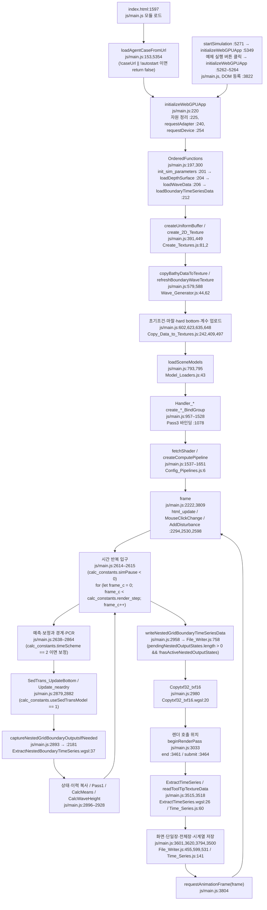

# Celeris WebGPU 실행 호출 흐름

## 판독 기준과 요약

이 보고서는 소스 정적 추적 결과다. 모델과 브라우저를 실행하지 않았다. 수치 정확도와 GPU 실행 성공을 검증하지 않았다.

코드 기준은 `ebca435d02b258768e0352fbaf27404f2f135799`이다. 저장소의 커밋 시각은 `2026-07-20T16:10:36-07:00`이다. 커밋 제목은 `fixed time series write bug`다. 원자료 저장소의 작업 트리는 읽기 전용으로 확인했다.

본문의 `js/`, `shaders/`, `docs/`, HTML 파일 경로는 `models/Celeris/raw/source_code/Celeris-WebGPU/`에 상대적이다. 현재 코드 인용 `파일:줄`은 모두 위 커밋에 귀속한다. 판 차이는 별도 `HASH:파일:줄`로 인용한다. 기존 노트 경로는 위키 루트에 상대적이다.

판독 기록은 위치를 찾는 색인으로만 사용한다. 코드 판정은 `nl -ba`로 연 원문과 실제 바인드 그룹 인자를 기준으로 한다. WGSL의 지역 텍스처 이름과 JavaScript가 넘기는 텍스처 객체 이름을 구분한다. 주석 처리된 호출은 실행 호출에서 제외한다.

추적 첫 단계는 `main.js`의 시작·프레임·시간 반복에서 호출하는 호스트 함수다. 둘째 단계는 그 함수의 파일 읽기·업로드·디스패치·복사·저장 호출과 연결된 계산 셰이더다. 계산 셰이더 내부의 물리식 전체와 외부 라이브러리 내부는 추적 깊이에 넣지 않는다. 렌더 패스는 호출 위치만 적는다.

본판은 프레임 안에서 `render_step`개의 시간 단계를 수행한다. 각 시간 단계는 예측 계산을 수행한다. `calc_constants.timeScheme == 2`이면 같은 시간 단계에서 보정 계산을 추가한다. RK 단계 반복은 이 실행 경로에 없다. 근거는 `js/main.js:2615`의 `for (let frame_c = 0; frame_c < calc_constants.render_step; frame_c++) {`와 `js/main.js:2757`의 `if (calc_constants.timeScheme == 2)`다.

상태 텍스처는 객체 참조를 맞바꾸지 않는다. 호스트는 결과를 고정 입력 텍스처로 복사한다. PCR 계수 텍스처는 바인드 그룹 선택으로 읽기와 쓰기를 교대한다. 근거는 `js/main.js:2900`의 `runCopyTextures_EncStack(commandEncoderStack, calc_constants, txNewState, txState)`와 `js/Run_Tridiag_Solver.js:57`의 `const TridiagX_BindGroup_Current = (p == 0) ? TridiagX_BindGroup_BaseToA : ((p % 2 == 1) ? TridiagX_BindGroup : TridiagX_BindGroup_BToA);`다.

분류별 개수: A 6건, B 12건, C 5건, D 0건, E 1건, F 1건, H 1건, X 0건. 합계 26건이다. 집계 단위는 §8의 고유 RF 행이다. 같은 RF를 문서 표와 노트 표에 다시 표시해도 한 번만 센다.

## 1 시작·입력 읽기 순서

### 1.1 HTML 진입과 시작 선택

| 순서 | 호출 위치 파일:줄 원문 | 조건(설정 값·화면 입력·URL 인수) | 피호출 정의 파일:줄 |
|---|---|---|---|
| S01 | `index.html:1597` `<script type="module" src="js/main.js"></script>` | HTML 모듈 로드 | `js/main.js:2`부터 import. 50행 `const canvas = document.getElementById('webgpuCanvas');` |
| S02 | `js/main.js:3822` `document.addEventListener('DOMContentLoaded', function () {` | DOM 로드 완료 | 같은 콜백 안에서 UI 이벤트 등록 |
| S03 | `js/main.js:5354` `loadAgentCaseFromUrl().then(function (started) {` | `agent_case`와 `autostart` URL 인수 | `js/main.js:153` `async function loadAgentCaseFromUrl() {` |
| S04 | `js/main.js:174–178` `const [configContent, bathymetryContent, waveContent] = await Promise.all([` / `fetchAgentCaseText(configUrl, "config.json"),` / `fetchAgentCaseText(bathyUrl, "bathy.txt"),` / `fetchAgentCaseText(wavesUrl, "waves.txt"),` / `]);` | URL manifest의 세 입력을 병렬로 읽는다. | `js/main.js:130` `async function fetchAgentCaseText(url, label) {` |
| S05 | `js/main.js:184` `await initializeWebGPUApp(configContent, bathymetryContent, waveContent, overlayBlob, undefined, initialEtaBlob);` | URL 시작. 182행에서 `run_example = -1`을 설정한다. | `js/main.js:220` `initializeWebGPUApp` |
| S06 | `js/main.js:5254` `startSimulation();` | 5252행의 `start-simulation-btn` 클릭 이벤트 | `js/main.js:5271` `function startSimulation() {` |
| S07 | `js/main.js:5349` `initializeWebGPUApp(configContent, bathymetryContent, waveContent, OverlayFile, modelFile, etaInitialConditionFile, frictionFile, hardbottomFile, westBoundaryTimeSeriesFile, eastBoundaryTimeSeriesFile, southBoundaryTimeSeriesFile, northBoundaryTimeSeriesFile).catch(error => {` | 업로드 설정·지형·파 읽기 완료 | `js/main.js:5338` `startSimulationWithWave`에서 220행 함수 호출 |
| S08 | `js/main.js:5264` `initializeWebGPUApp();` | 서버 예제 시작 버튼 | `js/main.js:220` |

`index_headless.html:112`, `index_nots.html:1486`, `river.html:1468`, `MC_examples.html:1468`도 `<script type="module" src="js/main.js"></script>`를 사용한다. `transect_version/index.html:1471`은 `<script type="module" src="/transect_version/js/main.js"></script>`를 사용한다.

URL 시작 조건 원문은 `js/main.js:154–159`다.

```javascript
const params = new URLSearchParams(window.location.search);
const caseUrl = params.get("agent_case");
const autostart = params.get("autostart") === "1" || params.get("autostart") === "true";
if (!caseUrl || !autostart) {
    return false;
}
```

### 1.2 설정과 입력의 의존 순서

| 순서 | 호출 위치 파일:줄 원문 | 조건(설정 값·화면 입력·URL 인수) | 피호출 정의 파일:줄 |
|---|---|---|---|
| S09 | `js/main.js:226` `texture.destroy(); // Destroy each texture` | 225행 `allTextures.forEach(texture => {` | WebGPU 텍스처 정리 |
| S10 | `js/main.js:240` `adapter = await gpu.requestAdapter(options);` | 239행 `const options = { powerPreference: "high-performance" };`. `if (!adapter)`이면 243행에서 `adapter = await gpu.requestAdapter();` | WebGPU API |
| S11 | `js/main.js:254–263`의 `adapter.requestDevice` 호출. 아래 원문 참조 | 어댑터가 지원하는 2D 크기 한도 요청 | WebGPU API |
| S12 | `js/main.js:300` `let { bathy2D, waveData, boundaryTimeSeriesData } = await OrderedFunctions(configContent, bathymetryContent, waveContent, boundaryTimeSeriesFiles);` | context 구성 뒤 | `js/main.js:197` `async function OrderedFunctions(configContent, bathymetryContent, waveContent, boundaryTimeSeriesFiles = {}) {` |
| S13 | `js/main.js:201` `await init_sim_parameters(canvas, configContent);` | 첫 입력 처리 | `js/constants_load_calc.js:434` `async function init_sim_parameters(canvas, configContent) {` |
| S14 | `js/constants_load_calc.js:438` `var configJson = JSON.parse(configContent);` | `try` 성공 | 같은 파일 443행 `calc_constants = { ...calc_constants, ...loadedConfig };` |
| S15 | `js/constants_load_calc.js:448` `await loadConfig();  // for the json to be loaded` | `catch (error)` | 같은 파일 417행 `async function loadConfig() {`; 419행 `const filePath = calc_constants.exampleDirs[calc_constants.run_example] + 'config.json';`; 420행 `const response = await fetch(filePath);` |
| S16 | `js/main.js:204` `let bathy2D = await loadDepthSurface(bathymetryContent, calc_constants);` | 설정·파생 상수 계산 후 | `js/File_Loader.js:4` `export async function loadDepthSurface(bathymetryContent, calc_constants) {` |
| S17 | `js/main.js:206` `let { numberOfWaves, waveData } = await loadWaveData(waveContent, calc_constants);` | 지형 읽기 후 | `js/File_Loader.js:267` `export async function loadWaveData(waveContent, calc_constants) {` |
| S18 | `js/main.js:212` `let boundaryTimeSeriesData = await loadBoundaryTimeSeriesData(calc_constants, boundaryTimeSeriesFiles);` | 파 파일 읽기 후 | `js/File_Loader.js:447` `export async function loadBoundaryTimeSeriesData(calc_constants, boundaryTimeSeriesFiles = {}) {` |

`js/main.js:254–263` 원문:

```javascript
device = await adapter.requestDevice({
    // Enable built-in validation
    requiredFeatures: [],
    // requiredLimits: {},
    // Added by Codex: Ask for the adapter-supported 2D texture dimension so large boundary time-series textures can exceed the default 8192 rows when hardware allows.
    requiredLimits: {
        maxTextureDimension2D: requestedMaxTextureDimension2D,
    },
    forceFallbackAdapter: false,
});
```

`loadDepthSurface`는 입력 문자열을 `split('\n')`으로 읽는다(`js/File_Loader.js:11`). `catch (error)`이면 `bathy.txt`를 fetch한다(17–19행). 함수는 `bathy2D[x][y]`를 채운다(54행). 함수는 가장자리 지형을 복제한다(58–77행).

`loadWaveData`는 `js/File_Loader.js:290`의 `const numberOfWaves = parseInt(lines[0].split(' ')[1], 10);`로 성분 수를 읽는다. 함수는 292행의 `const waveData = lines.slice(2).map(line => line.trim().split(/\s+/).map(Number));`로 성분을 읽는다. 입력 문자열 처리의 `catch (error)`이면 `waves.txt`를 fetch한다(276–285행).

설정은 기존 `calc_constants`에 병합된다. `init_sim_parameters`가 매번 모든 기본값을 새 객체로 초기화한다는 설명은 코드와 다르다. 근거는 `js/constants_load_calc.js:443`의 `calc_constants = { ...calc_constants, ...loadedConfig };`다. 이 차이는 RF-001에서 판정한다.

구면 격자에서는 `js/constants_load_calc.js:454–470`의 `if (calc_constants.grid_type == 2)` 안에서 `NLSW_or_Bous = 0`, `Accuracy_mode = 0`, `useSedTransModel = 0`, `useBreakingModel = 0`을 강제한다. 따라서 구면 격자는 NLSW 일반 재구성 경로를 사용한다.

직교 격자는 `js/constants_load_calc.js:486`의 `calc_constants.dt = calc_constants.Courant_num * Math.min(calc_constants.dx,calc_constants.dy) / Math.sqrt(calc_constants.g * calc_constants.base_depth);`를 사용한다. 구면 격자는 484행의 `calc_constants.dt = calc_constants.Courant_num * minPhysicalGridSpacing / Math.sqrt(calc_constants.g * calc_constants.base_depth);`를 사용한다.

PCR 반복 수는 `js/constants_load_calc.js:511–512`의 `calc_constants.Px = Math.ceil(Math.log(calc_constants.WIDTH)  / Math.log(2));`와 `calc_constants.Py = Math.ceil(Math.log(calc_constants.HEIGHT) / Math.log(2));`다. 작업 그룹 수는 같은 파일 601–604행의 `calc_constants.ThreadX = 16;`, `calc_constants.ThreadY = 16;`, `calc_constants.DispatchX = Math.ceil(calc_constants.WIDTH / calc_constants.ThreadX);`, `calc_constants.DispatchY = Math.ceil(calc_constants.HEIGHT / calc_constants.ThreadY);`다.


### 1.3 자원 생성·업로드·파 생성

| 순서 | 호출 위치 파일:줄 원문 | 조건(설정 값·화면 입력·URL 인수) | 피호출 정의 파일:줄 |
|---|---|---|---|
| S19 | `js/main.js:391` `const Pass0_uniformBuffer = createUniformBuffer(device);` | 패스별 uniform 버퍼 생성 시작. 391–420행에서 각 패스 버퍼를 만든다. | `js/Create_Textures.js:81` `export function createUniformBuffer(device, bufferSize = 256) {` |
| S20 | `js/main.js:426` `const readbackBuffer = device.createBuffer({` | readback 버퍼. 크기·usage는 421–430행. | WebGPU `createBuffer` |
| S21 | `js/main.js:449` `const txBottom = create_2D_Texture(device, calc_constants.WIDTH, calc_constants.HEIGHT, allTextures);  // stores information about the bathy/topo` | 지형부터 상태·재구성·플럭스·이력·PCR·진단 텍스처 생성. | `js/Create_Textures.js:2` `create_2D_Texture`. 포맷은 5행 `format: 'rgba32float',` |
| S22 | `js/main.js:515` `txCW_groupings = create_3D_Data_Texture(device, calc_constants.WIDTH, calc_constants.HEIGHT, 6, allTextures);` | `if (calc_constants.NLSW_or_Bous == 2)` (`js/main.js:514`). 6층 COULWAVE 그룹. | `js/Create_Textures.js:54` `create_3D_Data_Texture` |
| S23 | `js/main.js:559` `const txRenderVarsf16 = create_2D_F16Texture(device, calc_constants.WIDTH, calc_constants.HEIGHT, 3, allTextures);  // used to store the f16 render variables for the render pipeline` | 렌더 캐시. 3층 2D 배열이다. | `js/Create_Textures.js:15` `create_2D_F16Texture` |
| S24 | `js/main.js:579` `let bathy2Dvec = copyBathyDataToTexture(calc_constants, bathy2D, device, txBottom);` | 지형 업로드. 반환 배열은 초기 계수 생성에 사용한다. | `js/Copy_Data_to_Textures.js:3` `copyBathyDataToTexture` |
| S25 | `js/main.js:581` `copySphericalMetricDataToTexture(calc_constants, device, txSphericalMetrics);` | 구면 metric 업로드. | `js/Copy_Data_to_Textures.js:351` `copySphericalMetricDataToTexture` |
| S26 | `js/main.js:588` `refreshBoundaryWaveTexture(txWaves);` | 파 성분 선택과 업로드. | `js/main.js:329` `function refreshBoundaryWaveTexture(txWaves) {` |
| S27 | `js/main.js:591` `copyBoundaryTimeSeriesDataToTexture(boundaryTimeSeriesData.south, device, txBoundaryTimeSeriesSouth);` | 남·북·서·동 순서(591–594행). | `js/Copy_Data_to_Textures.js:137` `copyBoundaryTimeSeriesDataToTexture` |
| S28 | `js/main.js:598` `copyTSlocsToTexture(calc_constants, device, txTimeSeries_Locations)` | 시계열 관측점 업로드. | `js/Copy_Data_to_Textures.js:191` `copyTSlocsToTexture` |
| S29 | `js/main.js:602` `copyInitialConditionDataToTexture(calc_constants, device, bathy2D, txState, writeStateFlag);` | 초기 상태. `writeStateFlag = 0`. | `js/Copy_Data_to_Textures.js:242` `copyInitialConditionDataToTexture` |
| S30 | `js/main.js:603` `copyInitialConditionDataToTexture(calc_constants, device, bathy2D, txstateUVstar, writeStateFlag);` | 같은 초기값을 분산 상태에도 업로드한다. | 같은 함수 |
| S31 | `js/main.js:616` `let etaIC2D = await loadInitCondSurface(etaICContent, calc_constants);` | `if(etaInitialConditionFile || calc_constants.loadetaIC == 1)` (606행). `.text()` 실패 시 null로 서버 파일 경로를 선택한다. | `js/File_Loader.js:86` `loadInitCondSurface` |
| S32 | `js/main.js:618` `copyInitialConditionDataToTexture(calc_constants, device, etaIC2D, txState, writeStateFlag)` | 초기 수면 첫 채널. 다음 행은 `txstateUVstar`에도 쓴다. | `js/Copy_Data_to_Textures.js:242` |
| S33 | `js/main.js:627` `let friction2D = await loadFrictionSurface(frictionContent, calc_constants);` | `if(frictionFile)` (623행). | `js/File_Loader.js:146` `loadFrictionSurface` |
| S34 | `js/main.js:629` `copyInitialConditionDataToTexture(calc_constants, device, friction2D, txBottomFriction, writeStateFlag)` | 마찰 첫 채널. | `js/Copy_Data_to_Textures.js:242` |
| S35 | `js/main.js:631` `copyConstantValueToTexture(calc_constants, device, txBottomFriction, calc_constants.friction, 0.0, 0.0, 0.0);` | 마찰 파일이 없는 `else` 분기. | `js/Copy_Data_to_Textures.js:305` `copyConstantValueToTexture` |
| S36 | `js/main.js:639` `let HardBottom2D = await loadHardBottomSurface(HardBottomContent, calc_constants);` | `if(hardbottomFile)` (635행). | `js/File_Loader.js:207` `loadHardBottomSurface` |
| S37 | `js/main.js:641` `copyInitialConditionDataToTexture(calc_constants, device, HardBottom2D, txHardBottom, writeStateFlag)` | hard bottom 첫 채널. | `js/Copy_Data_to_Textures.js:242` |
| S38 | `js/main.js:643` `copyConstantValueToTexture(calc_constants, device, txHardBottom, -2.0 * calc_constants.base_depth, 0.0, 0.0, 0.0);` | hard bottom 파일이 없는 `else` 분기. | `js/Copy_Data_to_Textures.js:305` |
| S39 | `js/main.js:648` `copyTridiagXDataToTexture(calc_constants, bathy2D, device, coefMatx, bathy2Dvec);` | 초기 x 계수. | `js/Copy_Data_to_Textures.js:409` `copyTridiagXDataToTexture` |
| S40 | `js/main.js:649` `copyTridiagYDataToTexture(calc_constants, bathy2D, device, coefMaty, bathy2Dvec);` | 초기 y 계수. | `js/Copy_Data_to_Textures.js:497` `copyTridiagYDataToTexture` |
| S41 | `js/main.js:793` `model_properties = await loadSceneModels(modelFile); // load the model properties from the users JSON file` | `if(modelFile)` (791행). | `js/Model_Loaders.js:43` `loadSceneModels` |
| S42 | `js/main.js:795` `model_properties = await loadSceneModels(calc_constants.models_file_url); // load the model properties from the server side JSON file` | 모델 파일이 없는 `else` 분기. | 같은 함수 |
| S43 | `js/main.js:1619` `const Pass0_Pipeline = createComputePipeline(device, Pass0_ShaderCode, Pass0_BindGroupLayout, allComputePipelines);` | 계산 파이프라인 생성 시작. 1619–1651행에서 패스별 생성. | `js/Config_Pipelines.js:6` `createComputePipeline` |
| S44 | `js/main.js:3809` `await frame();` | 초기화 끝에서 첫 프레임 호출. | `js/main.js:2222` `async function frame() {` |

`Model_Loaders.js`는 3D 장면 모델을 읽는다. 이 파일은 수치 모델 선택과 파 입력을 읽지 않는다. `js/Model_Loaders.js:47`의 `defs = await loadModelDefinitions(url);`는 같은 파일 3행 함수로 연결된다. URL이면 7행의 `const res = await fetch(source);`를 호출한다. File 또는 Blob이면 12행의 `const txt = await source.text();`를 호출한다. glTF 호출은 `js/main.js:786`의 `//const duck = await loadglTFModel(device, gltfUrl); // load the duck model`로 주석 처리되어 있다.

`Wave_Generator.js`는 GPU 계산 패스가 아니다. `js/main.js:315`의 `return buildSineWaveData(calc_constants);`는 `if (calc_constants.incident_wave_type == 0)` 안에 있다. 322행의 `return buildTmaWaveData(calc_constants);`는 `if (calc_constants.incident_wave_type == 1)` 안에 있다. 그 밖의 경우 325행은 읽어 둔 파 성분을 반환한다. `js/Wave_Generator.js:59`의 `return { numberOfWaves: 1, waveData: [[0.5 * waveHeight, wavePeriod, waveDirectionDegrees * DEG_TO_RAD, 0.0]] };`는 성분 형식을 보여 준다. TMA 함수는 62행에 정의되어 있다. TMA 함수는 70행의 `return cloneWaveResult(cachedTmaResult);`로 캐시를 재사용한다. 성분 위상은 137행의 `Math.random() * TWO_PI`에서 정한다.

업로드 경로는 `js/main.js:333`의 `copyWaveDataToTexture(calc_constants, boundaryWaves.waveData, device, txWaves);`다. `BoundaryPass`가 이 `txWaves`를 매 시간 단계에 읽는다. 파 생성기 자체를 시간 단계마다 호출한다고 쓰면 안 된다. HTML 설정 갱신 시의 재호출은 §2에 적는다.

`Create_Textures.js:81–85`는 uniform 버퍼에 `GPUBufferUsage.UNIFORM | GPUBufferUsage.COPY_DST | GPUBufferUsage.COPY_SRC`를 지정한다. `Copy_Data_to_Textures.js:75–87`은 지형 staging 버퍼의 `copyBufferToTexture`와 제출 뒤 `buffer.destroy();`를 수행한다. 같은 파일 416–418행은 x 계수 업로드 행 크기를 `Math.ceil(actualBytesPerRow / 256) * 256`으로 정렬한다.

### 1.4 파이프라인·바인드 그룹 연결

`Config_Pipelines.js`는 파이프라인을 만든다. 각 `Handler_*.js`는 바인드 그룹 레이아웃과 바인드 그룹을 만든다. `Config_Pipelines.js`가 바인드 그룹을 만든다고 쓰면 호출 책임이 바뀐다.

`js/Config_Pipelines.js:6–13` 원문:

```javascript
export function createComputePipeline(device, computeShaderCode, computeBindGroupLayout, allComputePipelines) {
    const pipeline = device.createComputePipeline({
        layout: device.createPipelineLayout({ bindGroupLayouts: [computeBindGroupLayout] }),
        compute: {
            module: device.createShaderModule({ code: computeShaderCode }),
            entryPoint: 'main'
        }
    });
```

아래 표는 실제 텍스처 객체를 넘기는 호출을 인용한다. 핸들러의 텍스처 형식과 WGSL의 읽기·쓰기 역할은 §2.1에 연결한다.

| 바인드 그룹 | 호출 위치·원문 | 피호출 정의 |
|---|---|---|
| `Pass0_BindGroup` | `js/main.js:957` `const Pass0_BindGroup = create_Pass0_BindGroup(device, Pass0_uniformBuffer, txState, txBottom, txHnear);` | `js/Handler_Pass0.js:45` |
| `Pass1_BindGroup` | `js/main.js:970` `const Pass1_BindGroup = create_Pass1_BindGroup(device, Pass1_uniformBuffer, txState, txBottom, txH, txU, txV, txC);` | `js/Handler_Pass1.js:75` |
| `SedTrans_Pass1_BindGroup` | `js/main.js:994` `const SedTrans_Pass1_BindGroup = create_SedTrans_Pass1_BindGroup(device, SedTrans_Pass1_uniformBuffer, txState_Sed, txBottom, txH, txSed_C1, txSed_C2, txSed_C3, txSed_C4);` | `js/Handler_SedTrans_Pass1.js:84` |
| `Pass2_BindGroup` | `js/main.js:1015` `const Pass2_BindGroup = create_Pass2_BindGroup(device, Pass2_uniformBuffer, txH, txU, txV, txBottom, txC, txHnear, txXFlux, txYFlux, txSed_C1, txSed_C2, txSed_C3, txSed_C4, txXFlux_Sed, txYFlux_Sed, txBreaking);` | `js/Handler_Pass2.js:156` |
| `PassBreaking_BindGroup` | `js/main.js:1031` `const PassBreaking_BindGroup = create_PassBreaking_BindGroup(device, PassBreaking_uniformBuffer, txState, txBottom, dU_by_dt, txXFlux, txYFlux, txBreaking, txDissipationFlux, txtemp_Breaking);` | `js/Handler_PassBreaking.js:91` |
| `Pass3A_Coulwave_BindGroup` | `js/main.js:1051` `const Pass3A_Coulwave_BindGroup = create_Pass3A_Coulwave_BindGroup(device, Pass3A_Coulwave_uniformBuffer, txState, txBottom, txU, txV, txModelVelocities, txCW_zalpha, txCW_uvhuhv);` | `js/Handler_Pass3.js:378` |
| `Pass3B_Coulwave_BindGroup` | `js/main.js:1063` `const Pass3B_Coulwave_BindGroup = create_Pass3B_Coulwave_BindGroup(device, Pass3B_Coulwave_uniformBuffer, txState, txBottom, txCW_uvhuhv, txCW_zalpha, txCW_STval, txCW_STgrad, txCW_Eterms, txCW_FGterms, dU_by_dt);` | `js/Handler_Pass3.js:523` |
| `Pass3_BindGroup` | `js/main.js:1078` `const Pass3_BindGroup = create_Pass3_BindGroup(device, Pass3_uniformBuffer, txState, txBottom, txCW_groupings, txXFlux, txYFlux, oldGradients, oldOldGradients, predictedGradients, F_G_star_oldGradients, F_G_star_oldOldGradients, txstateUVstar, txBoundaryForcing, txNewState, dU_by_dt, predictedF_G_star, current_stateUVstar,txContSource,txBreaking, calc_constants.grid_type == 2 ? txSphericalMetrics : txDissipationFlux, txBottomFriction);` | `js/Handler_Pass3.js:202` |
| `SedTrans_Pass3_BindGroup` | `js/main.js:1123` `const SedTrans_Pass3_BindGroup = create_SedTrans_Pass3_BindGroup(device, SedTrans_Pass3_uniformBuffer, txState_Sed, txXFlux_Sed, txYFlux_Sed, oldGradients_Sed, oldOldGradients_Sed, predictedGradients_Sed, txBottom, txState, txNewState_Sed, dU_by_dt_Sed, erosion_Sed, depostion_Sed, txBreaking, txU, txV, txSed_C1, txHardBottom);` | `js/Handler_SedTrans_Pass3.js:174` |
| `BoundaryPass_BindGroup` | `js/main.js:1157` `const BoundaryPass_BindGroup = create_BoundaryPass_BindGroup(device, BoundaryPass_uniformBuffer, current_stateUVstar, txBottom, txWaves, txNewState_Sed, txtemp_boundary, txtemp_boundary_Sed, txBreaking, txtemp_Breaking, txBoundaryForcing, txBoundaryTimeSeriesSouth, txBoundaryTimeSeriesNorth, txBoundaryTimeSeriesWest, txBoundaryTimeSeriesEast);` | `js/Handler_BoundaryPass.js:140` |
| `BoundaryPass_BindGroup_NewState` | `js/main.js:1160` `const BoundaryPass_BindGroup_NewState = create_BoundaryPass_BindGroup(device, BoundaryPass_uniformBuffer, txNewState, txBottom, txWaves, txNewState_Sed, txtemp_boundary, txtemp_boundary_Sed, txBreaking, txtemp_Breaking, txBoundaryForcing, txBoundaryTimeSeriesSouth, txBoundaryTimeSeriesNorth, txBoundaryTimeSeriesWest, txBoundaryTimeSeriesEast);` | `js/Handler_BoundaryPass.js:140` |
| `TridiagX_BindGroup_BaseToA` | `js/main.js:1224` `const TridiagX_BindGroup_BaseToA = create_Tridiag_BindGroup(device, TridiagX_uniformBuffer, coefMatx, txNewState, current_stateUVstar, newcoef_x, txtemp2_PCRx, txBottom);` | `js/Handler_Tridiag.js:73` |
| `TridiagX_BindGroup` | `js/main.js:1225` `const TridiagX_BindGroup = create_Tridiag_BindGroup(device, TridiagX_uniformBuffer, newcoef_x, txNewState, current_stateUVstar, txtemp_PCRx, txtemp2_PCRx, txBottom);` | `js/Handler_Tridiag.js:73` |
| `TridiagX_BindGroup_BToA` | `js/main.js:1226` `const TridiagX_BindGroup_BToA = create_Tridiag_BindGroup(device, TridiagX_uniformBuffer, txtemp_PCRx, txNewState, current_stateUVstar, newcoef_x, txtemp2_PCRx, txBottom);` | `js/Handler_Tridiag.js:73` |
| `TridiagY_BindGroup_BaseToA` | `js/main.js:1240` `const TridiagY_BindGroup_BaseToA = create_Tridiag_BindGroup(device, TridiagY_uniformBuffer, coefMaty, txNewState, current_stateUVstar, newcoef_y, txtemp2_PCRy, txBottom);` | `js/Handler_Tridiag.js:73` |
| `TridiagY_BindGroup` | `js/main.js:1241` `const TridiagY_BindGroup = create_Tridiag_BindGroup(device, TridiagY_uniformBuffer, newcoef_y, txNewState, current_stateUVstar, txtemp_PCRy, txtemp2_PCRy, txBottom);` | `js/Handler_Tridiag.js:73` |
| `TridiagY_BindGroup_BToA` | `js/main.js:1242` `const TridiagY_BindGroup_BToA = create_Tridiag_BindGroup(device, TridiagY_uniformBuffer, txtemp_PCRy, txNewState, current_stateUVstar, newcoef_y, txtemp2_PCRy, txBottom);` | `js/Handler_Tridiag.js:73` |
| `SedTrans_UpdateBottom_BindGroup` | `js/main.js:1254` `const SedTrans_UpdateBottom_BindGroup = create_SedTrans_UpdateBottom_BindGroup(device, SedTrans_UpdateBottom_uniformBuffer, txBottom, txBotChange_Sed, erosion_Sed, depostion_Sed, txtemp_SedTrans_Botttom, txtemp_SedTrans_Change, txHardBottom, txBottomInitial);` | `js/Handler_SedTrans_UpdateBottom.js:91` |
| `Updateneardry_BindGroup` | `js/main.js:1273` `const Updateneardry_BindGroup = create_Updateneardry_BindGroup(device, Updateneardry_uniformBuffer, txBottom, txtemp_bottom);` | `js/Handler_Updateneardry.js:34` |
| `UpdateTrid_BindGroup` | `js/main.js:1281` `const UpdateTrid_BindGroup = create_UpdateTrid_BindGroup(device, UpdateTrid_uniformBuffer, txBottom, current_stateUVstar, coefMatx, coefMaty);` | `js/Handler_UpdateTrid.js:53` |
| `CalcMeans_BindGroup` | `js/main.js:1297` `const CalcMeans_BindGroup = create_CalcMeans_BindGroup(device, CalcMeans_uniformBuffer, txMeans, txMeans_Speed, txMeans_Momflux, txH, txU, txV, txBottom, txtemp_Means, txtemp_Means_Speed, txtemp_Means_Momflux, txModelVelocities, txC, txNewState);` | `js/Handler_CalcMeans.js:136` |
| `CalcWaveHeight_BindGroup` | `js/main.js:1310` `const CalcWaveHeight_BindGroup = create_CalcWaveHeight_BindGroup(device, CalcWaveHeight_uniformBuffer, txstateUVstar, txNewState, txMeans, txWaveHeight, txtemp_WaveHeight);` | `js/Handler_CalcWaveHeight.js:61` |
| `AddDisturbance_BindGroup` | `js/main.js:1317` `const AddDisturbance_BindGroup = create_AddDisturbance_BindGroup(device, AddDisturbance_uniformBuffer, txBottom, txstateUVstar, txBottomInitial, txtemp_AddDisturbance, txBoundaryForcing, txtemp_bottom, txBotChange_Sed);` | `js/Handler_AddDisturbance.js:81` |
| `MouseClickChange_BindGroup` | `js/main.js:1349` `const MouseClickChange_BindGroup = create_MouseClickChange_BindGroup(device, MouseClickChange_uniformBuffer, txBottom, txBottomFriction, txContSource, txstateUVstar, txDesignComponents, txtemp_MouseClick, txtemp_MouseClick2);` | `js/Handler_MouseClickChange.js:80` |
| `ExtractTimeSeries_BindGroup` | `js/main.js:1383` `const ExtractTimeSeries_BindGroup = create_ExtractTimeSeries_BindGroup(device, ExtractTimeSeries_uniformBuffer, txBottom, txBottomFriction, txContSource, txState, txWaveHeight, txTimeSeries_Locations, txTimeSeries_Data, txMeans_Speed);` | `js/Handler_ExtractTimeSeries.js:89` |
| `Copytxf32_txf16_BindGroup` | `js/main.js:1528` `const Copytxf32_txf16_BindGroup = create_Copytxf32_txf16_BindGroup(device, Copytxf32_txf16_uniformBuffer, txNewState, txBottom, txMeans_Speed, txRenderVarsf16, txMeans_Momflux, txModelVelocities, txMeans, txHardBottom);` | `js/Handler_Copytxf32_txf16.js:90` |
| `bindGroup` | `js/main.js:2153` `state.bindGroup = create_ExtractNestedBoundaryTimeSeries_BindGroup(device, state.uniformBuffer, txNewState, state.txSouth, state.txNorth, state.txWest, state.txEast, txBottom);` | `js/Handler_ExtractNestedBoundaryTimeSeries.js:71` |


## 2 계산 호출 순서

### 2.1 계산 셰이더와 디스패치 계약

모든 계산 파이프라인의 진입점은 `js/Config_Pipelines.js:11`의 `entryPoint: 'main'`이다. 아래 작업 그룹 선언은 WGSL 원문이다. 아래 입력은 주석을 제외한 `textureLoad` 접근을 기준으로 한다. 선언만 있는 바인딩은 별도로 적는다. 조건부 접근은 해당 셰이더 내부 조건을 따른다.

일반 격자 디스패치 인수는 `calc_constants.DispatchX, calc_constants.DispatchY`다. `js/Run_Compute_Shader.js:68`의 `computePass.dispatchWorkgroups(dispatchX, dispatchY);`가 실제 호출이다. 즉시 제출 함수도 같은 파일 19행에서 같은 호출을 수행한다. z 인수는 생략한다.

| 계약 ID | 셰이더 파일·진입점·작업 그룹 원문 | `dispatchWorkgroups`로 전달되는 인수 | 입력 텍스처 객체 | 출력 텍스처 객체 | 선언만 있는 입력·대응 주의 |
|---|---|---|---|---|---|
| K01 | `shaders/Pass0.wgsl:21` `@compute @workgroup_size(16, 16) //`<br>`shaders/Pass0.wgsl:22` `fn main(@builtin(global_invocation_id) id: vec3<u32>) {` | `calc_constants.DispatchX, calc_constants.DispatchY` | `txState`, `txBottom` | `txHnear` | 없음 |
| K02 | `shaders/Pass1.wgsl:54` `@compute @workgroup_size(16, 16) //`<br>`shaders/Pass1.wgsl:55` `fn main(@builtin(global_invocation_id) id: vec3<u32>) {` | `calc_constants.DispatchX, calc_constants.DispatchY` | `txState`, `txBottom` | `txH`, `txU`, `txV`, `txC` | 없음 |
| K03 | `shaders/Pass1_HighOrder.wgsl:150` `@compute @workgroup_size(16, 16) //`<br>`shaders/Pass1_HighOrder.wgsl:151` `fn main(@builtin(global_invocation_id) id: vec3<u32>) {` | `calc_constants.DispatchX, calc_constants.DispatchY` | `txState`, `txBottom` | `txH`, `txU`, `txV`, `txC` | 없음 |
| K04 | `shaders/Pass2.wgsl:59` `@compute @workgroup_size(16, 16)`<br>`shaders/Pass2.wgsl:60` `fn main(@builtin(global_invocation_id) id: vec3<u32>) {` | `calc_constants.DispatchX, calc_constants.DispatchY` | `txH`, `txU`, `txV`, `txBottom`, `txC`, `txHnear`, `txSed_C1`, `txSed_C2`, `txSed_C3`, `txSed_C4`, `txBreaking` | `txXFlux`, `txYFlux`, `txXFlux_Sed`, `txYFlux_Sed` | 없음 |
| K05 | `shaders/Pass2_HighOrder_HLLC.wgsl:146` `@compute @workgroup_size(16, 16)`<br>`shaders/Pass2_HighOrder_HLLC.wgsl:147` `fn main(@builtin(global_invocation_id) id: vec3<u32>) {` | `calc_constants.DispatchX, calc_constants.DispatchY` | `txH`, `txU`, `txV`, `txC`, `txHnear`, `txSed_C1`, `txSed_C2`, `txSed_C3`, `txSed_C4`, `txBreaking` | `txXFlux`, `txYFlux`, `txXFlux_Sed`, `txYFlux_Sed` | `txBottom` |
| K06 | `shaders/Pass2_HighOrder_HLLEM.wgsl:128` `@compute @workgroup_size(16, 16)`<br>`shaders/Pass2_HighOrder_HLLEM.wgsl:129` `fn main(@builtin(global_invocation_id) id: vec3<u32>) {` | `현재 실행 경로 없음` | `txH`, `txU`, `txV`, `txC`, `txHnear`, `txSed_C1`, `txSed_C2`, `txSed_C3`, `txSed_C4`, `txBreaking` | `txXFlux`, `txYFlux`, `txXFlux_Sed`, `txYFlux_Sed` | `txBottom`. 본판에서 fetch하지 않는다. 실행 디스패치가 없다. |
| K07 | `shaders/Pass3_NLSW.wgsl:96` `@compute @workgroup_size(16, 16)`<br>`shaders/Pass3_NLSW.wgsl:97` `fn main(@builtin(global_invocation_id) id: vec3<u32>) {` | `calc_constants.DispatchX, calc_constants.DispatchY` | `txState`, `txBottom`, `txXFlux`, `txYFlux`, `oldGradients`, `oldOldGradients`, `predictedGradients`, `txstateUVstar`, `txBoundaryForcing`, `txBottomFriction`, `txBreaking`, `txContSource` | `txNewState`, `dU_by_dt`, `predictedF_G_star`, `current_stateUVstar` | `txCW_groupings`, `F_G_star_oldGradients`, `F_G_star_oldOldGradients`, `txDissipationFlux` |
| K08 | `shaders/Pass3_NLSW_Spherical.wgsl:93` `@compute @workgroup_size(16, 16)`<br>`shaders/Pass3_NLSW_Spherical.wgsl:94` `fn main(@builtin(global_invocation_id) id: vec3<u32>) {` | `calc_constants.DispatchX, calc_constants.DispatchY` | `txState`, `txBottom`, `txXFlux`, `txYFlux`, `oldGradients`, `oldOldGradients`, `predictedGradients`, `txstateUVstar`, `txBoundaryForcing`, `txBottomFriction`, `txBreaking`, `txSphericalMetrics`, `txContSource` | `txNewState`, `dU_by_dt`, `predictedF_G_star`, `current_stateUVstar` | `txCW_groupings`, `F_G_star_oldGradients`, `F_G_star_oldOldGradients` |
| K09 | `shaders/Pass3_Bous.wgsl:95` `@compute @workgroup_size(16, 16)`<br>`shaders/Pass3_Bous.wgsl:96` `fn main(@builtin(global_invocation_id) id: vec3<u32>) {` | `calc_constants.DispatchX, calc_constants.DispatchY` | `txState`, `txBottom`, `txXFlux`, `txYFlux`, `oldGradients`, `oldOldGradients`, `predictedGradients`, `F_G_star_oldOldGradients`, `txstateUVstar`, `txBoundaryForcing`, `txBottomFriction`, `txBreaking`, `txDissipationFlux`, `txContSource` | `txNewState`, `dU_by_dt`, `predictedF_G_star`, `current_stateUVstar` | `txCW_groupings`, `F_G_star_oldGradients` |
| K10 | `shaders/Pass3_COULWAVE.wgsl:95` `@compute @workgroup_size(16, 16)`<br>`shaders/Pass3_COULWAVE.wgsl:96` `fn main(@builtin(global_invocation_id) id: vec3<u32>) {` | `calc_constants.DispatchX, calc_constants.DispatchY` | `txState`, `txBottom`, `txCW_groupings`, `txXFlux`, `txYFlux`, `oldGradients`, `oldOldGradients`, `predictedGradients`, `F_G_star_oldGradients`, `F_G_star_oldOldGradients`, `txstateUVstar`, `txBoundaryForcing`, `txBottomFriction`, `txBreaking`, `txDissipationFlux`, `txContSource` | `txNewState`, `dU_by_dt`, `predictedF_G_star`, `current_stateUVstar` | 없음 |
| K11 | `shaders/Pass3A_COULWAVE.wgsl:22` `@compute @workgroup_size(16, 16)`<br>`shaders/Pass3A_COULWAVE.wgsl:23` `fn main(@builtin(global_invocation_id) id: vec3<u32>) {` | `calc_constants.DispatchX, calc_constants.DispatchY` | `txState`, `txBottom`, `txU`, `txV` | `txModelVelocities`, `txCW_zalpha`, `txCW_uvhuhv` | 없음 |
| K12 | `shaders/Pass3B_COULWAVE.wgsl:24` `@compute @workgroup_size(16, 16)`<br>`shaders/Pass3B_COULWAVE.wgsl:25` `fn main(@builtin(global_invocation_id) id: vec3<u32>) {` | `calc_constants.DispatchX, calc_constants.DispatchY` | `txState`, `txBottom`, `txCW_uvhuhv`, `txCW_zalpha`, `dU_by_dt` | `txCW_STval`, `txCW_STgrad`, `txCW_Eterms`, `txCW_FGterms` | 없음 |
| K13 | `shaders/Pass_Breaking.wgsl:30` `@compute @workgroup_size(16, 16)`<br>`shaders/Pass_Breaking.wgsl:31` `fn main(@builtin(global_invocation_id) id: vec3<u32>) {` | `calc_constants.DispatchX, calc_constants.DispatchY` | `txState`, `txBottom`, `dU_by_dt`, `txXFlux`, `txYFlux`, `txBreaking` | `txDissipationFlux`, `txtemp_Breaking` | 없음 |
| K14 | `shaders/TriDiag_PCRx.wgsl:19` `@compute @workgroup_size(16, 16)`<br>`shaders/TriDiag_PCRx.wgsl:20` `fn main(@builtin(global_invocation_id) id: vec3<u32>) {` | `calc_constants.DispatchX, calc_constants.DispatchY` | `선택된 x 계수 텍스처`, `txNewState`, `current_stateUVstar` | `선택된 x 계수 출력`, `txtemp2_PCRx` | 없음. 계수 교대는 §2.4 참조. |
| K15 | `shaders/TriDiag_PCRy.wgsl:19` `@compute @workgroup_size(16, 16)`<br>`shaders/TriDiag_PCRy.wgsl:20` `fn main(@builtin(global_invocation_id) id: vec3<u32>) {` | `calc_constants.DispatchX, calc_constants.DispatchY` | `선택된 y 계수 텍스처`, `txNewState`, `current_stateUVstar` | `선택된 y 계수 출력`, `txtemp2_PCRy` | 없음. 계수 교대는 §2.4 참조. |
| K16 | `shaders/TriDiag_PCRx_COULWAVE.wgsl:21` `@compute @workgroup_size(16, 16)`<br>`shaders/TriDiag_PCRx_COULWAVE.wgsl:22` `fn main(@builtin(global_invocation_id) id: vec3<u32>) {` | `calc_constants.DispatchX, calc_constants.DispatchY` | `선택된 x 계수 텍스처`, `txNewState`, `txBottom` | `선택된 x 계수 출력`, `txtemp2_PCRx` | `current_stateUVstar`. 계수 교대는 §2.4 참조. |
| K17 | `shaders/TriDiag_PCRy_COULWAVE.wgsl:21` `@compute @workgroup_size(16, 16)`<br>`shaders/TriDiag_PCRy_COULWAVE.wgsl:22` `fn main(@builtin(global_invocation_id) id: vec3<u32>) {` | `calc_constants.DispatchX, calc_constants.DispatchY` | `선택된 y 계수 텍스처`, `txNewState`, `txBottom` | `선택된 y 계수 출력`, `txtemp2_PCRy` | `current_stateUVstar`. 계수 교대는 §2.4 참조. |
| K18 | `shaders/BoundaryPass.wgsl:280` `@compute @workgroup_size(16, 16)`<br>`shaders/BoundaryPass.wgsl:281` `fn main(@builtin(global_invocation_id) id: vec3<u32>) {` | `calc_constants.DispatchX, calc_constants.DispatchY` | `current_stateUVstar 또는 txNewState`, `txBottom`, `txWaves`, `txNewState_Sed`, `txBreaking`, `txBoundaryForcing`, `txBoundaryTimeSeriesSouth`, `txBoundaryTimeSeriesNorth`, `txBoundaryTimeSeriesWest`, `txBoundaryTimeSeriesEast` | `txtemp_boundary`, `txtemp_boundary_Sed`, `txtemp_Breaking` | 없음. 첫 경계와 풀이 후 경계의 바인드 그룹을 구분한다. |
| K19 | `shaders/Update_neardry.wgsl:12` `@compute @workgroup_size(16, 16)`<br>`shaders/Update_neardry.wgsl:13` `fn main(@builtin(global_invocation_id) id: vec3<u32>) {` | `calc_constants.DispatchX, calc_constants.DispatchY` | `txBottom` | `txtemp_bottom` | 없음 |
| K20 | `shaders/Update_TriDiag_coef.wgsl:21` `@compute @workgroup_size(16, 16)`<br>`shaders/Update_TriDiag_coef.wgsl:22` `fn main(@builtin(global_invocation_id) id: vec3<u32>) {` | `calc_constants.DispatchX, calc_constants.DispatchY` | `txBottom`, `current_stateUVstar` | `coefMatx`, `coefMaty` | 없음 |
| K21 | `shaders/Update_TriDiag_coef_COULWAVE.wgsl:22` `@compute @workgroup_size(16, 16)`<br>`shaders/Update_TriDiag_coef_COULWAVE.wgsl:23` `fn main(@builtin(global_invocation_id) id: vec3<u32>) {` | `calc_constants.DispatchX, calc_constants.DispatchY` | `txBottom`, `current_stateUVstar` | `coefMatx`, `coefMaty` | 없음 |
| K22 | `shaders/SedTrans_Pass1.wgsl:51` `@compute @workgroup_size(16, 16) //`<br>`shaders/SedTrans_Pass1.wgsl:52` `fn main(@builtin(global_invocation_id) id: vec3<u32>) {` | `calc_constants.DispatchX, calc_constants.DispatchY` | `txState_Sed`, `txBottom`, `txH` | `txSed_C1`, `txSed_C2`, `txSed_C3`, `txSed_C4` | 없음 |
| K23 | `shaders/SedTrans_Pass3.wgsl:51` `@compute @workgroup_size(16, 16)`<br>`shaders/SedTrans_Pass3.wgsl:52` `fn main(@builtin(global_invocation_id) id: vec3<u32>) {` | `calc_constants.DispatchX, calc_constants.DispatchY` | `txState_Sed`, `txXFlux_Sed`, `txYFlux_Sed`, `oldGradients_Sed`, `oldOldGradients_Sed`, `predictedGradients_Sed`, `txBottom`, `txState`, `txU`, `txV`, `txSed_C1`, `txHardBottom` | `txNewState_Sed`, `dU_by_dt_Sed`, `erosion_Sed`, `depostion_Sed` | `txBreaking` |
| K24 | `shaders/SedTrans_UpdateBottom.wgsl:29` `@compute @workgroup_size(16, 16)`<br>`shaders/SedTrans_UpdateBottom.wgsl:30` `fn main(@builtin(global_invocation_id) id: vec3<u32>) {` | `calc_constants.DispatchX, calc_constants.DispatchY` | `txBottom`, `txBotChange_Sed`, `erosion_Sed`, `depostion_Sed`, `txHardBottom`, `txBottomInitial` | `txtemp_SedTrans_Botttom`, `txtemp_SedTrans_Change` | 없음 |
| K25 | `shaders/CalcMeans.wgsl:28` `@compute @workgroup_size(16, 16)`<br>`shaders/CalcMeans.wgsl:29` `fn main(@builtin(global_invocation_id) id: vec3<u32>) {` | `calc_constants.DispatchX, calc_constants.DispatchY` | `txMeans`, `txMeans_Speed`, `txMeans_Momflux`, `txH`, `txU`, `txV`, `txBottom`, `txC`, `txNewState` | `txtemp_Means`, `txtemp_Means_Speed`, `txtemp_Means_Momflux`, `txModelVelocities` | 없음 |
| K26 | `shaders/CalcWaveHeight.wgsl:14` `@compute @workgroup_size(16, 16)`<br>`shaders/CalcWaveHeight.wgsl:15` `fn main(@builtin(global_invocation_id) id: vec3<u32>) {` | `calc_constants.DispatchX, calc_constants.DispatchY` | `txstateUVstar`, `txNewState`, `txMeans`, `txWaveHeight` | `txtemp_WaveHeight` | 없음 |
| K27 | `shaders/ExtractTimeSeries.wgsl:25` `@compute @workgroup_size(1, 1)`<br>`shaders/ExtractTimeSeries.wgsl:26` `fn main(@builtin(global_invocation_id) id: vec3<u32>) {` | `calc_constants.NumberOfTimeSeries + 1, 1` | `txBottom`, `txBottomFriction`, `txState`, `txWaveHeight`, `txTimeSeries_Locations`, `txMeans_Speed` | `txTimeSeries_Data` | `txContSource` |
| K28 | `shaders/ExtractNestedBoundaryTimeSeries.wgsl:36` `@compute @workgroup_size(16, 1)`<br>`shaders/ExtractNestedBoundaryTimeSeries.wgsl:37` `fn main(@builtin(global_invocation_id) id: vec3<u32>) {` | `state.dispatchX, 1` | `txNewState`, `txBottom` | `state.txSouth`, `state.txNorth`, `state.txWest`, `state.txEast` | 없음 |
| K29 | `shaders/AddDisturbance.wgsl:162` `@compute @workgroup_size(16, 16)`<br>`shaders/AddDisturbance.wgsl:163` `fn main(@builtin(global_invocation_id) id: vec3<u32>) {` | `calc_constants.DispatchX, calc_constants.DispatchY` | `txBottom`, `txstateUVstar`, `txBottomInitial`, `txBotChange_Sed` | `txtemp_AddDisturbance`, `txBoundaryForcing`, `txtemp_bottom` | 없음 |
| K30 | `shaders/MouseClickChange.wgsl:104` `@compute @workgroup_size(16, 16)`<br>`shaders/MouseClickChange.wgsl:105` `fn main(@builtin(global_invocation_id) id: vec3<u32>) {` | `calc_constants.DispatchX, calc_constants.DispatchY` | `txBottom`, `txBottomFriction`, `txContSource`, `txstateUVstar`, `txDesignComponents` | `txtemp_MouseClick`, `txtemp_MouseClick2` | 없음 |
| K31 | `shaders/Copytxf32_txf16.wgsl:19` `@compute @workgroup_size(16, 16)`<br>`shaders/Copytxf32_txf16.wgsl:20` `fn main(@builtin(global_invocation_id) id: vec3<u32>) {` | `calc_constants.DispatchX, calc_constants.DispatchY` | `txNewState`, `txBottom`, `txMeans_Speed`, `txMeans_Momflux`, `txModelVelocities`, `txHardBottom` | `txRenderVarsf16` | `txMeans` |

공유 Pass3 바인딩의 15번 이름은 WGSL에서 `F_G_star`다. 호스트는 `predictedF_G_star` 객체를 넘긴다(`js/main.js:1078`, §1.4 원문). 19번 입력은 구면 격자에서 `txSphericalMetrics`다. 그 밖의 격자에서는 `txDissipationFlux`다. 호스트 원문은 `calc_constants.grid_type == 2 ? txSphericalMetrics : txDissipationFlux`다.

본판의 고차 선택 조건은 `js/main.js:1539`, 1546행의 `if (calc_constants.Accuracy_mode == 1) {`다. 본판은 1548행의 `Pass2_ShaderCode = await fetchShader('/shaders/Pass2_HighOrder_HLLC.wgsl');`를 선택한다. `Pass2_HighOrder_HLLEM.wgsl`은 현재 본판의 시간 단계에서 호출되지 않는다. transect 판은 별도의 `Pass2_HighOrder.wgsl`을 선택한다(§2.7).

### 2.2 프레임 전처리

프레임 전처리는 시간 반복 바깥에 있다. 일시정지 때도 프레임 전처리와 렌더·추출 경로는 남는다. 시간 반복의 가드는 `js/main.js:2614`의 `if (calc_constants.simPause < 0) {`다.

| 순서 | 호출 위치 파일:줄 원문 | 조건 | 피호출 정의·계산 계약 |
|---|---|---|---|
| F01 | `js/main.js:2228` `await device.queue.onSubmittedWorkDone();` | `if (nowFlush - lastGpuSyncTime > 600000)` (2226행) | WebGPU queue 완료 대기 |
| F02 | `js/main.js:2284` `runCopyTextures(device, calc_constants, txBottom, txBottomInitial)` | `if (frame_count == 0)` (2283행) | `Run_Compute_Shader.js:38` 복사 |
| F03 | `js/main.js:2289` `runCopyTextures(device, calc_constants, txWaveHeight, txBaseline_WaveHeight)` | `if (calc_constants.save_baseline == 1)` (2288행) | 같은 복사 함수 |
| F04 | `js/main.js:2383` `runCopyTextures(device, calc_constants, txzeros, txContSource)` | `if (calc_constants.clearConc == 1)`의 실제 문맥은 2380행 확인. `html_update > 0` 내부. | `txzeros`를 `txContSource`에 복사 |
| F05 | `js/main.js:2396` `refreshBoundaryWaveTexture(txWaves);` | `if (calc_constants.html_update > 0)` (2294행) | `main.js:329` 파 생성·업로드 |
| F06 | `js/main.js:2530` `runComputeShader(device, MouseClickChange_uniformBuffer, MouseClickChange_uniforms, MouseClickChange_Pipeline, MouseClickChange_BindGroup, calc_constants.DispatchX, calc_constants.DispatchY);  // update depth/friction based on mouse click` | `calc_constants.click_update > 0`; `calc_constants.click_update == 1 && calc_constants.viewType == 1` | `Run_Compute_Shader.js:3`; K30 |
| F07 | `js/main.js:2533` `runCopyTextures(device, calc_constants, txtemp_MouseClick, txBottom)` | `calc_constants.whichPanelisOpen == 3`; `calc_constants.surfaceToChange == 1` | 지형 복사 |
| F08 | `js/main.js:2535` `runCopyTextures(device, calc_constants, txtemp_MouseClick2, txstateUVstar)` | 같은 지형 편집 분기 | 분산 상태 복사 |
| F09 | `js/main.js:2536` `runComputeShader(device, Updateneardry_uniformBuffer, Updateneardry_uniforms, Updateneardry_Pipeline, Updateneardry_BindGroup, calc_constants.DispatchX, calc_constants.DispatchY);  //need to update tridiagonal coefficients due to change inn depth` | 같은 지형 편집 분기 | `Run_Compute_Shader.js:3`; K19 |
| F10 | `js/main.js:2537` `runCopyTextures(device, calc_constants, txtemp_bottom, txBottom)` | 같은 지형 편집 분기 | 근건조 갱신값 복사 |
| F11 | `js/main.js:2540` `runComputeShader(device, UpdateTrid_uniformBuffer, UpdateTrid_uniforms, UpdateTrid_Pipeline, UpdateTrid_BindGroup, calc_constants.DispatchX, calc_constants.DispatchY);  //need to update tridiagonal coefficients due to change inn depth` | 위 지형 편집 분기; `calc_constants.NLSW_or_Bous >= 1` | `Run_Compute_Shader.js:3`; K20 또는 K21 |
| F12 | `js/main.js:2543` `runCopyTextures(device, calc_constants, txtemp_MouseClick, txBottomFriction)` | `calc_constants.surfaceToChange == 2` | 마찰 복사 |
| F13 | `js/main.js:2546` `runCopyTextures(device, calc_constants, txtemp_MouseClick, txContSource)` | `calc_constants.surfaceToChange == 3` | 소스 복사 |
| F14 | `js/main.js:2549` `runCopyTextures(device, calc_constants, txtemp_MouseClick, txstateUVstar)` | `calc_constants.surfaceToChange == 4` | 분산 상태 수면 편집 |
| F15 | `js/main.js:2558` `runCopyTextures(device, calc_constants, txtemp_MouseClick, txBottom)` | `calc_constants.whichPanelisOpen == 2`; `calc_constants.designcomponent_AddLinearStructure == 1` | 구조물 지형 복사 |
| F16 | `js/main.js:2559` `runCopyTextures(device, calc_constants, txtemp_MouseClick2, txstateUVstar)` | 같은 구조물 분기 | 분산 상태 복사 |
| F17 | `js/main.js:2560` `runComputeShader(device, Updateneardry_uniformBuffer, Updateneardry_uniforms, Updateneardry_Pipeline, Updateneardry_BindGroup, calc_constants.DispatchX, calc_constants.DispatchY);  //need to update tridiagonal coefficients due to change inn depth` | 같은 구조물 분기 | K19 |
| F18 | `js/main.js:2561` `runCopyTextures(device, calc_constants, txtemp_bottom, txBottom)` | 같은 구조물 분기 | 근건조 갱신값 복사 |
| F19 | `js/main.js:2564` `runComputeShader(device, UpdateTrid_uniformBuffer, UpdateTrid_uniforms, UpdateTrid_Pipeline, UpdateTrid_BindGroup, calc_constants.DispatchX, calc_constants.DispatchY);  //need to update tridiagonal coefficients due to change inn depth` | 같은 구조물 분기; `calc_constants.NLSW_or_Bous >= 1` | K20 또는 K21 |
| F20 | `js/main.js:2568` `runCopyTextures(device, calc_constants, txtemp_MouseClick, txDesignComponents)` | 설계 패널의 선형 구조물 분기 `else` | 설계 요소 복사 |
| F21 | `js/main.js:2569` `runCopyTextures(device, calc_constants, txtemp_MouseClick2, txBottomFriction)` | 같은 분기 | 마찰 복사 |
| F22 | `js/main.js:2598` `runComputeShader(device, AddDisturbance_uniformBuffer, AddDisturbance_uniforms, AddDisturbance_Pipeline, AddDisturbance_BindGroup, calc_constants.DispatchX, calc_constants.DispatchY);  // add impulse` | `if(calc_constants.add_Disturbance > 0)` (2587행) | K29 |
| F23 | `js/main.js:2599` `runCopyTextures(device, calc_constants, txtemp_AddDisturbance, txstateUVstar)` | 같은 교란 분기 | 교란 결과를 `txstateUVstar`에 복사 |
| F24 | `js/main.js:2606` `initializeNestedGridBoundaryOutputCapture(total_time);` | `if (calc_constants.nestedGridOutput_trigger == 1)` (2605행) | `main.js:2081` 부근의 출력 초기화. 정확한 정의는 §2.5 참조 |

위 표의 계산 패스 입력·출력과 작업 그룹은 §2.1의 계약 ID를 따른다. 복사는 `js/Run_Compute_Shader.js:44–48`의 `commandEncoder.copyTextureToTexture(` 호출로 수행한다. 프레임 전처리의 교란은 `txState`가 아닌 `txstateUVstar`에 반영된다. 따라서 Pass0·Pass1이 그 프레임에 읽는 `txState`와 Pass3가 적분 기준으로 읽는 `txstateUVstar`를 구분해야 한다.


### 2.3 시간 단계의 직접 호출 전부

아래 표는 `js/main.js:2638–2928`에서 활성 계산 디스패치·텍스처 복사·중첩 출력 추출을 소스 순서로 적는다. 셰이더별 입력·출력·진입점·작업 그룹·디스패치 인수는 계약 ID를 통해 §2.1과 결합한다. 복사 행은 입력과 출력을 따로 적는다. 예측·보정의 동일 셰이더 호출도 각각 적는다.

공통 반복 원문은 `js/main.js:2614–2615`다.

```javascript
if (calc_constants.simPause < 0) {// do not run compute loop when > 0, when the simulation is paused {
    for (let frame_c = 0; frame_c < calc_constants.render_step; frame_c++) {  // loop through the compute shaders "render_step" time
```

현재 시간 원문은 `js/main.js:2624`의 `total_time = frame_count * calc_constants.dt + calc_constants.start_time_shift;  //simulation time - at this point, we know values at times n-1 and previous.  We are predicted values at n`다. 예측의 쇄파 시각은 2628행의 `PassBreaking_view.setFloat32(36, total_time - calc_constants.dt, true);   //f32 - update time, minus dt as we are here finding dissipation at the previous time level`이다. 보정의 쇄파 시각은 2760행의 `PassBreaking_view.setFloat32(36, total_time, true);`다.

| 순서 | 호출 위치 파일:줄 원문 | 조건 원문 | 피호출 정의 파일:줄 | 셰이더 계약 또는 입력·출력 |
|---|---|---|---|---|
| T001 | `js/main.js:2638` `runComputeShader_EncStack(device, commandEncoderStack, Pass0_uniformBuffer, Pass0_uniforms, Pass0_Pipeline, Pass0_BindGroup, calc_constants.DispatchX, calc_constants.DispatchY);` | 시간 반복 공통 | `js/Run_Compute_Shader.js:55` 또는 즉시 제출 3행 | K01 |
| T002 | `js/main.js:2641` `runComputeShader_EncStack(device, commandEncoderStack, Pass1_uniformBuffer, Pass1_uniforms, Pass1_Pipeline, Pass1_BindGroup, calc_constants.DispatchX, calc_constants.DispatchY);` | 시간 반복 공통 | `js/Run_Compute_Shader.js:55` 또는 즉시 제출 3행 | K02 또는 K03 |
| T003 | `js/main.js:2645` `runComputeShader_EncStack(device, commandEncoderStack, SedTrans_Pass1_uniformBuffer, SedTrans_Pass1_uniforms, SedTrans_Pass1_Pipeline, SedTrans_Pass1_BindGroup, calc_constants.DispatchX, calc_constants.DispatchY);` | 시간 반복 공통; `if(calc_constants.useSedTransModel == 1)` | `js/Run_Compute_Shader.js:55` 또는 즉시 제출 3행 | K22 |
| T004 | `js/main.js:2649` `runComputeShader_EncStack(device, commandEncoderStack, Pass2_uniformBuffer, Pass2_uniforms, Pass2_Pipeline, Pass2_BindGroup, calc_constants.DispatchX, calc_constants.DispatchY);` | 시간 반복 공통 | `js/Run_Compute_Shader.js:55` 또는 즉시 제출 3행 | K04 또는 K05 |
| T005 | `js/main.js:2653` `runComputeShader_EncStack(device, commandEncoderStack, PassBreaking_uniformBuffer, PassBreaking_uniforms, PassBreaking_Pipeline, PassBreaking_BindGroup, calc_constants.DispatchX, calc_constants.DispatchY);` | 시간 반복 공통; `if(calc_constants.useBreakingModel == 1)` | `js/Run_Compute_Shader.js:55` 또는 즉시 제출 3행 | K13 |
| T006 | `js/main.js:2654` `runCopyTextures_EncStack(commandEncoderStack, calc_constants, txtemp_Breaking, txBreaking)` | 시간 반복 공통; `if(calc_constants.useBreakingModel == 1)` | `js/Run_Compute_Shader.js:78` | 입력 `txtemp_Breaking`; 출력 `txBreaking` |
| T007 | `js/main.js:2658` `device.queue.submit([commandEncoderStack.finish()]);` | 시간 반복 공통 | WebGPU queue | 인코더에 기록한 계산·복사를 제출 |
| T008 | `js/main.js:2662` `runComputeShader(device, Pass3A_Coulwave_uniformBuffer, Pass3A_Coulwave_uniforms, Pass3A_Coulwave_Pipeline, Pass3A_Coulwave_BindGroup, calc_constants.DispatchX, calc_constants.DispatchY);` | 시간 반복 공통; `if (calc_constants.NLSW_or_Bous == 2)` | `js/Run_Compute_Shader.js:55` 또는 즉시 제출 3행 | K11 |
| T009 | `js/main.js:2663` `runComputeShader(device, Pass3B_Coulwave_uniformBuffer, Pass3B_Coulwave_uniforms, Pass3B_Coulwave_Pipeline, Pass3B_Coulwave_BindGroup, calc_constants.DispatchX, calc_constants.DispatchY);` | 시간 반복 공통; `if (calc_constants.NLSW_or_Bous == 2)` | `js/Run_Compute_Shader.js:55` 또는 즉시 제출 3행 | K12 |
| T010 | `js/main.js:2664` `copy2DDataTo3DTexture(device, txCW_uvhuhv, txCW_groupings, 0, calc_constants.WIDTH, calc_constants.HEIGHT);` | 시간 반복 공통; `if (calc_constants.NLSW_or_Bous == 2)` | `js/Copy_Data_to_Textures.js:605` | 입력 `txCW_uvhuhv`; 출력 `txCW_groupings`의 층 0 |
| T011 | `js/main.js:2665` `copy2DDataTo3DTexture(device, txCW_zalpha, txCW_groupings, 1, calc_constants.WIDTH, calc_constants.HEIGHT);` | 시간 반복 공통; `if (calc_constants.NLSW_or_Bous == 2)` | `js/Copy_Data_to_Textures.js:605` | 입력 `txCW_zalpha`; 출력 `txCW_groupings`의 층 1 |
| T012 | `js/main.js:2666` `copy2DDataTo3DTexture(device, txCW_STval, txCW_groupings, 2, calc_constants.WIDTH, calc_constants.HEIGHT);` | 시간 반복 공통; `if (calc_constants.NLSW_or_Bous == 2)` | `js/Copy_Data_to_Textures.js:605` | 입력 `txCW_STval`; 출력 `txCW_groupings`의 층 2 |
| T013 | `js/main.js:2667` `copy2DDataTo3DTexture(device, txCW_STgrad, txCW_groupings, 3, calc_constants.WIDTH, calc_constants.HEIGHT);` | 시간 반복 공통; `if (calc_constants.NLSW_or_Bous == 2)` | `js/Copy_Data_to_Textures.js:605` | 입력 `txCW_STgrad`; 출력 `txCW_groupings`의 층 3 |
| T014 | `js/main.js:2668` `copy2DDataTo3DTexture(device, txCW_Eterms, txCW_groupings, 4, calc_constants.WIDTH, calc_constants.HEIGHT);` | 시간 반복 공통; `if (calc_constants.NLSW_or_Bous == 2)` | `js/Copy_Data_to_Textures.js:605` | 입력 `txCW_Eterms`; 출력 `txCW_groupings`의 층 4 |
| T015 | `js/main.js:2669` `copy2DDataTo3DTexture(device, txCW_FGterms, txCW_groupings, 5, calc_constants.WIDTH, calc_constants.HEIGHT);` | 시간 반복 공통; `if (calc_constants.NLSW_or_Bous == 2)` | `js/Copy_Data_to_Textures.js:605` | 입력 `txCW_FGterms`; 출력 `txCW_groupings`의 층 5 |
| T016 | `js/main.js:2679` `runComputeShader_EncStack(device, commandEncoderStack, Pass3_uniformBuffer, Pass3_uniforms, Pass3_Pipeline_Bous, Pass3_BindGroup, calc_constants.DispatchX, calc_constants.DispatchY);` | 시간 반복 공통; `if (calc_constants.NLSW_or_Bous > 0)` | `js/Run_Compute_Shader.js:55` 또는 즉시 제출 3행 | K09 (모델 1), K10 (모델 2) |
| T017 | `js/main.js:2682` `runComputeShader_EncStack(device, commandEncoderStack, Pass3_uniformBuffer, Pass3_uniforms, Pass3_Pipeline_NLSW, Pass3_BindGroup, calc_constants.DispatchX, calc_constants.DispatchY);` | 시간 반복 공통; `else` (직전 `if (calc_constants.NLSW_or_Bous > 0)`) | `js/Run_Compute_Shader.js:55` 또는 즉시 제출 3행 | K07 또는 K08 |
| T018 | `js/main.js:2685` `runCopyTextures_EncStack(commandEncoderStack, calc_constants, dU_by_dt, predictedGradients)` | 시간 반복 공통 | `js/Run_Compute_Shader.js:78` | 입력 `dU_by_dt`; 출력 `predictedGradients` |
| T019 | `js/main.js:2689` `runComputeShader_EncStack(device, commandEncoderStack, SedTrans_Pass3_uniformBuffer, SedTrans_Pass3_uniforms, SedTrans_Pass3_Pipeline, SedTrans_Pass3_BindGroup, calc_constants.DispatchX, calc_constants.DispatchY);` | 시간 반복 공통; `if(calc_constants.useSedTransModel == 1)` | `js/Run_Compute_Shader.js:55` 또는 즉시 제출 3행 | K23 |
| T020 | `js/main.js:2690` `runCopyTextures_EncStack(commandEncoderStack, calc_constants, dU_by_dt_Sed, predictedGradients_Sed)` | 시간 반복 공통; `if(calc_constants.useSedTransModel == 1)` | `js/Run_Compute_Shader.js:78` | 입력 `dU_by_dt_Sed`; 출력 `predictedGradients_Sed` |
| T021 | `js/main.js:2694` `runComputeShader_EncStack(device, commandEncoderStack, BoundaryPass_uniformBuffer, BoundaryPass_uniforms, BoundaryPass_Pipeline, BoundaryPass_BindGroup, calc_constants.DispatchX, calc_constants.DispatchY);` | 시간 반복 공통 | `js/Run_Compute_Shader.js:55` 또는 즉시 제출 3행 | K18 |
| T022 | `js/main.js:2696` `runCopyTextures_EncStack(commandEncoderStack, calc_constants, txtemp_boundary, current_stateUVstar)` | 시간 반복 공통 | `js/Run_Compute_Shader.js:78` | 입력 `txtemp_boundary`; 출력 `current_stateUVstar` |
| T023 | `js/main.js:2697` `runCopyTextures_EncStack(commandEncoderStack, calc_constants, txtemp_Breaking, txBreaking)` | 시간 반복 공통 | `js/Run_Compute_Shader.js:78` | 입력 `txtemp_Breaking`; 출력 `txBreaking` |
| T024 | `js/main.js:2699` `runCopyTextures_EncStack(commandEncoderStack, calc_constants, txtemp_boundary_Sed, txNewState_Sed)` | 시간 반복 공통; `if(calc_constants.useSedTransModel == 1)` | `js/Run_Compute_Shader.js:78` | 입력 `txtemp_boundary_Sed`; 출력 `txNewState_Sed` |
| T025 | `js/main.js:2704` `runComputeShader_EncStack(device, commandEncoderStack, UpdateTrid_uniformBuffer, UpdateTrid_uniforms, UpdateTrid_Pipeline, UpdateTrid_BindGroup, calc_constants.DispatchX, calc_constants.DispatchY);  //need to update tridiagonal coefficients due to change inn depth` | 시간 반복 공통; `if (calc_constants.NLSW_or_Bous == 2)` | `js/Run_Compute_Shader.js:55` 또는 즉시 제출 3행 | K20 또는 K21 |
| T026 | `js/main.js:2708` `device.queue.submit([commandEncoderStack.finish()]);` | 시간 반복 공통 | WebGPU queue | 인코더에 기록한 계산·복사를 제출 |
| T027 | `js/main.js:2717–2721` `runTridiagSolver(device, commandEncoder, calc_constants, current_stateUVstar, txNewState, coefMatx, coefMaty, newcoef_x, newcoef_y, txtemp_PCRx, txtemp_PCRy, txtemp2_PCRx, txtemp2_PCRy,`<br>`TridiagX_uniformBuffer, TridiagX_uniforms, TridiagX_Pipeline, TridiagX_BindGroup, TridiagX_BindGroup_BaseToA, TridiagX_BindGroup_BToA, TridiagX_view,`<br>`TridiagY_uniformBuffer, TridiagY_uniforms, TridiagY_Pipeline, TridiagY_BindGroup, TridiagY_BindGroup_BaseToA, TridiagY_BindGroup_BToA, TridiagY_view,`<br>`runComputeShader, runCopyTextures`<br>`)` | 시간 반복 공통 | `js/Run_Tridiag_Solver.js:3` | §2.4: K14–K17. NLSW는 복사 |
| T028 | `js/main.js:2729` `runComputeShader_EncStack(device, commandEncoderStack, BoundaryPass_uniformBuffer, BoundaryPass_uniforms, BoundaryPass_Pipeline, BoundaryPass_BindGroup_NewState, calc_constants.DispatchX, calc_constants.DispatchY);` | 시간 반복 공통; `if (calc_constants.NLSW_or_Bous > 0)` | `js/Run_Compute_Shader.js:55` 또는 즉시 제출 3행 | K18 |
| T029 | `js/main.js:2732` `runCopyTextures_EncStack(commandEncoderStack, calc_constants, txtemp_boundary, txNewState)` | 시간 반복 공통 | `js/Run_Compute_Shader.js:78` | 입력 `txtemp_boundary`; 출력 `txNewState` |
| T030 | `js/main.js:2735` `runCopyTextures_EncStack(commandEncoderStack, calc_constants, F_G_star_oldGradients, F_G_star_oldOldGradients)` | 시간 반복 공통 | `js/Run_Compute_Shader.js:78` | 입력 `F_G_star_oldGradients`; 출력 `F_G_star_oldOldGradients` |
| T031 | `js/main.js:2736` `runCopyTextures_EncStack(commandEncoderStack, calc_constants, predictedF_G_star, F_G_star_oldGradients)` | 시간 반복 공통 | `js/Run_Compute_Shader.js:78` | 입력 `predictedF_G_star`; 출력 `F_G_star_oldGradients` |
| T032 | `js/main.js:2741` `runComputeShader_EncStack(device, commandEncoderStack, AddDisturbance_uniformBuffer, AddDisturbance_uniforms, AddDisturbance_Pipeline, AddDisturbance_BindGroup, calc_constants.DispatchX, calc_constants.DispatchY);  // add impulse` | 시간 반복 공통; `if(calc_constants.disturbanceType == 5 && total_time <= 1.0e5 * calc_constants.dt)` | `js/Run_Compute_Shader.js:55` 또는 즉시 제출 3행 | K29 |
| T033 | `js/main.js:2742` `runCopyTextures_EncStack(commandEncoderStack, calc_constants, txtemp_bottom, txBottom)` | 시간 반복 공통; `if(calc_constants.disturbanceType == 5 && total_time <= 1.0e5 * calc_constants.dt)` | `js/Run_Compute_Shader.js:78` | 입력 `txtemp_bottom`; 출력 `txBottom` |
| T034 | `js/main.js:2743` `runComputeShader_EncStack(device, commandEncoderStack, Updateneardry_uniformBuffer, Updateneardry_uniforms, Updateneardry_Pipeline, Updateneardry_BindGroup, calc_constants.DispatchX, calc_constants.DispatchY);  //need to update neardry` | 시간 반복 공통; `if(calc_constants.disturbanceType == 5 && total_time <= 1.0e5 * calc_constants.dt)` | `js/Run_Compute_Shader.js:55` 또는 즉시 제출 3행 | K19 |
| T035 | `js/main.js:2744` `runCopyTextures_EncStack(commandEncoderStack, calc_constants, txtemp_bottom, txBottom)` | 시간 반복 공통; `if(calc_constants.disturbanceType == 5 && total_time <= 1.0e5 * calc_constants.dt)` | `js/Run_Compute_Shader.js:78` | 입력 `txtemp_bottom`; 출력 `txBottom` |
| T036 | `js/main.js:2745` `runComputeShader_EncStack(device, commandEncoderStack, UpdateTrid_uniformBuffer, UpdateTrid_uniforms, UpdateTrid_Pipeline, UpdateTrid_BindGroup, calc_constants.DispatchX, calc_constants.DispatchY);  //need to update tridiagonal coefficients due to change inn depth` | 시간 반복 공통; `if(calc_constants.disturbanceType == 5 && total_time <= 1.0e5 * calc_constants.dt)` | `js/Run_Compute_Shader.js:55` 또는 즉시 제출 3행 | K20 또는 K21 |
| T037 | `js/main.js:2749` `runCopyTextures_EncStack(commandEncoderStack, calc_constants, txBottom, txBottomInitial)` | 시간 반복 공통; `if(calc_constants.disturbanceType == 5 && total_time <= 1.0e5 * calc_constants.dt)`; `if (frame_count == 0)` | `js/Run_Compute_Shader.js:78` | 입력 `txBottom`; 출력 `txBottomInitial` |
| T038 | `js/main.js:2755` `device.queue.submit([commandEncoderStack.finish()]);` | 시간 반복 공통 | WebGPU queue | 인코더에 기록한 계산·복사를 제출 |
| T039 | `js/main.js:2766` `runCopyTextures_EncStack(commandEncoderStack, calc_constants, txNewState, txState)` | `if (calc_constants.timeScheme == 2)` | `js/Run_Compute_Shader.js:78` | 입력 `txNewState`; 출력 `txState` |
| T040 | `js/main.js:2768` `runCopyTextures_EncStack(commandEncoderStack, calc_constants, txNewState_Sed, txState_Sed)` | `if (calc_constants.timeScheme == 2)`; `if(calc_constants.useSedTransModel == 1)` | `js/Run_Compute_Shader.js:78` | 입력 `txNewState_Sed`; 출력 `txState_Sed` |
| T041 | `js/main.js:2772` `runComputeShader_EncStack(device, commandEncoderStack, Pass0_uniformBuffer, Pass0_uniforms, Pass0_Pipeline, Pass0_BindGroup, calc_constants.DispatchX, calc_constants.DispatchY);` | `if (calc_constants.timeScheme == 2)` | `js/Run_Compute_Shader.js:55` 또는 즉시 제출 3행 | K01 |
| T042 | `js/main.js:2775` `runComputeShader_EncStack(device, commandEncoderStack, Pass1_uniformBuffer, Pass1_uniforms, Pass1_Pipeline, Pass1_BindGroup, calc_constants.DispatchX, calc_constants.DispatchY);` | `if (calc_constants.timeScheme == 2)` | `js/Run_Compute_Shader.js:55` 또는 즉시 제출 3행 | K02 또는 K03 |
| T043 | `js/main.js:2779` `runComputeShader_EncStack(device, commandEncoderStack, SedTrans_Pass1_uniformBuffer, SedTrans_Pass1_uniforms, SedTrans_Pass1_Pipeline, SedTrans_Pass1_BindGroup, calc_constants.DispatchX, calc_constants.DispatchY);` | `if (calc_constants.timeScheme == 2)`; `if(calc_constants.useSedTransModel == 1)` | `js/Run_Compute_Shader.js:55` 또는 즉시 제출 3행 | K22 |
| T044 | `js/main.js:2783` `runComputeShader_EncStack(device, commandEncoderStack, Pass2_uniformBuffer, Pass2_uniforms, Pass2_Pipeline, Pass2_BindGroup, calc_constants.DispatchX, calc_constants.DispatchY);` | `if (calc_constants.timeScheme == 2)` | `js/Run_Compute_Shader.js:55` 또는 즉시 제출 3행 | K04 또는 K05 |
| T045 | `js/main.js:2787` `runComputeShader_EncStack(device, commandEncoderStack, PassBreaking_uniformBuffer, PassBreaking_uniforms, PassBreaking_Pipeline, PassBreaking_BindGroup, calc_constants.DispatchX, calc_constants.DispatchY);` | `if (calc_constants.timeScheme == 2)`; `if(calc_constants.useBreakingModel == 1)` | `js/Run_Compute_Shader.js:55` 또는 즉시 제출 3행 | K13 |
| T046 | `js/main.js:2788` `runCopyTextures_EncStack(commandEncoderStack, calc_constants, txtemp_Breaking, txBreaking)` | `if (calc_constants.timeScheme == 2)`; `if(calc_constants.useBreakingModel == 1)` | `js/Run_Compute_Shader.js:78` | 입력 `txtemp_Breaking`; 출력 `txBreaking` |
| T047 | `js/main.js:2792` `device.queue.submit([commandEncoderStack.finish()]);` | `if (calc_constants.timeScheme == 2)` | WebGPU queue | 인코더에 기록한 계산·복사를 제출 |
| T048 | `js/main.js:2796` `runComputeShader(device, Pass3A_Coulwave_uniformBuffer, Pass3A_Coulwave_uniforms, Pass3A_Coulwave_Pipeline, Pass3A_Coulwave_BindGroup, calc_constants.DispatchX, calc_constants.DispatchY);` | `if (calc_constants.timeScheme == 2)`; `if (calc_constants.NLSW_or_Bous == 2)` | `js/Run_Compute_Shader.js:55` 또는 즉시 제출 3행 | K11 |
| T049 | `js/main.js:2797` `runComputeShader(device, Pass3B_Coulwave_uniformBuffer, Pass3B_Coulwave_uniforms, Pass3B_Coulwave_Pipeline, Pass3B_Coulwave_BindGroup, calc_constants.DispatchX, calc_constants.DispatchY);` | `if (calc_constants.timeScheme == 2)`; `if (calc_constants.NLSW_or_Bous == 2)` | `js/Run_Compute_Shader.js:55` 또는 즉시 제출 3행 | K12 |
| T050 | `js/main.js:2798` `copy2DDataTo3DTexture(device, txCW_uvhuhv, txCW_groupings, 0, calc_constants.WIDTH, calc_constants.HEIGHT);` | `if (calc_constants.timeScheme == 2)`; `if (calc_constants.NLSW_or_Bous == 2)` | `js/Copy_Data_to_Textures.js:605` | 입력 `txCW_uvhuhv`; 출력 `txCW_groupings`의 층 0 |
| T051 | `js/main.js:2799` `copy2DDataTo3DTexture(device, txCW_zalpha, txCW_groupings, 1, calc_constants.WIDTH, calc_constants.HEIGHT);` | `if (calc_constants.timeScheme == 2)`; `if (calc_constants.NLSW_or_Bous == 2)` | `js/Copy_Data_to_Textures.js:605` | 입력 `txCW_zalpha`; 출력 `txCW_groupings`의 층 1 |
| T052 | `js/main.js:2800` `copy2DDataTo3DTexture(device, txCW_STval, txCW_groupings, 2, calc_constants.WIDTH, calc_constants.HEIGHT);` | `if (calc_constants.timeScheme == 2)`; `if (calc_constants.NLSW_or_Bous == 2)` | `js/Copy_Data_to_Textures.js:605` | 입력 `txCW_STval`; 출력 `txCW_groupings`의 층 2 |
| T053 | `js/main.js:2801` `copy2DDataTo3DTexture(device, txCW_STgrad, txCW_groupings, 3, calc_constants.WIDTH, calc_constants.HEIGHT);` | `if (calc_constants.timeScheme == 2)`; `if (calc_constants.NLSW_or_Bous == 2)` | `js/Copy_Data_to_Textures.js:605` | 입력 `txCW_STgrad`; 출력 `txCW_groupings`의 층 3 |
| T054 | `js/main.js:2802` `copy2DDataTo3DTexture(device, txCW_Eterms, txCW_groupings, 4, calc_constants.WIDTH, calc_constants.HEIGHT);` | `if (calc_constants.timeScheme == 2)`; `if (calc_constants.NLSW_or_Bous == 2)` | `js/Copy_Data_to_Textures.js:605` | 입력 `txCW_Eterms`; 출력 `txCW_groupings`의 층 4 |
| T055 | `js/main.js:2803` `copy2DDataTo3DTexture(device, txCW_FGterms, txCW_groupings, 5, calc_constants.WIDTH, calc_constants.HEIGHT);` | `if (calc_constants.timeScheme == 2)`; `if (calc_constants.NLSW_or_Bous == 2)` | `js/Copy_Data_to_Textures.js:605` | 입력 `txCW_FGterms`; 출력 `txCW_groupings`의 층 5 |
| T056 | `js/main.js:2812` `runComputeShader_EncStack(device, commandEncoderStack, Pass3_uniformBuffer, Pass3_uniforms, Pass3_Pipeline_Bous, Pass3_BindGroup, calc_constants.DispatchX, calc_constants.DispatchY);` | `if (calc_constants.timeScheme == 2)`; `if (calc_constants.NLSW_or_Bous > 0)` | `js/Run_Compute_Shader.js:55` 또는 즉시 제출 3행 | K09 (모델 1), K10 (모델 2) |
| T057 | `js/main.js:2815` `runComputeShader_EncStack(device, commandEncoderStack, Pass3_uniformBuffer, Pass3_uniforms, Pass3_Pipeline_NLSW, Pass3_BindGroup, calc_constants.DispatchX, calc_constants.DispatchY);` | `if (calc_constants.timeScheme == 2)`; `else` (직전 `if (calc_constants.NLSW_or_Bous > 0)`) | `js/Run_Compute_Shader.js:55` 또는 즉시 제출 3행 | K07 또는 K08 |
| T058 | `js/main.js:2820` `runComputeShader_EncStack(device, commandEncoderStack, SedTrans_Pass3_uniformBuffer, SedTrans_Pass3_uniforms, SedTrans_Pass3_Pipeline, SedTrans_Pass3_BindGroup, calc_constants.DispatchX, calc_constants.DispatchY);` | `if (calc_constants.timeScheme == 2)`; `if(calc_constants.useSedTransModel == 1)` | `js/Run_Compute_Shader.js:55` 또는 즉시 제출 3행 | K23 |
| T059 | `js/main.js:2824` `runComputeShader_EncStack(device, commandEncoderStack, BoundaryPass_uniformBuffer, BoundaryPass_uniforms, BoundaryPass_Pipeline, BoundaryPass_BindGroup, calc_constants.DispatchX, calc_constants.DispatchY);` | `if (calc_constants.timeScheme == 2)` | `js/Run_Compute_Shader.js:55` 또는 즉시 제출 3행 | K18 |
| T060 | `js/main.js:2826` `runCopyTextures_EncStack(commandEncoderStack, calc_constants, txtemp_boundary, current_stateUVstar)` | `if (calc_constants.timeScheme == 2)` | `js/Run_Compute_Shader.js:78` | 입력 `txtemp_boundary`; 출력 `current_stateUVstar` |
| T061 | `js/main.js:2827` `runCopyTextures_EncStack(commandEncoderStack, calc_constants, txtemp_Breaking, txBreaking)` | `if (calc_constants.timeScheme == 2)` | `js/Run_Compute_Shader.js:78` | 입력 `txtemp_Breaking`; 출력 `txBreaking` |
| T062 | `js/main.js:2829` `runCopyTextures_EncStack(commandEncoderStack, calc_constants, txtemp_boundary_Sed, txNewState_Sed)` | `if (calc_constants.timeScheme == 2)`; `if(calc_constants.useSedTransModel == 1)` | `js/Run_Compute_Shader.js:78` | 입력 `txtemp_boundary_Sed`; 출력 `txNewState_Sed` |
| T063 | `js/main.js:2834` `runComputeShader_EncStack(device, commandEncoderStack, UpdateTrid_uniformBuffer, UpdateTrid_uniforms, UpdateTrid_Pipeline, UpdateTrid_BindGroup, calc_constants.DispatchX, calc_constants.DispatchY);  //need to update tridiagonal coefficients due to change inn depth` | `if (calc_constants.timeScheme == 2)`; `if (calc_constants.NLSW_or_Bous == 2)` | `js/Run_Compute_Shader.js:55` 또는 즉시 제출 3행 | K20 또는 K21 |
| T064 | `js/main.js:2838` `device.queue.submit([commandEncoderStack.finish()]);` | `if (calc_constants.timeScheme == 2)` | WebGPU queue | 인코더에 기록한 계산·복사를 제출 |
| T065 | `js/main.js:2847–2851` `runTridiagSolver(device, commandEncoder, calc_constants, current_stateUVstar, txNewState, coefMatx, coefMaty, newcoef_x, newcoef_y, txtemp_PCRx, txtemp_PCRy, txtemp2_PCRx, txtemp2_PCRy,`<br>`TridiagX_uniformBuffer, TridiagX_uniforms, TridiagX_Pipeline, TridiagX_BindGroup, TridiagX_BindGroup_BaseToA, TridiagX_BindGroup_BToA, TridiagX_view,`<br>`TridiagY_uniformBuffer, TridiagY_uniforms, TridiagY_Pipeline, TridiagY_BindGroup, TridiagY_BindGroup_BaseToA, TridiagY_BindGroup_BToA, TridiagY_view,`<br>`runComputeShader, runCopyTextures`<br>`)` | `if (calc_constants.timeScheme == 2)` | `js/Run_Tridiag_Solver.js:3` | §2.4: K14–K17. NLSW는 복사 |
| T066 | `js/main.js:2858` `runComputeShader_EncStack(device, commandEncoderStack, BoundaryPass_uniformBuffer, BoundaryPass_uniforms, BoundaryPass_Pipeline, BoundaryPass_BindGroup_NewState, calc_constants.DispatchX, calc_constants.DispatchY);` | `if (calc_constants.timeScheme == 2)`; `if (calc_constants.NLSW_or_Bous > 0)` | `js/Run_Compute_Shader.js:55` 또는 즉시 제출 3행 | K18 |
| T067 | `js/main.js:2861` `runCopyTextures_EncStack(commandEncoderStack, calc_constants, txtemp_boundary, txNewState)` | `if (calc_constants.timeScheme == 2)` | `js/Run_Compute_Shader.js:78` | 입력 `txtemp_boundary`; 출력 `txNewState` |
| T068 | `js/main.js:2864` `device.queue.submit([commandEncoderStack.finish()]);` | `if (calc_constants.timeScheme == 2)` | WebGPU queue | 인코더에 기록한 계산·복사를 제출 |
| T069 | `js/main.js:2879` `runComputeShader_EncStack(device, commandEncoderStack, SedTrans_UpdateBottom_uniformBuffer, SedTrans_UpdateBottom_uniforms, SedTrans_UpdateBottom_Pipeline, SedTrans_UpdateBottom_BindGroup, calc_constants.DispatchX, calc_constants.DispatchY);` | 시간 반복 공통; `if(calc_constants.useSedTransModel == 1)` | `js/Run_Compute_Shader.js:55` 또는 즉시 제출 3행 | K24 |
| T070 | `js/main.js:2880` `runCopyTextures_EncStack(commandEncoderStack, calc_constants, txtemp_SedTrans_Botttom, txBottom)` | 시간 반복 공통; `if(calc_constants.useSedTransModel == 1)` | `js/Run_Compute_Shader.js:78` | 입력 `txtemp_SedTrans_Botttom`; 출력 `txBottom` |
| T071 | `js/main.js:2881` `runCopyTextures_EncStack(commandEncoderStack, calc_constants, txtemp_SedTrans_Change, txBotChange_Sed)` | 시간 반복 공통; `if(calc_constants.useSedTransModel == 1)` | `js/Run_Compute_Shader.js:78` | 입력 `txtemp_SedTrans_Change`; 출력 `txBotChange_Sed` |
| T072 | `js/main.js:2882` `runComputeShader_EncStack(device, commandEncoderStack, Updateneardry_uniformBuffer, Updateneardry_uniforms, Updateneardry_Pipeline, Updateneardry_BindGroup, calc_constants.DispatchX, calc_constants.DispatchY);  //need to update tridiagonal coefficients due to change inn depth` | 시간 반복 공통; `if(calc_constants.useSedTransModel == 1)` | `js/Run_Compute_Shader.js:55` 또는 즉시 제출 3행 | K19 |
| T073 | `js/main.js:2883` `runCopyTextures_EncStack(commandEncoderStack, calc_constants, txtemp_bottom, txBottom)` | 시간 반복 공통; `if(calc_constants.useSedTransModel == 1)` | `js/Run_Compute_Shader.js:78` | 입력 `txtemp_bottom`; 출력 `txBottom` |
| T074 | `js/main.js:2886` `runComputeShader_EncStack(device, commandEncoderStack, UpdateTrid_uniformBuffer, UpdateTrid_uniforms, UpdateTrid_Pipeline, UpdateTrid_BindGroup, calc_constants.DispatchX, calc_constants.DispatchY);  //need to update tridiagonal coefficients due to change inn depth` | 시간 반복 공통; `if(calc_constants.useSedTransModel == 1)`; `if (calc_constants.NLSW_or_Bous == 1)` | `js/Run_Compute_Shader.js:55` 또는 즉시 제출 3행 | K20 또는 K21 |
| T075 | `js/main.js:2893` `captureNestedGridBoundaryOutputsIfNeeded(commandEncoderStack, total_time);` | 시간 반복 공통 | `js/main.js:2181` | K28; `txNewState`와 `txBottom`을 읽어 네 변 출력 |
| T076 | `js/main.js:2896` `runCopyTextures_EncStack(commandEncoderStack, calc_constants, oldGradients, oldOldGradients)` | 시간 반복 공통 | `js/Run_Compute_Shader.js:78` | 입력 `oldGradients`; 출력 `oldOldGradients` |
| T077 | `js/main.js:2897` `runCopyTextures_EncStack(commandEncoderStack, calc_constants, predictedGradients, oldGradients)` | 시간 반복 공통 | `js/Run_Compute_Shader.js:78` | 입력 `predictedGradients`; 출력 `oldGradients` |
| T078 | `js/main.js:2900` `runCopyTextures_EncStack(commandEncoderStack, calc_constants, txNewState, txState)` | 시간 반복 공통 | `js/Run_Compute_Shader.js:78` | 입력 `txNewState`; 출력 `txState` |
| T079 | `js/main.js:2901` `runCopyTextures_EncStack(commandEncoderStack, calc_constants, current_stateUVstar, txstateUVstar)` | 시간 반복 공통 | `js/Run_Compute_Shader.js:78` | 입력 `current_stateUVstar`; 출력 `txstateUVstar` |
| T080 | `js/main.js:2905` `runCopyTextures_EncStack(commandEncoderStack, calc_constants, oldGradients_Sed, oldOldGradients_Sed)` | 시간 반복 공통; `if(calc_constants.useSedTransModel == 1)` | `js/Run_Compute_Shader.js:78` | 입력 `oldGradients_Sed`; 출력 `oldOldGradients_Sed` |
| T081 | `js/main.js:2906` `runCopyTextures_EncStack(commandEncoderStack, calc_constants, predictedGradients_Sed, oldGradients_Sed)` | 시간 반복 공통; `if(calc_constants.useSedTransModel == 1)` | `js/Run_Compute_Shader.js:78` | 입력 `predictedGradients_Sed`; 출력 `oldGradients_Sed` |
| T082 | `js/main.js:2907` `runCopyTextures_EncStack(commandEncoderStack, calc_constants, txNewState_Sed, txState_Sed)` | 시간 반복 공통; `if(calc_constants.useSedTransModel == 1)` | `js/Run_Compute_Shader.js:78` | 입력 `txNewState_Sed`; 출력 `txState_Sed` |
| T083 | `js/main.js:2913` `runComputeShader_EncStack(device, commandEncoderStack, Pass1_uniformBuffer, Pass1_uniforms, Pass1_Pipeline, Pass1_BindGroup, calc_constants.DispatchX, calc_constants.DispatchY);` | 시간 반복 공통 | `js/Run_Compute_Shader.js:55` 또는 즉시 제출 3행 | K02 또는 K03 |
| T084 | `js/main.js:2915` `runComputeShader_EncStack(device, commandEncoderStack, CalcMeans_uniformBuffer, CalcMeans_uniforms, CalcMeans_Pipeline, CalcMeans_BindGroup, calc_constants.DispatchX, calc_constants.DispatchY);` | 시간 반복 공통 | `js/Run_Compute_Shader.js:55` 또는 즉시 제출 3행 | K25 |
| T085 | `js/main.js:2918` `runCopyTextures_EncStack(commandEncoderStack, calc_constants, txtemp_Means, txMeans)` | 시간 반복 공통 | `js/Run_Compute_Shader.js:78` | 입력 `txtemp_Means`; 출력 `txMeans` |
| T086 | `js/main.js:2919` `runCopyTextures_EncStack(commandEncoderStack, calc_constants, txtemp_Means_Speed, txMeans_Speed)` | 시간 반복 공통 | `js/Run_Compute_Shader.js:78` | 입력 `txtemp_Means_Speed`; 출력 `txMeans_Speed` |
| T087 | `js/main.js:2920` `runCopyTextures_EncStack(commandEncoderStack, calc_constants, txtemp_Means_Momflux, txMeans_Momflux)` | 시간 반복 공통 | `js/Run_Compute_Shader.js:78` | 입력 `txtemp_Means_Momflux`; 출력 `txMeans_Momflux` |
| T088 | `js/main.js:2924` `runComputeShader_EncStack(device, commandEncoderStack, CalcWaveHeight_uniformBuffer, CalcWaveHeight_uniforms, CalcWaveHeight_Pipeline, CalcWaveHeight_BindGroup, calc_constants.DispatchX, calc_constants.DispatchY);` | 시간 반복 공통 | `js/Run_Compute_Shader.js:55` 또는 즉시 제출 3행 | K26 |
| T089 | `js/main.js:2925` `runCopyTextures_EncStack(commandEncoderStack, calc_constants, txtemp_WaveHeight, txWaveHeight)` | 시간 반복 공통 | `js/Run_Compute_Shader.js:78` | 입력 `txtemp_WaveHeight`; 출력 `txWaveHeight` |
| T090 | `js/main.js:2928` `device.queue.submit([commandEncoderStack.finish()]);` | 시간 반복 공통 | WebGPU queue | 인코더에 기록한 계산·복사를 제출 |

이 표는 인코더에 기록한 순서와 제출 순서를 함께 적는다. `runComputeShader_EncStack`은 `js/Run_Compute_Shader.js:58`의 `device.queue.writeBuffer(uniformBuffer, 0, uniforms);`로 uniform을 갱신한다. 함수는 계산 패스를 인코더에 기록한 뒤 74행의 `return commandEncoder;`를 수행한다. 함수 자체는 제출하지 않는다. `runComputeShader`는 같은 파일 25행의 `device.queue.submit([commandEncoder.finish()]);`까지 수행한다. COULWAVE A/B와 PCR은 즉시 제출 경로다.

예측 계산은 `js/main.js:2672–2673`의 `calc_constants.pred_or_corrector = 1;  //set to predictor step`와 `Pass3_view.setUint32(56, calc_constants.pred_or_corrector, true);       // f32`를 사용한다. 보정 계산은 2806–2807행의 `calc_constants.pred_or_corrector = 2;`와 `Pass3_view.setUint32(56, calc_constants.pred_or_corrector, true);       // f32`를 사용한다.

수문 상태의 `txstateUVstar`는 보정 입구에서 덮어쓰지 않는다. 보정 입구는 `txNewState`를 `txState`에 복사한다(2766행). Pass3는 예측 상태에서 공간 기울기를 다시 계산하지만 적분 기준은 이전 `txstateUVstar`에서 읽는다. 시간 단계 끝에서만 `current_stateUVstar`를 `txstateUVstar`에 복사한다(2901행).

FG 이력 복사는 예측 풀이 뒤에만 있다(2735–2736행). 수문·퇴적물 기울기 이력 복사는 시간 단계 끝에 있다(2896–2907행). 보정 후 `dU_by_dt`가 남더라도 다음 시간 단계의 `oldGradients`에는 저장한 `predictedGradients`가 들어간다.

### 2.4 삼중 대각 계수 갱신과 PCR의 둘째 단계 호출

| 순서 | 호출 위치 파일:줄 원문 | 조건 원문 | 피호출 정의 파일:줄 | 입력·출력 |
|---|---|---|---|---|
| P01 | `js/Run_Tridiag_Solver.js:38` `runCopyTextures(device, calc_constants, current_stateUVstar, txNewState)` | 37행 `if (calc_constants.NLSW_or_Bous == 0) {` | `js/Run_Compute_Shader.js:38` | NLSW 우회 복사 |
| P02 | 같은 파일 48행 `for (let p = 0; p < calc_constants.Px; p++) {` | NLSW 우회 분기의 `else` | 50행 `let s = 1 << p;`; 52–53행 `TridiagX_view.setInt32(8, p, true);` / `TridiagX_view.setInt32(12, s, true);` | x 방향 반복 |
| P03 | 같은 파일 57행 `const TridiagX_BindGroup_Current = (p == 0) ? TridiagX_BindGroup_BaseToA : ((p % 2 == 1) ? TridiagX_BindGroup : TridiagX_BindGroup_BToA);` | 원문의 삼항 조건 | `js/main.js:1224–1226`의 바인드 그룹 생성 원문(§1.4) | `p == 0`: `coefMatx` 읽기·`newcoef_x` 쓰기. 이후 홀수: `newcoef_x` 읽기·`txtemp_PCRx` 쓰기. 이후 짝수: `txtemp_PCRx` 읽기·`newcoef_x` 쓰기 |
| P04 | 같은 파일 59행 `runComputeShader(device, TridiagX_uniformBuffer, TridiagX_uniforms, TridiagX_Pipeline, TridiagX_BindGroup_Current, calc_constants.DispatchX, calc_constants.DispatchY);` | x 반복마다 | `js/Run_Compute_Shader.js:3`; K14 또는 K16 | `txtemp2_PCRx`는 마지막 반복에서만 쓴다. |
| P05 | 같은 파일 66행 `runCopyTextures(device, calc_constants, txtemp2_PCRx, txNewState)` | x 반복 종료 후 | `js/Run_Compute_Shader.js:38` | 풀이한 x 운동량을 상태에 반영한다. |
| P06 | 같은 파일 73행 `for (let p = 0; p < calc_constants.Py; p++) {` | x 상태 복사 후 | 75행 `let s = 1 << p;`; 77–78행에서 y uniform 기록 | y 방향 반복 |
| P07 | 같은 파일 82행 `const TridiagY_BindGroup_Current = (p == 0) ? TridiagY_BindGroup_BaseToA : ((p % 2 == 1) ? TridiagY_BindGroup : TridiagY_BindGroup_BToA);` | 원문의 삼항 조건 | `js/main.js:1240–1242`의 바인드 그룹 생성 원문(§1.4) | x와 같은 교대 규칙을 y 계수에 적용한다. |
| P08 | 같은 파일 84행 `runComputeShader(device, TridiagY_uniformBuffer, TridiagY_uniforms, TridiagY_Pipeline, TridiagY_BindGroup_Current, calc_constants.DispatchX, calc_constants.DispatchY);` | y 반복마다 | `js/Run_Compute_Shader.js:3`; K15 또는 K17 | x 풀이 결과가 들어간 `txNewState`의 다른 채널을 보존한다. |
| P09 | 같은 파일 91행 `runCopyTextures(device, calc_constants, txtemp2_PCRy, txNewState)` | y 반복 종료 후 | `js/Run_Compute_Shader.js:38` | 최종 상태 반영 |

표준 Boussinesq x PCR의 최초 RHS는 `shaders/TriDiag_PCRx.wgsl:70`의 `dIn = textureLoad(current_stateUVstar, idx, 0).g / bIn;`다. 이후 반복은 같은 파일 84행의 `dIn = textureLoad(coefMatx, idx, 0).a;`로 직전 환원의 RHS를 읽는다. 마지막 반복은 아래 원문을 수행한다(`shaders/TriDiag_PCRx.wgsl:101–105`).

```wgsl
if (globals.p == globals.P - 1) {
    let CurrentState = textureLoad(current_state, idx, 0);
    let txtemp2_out = vec4<f32>(CurrentState.r, dOut, CurrentState.b, CurrentState.a);
    textureStore(txtemp2, idx, txtemp2_out);
}
```

COULWAVE는 계수 갱신 때 RHS를 계수 텍스처에 함께 쓴다. x PCR은 `shaders/TriDiag_PCRx_COULWAVE.wgsl:72`의 `dIn = textureLoad(coefMatx, idx, 0).a / bIn;`로 시작한다. 따라서 이 판의 PCR은 `current_stateUVstar` 바인딩을 선언하지만 RHS를 그 텍스처에서 직접 읽지 않는다. 마지막 반복은 아래 원문을 수행한다(같은 파일 102–108행).

```wgsl
if(globals.p == globals.Px - 1) {
    let CurrentState = textureLoad(current_state, idx, 0);
    let H_loc = max(globals.delta, CurrentState.r - textureLoad(txBottom, idx, 0).z);
    dOut = dOut * H_loc;
    let txtemp2_out = vec4<f32>(CurrentState.r, dOut, CurrentState.b, CurrentState.a);
    textureStore(txtemp2, idx, txtemp2_out);
}
```

본판의 초기 계수는 CPU의 `copyTridiagXDataToTexture`와 `copyTridiagYDataToTexture`가 만든다(§1.3). 표준 Boussinesq는 지형 편집·처방 지형 변화·퇴적물 지형 변화 후 계수를 갱신한다. COULWAVE는 매 예측·보정에서 첫 경계 적용 후 계수를 갱신한다(`js/main.js:2702–2704`, 2832–2834행). 구면 NLSW는 PCR을 호출하지 않는다.

처방 지형 변화의 가드는 `js/main.js:2739`의 `if(calc_constants.disturbanceType == 5 && total_time <= 1.0e5 * calc_constants.dt) { // only add disturbance for first 100,000 time steps, to save some work`다. 그 분기에서는 모델 선택 가드 없이 `UpdateTrid`를 호출한다(2745행). 이 분기의 `if (frame_count == 0)`(2748행)은 시간 반복 입구의 `frame_count += 1;`(2618행) 뒤에 있다. 첫 프레임 지형 보존은 별도 2283–2284행에서 수행한다.

### 2.5 시간 적분과 진단·추출·출력

`timeScheme`의 설정 주석은 `js/constants_load_calc.js:32`의 `timeScheme: 2,  // Time integration choices: 0: Euler, 1: 3rd-order A-B predictor, 2: A-B 4th-order predictor+corrector.`다. 실제 보정식은 Adams–Moulton 계수다. 수문 상태는 Euler 때 한 번, AB 예측 때 한 번, 예측·보정 때 두 번 Pass3를 계산한다. 이 횟수는 `js/main.js:2678–2683`, 2757행, 2811–2816행의 호출에서 센 값이다. 시간 적분 반복과 PCR 반복은 서로 다르다.

`shaders/Pass3_Bous.wgsl:399–410` 원문:

```wgsl
if (globals.timeScheme == 0) {
    newState = in_state_here_UV + globals.dt * d_by_dt;

} else if (globals.pred_or_corrector == 1) {

    newState = in_state_here_UV + globals.dt / 12.0 * (23.0 * d_by_dt - 16.0 * oldies + 5.0 * oldOldies);

} else if (globals.pred_or_corrector == 2) {

    let predicted = textureLoad(predictedGradients, idx, 0);
    newState = in_state_here_UV + globals.dt / 24.0 * (9.0 * d_by_dt + 19.0 * predicted - 5.0 * oldies + oldOldies);
}
```

같은 구조는 `Pass3_NLSW.wgsl:257–266`, `Pass3_NLSW_Spherical.wgsl:238–245`, `Pass3_COULWAVE.wgsl:493–504`에 있다. 첫 두 시간 단계에서 Euler로 자동 전환하는 호스트 조건은 이 호출 경로에 없다. `timeScheme == 0`은 설정 선택이다. 과거 논문의 시작 절차와 구분한다(RF-004).

퇴적물 Pass3는 별도 uniform을 쓴다. 호스트는 `js/main.js:1134`의 `SedTrans_Pass3_view.setInt32(32, calc_constants.pred_or_corrector, true);       // i32`를 초기화 때 한 번 수행한다. 호스트는 수문 Pass3의 56바이트를 예측·보정마다 바꾼다. 호스트는 퇴적물 Pass3의 32바이트를 같은 위치에서 바꾸지 않는다. `rg -n 'SedTrans_Pass3_view.setInt32\(32' js/main.js`의 결과는 1134행 하나다. 따라서 퇴적물 보정 호출을 수문과 같은 보정식 실행으로 단정하지 않는다(RF-012).

진단은 보정 블록 바깥에서 매 시간 단계마다 수행한다. `js/main.js:2868`의 `calc_constants.n_time_steps_means += 1;`와 2871행의 `calc_constants.n_time_steps_waveheight += 1;`가 그 위치를 보여 준다. Pass1 재계산은 2913행이다. CalcMeans 호출은 2915행이다. CalcWaveHeight 호출은 2924행이다.

파고 계산은 `shaders/CalcWaveHeight.wgsl:31–42`의 다음 원문을 사용한다.

```wgsl
let eta = eta_New-eta_mean;

sum_eta2 = sum_eta2 + eta * eta;

var variance = sum_eta2 / f32(globals.n_time_steps_waveheight);

let sigma = sqrt(variance);

let H_mean = sigma * 2.829;  // RMS wave height
let H_sig = sigma * 4.000;   // sig wave height

let new_vals = vec4<f32>(sum_eta2, (H_sig-old_vals.b)/old_vals.b, H_sig, H_mean);
```

호스트는 CalcMeans 임시 결과를 먼저 평균 텍스처에 복사한다(2918–2920행). CalcWaveHeight는 그 갱신된 평균을 읽는다. 파고의 `eta_Old` 입력 이름은 WGSL에서 `txState`지만 실제 바인딩은 `txstateUVstar`다(1310행). 활성 Rayleigh 계산은 `eta_New`와 평균을 쓴다. zero-crossing 분기는 `CalcWaveHeight.wgsl:45–73`에서 주석 처리되어 있다.

중첩 출력 초기화 정의는 `js/main.js:2089`의 `function initializeNestedGridBoundaryOutputCapture(currentTime) {`다. 함수는 2125–2128행에서 네 변 텍스처를 만든다. 2135행의 `state.dispatchX = Math.max(1, Math.ceil(Math.max(nx, ny) / 16));`가 추출 디스패치 폭이다. 함수는 사각형별 uniform과 바인드 그룹을 만든다(2147–2153행).

시간 단계의 `captureNestedGridBoundaryOutputsIfNeeded` 호출은 지형 갱신 뒤, 상태·이력 복사 앞이다(2893행). 피호출 함수의 정확한 건너뛰기 조건은 `js/main.js:2184`의 `if (!state.active || state.sampleIndex >= state.sampleCount) {`와 2190행의 `if (currentTime + 0.5 * calc_constants.dt < targetTime) {`다. 함수는 각 조건에서 `continue;`를 수행한다. 추출 호출은 2196행이다. 함수는 표본 시각을 2197행의 `state.capturedTimes.push(currentTime);`로 저장한다.

### 2.6 프레임 후반·렌더 호출·출력

이 표는 §2.3의 시간 반복을 빠져나온 뒤의 호출을 적는다. 점 시계열은 매 시간 단계가 아니라 매 프레임에 추출한다. 중첩 격자 경계 시계열은 §2.5처럼 시간 반복 안에서 추출한다.

| 순서 | 호출 위치 파일:줄 원문 | 조건 원문 | 피호출 정의 파일:줄 | 입력·출력 |
|---|---|---|---|---|
| O01 | `js/main.js:2958` `await writeNestedGridBoundaryTimeSeriesData(device, state);` | 2954행 `if (pendingNestedOutputStates.length > 0 && !hasActiveNestedOutputStates) {` | `js/File_Writer.js:758` | 사각형별 네 경계 텍스처를 읽어서 경계 텍스트 파일을 저장한다. |
| O02 | `js/main.js:2980` `runComputeShader(device, Copytxf32_txf16_uniformBuffer, Copytxf32_txf16_uniforms, Copytxf32_txf16_Pipeline, Copytxf32_txf16_BindGroup, calc_constants.DispatchX, calc_constants.DispatchY);` | 프레임 공통 | `js/Run_Compute_Shader.js:3`; K31 | `txRenderVarsf16`에 렌더용 값을 쓴다. |
| O03 | `js/main.js:3033` `const RenderPass = commandEncoder.beginRenderPass(RenderPassDescriptor);` | 프레임 공통. `calc_constants.viewType == 1` 또는 `calc_constants.viewType == 2`로 그리기를 선택한다. | WebGPU API | 렌더 내부는 범위 밖이다. |
| O04 | `js/main.js:3461` `RenderPass.end();` | 렌더 기록 종료 | 3464행 queue 제출 | 계산 반복 뒤에 렌더한다. |
| O05 | `js/main.js:3478` `copyTSlocsToTexture(calc_constants, device, txTimeSeries_Locations)` | 3477행 `if(pointTimeSeriesResetRequested) {` | `js/Copy_Data_to_Textures.js:191` | 관측점 텍스처 갱신 |
| O06 | `js/main.js:3500` `downloadTimeSeriesData();` | 3497행 `if(frame_count_time_series * calc_constants.dt >= calc_constants.maxdurationTimeSeries ){` 안의 `if(calc_constants.NumberOfTimeSeries > 0) {` | `js/Time_Series.js:141` | 지금까지 CPU에 쌓인 점 시계열 저장 |
| O07 | `js/main.js:3515` `runComputeShader(device, ExtractTimeSeries_uniformBuffer, ExtractTimeSeries_uniforms, ExtractTimeSeries_Pipeline, ExtractTimeSeries_BindGroup, calc_constants.NumberOfTimeSeries + 1, 1);` | 프레임 공통 | `js/Run_Compute_Shader.js:3`; K27 | tooltip과 관측점을 `txTimeSeries_Data`에 쓴다. |
| O08 | `js/main.js:3518` `readToolTipTextureData(device, txTimeSeries_Data, frame_count_time_series, calc_constants.timeSeriesDataEpoch);` | `await` 없음 | `js/Time_Series.js:60` | GPU readback 뒤 CPU 배열에 추가한다. |
| O09 | `js/main.js:3528–3533` `commandEncoder.copyTextureToTexture(` … `device.queue.submit([commandEncoder.finish()]);` | `if(calc_constants.full_screen == 0){` | WebGPU API | 현재 화면을 `txScreen`에 복사한다. |
| O10 | `js/main.js:3588–3595` `commandEncoder.copyTextureToTexture(` … `device.queue.submit([commandEncoder.finish()]);` | `if(calc_constants.create_animation > 0){` 안의 `if(frame_animation <= nframes){` | WebGPU API | `txScreen`을 `txAnimation`의 `frame_animation - 1`층에 복사한다. |
| O11 | `js/main.js:3601` `createAnimatedGifFromTexture(device, txAnimation, textureSize);` | `if(frame_animation == nframes){` 안의 `if(calc_constants.create_animation == 1){` | `js/File_Writer.js:455` | GIF 저장 |
| O12 | `js/main.js:3604` `saveTextureSlicesAsImages(device, txAnimation, textureSize);` | 같은 완료 조건의 `else if(calc_constants.create_animation == 2){` | `js/File_Writer.js:389` | JPEG 묶음 저장 |
| O13 | `js/main.js:3620` `downloadTextureData(device, txNewState, 1, filename, readbackBuffer);` | `if(calc_constants.write_individual_surface == 1){` 안의 `if(calc_constants.which_surface_to_write == 0){` | `js/File_Writer.js:599` | `current_eta.bin`. 나머지 선택은 아래 표. |
| O14 | `js/main.js:3794` `await writeSurfaceData(total_time,frame_count_output,device,txBottom,txState,txBreaking,txModelVelocities,readbackBuffer);` | `if(calc_constants.writesurfaces > 0 && calc_constants.simPause < 0){` 안의 `if(dt_since_last_write >= calc_constants.dt_writesurface) {` | `js/File_Writer.js:531` | 시간별 전체장과 메타데이터 저장 |
| O15 | `js/main.js:3804` `requestAnimationFrame(frame);  // Call the next frame, restarts the function` | 프레임 끝 | `js/main.js:2222` | 다음 프레임 예약 |

O09의 복사 원문 전체(`js/main.js:3528–3533`):

```javascript
commandEncoder.copyTextureToTexture(
    { texture: current_render },  //src
    { texture: txScreen },  //dst
    { width: canvas.width, height: canvas.height, depthOrArrayLayers: 1 }
);
device.queue.submit([commandEncoder.finish()]);
```

| `which_surface_to_write` 분기 값 | 실제 텍스처·채널(1부터) | 호출 줄 |
|---|---|---|
| `1`, `2`, `4` | `txNewState`의 2, 3, 4 | `js/main.js:3626`, 3630, 3638 |
| `3` | `txBreaking`의 2 | 3634 |
| `5`, `6`, `7` | `txBottom`의 3, `txBottomFriction`의 1, `txDesignComponents`의 1 | 3642, 3646, 3650 |
| `8`, `9` | `txWaveHeight`의 4, 3 | 3654, 3658 |
| `10`, `11` | `txMeans_Speed`의 4, `txMeans`의 1 | 3662, 3666 |
| `12`, `13` | `txMeans`의 2, 3 | 3670, 3674 |

전체장 저장의 둘째 단계는 `js/File_Writer.js:601`의 `const data = await readTextureData(device, texture, channel, buffer);`다. `readTextureData`는 같은 파일 13–20행에서 `copyTextureToBuffer`를 제출하고 `await buffer.mapAsync(GPUMapMode.READ);`를 수행한다. 29행의 `flatData[rowBaseReal + x] = bufferData[rowBasePadded + (x << 2) + chanOffset];`는 행 정렬 패딩을 제거한다. 604행의 `const blob = new Blob([data.buffer], { type: 'application/octet-stream' });`는 float32 이진 파일을 만든다. `scripts/load_WebGPUCeleris_output.m:30`의 `eta = fread(fid, [nx, ny], 'float32');`가 그 파일을 읽는다.

`writeSurfaceData`는 `js/File_Writer.js:534`의 `await saveSingleValueToFile(total_time,time_filename);`로 시각을 먼저 쓴다. 536행의 `if(frame_count_output == 1){`에서 초기 지형과 `dx.txt`, `dy.txt`, `nx.txt`, `ny.txt`를 쓴다. 553–591행의 개별 출력 가드는 설정된 지형·수면·운동량·속도·쇄파 출력을 선택한다. 이 경로는 `txState`를 받는다. 개별 수면 저장은 `txNewState`를 받는다. 시간 반복 끝의 복사가 두 상태를 맞춘다(T078).

점 시계열 readback은 `js/Time_Series.js:74–86`에서 복사·제출·map을 수행한다. 108행의 `if (timeSeriesDataEpoch != calc_constants.timeSeriesDataEpoch) {`는 reset 이전에 시작한 readback을 버린다. 115–118행의 `time`, `eta`, `P`, `Q` 배열이 저장 대상이다. `downloadTimeSeriesData`는 155행의 `a_locs.download = 'time_series_locations.txt';`와 178행의 `a.download = 'time_series_data.txt';`를 사용한다. 화면 chart 갱신은 `js/main.js:5488`의 `setInterval(updateChartData, 1000);`이다. chart 갱신은 계산 패스가 아니다.

### 2.7 transect 판의 차이

아래 경로의 접두어는 `transect_version/`다. 본판 문서 `docs/README.md:5`는 `The transect implementation is intentionally excluded.`라고 범위를 밝힌다. 따라서 transect의 의도된 1D 차이를 본판 문서 오기로 분류하지 않는다.

| 순서·대상 | transect 호출 위치 파일:줄 원문 | 조건 | 피호출 정의·본판과의 차이 |
|---|---|---|---|
| 입력 | `transect_version/js/main.js:79` `let waveData = await loadTransectWaveData(waveContent, calc_constants);` | OrderedFunctions에서 설정·지형 뒤 | `transect_version/js/File_Loader.js:146`. 본판의 `loadWaveData` 호출은 76–77행에서 주석 처리되어 있다. |
| 고차 선택 | 같은 main.js 1042행 `Pass2_ShaderCode = await fetchShader('/transect_version/shaders/Pass2_HighOrder.wgsl');` | 1040행 `if (calc_constants.Accuracy_mode == 1) {` | 본판의 `Pass2_HighOrder_HLLC.wgsl`과 파일이 다르다. 로그는 1041행 `console.log("Using HLLEM Flux Solver in Pass2");`다. 로그만으로 알고리즘을 판정하지 않는다. |
| 시간 반복 | 같은 main.js 1561행 `for (let frame_c = 0; frame_c < calc_constants.render_step; frame_c++) {` | 1560행 `if (calc_constants.simPause < 0) {` | 시간은 1568행 `total_time = frame_count * calc_constants.dt;`. 본판의 `start_time_shift`가 없다. |
| 예측 전반 | 같은 main.js 1572행 `runComputeShader(device, commandEncoder, Pass0_uniformBuffer, Pass0_uniforms, Pass0_Pipeline, Pass0_BindGroup, calc_constants.DispatchX, calc_constants.DispatchY);`. 이어지는 호출은 1575, 1579, 1583, 1588행. | 퇴적물 `if(calc_constants.useSedTransModel == 1){`; 쇄파 `if(calc_constants.useBreakingModel == 1) {` | 순서는 Pass0, Pass1, SedTrans_Pass1, Pass2, Pass_Breaking이다. 쇄파 복사는 1589행이다. |
| COULWAVE | 같은 main.js 1594행 `runComputeShader(device, commandEncoder, Pass3A_Coulwave_uniformBuffer, Pass3A_Coulwave_uniforms, Pass3A_Coulwave_Pipeline, Pass3A_Coulwave_BindGroup, calc_constants.DispatchX, calc_constants.DispatchY);`. B 호출은 1595행. | 1593행 `if (calc_constants.NLSW_or_Bous == 2) {` | A/B 뒤 1596–1601행에서 여섯 층을 복사한다. 본판과 상대 순서가 같다. |
| 예측 후반 | 같은 main.js 1607, 1610, 1617, 1623, 1633, 1637, 1645행 | `if (calc_constants.NLSW_or_Bous > 0) {`, `if(calc_constants.useSedTransModel == 1){`, `if (calc_constants.NLSW_or_Bous == 2) {` | Pass3, SedTrans_Pass3, 첫 경계, COULWAVE 계수 갱신, PCR/복사, 분산 모델 둘째 경계 순서다. |
| 처방 지형 | 같은 main.js 1656행 `if(calc_constants.disturbanceType == 5) {` | 본판의 시간 상한 조건이 없다. | 1659–1663행 AddDisturbance, 지형 복사, Update_neardry, 지형 복사, UpdateTrid 순서다. |
| 보정 | 같은 main.js 1671행 `if (calc_constants.timeScheme == 2)` | 예측 뒤 한 번 | 1674행 상태 복사 뒤 1680, 1683, 1687, 1691, 1696, 1702–1703, 1715/1718, 1723, 1727, 1737, 1741, 1749행에서 예측과 같은 상대 순서를 수행한다. RK 반복은 없다. |
| 퇴적물 지형 | 같은 main.js 1757행 `runComputeShader(device, commandEncoder, SedTrans_UpdateBottom_uniformBuffer, SedTrans_UpdateBottom_uniforms, SedTrans_UpdateBottom_Pipeline, SedTrans_UpdateBottom_BindGroup, calc_constants.DispatchX, calc_constants.DispatchY);` | `if(calc_constants.useSedTransModel == 1){` | 근건조 갱신 1762행도 `if (calc_constants.NLSW_or_Bous == 1) {` 안에 있다. 본판 2882행은 이 모델 가드 바깥이다. |
| 이력·진단 | 같은 main.js 1769–1780행 복사; 1786, 1788, 1795행 계산 | 시간 단계 공통 | 상태·이력 복사 뒤 Pass1, CalcMeans, 평균 복사, CalcWaveHeight, 파고 복사다. |
| 렌더 앞 | 같은 main.js 1802행 `runComputeShader(device, commandEncoder, Copytxf32_txf16_uniformBuffer, Copytxf32_txf16_uniforms, Copytxf32_txf16_Pipeline, Copytxf32_txf16_BindGroup, calc_constants.DispatchX, calc_constants.DispatchY);` | 시간 반복 밖 | 1853행 `const RenderPass = commandEncoder.beginRenderPass(RenderPassDescriptor);`로 이어진다. |
| PCR x | `transect_version/js/Run_Tridiag_Solver.js:40` `runCopyTextures(device, commandEncoder, calc_constants, coefMatx, newcoef_x)` | `else` 분산 모델 | 41행 `for (let p = 0; p < calc_constants.Px; p++) {`; 49행 계산; 51행 `runCopyTextures(device, commandEncoder, calc_constants, txtemp_PCRx, newcoef_x)`; 55행 결과 복사다. 본판의 바인드 그룹 교대와 다르다. |
| PCR y | 같은 solver 60–75행 | 전체 주석 처리 | 69행 `//     runComputeShader(device, commandEncoder, TridiagY_uniformBuffer, TridiagY_uniforms, TridiagY_Pipeline, TridiagY_BindGroup, calc_constants.DispatchX, calc_constants.DispatchY);`. y 파이프라인 생성과 y 풀이 실행을 구분한다. |
| 제출 | `transect_version/js/Run_Compute_Shader.js:25` `device.queue.submit([commandEncoder.finish()]);` | 매 계산 호출 | 6행에서 인자로 받은 encoder를 새 encoder로 대입한다. 본판의 EncStack 적재 방식과 다르다. |

단면 파 입력은 `transect_version/js/File_Loader.js:178`의 `const TransectWaves = Array.from({ length: calc_constants.numberOfWaves }, () => Array(3 * calc_constants.HEIGHT));`에 담긴다. `transect_version/shaders/BoundaryPass.wgsl:185–186`은 다음처럼 y 위치별 파 성분을 합산한다.

```wgsl
let wave = textureLoad(txWaves_Transect, vec2<i32>(iw, idx.y), 0);
result = result + sineWave(x, y, globals.total_time, d_here, wave.r, wave.g, wave.b, wave.a, current_boundary);
```

따라서 단면 파 입력을 본판의 네 변 type-5 시간 이력 입력과 동일시하지 않는다. 본판은 `txBoundaryTimeSeriesSouth/North/West/East`를 별도 생성한다(§1.3). transect의 활성 수치 셰이더도 `main` 진입점과 `dispatchWorkgroups(dispatchX, dispatchY)`를 쓴다(`transect_version/js/Config_Pipelines.js:11`, `transect_version/js/Run_Compute_Shader.js:19`). `DispatchX/Y`는 `transect_version/js/constants_load_calc.js:431–434`에서 16×16 작업 그룹을 기준으로 계산한다.

## 3 텍스처 생산·소비

같은 텍스처를 읽기와 쓰기로 동시에 바인딩하지 않는다. 임시 출력 뒤 복사하거나 PCR 바인드 그룹을 교대한다. 이 표의 선후는 §2.3의 T 번호와 §2.4의 P 번호에 연결한다. 초기값 업로드는 §1.3에 연결한다. `직전 단계 값 사용(지연)`은 해당 소비 직전에 생산 패스를 실행하지 않았다는 뜻이다. 이 표시는 결함 판정이 아니다.

### 3.1 상태·공간 재구성·분산·이력

| 텍스처 | 쓰는 패스·복사 | 읽는 패스 | 같은 시간 단계 안의 선후·값의 시점 |
|---|---|---|---|
| `txState` | 초기조건 S29/S32; 보정 입구 T039; 시간 단계 끝 T078 | Pass0, Pass1, Pass3, Pass_Breaking, COULWAVE A/B, SedTrans_Pass3, ExtractTimeSeries, 전체장 저장 | 예측은 직전 단계 값 사용(지연). 보정은 경계·PCR을 마친 예측값을 읽는다. 점 시계열은 최종 복사 뒤 읽는다. |
| `txNewState` | Pass3; PCR x/y 결과 P05/P09; 경계 임시값 복사 T029/T067 | PCR의 보존 채널; 보정 입구 복사; CalcMeans·CalcWaveHeight; f16 복사; 중첩 경계 추출; 개별 저장 | Pass3 출력이 곧 최종 상태는 아니다. 최종 둘째 경계와 복사 뒤 진단에 사용한다. |
| `txstateUVstar` | 초기조건 S30/S32; MouseClickChange/AddDisturbance 뒤 복사; T079 | Pass3의 적분 기준; AddDisturbance; MouseClickChange; CalcWaveHeight | 보정 입구에서 갱신하지 않는다. 예측·보정 모두 이전 시간 단계의 적분 기준을 유지한다. 교란이 있으면 그 복사값을 쓴다. |
| `current_stateUVstar` | Pass3; 첫 BoundaryPass 뒤 임시값 복사 T022/T060 | 첫 BoundaryPass; UpdateTrid; 표준 PCR의 최초 RHS; NLSW 우회 복사; T079 | 경계 적용 뒤 풀이한다. PCR 결과를 이 텍스처에 되쓰지 않는다. |
| `txHnear` | Pass0 T001/T041 | Pass2 | 같은 예측·보정의 Pass0 출력이다. |
| `txH`, `txU`, `txV`, `txC` | Pass1 T002/T042; 진단 앞 T083 | Pass2; SedTrans_Pass1의 `txH`; SedTrans_Pass3의 `txU/V`; COULWAVE A의 `txU/V`; CalcMeans | 보정에서 다시 생성한다. 진단 앞에는 최종 `txState`에서 다시 생성한다. |
| `txXFlux`, `txYFlux` | Pass2 T004/T044 | Pass_Breaking, Pass3 | 같은 재구성의 수치 플럭스다. |
| `dU_by_dt` | Pass3 T016/T017 또는 T056/T057 | Pass_Breaking; COULWAVE B; 예측 기울기 복사 T018 | 예측 쇄파와 COULWAVE B는 직전 단계 값 사용(지연). 보정 쇄파와 B는 예측 Pass3 값을 쓴다. |
| `predictedGradients` | T018 `dU_by_dt` 복사 | 보정 Pass3; T077 이력 복사 | 예측 상태를 구할 때 평가한 도함수다. 보정 결과 도함수로 바꾸지 않는다. |
| `oldGradients` | T077 `predictedGradients` 복사 | Pass3; T076 이력 복사 | Pass3는 직전 단계 값 사용(지연). `oldOldGradients`를 먼저 복사한다. |
| `oldOldGradients` | T076 `oldGradients` 복사 | Pass3 | 두 시간 단계 전 도함수다. |
| `predictedF_G_star` | Pass3의 `F_G_star` storage 바인딩 | T031 이력 복사 | 예측 뒤에만 이력으로 넘긴다. 보정 Pass3도 이 출력 텍스처에 쓴다. |
| `F_G_star_oldGradients` | T031 `predictedF_G_star` 복사 | COULWAVE Pass3; T030 이력 복사 | 예측 소비 시 직전 단계 값 사용(지연). 표준 Bous는 이 바인딩을 선언하지만 활성 식에서 읽지 않는다(K09). |
| `F_G_star_oldOldGradients` | T030 이전 FG 복사 | Bous/COULWAVE Pass3 | 예측과 보정 사이에 이력을 이동한다. 보정에서는 이동 뒤의 값을 읽는다. |
| `coefMatx`, `coefMaty` | CPU 초기 업로드 S39/S40; UpdateTrid K20/K21 | x/y PCR의 `p == 0` | 표준 Bous는 지형 변화 뒤 갱신한다. COULWAVE는 매 예측·보정의 첫 경계 뒤 갱신한다. |
| `newcoef_x`, `txtemp_PCRx` | x PCR P04 | 다음 x PCR 반복 | `p == 0`은 base→A다. 이후 홀수는 A→B다. 이후 짝수는 B→A다. |
| `newcoef_y`, `txtemp_PCRy` | y PCR P08 | 다음 y PCR 반복 | x와 같은 교대다. x 풀이 종료 뒤 y 풀이를 시작한다. |
| `txtemp2_PCRx`, `txtemp2_PCRy` | 해당 방향 마지막 PCR | P05/P09 `txNewState` 복사 | x 결과 복사가 y 계산보다 먼저다. |
| `txCW_uvhuhv`, `txCW_zalpha` | COULWAVE A | COULWAVE B; 3D 층 복사 | A 뒤 B를 계산한다. |
| `txCW_STval`, `txCW_STgrad`, `txCW_Eterms`, `txCW_FGterms` | COULWAVE B | 3D 층 복사 | B 뒤 여섯 층 복사를 수행한다. |
| `txCW_groupings` | T010–T015와 보정의 여섯 층 복사 | COULWAVE Pass3 | 층 0–5 순서는 uvhuhv, zalpha, STval, STgrad, Eterms, FGterms다. |

생산·소비의 실제 바인딩 원문은 §1.4 표다. PCR의 최초 RHS와 최종 쓰기 조건 원문은 §2.4다. 객체 참조를 바꾸는 상태 swap으로 설명하면 `txstateUVstar`의 고정 적분 기준과 복사 시점을 놓친다.

### 3.2 쇄파·지형·퇴적물·출력

| 텍스처 | 쓰는 패스·복사 | 읽는 패스 | 같은 시간 단계 안의 선후·값의 시점 |
|---|---|---|---|
| `txBreaking` | Pass_Breaking의 `txtemp_Breaking` 복사 T006/T046; 첫 BoundaryPass 뒤 T023/T061 | Pass2, Pass_Breaking, Pass3, BoundaryPass, 전체장 저장 | Pass2는 이번 쇄파 갱신보다 먼저 읽는다. 예측 Pass2는 직전 단계 값 사용(지연). 보정 Pass2는 예측 경계가 남긴 값을 쓴다. |
| `txtemp_Breaking` | Pass_Breaking; BoundaryPass | `txBreaking` 복사 | 둘째 경계도 이 텍스처를 쓰지만, 둘째 경계 바로 뒤에는 `txBreaking` 복사가 없다. |
| `txDissipationFlux` | Pass_Breaking T005/T045 | Bous/COULWAVE Pass3 | 이번 쇄파 계산값을 읽는다. `useBreakingModel`을 끈 경로는 이 생산 패스를 실행하지 않는다. |
| `txtemp_boundary` | 첫·둘째 BoundaryPass | `current_stateUVstar` 또는 `txNewState` 복사 | 첫 경계는 중간 상태에 돌려놓는다. 분산 모델 둘째 경계는 풀이 상태에 돌려놓는다. NLSW는 첫 경계 결과를 마지막에 다시 복사한다. |
| `txBottom` | 초기 업로드; 마우스 편집·처방 지형·SedTrans_UpdateBottom 뒤 임시 복사; Update_neardry 뒤 복사 | Pass0/1/2/3, 쇄파, 경계, 계수 갱신, PCR COULWAVE, 퇴적물, 진단, 추출, f16, 저장 | 퇴적물 지형 변화는 보정 종료 뒤다. 이번 수문 적분에는 변경 전 지형을 쓴다. 이후 진단·추출과 다음 수문 단계는 변경 후 지형을 읽는다. |
| `txtemp_bottom` | Update_neardry; AddDisturbance의 지형 출력 | `txBottom` 복사 | 처방 지형은 AddDisturbance 출력 복사 뒤 근건조 갱신을 수행한다(T033–T035). |
| `txBottomInitial` | 첫 프레임 F02 | AddDisturbance, SedTrans_UpdateBottom | 초기 지형을 보존한다. 시간 반복 안의 `frame_count == 0` 복사는 도달하지 않지만 첫 프레임 복사가 보완한다(§2.4). |
| `txBottomFriction` | 파일·상수 초기값; MouseClickChange 뒤 복사 | Pass3, MouseClickChange, ExtractTimeSeries, 저장 | 편집은 시간 반복 앞에서 적용한다. |
| `txHardBottom` | 파일·상수 초기값 | SedTrans_Pass3, SedTrans_UpdateBottom, f16 복사 | 초기 업로드 뒤 계산 패스가 덮어쓰지 않는다. |
| `txContSource` | MouseClickChange 뒤 복사; clearConc 시 `txzeros` 복사 | Pass3, MouseClickChange | ExtractTimeSeries에는 바인딩만 있다(K27). |
| `txBoundaryForcing` | AddDisturbance | Pass3, BoundaryPass | 교란 분기에서 생산한 압력장을 재사용한다. |
| `txWaves` | CPU Wave_Generator 또는 읽은 waves 성분 업로드 | BoundaryPass | 매 시간 단계에 GPU에서 생성하지 않는다. |
| `txBoundaryTimeSeriesSouth`, `txBoundaryTimeSeriesNorth`, `txBoundaryTimeSeriesWest`, `txBoundaryTimeSeriesEast` | 초기 CPU 업로드 S27 | BoundaryPass | 시간 보간의 입력 파일 값이다. 수문 Pass3 출력이 아니다. |
| `txSphericalMetrics` | CPU 업로드 S25 | 구면 NLSW Pass3 | 구면 전용 바인딩 대체값이다. |
| `txState_Sed` | 초기 자원값; 보정 입구 T040; 마지막 T082 | SedTrans_Pass1, SedTrans_Pass3 | 보정 입구에 예측 농도를 덮어쓴다. 수문 `txstateUVstar`와 같은 별도 고정 기준 텍스처는 없다. |
| `txSed_C1`, `txSed_C2`, `txSed_C3`, `txSed_C4` | SedTrans_Pass1 T003/T043 | Pass2; SedTrans_Pass3의 class 1 바인딩 | 수문 재구성 뒤, 플럭스 계산 앞에 생산한다. |
| `txXFlux_Sed`, `txYFlux_Sed` | Pass2 T004/T044 | SedTrans_Pass3 | 같은 예측·보정에서 재구성한 농도 플럭스다. |
| `txNewState_Sed` | SedTrans_Pass3; 첫 경계 뒤 T024/T062 | BoundaryPass; 보정 입구와 단계 끝 복사 | 둘째 경계도 퇴적물 임시 출력을 쓰지만 그 출력을 다시 복사하지 않는다. |
| `txtemp_boundary_Sed` | BoundaryPass | 첫 경계 뒤 `txNewState_Sed` 복사 | 수문 경계와 같은 호출에서 생성한다. |
| `dU_by_dt_Sed` | SedTrans_Pass3 | T020 예측 이력 복사 | 보정 호출 결과를 `predictedGradients_Sed`에 저장하지 않는다. |
| `predictedGradients_Sed` | 예측 도함수 복사 T020 | SedTrans_Pass3의 보정식; 마지막 T081 | 호스트의 실제 보정식 선택은 RF-012 제한을 받는다. |
| `oldGradients_Sed`, `oldOldGradients_Sed` | T080/T081 이력 복사 | SedTrans_Pass3 | 직전 단계 값 사용(지연). 오래된 이력을 먼저 옮긴다. |
| `erosion_Sed`, `depostion_Sed` | SedTrans_Pass3 | SedTrans_UpdateBottom | 마지막 실행한 SedTrans_Pass3 결과를 지형 갱신에 쓴다. 오탈자 `depostion`을 실제 객체명으로 보존한다. |
| `txBotChange_Sed` | T071 `txtemp_SedTrans_Change` 복사 | SedTrans_UpdateBottom, AddDisturbance, 저장 | 지형 갱신 소비 때 직전 단계 값 사용(지연). 누적 지형 변화다. |
| `txtemp_SedTrans_Botttom`, `txtemp_SedTrans_Change` | SedTrans_UpdateBottom T069 | T070/T071 복사 | 각각 `txBottom`, `txBotChange_Sed`로 복사한다. `Botttom`의 t 세 개를 보존한다. |
| `txMeans`, `txMeans_Speed`, `txMeans_Momflux` | CalcMeans의 임시 출력 복사 T085–T087 | 다음 CalcMeans; CalcWaveHeight의 `txMeans`; tooltip의 `txMeans_Speed`; f16; 저장 | CalcMeans 자체는 직전 단계 값 사용(지연). CalcWaveHeight는 이번 단계 평균 복사 뒤 읽는다. |
| `txtemp_Means`, `txtemp_Means_Speed`, `txtemp_Means_Momflux` | CalcMeans T084 | T085–T087 복사 | 상태 복사와 진단 Pass1 뒤 생산한다. |
| `txModelVelocities` | COULWAVE A; CalcMeans | f16, 속도 전체장 저장 | COULWAVE A 결과는 단계 끝 CalcMeans가 다시 쓴다. 프레임 저장은 마지막 CalcMeans 결과를 읽는다. |
| `txWaveHeight`, `txtemp_WaveHeight` | CalcWaveHeight가 임시값 생성; T089가 `txWaveHeight`에 복사 | 다음 CalcWaveHeight; ExtractTimeSeries; baseline 복사; 저장 | CalcWaveHeight 누적값 소비는 직전 단계 값 사용(지연). |
| `txBaseline_WaveHeight` | F03의 `txWaveHeight` 복사 | 렌더 바인딩 | 수문 적분의 입력은 아니다. 렌더 내부는 추적하지 않는다. |
| `txTimeSeries_Locations` | 초기·관측점 변경 CPU 업로드 | ExtractTimeSeries | 매 프레임 추출 전에 변경값을 업로드한다. |
| `txTimeSeries_Data` | ExtractTimeSeries O07 | Time_Series readback O08 | 최종 `txState`를 사용한다. GPU 추출과 CPU 배열 추가는 비동기다. |
| `state.txSouth`, `state.txNorth`, `state.txWest`, `state.txEast` | ExtractNestedBoundaryTimeSeries T075→K28 | File_Writer의 중첩 출력 readback O01 | 요청 시각의 `sampleIndex` 행에 저장한다. 모든 활성 사각형의 채집 종료 뒤 파일로 내보낸다. |
| `txRenderVarsf16` | Copytxf32_txf16 O02 | 렌더 패스 | 시간 반복 종료 뒤 생성한다. 수문 계산 패스는 읽지 않는다. |
| `txtemp_AddDisturbance`, `txtemp_MouseClick`, `txtemp_MouseClick2` | AddDisturbance, MouseClickChange | §2.2의 목적지별 복사 | 임시값의 대상은 열린 패널과 `surfaceToChange`가 결정한다. |
| `txDesignComponents` | MouseClickChange 뒤 복사 | MouseClickChange, 저장, 렌더 바인딩 | 수문 적분은 별도 갱신한 지형·마찰을 통해 영향을 받는다. |

`shaders/Pass_Breaking.wgsl:55`의 `let detadt = textureLoad(dU_by_dt, idx, 0).x;`는 도함수 지연의 실제 읽기다. `Pass2`가 쇄파보다 먼저라는 사실은 T004–T006과 T044–T046에 나타난다. 이 두 의존성은 호출 순서를 바꿔 적으면 사라진다(RF-015).

## 4 흐름도

상자 안의 조건은 호출부의 코드 조건이다. 화살표는 호출·복사·반복의 선후를 나타낸다. 선택적으로 실행하는 상자는 조건을 만족할 때만 계산한다. 상자의 파일 경로는 판독 기준의 상대 경로를 따른다. 그림은 정적 소스에서 작성했다. Mermaid 화면 렌더는 확인하지 않았다.

### 4.1 시작부터 시간 반복·출력까지



B에서 D로 가는 자동 시작의 실제 가드는 `js/main.js:157–159`의 조기 반환이다. M에서 N으로 가는 반복과 M에서 R로 나가는 반복 종료는 §2.3의 `for`에 해당한다. 이 그림은 별도 종료시간 조건을 만들지 않는다.

### 4.2 표준 Boussinesq 한 시간 단계

이 그림의 모델은 `NLSW_or_Bous == 1`이다. 퇴적물 분기는 다음 그림에서 별도로 보인다. 표준 계수의 최초 생성은 CPU 업로드다. 매 시간 단계의 예측 입구에 GPU 계수 갱신을 추가하지 않는다.

```mermaid
flowchart TD
  B0["Pass0 / Pass0.wgsl:22<br/>js/main.js:2638"]
  B1["Pass1 / Pass1_HighOrder<br/>js/main.js:2641<br/>Pass1.wgsl:55 / Pass1_HighOrder.wgsl:151<br/>셰이더 선택 js/main.js:1539–1544<br/>(calc_constants.Accuracy_mode == 1 이면 고차)"]
  B2["Pass2 / Pass2_HighOrder_HLLC<br/>js/main.js:2649<br/>Pass2.wgsl:60 / Pass2_HighOrder_HLLC.wgsl:147<br/>셰이더 선택 js/main.js:1546–1550<br/>(calc_constants.Accuracy_mode == 1 이면 HLLC)"]
  B3["Pass_Breaking / 임시값 복사<br/>js/main.js:2653–2654<br/>Pass_Breaking.wgsl:31<br/>(calc_constants.useBreakingModel == 1)"]
  B4["예측 선택 pred_or_corrector = 1<br/>Pass3_Bous / Pass3_Bous.wgsl:96<br/>js/main.js:2672–2679<br/>(calc_constants.NLSW_or_Bous &gt; 0)"]
  B5["dU_by_dt → predictedGradients 복사<br/>js/main.js:2685"]
  B6["첫 BoundaryPass / 중간 상태 복사<br/>js/main.js:2694–2697<br/>BoundaryPass.wgsl:281"]
  B7["runTridiagSolver x 반복<br/>js/main.js:2717 → Run_Tridiag_Solver.js:37,40,48<br/>(calc_constants.NLSW_or_Bous == 0 아님: else 가지)<br/>for (let p = 0; p &lt; calc_constants.Px; p++)"]
  B8["TriDiag_PCRx / 계수 바인드 그룹 교대<br/>Run_Tridiag_Solver.js:57,59<br/>TriDiag_PCRx.wgsl:20"]
  B9["x 해 복사 / y 반복<br/>Run_Tridiag_Solver.js:66,73<br/>for (let p = 0; p &lt; calc_constants.Py; p++)"]
  B10["TriDiag_PCRy / 계수 바인드 그룹 교대<br/>Run_Tridiag_Solver.js:82,84<br/>TriDiag_PCRy.wgsl:20"]
  B11["y 해 복사 / 둘째 BoundaryPass / 상태 복사<br/>Run_Tridiag_Solver.js:91<br/>js/main.js:2728–2732<br/>(BoundaryPass는 calc_constants.NLSW_or_Bous &gt; 0)"]
  B12["FG 이력 복사<br/>js/main.js:2735–2736"]
  B13["AddDisturbance / Update_neardry / UpdateTrid<br/>js/main.js:2741–2745<br/>(calc_constants.disturbanceType == 5 &amp;&amp; total_time &lt;= 1.0e5 * calc_constants.dt)"]
  B14["보정 분기<br/>js/main.js:2757<br/>(calc_constants.timeScheme == 2)"]
  B15["txNewState → txState 복사<br/>js/main.js:2766"]
  B16["Pass0 / Pass1 / Pass2<br/>js/main.js:2772,2775,2783<br/>Pass0.wgsl:22 / Pass1.wgsl:55 / Pass2.wgsl:60<br/>고차 선택은 B1·B2와 같음"]
  B17["Pass_Breaking / 임시값 복사<br/>js/main.js:2787–2788<br/>(calc_constants.useBreakingModel == 1)"]
  B18["보정 선택 pred_or_corrector = 2<br/>Pass3_Bous / Pass3_Bous.wgsl:96<br/>js/main.js:2806–2812"]
  B19["첫 BoundaryPass / 중간 상태 복사<br/>js/main.js:2824–2827<br/>BoundaryPass.wgsl:281"]
  B20["runTridiagSolver / x PCR → y PCR<br/>js/main.js:2847<br/>Run_Tridiag_Solver.js:48,59,66,73,84,91<br/>반복 조건은 B7·B9와 같음"]
  B21["둘째 BoundaryPass / 상태 복사<br/>js/main.js:2857–2861<br/>BoundaryPass.wgsl:281<br/>(BoundaryPass는 calc_constants.NLSW_or_Bous &gt; 0)"]
  B22["captureNestedGridBoundaryOutputsIfNeeded<br/>js/main.js:2893<br/>ExtractNestedBoundaryTimeSeries.wgsl:37"]
  B23["상태·도함수 이력 복사<br/>js/main.js:2896–2901"]
  B24["Pass1 / CalcMeans / 평균 복사<br/>js/main.js:2913–2920<br/>CalcMeans.wgsl:29"]
  B25["CalcWaveHeight / 파고 복사 / submit<br/>js/main.js:2924–2928<br/>CalcWaveHeight.wgsl:15"]
  B0 --> B1 --> B2 --> B3 --> B4 --> B5 --> B6 --> B7
  B7 --> B8 --> B7
  B7 --> B9
  B9 --> B10 --> B9
  B9 --> B11 --> B12 --> B13 --> B14
  B14 --> B15 --> B16 --> B17 --> B18 --> B19 --> B20 --> B21 --> B22
  B14 --> B22
  B22 --> B23 --> B24 --> B25
```



보정에서 B20은 B7–B11의 풀이 부분을 같은 코드 함수로 다시 호출한다. 보정에서 FG 이력 복사를 다시 호출하지 않는다. 예측의 B13 뒤에만 처방 지형 변화를 넣는다. 퇴적물을 켜면 B22 앞에 §4.3의 지형 갱신을 끼운다.

### 4.3 NLSW·COULWAVE·퇴적물의 삽입·대체 위치

```mermaid
flowchart TD
  C0["Pass0 / Pass1<br/>js/main.js:2638,2641 / 보정 :2772,2775"]
  C1["SedTrans_Pass1 / SedTrans_Pass1.wgsl:52<br/>js/main.js:2645 / 보정 :2779<br/>(calc_constants.useSedTransModel == 1)"]
  C2["Pass2 / Pass_Breaking<br/>js/main.js:2649,2653 / 보정 :2783,2787<br/>(calc_constants.useBreakingModel == 1 이면 쇄파)"]
  C3["모델 선택<br/>js/main.js:2661 / 보정 :2795<br/>(calc_constants.NLSW_or_Bous == 2)"]
  C4["Pass3A_COULWAVE / Pass3A_COULWAVE.wgsl:23<br/>js/main.js:2662 / 보정 :2796"]
  C5["Pass3B_COULWAVE / Pass3B_COULWAVE.wgsl:25<br/>js/main.js:2663 / 보정 :2797"]
  C6["copy2DDataTo3DTexture 여섯 층<br/>js/main.js:2664–2669 / 보정 :2798–2803<br/>Copy_Data_to_Textures.js:605"]
  C7["Pass3_COULWAVE / Pass3_COULWAVE.wgsl:96<br/>js/main.js:2679 / 보정 :2812<br/>(calc_constants.NLSW_or_Bous &gt; 0)<br/>Pass3_Pipeline_Bous 셰이더 선택 :1568–1570 (calc_constants.NLSW_or_Bous == 2)"]
  C8["Pass3_NLSW / Pass3_NLSW_Spherical<br/>js/main.js:2681–2682 / 보정 :2814–2815<br/>(else 가지: calc_constants.NLSW_or_Bous &gt; 0 아님)<br/>선택 :1558–1563<br/>(calc_constants.grid_type == 2 이면 구면)"]
  C9["예측 도함수 복사<br/>js/main.js:2685<br/>보정에는 이 복사가 없음"]
  C10["SedTrans_Pass3 / SedTrans_Pass3.wgsl:52<br/>js/main.js:2689 / 보정 :2820<br/>(calc_constants.useSedTransModel == 1)"]
  C11["첫 BoundaryPass / 상태·쇄파·퇴적물 복사<br/>js/main.js:2694–2699 / 보정 :2824–2829<br/>BoundaryPass.wgsl:281"]
  C12["UpdateTrid / Update_TriDiag_coef_COULWAVE.wgsl:23<br/>js/main.js:2704 / 보정 :2834<br/>(calc_constants.NLSW_or_Bous == 2)<br/>셰이더 선택 :1590–1591"]
  C13["runTridiagSolver<br/>js/main.js:2717 / 보정 :2847<br/>Run_Tridiag_Solver.js:3"]
  C14["NLSW 우회 복사 current_stateUVstar → txNewState<br/>Run_Tridiag_Solver.js:37–38<br/>(calc_constants.NLSW_or_Bous == 0)"]
  C15["COULWAVE x/y PCR<br/>Run_Tridiag_Solver.js:48,73<br/>TriDiag_PCRx_COULWAVE.wgsl:22<br/>TriDiag_PCRy_COULWAVE.wgsl:22<br/>셰이더 선택 js/main.js:1578–1580 (calc_constants.NLSW_or_Bous == 2)"]
  C16["둘째 BoundaryPass<br/>js/main.js:2729 / 보정 :2858<br/>(calc_constants.NLSW_or_Bous &gt; 0)"]
  C17["txtemp_boundary → txNewState 복사<br/>js/main.js:2732 / 보정 :2861"]
  C18["예측 뒤 FG 이력·처방 지형·보정 선택<br/>js/main.js:2735–2757<br/>(calc_constants.timeScheme == 2 이면 :2766–2864)"]
  C19["SedTrans_UpdateBottom / SedTrans_UpdateBottom.wgsl:30<br/>js/main.js:2879<br/>(calc_constants.useSedTransModel == 1)"]
  C20["지형·누적 변화 복사 / Update_neardry / 지형 복사<br/>js/main.js:2880–2883<br/>Update_neardry.wgsl:13"]
  C21["UpdateTrid / Update_TriDiag_coef.wgsl:22<br/>js/main.js:2886<br/>(calc_constants.NLSW_or_Bous == 1)"]
  C22["중첩 추출·상태 이력 복사·진단<br/>js/main.js:2893–2928<br/>CalcMeans.wgsl:29 / CalcWaveHeight.wgsl:15"]
  C0 --> C1 --> C2 --> C3
  C0 --> C2
  C3 --> C4 --> C5 --> C6 --> C7 --> C9
  C3 --> C8 --> C9
  C9 --> C10 --> C11
  C9 --> C11
  C11 --> C12 --> C13
  C11 --> C13
  C13 --> C14 --> C17
  C13 --> C15 --> C16 --> C17
  C17 --> C18 --> C19 --> C20 --> C21 --> C22
  C18 --> C22
```



보정 호출에서는 C9의 복사를 건너뛴다. C18에서 보정할 때 이 그림의 :2772 이후 호출 위치를 사용한다. 수문 `pred_or_corrector`는 예측 1과 보정 2를 받는다. 퇴적물 `SedTrans_Pass3_uniforms`는 같은 갱신을 받지 않는다(RF-012). 구면 격자 설정은 퇴적물·쇄파·고차 재구성을 끈다(§1.2). 따라서 구면 경로와 C1/C10/C19를 동시에 실행한다고 해석하면 안 된다.

## 5 문서 대조

### 5.1 판과 비교 단위

2017년 논문은 C++·HLSL·Direct3D 구현을 설명한다(Tavakkol 2017 p.1–2). 2020년 논문은 Unity3D·C#·HLSL의 Celeris Base를 설명한다(Tavakkol 2020 p.1–2). 2026년 논문은 JavaScript·WGSL·WebGPU 구현을 설명한다(Lynett et al. 2026 p.4). 이 보고서는 이전 구현의 기능이 WebGPU에 그대로 남았다고 가정하지 않는다.

로컬 git의 `254d71c`(2023-10-09, `Add files via upload`)는 WebGPU `js/main.js`를 추가한다. `254d71c:js/main.js:18`의 `const gpu = navigator.gpu;`가 플랫폼 근거다. `6f1272f`(2023-10-19)는 `shaders/Pass3_Bous.wgsl`의 초기 이력이다. `984091f`(2026-05-24, `Markdown and PCR ping-pong updates`)는 ARCHITECTURE와 docs 문서를 추가하면서 본판 PCR을 바꾼다. 해당 커밋 메시지는 `Also modified PCR texture handling.`이라고 밝힌다. 문서 시점 코드도 함께 확인했다.

논문 식·그림 대조는 제공된 300 dpi 이미지 중 `cel-tavakkol2017-003.png`, `cel-tavakkol2020-003.png`, `cel-tavakkol2020-005.png`, `cel-lynett2026-004.png`, `cel-lynett2026-005.png`를 직접 열어 수행했다. 논문의 모든 물리식을 이번 과제에서 다시 검증한 것은 아니다.

### 5.2 논문 3편

| 행 ID·항목 | 문서 위치·원문 | 코드 위치·원문 | 판정 | 이유 |
|---|---|---|---|---|
| 일치·공간 단계 | Tavakkol 2017 p.3 §2.2 `Fluxes are computed at each cell interface employing the central-upwind scheme.` | `js/main.js:2641`, 2649, 2679의 Pass1→Pass2→Pass3 호출(§2.3) | 일치 | 재구성 뒤 플럭스를 구한다. 그 뒤 source와 시간 적분을 계산한다. |
| 일치·AB3/AM4 계수 | Tavakkol 2017 p.3 식 (15), (18). 아래 식 전사 참조. | `shaders/Pass3_Bous.wgsl:404` `newState = in_state_here_UV + globals.dt / 12.0 * (23.0 * d_by_dt - 16.0 * oldies + 5.0 * oldOldies);`; 409행 보정식(§2.5) | 일치 | 예측 계수와 보정 계수가 같다. 식의 정확도에 대한 수치 실험은 수행하지 않았다. |
| RF-004·첫 두 시간 단계 | Tavakkol 2017 p.3 §2.3 `a first order Euler time integration is used for those two steps.` | `6f1272f:shaders/Pass3_Bous.wgsl:261–269`은 `timeScheme`와 `pred_or_corrector`만 검사한다. 현재 원문은 §2.5. | A 판 차이 | WebGPU 호스트는 첫 두 단계에 Euler로 바꾸지 않는다. 2017 논문은 WebGPU 이전 구현이다. |
| RF-005·보정 반복 | Tavakkol 2017 p.3 §2.3 `iterated for a predefined number of times, or until the variables converge.` | `254d71c:js/main.js:329`와 현재 `js/main.js:2757`의 `if (calc_constants.timeScheme == 2)` | A 판 차이 | WebGPU는 보정을 한 번 호출한다. 수렴 반복이나 보정 횟수 반복을 두지 않는다. |
| RF-006·구현과 호출 단위 | Tavakkol 2020 p.1 `Programming language: C#, HLSL`; p.5 Fig.2 `TL17.compute`, `KP07.compute`; p.6 §4.2.2 `pass1, pass2, pass3, time integration, and tridiagonal solver functions.` | `254d71c:js/main.js:18` `const gpu = navigator.gpu;`; 현재 `js/Config_Pipelines.js:11` `entryPoint: 'main'` | A 판 차이 | Celeris Base의 Unity 클래스와 `.compute` 커널 호출을 WebGPU 함수로 대체해 적지 않는다. WebGPU Pass3는 시간 적분식까지 포함한다. |
| RF-017·2020 시간 적분 | Tavakkol 2020 p.3 §3 `Time integration is performed by the third-order fixed timestep Adams–Bashforth scheme.` | `6f1272f:shaders/Pass3_Bous.wgsl:264–269`의 AB 예측·AM 보정; 현재 `js/constants_load_calc.js:32` `timeScheme: 2,` | A 판 차이 | 현재 기본 경로는 AB3 예측과 한 번의 AM4 보정이다. `timeScheme == 1`을 고르면 AB3만 실행한다. |
| RF-018·2017 출력 | Tavakkol 2017 p.6 §3.2 `The output files are written into a formatted ASCII file.` | `js/File_Writer.js:604` `const blob = new Blob([data.buffer], { type: 'application/octet-stream' });` | A 판 차이 | 현재 전체장은 float32 이진이다. 현재 점 시계열과 메타데이터는 텍스트다. |
| 일치·2026 시간 적분 | Lynett et al. 2026 p.4 Time Integration `classic third-order predictor+fourth-order corrector scheme.` | `js/main.js:2672`, 2806의 단계 선택; `Pass3_Bous.wgsl:399–410` | 일치 | 기본 `timeScheme == 2`에서 맞는다. Euler와 예측만의 설정도 코드에 있다. |
| 일치·2026 계수 갱신 | Lynett et al. 2026 p.4 `in the fully nonlinear solution, the tridiagonal coefficients are a function of η, and so change in time` | `js/main.js:2702–2704`의 `if (calc_constants.NLSW_or_Bous == 2)`와 UpdateTrid 호출 | 일치 | COULWAVE는 매 예측·보정에 계수를 갱신한다. 표준 Bous는 지형 변화 때 갱신한다. |
| 일치·2026 도식의 주 골격 | Lynett et al. 2026 p.5 Fig.1 `Pass 1 – Reconstruction`, `Pass 2 – Flux Calculation`, `Pass 3 – Calculation of dispersive terms`, `Tridiagonal Pass`, `Boundary Pass` | `js/main.js:2641`, 2649, 2679, 2717, 2729 | 일치 | 이 다섯 계산의 상대 순서는 같다. 생략한 계산은 다음 행에서 별도로 판정한다. |
| RF-019·2026 도식의 생략 | Lynett et al. 2026 p.5 Fig.1은 Pass1에서 시작한다. 그림은 PCR 뒤 Boundary Pass 한 번을 그린다. | `js/main.js:2638` Pass0; 2653행 쇄파; 2662–2663행 COULWAVE A/B; 2694행 첫 경계; 2915/2924행 진단 | C 문서 누락 | 고수준 도식은 직접 호출 전부를 보여 주지 않는다. 앞 경계·근건조·퇴적물·진단을 도식만으로 복원하지 않는다. |

Tavakkol 2017 p.3 식 (15):

\[
w_{ij}^{n+1}=w_{ij}^{n}+\frac{\Delta t}{12}\left(23E_{ij}^{n}-16E_{ij}^{n-1}+5E_{ij}^{n-2}\right)
\]

Tavakkol 2017 p.3 식 (18):

\[
w_{ij}^{n+1}=w_{ij}^{n}+\frac{\Delta t}{24}\left(9E_{ij}^{n+1}+19E_{ij}^{n}-5E_{ij}^{n-1}+E_{ij}^{n-2}\right)
\]

Lynett et al. 2026 p.4 Time Integration의 번호 없는 두 식:

\[
U^{n+1}=U^n+\frac{\Delta t}{12}\left(23F^n-16F^{n-1}+5F^{n-2}\right)
\]

\[
U^{n+1}=U^n+\frac{\Delta t}{24}\left(9F^{n+1}+19F^n-5F^{n-1}+F^{n-2}\right)
\]

해석: 이 식의 보정 계수는 Adams–Moulton 계수다. 논문과 코드 주석에 나타나는 넓은 Adams–Bashforth 명칭을 보정식 자체의 이름으로 사용하지 않는다. 이 보고서는 RK 단계 수를 만들지 않는다.

### 5.3 저장소 아키텍처 문서·파일별 문서

| 행 ID·항목 | 문서 위치·원문 | 코드 위치·원문 | 판정 | 이유 |
|---|---|---|---|---|
| RF-001·설정 읽기 순서·기본값 | `docs/architecture/CONFIGURATION.md:10–11` `loadConfig()` 뒤 `init_sim_parameters()` 순서; `js/main.js:198` `// Set simulation parameters - this routine inits calc_constants to default values,` | `js/main.js:201` `await init_sim_parameters(canvas, configContent);`; `js/constants_load_calc.js:443` `calc_constants = { ...calc_constants, ...loadedConfig };`; 448행 `await loadConfig();` | B 문서 오기 | init 내부에서 업로드 JSON을 먼저 시도한다. 실패 때 예제 설정을 읽는다. 기존 객체와 병합하므로 매 재시작마다 모든 기본값으로 복원하지 않는다. |
| RF-002·초기화 순서 | `ARCHITECTURE.md:29–34`는 입력→adapter/device→셰이더·파이프라인→bind group 순서를 적는다. `docs/source/js/main_js.md:13–22`도 이 순서로 설명한다. | `js/main.js:240` adapter; 254행 device; 300행 OrderedFunctions; 957행 첫 bind group; 1619행 첫 compute pipeline | B 문서 오기 | 본판은 adapter/device 뒤 입력을 읽는다. 본판은 bind group 뒤 pipeline을 만든다. 문서 추가 시점 코드도 같은 순서다(§5.4). |
| RF-003·진단·추출 반복 위치 | `ARCHITECTURE.md:57` `Diagnostic passes: means, maximums, wave-height statistics, time-series extraction, and render-cache packing.`; 59행 `this sequence is executed as predictor/corrector substeps.` | `js/main.js:2757–2865` 보정 블록; 2915/2924행 평균·파고; 2980행 f16; 3515행 점 시계열 | B 문서 오기 | 전체 목록을 예측·보정마다 반복하지 않는다. 평균·파고는 시간 단계 끝이다. f16·점 시계열은 프레임 단위다. |
| RF-007·시간 적분 명칭 | `js/constants_load_calc.js:32` `2: A-B 4th-order predictor+corrector.` | `Pass3_Bous.wgsl:408–409` `let predicted = textureLoad(predictedGradients, idx, 0);`와 `(9.0 * d_by_dt + 19.0 * predicted - 5.0 * oldies + oldOldies)` | B 문서 오기 | AB3 예측과 AM4 보정으로 적는다. 구현식과 논문 2017 p.3 식 (18)은 맞는다. 코드 계산식 결함으로 분류하지 않는다. |
| RF-008·f16 위치 | `docs/architecture/SIMULATION_PIPELINE.md:39` `Diagnostics run: face velocities are refreshed, means and wave heights are updated, and render variables are packed.` | `js/main.js:2930–2931`에서 시간 반복 종료; 2980행의 Copytxf32_txf16 호출 | B 문서 오기 | 같은 문서 15행은 half-float packing을 per-frame 책임으로 적는다. 39행의 per-timestep 목록에 같은 위치로 넣으면 내부 모순이다. |
| RF-009·둘째 경계 조건 | `docs/architecture/SIMULATION_PIPELINE.md:36` ``11. `BoundaryPass.wgsl` is run again after the implicit solve.``; `ARCHITECTURE.md:55` `BoundaryPass again` | `js/main.js:2728` `if (calc_constants.NLSW_or_Bous > 0) {`; 2729행 둘째 경계; 2732행 복사 | B 문서 오기 | 둘째 경계 디스패치는 분산 모델만 실행한다. NLSW는 첫 경계 결과의 복사를 반복한다. |
| RF-010·퇴적물 적분 누락 | `docs/architecture/SIMULATION_PIPELINE.md:28` SedTrans_Pass1 다음 목록은 Pass2·쇄파·COULWAVE·수문 Pass3·경계다. | `js/main.js:2689` SedTrans_Pass3; 2820행 보정의 SedTrans_Pass3 | C 문서 누락 | 문서는 퇴적물 재구성과 지형 갱신은 적지만 수문 Pass3와 경계 사이의 퇴적물 적분을 목록에서 빠뜨린다. |
| RF-012·퇴적물 보정 | `docs/source/shaders/SedTrans_Pass3_wgsl.md:22` `Like the water state, sediment supports explicit and predictor/corrector updates with old and predicted derivative textures.` | `js/main.js:1134` 초기 단계 uniform; 2806–2807행은 수문 Pass3만 갱신; `SedTrans_Pass3.wgsl:227–232` 단계 분기 | E 코드 결함 후보·강함 | 셰이더에 보정식은 있다. 실제 호스트가 그 보정 단계 값을 전달하지 않는다. 반대 근거와 영향 범위는 §5.5. |
| RF-015·입력 시점 누락 | `docs/source/shaders/Pass_Breaking_wgsl.md:11` ``Inputs include current state, bathymetry, `dU_by_dt`, hydrodynamic fluxes, and previous breaking state. Outputs are:`` | `Pass_Breaking.wgsl:55` `let detadt = textureLoad(dU_by_dt, idx, 0).x;`; `js/main.js:2653`이 2679행보다 앞 | C 문서 누락 | 입력 목록만으로는 예측에서 직전 단계 도함수를 쓴다는 시점을 알 수 없다. Pass2의 쇄파 입력 시점도 §3에 보완한다. |
| RF-016·transect의 문서 적용 | `ARCHITECTURE.md:5` `This document intentionally excludes the transect implementation.`; `docs/README.md:5` 같은 제외 | `transect_version/js/Run_Tridiag_Solver.js:60–75` y 풀이 주석 처리 | H 코드 대조 대상 아님 | 본판 문서는 transect의 계약을 주장하지 않는다. §2.7은 별도 코드 대조다. 본판의 x/y 풀이 문장이 transect 문서 오기라는 결론은 성립하지 않는다. |
| RF-023·계수 갱신 조건의 생략 | `docs/architecture/SIMULATION_PIPELINE.md:34` `refreshes implicit-solver coefficients when required.` | `js/main.js:2540`, 2564, 2704, 2745, 2834, 2886행의 UpdateTrid 호출 | C 문서 누락 | UI 지형 편집·처방 지형·퇴적물·COULWAVE의 서로 다른 조건을 문서가 명시하지 않는다. §2.2–2.4가 그 조건을 보완한다. |
| 일치·PCR 핑퐁 | `docs/source/js/Run_Tridiag_Solver_js.md:16` `coefMatx -> newcoef_x` 첫 반복, 홀수 A→B, 이후 짝수 B→A; 30행 `immediate command submissions` | `js/Run_Tridiag_Solver.js:57`, 59, 82, 84 | 일치 | 본판의 현재 PCR 선택과 제출 방식이 맞는다. |
| 일치·Wave_Generator 역할 | `docs/source/js/Wave_Generator_js.md:7` `builds CPU-side boundary wave rows` | `js/main.js:315`, 322, 333의 생성·업로드 | 일치 | 시간 반복의 GPU 패스로 넣지 않는다. |
| 일치·f16 역할 | `ARCHITECTURE.md:93` `rgba16float` 2D-array; `Create_Textures.js:18` `format: 'rgba16float',` | `js/main.js:559`, 2980 | 일치 | 계산 상태의 정밀도를 f16으로 바꾸는 패스가 아니다. 별도 렌더 캐시를 만든다. |

HLLEM 파일의 존재와 활성 선택을 구분한다. `docs/architecture/SIMULATION_PIPELINE.md:29`는 여러 변형을 열거한 뒤 `The current high-order path selects HLLC.`라고 명시한다. 이 문장은 `js/main.js:1548`과 일치한다. `shaders/Pass2_HighOrder_HLLEM.wgsl`은 현재 실행 경로에서 호출되지 않는다. §2.1 K06의 디스패치 없음이 근거다. 이 보고서는 호출되지 않는 커널의 수치식 전체를 감사하지 않았다.

transect의 고차 파일은 실제로 HLLEM 함수를 부른다. `transect_version/shaders/Pass2_HighOrder.wgsl:191`의 원문은 `xflux = HLLEM_Flux(aplus, aminus, Fp_x, Fm_x, state_plus_x, state_minus_x, DU_flag);`다. 같은 파일 195행은 `// textureStore(txYFlux, idx, yflux);`다. 진입점은 125행 `fn main(@builtin(global_invocation_id) id: vec3<u32>) {`다. 작업 그룹은 124행 `@compute @workgroup_size(16, 16)`다. 이 파일을 본판의 비활성 HLLEM 파일과 같은 실행 대상으로 합치지 않는다.

### 5.4 판 차이와 문서 시점 근거

| 적용 행 | git 판·날짜 | 확인한 원문·바뀐 줄 |
|---|---|---|
| RF-004, RF-005, RF-006 | `254d71c`, 2023-10-09, WebGPU 호스트 추가 | `254d71c:js/main.js:18` `const gpu = navigator.gpu;`; 294행 시간 반복; 307행 `calc_constants.pred_or_corrector = 1;`; 329행 `if (calc_constants.timeScheme == 2)`; 345행 `calc_constants.pred_or_corrector = 2;`. 최초 추가 호스트에도 첫 두 단계 Euler 조건과 보정 수렴 반복이 없다. |
| RF-004, RF-017 | `6f1272f`, 2023-10-19, Bous WGSL 추가 | `6f1272f:shaders/Pass3_Bous.wgsl:261–269`에 Euler 선택과 AB3·AM4 분기가 추가되어 있다. 아래 원문 참조. 2017·2020 논문의 플랫폼 설명과 이 WebGPU 초기 이력을 함께 근거로 삼는다. |
| RF-018 | `cf9de63`, 2023-10-24, File_Writer 업로드 | `git log -S'application/octet-stream' -- js/File_Writer.js`의 최초 결과다. 해당 판의 `downloadTextureData`는 `new Blob([data.buffer], { type: 'application/octet-stream' })`를 추가한다. 정확한 줄은 아래 인용한다. |
| RF-002, RF-003, RF-008, RF-009, RF-010 | `984091f`, 2026-05-24, 아키텍처 문서 추가 | `984091f:js/main.js:103` adapter가 144행 OrderedFunctions보다 앞이다. 633행 Pass0 bind group이 1212행 pipeline보다 앞이다. 1805행 보정 분기 뒤 1958행 CalcMeans가 있다. 1977행 f16 복사는 시간 반복 밖이다. 1737/1868행 퇴적물 Pass3 호출도 이미 있다. 따라서 문서 추가 뒤 새 코드가 생겨서 발생한 판 차이가 아니다. |
| PCR 방식의 본판/transect 차이 | `984091f`, 2026-05-24, `Markdown and PCR ping-pong updates` | diff는 x 초기 복사와 반복 복사를 주석 처리한다. diff는 `TridiagX_BindGroup_BaseToA`, `TridiagX_BindGroup_BToA` 인자를 추가한다. 현재 `Run_Tridiag_Solver.js:57`의 삼항 선택을 이 커밋이 도입한다. transect solver에는 이 변경이 없다. |
| RF-012 | `85c2ca2`, 2024-03-19, 퇴적물 호스트 추가 | `git log -G 'SedTrans_Pass3_view.setInt32\(32' -- js/main.js`는 이 추가 커밋을 반환한다. `984091f:js/main.js:798`에도 초기 uniform 설정만 있다. 현재 검색 결과도 §2.5처럼 한 번이다. |

`6f1272f:shaders/Pass3_Bous.wgsl:261–270` 원문:

```wgsl
if (globals.timeScheme == 0) {
    newState = in_state_here_UV + globals.dt * d_by_dt;

} else if (globals.pred_or_corrector == 1) {
    newState = in_state_here_UV + globals.dt / 12.0 * (23.0 * d_by_dt - 16.0 * oldies + 5.0 * oldOldies);

} else if (globals.pred_or_corrector == 2) {
    let predicted = textureLoad(predictedGradients, idx, 0);
    newState = in_state_here_UV + globals.dt / 24.0 * (9.0 * d_by_dt + 19.0 * predicted - 5.0 * oldies + oldOldies);
}
```

`cf9de63:js/File_Writer.js:74`의 추가 원문은 `const blob = new Blob([data.buffer], { type: 'application/octet-stream' }); // or another MIME type as appropriate`다. 이 판의 저장 함수는 69행에서 정의한다. 2017년의 ASCII 설명과 2023년 WebGPU의 이진 출력 구현을 구분한다.

### 5.5 RF-012의 반대 근거·영향 범위

먼저 의도 변경과 보완 경로를 찾았다. `git log --all --grep='sediment\|corrector\|predictor\|time integr' -i`는 퇴적물 추가·확산·표사 갱신 커밋을 반환한다. 관련 커밋 `22e1983`(2025-06-06, `Sediment transport updates and transect model beta`)의 `js/main.js` diff는 퇴적물 바인딩·물성 uniform을 추가한다. 이 diff에는 퇴적물 단계 uniform을 예측·보정마다 바꾸는 보완 경로가 없다. `git log -G 'SedTrans_Pass3_view.setInt32\(32' -- js/main.js`는 `85c2ca2`(2024-03-19)의 초기 추가를 반환한다. 현재 본판의 동일 문자열 검색 결과는 1134행 한 번이다. transect의 동일 설정도 초기화 711행 한 번이다. 이 검색 범위에서 의도적으로 보정식을 끈다는 주석·커밋 메시지는 찾지 못했다.

반대 근거가 될 수 있는 셰이더의 보정식은 실제로 존재한다. 다만 셰이더의 존재는 uniform 전달을 대신하지 않는다. `js/main.js:2820`은 보정 블록 안에서도 같은 `SedTrans_Pass3_uniforms`를 넘긴다. 수문 경로는 2806–2807행에서 단계 값을 2로 바꾼다. 퇴적물 경로는 그 변경을 전달하지 않는다. 이 차이는 같은 판의 수문 경로와 모순된다. 이 차이는 `docs/source/shaders/SedTrans_Pass3_wgsl.md:22`의 수문과 같은 predictor/corrector 지원 설명과도 모순된다.

`shaders/SedTrans_Pass3.wgsl:224–233` 원문:

```wgsl
if (globals.timeScheme == 0) {
    newState = C_state_here + globals.dt * d_by_dt;

} else if (globals.pred_or_corrector == 1) {
    newState = C_state_here + globals.dt / 12.0 * (23.0 * d_by_dt - 16.0 * oldies + 5.0 * oldOldies);

} else if (globals.pred_or_corrector == 2) {
    let predicted = textureLoad(predictedGradients_Sed, idx, 0);
    newState = C_state_here + globals.dt / 24.0 * (9.0 * d_by_dt + 19.0 * predicted - 5.0 * oldies + oldOldies);
}
```

`calc_constants.pred_or_corrector`의 기본값은 `js/constants_load_calc.js:33`의 `pred_or_corrector: 1,`이다. 이 값으로 초기화한 실행에서는 퇴적물의 두 호출 모두 예측식 분기를 선택한다. 이후 시나리오의 초기 설정 값이 다르면 그 값이 uniform에 고정된다. `timeScheme == 0`은 단계 플래그를 사용하지 않는 첫 분기를 선택한다. 따라서 이 후보의 직접 영향 조건은 퇴적물을 켠 다단계 시간 적분이다. 이 보고서는 농도·지형 변화의 실제 오차 크기를 측정하지 않았다. 코드 결함 후보의 근거 강도는 강함이다. 원본 코드는 수정하지 않았다.

## 6 기존 노트 대조와 수정안

### 6.1 네 핵심 노트

아래 경로는 위키 루트 기준이다. 수정안은 이 보고서에만 적는다. 기존 노트 파일은 바꾸지 않았다. 긴 원문의 일부만 인용한 행에서는 해당 주장 단위를 인용한다.

| 행 ID·노트 | 노트 파일:줄 원문 | 판정 | 근거 코드 | 노트 수정안 |
|---|---|---|---|---|
| 일치·pipeline 단계 | `models/Celeris/source-analysis/celeris-pipeline-graph.md:40–45` `Pass0`, `Pass1 (or Pass1_HighOrder)`, `SedTrans_Pass1`, `Pass2 (or HighOrder_HLLC)`, `Pass_Breaking` | 일치 | `js/main.js:2638–2654` | 이 순서를 유지한다. 일반 Pass2와 고차 HLLC를 구분한다. |
| RF-013·혼합된 줄 인용 | 같은 노트 49행 `js/main.js:2679 / :1937`; 118행 `pred_or_corrector=2 (:2061)`; 86행 f16 `:2184`와 추출 `:2652` | B 문서 오기 | 현재 NLSW 호출 2682행; 보정 플래그 2806행; f16 2980행; 추출 3515행 | 모든 인용을 `ebca435`로 고정한다. NLSW 2682행, 보정 2806행, f16 2980행, 추출 3515행을 쓴다. |
| RF-023·계수 생성 시점 | 같은 노트 67행 `초기화 시 1회, 그리고 깊이가 변할 때(disturbance·sediment)만 갱신` | C 문서 누락 | CPU 초기 업로드 `js/main.js:648–649`; UI 지형·선형 구조물 `:2540,2564` | 초기값은 CPU 계수 업로드라고 적는다. UI 지형 편집·선형 구조물 배치도 갱신 조건에 추가한다. |
| RF-013·source-map 인용표 | `models/Celeris/source-analysis/celeris-source-map.md:145` `main.js:1619-1651`·`main.js:2638-2924`; 같은 노트 149행 Pass0 생성 `1392`, dispatch `1893` | B 문서 오기 | 현재 Pass0 생성 1619행; dispatch 2638행 | 같은 표의 이전 줄 번호를 현재 호출표 §1·§2 값으로 교체한다. 표의 숫자를 서로 다른 판에서 섞지 않는다. |
| RF-009·source-map 둘째 경계 | 같은 노트 38행 `Bndry   경계조건 재적용 (2차)` | B 문서 오기 | `js/main.js:2728` `if (calc_constants.NLSW_or_Bous > 0) {` | 둘째 경계 디스패치에 분산 모델 조건을 적는다. NLSW는 첫 경계 임시값 복사라고 적는다. |
| 일치·source-map 모드 | 같은 노트 23–25행 NLSW skip, Boussinesq x·y PCR, COULWAVE x·y PCR | 일치 | `Run_Tridiag_Solver.js:37–91`; `main.js:1564–1571` | 본판 범위라고 명시한다. transect x만의 풀이를 별도 문장으로 링크한다. |
| RF-023·Bous 매 단계 계수 | `models/Celeris/source-analysis/celeris-boussinesq-solver.md:199` `predictor 단계 → coef build → PCR(x,y) → boundary` | C 문서 누락 | `main.js:2702–2704`는 모델 2만 가드한다. 표준 초기 계수는 648–649행이다. | 표준 Bous는 지형 변화 때 계수를 갱신한다고 적는다. COULWAVE는 매 예측·보정의 경계 뒤 계수를 갱신한다고 적는다. |
| 일치·Bous 적분 | 같은 노트 195–197행 `3차 Adams-Bashforth predictor`, `4차 Adams-Moulton corrector`, `in_state_here_UV = txstateUVstar` | 일치 | `Pass3_Bous.wgsl:399–410`; `main.js:2766`, 2901 | 예측·보정 모두 이전 `txstateUVstar`를 적분 기준으로 쓴다는 문장을 유지한다. |
| 일치·Bous PCR | 같은 노트 173–176행 base→A, A/B 교대, x 뒤 y | 일치 | `Run_Tridiag_Solver.js:57–91` | 본판 현행 PCR 설명으로 유지한다. |
| RF-025·infrastructure device 한도 | `models/Celeris/source-analysis/celeris-webgpu-infrastructure.md:168` `adapter.requestDevice({requiredFeatures:[], requiredLimits:{}})` | A 판 차이 | `bb99fee`(2026-07-02)가 `requestedMaxTextureDimension2D`를 추가한다. 노트의 `note_date`는 2026-06-15다. 현재 `main.js:259–261`은 한도를 요청한다. | §1.2의 현재 requestDevice 원문으로 갱신한다. |
| RF-007·infrastructure 적분명 | 같은 노트 191행 `2=AB4 pred+corr` | B 문서 오기 | `Pass3_Bous.wgsl:404`, 409 | `2=AB3 예측 + AM4 보정 1회`로 바꾼다. |
| RF-011·진단 카운터 | 같은 노트 219행 `세 컴퓨트 패스 모두 임시→canonical 복사 패턴이며, 카운터를 uniform으로 받아 running average를 만든다.`; 226행 `n_time_steps_means는 매 corrector 스텝 +1` | B 문서 오기 | `main.js:2868`은 보정 블록 바깥이다. `ExtractTimeSeries.wgsl:25–61`은 관측값 추출이다. | 평균·파고 카운터는 매 시간 단계에 증가한다고 적는다. ExtractTimeSeries를 running average로 설명하지 않는다. |
| RF-020·상태 소비자 | 같은 노트 43행 `Pass1/2/3·Boundary 읽음` | B 문서 오기 | `main.js:1015`의 Pass2 인자에는 `txState`가 없다. `:1157` 경계는 `current_stateUVstar`, `:1160` 경계는 `txNewState`다. | Pass2는 면 텍스처를 읽는다고 적는다. 경계는 두 바인드 그룹의 상태 입력을 구분한다. |
| RF-015·지연 입력 | 네 노트의 단계 목록·텍스처 목록 | C 문서 누락 | `Pass_Breaking.wgsl:55`; `Pass3B_COULWAVE.wgsl:191`; `main.js:2649–2679` | §3의 지연 표기를 추가한다. 쇄파·COULWAVE B는 아직 이번 Pass3를 실행하기 전의 도함수를 읽는다. |

`models/Celeris/source-analysis/celeris-pipeline-graph.md:76–78`의 `state swap`은 해당 노트 142행의 `copyTextureToTexture` 설명과 함께 읽어야 한다. 실제 코드의 객체 참조 교환은 없다. 수정안은 용어를 `상태 복사`로 통일하는 것이다. 이 행은 노트 안의 복사 설명으로 의미가 확인되는 용어 정리다. 별도 코드 결함 후보로 세지 않는다.

RF-014는 논문과 코드의 도함수 이름 대응에 대한 F 표기 차이다. 논문 2017 식 (18)의 $E^n$은 보정 시점의 `predictedGradients`다. 논문의 $E^{n+1}$은 보정 시점의 `d_by_dt`다. `oldGradients`는 $E^{n-1}$이다. `oldOldGradients`는 $E^{n-2}$다. 이 대입을 식 (18)에 넣으면 §2.5의 코드식이 된다. 변수명 `predicted`를 “예측된 미래 도함수”로 바꾸어 해석하지 않는다.

### 6.2 나머지 현재 노트의 실행 흐름 주장

| 행 ID·노트 | 노트 파일:줄 원문 | 판정 | 근거 코드·논문 | 노트 수정안 |
|---|---|---|---|---|
| RF-020·COULWAVE 패스 역할 | `models/Celeris/source-analysis/celeris-coulwave.md:24` `Pass1(flux) → Pass2(explicit)` | B 문서 오기 | `main.js:970`의 Pass1 바인딩은 면 상태 출력을 받는다. `:1015`의 Pass2 바인딩은 플럭스 출력을 받는다. | `Pass1(면 재구성) → Pass2(면 플럭스)`로 고친다. |
| RF-020·쇄파 위치·도함수 생산자 | `models/Celeris/source-analysis/celeris-breaking-boundary.md:14` `6번 Breaking 패스`; 24행 `Pass2/Pass3가 만든 dU_by_dt` | B 문서 오기 | `main.js:2649`, 2653, 2679의 순서; `Pass3_Bous.wgsl:427`의 도함수 쓰기 | 쇄파를 Pass2 뒤·Pass3 앞이라고 적는다. 도함수 생산자는 수문 Pass3라고 적는다. 번호만으로 순서를 정의하지 않는다. |
| RF-012·퇴적물 실제 보정 | `models/Celeris/source-analysis/celeris-sediment.md:98` `시간적분은 하이드로와 동일한 Adams–Bashforth/Moulton (timeScheme 0 / pred 1 / corr 2, :224-233)` | E 코드 결함 후보·강함 | §5.5의 호스트·셰이더 대조 | 셰이더가 식을 지원한다는 사실과 호스트가 실제로 보정 값을 전달하는지를 구분한다. 현재 단계 uniform 미갱신을 적는다. |
| RF-001·설정 순서 | `models/Celeris/manual-notes/celeris-architecture-and-config.md:27–28` `loadConfig()` 다음 `init_sim_parameters()` | B 문서 오기 | `constants_load_calc.js:434–448`; `main.js:201` | init 내부에서 업로드 설정을 시도하고 실패 때 loadConfig를 호출한다고 적는다. |
| RF-021·적응 시간 간격 | `models/Celeris/README.md:18` `시간적분 3rd-order Adams-Bashforth(adaptive, Tavakkol-Lynett 2019)`; `models/Celeris/manual-notes/celeris-architecture-and-config.md:185` `적응형 3차 Adams-Bashforth predictor/corrector` | B 문서 오기 | `constants_load_calc.js:486` dt 계산; `main.js:2624` `frame_count * calc_constants.dt`; 같은 source-map 노트 57행 `frame 루프 per-step CFL 재산정 없음` | 현재 WebGPU는 설정·UI 변경 때 dt를 산정한다고 적는다. `render_step` 자동 조정과 dt 적응을 구분한다. 2019 논문 제목만으로 현재 구현을 적응 dt라고 부르지 않는다. |
| RF-022·도함수 추적 미완료 문장 | `models/Celeris/web-refs/celeris-coulwave-theory.md:116` `E = textureLoad(dU_by_dt).x (Pass3B:191)의 정확한 정의(어떤 시간미분인지)는 dU_by_dt 생성처 추적 필요.` | C 문서 누락 | `Pass3B_COULWAVE.wgsl:191`; `Pass3_COULWAVE.wgsl`의 `dU_by_dt` 쓰기; §2.3 호출 순서 | E는 수문 Pass3가 저장한 연속식 우변이라고 적는다. 예측 B는 직전 단계 값을 읽는다. 보정 B는 예측 Pass3 값을 읽는다. |
| RF-024·2017 구현 언어 | `models/Celeris/README.md:14` `C#/HLSL, Direct3D`; `models/Celeris/web-refs/celeris-lynett-2026.md:59` `C#/HLSL Direct3D (Windows)` | B 문서 오기 | Tavakkol 2017 p.1 `Programming language: C++, HLSL` | 2017 원판은 C++·HLSL·Direct3D로 고친다. C#은 2020 Unity Base에 둔다. |
| RF-026·COULWAVE 층 0 | `models/Celeris/source-analysis/celeris-coulwave.md:69` `level 0: txModelVelocities [u, v, eta, h]` | B 문서 오기 | `main.js:2664` `copy2DDataTo3DTexture(device, txCW_uvhuhv, txCW_groupings, 0, calc_constants.WIDTH, calc_constants.HEIGHT);`; `Pass3A_COULWAVE.wgsl:80` `let uvhuhv = vec4<f32>(u_here, v_here, u_here * d_here, v_here * d_here);` | 층 0은 `txCW_uvhuhv`의 `(u,v,u*d,v*d)`라고 고친다. 셰이더의 오래된 층 설명 주석을 실제 호스트 복사보다 우선하지 않는다. |
| 일치·FV 연결 | `models/Celeris/source-analysis/celeris-fv-reconstruction.md:25` `이 N/E/S/W 순서가 Pass2에서 face flux를 셀 경계에 맞춰 읽는 방식의 전제다.` | 일치 | §1.4 Pass1→Pass2 바인딩; §2.1 K02–K05 | 면 재구성 출력과 플럭스 입력의 연결을 유지한다. |
| 일치·렌더 위치 | `models/Celeris/source-analysis/celeris-render.md:22` `매 렌더 직전 1회 compute 패스.` | 일치 | `main.js:2980` 뒤 `:3033` | f16 복사 위치 설명을 유지한다. 렌더 내부는 이번 대조에 넣지 않는다. |
| 일치·자료 안내 | `models/Celeris/web-refs/celeris-official-resources.md:25`의 2019 논문 서지 | 일치(서지의 실행 주장과 분리) | 이 행은 현재 WebGPU 호출을 정의하지 않는다. | 서지 목록은 유지한다. 이 서지만으로 현재 시간 적분의 동작을 정하지 않는다. |

RF-025의 판 근거는 `bb99fee`(2026-07-02, `Added grid nesting`)다. `bb99fee:js/main.js:249`는 `const requestedMaxTextureDimension2D = adapter.limits?.maxTextureDimension2D || 8192;`를 추가한다. 같은 판 257행의 `// requiredLimits: {},`는 이전 설정을 보존한 주석이다. 259–261행은 다음 원문으로 바뀐다.

```javascript
requiredLimits: {
    maxTextureDimension2D: requestedMaxTextureDimension2D,
},
```

이 노트는 2026-06-15에 작성되었다. 코드 변경은 그 뒤다. 따라서 이 항목은 B가 아닌 A다.

RF-026의 잘못된 층 설명은 현재 `shaders/Pass3_COULWAVE.wgsl:229`의 `// level 0: txModelVelocities, [u, v, eta, h]` 주석에도 있다. 반대 근거로 초기 COULWAVE 추가 판을 확인했다. `67ca57c`(2025-05-22, `Added COULWAVE solver`)의 `js/main.js:1589`도 `copy2DDataTo3DTexture(device, txCW_uvhuhv, txCW_groupings, 0, calc_constants.WIDTH, calc_constants.HEIGHT);`다. 호스트는 노트 작성 전부터 이 텍스처를 복사했다. 코드의 계산 경로가 틀렸다는 증거는 아니다. 주석을 옮긴 노트의 층 설명을 B로 분류한다.

### 6.3 호출표의 입력·출력 보충

§1의 업로드 시작 경로는 다음 비동기 콜백 순서를 사용한다. 줄 번호의 순서와 실행 순서를 구분한다.

| 순서 | 호출 위치 파일:줄 원문 | 조건 | 피호출 정의 파일:줄 |
|---|---|---|---|
| S45 | `js/main.js:5333` `configReader.readAsText(configFile);` | 5289행 `if (!configFile || !bathymetryFile) {`이면 반환 | 5300행 `configReader.onload = function (e) {` |
| S46 | `js/main.js:5330` `bathymetryReader.readAsText(bathymetryFile);` | config onload 내부 | 5303행 `bathymetryReader.onload = function (e) {` |
| S47 | `js/main.js:5309` `fetch('/no_waves.txt')` | 5307행 `if (!waveFile) {` | 5310행 `response.text()`; 5314행 `startSimulationWithWave(...)` |
| S48 | `js/main.js:5326` `waveReader.readAsText(waveFile);` | S47의 `else` | 5320행 `waveReader.onload = function (e) {`; 5324행 `startSimulationWithWave(...)` |
| O16 | `js/main.js:5181` `saveRenderedImageAsJPEG(device, txScreen, canvas.width, canvas.height);` | 5180행 `downloadJPG-button` 클릭 | `js/File_Writer.js:139` |
| O17 | `js/main.js:5222` `downloadObjectAsFile(calc_constants);` | 5221행 `download-button` 클릭 | `js/File_Writer.js:72` |
| O18 | `js/main.js:3727` `await downloadTextureData(device, tx, ch, filename, readbackBuffer);` | 3696행 `if(calc_constants.trigger_writeWaveHeight == 3 && total_time >= calc_constants.trigger_writeWaveHeight_time){`; 3726행 `for (const {tx, ch, filename} of files) {` | `js/File_Writer.js:599` |

O18의 목록은 `js/main.js:3711–3724`의 `files`다. 이 목록은 지형, Hrms, Hs, 최대 수면, 최대 속도, 최대 운동량 플럭스, 평균 수면·유량·foam·와도, 누적 퇴적물 지형 변화를 저장한다. 3744행의 `a_complete.download = "completed.txt";`는 이 출력 묶음 완료 표식이다. 3753–3770행의 진행 시각 저장도 수문 적분을 끝내는 조건은 아니다. 다음 프레임 예약은 계속 3804행에 있다.

중첩 출력 저장의 둘째 단계는 `js/File_Writer.js:803–807`의 네 변 readback 반복과 835–837행의 Blob 생성·저장이다. 827행의 `if (thresholdActive && startSampleIndex < 0) {`이면 파일을 쓰지 않고 반환한다. 원문 출력 이름은 836행 ``await blobCreationAndDownload(blob, `${prefix}_time_series_bc_${side.name}.txt`);``다.

transect의 CPU 업로드는 `transect_version/js/main.js:304`의 `copyTransectWaveDataToTexture(calc_constants, waveData, device, txWaves_Transect);`다. 정의는 `transect_version/js/Copy_Data_to_Textures.js:93`이다. 같은 파일 104–107행은 amplitude·period·방향 0·phase를 네 채널에 넣는다. 본판의 `Wave_Generator.js`를 이 경로에 끼우지 않는다.

본판·transect 호스트의 `fetchShader` 인자에서 `.compute` 파일은 검색되지 않았다. 확인 명령은 `rg -n 'fetchShader\([^\n]*\.compute' js/*.js transect_version/js/*.js`다. 이 검색 결과와 §1·§2의 실제 `.wgsl` fetch·pipeline 연결을 함께 확인했다. 저장소에 남은 HLSL `.compute` 파일의 존재를 현재 WebGPU 디스패치로 세지 않는다.

모델 선택과 재구성 선택은 별도 조건이다. `js/main.js:1539`의 `if (calc_constants.Accuracy_mode == 1) {`는 Pass1·Pass2 변형을 정한다. 1568행의 `else if (calc_constants.NLSW_or_Bous == 2) {`는 COULWAVE Pass3를 정한다. 두 플래그를 같은 것으로 취급하지 않는다. 구면 격자만 §1.2의 강제 설정으로 조합을 제한한다.

transect의 프레임 후반은 `transect_version/js/main.js:2172`에서 점 시계열을 추출한다. 2173행의 `readToolTipTextureData(device, txTimeSeries_Data, frame_count_time_series);`에는 본판의 reset epoch 인수가 없다. 2441행은 `await writeSurfaceData(total_time,frame_count_output,device,txBottom,txState,txBreaking,txModelVelocities);`를 호출한다. 2451행은 `requestAnimationFrame(frame);`로 다음 프레임을 예약한다. 이 출력 위치는 본판처럼 시간 반복과 렌더 뒤다.

## 7

## 8 차이 결론

분류별 개수: A 6건, B 12건, C 5건, D 0건, E 1건, F 1건, H 1건, X 0건. 합계 26건이다.

이 표는 일치가 아닌 항목에 결론을 하나씩 부여한다. A는 논문·노트의 판과 읽기 전용 git 이력을 함께 근거로 삼는다. B는 문서 시점의 코드 또는 문서 내부 모순을 근거로 삼는다. C는 이번 직접 호출 추적으로 보완한 문서 누락이다. E는 정적 근거의 강도를 적는다. 이 보고서에는 D와 X로 분류할 항목이 없다. RK는 사용자가 확인을 요청한 비교 항목이다. 대조 문서에서 RK를 현재 실행 단계라고 주장한 행은 없으므로 D 항목을 만들지 않는다.

| 행 ID | 항목 | 결론 | 근거(원문 인용) | 노트에 쓸 결론 문장 |
|---|---|---|---|---|
| RF-001 | 설정 읽기 순서·초기값 복원 | B 문서 오기 | `js/main.js:198` `// Set simulation parameters - this routine inits calc_constants to default values,`; `js/constants_load_calc.js:443` `calc_constants = { ...calc_constants, ...loadedConfig };`; `CONFIGURATION.md:10–11`은 loadConfig→init 순서. §5.3과 §6.2. | init은 업로드 설정을 먼저 시도한다. 실패하면 예제 설정을 읽는다. 설정은 기존 객체와 병합된다. |
| RF-002 | adapter·입력·바인드 그룹·pipeline 순서 | B 문서 오기 | `ARCHITECTURE.md:29–34` 입력→adapter→pipeline→bind group. 문서 추가 판 `984091f`(2026-05-24)의 `984091f:js/main.js:103` `adapter = await gpu.requestAdapter(options);`는 입력 144행보다 앞이다. bind group 633행은 pipeline 1212행보다 앞이다. | 본판은 adapter/device를 얻은 뒤 OrderedFunctions를 호출한다. bind group을 만든 뒤 pipeline을 만든다. |
| RF-003 | 진단·추출을 예측·보정마다 반복하는 목록 | B 문서 오기 | `ARCHITECTURE.md:59` `When timeScheme == 2, this sequence is executed as predictor/corrector substeps.`라는 문장의 범위에 57행 진단 목록이 포함된다. `main.js:2915`, 2924, 2980, 3515행은 보정 블록 바깥이다. 문서 추가 판의 위치는 §5.4. | 평균·파고는 시간 단계마다 갱신한다. f16·점 시계열은 프레임마다 계산한다. |
| RF-004 | 첫 두 시간 단계 Euler | A 판 차이 | Tavakkol 2017 p.3 `a first order Euler time integration is used for those two steps.`; 논문 p.1–2는 C++·HLSL·Direct3D 판이다. WebGPU 추가 `254d71c`(2023-10-09)의 main.js:294–345와 Bous 추가 `6f1272f`(2023-10-19)의 셰이더 261–269행에는 이 단계 전환이 없다. 원문은 §5.4. | WebGPU는 첫 두 시간 단계에 자동으로 Euler를 선택하지 않는다. Euler는 timeScheme 설정으로 고른다. |
| RF-005 | 수렴까지 보정 반복 | A 판 차이 | Tavakkol 2017 p.3 `iterated for a predefined number of times, or until the variables converge.`; `254d71c:js/main.js:329` `if (calc_constants.timeScheme == 2)`가 한 보정 블록을 도입한다. 현재 2757행도 같다. | 현재 WebGPU는 timeScheme 2에서 보정을 한 번 수행한다. 보정 수렴 반복은 없다. |
| RF-006 | Unity 클래스·별도 time integration 커널 | A 판 차이 | Tavakkol 2020 p.1 `Programming language: C#, HLSL`; p.5 Fig.2 `TL17.compute`, `KP07.compute`; p.6 TimeStep 설명. `254d71c:js/main.js:18` `const gpu = navigator.gpu;`가 2023-10-09에 추가된다. Bous WGSL 초기 식은 §5.4. | 2020 Base의 클래스 호출과 현재 WebGPU의 함수·셰이더 호출을 구분한다. 현재 Pass3는 시간 적분식도 계산한다. |
| RF-007 | AB4 predictor+corrector라는 명칭 | B 문서 오기 | `constants_load_calc.js:32` `2: A-B 4th-order predictor+corrector.`; infrastructure 노트 191행 `2=AB4 pred+corr`; `Pass3_Bous.wgsl:409`은 `(9.0 * d_by_dt + 19.0 * predicted - 5.0 * oldies + oldOldies)`를 쓴다. | 현재 적분은 AB3 예측과 AM4 보정이다. timeScheme 2는 보정 횟수가 아니다. |
| RF-008 | 시간 단계 안 f16 packing | B 문서 오기 | `SIMULATION_PIPELINE.md:39` `render variables are packed.`; 같은 문서 15행은 per-frame packing이다. `main.js:2980` 호출은 2930–2931행 시간 반복 종료 뒤다. | f16 packing은 시간 반복 밖에서 렌더 전에 수행한다. |
| RF-009 | NLSW 둘째 경계 디스패치 | B 문서 오기 | `SIMULATION_PIPELINE.md:36` ``11. `BoundaryPass.wgsl` is run again after the implicit solve.``; `main.js:2728` `if (calc_constants.NLSW_or_Bous > 0) {`; 2732행 복사는 공통이다. | NLSW는 첫 경계 출력 복사를 재사용한다. 분산 모델만 풀이 뒤 경계 패스를 다시 호출한다. |
| RF-010 | 시간 단계 목록의 SedTrans_Pass3 | C 문서 누락 | `SIMULATION_PIPELINE.md:28–37`의 퇴적물 목록은 Pass1과 bottom update만 적는다. `main.js:2689`, 2820행은 `SedTrans_Pass3_Pipeline`을 호출한다. | 퇴적물을 켜면 수문 Pass3 뒤와 첫 경계 앞에 SedTrans_Pass3를 실행한다. |
| RF-011 | 진단을 매 corrector의 running average로 설명 | B 문서 오기 | infrastructure 노트 219행 `세 컴퓨트 패스 모두`와 226행 `매 corrector 스텝 +1`; `main.js:2868` `calc_constants.n_time_steps_means += 1;`; ExtractTimeSeries의 실제 쓰기는 §2.1 K27. | 평균·파고는 매 시간 단계에 갱신한다. 점 시계열 추출은 running average가 아니다. |
| RF-012 | 퇴적물 단계 uniform 미갱신 | E 코드 결함 후보·강함 | `main.js:1134` `SedTrans_Pass3_view.setInt32(32, calc_constants.pred_or_corrector, true);`는 초기화 한 번이다. 수문은 2806–2807행에서 단계 2를 전달한다. `SedTrans_Pass3.wgsl:230` `} else if (globals.pred_or_corrector == 2) {`와 같은 판 문서의 보정 지원에 모순된다. 반대 근거·이력 검색은 §5.5. | 퇴적물 보정 호출은 있지만 호스트는 그 호출에 단계 2를 전달하지 않는다. 실제 보정식 실행을 수문과 같다고 단정하지 않는다. |
| RF-013 | 현재 줄 번호와 예전 줄 번호 혼재 | B 문서 오기 | source-map 노트 145행 `main.js:1619-1651`·`main.js:2638-2924`와 149행 Pass0 `1392`·`1893`이 같은 문서 안에서 모순된다. 실제 `main.js:1619` pipeline과 2638행 호출. | 호출표 인용을 ebca435의 현재 줄 번호로 통일한다. |
| RF-014 | 논문 도함수 첨자와 코드 변수명 | F 표기 차이 | Tavakkol 2017 p.3 식 (18)의 $E^{n+1},E^n,E^{n-1},E^{n-2}$에 보정 시점의 `d_by_dt,predictedGradients,oldGradients,oldOldGradients`를 대입한다. 결과는 `Pass3_Bous.wgsl:409`의 원문이다. 전사는 §5.2. | predictedGradients는 보정 시점에서 이전 알려진 시각의 도함수다. 논문과 코드의 보정 계수는 같다. |
| RF-015 | 쇄파·COULWAVE 입력 시점 | C 문서 누락 | `Pass_Breaking.wgsl:55` `let detadt = textureLoad(dU_by_dt, idx, 0).x;`; `Pass3B_COULWAVE.wgsl:191` `let E = textureLoad(dU_by_dt, idx, 0).x;`; 두 호출은 이번 수문 Pass3보다 앞이다. §3의 생산·소비 표. | 예측 쇄파·COULWAVE B는 직전 단계 도함수를 읽는다. 보정 호출은 예측 도함수를 읽는다. Pass2도 이번 쇄파 갱신보다 먼저 txBreaking을 읽는다. |
| RF-016 | 본판 문서를 transect에 적용 | H 코드 대조 대상 아님 | `ARCHITECTURE.md:5` `This document intentionally excludes the transect implementation.`; `docs/README.md:5`도 같은 제외. transect의 y 풀이 주석은 solver 60–75행. | 본판 문서의 x/y PCR 설명을 transect의 계약으로 사용하지 않는다. transect는 별도 호출 흐름으로 적는다. |
| RF-017 | 2020 AB3만의 적분 설명 | A 판 차이 | Tavakkol 2020 p.3 §3 `third-order fixed timestep Adams–Bashforth scheme.`; 논문은 Unity Base 판이다. `6f1272f`(2023-10-19)가 Bous WGSL 264–269행에 예측·보정식을 추가한다. 현재 기본 `timeScheme: 2`는 constants 32행. | 현재 기본은 AB3 예측과 AM4 보정이다. AB3만의 경로는 timeScheme 1이다. |
| RF-018 | 2017 ASCII 출력 설명 | A 판 차이 | Tavakkol 2017 p.6 §3.2 `formatted ASCII file.`; `cf9de63`(2023-10-24)는 File_Writer.js:74에 `new Blob([data.buffer], { type: 'application/octet-stream' })`를 추가한다. 전체 원문은 §5.4 뒤 인용. | 현재 전체장 값은 float32 이진 파일이다. 점 시계열·격자 크기·시간 메타데이터는 텍스트 파일이다. |
| RF-019 | 2026 Fig.1의 보조 계산 생략 | C 문서 누락 | Lynett et al. 2026 p.5 Fig.1은 `Pass 1 – Reconstruction`에서 시작하고 PCR 뒤 `Boundary Pass`를 적는다. 실제 `main.js:2638` Pass0, 2653행 쇄파, 2662–2663행 A/B, 2694행 첫 경계가 추가로 있다. | Fig.1은 주 계산 골격이다. 실제 직접 호출표에는 보조 패스와 첫 경계도 넣는다. |
| RF-020 | 기존 노트의 패스 역할·상태 소비자 | B 문서 오기 | coulwave 노트 24행 `Pass1(flux) → Pass2(explicit)`; breaking 노트 24행 `Pass2/Pass3가 만든 dU_by_dt`; 실제 `main.js:970,1015` 바인딩과 `Pass3_Bous.wgsl:427` `textureStore(dU_by_dt, idx, d_by_dt);` | Pass1은 면 재구성이다. Pass2는 플럭스다. 도함수는 Pass3가 생산한다. 경계 상태 입력은 두 바인드 그룹별로 구분한다. |
| RF-021 | 현재 WebGPU를 adaptive dt로 설명 | B 문서 오기 | 모델 README 18행 `Adams-Bashforth(adaptive, Tavakkol-Lynett 2019)`; 같은 모델 source-map 노트 57행 `per-step CFL 재산정 없음`; `main.js:2624` `total_time = frame_count * calc_constants.dt + calc_constants.start_time_shift;` | 현재 dt 산정과 render_step 자동 조정을 구분한다. 별도 논문 제목을 현재 WebGPU 적응 dt 구현의 근거로 쓰지 않는다. |
| RF-022 | COULWAVE E 생산처 설명 공백 | C 문서 누락 | coulwave-theory 노트 116행 `dU_by_dt 생성처 추적 필요.`; `Pass3_COULWAVE.wgsl:521` `textureStore(dU_by_dt, idx, d_by_dt);`; B의 읽기는 191행. | COULWAVE B의 E는 수문 Pass3가 남긴 연속식 우변이다. 읽는 시점은 예측과 보정에서 다르다. |
| RF-023 | 계수 갱신 조건 명시 부족 | C 문서 누락 | `SIMULATION_PIPELINE.md:34` `when required`; Bous 노트 199행 `coef build`; 실제 UpdateTrid 호출은 `main.js:2540,2564,2704,2745,2834,2886`. | 초기 계수는 CPU가 업로드한다. UI 지형·처방 지형·퇴적물 변화와 COULWAVE의 매 단계 갱신을 구분한다. |
| RF-024 | 2017 C# 표기 | B 문서 오기 | 모델 README 14행과 lynett-2026 노트 59행 `C#/HLSL`; Tavakkol 2017 p.1 `Programming language: C++, HLSL` | 2017 원판은 C++·HLSL·Direct3D다. 2020 Base는 C#·HLSL·Unity3D다. |
| RF-025 | device 한도 요청 변경 | A 판 차이 | infrastructure 노트 7행 `note_date: 2026-06-15`; 168행 `requiredLimits:{}`. `bb99fee`(2026-07-02)의 main.js:249가 adapter 한도를 얻고 259–261행에 `requiredLimits: { maxTextureDimension2D: requestedMaxTextureDimension2D, }`를 추가한다. 이어진 원문은 §6.2. | 현재 device 요청은 adapter가 지원하는 maxTextureDimension2D를 요구한다. |
| RF-026 | COULWAVE 그룹 층 0 객체·채널 | B 문서 오기 | coulwave 노트 69행 `txModelVelocities [u, v, eta, h]`; 초기 추가 `67ca57c`(2025-05-22)의 main.js:1589와 현재 2664행은 `txCW_uvhuhv`를 복사한다. 같은 셰이더의 낡은 주석은 §6.2에서 구분했다. | txCW_groupings의 층 0은 txCW_uvhuhv다. 채널은 u, v, u*d, v*d다. |

정적 누락 점검은 `js/main.js:2638–2928`에서 주석을 제외한 호출문의 시작을 추출해 §2.3의 T 행과 대조했다. 추출 대상은 `runComputeShader`, `runComputeShader_EncStack`, `runCopyTextures`, `runCopyTextures_EncStack`, `copy2DDataTo3DTexture`, `runTridiagSolver`, `captureNestedGridBoundaryOutputsIfNeeded`, `device.queue.submit`이다. 추출한 호출 위치는 90개다. 호출표 T001–T090의 위치와 일치한다. 이 수에는 제출과 복사가 포함된다. 이 수를 계산 셰이더 90개로 해석하면 안 된다. Mermaid 상자 수는 첫 그림 23개, 둘째 그림 26개, 셋째 그림 23개다. 상자 선언을 세어 이 수를 얻었다. 세 그림 모두 60개 이하이며 자기 화살표가 없다.

이 보고서는 모델·브라우저 실행을 수행하지 않았다. 원자료 코드와 기존 노트는 수정하지 않았다. Mermaid 도식의 상자 인용·상자 수·자기 화살표 유무를 정적 점검했다. 화면 렌더는 확인하지 않았다. 원문 PDF의 식·그림은 §5.1에 열거한 쪽 이미지로 대조했다. 계산 경로의 직접 호출과 그 피호출 함수의 디스패치·복사·입출력까지 두 단계에서 추적을 끝낸다. 외부 라이브러리·렌더 셰이더 내부·범위 밖 디렉터리는 판독하지 않았다.

분류별 개수: A 6건, B 12건, C 5건, D 0건, E 1건, F 1건, H 1건, X 0건, 합계 26건. 열지 못한 파일: 없음(범위 밖 파일과 미사용 커널의 물리식 전체는 판독 대상에서 제외).

## Claude 렌더 확인 (11-04)

Claude가 흐름도 3개를 mmdc(mermaid-cli, chrome-headless-shell 154.0.8037.57)로 렌더하고 상자의 file:line을 원문 줄과 대조했다. 세 그림 모두 렌더 오류가 없다. 고친 곳은 다음과 같다.
- 그림 1 상자 C: `startSimulation`(js/main.js:5271)이 `initializeWebGPUApp`을 부르는 줄은 5349행이다. 예제 실행 버튼은 `run-example-simulation-btn` 클릭 처리기(5262–5264)다. 두 호출 줄을 상자에 넣었다.
- 그림 2 상자 B1·B2: 고차 셰이더는 시간 반복에서 고르지 않는다. 파이프라인 생성 때 `if (calc_constants.Accuracy_mode == 1)`(js/main.js:1539, 1546)로 `Pass1_HighOrder.wgsl`·`Pass2_HighOrder_HLLC.wgsl`을 고른다. 선택 줄을 넣었다.
- 그림 2 상자 B4·B11·B21: Pass3_Bous 호출(2678)과 둘째 BoundaryPass(2728, 2857)는 `if (calc_constants.NLSW_or_Bous > 0)` 안에 있다. 조건을 넣었다. 상자 B7: `runTridiagSolver`의 PCR 반복은 `if (calc_constants.NLSW_or_Bous == 0)`(Run_Tridiag_Solver.js:37)의 else 가지(40)다.
- 그림 3 상자 C7·C12·C15: `Pass3_Pipeline_Bous`에 `Pass3_COULWAVE.wgsl`을 싣는 선택(1568–1570), `Update_TriDiag_coef_COULWAVE.wgsl` 선택(1590–1591), `TriDiag_PCR{x,y}_COULWAVE.wgsl` 선택(1578–1580)을 넣었다. 상자 C8: NLSW 셰이더는 `if (calc_constants.NLSW_or_Bous > 0)`의 else 가지(2681–2682, 2814–2815)다.
- 그림 3 화살표: `calc_constants.useSedTransModel == 1`이 아닐 때 SedTrans_Pass1(C1)과 SedTrans_Pass3(C10)을 건너뛰는 화살표 `C0 --> C2`, `C9 --> C11`을 더했다.
