# FUNWAVE 실행 한 번의 소스 호출 흐름

## 판독 기준과 요약

분류별 개수: A 4개 · B 10개 · C 22개 · D 8개 · E 2개 · F 2개 · H 2개 · X 0개. 고유 RF 행 50개를 §8에서 집계했다.

판독 소스는 TVD b4c322e (2025-01-24)와 GPU 7f892ba (2019-11-26)를 기준으로 식별했다.
공개 TVD 사본의 git log는 cab9425 (2016-03-02)부터 554개 커밋을 반환했다.
공개 GPU 사본의 git log는 6a46236 (2019-11-13)부터 3개 커밋을 반환했다.
TVD 원자료의 src/*.F 38개는 공개 TVD 사본의 해당 파일과 모두 바이트 일치했다.
GPU 원자료의 src/*.F 41개 중 39개는 공개 GPU 사본과 바이트 일치했다.
차이가 있는 두 .F 파일은 mod_cuda.F와 etauv_solver_gpu.F다.
Makefile_cuda의 로컬 차이도 읽기 전용 git diff로 확인했다.
GPU 로컬 변경에는 새 커밋 HASH를 붙이지 않는다.
`7f892ba:src/...` 인용은 공개 GPU 사본을 가리킨다.
그 밖의 과거 HASH 인용은 공개 TVD 사본을 가리킨다.

이 보고서는 AI가 작성한 소스 판독 기록이다.
원문 인용과 `해석:` 문장을 구분한다.
이 보고서는 모델 실행 결과를 포함하지 않는다.
이 보고서는 지정한 보고서 파일만 작성한다.

경로 약칭 `TVD/`는 `models/FUNWAVE/raw/source_code/FUNWAVE-TVD/`를 뜻한다.
경로 약칭 `GPU/`는 `models/FUNWAVE/raw/source_code/FUNWAVE-GPU/`를 뜻한다.
`src/파일:줄`만 쓴 표는 해당 표 제목의 판을 따른다.
`HASH:src/파일:줄`은 위에서 구분한 TVD 또는 GPU 공개 사본의 해당 커밋 원문을 뜻한다.
노트 경로 약칭 `노트/`는 `models/FUNWAVE/source-analysis/`를 뜻한다.
PDF 쪽 번호는 표지부터 센 PDF 쪽 번호다.

TVD 주 프로그램은 `TVD/src/main.F:45`의 `Program FUNWAVE_TVD`다.
같은 파일 47행은 `!    VERSION 3.0`이라고 적는다.
`TVD/README.md:2`는 `This version is a beta version. Please report any bugs if you find in your case.`라고 적는다.
따라서 이 보고서는 주석의 버전 문자열만으로 현재 코드를 2016년 배포판과 동일시하지 않는다.

호출 깊이 1은 주 프로그램의 직접 `CALL`이다.
호출 깊이 2는 깊이 1 루틴 내부의 직접 `CALL`이다.
깊이 2 표는 호출 위치의 소스 순서를 보존한다.
동일한 루틴을 여러 위치에서 호출하면 해당 루틴의 깊이 2 표를 재사용한다.
깊이 3 이하는 계산 경로를 설명하는 데 필요한 루틴 이름과 정의 위치만 적는다.
MPI 라이브러리 내부는 판독하지 않는다.
`CPU_TIME`과 `GETARG` 등 외부·내장 루틴은 정의 대신 그 성격을 적는다.
CUDA 커널의 `<<<...>>>` 실행 구성은 호출 원문에 포함한다.
표의 ` `는 원문 줄바꿈을 표시한다.
연속행의 `&`는 원문대로 남긴다.
전처리 지시문 뒤의 `/ # else`는 바로 앞 `# if`의 대체 분기를 뜻한다.
조건 열의 여러 조건은 함께 적용한다.
`ELSE`와 `ELSEIF`는 같은 루틴에서 바로 앞에 적힌 분기열을 따른다.
호출자가 거는 조건은 피호출 루틴 표 전체에 적용한다.

`TVD/GNUMake/Essential/Make_Essential:204`부터 211행은 현재 빌드의 소스 목록을 지정한다.
이 목록은 `fluxes.F`, `mixing.F`, `mod_foam.F`를 선택한다.
이 목록은 `fluxes_21v.F`, `fluxes_33v.F`, `mixing_salatin.F`, `mod_foam_upwinding.F`를 선택하지 않는다.
이 네 파일의 같은 이름 루틴을 현재 실행 경로에 중복 연결하지 않는다.
`GPU/src/Makefile_cuda:79`부터 87행과 `Makefile_mgpu:78`부터 86행은 `exchange_gpu.F`를 선택한다.
두 목록은 `exchange_gpu0819.F`를 선택하지 않는다.

TVD는 `main.F:284`의 `DO WHILE (TIME<TOTAL_TIME)` 안에서 `main.F:288`의 `CALL OUTPUT`을 먼저 실행한다.
TVD는 `main.F:383`의 `CALL Cal_Dispersion` 뒤에 `main.F:394`의 `CALL FLUXES`를 실행한다.
TVD는 `main.F:404`의 `CALL SourceTerms` 뒤에 `main.F:414`의 `CALL ESTIMATE_HUV(ISTAGE)`를 실행한다.
TVD는 `main.F:417`의 `CALL UPDATE_MASK`를 RK 단계 안에서 실행한다.
GPU 판은 `main.F:270`의 `CALL UPDATE_MASK_GPU`를 RK 단계 밖에서 실행한다.
GPU 판은 `main.F:303`의 `DO ISTAGE=1,3` 안에서 장치 계산 루틴을 선택한다.

## 1 시작·입력 읽기 순서

### 1.1 빌드와 전처리 판독

| 판 | 위치와 원문 | 실행 경로에 적용하는 조건 |
|---|---|---|
| TVD | `Makefile:5` `PARALLEL    = true`; `Makefile:25` `SPHERICAL   = false` | 루트 Makefile의 설정이다. 명령행 재정의 여부는 실행하지 않고 확인할 수 없다. |
| TVD | `GNUMake/Essential/Make_Essential:126` `FLAG_CARTESIAN = -DCARTESIAN`; `:130` `FLAG_PARALLEL = -DPARALLEL` | `SPHERICAL`이 true가 아니면 `CARTESIAN`을 정의한다. `PARALLEL`이 true이면 `PARALLEL`을 정의한다. |
| TVD | `GNUMake/Essential/Make_Essential:150` `CPPARGS = $(CPPFLAGS) $(DEF_FLAGS) $(FLAG_ARGS) \` `$(FLAG_PARALLEL) $(FLAG_INTEL) $(FLAG_DEBUG) \` `$(FLAG_PRECISION) $(FLAG_CARTESIAN)` | 입력 파일 옵션과 `-D` 전처리 플래그는 서로 다른 선택이다. |
| TVD | `GNUMake/Essential/Make_Essential:229` `$(CPP) $(CPPARGS) $< $@` | `.F`를 전처리한 뒤 Fortran 컴파일러에 전달한다. |
| GPU | `src/Makefile_cuda:27` `FLAG_18 = -DUSE_CUDA`; `:38` `OPT      = -cuda -gpu=cc120 -cudalib=cusparse` | 원자료의 로컬 수정 빌드 파일이다. |
| GPU | `src/Makefile_mgpu:27` `FLAG_18 = -DUSE_CUDA`; `:29` `FLAG_20 = -DMGPU` | `MGPU` 경로는 `PARALLEL` 경로와 별도 지시문을 사용한다. |

### 1.2 TVD 주 프로그램의 시작 호출

| 순서 | 호출 위치 파일:줄 원문 | 조건(입력 옵션·전처리 플래그 포함) | 피호출 정의 파일:줄 |
|---|---|---|---|
| TVD-S001 | `src/main.F:168` `CALL MPI_INIT ( ier )` | `# if defined (PARALLEL)` | 병렬 경로: 호출 위치와 조건만 기록 |
| TVD-S002 | `src/main.F:177` `CALL READ_INPUT` | 무조건 | `src/io.F:149` |
| TVD-S003 | `src/main.F:193` `CALL INDEX` | 무조건 | `src/misc.F:54` |
| TVD-S004 | `src/main.F:204` `CALL ALLOCATE_VARIABLES` | 무조건 | `src/init.F:54` |
| TVD-S005 | `src/main.F:214` `CALL INITIALIZATION` | 무조건 | `src/init.F:280` |
| TVD-S006 | `src/main.F:219` `CALL TIME_SPECTRA_INITIAL` | `IF(WaveMaker(1:12)=='TIME_SPECTRA') THEN` | `src/mod_time_spectra.F:108` |
| TVD-S007 | `src/main.F:222` `CALL TIDE_INITIAL` | 무조건 | `src/mod_tide.F:97` |
| TVD-S008 | `src/main.F:226` `CALL TIME_SPECTRA_PROTECTION` | `IF(WaveMaker(1:12)=='TIME_SPECTRA') THEN` | `src/mod_time_spectra.F:274` |
| TVD-S009 | `src/main.F:242` `CALL VESSEL_INITIAL` | `# if defined (VESSEL)` | `src/mod_vessel.F:122` (`# if defined (VESSEL)`) |
| TVD-S010 | `src/main.F:246` `CALL METEO_INITIAL` | `# if defined (METEO)` | `src/mod_meteo.F:111` (`# if defined (METEO)`) |
| TVD-S011 | `src/main.F:250` `CALL SEDIMENT_INITIAL` | `# if defined (SEDIMENT)` | `src/mod_sediment.F:136` (`# if defined (SEDIMENT)`) |
| TVD-S012 | `src/main.F:254` `CALL ALLOCATE_FOAM` | `# if defined (FOAM)` | `src/mod_foam.F:40` (`# if defined (FOAM)`) |
| TVD-S013 | `src/main.F:255` `CALL INITIALIZATION_FOAM` | `# if defined (FOAM)` | `src/mod_foam.F:57` (`# if defined (FOAM)`) |
| TVD-S014 | `src/main.F:259` `CALL PRECIPITATION_INITIAL` | `#if defined (PRECIPITATION)` | `src/mod_precipitation.F:89` (`# if defined (PRECIPITATION)`) |
| TVD-S015 | `src/main.F:263` `CALL TRACER_INITIAL` | `#if defined (TRACKING)` | `src/mod_tracer.F:93` (`#if defined (TRACKING)`) |
| TVD-S016 | `src/main.F:280` `CALL CPU_TIME(tbegin)` | `# if defined (PARALLEL) / # else` | 외부·내장 루틴 |

### 1.3 GPU 주 프로그램의 시작 호출

| 순서 | 호출 위치 파일:줄 원문 | 조건(입력 옵션·전처리 플래그 포함) | 피호출 정의 파일:줄 |
|---|---|---|---|
| GPU-S001 | `src/main.F:171` `call MPI_INIT(ier)` | `# if defined (USE_CUDA)` `# if defined (MGPU)` | 병렬 경로: 호출 위치와 조건만 기록 |
| GPU-S002 | `src/main.F:172` `call AssignDevice` | `# if defined (USE_CUDA)` `# if defined (MGPU)` | `src/init_gpu.F:25` (`# if defined (MGPU)`) |
| GPU-S003 | `src/main.F:173` `if(myid==0) call cudaDeviceQuery` | `# if defined (USE_CUDA)` `# if defined (MGPU)` `if(myid==0)` | `src/mod_cuda.F:301` |
| GPU-S004 | `src/main.F:175` `call cudaDeviceQuery` | `# if defined (USE_CUDA)` `# if defined (MGPU) / # else` | `src/mod_cuda.F:301` |
| GPU-S005 | `src/main.F:182` `CALL MPI_INIT ( ier )` | `# if defined (PARALLEL)` | 병렬 경로: 호출 위치와 조건만 기록 |
| GPU-S006 | `src/main.F:185` `CALL READ_INPUT` | 무조건 | `src/io.F:132` |
| GPU-S007 | `src/main.F:193` `CALL INDEX` | 무조건 | `src/misc.F:54` |
| GPU-S008 | `src/main.F:196` `CALL ALLOCATE_VARIABLES` | 무조건 | `src/init.F:54` |
| GPU-S009 | `src/main.F:198` `CALL ALLOCATE_VARIABLES_GPU` | `# if defined (USE_CUDA)` | `src/init_gpu.F:112` |
| GPU-S010 | `src/main.F:199` `CALL CudaMemUse` | `# if defined (USE_CUDA)` | `src/init_gpu.F:55` |
| GPU-S011 | `src/main.F:202` `CALL INITIALIZATION` | 무조건 | `src/init.F:220` |
| GPU-S012 | `src/main.F:204` `CALL INITIALIZATION_GPU` | `# if defined (USE_CUDA)` | `src/init_gpu.F:267` |
| GPU-S013 | `src/main.F:205` `call stream_init` | `# if defined (USE_CUDA)` | `src/init_gpu.F:92` |
| GPU-S014 | `src/main.F:212` `CALL VESSEL_INITIAL` | `# if defined (VESSEL)` | `src/mod_vessel.F:99` (`# if defined (VESSEL)`) |
| GPU-S015 | `src/main.F:216` `CALL METEO_INITIAL` | `# if defined (METEO)` | `src/mod_meteo.F:111` (`# if defined (METEO)`) |
| GPU-S016 | `src/main.F:220` `CALL SEDIMENT_INITIAL` | `# if defined (SEDIMENT)` | `src/mod_sediment.F:107` (`# if defined (SEDIMENT)`) |
| GPU-S017 | `src/main.F:224` `CALL TRACER_INITIAL` | `#if defined (TRACKING)` | `src/mod_tracer.F:93` (`#if defined (TRACKING)`) |
| GPU-S018 | `src/main.F:233` `CALL CPU_TIME(tbegin)` | `# if defined (PARALLEL) \|\| defined (MGPU) / # else` | 외부·내장 루틴 |

### 1.4.1 TVD READ_INPUT의 직접 호출

| 순서 | 호출 위치 파일:줄 원문 | 조건(입력 옵션·전처리 플래그 포함) | 피호출 정의 파일:줄 |
|---|---|---|---|
| TVD-READ_INPUT-001 | `src/io.F:175` `CALL MPI_COMM_SIZE (MPI_COMM_WORLD, nprocs, ier)   !ykchoi(04/May/2017)` | `# if defined (PARALLEL)` | 병렬 경로: 호출 위치와 조건만 기록 |
| TVD-READ_INPUT-002 | `src/io.F:176` `CALL MPI_COMM_RANK (MPI_COMM_WORLD, myid, ier)` | `# if defined (PARALLEL)` | 병렬 경로: 호출 위치와 조건만 기록 |
| TVD-READ_INPUT-003 | `src/io.F:190` `CALL GETARG(1,INPUT_NAME)` | 무조건 | 외부·내장 루틴 |
| TVD-READ_INPUT-004 | `src/io.F:199` `CALL READ_STRING(TITLE,FILE_NAME,'TITLE',ierr)` | 무조건 | `src/mod_input.F:220` |
| TVD-READ_INPUT-005 | `src/io.F:223` `CALL READ_INTEGER(PX,FILE_NAME,'PX',ierr)` | `# if defined (PARALLEL)` | `src/mod_input.F:76` |
| TVD-READ_INPUT-006 | `src/io.F:229` `CALL READ_INTEGER(PY,FILE_NAME,'PY',ierr)` | `# if defined (PARALLEL)` | `src/mod_input.F:76` |
| TVD-READ_INPUT-007 | `src/io.F:248` `CALL READ_INTEGER(Mglob,FILE_NAME,'Mglob',ierr)` | 무조건 | `src/mod_input.F:76` |
| TVD-READ_INPUT-008 | `src/io.F:255` `call MPI_FINALIZE ( ier )` | `# if defined (PARALLEL)` `IF(ierr==1)THEN` | 병렬 경로: 호출 위치와 조건만 기록 |
| TVD-READ_INPUT-009 | `src/io.F:263` `CALL READ_INTEGER(Nglob,FILE_NAME,'Nglob',ierr)` | 무조건 | `src/mod_input.F:76` |
| TVD-READ_INPUT-010 | `src/io.F:270` `call MPI_FINALIZE ( ier )` | `# if defined (PARALLEL)` `IF(ierr==1)THEN` | 병렬 경로: 호출 위치와 조건만 기록 |
| TVD-READ_INPUT-011 | `src/io.F:286` `CALL READ_FLOAT(DX,FILE_NAME,'DX',ierr)` | `# if defined (CARTESIAN)` | `src/mod_input.F:126` |
| TVD-READ_INPUT-012 | `src/io.F:295` `call MPI_FINALIZE ( ier )` | `# if defined (CARTESIAN)` `# if defined (PARALLEL)` `IF(ierr==1)THEN` | 병렬 경로: 호출 위치와 조건만 기록 |
| TVD-READ_INPUT-013 | `src/io.F:304` `CALL READ_FLOAT(DY,FILE_NAME,'DY',ierr)` | `# if defined (CARTESIAN)` | `src/mod_input.F:126` |
| TVD-READ_INPUT-014 | `src/io.F:312` `call MPI_FINALIZE ( ier )` | `# if defined (CARTESIAN)` `# if defined (PARALLEL)` `IF(ierr==1)THEN` | 병렬 경로: 호출 위치와 조건만 기록 |
| TVD-READ_INPUT-015 | `src/io.F:327` `CALL READ_LOGICAL(StretchGrid,FILE_NAME,'StretchGrid',ierr)` | `# if defined (CARTESIAN) / # else` | `src/mod_input.F:175` |
| TVD-READ_INPUT-016 | `src/io.F:332` `CALL READ_STRING(DX_FILE,FILE_NAME,'DX_FILE',ierr)` | `# if defined (CARTESIAN) / # else` `if (StretchGrid) then` | `src/mod_input.F:220` |
| TVD-READ_INPUT-017 | `src/io.F:340` `call MPI_FINALIZE ( ier )` | `# if defined (CARTESIAN) / # else` `# if defined (PARALLEL)` `if (StretchGrid) then` `IF(ierr==1)THEN` | 병렬 경로: 호출 위치와 조건만 기록 |
| TVD-READ_INPUT-018 | `src/io.F:348` `CALL READ_STRING(DY_FILE,FILE_NAME,'DY_FILE',ierr)` | `# if defined (CARTESIAN) / # else` `if (StretchGrid) then` | `src/mod_input.F:220` |
| TVD-READ_INPUT-019 | `src/io.F:356` `call MPI_FINALIZE ( ier )` | `# if defined (CARTESIAN) / # else` `# if defined (PARALLEL)` `if (StretchGrid) then` `IF(ierr==1)THEN` | 병렬 경로: 호출 위치와 조건만 기록 |
| TVD-READ_INPUT-020 | `src/io.F:364` `CALL READ_STRING(Coriolis_FILE,FILE_NAME,'CORIOLIS_FILE',ierr)` | `# if defined (CARTESIAN) / # else` `if (StretchGrid) then` | `src/mod_input.F:220` |
| TVD-READ_INPUT-021 | `src/io.F:372` `call MPI_FINALIZE ( ier )` | `# if defined (CARTESIAN) / # else` `# if defined (PARALLEL)` `if (StretchGrid) then` `IF(ierr==1)THEN` | 병렬 경로: 호출 위치와 조건만 기록 |
| TVD-READ_INPUT-022 | `src/io.F:382` `CALL READ_FLOAT(Lon_West,FILE_NAME,'Lon_West',ierr)` | `# if defined (CARTESIAN) / # else` `else` | `src/mod_input.F:126` |
| TVD-READ_INPUT-023 | `src/io.F:390` `call MPI_FINALIZE ( ier )` | `# if defined (CARTESIAN) / # else` `# if defined (PARALLEL)` `else` `IF(ierr==1)THEN` | 병렬 경로: 호출 위치와 조건만 기록 |
| TVD-READ_INPUT-024 | `src/io.F:398` `CALL READ_FLOAT(Lat_South,FILE_NAME,'Lat_South',ierr)` | `# if defined (CARTESIAN) / # else` `else` | `src/mod_input.F:126` |
| TVD-READ_INPUT-025 | `src/io.F:406` `call MPI_FINALIZE ( ier )` | `# if defined (CARTESIAN) / # else` `# if defined (PARALLEL)` `else` `IF(ierr==1)THEN` | 병렬 경로: 호출 위치와 조건만 기록 |
| TVD-READ_INPUT-026 | `src/io.F:414` `CALL READ_FLOAT(Dphi,FILE_NAME,'Dphi',ierr)` | `# if defined (CARTESIAN) / # else` `else` | `src/mod_input.F:126` |
| TVD-READ_INPUT-027 | `src/io.F:422` `call MPI_FINALIZE ( ier )` | `# if defined (CARTESIAN) / # else` `# if defined (PARALLEL)` `else` `IF(ierr==1)THEN` | 병렬 경로: 호출 위치와 조건만 기록 |
| TVD-READ_INPUT-028 | `src/io.F:430` `CALL READ_FLOAT(Dtheta,FILE_NAME,'Dtheta',ierr)` | `# if defined (CARTESIAN) / # else` `else` | `src/mod_input.F:126` |
| TVD-READ_INPUT-029 | `src/io.F:438` `call MPI_FINALIZE ( ier )` | `# if defined (CARTESIAN) / # else` `# if defined (PARALLEL)` `else` `IF(ierr==1)THEN` | 병렬 경로: 호출 위치와 조건만 기록 |
| TVD-READ_INPUT-030 | `src/io.F:464` `CALL READ_STRING(DEPTH_TYPE,FILE_NAME,'DEPTH_TYPE',ierr)` | 무조건 | `src/mod_input.F:220` |
| TVD-READ_INPUT-031 | `src/io.F:486` `CALL READ_STRING(DEPTH_FILE,FILE_NAME,'DEPTH_FILE',ierr)` | `IF(DEPTH_TYPE(1:3)=='DAT')THEN` | `src/mod_input.F:220` |
| TVD-READ_INPUT-032 | `src/io.F:495` `CALL READ_FLOAT(DEPTH_FLAT,FILE_NAME,'DEPTH_FLAT',ierr)` | `IF(DEPTH_TYPE(1:3)=='FLA')THEN` | `src/mod_input.F:126` |
| TVD-READ_INPUT-033 | `src/io.F:519` `CALL READ_FLOAT(DEPTH_FLAT,FILE_NAME,'DEPTH_FLAT',ierr)` | `IF(DEPTH_TYPE(1:3)=='SLO')THEN` | `src/mod_input.F:126` |
| TVD-READ_INPUT-034 | `src/io.F:534` `CALL READ_FLOAT(SLP,FILE_NAME,'SLP',ierr)` | `IF(DEPTH_TYPE(1:3)=='SLO')THEN` | `src/mod_input.F:126` |
| TVD-READ_INPUT-035 | `src/io.F:549` `CALL READ_FLOAT(Xslp,FILE_NAME,'Xslp',ierr)` | `IF(DEPTH_TYPE(1:3)=='SLO')THEN` | `src/mod_input.F:126` |
| TVD-READ_INPUT-036 | `src/io.F:577` `CALL READ_LOGICAL(BATHY_CORRECTION,FILE_NAME,'BATHY_CORRECTION',ierr)` | 무조건 | `src/mod_input.F:175` |
| TVD-READ_INPUT-037 | `src/io.F:603` `CALL READ_FLOAT(TOTAL_TIME,FILE_NAME,'TOTAL_TIME',ierr)` | 무조건 | `src/mod_input.F:126` |
| TVD-READ_INPUT-038 | `src/io.F:611` `call MPI_FINALIZE ( ier )` | `# if defined (PARALLEL)` `IF(ierr==1)THEN` | 병렬 경로: 호출 위치와 조건만 기록 |
| TVD-READ_INPUT-039 | `src/io.F:619` `CALL READ_FLOAT(PLOT_START_TIME,FILE_NAME,'PLOT_START_TIME',ierr)` | 무조건 | `src/mod_input.F:126` |
| TVD-READ_INPUT-040 | `src/io.F:634` `CALL READ_FLOAT(PLOT_INTV,FILE_NAME,'PLOT_INTV',ierr)` | 무조건 | `src/mod_input.F:126` |
| TVD-READ_INPUT-041 | `src/io.F:649` `CALL READ_FLOAT(PLOT_INTV_STATION,FILE_NAME,'PLOT_INTV_STATION',ierr)` | 무조건 | `src/mod_input.F:126` |
| TVD-READ_INPUT-042 | `src/io.F:664` `CALL READ_INTEGER(StationOutputBuffer,FILE_NAME,'StationOutputBuffer',ierr)` | 무조건 | `src/mod_input.F:76` |
| TVD-READ_INPUT-043 | `src/io.F:678` `CALL READ_FLOAT(SCREEN_INTV,FILE_NAME,'SCREEN_INTV',ierr)` | 무조건 | `src/mod_input.F:126` |
| TVD-READ_INPUT-044 | `src/io.F:712` `CALL READ_LOGICAL(INI_UVZ,FILE_NAME,'INI_UVZ',ierr)` | 무조건 | `src/mod_input.F:175` |
| TVD-READ_INPUT-045 | `src/io.F:718` `CALL READ_LOGICAL(BED_DEFORMATION,FILE_NAME,'BED_DEFORMATION',ierr)` | `IF(INI_UVZ)THEN` | `src/mod_input.F:175` |
| TVD-READ_INPUT-046 | `src/io.F:735` `CALL READ_STRING(ETA_FILE,FILE_NAME,'ETA_FILE',ierr)` | `IF(INI_UVZ)THEN` | `src/mod_input.F:220` |
| TVD-READ_INPUT-047 | `src/io.F:743` `call MPI_FINALIZE ( ier )` | `# if defined (PARALLEL)` `IF(INI_UVZ)THEN` `IF(ierr==1)THEN` | 병렬 경로: 호출 위치와 조건만 기록 |
| TVD-READ_INPUT-048 | `src/io.F:751` `CALL READ_STRING(U_FILE,FILE_NAME,'U_FILE',ierr)` | `IF(INI_UVZ)THEN` | `src/mod_input.F:220` |
| TVD-READ_INPUT-049 | `src/io.F:768` `CALL READ_STRING(V_FILE,FILE_NAME,'V_FILE',ierr)` | `IF(INI_UVZ)THEN` | `src/mod_input.F:220` |
| TVD-READ_INPUT-050 | `src/io.F:786` `CALL READ_STRING(MASK_FILE,FILE_NAME,'MASK_FILE',ierr)` | `IF(INI_UVZ)THEN` | `src/mod_input.F:220` |
| TVD-READ_INPUT-051 | `src/io.F:805` `CALL READ_FLOAT(HotStartTime,FILE_NAME,'HotStartTime',ierr)` | `IF(INI_UVZ)THEN` | `src/mod_input.F:126` |
| TVD-READ_INPUT-052 | `src/io.F:821` `CALL READ_INTEGER(icount,FILE_NAME,'OutputStartNumber',ierr)` | `IF(INI_UVZ)THEN` | `src/mod_input.F:76` |
| TVD-READ_INPUT-053 | `src/io.F:849` `CALL READ_FLOAT(WaterLevel,FILE_NAME,'WaterLevel',ierr)` | 무조건 | `src/mod_input.F:126` |
| TVD-READ_INPUT-054 | `src/io.F:870` `CALL READ_STRING(WaveMaker,FILE_NAME,'WAVEMAKER',ierr)` | 무조건 | `src/mod_input.F:220` |
| TVD-READ_INPUT-055 | `src/io.F:891` `CALL READ_FLOAT(AMP_SOLI,FILE_NAME,'AMP',ierr)` | `IF(WaveMaker(1:7)=='LEF_SOL')THEN` | `src/mod_input.F:126` |
| TVD-READ_INPUT-056 | `src/io.F:899` `call MPI_FINALIZE ( ier )` | `# if defined (PARALLEL)` `IF(WaveMaker(1:7)=='LEF_SOL')THEN` `IF(ierr==1)THEN` | 병렬 경로: 호출 위치와 조건만 기록 |
| TVD-READ_INPUT-057 | `src/io.F:907` `CALL READ_FLOAT(DEP_SOLI,FILE_NAME,'DEP',ierr)` | `IF(WaveMaker(1:7)=='LEF_SOL')THEN` | `src/mod_input.F:126` |
| TVD-READ_INPUT-058 | `src/io.F:915` `call MPI_FINALIZE ( ier )` | `# if defined (PARALLEL)` `IF(WaveMaker(1:7)=='LEF_SOL')THEN` `IF(ierr==1)THEN` | 병렬 경로: 호출 위치와 조건만 기록 |
| TVD-READ_INPUT-059 | `src/io.F:924` `CALL READ_FLOAT(LAG_SOLI,FILE_NAME,'LAGTIME',ierr)` | `IF(WaveMaker(1:7)=='LEF_SOL')THEN` | `src/mod_input.F:126` |
| TVD-READ_INPUT-060 | `src/io.F:951` `CALL READ_INTEGER(NumWaveComp,FILE_NAME,'NumWaveComp',ierr)` | `IF(WaveMaker(1:7)=='WK_TIME')THEN` | `src/mod_input.F:76` |
| TVD-READ_INPUT-061 | `src/io.F:958` `call MPI_FINALIZE ( ier )` | `# if defined (PARALLEL)` `IF(WaveMaker(1:7)=='WK_TIME')THEN` `IF(ierr==1)THEN` | 병렬 경로: 호출 위치와 조건만 기록 |
| TVD-READ_INPUT-062 | `src/io.F:966` `CALL READ_FLOAT(PeakPeriod,FILE_NAME,'PeakPeriod',ierr)` | `IF(WaveMaker(1:7)=='WK_TIME')THEN` | `src/mod_input.F:126` |
| TVD-READ_INPUT-063 | `src/io.F:973` `call MPI_FINALIZE ( ier )` | `# if defined (PARALLEL)` `IF(WaveMaker(1:7)=='WK_TIME')THEN` `IF(ierr==1)THEN` | 병렬 경로: 호출 위치와 조건만 기록 |
| TVD-READ_INPUT-064 | `src/io.F:981` `CALL READ_STRING(WaveCompFile,FILE_NAME,'WaveCompFile',ierr)` | `IF(WaveMaker(1:7)=='WK_TIME')THEN` | `src/mod_input.F:220` |
| TVD-READ_INPUT-065 | `src/io.F:988` `call MPI_FINALIZE ( ier )` | `# if defined (PARALLEL)` `IF(WaveMaker(1:7)=='WK_TIME')THEN` `IF(ierr==1)THEN` | 병렬 경로: 호출 위치와 조건만 기록 |
| TVD-READ_INPUT-066 | `src/io.F:996` `CALL READ_FLOAT(Xc_WK,FILE_NAME,'Xc_WK',ierr)` | `IF(WaveMaker(1:7)=='WK_TIME')THEN` | `src/mod_input.F:126` |
| TVD-READ_INPUT-067 | `src/io.F:1003` `call MPI_FINALIZE ( ier )` | `# if defined (PARALLEL)` `IF(WaveMaker(1:7)=='WK_TIME')THEN` `IF(ierr==1)THEN` | 병렬 경로: 호출 위치와 조건만 기록 |
| TVD-READ_INPUT-068 | `src/io.F:1011` `CALL READ_FLOAT(Yc_WK,FILE_NAME,'Yc_WK',ierr)` | `IF(WaveMaker(1:7)=='WK_TIME')THEN` | `src/mod_input.F:126` |
| TVD-READ_INPUT-069 | `src/io.F:1025` `CALL READ_FLOAT(DEP_WK,FILE_NAME,'DEP_WK',ierr)` | `IF(WaveMaker(1:7)=='WK_TIME')THEN` | `src/mod_input.F:126` |
| TVD-READ_INPUT-070 | `src/io.F:1032` `call MPI_FINALIZE ( ier )` | `# if defined (PARALLEL)` `IF(WaveMaker(1:7)=='WK_TIME')THEN` `IF(ierr==1)THEN` | 병렬 경로: 호출 위치와 조건만 기록 |
| TVD-READ_INPUT-071 | `src/io.F:1040` `CALL READ_FLOAT(Time_ramp,FILE_NAME,'Time_ramp',ierr)` | `IF(WaveMaker(1:7)=='WK_TIME')THEN` | `src/mod_input.F:126` |
| TVD-READ_INPUT-072 | `src/io.F:1054` `CALL READ_FLOAT(Delta_WK,FILE_NAME,'Delta_WK',ierr)` | `IF(WaveMaker(1:7)=='WK_TIME')THEN` | `src/mod_input.F:126` |
| TVD-READ_INPUT-073 | `src/io.F:1069` `CALL READ_FLOAT(Ywidth_WK,FILE_NAME,'Ywidth_WK',ierr)` | `IF(WaveMaker(1:7)=='WK_TIME')THEN` | `src/mod_input.F:126` |
| TVD-READ_INPUT-074 | `src/io.F:1103` `CALL READ_LOGICAL(SolitaryPositiveDirection,FILE_NAME,  &` `'SolitaryPositiveDirection',ierr)` | `IF(WaveMaker(1:7)=='INI_SOL')THEN` | `src/mod_input.F:175` |
| TVD-READ_INPUT-075 | `src/io.F:1132` `CALL READ_FLOAT(AMP_SOLI,FILE_NAME,'AMP',ierr)` | `IF(WaveMaker(1:7)=='INI_SOL')THEN` | `src/mod_input.F:126` |
| TVD-READ_INPUT-076 | `src/io.F:1139` `call MPI_FINALIZE ( ier )` | `# if defined (PARALLEL)` `IF(WaveMaker(1:7)=='INI_SOL')THEN` `IF(ierr==1)THEN` | 병렬 경로: 호출 위치와 조건만 기록 |
| TVD-READ_INPUT-077 | `src/io.F:1147` `CALL READ_FLOAT(DEP_SOLI,FILE_NAME,'DEP',ierr)` | `IF(WaveMaker(1:7)=='INI_SOL')THEN` | `src/mod_input.F:126` |
| TVD-READ_INPUT-078 | `src/io.F:1154` `call MPI_FINALIZE ( ier )` | `# if defined (PARALLEL)` `IF(WaveMaker(1:7)=='INI_SOL')THEN` `IF(ierr==1)THEN` | 병렬 경로: 호출 위치와 조건만 기록 |
| TVD-READ_INPUT-079 | `src/io.F:1162` `CALL READ_FLOAT(XWAVEMAKER,FILE_NAME,'XWAVEMAKER',ierr)` | `IF(WaveMaker(1:7)=='INI_SOL')THEN` | `src/mod_input.F:126` |
| TVD-READ_INPUT-080 | `src/io.F:1169` `call MPI_FINALIZE ( ier )` | `# if defined (PARALLEL)` `IF(WaveMaker(1:7)=='INI_SOL')THEN` `IF(ierr==1)THEN` | 병렬 경로: 호출 위치와 조건만 기록 |
| TVD-READ_INPUT-081 | `src/io.F:1187` `CALL READ_FLOAT(x1_Nwave,FILE_NAME,'x1_Nwave',ierr)` | `IF(WaveMaker(1:6)=='N_WAVE')THEN` | `src/mod_input.F:126` |
| TVD-READ_INPUT-082 | `src/io.F:1194` `call MPI_FINALIZE ( ier )` | `# if defined (PARALLEL)` `IF(WaveMaker(1:6)=='N_WAVE')THEN` `IF(ierr==1)THEN` | 병렬 경로: 호출 위치와 조건만 기록 |
| TVD-READ_INPUT-083 | `src/io.F:1202` `CALL READ_FLOAT(x2_Nwave,FILE_NAME,'x2_Nwave',ierr)` | `IF(WaveMaker(1:6)=='N_WAVE')THEN` | `src/mod_input.F:126` |
| TVD-READ_INPUT-084 | `src/io.F:1209` `call MPI_FINALIZE ( ier )` | `# if defined (PARALLEL)` `IF(WaveMaker(1:6)=='N_WAVE')THEN` `IF(ierr==1)THEN` | 병렬 경로: 호출 위치와 조건만 기록 |
| TVD-READ_INPUT-085 | `src/io.F:1217` `CALL READ_FLOAT(a0_Nwave,FILE_NAME,'a0_Nwave',ierr)` | `IF(WaveMaker(1:6)=='N_WAVE')THEN` | `src/mod_input.F:126` |
| TVD-READ_INPUT-086 | `src/io.F:1224` `call MPI_FINALIZE ( ier )` | `# if defined (PARALLEL)` `IF(WaveMaker(1:6)=='N_WAVE')THEN` `IF(ierr==1)THEN` | 병렬 경로: 호출 위치와 조건만 기록 |
| TVD-READ_INPUT-087 | `src/io.F:1232` `CALL READ_FLOAT(gamma_Nwave,FILE_NAME,'gamma_Nwave',ierr)` | `IF(WaveMaker(1:6)=='N_WAVE')THEN` | `src/mod_input.F:126` |
| TVD-READ_INPUT-088 | `src/io.F:1239` `call MPI_FINALIZE ( ier )` | `# if defined (PARALLEL)` `IF(WaveMaker(1:6)=='N_WAVE')THEN` `IF(ierr==1)THEN` | 병렬 경로: 호출 위치와 조건만 기록 |
| TVD-READ_INPUT-089 | `src/io.F:1247` `CALL READ_FLOAT(dep_Nwave,FILE_NAME,'dep_Nwave',ierr)` | `IF(WaveMaker(1:6)=='N_WAVE')THEN` | `src/mod_input.F:126` |
| TVD-READ_INPUT-090 | `src/io.F:1254` `call MPI_FINALIZE ( ier )` | `# if defined (PARALLEL)` `IF(WaveMaker(1:6)=='N_WAVE')THEN` `IF(ierr==1)THEN` | 병렬 경로: 호출 위치와 조건만 기록 |
| TVD-READ_INPUT-091 | `src/io.F:1278` `CALL READ_FLOAT(AMP_SOLI,FILE_NAME,'AMP',ierr)` | `IF(WaveMaker(1:7)=='INI_REC')THEN` | `src/mod_input.F:126` |
| TVD-READ_INPUT-092 | `src/io.F:1285` `call MPI_FINALIZE ( ier )` | `# if defined (PARALLEL)` `IF(WaveMaker(1:7)=='INI_REC')THEN` `IF(ierr==1)THEN` | 병렬 경로: 호출 위치와 조건만 기록 |
| TVD-READ_INPUT-093 | `src/io.F:1293` `CALL READ_FLOAT(Xc,FILE_NAME,'Xc',ierr)` | `IF(WaveMaker(1:7)=='INI_REC')THEN` | `src/mod_input.F:126` |
| TVD-READ_INPUT-094 | `src/io.F:1300` `call MPI_FINALIZE ( ier )` | `# if defined (PARALLEL)` `IF(WaveMaker(1:7)=='INI_REC')THEN` `IF(ierr==1)THEN` | 병렬 경로: 호출 위치와 조건만 기록 |
| TVD-READ_INPUT-095 | `src/io.F:1308` `CALL READ_FLOAT(Yc,FILE_NAME,'Yc',ierr)` | `IF(WaveMaker(1:7)=='INI_REC')THEN` | `src/mod_input.F:126` |
| TVD-READ_INPUT-096 | `src/io.F:1323` `CALL READ_FLOAT(WID,FILE_NAME,'WID',ierr)` | `IF(WaveMaker(1:7)=='INI_REC')THEN` | `src/mod_input.F:126` |
| TVD-READ_INPUT-097 | `src/io.F:1330` `call MPI_FINALIZE ( ier )` | `# if defined (PARALLEL)` `IF(WaveMaker(1:7)=='INI_REC')THEN` `IF(ierr==1)THEN` | 병렬 경로: 호출 위치와 조건만 기록 |
| TVD-READ_INPUT-098 | `src/io.F:1354` `CALL READ_FLOAT(AMP_SOLI,FILE_NAME,'AMP',ierr)` | `IF(WaveMaker(1:7)=='INI_GAU'.OR. WaveMaker(1:7)=='INI_DIP')THEN` | `src/mod_input.F:126` |
| TVD-READ_INPUT-099 | `src/io.F:1361` `call MPI_FINALIZE ( ier )` | `# if defined (PARALLEL)` `IF(WaveMaker(1:7)=='INI_GAU'.OR. WaveMaker(1:7)=='INI_DIP')THEN` `IF(ierr==1)THEN` | 병렬 경로: 호출 위치와 조건만 기록 |
| TVD-READ_INPUT-100 | `src/io.F:1369` `CALL READ_FLOAT(Xc,FILE_NAME,'Xc',ierr)` | `IF(WaveMaker(1:7)=='INI_GAU'.OR. WaveMaker(1:7)=='INI_DIP')THEN` | `src/mod_input.F:126` |
| TVD-READ_INPUT-101 | `src/io.F:1376` `call MPI_FINALIZE ( ier )` | `# if defined (PARALLEL)` `IF(WaveMaker(1:7)=='INI_GAU'.OR. WaveMaker(1:7)=='INI_DIP')THEN` `IF(ierr==1)THEN` | 병렬 경로: 호출 위치와 조건만 기록 |
| TVD-READ_INPUT-102 | `src/io.F:1384` `CALL READ_FLOAT(Yc,FILE_NAME,'Yc',ierr)` | `IF(WaveMaker(1:7)=='INI_GAU'.OR. WaveMaker(1:7)=='INI_DIP')THEN` | `src/mod_input.F:126` |
| TVD-READ_INPUT-103 | `src/io.F:1391` `call MPI_FINALIZE ( ier )` | `# if defined (PARALLEL)` `IF(WaveMaker(1:7)=='INI_GAU'.OR. WaveMaker(1:7)=='INI_DIP')THEN` `IF(ierr==1)THEN` | 병렬 경로: 호출 위치와 조건만 기록 |
| TVD-READ_INPUT-104 | `src/io.F:1399` `CALL READ_FLOAT(WID,FILE_NAME,'WID',ierr)` | `IF(WaveMaker(1:7)=='INI_GAU'.OR. WaveMaker(1:7)=='INI_DIP')THEN` | `src/mod_input.F:126` |
| TVD-READ_INPUT-105 | `src/io.F:1406` `call MPI_FINALIZE ( ier )` | `# if defined (PARALLEL)` `IF(WaveMaker(1:7)=='INI_GAU'.OR. WaveMaker(1:7)=='INI_DIP')THEN` `IF(ierr==1)THEN` | 병렬 경로: 호출 위치와 조건만 기록 |
| TVD-READ_INPUT-106 | `src/io.F:1428` `CALL READ_FLOAT(Xc_WK,FILE_NAME,'Xc_WK',ierr)` | `IF(WaveMaker(1:6)=='WK_REG')THEN` | `src/mod_input.F:126` |
| TVD-READ_INPUT-107 | `src/io.F:1435` `call MPI_FINALIZE ( ier )` | `# if defined (PARALLEL)` `IF(WaveMaker(1:6)=='WK_REG')THEN` `IF(ierr==1)THEN` | 병렬 경로: 호출 위치와 조건만 기록 |
| TVD-READ_INPUT-108 | `src/io.F:1443` `CALL READ_FLOAT(Yc_WK,FILE_NAME,'Yc_WK',ierr)` | `IF(WaveMaker(1:6)=='WK_REG')THEN` | `src/mod_input.F:126` |
| TVD-READ_INPUT-109 | `src/io.F:1458` `CALL READ_FLOAT(Tperiod,FILE_NAME,'Tperiod',ierr)` | `IF(WaveMaker(1:6)=='WK_REG')THEN` | `src/mod_input.F:126` |
| TVD-READ_INPUT-110 | `src/io.F:1465` `call MPI_FINALIZE ( ier )` | `# if defined (PARALLEL)` `IF(WaveMaker(1:6)=='WK_REG')THEN` `IF(ierr==1)THEN` | 병렬 경로: 호출 위치와 조건만 기록 |
| TVD-READ_INPUT-111 | `src/io.F:1473` `CALL READ_FLOAT(AMP_WK,FILE_NAME,'AMP_WK',ierr)` | `IF(WaveMaker(1:6)=='WK_REG')THEN` | `src/mod_input.F:126` |
| TVD-READ_INPUT-112 | `src/io.F:1480` `call MPI_FINALIZE ( ier )` | `# if defined (PARALLEL)` `IF(WaveMaker(1:6)=='WK_REG')THEN` `IF(ierr==1)THEN` | 병렬 경로: 호출 위치와 조건만 기록 |
| TVD-READ_INPUT-113 | `src/io.F:1488` `CALL READ_FLOAT(DEP_WK,FILE_NAME,'DEP_WK',ierr)` | `IF(WaveMaker(1:6)=='WK_REG')THEN` | `src/mod_input.F:126` |
| TVD-READ_INPUT-114 | `src/io.F:1495` `call MPI_FINALIZE ( ier )` | `# if defined (PARALLEL)` `IF(WaveMaker(1:6)=='WK_REG')THEN` `IF(ierr==1)THEN` | 병렬 경로: 호출 위치와 조건만 기록 |
| TVD-READ_INPUT-115 | `src/io.F:1503` `CALL READ_FLOAT(Theta_WK,FILE_NAME,'Theta_WK',ierr)` | `IF(WaveMaker(1:6)=='WK_REG')THEN` | `src/mod_input.F:126` |
| TVD-READ_INPUT-116 | `src/io.F:1517` `CALL READ_FLOAT(Time_ramp,FILE_NAME,'Time_ramp',ierr)` | `IF(WaveMaker(1:6)=='WK_REG')THEN` | `src/mod_input.F:126` |
| TVD-READ_INPUT-117 | `src/io.F:1531` `CALL READ_FLOAT(Delta_WK,FILE_NAME,'Delta_WK',ierr)` | `IF(WaveMaker(1:6)=='WK_REG')THEN` | `src/mod_input.F:126` |
| TVD-READ_INPUT-118 | `src/io.F:1545` `CALL READ_FLOAT(Ywidth_WK,FILE_NAME,'Ywidth_WK',ierr)` | `IF(WaveMaker(1:6)=='WK_REG')THEN` | `src/mod_input.F:126` |
| TVD-READ_INPUT-119 | `src/io.F:1585` `CALL READ_FLOAT(Xc_WK,FILE_NAME,'Xc_WK',ierr)` | `IF(WaveMaker(1:6)=='WK_IRR'.OR.WaveMaker(1:6)=='TMA_1D'   .OR.WaveMaker(1:6)=='JON_1D'.OR.WaveMaker(1:6)=='JON_2D')THEN` | `src/mod_input.F:126` |
| TVD-READ_INPUT-120 | `src/io.F:1592` `call MPI_FINALIZE ( ier )` | `# if defined (PARALLEL)` `IF(WaveMaker(1:6)=='WK_IRR'.OR.WaveMaker(1:6)=='TMA_1D'   .OR.WaveMaker(1:6)=='JON_1D'.OR.WaveMaker(1:6)=='JON_2D')THEN` `IF(ierr==1)THEN` | 병렬 경로: 호출 위치와 조건만 기록 |
| TVD-READ_INPUT-121 | `src/io.F:1600` `CALL READ_FLOAT(Yc_WK,FILE_NAME,'Yc_WK',ierr)` | `IF(WaveMaker(1:6)=='WK_IRR'.OR.WaveMaker(1:6)=='TMA_1D'   .OR.WaveMaker(1:6)=='JON_1D'.OR.WaveMaker(1:6)=='JON_2D')THEN` | `src/mod_input.F:126` |
| TVD-READ_INPUT-122 | `src/io.F:1614` `CALL READ_FLOAT(DEP_WK,FILE_NAME,'DEP_WK',ierr)` | `IF(WaveMaker(1:6)=='WK_IRR'.OR.WaveMaker(1:6)=='TMA_1D'   .OR.WaveMaker(1:6)=='JON_1D'.OR.WaveMaker(1:6)=='JON_2D')THEN` | `src/mod_input.F:126` |
| TVD-READ_INPUT-123 | `src/io.F:1621` `call MPI_FINALIZE ( ier )` | `# if defined (PARALLEL)` `IF(WaveMaker(1:6)=='WK_IRR'.OR.WaveMaker(1:6)=='TMA_1D'   .OR.WaveMaker(1:6)=='JON_1D'.OR.WaveMaker(1:6)=='JON_2D')THEN` `IF(ierr==1)THEN` | 병렬 경로: 호출 위치와 조건만 기록 |
| TVD-READ_INPUT-124 | `src/io.F:1629` `CALL READ_FLOAT(Time_ramp,FILE_NAME,'Time_ramp',ierr)` | `IF(WaveMaker(1:6)=='WK_IRR'.OR.WaveMaker(1:6)=='TMA_1D'   .OR.WaveMaker(1:6)=='JON_1D'.OR.WaveMaker(1:6)=='JON_2D')THEN` | `src/mod_input.F:126` |
| TVD-READ_INPUT-125 | `src/io.F:1643` `CALL READ_FLOAT(Delta_WK,FILE_NAME,'Delta_WK',ierr)` | `IF(WaveMaker(1:6)=='WK_IRR'.OR.WaveMaker(1:6)=='TMA_1D'   .OR.WaveMaker(1:6)=='JON_1D'.OR.WaveMaker(1:6)=='JON_2D')THEN` | `src/mod_input.F:126` |
| TVD-READ_INPUT-126 | `src/io.F:1657` `CALL READ_FLOAT(FreqPeak,FILE_NAME,'FreqPeak',ierr)` | `IF(WaveMaker(1:6)=='WK_IRR'.OR.WaveMaker(1:6)=='TMA_1D'   .OR.WaveMaker(1:6)=='JON_1D'.OR.WaveMaker(1:6)=='JON_2D')THEN` | `src/mod_input.F:126` |
| TVD-READ_INPUT-127 | `src/io.F:1664` `call MPI_FINALIZE ( ier )` | `# if defined (PARALLEL)` `IF(WaveMaker(1:6)=='WK_IRR'.OR.WaveMaker(1:6)=='TMA_1D'   .OR.WaveMaker(1:6)=='JON_1D'.OR.WaveMaker(1:6)=='JON_2D')THEN` `IF(ierr==1)THEN` | 병렬 경로: 호출 위치와 조건만 기록 |
| TVD-READ_INPUT-128 | `src/io.F:1672` `CALL READ_FLOAT(FreqMin,FILE_NAME,'FreqMin',ierr)` | `IF(WaveMaker(1:6)=='WK_IRR'.OR.WaveMaker(1:6)=='TMA_1D'   .OR.WaveMaker(1:6)=='JON_1D'.OR.WaveMaker(1:6)=='JON_2D')THEN` | `src/mod_input.F:126` |
| TVD-READ_INPUT-129 | `src/io.F:1679` `call MPI_FINALIZE ( ier )` | `# if defined (PARALLEL)` `IF(WaveMaker(1:6)=='WK_IRR'.OR.WaveMaker(1:6)=='TMA_1D'   .OR.WaveMaker(1:6)=='JON_1D'.OR.WaveMaker(1:6)=='JON_2D')THEN` `IF(ierr==1)THEN` | 병렬 경로: 호출 위치와 조건만 기록 |
| TVD-READ_INPUT-130 | `src/io.F:1687` `CALL READ_FLOAT(FreqMax,FILE_NAME,'FreqMax',ierr)` | `IF(WaveMaker(1:6)=='WK_IRR'.OR.WaveMaker(1:6)=='TMA_1D'   .OR.WaveMaker(1:6)=='JON_1D'.OR.WaveMaker(1:6)=='JON_2D')THEN` | `src/mod_input.F:126` |
| TVD-READ_INPUT-131 | `src/io.F:1694` `call MPI_FINALIZE ( ier )` | `# if defined (PARALLEL)` `IF(WaveMaker(1:6)=='WK_IRR'.OR.WaveMaker(1:6)=='TMA_1D'   .OR.WaveMaker(1:6)=='JON_1D'.OR.WaveMaker(1:6)=='JON_2D')THEN` `IF(ierr==1)THEN` | 병렬 경로: 호출 위치와 조건만 기록 |
| TVD-READ_INPUT-132 | `src/io.F:1702` `CALL READ_FLOAT(Hmo,FILE_NAME,'Hmo',ierr)` | `IF(WaveMaker(1:6)=='WK_IRR'.OR.WaveMaker(1:6)=='TMA_1D'   .OR.WaveMaker(1:6)=='JON_1D'.OR.WaveMaker(1:6)=='JON_2D')THEN` | `src/mod_input.F:126` |
| TVD-READ_INPUT-133 | `src/io.F:1709` `call MPI_FINALIZE ( ier )` | `# if defined (PARALLEL)` `IF(WaveMaker(1:6)=='WK_IRR'.OR.WaveMaker(1:6)=='TMA_1D'   .OR.WaveMaker(1:6)=='JON_1D'.OR.WaveMaker(1:6)=='JON_2D')THEN` `IF(ierr==1)THEN` | 병렬 경로: 호출 위치와 조건만 기록 |
| TVD-READ_INPUT-134 | `src/io.F:1716` `CALL READ_FLOAT(GammaTMA,FILE_NAME,'GammaTMA',ierr)` | `IF(WaveMaker(1:6)=='WK_IRR'.OR.WaveMaker(1:6)=='TMA_1D'   .OR.WaveMaker(1:6)=='JON_1D'.OR.WaveMaker(1:6)=='JON_2D')THEN` | `src/mod_input.F:126` |
| TVD-READ_INPUT-135 | `src/io.F:1726` `CALL READ_INTEGER(Nfreq,FILE_NAME,'Nfreq',ierr)` | `IF(WaveMaker(1:6)=='WK_IRR'.OR.WaveMaker(1:6)=='TMA_1D'   .OR.WaveMaker(1:6)=='JON_1D'.OR.WaveMaker(1:6)=='JON_2D')THEN` | `src/mod_input.F:76` |
| TVD-READ_INPUT-136 | `src/io.F:1740` `CALL READ_INTEGER(Ntheta,FILE_NAME,'Ntheta',ierr)` | `IF(WaveMaker(1:6)=='WK_IRR'.OR.WaveMaker(1:6)=='TMA_1D'   .OR.WaveMaker(1:6)=='JON_1D'.OR.WaveMaker(1:6)=='JON_2D')THEN` `ELSE` | `src/mod_input.F:76` |
| TVD-READ_INPUT-137 | `src/io.F:1757` `CALL READ_FLOAT(ThetaPeak,FILE_NAME,'ThetaPeak',ierr)` | `IF(WaveMaker(1:6)=='WK_IRR'.OR.WaveMaker(1:6)=='TMA_1D'   .OR.WaveMaker(1:6)=='JON_1D'.OR.WaveMaker(1:6)=='JON_2D')THEN` | `src/mod_input.F:126` |
| TVD-READ_INPUT-138 | `src/io.F:1773` `CALL READ_FLOAT(Sigma_Theta,FILE_NAME,'Sigma_Theta',ierr)` | `IF(WaveMaker(1:6)=='WK_IRR'.OR.WaveMaker(1:6)=='TMA_1D'   .OR.WaveMaker(1:6)=='JON_1D'.OR.WaveMaker(1:6)=='JON_2D')THEN` `ELSE` | `src/mod_input.F:126` |
| TVD-READ_INPUT-139 | `src/io.F:1785` `CALL READ_FLOAT(Ywidth_WK,FILE_NAME,'Ywidth_WK',ierr)` | `IF(WaveMaker(1:6)=='WK_IRR'.OR.WaveMaker(1:6)=='TMA_1D'   .OR.WaveMaker(1:6)=='JON_1D'.OR.WaveMaker(1:6)=='JON_2D')THEN` | `src/mod_input.F:126` |
| TVD-READ_INPUT-140 | `src/io.F:1835` `CALL READ_LOGICAL(ETA_LIMITER,FILE_NAME,'ETA_LIMITER',ierr)` | 무조건 | `src/mod_input.F:175` |
| TVD-READ_INPUT-141 | `src/io.F:1837` `CALL READ_FLOAT(CrestLimit,FILE_NAME,'CrestLimit',ierr)` | `IF(ETA_LIMITER)THEN` | `src/mod_input.F:126` |
| TVD-READ_INPUT-142 | `src/io.F:1838` `CALL READ_FLOAT(TroughLimit,FILE_NAME,'TroughLimit',ierr)` | `IF(ETA_LIMITER)THEN` | `src/mod_input.F:126` |
| TVD-READ_INPUT-143 | `src/io.F:1854` `CALL READ_FLOAT(Xc_WK,FILE_NAME,'Xc_WK',ierr)` | `IF(WaveMaker(1:13)=='WK_NEW_DATA2D'.OR.WaveMaker(1:9)=='WK_DATA2D')THEN` | `src/mod_input.F:126` |
| TVD-READ_INPUT-144 | `src/io.F:1861` `call MPI_FINALIZE ( ier )` | `# if defined (PARALLEL)` `IF(WaveMaker(1:13)=='WK_NEW_DATA2D'.OR.WaveMaker(1:9)=='WK_DATA2D')THEN` `IF(ierr==1)THEN` | 병렬 경로: 호출 위치와 조건만 기록 |
| TVD-READ_INPUT-145 | `src/io.F:1869` `CALL READ_FLOAT(Yc_WK,FILE_NAME,'Yc_WK',ierr)` | `IF(WaveMaker(1:13)=='WK_NEW_DATA2D'.OR.WaveMaker(1:9)=='WK_DATA2D')THEN` | `src/mod_input.F:126` |
| TVD-READ_INPUT-146 | `src/io.F:1883` `CALL READ_FLOAT(DEP_WK,FILE_NAME,'DEP_WK',ierr)` | `IF(WaveMaker(1:13)=='WK_NEW_DATA2D'.OR.WaveMaker(1:9)=='WK_DATA2D')THEN` | `src/mod_input.F:126` |
| TVD-READ_INPUT-147 | `src/io.F:1890` `call MPI_FINALIZE ( ier )` | `# if defined (PARALLEL)` `IF(WaveMaker(1:13)=='WK_NEW_DATA2D'.OR.WaveMaker(1:9)=='WK_DATA2D')THEN` `IF(ierr==1)THEN` | 병렬 경로: 호출 위치와 조건만 기록 |
| TVD-READ_INPUT-148 | `src/io.F:1898` `CALL READ_FLOAT(Time_ramp,FILE_NAME,'Time_ramp',ierr)` | `IF(WaveMaker(1:13)=='WK_NEW_DATA2D'.OR.WaveMaker(1:9)=='WK_DATA2D')THEN` | `src/mod_input.F:126` |
| TVD-READ_INPUT-149 | `src/io.F:1912` `CALL READ_FLOAT(Delta_WK,FILE_NAME,'Delta_WK',ierr)` | `IF(WaveMaker(1:13)=='WK_NEW_DATA2D'.OR.WaveMaker(1:9)=='WK_DATA2D')THEN` | `src/mod_input.F:126` |
| TVD-READ_INPUT-150 | `src/io.F:1926` `CALL READ_STRING(WaveCompFile,FILE_NAME,'WaveCompFile',ierr)` | `IF(WaveMaker(1:13)=='WK_NEW_DATA2D'.OR.WaveMaker(1:9)=='WK_DATA2D')THEN` | `src/mod_input.F:220` |
| TVD-READ_INPUT-151 | `src/io.F:1933` `call MPI_FINALIZE ( ier )` | `# if defined (PARALLEL)` `IF(WaveMaker(1:13)=='WK_NEW_DATA2D'.OR.WaveMaker(1:9)=='WK_DATA2D')THEN` `IF(ierr==1)THEN` | 병렬 경로: 호출 위치와 조건만 기록 |
| TVD-READ_INPUT-152 | `src/io.F:1943` `CALL READ_FLOAT(Ywidth_WK,FILE_NAME,'Ywidth_WK',ierr)` | `IF(WaveMaker(1:13)=='WK_NEW_DATA2D'.OR.WaveMaker(1:9)=='WK_DATA2D')THEN` | `src/mod_input.F:126` |
| TVD-READ_INPUT-153 | `src/io.F:1974` `CALL READ_LOGICAL(EqualEnergy,FILE_NAME,'EqualEnergy',ierr)` | 무조건 | `src/mod_input.F:175` |
| TVD-READ_INPUT-154 | `src/io.F:1987` `CALL READ_STRING(WAVE_DATA_TYPE,FILE_NAME,'WAVE_DATA_TYPE',ierr)` | `IF(WaveMaker(1:3)=='ABS'.OR.WaveMaker(1:11)=='LEFT_BC_IRR') THEN` | `src/mod_input.F:220` |
| TVD-READ_INPUT-155 | `src/io.F:1989` `CALL READ_FLOAT(DEP_Ser,FILE_NAME,'DepthWaveMaker',ierr)` | `IF(WaveMaker(1:3)=='ABS'.OR.WaveMaker(1:11)=='LEFT_BC_IRR') THEN` | `src/mod_input.F:126` |
| TVD-READ_INPUT-156 | `src/io.F:1992` `CALL READ_FLOAT(DEP_Ser,FILE_NAME,'DEP_WK',ierr)` | `IF(WaveMaker(1:3)=='ABS'.OR.WaveMaker(1:11)=='LEFT_BC_IRR') THEN` `IF(ierr==1)THEN` | `src/mod_input.F:126` |
| TVD-READ_INPUT-157 | `src/io.F:2005` `call MPI_FINALIZE ( ier )` | `# if defined (PARALLEL)` `IF(WaveMaker(1:3)=='ABS'.OR.WaveMaker(1:11)=='LEFT_BC_IRR') THEN` `IF(ierr==1)THEN` `IF(ierr==1)THEN` | 병렬 경로: 호출 위치와 조건만 기록 |
| TVD-READ_INPUT-158 | `src/io.F:2017` `CALL READ_FLOAT(WidthWaveMaker,FILE_NAME,'WidthWaveMaker',ierr)` | `IF(WaveMaker(1:3)=='ABS'.OR.WaveMaker(1:11)=='LEFT_BC_IRR') THEN` `IF(WaveMaker(1:3)=='ABS')THEN` | `src/mod_input.F:126` |
| TVD-READ_INPUT-159 | `src/io.F:2019` `CALL READ_FLOAT(R_sponge_wavemaker,FILE_NAME,'R_sponge_wavemaker',ierr)` | `IF(WaveMaker(1:3)=='ABS'.OR.WaveMaker(1:11)=='LEFT_BC_IRR') THEN` `IF(WaveMaker(1:3)=='ABS')THEN` | `src/mod_input.F:126` |
| TVD-READ_INPUT-160 | `src/io.F:2020` `CALL READ_FLOAT(A_sponge_wavemaker,FILE_NAME,'A_sponge_wavemaker',ierr)` | `IF(WaveMaker(1:3)=='ABS'.OR.WaveMaker(1:11)=='LEFT_BC_IRR') THEN` `IF(WaveMaker(1:3)=='ABS')THEN` | `src/mod_input.F:126` |
| TVD-READ_INPUT-161 | `src/io.F:2024` `CALL READ_STRING(WaveCompFile,FILE_NAME,'WaveCompFile',ierr)` | `IF(WaveMaker(1:3)=='ABS'.OR.WaveMaker(1:11)=='LEFT_BC_IRR') THEN` `IF(WAVE_DATA_TYPE(1:4)=='DATA')THEN` | `src/mod_input.F:220` |
| TVD-READ_INPUT-162 | `src/io.F:2095` `CALL READ_FLOAT(FreqPeak,FILE_NAME,'FreqPeak',ierr)` | `IF(WaveMaker(1:3)=='ABS'.OR.WaveMaker(1:11)=='LEFT_BC_IRR') THEN` `ELSE` | `src/mod_input.F:126` |
| TVD-READ_INPUT-163 | `src/io.F:2102` `call MPI_FINALIZE ( ier )` | `# if defined (PARALLEL)` `IF(WaveMaker(1:3)=='ABS'.OR.WaveMaker(1:11)=='LEFT_BC_IRR') THEN` `ELSE` `IF(ierr==1)THEN` | 병렬 경로: 호출 위치와 조건만 기록 |
| TVD-READ_INPUT-164 | `src/io.F:2110` `CALL READ_FLOAT(FreqMin,FILE_NAME,'FreqMin',ierr)` | `IF(WaveMaker(1:3)=='ABS'.OR.WaveMaker(1:11)=='LEFT_BC_IRR') THEN` `ELSE` | `src/mod_input.F:126` |
| TVD-READ_INPUT-165 | `src/io.F:2117` `call MPI_FINALIZE ( ier )` | `# if defined (PARALLEL)` `IF(WaveMaker(1:3)=='ABS'.OR.WaveMaker(1:11)=='LEFT_BC_IRR') THEN` `ELSE` `IF(ierr==1)THEN` | 병렬 경로: 호출 위치와 조건만 기록 |
| TVD-READ_INPUT-166 | `src/io.F:2125` `CALL READ_FLOAT(FreqMax,FILE_NAME,'FreqMax',ierr)` | `IF(WaveMaker(1:3)=='ABS'.OR.WaveMaker(1:11)=='LEFT_BC_IRR') THEN` `ELSE` | `src/mod_input.F:126` |
| TVD-READ_INPUT-167 | `src/io.F:2132` `call MPI_FINALIZE ( ier )` | `# if defined (PARALLEL)` `IF(WaveMaker(1:3)=='ABS'.OR.WaveMaker(1:11)=='LEFT_BC_IRR') THEN` `ELSE` `IF(ierr==1)THEN` | 병렬 경로: 호출 위치와 조건만 기록 |
| TVD-READ_INPUT-168 | `src/io.F:2140` `CALL READ_FLOAT(Hmo,FILE_NAME,'Hmo',ierr)` | `IF(WaveMaker(1:3)=='ABS'.OR.WaveMaker(1:11)=='LEFT_BC_IRR') THEN` `ELSE` | `src/mod_input.F:126` |
| TVD-READ_INPUT-169 | `src/io.F:2147` `call MPI_FINALIZE ( ier )` | `# if defined (PARALLEL)` `IF(WaveMaker(1:3)=='ABS'.OR.WaveMaker(1:11)=='LEFT_BC_IRR') THEN` `ELSE` `IF(ierr==1)THEN` | 병렬 경로: 호출 위치와 조건만 기록 |
| TVD-READ_INPUT-170 | `src/io.F:2154` `CALL READ_FLOAT(GammaTMA,FILE_NAME,'GammaTMA',ierr)` | `IF(WaveMaker(1:3)=='ABS'.OR.WaveMaker(1:11)=='LEFT_BC_IRR') THEN` `ELSE` | `src/mod_input.F:126` |
| TVD-READ_INPUT-171 | `src/io.F:2164` `CALL READ_INTEGER(Nfreq,FILE_NAME,'Nfreq',ierr)` | `IF(WaveMaker(1:3)=='ABS'.OR.WaveMaker(1:11)=='LEFT_BC_IRR') THEN` `ELSE` | `src/mod_input.F:76` |
| TVD-READ_INPUT-172 | `src/io.F:2178` `CALL READ_INTEGER(Ntheta,FILE_NAME,'Ntheta',ierr)` | `IF(WaveMaker(1:3)=='ABS'.OR.WaveMaker(1:11)=='LEFT_BC_IRR') THEN` `ELSE` `ELSE` | `src/mod_input.F:76` |
| TVD-READ_INPUT-173 | `src/io.F:2195` `CALL READ_FLOAT(ThetaPeak,FILE_NAME,'ThetaPeak',ierr)` | `IF(WaveMaker(1:3)=='ABS'.OR.WaveMaker(1:11)=='LEFT_BC_IRR') THEN` `ELSE` | `src/mod_input.F:126` |
| TVD-READ_INPUT-174 | `src/io.F:2211` `CALL READ_FLOAT(Sigma_Theta,FILE_NAME,'Sigma_Theta',ierr)` | `IF(WaveMaker(1:3)=='ABS'.OR.WaveMaker(1:11)=='LEFT_BC_IRR') THEN` `ELSE` `ELSE` | `src/mod_input.F:126` |
| TVD-READ_INPUT-175 | `src/io.F:2260` `CALL READ_LOGICAL(PERIODIC,FILE_NAME,'PERIODIC',ierr)` | `# if defined (CARTESIAN)` | `src/mod_input.F:175` |
| TVD-READ_INPUT-176 | `src/io.F:2280` `CALL READ_LOGICAL(DIFFUSION_SPONGE,FILE_NAME,'DIFFUSION_SPONGE',ierr)` | 무조건 | `src/mod_input.F:175` |
| TVD-READ_INPUT-177 | `src/io.F:2285` `CALL READ_LOGICAL(DIRECT_SPONGE,FILE_NAME,'DIRECT_SPONGE',ierr)` | 무조건 | `src/mod_input.F:175` |
| TVD-READ_INPUT-178 | `src/io.F:2290` `CALL READ_LOGICAL(FRICTION_SPONGE,FILE_NAME,'FRICTION_SPONGE',ierr)` | 무조건 | `src/mod_input.F:175` |
| TVD-READ_INPUT-179 | `src/io.F:2320` `CALL READ_FLOAT(Csp,FILE_NAME,'Csp',ierr)` | `IF(DIFFUSION_SPONGE)THEN` | `src/mod_input.F:126` |
| TVD-READ_INPUT-180 | `src/io.F:2353` `CALL READ_FLOAT(CDsponge,FILE_NAME,'CDsponge',ierr)` | `IF(FRICTION_SPONGE)THEN` | `src/mod_input.F:126` |
| TVD-READ_INPUT-181 | `src/io.F:2375` `CALL READ_FLOAT(Sponge_west_width,FILE_NAME,'Sponge_west_width',ierr)` | `IF(DIFFUSION_SPONGE.OR.DIRECT_SPONGE.OR.FRICTION_SPONGE)THEN` | `src/mod_input.F:126` |
| TVD-READ_INPUT-182 | `src/io.F:2389` `CALL READ_FLOAT(Sponge_east_width,FILE_NAME,'Sponge_east_width',ierr)` | `IF(DIFFUSION_SPONGE.OR.DIRECT_SPONGE.OR.FRICTION_SPONGE)THEN` | `src/mod_input.F:126` |
| TVD-READ_INPUT-183 | `src/io.F:2403` `CALL READ_FLOAT(Sponge_south_width,FILE_NAME,'Sponge_south_width',ierr)` | `IF(DIFFUSION_SPONGE.OR.DIRECT_SPONGE.OR.FRICTION_SPONGE)THEN` | `src/mod_input.F:126` |
| TVD-READ_INPUT-184 | `src/io.F:2417` `CALL READ_FLOAT(Sponge_north_width,FILE_NAME,'Sponge_north_width',ierr)` | `IF(DIFFUSION_SPONGE.OR.DIRECT_SPONGE.OR.FRICTION_SPONGE)THEN` | `src/mod_input.F:126` |
| TVD-READ_INPUT-185 | `src/io.F:2431` `CALL READ_FLOAT(R_sponge,FILE_NAME,'R_sponge',ierr)` | `IF(DIFFUSION_SPONGE.OR.DIRECT_SPONGE.OR.FRICTION_SPONGE)THEN` | `src/mod_input.F:126` |
| TVD-READ_INPUT-186 | `src/io.F:2445` `CALL READ_FLOAT(A_sponge,FILE_NAME,'A_sponge',ierr)` | `IF(DIFFUSION_SPONGE.OR.DIRECT_SPONGE.OR.FRICTION_SPONGE)THEN` | `src/mod_input.F:126` |
| TVD-READ_INPUT-187 | `src/io.F:2479` `CALL READ_FLOAT(WaveMakerCd,FILE_NAME,'WaveMakerCd',ierr)` | 무조건 | `src/mod_input.F:126` |
| TVD-READ_INPUT-188 | `src/io.F:2506` `CALL READ_STRING(OBSTACLE_FILE,FILE_NAME,'OBSTACLE_FILE',ierr)` | 무조건 | `src/mod_input.F:220` |
| TVD-READ_INPUT-189 | `src/io.F:2524` `CALL READ_STRING(BREAKWATER_FILE,FILE_NAME,'BREAKWATER_FILE',ierr)` | 무조건 | `src/mod_input.F:220` |
| TVD-READ_INPUT-190 | `src/io.F:2543` `CALL READ_FLOAT(BreakWaterAbsorbCoef,FILE_NAME,'BreakWaterAbsorbCoef',ierr)` | 무조건 | `src/mod_input.F:126` |
| TVD-READ_INPUT-191 | `src/io.F:2577` `CALL READ_LOGICAL(DISPERSION,FILE_NAME,'DISPERSION',ierr)` | 무조건 | `src/mod_input.F:175` |
| TVD-READ_INPUT-192 | `src/io.F:2591` `CALL READ_FLOAT(Gamma1,FILE_NAME,'Gamma1',ierr)` | 무조건 | `src/mod_input.F:126` |
| TVD-READ_INPUT-193 | `src/io.F:2606` `CALL READ_FLOAT(Gamma2,FILE_NAME,'Gamma2',ierr)` | `# if defined (CARTESIAN)` | `src/mod_input.F:126` |
| TVD-READ_INPUT-194 | `src/io.F:2620` `CALL READ_FLOAT(Beta_ref,FILE_NAME,'Beta_ref',ierr)` | `# if defined (CARTESIAN)` | `src/mod_input.F:126` |
| TVD-READ_INPUT-195 | `src/io.F:2636` `CALL READ_FLOAT(Beta_ref,FILE_NAME,'Beta_ref',ierr)` | `# if defined (ZALPHA)` | `src/mod_input.F:126` |
| TVD-READ_INPUT-196 | `src/io.F:2651` `CALL READ_FLOAT(Gamma3,FILE_NAME,'Gamma3',ierr)` | 무조건 | `src/mod_input.F:126` |
| TVD-READ_INPUT-197 | `src/io.F:2689` `CALL READ_LOGICAL(VISCOSITY_BREAKING,FILE_NAME,'VISCOSITY_BREAKING',ierr)` | 무조건 | `src/mod_input.F:175` |
| TVD-READ_INPUT-198 | `src/io.F:2713` `CALL READ_FLOAT(SWE_ETA_DEP,FILE_NAME,'SWE_ETA_DEP',ierr)` | 무조건 | `src/mod_input.F:126` |
| TVD-READ_INPUT-199 | `src/io.F:2738` `CALL READ_LOGICAL(IN_Cd,FILE_NAME,'FRICTION_MATRIX',ierr)` | 무조건 | `src/mod_input.F:175` |
| TVD-READ_INPUT-200 | `src/io.F:2753` `CALL READ_STRING(CD_FILE,FILE_NAME,'FRICTION_FILE',ierr)` | `IF(IN_Cd)THEN` | `src/mod_input.F:220` |
| TVD-READ_INPUT-201 | `src/io.F:2760` `call MPI_FINALIZE ( ier )` | `# if defined (PARALLEL)` `IF(IN_Cd)THEN` `IF(ierr==1)THEN` | 병렬 경로: 호출 위치와 조건만 기록 |
| TVD-READ_INPUT-202 | `src/io.F:2777` `CALL READ_FLOAT(Cd_fixed,FILE_NAME,'Cd',ierr)` | 무조건 | `src/mod_input.F:126` |
| TVD-READ_INPUT-203 | `src/io.F:2806` `CALL READ_STRING(Time_Scheme,FILE_NAME,'Time_Scheme',ierr)` | 무조건 | `src/mod_input.F:220` |
| TVD-READ_INPUT-204 | `src/io.F:2826` `CALL READ_STRING(CONSTR,FILE_NAME,'CONSTRUCTION',ierr)` | 무조건 | `src/mod_input.F:220` |
| TVD-READ_INPUT-205 | `src/io.F:2842` `CALL READ_STRING(HIGH_ORDER,FILE_NAME,'HIGH_ORDER',ierr)` | 무조건 | `src/mod_input.F:220` |
| TVD-READ_INPUT-206 | `src/io.F:2862` `CALL READ_FLOAT(CFL,FILE_NAME,'CFL',ierr)` | 무조건 | `src/mod_input.F:126` |
| TVD-READ_INPUT-207 | `src/io.F:2883` `CALL READ_FLOAT(DT_fixed,FILE_NAME,'DT_fixed',ierr)` | 무조건 | `src/mod_input.F:126` |
| TVD-READ_INPUT-208 | `src/io.F:2898` `CALL READ_FLOAT(FroudeCap,FILE_NAME,'FroudeCap',ierr)` | 무조건 | `src/mod_input.F:126` |
| TVD-READ_INPUT-209 | `src/io.F:2919` `CALL READ_FLOAT(MinDepth,FILE_NAME,'MinDepth',ierr)` | 무조건 | `src/mod_input.F:126` |
| TVD-READ_INPUT-210 | `src/io.F:2933` `CALL READ_FLOAT(MinDepthFrc,FILE_NAME,'MinDepthFrc',ierr)` | 무조건 | `src/mod_input.F:126` |
| TVD-READ_INPUT-211 | `src/io.F:2972` `CALL READ_LOGICAL(OUT_Time,FILE_NAME,'OUT_Time',ierr)` | 무조건 | `src/mod_input.F:175` |
| TVD-READ_INPUT-212 | `src/io.F:2997` `CALL READ_FLOAT(ArrTimeMin,FILE_NAME,'ArrTimeMinH',ierr)` | `IF(OUT_Time)THEN` | `src/mod_input.F:126` |
| TVD-READ_INPUT-213 | `src/io.F:3030` `CALL READ_LOGICAL(ROLLER,FILE_NAME,'ROLLER_EFFECT',ierr)` | 무조건 | `src/mod_input.F:175` |
| TVD-READ_INPUT-214 | `src/io.F:3062` `CALL READ_LOGICAL(SHOW_BREAKING,FILE_NAME,'SHOW_BREAKING',ierr)` | 무조건 | `src/mod_input.F:175` |
| TVD-READ_INPUT-215 | `src/io.F:3079` `CALL READ_FLOAT(Cbrk1,FILE_NAME,'Cbrk1',ierr)` | `IF(SHOW_BREAKING)THEN` | `src/mod_input.F:126` |
| TVD-READ_INPUT-216 | `src/io.F:3101` `CALL READ_FLOAT(Cbrk2,FILE_NAME,'Cbrk2',ierr)` | `IF(SHOW_BREAKING)THEN` | `src/mod_input.F:126` |
| TVD-READ_INPUT-217 | `src/io.F:3123` `CALL READ_FLOAT(WAVEMAKER_Cbrk,FILE_NAME,'WAVEMAKER_Cbrk',ierr)` | `IF(SHOW_BREAKING)THEN` | `src/mod_input.F:126` |
| TVD-READ_INPUT-218 | `src/io.F:3145` `CALL READ_LOGICAL(WAVEMAKER_VIS,FILE_NAME,'WAVEMAKER_VIS',ierr)` | 무조건 | `src/mod_input.F:175` |
| TVD-READ_INPUT-219 | `src/io.F:3166` `call MPI_FINALIZE ( ier )` | `# if defined (PARALLEL)` `IF( VISCOSITY_BREAKING .AND. WAVEMAKER_VIS ) THEN` | 병렬 경로: 호출 위치와 조건만 기록 |
| TVD-READ_INPUT-220 | `src/io.F:3185` `CALL READ_FLOAT(visbrk,FILE_NAME,'visbrk',ierr)` | `IF(WAVEMAKER_VIS)THEN` | `src/mod_input.F:126` |
| TVD-READ_INPUT-221 | `src/io.F:3186` `CALL READ_FLOAT(WAVEMAKER_visbrk,FILE_NAME,'WAVEMAKER_visbrk',ierr)` | `IF(WAVEMAKER_VIS)THEN` | `src/mod_input.F:126` |
| TVD-READ_INPUT-222 | `src/io.F:3204` `CALL READ_FLOAT(T_INTV_mean,FILE_NAME,'T_INTV_mean',ierr)` | 무조건 | `src/mod_input.F:126` |
| TVD-READ_INPUT-223 | `src/io.F:3218` `CALL READ_FLOAT(STEADY_TIME,FILE_NAME,'STEADY_TIME',ierr)` | 무조건 | `src/mod_input.F:126` |
| TVD-READ_INPUT-224 | `src/io.F:3232` `CALL READ_FLOAT(C_smg,FILE_NAME,'C_smg',ierr)` | 무조건 | `src/mod_input.F:126` |
| TVD-READ_INPUT-225 | `src/io.F:3256` `CALL READ_FLOAT(nu_bkg,FILE_NAME,'nu_bkg',ierr)` | 무조건 | `src/mod_input.F:126` |
| TVD-READ_INPUT-226 | `src/io.F:3280` `CALL READ_STRING(COUPLING_FILE,FILE_NAME,'COUPLING_FILE',ierr)` | `# if defined (COUPLING)` | `src/mod_input.F:220` |
| TVD-READ_INPUT-227 | `src/io.F:3287` `call MPI_FINALIZE ( ier )` | `# if defined (COUPLING)` `# if defined (PARALLEL)` `IF(ierr==1)THEN` | 병렬 경로: 호출 위치와 조건만 기록 |
| TVD-READ_INPUT-228 | `src/io.F:3314` `CALL READ_STRING(RESULT_FOLDER,FILE_NAME,'RESULT_FOLDER',ierr)` | 무조건 | `src/mod_input.F:220` |
| TVD-READ_INPUT-229 | `src/io.F:3330` `CALL READ_STRING(FIELD_IO_TYPE,FILE_NAME,'FIELD_IO_TYPE',ierr)` | `# if defined (PARALLEL)` | `src/mod_input.F:220` |
| TVD-READ_INPUT-230 | `src/io.F:3347` `CALL SYSTEM(TRIM(MKFOLDER))` | `# if defined (PARALLEL)` `# if defined (INTEL) / # else` `IF (myid.eq.0) THEN` | 외부·내장 루틴 |
| TVD-READ_INPUT-231 | `src/io.F:3354` `CALL SYSTEM(TRIM(MKFOLDER))` | `# if defined (PARALLEL) / # else` `# if defined(INTEL) / # else` | 외부·내장 루틴 |
| TVD-READ_INPUT-232 | `src/io.F:3359` `CALL READ_INTEGER(NumberStations,FILE_NAME,'NumberStations',ierr)` | 무조건 | `src/mod_input.F:76` |
| TVD-READ_INPUT-233 | `src/io.F:3361` `CALL READ_STRING(STATIONS_FILE,FILE_NAME,'STATIONS_FILE',ierr)` | `IF(NumberStations>0)THEN` | `src/mod_input.F:220` |
| TVD-READ_INPUT-234 | `src/io.F:3365` `CALL READ_INTEGER(OUTPUT_RES,FILE_NAME,'OUTPUT_RES',ierr)` | 무조건 | `src/mod_input.F:76` |
| TVD-READ_INPUT-235 | `src/io.F:3385` `CALL READ_LOGICAL(OUT_DEPTH,FILE_NAME,'DEPTH_OUT',ierr)` | 무조건 | `src/mod_input.F:175` |
| TVD-READ_INPUT-236 | `src/io.F:3386` `CALL READ_LOGICAL(OUT_U,FILE_NAME,'U',ierr)` | 무조건 | `src/mod_input.F:175` |
| TVD-READ_INPUT-237 | `src/io.F:3387` `CALL READ_LOGICAL(OUT_V,FILE_NAME,'V',ierr)` | 무조건 | `src/mod_input.F:175` |
| TVD-READ_INPUT-238 | `src/io.F:3388` `CALL READ_LOGICAL(OUT_ETA,FILE_NAME,'ETA',ierr)` | 무조건 | `src/mod_input.F:175` |
| TVD-READ_INPUT-239 | `src/io.F:3390` `CALL READ_LOGICAL(OUT_EtaScreen,FILE_NAME,'ETAscreen',ierr)` | `# if defined(UseEtaScreen)` | `src/mod_input.F:175` |
| TVD-READ_INPUT-240 | `src/io.F:3392` `CALL READ_LOGICAL(OUT_Hmax,FILE_NAME,'Hmax',ierr)` | 무조건 | `src/mod_input.F:175` |
| TVD-READ_INPUT-241 | `src/io.F:3393` `CALL READ_LOGICAL(OUT_Hmin,FILE_NAME,'Hmin',ierr)` | 무조건 | `src/mod_input.F:175` |
| TVD-READ_INPUT-242 | `src/io.F:3394` `CALL READ_LOGICAL(OUT_Umax,FILE_NAME,'Umax',ierr)` | 무조건 | `src/mod_input.F:175` |
| TVD-READ_INPUT-243 | `src/io.F:3395` `CALL READ_LOGICAL(OUT_MFmax,FILE_NAME,'MFmax',ierr)` | 무조건 | `src/mod_input.F:175` |
| TVD-READ_INPUT-244 | `src/io.F:3396` `CALL READ_LOGICAL(OUT_VORmax,FILE_NAME,'VORmax',ierr)` | 무조건 | `src/mod_input.F:175` |
| TVD-READ_INPUT-245 | `src/io.F:3397` `CALL READ_LOGICAL(OUT_MASK,FILE_NAME,'MASK',ierr)` | 무조건 | `src/mod_input.F:175` |
| TVD-READ_INPUT-246 | `src/io.F:3398` `CALL READ_LOGICAL(OUT_MASK9,FILE_NAME,'MASK9',ierr)` | 무조건 | `src/mod_input.F:175` |
| TVD-READ_INPUT-247 | `src/io.F:3399` `CALL READ_LOGICAL(OUT_Umean,FILE_NAME,'Umean',ierr)` | 무조건 | `src/mod_input.F:175` |
| TVD-READ_INPUT-248 | `src/io.F:3400` `CALL READ_LOGICAL(OUT_Vmean,FILE_NAME,'Vmean',ierr)` | 무조건 | `src/mod_input.F:175` |
| TVD-READ_INPUT-249 | `src/io.F:3401` `CALL READ_LOGICAL(OUT_ETAmean,FILE_NAME,'ETAmean',ierr)` | 무조건 | `src/mod_input.F:175` |
| TVD-READ_INPUT-250 | `src/io.F:3402` `CALL READ_LOGICAL(OUT_WaveHeight,FILE_NAME,'WaveHeight',ierr)` | 무조건 | `src/mod_input.F:175` |
| TVD-READ_INPUT-251 | `src/io.F:3403` `CALL READ_LOGICAL(OUT_SXL,FILE_NAME,'SXL',ierr)` | 무조건 | `src/mod_input.F:175` |
| TVD-READ_INPUT-252 | `src/io.F:3404` `CALL READ_LOGICAL(OUT_SXR,FILE_NAME,'SXR',ierr)` | 무조건 | `src/mod_input.F:175` |
| TVD-READ_INPUT-253 | `src/io.F:3405` `CALL READ_LOGICAL(OUT_SYL,FILE_NAME,'SYL',ierr)` | 무조건 | `src/mod_input.F:175` |
| TVD-READ_INPUT-254 | `src/io.F:3406` `CALL READ_LOGICAL(OUT_SYR,FILE_NAME,'SYR',ierr)` | 무조건 | `src/mod_input.F:175` |
| TVD-READ_INPUT-255 | `src/io.F:3407` `CALL READ_LOGICAL(OUT_SourceX,FILE_NAME,'SourceX',ierr)` | 무조건 | `src/mod_input.F:175` |
| TVD-READ_INPUT-256 | `src/io.F:3408` `CALL READ_LOGICAL(OUT_SourceY,FILE_NAME,'SourceY',ierr)` | 무조건 | `src/mod_input.F:175` |
| TVD-READ_INPUT-257 | `src/io.F:3409` `CALL READ_LOGICAL(OUT_FrcX,FILE_NAME,'FrcX',ierr)` | 무조건 | `src/mod_input.F:175` |
| TVD-READ_INPUT-258 | `src/io.F:3410` `CALL READ_LOGICAL(OUT_FrcY,FILE_NAME,'FrcY',ierr)` | 무조건 | `src/mod_input.F:175` |
| TVD-READ_INPUT-259 | `src/io.F:3411` `CALL READ_LOGICAL(OUT_BrkdisX,FILE_NAME,'BrkdisX',ierr)` | 무조건 | `src/mod_input.F:175` |
| TVD-READ_INPUT-260 | `src/io.F:3412` `CALL READ_LOGICAL(OUT_BrkdisY,FILE_NAME,'BrkdisY',ierr)` | 무조건 | `src/mod_input.F:175` |
| TVD-READ_INPUT-261 | `src/io.F:3413` `CALL READ_LOGICAL(OUT_P,FILE_NAME,'P',ierr)` | 무조건 | `src/mod_input.F:175` |
| TVD-READ_INPUT-262 | `src/io.F:3414` `CALL READ_LOGICAL(OUT_Q,FILE_NAME,'Q',ierr)` | 무조건 | `src/mod_input.F:175` |
| TVD-READ_INPUT-263 | `src/io.F:3415` `CALL READ_LOGICAL(OUT_Fx,FILE_NAME,'Fx',ierr)` | 무조건 | `src/mod_input.F:175` |
| TVD-READ_INPUT-264 | `src/io.F:3416` `CALL READ_LOGICAL(OUT_Fy,FILE_NAME,'Fy',ierr)` | 무조건 | `src/mod_input.F:175` |
| TVD-READ_INPUT-265 | `src/io.F:3417` `CALL READ_LOGICAL(OUT_Gx,FILE_NAME,'Gx',ierr)` | 무조건 | `src/mod_input.F:175` |
| TVD-READ_INPUT-266 | `src/io.F:3418` `CALL READ_LOGICAL(OUT_Gy,FILE_NAME,'Gy',ierr)` | 무조건 | `src/mod_input.F:175` |
| TVD-READ_INPUT-267 | `src/io.F:3419` `CALL READ_LOGICAL(OUT_AGE,FILE_NAME,'AGE',ierr)` | 무조건 | `src/mod_input.F:175` |
| TVD-READ_INPUT-268 | `src/io.F:3420` `CALL READ_LOGICAL(OUT_ROLLER,FILE_NAME,'ROLLER',ierr)` | 무조건 | `src/mod_input.F:175` |
| TVD-READ_INPUT-269 | `src/io.F:3421` `CALL READ_LOGICAL(OUT_UNDERTOW,FILE_NAME,'UNDERTOW',ierr)` | 무조건 | `src/mod_input.F:175` |
| TVD-READ_INPUT-270 | `src/io.F:3422` `CALL READ_LOGICAL(OUT_NU,FILE_NAME,'OUT_NU',ierr)` | 무조건 | `src/mod_input.F:175` |
| TVD-READ_INPUT-271 | `src/io.F:3423` `CALL READ_LOGICAL(OUT_TMP,FILE_NAME,'TMP',ierr)` | 무조건 | `src/mod_input.F:175` |
| TVD-READ_INPUT-272 | `src/io.F:3424` `CALL READ_LOGICAL(OUT_Radiation,FILE_NAME,'Radiation',ierr)` | 무조건 | `src/mod_input.F:175` |
| TVD-READ_INPUT-273 | `src/io.F:3507` `CALL READ_FLOAT(Xc_WK,FILE_NAME,'Xc_WK',ierr)` | `IF(WaveMaker(1:10)=='WK_NEW_IRR')THEN` | `src/mod_input.F:126` |
| TVD-READ_INPUT-274 | `src/io.F:3514` `call MPI_FINALIZE ( ier )` | `# if defined (PARALLEL)` `IF(WaveMaker(1:10)=='WK_NEW_IRR')THEN` `IF(ierr==1)THEN` | 병렬 경로: 호출 위치와 조건만 기록 |
| TVD-READ_INPUT-275 | `src/io.F:3522` `CALL READ_FLOAT(Yc_WK,FILE_NAME,'Yc_WK',ierr)` | `IF(WaveMaker(1:10)=='WK_NEW_IRR')THEN` | `src/mod_input.F:126` |
| TVD-READ_INPUT-276 | `src/io.F:3537` `CALL READ_FLOAT(DEP_WK,FILE_NAME,'DEP_WK',ierr)` | `IF(WaveMaker(1:10)=='WK_NEW_IRR')THEN` | `src/mod_input.F:126` |
| TVD-READ_INPUT-277 | `src/io.F:3545` `call MPI_FINALIZE ( ier )` | `# if defined (PARALLEL)` `IF(WaveMaker(1:10)=='WK_NEW_IRR')THEN` `IF(ierr==1)THEN` | 병렬 경로: 호출 위치와 조건만 기록 |
| TVD-READ_INPUT-278 | `src/io.F:3553` `CALL READ_FLOAT(Time_ramp,FILE_NAME,'Time_ramp',ierr)` | `IF(WaveMaker(1:10)=='WK_NEW_IRR')THEN` | `src/mod_input.F:126` |
| TVD-READ_INPUT-279 | `src/io.F:3568` `CALL READ_FLOAT(Delta_WK,FILE_NAME,'Delta_WK',ierr)` | `IF(WaveMaker(1:10)=='WK_NEW_IRR')THEN` | `src/mod_input.F:126` |
| TVD-READ_INPUT-280 | `src/io.F:3583` `CALL READ_FLOAT(FreqPeak,FILE_NAME,'FreqPeak',ierr)` | `IF(WaveMaker(1:10)=='WK_NEW_IRR')THEN` | `src/mod_input.F:126` |
| TVD-READ_INPUT-281 | `src/io.F:3591` `call MPI_FINALIZE ( ier )` | `# if defined (PARALLEL)` `IF(WaveMaker(1:10)=='WK_NEW_IRR')THEN` `IF(ierr==1)THEN` | 병렬 경로: 호출 위치와 조건만 기록 |
| TVD-READ_INPUT-282 | `src/io.F:3599` `CALL READ_FLOAT(FreqMin,FILE_NAME,'FreqMin',ierr)` | `IF(WaveMaker(1:10)=='WK_NEW_IRR')THEN` | `src/mod_input.F:126` |
| TVD-READ_INPUT-283 | `src/io.F:3607` `call MPI_FINALIZE ( ier )` | `# if defined (PARALLEL)` `IF(WaveMaker(1:10)=='WK_NEW_IRR')THEN` `IF(ierr==1)THEN` | 병렬 경로: 호출 위치와 조건만 기록 |
| TVD-READ_INPUT-284 | `src/io.F:3615` `CALL READ_FLOAT(FreqMax,FILE_NAME,'FreqMax',ierr)` | `IF(WaveMaker(1:10)=='WK_NEW_IRR')THEN` | `src/mod_input.F:126` |
| TVD-READ_INPUT-285 | `src/io.F:3623` `call MPI_FINALIZE ( ier )` | `# if defined (PARALLEL)` `IF(WaveMaker(1:10)=='WK_NEW_IRR')THEN` `IF(ierr==1)THEN` | 병렬 경로: 호출 위치와 조건만 기록 |
| TVD-READ_INPUT-286 | `src/io.F:3631` `CALL READ_FLOAT(Hmo,FILE_NAME,'Hmo',ierr)` | `IF(WaveMaker(1:10)=='WK_NEW_IRR')THEN` | `src/mod_input.F:126` |
| TVD-READ_INPUT-287 | `src/io.F:3639` `call MPI_FINALIZE ( ier )` | `# if defined (PARALLEL)` `IF(WaveMaker(1:10)=='WK_NEW_IRR')THEN` `IF(ierr==1)THEN` | 병렬 경로: 호출 위치와 조건만 기록 |
| TVD-READ_INPUT-288 | `src/io.F:3647` `CALL READ_FLOAT(GammaTMA,FILE_NAME,'GammaTMA',ierr)` | `IF(WaveMaker(1:10)=='WK_NEW_IRR')THEN` | `src/mod_input.F:126` |
| TVD-READ_INPUT-289 | `src/io.F:3658` `CALL READ_INTEGER(Nfreq,FILE_NAME,'Nfreq',ierr)` | `IF(WaveMaker(1:10)=='WK_NEW_IRR')THEN` | `src/mod_input.F:76` |
| TVD-READ_INPUT-290 | `src/io.F:3669` `CALL READ_INTEGER(Ntheta,FILE_NAME,'Ntheta',ierr)` | `IF(WaveMaker(1:10)=='WK_NEW_IRR')THEN` | `src/mod_input.F:76` |
| TVD-READ_INPUT-291 | `src/io.F:3680` `CALL READ_FLOAT(ThetaPeak,FILE_NAME,'ThetaPeak',ierr)` | `IF(WaveMaker(1:10)=='WK_NEW_IRR')THEN` | `src/mod_input.F:126` |
| TVD-READ_INPUT-292 | `src/io.F:3691` `CALL READ_FLOAT(Sigma_Theta,FILE_NAME,'Sigma_Theta',ierr)` | `IF(WaveMaker(1:10)=='WK_NEW_IRR')THEN` | `src/mod_input.F:126` |
| TVD-READ_INPUT-293 | `src/io.F:3702` `CALL READ_FLOAT(Ywidth_WK,FILE_NAME,'Ywidth_WK',ierr)` | `IF(WaveMaker(1:10)=='WK_NEW_IRR')THEN` | `src/mod_input.F:126` |
| TVD-READ_INPUT-294 | `src/io.F:3717` `CALL READ_FLOAT(alpha_c,FILE_NAME,'alpha_c',ierr)` | `IF(WaveMaker(1:10)=='WK_NEW_IRR')THEN` | `src/mod_input.F:126` |

### 1.4.2 TVD INDEX의 직접 호출

| 순서 | 호출 위치 파일:줄 원문 | 조건(입력 옵션·전처리 플래그 포함) | 피호출 정의 파일:줄 |
|---|---|---|---|
| TVD-INDEX-001 | `src/misc.F:89` `call MPI_FINALIZE ( ier )` | `# if defined (PARALLEL)` `if( nprocs /= NumberProcessor) then` | 병렬 경로: 호출 위치와 조건만 기록 |
| TVD-INDEX-002 | `src/misc.F:93` `call MPI_CART_CREATE( MPI_COMM_WORLD, ndims, dims, &` `periods, reorder, comm2d, ier )` | `# if defined (PARALLEL)` | 병렬 경로: 호출 위치와 조건만 기록 |
| TVD-INDEX-003 | `src/misc.F:95` `call MPI_CART_COORDS( comm2d, myid, 2, coords, ier)` | `# if defined (PARALLEL)` | 병렬 경로: 호출 위치와 조건만 기록 |
| TVD-INDEX-004 | `src/misc.F:100` `call MPI_Cart_shift( comm2d, 0, 1, n_west, n_east, ier )` | `# if defined (PARALLEL)` | 병렬 경로: 호출 위치와 조건만 기록 |
| TVD-INDEX-005 | `src/misc.F:101` `call MPI_Cart_shift( comm2d, 1, 1, n_suth, n_nrth, ier )` | `# if defined (PARALLEL)` | 병렬 경로: 호출 위치와 조건만 기록 |
| TVD-INDEX-006 | `src/misc.F:132` `call grid_range_per_procs( 1, Mglob, px, myidi, iista, iiend )` | `# if defined (PARALLEL)` | `src/misc.F:181` |
| TVD-INDEX-007 | `src/misc.F:133` `call grid_range_per_procs( 1, Nglob, py, myidj, jjsta, jjend )` | `# if defined (PARALLEL)` | `src/misc.F:181` |
| TVD-INDEX-008 | `src/misc.F:140` `call mpi_gather( iista, 1, mpi_integer, iistas, 1, mpi_integer, &` `0, mpi_comm_world, ier )` | `# if defined (PARALLEL)` | 병렬 경로: 호출 위치와 조건만 기록 |
| TVD-INDEX-009 | `src/misc.F:142` `call mpi_gather( iiend, 1, mpi_integer, iiends, 1, mpi_integer, &` `0, mpi_comm_world, ier )` | `# if defined (PARALLEL)` | 병렬 경로: 호출 위치와 조건만 기록 |
| TVD-INDEX-010 | `src/misc.F:144` `call mpi_gather( jjsta, 1, mpi_integer, jjstas, 1, mpi_integer, &` `0, mpi_comm_world, ier )` | `# if defined (PARALLEL)` | 병렬 경로: 호출 위치와 조건만 기록 |
| TVD-INDEX-011 | `src/misc.F:146` `call mpi_gather( jjend, 1, mpi_integer, jjends, 1, mpi_integer, &` `0, mpi_comm_world, ier )` | `# if defined (PARALLEL)` | 병렬 경로: 호출 위치와 조건만 기록 |

### 1.4.3 TVD ALLOCATE_VARIABLES의 직접 호출

`src/init.F:54` `SUBROUTINE ALLOCATE_VARIABLES`에는 직접 `CALL`이 없다.

### 1.4.4 TVD INITIALIZATION의 직접 호출

| 순서 | 호출 위치 파일:줄 원문 | 조건(입력 옵션·전처리 플래그 포함) | 피호출 정의 파일:줄 |
|---|---|---|---|
| TVD-INITIALIZATION-001 | `src/init.F:310` `CALL GetFile(DX_FILE,Dx)` | `# if !defined (CARTESIAN)` `# if defined (PARALLEL)` `IF(StretchGrid) THEN` | `src/io.F:4751` (`# if defined (PARALLEL)`) |
| TVD-INITIALIZATION-002 | `src/init.F:311` `CALL GetFile(DY_FILE,Dy)` | `# if !defined (CARTESIAN)` `# if defined (PARALLEL)` `IF(StretchGrid) THEN` | `src/io.F:4751` (`# if defined (PARALLEL)`) |
| TVD-INITIALIZATION-003 | `src/init.F:312` `CALL GetFile(Coriolis_FILE,Coriolis)` | `# if !defined (CARTESIAN)` `# if defined (PARALLEL)` `IF(StretchGrid) THEN` | `src/io.F:4751` (`# if defined (PARALLEL)`) |
| TVD-INITIALIZATION-004 | `src/init.F:693` `CALL MPI_FINALIZE (ier)` | `# if defined (PARALLEL)` `IF(DEPTH_TYPE(1:3)=='DAT')THEN` `IF(.NOT.FILE_EXIST)THEN` | 병렬 경로: 호출 위치와 조건만 기록 |
| TVD-INITIALIZATION-005 | `src/init.F:702` `call GetFile (DEPTH_FILE,Depth)` | `# if defined (PARALLEL)` `IF(DEPTH_TYPE(1:3)=='DAT')THEN` | `src/io.F:4751` (`# if defined (PARALLEL)`) |
| TVD-INITIALIZATION-006 | `src/init.F:742` `CALL DISTRIBUTE_VarGlob (VarGlob,Depth)` | `# if defined (PARALLEL)` `IF(DEPTH_TYPE(1:3)=='SLO') THEN` | `src/parallel.F:446` (`# if defined (PARALLEL)`) |
| TVD-INITIALIZATION-007 | `src/init.F:780` `CALL SUBGRID_INITIAL` | `# if defined (SUBGRID)` | `src/mod_subgrid.F:76` (`# if defined (SUBGRID)`) |
| TVD-INITIALIZATION-008 | `src/init.F:791` `CALL PHI_COLL(Mloc,Nloc,Ibeg,Iend,Jbeg,Jend,Nghost,Depth,VTYPE,PERIODIC)` | `# if defined (CARTESIAN)` | `src/bc.F:631` (`# if defined (CARTESIAN)`) `src/bc.F:633` (`# if defined (CARTESIAN) / # else`) |
| TVD-INITIALIZATION-009 | `src/init.F:793` `CALL PHI_COLL(Mloc,Nloc,Ibeg,Iend,Jbeg,Jend,Nghost,Depth,VTYPE)` | `# if defined (CARTESIAN) / # else` | `src/bc.F:631` (`# if defined (CARTESIAN)`) `src/bc.F:633` (`# if defined (CARTESIAN) / # else`) |
| TVD-INITIALIZATION-010 | `src/init.F:798` `CALL CORRECTION` | `IF (BATHY_CORRECTION)THEN` | `src/mod_bathy_correction.F:77` |
| TVD-INITIALIZATION-011 | `src/init.F:849` `CALL MPI_ALLREDUCE(EtaBlowVal,myvar_tmp,1,MPI_SP,MPI_MAX,MPI_COMM_WORLD,ier)` | `# if defined (PARALLEL)` | 병렬 경로: 호출 위치와 조건만 기록 |
| TVD-INITIALIZATION-012 | `src/init.F:856` `call GetFile(CD_FILE,Cd)` | `# if defined (PARALLEL)` `IF(IN_Cd) THEN` | `src/io.F:4751` (`# if defined (PARALLEL)`) |
| TVD-INITIALIZATION-013 | `src/init.F:896` `CALL INITIAL_UVZ` | `IF(INI_UVZ) THEN` | `src/init.F:1283` |
| TVD-INITIALIZATION-014 | `src/init.F:908` `CALL INITIAL_SOLITARY_WAVE(Mloc,Nloc, DX,Xwavemaker,&` `AMP_SOLI,Dep_Soli,Beta_ref,U,V,Eta,SolitaryPositiveDirection)` | `IF(WaveMaker(1:7)=='INI_SOL') THEN` | `src/samples.F:511` |
| TVD-INITIALIZATION-015 | `src/init.F:916` `CALL INITIAL_N_WAVE(Mloc,Nloc, DX,x1_Nwave,&` `x2_Nwave,a0_Nwave,gamma_Nwave,dep_Nwave,U,V,Eta)` | `IF(WaveMaker(1:6)=='N_WAVE') THEN` | `src/samples.F:439` |
| TVD-INITIALIZATION-016 | `src/init.F:925` `CALL INITIAL_RECTANGULAR(Mloc,Nloc,Nghost,DX,DY,Xc,Yc,WID,AMP_SOLI, &` `Eta)` | `# if defined (CARTESIAN)` `IF(WaveMaker(1:7)=='INI_REC') THEN` | `src/samples.F:173` (`# if defined (CARTESIAN)`) `src/samples.F:175` (`# if defined (CARTESIAN) / # else`) |
| TVD-INITIALIZATION-017 | `src/init.F:928` `CALL INITIAL_RECTANGULAR(Mloc,Nloc,Nghost,Dphi,Dtheta,Lon_West,Lat_South, &` `Xc,Yc,WID,AMP_SOLI,Eta)` | `# if defined (CARTESIAN) / # else` `IF(WaveMaker(1:7)=='INI_REC') THEN` | `src/samples.F:173` (`# if defined (CARTESIAN)`) `src/samples.F:175` (`# if defined (CARTESIAN) / # else`) |
| TVD-INITIALIZATION-018 | `src/init.F:937` `CALL INITIAL_GAUSIAN(Mloc,Nloc,Nghost,DX,DY,Xc,Yc,AMP_SOLI, WID,&` `Eta)` | `# if defined (CARTESIAN)` `IF(WaveMaker(1:7)=='INI_GAU') THEN` | `src/samples.F:258` (`# if defined (CARTESIAN)`) `src/samples.F:260` (`# if defined (CARTESIAN) / # else`) |
| TVD-INITIALIZATION-019 | `src/init.F:940` `CALL INITIAL_GAUSIAN(Mloc,Nloc,Nghost,Dphi,Dtheta,Lon_West,Lat_South, &` `Xc,Yc,AMP_SOLI,WID,Eta)` | `# if defined (CARTESIAN) / # else` `IF(WaveMaker(1:7)=='INI_GAU') THEN` | `src/samples.F:258` (`# if defined (CARTESIAN)`) `src/samples.F:260` (`# if defined (CARTESIAN) / # else`) |
| TVD-INITIALIZATION-020 | `src/init.F:947` `CALL INITIAL_DIPOLE(Mloc,Nloc,Nghost,DX,DY,Xc,Yc,AMP_SOLI, WID,&` `Eta)` | `# if defined (CARTESIAN)` `IF(WaveMaker(1:7)=='INI_DIP') THEN` | `src/samples.F:347` (`# if defined (CARTESIAN)`) `src/samples.F:349` (`# if defined (CARTESIAN) / # else`) |
| TVD-INITIALIZATION-021 | `src/init.F:950` `CALL INITIAL_DIPOLE(Mloc,Nloc,Nghost,Dphi,Dtheta,Lon_West,Lat_South, &` `Xc,Yc,AMP_SOLI,WID,Eta)` | `# if defined (CARTESIAN) / # else` `IF(WaveMaker(1:7)=='INI_DIP') THEN` | `src/samples.F:347` (`# if defined (CARTESIAN)`) `src/samples.F:349` (`# if defined (CARTESIAN) / # else`) |
| TVD-INITIALIZATION-022 | `src/init.F:959` `CALL INITIAL_WAVE` | `IF(WaveMaker(1:7)=='INI_OTH') THEN` | `src/samples.F:95` |
| TVD-INITIALIZATION-023 | `src/init.F:963` `CALL WAVEMAKER_INITIALIZATION` | 무조건 | `src/wavemaker.F:55` |
| TVD-INITIALIZATION-024 | `src/init.F:967` `CALL CALCULATE_SPONGE(Mloc,Nloc,Nghost,DX,DY,&` `Sponge_west_width,Sponge_east_width,&` `Sponge_south_width,Sponge_north_width, &` `R_sponge,A_sponge,SPONGE)` | `IF(DIRECT_SPONGE)THEN` | `src/sponge.F:591` |
| TVD-INITIALIZATION-025 | `src/init.F:974` `CALL CALCULATE_DIFFUSION_SPONGE(Mloc,Nloc,Nghost,DX,DY,&` `Sponge_west_width,Sponge_east_width,&` `Sponge_south_width,Sponge_north_width, &` `R_sponge,A_sponge,nu_sponge)` | `IF(DIFFUSION_SPONGE)THEN` | `src/sponge.F:405` |
| TVD-INITIALIZATION-026 | `src/init.F:985` `CALL CALCULATE_FRICTION_SPONGE(Mloc,Nloc,Nghost,DX,DY,&` `Sponge_west_width,Sponge_east_width,&` `Sponge_south_width,Sponge_north_width, &` `R_sponge,A_sponge,CD_4_SPONGE)` | `IF(FRICTION_SPONGE)THEN` | `src/sponge.F:223` |
| TVD-INITIALIZATION-027 | `src/init.F:993` `CALL CALCULATE_SPONGE_MAKER(Mloc,Nloc,Nghost,DX,DY,&` `WidthWaveMaker, &` `R_sponge_wavemaker,A_sponge_wavemaker,SpongeMaker)` | `IF(WaveMaker(1:3)=='ABS')THEN` | `src/sponge.F:165` |
| TVD-INITIALIZATION-028 | `src/init.F:1021` `CALL CAL_DISPERSION` | `IF(DISPERSION)THEN` | `src/dispersion.F:62` |
| TVD-INITIALIZATION-029 | `src/init.F:1036` `CALL MPI_FINALIZE (ier)` | `# if defined (PARALLEL)` `IF(OBSTACLE)THEN` `IF(.NOT.FILE_EXIST)THEN` | 병렬 경로: 호출 위치와 조건만 기록 |
| TVD-INITIALIZATION-030 | `src/init.F:1047` `call GetFile ( OBSTACLE_FILE, VarGlob )` | `# if defined (PARALLEL)` `IF(OBSTACLE)THEN` | `src/io.F:4751` (`# if defined (PARALLEL)`) |
| TVD-INITIALIZATION-031 | `src/init.F:1068` `CALL MPI_FINALIZE (ier)` | `# if defined (PARALLEL)` `IF(BREAKWATER)THEN` `IF(.NOT.FILE_EXIST)THEN` | 병렬 경로: 호출 위치와 조건만 기록 |
| TVD-INITIALIZATION-032 | `src/init.F:1136` `CALL CALCULATE_CD_BREAKWATER` | `IF(BREAKWATER)THEN` | `src/sponge.F:778` |
| TVD-INITIALIZATION-033 | `src/init.F:1162` `CALL PHI_INT_EXCH(MASK)` | `# if defined(PARALLEL)` | `src/parallel.F:314` (`# if defined(PARALLEL)`) |
| TVD-INITIALIZATION-034 | `src/init.F:1163` `CALL PHI_INT_EXCH(MASK9)` | `# if defined(PARALLEL)` | `src/parallel.F:314` (`# if defined(PARALLEL)`) |
| TVD-INITIALIZATION-035 | `src/init.F:1170` `CALL COUPLING_INITIAL` | `# if defined (COUPLING)` | `src/nesting.F:53` (`# if defined (COUPLING)`) |

### 1.4.5 TVD TIME_SPECTRA_INITIAL의 직접 호출

| 순서 | 호출 위치 파일:줄 원문 | 조건(입력 옵션·전처리 플래그 포함) | 피호출 정의 파일:줄 |
|---|---|---|---|
| TVD-TIME_SPECTRA_INITIAL-001 | `src/mod_time_spectra.F:135` `CALL READ_STRING(SPECTRA_FILE,FILE_NAME,'SPECTRA_FILE',ierr)` | 무조건 | `src/mod_input.F:220` |
| TVD-TIME_SPECTRA_INITIAL-002 | `src/mod_time_spectra.F:141` `CALL MPI_FINALIZE (ier)` | `# if defined (PARALLEL)` `IF(ierr==1)THEN` | 병렬 경로: 호출 위치와 조건만 기록 |

### 1.4.6 TVD TIDE_INITIAL의 직접 호출

| 순서 | 호출 위치 파일:줄 원문 | 조건(입력 옵션·전처리 플래그 포함) | 피호출 정의 파일:줄 |
|---|---|---|---|
| TVD-TIDE_INITIAL-001 | `src/mod_tide.F:116` `CALL READ_INTEGER(Iwidth_tide,FILE_NAME,'WaveMakerPointNum',ierr)` | 무조건 | `src/mod_input.F:76` |
| TVD-TIDE_INITIAL-002 | `src/mod_tide.F:133` `CALL READ_LOGICAL(TIDAL_BC_ABS,FILE_NAME,'TIDAL_BC_ABS',ierr)` | 무조건 | `src/mod_input.F:175` |
| TVD-TIDE_INITIAL-003 | `src/mod_tide.F:149` `CALL READ_LOGICAL(TIDAL_BC_GEN_ABS,FILE_NAME,'TIDAL_BC_GEN_ABS',ierr)` | 무조건 | `src/mod_input.F:175` |
| TVD-TIDE_INITIAL-004 | `src/mod_tide.F:170` `CALL READ_STRING(TideBcType,FILE_NAME,'TideBcType',ierr)` | `IF(TIDAL_BC_GEN_ABS.OR.TIDAL_BC_ABS)THEN` | `src/mod_input.F:220` |
| TVD-TIDE_INITIAL-005 | `src/mod_tide.F:196` `CALL Tide_READ_CONSTANT` | `IF(TIDAL_BC_GEN_ABS.OR.TIDAL_BC_ABS)THEN` `IF(TideBcType(1:4)=='CONS')THEN` | `src/mod_tide.F:373` |
| TVD-TIDE_INITIAL-006 | `src/mod_tide.F:211` `CALL Tide_READ_DATA_INIT` | `IF(TIDAL_BC_GEN_ABS.OR.TIDAL_BC_ABS)THEN` `IF(TideBcType(1:4)=='DATA')THEN` | `src/mod_tide.F:665` |
| TVD-TIDE_INITIAL-007 | `src/mod_tide.F:218` `CALL TIDE_SPONGE` | `IF(TIDAL_BC_GEN_ABS.OR.TIDAL_BC_ABS)THEN` | `src/mod_tide.F:242` |
| TVD-TIDE_INITIAL-008 | `src/mod_tide.F:235` `CALL REMOVE_SPONGE` | `IF (TIDAL_BC_ABS) THEN` | `src/mod_tide.F:582` |

### 1.4.7 TVD TIME_SPECTRA_PROTECTION의 직접 호출

| 순서 | 호출 위치 파일:줄 원문 | 조건(입력 옵션·전처리 플래그 포함) | 피호출 정의 파일:줄 |
|---|---|---|---|
| TVD-TIME_SPECTRA_PROTECTION-001 | `src/mod_time_spectra.F:290` `call MPI_FINALIZE ( ier )` | `# if defined (PARALLEL)` `ELSE` | 병렬 경로: 호출 위치와 조건만 기록 |
| TVD-TIME_SPECTRA_PROTECTION-002 | `src/mod_time_spectra.F:306` `call MPI_FINALIZE ( ier )` | `# if defined (PARALLEL)` `ELSE` | 병렬 경로: 호출 위치와 조건만 기록 |

### 1.4.8 TVD VESSEL_INITIAL의 직접 호출

| 순서 | 호출 위치 파일:줄 원문 | 조건(입력 옵션·전처리 플래그 포함) | 피호출 정의 파일:줄 |
|---|---|---|---|
| TVD-VESSEL_INITIAL-001 | `src/mod_vessel.F:142` `CALL READ_STRING(VESSEL_FOLDER,FILE_NAME,'VESSEL_FOLDER',ierr)` | `# if defined (VESSEL)` | `src/mod_input.F:220` |
| TVD-VESSEL_INITIAL-002 | `src/mod_vessel.F:149` `CALL READ_INTEGER(NumVessel,FILE_NAME,'NumVessel',ierr)` | `# if defined (VESSEL)` | `src/mod_input.F:76` |
| TVD-VESSEL_INITIAL-003 | `src/mod_vessel.F:156` `CALL READ_LOGICAL(OUT_VESSEL,FILE_NAME,'OUT_VESSEL',ierr)` | `# if defined (VESSEL)` | `src/mod_input.F:175` |
| TVD-VESSEL_INITIAL-004 | `src/mod_vessel.F:163` `CALL READ_LOGICAL(MaskMethod,FILE_NAME,'MaskMethod',ierr)` | `# if defined (VESSEL)` `# if defined (DEEP_DRAFT_VESSEL)` | `src/mod_input.F:175` |
| TVD-VESSEL_INITIAL-005 | `src/mod_vessel.F:178` `CALL READ_FLOAT(CLEARANCE,FILE_NAME,'CLEARANCE',ierr)` | `# if defined (VESSEL)` `# if defined (DEEP_DRAFT_VESSEL)` | `src/mod_input.F:126` |
| TVD-VESSEL_INITIAL-006 | `src/mod_vessel.F:194` `CALL READ_LOGICAL(FrictionMethod,FILE_NAME,'FrictionMethod',ierr)` | `# if defined (VESSEL)` `# if defined (DEEP_DRAFT_VESSEL)` | `src/mod_input.F:175` |
| TVD-VESSEL_INITIAL-007 | `src/mod_vessel.F:209` `CALL READ_FLOAT(CdDeepDraft,FILE_NAME,'CdDeepDraft',ierr)` | `# if defined (VESSEL)` `# if defined (DEEP_DRAFT_VESSEL)` `IF (FrictionMethod) THEN` | `src/mod_input.F:126` |
| TVD-VESSEL_INITIAL-008 | `src/mod_vessel.F:227` `CALL READ_LOGICAL(ViscosityMethod,FILE_NAME,'ViscosityMethod',ierr)` | `# if defined (VESSEL)` `# if defined (DEEP_DRAFT_VESSEL)` | `src/mod_input.F:175` |
| TVD-VESSEL_INITIAL-009 | `src/mod_vessel.F:242` `CALL READ_FLOAT(VisDeepDraft,FILE_NAME,'VisDeepDraft',ierr)` | `# if defined (VESSEL)` `# if defined (DEEP_DRAFT_VESSEL)` `IF (ViscosityMethod) THEN` | `src/mod_input.F:126` |
| TVD-VESSEL_INITIAL-010 | `src/mod_vessel.F:302` `CALL READ_FLOAT(PLOT_INTV_VESSEL,FILE_NAME,'PLOT_INTV_VESSEL',ierr)` | `# if defined (VESSEL)` | `src/mod_input.F:126` |
| TVD-VESSEL_INITIAL-011 | `src/mod_vessel.F:335` `CALL MPI_FINALIZE (ier)` | `# if defined (VESSEL)` `# if defined (PARALLEL)` `DO Kves = 1, NumVessel` `IF(.NOT.FILE_EXIST)THEN` | 병렬 경로: 호출 위치와 조건만 기록 |

### 1.4.9 TVD METEO_INITIAL의 직접 호출

| 순서 | 호출 위치 파일:줄 원문 | 조건(입력 옵션·전처리 플래그 포함) | 피호출 정의 파일:줄 |
|---|---|---|---|
| TVD-METEO_INITIAL-001 | `src/mod_meteo.F:148` `CALL READ_LOGICAL(WindConstantField,FILE_NAME,'WindConstantField',ierr)` | `# if defined (METEO)` | `src/mod_input.F:175` |
| TVD-METEO_INITIAL-002 | `src/mod_meteo.F:163` `CALL READ_LOGICAL(WindHollandModel,FILE_NAME,'WindHollandModel',ierr)` | `# if defined (METEO)` | `src/mod_input.F:175` |
| TVD-METEO_INITIAL-003 | `src/mod_meteo.F:178` `CALL READ_LOGICAL(MeteoGausian,FILE_NAME,'MeteoGausian',ierr)` | `# if defined (METEO)` | `src/mod_input.F:175` |
| TVD-METEO_INITIAL-004 | `src/mod_meteo.F:193` `CALL READ_LOGICAL(SlideModel,FILE_NAME,'SlideModel',ierr)` | `# if defined (METEO)` | `src/mod_input.F:175` |
| TVD-METEO_INITIAL-005 | `src/mod_meteo.F:215` `CALL READ_LOGICAL(WindWaveInteraction,  &` `FILE_NAME,'WindWaveInteraction',ierr)` | `# if defined (METEO)` `IF(WindHollandModel.OR.WindConstantField)THEN` | `src/mod_input.F:175` |
| TVD-METEO_INITIAL-006 | `src/mod_meteo.F:231` `CALL READ_LOGICAL(AirPressure,FILE_NAME,'AirPressure',ierr)` | `# if defined (METEO)` `IF(WindHollandModel.OR.WindConstantField)THEN` | `src/mod_input.F:175` |
| TVD-METEO_INITIAL-007 | `src/mod_meteo.F:247` `CALL READ_LOGICAL(WindForce,FILE_NAME,'WindForce',ierr)` | `# if defined (METEO)` `IF(WindHollandModel.OR.WindConstantField)THEN` | `src/mod_input.F:175` |
| TVD-METEO_INITIAL-008 | `src/mod_meteo.F:278` `CALL READ_FLOAT(Cdw,FILE_NAME,'Cdw',ierr)` | `# if defined (METEO)` `IF(WindHollandModel.OR.WindConstantField)THEN` `IF(WindForce)THEN` | `src/mod_input.F:126` |
| TVD-METEO_INITIAL-009 | `src/mod_meteo.F:292` `CALL READ_FLOAT(WindCrestPercent,FILE_NAME,'WindCrestPercent',ierr)` | `# if defined (METEO)` `IF(WindHollandModel.OR.WindConstantField)THEN` `IF(WindForce)THEN` | `src/mod_input.F:126` |
| TVD-METEO_INITIAL-010 | `src/mod_meteo.F:327` `CALL Holland_Model_Setup` | `# if defined (METEO)` `IF(WindHollandModel) THEN` | `src/mod_meteo.F:382` (`# if defined (METEO)`) |
| TVD-METEO_INITIAL-011 | `src/mod_meteo.F:333` `CALL MeteoGausian_Setup` | `# if defined (METEO)` `IF(MeteoGausian) THEN` | `src/mod_meteo.F:948` (`# if defined (METEO)`) |
| TVD-METEO_INITIAL-012 | `src/mod_meteo.F:340` `CALL Contant_Wind_Field_Setup` | `# if defined (METEO)` `IF (WindConstantField) THEN` | `src/mod_meteo.F:496` (`# if defined (METEO)`) |
| TVD-METEO_INITIAL-013 | `src/mod_meteo.F:345` `CALL Slide_Model_Setup` | `# if defined (METEO)` `IF (SlideModel) THEN` | `src/mod_meteo.F:731` (`# if defined (METEO)`) |
| TVD-METEO_INITIAL-014 | `src/mod_meteo.F:348` `CALL READ_LOGICAL(OUT_METEO,FILE_NAME,'OUT_METEO',ierr)` | `# if defined (METEO)` | `src/mod_input.F:175` |

### 1.4.10 TVD SEDIMENT_INITIAL의 직접 호출

| 순서 | 호출 위치 파일:줄 원문 | 조건(입력 옵션·전처리 플래그 포함) | 피호출 정의 파일:줄 |
|---|---|---|---|
| TVD-SEDIMENT_INITIAL-001 | `src/mod_sediment.F:153` `CALL READ_STRING(Sed_Scheme,FILE_NAME,'Sed_Scheme',ierr)` | `# if defined (SEDIMENT)` | `src/mod_input.F:220` |
| TVD-SEDIMENT_INITIAL-002 | `src/mod_sediment.F:168` `CALL READ_LOGICAL(SedimentMomentEXG,FILE_NAME,'SedimentMomentEXG',ierr)` | `# if defined (SEDIMENT)` | `src/mod_input.F:175` |
| TVD-SEDIMENT_INITIAL-003 | `src/mod_sediment.F:182` `CALL READ_LOGICAL(SedimentMomentDC,FILE_NAME,'SedimentMomentDC',ierr)` | `# if defined (SEDIMENT)` | `src/mod_input.F:175` |
| TVD-SEDIMENT_INITIAL-004 | `src/mod_sediment.F:196` `CALL READ_LOGICAL(SedimentMassSource,FILE_NAME,'SedimentMassSource',ierr)` | `# if defined (SEDIMENT)` | `src/mod_input.F:175` |
| TVD-SEDIMENT_INITIAL-005 | `src/mod_sediment.F:211` `CALL READ_LOGICAL(CohesiveSediment,FILE_NAME,'CohesiveSediment',ierr)` | `# if defined (SEDIMENT)` | `src/mod_input.F:175` |
| TVD-SEDIMENT_INITIAL-006 | `src/mod_sediment.F:231` `CALL READ_LOGICAL(SoftBed,FILE_NAME,'SoftBed',ierr)` | `# if defined (SEDIMENT)` `IF(CohesiveSediment)THEN` | `src/mod_input.F:175` |
| TVD-SEDIMENT_INITIAL-007 | `src/mod_sediment.F:248` `CALL READ_Float(Tau_crd_coh,FILE_NAME,'Tau_crd_coh',ierr)` | `# if defined (SEDIMENT)` `IF(CohesiveSediment)THEN` | `src/mod_input.F:126` |
| TVD-SEDIMENT_INITIAL-008 | `src/mod_sediment.F:265` `CALL READ_Float(Tau_cr_coh,FILE_NAME,'Tau_cr_coh',ierr)` | `# if defined (SEDIMENT)` `IF(CohesiveSediment)THEN` | `src/mod_input.F:126` |
| TVD-SEDIMENT_INITIAL-009 | `src/mod_sediment.F:281` `CALL READ_Float(k_coh,FILE_NAME,'k_coh',ierr)` | `# if defined (SEDIMENT)` `IF(CohesiveSediment)THEN` | `src/mod_input.F:126` |
| TVD-SEDIMENT_INITIAL-010 | `src/mod_sediment.F:297` `CALL READ_Float(a_coh,FILE_NAME,'a_coh',ierr)` | `# if defined (SEDIMENT)` `IF(CohesiveSediment)THEN` | `src/mod_input.F:126` |
| TVD-SEDIMENT_INITIAL-011 | `src/mod_sediment.F:312` `CALL READ_Float(b_coh,FILE_NAME,'b_coh',ierr)` | `# if defined (SEDIMENT)` `IF(CohesiveSediment)THEN` | `src/mod_input.F:126` |
| TVD-SEDIMENT_INITIAL-012 | `src/mod_sediment.F:327` `CALL READ_Float(n_coh,FILE_NAME,'n_coh',ierr)` | `# if defined (SEDIMENT)` `IF(CohesiveSediment)THEN` | `src/mod_input.F:126` |
| TVD-SEDIMENT_INITIAL-013 | `src/mod_sediment.F:342` `CALL READ_Float(m_coh,FILE_NAME,'m_coh',ierr)` | `# if defined (SEDIMENT)` `IF(CohesiveSediment)THEN` | `src/mod_input.F:126` |
| TVD-SEDIMENT_INITIAL-014 | `src/mod_sediment.F:357` `CALL READ_Float(E_coh,FILE_NAME,'E_coh',ierr)` | `# if defined (SEDIMENT)` `IF(CohesiveSediment)THEN` | `src/mod_input.F:126` |
| TVD-SEDIMENT_INITIAL-015 | `src/mod_sediment.F:372` `CALL READ_Float(alpha_coh,FILE_NAME,'alpha_coh',ierr)` | `# if defined (SEDIMENT)` `IF(CohesiveSediment)THEN` | `src/mod_input.F:126` |
| TVD-SEDIMENT_INITIAL-016 | `src/mod_sediment.F:389` `CALL READ_Float(D50,FILE_NAME,'D50',ierr)` | `# if defined (SEDIMENT)` | `src/mod_input.F:126` |
| TVD-SEDIMENT_INITIAL-017 | `src/mod_sediment.F:417` `CALL READ_Float(Sdensity,FILE_NAME,'Sdensity',ierr)` | `# if defined (SEDIMENT)` | `src/mod_input.F:126` |
| TVD-SEDIMENT_INITIAL-018 | `src/mod_sediment.F:432` `CALL READ_LOGICAL(PickupReduction,FILE_NAME,'PickupReduction',ierr)` | `# if defined (SEDIMENT)` | `src/mod_input.F:175` |
| TVD-SEDIMENT_INITIAL-019 | `src/mod_sediment.F:450` `CALL READ_Float(ReductionParameter,FILE_NAME,'ReductionParameter',ierr)` | `# if defined (SEDIMENT)` `IF(PickupReduction) THEN` | `src/mod_input.F:126` |
| TVD-SEDIMENT_INITIAL-020 | `src/mod_sediment.F:472` `CALL READ_LOGICAL(BED_CHANGE,FILE_NAME,'Bed_Change',ierr)` | `# if defined (SEDIMENT)` | `src/mod_input.F:175` |
| TVD-SEDIMENT_INITIAL-021 | `src/mod_sediment.F:501` `CALL READ_LOGICAL(BedLoad,FILE_NAME,'BedLoad',ierr)` | `# if defined (SEDIMENT)` `ELSE` | `src/mod_input.F:175` |
| TVD-SEDIMENT_INITIAL-022 | `src/mod_sediment.F:518` `CALL READ_Float(MinDepthPickup,FILE_NAME,'MinDepthPickup',ierr)` | `# if defined (SEDIMENT)` | `src/mod_input.F:126` |
| TVD-SEDIMENT_INITIAL-023 | `src/mod_sediment.F:533` `CALL READ_Float(n_porosity,FILE_NAME,'n_porosity',ierr)` | `# if defined (SEDIMENT)` | `src/mod_input.F:126` |
| TVD-SEDIMENT_INITIAL-024 | `src/mod_sediment.F:548` `CALL READ_Float(WS,FILE_NAME,'WS',ierr)` | `# if defined (SEDIMENT)` | `src/mod_input.F:126` |
| TVD-SEDIMENT_INITIAL-025 | `src/mod_sediment.F:575` `CALL READ_Float(Shields_cr,FILE_NAME,'Shields_cr',ierr)` | `# if defined (SEDIMENT)` | `src/mod_input.F:126` |
| TVD-SEDIMENT_INITIAL-026 | `src/mod_sediment.F:592` `CALL READ_Float(Shields_cr_bedload,FILE_NAME,'Shields_cr_bedload',ierr)` | `# if defined (SEDIMENT)` | `src/mod_input.F:126` |
| TVD-SEDIMENT_INITIAL-027 | `src/mod_sediment.F:610` `CALL READ_Float(Morph_interval,FILE_NAME,'Morph_interval',ierr)` | `# if defined (SEDIMENT)` | `src/mod_input.F:126` |
| TVD-SEDIMENT_INITIAL-028 | `src/mod_sediment.F:625` `CALL READ_Float(Aval_interval,FILE_NAME,'Aval_interval',ierr)` | `# if defined (SEDIMENT)` | `src/mod_input.F:126` |
| TVD-SEDIMENT_INITIAL-029 | `src/mod_sediment.F:640` `CALL READ_INTEGER(Morph_factor,FILE_NAME,'Morph_factor',ierr)` | `# if defined (SEDIMENT)` | `src/mod_input.F:76` |
| TVD-SEDIMENT_INITIAL-030 | `src/mod_sediment.F:655` `CALL READ_LOGICAL(Avalanche,FILE_NAME,'Avalanche',ierr)` | `# if defined (SEDIMENT)` | `src/mod_input.F:175` |
| TVD-SEDIMENT_INITIAL-031 | `src/mod_sediment.F:669` `CALL READ_Float(tan_phi,FILE_NAME,'Tan_phi',ierr)` | `# if defined (SEDIMENT)` | `src/mod_input.F:126` |
| TVD-SEDIMENT_INITIAL-032 | `src/mod_sediment.F:685` `CALL READ_Float(C_limiter,FILE_NAME,'C_limiter',ierr)` | `# if defined (SEDIMENT)` | `src/mod_input.F:126` |
| TVD-SEDIMENT_INITIAL-033 | `src/mod_sediment.F:702` `CALL READ_LOGICAL(IN_Mask_s,FILE_NAME,'Hard_bottom',ierr)` | `# if defined (SEDIMENT)` | `src/mod_input.F:175` |
| TVD-SEDIMENT_INITIAL-034 | `src/mod_sediment.F:718` `CALL READ_STRING(Mask_s_File,FILE_NAME,'Hard_bottom_file',ierr)` | `# if defined (SEDIMENT)` `IF(IN_Mask_s)THEN` | `src/mod_input.F:220` |
| TVD-SEDIMENT_INITIAL-035 | `src/mod_sediment.F:726` `call MPI_FINALIZE ( ier )` | `# if defined (SEDIMENT)` `# if defined (PARALLEL)` `IF(IN_Mask_s)THEN` `IF(ierr==1)THEN` | 병렬 경로: 호출 위치와 조건만 기록 |
| TVD-SEDIMENT_INITIAL-036 | `src/mod_sediment.F:737` `CALL READ_Float(Kappa1,FILE_NAME,'Kappa1',ierr)` | `# if defined (SEDIMENT)` | `src/mod_input.F:126` |
| TVD-SEDIMENT_INITIAL-037 | `src/mod_sediment.F:752` `CALL READ_Float(Kappa2,FILE_NAME,'Kappa2',ierr)` | `# if defined (SEDIMENT)` | `src/mod_input.F:126` |
| TVD-SEDIMENT_INITIAL-038 | `src/mod_sediment.F:768` `CALL READ_FLOAT(PLOT_INTV_SEDIMENT,FILE_NAME,'PLOT_INTV_SEDIMENT',ierr)` | `# if defined (SEDIMENT)` | `src/mod_input.F:126` |
| TVD-SEDIMENT_INITIAL-039 | `src/mod_sediment.F:964` `CALL MPI_FINALIZE (ier)` | `# if defined (SEDIMENT)` `# if defined (PARALLEL)` `IF(IN_Mask_s)THEN` `IF(.NOT.FILE_EXIST)THEN` | 병렬 경로: 호출 위치와 조건만 기록 |
| TVD-SEDIMENT_INITIAL-040 | `src/mod_sediment.F:973` `call GetFile (Mask_s_File,Zs)` | `# if defined (SEDIMENT)` `# if defined (PARALLEL)` `IF(IN_Mask_s)THEN` | `src/io.F:4751` (`# if defined (PARALLEL)`) |

### 1.4.11 TVD ALLOCATE_FOAM의 직접 호출

`src/mod_foam.F:40` `SUBROUTINE ALLOCATE_FOAM`에는 직접 `CALL`이 없다.

### 1.4.12 TVD INITIALIZATION_FOAM의 직접 호출

| 순서 | 호출 위치 파일:줄 원문 | 조건(입력 옵션·전처리 플래그 포함) | 피호출 정의 파일:줄 |
|---|---|---|---|
| TVD-INITIALIZATION_FOAM-001 | `src/mod_foam.F:77` `CALL READ_FLOAT(PLOT_INTV_FOAM,FILE_NAME,'PLOT_INTV_FOAM',ierr)` | `# if defined (FOAM)` | `src/mod_input.F:126` |
| TVD-INITIALIZATION_FOAM-002 | `src/mod_foam.F:98` `CALL READ_FLOAT(BurstRate,FILE_NAME,'BurstRate',ierr)` | `# if defined (FOAM)` `# if defined (USE_BURSTRATE)` | `src/mod_input.F:126` |
| TVD-INITIALIZATION_FOAM-003 | `src/mod_foam.F:121` `CALL READ_FLOAT(f_source,FILE_NAME,'f_source',ierr)` | `# if defined (FOAM)` | `src/mod_input.F:126` |
| TVD-INITIALIZATION_FOAM-004 | `src/mod_foam.F:141` `CALL READ_FLOAT(FoamTimeScale,FILE_NAME,'FoamTimeScale',ierr)` | `# if defined (FOAM)` | `src/mod_input.F:126` |
| TVD-INITIALIZATION_FOAM-005 | `src/mod_foam.F:161` `CALL READ_FLOAT(BurstTimeNonBreaking,FILE_NAME,'BurstTimeNonBreaking',ierr)` | `# if defined (FOAM)` | `src/mod_input.F:126` |
| TVD-INITIALIZATION_FOAM-006 | `src/mod_foam.F:183` `CALL READ_FLOAT(MinThick,FILE_NAME,'MinThick',ierr)` | `# if defined (FOAM)` | `src/mod_input.F:126` |
| TVD-INITIALIZATION_FOAM-007 | `src/mod_foam.F:204` `CALL READ_FLOAT(TransferRate,FILE_NAME,'TransferRate',ierr)` | `# if defined (FOAM)` `# if defined (USE_BURSTRATE)` | `src/mod_input.F:126` |
| TVD-INITIALIZATION_FOAM-008 | `src/mod_foam.F:227` `CALL READ_FLOAT(CdFoam,FILE_NAME,'CdFoam',ierr)` | `# if defined (FOAM)` | `src/mod_input.F:126` |

### 1.4.13 TVD PRECIPITATION_INITIAL의 직접 호출

| 순서 | 호출 위치 파일:줄 원문 | 조건(입력 옵션·전처리 플래그 포함) | 피호출 정의 파일:줄 |
|---|---|---|---|
| TVD-PRECIPITATION_INITIAL-001 | `src/mod_precipitation.F:114` `CALL READ_LOGICAL(RainWaveInteraction,  &` `FILE_NAME,'RainWaveInteraction',ierr)` | `# if defined (PRECIPITATION)` | `src/mod_input.F:175` |
| TVD-PRECIPITATION_INITIAL-002 | `src/mod_precipitation.F:130` `CALL READ_LOGICAL(OUT_PRECIPITATION,FILE_NAME,'OUT_PRECIPITATION',ierr)` | `# if defined (PRECIPITATION)` | `src/mod_input.F:175` |
| TVD-PRECIPITATION_INITIAL-003 | `src/mod_precipitation.F:147` `CALL READ_STRING(RAINFALL_FILE,FILE_NAME,'RAINFALL_FILE',ierr)` | `# if defined (PRECIPITATION)` | `src/mod_input.F:220` |
| TVD-PRECIPITATION_INITIAL-004 | `src/mod_precipitation.F:153` `CALL MPI_FINALIZE (ier)` | `# if defined (PRECIPITATION)` `# if defined (PARALLEL)` `IF(ierr==1)THEN` | 병렬 경로: 호출 위치와 조건만 기록 |

### 1.4.14 TVD TRACER_INITIAL의 직접 호출

| 순서 | 호출 위치 파일:줄 원문 | 조건(입력 옵션·전처리 플래그 포함) | 피호출 정의 파일:줄 |
|---|---|---|---|
| TVD-TRACER_INITIAL-001 | `src/mod_tracer.F:103` `CALL READ_STRING(TRACER_FILE,FILE_NAME,'TRACER_FILE',ierr)` | `#if defined (TRACKING)` | `src/mod_input.F:220` |
| TVD-TRACER_INITIAL-002 | `src/mod_tracer.F:111` `call MPI_FINALIZE ( ier )` | `#if defined (TRACKING)` `# if defined (PARALLEL)` `IF(ierr==1)THEN` | 병렬 경로: 호출 위치와 조건만 기록 |
| TVD-TRACER_INITIAL-003 | `src/mod_tracer.F:173` `CALL GET_XY_POSITION` | `#if defined (TRACKING)` | `src/mod_tracer.F:178` (`#if defined (TRACKING)`) |

### 1.5.1 GPU ASSIGNDEVICE의 직접 호출

| 순서 | 호출 위치 파일:줄 원문 | 조건(입력 옵션·전처리 플래그 포함) | 피호출 정의 파일:줄 |
|---|---|---|---|
| GPU-ASSIGNDEVICE-001 | `src/init_gpu.F:33` `call MPI_COMM_RANK(MPI_COMM_WORLD,myid,ier)` | `# if defined (MGPU)` | 병렬 경로: 호출 위치와 조건만 기록 |
| GPU-ASSIGNDEVICE-002 | `src/init_gpu.F:34` `call MPI_COMM_SIZE(MPI_COMM_WORLD,nprocs,ier)` | `# if defined (MGPU)` | 병렬 경로: 호출 위치와 조건만 기록 |
| GPU-ASSIGNDEVICE-003 | `src/init_gpu.F:36` `call MPI_COMM_SPLIT_TYPE(MPI_COMM_WORLD, MPI_COMM_TYPE_SHARED, 0, &` `MPI_INFO_NULL, newComm, ier)` | `# if defined (MGPU)` | 병렬 경로: 호출 위치와 조건만 기록 |
| GPU-ASSIGNDEVICE-004 | `src/init_gpu.F:38` `call MPI_COMM_RANK(newComm, newRank, ier)` | `# if defined (MGPU)` | 병렬 경로: 호출 위치와 조건만 기록 |
| GPU-ASSIGNDEVICE-005 | `src/init_gpu.F:39` `call MPI_GET_PROCESSOR_NAME(hostname, namelength, ier)` | `# if defined (MGPU)` | 병렬 경로: 호출 위치와 조건만 기록 |

### 1.5.2 GPU CUDADEVICEQUERY의 직접 호출

`src/mod_cuda.F:301` `subroutine cudadeviceQuery`에는 직접 `CALL`이 없다.

### 1.5.3 GPU READ_INPUT의 직접 호출

| 순서 | 호출 위치 파일:줄 원문 | 조건(입력 옵션·전처리 플래그 포함) | 피호출 정의 파일:줄 |
|---|---|---|---|
| GPU-READ_INPUT-001 | `src/io.F:155` `CALL MPI_COMM_SIZE (MPI_COMM_WORLD, nprocs, ier)   !ykchoi(04/May/2017)` | `# if defined (PARALLEL)` | 병렬 경로: 호출 위치와 조건만 기록 |
| GPU-READ_INPUT-002 | `src/io.F:156` `CALL MPI_COMM_RANK (MPI_COMM_WORLD, myid, ier)` | `# if defined (PARALLEL)` | 병렬 경로: 호출 위치와 조건만 기록 |
| GPU-READ_INPUT-003 | `src/io.F:168` `CALL READ_STRING(TITLE,FILE_NAME,'TITLE',ierr)` | 무조건 | `src/mod_input.F:220` |
| GPU-READ_INPUT-004 | `src/io.F:196` `CALL READ_INTEGER(PX,FILE_NAME,'PX',ierr)` | `# if defined (PARALLEL) \|\| defined (MGPU)` | `src/mod_input.F:76` |
| GPU-READ_INPUT-005 | `src/io.F:202` `CALL READ_INTEGER(PY,FILE_NAME,'PY',ierr)` | `# if defined (PARALLEL) \|\| defined (MGPU)` | `src/mod_input.F:76` |
| GPU-READ_INPUT-006 | `src/io.F:221` `CALL READ_INTEGER(Mglob,FILE_NAME,'Mglob',ierr)` | 무조건 | `src/mod_input.F:76` |
| GPU-READ_INPUT-007 | `src/io.F:228` `call MPI_FINALIZE ( ier )` | `# if defined (PARALLEL) \|\| defined (MGPU)` `IF(ierr==1)THEN` | 병렬 경로: 호출 위치와 조건만 기록 |
| GPU-READ_INPUT-008 | `src/io.F:236` `CALL READ_INTEGER(Nglob,FILE_NAME,'Nglob',ierr)` | 무조건 | `src/mod_input.F:76` |
| GPU-READ_INPUT-009 | `src/io.F:243` `call MPI_FINALIZE ( ier )` | `# if defined (PARALLEL) \|\| defined (MGPU)` `IF(ierr==1)THEN` | 병렬 경로: 호출 위치와 조건만 기록 |
| GPU-READ_INPUT-010 | `src/io.F:259` `CALL READ_FLOAT(DX,FILE_NAME,'DX',ierr)` | `# if defined (CARTESIAN)` | `src/mod_input.F:126` |
| GPU-READ_INPUT-011 | `src/io.F:268` `call MPI_FINALIZE ( ier )` | `# if defined (CARTESIAN)` `# if defined (PARALLEL) \|\| defined (MGPU)` `IF(ierr==1)THEN` | 병렬 경로: 호출 위치와 조건만 기록 |
| GPU-READ_INPUT-012 | `src/io.F:277` `CALL READ_FLOAT(DY,FILE_NAME,'DY',ierr)` | `# if defined (CARTESIAN)` | `src/mod_input.F:126` |
| GPU-READ_INPUT-013 | `src/io.F:285` `call MPI_FINALIZE ( ier )` | `# if defined (CARTESIAN)` `# if defined (PARALLEL) \|\| defined (MGPU)` `IF(ierr==1)THEN` | 병렬 경로: 호출 위치와 조건만 기록 |
| GPU-READ_INPUT-014 | `src/io.F:300` `CALL READ_LOGICAL(StretchGrid,FILE_NAME,'StretchGrid',ierr)` | `# if defined (CARTESIAN) / # else` | `src/mod_input.F:175` |
| GPU-READ_INPUT-015 | `src/io.F:305` `CALL READ_STRING(DX_FILE,FILE_NAME,'DX_FILE',ierr)` | `# if defined (CARTESIAN) / # else` `if (StretchGrid) then` | `src/mod_input.F:220` |
| GPU-READ_INPUT-016 | `src/io.F:313` `call MPI_FINALIZE ( ier )` | `# if defined (CARTESIAN) / # else` `# if defined (PARALLEL) \|\| defined (MGPU)` `if (StretchGrid) then` `IF(ierr==1)THEN` | 병렬 경로: 호출 위치와 조건만 기록 |
| GPU-READ_INPUT-017 | `src/io.F:321` `CALL READ_STRING(DY_FILE,FILE_NAME,'DY_FILE',ierr)` | `# if defined (CARTESIAN) / # else` `if (StretchGrid) then` | `src/mod_input.F:220` |
| GPU-READ_INPUT-018 | `src/io.F:329` `call MPI_FINALIZE ( ier )` | `# if defined (CARTESIAN) / # else` `# if defined (PARALLEL) \|\| defined (MGPU)` `if (StretchGrid) then` `IF(ierr==1)THEN` | 병렬 경로: 호출 위치와 조건만 기록 |
| GPU-READ_INPUT-019 | `src/io.F:337` `CALL READ_STRING(Coriolis_FILE,FILE_NAME,'CORIOLIS_FILE',ierr)` | `# if defined (CARTESIAN) / # else` `if (StretchGrid) then` | `src/mod_input.F:220` |
| GPU-READ_INPUT-020 | `src/io.F:345` `call MPI_FINALIZE ( ier )` | `# if defined (CARTESIAN) / # else` `# if defined (PARALLEL) \|\| defined (MGPU)` `if (StretchGrid) then` `IF(ierr==1)THEN` | 병렬 경로: 호출 위치와 조건만 기록 |
| GPU-READ_INPUT-021 | `src/io.F:355` `CALL READ_FLOAT(Lon_West,FILE_NAME,'Lon_West',ierr)` | `# if defined (CARTESIAN) / # else` `else` | `src/mod_input.F:126` |
| GPU-READ_INPUT-022 | `src/io.F:363` `call MPI_FINALIZE ( ier )` | `# if defined (CARTESIAN) / # else` `# if defined (PARALLEL) \|\| defined (MGPU)` `else` `IF(ierr==1)THEN` | 병렬 경로: 호출 위치와 조건만 기록 |
| GPU-READ_INPUT-023 | `src/io.F:371` `CALL READ_FLOAT(Lat_South,FILE_NAME,'Lat_South',ierr)` | `# if defined (CARTESIAN) / # else` `else` | `src/mod_input.F:126` |
| GPU-READ_INPUT-024 | `src/io.F:379` `call MPI_FINALIZE ( ier )` | `# if defined (CARTESIAN) / # else` `# if defined (PARALLEL) \|\| defined (MGPU)` `else` `IF(ierr==1)THEN` | 병렬 경로: 호출 위치와 조건만 기록 |
| GPU-READ_INPUT-025 | `src/io.F:387` `CALL READ_FLOAT(Dphi,FILE_NAME,'Dphi',ierr)` | `# if defined (CARTESIAN) / # else` `else` | `src/mod_input.F:126` |
| GPU-READ_INPUT-026 | `src/io.F:395` `call MPI_FINALIZE ( ier )` | `# if defined (CARTESIAN) / # else` `# if defined (PARALLEL) \|\| defined (MGPU)` `else` `IF(ierr==1)THEN` | 병렬 경로: 호출 위치와 조건만 기록 |
| GPU-READ_INPUT-027 | `src/io.F:403` `CALL READ_FLOAT(Dtheta,FILE_NAME,'Dtheta',ierr)` | `# if defined (CARTESIAN) / # else` `else` | `src/mod_input.F:126` |
| GPU-READ_INPUT-028 | `src/io.F:411` `call MPI_FINALIZE ( ier )` | `# if defined (CARTESIAN) / # else` `# if defined (PARALLEL) \|\| defined (MGPU)` `else` `IF(ierr==1)THEN` | 병렬 경로: 호출 위치와 조건만 기록 |
| GPU-READ_INPUT-029 | `src/io.F:437` `CALL READ_STRING(DEPTH_TYPE,FILE_NAME,'DEPTH_TYPE',ierr)` | 무조건 | `src/mod_input.F:220` |
| GPU-READ_INPUT-030 | `src/io.F:459` `CALL READ_STRING(DEPTH_FILE,FILE_NAME,'DEPTH_FILE',ierr)` | `IF(DEPTH_TYPE(1:3)=='DAT')THEN` | `src/mod_input.F:220` |
| GPU-READ_INPUT-031 | `src/io.F:468` `CALL READ_FLOAT(DEPTH_FLAT,FILE_NAME,'DEPTH_FLAT',ierr)` | `IF(DEPTH_TYPE(1:3)=='FLA')THEN` | `src/mod_input.F:126` |
| GPU-READ_INPUT-032 | `src/io.F:492` `CALL READ_FLOAT(DEPTH_FLAT,FILE_NAME,'DEPTH_FLAT',ierr)` | `IF(DEPTH_TYPE(1:3)=='SLO')THEN` | `src/mod_input.F:126` |
| GPU-READ_INPUT-033 | `src/io.F:507` `CALL READ_FLOAT(SLP,FILE_NAME,'SLP',ierr)` | `IF(DEPTH_TYPE(1:3)=='SLO')THEN` | `src/mod_input.F:126` |
| GPU-READ_INPUT-034 | `src/io.F:522` `CALL READ_FLOAT(Xslp,FILE_NAME,'Xslp',ierr)` | `IF(DEPTH_TYPE(1:3)=='SLO')THEN` | `src/mod_input.F:126` |
| GPU-READ_INPUT-035 | `src/io.F:550` `CALL READ_LOGICAL(BATHY_CORRECTION,FILE_NAME,'BATHY_CORRECTION',ierr)` | 무조건 | `src/mod_input.F:175` |
| GPU-READ_INPUT-036 | `src/io.F:576` `CALL READ_FLOAT(TOTAL_TIME,FILE_NAME,'TOTAL_TIME',ierr)` | 무조건 | `src/mod_input.F:126` |
| GPU-READ_INPUT-037 | `src/io.F:584` `call MPI_FINALIZE ( ier )` | `# if defined (PARALLEL) \|\| defined (MGPU)` `IF(ierr==1)THEN` | 병렬 경로: 호출 위치와 조건만 기록 |
| GPU-READ_INPUT-038 | `src/io.F:592` `CALL READ_FLOAT(PLOT_INTV,FILE_NAME,'PLOT_INTV',ierr)` | 무조건 | `src/mod_input.F:126` |
| GPU-READ_INPUT-039 | `src/io.F:607` `CALL READ_FLOAT(PLOT_INTV_STATION,FILE_NAME,'PLOT_INTV_STATION',ierr)` | 무조건 | `src/mod_input.F:126` |
| GPU-READ_INPUT-040 | `src/io.F:623` `CALL READ_FLOAT(SCREEN_INTV,FILE_NAME,'SCREEN_INTV',ierr)` | 무조건 | `src/mod_input.F:126` |
| GPU-READ_INPUT-041 | `src/io.F:657` `CALL READ_LOGICAL(INI_UVZ,FILE_NAME,'INI_UVZ',ierr)` | 무조건 | `src/mod_input.F:175` |
| GPU-READ_INPUT-042 | `src/io.F:662` `CALL READ_STRING(ETA_FILE,FILE_NAME,'ETA_FILE',ierr)` | `IF(INI_UVZ)THEN` | `src/mod_input.F:220` |
| GPU-READ_INPUT-043 | `src/io.F:670` `call MPI_FINALIZE ( ier )` | `# if defined (PARALLEL) \|\| defined (MGPU)` `IF(INI_UVZ)THEN` `IF(ierr==1)THEN` | 병렬 경로: 호출 위치와 조건만 기록 |
| GPU-READ_INPUT-044 | `src/io.F:678` `CALL READ_STRING(U_FILE,FILE_NAME,'U_FILE',ierr)` | `IF(INI_UVZ)THEN` | `src/mod_input.F:220` |
| GPU-READ_INPUT-045 | `src/io.F:695` `CALL READ_STRING(V_FILE,FILE_NAME,'V_FILE',ierr)` | `IF(INI_UVZ)THEN` | `src/mod_input.F:220` |
| GPU-READ_INPUT-046 | `src/io.F:713` `CALL READ_STRING(MASK_FILE,FILE_NAME,'MASK_FILE',ierr)` | `IF(INI_UVZ)THEN` | `src/mod_input.F:220` |
| GPU-READ_INPUT-047 | `src/io.F:732` `CALL READ_FLOAT(HotStartTime,FILE_NAME,'HotStartTime',ierr)` | `IF(INI_UVZ)THEN` | `src/mod_input.F:126` |
| GPU-READ_INPUT-048 | `src/io.F:748` `CALL READ_INTEGER(icount,FILE_NAME,'OutputStartNumber',ierr)` | `IF(INI_UVZ)THEN` | `src/mod_input.F:76` |
| GPU-READ_INPUT-049 | `src/io.F:776` `CALL READ_FLOAT(WaterLevel,FILE_NAME,'WaterLevel',ierr)` | 무조건 | `src/mod_input.F:126` |
| GPU-READ_INPUT-050 | `src/io.F:797` `CALL READ_STRING(WaveMaker,FILE_NAME,'WAVEMAKER',ierr)` | 무조건 | `src/mod_input.F:220` |
| GPU-READ_INPUT-051 | `src/io.F:818` `CALL READ_FLOAT(AMP_SOLI,FILE_NAME,'AMP',ierr)` | `IF(WaveMaker(1:7)=='LEF_SOL')THEN` | `src/mod_input.F:126` |
| GPU-READ_INPUT-052 | `src/io.F:826` `call MPI_FINALIZE ( ier )` | `# if defined (PARALLEL) \|\| defined (MGPU)` `IF(WaveMaker(1:7)=='LEF_SOL')THEN` `IF(ierr==1)THEN` | 병렬 경로: 호출 위치와 조건만 기록 |
| GPU-READ_INPUT-053 | `src/io.F:834` `CALL READ_FLOAT(DEP_SOLI,FILE_NAME,'DEP',ierr)` | `IF(WaveMaker(1:7)=='LEF_SOL')THEN` | `src/mod_input.F:126` |
| GPU-READ_INPUT-054 | `src/io.F:842` `call MPI_FINALIZE ( ier )` | `# if defined (PARALLEL) \|\| defined (MGPU)` `IF(WaveMaker(1:7)=='LEF_SOL')THEN` `IF(ierr==1)THEN` | 병렬 경로: 호출 위치와 조건만 기록 |
| GPU-READ_INPUT-055 | `src/io.F:851` `CALL READ_FLOAT(LAG_SOLI,FILE_NAME,'LAGTIME',ierr)` | `IF(WaveMaker(1:7)=='LEF_SOL')THEN` | `src/mod_input.F:126` |
| GPU-READ_INPUT-056 | `src/io.F:878` `CALL READ_INTEGER(NumWaveComp,FILE_NAME,'NumWaveComp',ierr)` | `IF(WaveMaker(1:7)=='WK_TIME')THEN` | `src/mod_input.F:76` |
| GPU-READ_INPUT-057 | `src/io.F:885` `call MPI_FINALIZE ( ier )` | `# if defined (PARALLEL) \|\| defined (MGPU)` `IF(WaveMaker(1:7)=='WK_TIME')THEN` `IF(ierr==1)THEN` | 병렬 경로: 호출 위치와 조건만 기록 |
| GPU-READ_INPUT-058 | `src/io.F:893` `CALL READ_FLOAT(PeakPeriod,FILE_NAME,'PeakPeriod',ierr)` | `IF(WaveMaker(1:7)=='WK_TIME')THEN` | `src/mod_input.F:126` |
| GPU-READ_INPUT-059 | `src/io.F:900` `call MPI_FINALIZE ( ier )` | `# if defined (PARALLEL) \|\| defined (MGPU)` `IF(WaveMaker(1:7)=='WK_TIME')THEN` `IF(ierr==1)THEN` | 병렬 경로: 호출 위치와 조건만 기록 |
| GPU-READ_INPUT-060 | `src/io.F:908` `CALL READ_STRING(WaveCompFile,FILE_NAME,'WaveCompFile',ierr)` | `IF(WaveMaker(1:7)=='WK_TIME')THEN` | `src/mod_input.F:220` |
| GPU-READ_INPUT-061 | `src/io.F:915` `call MPI_FINALIZE ( ier )` | `# if defined (PARALLEL) \|\| defined (MGPU)` `IF(WaveMaker(1:7)=='WK_TIME')THEN` `IF(ierr==1)THEN` | 병렬 경로: 호출 위치와 조건만 기록 |
| GPU-READ_INPUT-062 | `src/io.F:923` `CALL READ_FLOAT(Xc_WK,FILE_NAME,'Xc_WK',ierr)` | `IF(WaveMaker(1:7)=='WK_TIME')THEN` | `src/mod_input.F:126` |
| GPU-READ_INPUT-063 | `src/io.F:930` `call MPI_FINALIZE ( ier )` | `# if defined (PARALLEL) \|\| defined (MGPU)` `IF(WaveMaker(1:7)=='WK_TIME')THEN` `IF(ierr==1)THEN` | 병렬 경로: 호출 위치와 조건만 기록 |
| GPU-READ_INPUT-064 | `src/io.F:938` `CALL READ_FLOAT(Yc_WK,FILE_NAME,'Yc_WK',ierr)` | `IF(WaveMaker(1:7)=='WK_TIME')THEN` | `src/mod_input.F:126` |
| GPU-READ_INPUT-065 | `src/io.F:952` `CALL READ_FLOAT(DEP_WK,FILE_NAME,'DEP_WK',ierr)` | `IF(WaveMaker(1:7)=='WK_TIME')THEN` | `src/mod_input.F:126` |
| GPU-READ_INPUT-066 | `src/io.F:959` `call MPI_FINALIZE ( ier )` | `# if defined (PARALLEL) \|\| defined (MGPU)` `IF(WaveMaker(1:7)=='WK_TIME')THEN` `IF(ierr==1)THEN` | 병렬 경로: 호출 위치와 조건만 기록 |
| GPU-READ_INPUT-067 | `src/io.F:967` `CALL READ_FLOAT(Time_ramp,FILE_NAME,'Time_ramp',ierr)` | `IF(WaveMaker(1:7)=='WK_TIME')THEN` | `src/mod_input.F:126` |
| GPU-READ_INPUT-068 | `src/io.F:981` `CALL READ_FLOAT(Delta_WK,FILE_NAME,'Delta_WK',ierr)` | `IF(WaveMaker(1:7)=='WK_TIME')THEN` | `src/mod_input.F:126` |
| GPU-READ_INPUT-069 | `src/io.F:996` `CALL READ_FLOAT(Ywidth_WK,FILE_NAME,'Ywidth_WK',ierr)` | `IF(WaveMaker(1:7)=='WK_TIME')THEN` | `src/mod_input.F:126` |
| GPU-READ_INPUT-070 | `src/io.F:1030` `CALL READ_LOGICAL(SolitaryPositiveDirection,FILE_NAME,  &` `'SolitaryPositiveDirection',ierr)` | `IF(WaveMaker(1:7)=='INI_SOL')THEN` | `src/mod_input.F:175` |
| GPU-READ_INPUT-071 | `src/io.F:1059` `CALL READ_FLOAT(AMP_SOLI,FILE_NAME,'AMP',ierr)` | `IF(WaveMaker(1:7)=='INI_SOL')THEN` | `src/mod_input.F:126` |
| GPU-READ_INPUT-072 | `src/io.F:1066` `call MPI_FINALIZE ( ier )` | `# if defined (PARALLEL) \|\| defined (MGPU)` `IF(WaveMaker(1:7)=='INI_SOL')THEN` `IF(ierr==1)THEN` | 병렬 경로: 호출 위치와 조건만 기록 |
| GPU-READ_INPUT-073 | `src/io.F:1074` `CALL READ_FLOAT(DEP_SOLI,FILE_NAME,'DEP',ierr)` | `IF(WaveMaker(1:7)=='INI_SOL')THEN` | `src/mod_input.F:126` |
| GPU-READ_INPUT-074 | `src/io.F:1081` `call MPI_FINALIZE ( ier )` | `# if defined (PARALLEL) \|\| defined (MGPU)` `IF(WaveMaker(1:7)=='INI_SOL')THEN` `IF(ierr==1)THEN` | 병렬 경로: 호출 위치와 조건만 기록 |
| GPU-READ_INPUT-075 | `src/io.F:1089` `CALL READ_FLOAT(XWAVEMAKER,FILE_NAME,'XWAVEMAKER',ierr)` | `IF(WaveMaker(1:7)=='INI_SOL')THEN` | `src/mod_input.F:126` |
| GPU-READ_INPUT-076 | `src/io.F:1096` `call MPI_FINALIZE ( ier )` | `# if defined (PARALLEL) \|\| defined (MGPU)` `IF(WaveMaker(1:7)=='INI_SOL')THEN` `IF(ierr==1)THEN` | 병렬 경로: 호출 위치와 조건만 기록 |
| GPU-READ_INPUT-077 | `src/io.F:1114` `CALL READ_FLOAT(x1_Nwave,FILE_NAME,'x1_Nwave',ierr)` | `IF(WaveMaker(1:6)=='N_WAVE')THEN` | `src/mod_input.F:126` |
| GPU-READ_INPUT-078 | `src/io.F:1121` `call MPI_FINALIZE ( ier )` | `# if defined (PARALLEL) \|\| defined (MGPU)` `IF(WaveMaker(1:6)=='N_WAVE')THEN` `IF(ierr==1)THEN` | 병렬 경로: 호출 위치와 조건만 기록 |
| GPU-READ_INPUT-079 | `src/io.F:1129` `CALL READ_FLOAT(x2_Nwave,FILE_NAME,'x2_Nwave',ierr)` | `IF(WaveMaker(1:6)=='N_WAVE')THEN` | `src/mod_input.F:126` |
| GPU-READ_INPUT-080 | `src/io.F:1136` `call MPI_FINALIZE ( ier )` | `# if defined (PARALLEL) \|\| defined (MGPU)` `IF(WaveMaker(1:6)=='N_WAVE')THEN` `IF(ierr==1)THEN` | 병렬 경로: 호출 위치와 조건만 기록 |
| GPU-READ_INPUT-081 | `src/io.F:1144` `CALL READ_FLOAT(a0_Nwave,FILE_NAME,'a0_Nwave',ierr)` | `IF(WaveMaker(1:6)=='N_WAVE')THEN` | `src/mod_input.F:126` |
| GPU-READ_INPUT-082 | `src/io.F:1151` `call MPI_FINALIZE ( ier )` | `# if defined (PARALLEL) \|\| defined (MGPU)` `IF(WaveMaker(1:6)=='N_WAVE')THEN` `IF(ierr==1)THEN` | 병렬 경로: 호출 위치와 조건만 기록 |
| GPU-READ_INPUT-083 | `src/io.F:1159` `CALL READ_FLOAT(gamma_Nwave,FILE_NAME,'gamma_Nwave',ierr)` | `IF(WaveMaker(1:6)=='N_WAVE')THEN` | `src/mod_input.F:126` |
| GPU-READ_INPUT-084 | `src/io.F:1166` `call MPI_FINALIZE ( ier )` | `# if defined (PARALLEL) \|\| defined (MGPU)` `IF(WaveMaker(1:6)=='N_WAVE')THEN` `IF(ierr==1)THEN` | 병렬 경로: 호출 위치와 조건만 기록 |
| GPU-READ_INPUT-085 | `src/io.F:1174` `CALL READ_FLOAT(dep_Nwave,FILE_NAME,'dep_Nwave',ierr)` | `IF(WaveMaker(1:6)=='N_WAVE')THEN` | `src/mod_input.F:126` |
| GPU-READ_INPUT-086 | `src/io.F:1181` `call MPI_FINALIZE ( ier )` | `# if defined (PARALLEL) \|\| defined (MGPU)` `IF(WaveMaker(1:6)=='N_WAVE')THEN` `IF(ierr==1)THEN` | 병렬 경로: 호출 위치와 조건만 기록 |
| GPU-READ_INPUT-087 | `src/io.F:1205` `CALL READ_FLOAT(AMP_SOLI,FILE_NAME,'AMP',ierr)` | `IF(WaveMaker(1:7)=='INI_REC')THEN` | `src/mod_input.F:126` |
| GPU-READ_INPUT-088 | `src/io.F:1212` `call MPI_FINALIZE ( ier )` | `# if defined (PARALLEL) \|\| defined (MGPU)` `IF(WaveMaker(1:7)=='INI_REC')THEN` `IF(ierr==1)THEN` | 병렬 경로: 호출 위치와 조건만 기록 |
| GPU-READ_INPUT-089 | `src/io.F:1220` `CALL READ_FLOAT(Xc,FILE_NAME,'Xc',ierr)` | `IF(WaveMaker(1:7)=='INI_REC')THEN` | `src/mod_input.F:126` |
| GPU-READ_INPUT-090 | `src/io.F:1227` `call MPI_FINALIZE ( ier )` | `# if defined (PARALLEL) \|\| defined (MGPU)` `IF(WaveMaker(1:7)=='INI_REC')THEN` `IF(ierr==1)THEN` | 병렬 경로: 호출 위치와 조건만 기록 |
| GPU-READ_INPUT-091 | `src/io.F:1235` `CALL READ_FLOAT(Yc,FILE_NAME,'Yc',ierr)` | `IF(WaveMaker(1:7)=='INI_REC')THEN` | `src/mod_input.F:126` |
| GPU-READ_INPUT-092 | `src/io.F:1250` `CALL READ_FLOAT(WID,FILE_NAME,'WID',ierr)` | `IF(WaveMaker(1:7)=='INI_REC')THEN` | `src/mod_input.F:126` |
| GPU-READ_INPUT-093 | `src/io.F:1257` `call MPI_FINALIZE ( ier )` | `# if defined (PARALLEL) \|\| defined (MGPU)` `IF(WaveMaker(1:7)=='INI_REC')THEN` `IF(ierr==1)THEN` | 병렬 경로: 호출 위치와 조건만 기록 |
| GPU-READ_INPUT-094 | `src/io.F:1281` `CALL READ_FLOAT(AMP_SOLI,FILE_NAME,'AMP',ierr)` | `IF(WaveMaker(1:7)=='INI_GAU'.OR. WaveMaker(1:7)=='INI_DIP')THEN` | `src/mod_input.F:126` |
| GPU-READ_INPUT-095 | `src/io.F:1288` `call MPI_FINALIZE ( ier )` | `# if defined (PARALLEL) \|\| defined (MGPU)` `IF(WaveMaker(1:7)=='INI_GAU'.OR. WaveMaker(1:7)=='INI_DIP')THEN` `IF(ierr==1)THEN` | 병렬 경로: 호출 위치와 조건만 기록 |
| GPU-READ_INPUT-096 | `src/io.F:1296` `CALL READ_FLOAT(Xc,FILE_NAME,'Xc',ierr)` | `IF(WaveMaker(1:7)=='INI_GAU'.OR. WaveMaker(1:7)=='INI_DIP')THEN` | `src/mod_input.F:126` |
| GPU-READ_INPUT-097 | `src/io.F:1303` `call MPI_FINALIZE ( ier )` | `# if defined (PARALLEL) \|\| defined (MGPU)` `IF(WaveMaker(1:7)=='INI_GAU'.OR. WaveMaker(1:7)=='INI_DIP')THEN` `IF(ierr==1)THEN` | 병렬 경로: 호출 위치와 조건만 기록 |
| GPU-READ_INPUT-098 | `src/io.F:1311` `CALL READ_FLOAT(Yc,FILE_NAME,'Yc',ierr)` | `IF(WaveMaker(1:7)=='INI_GAU'.OR. WaveMaker(1:7)=='INI_DIP')THEN` | `src/mod_input.F:126` |
| GPU-READ_INPUT-099 | `src/io.F:1318` `call MPI_FINALIZE ( ier )` | `# if defined (PARALLEL) \|\| defined (MGPU)` `IF(WaveMaker(1:7)=='INI_GAU'.OR. WaveMaker(1:7)=='INI_DIP')THEN` `IF(ierr==1)THEN` | 병렬 경로: 호출 위치와 조건만 기록 |
| GPU-READ_INPUT-100 | `src/io.F:1326` `CALL READ_FLOAT(WID,FILE_NAME,'WID',ierr)` | `IF(WaveMaker(1:7)=='INI_GAU'.OR. WaveMaker(1:7)=='INI_DIP')THEN` | `src/mod_input.F:126` |
| GPU-READ_INPUT-101 | `src/io.F:1333` `call MPI_FINALIZE ( ier )` | `# if defined (PARALLEL) \|\| defined (MGPU)` `IF(WaveMaker(1:7)=='INI_GAU'.OR. WaveMaker(1:7)=='INI_DIP')THEN` `IF(ierr==1)THEN` | 병렬 경로: 호출 위치와 조건만 기록 |
| GPU-READ_INPUT-102 | `src/io.F:1355` `CALL READ_FLOAT(Xc_WK,FILE_NAME,'Xc_WK',ierr)` | `IF(WaveMaker(1:6)=='WK_REG')THEN` | `src/mod_input.F:126` |
| GPU-READ_INPUT-103 | `src/io.F:1362` `call MPI_FINALIZE ( ier )` | `# if defined (PARALLEL) \|\| defined (MGPU)` `IF(WaveMaker(1:6)=='WK_REG')THEN` `IF(ierr==1)THEN` | 병렬 경로: 호출 위치와 조건만 기록 |
| GPU-READ_INPUT-104 | `src/io.F:1370` `CALL READ_FLOAT(Yc_WK,FILE_NAME,'Yc_WK',ierr)` | `IF(WaveMaker(1:6)=='WK_REG')THEN` | `src/mod_input.F:126` |
| GPU-READ_INPUT-105 | `src/io.F:1385` `CALL READ_FLOAT(Tperiod,FILE_NAME,'Tperiod',ierr)` | `IF(WaveMaker(1:6)=='WK_REG')THEN` | `src/mod_input.F:126` |
| GPU-READ_INPUT-106 | `src/io.F:1392` `call MPI_FINALIZE ( ier )` | `# if defined (PARALLEL) \|\| defined (MGPU)` `IF(WaveMaker(1:6)=='WK_REG')THEN` `IF(ierr==1)THEN` | 병렬 경로: 호출 위치와 조건만 기록 |
| GPU-READ_INPUT-107 | `src/io.F:1400` `CALL READ_FLOAT(AMP_WK,FILE_NAME,'AMP_WK',ierr)` | `IF(WaveMaker(1:6)=='WK_REG')THEN` | `src/mod_input.F:126` |
| GPU-READ_INPUT-108 | `src/io.F:1407` `call MPI_FINALIZE ( ier )` | `# if defined (PARALLEL) \|\| defined (MGPU)` `IF(WaveMaker(1:6)=='WK_REG')THEN` `IF(ierr==1)THEN` | 병렬 경로: 호출 위치와 조건만 기록 |
| GPU-READ_INPUT-109 | `src/io.F:1415` `CALL READ_FLOAT(DEP_WK,FILE_NAME,'DEP_WK',ierr)` | `IF(WaveMaker(1:6)=='WK_REG')THEN` | `src/mod_input.F:126` |
| GPU-READ_INPUT-110 | `src/io.F:1422` `call MPI_FINALIZE ( ier )` | `# if defined (PARALLEL) \|\| defined (MGPU)` `IF(WaveMaker(1:6)=='WK_REG')THEN` `IF(ierr==1)THEN` | 병렬 경로: 호출 위치와 조건만 기록 |
| GPU-READ_INPUT-111 | `src/io.F:1430` `CALL READ_FLOAT(Theta_WK,FILE_NAME,'Theta_WK',ierr)` | `IF(WaveMaker(1:6)=='WK_REG')THEN` | `src/mod_input.F:126` |
| GPU-READ_INPUT-112 | `src/io.F:1444` `CALL READ_FLOAT(Time_ramp,FILE_NAME,'Time_ramp',ierr)` | `IF(WaveMaker(1:6)=='WK_REG')THEN` | `src/mod_input.F:126` |
| GPU-READ_INPUT-113 | `src/io.F:1458` `CALL READ_FLOAT(Delta_WK,FILE_NAME,'Delta_WK',ierr)` | `IF(WaveMaker(1:6)=='WK_REG')THEN` | `src/mod_input.F:126` |
| GPU-READ_INPUT-114 | `src/io.F:1472` `CALL READ_FLOAT(Ywidth_WK,FILE_NAME,'Ywidth_WK',ierr)` | `IF(WaveMaker(1:6)=='WK_REG')THEN` | `src/mod_input.F:126` |
| GPU-READ_INPUT-115 | `src/io.F:1512` `CALL READ_FLOAT(Xc_WK,FILE_NAME,'Xc_WK',ierr)` | `IF(WaveMaker(1:6)=='WK_IRR'.OR.WaveMaker(1:6)=='TMA_1D'   .OR.WaveMaker(1:6)=='JON_1D'.OR.WaveMaker(1:6)=='JON_2D')THEN` | `src/mod_input.F:126` |
| GPU-READ_INPUT-116 | `src/io.F:1519` `call MPI_FINALIZE ( ier )` | `# if defined (PARALLEL) \|\| defined (MGPU)` `IF(WaveMaker(1:6)=='WK_IRR'.OR.WaveMaker(1:6)=='TMA_1D'   .OR.WaveMaker(1:6)=='JON_1D'.OR.WaveMaker(1:6)=='JON_2D')THEN` `IF(ierr==1)THEN` | 병렬 경로: 호출 위치와 조건만 기록 |
| GPU-READ_INPUT-117 | `src/io.F:1527` `CALL READ_FLOAT(Yc_WK,FILE_NAME,'Yc_WK',ierr)` | `IF(WaveMaker(1:6)=='WK_IRR'.OR.WaveMaker(1:6)=='TMA_1D'   .OR.WaveMaker(1:6)=='JON_1D'.OR.WaveMaker(1:6)=='JON_2D')THEN` | `src/mod_input.F:126` |
| GPU-READ_INPUT-118 | `src/io.F:1541` `CALL READ_FLOAT(DEP_WK,FILE_NAME,'DEP_WK',ierr)` | `IF(WaveMaker(1:6)=='WK_IRR'.OR.WaveMaker(1:6)=='TMA_1D'   .OR.WaveMaker(1:6)=='JON_1D'.OR.WaveMaker(1:6)=='JON_2D')THEN` | `src/mod_input.F:126` |
| GPU-READ_INPUT-119 | `src/io.F:1548` `call MPI_FINALIZE ( ier )` | `# if defined (PARALLEL) \|\| defined (MGPU)` `IF(WaveMaker(1:6)=='WK_IRR'.OR.WaveMaker(1:6)=='TMA_1D'   .OR.WaveMaker(1:6)=='JON_1D'.OR.WaveMaker(1:6)=='JON_2D')THEN` `IF(ierr==1)THEN` | 병렬 경로: 호출 위치와 조건만 기록 |
| GPU-READ_INPUT-120 | `src/io.F:1556` `CALL READ_FLOAT(Time_ramp,FILE_NAME,'Time_ramp',ierr)` | `IF(WaveMaker(1:6)=='WK_IRR'.OR.WaveMaker(1:6)=='TMA_1D'   .OR.WaveMaker(1:6)=='JON_1D'.OR.WaveMaker(1:6)=='JON_2D')THEN` | `src/mod_input.F:126` |
| GPU-READ_INPUT-121 | `src/io.F:1570` `CALL READ_FLOAT(Delta_WK,FILE_NAME,'Delta_WK',ierr)` | `IF(WaveMaker(1:6)=='WK_IRR'.OR.WaveMaker(1:6)=='TMA_1D'   .OR.WaveMaker(1:6)=='JON_1D'.OR.WaveMaker(1:6)=='JON_2D')THEN` | `src/mod_input.F:126` |
| GPU-READ_INPUT-122 | `src/io.F:1584` `CALL READ_FLOAT(FreqPeak,FILE_NAME,'FreqPeak',ierr)` | `IF(WaveMaker(1:6)=='WK_IRR'.OR.WaveMaker(1:6)=='TMA_1D'   .OR.WaveMaker(1:6)=='JON_1D'.OR.WaveMaker(1:6)=='JON_2D')THEN` | `src/mod_input.F:126` |
| GPU-READ_INPUT-123 | `src/io.F:1591` `call MPI_FINALIZE ( ier )` | `# if defined (PARALLEL) \|\| defined (MGPU)` `IF(WaveMaker(1:6)=='WK_IRR'.OR.WaveMaker(1:6)=='TMA_1D'   .OR.WaveMaker(1:6)=='JON_1D'.OR.WaveMaker(1:6)=='JON_2D')THEN` `IF(ierr==1)THEN` | 병렬 경로: 호출 위치와 조건만 기록 |
| GPU-READ_INPUT-124 | `src/io.F:1599` `CALL READ_FLOAT(FreqMin,FILE_NAME,'FreqMin',ierr)` | `IF(WaveMaker(1:6)=='WK_IRR'.OR.WaveMaker(1:6)=='TMA_1D'   .OR.WaveMaker(1:6)=='JON_1D'.OR.WaveMaker(1:6)=='JON_2D')THEN` | `src/mod_input.F:126` |
| GPU-READ_INPUT-125 | `src/io.F:1606` `call MPI_FINALIZE ( ier )` | `# if defined (PARALLEL) \|\| defined (MGPU)` `IF(WaveMaker(1:6)=='WK_IRR'.OR.WaveMaker(1:6)=='TMA_1D'   .OR.WaveMaker(1:6)=='JON_1D'.OR.WaveMaker(1:6)=='JON_2D')THEN` `IF(ierr==1)THEN` | 병렬 경로: 호출 위치와 조건만 기록 |
| GPU-READ_INPUT-126 | `src/io.F:1614` `CALL READ_FLOAT(FreqMax,FILE_NAME,'FreqMax',ierr)` | `IF(WaveMaker(1:6)=='WK_IRR'.OR.WaveMaker(1:6)=='TMA_1D'   .OR.WaveMaker(1:6)=='JON_1D'.OR.WaveMaker(1:6)=='JON_2D')THEN` | `src/mod_input.F:126` |
| GPU-READ_INPUT-127 | `src/io.F:1621` `call MPI_FINALIZE ( ier )` | `# if defined (PARALLEL) \|\| defined (MGPU)` `IF(WaveMaker(1:6)=='WK_IRR'.OR.WaveMaker(1:6)=='TMA_1D'   .OR.WaveMaker(1:6)=='JON_1D'.OR.WaveMaker(1:6)=='JON_2D')THEN` `IF(ierr==1)THEN` | 병렬 경로: 호출 위치와 조건만 기록 |
| GPU-READ_INPUT-128 | `src/io.F:1629` `CALL READ_FLOAT(Hmo,FILE_NAME,'Hmo',ierr)` | `IF(WaveMaker(1:6)=='WK_IRR'.OR.WaveMaker(1:6)=='TMA_1D'   .OR.WaveMaker(1:6)=='JON_1D'.OR.WaveMaker(1:6)=='JON_2D')THEN` | `src/mod_input.F:126` |
| GPU-READ_INPUT-129 | `src/io.F:1636` `call MPI_FINALIZE ( ier )` | `# if defined (PARALLEL) \|\| defined (MGPU)` `IF(WaveMaker(1:6)=='WK_IRR'.OR.WaveMaker(1:6)=='TMA_1D'   .OR.WaveMaker(1:6)=='JON_1D'.OR.WaveMaker(1:6)=='JON_2D')THEN` `IF(ierr==1)THEN` | 병렬 경로: 호출 위치와 조건만 기록 |
| GPU-READ_INPUT-130 | `src/io.F:1643` `CALL READ_FLOAT(GammaTMA,FILE_NAME,'GammaTMA',ierr)` | `IF(WaveMaker(1:6)=='WK_IRR'.OR.WaveMaker(1:6)=='TMA_1D'   .OR.WaveMaker(1:6)=='JON_1D'.OR.WaveMaker(1:6)=='JON_2D')THEN` | `src/mod_input.F:126` |
| GPU-READ_INPUT-131 | `src/io.F:1653` `CALL READ_INTEGER(Nfreq,FILE_NAME,'Nfreq',ierr)` | `IF(WaveMaker(1:6)=='WK_IRR'.OR.WaveMaker(1:6)=='TMA_1D'   .OR.WaveMaker(1:6)=='JON_1D'.OR.WaveMaker(1:6)=='JON_2D')THEN` | `src/mod_input.F:76` |
| GPU-READ_INPUT-132 | `src/io.F:1667` `CALL READ_INTEGER(Ntheta,FILE_NAME,'Ntheta',ierr)` | `IF(WaveMaker(1:6)=='WK_IRR'.OR.WaveMaker(1:6)=='TMA_1D'   .OR.WaveMaker(1:6)=='JON_1D'.OR.WaveMaker(1:6)=='JON_2D')THEN` `ELSE` | `src/mod_input.F:76` |
| GPU-READ_INPUT-133 | `src/io.F:1683` `CALL READ_FLOAT(ThetaPeak,FILE_NAME,'ThetaPeak',ierr)` | `IF(WaveMaker(1:6)=='WK_IRR'.OR.WaveMaker(1:6)=='TMA_1D'   .OR.WaveMaker(1:6)=='JON_1D'.OR.WaveMaker(1:6)=='JON_2D')THEN` `ELSE` | `src/mod_input.F:126` |
| GPU-READ_INPUT-134 | `src/io.F:1698` `CALL READ_FLOAT(Sigma_Theta,FILE_NAME,'Sigma_Theta',ierr)` | `IF(WaveMaker(1:6)=='WK_IRR'.OR.WaveMaker(1:6)=='TMA_1D'   .OR.WaveMaker(1:6)=='JON_1D'.OR.WaveMaker(1:6)=='JON_2D')THEN` `ELSE` | `src/mod_input.F:126` |
| GPU-READ_INPUT-135 | `src/io.F:1710` `CALL READ_FLOAT(Ywidth_WK,FILE_NAME,'Ywidth_WK',ierr)` | `IF(WaveMaker(1:6)=='WK_IRR'.OR.WaveMaker(1:6)=='TMA_1D'   .OR.WaveMaker(1:6)=='JON_1D'.OR.WaveMaker(1:6)=='JON_2D')THEN` | `src/mod_input.F:126` |
| GPU-READ_INPUT-136 | `src/io.F:1760` `CALL READ_LOGICAL(ETA_LIMITER,FILE_NAME,'ETA_LIMITER',ierr)` | 무조건 | `src/mod_input.F:175` |
| GPU-READ_INPUT-137 | `src/io.F:1762` `CALL READ_FLOAT(CrestLimit,FILE_NAME,'CrestLimit',ierr)` | `IF(ETA_LIMITER)THEN` | `src/mod_input.F:126` |
| GPU-READ_INPUT-138 | `src/io.F:1763` `CALL READ_FLOAT(TroughLimit,FILE_NAME,'TroughLimit',ierr)` | `IF(ETA_LIMITER)THEN` | `src/mod_input.F:126` |
| GPU-READ_INPUT-139 | `src/io.F:1767` `CALL READ_FLOAT(Xc_WK,FILE_NAME,'Xc_WK',ierr)` | `IF(WaveMaker(1:9)=='WK_DATA2D')THEN` | `src/mod_input.F:126` |
| GPU-READ_INPUT-140 | `src/io.F:1774` `call MPI_FINALIZE ( ier )` | `# if defined (PARALLEL) \|\| defined (MGPU)` `IF(WaveMaker(1:9)=='WK_DATA2D')THEN` `IF(ierr==1)THEN` | 병렬 경로: 호출 위치와 조건만 기록 |
| GPU-READ_INPUT-141 | `src/io.F:1782` `CALL READ_FLOAT(Yc_WK,FILE_NAME,'Yc_WK',ierr)` | `IF(WaveMaker(1:9)=='WK_DATA2D')THEN` | `src/mod_input.F:126` |
| GPU-READ_INPUT-142 | `src/io.F:1796` `CALL READ_FLOAT(DEP_WK,FILE_NAME,'DEP_WK',ierr)` | `IF(WaveMaker(1:9)=='WK_DATA2D')THEN` | `src/mod_input.F:126` |
| GPU-READ_INPUT-143 | `src/io.F:1803` `call MPI_FINALIZE ( ier )` | `# if defined (PARALLEL) \|\| defined (MGPU)` `IF(WaveMaker(1:9)=='WK_DATA2D')THEN` `IF(ierr==1)THEN` | 병렬 경로: 호출 위치와 조건만 기록 |
| GPU-READ_INPUT-144 | `src/io.F:1811` `CALL READ_FLOAT(Time_ramp,FILE_NAME,'Time_ramp',ierr)` | `IF(WaveMaker(1:9)=='WK_DATA2D')THEN` | `src/mod_input.F:126` |
| GPU-READ_INPUT-145 | `src/io.F:1825` `CALL READ_FLOAT(Delta_WK,FILE_NAME,'Delta_WK',ierr)` | `IF(WaveMaker(1:9)=='WK_DATA2D')THEN` | `src/mod_input.F:126` |
| GPU-READ_INPUT-146 | `src/io.F:1839` `CALL READ_STRING(WaveCompFile,FILE_NAME,'WaveCompFile',ierr)` | `IF(WaveMaker(1:9)=='WK_DATA2D')THEN` | `src/mod_input.F:220` |
| GPU-READ_INPUT-147 | `src/io.F:1846` `call MPI_FINALIZE ( ier )` | `# if defined (PARALLEL) \|\| defined (MGPU)` `IF(WaveMaker(1:9)=='WK_DATA2D')THEN` `IF(ierr==1)THEN` | 병렬 경로: 호출 위치와 조건만 기록 |
| GPU-READ_INPUT-148 | `src/io.F:1856` `CALL READ_FLOAT(Ywidth_WK,FILE_NAME,'Ywidth_WK',ierr)` | `IF(WaveMaker(1:9)=='WK_DATA2D')THEN` | `src/mod_input.F:126` |
| GPU-READ_INPUT-149 | `src/io.F:1887` `CALL READ_LOGICAL(EqualEnergy,FILE_NAME,'EqualEnergy',ierr)` | 무조건 | `src/mod_input.F:175` |
| GPU-READ_INPUT-150 | `src/io.F:1900` `CALL READ_STRING(WAVE_DATA_TYPE,FILE_NAME,'WAVE_DATA_TYPE',ierr)` | `IF(WaveMaker(1:3)=='ABS'.OR.WaveMaker(1:11)=='LEFT_BC_IRR') THEN` | `src/mod_input.F:220` |
| GPU-READ_INPUT-151 | `src/io.F:1902` `CALL READ_FLOAT(DEP_Ser,FILE_NAME,'DepthWaveMaker',ierr)` | `IF(WaveMaker(1:3)=='ABS'.OR.WaveMaker(1:11)=='LEFT_BC_IRR') THEN` | `src/mod_input.F:126` |
| GPU-READ_INPUT-152 | `src/io.F:1905` `CALL READ_FLOAT(DEP_Ser,FILE_NAME,'DEP_WK',ierr)` | `IF(WaveMaker(1:3)=='ABS'.OR.WaveMaker(1:11)=='LEFT_BC_IRR') THEN` `IF(ierr==1)THEN` | `src/mod_input.F:126` |
| GPU-READ_INPUT-153 | `src/io.F:1918` `call MPI_FINALIZE ( ier )` | `# if defined (PARALLEL) \|\| defined (MGPU)` `IF(WaveMaker(1:3)=='ABS'.OR.WaveMaker(1:11)=='LEFT_BC_IRR') THEN` `IF(ierr==1)THEN` `IF(ierr==1)THEN` | 병렬 경로: 호출 위치와 조건만 기록 |
| GPU-READ_INPUT-154 | `src/io.F:1930` `CALL READ_FLOAT(WidthWaveMaker,FILE_NAME,'WidthWaveMaker',ierr)` | `IF(WaveMaker(1:3)=='ABS'.OR.WaveMaker(1:11)=='LEFT_BC_IRR') THEN` `IF(WaveMaker(1:3)=='ABS')THEN` | `src/mod_input.F:126` |
| GPU-READ_INPUT-155 | `src/io.F:1932` `CALL READ_FLOAT(R_sponge_wavemaker,FILE_NAME,'R_sponge_wavemaker',ierr)` | `IF(WaveMaker(1:3)=='ABS'.OR.WaveMaker(1:11)=='LEFT_BC_IRR') THEN` `IF(WaveMaker(1:3)=='ABS')THEN` | `src/mod_input.F:126` |
| GPU-READ_INPUT-156 | `src/io.F:1933` `CALL READ_FLOAT(A_sponge_wavemaker,FILE_NAME,'A_sponge_wavemaker',ierr)` | `IF(WaveMaker(1:3)=='ABS'.OR.WaveMaker(1:11)=='LEFT_BC_IRR') THEN` `IF(WaveMaker(1:3)=='ABS')THEN` | `src/mod_input.F:126` |
| GPU-READ_INPUT-157 | `src/io.F:1937` `CALL READ_STRING(WaveCompFile,FILE_NAME,'WaveCompFile',ierr)` | `IF(WaveMaker(1:3)=='ABS'.OR.WaveMaker(1:11)=='LEFT_BC_IRR') THEN` `IF(WAVE_DATA_TYPE(1:4)=='DATA')THEN` | `src/mod_input.F:220` |
| GPU-READ_INPUT-158 | `src/io.F:2010` `CALL READ_FLOAT(FreqPeak,FILE_NAME,'FreqPeak',ierr)` | `IF(WaveMaker(1:3)=='ABS'.OR.WaveMaker(1:11)=='LEFT_BC_IRR') THEN` `ELSE` | `src/mod_input.F:126` |
| GPU-READ_INPUT-159 | `src/io.F:2017` `call MPI_FINALIZE ( ier )` | `# if defined (PARALLEL) \|\| defined (MGPU)` `IF(WaveMaker(1:3)=='ABS'.OR.WaveMaker(1:11)=='LEFT_BC_IRR') THEN` `ELSE` `IF(ierr==1)THEN` | 병렬 경로: 호출 위치와 조건만 기록 |
| GPU-READ_INPUT-160 | `src/io.F:2025` `CALL READ_FLOAT(FreqMin,FILE_NAME,'FreqMin',ierr)` | `IF(WaveMaker(1:3)=='ABS'.OR.WaveMaker(1:11)=='LEFT_BC_IRR') THEN` `ELSE` | `src/mod_input.F:126` |
| GPU-READ_INPUT-161 | `src/io.F:2032` `call MPI_FINALIZE ( ier )` | `# if defined (PARALLEL) \|\| defined (MGPU)` `IF(WaveMaker(1:3)=='ABS'.OR.WaveMaker(1:11)=='LEFT_BC_IRR') THEN` `ELSE` `IF(ierr==1)THEN` | 병렬 경로: 호출 위치와 조건만 기록 |
| GPU-READ_INPUT-162 | `src/io.F:2040` `CALL READ_FLOAT(FreqMax,FILE_NAME,'FreqMax',ierr)` | `IF(WaveMaker(1:3)=='ABS'.OR.WaveMaker(1:11)=='LEFT_BC_IRR') THEN` `ELSE` | `src/mod_input.F:126` |
| GPU-READ_INPUT-163 | `src/io.F:2047` `call MPI_FINALIZE ( ier )` | `# if defined (PARALLEL) \|\| defined (MGPU)` `IF(WaveMaker(1:3)=='ABS'.OR.WaveMaker(1:11)=='LEFT_BC_IRR') THEN` `ELSE` `IF(ierr==1)THEN` | 병렬 경로: 호출 위치와 조건만 기록 |
| GPU-READ_INPUT-164 | `src/io.F:2055` `CALL READ_FLOAT(Hmo,FILE_NAME,'Hmo',ierr)` | `IF(WaveMaker(1:3)=='ABS'.OR.WaveMaker(1:11)=='LEFT_BC_IRR') THEN` `ELSE` | `src/mod_input.F:126` |
| GPU-READ_INPUT-165 | `src/io.F:2062` `call MPI_FINALIZE ( ier )` | `# if defined (PARALLEL) \|\| defined (MGPU)` `IF(WaveMaker(1:3)=='ABS'.OR.WaveMaker(1:11)=='LEFT_BC_IRR') THEN` `ELSE` `IF(ierr==1)THEN` | 병렬 경로: 호출 위치와 조건만 기록 |
| GPU-READ_INPUT-166 | `src/io.F:2069` `CALL READ_FLOAT(GammaTMA,FILE_NAME,'GammaTMA',ierr)` | `IF(WaveMaker(1:3)=='ABS'.OR.WaveMaker(1:11)=='LEFT_BC_IRR') THEN` `ELSE` | `src/mod_input.F:126` |
| GPU-READ_INPUT-167 | `src/io.F:2079` `CALL READ_INTEGER(Nfreq,FILE_NAME,'Nfreq',ierr)` | `IF(WaveMaker(1:3)=='ABS'.OR.WaveMaker(1:11)=='LEFT_BC_IRR') THEN` `ELSE` | `src/mod_input.F:76` |
| GPU-READ_INPUT-168 | `src/io.F:2093` `CALL READ_INTEGER(Ntheta,FILE_NAME,'Ntheta',ierr)` | `IF(WaveMaker(1:3)=='ABS'.OR.WaveMaker(1:11)=='LEFT_BC_IRR') THEN` `ELSE` `ELSE` | `src/mod_input.F:76` |
| GPU-READ_INPUT-169 | `src/io.F:2109` `CALL READ_FLOAT(ThetaPeak,FILE_NAME,'ThetaPeak',ierr)` | `IF(WaveMaker(1:3)=='ABS'.OR.WaveMaker(1:11)=='LEFT_BC_IRR') THEN` `ELSE` `ELSE` | `src/mod_input.F:126` |
| GPU-READ_INPUT-170 | `src/io.F:2124` `CALL READ_FLOAT(Sigma_Theta,FILE_NAME,'Sigma_Theta',ierr)` | `IF(WaveMaker(1:3)=='ABS'.OR.WaveMaker(1:11)=='LEFT_BC_IRR') THEN` `ELSE` `ELSE` | `src/mod_input.F:126` |
| GPU-READ_INPUT-171 | `src/io.F:2173` `CALL READ_LOGICAL(PERIODIC,FILE_NAME,'PERIODIC',ierr)` | `# if defined (CARTESIAN)` | `src/mod_input.F:175` |
| GPU-READ_INPUT-172 | `src/io.F:2193` `CALL READ_LOGICAL(DIFFUSION_SPONGE,FILE_NAME,'DIFFUSION_SPONGE',ierr)` | 무조건 | `src/mod_input.F:175` |
| GPU-READ_INPUT-173 | `src/io.F:2198` `CALL READ_LOGICAL(DIRECT_SPONGE,FILE_NAME,'DIRECT_SPONGE',ierr)` | 무조건 | `src/mod_input.F:175` |
| GPU-READ_INPUT-174 | `src/io.F:2203` `CALL READ_LOGICAL(FRICTION_SPONGE,FILE_NAME,'FRICTION_SPONGE',ierr)` | 무조건 | `src/mod_input.F:175` |
| GPU-READ_INPUT-175 | `src/io.F:2233` `CALL READ_FLOAT(Csp,FILE_NAME,'Csp',ierr)` | `IF(DIFFUSION_SPONGE)THEN` | `src/mod_input.F:126` |
| GPU-READ_INPUT-176 | `src/io.F:2266` `CALL READ_FLOAT(CDsponge,FILE_NAME,'CDsponge',ierr)` | `IF(FRICTION_SPONGE)THEN` | `src/mod_input.F:126` |
| GPU-READ_INPUT-177 | `src/io.F:2288` `CALL READ_FLOAT(Sponge_west_width,FILE_NAME,'Sponge_west_width',ierr)` | `IF(DIFFUSION_SPONGE.OR.DIRECT_SPONGE.OR.FRICTION_SPONGE)THEN` | `src/mod_input.F:126` |
| GPU-READ_INPUT-178 | `src/io.F:2302` `CALL READ_FLOAT(Sponge_east_width,FILE_NAME,'Sponge_east_width',ierr)` | `IF(DIFFUSION_SPONGE.OR.DIRECT_SPONGE.OR.FRICTION_SPONGE)THEN` | `src/mod_input.F:126` |
| GPU-READ_INPUT-179 | `src/io.F:2316` `CALL READ_FLOAT(Sponge_south_width,FILE_NAME,'Sponge_south_width',ierr)` | `IF(DIFFUSION_SPONGE.OR.DIRECT_SPONGE.OR.FRICTION_SPONGE)THEN` | `src/mod_input.F:126` |
| GPU-READ_INPUT-180 | `src/io.F:2330` `CALL READ_FLOAT(Sponge_north_width,FILE_NAME,'Sponge_north_width',ierr)` | `IF(DIFFUSION_SPONGE.OR.DIRECT_SPONGE.OR.FRICTION_SPONGE)THEN` | `src/mod_input.F:126` |
| GPU-READ_INPUT-181 | `src/io.F:2344` `CALL READ_FLOAT(R_sponge,FILE_NAME,'R_sponge',ierr)` | `IF(DIFFUSION_SPONGE.OR.DIRECT_SPONGE.OR.FRICTION_SPONGE)THEN` | `src/mod_input.F:126` |
| GPU-READ_INPUT-182 | `src/io.F:2358` `CALL READ_FLOAT(A_sponge,FILE_NAME,'A_sponge',ierr)` | `IF(DIFFUSION_SPONGE.OR.DIRECT_SPONGE.OR.FRICTION_SPONGE)THEN` | `src/mod_input.F:126` |
| GPU-READ_INPUT-183 | `src/io.F:2392` `CALL READ_FLOAT(WaveMakerCd,FILE_NAME,'WaveMakerCd',ierr)` | 무조건 | `src/mod_input.F:126` |
| GPU-READ_INPUT-184 | `src/io.F:2419` `CALL READ_STRING(OBSTACLE_FILE,FILE_NAME,'OBSTACLE_FILE',ierr)` | 무조건 | `src/mod_input.F:220` |
| GPU-READ_INPUT-185 | `src/io.F:2437` `CALL READ_STRING(BREAKWATER_FILE,FILE_NAME,'BREAKWATER_FILE',ierr)` | 무조건 | `src/mod_input.F:220` |
| GPU-READ_INPUT-186 | `src/io.F:2456` `CALL READ_FLOAT(BreakWaterAbsorbCoef,FILE_NAME,'BreakWaterAbsorbCoef',ierr)` | 무조건 | `src/mod_input.F:126` |
| GPU-READ_INPUT-187 | `src/io.F:2490` `CALL READ_LOGICAL(DISPERSION,FILE_NAME,'DISPERSION',ierr)` | 무조건 | `src/mod_input.F:175` |
| GPU-READ_INPUT-188 | `src/io.F:2504` `CALL READ_FLOAT(Gamma1,FILE_NAME,'Gamma1',ierr)` | 무조건 | `src/mod_input.F:126` |
| GPU-READ_INPUT-189 | `src/io.F:2519` `CALL READ_FLOAT(Gamma2,FILE_NAME,'Gamma2',ierr)` | `# if defined (CARTESIAN)` | `src/mod_input.F:126` |
| GPU-READ_INPUT-190 | `src/io.F:2533` `CALL READ_FLOAT(Beta_ref,FILE_NAME,'Beta_ref',ierr)` | `# if defined (CARTESIAN)` | `src/mod_input.F:126` |
| GPU-READ_INPUT-191 | `src/io.F:2549` `CALL READ_FLOAT(Beta_ref,FILE_NAME,'Beta_ref',ierr)` | `# if defined (ZALPHA)` | `src/mod_input.F:126` |
| GPU-READ_INPUT-192 | `src/io.F:2564` `CALL READ_FLOAT(Gamma3,FILE_NAME,'Gamma3',ierr)` | 무조건 | `src/mod_input.F:126` |
| GPU-READ_INPUT-193 | `src/io.F:2602` `CALL READ_LOGICAL(VISCOSITY_BREAKING,FILE_NAME,'VISCOSITY_BREAKING',ierr)` | 무조건 | `src/mod_input.F:175` |
| GPU-READ_INPUT-194 | `src/io.F:2624` `CALL READ_FLOAT(SWE_ETA_DEP,FILE_NAME,'SWE_ETA_DEP',ierr)` | 무조건 | `src/mod_input.F:126` |
| GPU-READ_INPUT-195 | `src/io.F:2649` `CALL READ_LOGICAL(IN_Cd,FILE_NAME,'Friction_Matrix',ierr)` | 무조건 | `src/mod_input.F:175` |
| GPU-READ_INPUT-196 | `src/io.F:2664` `CALL READ_STRING(CD_FILE,FILE_NAME,'Cd_file',ierr)` | `IF(IN_Cd)THEN` | `src/mod_input.F:220` |
| GPU-READ_INPUT-197 | `src/io.F:2671` `call MPI_FINALIZE ( ier )` | `# if defined (PARALLEL) \|\| defined (MGPU)` `IF(IN_Cd)THEN` `IF(ierr==1)THEN` | 병렬 경로: 호출 위치와 조건만 기록 |
| GPU-READ_INPUT-198 | `src/io.F:2688` `CALL READ_FLOAT(Cd_fixed,FILE_NAME,'Cd',ierr)` | 무조건 | `src/mod_input.F:126` |
| GPU-READ_INPUT-199 | `src/io.F:2717` `CALL READ_STRING(Time_Scheme,FILE_NAME,'Time_Scheme',ierr)` | 무조건 | `src/mod_input.F:220` |
| GPU-READ_INPUT-200 | `src/io.F:2737` `CALL READ_STRING(CONSTR,FILE_NAME,'CONSTRUCTION',ierr)` | 무조건 | `src/mod_input.F:220` |
| GPU-READ_INPUT-201 | `src/io.F:2753` `CALL READ_STRING(HIGH_ORDER,FILE_NAME,'HIGH_ORDER',ierr)` | 무조건 | `src/mod_input.F:220` |
| GPU-READ_INPUT-202 | `src/io.F:2773` `CALL READ_FLOAT(CFL,FILE_NAME,'CFL',ierr)` | 무조건 | `src/mod_input.F:126` |
| GPU-READ_INPUT-203 | `src/io.F:2794` `CALL READ_FLOAT(DT_fixed,FILE_NAME,'DT_fixed',ierr)` | 무조건 | `src/mod_input.F:126` |
| GPU-READ_INPUT-204 | `src/io.F:2809` `CALL READ_FLOAT(FroudeCap,FILE_NAME,'FroudeCap',ierr)` | 무조건 | `src/mod_input.F:126` |
| GPU-READ_INPUT-205 | `src/io.F:2830` `CALL READ_FLOAT(MinDepth,FILE_NAME,'MinDepth',ierr)` | 무조건 | `src/mod_input.F:126` |
| GPU-READ_INPUT-206 | `src/io.F:2844` `CALL READ_FLOAT(MinDepthFrc,FILE_NAME,'MinDepthFrc',ierr)` | 무조건 | `src/mod_input.F:126` |
| GPU-READ_INPUT-207 | `src/io.F:2891` `CALL READ_LOGICAL(SHOW_BREAKING,FILE_NAME,'SHOW_BREAKING',ierr)` | 무조건 | `src/mod_input.F:175` |
| GPU-READ_INPUT-208 | `src/io.F:2908` `CALL READ_FLOAT(Cbrk1,FILE_NAME,'Cbrk1',ierr)` | `IF(SHOW_BREAKING)THEN` | `src/mod_input.F:126` |
| GPU-READ_INPUT-209 | `src/io.F:2930` `CALL READ_FLOAT(Cbrk2,FILE_NAME,'Cbrk2',ierr)` | `IF(SHOW_BREAKING)THEN` | `src/mod_input.F:126` |
| GPU-READ_INPUT-210 | `src/io.F:2952` `CALL READ_FLOAT(WAVEMAKER_Cbrk,FILE_NAME,'WAVEMAKER_Cbrk',ierr)` | `IF(SHOW_BREAKING)THEN` | `src/mod_input.F:126` |
| GPU-READ_INPUT-211 | `src/io.F:2974` `CALL READ_LOGICAL(WAVEMAKER_VIS,FILE_NAME,'WAVEMAKER_VIS',ierr)` | 무조건 | `src/mod_input.F:175` |
| GPU-READ_INPUT-212 | `src/io.F:2995` `call MPI_FINALIZE ( ier )` | `# if defined (PARALLEL) \|\| defined (MGPU)` `IF( VISCOSITY_BREAKING .AND. WAVEMAKER_VIS ) THEN` | 병렬 경로: 호출 위치와 조건만 기록 |
| GPU-READ_INPUT-213 | `src/io.F:3014` `CALL READ_FLOAT(visbrk,FILE_NAME,'visbrk',ierr)` | `IF(WAVEMAKER_VIS)THEN` | `src/mod_input.F:126` |
| GPU-READ_INPUT-214 | `src/io.F:3015` `CALL READ_FLOAT(WAVEMAKER_visbrk,FILE_NAME,'WAVEMAKER_visbrk',ierr)` | `IF(WAVEMAKER_VIS)THEN` | `src/mod_input.F:126` |
| GPU-READ_INPUT-215 | `src/io.F:3033` `CALL READ_FLOAT(T_INTV_mean,FILE_NAME,'T_INTV_mean',ierr)` | 무조건 | `src/mod_input.F:126` |
| GPU-READ_INPUT-216 | `src/io.F:3047` `CALL READ_FLOAT(STEADY_TIME,FILE_NAME,'STEADY_TIME',ierr)` | 무조건 | `src/mod_input.F:126` |
| GPU-READ_INPUT-217 | `src/io.F:3061` `CALL READ_FLOAT(C_smg,FILE_NAME,'C_smg',ierr)` | 무조건 | `src/mod_input.F:126` |
| GPU-READ_INPUT-218 | `src/io.F:3085` `CALL READ_FLOAT(nu_bkg,FILE_NAME,'nu_bkg',ierr)` | 무조건 | `src/mod_input.F:126` |
| GPU-READ_INPUT-219 | `src/io.F:3109` `CALL READ_STRING(COUPLING_FILE,FILE_NAME,'COUPLING_FILE',ierr)` | `# if defined (COUPLING)` | `src/mod_input.F:220` |
| GPU-READ_INPUT-220 | `src/io.F:3116` `call MPI_FINALIZE ( ier )` | `# if defined (COUPLING)` `# if defined (PARALLEL) \|\| defined (MGPU)` `IF(ierr==1)THEN` | 병렬 경로: 호출 위치와 조건만 기록 |
| GPU-READ_INPUT-221 | `src/io.F:3143` `CALL READ_STRING(RESULT_FOLDER,FILE_NAME,'RESULT_FOLDER',ierr)` | 무조건 | `src/mod_input.F:220` |
| GPU-READ_INPUT-222 | `src/io.F:3159` `CALL READ_STRING(FIELD_IO_TYPE,FILE_NAME,'FIELD_IO_TYPE',ierr)` | `# if defined (PARALLEL) \|\| defined (MGPU)` | `src/mod_input.F:220` |
| GPU-READ_INPUT-223 | `src/io.F:3176` `CALL SYSTEM(TRIM(MKFOLDER))` | `# if defined (PARALLEL) \|\| defined (MGPU)` `# if defined (INTEL) / # else` `IF (myid.eq.0) THEN` | 외부·내장 루틴 |
| GPU-READ_INPUT-224 | `src/io.F:3183` `CALL SYSTEM(TRIM(MKFOLDER))` | `# if defined (PARALLEL) \|\| defined (MGPU) / # else` `# if defined(INTEL) / # else` | 외부·내장 루틴 |
| GPU-READ_INPUT-225 | `src/io.F:3188` `CALL READ_INTEGER(NumberStations,FILE_NAME,'NumberStations',ierr)` | 무조건 | `src/mod_input.F:76` |
| GPU-READ_INPUT-226 | `src/io.F:3190` `CALL READ_STRING(STATIONS_FILE,FILE_NAME,'STATIONS_FILE',ierr)` | `IF(NumberStations>0)THEN` | `src/mod_input.F:220` |
| GPU-READ_INPUT-227 | `src/io.F:3194` `CALL READ_INTEGER(OUTPUT_RES,FILE_NAME,'OUTPUT_RES',ierr)` | 무조건 | `src/mod_input.F:76` |
| GPU-READ_INPUT-228 | `src/io.F:3214` `CALL READ_LOGICAL(OUT_DEPTH,FILE_NAME,'DEPTH_OUT',ierr)` | 무조건 | `src/mod_input.F:175` |
| GPU-READ_INPUT-229 | `src/io.F:3215` `CALL READ_LOGICAL(OUT_U,FILE_NAME,'U',ierr)` | 무조건 | `src/mod_input.F:175` |
| GPU-READ_INPUT-230 | `src/io.F:3216` `CALL READ_LOGICAL(OUT_V,FILE_NAME,'V',ierr)` | 무조건 | `src/mod_input.F:175` |
| GPU-READ_INPUT-231 | `src/io.F:3217` `CALL READ_LOGICAL(OUT_ETA,FILE_NAME,'ETA',ierr)` | 무조건 | `src/mod_input.F:175` |
| GPU-READ_INPUT-232 | `src/io.F:3218` `CALL READ_LOGICAL(OUT_Hmax,FILE_NAME,'Hmax',ierr)` | 무조건 | `src/mod_input.F:175` |
| GPU-READ_INPUT-233 | `src/io.F:3219` `CALL READ_LOGICAL(OUT_Hmin,FILE_NAME,'Hmin',ierr)` | 무조건 | `src/mod_input.F:175` |
| GPU-READ_INPUT-234 | `src/io.F:3220` `CALL READ_LOGICAL(OUT_Umax,FILE_NAME,'Umax',ierr)` | 무조건 | `src/mod_input.F:175` |
| GPU-READ_INPUT-235 | `src/io.F:3221` `CALL READ_LOGICAL(OUT_MFmax,FILE_NAME,'MFmax',ierr)` | 무조건 | `src/mod_input.F:175` |
| GPU-READ_INPUT-236 | `src/io.F:3222` `CALL READ_LOGICAL(OUT_VORmax,FILE_NAME,'VORmax',ierr)` | 무조건 | `src/mod_input.F:175` |
| GPU-READ_INPUT-237 | `src/io.F:3223` `CALL READ_LOGICAL(OUT_MASK,FILE_NAME,'MASK',ierr)` | 무조건 | `src/mod_input.F:175` |
| GPU-READ_INPUT-238 | `src/io.F:3224` `CALL READ_LOGICAL(OUT_MASK9,FILE_NAME,'MASK9',ierr)` | 무조건 | `src/mod_input.F:175` |
| GPU-READ_INPUT-239 | `src/io.F:3225` `CALL READ_LOGICAL(OUT_Umean,FILE_NAME,'Umean',ierr)` | 무조건 | `src/mod_input.F:175` |
| GPU-READ_INPUT-240 | `src/io.F:3226` `CALL READ_LOGICAL(OUT_Vmean,FILE_NAME,'Vmean',ierr)` | 무조건 | `src/mod_input.F:175` |
| GPU-READ_INPUT-241 | `src/io.F:3227` `CALL READ_LOGICAL(OUT_ETAmean,FILE_NAME,'ETAmean',ierr)` | 무조건 | `src/mod_input.F:175` |
| GPU-READ_INPUT-242 | `src/io.F:3228` `CALL READ_LOGICAL(OUT_WaveHeight,FILE_NAME,'WaveHeight',ierr)` | 무조건 | `src/mod_input.F:175` |
| GPU-READ_INPUT-243 | `src/io.F:3229` `CALL READ_LOGICAL(OUT_SXL,FILE_NAME,'SXL',ierr)` | 무조건 | `src/mod_input.F:175` |
| GPU-READ_INPUT-244 | `src/io.F:3230` `CALL READ_LOGICAL(OUT_SXR,FILE_NAME,'SXR',ierr)` | 무조건 | `src/mod_input.F:175` |
| GPU-READ_INPUT-245 | `src/io.F:3231` `CALL READ_LOGICAL(OUT_SYL,FILE_NAME,'SYL',ierr)` | 무조건 | `src/mod_input.F:175` |
| GPU-READ_INPUT-246 | `src/io.F:3232` `CALL READ_LOGICAL(OUT_SYR,FILE_NAME,'SYR',ierr)` | 무조건 | `src/mod_input.F:175` |
| GPU-READ_INPUT-247 | `src/io.F:3233` `CALL READ_LOGICAL(OUT_SourceX,FILE_NAME,'SourceX',ierr)` | 무조건 | `src/mod_input.F:175` |
| GPU-READ_INPUT-248 | `src/io.F:3234` `CALL READ_LOGICAL(OUT_SourceY,FILE_NAME,'SourceY',ierr)` | 무조건 | `src/mod_input.F:175` |
| GPU-READ_INPUT-249 | `src/io.F:3235` `CALL READ_LOGICAL(OUT_P,FILE_NAME,'P',ierr)` | 무조건 | `src/mod_input.F:175` |
| GPU-READ_INPUT-250 | `src/io.F:3236` `CALL READ_LOGICAL(OUT_Q,FILE_NAME,'Q',ierr)` | 무조건 | `src/mod_input.F:175` |
| GPU-READ_INPUT-251 | `src/io.F:3237` `CALL READ_LOGICAL(OUT_Fx,FILE_NAME,'Fx',ierr)` | 무조건 | `src/mod_input.F:175` |
| GPU-READ_INPUT-252 | `src/io.F:3238` `CALL READ_LOGICAL(OUT_Fy,FILE_NAME,'Fy',ierr)` | 무조건 | `src/mod_input.F:175` |
| GPU-READ_INPUT-253 | `src/io.F:3239` `CALL READ_LOGICAL(OUT_Gx,FILE_NAME,'Gx',ierr)` | 무조건 | `src/mod_input.F:175` |
| GPU-READ_INPUT-254 | `src/io.F:3240` `CALL READ_LOGICAL(OUT_Gy,FILE_NAME,'Gy',ierr)` | 무조건 | `src/mod_input.F:175` |
| GPU-READ_INPUT-255 | `src/io.F:3241` `CALL READ_LOGICAL(OUT_AGE,FILE_NAME,'AGE',ierr)` | 무조건 | `src/mod_input.F:175` |
| GPU-READ_INPUT-256 | `src/io.F:3242` `CALL READ_LOGICAL(OUT_NU,FILE_NAME,'OUT_NU',ierr)` | 무조건 | `src/mod_input.F:175` |
| GPU-READ_INPUT-257 | `src/io.F:3243` `CALL READ_LOGICAL(OUT_TMP,FILE_NAME,'TMP',ierr)` | 무조건 | `src/mod_input.F:175` |

### 1.5.4 GPU INDEX의 직접 호출

| 순서 | 호출 위치 파일:줄 원문 | 조건(입력 옵션·전처리 플래그 포함) | 피호출 정의 파일:줄 |
|---|---|---|---|
| GPU-INDEX-001 | `src/misc.F:89` `call MPI_FINALIZE ( ier )` | `# if defined (PARALLEL) \|\| defined (MGPU)` `if( nprocs /= NumberProcessor) then` | 병렬 경로: 호출 위치와 조건만 기록 |
| GPU-INDEX-002 | `src/misc.F:93` `call MPI_CART_CREATE( MPI_COMM_WORLD, ndims, dims, &` `periods, reorder, comm2d, ier )` | `# if defined (PARALLEL) \|\| defined (MGPU)` | 병렬 경로: 호출 위치와 조건만 기록 |
| GPU-INDEX-003 | `src/misc.F:95` `call MPI_CART_COORDS( comm2d, myid, 2, coords, ier)` | `# if defined (PARALLEL) \|\| defined (MGPU)` | 병렬 경로: 호출 위치와 조건만 기록 |
| GPU-INDEX-004 | `src/misc.F:100` `call MPI_Cart_shift( comm2d, 0, 1, n_west, n_east, ier )` | `# if defined (PARALLEL) \|\| defined (MGPU)` | 병렬 경로: 호출 위치와 조건만 기록 |
| GPU-INDEX-005 | `src/misc.F:101` `call MPI_Cart_shift( comm2d, 1, 1, n_suth, n_nrth, ier )` | `# if defined (PARALLEL) \|\| defined (MGPU)` | 병렬 경로: 호출 위치와 조건만 기록 |
| GPU-INDEX-006 | `src/misc.F:132` `call grid_range_per_procs( 1, Mglob, px, myidi, iista, iiend )` | `# if defined (PARALLEL) \|\| defined (MGPU)` | `src/misc.F:181` |
| GPU-INDEX-007 | `src/misc.F:133` `call grid_range_per_procs( 1, Nglob, py, myidj, jjsta, jjend )` | `# if defined (PARALLEL) \|\| defined (MGPU)` | `src/misc.F:181` |
| GPU-INDEX-008 | `src/misc.F:140` `call mpi_gather( iista, 1, mpi_integer, iistas, 1, mpi_integer, &` `0, mpi_comm_world, ier )` | `# if defined (PARALLEL) \|\| defined (MGPU)` | 병렬 경로: 호출 위치와 조건만 기록 |
| GPU-INDEX-009 | `src/misc.F:142` `call mpi_gather( iiend, 1, mpi_integer, iiends, 1, mpi_integer, &` `0, mpi_comm_world, ier )` | `# if defined (PARALLEL) \|\| defined (MGPU)` | 병렬 경로: 호출 위치와 조건만 기록 |
| GPU-INDEX-010 | `src/misc.F:144` `call mpi_gather( jjsta, 1, mpi_integer, jjstas, 1, mpi_integer, &` `0, mpi_comm_world, ier )` | `# if defined (PARALLEL) \|\| defined (MGPU)` | 병렬 경로: 호출 위치와 조건만 기록 |
| GPU-INDEX-011 | `src/misc.F:146` `call mpi_gather( jjend, 1, mpi_integer, jjends, 1, mpi_integer, &` `0, mpi_comm_world, ier )` | `# if defined (PARALLEL) \|\| defined (MGPU)` | 병렬 경로: 호출 위치와 조건만 기록 |

### 1.5.5 GPU ALLOCATE_VARIABLES의 직접 호출

`src/init.F:54` `SUBROUTINE ALLOCATE_VARIABLES`에는 직접 `CALL`이 없다.

### 1.5.6 GPU ALLOCATE_VARIABLES_GPU의 직접 호출

`src/init_gpu.F:112` `subroutine ALLOCATE_VARIABLES_GPU`에는 직접 `CALL`이 없다.

### 1.5.7 GPU CUDAMEMUSE의 직접 호출

| 순서 | 호출 위치 파일:줄 원문 | 조건(입력 옵션·전처리 플래그 포함) | 피호출 정의 파일:줄 |
|---|---|---|---|
| GPU-CUDAMEMUSE-001 | `src/init_gpu.F:65` `CALL MPI_ALLREDUCE(RUSEDMEM,MAXUSEDMEM,1,MPI_REAL,MPI_MAX,MPI_COMM_WORLD,IER)` | `# if defined (MGPU)` | 병렬 경로: 호출 위치와 조건만 기록 |
| GPU-CUDAMEMUSE-002 | `src/init_gpu.F:66` `CALL MPI_ALLREDUCE(RFREEMEM,MINFREEMEM,1,MPI_REAL,MPI_MIN,MPI_COMM_WORLD,IER)` | `# if defined (MGPU)` | 병렬 경로: 호출 위치와 조건만 기록 |

### 1.5.8 GPU INITIALIZATION의 직접 호출

| 순서 | 호출 위치 파일:줄 원문 | 조건(입력 옵션·전처리 플래그 포함) | 피호출 정의 파일:줄 |
|---|---|---|---|
| GPU-INITIALIZATION-001 | `src/init.F:242` `CALL GetFile(DX_FILE,Dx)` | `# if !defined (CARTESIAN)` `# if defined (PARALLEL) \|\| defined (MGPU)` `IF(StretchGrid) THEN` | `src/io.F:3941` (`# if defined (PARALLEL) \|\| defined (MGPU)`) |
| GPU-INITIALIZATION-002 | `src/init.F:243` `CALL GetFile(DY_FILE,Dy)` | `# if !defined (CARTESIAN)` `# if defined (PARALLEL) \|\| defined (MGPU)` `IF(StretchGrid) THEN` | `src/io.F:3941` (`# if defined (PARALLEL) \|\| defined (MGPU)`) |
| GPU-INITIALIZATION-003 | `src/init.F:244` `CALL GetFile(Coriolis_FILE,Coriolis)` | `# if !defined (CARTESIAN)` `# if defined (PARALLEL) \|\| defined (MGPU)` `IF(StretchGrid) THEN` | `src/io.F:3941` (`# if defined (PARALLEL) \|\| defined (MGPU)`) |
| GPU-INITIALIZATION-004 | `src/init.F:584` `CALL MPI_FINALIZE (ier)` | `# if defined (PARALLEL) \|\| defined (MGPU)` `IF(DEPTH_TYPE(1:3)=='DAT')THEN` `IF(.NOT.FILE_EXIST)THEN` | 병렬 경로: 호출 위치와 조건만 기록 |
| GPU-INITIALIZATION-005 | `src/init.F:593` `call GetFile (DEPTH_FILE,Depth)` | `# if defined (PARALLEL) \|\| defined (MGPU)` `IF(DEPTH_TYPE(1:3)=='DAT')THEN` | `src/io.F:3941` (`# if defined (PARALLEL) \|\| defined (MGPU)`) |
| GPU-INITIALIZATION-006 | `src/init.F:633` `CALL DISTRIBUTE_VarGlob (VarGlob,Depth)` | `# if defined (PARALLEL) \|\| defined (MGPU)` `IF(DEPTH_TYPE(1:3)=='SLO') THEN` | `src/parallel.F:446` (`# if defined (PARALLEL) \|\| defined (MGPU)`) |
| GPU-INITIALIZATION-007 | `src/init.F:677` `CALL PHI_COLL(Mloc,Nloc,Ibeg,Iend,Jbeg,Jend,Nghost,Depth,VTYPE,0)` | 무조건 | `src/bc.F:617` (`# if defined (CARTESIAN)`) `src/bc.F:619` (`# if defined (CARTESIAN) / # else`) |
| GPU-INITIALIZATION-008 | `src/init.F:681` `CALL CORRECTION` | `IF (BATHY_CORRECTION)THEN` | `src/mod_bathy_correction.F:77` |
| GPU-INITIALIZATION-009 | `src/init.F:732` `CALL MPI_ALLREDUCE(EtaBlowVal,myvar_tmp,1,MPI_SP,MPI_MAX,MPI_COMM_WORLD,ier)` | `# if defined (PARALLEL) \|\| defined (MGPU)` | 병렬 경로: 호출 위치와 조건만 기록 |
| GPU-INITIALIZATION-010 | `src/init.F:739` `call GetFile(CD_FILE,Cd)` | `# if defined (PARALLEL) \|\| defined (MGPU)` `IF(IN_Cd) THEN` | `src/io.F:3941` (`# if defined (PARALLEL) \|\| defined (MGPU)`) |
| GPU-INITIALIZATION-011 | `src/init.F:779` `CALL INITIAL_UVZ` | `IF(INI_UVZ) THEN` | `src/init.F:1109` |
| GPU-INITIALIZATION-012 | `src/init.F:784` `CALL INITIAL_SOLITARY_WAVE(Mloc,Nloc, DX,Xwavemaker,&` `AMP_SOLI,Dep_Soli,Beta_ref,U,V,Eta,SolitaryPositiveDirection)` | `IF(WaveMaker(1:7)=='INI_SOL') THEN` | `src/samples.F:511` |
| GPU-INITIALIZATION-013 | `src/init.F:792` `CALL INITIAL_N_WAVE(Mloc,Nloc, DX,x1_Nwave,&` `x2_Nwave,a0_Nwave,gamma_Nwave,dep_Nwave,U,V,Eta)` | `IF(WaveMaker(1:6)=='N_WAVE') THEN` | `src/samples.F:439` |
| GPU-INITIALIZATION-014 | `src/init.F:801` `CALL INITIAL_RECTANGULAR(Mloc,Nloc,Nghost,DX,DY,Xc,Yc,WID,AMP_SOLI, &` `Eta)` | `# if defined (CARTESIAN)` `IF(WaveMaker(1:7)=='INI_REC') THEN` | `src/samples.F:173` (`# if defined (CARTESIAN)`) `src/samples.F:175` (`# if defined (CARTESIAN) / # else`) |
| GPU-INITIALIZATION-015 | `src/init.F:804` `CALL INITIAL_RECTANGULAR(Mloc,Nloc,Nghost,Dphi,Dtheta,Lon_West,Lat_South, &` `Xc,Yc,WID,AMP_SOLI,Eta)` | `# if defined (CARTESIAN) / # else` `IF(WaveMaker(1:7)=='INI_REC') THEN` | `src/samples.F:173` (`# if defined (CARTESIAN)`) `src/samples.F:175` (`# if defined (CARTESIAN) / # else`) |
| GPU-INITIALIZATION-016 | `src/init.F:813` `CALL INITIAL_GAUSIAN(Mloc,Nloc,Nghost,DX,DY,Xc,Yc,AMP_SOLI, WID,&` `Eta)` | `# if defined (CARTESIAN)` `IF(WaveMaker(1:7)=='INI_GAU') THEN` | `src/samples.F:258` (`# if defined (CARTESIAN)`) `src/samples.F:260` (`# if defined (CARTESIAN) / # else`) |
| GPU-INITIALIZATION-017 | `src/init.F:816` `CALL INITIAL_GAUSIAN(Mloc,Nloc,Nghost,Dphi,Dtheta,Lon_West,Lat_South, &` `Xc,Yc,AMP_SOLI,WID,Eta)` | `# if defined (CARTESIAN) / # else` `IF(WaveMaker(1:7)=='INI_GAU') THEN` | `src/samples.F:258` (`# if defined (CARTESIAN)`) `src/samples.F:260` (`# if defined (CARTESIAN) / # else`) |
| GPU-INITIALIZATION-018 | `src/init.F:823` `CALL INITIAL_DIPOLE(Mloc,Nloc,Nghost,DX,DY,Xc,Yc,AMP_SOLI, WID,&` `Eta)` | `# if defined (CARTESIAN)` `IF(WaveMaker(1:7)=='INI_DIP') THEN` | `src/samples.F:347` (`# if defined (CARTESIAN)`) `src/samples.F:349` (`# if defined (CARTESIAN) / # else`) |
| GPU-INITIALIZATION-019 | `src/init.F:826` `CALL INITIAL_DIPOLE(Mloc,Nloc,Nghost,Dphi,Dtheta,Lon_West,Lat_South, &` `Xc,Yc,AMP_SOLI,WID,Eta)` | `# if defined (CARTESIAN) / # else` `IF(WaveMaker(1:7)=='INI_DIP') THEN` | `src/samples.F:347` (`# if defined (CARTESIAN)`) `src/samples.F:349` (`# if defined (CARTESIAN) / # else`) |
| GPU-INITIALIZATION-020 | `src/init.F:834` `CALL INITIAL_WAVE` | `IF(WaveMaker(1:7)=='INI_OTH') THEN` | `src/samples.F:95` |
| GPU-INITIALIZATION-021 | `src/init.F:838` `CALL WAVEMAKER_INITIALIZATION` | 무조건 | `src/wavemaker.F:55` |
| GPU-INITIALIZATION-022 | `src/init.F:842` `CALL CALCULATE_SPONGE(Mloc,Nloc,Nghost,DX,DY,&` `Sponge_west_width,Sponge_east_width,&` `Sponge_south_width,Sponge_north_width, &` `R_sponge,A_sponge,SPONGE)` | `IF(DIRECT_SPONGE)THEN` | `src/sponge.F:562` |
| GPU-INITIALIZATION-023 | `src/init.F:849` `CALL CALCULATE_DIFFUSION_SPONGE(Mloc,Nloc,Nghost,DX,DY,&` `Sponge_west_width,Sponge_east_width,&` `Sponge_south_width,Sponge_north_width, &` `R_sponge,A_sponge,nu_sponge)` | `IF(DIFFUSION_SPONGE)THEN` | `src/sponge.F:376` |
| GPU-INITIALIZATION-024 | `src/init.F:860` `CALL CALCULATE_FRICTION_SPONGE(Mloc,Nloc,Nghost,DX,DY,&` `Sponge_west_width,Sponge_east_width,&` `Sponge_south_width,Sponge_north_width, &` `R_sponge,A_sponge,CD_4_SPONGE)` | `IF(FRICTION_SPONGE)THEN` | `src/sponge.F:194` |
| GPU-INITIALIZATION-025 | `src/init.F:868` `CALL CALCULATE_SPONGE_MAKER(Mloc,Nloc,Nghost,DX,DY,&` `WidthWaveMaker, &` `R_sponge_wavemaker,A_sponge_wavemaker,SpongeMaker)` | `IF(WaveMaker(1:3)=='ABS')THEN` | `src/sponge.F:136` |
| GPU-INITIALIZATION-026 | `src/init.F:879` `CALL CAL_DISPERSION` | `IF(DISPERSION)THEN` | `src/dispersion.F:62` |
| GPU-INITIALIZATION-027 | `src/init.F:906` `CALL MPI_FINALIZE (ier)` | `# if defined (PARALLEL) \|\| defined (MGPU)` `IF(OBSTACLE)THEN` `IF(.NOT.FILE_EXIST)THEN` | 병렬 경로: 호출 위치와 조건만 기록 |
| GPU-INITIALIZATION-028 | `src/init.F:917` `call GetFile ( OBSTACLE_FILE, VarGlob )` | `# if defined (PARALLEL) \|\| defined (MGPU)` `IF(OBSTACLE)THEN` | `src/io.F:3941` (`# if defined (PARALLEL) \|\| defined (MGPU)`) |
| GPU-INITIALIZATION-029 | `src/init.F:938` `CALL MPI_FINALIZE (ier)` | `# if defined (PARALLEL) \|\| defined (MGPU)` `IF(BREAKWATER)THEN` `IF(.NOT.FILE_EXIST)THEN` | 병렬 경로: 호출 위치와 조건만 기록 |
| GPU-INITIALIZATION-030 | `src/init.F:1006` `CALL CALCULATE_CD_BREAKWATER` | `IF(BREAKWATER)THEN` | `src/sponge.F:749` |
| GPU-INITIALIZATION-031 | `src/init.F:1033` `CALL PHI_INT_EXCH(MASK)` | `# if defined(PARALLEL) \|\| defined (MGPU)` | `src/parallel.F:314` (`# if defined(PARALLEL) \|\| defined (MGPU)`) |
| GPU-INITIALIZATION-032 | `src/init.F:1034` `CALL PHI_INT_EXCH(MASK9)` | `# if defined(PARALLEL) \|\| defined (MGPU)` | `src/parallel.F:314` (`# if defined(PARALLEL) \|\| defined (MGPU)`) |
| GPU-INITIALIZATION-033 | `src/init.F:1041` `CALL COUPLING_INITIAL` | `# if defined (COUPLING)` | `src/nesting.F:53` (`# if defined (COUPLING)`) |

### 1.5.9 GPU INITIALIZATION_GPU의 직접 호출

| 순서 | 호출 위치 파일:줄 원문 | 조건(입력 옵션·전처리 플래그 포함) | 피호출 정의 파일:줄 |
|---|---|---|---|
| GPU-INITIALIZATION_GPU-001 | `src/init_gpu.F:354` `call allocate_wavemaker_variables_gpu` | 무조건 | `src/init_gpu.F:540` |
| GPU-INITIALIZATION_GPU-002 | `src/init_gpu.F:481` `CALL COUPLING_INITIAL` | `# if defined (COUPLING)` | `src/nesting.F:53` (`# if defined (COUPLING)`) |
| GPU-INITIALIZATION_GPU-003 | `src/init_gpu.F:532` `call cusparse_init` | `if (TriSolver == 1) then` | `src/mod_cuda.F:348` |
| GPU-INITIALIZATION_GPU-004 | `src/init_gpu.F:535` `call mpi_datatype` | `# if defined (MGPU)` | `src/mgpu_utilities.F:14` (`# if defined (MGPU)`) |

### 1.5.10 GPU STREAM_INIT의 직접 호출

`src/init_gpu.F:92` `subroutine stream_init`에는 직접 `CALL`이 없다.

### 1.5.11 GPU VESSEL_INITIAL의 직접 호출

| 순서 | 호출 위치 파일:줄 원문 | 조건(입력 옵션·전처리 플래그 포함) | 피호출 정의 파일:줄 |
|---|---|---|---|
| GPU-VESSEL_INITIAL-001 | `src/mod_vessel.F:118` `CALL READ_STRING(VESSEL_FOLDER,FILE_NAME,'VESSEL_FOLDER',ierr)` | `# if defined (VESSEL)` | `src/mod_input.F:220` |
| GPU-VESSEL_INITIAL-002 | `src/mod_vessel.F:125` `CALL READ_INTEGER(NumVessel,FILE_NAME,'NumVessel',ierr)` | `# if defined (VESSEL)` | `src/mod_input.F:76` |
| GPU-VESSEL_INITIAL-003 | `src/mod_vessel.F:132` `CALL READ_LOGICAL(OUT_VESSEL,FILE_NAME,'OUT_VESSEL',ierr)` | `# if defined (VESSEL)` | `src/mod_input.F:175` |
| GPU-VESSEL_INITIAL-004 | `src/mod_vessel.F:166` `CALL READ_FLOAT(PLOT_INTV_VESSEL,FILE_NAME,'PLOT_INTV_VESSEL',ierr)` | `# if defined (VESSEL)` | `src/mod_input.F:126` |
| GPU-VESSEL_INITIAL-005 | `src/mod_vessel.F:199` `CALL MPI_FINALIZE (ier)` | `# if defined (VESSEL)` `# if defined (PARALLEL)` `DO Kves = 1, NumVessel` `IF(.NOT.FILE_EXIST)THEN` | 병렬 경로: 호출 위치와 조건만 기록 |

### 1.5.12 GPU METEO_INITIAL의 직접 호출

| 순서 | 호출 위치 파일:줄 원문 | 조건(입력 옵션·전처리 플래그 포함) | 피호출 정의 파일:줄 |
|---|---|---|---|
| GPU-METEO_INITIAL-001 | `src/mod_meteo.F:148` `CALL READ_LOGICAL(WindConstantField,FILE_NAME,'WindConstantField',ierr)` | `# if defined (METEO)` | `src/mod_input.F:175` |
| GPU-METEO_INITIAL-002 | `src/mod_meteo.F:163` `CALL READ_LOGICAL(WindHollandModel,FILE_NAME,'WindHollandModel',ierr)` | `# if defined (METEO)` | `src/mod_input.F:175` |
| GPU-METEO_INITIAL-003 | `src/mod_meteo.F:178` `CALL READ_LOGICAL(MeteoGausian,FILE_NAME,'MeteoGausian',ierr)` | `# if defined (METEO)` | `src/mod_input.F:175` |
| GPU-METEO_INITIAL-004 | `src/mod_meteo.F:193` `CALL READ_LOGICAL(SlideModel,FILE_NAME,'SlideModel',ierr)` | `# if defined (METEO)` | `src/mod_input.F:175` |
| GPU-METEO_INITIAL-005 | `src/mod_meteo.F:215` `CALL READ_LOGICAL(WindWaveInteraction,  &` `FILE_NAME,'WindWaveInteraction',ierr)` | `# if defined (METEO)` `IF(WindHollandModel.OR.WindConstantField)THEN` | `src/mod_input.F:175` |
| GPU-METEO_INITIAL-006 | `src/mod_meteo.F:231` `CALL READ_LOGICAL(AirPressure,FILE_NAME,'AirPressure',ierr)` | `# if defined (METEO)` `IF(WindHollandModel.OR.WindConstantField)THEN` | `src/mod_input.F:175` |
| GPU-METEO_INITIAL-007 | `src/mod_meteo.F:247` `CALL READ_LOGICAL(WindForce,FILE_NAME,'WindForce',ierr)` | `# if defined (METEO)` `IF(WindHollandModel.OR.WindConstantField)THEN` | `src/mod_input.F:175` |
| GPU-METEO_INITIAL-008 | `src/mod_meteo.F:278` `CALL READ_FLOAT(Cdw,FILE_NAME,'Cdw',ierr)` | `# if defined (METEO)` `IF(WindHollandModel.OR.WindConstantField)THEN` `IF(WindForce)THEN` | `src/mod_input.F:126` |
| GPU-METEO_INITIAL-009 | `src/mod_meteo.F:292` `CALL READ_FLOAT(WindCrestPercent,FILE_NAME,'WindCrestPercent',ierr)` | `# if defined (METEO)` `IF(WindHollandModel.OR.WindConstantField)THEN` `IF(WindForce)THEN` | `src/mod_input.F:126` |
| GPU-METEO_INITIAL-010 | `src/mod_meteo.F:327` `CALL Holland_Model_Setup` | `# if defined (METEO)` `IF(WindHollandModel) THEN` | `src/mod_meteo.F:382` (`# if defined (METEO)`) |
| GPU-METEO_INITIAL-011 | `src/mod_meteo.F:333` `CALL MeteoGausian_Setup` | `# if defined (METEO)` `IF(MeteoGausian) THEN` | `src/mod_meteo.F:948` (`# if defined (METEO)`) |
| GPU-METEO_INITIAL-012 | `src/mod_meteo.F:340` `CALL Contant_Wind_Field_Setup` | `# if defined (METEO)` `IF (WindConstantField) THEN` | `src/mod_meteo.F:496` (`# if defined (METEO)`) |
| GPU-METEO_INITIAL-013 | `src/mod_meteo.F:345` `CALL Slide_Model_Setup` | `# if defined (METEO)` `IF (SlideModel) THEN` | `src/mod_meteo.F:731` (`# if defined (METEO)`) |
| GPU-METEO_INITIAL-014 | `src/mod_meteo.F:348` `CALL READ_LOGICAL(OUT_METEO,FILE_NAME,'OUT_METEO',ierr)` | `# if defined (METEO)` | `src/mod_input.F:175` |

### 1.5.13 GPU SEDIMENT_INITIAL의 직접 호출

| 순서 | 호출 위치 파일:줄 원문 | 조건(입력 옵션·전처리 플래그 포함) | 피호출 정의 파일:줄 |
|---|---|---|---|
| GPU-SEDIMENT_INITIAL-001 | `src/mod_sediment.F:124` `CALL READ_STRING(Sed_Scheme,FILE_NAME,'Sed_Scheme',ierr)` | `# if defined (SEDIMENT)` | `src/mod_input.F:220` |
| GPU-SEDIMENT_INITIAL-002 | `src/mod_sediment.F:139` `CALL READ_Float(D50,FILE_NAME,'D50',ierr)` | `# if defined (SEDIMENT)` | `src/mod_input.F:126` |
| GPU-SEDIMENT_INITIAL-003 | `src/mod_sediment.F:154` `CALL READ_Float(Sdensity,FILE_NAME,'Sdensity',ierr)` | `# if defined (SEDIMENT)` | `src/mod_input.F:126` |
| GPU-SEDIMENT_INITIAL-004 | `src/mod_sediment.F:169` `CALL READ_LOGICAL(BED_CHANGE,FILE_NAME,'Bed_Change',ierr)` | `# if defined (SEDIMENT)` | `src/mod_input.F:175` |
| GPU-SEDIMENT_INITIAL-005 | `src/mod_sediment.F:184` `CALL READ_LOGICAL(BedLoad,FILE_NAME,'BedLoad',ierr)` | `# if defined (SEDIMENT)` | `src/mod_input.F:175` |
| GPU-SEDIMENT_INITIAL-006 | `src/mod_sediment.F:199` `CALL READ_Float(MinDepthPickup,FILE_NAME,'MinDepthPickup',ierr)` | `# if defined (SEDIMENT)` | `src/mod_input.F:126` |
| GPU-SEDIMENT_INITIAL-007 | `src/mod_sediment.F:214` `CALL READ_Float(n_porosity,FILE_NAME,'n_porosity',ierr)` | `# if defined (SEDIMENT)` | `src/mod_input.F:126` |
| GPU-SEDIMENT_INITIAL-008 | `src/mod_sediment.F:229` `CALL READ_Float(WS,FILE_NAME,'WS',ierr)` | `# if defined (SEDIMENT)` | `src/mod_input.F:126` |
| GPU-SEDIMENT_INITIAL-009 | `src/mod_sediment.F:244` `CALL READ_Float(Shields_cr,FILE_NAME,'Shields_cr',ierr)` | `# if defined (SEDIMENT)` | `src/mod_input.F:126` |
| GPU-SEDIMENT_INITIAL-010 | `src/mod_sediment.F:259` `CALL READ_Float(Shields_cr_bedload,FILE_NAME,'Shields_cr_bedload',ierr)` | `# if defined (SEDIMENT)` | `src/mod_input.F:126` |
| GPU-SEDIMENT_INITIAL-011 | `src/mod_sediment.F:274` `CALL READ_INTEGER(Morph_step,FILE_NAME,'Morph_step',ierr)` | `# if defined (SEDIMENT)` | `src/mod_input.F:76` |
| GPU-SEDIMENT_INITIAL-012 | `src/mod_sediment.F:289` `CALL READ_LOGICAL(Avalanche,FILE_NAME,'Avalanche',ierr)` | `# if defined (SEDIMENT)` | `src/mod_input.F:175` |
| GPU-SEDIMENT_INITIAL-013 | `src/mod_sediment.F:303` `CALL READ_Float(tan_phi,FILE_NAME,'Tan_phi',ierr)` | `# if defined (SEDIMENT)` | `src/mod_input.F:126` |
| GPU-SEDIMENT_INITIAL-014 | `src/mod_sediment.F:318` `CALL READ_LOGICAL(IN_Mask_s,FILE_NAME,'Hard_bottom',ierr)` | `# if defined (SEDIMENT)` | `src/mod_input.F:175` |
| GPU-SEDIMENT_INITIAL-015 | `src/mod_sediment.F:334` `CALL READ_STRING(Mask_s_File,FILE_NAME,'Hard_bottom_file',ierr)` | `# if defined (SEDIMENT)` `IF(IN_Mask_s)THEN` | `src/mod_input.F:220` |
| GPU-SEDIMENT_INITIAL-016 | `src/mod_sediment.F:342` `call MPI_FINALIZE ( ier )` | `# if defined (SEDIMENT)` `# if defined (PARALLEL)` `IF(IN_Mask_s)THEN` `IF(ierr==1)THEN` | 병렬 경로: 호출 위치와 조건만 기록 |
| GPU-SEDIMENT_INITIAL-017 | `src/mod_sediment.F:353` `CALL READ_Float(Kappa1,FILE_NAME,'Kappa1',ierr)` | `# if defined (SEDIMENT)` | `src/mod_input.F:126` |
| GPU-SEDIMENT_INITIAL-018 | `src/mod_sediment.F:368` `CALL READ_Float(Kappa2,FILE_NAME,'Kappa2',ierr)` | `# if defined (SEDIMENT)` | `src/mod_input.F:126` |
| GPU-SEDIMENT_INITIAL-019 | `src/mod_sediment.F:384` `CALL READ_FLOAT(PLOT_INTV_SEDIMENT,FILE_NAME,'PLOT_INTV_SEDIMENT',ierr)` | `# if defined (SEDIMENT)` | `src/mod_input.F:126` |
| GPU-SEDIMENT_INITIAL-020 | `src/mod_sediment.F:471` `CALL MPI_FINALIZE (ier)` | `# if defined (SEDIMENT)` `# if defined (PARALLEL)` `IF(IN_Mask_s)THEN` `IF(.NOT.FILE_EXIST)THEN` | 병렬 경로: 호출 위치와 조건만 기록 |
| GPU-SEDIMENT_INITIAL-021 | `src/mod_sediment.F:480` `call GetFile (Mask_s_File,Zs)` | `# if defined (SEDIMENT)` `# if defined (PARALLEL)` `IF(IN_Mask_s)THEN` | `src/io.F:3941` (`# if defined (PARALLEL) \|\| defined (MGPU)`) |

### 1.5.14 GPU TRACER_INITIAL의 직접 호출

| 순서 | 호출 위치 파일:줄 원문 | 조건(입력 옵션·전처리 플래그 포함) | 피호출 정의 파일:줄 |
|---|---|---|---|
| GPU-TRACER_INITIAL-001 | `src/mod_tracer.F:102` `CALL READ_STRING(TRACER_FILE,FILE_NAME,'TRACER_FILE',ierr)` | `#if defined (TRACKING)` | `src/mod_input.F:220` |
| GPU-TRACER_INITIAL-002 | `src/mod_tracer.F:110` `call MPI_FINALIZE ( ier )` | `#if defined (TRACKING)` `# if defined (PARALLEL)` `IF(ierr==1)THEN` | 병렬 경로: 호출 위치와 조건만 기록 |
| GPU-TRACER_INITIAL-003 | `src/mod_tracer.F:172` `CALL GET_XY_POSITION` | `#if defined (TRACKING)` | `src/mod_tracer.F:177` (`#if defined (TRACKING)`) |

### 1.6 입력·격자·초기 상태의 연결

`READ_INPUT`은 `TVD/src/io.F:175`의 `CALL MPI_COMM_SIZE (MPI_COMM_WORLD, nprocs, ier)   !ykchoi(04/May/2017)`와 176행의 `CALL MPI_COMM_RANK (MPI_COMM_WORLD, myid, ier)`를 `PARALLEL`에서 실행한다.
`READ_INPUT`은 `TVD/src/io.F:190`의 `CALL GETARG(1,INPUT_NAME)`으로 입력 파일명을 받는다.
`TVD/src/io.F:191`의 `if (INPUT_NAME .eq. '') Then` 분기는 192행의 `FILE_NAME='input.txt'`를 실행한다.
`TVD/src/main.F:188`의 `IF(INI_UVZ)THEN` 분기는 189행의 `TIME=HotStartTime`을 실행한다.

`INDEXING`은 문서의 상자 이름이다.
실제 루틴 이름은 `TVD/src/misc.F:54`의 `SUBROUTINE INDEX`다.
`INDEX`는 `misc.F:135`의 `Mloc = (iiend-iista+1) + 2*Nghost`와 136행의 `Nloc = (jjend-jjsta+1) + 2*Nghost`로 병렬 부분격자 크기를 정한다.
직렬 분기는 `misc.F:162`의 `Mloc = Mglob + 2*Nghost`와 163행의 `Nloc = Nglob + 2*Nghost`를 실행한다.
`misc.F:171`의 `Ibeg=Nghost+1`과 174행의 `Jbeg=Nghost+1`은 내부 셀 시작 색인을 정한다.
`ALLOCATE_VARIABLES`는 이 색인을 정한 뒤 배열을 할당한다.

`INITIALIZATION`은 `TVD/src/init.F:896`의 `CALL INITIAL_UVZ`를 `IF(INI_UVZ) THEN`에서 실행한다.
해석: 이 경로는 입력 파일이 지정한 초기 수면과 유속을 읽는 경로다.
해석: 이 경로를 문서 그림의 전체 재시작 자료 복원 경로와 동일시하지 않는다.
`TVD/src/init.F:1016`의 `H=MAX(Eta*Gamma3+Depth,MinDepthFrc)`는 초기 총수심을 계산한다.
`init.F:1017`의 `HU=H*U`와 1018행의 `HV=H*V`는 초기 수심 적분 유량을 계산한다.
`init.F:1024`의 `Ubar=HU+gamma1*U1p*H`와 1025행의 `Vbar=HV+gamma1*V1p*H`는 초기 보존변수를 계산한다.
`init.F:631`의 `PLOT_COUNT=PLOT_INTV`와 634행의 `SCREEN_COUNT=SCREEN_INTV`는 첫 반복에서 초기 상태 출력을 가능하게 한다.
`init.F:636`의 `DT=ZERO`는 초기 출력 때 사용할 시간 간격을 정한다.

GPU 판은 CPU 초기화 뒤에 장치 초기화를 실행한다.
`GPU/src/init_gpu.F:41`의 `istat = cudaSetDevice(dev)`는 `MGPU`에서 노드 내부 rank에 대응하는 장치를 선택한다.
`GPU/src/init_gpu.F:95`의 `istat = cudaStreamCreate( stream_d2h  )`와 97행의 `istat = cudaStreamCreate( streamID(i)  )`는 전송 및 계산 스트림을 만든다.
`GPU/src/init_gpu.F:532`의 `call cusparse_init`은 `if (TriSolver == 1) then`에서 실행한다.

## 2 계산 순서

### 2.1 TVD 시간 반복·출력·종료의 직접 호출
| 순서 | 호출 위치 파일:줄 원문 | 조건(입력 옵션·전처리 플래그 포함) | 피호출 정의 파일:줄 |
|---|---|---|---|
| TVD-T001 | `src/main.F:288` `CALL OUTPUT` | `DO WHILE (TIME<TOTAL_TIME)` | `src/io.F:52` |
| TVD-T002 | `src/main.F:291` `CALL SOLITARY_WAVE_LEFT_BOUNDARY` | `DO WHILE (TIME<TOTAL_TIME)` `IF(WaveMaker(1:7)=='LEF_SOL')THEN` | `src/samples.F:56` |
| TVD-T003 | `src/main.F:313` `CALL EXCHANGE` | `DO WHILE (TIME<TOTAL_TIME)` | `src/bc.F:426` |
| TVD-T004 | `src/main.F:316` `CALL OneWayCoupling` | `# if defined (COUPLING)` `DO WHILE (TIME<TOTAL_TIME)` | `src/nesting.F:357` (`# if defined (COUPLING)`) |
| TVD-T005 | `src/main.F:320` `CALL ESTIMATE_DT(Mloc,Nloc,DX,DY,U,V,H,MinDepthFrc,DT,CFL,TIME)` | `DO WHILE (TIME<TOTAL_TIME)` | `src/misc.F:216` |
| TVD-T006 | `src/main.F:335` `CALL VESSEL_FORCING` | `# if defined (VESSEL)` `DO WHILE (TIME<TOTAL_TIME)` | `src/mod_vessel.F:458` (`# if defined (VESSEL)`) |
| TVD-T007 | `src/main.F:339` `CALL METEO_FORCING` | `# if defined (METEO)` `DO WHILE (TIME<TOTAL_TIME)` | `src/mod_meteo.F:352` (`# if defined (METEO)`) |
| TVD-T008 | `src/main.F:351` `CALL TIDE_DATA` | `DO WHILE (TIME<TOTAL_TIME)` `IF(TideBcType(1:4)=='DATA')THEN` | `src/mod_tide.F:851` |
| TVD-T009 | `src/main.F:363` `CALL TIME_SPECTRA_INTERPOLATION` | `DO WHILE (TIME<TOTAL_TIME)` `IF(WaveMaker(1:12) == 'TIME_SPECTRA') THEN` | `src/mod_time_spectra.F:316` |
| TVD-T010 | `src/main.F:376` `CALL PRECIPITATION_DISTRIBUTION` | `#if defined (PRECIPITATION)` `DO WHILE (TIME<TOTAL_TIME)` | `src/mod_precipitation.F:240` (`# if defined (PRECIPITATION)`) |
| TVD-T011 | `src/main.F:383` `CALL Cal_Dispersion` | `DO WHILE (TIME<TOTAL_TIME)` `DO ISTAGE=1,3` `IF(DISPERSION)THEN` | `src/dispersion.F:62` |
| TVD-T012 | `src/main.F:394` `CALL FLUXES` | `DO WHILE (TIME<TOTAL_TIME)` `DO ISTAGE=1,3` | `src/fluxes.F:52` |
| TVD-T013 | `src/main.F:404` `CALL SourceTerms   ! put sourceterms after fluxes in order to get eta_t` | `DO WHILE (TIME<TOTAL_TIME)` `DO ISTAGE=1,3` | `src/sources.F:56` |
| TVD-T014 | `src/main.F:414` `CALL ESTIMATE_HUV(ISTAGE)` | `DO WHILE (TIME<TOTAL_TIME)` `DO ISTAGE=1,3` | `src/etauv_solver.F:53` |
| TVD-T015 | `src/main.F:417` `CALL UPDATE_MASK` | `DO WHILE (TIME<TOTAL_TIME)` `DO ISTAGE=1,3` | `src/masks.F:51` |
| TVD-T016 | `src/main.F:420` `CALL TIDE_BC` | `DO WHILE (TIME<TOTAL_TIME)` `DO ISTAGE=1,3` `IF(TIDAL_BC_ABS)THEN` | `src/mod_tide.F:315` |
| TVD-T017 | `src/main.F:432` `CALL SEDIMENT_ADVECTION_DIFFUSION(ISTAGE)` | `# if defined (SEDIMENT)` `DO WHILE (TIME<TOTAL_TIME)` `DO ISTAGE=1,3` | `src/mod_sediment.F:990` (`# if defined (SEDIMENT)`) |
| TVD-T018 | `src/main.F:435` `CALL WAVE_BREAKING` | `DO WHILE (TIME<TOTAL_TIME)` `DO ISTAGE=1,3` | `src/breaker.F:60` |
| TVD-T019 | `src/main.F:446` `CALL FOAM_FLUX` | `# if defined (FOAM)` `DO WHILE (TIME<TOTAL_TIME)` `DO ISTAGE=1,3` | `src/mod_foam.F:435` (`# if defined (FOAM)`) |
| TVD-T020 | `src/main.F:447` `CALL FOAM_UPDATE` | `# if defined (FOAM)` `DO WHILE (TIME<TOTAL_TIME)` `DO ISTAGE=1,3` | `src/mod_foam.F:274` (`# if defined (FOAM)`) |
| TVD-T021 | `src/main.F:448` `CALL FOAM_BC` | `# if defined (FOAM)` `DO WHILE (TIME<TOTAL_TIME)` `DO ISTAGE=1,3` | `src/mod_foam.F:369` (`# if defined (FOAM)`) |
| TVD-T022 | `src/main.F:451` `CALL EXCHANGE` | `DO WHILE (TIME<TOTAL_TIME)` `DO ISTAGE=1,3` | `src/bc.F:426` |
| TVD-T023 | `src/main.F:462` `CALL OneWayCoupling` | `# if defined (COUPLING)` `DO WHILE (TIME<TOTAL_TIME)` `DO ISTAGE=1,3` | `src/nesting.F:357` (`# if defined (COUPLING)`) |
| TVD-T024 | `src/main.F:467` `CALL ABSORBING_GENERATING_BC` | `DO WHILE (TIME<TOTAL_TIME)` `DO ISTAGE=1,3` `IF(WaveMaker(1:3)=='ABS' .OR. WaveMaker(1:12)=='TIME_SPECTRA') THEN` | `src/sponge.F:77` |
| TVD-T025 | `src/main.F:480` `CALL IRREGULAR_LEFT_BC` | `DO WHILE (TIME<TOTAL_TIME)` `DO ISTAGE=1,3` `IF(WaveMaker(1:11)=='LEFT_BC_IRR') THEN` | `src/wavemaker.F:2560` |
| TVD-T026 | `src/main.F:484` `CALL SPONGE_DAMPING` | `DO WHILE (TIME<TOTAL_TIME)` `DO ISTAGE=1,3` `IF(DIRECT_SPONGE)THEN` | `src/sponge.F:52` |
| TVD-T027 | `src/main.F:492` `CALL MORPHOLOGICAL_CHANGE` | `# if defined (SEDIMENT)` `DO WHILE (TIME<TOTAL_TIME)` `IF(Bed_Change)THEN` | `src/mod_sediment.F:1519` (`# if defined (SEDIMENT)`) |
| TVD-T028 | `src/main.F:496` `CALL MIXING_STUFF` | `DO WHILE (TIME<TOTAL_TIME)` | `src/mixing.F:53` |
| TVD-T029 | `src/main.F:507` `CALL TRACK_XY` | `# if defined (TRACKING)` `DO WHILE (TIME<TOTAL_TIME)` | `src/mod_tracer.F:372` (`#if defined (TRACKING)`) |
| TVD-T030 | `src/main.F:514` `CALL MAX_MIN_PROPERTY` | `DO WHILE (TIME<TOTAL_TIME)` `IF (OUT_Hmax.OR.OUT_Hmin.OR.OUT_Umax.OR.OUT_MFmax.OR.OUT_VORmax.OR.OUT_Time)THEN` | `src/misc.F:307` |
| TVD-T031 | `src/main.F:517` `CALL CHECK_BLOWUP` | `DO WHILE (TIME<TOTAL_TIME)` | `src/misc.F:394` |
| TVD-T032 | `src/main.F:540` `CALL STATIONS_SPHERICAL_IJ` | `# if defined (SPHERICAL_IJ_STATION)` `IF(NumberStations>0)THEN` | `src/io.F:3969` (`# if defined (CARTESIAN) / # else`) |
| TVD-T033 | `src/main.F:542` `CALL STATIONS` | `# if defined (SPHERICAL_IJ_STATION) / # else` `IF(NumberStations>0)THEN` | `src/io.F:3786` (`# if defined (CARTESIAN)`) `src/io.F:4132` (`# if defined (CARTESIAN) / # else`) |
| TVD-T034 | `src/main.F:562` `CALL CPU_TIME (tend)` | `# if defined (PARALLEL) / # else` | 외부·내장 루틴 |
| TVD-T035 | `src/main.F:578` `call MPI_FINALIZE ( ier )` | `# if defined (PARALLEL)` | 병렬 경로: 호출 위치와 조건만 기록 |

### 2.2 GPU 시간 반복·출력·종료의 직접 호출

`USE_CUDA`를 정의하지 않은 분기는 같은 표에 있는 CPU 루틴을 선택한다.
| 순서 | 호출 위치 파일:줄 원문 | 조건(입력 옵션·전처리 플래그 포함) | 피호출 정의 파일:줄 |
|---|---|---|---|
| GPU-T001 | `src/main.F:245` `CALL var_d2h_output` | `# if defined (USE_CUDA)` `DO WHILE (TIME<TOTAL_TIME)` `if (SCREEN_COUNT+DT>=SCREEN_INTV .OR.  (NumberStations>0 .AND. PLOT_COUNT_STATION+DT>=PLOT_INTV_STATION) .OR. PLOT_COUNT+DT>=PLOT_INTV) THEN` | `src/mod_cuda.F:171` |
| GPU-T002 | `src/main.F:249` `CALL OUTPUT` | `DO WHILE (TIME<TOTAL_TIME)` | `src/io.F:52` |
| GPU-T003 | `src/main.F:252` `CALL SOLITARY_WAVE_LEFT_BOUNDARY` | `DO WHILE (TIME<TOTAL_TIME)` `IF(WaveMaker(1:7)=='LEF_SOL')THEN` | `src/samples.F:56` |
| GPU-T004 | `src/main.F:270` `CALL UPDATE_MASK_GPU` | `# if defined (USE_CUDA)` `DO WHILE (TIME<TOTAL_TIME)` | `src/masks_gpu.F:127` |
| GPU-T005 | `src/main.F:272` `CALL UPDATE_MASK` | `# if defined (USE_CUDA) / # else` `DO WHILE (TIME<TOTAL_TIME)` | `src/masks.F:51` |
| GPU-T006 | `src/main.F:277` `CALL EXCHANGE_GPU` | `# if defined (USE_CUDA)` `DO WHILE (TIME<TOTAL_TIME)` | `src/exchange_gpu.F:800` |
| GPU-T007 | `src/main.F:280` `CALL EXCHANGE` | `# if defined (USE_CUDA) / # else` `DO WHILE (TIME<TOTAL_TIME)` | `src/bc.F:426` |
| GPU-T008 | `src/main.F:284` `CALL OneWayCoupling` | `# if defined (COUPLING)` `DO WHILE (TIME<TOTAL_TIME)` | `src/nesting.F:357` (`# if defined (COUPLING)`) |
| GPU-T009 | `src/main.F:288` `CALL ESTIMATE_DT_GPU(DT,TIME)` | `# if defined (USE_CUDA)` `DO WHILE (TIME<TOTAL_TIME)` | `src/mod_cuda.F:225` |
| GPU-T010 | `src/main.F:290` `CALL ESTIMATE_DT(Mloc,Nloc,DX,DY,U,V,H,MinDepthFrc,DT,CFL,TIME)` | `# if defined (USE_CUDA) / # else` `DO WHILE (TIME<TOTAL_TIME)` | `src/misc.F:215` |
| GPU-T011 | `src/main.F:307` `call cal_dispersion_gpu` | `# if defined (USE_CUDA)` `DO WHILE (TIME<TOTAL_TIME)` `DO ISTAGE=1,3` `IF(DISPERSION)THEN` | `src/moment_gpu.F:22` |
| GPU-T012 | `src/main.F:309` `CALL Cal_Dispersion` | `# if defined (USE_CUDA) / # else` `DO WHILE (TIME<TOTAL_TIME)` `DO ISTAGE=1,3` `IF(DISPERSION)THEN` | `src/dispersion.F:62` |
| GPU-T013 | `src/main.F:314` `CALL fluxes_gpu` | `# if defined (USE_CUDA)` `DO WHILE (TIME<TOTAL_TIME)` `DO ISTAGE=1,3` | `src/moment_gpu.F:798` |
| GPU-T014 | `src/main.F:316` `CALL FLUXES` | `# if defined (USE_CUDA) / # else` `DO WHILE (TIME<TOTAL_TIME)` `DO ISTAGE=1,3` | `src/fluxes.F:52` |
| GPU-T015 | `src/main.F:320` `call SourceTerms_GPU` | `# if defined (USE_CUDA)` `DO WHILE (TIME<TOTAL_TIME)` `DO ISTAGE=1,3` | `src/moment_gpu.F:2700` |
| GPU-T016 | `src/main.F:322` `CALL SourceTerms   ! put sourceterms after fluxes in order to get eta_t` | `# if defined (USE_CUDA) / # else` `DO WHILE (TIME<TOTAL_TIME)` `DO ISTAGE=1,3` | `src/sources.F:56` |
| GPU-T017 | `src/main.F:326` `CALL ESTIMATE_HUV_GPU(ISTAGE)` | `# if defined (USE_CUDA)` `DO WHILE (TIME<TOTAL_TIME)` `DO ISTAGE=1,3` | `src/etauv_solver_gpu.F:86` |
| GPU-T018 | `src/main.F:328` `CALL ESTIMATE_HUV(ISTAGE)` | `# if defined (USE_CUDA) / # else` `DO WHILE (TIME<TOTAL_TIME)` `DO ISTAGE=1,3` | `src/etauv_solver.F:53` |
| GPU-T019 | `src/main.F:332` `CALL SEDIMENT_ADVECTION_DIFFUSION(ISTAGE)` | `# if defined (SEDIMENT)` `DO WHILE (TIME<TOTAL_TIME)` `DO ISTAGE=1,3` | `src/mod_sediment.F:503` (`# if defined (SEDIMENT)`) |
| GPU-T020 | `src/main.F:334` `CALL MORPHOLOGICAL_CHANGE` | `# if defined (SEDIMENT)` `DO WHILE (TIME<TOTAL_TIME)` `DO ISTAGE=1,3` `IF(Bed_Change)THEN` | `src/mod_sediment.F:843` (`# if defined (SEDIMENT)`) |
| GPU-T021 | `src/main.F:339` `CALL WAVE_BREAKING_GPU` | `# if defined (USE_CUDA)` `DO WHILE (TIME<TOTAL_TIME)` `DO ISTAGE=1,3` | `src/breaker_gpu.F:30` |
| GPU-T022 | `src/main.F:341` `CALL WAVE_BREAKING` | `# if defined (USE_CUDA) / # else` `DO WHILE (TIME<TOTAL_TIME)` `DO ISTAGE=1,3` | `src/breaker.F:60` |
| GPU-T023 | `src/main.F:345` `CALL EXCHANGE_GPU` | `# if defined (USE_CUDA)` `DO WHILE (TIME<TOTAL_TIME)` `DO ISTAGE=1,3` | `src/exchange_gpu.F:800` |
| GPU-T024 | `src/main.F:347` `CALL EXCHANGE` | `# if defined (USE_CUDA) / # else` `DO WHILE (TIME<TOTAL_TIME)` `DO ISTAGE=1,3` | `src/bc.F:426` |
| GPU-T025 | `src/main.F:352` `CALL OneWayCoupling` | `# if defined (COUPLING)` `DO WHILE (TIME<TOTAL_TIME)` `DO ISTAGE=1,3` | `src/nesting.F:357` (`# if defined (COUPLING)`) |
| GPU-T026 | `src/main.F:356` `CALL ABSORBING_GENERATING_BC` | `DO WHILE (TIME<TOTAL_TIME)` `DO ISTAGE=1,3` `IF(WaveMaker(1:3)=='ABS') THEN` | `src/sponge.F:77` |
| GPU-T027 | `src/main.F:360` `CALL IRREGULAR_LEFT_BC` | `DO WHILE (TIME<TOTAL_TIME)` `DO ISTAGE=1,3` `IF(WaveMaker(1:11)=='LEFT_BC_IRR') THEN` | `src/wavemaker.F:2366` |
| GPU-T028 | `src/main.F:365` `CALL SPONGE_DAMPING_GPU` | `# if defined (USE_CUDA)` `DO WHILE (TIME<TOTAL_TIME)` `DO ISTAGE=1,3` `IF(DIRECT_SPONGE)THEN` | `src/sponge_gpu.F:34` |
| GPU-T029 | `src/main.F:367` `CALL SPONGE_DAMPING` | `# if defined (USE_CUDA) / # else` `DO WHILE (TIME<TOTAL_TIME)` `DO ISTAGE=1,3` `IF(DIRECT_SPONGE)THEN` | `src/sponge.F:52` |
| GPU-T030 | `src/main.F:374` `CALL MIXING_STUFF_GPU` | `# if defined (USE_CUDA)` `DO WHILE (TIME<TOTAL_TIME)` | `src/mixing_gpu.F:143` |
| GPU-T031 | `src/main.F:376` `CALL MIXING_STUFF` | `# if defined (USE_CUDA) / # else` `DO WHILE (TIME<TOTAL_TIME)` | `src/mixing.F:53` |
| GPU-T032 | `src/main.F:380` `CALL TRACK_XY` | `# if defined (TRACKING)` `DO WHILE (TIME<TOTAL_TIME)` | `src/mod_tracer.F:371` (`#if defined (TRACKING)`) |
| GPU-T033 | `src/main.F:387` `CALL MAX_MIN_PROPERTY` | `DO WHILE (TIME<TOTAL_TIME)` `IF (OUT_Hmax.OR.OUT_Hmin.OR.OUT_Umax.OR.OUT_MFmax.OR.OUT_VORmax)THEN` | `src/misc.F:306` |
| GPU-T034 | `src/main.F:390` `CALL CHECK_BLOWUP` | `DO WHILE (TIME<TOTAL_TIME)` | `src/misc.F:402` |
| GPU-T035 | `src/main.F:404` `call cusparse_destroy` | `# if defined (USE_CUDA)` `if (TriSolver == 1) then` | `src/mod_cuda.F:358` |
| GPU-T036 | `src/main.F:423` `CALL CPU_TIME (tend)` | `# if defined (PARALLEL) \|\| defined (MGPU) / # else` | 외부·내장 루틴 |
| GPU-T037 | `src/main.F:440` `call KernelTimePrint` | `# if defined (TIMING)` | `src/mod_cuda.F:367` |
| GPU-T038 | `src/main.F:444` `call stream_destroy` | `# if defined (USE_CUDA)` | `src/init_gpu.F:102` |
| GPU-T039 | `src/main.F:448` `call MPI_FINALIZE ( ier )` | `# if defined (PARALLEL) \|\| defined (MGPU)` | 병렬 경로: 호출 위치와 조건만 기록 |

### 2.3.1 TVD OUTPUT의 직접 호출

| 순서 | 호출 위치 파일:줄 원문 | 조건(입력 옵션·전처리 플래그 포함) | 피호출 정의 파일:줄 |
|---|---|---|---|
| TVD-OUTPUT-001 | `src/io.F:76` `CALL STATISTICS` | `IF(SCREEN_COUNT>=SCREEN_INTV)THEN` | `src/statistics.F:52` |
| TVD-OUTPUT-002 | `src/io.F:86` `CALL STATIONS_SPHERICAL_IJ` | `# if defined (SPHERICAL_IJ_STATION)` `IF(NumberStations>0)THEN` `IF(PLOT_COUNT_STATION>=PLOT_INTV_STATION)THEN` | `src/io.F:3969` (`# if defined (CARTESIAN) / # else`) |
| TVD-OUTPUT-003 | `src/io.F:88` `CALL STATIONS` | `# if defined (SPHERICAL_IJ_STATION) / # else` `IF(NumberStations>0)THEN` `IF(PLOT_COUNT_STATION>=PLOT_INTV_STATION)THEN` | `src/io.F:3786` (`# if defined (CARTESIAN)`) `src/io.F:4132` (`# if defined (CARTESIAN) / # else`) |
| TVD-OUTPUT-004 | `src/io.F:99` `CALL PREVIEW` | `IF(TIME>=PLOT_START_TIME)THEN` `IF(PLOT_COUNT>=PLOT_INTV)THEN` | `src/io.F:4304` |
| TVD-OUTPUT-005 | `src/io.F:105` `CALL OUTPUT_VESSEL` | `# if defined (VESSEL)` `IF(TIME>=PLOT_START_TIME)THEN` `IF(PLOT_COUNT_VESSEL>=PLOT_INTV_VESSEL)THEN` | `src/io.F:4939` (`# if defined (VESSEL)`) |
| TVD-OUTPUT-006 | `src/io.F:112` `CALL OUTPUT_SEDIMENT` | `# if defined (SEDIMENT)` `IF(TIME>=PLOT_START_TIME)THEN` `IF(PLOT_COUNT_SEDIMENT>=PLOT_INTV_SEDIMENT)THEN` | `src/io.F:4992` (`# if defined (SEDIMENT)`) |
| TVD-OUTPUT-007 | `src/io.F:119` `CALL OUTPUT_TRACKING` | `# if defined (TRACKING)` `IF(TIME>=PLOT_START_TIME)THEN` `IF(PLOT_COUNT_TRACKING>=PLOT_INTV_TRACKING)THEN` | `src/mod_tracer.F:548` (`#if defined (TRACKING)`) |
| TVD-OUTPUT-008 | `src/io.F:126` `CALL OUTPUT_FOAM` | `# if defined (FOAM)` `IF(TIME>=PLOT_START_TIME)THEN` `IF(PLOT_COUNT_FOAM>=PLOT_INTV_FOAM)THEN` | `src/io.F:5032` (`# if defined (FOAM)`) |

### 2.3.2 TVD SOLITARY_WAVE_LEFT_BOUNDARY의 직접 호출

`src/samples.F:56` `SUBROUTINE SOLITARY_WAVE_LEFT_BOUNDARY`에는 직접 `CALL`이 없다.

### 2.3.3 TVD EXCHANGE의 직접 호출

| 순서 | 호출 위치 파일:줄 원문 | 조건(입력 옵션·전처리 플래그 포함) | 피호출 정의 파일:줄 |
|---|---|---|---|
| TVD-EXCHANGE-001 | `src/bc.F:436` `CALL PHI_COLL(Mloc,Nloc,Ibeg,Iend,Jbeg,Jend,Nghost,Eta,VTYPE,PERIODIC)` | `# if defined (CARTESIAN)` | `src/bc.F:631` (`# if defined (CARTESIAN)`) `src/bc.F:633` (`# if defined (CARTESIAN) / # else`) |
| TVD-EXCHANGE-002 | `src/bc.F:439` `CALL PHI_COLL(Mloc,Nloc,Ibeg,Iend,Jbeg,Jend,Nghost,Wsurf,VTYPE,PERIODIC)` | `# if defined (CARTESIAN)` | `src/bc.F:631` (`# if defined (CARTESIAN)`) `src/bc.F:633` (`# if defined (CARTESIAN) / # else`) |
| TVD-EXCHANGE-003 | `src/bc.F:440` `CALL PHI_COLL(Mloc,Nloc,Ibeg,Iend,Jbeg,Jend,Nghost,P_center,VTYPE,PERIODIC)` | `# if defined (CARTESIAN)` | `src/bc.F:631` (`# if defined (CARTESIAN)`) `src/bc.F:633` (`# if defined (CARTESIAN) / # else`) |
| TVD-EXCHANGE-004 | `src/bc.F:441` `CALL PHI_COLL(Mloc,Nloc,Ibeg,Iend,Jbeg,Jend,Nghost,Q_center,VTYPE,PERIODIC)` | `# if defined (CARTESIAN)` | `src/bc.F:631` (`# if defined (CARTESIAN)`) `src/bc.F:633` (`# if defined (CARTESIAN) / # else`) |
| TVD-EXCHANGE-005 | `src/bc.F:442` `CALL PHI_COLL(Mloc,Nloc,Ibeg,Iend,Jbeg,Jend,Nghost,U_davg,VTYPE,PERIODIC)` | `# if defined (CARTESIAN)` | `src/bc.F:631` (`# if defined (CARTESIAN)`) `src/bc.F:633` (`# if defined (CARTESIAN) / # else`) |
| TVD-EXCHANGE-006 | `src/bc.F:443` `CALL PHI_COLL(Mloc,Nloc,Ibeg,Iend,Jbeg,Jend,Nghost,V_davg,VTYPE,PERIODIC)` | `# if defined (CARTESIAN)` | `src/bc.F:631` (`# if defined (CARTESIAN)`) `src/bc.F:633` (`# if defined (CARTESIAN) / # else`) |
| TVD-EXCHANGE-007 | `src/bc.F:446` `CALL PHI_COLL(Mloc,Nloc,Ibeg,Iend,Jbeg,Jend,Nghost,AGE_BREAKING,VTYPE,PERIODIC)` | `# if defined (CARTESIAN)` `IF(VISCOSITY_BREAKING) THEN` | `src/bc.F:631` (`# if defined (CARTESIAN)`) `src/bc.F:633` (`# if defined (CARTESIAN) / # else`) |
| TVD-EXCHANGE-008 | `src/bc.F:451` `CALL PHI_COLL(Mloc,Nloc,Ibeg,Iend,Jbeg,Jend,Nghost,nu_break,VTYPE,PERIODIC)` | `# if defined (CARTESIAN)` `IF(VISCOSITY_BREAKING .OR. WAVEMAKER_VIS) THEN` | `src/bc.F:631` (`# if defined (CARTESIAN)`) `src/bc.F:633` (`# if defined (CARTESIAN) / # else`) |
| TVD-EXCHANGE-009 | `src/bc.F:455` `CALL PHI_COLL_VARIABLE_LENGTH(Mloc1,Nloc,Ibeg,Iend1,Jbeg,Jend,Nghost,P,VTYPE)` | `# if defined (CARTESIAN)` `IF(VISCOSITY_BREAKING .OR. DIFFUSION_SPONGE .OR. WAVEMAKER_VIS)THEN` | `src/bc.F:539` |
| TVD-EXCHANGE-010 | `src/bc.F:456` `CALL PHI_COLL_VARIABLE_LENGTH(Mloc,Nloc1,Ibeg,Iend,Jbeg,Jend1,Nghost,Q,VTYPE)` | `# if defined (CARTESIAN)` `IF(VISCOSITY_BREAKING .OR. DIFFUSION_SPONGE .OR. WAVEMAKER_VIS)THEN` | `src/bc.F:539` |
| TVD-EXCHANGE-011 | `src/bc.F:460` `CALL PHI_COLL(Mloc,Nloc,Ibeg,Iend,Jbeg,Jend,Nghost,rMASK,VTYPE,PERIODIC)` | `# if defined (CARTESIAN)` | `src/bc.F:631` (`# if defined (CARTESIAN)`) `src/bc.F:633` (`# if defined (CARTESIAN) / # else`) |
| TVD-EXCHANGE-012 | `src/bc.F:464` `CALL PHI_COLL(Mloc,Nloc,Ibeg,Iend,Jbeg,Jend,Nghost,U,VTYPE,PERIODIC)` | `# if defined (CARTESIAN)` | `src/bc.F:631` (`# if defined (CARTESIAN)`) `src/bc.F:633` (`# if defined (CARTESIAN) / # else`) |
| TVD-EXCHANGE-013 | `src/bc.F:465` `CALL PHI_COLL(Mloc,Nloc,Ibeg,Iend,Jbeg,Jend,Nghost,HU,VTYPE,PERIODIC)` | `# if defined (CARTESIAN)` | `src/bc.F:631` (`# if defined (CARTESIAN)`) `src/bc.F:633` (`# if defined (CARTESIAN) / # else`) |
| TVD-EXCHANGE-014 | `src/bc.F:467` `CALL PHI_COLL(Mloc,Nloc,Ibeg,Iend,Jbeg,Jend,Nghost,V,VTYPE,PERIODIC)` | `# if defined (CARTESIAN)` | `src/bc.F:631` (`# if defined (CARTESIAN)`) `src/bc.F:633` (`# if defined (CARTESIAN) / # else`) |
| TVD-EXCHANGE-015 | `src/bc.F:468` `CALL PHI_COLL(Mloc,Nloc,Ibeg,Iend,Jbeg,Jend,Nghost,HV,VTYPE,PERIODIC)` | `# if defined (CARTESIAN)` | `src/bc.F:631` (`# if defined (CARTESIAN)`) `src/bc.F:633` (`# if defined (CARTESIAN) / # else`) |
| TVD-EXCHANGE-016 | `src/bc.F:471` `CALL PHI_COLL(Mloc,Nloc,Ibeg,Iend,Jbeg,Jend,Nghost,Eta,VTYPE)` | `# if defined (CARTESIAN) / # else` | `src/bc.F:631` (`# if defined (CARTESIAN)`) `src/bc.F:633` (`# if defined (CARTESIAN) / # else`) |
| TVD-EXCHANGE-017 | `src/bc.F:474` `CALL PHI_COLL(Mloc,Nloc,Ibeg,Iend,Jbeg,Jend,Nghost,Wsurf,VTYPE)` | `# if defined (CARTESIAN) / # else` | `src/bc.F:631` (`# if defined (CARTESIAN)`) `src/bc.F:633` (`# if defined (CARTESIAN) / # else`) |
| TVD-EXCHANGE-018 | `src/bc.F:475` `CALL PHI_COLL(Mloc,Nloc,Ibeg,Iend,Jbeg,Jend,Nghost,P_center,VTYPE)` | `# if defined (CARTESIAN) / # else` | `src/bc.F:631` (`# if defined (CARTESIAN)`) `src/bc.F:633` (`# if defined (CARTESIAN) / # else`) |
| TVD-EXCHANGE-019 | `src/bc.F:476` `CALL PHI_COLL(Mloc,Nloc,Ibeg,Iend,Jbeg,Jend,Nghost,Q_center,VTYPE)` | `# if defined (CARTESIAN) / # else` | `src/bc.F:631` (`# if defined (CARTESIAN)`) `src/bc.F:633` (`# if defined (CARTESIAN) / # else`) |
| TVD-EXCHANGE-020 | `src/bc.F:477` `CALL PHI_COLL(Mloc,Nloc,Ibeg,Iend,Jbeg,Jend,Nghost,U_davg,VTYPE)` | `# if defined (CARTESIAN) / # else` | `src/bc.F:631` (`# if defined (CARTESIAN)`) `src/bc.F:633` (`# if defined (CARTESIAN) / # else`) |
| TVD-EXCHANGE-021 | `src/bc.F:478` `CALL PHI_COLL(Mloc,Nloc,Ibeg,Iend,Jbeg,Jend,Nghost,V_davg,VTYPE)` | `# if defined (CARTESIAN) / # else` | `src/bc.F:631` (`# if defined (CARTESIAN)`) `src/bc.F:633` (`# if defined (CARTESIAN) / # else`) |
| TVD-EXCHANGE-022 | `src/bc.F:481` `CALL PHI_COLL(Mloc,Nloc,Ibeg,Iend,Jbeg,Jend,Nghost,U,VTYPE)` | `# if defined (CARTESIAN) / # else` | `src/bc.F:631` (`# if defined (CARTESIAN)`) `src/bc.F:633` (`# if defined (CARTESIAN) / # else`) |
| TVD-EXCHANGE-023 | `src/bc.F:482` `CALL PHI_COLL(Mloc,Nloc,Ibeg,Iend,Jbeg,Jend,Nghost,HU,VTYPE)` | `# if defined (CARTESIAN) / # else` | `src/bc.F:631` (`# if defined (CARTESIAN)`) `src/bc.F:633` (`# if defined (CARTESIAN) / # else`) |
| TVD-EXCHANGE-024 | `src/bc.F:484` `CALL PHI_COLL(Mloc,Nloc,Ibeg,Iend,Jbeg,Jend,Nghost,V,VTYPE)` | `# if defined (CARTESIAN) / # else` | `src/bc.F:631` (`# if defined (CARTESIAN)`) `src/bc.F:633` (`# if defined (CARTESIAN) / # else`) |
| TVD-EXCHANGE-025 | `src/bc.F:485` `CALL PHI_COLL(Mloc,Nloc,Ibeg,Iend,Jbeg,Jend,Nghost,HV,VTYPE)` | `# if defined (CARTESIAN) / # else` | `src/bc.F:631` (`# if defined (CARTESIAN)`) `src/bc.F:633` (`# if defined (CARTESIAN) / # else`) |
| TVD-EXCHANGE-026 | `src/bc.F:502` `CALL SHAPIRO_3(Mloc,Nloc,Nghost,MASK,Eta)` | `# if defined (FILTERING)` `# if defined (CARTESIAN)` `IF (filter_count > filter_interval) THEN` | `src/misc.F:479` (`#if defined (FILTERING)`) |
| TVD-EXCHANGE-027 | `src/bc.F:504` `CALL SHAPIRO_3(Mloc,Nloc,Nghost,MASK,U)` | `# if defined (FILTERING)` `# if defined (CARTESIAN)` `IF (filter_count > filter_interval) THEN` | `src/misc.F:479` (`#if defined (FILTERING)`) |
| TVD-EXCHANGE-028 | `src/bc.F:505` `CALL SHAPIRO_3(Mloc,Nloc,Nghost,MASK,V)` | `# if defined (FILTERING)` `# if defined (CARTESIAN)` `IF (filter_count > filter_interval) THEN` | `src/misc.F:479` (`#if defined (FILTERING)`) |
| TVD-EXCHANGE-029 | `src/bc.F:508` `CALL PHI_COLL(Mloc,Nloc,Ibeg,Iend,Jbeg,Jend,Nghost,Eta,VTYPE,PERIODIC)` | `# if defined (FILTERING)` `# if defined (CARTESIAN)` `IF (filter_count > filter_interval) THEN` | `src/bc.F:631` (`# if defined (CARTESIAN)`) `src/bc.F:633` (`# if defined (CARTESIAN) / # else`) |
| TVD-EXCHANGE-030 | `src/bc.F:510` `CALL PHI_COLL(Mloc,Nloc,Ibeg,Iend,Jbeg,Jend,Nghost,U,VTYPE,PERIODIC)` | `# if defined (FILTERING)` `# if defined (CARTESIAN)` `IF (filter_count > filter_interval) THEN` | `src/bc.F:631` (`# if defined (CARTESIAN)`) `src/bc.F:633` (`# if defined (CARTESIAN) / # else`) |
| TVD-EXCHANGE-031 | `src/bc.F:512` `CALL PHI_COLL(Mloc,Nloc,Ibeg,Iend,Jbeg,Jend,Nghost,V,VTYPE,PERIODIC)` | `# if defined (FILTERING)` `# if defined (CARTESIAN)` `IF (filter_count > filter_interval) THEN` | `src/bc.F:631` (`# if defined (CARTESIAN)`) `src/bc.F:633` (`# if defined (CARTESIAN) / # else`) |

### 2.3.4 TVD ONEWAYCOUPLING의 직접 호출

`src/nesting.F:357` `SUBROUTINE OneWayCoupling`에는 직접 `CALL`이 없다.

### 2.3.5 TVD ESTIMATE_DT의 직접 호출

| 순서 | 호출 위치 파일:줄 원문 | 조건(입력 옵션·전처리 플래그 포함) | 피호출 정의 파일:줄 |
|---|---|---|---|
| TVD-ESTIMATE_DT-001 | `src/misc.F:277` `call MPI_ALLREDUCE (TMP3,myvar,1,MPI_SP,MPI_MIN,&` `MPI_COMM_WORLD,ier)` | `# if defined (PARALLEL)` | 병렬 경로: 호출 위치와 조건만 기록 |

### 2.3.6 TVD VESSEL_FORCING의 직접 호출

| 순서 | 호출 위치 파일:줄 원문 | 조건(입력 옵션·전처리 플래그 포함) | 피호출 정의 파일:줄 |
|---|---|---|---|
| TVD-VESSEL_FORCING-001 | `src/mod_vessel.F:534` `CALL PRESSURE_SOURCE (Xves,Yves)` | `# if defined (VESSEL)` `DO Kves = 1,NumVessel` `IF(SourceType(Kves)(1:2)=='PR') THEN` | `src/mod_vessel.F:636` (`# if defined (VESSEL)`) |
| TVD-VESSEL_FORCING-002 | `src/mod_vessel.F:547` `CALL SLENDER_BODY_SOURCE (Xves,Yves)` | `# if defined (VESSEL)` `DO Kves = 1,NumVessel` `IF(SourceType(Kves)(1:2)=='SL') THEN` | `src/mod_vessel.F:888` (`# if defined (VESSEL)`) |
| TVD-VESSEL_FORCING-003 | `src/mod_vessel.F:554` `CALL GREEN_FUNCTION_SOURCE (Xves,Yves)` | `# if defined (VESSEL)` `DO Kves = 1,NumVessel` `IF(SourceType(Kves)(1:2)=='PA') THEN` | `src/mod_vessel.F:798` (`# if defined (VESSEL)`) |
| TVD-VESSEL_FORCING-004 | `src/mod_vessel.F:629` `CALL PHI_COLL(Mloc,Nloc,Ibeg,Iend,Jbeg,Jend,Nghost,UpcTotal,VTYPE,PERIODIC)` | `# if defined (VESSEL)` `# if defined (PARALLEL)` `# if defined (PROPELLER)` | `src/bc.F:631` (`# if defined (CARTESIAN)`) `src/bc.F:633` (`# if defined (CARTESIAN) / # else`) |

### 2.3.7 TVD METEO_FORCING의 직접 호출

| 순서 | 호출 위치 파일:줄 원문 | 조건(입력 옵션·전처리 플래그 포함) | 피호출 정의 파일:줄 |
|---|---|---|---|
| TVD-METEO_FORCING-001 | `src/mod_meteo.F:360` `CALL Holland_Model_Forcing` | `# if defined (METEO)` `IF (WindHollandModel) THEN` | `src/mod_meteo.F:538` (`# if defined (METEO)`) |
| TVD-METEO_FORCING-002 | `src/mod_meteo.F:366` `CALL MeteoGausian_Forcing` | `# if defined (METEO)` `IF (MeteoGausian) THEN` | `src/mod_meteo.F:1061` (`# if defined (METEO)`) |
| TVD-METEO_FORCING-003 | `src/mod_meteo.F:372` `CALL Constant_Wind_Forcing` | `# if defined (METEO)` `IF(WindConstantField)THEN` | `src/mod_meteo.F:672` (`# if defined (METEO)`) |
| TVD-METEO_FORCING-004 | `src/mod_meteo.F:377` `CALL Slide_Model_Forcing` | `# if defined (METEO)` `IF(SlideModel)THEN` | `src/mod_meteo.F:847` (`# if defined (METEO)`) |

### 2.3.8 TVD TIDE_DATA의 직접 호출

`src/mod_tide.F:851` `SUBROUTINE TIDE_DATA`에는 직접 `CALL`이 없다.

### 2.3.9 TVD TIME_SPECTRA_INTERPOLATION의 직접 호출

| 순서 | 호출 위치 파일:줄 원문 | 조건(입력 옵션·전처리 플래그 포함) | 피호출 정의 파일:줄 |
|---|---|---|---|
| TVD-TIME_SPECTRA_INTERPOLATION-001 | `src/mod_time_spectra.F:383` `CALL CALCULATE_DATA2D_Cm_Sm_TIME` | 무조건 | `src/mod_time_spectra.F:407` |

### 2.3.10 TVD PRECIPITATION_DISTRIBUTION의 직접 호출

`src/mod_precipitation.F:240` `SUBROUTINE PRECIPITATION_DISTRIBUTION`에는 직접 `CALL`이 없다.

### 2.3.11 TVD CAL_DISPERSION의 직접 호출

| 순서 | 호출 위치 파일:줄 원문 | 조건(입력 옵션·전처리 플래그 포함) | 피호출 정의 파일:줄 |
|---|---|---|---|
| TVD-CAL_DISPERSION-001 | `src/dispersion.F:77` `CALL DERIVATIVE_XX(Mloc,Nloc,Ibeg,Iend,Jbeg,Jend,MASK9,DX,U,Uxx)` | 무조건 | `src/derivatives.F:263` |
| TVD-CAL_DISPERSION-002 | `src/dispersion.F:79` `CALL DERIVATIVE_XY(Mloc,Nloc,Ibeg,Iend,Jbeg,Jend,MASK9,DX,DY,U,Uxy)` | 무조건 | `src/derivatives.F:226` |
| TVD-CAL_DISPERSION-003 | `src/dispersion.F:81` `CALL DERIVATIVE_XY(Mloc,Nloc,Ibeg,Iend,Jbeg,Jend,MASK9,DX,DY,V,Vxy)` | 무조건 | `src/derivatives.F:226` |
| TVD-CAL_DISPERSION-004 | `src/dispersion.F:83` `CALL DERIVATIVE_YY(Mloc,Nloc,Ibeg,Iend,Jbeg,Jend,MASK9,DY,V,Vyy)` | 무조건 | `src/derivatives.F:192` |
| TVD-CAL_DISPERSION-005 | `src/dispersion.F:88` `CALL DERIVATIVE_X(Mloc,Nloc,Ibeg,Iend,Jbeg,Jend,MASK9,DX,U,Ux)` | `# if defined (CARTESIAN)` `IF(Gamma2>ZERO)THEN` | `src/derivatives.F:158` |
| TVD-CAL_DISPERSION-006 | `src/dispersion.F:89` `CALL DERIVATIVE_X(Mloc,Nloc,Ibeg,Iend,Jbeg,Jend,MASK9,DX,V,Vx)` | `# if defined (CARTESIAN)` `IF(Gamma2>ZERO)THEN` | `src/derivatives.F:158` |
| TVD-CAL_DISPERSION-007 | `src/dispersion.F:90` `CALL DERIVATIVE_Y(Mloc,Nloc,Ibeg,Iend,Jbeg,Jend,MASK9,DY,U,Uy)` | `# if defined (CARTESIAN)` `IF(Gamma2>ZERO)THEN` | `src/derivatives.F:123` |
| TVD-CAL_DISPERSION-008 | `src/dispersion.F:91` `CALL DERIVATIVE_Y(Mloc,Nloc,Ibeg,Iend,Jbeg,Jend,MASK9,DY,V,Vy)` | `# if defined (CARTESIAN)` `IF(Gamma2>ZERO)THEN` | `src/derivatives.F:123` |
| TVD-CAL_DISPERSION-009 | `src/dispersion.F:92` `CALL DERIVATIVE_X(Mloc,Nloc,Ibeg,Iend,Jbeg,Jend,MASK9,DX,Eta,ETAx)` | `# if defined (CARTESIAN)` `IF(Gamma2>ZERO)THEN` | `src/derivatives.F:158` |
| TVD-CAL_DISPERSION-010 | `src/dispersion.F:93` `CALL DERIVATIVE_Y(Mloc,Nloc,Ibeg,Iend,Jbeg,Jend,MASK9,DY,Eta,ETAy)` | `# if defined (CARTESIAN)` `IF(Gamma2>ZERO)THEN` | `src/derivatives.F:123` |
| TVD-CAL_DISPERSION-011 | `src/dispersion.F:98` `CALL DERIVATIVE_X(Mloc,Nloc,Ibeg,Iend,Jbeg,Jend,MASK9,DX,Eta,ETAx)` | `CARTESIAN`에서는 `IF(Gamma2>ZERO)THEN`의 `ELSEIF(SHOW_BREAKING)THEN` 분기 `CARTESIAN` 미정의에서는 `IF(SHOW_BREAKING)THEN` | `src/derivatives.F:158` |
| TVD-CAL_DISPERSION-012 | `src/dispersion.F:99` `CALL DERIVATIVE_Y(Mloc,Nloc,Ibeg,Iend,Jbeg,Jend,MASK9,DY,Eta,ETAy)` | `CARTESIAN`에서는 `IF(Gamma2>ZERO)THEN`의 `ELSEIF(SHOW_BREAKING)THEN` 분기 `CARTESIAN` 미정의에서는 `IF(SHOW_BREAKING)THEN` | `src/derivatives.F:123` |
| TVD-CAL_DISPERSION-013 | `src/dispersion.F:152` `CALL DERIVATIVE_XX(Mloc,Nloc,Ibeg,Iend,Jbeg,Jend,MASK9,DX,DU,DUxx)` | 무조건 | `src/derivatives.F:263` |
| TVD-CAL_DISPERSION-014 | `src/dispersion.F:154` `CALL DERIVATIVE_XY(Mloc,Nloc,Ibeg,Iend,Jbeg,Jend,MASK9,DX,DY,DU,DUxy)` | 무조건 | `src/derivatives.F:226` |
| TVD-CAL_DISPERSION-015 | `src/dispersion.F:156` `CALL DERIVATIVE_XY(Mloc,Nloc,Ibeg,Iend,Jbeg,Jend,MASK9,DX,DY,DV,DVxy)` | 무조건 | `src/derivatives.F:226` |
| TVD-CAL_DISPERSION-016 | `src/dispersion.F:158` `CALL DERIVATIVE_YY(Mloc,Nloc,Ibeg,Iend,Jbeg,Jend,MASK9,DY,DV,DVyy)` | 무조건 | `src/derivatives.F:192` |
| TVD-CAL_DISPERSION-017 | `src/dispersion.F:163` `CALL DERIVATIVE_X(Mloc,Nloc,Ibeg,Iend,Jbeg,Jend,MASK9,DX,DU,DUx)` | `# if defined (CARTESIAN)` `IF(Gamma2>ZERO)THEN` | `src/derivatives.F:158` |
| TVD-CAL_DISPERSION-018 | `src/dispersion.F:164` `CALL DERIVATIVE_X(Mloc,Nloc,Ibeg,Iend,Jbeg,Jend,MASK9,DX,DV,DVx)` | `# if defined (CARTESIAN)` `IF(Gamma2>ZERO)THEN` | `src/derivatives.F:158` |
| TVD-CAL_DISPERSION-019 | `src/dispersion.F:165` `CALL DERIVATIVE_Y(Mloc,Nloc,Ibeg,Iend,Jbeg,Jend,MASK9,DY,DU,DUy)` | `# if defined (CARTESIAN)` `IF(Gamma2>ZERO)THEN` | `src/derivatives.F:123` |
| TVD-CAL_DISPERSION-020 | `src/dispersion.F:166` `CALL DERIVATIVE_Y(Mloc,Nloc,Ibeg,Iend,Jbeg,Jend,MASK9,DY,DV,DVy)` | `# if defined (CARTESIAN)` `IF(Gamma2>ZERO)THEN` | `src/derivatives.F:123` |
| TVD-CAL_DISPERSION-021 | `src/dispersion.F:167` `CALL DERIVATIVE_X(Mloc,Nloc,Ibeg,Iend,Jbeg,Jend,MASK9,DX,Ut,Utx)` | `# if defined (CARTESIAN)` `IF(Gamma2>ZERO)THEN` | `src/derivatives.F:158` |
| TVD-CAL_DISPERSION-022 | `src/dispersion.F:168` `CALL DERIVATIVE_Y(Mloc,Nloc,Ibeg,Iend,Jbeg,Jend,MASK9,DY,Vt,Vty)` | `# if defined (CARTESIAN)` `IF(Gamma2>ZERO)THEN` | `src/derivatives.F:123` |
| TVD-CAL_DISPERSION-023 | `src/dispersion.F:170` `CALL DERIVATIVE_XX(Mloc,Nloc,Ibeg,Iend,Jbeg,Jend,MASK9,DX,Ut,Utxx)` | `# if defined (CARTESIAN)` `IF(Gamma2>ZERO)THEN` | `src/derivatives.F:263` |
| TVD-CAL_DISPERSION-024 | `src/dispersion.F:171` `CALL DERIVATIVE_YY(Mloc,Nloc,Ibeg,Iend,Jbeg,Jend,MASK9,DY,Vt,Vtyy)` | `# if defined (CARTESIAN)` `IF(Gamma2>ZERO)THEN` | `src/derivatives.F:192` |
| TVD-CAL_DISPERSION-025 | `src/dispersion.F:172` `CALL DERIVATIVE_XY(Mloc,Nloc,Ibeg,Iend,Jbeg,Jend,MASK9,DX,DY,Ut,Utxy)` | `# if defined (CARTESIAN)` `IF(Gamma2>ZERO)THEN` | `src/derivatives.F:226` |
| TVD-CAL_DISPERSION-026 | `src/dispersion.F:173` `CALL DERIVATIVE_XY(Mloc,Nloc,Ibeg,Iend,Jbeg,Jend,MASK9,DX,DY,Vt,Vtxy)` | `# if defined (CARTESIAN)` `IF(Gamma2>ZERO)THEN` | `src/derivatives.F:226` |
| TVD-CAL_DISPERSION-027 | `src/dispersion.F:175` `CALL DERIVATIVE_X(Mloc,Nloc,Ibeg,Iend,Jbeg,Jend,MASK9,DX,DUt,DUtx)` | `# if defined (CARTESIAN)` `IF(Gamma2>ZERO)THEN` | `src/derivatives.F:158` |
| TVD-CAL_DISPERSION-028 | `src/dispersion.F:176` `CALL DERIVATIVE_Y(Mloc,Nloc,Ibeg,Iend,Jbeg,Jend,MASK9,DY,DVt,DVty)` | `# if defined (CARTESIAN)` `IF(Gamma2>ZERO)THEN` | `src/derivatives.F:123` |
| TVD-CAL_DISPERSION-029 | `src/dispersion.F:178` `CALL DERIVATIVE_XX(Mloc,Nloc,Ibeg,Iend,Jbeg,Jend,MASK9,DX,DUt,DUtxx)` | `# if defined (CARTESIAN)` `IF(Gamma2>ZERO)THEN` | `src/derivatives.F:263` |
| TVD-CAL_DISPERSION-030 | `src/dispersion.F:179` `CALL DERIVATIVE_YY(Mloc,Nloc,Ibeg,Iend,Jbeg,Jend,MASK9,DY,DVt,DVtyy)` | `# if defined (CARTESIAN)` `IF(Gamma2>ZERO)THEN` | `src/derivatives.F:192` |
| TVD-CAL_DISPERSION-031 | `src/dispersion.F:180` `CALL DERIVATIVE_XY(Mloc,Nloc,Ibeg,Iend,Jbeg,Jend,MASK9,DX,DY,DUt,DUtxy)` | `# if defined (CARTESIAN)` `IF(Gamma2>ZERO)THEN` | `src/derivatives.F:226` |
| TVD-CAL_DISPERSION-032 | `src/dispersion.F:181` `CALL DERIVATIVE_XY(Mloc,Nloc,Ibeg,Iend,Jbeg,Jend,MASK9,DX,DY,DVt,DVtxy)` | `# if defined (CARTESIAN)` `IF(Gamma2>ZERO)THEN` | `src/derivatives.F:226` |
| TVD-CAL_DISPERSION-033 | `src/dispersion.F:289` `CALL EXCHANGE_DISPERSION` | 무조건 | `src/bc.F:306` |

### 2.3.12 TVD FLUXES의 직접 호출

| 순서 | 호출 위치 파일:줄 원문 | 조건(입력 옵션·전처리 플래그 포함) | 피호출 정의 파일:줄 |
|---|---|---|---|
| TVD-FLUXES-001 | `src/fluxes.F:61` `CALL CONSTRUCTION_HO   ! note choi used the name construction_ho_vanleer` | `IF(HIGH_ORDER(1:3)=='FOU') THEN` | `src/fluxes.F:1324` |
| TVD-FLUXES-002 | `src/fluxes.F:64` `CALL WAVE_SPEED(Mloc,Nloc,Mloc1,Nloc1,UxL,UxR,VyL,VyR,HxL,HxR,HyL,HyR, &` `SxL,SxR,SyL,SyR)` | `IF(HIGH_ORDER(1:3)=='FOU') THEN` | `src/fluxes.F:352` |
| TVD-FLUXES-003 | `src/fluxes.F:72` `CALL CONSTRUCTION_HO_minmod` | `ELSEIF(HIGH_ORDER(1:3)=='FMI') THEN` | `src/fluxes.F:816` |
| TVD-FLUXES-004 | `src/fluxes.F:73` `CALL WAVE_SPEED(Mloc,Nloc,Mloc1,Nloc1,UxL,UxR,VyL,VyR,HxL,HxR,HyL,HyR, &` `SxL,SxR,SyL,SyR)` | `ELSEIF(HIGH_ORDER(1:3)=='FMI') THEN` | `src/fluxes.F:352` |
| TVD-FLUXES-005 | `src/fluxes.F:82` `CALL CONSTRUCTION_WENO` | `# if defined (CARTESIAN)` `ELSEIF(HIGH_ORDER(1:3)=='WEN') THEN` | `src/fluxes.F:2121` (`# if defined(CARTESIAN)`) |
| TVD-FLUXES-006 | `src/fluxes.F:83` `CALL WAVE_SPEED(Mloc,Nloc,Mloc1,Nloc1,UxL,UxR,VyL,VyR,HxL,HxR,HyL,HyR, &` `SxL,SxR,SyL,SyR)` | `# if defined (CARTESIAN)` `ELSEIF(HIGH_ORDER(1:3)=='WEN') THEN` | `src/fluxes.F:352` |
| TVD-FLUXES-007 | `src/fluxes.F:91` `CALL CONSTRUCTION_HO_MLP` | `ELSEIF(HIGH_ORDER(1:3)=='MLP') THEN` | `src/fluxes.F:1761` |
| TVD-FLUXES-008 | `src/fluxes.F:95` `CALL WAVE_SPEED(Mloc,Nloc,Mloc1,Nloc1,UxL,UxR,VyL,VyR,HxL,HxR,HyL,HyR, &` `SxL,SxR,SyL,SyR)` | `ELSEIF(HIGH_ORDER(1:3)=='MLP') THEN` | `src/fluxes.F:352` |
| TVD-FLUXES-009 | `src/fluxes.F:102` `CALL DelxyFun` | `ELSE` | `src/fluxes.F:204` |
| TVD-FLUXES-010 | `src/fluxes.F:103` `CALL CONSTRUCTION` | `ELSE` | `src/fluxes.F:452` |
| TVD-FLUXES-011 | `src/fluxes.F:104` `CALL WAVE_SPEED(Mloc,Nloc,Mloc1,Nloc1,UxL,UxR,VyL,VyR,HxL,HxR,HyL,HyR, &` `SxL,SxR,SyL,SyR)` | `ELSE` | `src/fluxes.F:352` |
| TVD-FLUXES-012 | `src/fluxes.F:110` `CALL FLUX_AT_INTERFACE_HLL` | `IF(CONSTR(1:3)=='HLL')THEN` | `src/fluxes.F:150` |
| TVD-FLUXES-013 | `src/fluxes.F:112` `CALL FLUX_AT_INTERFACE` | `ELSE` | `src/fluxes.F:128` |
| TVD-FLUXES-014 | `src/fluxes.F:115` `CALL BOUNDARY_CONDITION` | 무조건 | `src/bc.F:53` |

### 2.3.13 TVD SOURCETERMS의 직접 호출

`src/sources.F:56` `SUBROUTINE SourceTerms`에는 직접 `CALL`이 없다.

### 2.3.14 TVD ESTIMATE_HUV의 직접 호출

| 순서 | 호출 위치 파일:줄 원문 | 조건(입력 옵션·전처리 플래그 포함) | 피호출 정의 파일:줄 |
|---|---|---|---|
| TVD-ESTIMATE_HUV-001 | `src/etauv_solver.F:348` `CALL GET_Eta_U_V_HU_HV` | 무조건 | `src/etauv_solver.F:365` |

### 2.3.15 TVD UPDATE_MASK의 직접 호출

| 순서 | 호출 위치 파일:줄 원문 | 조건(입력 옵션·전처리 플래그 포함) | 피호출 정의 파일:줄 |
|---|---|---|---|
| TVD-UPDATE_MASK-001 | `src/masks.F:69` `call phi_int_exch(MASK)` | `#if defined(PARALLEL)` | `src/parallel.F:314` (`# if defined(PARALLEL)`) |
| TVD-UPDATE_MASK-002 | `src/masks.F:70` `call phi_int_exch(MASK9)` | `#if defined(PARALLEL)` | `src/parallel.F:314` (`# if defined(PARALLEL)`) |
| TVD-UPDATE_MASK-003 | `src/masks.F:200` `CALL PHI_INT_EXCH(MASK)` | `# if defined(PARALLEL)` | `src/parallel.F:314` (`# if defined(PARALLEL)`) |
| TVD-UPDATE_MASK-004 | `src/masks.F:201` `CALL PHI_INT_EXCH(MASK9)` | `# if defined(PARALLEL)` | `src/parallel.F:314` (`# if defined(PARALLEL)`) |
| TVD-UPDATE_MASK-005 | `src/masks.F:227` `call MPI_ALLREDUCE(WetArea,myvar,1,MPI_SP,MPI_SUM,MPI_COMM_WORLD,ier)` | `# if defined (CHECK_MASS_CONSERVATION)` `# if defined (PARALLEL)` | 병렬 경로: 호출 위치와 조건만 기록 |
| TVD-UPDATE_MASK-006 | `src/masks.F:229` `call MPI_ALLREDUCE(Dmass,myvar,1,MPI_SP,MPI_SUM,MPI_COMM_WORLD,ier)` | `# if defined (CHECK_MASS_CONSERVATION)` `# if defined (PARALLEL)` | 병렬 경로: 호출 위치와 조건만 기록 |

### 2.3.16 TVD TIDE_BC의 직접 호출

`src/mod_tide.F:315` `SUBROUTINE TIDE_BC`에는 직접 `CALL`이 없다.

### 2.3.17 TVD SEDIMENT_ADVECTION_DIFFUSION의 직접 호출

| 순서 | 호출 위치 파일:줄 원문 | 조건(입력 옵션·전처리 플래그 포함) | 피호출 정의 파일:줄 |
|---|---|---|---|
| TVD-SEDIMENT_ADVECTION_DIFFUSION-001 | `src/mod_sediment.F:1196` `CALL FLUX_SCALAR_BC(IVAR,Scalx,Scaly)` | `# if defined (SEDIMENT)` | `src/mod_sediment.F:1443` (`# if defined (SEDIMENT)`) |
| TVD-SEDIMENT_ADVECTION_DIFFUSION-002 | `src/mod_sediment.F:1235` `CALL PHI_COLL(Mloc,Nloc,Ibeg,Iend,Jbeg,Jend,Nghost,CH,1,PERIODIC)` | `# if defined (SEDIMENT)` `# if defined (PARALLEL)` | `src/bc.F:631` (`# if defined (CARTESIAN)`) `src/bc.F:633` (`# if defined (CARTESIAN) / # else`) |
| TVD-SEDIMENT_ADVECTION_DIFFUSION-003 | `src/mod_sediment.F:1351` `CALL PHI_COLL(Mloc,Nloc,Ibeg,Iend,Jbeg,Jend,Nghost,BedFluxX,1,PERIODIC)` | `# if defined (SEDIMENT)` `# if defined (PARALLEL)` | `src/bc.F:631` (`# if defined (CARTESIAN)`) `src/bc.F:633` (`# if defined (CARTESIAN) / # else`) |
| TVD-SEDIMENT_ADVECTION_DIFFUSION-004 | `src/mod_sediment.F:1352` `CALL PHI_COLL(Mloc,Nloc,Ibeg,Iend,Jbeg,Jend,Nghost,BedFluxY,1,PERIODIC)` | `# if defined (SEDIMENT)` `# if defined (PARALLEL)` | `src/bc.F:631` (`# if defined (CARTESIAN)`) `src/bc.F:633` (`# if defined (CARTESIAN) / # else`) |
| TVD-SEDIMENT_ADVECTION_DIFFUSION-005 | `src/mod_sediment.F:1404` `CALL PHI_COLL(Mloc,Nloc,Ibeg,Iend,Jbeg,Jend,Nghost,C_ave,1,PERIODIC)` | `# if defined (SEDIMENT)` `# if defined (PARALLEL)` | `src/bc.F:631` (`# if defined (CARTESIAN)`) `src/bc.F:633` (`# if defined (CARTESIAN) / # else`) |

### 2.3.18 TVD WAVE_BREAKING의 직접 호출

| 순서 | 호출 위치 파일:줄 원문 | 조건(입력 옵션·전처리 플래그 포함) | 피호출 정의 파일:줄 |
|---|---|---|---|
| TVD-WAVE_BREAKING-001 | `src/breaker.F:65` `CALL BREAKING(Mloc,Nloc,ETAx,ETAy,ETAT,Cbrk1,Cbrk2,H,MinDepthFrc,DT,&` `DX,DY,T_brk,AGE_BREAKING)` | `IF(SHOW_BREAKING)THEN` | `src/breaker.F:87` |
| TVD-WAVE_BREAKING-002 | `src/breaker.F:71` `CALL VISCOSITY_WMAKER(Mloc,Nloc,ETAT,visbrk,H,MinDepthFrc,DX,DY)` | `ELSEIF( WAVEMAKER_VIS )THEN` | `src/wavemaker.F:2484` |

### 2.3.19 TVD FOAM_FLUX의 직접 호출

| 순서 | 호출 위치 파일:줄 원문 | 조건(입력 옵션·전처리 플래그 포함) | 피호출 정의 파일:줄 |
|---|---|---|---|
| TVD-FOAM_FLUX-001 | `src/mod_foam.F:443` `CALL DelxFun(DX,Mloc,Nloc,EtaFoam,DelX)` | `# if defined (FOAM)` | `src/fluxes.F:293` |
| TVD-FOAM_FLUX-002 | `src/mod_foam.F:444` `CALL CONSTRUCT_X(Mloc,Mloc1,Nloc,DX,EtaFoam,DelX,VxL,VxR,1.0)` | `# if defined (FOAM)` | `src/fluxes.F:759` |
| TVD-FOAM_FLUX-003 | `src/mod_foam.F:454` `CALL DelxFun(DX,Mloc,Nloc,UFoam,DelX)` | `# if defined (FOAM)` | `src/fluxes.F:293` |
| TVD-FOAM_FLUX-004 | `src/mod_foam.F:455` `CALL CONSTRUCT_X(Mloc,Mloc1,Nloc,DX,UFoam,DelX,VxL,VxR,1.0)` | `# if defined (FOAM)` | `src/fluxes.F:759` |
| TVD-FOAM_FLUX-005 | `src/mod_foam.F:467` `CALL DelyFun(DY,Mloc,Nloc,EtaFoam,DelY)` | `# if defined (FOAM)` | `src/fluxes.F:239` |
| TVD-FOAM_FLUX-006 | `src/mod_foam.F:468` `CALL CONSTRUCT_Y(Mloc,Nloc,Nloc1,DY,EtaFoam,DelY,VyL,VyR,1.0)` | `# if defined (FOAM)` | `src/fluxes.F:702` |
| TVD-FOAM_FLUX-007 | `src/mod_foam.F:478` `CALL DelyFun(DY,Mloc,Nloc,VFoam,DelY)` | `# if defined (FOAM)` | `src/fluxes.F:239` |
| TVD-FOAM_FLUX-008 | `src/mod_foam.F:479` `CALL CONSTRUCT_Y(Mloc,Nloc,Nloc1,DY,VFoam,DelY,VyL,VyR,1.0)` | `# if defined (FOAM)` | `src/fluxes.F:702` |

### 2.3.20 TVD FOAM_UPDATE의 직접 호출

`src/mod_foam.F:274` `SUBROUTINE FOAM_UPDATE`에는 직접 `CALL`이 없다.

### 2.3.21 TVD FOAM_BC의 직접 호출

| 순서 | 호출 위치 파일:줄 원문 | 조건(입력 옵션·전처리 플래그 포함) | 피호출 정의 파일:줄 |
|---|---|---|---|
| TVD-FOAM_BC-001 | `src/mod_foam.F:427` `call phi_exch(EtaFoam)` | `# if defined (FOAM)` `# if defined (PARALLEL)` | `src/parallel.F:55` (`# if defined (PARALLEL)`) |
| TVD-FOAM_BC-002 | `src/mod_foam.F:428` `call phi_exch(UFoam)` | `# if defined (FOAM)` `# if defined (PARALLEL)` | `src/parallel.F:55` (`# if defined (PARALLEL)`) |
| TVD-FOAM_BC-003 | `src/mod_foam.F:429` `call phi_exch(VFoam)` | `# if defined (FOAM)` `# if defined (PARALLEL)` | `src/parallel.F:55` (`# if defined (PARALLEL)`) |

### 2.3.22 TVD ABSORBING_GENERATING_BC의 직접 호출

`src/sponge.F:77` `SUBROUTINE ABSORBING_GENERATING_BC`에는 직접 `CALL`이 없다.

### 2.3.23 TVD IRREGULAR_LEFT_BC의 직접 호출

`src/wavemaker.F:2560` `SUBROUTINE IRREGULAR_LEFT_BC`에는 직접 `CALL`이 없다.

### 2.3.24 TVD SPONGE_DAMPING의 직접 호출

`src/sponge.F:52` `SUBROUTINE SPONGE_DAMPING`에는 직접 `CALL`이 없다.

### 2.3.25 TVD MORPHOLOGICAL_CHANGE의 직접 호출

| 순서 | 호출 위치 파일:줄 원문 | 조건(입력 옵션·전처리 플래그 포함) | 피호출 정의 파일:줄 |
|---|---|---|---|
| TVD-MORPHOLOGICAL_CHANGE-001 | `src/mod_sediment.F:1645` `CALL PHI_COLL(Mloc,Nloc,Ibeg,Iend,Jbeg,Jend,Nghost,Depth,VTYPE,PERIODIC)` | `# if defined (SEDIMENT)` | `src/bc.F:631` (`# if defined (CARTESIAN)`) `src/bc.F:633` (`# if defined (CARTESIAN) / # else`) |

### 2.3.26 TVD MIXING_STUFF의 직접 호출

| 순서 | 호출 위치 파일:줄 원문 | 조건(입력 옵션·전처리 플래그 포함) | 피호출 정의 파일:줄 |
|---|---|---|---|
| TVD-MIXING_STUFF-001 | `src/mixing.F:61` `CALL CALCULATE_MEAN` | `IF( time >= STEADY_TIME )THEN` | `src/mixing.F:108` |

### 2.3.27 TVD TRACK_XY의 직접 호출

| 순서 | 호출 위치 파일:줄 원문 | 조건(입력 옵션·전처리 플래그 포함) | 피호출 정의 파일:줄 |
|---|---|---|---|
| TVD-TRACK_XY-001 | `src/mod_tracer.F:387` `CALL MOVE_TRACER` | `#if defined (TRACKING)` | `src/mod_tracer.F:505` (`#if defined (TRACKING)`) |
| TVD-TRACK_XY-002 | `src/mod_tracer.F:390` `CALL BROADCAST_XY` | `#if defined (TRACKING)` `# if defined (PARALLEL)` | `src/mod_tracer.F:418` (`#if defined (TRACKING)`; `# if defined (PARALLEL)`) |
| TVD-TRACK_XY-003 | `src/mod_tracer.F:393` `CALL GET_XY_POSITION` | `#if defined (TRACKING)` | `src/mod_tracer.F:178` (`#if defined (TRACKING)`) |

### 2.3.28 TVD MAX_MIN_PROPERTY의 직접 호출

| 순서 | 호출 위치 파일:줄 원문 | 조건(입력 옵션·전처리 플래그 포함) | 피호출 정의 파일:줄 |
|---|---|---|---|
| TVD-MAX_MIN_PROPERTY-001 | `src/misc.F:363` `CALL DERIVATIVE_X(Mloc,Nloc,Ibeg,Iend,Jbeg,Jend,MASK9,DX,V,Vx)` | `# if defined (CARTESIAN) / # else` `IF(OUT_VORmax) THEN` | `src/derivatives.F:158` |
| TVD-MAX_MIN_PROPERTY-002 | `src/misc.F:364` `CALL DERIVATIVE_Y(Mloc,Nloc,Ibeg,Iend,Jbeg,Jend,MASK9,DY,U,Uy)` | `# if defined (CARTESIAN) / # else` `IF(OUT_VORmax) THEN` | `src/derivatives.F:123` |
| TVD-MAX_MIN_PROPERTY-003 | `src/misc.F:378` `CALL phi_exch(VorticityMax)` | `# if defined (PARALLEL)` `IF(OUT_VORmax) THEN` | `src/parallel.F:55` (`# if defined (PARALLEL)`) |

### 2.3.29 TVD CHECK_BLOWUP의 직접 호출

| 순서 | 호출 위치 파일:줄 원문 | 조건(입력 옵션·전처리 플래그 포함) | 피호출 정의 파일:줄 |
|---|---|---|---|
| TVD-CHECK_BLOWUP-001 | `src/misc.F:405` `CALL MPI_ALLREDUCE(MaxAbsEta,myvar_tmp,1,MPI_SP,MPI_MAX,MPI_COMM_WORLD,ier)` | `# if defined (PARALLEL)` | 병렬 경로: 호출 위치와 조건만 기록 |
| TVD-CHECK_BLOWUP-002 | `src/misc.F:420` `CALL PREVIEW` | `if (MaxAbsEta > EtaBlowVal) then` | `src/io.F:4304` |
| TVD-CHECK_BLOWUP-003 | `src/misc.F:425` `call MPI_ABORT( MPI_COMM_WORLD , 9 , ier )` | `# if defined (PARALLEL)` `if (MaxAbsEta > EtaBlowVal) then` | 병렬 경로: 호출 위치와 조건만 기록 |

### 2.3.30 TVD STATIONS_SPHERICAL_IJ의 직접 호출

`src/io.F:3969` `SUBROUTINE STATIONS_SPHERICAL_IJ`에는 직접 `CALL`이 없다.

### 2.3.31 TVD STATIONS의 직접 호출

| 순서 | 호출 위치 파일:줄 원문 | 조건(입력 옵션·전처리 플래그 포함) | 피호출 정의 파일:줄 |
|---|---|---|---|
| TVD-STATIONS-001 | `src/io.F:3834` `CALL MPI_FINALIZE (ier)` | `# if defined (CARTESIAN)` `# if defined (PARALLEL)` `if (FirstCallStation) then` `IF(.NOT.FILE_EXIST)THEN` | 병렬 경로: 호출 위치와 조건만 기록 |

### 2.3.32 TVD STATIONS의 직접 호출

`src/io.F:4132` `SUBROUTINE STATIONS`에는 직접 `CALL`이 없다.

### 2.4.1 GPU VAR_D2H_OUTPUT의 직접 호출

`src/mod_cuda.F:171` `subroutine var_d2h_output`에는 직접 `CALL`이 없다.

### 2.4.2 GPU OUTPUT의 직접 호출

| 순서 | 호출 위치 파일:줄 원문 | 조건(입력 옵션·전처리 플래그 포함) | 피호출 정의 파일:줄 |
|---|---|---|---|
| GPU-OUTPUT-001 | `src/io.F:73` `CALL STATISTICS` | `IF(SCREEN_COUNT>=SCREEN_INTV)THEN` | `src/statistics.F:52` |
| GPU-OUTPUT-002 | `src/io.F:83` `CALL STATIONS_SPHERICAL_IJ` | `# if defined (SPHERICAL_IJ_STATION)` `IF(NumberStations>0)THEN` `IF(PLOT_COUNT_STATION>=PLOT_INTV_STATION)THEN` | `src/io.F:3432` (`# if defined (CARTESIAN) / # else`) |
| GPU-OUTPUT-003 | `src/io.F:85` `CALL STATIONS` | `# if defined (SPHERICAL_IJ_STATION) / # else` `IF(NumberStations>0)THEN` `IF(PLOT_COUNT_STATION>=PLOT_INTV_STATION)THEN` | `src/io.F:3322` (`# if defined (CARTESIAN)`) `src/io.F:3532` (`# if defined (CARTESIAN) / # else`) |
| GPU-OUTPUT-004 | `src/io.F:94` `CALL PREVIEW` | `IF(PLOT_COUNT>=PLOT_INTV)THEN` | `src/io.F:3647` |
| GPU-OUTPUT-005 | `src/io.F:100` `CALL OUTPUT_VESSEL` | `# if defined (VESSEL)` `IF(PLOT_COUNT_VESSEL>=PLOT_INTV_VESSEL)THEN` | `src/io.F:4129` (`# if defined (VESSEL)`) |
| GPU-OUTPUT-006 | `src/io.F:107` `CALL OUTPUT_SEDIMENT` | `# if defined (SEDIMENT)` `IF(PLOT_COUNT_SEDIMENT>=PLOT_INTV_SEDIMENT)THEN` | `src/io.F:4182` (`# if defined (SEDIMENT)`) |
| GPU-OUTPUT-007 | `src/io.F:114` `CALL OUTPUT_TRACKING` | `# if defined (TRACKING)` `IF(PLOT_COUNT_TRACKING>=PLOT_INTV_TRACKING)THEN` | `src/mod_tracer.F:547` (`#if defined (TRACKING)`) |

### 2.4.3 GPU SOLITARY_WAVE_LEFT_BOUNDARY의 직접 호출

`src/samples.F:56` `SUBROUTINE SOLITARY_WAVE_LEFT_BOUNDARY`에는 직접 `CALL`이 없다.

### 2.4.4 GPU UPDATE_MASK_GPU의 직접 호출

| 순서 | 호출 위치 파일:줄 원문 | 조건(입력 옵션·전처리 플래그 포함) | 피호출 정의 파일:줄 |
|---|---|---|---|
| GPU-UPDATE_MASK_GPU-001 | `src/masks_gpu.F:133` `call phi_int_exch_cuda(MASK_d)` | `# if defined (MGPU)` | `src/mgpu_utilities.F:165` (`# if defined (MGPU)`) |
| GPU-UPDATE_MASK_GPU-002 | `src/masks_gpu.F:134` `call phi_int_exch_cuda(MASK9_d)` | `# if defined (MGPU)` | `src/mgpu_utilities.F:165` (`# if defined (MGPU)`) |
| GPU-UPDATE_MASK_GPU-003 | `src/masks_gpu.F:143` `call update_mask_kernel<<<grid,tBlock>>>(MinDepth,Ibeg,Iend,Jbeg,Jend)` | 무조건 | `src/masks_gpu.F:21` |
| GPU-UPDATE_MASK_GPU-004 | `src/masks_gpu.F:152` `call ignore_big_slope_kernel<<<grid,tBlock>>>(Ibeg,Iend,Jbeg,Jend)` | `# if defined (IGNORE_BIG_SLOPE) / # else` | `src/masks_gpu.F:74` |
| GPU-UPDATE_MASK_GPU-005 | `src/masks_gpu.F:163` `call update_mask9_kernel<<<grid,tBlock>>>(MinDepthFrc,SWE_ETA_DEP,Ibeg,Iend,Jbeg,Jend)` | `ELSE` | `src/masks_gpu.F:98` |
| GPU-UPDATE_MASK_GPU-006 | `src/masks_gpu.F:173` `call phi_int_exch_cuda(MASK_d)` | `# if defined (MGPU)` | `src/mgpu_utilities.F:165` (`# if defined (MGPU)`) |
| GPU-UPDATE_MASK_GPU-007 | `src/masks_gpu.F:174` `call phi_int_exch_cuda(MASK9_d)` | `# if defined (MGPU)` | `src/mgpu_utilities.F:165` (`# if defined (MGPU)`) |

### 2.4.5 GPU UPDATE_MASK의 직접 호출

| 순서 | 호출 위치 파일:줄 원문 | 조건(입력 옵션·전처리 플래그 포함) | 피호출 정의 파일:줄 |
|---|---|---|---|
| GPU-UPDATE_MASK-001 | `src/masks.F:66` `call phi_int_exch(MASK)` | `#if defined(PARALLEL)` | `src/parallel.F:314` (`# if defined(PARALLEL) \|\| defined (MGPU)`) |
| GPU-UPDATE_MASK-002 | `src/masks.F:67` `call phi_int_exch(MASK9)` | `#if defined(PARALLEL)` | `src/parallel.F:314` (`# if defined(PARALLEL) \|\| defined (MGPU)`) |
| GPU-UPDATE_MASK-003 | `src/masks.F:154` `CALL PHI_INT_EXCH(MASK)` | `# if defined(PARALLEL)` | `src/parallel.F:314` (`# if defined(PARALLEL) \|\| defined (MGPU)`) |
| GPU-UPDATE_MASK-004 | `src/masks.F:155` `CALL PHI_INT_EXCH(MASK9)` | `# if defined(PARALLEL)` | `src/parallel.F:314` (`# if defined(PARALLEL) \|\| defined (MGPU)`) |
| GPU-UPDATE_MASK-005 | `src/masks.F:181` `call MPI_ALLREDUCE(WetArea,myvar,1,MPI_SP,MPI_SUM,MPI_COMM_WORLD,ier)` | `# if defined (CHECK_MASS_CONSERVATION)` `# if defined (PARALLEL)` | 병렬 경로: 호출 위치와 조건만 기록 |
| GPU-UPDATE_MASK-006 | `src/masks.F:183` `call MPI_ALLREDUCE(Dmass,myvar,1,MPI_SP,MPI_SUM,MPI_COMM_WORLD,ier)` | `# if defined (CHECK_MASS_CONSERVATION)` `# if defined (PARALLEL)` | 병렬 경로: 호출 위치와 조건만 기록 |

### 2.4.6 GPU EXCHANGE_GPU의 직접 호출

| 순서 | 호출 위치 파일:줄 원문 | 조건(입력 옵션·전처리 플래그 포함) | 피호출 정의 파일:줄 |
|---|---|---|---|
| GPU-EXCHANGE_GPU-001 | `src/exchange_gpu.F:811` `CALL PHI_COLL_GPU(Mloc,Nloc,Ibeg,Iend,Jbeg,Jend,Nghost,Eta_d,VTYPE,PERIODIC)` | `# if defined (CARTESIAN)` | `src/exchange_gpu.F:968` (`# if defined (CARTESIAN)`) `src/exchange_gpu.F:970` (`# if defined (CARTESIAN) / # else`) |
| GPU-EXCHANGE_GPU-002 | `src/exchange_gpu.F:814` `CALL PHI_COLL_GPU(Mloc,Nloc,Ibeg,Iend,Jbeg,Jend,Nghost,AGE_BREAKING_d,VTYPE,PERIODIC)` | `# if defined (CARTESIAN)` `IF(VISCOSITY_BREAKING) THEN` | `src/exchange_gpu.F:968` (`# if defined (CARTESIAN)`) `src/exchange_gpu.F:970` (`# if defined (CARTESIAN) / # else`) |
| GPU-EXCHANGE_GPU-003 | `src/exchange_gpu.F:819` `CALL PHI_COLL_GPU(Mloc,Nloc,Ibeg,Iend,Jbeg,Jend,Nghost,nu_break_d,VTYPE,PERIODIC)` | `# if defined (CARTESIAN)` `IF(VISCOSITY_BREAKING .OR. WAVEMAKER_VIS) THEN` | `src/exchange_gpu.F:968` (`# if defined (CARTESIAN)`) `src/exchange_gpu.F:970` (`# if defined (CARTESIAN) / # else`) |
| GPU-EXCHANGE_GPU-004 | `src/exchange_gpu.F:823` `CALL PHI_COLL_VARIABLE_LENGTH_GPU(Mloc1,Nloc,Ibeg,Iend1,Jbeg,Jend,Nghost,P_d,VTYPE)` | `# if defined (CARTESIAN)` `IF(VISCOSITY_BREAKING .OR. DIFFUSION_SPONGE .OR. WAVEMAKER_VIS)THEN` | `src/exchange_gpu.F:877` |
| GPU-EXCHANGE_GPU-005 | `src/exchange_gpu.F:824` `CALL PHI_COLL_VARIABLE_LENGTH_GPU(Mloc,Nloc1,Ibeg,Iend,Jbeg,Jend1,Nghost,Q_d,VTYPE)` | `# if defined (CARTESIAN)` `IF(VISCOSITY_BREAKING .OR. DIFFUSION_SPONGE .OR. WAVEMAKER_VIS)THEN` | `src/exchange_gpu.F:877` |
| GPU-EXCHANGE_GPU-006 | `src/exchange_gpu.F:832` `CALL PHI_COLL_GPU(Mloc,Nloc,Ibeg,Iend,Jbeg,Jend,Nghost,MASK_d,VTYPE,PERIODIC)` | `# if defined (CARTESIAN)` | `src/exchange_gpu.F:968` (`# if defined (CARTESIAN)`) `src/exchange_gpu.F:970` (`# if defined (CARTESIAN) / # else`) |
| GPU-EXCHANGE_GPU-007 | `src/exchange_gpu.F:835` `CALL PHI_COLL_GPU(Mloc,Nloc,Ibeg,Iend,Jbeg,Jend,Nghost,U_d,VTYPE,PERIODIC)` | `# if defined (CARTESIAN)` | `src/exchange_gpu.F:968` (`# if defined (CARTESIAN)`) `src/exchange_gpu.F:970` (`# if defined (CARTESIAN) / # else`) |
| GPU-EXCHANGE_GPU-008 | `src/exchange_gpu.F:836` `CALL PHI_COLL_GPU(Mloc,Nloc,Ibeg,Iend,Jbeg,Jend,Nghost,HU_d,VTYPE,PERIODIC)` | `# if defined (CARTESIAN)` | `src/exchange_gpu.F:968` (`# if defined (CARTESIAN)`) `src/exchange_gpu.F:970` (`# if defined (CARTESIAN) / # else`) |
| GPU-EXCHANGE_GPU-009 | `src/exchange_gpu.F:838` `CALL PHI_COLL_GPU(Mloc,Nloc,Ibeg,Iend,Jbeg,Jend,Nghost,V_d,VTYPE,PERIODIC)` | `# if defined (CARTESIAN)` | `src/exchange_gpu.F:968` (`# if defined (CARTESIAN)`) `src/exchange_gpu.F:970` (`# if defined (CARTESIAN) / # else`) |
| GPU-EXCHANGE_GPU-010 | `src/exchange_gpu.F:839` `CALL PHI_COLL_GPU(Mloc,Nloc,Ibeg,Iend,Jbeg,Jend,Nghost,HV_d,VTYPE,PERIODIC)` | `# if defined (CARTESIAN)` | `src/exchange_gpu.F:968` (`# if defined (CARTESIAN)`) `src/exchange_gpu.F:970` (`# if defined (CARTESIAN) / # else`) |
| GPU-EXCHANGE_GPU-011 | `src/exchange_gpu.F:842` `CALL PHI_COLL_GPU(Mloc,Nloc,Ibeg,Iend,Jbeg,Jend,Nghost,Eta_d,VTYPE)` | `# if defined (CARTESIAN) / # else` | `src/exchange_gpu.F:968` (`# if defined (CARTESIAN)`) `src/exchange_gpu.F:970` (`# if defined (CARTESIAN) / # else`) |
| GPU-EXCHANGE_GPU-012 | `src/exchange_gpu.F:845` `CALL PHI_COLL_GPU(Mloc,Nloc,Ibeg,Iend,Jbeg,Jend,Nghost,U_d,VTYPE)` | `# if defined (CARTESIAN) / # else` | `src/exchange_gpu.F:968` (`# if defined (CARTESIAN)`) `src/exchange_gpu.F:970` (`# if defined (CARTESIAN) / # else`) |
| GPU-EXCHANGE_GPU-013 | `src/exchange_gpu.F:846` `CALL PHI_COLL_GPU(Mloc,Nloc,Ibeg,Iend,Jbeg,Jend,Nghost,HU_d,VTYPE)` | `# if defined (CARTESIAN) / # else` | `src/exchange_gpu.F:968` (`# if defined (CARTESIAN)`) `src/exchange_gpu.F:970` (`# if defined (CARTESIAN) / # else`) |
| GPU-EXCHANGE_GPU-014 | `src/exchange_gpu.F:848` `CALL PHI_COLL_GPU(Mloc,Nloc,Ibeg,Iend,Jbeg,Jend,Nghost,V_d,VTYPE)` | `# if defined (CARTESIAN) / # else` | `src/exchange_gpu.F:968` (`# if defined (CARTESIAN)`) `src/exchange_gpu.F:970` (`# if defined (CARTESIAN) / # else`) |
| GPU-EXCHANGE_GPU-015 | `src/exchange_gpu.F:849` `CALL PHI_COLL_GPU(Mloc,Nloc,Ibeg,Iend,Jbeg,Jend,Nghost,HV_d,VTYPE)` | `# if defined (CARTESIAN) / # else` | `src/exchange_gpu.F:968` (`# if defined (CARTESIAN)`) `src/exchange_gpu.F:970` (`# if defined (CARTESIAN) / # else`) |

### 2.4.7 GPU EXCHANGE의 직접 호출

| 순서 | 호출 위치 파일:줄 원문 | 조건(입력 옵션·전처리 플래그 포함) | 피호출 정의 파일:줄 |
|---|---|---|---|
| GPU-EXCHANGE-001 | `src/bc.F:436` `CALL PHI_COLL(Mloc,Nloc,Ibeg,Iend,Jbeg,Jend,Nghost,Eta,VTYPE,PERIODIC)` | `# if defined (CARTESIAN)` | `src/bc.F:617` (`# if defined (CARTESIAN)`) `src/bc.F:619` (`# if defined (CARTESIAN) / # else`) |
| GPU-EXCHANGE-002 | `src/bc.F:439` `CALL PHI_COLL(Mloc,Nloc,Ibeg,Iend,Jbeg,Jend,Nghost,AGE_BREAKING,VTYPE,PERIODIC)` | `# if defined (CARTESIAN)` `IF(VISCOSITY_BREAKING) THEN` | `src/bc.F:617` (`# if defined (CARTESIAN)`) `src/bc.F:619` (`# if defined (CARTESIAN) / # else`) |
| GPU-EXCHANGE-003 | `src/bc.F:444` `CALL PHI_COLL(Mloc,Nloc,Ibeg,Iend,Jbeg,Jend,Nghost,nu_break,VTYPE,PERIODIC)` | `# if defined (CARTESIAN)` `IF(VISCOSITY_BREAKING .OR. WAVEMAKER_VIS) THEN` | `src/bc.F:617` (`# if defined (CARTESIAN)`) `src/bc.F:619` (`# if defined (CARTESIAN) / # else`) |
| GPU-EXCHANGE-004 | `src/bc.F:448` `CALL PHI_COLL_VARIABLE_LENGTH(Mloc1,Nloc,Ibeg,Iend1,Jbeg,Jend,Nghost,P,VTYPE)` | `# if defined (CARTESIAN)` `IF(VISCOSITY_BREAKING .OR. DIFFUSION_SPONGE .OR. WAVEMAKER_VIS)THEN` | `src/bc.F:525` |
| GPU-EXCHANGE-005 | `src/bc.F:449` `CALL PHI_COLL_VARIABLE_LENGTH(Mloc,Nloc1,Ibeg,Iend,Jbeg,Jend1,Nghost,Q,VTYPE)` | `# if defined (CARTESIAN)` `IF(VISCOSITY_BREAKING .OR. DIFFUSION_SPONGE .OR. WAVEMAKER_VIS)THEN` | `src/bc.F:525` |
| GPU-EXCHANGE-006 | `src/bc.F:453` `CALL PHI_COLL(Mloc,Nloc,Ibeg,Iend,Jbeg,Jend,Nghost,rMASK,VTYPE,PERIODIC)` | `# if defined (CARTESIAN)` | `src/bc.F:617` (`# if defined (CARTESIAN)`) `src/bc.F:619` (`# if defined (CARTESIAN) / # else`) |
| GPU-EXCHANGE-007 | `src/bc.F:457` `CALL PHI_COLL(Mloc,Nloc,Ibeg,Iend,Jbeg,Jend,Nghost,U,VTYPE,PERIODIC)` | `# if defined (CARTESIAN)` | `src/bc.F:617` (`# if defined (CARTESIAN)`) `src/bc.F:619` (`# if defined (CARTESIAN) / # else`) |
| GPU-EXCHANGE-008 | `src/bc.F:458` `CALL PHI_COLL(Mloc,Nloc,Ibeg,Iend,Jbeg,Jend,Nghost,HU,VTYPE,PERIODIC)` | `# if defined (CARTESIAN)` | `src/bc.F:617` (`# if defined (CARTESIAN)`) `src/bc.F:619` (`# if defined (CARTESIAN) / # else`) |
| GPU-EXCHANGE-009 | `src/bc.F:460` `CALL PHI_COLL(Mloc,Nloc,Ibeg,Iend,Jbeg,Jend,Nghost,V,VTYPE,PERIODIC)` | `# if defined (CARTESIAN)` | `src/bc.F:617` (`# if defined (CARTESIAN)`) `src/bc.F:619` (`# if defined (CARTESIAN) / # else`) |
| GPU-EXCHANGE-010 | `src/bc.F:461` `CALL PHI_COLL(Mloc,Nloc,Ibeg,Iend,Jbeg,Jend,Nghost,HV,VTYPE,PERIODIC)` | `# if defined (CARTESIAN)` | `src/bc.F:617` (`# if defined (CARTESIAN)`) `src/bc.F:619` (`# if defined (CARTESIAN) / # else`) |
| GPU-EXCHANGE-011 | `src/bc.F:464` `CALL PHI_COLL(Mloc,Nloc,Ibeg,Iend,Jbeg,Jend,Nghost,Eta,VTYPE)` | `# if defined (CARTESIAN) / # else` | `src/bc.F:617` (`# if defined (CARTESIAN)`) `src/bc.F:619` (`# if defined (CARTESIAN) / # else`) |
| GPU-EXCHANGE-012 | `src/bc.F:467` `CALL PHI_COLL(Mloc,Nloc,Ibeg,Iend,Jbeg,Jend,Nghost,U,VTYPE)` | `# if defined (CARTESIAN) / # else` | `src/bc.F:617` (`# if defined (CARTESIAN)`) `src/bc.F:619` (`# if defined (CARTESIAN) / # else`) |
| GPU-EXCHANGE-013 | `src/bc.F:468` `CALL PHI_COLL(Mloc,Nloc,Ibeg,Iend,Jbeg,Jend,Nghost,HU,VTYPE)` | `# if defined (CARTESIAN) / # else` | `src/bc.F:617` (`# if defined (CARTESIAN)`) `src/bc.F:619` (`# if defined (CARTESIAN) / # else`) |
| GPU-EXCHANGE-014 | `src/bc.F:470` `CALL PHI_COLL(Mloc,Nloc,Ibeg,Iend,Jbeg,Jend,Nghost,V,VTYPE)` | `# if defined (CARTESIAN) / # else` | `src/bc.F:617` (`# if defined (CARTESIAN)`) `src/bc.F:619` (`# if defined (CARTESIAN) / # else`) |
| GPU-EXCHANGE-015 | `src/bc.F:471` `CALL PHI_COLL(Mloc,Nloc,Ibeg,Iend,Jbeg,Jend,Nghost,HV,VTYPE)` | `# if defined (CARTESIAN) / # else` | `src/bc.F:617` (`# if defined (CARTESIAN)`) `src/bc.F:619` (`# if defined (CARTESIAN) / # else`) |
| GPU-EXCHANGE-016 | `src/bc.F:488` `CALL SHAPIRO_3(Mloc,Nloc,Nghost,MASK,Eta)` | `# if defined (FILTERING)` `# if defined (CARTESIAN)` `IF (filter_count > filter_interval) THEN` | `src/misc.F:495` (`#if defined (FILTERING)`) |
| GPU-EXCHANGE-017 | `src/bc.F:490` `CALL SHAPIRO_3(Mloc,Nloc,Nghost,MASK,U)` | `# if defined (FILTERING)` `# if defined (CARTESIAN)` `IF (filter_count > filter_interval) THEN` | `src/misc.F:495` (`#if defined (FILTERING)`) |
| GPU-EXCHANGE-018 | `src/bc.F:491` `CALL SHAPIRO_3(Mloc,Nloc,Nghost,MASK,V)` | `# if defined (FILTERING)` `# if defined (CARTESIAN)` `IF (filter_count > filter_interval) THEN` | `src/misc.F:495` (`#if defined (FILTERING)`) |
| GPU-EXCHANGE-019 | `src/bc.F:494` `CALL PHI_COLL(Mloc,Nloc,Ibeg,Iend,Jbeg,Jend,Nghost,Eta,VTYPE,PERIODIC)` | `# if defined (FILTERING)` `# if defined (CARTESIAN)` `IF (filter_count > filter_interval) THEN` | `src/bc.F:617` (`# if defined (CARTESIAN)`) `src/bc.F:619` (`# if defined (CARTESIAN) / # else`) |
| GPU-EXCHANGE-020 | `src/bc.F:496` `CALL PHI_COLL(Mloc,Nloc,Ibeg,Iend,Jbeg,Jend,Nghost,U,VTYPE,PERIODIC)` | `# if defined (FILTERING)` `# if defined (CARTESIAN)` `IF (filter_count > filter_interval) THEN` | `src/bc.F:617` (`# if defined (CARTESIAN)`) `src/bc.F:619` (`# if defined (CARTESIAN) / # else`) |
| GPU-EXCHANGE-021 | `src/bc.F:498` `CALL PHI_COLL(Mloc,Nloc,Ibeg,Iend,Jbeg,Jend,Nghost,V,VTYPE,PERIODIC)` | `# if defined (FILTERING)` `# if defined (CARTESIAN)` `IF (filter_count > filter_interval) THEN` | `src/bc.F:617` (`# if defined (CARTESIAN)`) `src/bc.F:619` (`# if defined (CARTESIAN) / # else`) |

### 2.4.8 GPU ONEWAYCOUPLING의 직접 호출

`src/nesting.F:357` `SUBROUTINE OneWayCoupling`에는 직접 `CALL`이 없다.

### 2.4.9 GPU ESTIMATE_DT_GPU의 직접 호출

| 순서 | 호출 위치 파일:줄 원문 | 조건(입력 옵션·전처리 플래그 포함) | 피호출 정의 파일:줄 |
|---|---|---|---|
| GPU-ESTIMATE_DT_GPU-001 | `src/mod_cuda.F:265` `call MPI_ALLREDUCE (TMP3,myvar,1,MPI_SP,MPI_MIN,&` `MPI_COMM_WORLD,ier)` | `# if defined (MGPU)` | 병렬 경로: 호출 위치와 조건만 기록 |

### 2.4.10 GPU ESTIMATE_DT의 직접 호출

| 순서 | 호출 위치 파일:줄 원문 | 조건(입력 옵션·전처리 플래그 포함) | 피호출 정의 파일:줄 |
|---|---|---|---|
| GPU-ESTIMATE_DT-001 | `src/misc.F:276` `call MPI_ALLREDUCE (TMP3,myvar,1,MPI_SP,MPI_MIN,&` `MPI_COMM_WORLD,ier)` | `# if defined (PARALLEL)` | 병렬 경로: 호출 위치와 조건만 기록 |

### 2.4.11 GPU CAL_DISPERSION_GPU의 직접 호출

| 순서 | 호출 위치 파일:줄 원문 | 조건(입력 옵션·전처리 플래그 포함) | 피호출 정의 파일:줄 |
|---|---|---|---|
| GPU-CAL_DISPERSION_GPU-001 | `src/moment_gpu.F:36` `call cal_dispersion_step1_kernel<<<grid,tBlock>>>&` `(Ibeg,Iend,Jbeg,Jend,Mloc,Nloc,DT,&` `MinDepthFrc,Gamma2,SHOW_BREAKING)` | `# if defined (CARTESIAN)` | `src/moment_gpu.F:194` (`# if defined (CARTESIAN)`) `src/moment_gpu.F:198` (`# if defined (CARTESIAN) / # else`) |
| GPU-CAL_DISPERSION_GPU-002 | `src/moment_gpu.F:40` `call cal_dispersion_step1_kernel<<<grid,tBlock>>>&` `(Ibeg,Iend,Jbeg,Jend,Mloc,Nloc,DT,&` `MinDepthFrc,SHOW_BREAKING)` | `# if defined (CARTESIAN) / # else` | `src/moment_gpu.F:194` (`# if defined (CARTESIAN)`) `src/moment_gpu.F:198` (`# if defined (CARTESIAN) / # else`) |
| GPU-CAL_DISPERSION_GPU-003 | `src/moment_gpu.F:56` `call cal_dispersion_step1p5_kernel<<<grid,tBlock>>>&` `(Mloc,Nloc,DT,MinDepthFrc,Gamma2)` | `# if defined (CARTESIAN)` | `src/moment_gpu.F:268` (`# if defined (CARTESIAN)`) `src/moment_gpu.F:271` (`# if defined (CARTESIAN) / # else`) |
| GPU-CAL_DISPERSION_GPU-004 | `src/moment_gpu.F:59` `call cal_dispersion_step1p5_kernel<<<grid,tBlock>>>&` `(Mloc,Nloc,DT,MinDepthFrc)` | `# if defined (CARTESIAN) / # else` | `src/moment_gpu.F:268` (`# if defined (CARTESIAN)`) `src/moment_gpu.F:271` (`# if defined (CARTESIAN) / # else`) |
| GPU-CAL_DISPERSION_GPU-005 | `src/moment_gpu.F:67` `call cal_dispersion_step2_kernel<<<grid,tBlock>>>&` `(Ibeg,Iend,Jbeg,Jend,Gamma2)` | `# if defined (CARTESIAN)` | `src/moment_gpu.F:323` (`# if defined (CARTESIAN)`) `src/moment_gpu.F:326` (`# if defined (CARTESIAN) / # else`) |
| GPU-CAL_DISPERSION_GPU-006 | `src/moment_gpu.F:70` `call cal_dispersion_step2_kernel<<<grid,tBlock>>>&` `(Ibeg,Iend,Jbeg,Jend)` | `# if defined (CARTESIAN) / # else` | `src/moment_gpu.F:323` (`# if defined (CARTESIAN)`) `src/moment_gpu.F:326` (`# if defined (CARTESIAN) / # else`) |
| GPU-CAL_DISPERSION_GPU-007 | `src/moment_gpu.F:83` `call cal_dispersion_step3_kernel<<<grid,tBlock>>>&` `(Ibeg,Iend,Jbeg,Jend,Mloc,Nloc,n_west,n_east,n_suth,n_nrth,WaveMakerCode)` | 무조건 | `src/moment_gpu.F:402` |
| GPU-CAL_DISPERSION_GPU-008 | `src/moment_gpu.F:93` `call EXCHANGE_DISPERSION_GPU` | 무조건 | `src/exchange_gpu.F:340` |
| GPU-CAL_DISPERSION_GPU-009 | `src/moment_gpu.F:99` `call cal_dispersion_step4_kernel<<<grid,tBlock>>>&` `(Ibeg,Iend,Jbeg,Jend,Mloc,Nloc,Gamma2,Beta_1,Beta_2)` | `# if defined (CARTESIAN)` | `src/moment_gpu.F:518` (`# if defined (CARTESIAN)`) `src/moment_gpu.F:521` (`# if defined (CARTESIAN) / # else`) |
| GPU-CAL_DISPERSION_GPU-010 | `src/moment_gpu.F:102` `call cal_dispersion_step4_kernel<<<grid,tBlock>>>&` `(Ibeg,Iend,Jbeg,Jend,Mloc,Nloc,Beta_1,Beta_2)` | `# if defined (CARTESIAN) / # else` | `src/moment_gpu.F:518` (`# if defined (CARTESIAN)`) `src/moment_gpu.F:521` (`# if defined (CARTESIAN) / # else`) |
| GPU-CAL_DISPERSION_GPU-011 | `src/moment_gpu.F:116` `call phi_exch_cuda(U4_d)` | `# if defined (MGPU)` `# if defined (CARTESIAN) \|\| defined (ZALPHA)` | `src/mgpu_utilities.F:104` (`# if defined (MGPU)`) |
| GPU-CAL_DISPERSION_GPU-012 | `src/moment_gpu.F:117` `call phi_exch_cuda(V4_d)` | `# if defined (MGPU)` `# if defined (CARTESIAN) \|\| defined (ZALPHA)` | `src/mgpu_utilities.F:104` (`# if defined (MGPU)`) |
| GPU-CAL_DISPERSION_GPU-013 | `src/moment_gpu.F:123` `call cal_dispersion_step5_kernel<<<grid,tBlock>>>&` `(Ibeg,Iend,Jbeg,Jend,Beta_1,Beta_2)` | `# if defined (CARTESIAN)` `IF(gamma2>0.0_SP)THEN` | `src/moment_gpu.F:634` (`# if defined (CARTESIAN)`) |
| GPU-CAL_DISPERSION_GPU-014 | `src/moment_gpu.F:132` `call cal_dispersion_step6_kernel<<<grid,tBlock>>>&` `(Ibeg,Iend,Jbeg,Jend,Gamma2,Beta_1,Beta_2,b2,OUT_VORmax)` | `# if defined (CARTESIAN)` `IF(gamma2>0.0_SP)THEN` | `src/moment_gpu.F:682` (`# if defined (CARTESIAN)`) |

### 2.4.12 GPU CAL_DISPERSION의 직접 호출

| 순서 | 호출 위치 파일:줄 원문 | 조건(입력 옵션·전처리 플래그 포함) | 피호출 정의 파일:줄 |
|---|---|---|---|
| GPU-CAL_DISPERSION-001 | `src/dispersion.F:77` `CALL DERIVATIVE_XX(Mloc,Nloc,Ibeg,Iend,Jbeg,Jend,MASK9,DX,U,Uxx)` | 무조건 | `src/derivatives.F:263` |
| GPU-CAL_DISPERSION-002 | `src/dispersion.F:79` `CALL DERIVATIVE_XY(Mloc,Nloc,Ibeg,Iend,Jbeg,Jend,MASK9,DX,DY,U,Uxy)` | 무조건 | `src/derivatives.F:226` |
| GPU-CAL_DISPERSION-003 | `src/dispersion.F:81` `CALL DERIVATIVE_XY(Mloc,Nloc,Ibeg,Iend,Jbeg,Jend,MASK9,DX,DY,V,Vxy)` | 무조건 | `src/derivatives.F:226` |
| GPU-CAL_DISPERSION-004 | `src/dispersion.F:83` `CALL DERIVATIVE_YY(Mloc,Nloc,Ibeg,Iend,Jbeg,Jend,MASK9,DY,V,Vyy)` | 무조건 | `src/derivatives.F:192` |
| GPU-CAL_DISPERSION-005 | `src/dispersion.F:88` `CALL DERIVATIVE_X(Mloc,Nloc,Ibeg,Iend,Jbeg,Jend,MASK9,DX,U,Ux)` | `# if defined (CARTESIAN)` `IF(Gamma2>ZERO)THEN` | `src/derivatives.F:158` |
| GPU-CAL_DISPERSION-006 | `src/dispersion.F:89` `CALL DERIVATIVE_X(Mloc,Nloc,Ibeg,Iend,Jbeg,Jend,MASK9,DX,V,Vx)` | `# if defined (CARTESIAN)` `IF(Gamma2>ZERO)THEN` | `src/derivatives.F:158` |
| GPU-CAL_DISPERSION-007 | `src/dispersion.F:90` `CALL DERIVATIVE_Y(Mloc,Nloc,Ibeg,Iend,Jbeg,Jend,MASK9,DY,U,Uy)` | `# if defined (CARTESIAN)` `IF(Gamma2>ZERO)THEN` | `src/derivatives.F:123` |
| GPU-CAL_DISPERSION-008 | `src/dispersion.F:91` `CALL DERIVATIVE_Y(Mloc,Nloc,Ibeg,Iend,Jbeg,Jend,MASK9,DY,V,Vy)` | `# if defined (CARTESIAN)` `IF(Gamma2>ZERO)THEN` | `src/derivatives.F:123` |
| GPU-CAL_DISPERSION-009 | `src/dispersion.F:92` `CALL DERIVATIVE_X(Mloc,Nloc,Ibeg,Iend,Jbeg,Jend,MASK9,DX,Eta,ETAx)` | `# if defined (CARTESIAN)` `IF(Gamma2>ZERO)THEN` | `src/derivatives.F:158` |
| GPU-CAL_DISPERSION-010 | `src/dispersion.F:93` `CALL DERIVATIVE_Y(Mloc,Nloc,Ibeg,Iend,Jbeg,Jend,MASK9,DY,Eta,ETAy)` | `# if defined (CARTESIAN)` `IF(Gamma2>ZERO)THEN` | `src/derivatives.F:123` |
| GPU-CAL_DISPERSION-011 | `src/dispersion.F:98` `CALL DERIVATIVE_X(Mloc,Nloc,Ibeg,Iend,Jbeg,Jend,MASK9,DX,Eta,ETAx)` | `CARTESIAN`에서는 `IF(Gamma2>ZERO)THEN`의 `ELSEIF(SHOW_BREAKING)THEN` 분기 `CARTESIAN` 미정의에서는 `IF(SHOW_BREAKING)THEN` | `src/derivatives.F:158` |
| GPU-CAL_DISPERSION-012 | `src/dispersion.F:99` `CALL DERIVATIVE_Y(Mloc,Nloc,Ibeg,Iend,Jbeg,Jend,MASK9,DY,Eta,ETAy)` | `CARTESIAN`에서는 `IF(Gamma2>ZERO)THEN`의 `ELSEIF(SHOW_BREAKING)THEN` 분기 `CARTESIAN` 미정의에서는 `IF(SHOW_BREAKING)THEN` | `src/derivatives.F:123` |
| GPU-CAL_DISPERSION-013 | `src/dispersion.F:152` `CALL DERIVATIVE_XX(Mloc,Nloc,Ibeg,Iend,Jbeg,Jend,MASK9,DX,DU,DUxx)` | 무조건 | `src/derivatives.F:263` |
| GPU-CAL_DISPERSION-014 | `src/dispersion.F:154` `CALL DERIVATIVE_XY(Mloc,Nloc,Ibeg,Iend,Jbeg,Jend,MASK9,DX,DY,DU,DUxy)` | 무조건 | `src/derivatives.F:226` |
| GPU-CAL_DISPERSION-015 | `src/dispersion.F:156` `CALL DERIVATIVE_XY(Mloc,Nloc,Ibeg,Iend,Jbeg,Jend,MASK9,DX,DY,DV,DVxy)` | 무조건 | `src/derivatives.F:226` |
| GPU-CAL_DISPERSION-016 | `src/dispersion.F:158` `CALL DERIVATIVE_YY(Mloc,Nloc,Ibeg,Iend,Jbeg,Jend,MASK9,DY,DV,DVyy)` | 무조건 | `src/derivatives.F:192` |
| GPU-CAL_DISPERSION-017 | `src/dispersion.F:162` `CALL DERIVATIVE_X(Mloc,Nloc,Ibeg,Iend,Jbeg,Jend,MASK9,DX,DU,DUx)` | `# if defined (CARTESIAN)` `IF(Gamma2>ZERO)THEN` | `src/derivatives.F:158` |
| GPU-CAL_DISPERSION-018 | `src/dispersion.F:163` `CALL DERIVATIVE_X(Mloc,Nloc,Ibeg,Iend,Jbeg,Jend,MASK9,DX,DV,DVx)` | `# if defined (CARTESIAN)` `IF(Gamma2>ZERO)THEN` | `src/derivatives.F:158` |
| GPU-CAL_DISPERSION-019 | `src/dispersion.F:164` `CALL DERIVATIVE_Y(Mloc,Nloc,Ibeg,Iend,Jbeg,Jend,MASK9,DY,DU,DUy)` | `# if defined (CARTESIAN)` `IF(Gamma2>ZERO)THEN` | `src/derivatives.F:123` |
| GPU-CAL_DISPERSION-020 | `src/dispersion.F:165` `CALL DERIVATIVE_Y(Mloc,Nloc,Ibeg,Iend,Jbeg,Jend,MASK9,DY,DV,DVy)` | `# if defined (CARTESIAN)` `IF(Gamma2>ZERO)THEN` | `src/derivatives.F:123` |
| GPU-CAL_DISPERSION-021 | `src/dispersion.F:166` `CALL DERIVATIVE_X(Mloc,Nloc,Ibeg,Iend,Jbeg,Jend,MASK9,DX,Ut,Utx)` | `# if defined (CARTESIAN)` `IF(Gamma2>ZERO)THEN` | `src/derivatives.F:158` |
| GPU-CAL_DISPERSION-022 | `src/dispersion.F:167` `CALL DERIVATIVE_Y(Mloc,Nloc,Ibeg,Iend,Jbeg,Jend,MASK9,DY,Vt,Vty)` | `# if defined (CARTESIAN)` `IF(Gamma2>ZERO)THEN` | `src/derivatives.F:123` |
| GPU-CAL_DISPERSION-023 | `src/dispersion.F:169` `CALL DERIVATIVE_XX(Mloc,Nloc,Ibeg,Iend,Jbeg,Jend,MASK9,DX,Ut,Utxx)` | `# if defined (CARTESIAN)` `IF(Gamma2>ZERO)THEN` | `src/derivatives.F:263` |
| GPU-CAL_DISPERSION-024 | `src/dispersion.F:170` `CALL DERIVATIVE_YY(Mloc,Nloc,Ibeg,Iend,Jbeg,Jend,MASK9,DY,Vt,Vtyy)` | `# if defined (CARTESIAN)` `IF(Gamma2>ZERO)THEN` | `src/derivatives.F:192` |
| GPU-CAL_DISPERSION-025 | `src/dispersion.F:171` `CALL DERIVATIVE_XY(Mloc,Nloc,Ibeg,Iend,Jbeg,Jend,MASK9,DX,DY,Ut,Utxy)` | `# if defined (CARTESIAN)` `IF(Gamma2>ZERO)THEN` | `src/derivatives.F:226` |
| GPU-CAL_DISPERSION-026 | `src/dispersion.F:172` `CALL DERIVATIVE_XY(Mloc,Nloc,Ibeg,Iend,Jbeg,Jend,MASK9,DX,DY,Vt,Vtxy)` | `# if defined (CARTESIAN)` `IF(Gamma2>ZERO)THEN` | `src/derivatives.F:226` |
| GPU-CAL_DISPERSION-027 | `src/dispersion.F:174` `CALL DERIVATIVE_X(Mloc,Nloc,Ibeg,Iend,Jbeg,Jend,MASK9,DX,DUt,DUtx)` | `# if defined (CARTESIAN)` `IF(Gamma2>ZERO)THEN` | `src/derivatives.F:158` |
| GPU-CAL_DISPERSION-028 | `src/dispersion.F:175` `CALL DERIVATIVE_Y(Mloc,Nloc,Ibeg,Iend,Jbeg,Jend,MASK9,DY,DVt,DVty)` | `# if defined (CARTESIAN)` `IF(Gamma2>ZERO)THEN` | `src/derivatives.F:123` |
| GPU-CAL_DISPERSION-029 | `src/dispersion.F:177` `CALL DERIVATIVE_XX(Mloc,Nloc,Ibeg,Iend,Jbeg,Jend,MASK9,DX,DUt,DUtxx)` | `# if defined (CARTESIAN)` `IF(Gamma2>ZERO)THEN` | `src/derivatives.F:263` |
| GPU-CAL_DISPERSION-030 | `src/dispersion.F:178` `CALL DERIVATIVE_YY(Mloc,Nloc,Ibeg,Iend,Jbeg,Jend,MASK9,DY,DVt,DVtyy)` | `# if defined (CARTESIAN)` `IF(Gamma2>ZERO)THEN` | `src/derivatives.F:192` |
| GPU-CAL_DISPERSION-031 | `src/dispersion.F:179` `CALL DERIVATIVE_XY(Mloc,Nloc,Ibeg,Iend,Jbeg,Jend,MASK9,DX,DY,DUt,DUtxy)` | `# if defined (CARTESIAN)` `IF(Gamma2>ZERO)THEN` | `src/derivatives.F:226` |
| GPU-CAL_DISPERSION-032 | `src/dispersion.F:180` `CALL DERIVATIVE_XY(Mloc,Nloc,Ibeg,Iend,Jbeg,Jend,MASK9,DX,DY,DVt,DVtxy)` | `# if defined (CARTESIAN)` `IF(Gamma2>ZERO)THEN` | `src/derivatives.F:226` |
| GPU-CAL_DISPERSION-033 | `src/dispersion.F:286` `CALL EXCHANGE_DISPERSION` | 무조건 | `src/bc.F:306` |

### 2.4.13 GPU FLUXES_GPU의 직접 호출

| 순서 | 호출 위치 파일:줄 원문 | 조건(입력 옵션·전처리 플래그 포함) | 피호출 정의 파일:줄 |
|---|---|---|---|
| GPU-FLUXES_GPU-001 | `src/moment_gpu.F:803` `CALL CONSTRUCTION_HO_GPU` | `IF(HIGH_ORDER(1:3)=='FOU') THEN` | `src/moment_gpu.F:1443` |
| GPU-FLUXES_GPU-002 | `src/moment_gpu.F:804` `CALL wave_speed_gpu` | `IF(HIGH_ORDER(1:3)=='FOU') THEN` | `src/moment_gpu.F:1064` |
| GPU-FLUXES_GPU-003 | `src/moment_gpu.F:806` `CALL DelxyFun_gpu` | `ELSE` | `src/moment_gpu.F:1000` |
| GPU-FLUXES_GPU-004 | `src/moment_gpu.F:807` `CALL CONSTRUCTION_GPU` | `ELSE` | `src/moment_gpu.F:1135` |
| GPU-FLUXES_GPU-005 | `src/moment_gpu.F:808` `CALL wave_speed_gpu` | `ELSE` | `src/moment_gpu.F:1064` |
| GPU-FLUXES_GPU-006 | `src/moment_gpu.F:812` `CALL FLUX_AT_INTERFACE_HLL_GPU` | `IF(CONSTR(1:3)=='HLL')THEN` | `src/moment_gpu.F:842` |
| GPU-FLUXES_GPU-007 | `src/moment_gpu.F:814` `CALL FLUX_AT_INTERFACE_GPU` | `ELSE` | `src/moment_gpu.F:821` |
| GPU-FLUXES_GPU-008 | `src/moment_gpu.F:817` `CALL BOUNDARY_CONDITION_FLUXES_GPU` | 무조건 | `src/exchange_gpu.F:152` |

### 2.4.14 GPU FLUXES의 직접 호출

| 순서 | 호출 위치 파일:줄 원문 | 조건(입력 옵션·전처리 플래그 포함) | 피호출 정의 파일:줄 |
|---|---|---|---|
| GPU-FLUXES-001 | `src/fluxes.F:67` `CALL CONSTRUCTION_HO   ! note choi used the name construction_ho_vanleer` | `IF(HIGH_ORDER(1:3)=='FOU') THEN` | `src/fluxes.F:1274` |
| GPU-FLUXES-002 | `src/fluxes.F:70` `CALL WAVE_SPEED(Mloc,Nloc,Mloc1,Nloc1,UxL,UxR,VyL,VyR,HxL,HxR,HyL,HyR, &` `SxL,SxR,SyL,SyR)` | `IF(HIGH_ORDER(1:3)=='FOU') THEN` | `src/fluxes.F:318` |
| GPU-FLUXES-003 | `src/fluxes.F:74` `CALL DelxyFun` | `ELSE` | `src/fluxes.F:177` |
| GPU-FLUXES-004 | `src/fluxes.F:75` `CALL CONSTRUCTION` | `ELSE` | `src/fluxes.F:418` |
| GPU-FLUXES-005 | `src/fluxes.F:76` `CALL WAVE_SPEED(Mloc,Nloc,Mloc1,Nloc1,UxL,UxR,VyL,VyR,HxL,HxR,HyL,HyR, &` `SxL,SxR,SyL,SyR)` | `ELSE` | `src/fluxes.F:318` |
| GPU-FLUXES-006 | `src/fluxes.F:82` `CALL FLUX_AT_INTERFACE_HLL` | `IF(CONSTR(1:3)=='HLL')THEN` | `src/fluxes.F:122` |
| GPU-FLUXES-007 | `src/fluxes.F:84` `CALL FLUX_AT_INTERFACE` | `ELSE` | `src/fluxes.F:100` |
| GPU-FLUXES-008 | `src/fluxes.F:87` `CALL BOUNDARY_CONDITION` | 무조건 | `src/bc.F:53` |

### 2.4.15 GPU SOURCETERMS_GPU의 직접 호출

| 순서 | 호출 위치 파일:줄 원문 | 조건(입력 옵션·전처리 플래그 포함) | 피호출 정의 파일:줄 |
|---|---|---|---|
| GPU-SOURCETERMS_GPU-001 | `src/moment_gpu.F:2717` `call SourceTerms_WaveMaker_kernel<<<grid, tBlock>>>&` `(Ibeg,Iend,Jbeg,Jend,Mloc,Nloc,iista,jjsta,WaveMakerCode,&` `Xc_WK,Width_WK,Yc_WK,Ywidth_WK,Time_ramp, &` `Tperiod,TIME,D_gen,Beta_gen,rlamda,Nfreq, &` `FreqPeak,NumWaveComp,PeakPeriod,NumFreq, &` `VISCOSITY_BREAKING,WAVEMAKER_VIS,DIFFUSION_SPONGE,&` `nu_vis)` | 무조건 | `src/moment_gpu.F:2200` |
| GPU-SOURCETERMS_GPU-002 | `src/moment_gpu.F:2729` `call SourceTerms_step1_kernel<<<grid, tBlock>>>&` `(Ibeg,Iend,Jbeg,Jend,Mloc,Nloc,iista,jjsta,&` `MinDepthFrc,Gamma1,Gamma2,WaveMakerCd,&` `Xc_WK,Width_WK,Yc_WK,Ywidth_WK,Time_ramp, &` `Tperiod,TIME,D_gen,Beta_gen,rlamda,Nfreq, &` `FreqPeak,NumWaveComp,PeakPeriod,NumFreq, &` `BREAKWATER,WaveMakerCurrentBalance,FRICTION_SPONGE)` | `# if defined (CARTESIAN)` | `src/moment_gpu.F:2300` (`# if defined (CARTESIAN)`) `src/moment_gpu.F:2308` (`# if defined (CARTESIAN) / # else`) |
| GPU-SOURCETERMS_GPU-003 | `src/moment_gpu.F:2737` `call SourceTerms_step1_kernel<<<grid, tBlock>>>&` `(Ibeg,Iend,Jbeg,Jend,Mloc,Nloc,iista,jjsta,&` `MinDepthFrc,Gamma1,WaveMakerCd,&` `Xc_WK,Width_WK,Yc_WK,Ywidth_WK,Time_ramp, &` `Tperiod,TIME,D_gen,Beta_gen,rlamda,Nfreq, &` `FreqPeak,NumWaveComp,PeakPeriod,NumFreq, &` `BREAKWATER,WaveMakerCurrentBalance,FRICTION_SPONGE)` | `# if defined (CARTESIAN) / # else` | `src/moment_gpu.F:2300` (`# if defined (CARTESIAN)`) `src/moment_gpu.F:2308` (`# if defined (CARTESIAN) / # else`) |
| GPU-SOURCETERMS_GPU-004 | `src/moment_gpu.F:2747` `call SourceTerms_step2_kernel<<<grid, tBlock>>>&` `(Mloc,Nloc,Ibeg,Iend,Jbeg,Jend,nu_vis)` | `# if defined (CARTESIAN)` `IF(VISCOSITY_BREAKING.OR.DIFFUSION_SPONGE.OR.WAVEMAKER_VIS)THEN` | `src/moment_gpu.F:2612` (`# if defined (CARTESIAN)`) |

### 2.4.16 GPU SOURCETERMS의 직접 호출

`src/sources.F:56` `SUBROUTINE SourceTerms`에는 직접 `CALL`이 없다.

### 2.4.17 GPU ESTIMATE_HUV_GPU의 직접 호출

| 순서 | 호출 위치 파일:줄 원문 | 조건(입력 옵션·전처리 플래그 포함) | 피호출 정의 파일:줄 |
|---|---|---|---|
| GPU-ESTIMATE_HUV_GPU-001 | `src/etauv_solver_gpu.F:94` `call HUV_BAR_KERNEL <<<grid ,tBlock>>> &` `(Mloc,Nloc,Ibeg,Iend,Jbeg,Jend,iista,jjsta,ISTEP,WaveMakerCode,DT,&` `Xc_WK, Yc_WK,Width_WK,Ywidth_WK,Gamma1,Gamma3 &` `# if !defined (ITERATION)` `,ETA_LIMITER, TroughLimit, CrestLimit &` `# endif` `)` | 무조건 | `src/etauv_solver_gpu.F:1204` |
| GPU-ESTIMATE_HUV_GPU-002 | `src/etauv_solver_gpu.F:128` `call triDx_init_kernel<<<grid,tBlock>>>&` `(Ibeg,Iend,Jbeg,Jend,n_west,b1,b2,Gamma1,MinDepthFrc,WaveMakerCode)` | `IF(DISPERSION)THEN` `if (TriSolver==0) then` | `src/etauv_solver_gpu.F:1427` |
| GPU-ESTIMATE_HUV_GPU-003 | `src/etauv_solver_gpu.F:131` `call triDx_cusparse_init_kernel<<<grid,tBlock>>>&` `(Ibeg,Iend,Jbeg,Jend,Mloc,n_west,NGhost,b1,b2,Gamma1,MinDepthFrc,WaveMakerCode)` | `IF(DISPERSION)THEN` `else if (TriSolver==1) then` | `src/etauv_solver_gpu.F:1502` |
| GPU-ESTIMATE_HUV_GPU-004 | `src/etauv_solver_gpu.F:139` `call triDy_init_kernel<<<grid,tBlock>>>&` `(Ibeg,Iend,Jbeg,Jend,b1,b2,Gamma1,Gamma2,MinDepthFrc,WaveMakerCode,DISP_TIME_LEFT)` | `IF(DISPERSION)THEN` `if (TriSolver==0) then` | `src/etauv_solver_gpu.F:1589` |
| GPU-ESTIMATE_HUV_GPU-005 | `src/etauv_solver_gpu.F:142` `call triDy_cusparse_init_kernel<<<grid,tBlock>>>&` `(Ibeg,Iend,Jbeg,Jend,Nloc,NGhost,b1,b2,Gamma1,Gamma2,MinDepthFrc,WaveMakerCode,DISP_TIME_LEFT,PERIODIC)` | `IF(DISPERSION)THEN` `else if (TriSolver==1) then` | `src/etauv_solver_gpu.F:1683` |
| GPU-ESTIMATE_HUV_GPU-006 | `src/etauv_solver_gpu.F:148` `call periodic_triDx_triDy_cuda` | `IF(DISPERSION)THEN` `if (TriSolver==0) then` `if(PERIODIC) then` | `src/etauv_solver_gpu.F:597` |
| GPU-ESTIMATE_HUV_GPU-007 | `src/etauv_solver_gpu.F:150` `call triDx_triDy_cuda` | `IF(DISPERSION)THEN` `if (TriSolver==0) then` `else` | `src/etauv_solver_gpu.F:565` |
| GPU-ESTIMATE_HUV_GPU-008 | `src/etauv_solver_gpu.F:157` `call triDx_cusparse` | `IF(DISPERSION)THEN` `else if (TriSolver==1) then` | `src/etauv_solver_gpu.F:897` |
| GPU-ESTIMATE_HUV_GPU-009 | `src/etauv_solver_gpu.F:158` `call triDy_cusparse` | `IF(DISPERSION)THEN` `else if (TriSolver==1) then` | `src/etauv_solver_gpu.F:933` |
| GPU-ESTIMATE_HUV_GPU-010 | `src/etauv_solver_gpu.F:176` `call post_tridiagonal_kernel<<<grid,tBlock>>>&` `(Ibeg,Iend,Jbeg,Jend,Mloc,Nloc,MinDepthFrc,FroudeCap,DISPERSION)` | 무조건 | `src/etauv_solver_gpu.F:1975` |

### 2.4.18 GPU ESTIMATE_HUV의 직접 호출

| 순서 | 호출 위치 파일:줄 원문 | 조건(입력 옵션·전처리 플래그 포함) | 피호출 정의 파일:줄 |
|---|---|---|---|
| GPU-ESTIMATE_HUV-001 | `src/etauv_solver.F:288` `CALL GET_Eta_U_V_HU_HV` | 무조건 | `src/etauv_solver.F:304` |

### 2.4.19 GPU SEDIMENT_ADVECTION_DIFFUSION의 직접 호출

| 순서 | 호출 위치 파일:줄 원문 | 조건(입력 옵션·전처리 플래그 포함) | 피호출 정의 파일:줄 |
|---|---|---|---|
| GPU-SEDIMENT_ADVECTION_DIFFUSION-001 | `src/mod_sediment.F:647` `CALL FLUX_SCALAR_BC(IVAR,Scalx,Scaly)` | `# if defined (SEDIMENT)` | `src/mod_sediment.F:767` (`# if defined (SEDIMENT)`) |
| GPU-SEDIMENT_ADVECTION_DIFFUSION-002 | `src/mod_sediment.F:672` `CALL PHI_COLL(Mloc,Nloc,Ibeg,Iend,Jbeg,Jend,Nghost,CH,1,PERIODIC)` | `# if defined (SEDIMENT)` `# if defined (PARALLEL)` | `src/bc.F:617` (`# if defined (CARTESIAN)`) `src/bc.F:619` (`# if defined (CARTESIAN) / # else`) |
| GPU-SEDIMENT_ADVECTION_DIFFUSION-003 | `src/mod_sediment.F:742` `CALL PHI_COLL(Mloc,Nloc,Ibeg,Iend,Jbeg,Jend,Nghost,BedFluxX,1,PERIODIC)` | `# if defined (SEDIMENT)` `# if defined (PARALLEL)` | `src/bc.F:617` (`# if defined (CARTESIAN)`) `src/bc.F:619` (`# if defined (CARTESIAN) / # else`) |
| GPU-SEDIMENT_ADVECTION_DIFFUSION-004 | `src/mod_sediment.F:743` `CALL PHI_COLL(Mloc,Nloc,Ibeg,Iend,Jbeg,Jend,Nghost,BedFluxY,1,PERIODIC)` | `# if defined (SEDIMENT)` `# if defined (PARALLEL)` | `src/bc.F:617` (`# if defined (CARTESIAN)`) `src/bc.F:619` (`# if defined (CARTESIAN) / # else`) |

### 2.4.20 GPU MORPHOLOGICAL_CHANGE의 직접 호출

`src/mod_sediment.F:843` `SUBROUTINE MORPHOLOGICAL_CHANGE`에는 직접 `CALL`이 없다.

### 2.4.21 GPU WAVE_BREAKING_GPU의 직접 호출

| 순서 | 호출 위치 파일:줄 원문 | 조건(입력 옵션·전처리 플래그 포함) | 피호출 정의 파일:줄 |
|---|---|---|---|
| GPU-WAVE_BREAKING_GPU-001 | `src/breaker_gpu.F:39` `call breaking_kernel<<<grid, tBlock>>>&` `(Ibeg,Iend,Jbeg,Jend,iista,jjsta,MinDepthFrc,WAVEMAKER_Cbrk,&` `Xc_WK,Width_WK,Yc_WK,Ywidth_WK,nu_bkg,T_brk,Cbrk1,Cbrk2,DT)` | `IF(SHOW_BREAKING)THEN` | `src/breaker_gpu.F:128` |
| GPU-WAVE_BREAKING_GPU-002 | `src/breaker_gpu.F:45` `call viscosity_wmaker_kernel<<<grid, tBlock>>>&` `(Mloc,Nloc,NGhost,Ibeg,Iend,Jbeg,Jend,iista,jjsta,&` `MinDepthFrc,WAVEMAKER_Cbrk,WAVEMAKER_visbrk,Xc_WK,Width_WK,Yc_WK,Ywidth_WK,&` `nu_bkg,visbrk)` | `ELSEIF( WAVEMAKER_VIS )THEN` | `src/breaker_gpu.F:62` |

### 2.4.22 GPU WAVE_BREAKING의 직접 호출

| 순서 | 호출 위치 파일:줄 원문 | 조건(입력 옵션·전처리 플래그 포함) | 피호출 정의 파일:줄 |
|---|---|---|---|
| GPU-WAVE_BREAKING-001 | `src/breaker.F:65` `CALL BREAKING(Mloc,Nloc,ETAx,ETAy,ETAT,Cbrk1,Cbrk2,H,MinDepthFrc,DT,&` `DX,DY,T_brk,AGE_BREAKING)` | `IF(SHOW_BREAKING)THEN` | `src/breaker.F:88` |
| GPU-WAVE_BREAKING-002 | `src/breaker.F:71` `CALL VISCOSITY_WMAKER(Mloc,Nloc,ETAT,visbrk,H,MinDepthFrc,DX,DY)` | `ELSEIF( WAVEMAKER_VIS )THEN` | `src/wavemaker.F:2290` |

### 2.4.23 GPU ABSORBING_GENERATING_BC의 직접 호출

`src/sponge.F:77` `SUBROUTINE ABSORBING_GENERATING_BC`에는 직접 `CALL`이 없다.

### 2.4.24 GPU IRREGULAR_LEFT_BC의 직접 호출

`src/wavemaker.F:2366` `SUBROUTINE IRREGULAR_LEFT_BC`에는 직접 `CALL`이 없다.

### 2.4.25 GPU SPONGE_DAMPING_GPU의 직접 호출

| 순서 | 호출 위치 파일:줄 원문 | 조건(입력 옵션·전처리 플래그 포함) | 피호출 정의 파일:줄 |
|---|---|---|---|
| GPU-SPONGE_DAMPING_GPU-001 | `src/sponge_gpu.F:40` `call sponge_damping_kernel<<<grid, tBlock>>>(Mloc,Nloc)` | 무조건 | `src/sponge_gpu.F:18` |

### 2.4.26 GPU SPONGE_DAMPING의 직접 호출

`src/sponge.F:52` `SUBROUTINE SPONGE_DAMPING`에는 직접 `CALL`이 없다.

### 2.4.27 GPU MIXING_STUFF_GPU의 직접 호출

| 순서 | 호출 위치 파일:줄 원문 | 조건(입력 옵션·전처리 플래그 포함) | 피호출 정의 파일:줄 |
|---|---|---|---|
| GPU-MIXING_STUFF_GPU-001 | `src/mixing_gpu.F:147` `CALL CALCULATE_MEAN_GPU` | `IF( time >= STEADY_TIME )THEN` | `src/mixing_gpu.F:115` |

### 2.4.28 GPU MIXING_STUFF의 직접 호출

| 순서 | 호출 위치 파일:줄 원문 | 조건(입력 옵션·전처리 플래그 포함) | 피호출 정의 파일:줄 |
|---|---|---|---|
| GPU-MIXING_STUFF-001 | `src/mixing.F:61` `CALL CALCULATE_MEAN(T_INTV_mean,T_sum,DT,Mloc,Nloc,U,V,ETA,ETA0,&` `Umean,Vmean,ETAmean,Usum,Vsum,ETAsum,WaveHeightRMS, &` `WaveHeightAve,Emax,Emin,Num_Zero_Up,Ibeg,Iend,Jbeg,Jend, &` `HrmsSum,HavgSum, &` `!ykchoi` `ETA2sum, ETA2mean, SigWaveHeight)` | `IF( time >= STEADY_TIME )THEN` | `src/mixing.F:83` |

### 2.4.29 GPU TRACK_XY의 직접 호출

| 순서 | 호출 위치 파일:줄 원문 | 조건(입력 옵션·전처리 플래그 포함) | 피호출 정의 파일:줄 |
|---|---|---|---|
| GPU-TRACK_XY-001 | `src/mod_tracer.F:386` `CALL MOVE_TRACER` | `#if defined (TRACKING)` | `src/mod_tracer.F:504` (`#if defined (TRACKING)`) |
| GPU-TRACK_XY-002 | `src/mod_tracer.F:389` `CALL BROADCAST_XY` | `#if defined (TRACKING)` `# if defined (PARALLEL)` | `src/mod_tracer.F:417` (`#if defined (TRACKING)`; `# if defined (PARALLEL)`) |
| GPU-TRACK_XY-003 | `src/mod_tracer.F:392` `CALL GET_XY_POSITION` | `#if defined (TRACKING)` | `src/mod_tracer.F:177` (`#if defined (TRACKING)`) |

### 2.4.30 GPU MAX_MIN_PROPERTY의 직접 호출

| 순서 | 호출 위치 파일:줄 원문 | 조건(입력 옵션·전처리 플래그 포함) | 피호출 정의 파일:줄 |
|---|---|---|---|
| GPU-MAX_MIN_PROPERTY-001 | `src/misc.F:385` `CALL phi_exch(VorticityMax)` | `# if defined (PARALLEL) \|\| defined (MGPU)` `IF(OUT_VORmax) THEN` | `src/parallel.F:55` (`# if defined (PARALLEL) \|\| defined (MGPU)`) |

### 2.4.31 GPU CHECK_BLOWUP의 직접 호출

| 순서 | 호출 위치 파일:줄 원문 | 조건(입력 옵션·전처리 플래그 포함) | 피호출 정의 파일:줄 |
|---|---|---|---|
| GPU-CHECK_BLOWUP-001 | `src/misc.F:423` `CALL MPI_ALLREDUCE(MaxAbsEta,myvar_tmp,1,MPI_SP,MPI_MAX,MPI_COMM_WORLD,ier)` | `# if defined (USE_CUDA) / # else` `# if defined (PARALLEL) \|\| defined (MGPU)` | 병렬 경로: 호출 위치와 조건만 기록 |
| GPU-CHECK_BLOWUP-002 | `src/misc.F:439` `CALL PREVIEW` | `# if !defined (USE_CUDA)` `if (MaxAbsEta > EtaBlowVal) then` | `src/io.F:3647` |
| GPU-CHECK_BLOWUP-003 | `src/misc.F:442` `call MPI_FINALIZE ( ier )` | `# if defined (PARALLEL) \|\| defined (MGPU)` `if (MaxAbsEta > EtaBlowVal) then` | 병렬 경로: 호출 위치와 조건만 기록 |

### 2.4.32 GPU CUSPARSE_DESTROY의 직접 호출

`src/mod_cuda.F:358` `subroutine cusparse_destroy`에는 직접 `CALL`이 없다.

### 2.4.33 GPU KERNELTIMEPRINT의 직접 호출

`src/mod_cuda.F:367` `subroutine KernelTimePrint`에는 직접 `CALL`이 없다.

### 2.4.34 GPU STREAM_DESTROY의 직접 호출

`src/init_gpu.F:102` `subroutine stream_destroy`에는 직접 `CALL`이 없다.

### 2.5 깊이 3 이하 루틴 색인

아래 표는 깊이 2 루틴에서 내려가는 내부 연결의 이름과 정의 위치를 모은다.
같은 루틴의 서로 다른 전처리 서명은 같은 이름 아래에 둔다.
다음 출력 절은 출력 종류를 확인하기 위해 깊이 3의 출력 분기만 추가로 연다.

#### TVD 내부 연결

| 루틴 이름 | 정의 파일:줄 |
|---|---|
| `BOUNDARY_CONDITION` | `src/bc.F:53` |
| `BREAKING` | `src/breaker.F:87` |
| `BROADCAST_XY` | `src/mod_tracer.F:418` |
| `CALCPERIODICTHETA` | `src/wavemaker.F:1053` |
| `CALCULATE_CD_BREAKWATER` | `src/sponge.F:778` |
| `CALCULATE_CM_SM` | `src/wavemaker.F:831` |
| `CALCULATE_DATA2D_CM_SM` | `src/wavemaker.F:903` |
| `CALCULATE_DATA2D_CM_SM_TIME` | `src/mod_time_spectra.F:407` |
| `CALCULATE_DIFFUSION_SPONGE` | `src/sponge.F:405` |
| `CALCULATE_FRICTION_SPONGE` | `src/sponge.F:223` |
| `CALCULATE_MEAN` | `src/mixing.F:108` |
| `CALCULATE_NEW_CM_SM` | `src/wavemaker.F:3047` |
| `CALCULATE_SPONGE` | `src/sponge.F:591` |
| `CALCULATE_SPONGE_MAKER` | `src/sponge.F:165` |
| `CALCULATE_TMA_CM_SM` | `src/wavemaker.F:1192` |
| `CALCULATE_TMA_CM_SM_EQUAL_DFREQ` | `src/wavemaker.F:1535` |
| `CHECK_CONSISTENCY_TYPE` | `src/mod_input.F:310` |
| `CHECK_STATISTICS` | `src/statistics.F:192` |
| `CONSTANT_WIND_FORCING` | `src/mod_meteo.F:672` |
| `CONSTRUCTION` | `src/fluxes.F:452` |
| `CONSTRUCTION_HO` | `src/fluxes.F:1324` |
| `CONSTRUCTION_HO_MINMOD` | `src/fluxes.F:816` |
| `CONSTRUCTION_HO_MLP` | `src/fluxes.F:1761` |
| `CONSTRUCTION_WENO` | `src/fluxes.F:2121` |
| `CONSTRUCT_HO_X` | `src/fluxes.F:1531` |
| `CONSTRUCT_HO_X_MINMOD` | `src/fluxes.F:1045` |
| `CONSTRUCT_HO_X_MLP` | `src/fluxes.F:1958` |
| `CONSTRUCT_HO_Y` | `src/fluxes.F:1646` |
| `CONSTRUCT_HO_Y_MINMOD` | `src/fluxes.F:1163` |
| `CONSTRUCT_HO_Y_MLP` | `src/fluxes.F:2032` |
| `CONSTRUCT_X` | `src/fluxes.F:759` |
| `CONSTRUCT_Y` | `src/fluxes.F:702` |
| `CONTANT_WIND_FIELD_SETUP` | `src/mod_meteo.F:496` |
| `CORRECTION` | `src/mod_bathy_correction.F:77` |
| `COUPLING_INITIAL` | `src/nesting.F:53` |
| `DELXFUN` | `src/fluxes.F:293` |
| `DELXYFUN` | `src/fluxes.F:204` |
| `DELYFUN` | `src/fluxes.F:239` |
| `DERIVATIVE_X` | `src/derivatives.F:158` |
| `DERIVATIVE_XX` | `src/derivatives.F:263` |
| `DERIVATIVE_XY` | `src/derivatives.F:226` |
| `DERIVATIVE_Y` | `src/derivatives.F:123` |
| `DERIVATIVE_YY` | `src/derivatives.F:192` |
| `DISTRIBUTE_VARGLOB` | `src/parallel.F:446` |
| `EXCHANGE_DISPERSION` | `src/bc.F:306` |
| `FLUX_AT_INTERFACE` | `src/fluxes.F:128` |
| `FLUX_AT_INTERFACE_HLL` | `src/fluxes.F:150` |
| `FLUX_SCALAR_BC` | `src/mod_sediment.F:1443` |
| `GETFILE` | `src/io.F:4751` |
| `GETFILE_SUBGRID` | `src/mod_subgrid.F:231`; `src/mod_subgrid.F:305` |
| `GET_ETA_U_V_HU_HV` | `src/etauv_solver.F:365` |
| `GET_XY_POSITION` | `src/mod_tracer.F:178` |
| `GLOB_TO_LOC` | `src/mod_subgrid.F:346` |
| `GREEN_FUNCTION_SOURCE` | `src/mod_vessel.F:798` |
| `GRID_RANGE_PER_PROCS` | `src/misc.F:181` |
| `HLL` | `src/fluxes.F:171` |
| `HOLLAND_MODEL_FORCING` | `src/mod_meteo.F:538` |
| `HOLLAND_MODEL_SETUP` | `src/mod_meteo.F:382` |
| `INITIAL_DIPOLE` | `src/samples.F:347`; `src/samples.F:349` |
| `INITIAL_GAUSIAN` | `src/samples.F:258`; `src/samples.F:260` |
| `INITIAL_N_WAVE` | `src/samples.F:439` |
| `INITIAL_RECTANGULAR` | `src/samples.F:173`; `src/samples.F:175` |
| `INITIAL_SOLITARY_WAVE` | `src/samples.F:511` |
| `INITIAL_UVZ` | `src/init.F:1283` |
| `INITIAL_WAVE` | `src/samples.F:95` |
| `METEOGAUSIAN_FORCING` | `src/mod_meteo.F:1061` |
| `METEOGAUSIAN_SETUP` | `src/mod_meteo.F:948` |
| `MOVE_TRACER` | `src/mod_tracer.F:505` |
| `OUTPUT_CORRECTION` | `src/mod_bathy_correction.F:262` |
| `OUTPUT_FOAM` | `src/io.F:5032` |
| `OUTPUT_SEDIMENT` | `src/io.F:4992` |
| `OUTPUT_TRACKING` | `src/mod_tracer.F:548` |
| `OUTPUT_VESSEL` | `src/io.F:4939` |
| `PHI_COLL` | `src/bc.F:631`; `src/bc.F:633` |
| `PHI_COLL_VARIABLE_LENGTH` | `src/bc.F:539` |
| `PHI_EXCH` | `src/parallel.F:55` |
| `PHI_INT_EXCH` | `src/parallel.F:314` |
| `PRESSURE_SOURCE` | `src/mod_vessel.F:636` |
| `PREVIEW` | `src/io.F:4304` |
| `PREVIEW_MEAN` | `src/io.F:4630` |
| `PUTFILE` | `src/io.F:4863`; `src/io.F:4894` |
| `PUTFILEASCII` | `src/mod_parallel_field_io.F:60` |
| `PUTFILEBINARY` | `src/mod_parallel_field_io.F:161` |
| `READ_FLOAT` | `src/mod_input.F:126` |
| `READ_INTEGER` | `src/mod_input.F:76` |
| `READ_LOGICAL` | `src/mod_input.F:175` |
| `READ_STRING` | `src/mod_input.F:220` |
| `READ_VALUE` | `src/mod_input.F:271` |
| `REMOVE_SPONGE` | `src/mod_tide.F:582` |
| `SHAPIRO_3` | `src/misc.F:479` |
| `SLENDER_BODY_SOURCE` | `src/mod_vessel.F:888` |
| `SLIDE_MODEL_FORCING` | `src/mod_meteo.F:847` |
| `SLIDE_MODEL_SETUP` | `src/mod_meteo.F:731` |
| `STATISTICS` | `src/statistics.F:52` |
| `SUBGRID_INITIAL` | `src/mod_subgrid.F:76` |
| `SUB_SLTRY` | `src/samples.F:582` |
| `TIDE_READ_CONSTANT` | `src/mod_tide.F:373` |
| `TIDE_READ_DATA_INIT` | `src/mod_tide.F:665` |
| `TIDE_SPONGE` | `src/mod_tide.F:242` |
| `TRIDX` | `src/tridiagnal.F:413` |
| `TRIDX_SER` | `src/tridiagnal.F:375` |
| `TRIDY` | `src/tridiagnal.F:502` |
| `TRIDY_PERIODIC` | `src/tridiagnal.F:59` |
| `TRIDY_SER` | `src/tridiagnal.F:338` |
| `UPDATE_SUBGRID` | `src/mod_subgrid.F:193` |
| `VISCOSITY_WMAKER` | `src/wavemaker.F:2484` |
| `WAVEMAKER_INITIALIZATION` | `src/wavemaker.F:55` |
| `WAVE_COHERENCE` | `src/wavemaker.F:3184` |
| `WAVE_SPEED` | `src/fluxes.F:352` |
| `WENO_CONSTRUCT_X` | `src/fluxes.F:2301` |
| `WENO_CONSTRUCT_Y` | `src/fluxes.F:2392` |
| `WK_EQUAL_DFREQ_IRREGULAR_WAVE` | `src/wavemaker.F:2128` |
| `WK_NEW_EQUAL_DFREQ_IRREGULAR_WAVE` | `src/wavemaker.F:2813` |
| `WK_NEW_WAVEMAKER_2D_SPECTRAL_DATA` | `src/wavemaker.F:2636` |
| `WK_WAVEMAKER_2D_SPECTRAL_DATA` | `src/wavemaker.F:627` |
| `WK_WAVEMAKER_IRREGULAR_WAVE` | `src/wavemaker.F:1835` |
| `WK_WAVEMAKER_REGULAR_WAVE` | `src/wavemaker.F:2369` |
| `WK_WAVEMAKER_TIME_SERIES` | `src/wavemaker.F:2417` |

#### GPU 내부 연결

| 루틴 이름 | 정의 파일:줄 |
|---|---|
| `ALLOCATE_WAVEMAKER_VARIABLES_GPU` | `src/init_gpu.F:540` |
| `BOUNDARY_CONDITION` | `src/bc.F:53` |
| `BOUNDARY_CONDITION_FLUXES_GPU` | `src/exchange_gpu.F:152` |
| `BOUNDARY_CONDITION_X_KERNEL` | `src/exchange_gpu.F:56`; `src/exchange_gpu.F:58` |
| `BOUNDARY_CONDITION_Y_KERNEL` | `src/exchange_gpu.F:107`; `src/exchange_gpu.F:109` |
| `BREAKING` | `src/breaker.F:88` |
| `BREAKING_KERNEL` | `src/breaker_gpu.F:128` |
| `BROADCAST_XY` | `src/mod_tracer.F:417` |
| `CALCPERIODICTHETA` | `src/wavemaker.F:848` |
| `CALCULATE_CD_BREAKWATER` | `src/sponge.F:749` |
| `CALCULATE_CM_SM` | `src/wavemaker.F:627` |
| `CALCULATE_DATA2D_CM_SM` | `src/wavemaker.F:699` |
| `CALCULATE_DIFFUSION_SPONGE` | `src/sponge.F:376` |
| `CALCULATE_FRICTION_SPONGE` | `src/sponge.F:194` |
| `CALCULATE_MEAN` | `src/mixing.F:83` |
| `CALCULATE_MEAN_GPU` | `src/mixing_gpu.F:115` |
| `CALCULATE_SPONGE` | `src/sponge.F:562` |
| `CALCULATE_SPONGE_MAKER` | `src/sponge.F:136` |
| `CALCULATE_TMA_CM_SM` | `src/wavemaker.F:987` |
| `CALCULATE_TMA_CM_SM_EQUAL_DFREQ` | `src/wavemaker.F:1333` |
| `CALC_MEAN_KERNEL` | `src/mixing_gpu.F:33` |
| `CALC_SUM_KERNEL` | `src/mixing_gpu.F:61` |
| `CAL_DISPERSION_STEP1P5_KERNEL` | `src/moment_gpu.F:268`; `src/moment_gpu.F:271` |
| `CAL_DISPERSION_STEP1_KERNEL` | `src/moment_gpu.F:194`; `src/moment_gpu.F:198` |
| `CAL_DISPERSION_STEP2_KERNEL` | `src/moment_gpu.F:323`; `src/moment_gpu.F:326` |
| `CAL_DISPERSION_STEP3_KERNEL` | `src/moment_gpu.F:402` |
| `CAL_DISPERSION_STEP4_KERNEL` | `src/moment_gpu.F:518`; `src/moment_gpu.F:521` |
| `CAL_DISPERSION_STEP5_KERNEL` | `src/moment_gpu.F:634` |
| `CAL_DISPERSION_STEP6_KERNEL` | `src/moment_gpu.F:682` |
| `CHECK_CONSISTENCY_TYPE` | `src/mod_input.F:310` |
| `CONSTRUCTION` | `src/fluxes.F:418` |
| `CONSTRUCTION_GPU` | `src/moment_gpu.F:1135` |
| `CONSTRUCTION_HO` | `src/fluxes.F:1274` |
| `CONSTRUCTION_HO_GPU` | `src/moment_gpu.F:1443` |
| `CONSTRUCT_HO_X` | `src/fluxes.F:1473` |
| `CONSTRUCT_HO_X_STEP1_KERNEL` | `src/moment_gpu.F:1930` |
| `CONSTRUCT_HO_X_STEP2_KERNEL` | `src/moment_gpu.F:2008` |
| `CONSTRUCT_HO_Y` | `src/fluxes.F:1588` |
| `CONSTRUCT_HO_Y_STEP1_KERNEL` | `src/moment_gpu.F:2073` |
| `CONSTRUCT_HO_Y_STEP2_KERNEL` | `src/moment_gpu.F:2148` |
| `CONSTRUCT_X` | `src/fluxes.F:717` |
| `CONSTRUCT_X_KERNEL` | `src/moment_gpu.F:1844` |
| `CONSTRUCT_Y` | `src/fluxes.F:660` |
| `CONSTRUCT_Y_KERNEL` | `src/moment_gpu.F:1887` |
| `CONTANT_WIND_FIELD_SETUP` | `src/mod_meteo.F:496` |
| `CORRECTION` | `src/mod_bathy_correction.F:77` |
| `COUPLING_INITIAL` | `src/nesting.F:53` |
| `CUSPARSE_INIT` | `src/mod_cuda.F:348` |
| `DELXFUN` | `src/fluxes.F:259` |
| `DELXFUN_KERNEL` | `src/moment_gpu.F:947` |
| `DELXYFUN` | `src/fluxes.F:177` |
| `DELXYFUN_GPU` | `src/moment_gpu.F:1000` |
| `DELYFUN` | `src/fluxes.F:205` |
| `DELYFUN_KERNEL` | `src/moment_gpu.F:892` |
| `DERIVATIVE_X` | `src/derivatives.F:158` |
| `DERIVATIVE_XX` | `src/derivatives.F:263` |
| `DERIVATIVE_XX_KERNEL` | `src/moment_gpu.F:163` |
| `DERIVATIVE_XY` | `src/derivatives.F:226` |
| `DERIVATIVE_XY_KERNEL` | `src/moment_gpu.F:181` |
| `DERIVATIVE_X_KERNEL` | `src/moment_gpu.F:145` |
| `DERIVATIVE_Y` | `src/derivatives.F:123` |
| `DERIVATIVE_YY` | `src/derivatives.F:192` |
| `DERIVATIVE_YY_KERNEL` | `src/moment_gpu.F:172` |
| `DERIVATIVE_Y_KERNEL` | `src/moment_gpu.F:154` |
| `DISTRIBUTE_VARGLOB` | `src/parallel.F:446` |
| `EXCHANGE_DISPERSION` | `src/bc.F:306` |
| `EXCHANGE_DISPERSION_GPU` | `src/exchange_gpu.F:340` |
| `FLUX_AT_INTERFACE` | `src/fluxes.F:100` |
| `FLUX_AT_INTERFACE_GPU` | `src/moment_gpu.F:821` |
| `FLUX_AT_INTERFACE_HLL` | `src/fluxes.F:122` |
| `FLUX_AT_INTERFACE_HLL_GPU` | `src/moment_gpu.F:842` |
| `FLUX_SCALAR_BC` | `src/mod_sediment.F:767` |
| `GETFILE` | `src/io.F:3941` |
| `GET_ETA_U_V_HU_HV` | `src/etauv_solver.F:304` |
| `GET_XY_POSITION` | `src/mod_tracer.F:177` |
| `GRID_RANGE_PER_PROCS` | `src/misc.F:181` |
| `HLL` | `src/fluxes.F:144` |
| `HLL_KERNEL` | `src/moment_gpu.F:856` |
| `HOLLAND_MODEL_SETUP` | `src/mod_meteo.F:382` |
| `HUV_BAR_KERNEL` | `src/etauv_solver_gpu.F:1204` |
| `IGNORE_BIG_SLOPE_KERNEL` | `src/masks_gpu.F:74` |
| `INITIAL_DIPOLE` | `src/samples.F:347`; `src/samples.F:349` |
| `INITIAL_GAUSIAN` | `src/samples.F:258`; `src/samples.F:260` |
| `INITIAL_N_WAVE` | `src/samples.F:439` |
| `INITIAL_RECTANGULAR` | `src/samples.F:173`; `src/samples.F:175` |
| `INITIAL_SOLITARY_WAVE` | `src/samples.F:511` |
| `INITIAL_UVZ` | `src/init.F:1109` |
| `INITIAL_WAVE` | `src/samples.F:95` |
| `METEOGAUSIAN_SETUP` | `src/mod_meteo.F:948` |
| `MOVE_TRACER` | `src/mod_tracer.F:504` |
| `MPI_DATATYPE` | `src/mgpu_utilities.F:14` |
| `OUTPUT_CORRECTION` | `src/mod_bathy_correction.F:262` |
| `OUTPUT_SEDIMENT` | `src/io.F:4182` |
| `OUTPUT_TRACKING` | `src/mod_tracer.F:547` |
| `OUTPUT_VESSEL` | `src/io.F:4129` |
| `PERIODIC_NSEXCHANGE_GPU` | `src/exchange_gpu.F:1597` |
| `PERIODIC_TRIDX_TRIDY_CUDA` | `src/etauv_solver_gpu.F:597` |
| `PHI_COLL` | `src/bc.F:617`; `src/bc.F:619` |
| `PHI_COLL_GPU` | `src/exchange_gpu.F:968`; `src/exchange_gpu.F:970` |
| `PHI_COLL_VARIABLE_LENGTH` | `src/bc.F:525` |
| `PHI_COLL_VARIABLE_LENGTH_GPU` | `src/exchange_gpu.F:877` |
| `PHI_EXCH` | `src/parallel.F:55` |
| `PHI_EXCH_CUDA` | `src/mgpu_utilities.F:104` |
| `PHI_INT_EXCH` | `src/parallel.F:314` |
| `PHI_INT_EXCH_CUDA` | `src/mgpu_utilities.F:165` |
| `POST_TRIDIAGONAL_KERNEL` | `src/etauv_solver_gpu.F:1975` |
| `PREVIEW` | `src/io.F:3647` |
| `PREVIEW_MEAN` | `src/io.F:3871` |
| `PUTFILE` | `src/io.F:4053`; `src/io.F:4084` |
| `PUTFILEASCII` | `src/mod_parallel_field_io.F:60` |
| `PUTFILEBINARY` | `src/mod_parallel_field_io.F:161` |
| `READ_FLOAT` | `src/mod_input.F:126` |
| `READ_INTEGER` | `src/mod_input.F:76` |
| `READ_LOGICAL` | `src/mod_input.F:175` |
| `READ_STRING` | `src/mod_input.F:220` |
| `READ_VALUE` | `src/mod_input.F:271` |
| `SHAPIRO_3` | `src/misc.F:495` |
| `SLIDE_MODEL_SETUP` | `src/mod_meteo.F:731` |
| `SOURCETERMS_STEP1_KERNEL` | `src/moment_gpu.F:2300`; `src/moment_gpu.F:2308` |
| `SOURCETERMS_STEP2_KERNEL` | `src/moment_gpu.F:2612` |
| `SOURCETERMS_WAVEMAKER_KERNEL` | `src/moment_gpu.F:2200` |
| `SPONGE_DAMPING_KERNEL` | `src/sponge_gpu.F:18` |
| `STATIONS` | `src/io.F:3322`; `src/io.F:3532` |
| `STATIONS_SPHERICAL_IJ` | `src/io.F:3432` |
| `STATISTICS` | `src/statistics.F:52` |
| `SUB_SLTRY` | `src/samples.F:582` |
| `TRANSPOSE_KERNEL` | `src/etauv_solver_gpu.F:1955` |
| `TRIDX` | `src/tridiagnal.F:413` |
| `TRIDXDY_MGPU_CUDA_V1` | `src/etauv_solver_gpu.F:183` |
| `TRIDXDY_MGPU_CUDA_V2` | `src/etauv_solver_gpu.F:321` |
| `TRIDX_BACKSUBSTITUTION_CUDA_KERNEL` | `src/etauv_solver_gpu.F:1820` |
| `TRIDX_CUDA_KERNEL` | `src/etauv_solver_gpu.F:1846` |
| `TRIDX_CUSPARSE` | `src/etauv_solver_gpu.F:897` |
| `TRIDX_CUSPARSE_INIT_KERNEL` | `src/etauv_solver_gpu.F:1502` |
| `TRIDX_FORWARDSWEEP_CUDA_KERNEL` | `src/etauv_solver_gpu.F:1792` |
| `TRIDX_INIT_KERNEL` | `src/etauv_solver_gpu.F:1427` |
| `TRIDX_SER` | `src/tridiagnal.F:375` |
| `TRIDX_TRIDY_CUDA` | `src/etauv_solver_gpu.F:565` |
| `TRIDY` | `src/tridiagnal.F:502` |
| `TRIDY_BACKSUBSTITUTION_CUDA_KERNEL` | `src/etauv_solver_gpu.F:1905` |
| `TRIDY_CUDA_KERNEL` | `src/etauv_solver_gpu.F:1930` |
| `TRIDY_CUSPARSE` | `src/etauv_solver_gpu.F:933` |
| `TRIDY_CUSPARSE_INIT_KERNEL` | `src/etauv_solver_gpu.F:1683` |
| `TRIDY_FORWARDSWEEP_CUDA_KERNEL` | `src/etauv_solver_gpu.F:1878` |
| `TRIDY_INIT_KERNEL` | `src/etauv_solver_gpu.F:1589` |
| `TRIDY_PERIODIC` | `src/tridiagnal.F:59` |
| `TRIDY_SER` | `src/tridiagnal.F:338` |
| `UPDATE_MASK9_KERNEL` | `src/masks_gpu.F:98` |
| `UPDATE_MASK_KERNEL` | `src/masks_gpu.F:21` |
| `VAR_D2H_MEAN` | `src/mixing_gpu.F:96` |
| `VISCOSITY_WMAKER` | `src/wavemaker.F:2290` |
| `VISCOSITY_WMAKER_KERNEL` | `src/breaker_gpu.F:62` |
| `WAVEMAKER_INITIALIZATION` | `src/wavemaker.F:55` |
| `WAVE_SPEED` | `src/fluxes.F:318` |
| `WAVE_SPEED_GPU` | `src/moment_gpu.F:1064` |
| `WAVE_SPEED_KERNEL` | `src/moment_gpu.F:1023` |
| `WK_EQUAL_DFREQ_IRREGULAR_WAVE` | `src/wavemaker.F:1931` |
| `WK_WAVEMAKER_2D_SPECTRAL_DATA` | `src/wavemaker.F:423` |
| `WK_WAVEMAKER_IRREGULAR_WAVE` | `src/wavemaker.F:1636` |
| `WK_WAVEMAKER_REGULAR_WAVE` | `src/wavemaker.F:2175` |
| `WK_WAVEMAKER_TIME_SERIES` | `src/wavemaker.F:2223` |

### 2.6 출력 종류와 조건

`STATISTICS`는 화면과 `LOG.txt`에 질량·에너지·수면·유속 통계를 쓴다.
근거는 `TVD/src/statistics.F:145`의 `WRITE(*,*) ' MassVolume  Energy      MaxEta      MinEta      Max U       Max V '`와 158행의 `WRITE(3,101)  MassVolume,Energy,MaxEta,MinEta,MaxU,MaxV`다.
`TVD/src/io.F:3907`의 `ZUV_BUFFER(BufferCount(i),i,1)=time`부터 3910행의 `ZUV_BUFFER(BufferCount(i),i,4)=v_sta`까지는 station의 기본 열을 시간·수면·두 유속으로 채운다.
`FOAM` 분기는 `io.F:3912`의 `ZUV_BUFFER(BufferCount(i),i,5)=eddy_sta`, 3913행의 `ZUV_BUFFER(BufferCount(i),i,6)=EtaFoam_sta`, 3914행의 `ZUV_BUFFER(BufferCount(i),i,7)=EtaFoamMax_sta`를 추가한다.
`main.F:537`의 `IF(NumberStations>0)THEN`은 시간 반복 종료 뒤 station 호출을 한 번 더 실행한다.
GPU 주 프로그램은 `GPU/src/main.F:400`의 `END DO` 뒤에 같은 최종 station 호출을 두지 않는다.

`TVD/src/io.F:4873`의 `SELECT CASE (TRIM(FIELD_IO_TYPE))`는 병렬 장 출력에서 ASCII와 BINARY를 선택한다.
`io.F:4875`의 `CALL PutFileASCII(FILE_NAME,PHI)`와 4877행의 `Call PutFileBinary(FILE_NAME,PHI)`가 해당 분기다.
직렬 출력은 `io.F:4919`의 `DO J=Nghost+1,Nloc-Nghost,OUTPUT_RES`와 4920행의 `WRITE(1,FORMAT_LEN)(real(PHI(I,J)),I=Nghost+1,Mloc-Nghost,OUTPUT_RES)`를 실행한다.

다음 표는 장 출력의 각 `PutFile` 호출을 출력 배열 이름과 함께 보존한다.
호출 직전의 `TMP_NAME` 대입문은 파일 종류를 나타낸다.

#### TVD PREVIEW

| 순서 | 출력 호출 위치와 원문 | 조건 | 파일 종류 |
|---|---|---|---|
| TVD-OPREVIEW-001 | `src/io.F:4362` `call PutFile(TMP_NAME,DEPTH)` | `IF(ICOUNT==1)THEN` `IF(OUT_DEPTH.OR.BREAKWATER)THEN` | `src/io.F:4361` `TMP_NAME = TRIM(FDIR)//'dep.out'` |
| TVD-OPREVIEW-002 | `src/io.F:4364` `call PutFile(TMP_NAME,CD_breakwater)` | `IF(ICOUNT==1)THEN` `IF(OUT_DEPTH.OR.BREAKWATER)THEN` | `src/io.F:4363` `TMP_NAME = TRIM(FDIR)//'cd_breakwater.out'` |
| TVD-OPREVIEW-003 | `src/io.F:4373` `call PutFile(TMP_NAME,Eta)` | `IF(OUT_ETA)THEN` | `src/io.F:4372` `TMP_NAME = TRIM(FDIR)//'eta_'//TRIM(FILE_NAME)` |
| TVD-OPREVIEW-004 | `src/io.F:4379` `call PutFile(TMP_NAME,EtaScreen)` | `# if defined (UseEtaScreen)` `IF(OUT_ETAscreen)THEN` | `src/io.F:4378` `TMP_NAME = TRIM(FDIR)//'etasrn_'//TRIM(FILE_NAME)` |
| TVD-OPREVIEW-005 | `src/io.F:4385` `call PutFile(TMP_NAME,grdAx)` | `# if defined(AB_OUTPUT)` | `src/io.F:4384` `TMP_NAME = TRIM(FDIR)//'Ax_'//TRIM(FILE_NAME)` |
| TVD-OPREVIEW-006 | `src/io.F:4387` `call PutFile(TMP_NAME,grdAy)` | `# if defined(AB_OUTPUT)` | `src/io.F:4386` `TMP_NAME = TRIM(FDIR)//'Ay_'//TRIM(FILE_NAME)` |
| TVD-OPREVIEW-007 | `src/io.F:4389` `call PutFile(TMP_NAME,grdBx)` | `# if defined(AB_OUTPUT)` | `src/io.F:4388` `TMP_NAME = TRIM(FDIR)//'Bx_'//TRIM(FILE_NAME)` |
| TVD-OPREVIEW-008 | `src/io.F:4391` `call PutFile(TMP_NAME,grdBy)` | `# if defined(AB_OUTPUT)` | `src/io.F:4390` `TMP_NAME = TRIM(FDIR)//'By_'//TRIM(FILE_NAME)` |
| TVD-OPREVIEW-009 | `src/io.F:4396` `call PutFile(TMP_NAME,HeightMax)` | `IF(OUT_Hmax)THEN` | `src/io.F:4395` `TMP_NAME = TRIM(FDIR)//'hmax_'//TRIM(FILE_NAME)` |
| TVD-OPREVIEW-010 | `src/io.F:4401` `call PutFile(TMP_NAME,HeightMin)` | `IF(OUT_Hmin)THEN` | `src/io.F:4400` `TMP_NAME = TRIM(FDIR)//'hmin_'//TRIM(FILE_NAME)` |
| TVD-OPREVIEW-011 | `src/io.F:4406` `call PutFile(TMP_NAME,VelocityMax)` | `IF(OUT_Umax)THEN` | `src/io.F:4405` `TMP_NAME = TRIM(FDIR)//'umax_'//TRIM(FILE_NAME)` |
| TVD-OPREVIEW-012 | `src/io.F:4411` `call PutFile(TMP_NAME,MomentumFluxMax)` | `IF(OUT_MFmax)THEN` | `src/io.F:4410` `TMP_NAME = TRIM(FDIR)//'MFmax_'//TRIM(FILE_NAME)` |
| TVD-OPREVIEW-013 | `src/io.F:4416` `call PutFile(TMP_NAME,VorticityMax)` | `IF(OUT_VORmax)THEN` | `src/io.F:4415` `TMP_NAME = TRIM(FDIR)//'VORmax_'//TRIM(FILE_NAME)` |
| TVD-OPREVIEW-014 | `src/io.F:4421` `call PutFile(TMP_NAME,U)` | `IF(OUT_U)THEN` | `src/io.F:4420` `TMP_NAME = TRIM(FDIR)//'u_'//TRIM(FILE_NAME)` |
| TVD-OPREVIEW-015 | `src/io.F:4426` `call PutFile(TMP_NAME,V)` | `IF(OUT_V)THEN` | `src/io.F:4425` `TMP_NAME = TRIM(FDIR)//'v_'//TRIM(FILE_NAME)` |
| TVD-OPREVIEW-016 | `src/io.F:4432` `call PutFile(TMP_NAME,Int2Flo)` | `IF(OUT_MASK)THEN` | `src/io.F:4430` `TMP_NAME = TRIM(FDIR)//'mask_'//TRIM(FILE_NAME)` |
| TVD-OPREVIEW-017 | `src/io.F:4438` `call PutFile(TMP_NAME,Int2Flo)` | `IF(OUT_MASK9)THEN` | `src/io.F:4436` `TMP_NAME = TRIM(FDIR)//'mask9_'//TRIM(FILE_NAME)` |
| TVD-OPREVIEW-018 | `src/io.F:4445` `call PutFile(TMP_NAME,P(1:Mloc,1:Nloc))` | `IF(OUT_P)THEN` | `src/io.F:4444` `TMP_NAME = TRIM(FDIR)//'p_'//TRIM(FILE_NAME)` |
| TVD-OPREVIEW-019 | `src/io.F:4450` `call PutFile(TMP_NAME,Q(1:Mloc,1:Nloc))` | `IF(OUT_Q)THEN` | `src/io.F:4449` `TMP_NAME = TRIM(FDIR)//'q_'//TRIM(FILE_NAME)` |
| TVD-OPREVIEW-020 | `src/io.F:4457` `call PutFile(TMP_NAME,AGE_BREAKING)` | `IF(OUT_AGE)THEN` `IF(SHOW_BREAKING)THEN` | `src/io.F:4456` `TMP_NAME = TRIM(FDIR)//'age_'//TRIM(FILE_NAME)` |
| TVD-OPREVIEW-021 | `src/io.F:4463` `call PutFile(TMP_NAME,ROLLER_FLUX)` | `IF(OUT_ROLLER)THEN` | `src/io.F:4462` `TMP_NAME = TRIM(FDIR)//'roller_'//TRIM(FILE_NAME)` |
| TVD-OPREVIEW-022 | `src/io.F:4468` `call PutFile(TMP_NAME,UNDERTOW_U)` | `IF(OUT_UNDERTOW)THEN` | `src/io.F:4467` `TMP_NAME = TRIM(FDIR)//'U_undertow_'//TRIM(FILE_NAME)` |
| TVD-OPREVIEW-023 | `src/io.F:4470` `call PutFile(TMP_NAME,UNDERTOW_V)` | `IF(OUT_UNDERTOW)THEN` | `src/io.F:4469` `TMP_NAME = TRIM(FDIR)//'V_undertow_'//TRIM(FILE_NAME)` |
| TVD-OPREVIEW-024 | `src/io.F:4476` `call PutFile(TMP_NAME,nu_break)` | `IF(VISCOSITY_BREAKING)THEN` `IF(OUT_NU)THEN` | `src/io.F:4475` `TMP_NAME = TRIM(FDIR)//'nubrk_'//TRIM(FILE_NAME)` |
| TVD-OPREVIEW-025 | `src/io.F:4484` `call PutFile(TMP_NAME,FrcInsX)` | `IF(OUT_FrcX)THEN` | `src/io.F:4483` `TMP_NAME = TRIM(FDIR)//'FrcInsX_'//TRIM(FILE_NAME)` |
| TVD-OPREVIEW-026 | `src/io.F:4488` `call PutFile(TMP_NAME,FrcInsY)` | `IF(OUT_FrcY)THEN` | `src/io.F:4487` `TMP_NAME = TRIM(FDIR)//'FrcInsY_'//TRIM(FILE_NAME)` |
| TVD-OPREVIEW-027 | `src/io.F:4492` `call PutFile(TMP_NAME,BreakSourceX)` | `IF(OUT_BrkdisX)THEN` | `src/io.F:4491` `TMP_NAME = TRIM(FDIR)//'BrkSrcX_'//TRIM(FILE_NAME)` |
| TVD-OPREVIEW-028 | `src/io.F:4496` `call PutFile(TMP_NAME,BreakSourceY)` | `IF(OUT_BrkdisY)THEN` | `src/io.F:4495` `TMP_NAME = TRIM(FDIR)//'BrkSrcY_'//TRIM(FILE_NAME)` |
| TVD-OPREVIEW-029 | `src/io.F:4502` `call PutFile(TMP_NAME,ARRTIME)` | `IF(OUT_Time)THEN` | `src/io.F:4501` `TMP_NAME = TRIM(FDIR)//'time_'//TRIM(FILE_NAME)` |
| TVD-OPREVIEW-030 | `src/io.F:4510` `call PutFile(TMP_NAME,StormPressureTotal)` | `# if defined (METEO)` `IF(OUT_METEO)THEN` `IF(WindHollandModel)THEN` | `src/io.F:4509` `TMP_NAME = TRIM(FDIR)//'Pstorm_'//TRIM(FILE_NAME)` |
| TVD-OPREVIEW-031 | `src/io.F:4512` `call PutFile(TMP_NAME,WindU2D)` | `# if defined (METEO)` `IF(OUT_METEO)THEN` `IF(WindHollandModel)THEN` | `src/io.F:4511` `TMP_NAME = TRIM(FDIR)//'Ustorm_'//TRIM(FILE_NAME)` |
| TVD-OPREVIEW-032 | `src/io.F:4514` `call PutFile(TMP_NAME,WindV2D)` | `# if defined (METEO)` `IF(OUT_METEO)THEN` `IF(WindHollandModel)THEN` | `src/io.F:4513` `TMP_NAME = TRIM(FDIR)//'Vstorm_'//TRIM(FILE_NAME)` |
| TVD-OPREVIEW-033 | `src/io.F:4519` `call PutFile(TMP_NAME,StormPressureTotal)` | `# if defined (METEO)` `IF(OUT_METEO)THEN` `IF(MeteoGausian)THEN` | `src/io.F:4518` `TMP_NAME = TRIM(FDIR)//'Pstorm_'//TRIM(FILE_NAME)` |
| TVD-OPREVIEW-034 | `src/io.F:4524` `call PutFile(TMP_NAME,StormPressureTotal)` | `# if defined (METEO)` `IF(OUT_METEO)THEN` `IF(SlideModel)THEN` | `src/io.F:4523` `TMP_NAME = TRIM(FDIR)//'Pstorm_'//TRIM(FILE_NAME)` |
| TVD-OPREVIEW-035 | `src/io.F:4534` `call PutFile(TMP_NAME,VesselFluxGradient)` | `# if defined (VESSEL)` `# if defined (VESSEL_PANEL_SOURCE)` `IF(OUT_VESSEL)THEN` | `src/io.F:4533` `TMP_NAME = TRIM(FDIR)//'Fves_'//TRIM(FILE_NAME)` |
| TVD-OPREVIEW-036 | `src/io.F:4537` `call PutFile(TMP_NAME,VesselPressureTotal)` | `# if defined (VESSEL)` `# if defined (VESSEL_PANEL_SOURCE) / # else` `IF(OUT_VESSEL)THEN` | `src/io.F:4536` `TMP_NAME = TRIM(FDIR)//'Pves_'//TRIM(FILE_NAME)` |
| TVD-OPREVIEW-037 | `src/io.F:4543` `call PutFile(TMP_NAME,UpTotal)` | `# if defined (VESSEL)` `# if defined (PROPELLER)` `IF(OUT_VESSEL)THEN` | `src/io.F:4542` `TMP_NAME = TRIM(FDIR)//'VesUp_'//TRIM(FILE_NAME)` |
| TVD-OPREVIEW-038 | `src/io.F:4545` `call PutFile(TMP_NAME,VpTotal)` | `# if defined (VESSEL)` `# if defined (PROPELLER)` `IF(OUT_VESSEL)THEN` | `src/io.F:4544` `TMP_NAME = TRIM(FDIR)//'VesVp_'//TRIM(FILE_NAME)` |
| TVD-OPREVIEW-039 | `src/io.F:4556` `call PutFile(TMP_NAME,CH)` | `# if defined (SEDIMENT)` | `src/io.F:4553` `TMP_NAME = TRIM(FDIR)//'C_'//TRIM(FILE_NAME)` |
| TVD-OPREVIEW-040 | `src/io.F:4558` `call PutFile(TMP_NAME,Pickup)` | `# if defined (SEDIMENT)` | `src/io.F:4557` `TMP_NAME = TRIM(FDIR)//'Pick_'//TRIM(FILE_NAME)` |
| TVD-OPREVIEW-041 | `src/io.F:4560` `call PutFile(TMP_NAME,D)` | `# if defined (SEDIMENT)` | `src/io.F:4559` `TMP_NAME = TRIM(FDIR)//'Depo_'//TRIM(FILE_NAME)` |
| TVD-OPREVIEW-042 | `src/io.F:4563` `call PutFile(TMP_NAME,P_ave)` | `# if defined (SEDIMENT)` | `src/io.F:4562` `TMP_NAME = TRIM(FDIR)//'Pavg_'//TRIM(FILE_NAME)` |
| TVD-OPREVIEW-043 | `src/io.F:4565` `call PutFile(TMP_NAME,D_ave)` | `# if defined (SEDIMENT)` | `src/io.F:4564` `TMP_NAME = TRIM(FDIR)//'Davg_'//TRIM(FILE_NAME)` |
| TVD-OPREVIEW-044 | `src/io.F:4568` `call PutFile(TMP_NAME,TotalSuspendLoad/(1.0_SP-n_porosity))` | `# if defined (SEDIMENT)` | `src/io.F:4567` `TMP_NAME = TRIM(FDIR)//'DchgS_'//TRIM(FILE_NAME)` |
| TVD-OPREVIEW-045 | `src/io.F:4570` `call PutFile(TMP_NAME,TotalBedLoad/(1.0_SP-n_porosity))` | `# if defined (SEDIMENT)` | `src/io.F:4569` `TMP_NAME = TRIM(FDIR)//'DchgB_'//TRIM(FILE_NAME)` |
| TVD-OPREVIEW-046 | `src/io.F:4573` `call PutFile(TMP_NAME,BedFluxX)` | `# if defined (SEDIMENT)` | `src/io.F:4572` `TMP_NAME = TRIM(FDIR)//'BedFx_'//TRIM(FILE_NAME)` |
| TVD-OPREVIEW-047 | `src/io.F:4575` `call PutFile(TMP_NAME,BedFluxY)` | `# if defined (SEDIMENT)` | `src/io.F:4574` `TMP_NAME = TRIM(FDIR)//'BedFy_'//TRIM(FILE_NAME)` |
| TVD-OPREVIEW-048 | `src/io.F:4578` `call PutFile(TMP_NAME,Depth)` | `# if defined (SEDIMENT)` | `src/io.F:4577` `TMP_NAME = TRIM(FDIR)//'dep_'//TRIM(FILE_NAME)` |
| TVD-OPREVIEW-049 | `src/io.F:4581` `call PutFile(TMP_NAME,Tau_xy)` | `# if defined (SEDIMENT)` | `src/io.F:4580` `TMP_NAME = TRIM(FDIR)//'BedStr_'//TRIM(FILE_NAME)` |
| TVD-OPREVIEW-050 | `src/io.F:4584` `call PutFile(TMP_NAME,Zb_avalanching)` | `# if defined (SEDIMENT)` | `src/io.F:4583` `TMP_NAME = TRIM(FDIR)//'Aval_'//TRIM(FILE_NAME)` |
| TVD-OPREVIEW-051 | `src/io.F:4587` `call PutFile(TMP_NAME,Aval_accum)` | `# if defined (SEDIMENT)` | `src/io.F:4586` `TMP_NAME = TRIM(FDIR)//'AvalAc_'//TRIM(FILE_NAME)` |
| TVD-OPREVIEW-052 | `src/io.F:4592` `call PutFile(TMP_NAME,Cb_debug)` | `# if defined (SEDIMENT)` `#if defined (SEDIMENT_DEBUG)` | `src/io.F:4591` `TMP_NAME = TRIM(FDIR)//'Cb_'//TRIM(FILE_NAME)` |
| TVD-OPREVIEW-053 | `src/io.F:4594` `call PutFile(TMP_NAME,Ca_debug)` | `# if defined (SEDIMENT)` `#if defined (SEDIMENT_DEBUG)` | `src/io.F:4593` `TMP_NAME = TRIM(FDIR)//'Ca_'//TRIM(FILE_NAME)` |
| TVD-OPREVIEW-054 | `src/io.F:4596` `call PutFile(TMP_NAME,Reduct_debug)` | `# if defined (SEDIMENT)` `#if defined (SEDIMENT_DEBUG)` | `src/io.F:4595` `TMP_NAME = TRIM(FDIR)//'Redu_'//TRIM(FILE_NAME)` |
| TVD-OPREVIEW-055 | `src/io.F:4598` `call PutFile(TMP_NAME,Tau_extra)` | `# if defined (SEDIMENT)` `#if defined (SEDIMENT_DEBUG)` | `src/io.F:4597` `TMP_NAME = TRIM(FDIR)//'TauEx_'//TRIM(FILE_NAME)` |
| TVD-OPREVIEW-056 | `src/io.F:4600` `call PutFile(TMP_NAME,Hpo)` | `# if defined (SEDIMENT)` `#if defined (SEDIMENT_DEBUG)` | `src/io.F:4599` `TMP_NAME = TRIM(FDIR)//'Hpo_'//TRIM(FILE_NAME)` |
| TVD-OPREVIEW-057 | `src/io.F:4610` `call PutFile(TMP_NAME,EtaFoam)` | `# if defined (FOAM)` | `src/io.F:4609` `TMP_NAME = TRIM(FDIR)//'FoamEta_'//TRIM(FILE_NAME)` |
| TVD-OPREVIEW-058 | `src/io.F:4616` `call PutFile(TMP_NAME,tmp4preview)` | `IF(OUT_TMP)THEN` | `src/io.F:4615` `TMP_NAME = TRIM(FDIR)//'tmp_'//TRIM(FILE_NAME)` |

#### TVD PREVIEW_MEAN

| 순서 | 출력 호출 위치와 원문 | 조건 | 파일 종류 |
|---|---|---|---|
| TVD-OPREVIEW_MEAN-001 | `src/io.F:4668` `call PutFile(TMP_NAME,Umean)` | `IF(OUT_Umean)THEN` | `src/io.F:4667` `TMP_NAME = TRIM(FDIR)//'umean_'//TRIM(FILE_NAME)` |
| TVD-OPREVIEW_MEAN-002 | `src/io.F:4671` `call PutFile(TMP_NAME,tmpout)` | `IF(OUT_Umean)THEN` | `src/io.F:4670` `TMP_NAME = TRIM(FDIR)//'ulagm_'//TRIM(FILE_NAME)` |
| TVD-OPREVIEW_MEAN-003 | `src/io.F:4675` `call PutFile(TMP_NAME,Vmean)` | `IF(OUT_Vmean)THEN` | `src/io.F:4674` `TMP_NAME = TRIM(FDIR)//'vmean_'//TRIM(FILE_NAME)` |
| TVD-OPREVIEW_MEAN-004 | `src/io.F:4678` `call PutFile(TMP_NAME,tmpout)` | `IF(OUT_Vmean)THEN` | `src/io.F:4677` `TMP_NAME = TRIM(FDIR)//'vlagm_'//TRIM(FILE_NAME)` |
| TVD-OPREVIEW_MEAN-005 | `src/io.F:4682` `call PutFile(TMP_NAME,ETAmean)` | `IF(OUT_ETAmean)THEN` | `src/io.F:4681` `TMP_NAME = TRIM(FDIR)//'etamean_'//TRIM(FILE_NAME)` |
| TVD-OPREVIEW_MEAN-006 | `src/io.F:4686` `call PutFile(TMP_NAME,WaveHeightRMS)` | `IF(OUT_WaveHeight)THEN` | `src/io.F:4685` `TMP_NAME = TRIM(FDIR)//'Hrms_'//TRIM(FILE_NAME)` |
| TVD-OPREVIEW_MEAN-007 | `src/io.F:4688` `call PutFile(TMP_NAME,WaveHeightAve)` | `IF(OUT_WaveHeight)THEN` | `src/io.F:4687` `TMP_NAME = TRIM(FDIR)//'Havg_'//TRIM(FILE_NAME)` |
| TVD-OPREVIEW_MEAN-008 | `src/io.F:4690` `call PutFile(TMP_NAME,SigWaveHeight)` | `IF(OUT_WaveHeight)THEN` | `src/io.F:4689` `TMP_NAME = TRIM(FDIR)//'Hsig_'//TRIM(FILE_NAME)` |
| TVD-OPREVIEW_MEAN-009 | `src/io.F:4699` `call PutFile(TMP_NAME,tmpout)` | `IF(OUT_Radiation)THEN` | `src/io.F:4697` `TMP_NAME = TRIM(FDIR)//'Sxx_'//TRIM(FILE_NAME)` |
| TVD-OPREVIEW_MEAN-010 | `src/io.F:4701` `call PutFile(TMP_NAME,UVmean)` | `IF(OUT_Radiation)THEN` | `src/io.F:4700` `TMP_NAME = TRIM(FDIR)//'Sxy_'//TRIM(FILE_NAME)` |
| TVD-OPREVIEW_MEAN-011 | `src/io.F:4704` `call PutFile(TMP_NAME,tmpout)` | `IF(OUT_Radiation)THEN` | `src/io.F:4702` `TMP_NAME = TRIM(FDIR)//'Syy_'//TRIM(FILE_NAME)` |
| TVD-OPREVIEW_MEAN-012 | `src/io.F:4707` `call PutFile(TMP_NAME,DxSxx)` | `IF(OUT_Radiation)THEN` | `src/io.F:4706` `TMP_NAME = TRIM(FDIR)//'DxSxx_'//TRIM(FILE_NAME)` |
| TVD-OPREVIEW_MEAN-013 | `src/io.F:4709` `call PutFile(TMP_NAME,DySxy)` | `IF(OUT_Radiation)THEN` | `src/io.F:4708` `TMP_NAME = TRIM(FDIR)//'DySxy_'//TRIM(FILE_NAME)` |
| TVD-OPREVIEW_MEAN-014 | `src/io.F:4711` `call PutFile(TMP_NAME,DySyy)` | `IF(OUT_Radiation)THEN` | `src/io.F:4710` `TMP_NAME = TRIM(FDIR)//'DySyy_'//TRIM(FILE_NAME)` |
| TVD-OPREVIEW_MEAN-015 | `src/io.F:4713` `call PutFile(TMP_NAME,DxSxy)` | `IF(OUT_Radiation)THEN` | `src/io.F:4712` `TMP_NAME = TRIM(FDIR)//'DxSxy_'//TRIM(FILE_NAME)` |
| TVD-OPREVIEW_MEAN-016 | `src/io.F:4715` `call PutFile(TMP_NAME,PgrdX)` | `IF(OUT_Radiation)THEN` | `src/io.F:4714` `TMP_NAME = TRIM(FDIR)//'PgrdX_'//TRIM(FILE_NAME)` |
| TVD-OPREVIEW_MEAN-017 | `src/io.F:4717` `call PutFile(TMP_NAME,PgrdY)` | `IF(OUT_Radiation)THEN` | `src/io.F:4716` `TMP_NAME = TRIM(FDIR)//'PgrdY_'//TRIM(FILE_NAME)` |
| TVD-OPREVIEW_MEAN-018 | `src/io.F:4719` `call PutFile(TMP_NAME,DxUUH)` | `IF(OUT_Radiation)THEN` | `src/io.F:4718` `TMP_NAME = TRIM(FDIR)//'DxUUH_'//TRIM(FILE_NAME)` |
| TVD-OPREVIEW_MEAN-019 | `src/io.F:4721` `call PutFile(TMP_NAME,DyUVH)` | `IF(OUT_Radiation)THEN` | `src/io.F:4720` `TMP_NAME = TRIM(FDIR)//'DyUVH_'//TRIM(FILE_NAME)` |
| TVD-OPREVIEW_MEAN-020 | `src/io.F:4723` `call PutFile(TMP_NAME,DyVVH)` | `IF(OUT_Radiation)THEN` | `src/io.F:4722` `TMP_NAME = TRIM(FDIR)//'DyVVH_'//TRIM(FILE_NAME)` |
| TVD-OPREVIEW_MEAN-021 | `src/io.F:4725` `call PutFile(TMP_NAME,DxUVH)` | `IF(OUT_Radiation)THEN` | `src/io.F:4724` `TMP_NAME = TRIM(FDIR)//'DxUVH_'//TRIM(FILE_NAME)` |
| TVD-OPREVIEW_MEAN-022 | `src/io.F:4727` `call PutFile(TMP_NAME,FRCXmean)` | `IF(OUT_Radiation)THEN` | `src/io.F:4726` `TMP_NAME = TRIM(FDIR)//'FRCX_'//TRIM(FILE_NAME)` |
| TVD-OPREVIEW_MEAN-023 | `src/io.F:4729` `call PutFile(TMP_NAME,FRCYmean)` | `IF(OUT_Radiation)THEN` | `src/io.F:4728` `TMP_NAME = TRIM(FDIR)//'FRCY_'//TRIM(FILE_NAME)` |
| TVD-OPREVIEW_MEAN-024 | `src/io.F:4731` `call PutFile(TMP_NAME,BreakDissX)` | `IF(OUT_Radiation)THEN` | `src/io.F:4730` `TMP_NAME = TRIM(FDIR)//'BrkDissX_'//TRIM(FILE_NAME)` |
| TVD-OPREVIEW_MEAN-025 | `src/io.F:4733` `call PutFile(TMP_NAME,BreakDissY)` | `IF(OUT_Radiation)THEN` | `src/io.F:4732` `TMP_NAME = TRIM(FDIR)//'BrkDissY_'//TRIM(FILE_NAME)` |

#### GPU PREVIEW

| 순서 | 출력 호출 위치와 원문 | 조건 | 파일 종류 |
|---|---|---|---|
| GPU-OPREVIEW-001 | `src/io.F:3701` `call PutFile(TMP_NAME,DEPTH)` | `IF(ICOUNT==1)THEN` `IF(OUT_DEPTH.OR.BREAKWATER)THEN` | `src/io.F:3700` `TMP_NAME = TRIM(FDIR)//'dep.out'` |
| GPU-OPREVIEW-002 | `src/io.F:3703` `call PutFile(TMP_NAME,CD_breakwater)` | `IF(ICOUNT==1)THEN` `IF(OUT_DEPTH.OR.BREAKWATER)THEN` | `src/io.F:3702` `TMP_NAME = TRIM(FDIR)//'cd_breakwater.out'` |
| GPU-OPREVIEW-003 | `src/io.F:3712` `call PutFile(TMP_NAME,Eta)` | `IF(OUT_ETA)THEN` | `src/io.F:3711` `TMP_NAME = TRIM(FDIR)//'eta_'//TRIM(FILE_NAME)` |
| GPU-OPREVIEW-004 | `src/io.F:3717` `call PutFile(TMP_NAME,HeightMax)` | `IF(OUT_Hmax)THEN` | `src/io.F:3716` `TMP_NAME = TRIM(FDIR)//'hmax_'//TRIM(FILE_NAME)` |
| GPU-OPREVIEW-005 | `src/io.F:3722` `call PutFile(TMP_NAME,HeightMin)` | `IF(OUT_Hmin)THEN` | `src/io.F:3721` `TMP_NAME = TRIM(FDIR)//'hmin_'//TRIM(FILE_NAME)` |
| GPU-OPREVIEW-006 | `src/io.F:3727` `call PutFile(TMP_NAME,VelocityMax)` | `IF(OUT_Umax)THEN` | `src/io.F:3726` `TMP_NAME = TRIM(FDIR)//'umax_'//TRIM(FILE_NAME)` |
| GPU-OPREVIEW-007 | `src/io.F:3732` `call PutFile(TMP_NAME,MomentumFluxMax)` | `IF(OUT_MFmax)THEN` | `src/io.F:3731` `TMP_NAME = TRIM(FDIR)//'MFmax_'//TRIM(FILE_NAME)` |
| GPU-OPREVIEW-008 | `src/io.F:3737` `call PutFile(TMP_NAME,VorticityMax)` | `IF(OUT_VORmax)THEN` | `src/io.F:3736` `TMP_NAME = TRIM(FDIR)//'VORmax_'//TRIM(FILE_NAME)` |
| GPU-OPREVIEW-009 | `src/io.F:3742` `call PutFile(TMP_NAME,U)` | `IF(OUT_U)THEN` | `src/io.F:3741` `TMP_NAME = TRIM(FDIR)//'u_'//TRIM(FILE_NAME)` |
| GPU-OPREVIEW-010 | `src/io.F:3747` `call PutFile(TMP_NAME,V)` | `IF(OUT_V)THEN` | `src/io.F:3746` `TMP_NAME = TRIM(FDIR)//'v_'//TRIM(FILE_NAME)` |
| GPU-OPREVIEW-011 | `src/io.F:3753` `call PutFile(TMP_NAME,Int2Flo)` | `IF(OUT_MASK)THEN` | `src/io.F:3751` `TMP_NAME = TRIM(FDIR)//'mask_'//TRIM(FILE_NAME)` |
| GPU-OPREVIEW-012 | `src/io.F:3759` `call PutFile(TMP_NAME,Int2Flo)` | `IF(OUT_MASK9)THEN` | `src/io.F:3757` `TMP_NAME = TRIM(FDIR)//'mask9_'//TRIM(FILE_NAME)` |
| GPU-OPREVIEW-013 | `src/io.F:3766` `call PutFile(TMP_NAME,P(1:Mloc,1:Nloc))` | `IF(OUT_P)THEN` | `src/io.F:3765` `TMP_NAME = TRIM(FDIR)//'p_'//TRIM(FILE_NAME)` |
| GPU-OPREVIEW-014 | `src/io.F:3771` `call PutFile(TMP_NAME,Q(1:Mloc,1:Nloc))` | `IF(OUT_Q)THEN` | `src/io.F:3770` `TMP_NAME = TRIM(FDIR)//'q_'//TRIM(FILE_NAME)` |
| GPU-OPREVIEW-015 | `src/io.F:3778` `call PutFile(TMP_NAME,AGE_BREAKING)` | `IF(OUT_AGE)THEN` `IF(SHOW_BREAKING)THEN` | `src/io.F:3777` `TMP_NAME = TRIM(FDIR)//'age_'//TRIM(FILE_NAME)` |
| GPU-OPREVIEW-016 | `src/io.F:3785` `call PutFile(TMP_NAME,nu_break)` | `IF(VISCOSITY_BREAKING)THEN` `IF(OUT_NU)THEN` | `src/io.F:3784` `TMP_NAME = TRIM(FDIR)//'nubrk_'//TRIM(FILE_NAME)` |
| GPU-OPREVIEW-017 | `src/io.F:3796` `call PutFile(TMP_NAME,StormPressureTotal)` | `# if defined (METEO)` `IF(OUT_METEO)THEN` `IF(WindHollandModel)THEN` | `src/io.F:3795` `TMP_NAME = TRIM(FDIR)//'Pstorm_'//TRIM(FILE_NAME)` |
| GPU-OPREVIEW-018 | `src/io.F:3798` `call PutFile(TMP_NAME,WindU2D)` | `# if defined (METEO)` `IF(OUT_METEO)THEN` `IF(WindHollandModel)THEN` | `src/io.F:3797` `TMP_NAME = TRIM(FDIR)//'Ustorm_'//TRIM(FILE_NAME)` |
| GPU-OPREVIEW-019 | `src/io.F:3800` `call PutFile(TMP_NAME,WindV2D)` | `# if defined (METEO)` `IF(OUT_METEO)THEN` `IF(WindHollandModel)THEN` | `src/io.F:3799` `TMP_NAME = TRIM(FDIR)//'Vstorm_'//TRIM(FILE_NAME)` |
| GPU-OPREVIEW-020 | `src/io.F:3805` `call PutFile(TMP_NAME,StormPressureTotal)` | `# if defined (METEO)` `IF(OUT_METEO)THEN` `IF(MeteoGausian)THEN` | `src/io.F:3804` `TMP_NAME = TRIM(FDIR)//'Pstorm_'//TRIM(FILE_NAME)` |
| GPU-OPREVIEW-021 | `src/io.F:3810` `call PutFile(TMP_NAME,StormPressureTotal)` | `# if defined (METEO)` `IF(OUT_METEO)THEN` `IF(SlideModel)THEN` | `src/io.F:3809` `TMP_NAME = TRIM(FDIR)//'Pstorm_'//TRIM(FILE_NAME)` |
| GPU-OPREVIEW-022 | `src/io.F:3820` `call PutFile(TMP_NAME,VesselFluxGradient)` | `# if defined (VESSEL)` `# if defined (VESSEL_PANEL_SOURCE)` `IF(OUT_VESSEL)THEN` | `src/io.F:3819` `TMP_NAME = TRIM(FDIR)//'Fves_'//TRIM(FILE_NAME)` |
| GPU-OPREVIEW-023 | `src/io.F:3823` `call PutFile(TMP_NAME,VesselPressureTotal)` | `# if defined (VESSEL)` `# if defined (VESSEL_PANEL_SOURCE) / # else` `IF(OUT_VESSEL)THEN` | `src/io.F:3822` `TMP_NAME = TRIM(FDIR)//'Pves_'//TRIM(FILE_NAME)` |
| GPU-OPREVIEW-024 | `src/io.F:3833` `call PutFile(TMP_NAME,CH *Sdensity*1000.0_SP)` | `# if defined (SEDIMENT)` | `src/io.F:3832` `TMP_NAME = TRIM(FDIR)//'C_'//TRIM(FILE_NAME)` |
| GPU-OPREVIEW-025 | `src/io.F:3835` `call PutFile(TMP_NAME,Pickup)` | `# if defined (SEDIMENT)` | `src/io.F:3834` `TMP_NAME = TRIM(FDIR)//'Pick_'//TRIM(FILE_NAME)` |
| GPU-OPREVIEW-026 | `src/io.F:3837` `call PutFile(TMP_NAME,D)` | `# if defined (SEDIMENT)` | `src/io.F:3836` `TMP_NAME = TRIM(FDIR)//'Depo_'//TRIM(FILE_NAME)` |
| GPU-OPREVIEW-027 | `src/io.F:3840` `call PutFile(TMP_NAME,TotalSuspendLoad)` | `# if defined (SEDIMENT)` | `src/io.F:3839` `TMP_NAME = TRIM(FDIR)//'DchgS_'//TRIM(FILE_NAME)` |
| GPU-OPREVIEW-028 | `src/io.F:3842` `call PutFile(TMP_NAME,TotalBedLoad)` | `# if defined (SEDIMENT)` | `src/io.F:3841` `TMP_NAME = TRIM(FDIR)//'DchgB_'//TRIM(FILE_NAME)` |
| GPU-OPREVIEW-029 | `src/io.F:3845` `call PutFile(TMP_NAME,BedFluxX)` | `# if defined (SEDIMENT)` | `src/io.F:3844` `TMP_NAME = TRIM(FDIR)//'BedFx_'//TRIM(FILE_NAME)` |
| GPU-OPREVIEW-030 | `src/io.F:3847` `call PutFile(TMP_NAME,BedFluxY)` | `# if defined (SEDIMENT)` | `src/io.F:3846` `TMP_NAME = TRIM(FDIR)//'BedFy_'//TRIM(FILE_NAME)` |
| GPU-OPREVIEW-031 | `src/io.F:3850` `call PutFile(TMP_NAME,Depth)` | `# if defined (SEDIMENT)` | `src/io.F:3849` `TMP_NAME = TRIM(FDIR)//'dep_'//TRIM(FILE_NAME)` |
| GPU-OPREVIEW-032 | `src/io.F:3857` `call PutFile(TMP_NAME,tmp4preview)` | `IF(OUT_TMP)THEN` | `src/io.F:3856` `TMP_NAME = TRIM(FDIR)//'tmp_'//TRIM(FILE_NAME)` |

#### GPU PREVIEW_MEAN

| 순서 | 출력 호출 위치와 원문 | 조건 | 파일 종류 |
|---|---|---|---|
| GPU-OPREVIEW_MEAN-001 | `src/io.F:3908` `call PutFile(TMP_NAME,Umean)` | `IF(OUT_Umean)THEN` | `src/io.F:3907` `TMP_NAME = TRIM(FDIR)//'umean_'//TRIM(FILE_NAME)` |
| GPU-OPREVIEW_MEAN-002 | `src/io.F:3912` `call PutFile(TMP_NAME,Vmean)` | `IF(OUT_Vmean)THEN` | `src/io.F:3911` `TMP_NAME = TRIM(FDIR)//'vmean_'//TRIM(FILE_NAME)` |
| GPU-OPREVIEW_MEAN-003 | `src/io.F:3916` `call PutFile(TMP_NAME,ETAmean)` | `IF(OUT_ETAmean)THEN` | `src/io.F:3915` `TMP_NAME = TRIM(FDIR)//'etamean_'//TRIM(FILE_NAME)` |
| GPU-OPREVIEW_MEAN-004 | `src/io.F:3920` `call PutFile(TMP_NAME,WaveHeightRMS)` | `IF(OUT_WaveHeight)THEN` | `src/io.F:3919` `TMP_NAME = TRIM(FDIR)//'Hrms_'//TRIM(FILE_NAME)` |
| GPU-OPREVIEW_MEAN-005 | `src/io.F:3922` `call PutFile(TMP_NAME,WaveHeightAve)` | `IF(OUT_WaveHeight)THEN` | `src/io.F:3921` `TMP_NAME = TRIM(FDIR)//'Havg_'//TRIM(FILE_NAME)` |
| GPU-OPREVIEW_MEAN-006 | `src/io.F:3924` `call PutFile(TMP_NAME,SigWaveHeight)` | `IF(OUT_WaveHeight)THEN` | `src/io.F:3923` `TMP_NAME = TRIM(FDIR)//'Hsig_'//TRIM(FILE_NAME)` |

### 2.7 시간 간격·RK 단계·선택 모듈의 실행 의미

`TVD/src/misc.F:294`의 `TIME=TIME+DT`는 RK 반복 전에 시간을 증가시킨다.
`TVD/src/misc.F:281`의 `DT_tmp=CFL*TMP3`는 두 방향의 최소 허용 간격에 `CFL`을 곱한다.
`misc.F:283`의 `IF(FIXED_DT)THEN`은 285행의 `DT = DT_fixed` 뒤에 286행의 `DO WHILE (DT > DT_tmp)`를 실행한다.
이 반복은 `misc.F:287`의 `DT=DT/2.0_SP`를 실행한다.
`GPU/src/mod_cuda.F:269`의 `DT_tmp=CFL*TMP3`와 280행의 `TIME=TIME+DT`는 같은 위치의 역할을 한다.

`TVD/src/main.F:380`의 `DO ISTAGE=1,3`은 RK 단계를 세 번 실행한다.
단계 수의 근거는 이 반복문의 상한이다.
`main.F`에는 RK 안의 별도 수렴 반복문이 없다.
`TVD/src/mod_global.F:122`의 `REAL(SP),PARAMETER,DIMENSION(3)::alpha=(/0.0_SP,3.0_SP/4.0_SP,1.0_SP/3.0_SP/)`와 123행의 `REAL(SP),PARAMETER,DIMENSION(3)::beta=(/1.0_SP,1.0_SP/4.0_SP,2.0_SP/3.0_SP/)`가 단계 계수다.
`ITERATION` 전처리 분기는 `etauv_solver.F:268`의 `Eta(I,J)=ALPHA(ISTEP)*Eta0(I,J)+BETA(ISTEP)*(EtaOld(I,J)+DT*R1(I,J))`처럼 남아 있다.
해석: 이 대입문이 남았다는 사실은 주 프로그램에 수렴 반복이 있다는 뜻이 아니다.

수면 갱신은 별도 `ESTIMATE_ETA` 호출이 아니라 `ESTIMATE_HUV` 본문의 `etauv_solver.F:270`에서 실행한다.
`GET_Eta_U_V_HU_HV`는 `etauv_solver.F:373`의 `H=Eta*Gamma3+Depth`를 실행한 뒤 유속을 복원한다.
`DISPERSION`이 참이면 x 방향 삼중대각 풀이 뒤에 y 방향 삼중대각 풀이를 실행한다.
`etauv_solver.F:465`의 `call TRIDx(myA,myC,myD,myF)`와 468행의 `call TRIDx_ser(myA,myC,myD,myF)`는 `PARALLEL` 분기로 갈린다.
`etauv_solver.F:541`의 `IF(PERIODIC) THEN`은 545행의 `CALL TRIDy_periodic (myA,myC,myD,myF)`를 선택한다.
비주기 분기는 549행의 `CALL TRIDy(myA,myC,myD,myF)` 또는 552행의 `CALL TRIDy_ser(myA,myC,myD,myF)`를 선택한다.

`WAVE_BREAKING`의 호출 자체는 매 RK 단계에서 무조건 실행한다.
`breaker.F:64`의 `IF(SHOW_BREAKING)THEN`은 `BREAKING`을 선택한다.
`breaker.F:68`의 `ELSEIF( WAVEMAKER_VIS )THEN`은 `VISCOSITY_WMAKER`를 선택한다.
`masks.F:177`의 `IF(VISCOSITY_BREAKING)THEN`은 `masks.F:179`의 `MASK9tmp(I,J)= 1`을 선택한다.
대체 분기는 181행부터 183행까지의 아홉 셀 마스크 곱을 사용한다.
같은 분기는 `masks.F:184`의 `IF(ABS(Eta(I,J))/MAX(DEPTH(I,J),MinDepthFrc)>SWE_ETA_DEP)THEN`에서 `MASK9`를 끈다.
해석: 충격 포착 쇄파의 분산 전환 판정은 `UPDATE_MASK`에 있다.
해석: 점성 쇄파 계수 생산은 `WAVE_BREAKING`에 있다.

`COUPLING`은 초기화의 `init.F:1170`과 시간 반복의 `main.F:316`, RK 단계의 `main.F:462`를 연결한다.
`nesting.F:367`의 `IF(TIME>TIME_COUPLING_1.AND.TIME>TIME_COUPLING_2) THEN`은 새 경계 자료 구간을 읽는 조건이다.
`VESSEL`과 `METEO`는 RK 반복 전에 각각 `main.F:335`와 339행의 강제력 호출을 실행한다.
`SEDIMENT`는 RK 단계마다 `main.F:432`의 이류·확산 호출을 실행한다.
`SEDIMENT`와 `Bed_Change`는 RK 반복 뒤에 `main.F:492`의 지형 변화 호출을 실행한다.
`FOAM`은 `main.F:446`부터 448행까지 플럭스·갱신·경계 호출을 실행한다.
`TRACKING`은 RK 반복 뒤에 `main.F:507`의 `CALL TRACK_XY`를 실행한다.
`PRECIPITATION`은 RK 반복 전에 `main.F:376`의 `CALL PRECIPITATION_DISTRIBUTION`을 실행한다.
조석 데이터는 `main.F:350`의 `IF(TideBcType(1:4)=='DATA')THEN`에서 갱신한다.
조석 경계는 `main.F:419`의 `IF(TIDAL_BC_ABS)THEN`에서 적용한다.
시간 스펙트럼은 `main.F:362`의 `IF(WaveMaker(1:12) == 'TIME_SPECTRA') THEN`에서 보간한다.

`MANNING`은 `SourceTerms`의 마찰식 분기를 바꾼다.
`CARTESIAN`은 미분 간격·분산항·재구성의 컴파일 경로를 바꾼다.
`ZALPHA`는 구면좌표 경로의 기준 높이 유속 관련 항을 선택한다.
해당 분기는 `etauv_solver.F:235`의 `# if defined (ZALPHA)`와 237행부터 238행의 `R1(I,J)=R1(I,J)+1.0_SP/R_earth*TAN(Lat_theta(I,J))*(HV(I,J)+ &` `Depth(I,J)*V4(I,J)*Gamma1)`에 있다.

### 2.8 GPU 커널·다중 GPU 교환·선택 범위

`GPU/src/etauv_solver_gpu.F:94` `call HUV_BAR_KERNEL <<<grid ,tBlock>>> &` `(Mloc,Nloc,Ibeg,Iend,Jbeg,Jend,iista,jjsta,ISTEP,WaveMakerCode,DT,&` `Xc_WK, Yc_WK,Width_WK,Ywidth_WK,Gamma1,Gamma3 &` `# if !defined (ITERATION)` `,ETA_LIMITER, TroughLimit, CrestLimit &` `# endif` `)` 호출은 수면과 보존변수를 갱신한다.
`TriSolver==0`은 `triDx_init_kernel`, `triDy_init_kernel`과 Thomas 풀이 경로를 선택한다.
`TriSolver==1`은 cuSPARSE 계수 배열과 cuSPARSE 풀이 경로를 선택한다.
`etauv_solver_gpu.F:156`은 `! So, stick to Trisolver = 0, donot try 1 at current version`이라고 적는다.
해석: 분기 존재와 해당 분기의 권고 상태를 구분해야 한다.

다음 함수형 호출은 `CALL` 표에 잡히지 않는 장치 런타임 호출이다.

| 위치와 원문 | 조건과 역할 |
|---|---|
| `GPU/src/etauv_solver_gpu.F:589` `istat = cudaDeviceSynchronize()` | Thomas 두 방향 풀이 뒤에 동기화한다. |
| `GPU/src/etauv_solver_gpu.F:910` `istat = cusparseSgtsv2StridedBatch_bufferSizeExt(cusparseh, Mloc-2*NGhost, Arow, Brow, Crow, Drow, Nloc-2*NGhost, Mloc-2*NGhost, gtsv_bufsize)` | x 방향 cuSPARSE 작업 공간 크기를 얻는다. |
| `GPU/src/etauv_solver_gpu.F:913` `istat = cusparseSgtsv2StridedBatch(cusparseh, Mloc-2*NGhost, Arow, Brow, Crow, Drow, Nloc-2*NGhost, Mloc-2*NGhost, gtsv_buf)` | x 방향 배치 풀이를 실행한다. |
| `GPU/src/etauv_solver_gpu.F:942` `istat = cusparseSgtsv2StridedBatch(cusparseh, Nloc-2*NGhost, Arow, Brow, Crow, Drow, Mloc-2*NGhost, Nloc-2*NGhost, gtsv_buf)` | y 방향 배치 풀이를 실행한다. |
| `GPU/src/mgpu_utilities.F:118` `istat = cudaMemcpy2D(sWmsg(1,1),Nghost,PHI(Ibeg,1),Mloc,Nghost,Nloc)` | `MGPU`와 서쪽 이웃 존재 조건에서 장치 경계 값을 호스트 송신 버퍼로 복사한다. |
| `GPU/src/mgpu_utilities.F:121` `istat = cudaMemcpy2D(PHI(Ibeg-Nghost,1),Mloc,rWmsg(1,1),Nghost,Nghost,Nloc)` | 같은 조건에서 호스트 수신 버퍼를 장치 유령 셀로 복사한다. |

`MGPU`의 `phi_exch_cuda`는 장치 경계 값을 호스트 버퍼에 복사한 뒤 MPI를 호출한다.
이 경로를 CUDA-aware MPI의 장치 포인터 직접 전달로 설명하지 않는다.
호출 근거는 `GPU/src/mgpu_utilities.F:119`의 `call MPI_SENDRECV(sWmsg ,len,MPI_SP,n_west, 1,&` `rWmsg,len,MPI_SP,n_west,0,comm2d,status,ier)`다.
`triDx_triDy_cuda`는 `etauv_solver_gpu.F:576`의 `call triDxDy_mgpu_cuda_v1`을 `MGPU`에서 선택한다.
주기 풀이 경로는 `periodic_triDx_triDy_cuda`와 `triDxDy_mgpu_cuda_v2`를 사용한다.

GPU 주 프로그램은 `VESSEL_INITIAL`, `METEO_INITIAL`을 호출한다.
GPU 주 프로그램에는 TVD의 `VESSEL_FORCING`, `METEO_FORCING` 직접 호출이 없다.
GPU 주 프로그램에는 TVD의 조석·시간 스펙트럼·강수·거품 호출이 없다.
`GPU/src/main.F:350`은 `! TO DO by YUAN: coupling not available in the first single GPU version`이라고 적는다.
같은 파일은 `COUPLING` 호출문을 남겨 둔다.
해석: 호출문 존재만으로 장치 계산과 선택 모듈의 상태 교환을 보장할 수 없다.

GPU의 `MAX_MIN_PROPERTY`는 `GPU/src/misc.F:334`의 `HeightMax_d(I,J)=max(Eta_d(I,J),HeightMax_d(I,J))`로 장치 배열을 갱신한다.
GPU의 `CHECK_BLOWUP`도 `misc.F:417`의 `MaxAbsEta = max(abs(Eta_d(i,j)), MaxAbsEta)`로 장치 수면을 읽는다.
해석: 주 프로그램의 오래된 D2H 관련 TODO만으로 두 루틴이 호스트의 오래된 값을 읽는다고 판정하면 안 된다.

### 2.9 TVD와 GPU의 호출 흐름 비교

| 항목 | TVD | GPU | 차이 판정 |
|---|---|---|---|
| 핵심 RK 순서 | CAL_DISPERSION 뒤 FLUXES·SourceTerms·ESTIMATE_HUV | 같은 상대 순서의 `_GPU` 래퍼 | 일치 |
| 출력 직전 상태 전달 | 호스트 배열을 직접 읽는다. | `GPU/src/main.F:242` `if (SCREEN_COUNT+DT>=SCREEN_INTV .OR. &` `(NumberStations>0 .AND. PLOT_COUNT_STATION+DT>=PLOT_INTV_STATION) .OR.&` `PLOT_COUNT+DT>=PLOT_INTV) THEN` `CALL var_d2h_output` `endif` | RF-032 C USE_CUDA의 출력 직전 복사 조건이다. 코드 인용의 세 출력 간격 조건 가운데 하나가 참이면 var_d2h_output을 호출한다. 이 호출의 극값 누락은 RF-040과 같다. §8의 같은 행과 대조했다. [10-18 결론 검증 정정] [10-18 결론 검증 보완] |
| 마스크 위치 | `TVD/src/main.F:417` `CALL UPDATE_MASK` | `GPU/src/main.F:270` `CALL UPDATE_MASK_GPU` | RF-002 A 현재 TVD는 ESTIMATE_HUV 뒤의 각 RK 단계에서 마스크를 갱신한다. GPU는 RK 전 위치를 보존한다. `38b74cc` (2020-02-17)의 diff는 RK 앞 호출을 지우고 ESTIMATE_HUV 뒤에 UPDATE_MASK를 추가했다. [AD1의 RF-002](../compare/FUNWAVE-git-verify-AD1.md). §8의 같은 행과 대조했다. [10-18 결론 검증 보완] [10-18 git 이력 판정] |
| 지형 변화 위치 | `TVD/src/main.F:492` `CALL MORPHOLOGICAL_CHANGE` | `GPU/src/main.F:334` `CALL MORPHOLOGICAL_CHANGE` | RF-033 A 두 호출은 `# if defined (SEDIMENT)` 안의 `IF(Bed_Change)THEN`을 따른다. 현재 TVD는 RK 밖, GPU는 RK 안이다. Bed_Change 입력은 `TVD/src/mod_sediment.F:472`다. `36738b1` (2019-07-02)은 MORPHOLOGICAL_CHANGE를 RK 밖으로 옮겼다. 공개 GPU `7f892ba:src/main.F:334`는 RK 안 호출을 보존한다. [AD1의 RF-033](../compare/FUNWAVE-git-verify-AD1.md). §8의 같은 행과 대조했다. [10-18 결론 검증 정정] [10-18 결론 검증 보완] [10-18 git 이력 판정] |
| 추가 재구성 선택 | `TVD/src/fluxes.F:71–96`은 HIGH_ORDER의 FOU·FMI·MLP를 구분한다. WEN은 CARTESIAN에서만 포함된다. | `GPU/src/moment_gpu.F:800–809`는 FOU와 ELSE로 나눈다. | RF-035 C HIGH_ORDER 입력은 `TVD/src/io.F:2842`·`GPU/src/io.F:2753`에서 읽는다. C는 TVD 문서에 빠진 현재 두 판의 선택 차이다. §8의 같은 행과 대조했다. [10-18 결론 검증 정정] [10-18 결론 검증 보완] |
| 선박·기상 강제력 | 초기화와 시간별 강제력을 모두 호출한다. | `GPU/src/main.F:211–218`에는 VESSEL·METEO 초기화가 있다. 236–400행의 시간 반복에는 VESSEL_FORCING·METEO_FORCING 호출이 없다. | RF-034 C C는 TVD 문서에 빠진 GPU main.F의 호출 범위 차이다. §8의 같은 행과 대조했다. [10-18 결론 검증 정정] [10-18 결론 검증 보완] |
| 조석·시간 스펙트럼·강수·거품 | main.F의 조건부 호출이 있다. | `GPU/src/main.F:236–400`에는 TIDE_DATA·TIME_SPECTRA_INTERPOLATION·PRECIPITATION_DISTRIBUTION·FOAM_* 호출이 없다. | RF-034 C C는 TVD 문서에 빠진 GPU main.F의 호출 범위 차이다. §8의 같은 행과 대조했다. [10-18 결론 검증 정정] [10-18 결론 검증 보완] |
| 중첩·흡수 조파·추적자 | 호스트 상태를 갱신한다. | `GPU/src/main.F:284,352`는 COUPLING에서 OneWayCoupling을 호출한다. 355–360행은 ABS·LEFT_BC_IRR 경계 호출, 379–380행은 TRACKING의 TRACK_XY 호출이다. | RF-034 C C는 TVD 문서에 빠진 이 호스트 호출 범위다. §8의 같은 행과 대조했다. [10-18 결론 검증 정정] [10-18 결론 검증 보완] |
| 쇄파 연령 | BREAKING이 AGE 배열을 순서대로 덮어쓴다. | `GPU/src/breaker_gpu.F:38` `AGE_BREAKING0_d=AGE_BREAKING_d` 뒤 스냅숏을 읽는다. | RF-032 C USE_CUDA의 쇄파 계산은 이전 AGE 배열을 보존한다. `GPU/src/breaker_gpu.F:152`에서 AGE_BREAKING0_d를 읽는다. C는 TVD 문서에 빠진 장치 경로다. §8의 같은 행과 대조했다. [10-18 결론 검증 정정] [10-18 결론 검증 보완] |
| 삼중대각 풀이 | TRIDx/TRIDy 또는 직렬·주기 변형 | Thomas 장치 커널 또는 선택 cuSPARSE 분기 | RF-032 C `GPU/src/etauv_solver_gpu.F:102–159`의 DISPERSION·TriSolver 분기를 따른다. USE_CUDA 빌드 플래그는 `GPU/src/Makefile_cuda:27`이다. C는 TVD 문서에 빠진 장치 경로다. §8의 같은 행과 대조했다. [10-18 결론 검증 정정] [10-18 결론 검증 보완] |
| 영역 간 교환 | PHI_EXCH의 IRECV·ISEND·WAITALL | 호스트 버퍼 복사 뒤 SENDRECV; MGPU sweep은 IRECV·ISEND | RF-032 C GPU halo의 호스트 복사와 MPI_SENDRECV는 `GPU/src/mgpu_utilities.F:109–121`에 있다. MGPU sweep의 MPI_IRECV·MPI_ISEND는 `GPU/src/etauv_solver_gpu.F:200–202,241–243`에 있다. C는 TVD 문서에 빠진 장치 경로다. §8의 같은 행과 대조했다. [10-18 결론 검증 정정] [10-18 결론 검증 보완] |
| 필터 | `TVD/src/bc.F:496–502`는 FILTERING·CARTESIAN에서 `IF (filter_count > filter_interval) THEN`일 때 SHAPIRO_3을 호출한다. | USE_CUDA에서 호출하는 `GPU/src/exchange_gpu.F:795–867`에는 이 필터 부분이 없다. 864행의 주석도 이를 명시한다. | RF-037 C C는 TVD 문서에 빠진 GPU 대응 범위다. §8의 같은 행과 대조했다. [10-18 결론 검증 정정] [10-18 결론 검증 보완] |
| 정상 시간 반복 종료 뒤 station 호출 | `TVD/src/main.F:537–544`의 `IF(NumberStations>0)THEN`에서 STATIONS 또는 STATIONS_SPHERICAL_IJ를 호출한다. | `GPU/src/main.F:400–448`에는 같은 종료 호출이 없다. | RF-036 C NumberStations 입력은 `TVD/src/io.F:3359`다. C는 TVD 문서에 빠진 GPU 종료 경로 차이다. §8의 같은 행과 대조했다. [10-18 결론 검증 보완] |
| 수면 발산의 병렬 중단 | misc.F:425의 MPI_ABORT | misc.F:442의 MPI_FINALIZE | RF-042 A TVD의 PARALLEL 경로와 GPU의 PARALLEL 또는 MGPU 경로를 비교한다. `a411ef2` (2019-09-04)은 TVD CHECK_BLOWUP의 MPI_FINALIZE를 MPI_ABORT로 바꿨다. GPU `7f892ba:src/misc.F:442`에는 MPI_FINALIZE가 남는다. [AD1의 RF-042](../compare/FUNWAVE-git-verify-AD1.md). §8의 같은 행과 대조했다. [10-18 결론 검증 보완] [10-18 git 이력 판정] |
| 극값 계산 | 시간 단계 끝 호스트 배열 계산 | misc.F:334,345,357,370의 장치 배열 계산 | RF-032 C USE_CUDA와 각 OUT_* 조건에서 장치 극값을 갱신한다. 해당 조건·입력과 출력 전달은 §8 RF-040에 적었다. C는 TVD 문서에 빠진 장치 계산 경로다. §8의 같은 행과 대조했다. [10-18 결론 검증 정정] [10-18 결론 검증 보완] |
| 극값 출력 전달 | 같은 호스트 배열을 출력한다. | USE_CUDA와 해당 OUT_*가 참이면 젖은 셀의 HeightMin_d·VelocityMax_d·MomentumFluxMax_d를 갱신한다. 출력 전 var_d2h_output에는 이 세 극값의 호스트 복사가 없다. | RF-040 E·강함 E·강함. `GPU/src/io.F:3219–3221,3722–3732`, `misc.F:345–370`, `mod_cuda.F:171–220`을 대조했다. 공개 `5594984` (2019-11-13)부터 같은 누락이 있고 `7f892ba`까지 수정이 없다. [E2의 RF-040](../compare/FUNWAVE-git-verify-E2.md)의 확정 판정을 반영했다. §8의 같은 행과 대조했다. [10-18 결론 검증 정정] [10-18 결론 검증 보완] [10-18 git 이력 판정] |
| 현재 GPU API 출처 | 해당 없음 | 원자료의 cuSPARSE v2·cc120은 로컬 미커밋 변경 | RF-038 C 공개 GPU HEAD는 `7f892ba`다. C는 GPU 노트 39행의 출처 범위 생략이다. 같은 노트 42행에는 포팅 설명이 있다. §8의 같은 행과 대조했다. [10-18 결론 검증 보완] |

### 2.10 중단·정상 종료 경로

전체 흐름도는 정상 시간 반복 경로를 그린다.
조건부 MPI_FINALIZE·MPI_ABORT 호출은 깊이 2 표에 원문 조건을 보존했다.

| 호출 위치·조건과 원문 | 결과 |
|---|---|
| `GPU/src/init_gpu.F:72` `IF (MAXUSEDMEM > 0.8*RTOTALMEM) THEN` `PRINT *, 'WARNING: GPU GLOBAL MEMORY NOT ENOUGH'` `WRITE(1227,"(A30)") 'WARNING: GPU GLOBAL MEMORY NOT ENOUGH'` `STOP` `ENDIF`; `GPU/src/init_gpu.F:83` `IF (RUSEDMEM > 0.8*RTOTALMEM) THEN` `PRINT *, 'WARNING: GPU GLOBAL MEMORY NOT ENOUGH'` `WRITE(1227,"(A30)") 'WARNING: GPU GLOBAL MEMORY NOT ENOUGH'` `STOP` `ENDIF` `GPU/src/main.F:197–200`의 USE_CUDA 분기는 ALLOCATE_VARIABLES_GPU 뒤 CudaMemUse를 호출한다. `GPU/src/init_gpu.F:64–77`의 MGPU 분기는 `if (myid==0) then` 안에서 MAXUSEDMEM을 검사한다. | RF-039 C. GPU 노트 22행은 경고 뒤 STOP을 생략했다. 단일 GPU 분기는 `IF (RUSEDMEM > 0.8*RTOTALMEM) THEN`에서 STOP을 실행한다. MGPU 분기는 rank 0에서 `IF (MAXUSEDMEM > 0.8*RTOTALMEM) THEN`을 검사하고 STOP을 실행한다. [10-18 결론 검증 정정] [10-18 결론 검증 보완] |
| `TVD/src/misc.F:394` `SUBROUTINE CHECK_BLOWUP`; `TVD/src/misc.F:420` `CALL PREVIEW`; `TVD/src/misc.F:425` `call MPI_ABORT( MPI_COMM_WORLD , 9 , ier )` | 수면 한도를 검사한다. 초과 분기는 예외 PREVIEW 뒤 직렬 STOP 또는 병렬 MPI_ABORT를 호출한다. |
| `GPU/src/misc.F:427` `if (MaxAbsEta > EtaBlowVal) then`; `GPU/src/misc.F:437` `# if !defined (USE_CUDA)` `ICOUNT=99998;` `CALL PREVIEW` `# endif` `# if defined (PARALLEL) \|\| defined (MGPU)` `call MPI_FINALIZE ( ier )` `# else` `STOP` `# endif` | USE_CUDA 경로는 예외 PREVIEW를 생략한다. 병렬 또는 MGPU이면 MPI_FINALIZE를 호출한다. |
| `TVD/src/main.F:537` `IF(NumberStations>0)THEN` `# if defined (SPHERICAL_IJ_STATION)` `! use IJ for coupling purpose` `CALL STATIONS_SPHERICAL_IJ` `# else` `CALL STATIONS` `# endif` `ENDIF`; `TVD/src/main.F:578` `call MPI_FINALIZE ( ier )` | 정상 시간 반복 종료 뒤 station 마무리와 MPI 종료를 실행한다. |
| `GPU/src/main.F:403` `if (TriSolver == 1) then` `call cusparse_destroy` `endif`; `GPU/src/main.F:444` `call stream_destroy`; `GPU/src/main.F:448` `call MPI_FINALIZE ( ier )` | GPU 정상 종료는 선택 cuSPARSE 핸들과 스트림을 해제한 뒤 MPI 종료를 실행한다. |

## 3 변수 생산·소비

`Ubar`와 `Vbar`는 수심평균 유속 배열 이름이 아니다.
초기 정의는 `TVD/src/init.F:1024`와 1025행의 보존변수 대입문이다.
`Sx`, `Sy`, `Hmax`라는 단독 배열 이름 대신 실제 코드는 `SxL`, `SxR`, `SyL`, `SyR`, `SourceX`, `SourceY`, `HeightMax`를 쓴다.
`OUT_Hmax`는 출력 선택 논리값이다.
다음 표는 초기 생산, 각 RK 단계의 생산과 소비, 단계 뒤 경계 덮어쓰기를 구분한다.

### 3.1 TVD 생산·소비 표

| 배열 | 단계 | 쓰는 줄과 원문 | 읽는 줄과 원문 | 같은 단계 안 선후·조건 |
|---|---|---|---|---|
| Eta | 초기화 | `TVD/src/init.F:551` `Eta=0.0_SP` `TVD/src/init.F:1339` `CALL GetFile(ETA_FILE,ETA)` | `TVD/src/init.F:1016` `H=MAX(Eta*Gamma3+Depth,MinDepthFrc)` `HU=H*U` `HV=H*V` | 초기 수면을 읽은 뒤 H·HU·HV를 만든다. `INITIAL_UVZ`는 `INI_UVZ`에서만 실행한다. |
| Eta | 매 RK 단계 | `TVD/src/etauv_solver.F:270` `Eta(I,J)=ALPHA(ISTEP)*Eta0(I,J)+BETA(ISTEP)*(Eta(I,J)+DT*R1(I,J))` | `TVD/src/masks.F:129` `IF(Eta(I,J)<-Depth(I,J))THEN` `TVD/src/etauv_solver.F:373` `H=Eta*Gamma3+Depth` | 이번 수면 갱신 뒤 `UPDATE_MASK`가 읽는다. H 갱신은 `GET_Eta_U_V_HU_HV` 안에서 먼저 실행한다. |
| Eta | RK 입구의 소비 | `TVD/src/etauv_solver.F:270` `Eta(I,J)=ALPHA(ISTEP)*Eta0(I,J)+BETA(ISTEP)*(Eta(I,J)+DT*R1(I,J))` | `TVD/src/fluxes.F:1345` `CALL CONSTRUCT_HO_X(Mloc,Nloc,Mloc1,Ibeg,Iend,Jbeg,Jend,MASK,Eta,EtaRxL,EtaRxR)` `TVD/src/sources.F:246` `SourceX(I,J)=GRAV*(Eta(I,J))/DX*(Depthx(I+1,J)-Depthx(I,J))*MASK(I,J) &` `! friction` `+ FrcInsX(I,J) &` `! dispersion` `! (h+eta)(u*\nabla V4 + V4 * \nabla u - v1pp-v2-v3)` `+ Gamma1*MASK9(I,J)*Max(H(I,J),MinDepthFrc)*(         &` `U(I,J)*0.5_SP*(U4(I+1,J)-U4(I-1,J))/DX+V(I,J)*0.5_SP*(U4(I,J+1)-U4(I,J-1))/DY &` `+U4(I,J)*0.5_SP*(U(I+1,J)-U(I-1,J))/DX+V4(I,J)*0.5_SP*(U(I,J+1)-U(I,J-1))/DY  &` `-Gamma2*MASK9(I,J)*(U1pp(I,J)+U2(I,J)+U3(I,J)) &` `)    &` `! Ht(-V4+V1p) = div(M)*(U4-U1p)` `+Gamma1*MASK9(I,J)*((P(I+1,J)-P(I,J))/DX+(Q(I,J+1)-Q(I,J))/DY) &` `*(U4(I,J)-U1p(I,J)) &` `! wavemaker` `+WaveMaker_Mass(I,J)*U(I,J)` | 플럭스·원천 항은 갱신 전 수면을 읽는다. ISTAGE=1은 시간 단계 입구 값이다. ISTAGE=2,3은 직전 RK 단계 값 사용이다. |
| Eta0·Ubar0·Vbar0 | 시간 단계 입구 | `TVD/src/main.F:295` `Eta0=Eta` `Ubar0=Ubar` `Vbar0=Vbar` | `TVD/src/etauv_solver.F:270` `Eta(I,J)=ALPHA(ISTEP)*Eta0(I,J)+BETA(ISTEP)*(Eta(I,J)+DT*R1(I,J))` `TVD/src/etauv_solver.F:310` `Ubar(I,J)=ALPHA(ISTEP)*Ubar0(I,J)+BETA(ISTEP)*(Ubar(I,J)+DT*R2(I,J))` `TVD/src/etauv_solver.F:343` `Vbar(I,J)=ALPHA(ISTEP)*Vbar0(I,J)+BETA(ISTEP)*(Vbar(I,J)+DT*R3(I,J))` | 기준 시간 단계 값을 세 RK 단계에서 재사용한다. |
| U·V | 분산 풀이 | `TVD/src/etauv_solver.F:465` `call TRIDx(myA,myC,myD,myF)` `U(Ibeg:Iend,Jbeg:Jend) = myF(Ibeg:Iend,Jbeg:Jend)` `# else` `call TRIDx_ser(myA,myC,myD,myF)` `U(Ibeg:Iend,Jbeg:Jend) = myF(Ibeg:Iend,Jbeg:Jend)` `# endif` `TVD/src/etauv_solver.F:545` `CALL TRIDy_periodic (myA,myC,myD,myF)` `V(Ibeg:Iend,Jbeg:Jend) = myF(Ibeg:Iend,Jbeg:Jend)` `ELSE ! no periodic` `# if defined (PARALLEL)` `CALL TRIDy(myA,myC,myD,myF)` `V(Ibeg:Iend,Jbeg:Jend) = myF(Ibeg:Iend,Jbeg:Jend)` `# else` `CALL TRIDy_ser(myA,myC,myD,myF)` `V(Ibeg:Iend,Jbeg:Jend) = myF(Ibeg:Iend,Jbeg:Jend)` | `TVD/src/dispersion.F:77` `CALL DERIVATIVE_XX(Mloc,Nloc,Ibeg,Iend,Jbeg,Jend,MASK9,DX,U,Uxx)` `TVD/src/dispersion.F:81` `CALL DERIVATIVE_XY(Mloc,Nloc,Ibeg,Iend,Jbeg,Jend,MASK9,DX,DY,V,Vxy)` | 복원 뒤의 다음 RK 단계가 미분한다. ISTAGE=2,3은 직전 RK 단계 값 사용이다. 직렬·병렬·주기 조건은 §2.7을 따른다. |
| U·V | 비분산 풀이·제한 | `TVD/src/etauv_solver.F:561` `U(I,J)=Ubar(I,J)/Max(H(I,J),MinDepthFrc)` `V(I,J)=Vbar(I,J)/Max(H(I,J),MinDepthFrc)` `TVD/src/etauv_solver.F:585` `U(I,J)=FroudeCap*Fr*COS(Utheta)` `V(I,J)=FroudeCap*Fr*SIN(Utheta)` `HU(I,J)=U(I,J)*Max(H(I,J),MinDepthFrc)` `HV(I,J)=V(I,J)*Max(H(I,J),MinDepthFrc)` | `TVD/src/fluxes.F:1338` `CALL CONSTRUCT_HO_X(Mloc,Nloc,Mloc1,Ibeg,Iend,Jbeg,Jend,MASK,U,UxL,UxR)` `CALL CONSTRUCT_HO_X(Mloc,Nloc,Mloc1,Ibeg,Iend,Jbeg,Jend,MASK,V,VxL,VxR)` | `DISPERSION`이 거짓이면 보존변수를 H로 나눈다. Froude 제한이 참이면 유속과 HU·HV를 다시 쓴다. |
| U0·V0·Ut·Vt | RK 전 스냅숏 | `TVD/src/main.F:331` `U0=U   !ykchoi(15. 08. 06.)` `V0=V   !ykchoi` `TVD/src/dispersion.F:136` `Ut(I,J) = (U(I,J)-U0(I,J)) / DT   !ykchoi` `Vt(I,J) = (V(I,J)-V0(I,J)) / DT   !ykchoi` `` `DUt(I,J)=Max(Depth(I,J),MinDepthFrc)*Ut(I,J)` `DVt(I,J)=Max(Depth(I,J),MinDepthFrc)*Vt(I,J)` | `TVD/src/dispersion.F:167` `CALL DERIVATIVE_X(Mloc,Nloc,Ibeg,Iend,Jbeg,Jend,MASK9,DX,Ut,Utx)` `CALL DERIVATIVE_Y(Mloc,Nloc,Ibeg,Iend,Jbeg,Jend,MASK9,DY,Vt,Vty)` `` `CALL DERIVATIVE_XX(Mloc,Nloc,Ibeg,Iend,Jbeg,Jend,MASK9,DX,Ut,Utxx)` `CALL DERIVATIVE_YY(Mloc,Nloc,Ibeg,Iend,Jbeg,Jend,MASK9,DY,Vt,Vtyy)` `CALL DERIVATIVE_XY(Mloc,Nloc,Ibeg,Iend,Jbeg,Jend,MASK9,DX,DY,Ut,Utxy)` `CALL DERIVATIVE_XY(Mloc,Nloc,Ibeg,Iend,Jbeg,Jend,MASK9,DX,DY,Vt,Vtxy)` | U0·V0는 RK 전 한 번 저장한다. Ut·Vt는 현재 RK 입력과 고정 스냅숏의 차를 읽는다. `CARTESIAN`과 `Gamma2>ZERO`에서 실행한다. |
| HU·HV | 복원 직후 | `TVD/src/etauv_solver.F:578` `HU(I,J)=Max(H(I,J),MinDepthFrc)*U(I,J)` `HV(I,J)=Max(H(I,J),MinDepthFrc)*V(I,J)` | `TVD/src/fluxes.F:1340` `CALL CONSTRUCT_HO_X(Mloc,Nloc,Mloc1,Ibeg,Iend,Jbeg,Jend,MASK,HU,HUxL,HUxR)` `CALL CONSTRUCT_HO_X(Mloc,Nloc,Mloc1,Ibeg,Iend,Jbeg,Jend,MASK,HV,HVxL,HVxR)` `TVD/src/fluxes.F:1432` `CALL CONSTRUCT_HO_Y(Mloc,Nloc,Nloc1,Ibeg,Iend,Jbeg,Jend,MASK,HV,HVyL,HVyR)` `CALL CONSTRUCT_HO_Y(Mloc,Nloc,Nloc1,Ibeg,Iend,Jbeg,Jend,MASK,HU,HUyL,HUyR)` | 플럭스 재구성은 다음 RK 입구의 HU·HV를 읽는다. 직전 RK 단계 값 사용이다. |
| HU·HV | 점성 원천 항 | `TVD/src/etauv_solver.F:578` `HU(I,J)=Max(H(I,J),MinDepthFrc)*U(I,J)` `HV(I,J)=Max(H(I,J),MinDepthFrc)*V(I,J)` | `TVD/src/sources.F:428` `BreakSourceX(I,J) = 0.5_SP/DX*( &` `(nu_vis(I+1,J)+nu_vis(I,J)) &` `*1.0_SP/DX*(HU(I+1,J)-HU(I,J)) &` `-(nu_vis(I-1,J)+nu_vis(I,J)) &` `*1.0_SP/DX*(HU(I,J)-HU(I-1,J)) ) &` `+ 0.5_SP/DY*( &` `(nu_vis(I,J+1)+nu_vis(I,J)) &` `*1.0_SP/DY*(HU(I,J+1)-HU(I,J)) &` `-(nu_vis(I,J-1)+nu_vis(I,J)) &` `*1.0_SP/DY*(HU(I,J)-HU(I,J-1)) )` `TVD/src/sources.F:442` `BreakSourceY(I,J) = 0.5_SP/DX*( &` `(nu_vis(I+1,J)+nu_vis(I,J)) &` `*1.0_SP/DX*(HV(I+1,J)-HV(I,J)) &` `-(nu_vis(I-1,J)+nu_vis(I,J)) &` `*1.0_SP/DX*(HV(I,J)-HV(I-1,J)) ) &` `+ 0.5_SP/DY*( &` `(nu_vis(I,J+1)+nu_vis(I,J)) &` `*1.0_SP/DY*(HV(I,J+1)-HV(I,J)) &` `-(nu_vis(I,J-1)+nu_vis(I,J)) &` `*1.0_SP/DY*(HV(I,J)-HV(I,J-1)) )` `` `SourceY(I,J) = SourceY(I,J) + BreakSourceY(I,J)` | 기본 `PQ_scheme = .FALSE.` 경로는 HU·HV 차분을 쓴다. SourceTerms가 이번 HUV 갱신보다 먼저 실행한다. |
| Ubar·Vbar | RK 보존변수 | `TVD/src/etauv_solver.F:310` `Ubar(I,J)=ALPHA(ISTEP)*Ubar0(I,J)+BETA(ISTEP)*(Ubar(I,J)+DT*R2(I,J))` `TVD/src/etauv_solver.F:343` `Vbar(I,J)=ALPHA(ISTEP)*Vbar0(I,J)+BETA(ISTEP)*(Vbar(I,J)+DT*R3(I,J))` | `TVD/src/etauv_solver.F:410` `tmp4=Ubar(I,J)*MASK(I,J)/Max(H(I,J),MinDepthFrc)  &` `+ Gamma1*MASK9(I,J)*( -b1/2.0_SP*dep*dep*Vxy(I,J)-b2*dep*DVxy(I,J))` `TVD/src/etauv_solver.F:505` `tmp4=Vbar(I,J)*MASK(I,J)/Max(H(I,J),MinDepthFrc)  &` `+ Gamma1*MASK9(I,J)*(-b1/2.0_SP*dep*dep*Uxy(I,J)-b2*dep*DUxy(I,J))` | 각 RK 단계에서 먼저 보존변수를 쓴다. 같은 단계의 삼중대각 우변이 곧바로 읽는다. |
| H | 총수심과 CFL의 소비 시점 | `TVD/src/etauv_solver.F:373` `H=Eta*Gamma3+Depth` | `TVD/src/misc.F:243` `TMP1=ABS(U(I,J))+SQRT(GRAV*MAX(H(I,J),MinDepthFrc))` `TVD/src/etauv_solver.F:578` `HU(I,J)=Max(H(I,J),MinDepthFrc)*U(I,J)` `HV(I,J)=Max(H(I,J),MinDepthFrc)*V(I,J)` | GET_Eta_U_V_HU_HV가 새 Eta로 쓴다. 그 뒤 직접 스펀지가 Eta를 감쇠해도 H는 그 루틴에서 다시 쓰지 않는다. 다음 ESTIMATE_DT는 마지막 H 갱신 값을 읽는다. |
| U4·V4 | 분산 계산 | `TVD/src/dispersion.F:296` `U4(I,J)=(1.0_SP/3.0_SP-Beta_1+0.5_SP*Beta_1*Beta_1)*DEPTH(I,J)*DEPTH(I,J)*(Uxx(I,J)+Vxy(I,J)) &` `+(Beta_1-1.0_SP/2.0_SP)*DEPTH(I,J)*(DUxx(I,J)+DVxy(I,J))` `V4(I,J)=(1.0_SP/3.0_SP-Beta_1+0.5_SP*Beta_1*Beta_1)*DEPTH(I,J)*DEPTH(I,J)*(Uxy(I,J)+Vyy(I,J)) &` `+(Beta_1-1.0_SP/2.0_SP)*DEPTH(I,J)*(DUxy(I,J)+DVyy(I,J))` `TVD/src/dispersion.F:316` `U4(I,J) = U4(I,J) + gamma2*MASK9(I,J)*( ken1*UxxVxy + ken2*HUxxHVxy )` `V4(I,J) = V4(I,J) + gamma2*MASK9(I,J)*( ken1*UxyVyy + ken2*HUxyHVyy )` | `TVD/src/fluxes.F:1354` `CALL CONSTRUCT_HO_X(Mloc,Nloc,Mloc1,Ibeg,Iend,Jbeg,Jend,MASK,U4,U4xL,U4xR)` `CALL CONSTRUCT_HO_X(Mloc,Nloc,Mloc1,Ibeg,Iend,Jbeg,Jend,MASK,V4,V4xL,V4xR)` `TVD/src/fluxes.F:1446` `CALL CONSTRUCT_HO_Y(Mloc,Nloc,Nloc1,Ibeg,Iend,Jbeg,Jend,MASK,V4,V4yL,V4yR)` `CALL CONSTRUCT_HO_Y(Mloc,Nloc,Nloc1,Ibeg,Iend,Jbeg,Jend,MASK,U4,U4yL,U4yR)` | `CARTESIAN` 기본식 뒤에 `gamma2>ZERO` 보정을 더한다. 같은 RK 단계의 플럭스 재구성이 읽는다. `ZALPHA` 식은 dispersion.F:323부터 328행에 별도로 있다. |
| U1p·V1p | 분산 계산 | `TVD/src/dispersion.F:337` `U1p(I,J)=0.5_SP*(1.0_SP-Beta_1)*(1.0_SP-Beta_1)  &` `*DEPTH(I,J)*DEPTH(I,J)  &` `*(Uxx(I,J)+Vxy(I,J)) &` `+(Beta_1-1.0_SP)*DEPTH(I,J)*(DUxx(I,J)+DVxy(I,J))` `` `!V1p(I,J)=0.5_SP*(1.0_SP-Beta_1)  & !ykchoi` `V1p(I,J)=0.5_SP*(1.0_SP-Beta_1)*(1.0_SP-Beta_1)  &` `*DEPTH(I,J)*DEPTH(I,J)  &` `*(Uxy(I,J)+Vyy(I,J)) &` `+(Beta_1-1.0_SP)*DEPTH(I,J)*(DUxy(I,J)+DVyy(I,J))` | `TVD/src/sources.F:246` `SourceX(I,J)=GRAV*(Eta(I,J))/DX*(Depthx(I+1,J)-Depthx(I,J))*MASK(I,J) &` `! friction` `+ FrcInsX(I,J) &` `! dispersion` `! (h+eta)(u*\nabla V4 + V4 * \nabla u - v1pp-v2-v3)` `+ Gamma1*MASK9(I,J)*Max(H(I,J),MinDepthFrc)*(         &` `U(I,J)*0.5_SP*(U4(I+1,J)-U4(I-1,J))/DX+V(I,J)*0.5_SP*(U4(I,J+1)-U4(I,J-1))/DY &` `+U4(I,J)*0.5_SP*(U(I+1,J)-U(I-1,J))/DX+V4(I,J)*0.5_SP*(U(I,J+1)-U(I,J-1))/DY  &` `-Gamma2*MASK9(I,J)*(U1pp(I,J)+U2(I,J)+U3(I,J)) &` `)    &` `! Ht(-V4+V1p) = div(M)*(U4-U1p)` `+Gamma1*MASK9(I,J)*((P(I+1,J)-P(I,J))/DX+(Q(I,J+1)-Q(I,J))/DY) &` `*(U4(I,J)-U1p(I,J)) &` `! wavemaker` `+WaveMaker_Mass(I,J)*U(I,J)` `TVD/src/sources.F:305` `SourceY(I,J)=GRAV*(Eta(I,J))/DY*(Depthy(I,J+1)-Depthy(I,J))*MASK(I,J) &` `! friction` `+ FrcInsY(I,J) &` `! dispersios` `! (h+eta)(u*\nabla V4 + V4 * \nabla u -v1pp-v2-v3)` `+ Gamma1*MASK9(I,J)*Max(H(I,J),MinDepthFrc)*(         &` `U(I,J)*0.5_SP*(V4(I+1,J)-V4(I-1,J))/DX+V(I,J)*0.5_SP*(V4(I,J+1)-V4(I,J-1))/DY &` `+U4(I,J)*0.5_SP*(V(I+1,J)-V(I-1,J))/DX+V4(I,J)*0.5_SP*(V(I,J+1)-V(I,J-1))/DY  &` `-Gamma2*MASK9(I,J)*(V1pp(I,J)+V2(I,J)+V3(I,J)) &` `)    &` `! Ht(-V4+V1p) = div(Q)*(V4-V1p)` `+Gamma1*MASK9(I,J)*((P(I+1,J)-P(I,J))/DX+(Q(I,J+1)-Q(I,J))/DY) &` `*(V4(I,J)-V1p(I,J))  &` `! wavemaker` `+WaveMaker_Mass(I,J)*V(I,J)` | 같은 RK 단계의 원천 항이 읽는다. 초기화에서는 init.F:1024와 1025행도 읽는다. |
| MASK | 습윤·건조 | `TVD/src/masks.F:167` `MASK=MASKtmp` | `TVD/src/bc.F:491` `U=U*MASK` `V=V*MASK` `HU=HU*MASK` `HV=HV*MASK` `TVD/src/fluxes.F:1338` `CALL CONSTRUCT_HO_X(Mloc,Nloc,Mloc1,Ibeg,Iend,Jbeg,Jend,MASK,U,UxL,UxR)` | 이번 `UPDATE_MASK`가 쓴 뒤 `EXCHANGE`가 유속과 유량에 곱한다. 다음 RK 재구성도 읽는다. |
| MASK9 | 분산 전환 | `TVD/src/masks.F:179` `MASK9tmp(I,J)= 1` `ELSE` `MASK9tmp(I,J)=MASK(I,J)*MASK(I-1,J)*MASK(I+1,J)  &` `*MASK(I+1,J+1)*MASK(I,J+1)*MASK(I-1,J+1) &` `*MASK(I+1,J-1)*MASK(I,J-1)*MASK(I-1,J-1)` `IF(ABS(Eta(I,J))/MAX(DEPTH(I,J),MinDepthFrc)>SWE_ETA_DEP)THEN` `MASK9tmp(I,J)=ZERO` `ENDIF` `TVD/src/masks.F:193` `MASK9 = MASK9tmp` | `TVD/src/dispersion.F:77` `CALL DERIVATIVE_XX(Mloc,Nloc,Ibeg,Iend,Jbeg,Jend,MASK9,DX,U,Uxx)` `TVD/src/etauv_solver.F:407` `tmp1=Gamma1*MASK9(I,J)*(b1/2.0_SP/DX/DX*dep*dep + b2/DX/DX*depl*dep)` `tmp2=1.0_SP+Gamma1*MASK9(I,J)*(-b1/DX/DX*dep*dep-2.0_SP*b2/DX/DX*dep*dep)` `tmp3=Gamma1*MASK9(I,J)*(b1/2.0_SP/DX/DX*dep*dep + b2/DX/DX*dep*depr)` `tmp4=Ubar(I,J)*MASK(I,J)/Max(H(I,J),MinDepthFrc)  &` `+ Gamma1*MASK9(I,J)*( -b1/2.0_SP*dep*dep*Vxy(I,J)-b2*dep*DVxy(I,J))` | 이번 HUV 복원은 마스크 갱신보다 먼저 실행한다. 이번 복원은 직전 RK 단계 값 사용이다. 다음 분산 계산이 새 MASK9를 읽는다. |
| Depth | 초기 수심·수위·지형 변화 | `TVD/src/init.F:702` `call GetFile (DEPTH_FILE,Depth)` `TVD/src/init.F:803` `Depth = Depth + WaterLevel` `TVD/src/mod_sediment.F:1642` `Depth = Depth_ini + Zb*Morph_factor` | `TVD/src/init.F:813` `DepthX(I,J)=0.5_SP*(Depth(I-1,J)+Depth(I,J))` `TVD/src/etauv_solver.F:402` `dep=Max(Depth(I,J),MinDepthFrc)` `depl=Max(Depth(I-1,J),MinDepthFrc)` `depr=Max(Depth(I+1,J),MinDepthFrc)` | 파일 입력은 `PARALLEL`의 DAT 경로다. 지형 변화는 `SEDIMENT`와 `Bed_Change`에서 RK 뒤에 실행한다. |
| DepthX·DepthY | 셀 면 수심 | `TVD/src/init.F:813` `DepthX(I,J)=0.5_SP*(Depth(I-1,J)+Depth(I,J))` `TVD/src/init.F:823` `DepthY(I,J)=0.5_SP*(Depth(I,J-1)+Depth(I,J))` `TVD/src/masks.F:155` `IF(MASK(I,J)<1)THEN` `DepthX(I,J)=Depth(I-1,J)` `DepthX(I+1,J)=Depth(I+1,J)` `DepthY(I,J)=Depth(I,J-1)` `DepthY(I,J+1)=Depth(I,J+1)` | `TVD/src/fluxes.F:1348` `HxL=EtaRxL+Depthx` `HxR=EtaRxR+Depthx` `TVD/src/fluxes.F:1440` `HyL=EtaRyL+Depthy` `HyR=EtaRyR+Depthy` | 마름 시 면 수심 덮어쓰기는 `IGNORE_BIG_SLOPE`를 정의하지 않은 경우에 실행한다. 지형 변화도 mod_sediment.F:1651과 1661행에서 다시 쓴다. |
| P·Q | 면 플럭스 생산 | `TVD/src/fluxes.F:154` `CALL HLL(Mloc1,Nloc,SxL,SxR,PL,PR,EtaRxL,EtaRxR,P)` `CALL HLL(Mloc,Nloc1,SyL,SyR,QL,QR,EtaRyL,EtaRyR,Q)` `TVD/src/fluxes.F:132` `P=0.5_SP*(PR+PL)` `TVD/src/fluxes.F:135` `Q=0.5_SP*(QR+QL)` | `TVD/src/etauv_solver.F:106` `F_left=P(I,J)` `F_right=P(I+1,J)` `F_bottom=Q(I,J)` `F_top=Q(I,J+1)` `TVD/src/sources.F:246` `SourceX(I,J)=GRAV*(Eta(I,J))/DX*(Depthx(I+1,J)-Depthx(I,J))*MASK(I,J) &` `! friction` `+ FrcInsX(I,J) &` `! dispersion` `! (h+eta)(u*\nabla V4 + V4 * \nabla u - v1pp-v2-v3)` `+ Gamma1*MASK9(I,J)*Max(H(I,J),MinDepthFrc)*(         &` `U(I,J)*0.5_SP*(U4(I+1,J)-U4(I-1,J))/DX+V(I,J)*0.5_SP*(U4(I,J+1)-U4(I,J-1))/DY &` `+U4(I,J)*0.5_SP*(U(I+1,J)-U(I-1,J))/DX+V4(I,J)*0.5_SP*(U(I,J+1)-U(I,J-1))/DY  &` `-Gamma2*MASK9(I,J)*(U1pp(I,J)+U2(I,J)+U3(I,J)) &` `)    &` `! Ht(-V4+V1p) = div(M)*(U4-U1p)` `+Gamma1*MASK9(I,J)*((P(I+1,J)-P(I,J))/DX+(Q(I,J+1)-Q(I,J))/DY) &` `*(U4(I,J)-U1p(I,J)) &` `! wavemaker` `+WaveMaker_Mass(I,J)*U(I,J)` | HLL 분기 또는 평균 분기가 쓴다. 같은 RK 단계의 원천 항과 수면 잔차가 읽는다. |
| P·Q·ETAT | 분산 안의 선행 소비 | `TVD/src/dispersion.F:114` `ETAT(I,J)=-(P(I+1,J)-P(I,J))/DX-(Q(I,J+1)-Q(I,J))/DY` | `TVD/src/breaker.F:65` `CALL BREAKING(Mloc,Nloc,ETAx,ETAy,ETAT,Cbrk1,Cbrk2,H,MinDepthFrc,DT,&` `DX,DY,T_brk,AGE_BREAKING)` | `CAL_DISPERSION`의 P·Q 소비는 이번 FLUXES 생산보다 이르다. ISTAGE=1은 직전 단계 값 사용(지연)이다. 첫 시간 단계는 init.F:534와 535행의 0을 읽는다. ISTAGE=2,3은 직전 RK 단계 값 사용이다. |
| Fx·Fy·Gx·Gy | 운동량 면 플럭스 | `TVD/src/fluxes.F:156` `CALL HLL(Mloc1,Nloc,SxL,SxR,FxL,FxR,HUxL,HUxR,Fx)` `CALL HLL(Mloc,Nloc1,SyL,SyR,FyL,FyR,HUyL,HUyR,Fy)` `CALL HLL(Mloc1,Nloc,SxL,SxR,GxL,GxR,HVxL,HVxR,Gx)` `CALL HLL(Mloc,Nloc1,SyL,SyR,GyL,GyR,HVyL,HVyR,Gy)` | `TVD/src/etauv_solver.F:285` `F_left=Fx(I,J)` `F_right=Fx(I+1,J)` `F_bottom=Fy(I,J)` `F_top=Fy(I,J+1)` `TVD/src/etauv_solver.F:318` `F_left=Gx(I,J)` `F_right=Gx(I+1,J)` `F_bottom=Gy(I,J)` `F_top=Gy(I,J+1)` | 같은 RK 단계에서 HLL 생산 뒤 R2·R3가 읽는다. 평균 분기는 fluxes.F:133,134,136,137행에서 쓴다. |
| SxL·SxR·SyL·SyR | 수치 파속 | `TVD/src/fluxes.F:375` `SxL(I,J)=MIN(UL(I,J)-SQR_PHI_L,U_S-SQR_PHI_S)` `SxR(I,J)=MAX(UR(I,J)+SQR_PHI_R,U_S+SQR_PHI_S)` `TVD/src/fluxes.F:410` `SyL(I,J)=MIN(VL(I,J)-SQR_PHI_L,U_S-SQR_PHI_S)` `SyR(I,J)=MAX(VR(I,J)+SQR_PHI_R,U_S+SQR_PHI_S)` | `TVD/src/fluxes.F:154` `CALL HLL(Mloc1,Nloc,SxL,SxR,PL,PR,EtaRxL,EtaRxR,P)` `CALL HLL(Mloc,Nloc1,SyL,SyR,QL,QR,EtaRyL,EtaRyR,Q)` `CALL HLL(Mloc1,Nloc,SxL,SxR,FxL,FxR,HUxL,HUxR,Fx)` `CALL HLL(Mloc,Nloc1,SyL,SyR,FyL,FyR,HUyL,HUyR,Fy)` `CALL HLL(Mloc1,Nloc,SxL,SxR,GxL,GxR,HVxL,HVxR,Gx)` `CALL HLL(Mloc,Nloc1,SyL,SyR,GyL,GyR,HVyL,HVyR,Gy)` | WAVE_SPEED가 쓴 뒤 HLL이 같은 단계에서 읽는다. 이 배열은 SourceX·SourceY와 다르다. |
| SourceX·SourceY | 원천 항 | `TVD/src/sources.F:246` `SourceX(I,J)=GRAV*(Eta(I,J))/DX*(Depthx(I+1,J)-Depthx(I,J))*MASK(I,J) &` `! friction` `+ FrcInsX(I,J) &` `! dispersion` `! (h+eta)(u*\nabla V4 + V4 * \nabla u - v1pp-v2-v3)` `+ Gamma1*MASK9(I,J)*Max(H(I,J),MinDepthFrc)*(         &` `U(I,J)*0.5_SP*(U4(I+1,J)-U4(I-1,J))/DX+V(I,J)*0.5_SP*(U4(I,J+1)-U4(I,J-1))/DY &` `+U4(I,J)*0.5_SP*(U(I+1,J)-U(I-1,J))/DX+V4(I,J)*0.5_SP*(U(I,J+1)-U(I,J-1))/DY  &` `-Gamma2*MASK9(I,J)*(U1pp(I,J)+U2(I,J)+U3(I,J)) &` `)    &` `! Ht(-V4+V1p) = div(M)*(U4-U1p)` `+Gamma1*MASK9(I,J)*((P(I+1,J)-P(I,J))/DX+(Q(I,J+1)-Q(I,J))/DY) &` `*(U4(I,J)-U1p(I,J)) &` `! wavemaker` `+WaveMaker_Mass(I,J)*U(I,J)` `TVD/src/sources.F:305` `SourceY(I,J)=GRAV*(Eta(I,J))/DY*(Depthy(I,J+1)-Depthy(I,J))*MASK(I,J) &` `! friction` `+ FrcInsY(I,J) &` `! dispersios` `! (h+eta)(u*\nabla V4 + V4 * \nabla u -v1pp-v2-v3)` `+ Gamma1*MASK9(I,J)*Max(H(I,J),MinDepthFrc)*(         &` `U(I,J)*0.5_SP*(V4(I+1,J)-V4(I-1,J))/DX+V(I,J)*0.5_SP*(V4(I,J+1)-V4(I,J-1))/DY &` `+U4(I,J)*0.5_SP*(V(I+1,J)-V(I-1,J))/DX+V4(I,J)*0.5_SP*(V(I,J+1)-V(I,J-1))/DY  &` `-Gamma2*MASK9(I,J)*(V1pp(I,J)+V2(I,J)+V3(I,J)) &` `)    &` `! Ht(-V4+V1p) = div(Q)*(V4-V1p)` `+Gamma1*MASK9(I,J)*((P(I+1,J)-P(I,J))/DX+(Q(I,J+1)-Q(I,J))/DY) &` `*(V4(I,J)-V1p(I,J))  &` `! wavemaker` `+WaveMaker_Mass(I,J)*V(I,J)` | `TVD/src/etauv_solver.F:290` `R2(I,J)=-1.0_SP/DX*(F_right*n_right+F_left*n_left) &` `-1.0_SP/DY*(F_top*n_top+F_bottom*n_bottom) &` `+SourceX(I,J)` `TVD/src/etauv_solver.F:323` `R3(I,J)=-1.0_SP/DX*(F_right*n_right+F_left*n_left) &` `-1.0_SP/DY*(F_top*n_top+F_bottom*n_bottom) &` `+SourceY(I,J)` | 같은 단계에서 FLUXES 뒤에 쓴다. HUV 잔차가 곧바로 읽는다. |
| nu_break·AGE_BREAKING | 점성 쇄파 | `TVD/src/breaker.F:153` `AGE(I,J)=DT` `TVD/src/breaker.F:314` `nu_break(I,J) = cap1*tmp2 + nu_bkg` | `TVD/src/sources.F:196` `IF(VISCOSITY_BREAKING .OR. WAVEMAKER_VIS)THEN` `` `nu_vis = nu_break` `TVD/src/bc.F:450` `IF(VISCOSITY_BREAKING .OR. WAVEMAKER_VIS) THEN` `CALL PHI_COLL(Mloc,Nloc,Ibeg,Iend,Jbeg,Jend,Nghost,nu_break,VTYPE,PERIODIC)` `ENDIF` | SourceTerms가 이번 WAVE_BREAKING보다 먼저 읽는다. ISTAGE=1은 직전 단계 값 사용(지연)이다. ISTAGE=2,3은 직전 RK 단계 값 사용이다. `VIS_DEPTH_RATIO`·`VIS_*_TRANS`는 다른 점성식을 고른다. |
| U·V·Eta와 HU·HV·Ubar·Vbar | RK 끝 경계 덮어쓰기 | `TVD/src/sponge.F:58` `IF(MASK(I,J)>ZERO)THEN` `ETA(I,J)=ETA(I,J)/SPONGE(I,J)` `ENDIF` `U(I,J)=U(I,J)/SPONGE(I,J)` `V(I,J)=V(I,J)/SPONGE(I,J)` | `TVD/src/fluxes.F:1338` `CALL CONSTRUCT_HO_X(Mloc,Nloc,Mloc1,Ibeg,Iend,Jbeg,Jend,MASK,U,UxL,UxR)` `CALL CONSTRUCT_HO_X(Mloc,Nloc,Mloc1,Ibeg,Iend,Jbeg,Jend,MASK,V,VxL,VxR)` `CALL CONSTRUCT_HO_X(Mloc,Nloc,Mloc1,Ibeg,Iend,Jbeg,Jend,MASK,HU,HUxL,HUxR)` `CALL CONSTRUCT_HO_X(Mloc,Nloc,Mloc1,Ibeg,Iend,Jbeg,Jend,MASK,HV,HVxL,HVxR)` | 직접 스펀지는 Eta·U·V를 쓴다. 직접 스펀지는 HU·HV·Ubar·Vbar 재계산 대입문을 두지 않는다. 다음 RK는 각각 마지막으로 저장된 배열을 읽는다. |
| HeightMax·HeightMin·VelocityMax·MomentumFluxMax | 시간 단계 뒤 극값 | `TVD/src/misc.F:323` `IF(Eta(I,J).GT.HeightMax(I,J)) HeightMax(I,J)=Eta(I,J)` `TVD/src/misc.F:329` `IF(Eta(I,J).LT.HeightMin(I,J)) HeightMin(I,J)=Eta(I,J)` `TVD/src/misc.F:335` `maxv=SQRT(U(I,J)*U(I,J)+V(I,J)*V(I,J))` `IF(maxV.GT.VelocityMax(I,J)) VelocityMax(I,J)=maxV` `TVD/src/misc.F:342` `maxv=(U(I,J)*U(I,J)+V(I,J)*V(I,J))*(H(I,J))` `IF(maxv.GT.MomentumFluxMax(I,J)) MomentumFluxMax(I,J)=maxv` | `TVD/src/io.F:4396` `call PutFile(TMP_NAME,HeightMax)` `TVD/src/io.F:4401` `call PutFile(TMP_NAME,HeightMin)` `TVD/src/io.F:4406` `call PutFile(TMP_NAME,VelocityMax)` `TVD/src/io.F:4411` `call PutFile(TMP_NAME,MomentumFluxMax)` | MAX_MIN_PROPERTY가 RK 뒤에 갱신한다. OUTPUT은 다음 시간 반복 입구에서 출력 조건이 참일 때 읽는다. |
| Usum·Vsum·ETAsum·Umean·Vmean·ETAmean | 시간 평균 | `TVD/src/mixing.F:149` `Usum=U*DT+Usum` `Vsum=V*DT+Vsum` `ETAsum=ETA*DT+ETAsum` `Umean=Usum/T_sum` `Vmean=Vsum/T_sum` `ETAmean=ETAsum/T_sum` | `TVD/src/io.F:4668` `call PutFile(TMP_NAME,Umean)` `TVD/src/io.F:4675` `call PutFile(TMP_NAME,Vmean)` `TVD/src/io.F:4682` `call PutFile(TMP_NAME,ETAmean)` | `TIME>=STEADY_TIME`에서 누적한다. `T_sum>=T_INTV_mean`에서 평균과 평균 출력을 계산한다. |
| Eta0·Emax·Emin·파고 누적 배열 | 영점 상향 통과 | `TVD/src/mixing.F:286` `if(Eta(i,j)>Emax(i,j)) Emax(i,j) = Eta(i,j)` `if(Eta(i,j)<Emin(i,j)) Emin(i,j) = Eta(i,j)` `Tmpe = Eta(i,j)-ETAmean(i,j)` `Tmp_0 = Eta0(i,j)-ETAmean(i,j)` `if(Tmpe>Tmp_0.and.Tmpe*Tmp_0<=Zero) then` `Num_Zero_Up(i,j) = Num_Zero_Up(i,j)+1` `if(Num_Zero_Up(i,j)>=2) then` `HavgSum(i,j) = HavgSum(i,j)+Emax(i,j)-Emin(i,j)` `HrmsSum(i,j) = HrmsSum(i,j)+(Emax(i,j)-Emin(i,j))**2` | `TVD/src/mixing.F:288` `Tmpe = Eta(i,j)-ETAmean(i,j)` `Tmp_0 = Eta0(i,j)-ETAmean(i,j)` `if(Tmpe>Tmp_0.and.Tmpe*Tmp_0<=Zero) then` | 완료된 새 수면과 시간 단계 입구 수면을 비교한다. Eta0는 직전 단계 값 사용(지연)이다. |

### 3.2 GPU 생산·소비 표

장치 배열의 `_d`는 이름의 일부다.
호스트 사본과 장치 사본은 서로 다른 저장소다.

| 배열 | 단계 | 쓰는 줄과 원문 | 읽는 줄과 원문 | 같은 단계 안 선후·조건 |
|---|---|---|---|---|
| Eta_d | 장치 수면 갱신 | `GPU/src/etauv_solver_gpu.F:1358` `Eta_d(I,J)=ALPHA_d(ISTEP)*Eta0_d(I,J)+BETA_d(ISTEP)*(Eta_d(I,J)+DT*R1)` | `GPU/src/mod_cuda.F:190` `Eta = Eta_d` `GPU/src/masks_gpu.F:52` `IF(Eta_d(I,J)<-Depth_d(I,J))THEN` `MASKtmp_d(I,J)=0` `ETAtmp_d(I,J)=MinDepth-Depth_d(I,J)` | 매 RK 단계에서 새 수면을 쓴다. 마스크 커널은 다음 시간 단계 입구에서 읽는다. 출력 D2H는 출력 조건이 참일 때만 실행한다. |
| Eta0_d·Ubar0_d·Vbar0_d | 시간 단계 기준값 | `GPU/src/main.F:257` `Eta0_d = Eta_d` `Ubar0_d = Ubar_d` `Vbar0_d = Vbar_d` | `GPU/src/etauv_solver_gpu.F:1358` `Eta_d(I,J)=ALPHA_d(ISTEP)*Eta0_d(I,J)+BETA_d(ISTEP)*(Eta_d(I,J)+DT*R1)` `GPU/src/etauv_solver_gpu.F:1387` `Ubar_d(I,J)=ALPHA_d(ISTEP)*Ubar0_d(I,J)+BETA_d(ISTEP)*(Ubar_d(I,J)+DT*R2)` `GPU/src/etauv_solver_gpu.F:1409` `Vbar_d(I,J)=ALPHA_d(ISTEP)*Vbar0_d(I,J)+BETA_d(ISTEP)*(Vbar_d(I,J)+DT*R3)` | 세 RK 단계가 같은 시간 단계 입구 스냅숏을 읽는다. |
| U_d·V_d | 유속 복원 | `GPU/src/etauv_solver_gpu.F:591` `call transpose_kernel<<<grid_tran_back, tBlock_tran>>>(myFx_T, U_d,Mloc,Nloc)` `!` `V_d=myFy_d` `GPU/src/etauv_solver_gpu.F:922` `U_d(i,j) = Drow((i-NGhost)+(j-NGhost-1)*(Mloc-2*NGhost))` `GPU/src/etauv_solver_gpu.F:951` `V_d(i,j) = Drow((j-NGhost)+(i-NGhost-1)*(Jend-Jbeg+1))` | `GPU/src/moment_gpu.F:223` `U_sh(tx,ty) = U_d(i,j)` `V_sh(tx,ty) = V_d(i,j)` | Thomas 또는 cuSPARSE가 쓴다. 다음 RK 분산 커널은 직전 RK 단계 값 사용이다. |
| HU_d·HV_d | 복원 뒤 유량 | `GPU/src/etauv_solver_gpu.F:1996` `HU_d(I,J)=Max(H_d(I,J),MinDepthFrc)*U_d(I,J)` `HV_d(I,J)=Max(H_d(I,J),MinDepthFrc)*V_d(I,J)` | `GPU/src/moment_gpu.F:1010` `CALL DelxFun_kernel<<<grid,tBlock>>>(Mloc,Nloc,HU_d,DelxHU_d)` `CALL DelxFun_kernel<<<grid,tBlock>>>(Mloc,Nloc,HV_d,DelxHV_d)` `GPU/src/moment_gpu.F:2632` `HU_sh(tx,ty) = HU_d(i,j)` `HV_sh(tx,ty) = HV_d(i,j)` | 다음 RK 재구성·점성 원천 항이 읽는다. 고차 재구성도 같은 장치 배열을 읽는다. |
| Ubar_d·Vbar_d | 보존변수 | `GPU/src/etauv_solver_gpu.F:1387` `Ubar_d(I,J)=ALPHA_d(ISTEP)*Ubar0_d(I,J)+BETA_d(ISTEP)*(Ubar_d(I,J)+DT*R2)` `GPU/src/etauv_solver_gpu.F:1409` `Vbar_d(I,J)=ALPHA_d(ISTEP)*Vbar0_d(I,J)+BETA_d(ISTEP)*(Vbar_d(I,J)+DT*R3)` | `GPU/src/etauv_solver_gpu.F:166` `U_d(I,J)=Ubar_d(I,J)/Max(H_d(I,J),MinDepthFrc)` `V_d(I,J)=Vbar_d(I,J)/Max(H_d(I,J),MinDepthFrc)` | 이번 RK 단계에서 갱신한다. 비분산 경로는 같은 단계에서 즉시 나눗셈으로 복원한다. 분산 경로는 계수 커널의 우변으로 사용한다. |
| H_d | 총수심 | `GPU/src/etauv_solver_gpu.F:1415` `H_d(i,j)=Eta_d(i,j)*Gamma3+Depth_d(i,j)` | `GPU/src/etauv_solver_gpu.F:1996` `HU_d(I,J)=Max(H_d(I,J),MinDepthFrc)*U_d(I,J)` `HV_d(I,J)=Max(H_d(I,J),MinDepthFrc)*V_d(I,J)` `GPU/src/mod_cuda.F:244` `DxDcele=DX_d/max(SMALL,ABS(U_d(I,J))+SQRT(GRAV*MAX(H_d(I,J),MinDepthFrc)))` | 같은 커널에서 새 Eta_d로 계산한다. 뒤의 유량 복원과 다음 시간 단계 CFL이 읽는다. |
| U4_d·V4_d | 분산 항 | `GPU/src/moment_gpu.F:553` `U4_d(I,J)=(1.0_SP/3.0_SP-Beta_1+0.5_SP*Beta_1*Beta_1)*tDepth*tDepth*(Uxx_d(I,J)+Vxy_d(I,J)) &` `+(Beta_1-1.0_SP/2.0_SP)*tDepth*(DUxx_d(I,J)+DVxy_d(I,J))` `V4_d(I,J)=(1.0_SP/3.0_SP-Beta_1+0.5_SP*Beta_1*Beta_1)*tDepth*tDepth*(Uxy_d(I,J)+Vyy_d(I,J)) &` `+(Beta_1-1.0_SP/2.0_SP)*tDepth*(DUxy_d(I,J)+DVyy_d(I,J))` `GPU/src/moment_gpu.F:573` `U4_d(I,J) = U4_d(I,J) + gamma2*tMASK*( ken1*UxxVxy + ken2*HUxxHVxy )` `V4_d(I,J) = V4_d(I,J) + gamma2*tMASK*( ken1*UxyVyy + ken2*HUxyHVyy )` | `GPU/src/moment_gpu.F:1497` `call construct_HO_x_step1_kernel<<<grid_step1,tBlock,0,streamID(7)>>>&` `(Mloc,Nloc,Ibeg,Iend,Jbeg,Jend,U4_d,D6in_d)` `call construct_HO_x_step2_kernel<<<grid_step2,tBlock,0,streamID(7)>>>&` `(Mloc,Nloc,Mloc1,Ibeg,Iend,Jbeg,Jend,U4_d,D6in_d,U4xL_d,U4xR_d)` `call construct_HO_x_step1_kernel<<<grid_step1,tBlock,0,streamID(8)>>>&` `(Mloc,Nloc,Ibeg,Iend,Jbeg,Jend,V4_d,D7in_d)` `call construct_HO_x_step2_kernel<<<grid_step2,tBlock,0,streamID(8)>>>&` `(Mloc,Nloc,Mloc1,Ibeg,Iend,Jbeg,Jend,V4_d,D7in_d,V4xL_d,V4xR_d)` | 같은 RK 단계의 고차 재구성이 읽는다. `CARTESIAN`·`Gamma2` 조건을 유지한다. `MGPU`는 moment_gpu.F:116과 117행에서 이 배열을 교환한다. |
| U1p_d·V1p_d | 분산 항 | `GPU/src/moment_gpu.F:589` `U1p_d(I,J)=0.5_SP*(1.0_SP-Beta_1)*(1.0_SP-Beta_1)  &` `*tDepth*tDepth*(Uxx_d(I,J)+Vxy_d(I,J)) &` `+(Beta_1-1.0_SP)*tDepth*(DUxx_d(I,J)+DVxy_d(I,J))` `` `V1p_d(I,J)=0.5_SP*(1.0_SP-Beta_1)*(1.0_SP-Beta_1)  &` `*tDepth*tDepth*(Uxy_d(I,J)+Vyy_d(I,J)) &` `+(Beta_1-1.0_SP)*tDepth*(DUxy_d(I,J)+DVyy_d(I,J))` | `GPU/src/moment_gpu.F:2379` `SourceX_d(I,J)=GRAV*(Eta_d(I,J))/DXg*(Depthx_d(I+1,J)-Depthx_d(I,J))*MASK_d(I,J) &` `! friction` `# if defined (MANNING)` `-(GRAV*Cd_d(I,J)**2/  &` `Max(H_d(I,J),MinDepthFrc)**(0.333333_SP))  &` `*U_sh(tx,ty)*SQRT(U_sh(tx,ty)*U_sh(tx,ty)+V_sh(tx,ty)*V_sh(tx,ty)) &` `# else` `-Cd_d(I,J)*U_sh(tx,ty)*SQRT(U_sh(tx,ty)*U_sh(tx,ty)+V_sh(tx,ty)*V_sh(tx,ty)) &` `# endif` `` `! dispersion` `! (h+eta)(u*\nabla V4 + V4 * \nabla u - v1pp-v2-v3)` `+ Gamma1*tMASK*Max(H_d(I,J),MinDepthFrc)*(         &` `U_sh(tx,ty)*0.5_SP*(U4_sh(tx+1,ty)-U4_sh(tx-1,ty))/DXg+V_sh(tx,ty)*0.5_SP*(U4_sh(tx,ty+1)-U4_sh(tx,ty-1))/DYg &` `+U4_sh(tx,ty)*0.5_SP*(U_sh(tx+1,ty)-U_sh(tx-1,ty))/DXg+V4_sh(tx,ty)*0.5_SP*(U_sh(tx,ty+1)-U_sh(tx,ty-1))/DYg  &` `-Gamma2*tMASK*(U1pp_d(I,J)+U2_d(I,J)+U3_d(I,J)) &` `)    &` `! Ht(-V4+V1p) = div(M)*(U4-U1p)` `+Gamma1*tMASK*((P_sh(tx+1,ty)-P_sh(tx,ty))/DXg+(Q_sh(tx,ty+1)-Q_sh(tx,ty))/DYg) &` `*(U4_sh(tx,ty)-U1p_d(I,J)) &` `! wavemaker` `+WaveMaker_Mass_d(I,J)*U_sh(tx,ty)` | 같은 RK 단계의 원천 항이 읽는다. 구면좌표 `# else` 식도 별도 존재한다. |
| MASK_d | 시간 단계 입구 | `GPU/src/masks_gpu.F:155` `MASK_d = MASKtmp_d` `ETA_d = ETAtmp_d` | `GPU/src/exchange_gpu.F:857` `U_d(i,j)=U_d(i,j)*MASK_d(i,j)` `V_d(i,j)=V_d(i,j)*MASK_d(i,j)` `HU_d(i,j)=HU_d(i,j)*MASK_d(i,j)` `HV_d(i,j)=HV_d(i,j)*MASK_d(i,j)` | 마스크와 수면 보정이 RK 전에 한 번 실행한다. EXCHANGE_GPU가 곧바로 유속·유량에 새 마스크를 곱한다. |
| MASK9_d | 분산 전환 | `GPU/src/masks_gpu.F:117` `MASK9_d(I,J)=MASK_sh(tx,ty)*MASK_sh(tx-1,ty)*MASK_sh(tx+1,ty)  &` `*MASK_sh(tx+1,ty+1)*MASK_sh(tx,ty+1)*MASK_sh(tx-1,ty+1) &` `*MASK_sh(tx+1,ty-1)*MASK_sh(tx,ty-1)*MASK_sh(tx-1,ty-1)` `IF(ABS(Eta_d(I,J))/MAX(DEPTH_d(I,J),MinDepthFrc)>SWE_ETA_DEP)THEN` `MASK9_d(I,J)=0` | `GPU/src/moment_gpu.F:550` `tMASK = MASK9_d(i,j)` | 같은 시간 단계의 세 RK 단계가 입구 마스크를 재사용한다. RK 2·3의 수면으로 다시 판정하는 호출은 없다. |
| Depth_d·DepthX_d·DepthY_d | 수심과 마름 보정 | `GPU/src/init_gpu.F:365` `! bathymetry` `DEPTH_d = DEPTH` `DepthX_d = DepthX` `DepthY_d = DepthY` `GPU/src/masks_gpu.F:83` `DepthY_d(I,J)=Depth_d(I,J-1)` `DepthY_d(I,J+1)=Depth_d(I,J+1)` `GPU/src/masks_gpu.F:91` `DepthX_d(j,i)=Depth_d(j-1,i)` `DepthX_d(j+1,i)=Depth_d(j+1,i)` | `GPU/src/moment_gpu.F:550` `tMASK = MASK9_d(i,j)` `tDepth = DEPTH_d(i,j)` `GPU/src/moment_gpu.F:2379` `SourceX_d(I,J)=GRAV*(Eta_d(I,J))/DXg*(Depthx_d(I+1,J)-Depthx_d(I,J))*MASK_d(I,J) &` `! friction` `# if defined (MANNING)` `-(GRAV*Cd_d(I,J)**2/  &` `Max(H_d(I,J),MinDepthFrc)**(0.333333_SP))  &` `*U_sh(tx,ty)*SQRT(U_sh(tx,ty)*U_sh(tx,ty)+V_sh(tx,ty)*V_sh(tx,ty)) &` `# else` `-Cd_d(I,J)*U_sh(tx,ty)*SQRT(U_sh(tx,ty)*U_sh(tx,ty)+V_sh(tx,ty)*V_sh(tx,ty)) &` `# endif` `` `! dispersion` `! (h+eta)(u*\nabla V4 + V4 * \nabla u - v1pp-v2-v3)` `+ Gamma1*tMASK*Max(H_d(I,J),MinDepthFrc)*(         &` `U_sh(tx,ty)*0.5_SP*(U4_sh(tx+1,ty)-U4_sh(tx-1,ty))/DXg+V_sh(tx,ty)*0.5_SP*(U4_sh(tx,ty+1)-U4_sh(tx,ty-1))/DYg &` `+U4_sh(tx,ty)*0.5_SP*(U_sh(tx+1,ty)-U_sh(tx-1,ty))/DXg+V4_sh(tx,ty)*0.5_SP*(U_sh(tx,ty+1)-U_sh(tx,ty-1))/DYg  &` `-Gamma2*tMASK*(U1pp_d(I,J)+U2_d(I,J)+U3_d(I,J)) &` `)    &` `! Ht(-V4+V1p) = div(M)*(U4-U1p)` `+Gamma1*tMASK*((P_sh(tx+1,ty)-P_sh(tx,ty))/DXg+(Q_sh(tx,ty+1)-Q_sh(tx,ty))/DYg) &` `*(U4_sh(tx,ty)-U1p_d(I,J)) &` `! wavemaker` `+WaveMaker_Mass_d(I,J)*U_sh(tx,ty)` | 초기 호스트 수심을 업로드한다. 면 수심의 마름 보정은 `IGNORE_BIG_SLOPE`를 정의하지 않은 경우에 실행한다. |
| P_d·Q_d | 면 플럭스 | `GPU/src/moment_gpu.F:848` `CALL hll_kernel<<<grid,tBlock>>>(Mloc1,Nloc,SxL_d,SxR_d,PL_d,PR_d,EtaRxL_d,EtaRxR_d,P_d)` `CALL hll_kernel<<<grid,tBlock>>>(Mloc,Nloc1,SyL_d,SyR_d,QL_d,QR_d,EtaRyL_d,EtaRyR_d,Q_d)` | `GPU/src/etauv_solver_gpu.F:1243` `F_left=P_d(i,j)` `F_right=P_d(i+1,J)` `F_bottom=Q_d(i,j)` `F_top=Q_d(i,j+1)` `GPU/src/moment_gpu.F:2360` `P_sh(tx,ty) = P_d(i,j)` `Q_sh(tx,ty) = Q_d(i,j)` | 이번 FLUXES_GPU 뒤의 원천 항·수면 잔차가 읽는다. |
| P_d·Q_d·ETAT_d | 분산의 선행 소비 | `GPU/src/moment_gpu.F:300` `ETAT_d(I,J)=-(P_d(I+1,J)-P_d(I,J))/DXg-(Q_d(I,J+1)-Q_d(I,J))/DYg` | `GPU/src/breaker_gpu.F:276` `nu_break_d(I,J)=cap1*ABS(ETAt_d(I,J))*B+nu_bkg` | 분산 커널은 이번 플럭스 생산 전에 기존 P_d·Q_d를 읽는다. ISTAGE=1은 직전 단계 값 사용(지연)이다. ISTAGE=2,3은 직전 RK 단계 값 사용이다. |
| Fx_d·Fy_d·Gx_d·Gy_d | 운동량 플럭스 | `GPU/src/moment_gpu.F:850` `CALL hll_kernel<<<grid,tBlock>>>(Mloc1,Nloc,SxL_d,SxR_d,FxL_d,FxR_d,HUxL_d,HUxR_d,Fx_d)` `CALL hll_kernel<<<grid,tBlock>>>(Mloc,Nloc1,SyL_d,SyR_d,FyL_d,FyR_d,HUyL_d,HUyR_d,Fy_d)` `CALL hll_kernel<<<grid,tBlock>>>(Mloc1,Nloc,SxL_d,SxR_d,GxL_d,GxR_d,HVxL_d,HVxR_d,Gx_d)` `CALL hll_kernel<<<grid,tBlock>>>(Mloc,Nloc1,SyL_d,SyR_d,GyL_d,GyR_d,HVyL_d,HVyR_d,Gy_d)` | `GPU/src/etauv_solver_gpu.F:1371` `F_left=Fx_d(i,j)` `F_right=Fx_d(i+1,J)` `F_bottom=Fy_d(i,j)` `F_top=Fy_d(i,j+1)` `# if defined (CARTESIAN)` `R2=-1.0_SP/DX_d*(F_right*n_right+F_left*n_left) &` `-1.0_SP/DY_d*(F_top*n_top+F_bottom*n_bottom) &` `+SourceX_d(I,J)` `GPU/src/etauv_solver_gpu.F:1393` `F_left=Gx_d(i,j)` `F_right=Gx_d(i+1,J)` `F_bottom=Gy_d(i,j)` `F_top=Gy_d(i,j+1)` `# if defined (CARTESIAN)` `R3=-1.0_SP/DX_d*(F_right*n_right+F_left*n_left) &` `-1.0_SP/DY_d*(F_top*n_top+F_bottom*n_bottom) &` `+SourceY_d(I,J)` | 같은 단계의 HUV_BAR_KERNEL이 읽는다. |
| SxL_d·SxR_d·SyL_d·SyR_d | 수치 파속 | `GPU/src/moment_gpu.F:1048` `SxL(I,J)=MIN(UL(I,J)-SQR_PHI_L,U_S-SQR_PHI_S)` `SxR(I,J)=MAX(UR(I,J)+SQR_PHI_R,U_S+SQR_PHI_S)` `GPU/src/moment_gpu.F:1059` `SyL(I,J)=MIN(VL(I,J)-SQR_PHI_L,U_S-SQR_PHI_S)` `SyR(I,J)=MAX(VR(I,J)+SQR_PHI_R,U_S+SQR_PHI_S)` | `GPU/src/moment_gpu.F:848` `CALL hll_kernel<<<grid,tBlock>>>(Mloc1,Nloc,SxL_d,SxR_d,PL_d,PR_d,EtaRxL_d,EtaRxR_d,P_d)` `CALL hll_kernel<<<grid,tBlock>>>(Mloc,Nloc1,SyL_d,SyR_d,QL_d,QR_d,EtaRyL_d,EtaRyR_d,Q_d)` `CALL hll_kernel<<<grid,tBlock>>>(Mloc1,Nloc,SxL_d,SxR_d,FxL_d,FxR_d,HUxL_d,HUxR_d,Fx_d)` `CALL hll_kernel<<<grid,tBlock>>>(Mloc,Nloc1,SyL_d,SyR_d,FyL_d,FyR_d,HUyL_d,HUyR_d,Fy_d)` `CALL hll_kernel<<<grid,tBlock>>>(Mloc1,Nloc,SxL_d,SxR_d,GxL_d,GxR_d,HVxL_d,HVxR_d,Gx_d)` `CALL hll_kernel<<<grid,tBlock>>>(Mloc,Nloc1,SyL_d,SyR_d,GyL_d,GyR_d,HVyL_d,HVyR_d,Gy_d)` | 커널의 형식 인수 이름은 SxL·SxR·SyL·SyR다. 실제 호출이 `_d` 배열을 연결한다. |
| SourceX_d·SourceY_d | 원천 항 | `GPU/src/moment_gpu.F:2379` `SourceX_d(I,J)=GRAV*(Eta_d(I,J))/DXg*(Depthx_d(I+1,J)-Depthx_d(I,J))*MASK_d(I,J) &` `! friction` `# if defined (MANNING)` `-(GRAV*Cd_d(I,J)**2/  &` `Max(H_d(I,J),MinDepthFrc)**(0.333333_SP))  &` `*U_sh(tx,ty)*SQRT(U_sh(tx,ty)*U_sh(tx,ty)+V_sh(tx,ty)*V_sh(tx,ty)) &` `# else` `-Cd_d(I,J)*U_sh(tx,ty)*SQRT(U_sh(tx,ty)*U_sh(tx,ty)+V_sh(tx,ty)*V_sh(tx,ty)) &` `# endif` `` `! dispersion` `! (h+eta)(u*\nabla V4 + V4 * \nabla u - v1pp-v2-v3)` `+ Gamma1*tMASK*Max(H_d(I,J),MinDepthFrc)*(         &` `U_sh(tx,ty)*0.5_SP*(U4_sh(tx+1,ty)-U4_sh(tx-1,ty))/DXg+V_sh(tx,ty)*0.5_SP*(U4_sh(tx,ty+1)-U4_sh(tx,ty-1))/DYg &` `+U4_sh(tx,ty)*0.5_SP*(U_sh(tx+1,ty)-U_sh(tx-1,ty))/DXg+V4_sh(tx,ty)*0.5_SP*(U_sh(tx,ty+1)-U_sh(tx,ty-1))/DYg  &` `-Gamma2*tMASK*(U1pp_d(I,J)+U2_d(I,J)+U3_d(I,J)) &` `)    &` `! Ht(-V4+V1p) = div(M)*(U4-U1p)` `+Gamma1*tMASK*((P_sh(tx+1,ty)-P_sh(tx,ty))/DXg+(Q_sh(tx,ty+1)-Q_sh(tx,ty))/DYg) &` `*(U4_sh(tx,ty)-U1p_d(I,J)) &` `! wavemaker` `+WaveMaker_Mass_d(I,J)*U_sh(tx,ty)` `GPU/src/moment_gpu.F:2431` `SourceY_d(I,J)=GRAV*(Eta_d(I,J))/DYg*(Depthy_d(I,J+1)-Depthy_d(I,J))*MASK_d(I,J) &` `! friction` `# if defined (MANNING)` `-(GRAV*Cd_d(I,J)**2/  &` `Max(H_d(I,J),MinDepthFrc)**(0.333333_SP))  &` `*V_sh(tx,ty)*SQRT(U_sh(tx,ty)*U_sh(tx,ty)+V_sh(tx,ty)*V_sh(tx,ty)) &` `# else` `-Cd_d(I,J)*V_sh(tx,ty)*SQRT(U_sh(tx,ty)*U_sh(tx,ty)+V_sh(tx,ty)*V_sh(tx,ty)) &` `# endif` `! dispersion` `! (h+eta)(u*\nabla V4 + V4 * \nabla u -v1pp-v2-v3)` `+ Gamma1*tMASK*Max(H_d(I,J),MinDepthFrc)*(         &` `U_sh(tx,ty)*0.5_SP*(V4_sh(tx+1,ty)-V4_sh(tx-1,ty))/DXg+V_sh(tx,ty)*0.5_SP*(V4_sh(tx,ty+1)-V4_sh(tx,ty-1))/DYg &` `+U4_sh(tx,ty)*0.5_SP*(V_sh(tx+1,ty)-V_sh(tx-1,ty))/DXg+V4_sh(tx,ty)*0.5_SP*(V_sh(tx,ty+1)-V_sh(tx,ty-1))/DYg  &` `-Gamma2*tMASK*(V1pp_d(I,J)+V2_d(I,J)+V3_d(I,J)) &` `)    &` `! Ht(-V4+V1p) = div(Q)*(V4-V1p)` `+Gamma1*tMASK*((P_sh(tx+1,ty)-P_sh(tx,ty))/DXg+(Q_sh(tx,ty+1)-Q_sh(tx,ty))/DYg) &` `*(V4_sh(tx,ty)-V1p_d(I,J))  &` `! wavemaker` `+WaveMaker_Mass_d(I,J)*V_sh(tx,ty)` | `GPU/src/etauv_solver_gpu.F:1376` `R2=-1.0_SP/DX_d*(F_right*n_right+F_left*n_left) &` `-1.0_SP/DY_d*(F_top*n_top+F_bottom*n_bottom) &` `+SourceX_d(I,J)` `GPU/src/etauv_solver_gpu.F:1398` `R3=-1.0_SP/DX_d*(F_right*n_right+F_left*n_left) &` `-1.0_SP/DY_d*(F_top*n_top+F_bottom*n_bottom) &` `+SourceY_d(I,J)` | 플럭스 뒤에 생산한다. 같은 RK 단계의 보존변수 잔차가 읽는다. |
| nu_break_d | 점성 쇄파 | `GPU/src/breaker_gpu.F:296` `nu_break_d(I,J) = cap1*tmp2 + nu_bkg` | `GPU/src/moment_gpu.F:2287` `nu_vis(i,j)=0.0_SP` `IF(VISCOSITY_BREAKING .OR. WAVEMAKER_VIS)THEN` `nu_vis(i,j) = nu_break_d(i,j)` `ENDIF` `` `IF(DIFFUSION_SPONGE)THEN` `nu_vis(i,j) = nu_vis(i,j) + nu_sponge_d(i,j)` | 원천 항은 이번 쇄파 호출 전에 읽는다. ISTAGE=1은 직전 단계 값 사용(지연)이다. ISTAGE=2,3은 직전 RK 단계 값 사용이다. |
| AGE_BREAKING0_d·AGE_BREAKING_d | 쇄파 연령 스냅숏 | `GPU/src/breaker_gpu.F:38` `AGE_BREAKING0_d=AGE_BREAKING_d` | `GPU/src/breaker_gpu.F:151` `if (i>=Ibeg-1 .AND. i<=Iend+1 .AND. j>=Jbeg-1 .AND. j<=Jend+1) then` `Age_sh(tx,ty) = AGE_BREAKING0_d(i,j)` `endif` `call syncthreads()` | 각 WAVE_BREAKING_GPU 호출이 이전 연령을 저장한다. shared memory가 이 스냅숏을 읽는다. |
| HeightMax_d·HeightMin_d | 시간 단계 뒤 극값 | `GPU/src/misc.F:334` `HeightMax_d(I,J)=max(Eta_d(I,J),HeightMax_d(I,J))` `GPU/src/misc.F:345` `HeightMin_d(I,J)=min(Eta_d(I,J),HeightMin_d(I,J))` | `GPU/src/mod_cuda.F:183` `IF(OUT_HMAX) HeightMax = HeightMax_d` | 극값 계산은 장치 배열을 직접 쓴다. D2H 루틴은 OUT_HMAX에서 HeightMax만 복사한다. 다른 극값은 별도 출력 전달을 확인해야 한다. |
| Umean_d·Vmean_d·ETAmean_d | 평균 출력 | `GPU/src/mixing_gpu.F:126` `call calc_mean_kernel<<<grid, tBlock>>>(Mloc,Nloc,T_sum,DT)` | `GPU/src/mixing_gpu.F:98` `IF(OUT_Umean)THEN` `Umean = Umean_d` `ENDIF` `IF(OUT_Vmean)THEN` `Vmean = Vmean_d` `ENDIF` `IF(OUT_ETAmean)THEN` `ETAmean = ETAmean_d` | CALCULATE_MEAN_GPU가 평균 커널을 실행한다. 출력 시 var_d2h_mean이 호스트 평균 배열에 복사한다. |
| Eta·U·V·H·MASK | 출력용 호스트 사본 | `GPU/src/mod_cuda.F:190` `Eta = Eta_d` `U = U_d` `V = V_d` `H = H_d` `MASK = MASK_d` | `GPU/src/io.F:3712` `call PutFile(TMP_NAME,Eta)` `GPU/src/io.F:3742` `call PutFile(TMP_NAME,U)` `GPU/src/io.F:3747` `call PutFile(TMP_NAME,V)` | 장치 값 복사는 GPU main.F:242부터 246행의 출력 시점 조건을 따른다. 호스트 선택 모듈의 매 RK 갱신을 뜻하지 않는다. |
| Eta_d·U_d·V_d | 직접 스펀지 | `GPU/src/sponge_gpu.F:26` `IF(MASK_d(I,J)>0)THEN` `ETA_d(I,J)=ETA_d(I,J)/SPONGE_d(I,J)` `ENDIF` `U_d(I,J)=U_d(I,J)/SPONGE_d(I,J)` `V_d(I,J)=V_d(I,J)/SPONGE_d(I,J)` | `GPU/src/moment_gpu.F:223` `U_sh(tx,ty) = U_d(i,j)` `V_sh(tx,ty) = V_d(i,j)` | RK 끝에서 감쇠한다. 다음 분산 커널은 감쇠 뒤 유속을 읽는다. 보존변수와 HU_d·HV_d는 이 커널에서 다시 계산하지 않는다. |

### 3.3 단계 지연을 읽는 기준

`직전 단계 값 사용(지연)`은 시간 단계 입구에 남은 값을 읽는다는 뜻이다.
`직전 RK 단계 값 사용`은 같은 시간 단계의 앞 RK 결과를 읽는다는 뜻이다.
첫 시간 단계에는 초기화 값이 이 역할을 대신한다.
해석: 지연 표시 자체는 코드 결함 판정이 아니다.
해석: 한 RK 단계에서 새 보존변수와 기존 분산 미분을 함께 쓰는 위치를 확인하기 위한 표시다.
경계·조파·직접 스펀지는 유속·수면을 보존변수 갱신 뒤에 다시 쓸 수 있다.
해석: 동일한 단계 끝의 모든 배열을 같은 시점의 완전한 재구성 상태로 가정하면 안 된다.

## 4 Mermaid 흐름도

상자 안 괄호는 실행 조건이다.
조건이 거짓인 선택 상자는 건너뛴다.
그림의 `src/`는 각 그림 제목에 적힌 판의 소스 디렉터리다.
그림 c는 `USE_CUDA`를 정의한 경로다.
`USE_CUDA`를 정의하지 않은 GPU 판의 CPU 경로는 §2.2와 §2.4에 적었다.
상자 수는 그림 a에서 32개다.
상자 수는 그림 b와 c에서 각각 41개다.
상자 수는 아래 Mermaid의 노드 선언에서 셌다.
세 그림에는 자기 화살표가 없다.
노드 식별자와 연결 참조는 정적 검사했다.
브라우저의 Mermaid 렌더는 확인하지 못했다.
로컬 Chromium은 `sandbox_host_linux.cc:41`의 `shutdown: Operation not permitted (1)` 오류로 시작하지 못했다.

### 4.1 TVD 시작부터 종료까지

```mermaid
flowchart TD
  a0["MPI_INIT<br/>src/main.F:168 (PARALLEL)"]
  a1["READ_INPUT<br/>src/io.F:149"]
  a2["INDEX<br/>src/misc.F:54"]
  a3["ALLOCATE_VARIABLES<br/>src/init.F:54"]
  a4["INITIALIZATION / INITIAL_UVZ<br/>src/init.F:280,1283 (INI_UVZ에서 초기장 읽기)"]
  a5["TIME_SPECTRA_INITIAL<br/>src/mod_time_spectra.F:108 (WaveMaker(1:12)=='TIME_SPECTRA')"]
  a6["TIDE_INITIAL<br/>src/mod_tide.F:97"]
  a7["TIME_SPECTRA_PROTECTION<br/>src/mod_time_spectra.F:274 (WaveMaker(1:12)=='TIME_SPECTRA')"]
  a8["VESSEL_INITIAL<br/>src/mod_vessel.F:122 (VESSEL)"]
  a9["METEO_INITIAL<br/>src/mod_meteo.F:111 (METEO)"]
  a10["SEDIMENT_INITIAL<br/>src/mod_sediment.F:136 (SEDIMENT)"]
  a11["ALLOCATE_FOAM / INITIALIZATION_FOAM<br/>src/mod_foam.F:40,57 (FOAM)"]
  a12["PRECIPITATION_INITIAL<br/>src/mod_precipitation.F:89 (PRECIPITATION)"]
  a13["TRACER_INITIAL<br/>src/mod_tracer.F:93 (TRACKING)"]
  a14{"FUNWAVE_TVD 시간 반복<br/>src/main.F:284 (TIME&lt;TOTAL_TIME)"}
  a15["OUTPUT<br/>src/io.F:52"]
  a16["STATISTICS<br/>src/statistics.F:52 (SCREEN_COUNT&gt;=SCREEN_INTV)"]
  a17["STATIONS / STATIONS_SPHERICAL_IJ<br/>src/io.F:3786,4132,3969 (NumberStations&gt;0; 출력 간격; 좌표 플래그)"]
  a18["PREVIEW<br/>src/io.F:4304 (TIME&gt;=PLOT_START_TIME; PLOT_COUNT&gt;=PLOT_INTV)"]
  a19["OUTPUT_VESSEL / OUTPUT_SEDIMENT / OUTPUT_TRACKING / OUTPUT_FOAM<br/>src/io.F:4939,4992,5032; src/mod_tracer.F:548 (각 모듈 플래그; 각 출력 간격)"]
  a20["EXCHANGE / OneWayCoupling<br/>src/bc.F:426; src/nesting.F:357 (COUPLING은 중첩만)"]
  a21["ESTIMATE_DT<br/>src/misc.F:216"]
  a22["FUNWAVE_TVD RK 계산<br/>src/main.F:380 (ISTAGE=1,3; 세부 흐름은 그림 b)"]
  a23["MORPHOLOGICAL_CHANGE<br/>src/mod_sediment.F:1519 (SEDIMENT; Bed_Change)"]
  a24["MIXING_STUFF / CALCULATE_MEAN<br/>src/mixing.F:53,108 (평균은 TIME&gt;=STEADY_TIME)"]
  a25["TRACK_XY<br/>src/mod_tracer.F:372 (TRACKING)"]
  a26["MAX_MIN_PROPERTY<br/>src/misc.F:307 (OUT_Hmax.OR.OUT_Hmin.OR.OUT_Umax.OR.OUT_MFmax.OR.OUT_VORmax.OR.OUT_Time)"]
  a27["CHECK_BLOWUP<br/>src/misc.F:394"]
  a28["STATIONS / STATIONS_SPHERICAL_IJ<br/>src/main.F:540,542 (NumberStations&gt;0; 종료 후 최종 호출)"]
  a29["CPU_TIME / MPI_Wtime<br/>src/main.F:562,560 (PARALLEL 분기)"]
  a30["MPI_FINALIZE<br/>src/main.F:578 (PARALLEL)"]
  a31["FUNWAVE_TVD 종료<br/>src/main.F:581"]
  a0 --> a1
  a1 --> a2
  a2 --> a3
  a3 --> a4
  a4 --> a5
  a5 --> a6
  a6 --> a7
  a7 --> a8
  a8 --> a9
  a9 --> a10
  a10 --> a11
  a11 --> a12
  a12 --> a13
  a13 --> a14
  a14 -->|참| a15
  a15 --> a16
  a16 --> a17
  a17 --> a18
  a18 --> a19
  a19 --> a20
  a20 --> a21
  a21 --> a22
  a22 --> a23
  a23 --> a24
  a24 --> a25
  a25 --> a26
  a26 --> a27
  a27 -->|다음 시간 단계| a14
  a14 -->|거짓| a28
  a28 --> a29
  a29 --> a30
  a30 --> a31
```

### 4.2 TVD 한 시간 단계 내부

```mermaid
flowchart TD
  b0["OUTPUT / SOLITARY_WAVE_LEFT_BOUNDARY<br/>src/main.F:288,291 (고립파 경계는 WaveMaker(1:7)=='LEF_SOL')"]
  b1["FUNWAVE_TVD 기준값 저장<br/>src/main.F:295"]
  b2["EXCHANGE<br/>src/bc.F:426"]
  b3["OneWayCoupling<br/>src/nesting.F:357 (COUPLING)"]
  b4["ESTIMATE_DT<br/>src/misc.F:216"]
  b5["VESSEL_FORCING / METEO_FORCING<br/>src/mod_vessel.F:458; src/mod_meteo.F:352 (VESSEL; METEO)"]
  b6["TIDE_DATA / TIME_SPECTRA_INTERPOLATION<br/>src/mod_tide.F:851; src/mod_time_spectra.F:316 (TideBcType(1:4)=='DATA'; WaveMaker(1:12)=='TIME_SPECTRA')"]
  b7["PRECIPITATION_DISTRIBUTION<br/>src/mod_precipitation.F:240 (PRECIPITATION)"]
  b8["FUNWAVE_TVD RK 진입<br/>src/main.F:380 (ISTAGE=1,3)"]
  b9["CAL_DISPERSION<br/>src/dispersion.F:62 (DISPERSION)"]
  b10["FLUXES<br/>src/fluxes.F:52"]
  b11["CONSTRUCTION_HO<br/>src/fluxes.F:1324 (HIGH_ORDER(1:3)=='FOU')"]
  b12["CONSTRUCTION_HO_minmod<br/>src/fluxes.F:816 (HIGH_ORDER(1:3)=='FMI')"]
  b13["CONSTRUCTION_WENO<br/>src/fluxes.F:2121 (CARTESIAN; HIGH_ORDER(1:3)=='WEN')"]
  b14["CONSTRUCTION_HO_MLP<br/>src/fluxes.F:1761 (HIGH_ORDER(1:3)=='MLP')"]
  b15["DelxyFun / CONSTRUCTION<br/>src/fluxes.F:204,452 (위 재구성 조건의 ELSE)"]
  b16["WAVE_SPEED<br/>src/fluxes.F:352"]
  b17["FLUX_AT_INTERFACE_HLL<br/>src/fluxes.F:150 (CONSTR(1:3)=='HLL')"]
  b18["FLUX_AT_INTERFACE<br/>src/fluxes.F:128 (CONSTR(1:3)/='HLL')"]
  b19["BOUNDARY_CONDITION<br/>src/bc.F:53"]
  b20["SourceTerms<br/>src/sources.F:56 (마찰식은 MANNING; 분산식은 CARTESIAN/ZALPHA)"]
  b21["ESTIMATE_HUV<br/>src/etauv_solver.F:53"]
  b22["GET_Eta_U_V_HU_HV<br/>src/etauv_solver.F:365"]
  b23["TRIDx / TRIDx_ser<br/>src/tridiagnal.F:413,375 (DISPERSION; PARALLEL 분기)"]
  b24["TRIDy_periodic / TRIDy / TRIDy_ser<br/>src/tridiagnal.F:59,502,338 (DISPERSION; PERIODIC; PARALLEL 분기)"]
  b25["UPDATE_MASK<br/>src/masks.F:51 (충격 포착 전환은 VISCOSITY_BREAKING의 ELSE)"]
  b26["TIDE_BC<br/>src/mod_tide.F:315 (TIDAL_BC_ABS)"]
  b27["SEDIMENT_ADVECTION_DIFFUSION<br/>src/mod_sediment.F:990 (SEDIMENT)"]
  b28["WAVE_BREAKING<br/>src/breaker.F:60 (내부는 SHOW_BREAKING / WAVEMAKER_VIS)"]
  b29["FOAM_FLUX / FOAM_UPDATE / FOAM_BC<br/>src/mod_foam.F:435,274,369 (FOAM)"]
  b30["EXCHANGE<br/>src/bc.F:426"]
  b31["OneWayCoupling<br/>src/nesting.F:357 (COUPLING)"]
  b32["ABSORBING_GENERATING_BC<br/>src/sponge.F:77 (WaveMaker(1:3)=='ABS' .OR. WaveMaker(1:12)=='TIME_SPECTRA')"]
  b33["IRREGULAR_LEFT_BC<br/>src/wavemaker.F:2560 (WaveMaker(1:11)=='LEFT_BC_IRR')"]
  b34["SPONGE_DAMPING<br/>src/sponge.F:52 (DIRECT_SPONGE)"]
  b35{"FUNWAVE_TVD RK 반복 끝<br/>src/main.F:487 ENDDO (DO ISTAGE=1,3, src/main.F:380)"}
  b36["MORPHOLOGICAL_CHANGE<br/>src/mod_sediment.F:1519 (SEDIMENT; Bed_Change)"]
  b37["MIXING_STUFF / CALCULATE_MEAN<br/>src/mixing.F:53,108 (평균은 TIME&gt;=STEADY_TIME)"]
  b38["TRACK_XY<br/>src/mod_tracer.F:372 (TRACKING)"]
  b39["MAX_MIN_PROPERTY / CHECK_BLOWUP<br/>src/misc.F:307,394 (극값은 main.F:513의 출력 선택 조건)"]
  b40["FUNWAVE_TVD 시간 단계 끝<br/>src/main.F:535"]
  b0 --> b1
  b1 --> b2
  b2 --> b3
  b3 --> b4
  b4 --> b5
  b5 --> b6
  b6 --> b7
  b7 --> b8
  b8 --> b9
  b9 --> b10
  b10 --> b11
  b11 --> b16
  b10 --> b12
  b12 --> b16
  b10 --> b13
  b13 --> b16
  b10 --> b14
  b14 --> b16
  b10 --> b15
  b15 --> b16
  b16 --> b17
  b16 --> b18
  b17 --> b19
  b18 --> b19
  b19 --> b20
  b20 --> b21
  b21 --> b22
  b22 -->|분산| b23
  b23 --> b24
  b24 --> b25
  b22 -->|비분산| b25
  b25 --> b26
  b26 --> b27
  b27 --> b28
  b28 --> b29
  b29 --> b30
  b30 --> b31
  b31 --> b32
  b32 --> b33
  b33 --> b34
  b34 --> b35
  b35 -->|다음 ISTAGE| b9
  b35 -->|ISTAGE=3 뒤| b36
  b36 --> b37
  b37 --> b38
  b38 --> b39
  b39 --> b40
```

### 4.3 GPU 한 시간 단계 내부

```mermaid
flowchart TD
  c0["var_d2h_output<br/>src/mod_cuda.F:171 (USE_CUDA; main.F:242의 출력 시점 조건)"]
  c1["OUTPUT / SOLITARY_WAVE_LEFT_BOUNDARY<br/>src/main.F:249,252 (고립파 경계는 LEF_SOL)"]
  c2["FUNWAVE_TVD 장치 기준값 저장<br/>src/main.F:257"]
  c3["UPDATE_MASK_GPU<br/>src/masks_gpu.F:127"]
  c4["EXCHANGE_GPU<br/>src/exchange_gpu.F:800"]
  c5["OneWayCoupling<br/>src/nesting.F:357 (COUPLING; 호스트 루틴)"]
  c6["ESTIMATE_DT_GPU<br/>src/mod_cuda.F:225 (MGPU이면 MPI_ALLREDUCE)"]
  c7["FUNWAVE_TVD RK 진입<br/>src/main.F:303 (ISTAGE=1,3)"]
  c8["cal_dispersion_gpu<br/>src/moment_gpu.F:22 (DISPERSION)"]
  c9["cal_dispersion_step1/step1p5/step2/step3_kernel<br/>src/moment_gpu.F:194,268,323,402 (DISPERSION; CARTESIAN 분기)"]
  c10["EXCHANGE_DISPERSION_GPU<br/>src/exchange_gpu.F:340 (DISPERSION)"]
  c11["cal_dispersion_step4_kernel<br/>src/moment_gpu.F:518,521 (DISPERSION; CARTESIAN 분기)"]
  c12["phi_exch_cuda<br/>src/mgpu_utilities.F:104 (MGPU; CARTESIAN .OR. ZALPHA; U4_d,V4_d)"]
  c13["cal_dispersion_step5/step6_kernel<br/>src/moment_gpu.F:634,682 (CARTESIAN; Gamma2&gt;0)"]
  c14["fluxes_gpu<br/>src/moment_gpu.F:798"]
  c15["CONSTRUCTION_HO_GPU<br/>src/moment_gpu.F:1443 (HIGH_ORDER(1:3)=='FOU')"]
  c16["DelxyFun_gpu / CONSTRUCTION_GPU<br/>src/moment_gpu.F:1000,1136 (HIGH_ORDER의 ELSE)"]
  c17["wave_speed_gpu<br/>src/moment_gpu.F:1064"]
  c18["FLUX_AT_INTERFACE_HLL_GPU<br/>src/moment_gpu.F:842 (CONSTR(1:3)=='HLL')"]
  c19["FLUX_AT_INTERFACE_GPU<br/>src/moment_gpu.F:821 (CONSTR(1:3)/='HLL')"]
  c20["BOUNDARY_CONDITION_FLUXES_GPU<br/>src/exchange_gpu.F:152"]
  c21["SourceTerms_GPU<br/>src/moment_gpu.F:2700"]
  c22["SourceTerms_WaveMaker_kernel / SourceTerms_step1_kernel / SourceTerms_step2_kernel<br/>src/moment_gpu.F:2200,2300,2612 (step2는 CARTESIAN; 점성·확산 스펀지 조건)"]
  c23["ESTIMATE_HUV_GPU / HUV_BAR_KERNEL<br/>src/etauv_solver_gpu.F:86,1204"]
  c24["triDx_init_kernel / triDy_init_kernel<br/>src/etauv_solver_gpu.F:1427,1589 (DISPERSION; TriSolver==0)"]
  c25["triDx_triDy_cuda / periodic_triDx_triDy_cuda<br/>src/etauv_solver_gpu.F:565,597 (TriSolver==0; PERIODIC 분기)"]
  c26["triDxDy_mgpu_cuda_v1 / triDxDy_mgpu_cuda_v2<br/>src/etauv_solver_gpu.F:183,321 (MGPU; PERIODIC 분기)"]
  c27["triDx_cusparse_init_kernel / triDy_cusparse_init_kernel<br/>src/etauv_solver_gpu.F:1502,1683 (DISPERSION; TriSolver==1)"]
  c28["triDx_cusparse / triDy_cusparse<br/>src/etauv_solver_gpu.F:897,933 (TriSolver==1)"]
  c29["post_tridiagonal_kernel<br/>src/etauv_solver_gpu.F:1975"]
  c30["SEDIMENT_ADVECTION_DIFFUSION / MORPHOLOGICAL_CHANGE<br/>src/mod_sediment.F:503,843 (SEDIMENT; 지형 변화는 Bed_Change)"]
  c31["WAVE_BREAKING_GPU<br/>src/breaker_gpu.F:30 (SHOW_BREAKING / WAVEMAKER_VIS)"]
  c32["EXCHANGE_GPU<br/>src/exchange_gpu.F:800"]
  c33["OneWayCoupling<br/>src/nesting.F:357 (COUPLING; 호스트 루틴)"]
  c34["ABSORBING_GENERATING_BC / IRREGULAR_LEFT_BC<br/>src/sponge.F:77; src/wavemaker.F:2366 (ABS / LEFT_BC_IRR; 호스트 루틴)"]
  c35["SPONGE_DAMPING_GPU<br/>src/sponge_gpu.F:34 (DIRECT_SPONGE)"]
  c36{"FUNWAVE_TVD RK 반복 끝<br/>src/main.F:371 ENDDO (DO ISTAGE=1,3, src/main.F:303)"}
  c37["MIXING_STUFF_GPU / CALCULATE_MEAN_GPU<br/>src/mixing_gpu.F:143,115 (평균은 TIME&gt;=STEADY_TIME)"]
  c38["TRACK_XY<br/>src/mod_tracer.F:371 (TRACKING; 호스트 루틴)"]
  c39["MAX_MIN_PROPERTY / CHECK_BLOWUP<br/>src/misc.F:306,402 (극값은 main.F:386의 출력 선택 조건)"]
  c40["FUNWAVE_TVD 시간 단계 끝<br/>src/main.F:400"]
  c0 --> c1
  c1 --> c2
  c2 --> c3
  c3 --> c4
  c4 --> c5
  c5 --> c6
  c6 --> c7
  c7 --> c8
  c8 --> c9
  c9 --> c10
  c10 --> c11
  c11 --> c12
  c12 --> c13
  c13 --> c14
  c7 -->|비분산| c14
  c14 --> c15
  c14 --> c16
  c15 --> c17
  c16 --> c17
  c17 --> c18
  c17 --> c19
  c18 --> c20
  c19 --> c20
  c20 --> c21
  c21 --> c22
  c22 --> c23
  c23 -->|분산 Thomas| c24
  c24 --> c25
  c25 -->|MGPU| c26
  c26 --> c29
  c25 -->|단일 GPU| c29
  c23 -->|분산 cuSPARSE| c27
  c27 --> c28
  c28 --> c29
  c23 -->|비분산 나눗셈| c29
  c29 --> c30
  c30 --> c31
  c31 --> c32
  c32 --> c33
  c33 --> c34
  c34 --> c35
  c35 --> c36
  c36 -->|다음 ISTAGE| c8
  c36 -->|ISTAGE=3 뒤| c37
  c37 --> c38
  c38 --> c39
  c39 --> c40
```

## 5 문서 대조

### 5.1 판본과 대조 시점

`funwave_tvd_2.1_manual.pdf p.1`은 `Version 2.1 Revision September 2013`이라고 적는다.
이 보고서는 그 문서가 저장소에 들어온 `b9c035d` (2016-11-03)의 소스도 확인했다.
공개 TVD 이력은 `cab9425` (2016-03-02)에서 시작한다.
해석: 이 이력을 2013년 배포 소스의 전 이력으로 간주하면 안 된다.
문서에만 남은 이름은 현재 원자료와 제공된 전체 이력을 검색한 결과로 D를 판정한다.
중간 래퍼를 생략한 2.1의 호출 설명은 직접 호출 표를 보완하는 C로 판정한다.
B는 문서 자체의 모순 또는 같은 문서 보존 시점에도 확인되는 오기에 사용한다.

3.0 LaTeX 원고의 마지막 변경은 `24a88c3` (2016-11-18)이다.
3.0 PDF의 마지막 변경은 `fef45a7` (2018-02-24)이다.
이 보고서는 두 커밋의 `src/main.F`를 모두 확인했다.
두 커밋은 출력 호출을 시간 반복 끝에 둔다.
현재 소스는 출력 호출을 시간 반복 입구에 둔다.
이 차이의 변경 커밋은 `562cb98` (2018-11-27)이다.

3.0 문서는 핫 스타트 그림과 별도로 지원 제한을 적는다.
`funwave_tvd_3.0.pdf p.35`의 원문은 `Note that hot start in the present version is not available.`이다.
같은 쪽의 원문은 `However, a user can use the option INI_UVZ to restart the model.`이다.
해석: p.33의 핫 스타트 상자를 실행 가능한 현재 호출로 채택하면 p.35의 제한을 잃는다.

### 5.2 두 흐름도와 3장 시간 적분

| 문서(PDF 쪽 번호와 원문) | 코드 | 판정 | 이유 |
|---|---|---|---|
| 3.0 p.33·2.1 p.27 `READ INPUT`, `INDEXING (FOR GHOST CELLS)`, `ALLOCATE_VARIABLES` | `TVD/src/main.F:177` `CALL READ_INPUT`; `TVD/src/main.F:193` `CALL INDEX`; `TVD/src/main.F:204` `CALL ALLOCATE_VARIABLES` | 일치 | 실제 색인 루틴 이름은 INDEX다. 입력 뒤 색인과 배열 할당 순서는 같다. |
| 3.0 p.33·2.1 p.27 `HOT START`, `READ HOTSTART DATA` | `TVD/src/main.F:214` `CALL INITIALIZATION`; `TVD/src/init.F:895` `IF(INI_UVZ) THEN` `CALL INITIAL_UVZ` `funwave_tvd_3.0.pdf p.35` `Note that hot start in the present version is not available.`; `TVD/src/io.F:712` `CALL READ_LOGICAL(INI_UVZ,FILE_NAME,'INI_UVZ',ierr)`; `TVD/src/init.F:1331` `IF(.NOT.NO_UV_FILE)THEN` 뒤 1332–1333행에서 U_FILE·V_FILE을 읽고, 1339행은 `CALL GetFile(ETA_FILE,ETA)`다. 전체 공개 이력의 `log --all -S READ_HOTSTART_DATA`는 0건이다. 최초 `cab9425:init.F:746`에는 `CALL INITIAL_UVZ`가 있다. [AD1의 RF-003](../compare/FUNWAVE-git-verify-AD1.md). | RF-003 D | READ_HOTSTART_DATA는 공개 소스 이력에 없다. INI_UVZ가 참이면 INITIALIZATION이 INITIAL_UVZ를 호출한다. INITIAL_UVZ는 수면고 초기장을 읽는다. 유속 파일 읽기는 `IF(.NOT.NO_UV_FILE)THEN` 조건을 따른다. [10-18 결론 검증 보완] [10-18 git 이력 판정] |
| 3.0 p.33·2.1 p.27 `COLD START`, `INITIALIZATION` | `TVD/src/main.F:214` `CALL INITIALIZATION` | 일치 | 현재 주 프로그램은 INITIALIZATION을 무조건 호출한다. 그 내부에서 초기장 옵션을 선택한다. |
| 3.0 p.33·2.1 p.27 `UPDATE ETA UBAR VBAR MASK` | `TVD/src/main.F:295` `Eta0=Eta` `Ubar0=Ubar` `Vbar0=Vbar`; `TVD/src/main.F:417` `CALL UPDATE_MASK` `38b74cc` (2020-02-17)의 diff는 RK 앞 호출을 지우고 ESTIMATE_HUV 뒤에 UPDATE_MASK를 추가했다. [AD1의 RF-002](../compare/FUNWAVE-git-verify-AD1.md). | RF-002 A | Eta0·Ubar0·Vbar0 저장은 RK 전이다. 현재 UPDATE_MASK는 각 RK 단계의 ESTIMATE_HUV 뒤에서 실행한다. GPU 판은 RK 전 호출 위치를 보존한다. [10-18 결론 검증 보완] [10-18 git 이력 판정] |
| 3.0 p.33·2.1 p.27 `UPDATE GHOST CELLS` | `TVD/src/main.F:313` `CALL EXCHANGE`; `TVD/src/main.F:451` `CALL EXCHANGE` | 일치 | 시간 단계 입구와 각 RK 갱신 뒤에 EXCHANGE를 실행한다. |
| 3.0 p.33·2.1 p.27 `ESTIMATE DT` | `TVD/src/main.F:320` `CALL ESTIMATE_DT(Mloc,Nloc,DX,DY,U,V,H,MinDepthFrc,DT,CFL,TIME)` | 일치 | RK 반복 전에 한 번 호출한다. |
| 3.0 p.33·2.1 p.27 `CALCULATE DISPERSION TERMS`, `CALCULATE FLUXES`, `CALCULATE SOURCE TERMS`, `RUNGE-KUTTA SOLVER` | `TVD/src/main.F:383` `CALL Cal_Dispersion`; `TVD/src/main.F:394` `CALL FLUXES`; `TVD/src/main.F:404` `CALL SourceTerms   ! put sourceterms after fluxes in order to get eta_t`; `TVD/src/main.F:414` `CALL ESTIMATE_HUV(ISTAGE)` | 일치 | 분산 계산은 DISPERSION이 참일 때 실행한다. 네 계산의 상대 순서는 같다. |
| 3.0 p.33·2.1 p.27 `SPONGE DAMPING IF NEEDED` | `TVD/src/main.F:483` `IF(DIRECT_SPONGE)THEN` `CALL SPONGE_DAMPING` `ENDIF` `` `ENDDO` 그림의 실제 출처는 `funwave_tvd_3.0.pdf p.33`과 `funwave_tvd_2.1_manual.pdf p.27`의 Figure 2다. git 판정 파일의 ‘코드 분석 문서 그림’은 이 출처로 바로잡는다. 최초 `cab9425:main.F:203–240`, 문서 시점 `7b93138:src/main.F:214–250` 모두 직접 스펀지를 RK 안에서 호출한다. 그림 출처는 3.0 p.33·2.1 p.27이다. [AD1의 RF-010](../compare/FUNWAVE-git-verify-AD1.md). | RF-010 B | 직접 스펀지는 각 RK 단계 안에서 적용한다. [10-18 결론 검증 정정] [10-18 결론 검증 보완] [10-18 git 이력 판정] |
| 3.0 p.33·2.1 p.27 `STATISTICS` | `TVD/src/io.F:72` `SCREEN_COUNT=SCREEN_COUNT+DT` `` `IF(SCREEN_COUNT>=SCREEN_INTV)THEN` `SCREEN_COUNT=SCREEN_COUNT-SCREEN_INTV` `CALL STATISTICS` `ENDIF` 화면 간격은 `funwave_tvd_3.0.pdf p.36`과 `funwave_tvd_2.1_manual.pdf p.36`의 `SCREEN_INTV: time interval (s) of screen print.`에 이미 있다. `TVD/src/io.F:678` `CALL READ_FLOAT(SCREEN_INTV,FILE_NAME,'SCREEN_INTV',ierr)`. | RF-011 C | C의 범위는 3.0 p.33·2.1 p.27의 그림에 빠진 OUTPUT 래퍼와 STATISTICS 호출 조건이다. 화면 출력 간격 자체는 두 매뉴얼 p.36에 있다. STATISTICS는 OUTPUT 안의 `IF(SCREEN_COUNT>=SCREEN_INTV)THEN`에서 실행한다. [10-18 결론 검증 정정] [10-18 결론 검증 보완] |
| 3.0 p.33·2.1 p.27 `OUTPUT WHEN NEEDED` | `TVD/src/main.F:288` `CALL OUTPUT` `562cb98` (2018-11-27)은 OUTPUT을 반복 입구로 옮겼다. 이전 호출은 `24a88c3:src/main.F:261`이다. [AD1의 RF-001](../compare/FUNWAVE-git-verify-AD1.md). | RF-001 A | 현재 OUTPUT은 시간 반복 입구에서 실행한다. 그림의 반복 끝 출력은 2018-11-27 이전 판에 해당한다. [10-18 결론 검증 보완] [10-18 git 이력 판정] |
| 3.0 p.33·2.1 p.27 `WRITE HOTSTART DATA WHEN NEEDED` | OUTPUT의 직접 호출 표 §2.3.1 전체 공개 이력의 `log --all -S WRITE_HOTSTART_DATA`와 `-S WRITE_HOTSTART`는 각각 0건이다. `7b93138:src/io.F:1631`은 일반 필드 출력이다. [AD1의 RF-004](../compare/FUNWAVE-git-verify-AD1.md). | RF-004 D | WRITE_HOTSTART_DATA는 공개 소스 이력에 없다. 일반 필드 출력을 완전한 재시작 상태 저장으로 설명하지 않는다. [10-18 결론 검증 보완] [10-18 git 이력 판정] |
| 3.0 p.33 `Note, the ITERATION option is not used any more` | `TVD/src/main.F:380` `DO ISTAGE=1,3` | 일치 | 세 RK 단계 외의 수렴 반복을 주 프로그램에 두지 않는다. `RK & ITERATION` 상자는 이 주석을 함께 읽어야 한다. |
| 3.0 p.25 `an iteration is needed to achieve convergence.` | `24a88c3:src/main.F:214` `DO ISTAGE=1,3`; `24a88c3:src/main.F:250` `ENDDO` 3.0 p.11·p.32는 반복 제거를 명시한다. `7b93138:src/main.F:214–250`과 `fef45a7:src/main.F:238`은 세 RK 단계를 실행한다. [AD1의 RF-006](../compare/FUNWAVE-git-verify-AD1.md). | RF-006 B | 각 RK 단계는 소스를 갱신하고 유속을 복원한다. 수렴 반복이 필요하다는 p.25 문장은 같은 문서의 반복 제거 설명과 모순한다. [10-18 결론 검증 보완] [10-18 git 이력 판정] |
| 3.0 p.25 식 (78) | `TVD/src/mod_global.F:122` `REAL(SP),PARAMETER,DIMENSION(3)::alpha=(/0.0_SP,3.0_SP/4.0_SP,1.0_SP/3.0_SP/)` `REAL(SP),PARAMETER,DIMENSION(3)::beta=(/1.0_SP,1.0_SP/4.0_SP,2.0_SP/3.0_SP/)`; `TVD/src/etauv_solver.F:270` `Eta(I,J)=ALPHA(ISTEP)*Eta0(I,J)+BETA(ISTEP)*(Eta(I,J)+DT*R1(I,J))` | RF-007 F | 코드의 alpha·beta와 식 (78)의 세 단계 선형 결합 계수는 같다. 이 계수 일치는 RF-006의 수렴 반복 필요 서술을 뒷받침하지 않는다. |
| 3.0 p.25 식 (79) | `TVD/src/misc.F:243` `TMP1=ABS(U(I,J))+SQRT(GRAV*MAX(H(I,J),MinDepthFrc))`; `TVD/src/misc.F:259` `TMP1=ABS(V(I,J))+SQRT(GRAV*MAX(H(I,J),MinDepthFrc))`; `TVD/src/misc.F:281` `DT_tmp=CFL*TMP3` `TVD/src/etauv_solver.F:373` `H=Eta*Gamma3+Depth`; 375–382행의 SUBGRID 분기는 H를 별도로 갱신한다. `TVD/src/misc.F:283` `IF(FIXED_DT)THEN`과 285–290행의 DT 선택은 RF-009와 같다. | RF-008 F | 코드는 두 방향의 CFL 후보를 같은 최소값에 누적한다. H가 h+eta와 같고 수심·분모 보호가 작동하지 않으면 DT_tmp가 식 (79)와 같다. 최종 DT까지 같다는 결론에는 FIXED_DT가 거짓이라는 조건이 필요하다. 고정 간격 분기는 RF-009에 적었다. [10-18 결론 검증 정정] [10-18 결론 검증 보완] |
| 3.0 p.25 `An adaptive time step is chosen, following the Courant-Friedrichs-Lewy (CFL) criterion:` | `TVD/src/misc.F:283` `IF(FIXED_DT)THEN` `` `DT = DT_fixed` `DO WHILE (DT > DT_tmp)` `DT=DT/2.0_SP` `ENDDO` `ELSE` `DT = DT_tmp` `TVD/src/io.F:2883` `CALL READ_FLOAT(DT_fixed,FILE_NAME,'DT_fixed',ierr)` `IF (ierr.ne.1) THEN` `FIXED_DT = .TRUE.`; `TVD/src/mod_input.F:146–153`은 키가 없으면 ERR_IF_ONE=1인 상태로 반환한다. 네 PDF 판독 기록 전체와 tex 기록의 `FIXED_DT\|DT_fixed` 검색에는 이 입력·반감 경로 설명이 없다. | RF-009 C | 3.0 p.25의 CFL 설명은 DT_fixed 입력 경로를 적지 않는다. DT_fixed를 읽으면 FIXED_DT를 켠다. `DO WHILE (DT > DT_tmp)` 동안 `DT=DT/2.0_SP`를 적용한다. 파속은 `MAX(H(I,J),MinDepthFrc)`를 사용한다. [10-18 결론 검증 보완] |
| 3.0 p.25 `C = 0.5 was used in the following examples.` | `TVD/src/io.F:2862` `CALL READ_FLOAT(CFL,FILE_NAME,'CFL',ierr)` `IF(ierr==1)THEN` `CFL = 0.5_SP`; `TVD/src/misc.F:281` `DT_tmp=CFL*TMP3`. `TVD/src/mod_input.F:146–153,168`은 키가 있으면 값을 읽고 키가 없으면 오류 표식 1로 반환한다. | RF-031 일치 | 3.0 p.25의 0.5는 예제 사용값이다. 코드도 CFL 입력을 읽으며 키가 없을 때 0.5를 사용한다. 모든 실행의 CFL을 0.5로 고정하지 않는다. 입력과 계산식에 코드 대응이 있으므로 H에서 일치로 고친다. [10-18 결론 검증 정정] [10-18 결론 검증 보완] |
| 3.0 p.32 `The Range-Kutta time stepping with combined CLF criteria is found to be more efficient than the iteration method.` | 3.0 p.32의 성능 비교 서술 | RF-030 H | 3.0 p.32는 RK 시간 적분과 CFL 기준의 조합이 반복법보다 효율적이라고 서술한다. 이 문장은 성능 비교에 관한 문헌 주장이다. 원문의 Range-Kutta·CLF 철자를 보존한다. [10-18 결론 검증 정정] |
| 3.0 p.32 `The Message Passing Interface (MPI) with non-blocking communication is used to exchange data` | `TVD/src/parallel.F:74` `call MPI_IRECV( rWmsg, len, MPI_SP, &` `n_west, 0, comm2d, req(nreq), ier )`; parallel.F:82부터 100행 | 일치 | TVD의 유령 셀 교환은 IRECV·ISEND 뒤 WAITALL을 사용한다. GPU의 SENDRECV 경로와 구분한다. |

식 (78)의 인쇄 원문은 다음과 같다.
이 식은 `funwave_tvd_3.0.pdf p.25`의 쪽 이미지에서 확인했다.
$$
\begin{aligned}
\boldsymbol\Psi^{(1)}&=\boldsymbol\Psi^n+\Delta t(-\nabla\cdot\boldsymbol\Theta(\boldsymbol\Psi^n)+\mathbf S^{(1)})\\
\boldsymbol\Psi^{(2)}&=\frac34\boldsymbol\Psi^n+\frac14\left[\boldsymbol\Psi^{(1)}+\Delta t\left(-\nabla\cdot\boldsymbol\Theta(\boldsymbol\Psi^{(1)})+\mathbf S^{(2)}\right)\right]\\
\boldsymbol\Psi^{n+1}&=\frac13\boldsymbol\Psi^n+\frac23\left[\boldsymbol\Psi^{(2)}+\Delta t\left(-\nabla\cdot\boldsymbol\Theta(\boldsymbol\Psi^{(2)})+\mathbf S^{n+1}\right)\right]
\end{aligned}\tag{78}
$$

코드에서 ISTEP=1의 alpha·beta는 0과 1이다.
코드에서 ISTEP=2의 alpha·beta는 3/4과 1/4이다.
코드에서 ISTEP=3의 alpha·beta는 1/3과 2/3이다.
해석: 각 배열 갱신의 우변에 이 값을 대입하면 식 (78)의 선형 결합과 같다.
해석: 원천 항의 수렴 반복까지 구현했다는 뜻은 아니다.

식 (79)의 인쇄 원문은 다음과 같다.

$$
\Delta t=C\min\left(\min\frac{\Delta x}{|u_{i,j}|+\sqrt{g(h_{i,j}+\eta_{i,j})}},\min\frac{\Delta y}{|v_{i,j}|+\sqrt{g(h_{i,j}+\eta_{i,j})}}\right)\tag{79}
$$

코드는 각 셀의 x 후보와 y 후보를 같은 TMP3 최소값에 누적한다.
해석: 유한 후보 집합에서 두 방향을 합쳐 최소값을 구하는 순서와 각 방향 최소값 중 최소값을 구하는 순서는 같다.
이 식 대조는 CFL을 계산할 때 H가 h+eta와 같다는 조건을 둔다.
코드는 유령 셀을 포함한 M×N 범위를 훑는다.
코드는 H 대신 MAX(H,MinDepthFrc)를 파속에 사용한다.
따라서 이 보고서는 식 (79)와 코드의 무조건적 동일성을 주장하지 않는다.

### 5.3 2.1 매뉴얼 4.2 서브루틴 설명

이 표의 쪽 번호는 모두 `funwave_tvd_2.1_manual.pdf`를 가리킨다.
표는 호출 관계·실행 조건·생산과 출력 역할을 대조한다.
문서가 인용한 외부 논문의 계수 재현은 이 표의 판정 대상이 아니다.

| 문서(PDF 쪽 번호와 원문) | 코드 | 판정 | 이유 |
|---|---|---|---|
| p.26 `ALLOCATE_VARIABLES: allocate variables. It is called by MAIN.` | `TVD/src/main.F:204` `CALL ALLOCATE_VARIABLES` | 일치 | 색인을 정한 뒤 배열을 할당한다. |
| p.26 `BREAKING: print breaking index and breaking age calculated based on Kennedy et al. (2000).` | `TVD/src/breaker.F:65` `CALL BREAKING(Mloc,Nloc,ETAx,ETAy,ETAT,Cbrk1,Cbrk2,H,MinDepthFrc,DT,&` `DX,DY,T_brk,AGE_BREAKING)`; `TVD/src/io.F:4457` `call PutFile(TMP_NAME,AGE_BREAKING)` 3.0 p.41은 SHOW_BREAKING을 계산 옵션으로 적고 p.42는 AGE를 출력 옵션으로 적는다. Intro-TN p.13·p.14도 계산 옵션과 AGE 출력을 구분한다. `TVD/src/io.F:3062` `CALL READ_LOGICAL(SHOW_BREAKING,FILE_NAME,'SHOW_BREAKING',ierr)`; 3076행 `IF(VISCOSITY_BREAKING) SHOW_BREAKING = .TRUE.`; 3419행 `CALL READ_LOGICAL(OUT_AGE,FILE_NAME,'AGE',ierr)`. | RF-029 C | 2.1 p.26의 BREAKING 출력 설명에는 계산 루틴과 출력 루틴의 분리가 빠져 있다. 3.0 p.41·p.42와 Intro-TN p.13·p.14는 계산 옵션과 AGE 출력을 구분한다. `IF(SHOW_BREAKING)THEN`에서 BREAKING을 호출한다. AGE 장 출력은 PREVIEW의 `IF(OUT_AGE)THEN` 안의 `IF(SHOW_BREAKING)THEN`에서 수행한다. [10-18 결론 검증 정정] [10-18 결론 검증 보완] |
| p.26 `BOUNDARY_CONDITION: provide boundary conditions at four side boudaries. It is called by FLUXES.` | `TVD/src/fluxes.F:115` `CALL BOUNDARY_CONDITION` | 일치 | 재구성과 수치 플럭스 뒤에 경계 플럭스를 덮어쓴다. 원문의 boudaries 철자를 보존했다. |
| p.26 `CAL_DISPERSION: calculate dispersion terms.` 및 `the dispersion values in ghost cells are updated in this subroutine.` | `TVD/src/dispersion.F:77` `CALL DERIVATIVE_XX(Mloc,Nloc,Ibeg,Iend,Jbeg,Jend,MASK9,DX,U,Uxx)`; `TVD/src/dispersion.F:289` `CALL EXCHANGE_DISPERSION` | 일치 | 미분을 계산한 뒤 EXCHANGE_DISPERSION을 호출한다. |
| p.26 `CALCULATE_Cm_Sm`의 `The subroutine is called by INITIALIZATION.` | `TVD/src/init.F:963` `CALL WAVEMAKER_INITIALIZATION`; wavemaker.F:394와 401행 현재 호출은 `TVD/src/wavemaker.F:394` `CALL CALCULATE_Cm_Sm(Mloc,Nloc,DX,DY,Xc_WK,Ibeg,Jbeg,Nfreq,Ntheta,&`와 401행의 구면 분기다. `funwave_code_analysis.pdf p.12 Figure 11`은 INITIALIZATION의 WAVEMAKER_INITIALIZATION 호출을 그린다. 그 그림의 하위 계수 루틴 이름은 CALCULATE_TMA_Cm_Sm이다. | RF-013 C | C의 범위는 2.1 p.26에서 생략한 WAVEMAKER_INITIALIZATION이다. 현재 CALCULATE_Cm_Sm의 직접 호출자는 이 래퍼다. code_analysis p.12는 초기화 래퍼를 이미 표시한다. WK 초기화 경로는 RF-024와 같다. [10-18 결론 검증 정정] [10-18 결론 검증 보완] |
| p.26 `CALCULATE_MEAN`의 `Called by MAIN.` | `TVD/src/mixing.F:60` `IF( time >= STEADY_TIME )THEN` `CALL CALCULATE_MEAN` `TVD/src/main.F:496` `CALL MIXING_STUFF`; `TVD/src/io.F:3218` `CALL READ_FLOAT(STEADY_TIME,FILE_NAME,'STEADY_TIME',ierr)`. | RF-012 C | 2.1 p.26의 MAIN 호출 설명은 MIXING_STUFF를 생략한다. 주 프로그램이 MIXING_STUFF를 호출한다. MIXING_STUFF는 `IF( time >= STEADY_TIME )THEN`에서 CALCULATE_MEAN을 호출한다. [10-18 결론 검증 보완] |
| p.26 `CALCULATE_SPONGE: setup sponge layer. It is called by INITIALIZATION.` | `TVD/src/init.F:966` `IF(DIRECT_SPONGE)THEN` `CALL CALCULATE_SPONGE(Mloc,Nloc,Nghost,DX,DY,&` `Sponge_west_width,Sponge_east_width,&` `Sponge_south_width,Sponge_north_width, &` `R_sponge,A_sponge,SPONGE)` | 일치 | DIRECT_SPONGE 조건에서 호출한다. |
| p.26 `CONSTRUCTION`의 `It is called by FLUXES. It calls CONSTRUCT_X and CONSTRUCT_Y.` | `TVD/src/fluxes.F:102` `CALL DelxyFun` `CALL CONSTRUCTION`; `TVD/src/fluxes.F:473` `CALL CONSTRUCT_X(Mloc,Mloc1,Nloc,DX,U,DelxU,UxL,UxR,Kappa)` | 일치 | 저차 분기에서 기울기 계산 뒤 재구성을 실행한다. |
| p.26 `CONSTRUCTION_HO`의 `It calls CONSTRUCT_HO_X and CONSTRUCT_HO_Y.` | `TVD/src/fluxes.F:1338` `CALL CONSTRUCT_HO_X(Mloc,Nloc,Mloc1,Ibeg,Iend,Jbeg,Jend,MASK,U,UxL,UxR)`; `TVD/src/fluxes.F:1430` `CALL CONSTRUCT_HO_Y(Mloc,Nloc,Nloc1,Ibeg,Iend,Jbeg,Jend,MASK,U,UyL,UyR)` | 일치 | 각 변수의 방향별 재구성을 실행한다. |
| p.26·p.28 `CONSTRUCT_HO_X`, `CONSTRUCT_HO_Y`의 `It is called by CONSTRUCTION_HO.` | `TVD/src/fluxes.F:1338` `CALL CONSTRUCT_HO_X(Mloc,Nloc,Mloc1,Ibeg,Iend,Jbeg,Jend,MASK,U,UxL,UxR)`; `TVD/src/fluxes.F:1430` `CALL CONSTRUCT_HO_Y(Mloc,Nloc,Nloc1,Ibeg,Iend,Jbeg,Jend,MASK,U,UyL,UyR)` | 일치 | 방향별 루틴을 재구성 래퍼가 호출한다. |
| p.28 `CONSTRUCT_X`, `CONSTRUCT_Y`의 `It is called by CONSTRUCTION.` | `TVD/src/fluxes.F:473` `CALL CONSTRUCT_X(Mloc,Mloc1,Nloc,DX,U,DelxU,UxL,UxR,Kappa)`; 정의 fluxes.F:759,702 | 일치 | 방향별 저차 재구성 경로다. |
| p.28 `CORRECTOR: corrector time scheme.` 및 `It is not suggested using it in the present program.` | 현재 호출 없음; §5.4의 전체 검색 `cab9425:main.F:61,65`의 두 이름은 주석이다. `7695577`은 이 주석을 삭제했다. 실행 루틴의 삭제 근거가 아니다. [AD1의 RF-019](../compare/FUNWAVE-git-verify-AD1.md). | RF-019 D | PREDICTOR·CORRECTOR 루틴의 실행 경로는 공개 소스 이력에 없다. [10-18 결론 검증 보완] [10-18 git 이력 판정] |
| p.28 `DelxFun`의 `It is called by DelxFun.` | `TVD/src/fluxes.F:211` `CALL DelxFun(DX,Mloc,Nloc,Eta,DelxEtar)`; `TVD/src/fluxes.F:213` `CALL DelxFun(DX,Mloc,Nloc,U,DelxU)` 최초 `cab9425:fluxes.F:169`와 문서 시점 `5ee6ff9:src/fluxes.F:181`은 DelxyFun 안에서 DelxFun을 호출한다. [AD1의 RF-014](../compare/FUNWAVE-git-verify-AD1.md). | RF-014 B | DelxyFun은 DelxFun을 호출한다. DelxFun의 자기 호출은 없다. [10-18 결론 검증 보완] [10-18 git 이력 판정] |
| p.28 `DelxyFun`의 `It is called by FLUXES when the lower order construction is applied. It calls DelxFun and DelyFun.` | `TVD/src/fluxes.F:102` `CALL DelxyFun`; `TVD/src/fluxes.F:211` `CALL DelxFun(DX,Mloc,Nloc,Eta,DelxEtar)`; `TVD/src/fluxes.F:222` `CALL DelyFun(DY,Mloc,Nloc,Eta,DelyEtar)` | 일치 | 저차 분기 조건을 유지한다. |
| p.28 `DelyFun`의 `It is called by DelxyFun.` | `TVD/src/fluxes.F:222` `CALL DelyFun(DY,Mloc,Nloc,Eta,DelyEtar)`; `TVD/src/fluxes.F:224` `CALL DelyFun(DY,Mloc,Nloc,U,DelyU)` | 일치 | 직접 호출 관계다. |
| p.28 `DERIVATIVE_X`, `DERIVATIVE_Y`, `DERIVATIVE_XX`, `DERIVATIVE_XY`, `DERIVATIVE_YY`의 `The subroutine is called by CAL_DISPERSION.` | `TVD/src/dispersion.F:77` `CALL DERIVATIVE_XX(Mloc,Nloc,Ibeg,Iend,Jbeg,Jend,MASK9,DX,U,Uxx)` `! uxy` `CALL DERIVATIVE_XY(Mloc,Nloc,Ibeg,Iend,Jbeg,Jend,MASK9,DX,DY,U,Uxy)` `! vxy` `CALL DERIVATIVE_XY(Mloc,Nloc,Ibeg,Iend,Jbeg,Jend,MASK9,DX,DY,V,Vxy)` `! vyy` `CALL DERIVATIVE_YY(Mloc,Nloc,Ibeg,Iend,Jbeg,Jend,MASK9,DY,V,Vyy)`; `TVD/src/dispersion.F:88` `CALL DERIVATIVE_X(Mloc,Nloc,Ibeg,Iend,Jbeg,Jend,MASK9,DX,U,Ux)` `CALL DERIVATIVE_X(Mloc,Nloc,Ibeg,Iend,Jbeg,Jend,MASK9,DX,V,Vx)` `CALL DERIVATIVE_Y(Mloc,Nloc,Ibeg,Iend,Jbeg,Jend,MASK9,DY,U,Uy)` `CALL DERIVATIVE_Y(Mloc,Nloc,Ibeg,Iend,Jbeg,Jend,MASK9,DY,V,Vy)` `CALL DERIVATIVE_X(Mloc,Nloc,Ibeg,Iend,Jbeg,Jend,MASK9,DX,Eta,ETAx)` `CALL DERIVATIVE_Y(Mloc,Nloc,Ibeg,Iend,Jbeg,Jend,MASK9,DY,Eta,ETAy)` | 일치 | X·Y 일차 미분에는 Gamma2와 SHOW_BREAKING 분기 조건이 있다. |
| p.28 `DERIVATIVE_X_High`, `DERIVATIVE_Y_High`의 `The subroutine is called by CAL_DISPERSION.` | 정의 derivatives.F:88,52; 현재 CAL_DISPERSION의 CALL 표 §2.3.11 `TVD/src/main.F:382` `IF(DISPERSION)THEN`에서 CAL_DISPERSION을 호출한다. `TVD/src/dispersion.F:85–99`는 CARTESIAN의 `IF(Gamma2>ZERO)THEN` 또는 SHOW_BREAKING 분기에서 일반 1차 미분을 호출한다. dispersion.F 전체의 `CALL DERIVATIVE_X_High\|CALL DERIVATIVE_Y_High` 검색 결과는 0건이다. code_analysis p.4는 High 루틴의 정의 목록을 표시한다. | RF-027 C | C의 범위는 2.1 p.28에 빠진 현재 호출 선택이다. CAL_DISPERSION의 해당 분기는 일반 DERIVATIVE_X·DERIVATIVE_Y를 호출한다. High 루틴은 정의만 남아 있으며 CAL_DISPERSION이 호출하지 않는다. [10-18 결론 검증 보완] |
| p.28 `ESTIMATE_DT: evaluate dt based on CFL criteria. It is called by MAIN.` | `TVD/src/main.F:320` `CALL ESTIMATE_DT(Mloc,Nloc,DX,DY,U,V,H,MinDepthFrc,DT,CFL,TIME)` | 일치 | 시간 단계당 한 번 호출한다. |
| p.28 `ESTIMATE_HUV: Runge-Kutta solver. It is called by MAIN. It calls GET_Eta_U_V_HU_HV.` | `TVD/src/main.F:414` `CALL ESTIMATE_HUV(ISTAGE)`; `TVD/src/etauv_solver.F:348` `CALL GET_Eta_U_V_HU_HV` | 일치 | 각 RK 단계에서 보존변수 갱신 뒤 유속을 복원한다. |
| p.28 `EXCHANGE`의 `It is called by MAIN. It calls PHI_COLL.` | `TVD/src/main.F:313` `CALL EXCHANGE`; `TVD/src/bc.F:436` `CALL PHI_COLL(Mloc,Nloc,Ibeg,Iend,Jbeg,Jend,Nghost,Eta,VTYPE,PERIODIC)` | 일치 | 좌표·물리 옵션에 따른 교환 배열 분기는 §2.3의 EXCHANGE 표에 적었다. |
| p.28 `EXCHANGE_DISPERSION`의 `It is called by MAIN. It calls PHI_COLL.` | `TVD/src/dispersion.F:289` `CALL EXCHANGE_DISPERSION`; `TVD/src/bc.F:313` `CALL PHI_COLL(Mloc,Nloc,Ibeg,Iend,Jbeg,Jend,Nghost,Uxx,VTYPE,PERIODIC)` `TVD/src/main.F:382` `IF(DISPERSION)THEN` `CALL Cal_Dispersion`; `TVD/src/io.F:2577` `CALL READ_LOGICAL(DISPERSION,FILE_NAME,'DISPERSION',ierr)`. | RF-015 C | 2.1 p.28의 MAIN 호출 설명은 CAL_DISPERSION을 생략한다. 주 프로그램은 `IF(DISPERSION)THEN`에서 CAL_DISPERSION을 호출한다. CAL_DISPERSION이 EXCHANGE_DISPERSION을 직접 호출한다. [10-18 결론 검증 보완] |
| p.28 `FLUX_AT_INTERFACE`의 `using the averaging method. It is called by FLUXES.` | `TVD/src/fluxes.F:112` `CALL FLUX_AT_INTERFACE`; `TVD/src/fluxes.F:132` `P=0.5_SP*(PR+PL)` `Fx=0.5_SP*(FxR+FxL)` `Gx=0.5_SP*(GxR+GxL)` `Q=0.5_SP*(QR+QL)` `Fy=0.5_SP*(FyR+FyL)` `Gy=0.5_SP*(GyR+GyL)` | 일치 | CONSTR의 HLL 분기가 아닌 경우다. |
| p.29 `FLUX_AT_INTERFACE_HLLC`의 `It is called by FLUXES. It calls HLLC.` | `TVD/src/fluxes.F:110` `CALL FLUX_AT_INTERFACE_HLL`; `TVD/src/fluxes.F:154` `CALL HLL(Mloc1,Nloc,SxL,SxR,PL,PR,EtaRxL,EtaRxR,P)` `CALL HLL(Mloc,Nloc1,SyL,SyR,QL,QR,EtaRyL,EtaRyR,Q)` `CALL HLL(Mloc1,Nloc,SxL,SxR,FxL,FxR,HUxL,HUxR,Fx)` `CALL HLL(Mloc,Nloc1,SyL,SyR,FyL,FyR,HUyL,HUyR,Fy)` `CALL HLL(Mloc1,Nloc,SxL,SxR,GxL,GxR,HVxL,HVxR,Gx)` `CALL HLL(Mloc,Nloc1,SyL,SyR,GyL,GyR,HVyL,HVyR,Gy)` `funwave_code_analysis.pdf p.4 Figure 3`과 p.12 Figure 13에는 실제 이름 FLUX_AT_INTERFACE_HLL이 있다. D는 2.1 p.29의 HLLC 루틴 이름에 한정한다. 전체 공개 이력의 `log --all -S FLUX_AT_INTERFACE_HLLC`와 `-S 'SUBROUTINE HLLC'`는 각각 0건이다. 최초 `cab9425:fluxes.F:70,131`의 실제 이름은 FLUX_AT_INTERFACE_HLL·HLL이다. [AD1의 RF-016](../compare/FUNWAVE-git-verify-AD1.md). | RF-016 D | 유체 플럭스 경로의 실제 이름은 FLUX_AT_INTERFACE_HLL과 HLL이다. 문서의 HLLC 정의는 공개 이력에 없다. [10-18 결론 검증 보완] [10-18 git 이력 판정] |
| p.29 `FLUXES`의 `FLUX_AT_INTERFACE_HLLC for HLL scheme` | `TVD/src/fluxes.F:109` `IF(CONSTR(1:3)=='HLL')THEN` `CALL FLUX_AT_INTERFACE_HLL` `ELSE` `CALL FLUX_AT_INTERFACE` `funwave_code_analysis.pdf p.4 Figure 3`과 p.12 Figure 13에는 실제 이름 FLUX_AT_INTERFACE_HLL이 있다. D는 2.1 p.29의 HLLC 루틴 이름에 한정한다. 전체 공개 이력의 `log --all -S FLUX_AT_INTERFACE_HLLC`와 `-S 'SUBROUTINE HLLC'`는 각각 0건이다. 최초 `cab9425:fluxes.F:70,131`의 실제 이름은 FLUX_AT_INTERFACE_HLL·HLL이다. [AD1의 RF-016](../compare/FUNWAVE-git-verify-AD1.md). | RF-016 D | 재구성·파속·경계의 상대 순서는 일치한다. 유체 플럭스 경로의 실제 이름은 FLUX_AT_INTERFACE_HLL과 HLL이다. 문서의 HLLC 정의는 공개 이력에 없다. [10-18 결론 검증 보완] [10-18 git 이력 판정] |
| p.29 `GET_Eta_U_V_HU_HV`의 `It calls TRIG (wall boundary) or TRIG_PERIODIC (periodic boundary).` | `TVD/src/etauv_solver.F:465` `call TRIDx(myA,myC,myD,myF)` `U(Ibeg:Iend,Jbeg:Jend) = myF(Ibeg:Iend,Jbeg:Jend)` `# else` `call TRIDx_ser(myA,myC,myD,myF)` `U(Ibeg:Iend,Jbeg:Jend) = myF(Ibeg:Iend,Jbeg:Jend)` `# endif`; `TVD/src/etauv_solver.F:541` `IF(PERIODIC) THEN` `` `!  Sherman-Morrison algorithm 01/27/2016 fyshi` `` `CALL TRIDy_periodic (myA,myC,myD,myF)` `V(Ibeg:Iend,Jbeg:Jend) = myF(Ibeg:Iend,Jbeg:Jend)` `ELSE ! no periodic` `# if defined (PARALLEL)` `CALL TRIDy(myA,myC,myD,myF)` `V(Ibeg:Iend,Jbeg:Jend) = myF(Ibeg:Iend,Jbeg:Jend)` `# else` `CALL TRIDy_ser(myA,myC,myD,myF)` `V(Ibeg:Iend,Jbeg:Jend) = myF(Ibeg:Iend,Jbeg:Jend)` `TRIG(`·TRI_GE·TRIG_PERIODIC의 전체 공개 이력 `log --all -S`는 각각 0건이다. `cab9425:etauv_solver.F:358,435`에는 TRIDx_ser·TRIDy_periodic이 있다. TeX 변경은 `9b28db7`·`24a88c3`이다. [AD1의 RF-017](../compare/FUNWAVE-git-verify-AD1.md). | RF-017 D | 직렬 풀이 이름은 TRIDx_ser·TRIDy_ser이다. 주기 풀이 이름은 TRIDy_periodic이다. [10-18 결론 검증 보완] [10-18 git 이력 판정] |
| p.29 `GetFile`의 `read data in the global dimension and distribute to all processors in the parallel mode.` | `TVD/src/io.F:4751` `SUBROUTINE GetFile(FILE,PHI)`; 정의 mod_parallel_field_io.F와 parallel.F:446 | 일치 | PARALLEL 경로의 읽기·분배 설명이다. |
| p.29 `GatherVariable`의 `It is called by TRIDxyNoParallel.` | 현재 정의·호출 없음; §5.4 전체 공개 이력에서 세 이름의 변경은 `9b28db7`·`24a88c3`의 TeX뿐이다. `cab9425:etauv_solver.F:354–358`은 TRIDx·TRIDx_ser를 직접 선택한다. [AD1의 RF-018](../compare/FUNWAVE-git-verify-AD1.md). | RF-018 D | TRIDxyNoParallel·GatherVariable·ScatterVariable은 공개 소스 이력의 계산 경로에 없다. [10-18 결론 검증 보완] [10-18 git 이력 판정] |
| p.29 `HLLC: HLLC scheme. It is called by FLUX_AT_INTERFACE_HLLC.` | `TVD/src/fluxes.F:171` `SUBROUTINE HLL(M,N,SL,SR,FL,FR,UL,UR,FOUT)` `funwave_code_analysis.pdf p.4 Figure 3`과 p.12 Figure 13에는 실제 이름 FLUX_AT_INTERFACE_HLL이 있다. D는 2.1 p.29의 HLLC 루틴 이름에 한정한다. 전체 공개 이력의 `log --all -S FLUX_AT_INTERFACE_HLLC`와 `-S 'SUBROUTINE HLLC'`는 각각 0건이다. 최초 `cab9425:fluxes.F:70,131`의 실제 이름은 FLUX_AT_INTERFACE_HLL·HLL이다. [AD1의 RF-016](../compare/FUNWAVE-git-verify-AD1.md). | RF-016 D | 유체 플럭스 경로의 실제 이름은 FLUX_AT_INTERFACE_HLL과 HLL이다. 문서의 HLLC 정의는 공개 이력에 없다. [10-18 결론 검증 보완] [10-18 git 이력 판정] |
| p.29 `INDEX: indexing for ghost cells and MPI subdomains. It is called by MAIN.` | `TVD/src/main.F:193` `CALL INDEX`; `TVD/src/misc.F:135` `Mloc = (iiend-iista+1) + 2*Nghost` `Nloc = (jjend-jjsta+1) + 2*Nghost` | 일치 | 격자 색인 루틴의 실제 이름도 INDEX다. |
| p.29 `INITIALIZATION`의 `It may call WK_WAVEMAKER_REGULAR_WAVE, WK_WAVEMAKER_IRREGULAR_WAVE, CALCULATE_Cm_Sm, CALCULATE_SPONGE if applied.` | `TVD/src/init.F:963` `CALL WAVEMAKER_INITIALIZATION`; `TVD/src/init.F:967` `CALL CALCULATE_SPONGE(Mloc,Nloc,Nghost,DX,DY,&` `Sponge_west_width,Sponge_east_width,&` `Sponge_south_width,Sponge_north_width, &` `R_sponge,A_sponge,SPONGE)` `funwave_code_analysis.pdf p.12 Figure 11`은 INITIALIZATION, WAVEMAKER_INITIALIZATION, WK_WAVEMAKER_IRREGULAR_WAVE의 순차 호출을 표시한다. 현재 규칙파 분기는 `TVD/src/wavemaker.F:67` `IF(WaveMaker(1:6)=='WK_REG') THEN`이며 191행에서 WK_WAVEMAKER_REGULAR_WAVE를 호출한다. 불규칙파 호출은 382–401행에 있다. | RF-024 C | C의 범위는 2.1 p.29·p.31에서 생략한 WAVEMAKER_INITIALIZATION이다. code_analysis p.12는 이 래퍼를 이미 표시한다. INITIALIZATION은 WAVEMAKER_INITIALIZATION을 호출한다. 그 안에서 조파기 선택에 따라 WK 초기화 루틴을 호출한다. 계수 계산의 중간 호출자는 RF-013과 같다. CALCULATE_SPONGE는 INITIALIZATION이 직접 호출한다. [10-18 결론 검증 정정] [10-18 결론 검증 보완] |
| p.29 `INITIAL_GAUSIAN`, `INITIAL_N_WAVE`, `INITIAL_SOLITARY_WAVE`의 `Use flag ‘-DSAMPLE’ in Makefile to include this subroutine.` | `TVD/src/init.F:908` `CALL INITIAL_SOLITARY_WAVE(Mloc,Nloc, DX,Xwavemaker,&` `AMP_SOLI,Dep_Soli,Beta_ref,U,V,Eta,SolitaryPositiveDirection)`; `TVD/src/init.F:916` `CALL INITIAL_N_WAVE(Mloc,Nloc, DX,x1_Nwave,&` `x2_Nwave,a0_Nwave,gamma_Nwave,dep_Nwave,U,V,Eta)`; `TVD/src/init.F:937` `CALL INITIAL_GAUSIAN(Mloc,Nloc,Nghost,DX,DY,Xc,Yc,AMP_SOLI, WID,&` `Eta)` 2.1 p.34는 `-DSAMPLES`다. 최초 `cab9425:samples.F:45`와 문서 시점 `5ee6ff9:src/samples.F:45`의 플래그도 SAMPLES다. [AD1의 RF-025](../compare/FUNWAVE-git-verify-AD1.md). | RF-025 B | 2.1 문서의 빌드 플래그 철자는 SAMPLES이다. 서브루틴 설명의 SAMPLE은 오기이다. 현재 init.F의 샘플 호출에는 SAMPLES 가드가 없다. [10-18 결론 검증 보완] [10-18 git 이력 판정] |
| p.29 `INITIAL_HOTSTART`의 `It is called by MAIN.` | `TVD/src/main.F:214` `CALL INITIALIZATION` 전체 공개 이력의 `log --all -S INITIAL_HOTSTART`는 0건이다. 최초 `cab9425:main.F:160`의 호출은 INITIALIZATION이다. [AD1의 RF-005](../compare/FUNWAVE-git-verify-AD1.md). | RF-005 D | 주 프로그램은 INITIALIZATION을 호출한다. INITIAL_HOTSTART는 공개 소스 이력에 없다. [10-18 결론 검증 보완] [10-18 git 이력 판정] |
| p.30 `INITIAL_RECTANGULAR`의 `Use flag ‘-DSAMPLE’` | `TVD/src/init.F:925` `CALL INITIAL_RECTANGULAR(Mloc,Nloc,Nghost,DX,DY,Xc,Yc,WID,AMP_SOLI, &` `Eta)` `# else` `CALL INITIAL_RECTANGULAR(Mloc,Nloc,Nghost,Dphi,Dtheta,Lon_West,Lat_South, &` `Xc,Yc,WID,AMP_SOLI,Eta)` 2.1 p.34는 `-DSAMPLES`다. 최초 `cab9425:samples.F:45`와 문서 시점 `5ee6ff9:src/samples.F:45`의 플래그도 SAMPLES다. [AD1의 RF-025](../compare/FUNWAVE-git-verify-AD1.md). | RF-025 B | 2.1 문서의 빌드 플래그 철자는 SAMPLES이다. 서브루틴 설명의 SAMPLE은 오기이다. 현재 init.F의 샘플 호출에는 SAMPLES 가드가 없다. INITIAL_RECTANGULAR의 CARTESIAN 인수 분기는 유지된다. [10-18 결론 검증 보완] [10-18 git 이력 판정] |
| p.30 `INITIAL_UVZ`의 `It is called by INITIALIZATION. It calls GetFile.` | `TVD/src/init.F:896` `CALL INITIAL_UVZ`; `TVD/src/init.F:1332` `CALL GetFile(U_FILE,U)` `CALL GetFile(V_FILE,V)` `ELSE` `U=ZERO` `V=ZERO` `ENDIF` `` `CALL GetFile(ETA_FILE,ETA)` | 일치 | GetFile 호출은 PARALLEL 경로다. 직렬 경로는 파일을 직접 읽는다. |
| p.30 `MINMOD_LIMITER`의 `It is used in CONSTRUCT_HO_X, and CONSTRUCT_HO_Y.` | `TVD/src/fluxes.F:1296` `FUNCTION MINMOD_LIMITER(A,B,C)`; `TVD/src/fluxes.F:1555` `if (TXP1.ge.0.0_SP) then` `DVP1=MAX(0.0_SP,MIN(TXP1,2.0*TXP2,2.0*TXP3))` `else` `DVP1=MIN(0.0_SP,MAX(TXP1,2.0*TXP2,2.0*TXP3))` `endif` `funwave_tvd_3.0.pdf p.9`와 `funwave_tvd_2.1_manual.pdf p.8`은 VANLEER_LIMITER 코드의 효율 개선을 언급한다. code_analysis p.15의 File Outline은 제한자 함수 정의를 나열한다. 현재 fluxes.F의 두 제한자 이름 검색에는 정의·주석만 있고 실행 호출은 없다. | RF-028 C | C의 범위는 2.1 p.30·p.31의 함수 이름 설명에서 빠진 인라인 계산 방식이다. 현재 재구성·기울기 경로는 제한자 식을 직접 계산한다. 함수 정의 목록을 실행 호출선으로 옮기지 않는다. [10-18 결론 검증 보완] |
| p.30 `MPI_INITIAL: initialize MPI environment.` | `TVD/src/main.F:168` `CALL MPI_INIT ( ier )` 전체 공개 이력의 `log --all -S MPI_INITIAL`은 0건이다. 최초 `cab9425:main.F:144`는 `CALL MPI_INIT ( ier )`이다. [AD1의 RF-020](../compare/FUNWAVE-git-verify-AD1.md). | RF-020 D | 주 프로그램은 MPI_INIT을 호출한다. MPI_INITIAL이라는 래퍼는 공개 소스 이력에 없다. [10-18 결론 검증 보완] [10-18 git 이력 판정] |
| p.30 `OneWayCoupling: one-way nesting subroutine. The nesting data read from INITIALIZATION.` | `TVD/src/init.F:1170` `CALL COUPLING_INITIAL`; `TVD/src/nesting.F:71` `OPEN(11,FILE=TRIM(COUPLING_FILE))`; `TVD/src/main.F:316` `CALL OneWayCoupling` | 일치 | 초기 자료 읽기는 COUPLING_INITIAL을 거친다. 시간 보간은 OneWayCoupling이 담당한다. |
| p.30 `PHI_EXCH`의 `It is called by PHI_COLL. Use flag ‘-DPARALLEL’ to include this subroutine.` | `TVD/src/bc.F:1268` `# if defined (PARALLEL)` `call phi_exch (PHI)` | 일치 | 호출 위치와 PARALLEL 조건을 확인했다. |
| p.30 `PHI_INT_EXCH`의 `It is called by UPDATE_MASK. Use flag ‘-DPARALLEL’` | `TVD/src/masks.F:199` `# if defined(PARALLEL)` `CALL PHI_INT_EXCH(MASK)` `CALL PHI_INT_EXCH(MASK9)` | 일치 | 정수 마스크 교환 경로다. |
| p.30 `PREDICTOR: predictor scheme.` 및 `It is not suggested using it in the present program.` | 현재 정의·호출 없음; §5.4 `cab9425:main.F:61,65`의 두 이름은 주석이다. `7695577`은 이 주석을 삭제했다. 실행 루틴의 삭제 근거가 아니다. [AD1의 RF-019](../compare/FUNWAVE-git-verify-AD1.md). | RF-019 D | PREDICTOR·CORRECTOR 루틴의 실행 경로는 공개 소스 이력에 없다. [10-18 결론 검증 보완] [10-18 git 이력 판정] |
| p.30 `PREVIEW: output subroutine. It is called by MAIN. It calls PutFile.` | `TVD/src/io.F:99` `CALL PREVIEW`; `TVD/src/io.F:4373` `call PutFile(TMP_NAME,Eta)` `funwave_code_analysis.pdf p.12 Figure 11`은 OUTPUT과 CHECK_BLOWUP에서 PREVIEW로 향하는 호출을 표시한다. `TVD/src/io.F:94` `IF(TIME>=PLOT_START_TIME)THEN`; `TVD/src/misc.F:409` `if (MaxAbsEta > EtaBlowVal) then`과 420행 `CALL PREVIEW`. | RF-022 C | C의 범위는 2.1 p.30에서 생략한 OUTPUT 래퍼다. code_analysis p.12는 직접 호출자를 이미 표시한다. 일반 PREVIEW 호출은 OUTPUT의 시작 시각·출력 간격 조건을 따른다. CHECK_BLOWUP도 수면고 상한 초과 시 PREVIEW를 호출한다. [10-18 결론 검증 정정] [10-18 결론 검증 보완] |
| p.30 `PutFile`의 `In the parallel mode, it gathers data from all processors into processor 0 and prints out in the global dimension.` | `TVD/src/io.F:4875` `CALL PutFileASCII(FILE_NAME,PHI)`; `TVD/src/io.F:4877` `Call PutFileBinary(FILE_NAME,PHI)` | 일치 | ASCII·BINARY 분기 아래의 병렬 출력에 해당한다. |
| p.30 `PHI_COLL`의 `It is called by EXCHANGE. in the parallel mode, it calls PHI_EXCH` | `TVD/src/bc.F:436` `CALL PHI_COLL(Mloc,Nloc,Ibeg,Iend,Jbeg,Jend,Nghost,Eta,VTYPE,PERIODIC)`; `TVD/src/bc.F:1269` `call phi_exch (PHI)` | 일치 | 주변수 교환의 중간 계층이다. |
| p.30 `READ_INPUT`의 `It calls GET_STRING_VAL, GET_LOGICAL_VAL, GET_INTEGER_VAL, GET_Float_VAL.` | `TVD/src/io.F:199` `CALL READ_STRING(TITLE,FILE_NAME,'TITLE',ierr)`; `TVD/src/mod_input.F:65` `INTERFACE READ_FOUR_TYPE_VALUES` `Module Procedure READ_FLOAT` `Module Procedure READ_STRING` `Module Procedure READ_LOGICAL` `Module Procedure READ_INTEGER` `END INTERFACE` 현재 호출의 예는 `TVD/src/io.F:199` `CALL READ_STRING(TITLE,FILE_NAME,'TITLE',ierr)`, 712행 `CALL READ_LOGICAL(INI_UVZ,FILE_NAME,'INI_UVZ',ierr)`, 2862행 `CALL READ_FLOAT(CFL,FILE_NAME,'CFL',ierr)`, 3359행 `CALL READ_INTEGER(NumberStations,FILE_NAME,'NumberStations',ierr)`다. | RF-021 C | C의 범위는 2.1 p.30에 빠진 현재 입력 함수 이름이다. 현재 READ_INPUT은 INPUT_READ 모듈의 READ_STRING·READ_FLOAT·READ_LOGICAL·READ_INTEGER를 호출한다. [10-18 결론 검증 보완] |
| p.30 `READ_HOTSTART_DATA: read saved data for hot start and initialize other variables.` | 현재 정의·호출 없음; §5.4 `funwave_tvd_3.0.pdf p.35` `Note that hot start in the present version is not available.`; `TVD/src/io.F:712` `CALL READ_LOGICAL(INI_UVZ,FILE_NAME,'INI_UVZ',ierr)`; `TVD/src/init.F:1331` `IF(.NOT.NO_UV_FILE)THEN` 뒤 1332–1333행에서 U_FILE·V_FILE을 읽고, 1339행은 `CALL GetFile(ETA_FILE,ETA)`다. 전체 공개 이력의 `log --all -S READ_HOTSTART_DATA`는 0건이다. 최초 `cab9425:init.F:746`에는 `CALL INITIAL_UVZ`가 있다. [AD1의 RF-003](../compare/FUNWAVE-git-verify-AD1.md). | RF-003 D | READ_HOTSTART_DATA는 공개 소스 이력에 없다. INI_UVZ가 참이면 INITIALIZATION이 INITIAL_UVZ를 호출한다. INITIAL_UVZ는 수면고 초기장을 읽는다. 유속 파일 읽기는 `IF(.NOT.NO_UV_FILE)THEN` 조건을 따른다. [10-18 결론 검증 보완] [10-18 git 이력 판정] |
| p.30 `ScatterVariable`의 `It is called by TRIDxyNoParallel.` | 현재 정의·호출 없음; §5.4 전체 공개 이력에서 세 이름의 변경은 `9b28db7`·`24a88c3`의 TeX뿐이다. `cab9425:etauv_solver.F:354–358`은 TRIDx·TRIDx_ser를 직접 선택한다. [AD1의 RF-018](../compare/FUNWAVE-git-verify-AD1.md). | RF-018 D | TRIDxyNoParallel·GatherVariable·ScatterVariable은 공개 소스 이력의 계산 경로에 없다. [10-18 결론 검증 보완] [10-18 git 이력 판정] |
| p.30 `SOLITARY_WAVE_LEFT_BOUNDARY`의 `Use flag ‘-DSAMPLE’` | `TVD/src/main.F:290` `IF(WaveMaker(1:7)=='LEF_SOL')THEN` `CALL SOLITARY_WAVE_LEFT_BOUNDARY` 2.1 p.34는 `-DSAMPLES`다. 최초 `cab9425:samples.F:45`와 문서 시점 `5ee6ff9:src/samples.F:45`의 플래그도 SAMPLES다. [AD1의 RF-025](../compare/FUNWAVE-git-verify-AD1.md). | RF-025 B | 2.1 문서의 빌드 플래그 철자는 SAMPLES이다. 서브루틴 설명의 SAMPLE은 오기이다. 현재 init.F의 샘플 호출에는 SAMPLES 가드가 없다. 현재 SOLITARY_WAVE_LEFT_BOUNDARY 호출은 `IF(WaveMaker(1:7)=='LEF_SOL')THEN` 안에 있다. [10-18 결론 검증 보완] [10-18 git 이력 판정] |
| p.30 `SourceTerms: calculate all source terms including slope term and dispersion terms. It is called by MAIN.` | `TVD/src/main.F:404` `CALL SourceTerms   ! put sourceterms after fluxes in order to get eta_t`; `TVD/src/sources.F:246` `SourceX(I,J)=GRAV*(Eta(I,J))/DX*(Depthx(I+1,J)-Depthx(I,J))*MASK(I,J) &` `! friction` `+ FrcInsX(I,J) &` `! dispersion` `! (h+eta)(u*\nabla V4 + V4 * \nabla u - v1pp-v2-v3)` `+ Gamma1*MASK9(I,J)*Max(H(I,J),MinDepthFrc)*(         &` `U(I,J)*0.5_SP*(U4(I+1,J)-U4(I-1,J))/DX+V(I,J)*0.5_SP*(U4(I,J+1)-U4(I,J-1))/DY &` `+U4(I,J)*0.5_SP*(U(I+1,J)-U(I-1,J))/DX+V4(I,J)*0.5_SP*(U(I,J+1)-U(I,J-1))/DY  &` `-Gamma2*MASK9(I,J)*(U1pp(I,J)+U2(I,J)+U3(I,J)) &` `)    &` `! Ht(-V4+V1p) = div(M)*(U4-U1p)` `+Gamma1*MASK9(I,J)*((P(I+1,J)-P(I,J))/DX+(Q(I,J+1)-Q(I,J))/DY) &` `*(U4(I,J)-U1p(I,J)) &` `! wavemaker` `+WaveMaker_Mass(I,J)*U(I,J)` | 일치 | FLUXES 뒤의 원천 항 계산이다. |
| p.31 `STATISTICS: calculate statistics of total mass volume, energy, maximum and minimum η, u, v, Froude number etc.` | `TVD/src/statistics.F:145` `WRITE(*,*) ' MassVolume  Energy      MaxEta      MinEta      Max U       Max V '` `WRITE(*,101)  MassVolume,Energy,MaxEta,MinEta,MaxU,MaxV` `WRITE(*,*) ' MaxTotalU   PhaseS      Froude      WetDryMass'` `WRITE(*,101) UTotalMax, Fr, UTotalMax/Fr, Dmass` | 일치 | 호출 조건은 RF-011의 추가 사항이다. |
| p.31 `SPONGE_DAMPING: use sponge layers to damp waves Parameters are defined in input.txt.` | `TVD/src/sponge.F:58` `IF(MASK(I,J)>ZERO)THEN` `ETA(I,J)=ETA(I,J)/SPONGE(I,J)` `ENDIF` `U(I,J)=U(I,J)/SPONGE(I,J)` `V(I,J)=V(I,J)/SPONGE(I,J)` | 일치 | 직접 감쇠 루틴이다. 호출 위치 차이는 RF-010에 적었다. |
| p.31 `SUB_SLTRY`의 `It is called by INITIAL_SOLITARY_WAVE. Use flag ‘-DSAMPLE’` | `TVD/src/samples.F:536` `CALL SUB_SLTRY(AMP_Soli,Dep_Soli,alpha,Cph,B,A1,A2,A,C_ph)` 2.1 p.34는 `-DSAMPLES`다. 최초 `cab9425:samples.F:45`와 문서 시점 `5ee6ff9:src/samples.F:45`의 플래그도 SAMPLES다. [AD1의 RF-025](../compare/FUNWAVE-git-verify-AD1.md). | RF-025 B | 2.1 문서의 빌드 플래그 철자는 SAMPLES이다. 서브루틴 설명의 SAMPLE은 오기이다. 현재 init.F의 샘플 호출에는 SAMPLES 가드가 없다. INITIAL_SOLITARY_WAVE가 SUB_SLTRY를 호출하는 관계는 일치한다. [10-18 결론 검증 보완] [10-18 git 이력 판정] |
| p.31 `TRI_GE`, `TRIG`, `TRIG_PERIODIC`의 삼중대각 호출 설명 | `TVD/src/etauv_solver.F:468` `call TRIDx_ser(myA,myC,myD,myF)`; `TVD/src/etauv_solver.F:545` `CALL TRIDy_periodic (myA,myC,myD,myF)` `TRIG(`·TRI_GE·TRIG_PERIODIC의 전체 공개 이력 `log --all -S`는 각각 0건이다. `cab9425:etauv_solver.F:358,435`에는 TRIDx_ser·TRIDy_periodic이 있다. TeX 변경은 `9b28db7`·`24a88c3`이다. [AD1의 RF-017](../compare/FUNWAVE-git-verify-AD1.md). | RF-017 D | 직렬 풀이 이름은 TRIDx_ser·TRIDy_ser이다. 주기 풀이 이름은 TRIDy_periodic이다. [10-18 결론 검증 보완] [10-18 git 이력 판정] |
| p.31 `TRIDxyNoParallel`의 `It is only for testing.` 및 `It calls GatherVariable, TRIG and ScatterVariable.` | 현재 정의·호출 없음; §5.4 전체 공개 이력에서 세 이름의 변경은 `9b28db7`·`24a88c3`의 TeX뿐이다. `cab9425:etauv_solver.F:354–358`은 TRIDx·TRIDx_ser를 직접 선택한다. [AD1의 RF-018](../compare/FUNWAVE-git-verify-AD1.md). | RF-018 D | TRIDxyNoParallel·GatherVariable·ScatterVariable은 공개 소스 이력의 계산 경로에 없다. [10-18 결론 검증 보완] [10-18 git 이력 판정] |
| p.31 `UPDATE_MASK`의 `Also update mask and mask9 in ghost cells.` | `TVD/src/masks.F:200` `CALL PHI_INT_EXCH(MASK)` `CALL PHI_INT_EXCH(MASK9)` | 일치 | PARALLEL 정수 교환 호출이 있다. 마스크의 현재 생산 시점은 RF-002에 적었다. |
| p.31 `VANLEER_LIMITER`의 `It is used in DelxFun and DelyFun.` | `TVD/src/fluxes.F:267` `!        DOUT(I,J)=VANLEER_LIMITER(TMP1,TMP2)` `DOUT(I,J)=(TMP1*ABS(TMP2)+ABS(TMP1)*TMP2)/(ABS(TMP1)+ABS(TMP2))`; `TVD/src/fluxes.F:320` `!        DOUT(I,J)=VANLEER_LIMITER(TMP1,TMP2)` `DOUT(I,J)=(TMP1*ABS(TMP2)+ABS(TMP1)*TMP2)/(ABS(TMP1)+ABS(TMP2))` `funwave_tvd_3.0.pdf p.9`와 `funwave_tvd_2.1_manual.pdf p.8`은 VANLEER_LIMITER 코드의 효율 개선을 언급한다. code_analysis p.15의 File Outline은 제한자 함수 정의를 나열한다. 현재 fluxes.F의 두 제한자 이름 검색에는 정의·주석만 있고 실행 호출은 없다. | RF-028 C | C의 범위는 2.1 p.30·p.31의 함수 이름 설명에서 빠진 인라인 계산 방식이다. 현재 재구성·기울기 경로는 제한자 식을 직접 계산한다. 함수 정의 목록을 실행 호출선으로 옮기지 않는다. [10-18 결론 검증 보완] |
| p.31 `WAVE_SPEED`의 `It is called by MAIN.` | `TVD/src/fluxes.F:64` `CALL WAVE_SPEED(Mloc,Nloc,Mloc1,Nloc1,UxL,UxR,VyL,VyR,HxL,HxR,HyL,HyR, &` `SxL,SxR,SyL,SyR)` `funwave_tvd_2.1_manual.pdf p.29`의 FLUXES 호출 목록에도 WAVE_SPEED가 있다. `funwave_code_analysis.pdf p.12 Figure 13`도 FLUXES의 직접 호출로 그린다. | RF-023 C | C의 범위는 2.1 p.31의 WAVE_SPEED 설명에서 생략한 FLUXES다. 같은 매뉴얼 p.29와 code_analysis p.12는 직접 호출자를 명시한다. WAVE_SPEED의 직접 호출자는 FLUXES다. HLL 연결선 정정은 RF-046과 같다. [10-18 결론 검증 정정] [10-18 결론 검증 보완] |
| p.31 `WK_WAVEMAKER_IRREGULAR_WAVE`, `WK_WAVEMAKER_REGULAR_WAVE`의 `The subroutine is called by INITIALIZATION.` | `TVD/src/init.F:963` `CALL WAVEMAKER_INITIALIZATION`; `TVD/src/wavemaker.F:191` `CALL WK_WAVEMAKER_REGULAR_WAVE &` `(Tperiod,AMP_WK,Theta_WK,DEP_WK,Delta_WK,D_gen,rlamda,beta_gen,Width_WK)` `funwave_code_analysis.pdf p.12 Figure 11`은 INITIALIZATION, WAVEMAKER_INITIALIZATION, WK_WAVEMAKER_IRREGULAR_WAVE의 순차 호출을 표시한다. 현재 규칙파 분기는 `TVD/src/wavemaker.F:67` `IF(WaveMaker(1:6)=='WK_REG') THEN`이며 191행에서 WK_WAVEMAKER_REGULAR_WAVE를 호출한다. 불규칙파 호출은 382–401행에 있다. | RF-024 C | C의 범위는 2.1 p.29·p.31에서 생략한 WAVEMAKER_INITIALIZATION이다. code_analysis p.12는 이 래퍼를 이미 표시한다. INITIALIZATION은 WAVEMAKER_INITIALIZATION을 호출한다. 그 안에서 조파기 선택에 따라 WK 초기화 루틴을 호출한다. 계수 계산의 중간 호출자는 RF-013과 같다. [10-18 결론 검증 정정] [10-18 결론 검증 보완] |
| p.31 `WK_WAVEMAKER_REGULAR_WAVE`의 `(will ask during a run)` | `TVD/src/wavemaker.F:178` `WRITE(*,*) 'wave angle you set:', Theta_WK` `WRITE(*,*) 'wave angle in calculation to make periodic boundary:', tmp3`; `TVD/src/wavemaker.F:187` `Theta_WK = tmp3` `TVD/src/io.F:1503` `CALL READ_FLOAT(Theta_WK,FILE_NAME,'Theta_WK',ierr)`; `TVD/src/wavemaker.F:67` `IF(WaveMaker(1:6)=='WK_REG') THEN`, 86행 `IF(PERIODIC)THEN`, 106행 `IF(Theta_WK.NE.ZERO)THEN`. WAVEMAKER_INITIALIZATION의 READ는 WaveCompFile을 연 장치 1을 사용한다. | RF-026 C | 2.1 p.31은 실행 중 파향을 묻는다고 적지만 현재 WAVEMAKER_INITIALIZATION에는 그 표준 입력 읽기가 없다. 파향은 Theta_WK 키에서 읽는다. WK_REG에서 PERIODIC이 참이고 Theta_WK가 0이 아닐 때 두 파향을 출력하고 `Theta_WK = tmp3`를 적용한다. [10-18 결론 검증 정정] [10-18 결론 검증 보완] |
| p.31 `WRITE_HOTSTART_DATA: write out data used for hot start.` | 현재 정의·호출 없음; §5.4 전체 공개 이력의 `log --all -S WRITE_HOTSTART_DATA`와 `-S WRITE_HOTSTART`는 각각 0건이다. `7b93138:src/io.F:1631`은 일반 필드 출력이다. [AD1의 RF-004](../compare/FUNWAVE-git-verify-AD1.md). | RF-004 D | WRITE_HOTSTART_DATA는 공개 소스 이력에 없다. 일반 필드 출력을 완전한 재시작 상태 저장으로 설명하지 않는다. [10-18 결론 검증 보완] [10-18 git 이력 판정] |

### 5.4 D 판정의 전체 원자료·전체 이력 검색

원자료 검색 루트는 `models/FUNWAVE/raw/source_code`다.
검색은 `rg -n -i --no-ignore --glob '!**/simple_cases/**' --glob '!**/benchmarks/**' '<검색어>' models/FUNWAVE/raw/source_code`를 사용했다.
제외 경로는 사용자가 허용한 적용 예제·벤치마크 경로다.
이력 검색은 `_staging/recovery/extract/FUNWAVE/external/tvd`에서 `git log --all --format='%h %ad %s' --date=short -S '<검색어>'`를 사용했다.
현재 소스 검색과 이력 검색은 서로 대체하지 않는다.

| 행 ID | 검색어 | 전체 원자료 결과 | 전체 TVD 이력 결과 |
|---|---|---|---|
| RF-003 | `READ_HOTSTART_DATA` | 0건 | `log -S READ_HOTSTART_DATA` 0건 D 문서에만 있음. 대체 이름 INITIAL_UVZ는 최초 커밋부터 존재한다. READ_HOTSTART_DATA의 정의·호출이나 삭제·개명 커밋은 없다. 3.0 PDF p.35도 완전한 핫 스타트의 미지원과 초기장 재개를 구분한다. 전체 공개 이력의 `log --all -S READ_HOTSTART_DATA`는 0건이다. 최초 `cab9425:init.F:746`에는 `CALL INITIAL_UVZ`가 있다. [AD1의 RF-003](../compare/FUNWAVE-git-verify-AD1.md). READ_HOTSTART_DATA는 공개 소스 이력에 없다. INITIAL_UVZ는 유속·수면고 초기장을 읽는다. [10-18 결론 검증 보완] [10-18 git 이력 판정] |
| RF-004 | `WRITE_HOTSTART_DATA` | 0건 | `log -S WRITE_HOTSTART_DATA` 0건 D 문서에만 있음. HOT_START 선언과 일반 필드 출력은 존재한다. 이 출력이 완전한 재시작 자료를 쓰는 루틴으로 바뀌거나 그 루틴에서 개명된 소스 이력은 없다. 전체 공개 이력의 `log --all -S WRITE_HOTSTART_DATA`와 `-S WRITE_HOTSTART`는 각각 0건이다. `7b93138:src/io.F:1631`은 일반 필드 출력이다. [AD1의 RF-004](../compare/FUNWAVE-git-verify-AD1.md). WRITE_HOTSTART_DATA는 공개 소스 이력에 없다. 일반 필드 출력을 완전한 재시작 상태 저장으로 설명하지 않는다. [10-18 결론 검증 보완] [10-18 git 이력 판정] |
| RF-005 | `INITIAL_HOTSTART` | 0건 | `log -S INITIAL_HOTSTART` 0건 D 문서에만 있음. 주 초기화와 초기장 읽기는 최초 커밋부터 별도 경로이다. INITIAL_HOTSTART의 정의·호출과 이름 변경 이력은 없다. 전체 공개 이력의 `log --all -S INITIAL_HOTSTART`는 0건이다. 최초 `cab9425:main.F:160`의 호출은 INITIALIZATION이다. [AD1의 RF-005](../compare/FUNWAVE-git-verify-AD1.md). 주 프로그램은 INITIALIZATION을 호출한다. INITIAL_HOTSTART는 공개 소스 이력에 없다. [10-18 결론 검증 보완] [10-18 git 이력 판정] |
| RF-016 | `FLUX_AT_INTERFACE_HLLC`, `SUBROUTINE HLLC`; 보조 검색 `HLLC` | 앞 두 정의 이름은 0건이다. HLLC 보조 검색은 io.F의 CONSTR 문자열, 입력 파일, TeX, GPU/src/sediment.F:362,363의 호출을 찾았다. 선택 빌드 목록에는 sediment.F가 없다. | 두 정의 이름의 `log -S`는 0건이다. HLLC 보조 검색은 입력·문서·소스 문자열 변화도 찾는다. `b9c035d:src/fluxes.F:82`의 실제 호출 이름은 FLUX_AT_INTERFACE_HLL이다. D 문서에만 있음. 실제 유체 경로는 최초 커밋부터 HLL이다. HLLC 입력 문자열의 앞 세 글자도 HLL 분기를 선택한다. 퇴적물 소스의 HLLC 호출 문자열은 유체 HLLC 정의나 개명 이력이 아니다. 전체 공개 이력의 `log --all -S FLUX_AT_INTERFACE_HLLC`와 `-S 'SUBROUTINE HLLC'`는 각각 0건이다. 최초 `cab9425:fluxes.F:70,131`의 실제 이름은 FLUX_AT_INTERFACE_HLL·HLL이다. [AD1의 RF-016](../compare/FUNWAVE-git-verify-AD1.md). 유체 플럭스 경로의 실제 이름은 FLUX_AT_INTERFACE_HLL과 HLL이다. 문서의 HLLC 정의는 공개 이력에 없다. [10-18 결론 검증 보완] [10-18 git 이력 판정] |
| RF-017 | `TRIG_PERIODIC`, `TRI_GE`, `\bTRIG\b`; 이력 보조 검색 `TRIG` | 0건 | 정확한 이름과 `TRIG(`는 0건이다. TRIG 접두어 검색은 9b28db7·24a88c3의 TeX 서브루틴 설명 추가·삭제를 찾았다. D 문서에만 있음. 실제 대체 루틴 이름은 최초 커밋부터 존재한다. 문서에 나열된 이름의 실행 소스나 이름 변경 커밋은 없다. TEX 설명의 삭제는 소스 구현 삭제가 아니다. `TRIG(`·TRI_GE·TRIG_PERIODIC의 전체 공개 이력 `log --all -S`는 각각 0건이다. `cab9425:etauv_solver.F:358,435`에는 TRIDx_ser·TRIDy_periodic이 있다. TeX 변경은 `9b28db7`·`24a88c3`이다. [AD1의 RF-017](../compare/FUNWAVE-git-verify-AD1.md). 직렬 풀이 이름은 TRIDx_ser·TRIDy_ser이다. 주기 풀이 이름은 TRIDy_periodic이다. [10-18 결론 검증 보완] [10-18 git 이력 판정] |
| RF-018 | `TRIDxyNoParallel`, `GatherVariable`, `ScatterVariable` | 0건 | 각 검색어는 9b28db7·24a88c3의 문서 변경만 찾았다. D 문서에만 있음. 공개 이력의 실제 경로는 MPI 풀이와 직렬 풀이를 직접 선택한다. 문서의 수집·직렬 풀이·재분산 래퍼가 삭제되거나 다른 이름으로 바뀐 소스 변경은 없다. 전체 공개 이력에서 세 이름의 변경은 `9b28db7`·`24a88c3`의 TeX뿐이다. `cab9425:etauv_solver.F:354–358`은 TRIDx·TRIDx_ser를 직접 선택한다. [AD1의 RF-018](../compare/FUNWAVE-git-verify-AD1.md). TRIDxyNoParallel·GatherVariable·ScatterVariable은 공개 소스 이력의 계산 경로에 없다. [10-18 결론 검증 보완] [10-18 git 이력 판정] |
| RF-019 | `CORRECTOR`, `PREDICTOR` | 주석·입력 예제·TeX 설명을 찾았다. 현재 SUBROUTINE·CALL 경로는 없다. | cab9425의 main.F:61,65는 두 이름을 주석으로 적는다. 7695577은 그 주석을 삭제한다. 9b28db7·24a88c3은 문서 변경이다. cab9425의 SUBROUTINE·CALL 검색도 0건이다. D 문서에만 있음. 최초 커밋에 있던 것은 실행 루틴이 아니라 흐름 주석이다. 주석 삭제를 Predictor·Corrector 구현 삭제로 판정할 수 없다. `cab9425:main.F:61,65`의 두 이름은 주석이다. `7695577`은 이 주석을 삭제했다. 실행 루틴의 삭제 근거가 아니다. [AD1의 RF-019](../compare/FUNWAVE-git-verify-AD1.md). PREDICTOR·CORRECTOR 루틴의 실행 경로는 공개 소스 이력에 없다. [10-18 결론 검증 보완] [10-18 git 이력 판정] |
| RF-020 | `MPI_INITIAL` | 0건 | 0건 D 문서에만 있음. MPI_INIT 호출은 최초 커밋부터 존재한다. MPI_INITIAL 래퍼의 과거 정의나 MPI_INIT으로의 이름 변경은 없다. 전체 공개 이력의 `log --all -S MPI_INITIAL`은 0건이다. 최초 `cab9425:main.F:144`는 `CALL MPI_INIT ( ier )`이다. [AD1의 RF-020](../compare/FUNWAVE-git-verify-AD1.md). 주 프로그램은 MPI_INIT을 호출한다. MPI_INITIAL이라는 래퍼는 공개 소스 이력에 없다. [10-18 결론 검증 보완] [10-18 git 이력 판정] |

HLLC 문자열이 검색된다는 사실은 해당 유체 서브루틴 정의가 있다는 뜻이 아니다.
TRIG 접두어의 문서 변경 이력은 실행 가능한 삼중대각 루틴 이력이 아니다.

## 6 기존 노트 대조와 수정안

### 6.1 원문·판정·근거

다음 수정안은 제안 문장이다.
이 작업은 기존 노트 파일을 수정하지 않는다.
문서 전사 노트와 현재 소스 실행 설명을 구분한다.

| 노트 파일:줄 원문 | 판정 | 근거 코드·원문 | 노트 수정안 |
|---|---|---|---|
| `노트/funwave-source-map.md:5` ` verification_method: "models/FUNWAVE/raw/source_code/FUNWAVE-TVD/src/*.F 직접 read (39 파일) + doc/funwave_tvd_3.0.pdf(→raw/manuals MD 변환). 라인 인용은 src 기준. 2026-06-13." `; `노트/funwave-source-map.md:31` ` ## 3. 모듈 맵 (39 .F, 역할별) ` | RF-044 B | TVD/src의 .F 경로 38개와 공개 사본의 바이트 일치 검사 노트 작성일 전 마지막 공개 커밋 `b4c322e` (2025-01-24)의 src/*.F는 38개다. `7b93138`은 25개, `fef45a7`은 30개다. [AD1의 RF-044](../compare/FUNWAVE-git-verify-AD1.md). | 현재 TVD src의 Fortran 파일 수는 38개이다. [10-18 결론 검증 보완] [10-18 git 이력 판정] |
| `노트/funwave-source-map.md:24` ` READ_INPUT(mod_input) → INDEX → INITIALIZATION(init.F) ` | RF-043 B | `TVD/src/main.F:177` `CALL READ_INPUT`; `TVD/src/io.F:149` `SUBROUTINE READ_INPUT`; `TVD/src/main.F:204` `CALL ALLOCATE_VARIABLES` `7b93138:src/io.F:95`는 READ_INPUT의 정의다. `7b93138:src/main.F:161,163,217,220`과 `fef45a7:src/main.F:241,244`도 할당·초기화 및 분산·플럭스 순서를 뒷받침한다. [AD1의 RF-043](../compare/FUNWAVE-git-verify-AD1.md). | READ_INPUT은 io.F에 정의되어 있다. ALLOCATE_VARIABLES는 초기화 전에 호출한다. `IF(DISPERSION)THEN`에서 수행하는 분산 계산은 FLUXES보다 먼저 실행한다. 출력 위치 변경은 RF-001의 A 판정이며 이 행의 B는 정의 파일·호출 순서 오류에 적용한다. [10-18 결론 검증 정정] [10-18 결론 검증 보완] [10-18 git 이력 판정] |
| `노트/funwave-source-map.md:26` `   → [시간루프] ESTIMATE_DT(CFL) → 강제력(VESSEL/METEO/TIDE_DATA) ` `        → FLUXES(MUSCL-TVD) → dispersion+tridiagonal solve → SPONGE_DAMPING → MIXING_STUFF ` `        → OUTPUT(io.F) ` | RF-043 B | `TVD/src/main.F:288` `CALL OUTPUT`; `TVD/src/main.F:383` `CALL Cal_Dispersion`; `TVD/src/main.F:394` `CALL FLUXES`; `TVD/src/main.F:404` `CALL SourceTerms   ! put sourceterms after fluxes in order to get eta_t`; `TVD/src/main.F:414` `CALL ESTIMATE_HUV(ISTAGE)` `7b93138:src/io.F:95`는 READ_INPUT의 정의다. `7b93138:src/main.F:161,163,217,220`과 `fef45a7:src/main.F:241,244`도 할당·초기화 및 분산·플럭스 순서를 뒷받침한다. [AD1의 RF-043](../compare/FUNWAVE-git-verify-AD1.md). | READ_INPUT은 io.F에 정의되어 있다. ALLOCATE_VARIABLES는 초기화 전에 호출한다. `IF(DISPERSION)THEN`에서 수행하는 분산 계산은 FLUXES보다 먼저 실행한다. 출력 위치 변경은 RF-001의 A 판정이며 이 행의 B는 정의 파일·호출 순서 오류에 적용한다. [10-18 결론 검증 정정] [10-18 결론 검증 보완] [10-18 git 이력 판정] |
| `노트/funwave-source-map.md:37` ` \| **분산(Boussinesq)** \| dispersion.F (506) · etauv_solver.F (604) · **tridiagnal.F (579)** \| 분산항 + **tridiagonal solve**(η,U,V 복원) — ★연산비용 핵심(GPU=cusparse 대상, [[funwave-build-and-blackwell-port]]) \| ` | RF-045 B | `TVD/src/etauv_solver.F:270` `Eta(I,J)=ALPHA(ISTEP)*Eta0(I,J)+BETA(ISTEP)*(Eta(I,J)+DT*R1(I,J))`; `TVD/src/etauv_solver.F:465` `call TRIDx(myA,myC,myD,myF)` `U(Ibeg:Iend,Jbeg:Jend) = myF(Ibeg:Iend,Jbeg:Jend)` `# else` `call TRIDx_ser(myA,myC,myD,myF)` `U(Ibeg:Iend,Jbeg:Jend) = myF(Ibeg:Iend,Jbeg:Jend)` 유속의 삼중대각 복원은 `TVD/src/etauv_solver.F:398` `IF(DISPERSION)THEN` 안에 있다. ELSE 분기의 561–562행은 `U(I,J)=Ubar(I,J)/Max(H(I,J),MinDepthFrc)`와 `V(I,J)=Vbar(I,J)/Max(H(I,J),MinDepthFrc)`다. `7b93138:src/etauv_solver.F:196,355`와 `fef45a7:src/etauv_solver.F:225,400–401`도 명시적 Eta 갱신과 U·V 삼중대각 복원을 구분한다. [AD1의 RF-045](../compare/FUNWAVE-git-verify-AD1.md). | Eta는 ESTIMATE_HUV에서 명시적으로 갱신한다. DISPERSION이 참이면 삼중대각 풀이로 U·V를 복원한다. DISPERSION이 거짓이면 Ubar·Vbar를 수심 하한으로 나누어 U·V를 복원한다. [10-18 결론 검증 보완] [10-18 git 이력 판정] |
| `노트/funwave-code-graph.md:13` `` > 전수조사(33,760줄 / **218 subroutine** / 15 module / 414 USE / 1338 CALL)의 구조 토대. 서브루틴별 상세는 [`funwave-source-map.md`](funwave-source-map.md) + physics-core 노트(후속). `` | 일치(선언 집계) | 38개 .F의 SUBROUTINE 선언은 218개다. 여기에는 대체 파일과 전처리 서명도 포함한다. | 선언 집계 수를 한 실행의 서로 다른 호출 루틴 수로 쓰지 않는다. |
| `노트/funwave-code-graph.md:33` `   ├ FLUXES ───┬ CONSTRUCT_HO_X/Y (+ _MLP/_minmod/WENO 변형)   ← MUSCL 고차 재구성 ` `   │           ├ FLUX_AT_INTERFACE_HLL ─ HLL ─ WAVE_SPEED       ← HLL Riemann flux ` `   │           └ CONSTRUCTION / DelxFun·DelyFun·DelxyFun         ← 재구성·미분 ` | RF-046 B | `TVD/src/fluxes.F:64` `CALL WAVE_SPEED(Mloc,Nloc,Mloc1,Nloc1,UxL,UxR,VyL,VyR,HxL,HxR,HyL,HyR, &` `SxL,SxR,SyL,SyR)`; `TVD/src/fluxes.F:110` `CALL FLUX_AT_INTERFACE_HLL`; `TVD/src/fluxes.F:154` `CALL HLL(Mloc1,Nloc,SxL,SxR,PL,PR,EtaRxL,EtaRxR,P)` `CALL HLL(Mloc,Nloc1,SyL,SyR,QL,QR,EtaRyL,EtaRyR,Q)` `CALL HLL(Mloc1,Nloc,SxL,SxR,FxL,FxR,HUxL,HUxR,Fx)` `CALL HLL(Mloc,Nloc1,SyL,SyR,FyL,FyR,HUyL,HUyR,Fy)` `CALL HLL(Mloc1,Nloc,SxL,SxR,GxL,GxR,HVxL,HVxR,Gx)` `CALL HLL(Mloc,Nloc1,SyL,SyR,GyL,GyR,HVyL,HVyR,Gy)` `funwave_code_analysis.pdf p.12 Figure 13`도 WAVE_SPEED와 FLUX_AT_INTERFACE_HLL을 FLUXES의 직접 호출로 표시한다. 문서 시점 `7b93138:src/fluxes.F:70,82,143–166`과 `fef45a7:src/fluxes.F:70,82`도 FLUXES에서 WAVE_SPEED를 직접 호출한다. [AD1의 RF-046](../compare/FUNWAVE-git-verify-AD1.md). | FLUXES는 재구성 뒤에 WAVE_SPEED를 호출한다. 그 뒤 수치 플럭스 루틴과 BOUNDARY_CONDITION을 호출한다. HLL에서 WAVE_SPEED로 가는 호출선은 없다. 2.1의 중간 호출자 생략은 RF-023과 같다. [10-18 결론 검증 보완] [10-18 git 이력 판정] |
| `노트/funwave-code-graph.md:36` `   ├ [분산 Boussinesq] dispersion / etauv_solver ──┬ DERIVATIVE_X/Y/XX/YY/XY   ← 분산항 고차미분 ` `   │                                                ├ GET_Eta_U_V_HU_HV         ← η,U,V,HU,HV 복원 ` `   │                                                ├ TRIDx / TRIDy / TRIDy_periodic (+ _ser)  ← ★tridiagonal solve ` `   │                                                └ EXCHANGE_DISPERSION       ← MPI halo ` | RF-046 B | `TVD/src/main.F:383` `CALL Cal_Dispersion`; `TVD/src/main.F:394` `CALL FLUXES`; `TVD/src/etauv_solver.F:348` `CALL GET_Eta_U_V_HU_HV` `funwave_code_analysis.pdf p.12 Figure 13`도 WAVE_SPEED와 FLUX_AT_INTERFACE_HLL을 FLUXES의 직접 호출로 표시한다. 문서 시점 `7b93138:src/fluxes.F:70,82,143–166`과 `fef45a7:src/fluxes.F:70,82`도 FLUXES에서 WAVE_SPEED를 직접 호출한다. [AD1의 RF-046](../compare/FUNWAVE-git-verify-AD1.md). | CAL_DISPERSION과 ESTIMATE_HUV는 주 프로그램의 직접 피호출 루틴이다. GET_Eta_U_V_HU_HV는 ESTIMATE_HUV가 호출한다. 같은 RF-046의 HLL·WAVE_SPEED 연결 오류와 함께 B로 둔다. [10-18 결론 검증 보완] [10-18 git 이력 판정] |
| `노트/funwave-gpu-source.md:13` `` > FUNWAVE-TVD v3.3의 multi-GPU 이식 (dryuanye/FUNWAVE-GPU, Yuan 2020 JAMES). 비-gpu 파일은 CPU판 공유 ([`funwave-flux-tvd`](funwave-flux-tvd.md) 등); 본 노트는 **GPU 전용 *_gpu.F + mod_cuda.F**. 빌드·Blackwell 포팅은 [`funwave-build-and-blackwell-port.md`](funwave-build-and-blackwell-port.md). `` | RF-047 C | `TVD/src/main.F:417` `CALL UPDATE_MASK`; `GPU/src/main.F:270` `CALL UPDATE_MASK_GPU`; `GPU/src/main.F:334` `CALL MORPHOLOGICAL_CHANGE` `TVD/src/fluxes.F:71–96`의 FMI·WEN·MLP 분기와 `GPU/src/moment_gpu.F:800–809`의 FOU·ELSE 분기는 RF-035와 같다. 현재 TVD의 마스크 위치는 RF-002, 지형 변화 위치는 RF-033의 판 차이다. | C의 범위는 GPU 노트 13행의 ‘CPU판 공유’ 설명에 빠진 비교 시점이다. 현재 TVD와 GPU의 main.F 호출 위치는 RF-002·RF-033처럼 다르다. 재구성 선택도 RF-035처럼 다르다. 비GPU 파일을 현재 TVD와 동일한 실행 경로로 취급하지 않는다. [10-18 결론 검증 보완] |
| `노트/funwave-gpu-source.md:28` `` `ESTIMATE_HUV_GPU(ISTEP)`(:86): ① `HUV_BAR_KERNEL`(eta·Ubar·Vbar RK 업데이트) ② TriSolver별 tridiagonal ③ `post_tridiagonal_kernel`(Froude cap·HU/HV). `` | 일치 | `GPU/src/etauv_solver_gpu.F:94` `call HUV_BAR_KERNEL <<<grid ,tBlock>>> &` `(Mloc,Nloc,Ibeg,Iend,Jbeg,Jend,iista,jjsta,ISTEP,WaveMakerCode,DT,&` `Xc_WK, Yc_WK,Width_WK,Ywidth_WK,Gamma1,Gamma3 &` `# if !defined (ITERATION)` `,ETA_LIMITER, TroughLimit, CrestLimit &` `# endif` `)`; `GPU/src/etauv_solver_gpu.F:176` `call post_tridiagonal_kernel<<<grid,tBlock>>>&` `(Ibeg,Iend,Jbeg,Jend,Mloc,Nloc,MinDepthFrc,FroudeCap,DISPERSION)` | HUV_BAR_KERNEL 뒤 선택 삼중대각 풀이와 post_tridiagonal_kernel 순서를 유지한다. |
| `노트/funwave-gpu-source.md:31` `` - `HUV_BAR_KERNEL`(:1204): MUSCL-Hancock flux 발산 RK 1단계. CPU `ESTIMATE_HUV` 이중루프 → 2D 커널 완전병렬, `alpha_d/beta_d(ISTEP)` constant `` | 일치(한 RK 단계의 의미) | `GPU/src/main.F:303` `DO ISTAGE=1,3`; `GPU/src/etauv_solver_gpu.F:1358` `Eta_d(I,J)=ALPHA_d(ISTEP)*Eta0_d(I,J)+BETA_d(ISTEP)*(Eta_d(I,J)+DT*R1)` | ‘RK 1단계’를 ‘각 RK 단계’로 풀어 쓴다. |
| `노트/funwave-gpu-source.md:39` `` - **TriSolver==1 cuSPARSE**: `triDx_cusparse`(:897)/`triDy_cusparse`(:933) — `cusparseSgtsv2StridedBatch_bufferSizeExt`→`cusparseSgtsv2StridedBatch(m=Mloc−2NGhost, batchCount=Nloc−2NGhost, batchStride=Mloc−2NGhost, gtsv_buf)`. **CPU TRIDx(J루프 직렬 Thomas) → 전 행 batch 동시**. (x/y는 m↔batchCount 교환) `` | RF-038 C | `GPU/src/etauv_solver_gpu.F:910` `istat = cusparseSgtsv2StridedBatch_bufferSizeExt(cusparseh, Mloc-2*NGhost, Arow, Brow, Crow, Drow, Nloc-2*NGhost, Mloc-2*NGhost, gtsv_bufsize)` `if(.not.allocated(gtsv_buf)) allocate(gtsv_buf(gtsv_bufsize))` `if(size(gtsv_buf,kind=8) < gtsv_bufsize) then ; deallocate(gtsv_buf) ; allocate(gtsv_buf(gtsv_bufsize)) ; endif` `istat = cusparseSgtsv2StridedBatch(cusparseh, Mloc-2*NGhost, Arow, Brow, Crow, Drow, Nloc-2*NGhost, Mloc-2*NGhost, gtsv_buf)` 로컬 노트 `노트/funwave-gpu-source.md:42`도 구 API에서 v2 API로의 포팅을 적는다. C의 범위는 같은 노트 39행에 빠진 공개 커밋과 로컬 작업 트리의 구분이다. `GPU/src/etauv_solver_gpu.F:156` `! So, stick to Trisolver = 0, donot try 1 at current version`은 현재도 남아 있다. | 현재 원자료의 cuSPARSE v2 호출과 cc120 빌드 설정은 공개 7f892ba에 없는 로컬 미커밋 변경이다. GPU 노트의 포팅 설명과 함께 이 출처 범위를 적는다. TriSolver=1의 비권고 주석도 남아 있다. [10-18 결론 검증 보완] |
| `노트/funwave-gpu-source.md:52` `` - **breaker_gpu.F**(309) `breaking_kernel`(:128): Kennedy eddy viscosity. ★**shared memory** `Age_sh`(:140) — AGE_BREAKING0_d(이전스텝) 로드+`syncthreads()`로 4분면 전파 race 제거(CPU는 직접덮어 순서의존). Inner 14×14 `` | 일치 | `GPU/src/breaker_gpu.F:38` `AGE_BREAKING0_d=AGE_BREAKING_d`; `GPU/src/breaker_gpu.F:151` `if (i>=Ibeg-1 .AND. i<=Iend+1 .AND. j>=Jbeg-1 .AND. j<=Jend+1) then` `Age_sh(tx,ty) = AGE_BREAKING0_d(i,j)` `endif` `call syncthreads()` | 이전 연령 스냅숏 생산과 shared memory 소비를 별도로 적는다. 수치 동등성 검증으로 확대하지 않는다. |
| `노트/funwave-gpu-source.md:53` `` - **masks_gpu.F**(179) `update_mask9_kernel`(:98): MASK9 9점곱 **shared `MASK_sh`**로 global access 최소화. `update_mask_kernel`(:21) flood/dry. `UPDATE_MASK_GPU`(:127) MGPU phi_int_exch_cuda+deviceSync `` | 일치 | `GPU/src/masks_gpu.F:133` `call phi_int_exch_cuda(MASK_d)` `call phi_int_exch_cuda(MASK9_d)`; `GPU/src/masks_gpu.F:143` `call update_mask_kernel<<<grid,tBlock>>>(MinDepth,Ibeg,Iend,Jbeg,Jend)`; `GPU/src/masks_gpu.F:163` `call update_mask9_kernel<<<grid,tBlock>>>(MinDepthFrc,SWE_ETA_DEP,Ibeg,Iend,Jbeg,Jend)` | 초기 교환·습윤건조 커널·MASK9 커널·최종 교환 순서를 적는다. 호출 시점은 RK 전임을 보강한다. |
| `노트/funwave-gpu-source.md:62` `` \| halo 교환 \| 배열복사 \| `!$cuf kernel do`/cudaMemcpy2D + MPI(MGPU) \| `` | RF-048 B | `TVD/src/bc.F:1268` `# if defined (PARALLEL)` `call phi_exch (PHI)`; `TVD/src/parallel.F:74` `call MPI_IRECV( rWmsg, len, MPI_SP, &` `n_west, 0, comm2d, req(nreq), ier )` `7b93138:src/bc.F:1225`의 phi_exch 호출과 `7b93138:src/parallel.F:74–75`·`fef45a7:src/parallel.F:74–75`의 MPI_IRECV가 같은 경로를 보인다. [AD1의 RF-048](../compare/FUNWAVE-git-verify-AD1.md). | TVD의 CPU halo 교환도 PARALLEL에서 MPI를 사용한다. [10-18 결론 검증 보완] [10-18 git 이력 판정] |
| `노트/funwave-gpu-source.md:22` `` - `CudaMemUse`(:55): `cudaMemGetInfo` 80%↑ 경고 `` | RF-039 C | `GPU/src/init_gpu.F:72` `IF (MAXUSEDMEM > 0.8*RTOTALMEM) THEN` `PRINT *, 'WARNING: GPU GLOBAL MEMORY NOT ENOUGH'` `WRITE(1227,"(A30)") 'WARNING: GPU GLOBAL MEMORY NOT ENOUGH'` `STOP` `ENDIF`; `GPU/src/init_gpu.F:83` `IF (RUSEDMEM > 0.8*RTOTALMEM) THEN` `PRINT *, 'WARNING: GPU GLOBAL MEMORY NOT ENOUGH'` `WRITE(1227,"(A30)") 'WARNING: GPU GLOBAL MEMORY NOT ENOUGH'` `STOP` `ENDIF` `GPU/src/main.F:197–200`의 USE_CUDA 분기는 ALLOCATE_VARIABLES_GPU 뒤 CudaMemUse를 호출한다. `GPU/src/init_gpu.F:64–77`의 MGPU 분기는 `if (myid==0) then` 안에서 MAXUSEDMEM을 검사한다. | GPU 노트 22행은 경고 뒤 STOP을 생략했다. 단일 GPU 분기는 `IF (RUSEDMEM > 0.8*RTOTALMEM) THEN`에서 STOP을 실행한다. MGPU 분기는 rank 0에서 `IF (MAXUSEDMEM > 0.8*RTOTALMEM) THEN`을 검사하고 STOP을 실행한다. [10-18 결론 검증 정정] [10-18 결론 검증 보완] |
| `노트/funwave-infrastructure.md:45` `` - `ESTIMATE_DT`(misc.F:216): CFL `DT=CFL·min(DX/\|U+c\|,DY/\|V+c\|)`+MPI_ALLREDUCE(MIN) `` | RF-049 B | `TVD/src/misc.F:243` `TMP1=ABS(U(I,J))+SQRT(GRAV*MAX(H(I,J),MinDepthFrc))`; `TVD/src/misc.F:259` `TMP1=ABS(V(I,J))+SQRT(GRAV*MAX(H(I,J),MinDepthFrc))` `7b93138:src/misc.F:154,170`과 `fef45a7:src/misc.F:243`도 유속에만 ABS를 적용한다. [AD1의 RF-049](../compare/FUNWAVE-git-verify-AD1.md). | CFL 분모는 abs(U)+c와 abs(V)+c이다. c는 `SQRT(GRAV*MAX(H(I,J),MinDepthFrc))`다. 합 전체에 절댓값을 씌우지 않는다. 최종 DT의 고정 간격 분기는 RF-009에 적었다. [10-18 결론 검증 보완] [10-18 git 이력 판정] |
| `노트/funwave-infrastructure.md:55` ` main → READ_INPUT(io) ← INPUT_READ ` `      → INDEX(misc, MPI_CART) → ALLOCATE_VARIABLES(init) → INITIALIZATION(init: PHI_COLL→phi_exch, GetFile→DISTRIBUTE_VarGlob, COUPLING_INITIAL) ` `      → [시간루프] ESTIMATE_DT → BOUNDARY_CONDITION → EXCHANGE/EXCHANGE_DISPERSION → OneWayCoupling → MAX_MIN_PROPERTY → CHECK_BLOWUP ` `                 → OUTPUT(STATISTICS / STATIONS / PREVIEW→PutFile) ` | RF-043 B | `TVD/src/main.F:288` `CALL OUTPUT`; `TVD/src/fluxes.F:115` `CALL BOUNDARY_CONDITION`; `TVD/src/dispersion.F:289` `CALL EXCHANGE_DISPERSION` `7b93138:src/io.F:95`는 READ_INPUT의 정의다. `7b93138:src/main.F:161,163,217,220`과 `fef45a7:src/main.F:241,244`도 할당·초기화 및 분산·플럭스 순서를 뒷받침한다. [AD1의 RF-043](../compare/FUNWAVE-git-verify-AD1.md). | 현재 OUTPUT의 시간 반복 입구 이동은 RF-001의 A 판정이다. BOUNDARY_CONDITION의 직접 호출자는 FLUXES다. EXCHANGE_DISPERSION의 직접 호출자는 CAL_DISPERSION이다. RF-043의 B는 이런 정의 파일·호출 순서 오류에 적용한다. [10-18 결론 검증 정정] [10-18 결론 검증 보완] [10-18 git 이력 판정] |
| `노트/funwave-dispersion-solver.md:16` `` RK 서브단계마다 Boussinesq 분산 보정항 계산 → 전역배열 저장. 호출: main.F:383 `IF(DISPERSION)`. ``; `노트/funwave-dispersion-solver.md:25` ` 3차 RK 각 단계(ISTEP=1,2,3) 보존형 연속·운동량 적분. 호출: main.F:414 (FLUXES·SourceTerms 후). ` | 일치 | `TVD/src/main.F:383` `CALL Cal_Dispersion`; `TVD/src/main.F:414` `CALL ESTIMATE_HUV(ISTAGE)` | CAL_DISPERSION의 선행 P·Q 소비와 SourceTerms의 nu_break 지연을 보강한다. |
| `노트/funwave-dispersion-solver.md:54` ` main RK loop → CAL_DISPERSION(DERIVATIVE_*→EXCHANGE_DISPERSION→PHI_COLL→phi_exch) ` `             → FLUXES → SourceTerms → ESTIMATE_HUV → GET_Eta_U_V_HU_HV ` `                  → TRIDx/TRIDx_ser (U) , TRIDy/TRIDy_periodic/TRIDy_ser (V) ` | 일치 | `TVD/src/main.F:383` `CALL Cal_Dispersion`; `TVD/src/main.F:394` `CALL FLUXES`; `TVD/src/main.F:404` `CALL SourceTerms   ! put sourceterms after fluxes in order to get eta_t`; `TVD/src/etauv_solver.F:348` `CALL GET_Eta_U_V_HU_HV` | 마스크·쇄파·중첩·스펀지와 출력 시점을 상위 그림에 연결한다. |
| `노트/funwave-physics-sources.md:51` `` - `MIXING_STUFF`(mixing.F:53)→`CALCULATE_MEAN`(:108): time≥STEADY_TIME 시 Umean·ETAmean·복사응력(Sxx=UUmean−WWmean+0.5g·ETA2mean 경도)·SigWaveHeight `Hsig=4.004√(ETA2mean)`·zero-upcrossing 파고 `` | 일치 | `TVD/src/mixing.F:60` `IF( time >= STEADY_TIME )THEN` `CALL CALCULATE_MEAN`; `TVD/src/mixing.F:259` `CALL PREVIEW_MEAN` | 시간 평균의 PREVIEW_MEAN 출력이 MIXING_STUFF 내부에서 발생함을 적는다. |
| `노트/funwave-physics-sources.md:52` `` - `UPDATE_MASK`(masks.F:51): wet/dry. flooding(이웃 wet η>현재η) / drying(η<−Depth→Dmass 누적) / MASK9 9점곱(`MASK(I,J)·MASK(I±1,J±1)`) / 질량보존 `ETA−=Dmass/WetArea`(#CHECK_MASS_CONSERVATION) `` | RF-050 C | `TVD/src/masks.F:235` `DwetEta = Dmass / Max(DX*DY,WetArea)` `# else` `DwetEta = Dmass / Max(DX(1,1)*DY(1,1),WetArea)` `# endif` `` `DO J=Jbeg,Jend` `DO I=Ibeg,Iend` `IF(MASK(I,J) >0) ETA(I,J)= ETA(I,J) - DwetEta` 수면 보정 전체는 `TVD/src/masks.F:207` `# if defined (CHECK_MASS_CONSERVATION)` 안에 있다. 234행의 CARTESIAN 분기와 237행의 비CARTESIAN 분기를 구분한다. Dmass의 미초기화 소비 조건은 RF-041과 같다. | C의 범위는 물리 소스 노트 52행에 빠진 분모 하한과 적용 셀 조건이다. CHECK_MASS_CONSERVATION의 CARTESIAN 분모는 `Max(DX*DY,WetArea)`다. 비CARTESIAN 분모는 `Max(DX(1,1)*DY(1,1),WetArea)`다. 후자는 전체 격자의 최소 면적을 계산하는 식이 아니다. 보정은 `IF(MASK(I,J) >0)`인 내부 셀에 적용한다. ETAtmp 문제는 RF-041의 E 판정과 같다. [10-18 결론 검증 정정] [10-18 결론 검증 보완] |
| `노트/funwave-gpu-cuda-port.md:193` `` - 두 루틴은 `interface phi_exch_cuda` 로 generic 묶음 (`mgpu_utilities.F:8-11`) → 호출측은 real/int 구분 없이 `phi_exch_cuda` 호출. ``; `노트/funwave-gpu-cuda-port.md:197` `` `PHI_COLL_GPU`(`exchange_gpu.F:968~`)가 VTYPE별 ghost 처리. MGPU periodic 남북은 `cudaMemcpy2D`+`MPI_SENDRECV`로 master(bottom)↔top rank 교환(`exchange_gpu.F:1001-1011`), 단일 GPU/PY=1 이면 device-to-device `cudaMemcpy2D`(`:1030-1033`) 또는 `!$cuf kernel do(2) <<<*,(64,4)>>>` 직접 복사(`:1039-1045`). 다물리량 통합 dispersion 교환·다른 VTYPE 상세는 [[funwave-gpu-source]] §4. `` | 일치 | `GPU/src/mgpu_utilities.F:8` `interface phi_exch_cuda` `module procedure phi_exch_cuda` `module procedure phi_int_exch_cuda` `end interface phi_exch_cuda`; `GPU/src/mgpu_utilities.F:118` `istat = cudaMemcpy2D(sWmsg(1,1),Nghost,PHI(Ibeg,1),Mloc,Nghost,Nloc)` `call MPI_SENDRECV(sWmsg ,len,MPI_SP,n_west, 1,&` `rWmsg,len,MPI_SP,n_west,0,comm2d,status,ier)` `istat = cudaMemcpy2D(PHI(Ibeg-Nghost,1),Mloc,rWmsg(1,1),Nghost,Nghost,Nloc)` | generic 인터페이스 설명을 유지한다. 마스크 루틴의 phi_int_exch_cuda 직접 호출도 구분한다. |
| `models/FUNWAVE/manual-notes/funwave-user-manual-full.md:135` `` \| `HOT START` \| T/F. ※v3.0 hot start 미지원 — 대신 `INI UVZ` 옵션으로 재시작(시간미분항 무시) \| `` | 일치(문서 전사) | funwave_tvd_3.0.pdf p.35; `TVD/src/init.F:895` `IF(INI_UVZ) THEN` `CALL INITIAL_UVZ` | 현재 재시작 자료 읽기·쓰기 지원은 문서 그림으로 확정하지 않는다. INITIAL_UVZ가 복원하는 배열과 초기화가 새로 만드는 배열을 구분한다. |
| `models/FUNWAVE/manual-notes/funwave-user-manual-full.md:233` `` - **Flow chart (Fig.2, p.33):** READ INPUT → INDEXING(ghost) → ALLOCATE → HOT/COLD START → [TIME LOOP: UPDATE η/ubar/vbar/MASK → UPDATE GHOST → ESTIMATE DT → DISPERSION → FLUXES → SOURCE → RUNGE-KUTTA → UPDATE GHOST → SPONGE DAMPING → STATISTICS → OUTPUT/HOTSTART] → STOP. ITERATION 옵션 미사용 (p.33). `` | 일치(문서 전사) | funwave_tvd_3.0.pdf p.33; 현재 코드와의 차이는 RF-001·RF-002·RF-003·RF-004·RF-010 | ‘2016 문서 그림의 전사’임을 표시한다. 현재 실행 흐름에는 이 보고서의 그림 a·b를 사용한다. |

### 6.2 우선 수정할 세 노트의 교체 문장

`funwave-source-map.md`의 실행 흐름 절은 다음 문장으로 바꿀 수 있다.

> READ_INPUT의 정의는 io.F:149에 있다.
> 주 프로그램은 READ_INPUT 뒤 INDEX와 ALLOCATE_VARIABLES를 호출한다.
> 주 프로그램은 INITIALIZATION 뒤 조석·시간 스펙트럼과 선택 모듈 초기화를 실행한다.
> 시간 반복은 OUTPUT에서 시작한다.
> 시간 단계 입구는 기준값 저장·EXCHANGE·선택 중첩·ESTIMATE_DT를 순서대로 실행한다.
> 각 RK 단계는 CAL_DISPERSION·FLUXES·SourceTerms·ESTIMATE_HUV·UPDATE_MASK를 순서대로 실행한다.
> 각 RK 단계는 선택 조석·퇴적 계산 뒤 WAVE_BREAKING을 실행한다.
> 각 RK 단계는 선택 거품·EXCHANGE·중첩·경계 조파·직접 스펀지를 실행한다.
> RK 반복 뒤에는 선택 지형 변화·MIXING_STUFF·선택 추적자·극값·CHECK_BLOWUP을 실행한다.
> Eta는 명시적으로 갱신한다.
> 삼중대각 풀이는 U·V를 복원한다.

이 교체 문장의 호출 근거는 RF-043과 RF-045에 적었다.
새 노트에는 38개 .F 중 현재 빌드가 선택한 파일과 대체 파일의 구분도 붙인다.
판본 표기는 main.F의 VERSION 주석과 별도로 TVD HEAD b4c322e를 적는다.

`funwave-code-graph.md`의 solver chain은 다음 관계로 바꿀 수 있다.

> FLUXES의 직접 자식은 선택 재구성·WAVE_SPEED·선택 수치 플럭스·BOUNDARY_CONDITION이다.
> FLUX_AT_INTERFACE_HLL의 직접 자식은 HLL이다.
> HLL은 WAVE_SPEED를 호출하지 않는다.
> CAL_DISPERSION과 ESTIMATE_HUV는 주 프로그램의 서로 다른 직접 자식이다.
> ESTIMATE_HUV의 직접 자식은 GET_Eta_U_V_HU_HV다.
> GET_Eta_U_V_HU_HV는 전처리·주기 조건에 따라 삼중대각 루틴을 선택한다.

이 교체 문장의 호출 근거는 RF-046과 §2.3의 직접 호출 표다.
전체 .F 선언 집계와 선택 빌드의 실제 호출 집합은 별도로 설명한다.

`funwave-gpu-source.md`의 도입부와 비교 표에는 다음 문장을 넣을 수 있다.

> 이 노트의 GPU 원자료는 공개 HEAD 7f892ba와 세 파일의 로컬 미커밋 수정을 포함한다.
> 로컬 수정 파일은 src/etauv_solver_gpu.F·src/mod_cuda.F·src/Makefile_cuda다.
> 현재 TVD와 GPU의 주 프로그램 호출 순서는 서로 다르다.
> GPU 마스크 갱신은 RK 반복 전에 실행한다.
> GPU 지형 변화는 RK 단계 안에서 실행한다.
> GPU는 호스트 버퍼와 MPI로 다중 GPU 경계를 교환한다.
> TVD의 CPU 영역 간 교환도 MPI를 사용한다.
> 선택 모듈의 호스트 호출과 장치 상태 전달은 별도로 확인해야 한다.
> cuSPARSE v2 호출은 현재 로컬 수정 코드의 사실이다.
> TriSolver=1을 권하지 않는 소스 주석은 남아 있다.
> CudaMemUse의 메모리 한도 초과 경로는 경고 뒤 STOP을 실행한다.

이 교체 문장의 근거는 RF-002·RF-033·RF-034·RF-038·RF-039·RF-047·RF-048이다.

### 6.3 노트에 남길 결함 후보와 검증 경계

RF-040은 USE_CUDA와 해당 극값 출력 선택을 조건으로 한다.
반대 경로인 HeightMax_d의 장치 계산·D2H 복사는 실제로 존재한다.
HeightMin_d·VelocityMax_d·MomentumFluxMax_d의 호스트 복사는 확인되지 않는다.
해석: 이 세 극값의 출력 전달에는 결함 후보 근거가 강하다.

RF-041은 UseEtaScreen을 정의하지 않은 마름 경로를 조건으로 한다.
반대 경로인 UseEtaScreen의 ETAtmp 대입문은 존재한다.
그 경로를 제외하면 새로 할당한 ETAtmp에 값을 넣기 전에 Dmass가 읽는다.
CHECK_MASS_CONSERVATION을 정의하면 그 Dmass를 수면 보정에도 쓴다.
해석: 이 경로의 미초기화 소비에는 결함 후보 근거가 강하다.

이 작업은 두 결함 후보를 모델 실행으로 재현하지 않았다.
이 작업은 수치·물리 타당성과 성능을 검증하지 않았다.

## 7

## 8 차이 결론

분류별 개수: A 4개 · B 10개 · C 22개 · D 8개 · E 2개 · F 2개 · H 2개 · X 0개.
분류별 개수는 이 절의 고유 RF 행 50개에서 셌다.
앞 절에서 같은 RF 행을 다시 참조해도 중복 집계하지 않는다.
C는 원래 문서가 현재 래퍼·전처리 조건·GPU 경로를 설명하지 않는 경우에도 사용한다.
C는 그 차이를 코드 결함으로 단정하는 분류가 아니다.
E는 반대 경로를 먼저 확인한 뒤 남긴 정적 결함 후보다.
A는 대조한 과거 소스 행과 변경 커밋·날짜를 함께 적었다.

| 행 ID | 항목 | 결론 | 근거(원문 인용) | 노트에 쓸 결론 문장 |
|---|---|---|---|---|
| RF-001 | 시간 반복의 OUTPUT 위치 | A 판 차이 | `24a88c3:src/main.F:261` `CALL OUTPUT`; `fef45a7:src/main.F:286` `CALL OUTPUT`; 변경 `562cb98` (2018-11-27), 커밋 설명 `move output begin loop, plot 00000`; `TVD/src/main.F:288` `CALL OUTPUT`; git 확정 근거: 3.0 PDF p.33 `OUTPUT WHEN NEEDED`; `24a88c3:src/main.F:250` `ENDDO`; `24a88c3:src/main.F:261` `CALL OUTPUT`; `fef45a7:src/main.F:286` `CALL OUTPUT`; `562cb98 2018-11-27 move output begin loop, plot 00000`; `562cb98:src/main.F:251` `DO WHILE (TIME<TOTAL_TIME)`; `562cb98:src/main.F:255` `CALL OUTPUT`. 문서 시점의 OUTPUT은 RK 반복 뒤에 있다. 변경 diff는 이를 시간 반복 입구로 옮긴다. [AD1의 RF-001](../compare/FUNWAVE-git-verify-AD1.md). | 현재 OUTPUT은 시간 반복 입구에서 실행한다. 그림의 반복 끝 출력은 2018-11-27 이전 판에 해당한다. [10-18 결론 검증 보완] [10-18 git 이력 판정] |
| RF-002 | UPDATE_MASK의 RK 내부 이동 | A 판 차이 | `24a88c3:src/main.F:194` `CALL UPDATE_MASK`; `fef45a7:src/main.F:214` `CALL UPDATE_MASK`; 변경 `38b74cc` (2020-02-17), 원문 `! etascreen was added, update_mask was moved here from outside RK`; `TVD/src/main.F:416` `! etascreen was added, update_mask was moved here from outside RK` `CALL UPDATE_MASK`; git 확정 근거: 3.0 PDF p.33 `UPDATE ETA UBAR VBAR MASK`; `24a88c3:src/main.F:194` `CALL UPDATE_MASK`; `24a88c3:src/main.F:214` `DO ISTAGE=1,3`; `fef45a7:src/main.F:214` `CALL UPDATE_MASK`; `38b74cc 2020-02-17 add src eta screen`; `38b74cc:src/main.F:356` `CALL ESTIMATE_HUV(ISTAGE)`; `38b74cc:src/main.F:358` `! etascreen was added, update_mask was moved here from outside RK`; `38b74cc:src/main.F:359` `CALL UPDATE_MASK`. 문서의 RK 앞 호출은 두 문서 시점 코드와 같다. 해당 커밋의 diff는 바깥 호출을 지우고 RK 안에 호출을 추가한다. [AD1의 RF-002](../compare/FUNWAVE-git-verify-AD1.md). | 현재 UPDATE_MASK는 각 RK 단계의 ESTIMATE_HUV 뒤에서 실행한다. GPU 판은 RK 전 호출 위치를 보존한다. [10-18 결론 검증 보완] [10-18 git 이력 판정] |
| RF-003 | READ_HOTSTART_DATA 경로 | D 문서에만 있음 | `funwave_tvd_3.0.pdf p.33` `READ HOTSTART DATA`; `funwave_tvd_2.1_manual.pdf p.30` `READ_HOTSTART_DATA: read saved data for hot start and initialize other variables.`; 현재 TVD·GPU의 Fortran 소스 `rg -i 'READ_HOTSTART_DATA'` 결과 0건; 전체 TVD 이력 `log --all -S READ_HOTSTART_DATA` 결과 0건; `TVD/src/init.F:895` `IF(INI_UVZ) THEN` `CALL INITIAL_UVZ`; git 확정 근거: 2.1 PDF p.30 `READ_HOTSTART_DATA: read saved data for hot start and initialize other variables.`; `git log --all -S READ_HOTSTART_DATA`는 0개 커밋이다. `cab9425:init.F:746` `CALL INITIAL_UVZ`; `7b93138:src/init.F:1054` `CALL GetFile(U_FILE,U)`; `7b93138:src/init.F:1055` `CALL GetFile(V_FILE,V)`; `7b93138:src/init.F:1056` `CALL GetFile(ETA_FILE,ETA)`; `FUNWAVE-TVD/src/init.F:896` `CALL INITIAL_UVZ`. 대체 이름 INITIAL_UVZ는 최초 커밋부터 존재한다. READ_HOTSTART_DATA의 정의·호출이나 삭제·개명 커밋은 없다. 3.0 PDF p.35도 완전한 핫 스타트의 미지원과 초기장 재개를 구분한다. [AD1의 RF-003](../compare/FUNWAVE-git-verify-AD1.md). `funwave_tvd_3.0.pdf p.35` `Note that hot start in the present version is not available.`; `TVD/src/io.F:712` `CALL READ_LOGICAL(INI_UVZ,FILE_NAME,'INI_UVZ',ierr)`; `TVD/src/init.F:1331` `IF(.NOT.NO_UV_FILE)THEN` 뒤 1332–1333행에서 U_FILE·V_FILE을 읽고, 1339행은 `CALL GetFile(ETA_FILE,ETA)`다. | READ_HOTSTART_DATA는 공개 소스 이력에 없다. INI_UVZ가 참이면 INITIALIZATION이 INITIAL_UVZ를 호출한다. INITIAL_UVZ는 수면고 초기장을 읽는다. 유속 파일 읽기는 `IF(.NOT.NO_UV_FILE)THEN` 조건을 따른다. [10-18 결론 검증 보완] [10-18 git 이력 판정] |
| RF-004 | WRITE_HOTSTART_DATA 경로 | D 문서에만 있음 | `funwave_tvd_3.0.pdf p.33` `WRITE HOTSTART DATA WHEN NEEDED`; `funwave_tvd_2.1_manual.pdf p.31` `WRITE_HOTSTART_DATA: write out data used for hot start.`; 현재 TVD·GPU의 Fortran 소스 `rg -i 'WRITE_HOTSTART_DATA'` 결과 0건; 전체 TVD 이력 `log --all -S WRITE_HOTSTART_DATA` 결과 0건; `TVD/src/io.F:126` `CALL OUTPUT_FOAM`; git 확정 근거: 2.1 PDF p.31 `WRITE_HOTSTART_DATA: write out data used for hot start.`; 3.0 PDF p.33 `WRITE HOTSTART DATA WHEN NEEDED`; `git log --all -S WRITE_HOTSTART_DATA`와 `-S WRITE_HOTSTART`는 각각 0개 커밋이다. `7b93138:src/mod_global.F:334` `LOGICAL :: OBSTACLE=.FALSE., HOT_START=.FALSE.`; `7b93138:src/io.F:1631` `WRITE(1,FORMAT_LEN)(real(PHIGLOB(I,J)),I=Nghost+1,MGlob+Nghost,OUTPUT_RES)`. HOT_START 선언과 일반 필드 출력은 존재한다. 이 출력이 완전한 재시작 자료를 쓰는 루틴으로 바뀌거나 그 루틴에서 개명된 소스 이력은 없다. [AD1의 RF-004](../compare/FUNWAVE-git-verify-AD1.md). | WRITE_HOTSTART_DATA는 공개 소스 이력에 없다. 일반 필드 출력을 완전한 재시작 상태 저장으로 설명하지 않는다. [10-18 결론 검증 보완] [10-18 git 이력 판정] |
| RF-005 | INITIAL_HOTSTART 이름 | D 문서에만 있음 | `funwave_tvd_2.1_manual.pdf p.29` `INITIAL_HOTSTART: initialization when hotstart option is applied. It is called by MAIN.`; 현재 TVD·GPU의 Fortran 소스 `rg -i 'INITIAL_HOTSTART'` 결과 0건; 전체 TVD 이력 `log --all -S INITIAL_HOTSTART` 결과 0건; `TVD/src/main.F:214` `CALL INITIALIZATION`; git 확정 근거: 2.1 PDF p.29 `INITIAL_HOTSTART: initialization when hotstart option is applied. It is called by MAIN.`; `git log --all -S INITIAL_HOTSTART`는 0개 커밋이다. `cab9425:main.F:160` `CALL INITIALIZATION`; `5ee6ff9:src/main.F:163` `CALL INITIALIZATION`; `cab9425:init.F:746` `CALL INITIAL_UVZ`. 주 초기화와 초기장 읽기는 최초 커밋부터 별도 경로이다. INITIAL_HOTSTART의 정의·호출과 이름 변경 이력은 없다. [AD1의 RF-005](../compare/FUNWAVE-git-verify-AD1.md). | 주 프로그램은 INITIALIZATION을 호출한다. INITIAL_HOTSTART는 공개 소스 이력에 없다. [10-18 결론 검증 보완] [10-18 git 이력 판정] |
| RF-006 | 3.3의 수렴 반복 필요 서술 | B 문서 오기 | `funwave_tvd_3.0.pdf p.25` `an iteration is needed to achieve convergence.`; 같은 문서 p.32 `“ITERATION” described in Shi et al. (2011, 2012a,b) is not used any more.`; `24a88c3:src/main.F:214` `DO ISTAGE=1,3`; `24a88c3:src/main.F:250` `ENDDO`; `TVD/src/main.F:380` `DO ISTAGE=1,3`; git 확정 근거: 3.0 PDF p.25 `an iteration is needed to achieve convergence.`; p.32 `is not used any more.`; p.11 `We completely removed the option for the implicit iteration procedure`; `7b93138:src/main.F:214` `DO ISTAGE=1,3`; `7b93138:src/main.F:250` `ENDDO`; `7b93138:src/etauv_solver.F:256` `CALL GET_Eta_U_V_HU_HV`; `fef45a7:src/main.F:238` `DO ISTAGE=1,3`. 같은 3.0 문서의 개정 설명과 사용 설명은 반복 제거를 명시한다. 문서 시점 주 프로그램에도 세 RK 단계 밖의 수렴 반복은 없다. p.25의 잔여 문장을 현재 절차로 옮긴 오류이다. [AD1의 RF-006](../compare/FUNWAVE-git-verify-AD1.md). | 각 RK 단계는 소스를 갱신하고 유속을 복원한다. 수렴 반복이 필요하다는 p.25 문장은 같은 문서의 반복 제거 설명과 모순한다. [10-18 결론 검증 보완] [10-18 git 이력 판정] |
| RF-007 | 식 (78)의 RK 계수와 코드 표기 | F 표기 차이 | `funwave_tvd_3.0.pdf p.25` 식 (78); `TVD/src/mod_global.F:122` `REAL(SP),PARAMETER,DIMENSION(3)::alpha=(/0.0_SP,3.0_SP/4.0_SP,1.0_SP/3.0_SP/)` `REAL(SP),PARAMETER,DIMENSION(3)::beta=(/1.0_SP,1.0_SP/4.0_SP,2.0_SP/3.0_SP/)`; `TVD/src/etauv_solver.F:270` `Eta(I,J)=ALPHA(ISTEP)*Eta0(I,J)+BETA(ISTEP)*(Eta(I,J)+DT*R1(I,J))`; §5.2의 단계별 대입 전개. | 코드의 alpha·beta와 식 (78)의 세 단계 선형 결합 계수는 같다. 이 계수 일치는 RF-006의 수렴 반복 필요 서술을 뒷받침하지 않는다. |
| RF-008 | 식 (79)의 두 방향 최소 간격 | F 표기 차이 | `funwave_tvd_3.0.pdf p.25` 식 (79); `TVD/src/misc.F:243` `TMP1=ABS(U(I,J))+SQRT(GRAV*MAX(H(I,J),MinDepthFrc))`; `TVD/src/misc.F:259` `TMP1=ABS(V(I,J))+SQRT(GRAV*MAX(H(I,J),MinDepthFrc))`; `TVD/src/misc.F:281` `DT_tmp=CFL*TMP3`; §5.2의 최소 연산 설명. `TVD/src/etauv_solver.F:373` `H=Eta*Gamma3+Depth`; 375–382행의 SUBGRID 분기는 H를 별도로 갱신한다. `TVD/src/misc.F:283` `IF(FIXED_DT)THEN`과 285–290행의 DT 선택은 RF-009와 같다. | 코드는 두 방향의 CFL 후보를 같은 최소값에 누적한다. H가 h+eta와 같고 수심·분모 보호가 작동하지 않으면 DT_tmp가 식 (79)와 같다. 최종 DT까지 같다는 결론에는 FIXED_DT가 거짓이라는 조건이 필요하다. 고정 간격 분기는 RF-009에 적었다. [10-18 결론 검증 정정] [10-18 결론 검증 보완] |
| RF-009 | CFL 계산의 보호·고정 시간 간격 경로 | C 문서 누락 | `TVD/src/misc.F:243` `TMP1=ABS(U(I,J))+SQRT(GRAV*MAX(H(I,J),MinDepthFrc))`; `TVD/src/misc.F:277` `call MPI_ALLREDUCE (TMP3,myvar,1,MPI_SP,MPI_MIN,&` `MPI_COMM_WORLD,ier)` `TMP3 = myvar` `# endif` `DT_tmp=CFL*TMP3` `` `IF(FIXED_DT)THEN` `` `DT = DT_fixed` `DO WHILE (DT > DT_tmp)` `DT=DT/2.0_SP` `ENDDO` `ELSE` `DT = DT_tmp`; `TVD/src/misc.F:294` `TIME=TIME+DT` `TVD/src/io.F:2883` `CALL READ_FLOAT(DT_fixed,FILE_NAME,'DT_fixed',ierr)` `IF (ierr.ne.1) THEN` `FIXED_DT = .TRUE.`; `TVD/src/mod_input.F:146–153`은 키가 없으면 ERR_IF_ONE=1인 상태로 반환한다. 네 PDF 판독 기록 전체와 tex 기록의 `FIXED_DT\|DT_fixed` 검색에는 이 입력·반감 경로 설명이 없다. | 3.0 p.25의 CFL 설명은 DT_fixed 입력 경로를 적지 않는다. DT_fixed를 읽으면 FIXED_DT를 켠다. `DO WHILE (DT > DT_tmp)` 동안 `DT=DT/2.0_SP`를 적용한다. 파속은 `MAX(H(I,J),MinDepthFrc)`를 사용한다. [10-18 결론 검증 보완] |
| RF-010 | 그림 2의 RK 경로와 직접 스펀지 위치 | B 문서 오기 | 두 그림은 RK 귀환선 아래에 `SPONGE DAMPING IF NEEDED`를 둔다; `24a88c3:src/main.F:246` `IF(DIRECT_SPONGE)THEN` `CALL SPONGE_DAMPING` `ENDIF` `` `ENDDO`; `TVD/src/main.F:483` `IF(DIRECT_SPONGE)THEN` `CALL SPONGE_DAMPING` `ENDIF` `` `ENDDO`; git 확정 근거: 3.0 PDF p.33과 2.1 PDF p.27 그림 2의 `SPONGE DAMPING IF NEEDED`; `cab9425 2016-03-02 first add to repository`; `cab9425:main.F:203` `DO ISTAGE=1,3`; `cab9425:main.F:237` `CALL SPONGE_DAMPING`; `cab9425:main.F:240` `ENDDO`; `7b93138:src/main.F:214` `DO ISTAGE=1,3`; `7b93138:src/main.F:247` `CALL SPONGE_DAMPING`; `7b93138:src/main.F:250` `ENDDO`; `fef45a7:src/main.F:272` `CALL SPONGE_DAMPING`. 최초 커밋부터 직접 스펀지는 RK 안에 있다. 2016년 문서와 2018년 PDF 시점도 같은 위치이다. 그림을 RK 전체 종료 뒤의 스펀지 호출로 읽으면 그 시점 코드와 다르다. [AD1의 RF-010](../compare/FUNWAVE-git-verify-AD1.md). 그림의 실제 출처는 `funwave_tvd_3.0.pdf p.33`과 `funwave_tvd_2.1_manual.pdf p.27`의 Figure 2다. git 판정 파일의 ‘코드 분석 문서 그림’은 이 출처로 바로잡는다. | 직접 스펀지는 각 RK 단계 안에서 적용한다. [10-18 결론 검증 정정] [10-18 결론 검증 보완] [10-18 git 이력 판정] |
| RF-011 | 그림 2의 STATISTICS 실행 조건 | C 문서 누락 | 두 그림의 `STATISTICS`; `b9c035d:src/io.F:55` `SCREEN_COUNT=SCREEN_COUNT+DT` `` `IF(SCREEN_COUNT>=SCREEN_INTV)THEN` `SCREEN_COUNT=SCREEN_COUNT-SCREEN_INTV` `CALL STATISTICS` `ENDIF`; `TVD/src/io.F:72` `SCREEN_COUNT=SCREEN_COUNT+DT` `` `IF(SCREEN_COUNT>=SCREEN_INTV)THEN` `SCREEN_COUNT=SCREEN_COUNT-SCREEN_INTV` `CALL STATISTICS` `ENDIF` 화면 간격은 `funwave_tvd_3.0.pdf p.36`과 `funwave_tvd_2.1_manual.pdf p.36`의 `SCREEN_INTV: time interval (s) of screen print.`에 이미 있다. `TVD/src/io.F:678` `CALL READ_FLOAT(SCREEN_INTV,FILE_NAME,'SCREEN_INTV',ierr)`. | C의 범위는 3.0 p.33·2.1 p.27의 그림에 빠진 OUTPUT 래퍼와 STATISTICS 호출 조건이다. 화면 출력 간격 자체는 두 매뉴얼 p.36에 있다. STATISTICS는 OUTPUT 안의 `IF(SCREEN_COUNT>=SCREEN_INTV)THEN`에서 실행한다. [10-18 결론 검증 정정] [10-18 결론 검증 보완] |
| RF-012 | CALCULATE_MEAN의 중간 호출자 | C 문서 누락 | `funwave_tvd_2.1_manual.pdf p.26` `Called by MAIN.`; `b9c035d:src/mixing.F:60` `IF( time >= STEADY_TIME )THEN` `CALL CALCULATE_MEAN(T_INTV_mean,T_sum,DT,Mloc,Nloc,U,V,ETA,ETA0,&` `Umean,Vmean,ETAmean,Usum,Vsum,ETAsum,WaveHeightRMS, &` `WaveHeightAve,Emax,Emin,Num_Zero_Up,Ibeg,Iend,Jbeg,Jend, &` `HrmsSum,HavgSum, &` `!ykchoi` `ETA2sum, ETA2mean, SigWaveHeight)`; `TVD/src/mixing.F:60` `IF( time >= STEADY_TIME )THEN` `CALL CALCULATE_MEAN` `TVD/src/main.F:496` `CALL MIXING_STUFF`; `TVD/src/io.F:3218` `CALL READ_FLOAT(STEADY_TIME,FILE_NAME,'STEADY_TIME',ierr)`. | 2.1 p.26의 MAIN 호출 설명은 MIXING_STUFF를 생략한다. 주 프로그램이 MIXING_STUFF를 호출한다. MIXING_STUFF는 `IF( time >= STEADY_TIME )THEN`에서 CALCULATE_MEAN을 호출한다. [10-18 결론 검증 보완] |
| RF-013 | CALCULATE_Cm_Sm의 중간 호출자 | C 문서 누락 | `funwave_tvd_2.1_manual.pdf p.26` `The subroutine is called by INITIALIZATION.`; `b9c035d:src/init.F:803` `CALL WAVEMAKER_INITIALIZATION`; `b9c035d:src/wavemaker.F:239` `CALL CALCULATE_Cm_Sm(Mloc,Nloc,DX,DY,Xc_WK,Ibeg,Jbeg,NumFreq,NumDir,&` `D_gen2D,Phase2D,Width_WK,rlamda2D,beta_gen2D,Cm,Sm)`; 현재 `TVD/src/init.F:963` `CALL WAVEMAKER_INITIALIZATION` 현재 호출은 `TVD/src/wavemaker.F:394` `CALL CALCULATE_Cm_Sm(Mloc,Nloc,DX,DY,Xc_WK,Ibeg,Jbeg,Nfreq,Ntheta,&`와 401행의 구면 분기다. `funwave_code_analysis.pdf p.12 Figure 11`은 INITIALIZATION의 WAVEMAKER_INITIALIZATION 호출을 그린다. 그 그림의 하위 계수 루틴 이름은 CALCULATE_TMA_Cm_Sm이다. | C의 범위는 2.1 p.26에서 생략한 WAVEMAKER_INITIALIZATION이다. 현재 CALCULATE_Cm_Sm의 직접 호출자는 이 래퍼다. code_analysis p.12는 초기화 래퍼를 이미 표시한다. WK 초기화 경로는 RF-024와 같다. [10-18 결론 검증 정정] [10-18 결론 검증 보완] |
| RF-014 | DelxFun의 자기 호출 서술 | B 문서 오기 | `funwave_tvd_2.1_manual.pdf p.28` `It is called by DelxFun.`; 같은 쪽 DelxyFun 설명 `It calls DelxFun and DelyFun.`; `b9c035d:src/fluxes.F:181` `CALL DelxFun(DX,Mloc,Nloc,Eta,DelxEtar)`; `TVD/src/fluxes.F:211` `CALL DelxFun(DX,Mloc,Nloc,Eta,DelxEtar)`; `TVD/src/fluxes.F:213` `CALL DelxFun(DX,Mloc,Nloc,U,DelxU)`; git 확정 근거: 2.1 PDF p.1 `Version 2.1 Revision September 2013`; p.28 DelxFun의 `It is called by DelxFun.`; 같은 쪽 DelxyFun의 `It calls DelxFun and DelyFun.`; `cab9425:fluxes.F:164` `SUBROUTINE DelxyFun`; `cab9425:fluxes.F:169` `CALL DelxFun(DX,Mloc,Nloc,Eta,DelxEtar)`; `5ee6ff9:src/fluxes.F:176` `SUBROUTINE DelxyFun`; `5ee6ff9:src/fluxes.F:181` `CALL DelxFun(DX,Mloc,Nloc,Eta,DelxEtar)`. 2013년 판 이전 코드는 2016년에 시작한 공개 이력에 없다. 그러나 같은 문서 같은 쪽의 두 설명이 서로 모순한다. 최초 커밋과 문서 저장 시점은 DelxyFun 호출을 구현하므로 자기 호출 문장을 B로 유지한다. [AD1의 RF-014](../compare/FUNWAVE-git-verify-AD1.md). | DelxyFun은 DelxFun을 호출한다. DelxFun의 자기 호출은 없다. [10-18 결론 검증 보완] [10-18 git 이력 판정] |
| RF-015 | EXCHANGE_DISPERSION의 중간 호출자 | C 문서 누락 | `funwave_tvd_2.1_manual.pdf p.28` `It is called by MAIN.`; `b9c035d:src/dispersion.F:280` `CALL EXCHANGE_DISPERSION`; `TVD/src/dispersion.F:289` `CALL EXCHANGE_DISPERSION` `TVD/src/main.F:382` `IF(DISPERSION)THEN` `CALL Cal_Dispersion`; `TVD/src/io.F:2577` `CALL READ_LOGICAL(DISPERSION,FILE_NAME,'DISPERSION',ierr)`. | 2.1 p.28의 MAIN 호출 설명은 CAL_DISPERSION을 생략한다. 주 프로그램은 `IF(DISPERSION)THEN`에서 CAL_DISPERSION을 호출한다. CAL_DISPERSION이 EXCHANGE_DISPERSION을 직접 호출한다. [10-18 결론 검증 보완] |
| RF-016 | FLUX_AT_INTERFACE_HLLC·HLLC 이름 | D 문서에만 있음 | `funwave_tvd_2.1_manual.pdf p.29` `FLUX_AT_INTERFACE_HLLC`와 `HLLC`; 현재 TVD·GPU의 Fortran 소스 `rg -i 'FLUX_AT_INTERFACE_HLLC\|SUBROUTINE HLLC'`에서 해당 정의 0건; 전체 TVD 이력의 두 `log -S`도 0건; `b9c035d:src/fluxes.F:81` `IF(CONSTR(1:3)=='HLL')THEN` `CALL FLUX_AT_INTERFACE_HLL` `ELSE` `CALL FLUX_AT_INTERFACE` `ENDIF` `` `CALL BOUNDARY_CONDITION`; `TVD/src/fluxes.F:110` `CALL FLUX_AT_INTERFACE_HLL`; git 확정 근거: 2.1 PDF p.29 `FLUX_AT_INTERFACE_HLLC`와 `HLLC`; `git log --all -S FLUX_AT_INTERFACE_HLLC`와 `-S 'SUBROUTINE HLLC'`는 각각 0개 커밋이다. 대소문자와 공백을 포함한 정의 검색도 0개이다. `cab9425:fluxes.F:69` `IF(CONSTR(1:3)=='HLL')THEN`; `cab9425:fluxes.F:70` `CALL FLUX_AT_INTERFACE_HLL`; `cab9425:fluxes.F:131` `SUBROUTINE HLL(M,N,SL,SR,FL,FR,UL,UR,FOUT)`; `7b93138:src/fluxes.F:82` `CALL FLUX_AT_INTERFACE_HLL`. 실제 유체 경로는 최초 커밋부터 HLL이다. HLLC 입력 문자열의 앞 세 글자도 HLL 분기를 선택한다. 퇴적물 소스의 HLLC 호출 문자열은 유체 HLLC 정의나 개명 이력이 아니다. [AD1의 RF-016](../compare/FUNWAVE-git-verify-AD1.md). `funwave_code_analysis.pdf p.4 Figure 3`과 p.12 Figure 13에는 실제 이름 FLUX_AT_INTERFACE_HLL이 있다. D는 2.1 p.29의 HLLC 루틴 이름에 한정한다. | 유체 플럭스 경로의 실제 이름은 FLUX_AT_INTERFACE_HLL과 HLL이다. 문서의 HLLC 정의는 공개 이력에 없다. [10-18 결론 검증 보완] [10-18 git 이력 판정] |
| RF-017 | TRIG·TRI_GE·TRIG_PERIODIC 이름 | D 문서에만 있음 | `funwave_tvd_2.1_manual.pdf p.29,31`의 세 이름; 현재 TVD·GPU의 Fortran 소스 `rg -i 'TRIG_PERIODIC\|TRI_GE\|\bTRIG\b'` 결과 0건; 전체 TVD 이력 `log -S TRIG_PERIODIC`, `log -S TRI_GE`, `log -S 'TRIG('` 결과 0건; `b9c035d:src/etauv_solver.F:355` `call TRIDx(myA,myC,myD,myF)` `U(Ibeg:Iend,Jbeg:Jend) = myF(Ibeg:Iend,Jbeg:Jend)` `# else` `call TRIDx_ser(myA,myC,myD,myF)` `U(Ibeg:Iend,Jbeg:Jend) = myF(Ibeg:Iend,Jbeg:Jend)`; `b9c035d:src/etauv_solver.F:435` `CALL TRIDy_periodic (myA,myC,myD,myF)` 보조 `log --all -S TRIG`는 9b28db7·24a88c3의 TeX 설명 변경을 찾았다.; git 확정 근거: 2.1 PDF p.29·31 `TRIG`, `TRI_GE`, `TRIG_PERIODIC`; 전체 참조에서 `-S 'TRIG('`, `-S TRI_GE`, `-S TRIG_PERIODIC`는 각각 0개 커밋이다. TEX의 이스케이프 이름은 `9b28db7 2016-11-14 add 3.0 tex file`에서 추가되고 `24a88c3 2016-11-18 add pdf`에서 삭제된다. `cab9425:etauv_solver.F:358` `call TRIDx_ser(myA,myC,myD,myF)`; `cab9425:etauv_solver.F:435` `CALL TRIDy_periodic (myA,myC,myD,myF)`; `5ee6ff9:src/etauv_solver.F:442` `CALL TRIDy_ser(myA,myC,myD,myF)`. 실제 대체 루틴 이름은 최초 커밋부터 존재한다. 문서에 나열된 이름의 실행 소스나 이름 변경 커밋은 없다. TEX 설명의 삭제는 소스 구현 삭제가 아니다. [AD1의 RF-017](../compare/FUNWAVE-git-verify-AD1.md). | 직렬 풀이 이름은 TRIDx_ser·TRIDy_ser이다. 주기 풀이 이름은 TRIDy_periodic이다. [10-18 결론 검증 보완] [10-18 git 이력 판정] |
| RF-018 | TRIDxyNoParallel·GatherVariable·ScatterVariable | D 문서에만 있음 | `funwave_tvd_2.1_manual.pdf p.29,30,31`의 이름; 현재 TVD·GPU의 Fortran 소스 `rg -i 'TRIDxyNoParallel\|GatherVariable\|ScatterVariable'` 결과 0건; 전체 TVD 이력의 각 `log -S` 결과는 `9b28db7` (2016-11-14)와 `24a88c3` (2016-11-18)의 문서 추가·수정뿐이다.; git 확정 근거: 2.1 PDF p.29–31 `TRIDxyNoParallel`, `GatherVariable`, `ScatterVariable`; 각 이름의 전체 참조 `git log --all -S`는 `9b28db7 2016-11-14 add 3.0 tex file`과 `24a88c3 2016-11-18 add pdf`의 TEX 변경만 반환한다. 대소문자 전체 조합의 Fortran `-G` 적중은 0개이다. `cab9425:etauv_solver.F:354` `# if defined (PARALLEL)`; `cab9425:etauv_solver.F:355` `call TRIDx(myA,myC,myD,myF)`; `cab9425:etauv_solver.F:358` `call TRIDx_ser(myA,myC,myD,myF)`. 공개 이력의 실제 경로는 MPI 풀이와 직렬 풀이를 직접 선택한다. 문서의 수집·직렬 풀이·재분산 래퍼가 삭제되거나 다른 이름으로 바뀐 소스 변경은 없다. [AD1의 RF-018](../compare/FUNWAVE-git-verify-AD1.md). | TRIDxyNoParallel·GatherVariable·ScatterVariable은 공개 소스 이력의 계산 경로에 없다. [10-18 결론 검증 보완] [10-18 git 이력 판정] |
| RF-019 | PREDICTOR·CORRECTOR 루틴 | D 문서에만 있음 | `funwave_tvd_2.1_manual.pdf p.28,30`의 이름과 비권고 서술; 현재 TVD·GPU의 Fortran 소스 `rg -i 'CORRECTOR\|PREDICTOR'`는 주석·입력 예제·TeX 문구만 찾았다; 전체 TVD 이력의 각 `log -S`는 cab9425·7695577·9b28db7·24a88c3을 찾았다; `7695577` (2016-06-30) diff는 main.F의 `!             - PREDICTOR`, `!             - CORRECTOR` 주석만 삭제한다; cab9425의 `SUBROUTINE`·`CALL` 정의·호출 검색은 0건이다.; git 확정 근거: 2.1 PDF p.28·30 `PREDICTOR`와 `CORRECTOR`; 같은 설명의 `It is not suggested using it in the present program.`; `cab9425:main.F:61` `!             - PREDICTOR              -ESTIMATE_HUV`; `cab9425:main.F:65` `!             - CORRECTOR`; `7695577 2016-06-30 edit some description`의 diff는 이 두 주석을 삭제한다. 대소문자 전체 조합의 Fortran `-G` 증감 줄도 주석뿐이다. `7b93138:src/main.F:214` `DO ISTAGE=1,3`. 최초 커밋에 있던 것은 실행 루틴이 아니라 흐름 주석이다. 주석 삭제를 Predictor·Corrector 구현 삭제로 판정할 수 없다. [AD1의 RF-019](../compare/FUNWAVE-git-verify-AD1.md). | PREDICTOR·CORRECTOR 루틴의 실행 경로는 공개 소스 이력에 없다. [10-18 결론 검증 보완] [10-18 git 이력 판정] |
| RF-020 | MPI_INITIAL 이름 | D 문서에만 있음 | `funwave_tvd_2.1_manual.pdf p.30` `MPI_INITIAL: initialize MPI environment.`; 현재 TVD·GPU의 Fortran 소스 `rg -i MPI_INITIAL` 결과 0건; 전체 TVD 이력 `log -S MPI_INITIAL` 결과 0건; `TVD/src/main.F:168` `CALL MPI_INIT ( ier )`; git 확정 근거: 2.1 PDF p.30 `MPI_INITIAL: initialize MPI environment.`; `git log --all -S MPI_INITIAL`과 대소문자 전체 조합의 Fortran `-G`는 각각 0개 커밋이다. `cab9425:main.F:144` `CALL MPI_INIT ( ier )`; `5ee6ff9:src/main.F:147` `CALL MPI_INIT ( ier )`. MPI_INIT 호출은 최초 커밋부터 존재한다. MPI_INITIAL 래퍼의 과거 정의나 MPI_INIT으로의 이름 변경은 없다. [AD1의 RF-020](../compare/FUNWAVE-git-verify-AD1.md). | 주 프로그램은 MPI_INIT을 호출한다. MPI_INITIAL이라는 래퍼는 공개 소스 이력에 없다. [10-18 결론 검증 보완] [10-18 git 이력 판정] |
| RF-021 | READ_INPUT의 GET_*_VAL 이름 | C 문서 누락 | `funwave_tvd_2.1_manual.pdf p.30` `It calls GET_STRING_VAL, GET_LOGICAL_VAL, GET_INTEGER_VAL, GET_Float_VAL.`; `b9c035d:src/io.F:131` `CALL READ_STRING(TITLE,FILE_NAME,'TITLE',ierr)`; `b9c035d:src/io.F:163` `CALL READ_FLOAT(DX,FILE_NAME,'DX',ierr)` `CALL READ_FLOAT(DY,FILE_NAME,'DY',ierr)`; `TVD/src/mod_input.F:65` `INTERFACE READ_FOUR_TYPE_VALUES` `Module Procedure READ_FLOAT` `Module Procedure READ_STRING` `Module Procedure READ_LOGICAL` `Module Procedure READ_INTEGER` `END INTERFACE` 현재 호출의 예는 `TVD/src/io.F:199` `CALL READ_STRING(TITLE,FILE_NAME,'TITLE',ierr)`, 712행 `CALL READ_LOGICAL(INI_UVZ,FILE_NAME,'INI_UVZ',ierr)`, 2862행 `CALL READ_FLOAT(CFL,FILE_NAME,'CFL',ierr)`, 3359행 `CALL READ_INTEGER(NumberStations,FILE_NAME,'NumberStations',ierr)`다. | C의 범위는 2.1 p.30에 빠진 현재 입력 함수 이름이다. 현재 READ_INPUT은 INPUT_READ 모듈의 READ_STRING·READ_FLOAT·READ_LOGICAL·READ_INTEGER를 호출한다. [10-18 결론 검증 보완] |
| RF-022 | PREVIEW의 중간 호출자 | C 문서 누락 | `funwave_tvd_2.1_manual.pdf p.30` `It is called by MAIN.`; `b9c035d:src/io.F:78` `IF(PLOT_COUNT>=PLOT_INTV)THEN` `PLOT_COUNT=PLOT_COUNT-PLOT_INTV` `CALL PREVIEW`; `TVD/src/io.F:97` `IF(PLOT_COUNT>=PLOT_INTV)THEN` `PLOT_COUNT=PLOT_COUNT-PLOT_INTV` `CALL PREVIEW` `funwave_code_analysis.pdf p.12 Figure 11`은 OUTPUT과 CHECK_BLOWUP에서 PREVIEW로 향하는 호출을 표시한다. `TVD/src/io.F:94` `IF(TIME>=PLOT_START_TIME)THEN`; `TVD/src/misc.F:409` `if (MaxAbsEta > EtaBlowVal) then`과 420행 `CALL PREVIEW`. | C의 범위는 2.1 p.30에서 생략한 OUTPUT 래퍼다. code_analysis p.12는 직접 호출자를 이미 표시한다. 일반 PREVIEW 호출은 OUTPUT의 시작 시각·출력 간격 조건을 따른다. CHECK_BLOWUP도 수면고 상한 초과 시 PREVIEW를 호출한다. [10-18 결론 검증 정정] [10-18 결론 검증 보완] |
| RF-023 | WAVE_SPEED의 중간 호출자 | C 문서 누락 | `funwave_tvd_2.1_manual.pdf p.31` `It is called by MAIN.`; `b9c035d:src/fluxes.F:70` `CALL WAVE_SPEED(Mloc,Nloc,Mloc1,Nloc1,UxL,UxR,VyL,VyR,HxL,HxR,HyL,HyR, &` `SxL,SxR,SyL,SyR)`; `TVD/src/fluxes.F:64` `CALL WAVE_SPEED(Mloc,Nloc,Mloc1,Nloc1,UxL,UxR,VyL,VyR,HxL,HxR,HyL,HyR, &` `SxL,SxR,SyL,SyR)` `funwave_tvd_2.1_manual.pdf p.29`의 FLUXES 호출 목록에도 WAVE_SPEED가 있다. `funwave_code_analysis.pdf p.12 Figure 13`도 FLUXES의 직접 호출로 그린다. | C의 범위는 2.1 p.31의 WAVE_SPEED 설명에서 생략한 FLUXES다. 같은 매뉴얼 p.29와 code_analysis p.12는 직접 호출자를 명시한다. WAVE_SPEED의 직접 호출자는 FLUXES다. HLL 연결선 정정은 RF-046과 같다. [10-18 결론 검증 정정] [10-18 결론 검증 보완] |
| RF-024 | WK 조파기 초기화의 중간 호출자 | C 문서 누락 | `funwave_tvd_2.1_manual.pdf p.31` `The subroutine is called by INITIALIZATION.`; `b9c035d:src/init.F:803` `CALL WAVEMAKER_INITIALIZATION`; `b9c035d:src/wavemaker.F:188` `CALL WK_WAVEMAKER_REGULAR_WAVE &` `(Tperiod,AMP_WK,Theta_WK,DEP_WK,Delta_WK,D_gen,rlamda,beta_gen,Width_WK)`; `TVD/src/wavemaker.F:191` `CALL WK_WAVEMAKER_REGULAR_WAVE &` `(Tperiod,AMP_WK,Theta_WK,DEP_WK,Delta_WK,D_gen,rlamda,beta_gen,Width_WK)` `funwave_code_analysis.pdf p.12 Figure 11`은 INITIALIZATION, WAVEMAKER_INITIALIZATION, WK_WAVEMAKER_IRREGULAR_WAVE의 순차 호출을 표시한다. 현재 규칙파 분기는 `TVD/src/wavemaker.F:67` `IF(WaveMaker(1:6)=='WK_REG') THEN`이며 191행에서 WK_WAVEMAKER_REGULAR_WAVE를 호출한다. 불규칙파 호출은 382–401행에 있다. | C의 범위는 2.1 p.29·p.31에서 생략한 WAVEMAKER_INITIALIZATION이다. code_analysis p.12는 이 래퍼를 이미 표시한다. INITIALIZATION은 WAVEMAKER_INITIALIZATION을 호출한다. 그 안에서 조파기 선택에 따라 WK 초기화 루틴을 호출한다. 계수 계산의 중간 호출자는 RF-013과 같다. [10-18 결론 검증 정정] [10-18 결론 검증 보완] |
| RF-025 | 서브루틴 설명의 -DSAMPLE 철자 | B 문서 오기 | `funwave_tvd_2.1_manual.pdf p.29,30,31` `Use flag ‘-DSAMPLE’`; `b9c035d:src/samples.F:45` `# if defined(SAMPLES)`; `b9c035d:src/init.F:744` `# if defined(SAMPLES)`; 실제 철자는 SAMPLES다. 같은 문서 p.34는 `-DSAMPLES: include all samples, default is no sample included.`라고 적는다.; git 확정 근거: 2.1 PDF p.29–31 `Use flag ‘-DSAMPLE’`; 같은 문서 p.34 `-DSAMPLES: include all samples, default is no sample included.`; `cab9425:samples.F:45` `# if defined(SAMPLES)`; `5ee6ff9:src/samples.F:45` `# if defined(SAMPLES)`; `b9c035d:src/init.F:744` `# if defined(SAMPLES)`. 2013년 판 이전 코드는 공개 이력에 없다. 같은 2.1 문서의 빌드 절은 복수형을 적는다. 최초 커밋과 문서 저장 시점도 복수형이므로 단수형은 B로 유지한다. [AD1의 RF-025](../compare/FUNWAVE-git-verify-AD1.md). | 2.1 문서의 빌드 플래그 철자는 SAMPLES이다. 서브루틴 설명의 SAMPLE은 오기이다. 현재 init.F의 샘플 호출에는 SAMPLES 가드가 없다. [10-18 결론 검증 보완] [10-18 git 이력 판정] |
| RF-026 | 규칙 조파기의 실행 중 파향 질문 | C 문서 누락 | `funwave_tvd_2.1_manual.pdf p.31` `(will ask during a run)`; `b9c035d:src/wavemaker.F:175` `WRITE(*,*) 'wave angle you set:', Theta_WK` `WRITE(*,*) 'wave angle in calculation to make periodic boundary:', tmp3`; `b9c035d:src/wavemaker.F:184` `Theta_WK = tmp3`; `TVD/src/wavemaker.F:178` `WRITE(*,*) 'wave angle you set:', Theta_WK` `WRITE(*,*) 'wave angle in calculation to make periodic boundary:', tmp3`; `TVD/src/wavemaker.F:187` `Theta_WK = tmp3` `TVD/src/io.F:1503` `CALL READ_FLOAT(Theta_WK,FILE_NAME,'Theta_WK',ierr)`; `TVD/src/wavemaker.F:67` `IF(WaveMaker(1:6)=='WK_REG') THEN`, 86행 `IF(PERIODIC)THEN`, 106행 `IF(Theta_WK.NE.ZERO)THEN`. WAVEMAKER_INITIALIZATION의 READ는 WaveCompFile을 연 장치 1을 사용한다. | 2.1 p.31은 실행 중 파향을 묻는다고 적지만 현재 WAVEMAKER_INITIALIZATION에는 그 표준 입력 읽기가 없다. 파향은 Theta_WK 키에서 읽는다. WK_REG에서 PERIODIC이 참이고 Theta_WK가 0이 아닐 때 두 파향을 출력하고 `Theta_WK = tmp3`를 적용한다. [10-18 결론 검증 정정] [10-18 결론 검증 보완] |
| RF-027 | DERIVATIVE_X_High·DERIVATIVE_Y_High의 호출 | C 문서 누락 | `funwave_tvd_2.1_manual.pdf p.28` `The subroutine is called by CAL_DISPERSION.`; 두 정의는 derivatives.F:88,52에 남지만 CAL_DISPERSION의 깊이 2 호출 표에는 없다; `TVD/src/dispersion.F:88` `CALL DERIVATIVE_X(Mloc,Nloc,Ibeg,Iend,Jbeg,Jend,MASK9,DX,U,Ux)` `CALL DERIVATIVE_X(Mloc,Nloc,Ibeg,Iend,Jbeg,Jend,MASK9,DX,V,Vx)` `CALL DERIVATIVE_Y(Mloc,Nloc,Ibeg,Iend,Jbeg,Jend,MASK9,DY,U,Uy)` `CALL DERIVATIVE_Y(Mloc,Nloc,Ibeg,Iend,Jbeg,Jend,MASK9,DY,V,Vy)` `CALL DERIVATIVE_X(Mloc,Nloc,Ibeg,Iend,Jbeg,Jend,MASK9,DX,Eta,ETAx)` `CALL DERIVATIVE_Y(Mloc,Nloc,Ibeg,Iend,Jbeg,Jend,MASK9,DY,Eta,ETAy)` `TVD/src/main.F:382` `IF(DISPERSION)THEN`에서 CAL_DISPERSION을 호출한다. `TVD/src/dispersion.F:85–99`는 CARTESIAN의 `IF(Gamma2>ZERO)THEN` 또는 SHOW_BREAKING 분기에서 일반 1차 미분을 호출한다. dispersion.F 전체의 `CALL DERIVATIVE_X_High\|CALL DERIVATIVE_Y_High` 검색 결과는 0건이다. code_analysis p.4는 High 루틴의 정의 목록을 표시한다. | C의 범위는 2.1 p.28에 빠진 현재 호출 선택이다. CAL_DISPERSION의 해당 분기는 일반 DERIVATIVE_X·DERIVATIVE_Y를 호출한다. High 루틴은 정의만 남아 있으며 CAL_DISPERSION이 호출하지 않는다. [10-18 결론 검증 보완] |
| RF-028 | 제한자 함수 이름과 인라인 계산 | C 문서 누락 | `funwave_tvd_2.1_manual.pdf p.30` `It is used in CONSTRUCT_HO_X, and CONSTRUCT_HO_Y.`; p.31 `It is used in DelxFun and DelyFun.`; `b9c035d:src/fluxes.F:232` `!        DOUT(I,J)=VANLEER_LIMITER(TMP1,TMP2)` `DOUT(I,J)=(TMP1*ABS(TMP2)+ABS(TMP1)*TMP2)/(ABS(TMP1)+ABS(TMP2))`; `TVD/src/fluxes.F:267` `!        DOUT(I,J)=VANLEER_LIMITER(TMP1,TMP2)` `DOUT(I,J)=(TMP1*ABS(TMP2)+ABS(TMP1)*TMP2)/(ABS(TMP1)+ABS(TMP2))`; `TVD/src/fluxes.F:1555` `if (TXP1.ge.0.0_SP) then` `DVP1=MAX(0.0_SP,MIN(TXP1,2.0*TXP2,2.0*TXP3))` `else` `DVP1=MIN(0.0_SP,MAX(TXP1,2.0*TXP2,2.0*TXP3))` `endif` `funwave_tvd_3.0.pdf p.9`와 `funwave_tvd_2.1_manual.pdf p.8`은 VANLEER_LIMITER 코드의 효율 개선을 언급한다. code_analysis p.15의 File Outline은 제한자 함수 정의를 나열한다. 현재 fluxes.F의 두 제한자 이름 검색에는 정의·주석만 있고 실행 호출은 없다. | C의 범위는 2.1 p.30·p.31의 함수 이름 설명에서 빠진 인라인 계산 방식이다. 현재 재구성·기울기 경로는 제한자 식을 직접 계산한다. 함수 정의 목록을 실행 호출선으로 옮기지 않는다. [10-18 결론 검증 보완] |
| RF-029 | BREAKING 계산과 출력의 구분 | C 문서 누락 | `funwave_tvd_2.1_manual.pdf p.26` `print breaking index and breaking age calculated based on Kennedy et al. (2000).`; `TVD/src/breaker.F:153` `AGE(I,J)=DT`; `TVD/src/breaker.F:314` `nu_break(I,J) = cap1*tmp2 + nu_bkg`; `TVD/src/io.F:4454` `IF(OUT_AGE)THEN` `IF(SHOW_BREAKING)THEN` `TMP_NAME = TRIM(FDIR)//'age_'//TRIM(FILE_NAME)` `call PutFile(TMP_NAME,AGE_BREAKING)` `ENDIF` 3.0 p.41은 SHOW_BREAKING을 계산 옵션으로 적고 p.42는 AGE를 출력 옵션으로 적는다. Intro-TN p.13·p.14도 계산 옵션과 AGE 출력을 구분한다. `TVD/src/io.F:3062` `CALL READ_LOGICAL(SHOW_BREAKING,FILE_NAME,'SHOW_BREAKING',ierr)`; 3076행 `IF(VISCOSITY_BREAKING) SHOW_BREAKING = .TRUE.`; 3419행 `CALL READ_LOGICAL(OUT_AGE,FILE_NAME,'AGE',ierr)`. | 2.1 p.26의 BREAKING 출력 설명에는 계산 루틴과 출력 루틴의 분리가 빠져 있다. 3.0 p.41·p.42와 Intro-TN p.13·p.14는 계산 옵션과 AGE 출력을 구분한다. `IF(SHOW_BREAKING)THEN`에서 BREAKING을 호출한다. AGE 장 출력은 PREVIEW의 `IF(OUT_AGE)THEN` 안의 `IF(SHOW_BREAKING)THEN`에서 수행한다. [10-18 결론 검증 정정] [10-18 결론 검증 보완] |
| RF-030 | 반복법보다 효율적이라는 성능 주장 | H 코드 대조 대상 아님 | `funwave_tvd_3.0.pdf p.32` `The Range-Kutta time stepping with combined CLF criteria is found to be more efficient than the iteration method.` | 3.0 p.32는 RK 시간 적분과 CFL 기준의 조합이 반복법보다 효율적이라고 서술한다. 이 문장은 성능 비교에 관한 문헌 주장이다. 원문의 Range-Kutta·CLF 철자를 보존한다. [10-18 결론 검증 정정] |
| RF-031 | 예제의 Courant 수 | 일치 | `funwave_tvd_3.0.pdf p.25` `C = 0.5 was used in the following examples.` `TVD/src/io.F:2862` `CALL READ_FLOAT(CFL,FILE_NAME,'CFL',ierr)` `IF(ierr==1)THEN` `CFL = 0.5_SP`; `TVD/src/misc.F:281` `DT_tmp=CFL*TMP3`. `TVD/src/mod_input.F:146–153,168`은 키가 있으면 값을 읽고 키가 없으면 오류 표식 1로 반환한다. | 3.0 p.25의 0.5는 예제 사용값이다. 코드도 CFL 입력을 읽으며 키가 없을 때 0.5를 사용한다. 모든 실행의 CFL을 0.5로 고정하지 않는다. 입력과 계산식에 코드 대응이 있으므로 H에서 일치로 고친다. [10-18 결론 검증 정정] [10-18 결론 검증 보완] |
| RF-032 | GPU 커널·장치 상태·다중 GPU 교환 | C 문서 누락 | `GPU/src/main.F:307` `call cal_dispersion_gpu`; `GPU/src/main.F:314` `CALL fluxes_gpu`; `GPU/src/main.F:320` `call SourceTerms_GPU`; `GPU/src/main.F:326` `CALL ESTIMATE_HUV_GPU(ISTAGE)`; `GPU/src/mgpu_utilities.F:118` `istat = cudaMemcpy2D(sWmsg(1,1),Nghost,PHI(Ibeg,1),Mloc,Nghost,Nloc)` `call MPI_SENDRECV(sWmsg ,len,MPI_SP,n_west, 1,&` `rWmsg,len,MPI_SP,n_west,0,comm2d,status,ier)` `istat = cudaMemcpy2D(PHI(Ibeg-Nghost,1),Mloc,rWmsg(1,1),Nghost,Nghost,Nloc)` 장치 호출은 `GPU/src/main.F:305–329`의 USE_CUDA 분기이며 분산 계산은 `IF(DISPERSION)THEN`을 추가로 따른다. `GPU/src/Makefile_cuda:27` `FLAG_18 = -DUSE_CUDA`; `GPU/src/Makefile_mgpu:27–29`는 USE_CUDA·MGPU를 정의한다. `GPU/src/etauv_solver_gpu.F:102–159`는 DISPERSION·TriSolver 조건으로 풀이를 고른다. `GPU/src/etauv_solver_gpu.F:182–183,200–202,241–243`의 MGPU 풀이도 호스트 버퍼에 MPI_IRECV·MPI_ISEND를 사용한다. | USE_CUDA가 정의되면 GPU 주 프로그램은 플럭스·원천 항·보존 변수 갱신과 유속 복원을 장치 루틴으로 실행한다. 분산 계산에는 DISPERSION 조건도 필요하다. MGPU의 halo 교환은 호스트 버퍼와 MPI를 사용한다. 대조한 TVD 네 PDF와 tex 기록에는 이 장치 경로 설명이 없다. 극값 출력 전달의 별도 결함 후보는 RF-040이다. [10-18 결론 검증 정정] [10-18 결론 검증 보완] |
| RF-033 | 지형 변화의 RK 내부·외부 위치 | A 판 차이 | `562cb98:src/main.F:362` `# if defined (SEDIMENT)` `CALL SEDIMENT_ADVECTION_DIFFUSION(ISTAGE)` `IF(Bed_Change)THEN` `CALL MORPHOLOGICAL_CHANGE` `ENDIF`; 변경 `36738b1` (2019-07-02), 커밋 설명 `move morph outside RK, add dt in pickup satuation`; `TVD/src/main.F:489` `# if defined (SEDIMENT)` `!   moved out of the RK loop 07/02/2019` `IF(Bed_Change)THEN` `CALL MORPHOLOGICAL_CHANGE` `ENDIF` `# endif`; `GPU/src/main.F:331` `# if defined (SEDIMENT)` `CALL SEDIMENT_ADVECTION_DIFFUSION(ISTAGE)` `IF(Bed_Change)THEN` `CALL MORPHOLOGICAL_CHANGE` `ENDIF` `# endif`; git 확정 근거: `562cb98:src/main.F:365` `CALL MORPHOLOGICAL_CHANGE`; `36738b1 2019-07-02 move morph outside RK, add dt in pickup satuation`; `36738b1:src/main.F:403` `ENDDO`; `36738b1:src/main.F:406` `!   moved out of the RK loop 07/02/2019`; `36738b1:src/main.F:408` `CALL MORPHOLOGICAL_CHANGE`; GPU `7f892ba 2019-11-26 3 cases for test`; GPU `7f892ba:src/main.F:303` `DO ISTAGE=1,3`; GPU `7f892ba:src/main.F:334` `CALL MORPHOLOGICAL_CHANGE`; GPU `7f892ba:src/main.F:371` `ENDDO`. 이 흐름 행은 GPU에 보존된 과거 TVD 호출 위치를 비교한다. TVD의 RK 안 호출과 후속 이동 diff가 모두 존재한다. GPU 공개 HEAD에도 이전 위치가 남는다. [AD1의 RF-033](../compare/FUNWAVE-git-verify-AD1.md). 호출 조건은 두 판 모두 `# if defined (SEDIMENT)` 안의 `IF(Bed_Change)THEN`이다. TVD의 입력은 `TVD/src/mod_sediment.F:472` `CALL READ_LOGICAL(BED_CHANGE,FILE_NAME,'Bed_Change',ierr)`다. | SEDIMENT가 정의되고 Bed_Change가 참이면 현재 TVD는 지형 변화를 RK 반복 뒤에 적용한다. 공개 GPU 판은 같은 조건에서 2019-07-02 이전 TVD의 RK 내부 위치를 보존한다. [10-18 결론 검증 정정] [10-18 결론 검증 보완] [10-18 git 이력 판정] |
| RF-034 | GPU 선택 모듈의 호출·장치 전달 범위 | C 문서 누락 | `TVD/src/main.F:335` `CALL VESSEL_FORCING`; `TVD/src/main.F:339` `CALL METEO_FORCING`; `GPU/src/main.F:212` `CALL VESSEL_INITIAL`; `GPU/src/main.F:216` `CALL METEO_INITIAL`; `GPU/src/main.F:350` `! TO DO by YUAN: coupling not available in the first single GPU version` `# if defined (COUPLING)` `CALL OneWayCoupling` `# endif`; GPU main.F의 전체 직접 호출 표 §1.3·§2.2 `GPU/src/main.F:211–225`는 VESSEL·METEO·TRACKING 초기화를 각 전처리 조건 안에서 호출한다. 236–400행의 시간 반복에는 VESSEL_FORCING·METEO_FORCING·TIDE_DATA·TIME_SPECTRA_INTERPOLATION·PRECIPITATION_DISTRIBUTION·FOAM_* 호출이 없다. COUPLING의 OneWayCoupling은 284·352행, ABS와 LEFT_BC_IRR의 호스트 경계 호출은 355–360행, TRACKING의 TRACK_XY는 379–380행에 남아 있다. | GPU main.F에는 선택 모듈의 초기화 호출과 호스트 경계·추적자 호출이 남아 있다. TVD main.F의 시간별 선박·기상·조석·스펙트럼·강수·거품 호출은 GPU main.F에 없다. C는 대조한 TVD 문서에 빠진 이 GPU 호출 범위에 한정한다. 이 행은 선택 모듈 전체의 장치 지원을 판정하지 않는다. [10-18 결론 검증 정정] [10-18 결론 검증 보완] |
| RF-035 | TVD 추가 재구성 분기와 GPU 부분집합 | C 문서 누락 | `TVD/src/fluxes.F:71` `ELSEIF(HIGH_ORDER(1:3)=='FMI') THEN   !ykchoi (08/28/2016)` `CALL CONSTRUCTION_HO_minmod` `CALL WAVE_SPEED(Mloc,Nloc,Mloc1,Nloc1,UxL,UxR,VyL,VyR,HxL,HxR,HyL,HyR, &` `SxL,SxR,SyL,SyR)`; `TVD/src/fluxes.F:81` `ELSEIF(HIGH_ORDER(1:3)=='WEN') THEN    !ykchoi` `CALL CONSTRUCTION_WENO` `CALL WAVE_SPEED(Mloc,Nloc,Mloc1,Nloc1,UxL,UxR,VyL,VyR,HxL,HxR,HyL,HyR, &` `SxL,SxR,SyL,SyR)`; `TVD/src/fluxes.F:89` `ELSEIF(HIGH_ORDER(1:3)=='MLP') THEN    !ykchoi` `` `CALL CONSTRUCTION_HO_MLP` `! CONSTRUCTION_HO_MLP is the same with CONSTRUCTION_HO.` `! But, CONSTRUCT_HO_X_MLP and CONSTRUCT_HO_Y_MLP are used.` `` `CALL WAVE_SPEED(Mloc,Nloc,Mloc1,Nloc1,UxL,UxR,VyL,VyR,HxL,HxR,HyL,HyR, &` `SxL,SxR,SyL,SyR)`; `GPU/src/moment_gpu.F:800` `IF(HIGH_ORDER(1:3)=='FOU') THEN       !ykchoi (08/28/2016)` `! for the fourth-order, Choi used 4th + combined minmod and van leer` `! it is more stable than 4th + minmod` `CALL CONSTRUCTION_HO_GPU` `CALL wave_speed_gpu` `ELSE` `CALL DelxyFun_gpu` `CALL CONSTRUCTION_GPU` `CALL wave_speed_gpu` `ENDIF` `TVD/src/io.F:2842`와 `GPU/src/io.F:2753`은 모두 `CALL READ_STRING(HIGH_ORDER,FILE_NAME,'HIGH_ORDER',ierr)`로 입력을 읽는다. TVD의 WEN 분기는 `TVD/src/fluxes.F:78` `# if defined (CARTESIAN)` 안에 있다. code_analysis p.13·p.14는 당시 CPU의 FOU·ELSE 분기를 그리며 GPU 구현은 다루지 않는다. | 현재 TVD는 HIGH_ORDER의 앞 세 문자가 FOU·FMI·MLP인 경우를 구분한다. WEN 분기는 CARTESIAN에서만 포함된다. USE_CUDA 경로의 fluxes_gpu는 FOU와 ELSE로 나눈다. C는 TVD 문서에 빠진 이 현재 TVD·GPU 선택 차이에 한정한다. [10-18 결론 검증 정정] [10-18 결론 검증 보완] |
| RF-036 | GPU 종료 후 station 재호출 생략 | C 문서 누락 | `TVD/src/main.F:537` `IF(NumberStations>0)THEN` `# if defined (SPHERICAL_IJ_STATION)` `! use IJ for coupling purpose` `CALL STATIONS_SPHERICAL_IJ` `# else` `CALL STATIONS` `# endif` `ENDIF`; `GPU/src/main.F:400` `END DO` `` `# if defined (USE_CUDA)` `if (TriSolver == 1) then` `call cusparse_destroy` `endif` `TVD/src/io.F:3359` `CALL READ_INTEGER(NumberStations,FILE_NAME,'NumberStations',ierr)`; `GPU/src/main.F:400–448`에는 반복 종료 뒤 STATIONS 또는 STATIONS_SPHERICAL_IJ 호출이 없다. | 현재 TVD는 시간 반복 종료 뒤 `IF(NumberStations>0)THEN`에서 station 루틴을 다시 호출한다. GPU main.F에는 같은 종료 호출이 없다. C는 대조한 TVD 문서에 빠진 이 GPU 종료 경로 차이에 한정한다. [10-18 결론 검증 보완] |
| RF-037 | GPU EXCHANGE의 FILTERING 생략 | C 문서 누락 | `TVD/src/bc.F:496` `# if defined (FILTERING)` `filter_count = filter_count + 1` `# if defined (CARTESIAN)` `IF (filter_count > filter_interval) THEN` `filter_count =0` `` `CALL SHAPIRO_3(Mloc,Nloc,Nghost,MASK,Eta)` `` `CALL SHAPIRO_3(Mloc,Nloc,Nghost,MASK,U)` `CALL SHAPIRO_3(Mloc,Nloc,Nghost,MASK,V)`; `GPU/src/exchange_gpu.F:864` `! TO DO by YUAN:  Refer to CPU version Subroutine EXCHANGE, the Pre-processing switch FILTERING part is not` `! included here.` 현재 TVD 호출은 `TVD/src/bc.F:496` `# if defined (FILTERING)`과 498행 `# if defined (CARTESIAN)` 안의 499행 `IF (filter_count > filter_interval) THEN`을 따른다. GPU main.F는 USE_CUDA에서 EXCHANGE_GPU를 호출한다(276–280·344–348행). | FILTERING·CARTESIAN이 정의된 TVD EXCHANGE는 filter_count 조건에서 SHAPIRO_3을 호출한다. GPU의 USE_CUDA 경로는 이 부분이 없는 EXCHANGE_GPU를 호출한다. C는 대조한 TVD 문서에 빠진 이 GPU 대응 범위에 한정한다. [10-18 결론 검증 정정] [10-18 결론 검증 보완] |
| RF-038 | 공개 GPU 커밋과 로컬 cuSPARSE 수정 | C 문서 누락 | 읽기 전용 `git -C models/FUNWAVE/raw/source_code/FUNWAVE-GPU diff -- src/etauv_solver_gpu.F src/mod_cuda.F src/Makefile_cuda`; 공개 `7f892ba:src/etauv_solver_gpu.F:910`의 `istat = cusparseSgtsvStridedBatch(cusparseh, Mloc-2*NGhost, Arow, Brow, Crow, Drow, Nloc-2*NGhost, Mloc-2*NGhost)`은 `GPU/src/etauv_solver_gpu.F:910` `istat = cusparseSgtsv2StridedBatch_bufferSizeExt(cusparseh, Mloc-2*NGhost, Arow, Brow, Crow, Drow, Nloc-2*NGhost, Mloc-2*NGhost, gtsv_bufsize)` `if(.not.allocated(gtsv_buf)) allocate(gtsv_buf(gtsv_bufsize))` `if(size(gtsv_buf,kind=8) < gtsv_bufsize) then ; deallocate(gtsv_buf) ; allocate(gtsv_buf(gtsv_bufsize)) ; endif` `istat = cusparseSgtsv2StridedBatch(cusparseh, Mloc-2*NGhost, Arow, Brow, Crow, Drow, Nloc-2*NGhost, Mloc-2*NGhost, gtsv_buf)`로 바뀌었다. `GPU/src/Makefile_cuda:38` `OPT      = -cuda -gpu=cc120 -cudalib=cusparse`도 로컬 변경이다. 로컬 노트 `노트/funwave-gpu-source.md:42`도 구 API에서 v2 API로의 포팅을 적는다. C의 범위는 같은 노트 39행에 빠진 공개 커밋과 로컬 작업 트리의 구분이다. `GPU/src/etauv_solver_gpu.F:156` `! So, stick to Trisolver = 0, donot try 1 at current version`은 현재도 남아 있다. | 현재 원자료의 cuSPARSE v2 호출과 cc120 빌드 설정은 공개 7f892ba에 없는 로컬 미커밋 변경이다. GPU 노트의 포팅 설명과 함께 이 출처 범위를 적는다. TriSolver=1의 비권고 주석도 남아 있다. [10-18 결론 검증 보완] |
| RF-039 | GPU 메모리 경고 뒤 STOP 조건 | C 문서 누락 | `노트/funwave-gpu-source.md:22` `` - `CudaMemUse`(:55): `cudaMemGetInfo` 80%↑ 경고 ``; `GPU/src/init_gpu.F:72` `IF (MAXUSEDMEM > 0.8*RTOTALMEM) THEN` `PRINT *, 'WARNING: GPU GLOBAL MEMORY NOT ENOUGH'` `WRITE(1227,"(A30)") 'WARNING: GPU GLOBAL MEMORY NOT ENOUGH'` `STOP` `ENDIF`; `GPU/src/init_gpu.F:83` `IF (RUSEDMEM > 0.8*RTOTALMEM) THEN` `PRINT *, 'WARNING: GPU GLOBAL MEMORY NOT ENOUGH'` `WRITE(1227,"(A30)") 'WARNING: GPU GLOBAL MEMORY NOT ENOUGH'` `STOP` `ENDIF` `GPU/src/main.F:197–200`의 USE_CUDA 분기는 ALLOCATE_VARIABLES_GPU 뒤 CudaMemUse를 호출한다. `GPU/src/init_gpu.F:64–77`의 MGPU 분기는 `if (myid==0) then` 안에서 MAXUSEDMEM을 검사한다. | GPU 노트 22행은 경고 뒤 STOP을 생략했다. 단일 GPU 분기는 `IF (RUSEDMEM > 0.8*RTOTALMEM) THEN`에서 STOP을 실행한다. MGPU 분기는 rank 0에서 `IF (MAXUSEDMEM > 0.8*RTOTALMEM) THEN`을 검사하고 STOP을 실행한다. [10-18 결론 검증 정정] [10-18 결론 검증 보완] |
| RF-040 | GPU 극값 배열의 D2H 누락 | E 코드 결함 후보 — 강함 | 입력은 `GPU/src/io.F:3219–3221`의 `CALL READ_LOGICAL(OUT_Hmin,FILE_NAME,'Hmin',ierr)`, `CALL READ_LOGICAL(OUT_Umax,FILE_NAME,'Umax',ierr)`, `CALL READ_LOGICAL(OUT_MFmax,FILE_NAME,'MFmax',ierr)`다. `GPU/src/Makefile_cuda:27`은 `FLAG_18 = -DUSE_CUDA`다. `GPU/src/main.F:386–387`은 해당 OUT_*가 참이면 MAX_MIN_PROPERTY를 호출한다. USE_CUDA와 각 OUT_* 및 `IF(MASK_d(I,J).GT.0)THEN` 아래에서 `GPU/src/misc.F:345` `HeightMin_d(I,J)=min(Eta_d(I,J),HeightMin_d(I,J))`, 357행 `VelocityMax_d(I,J)=max(maxv,VelocityMax_d(I,J))`, 370행 `MomentumFluxMax_d(I,J)=max(maxv,MomentumFluxMax_d(I,J))`로 갱신한다. 반대 경로는 334행의 HeightMax_d 갱신과 `GPU/src/mod_cuda.F:183` `IF(OUT_HMAX) HeightMax = HeightMax_d`다. 출력은 `GPU/src/io.F:3722` `call PutFile(TMP_NAME,HeightMin)`, 3727행 `call PutFile(TMP_NAME,VelocityMax)`, 3732행 `call PutFile(TMP_NAME,MomentumFluxMax)`다. GPU src의 Fortran 전체 이름·대입 검색과 mod_cuda.F:171–220·mixing_gpu.F:96–112 대조에서 세 극값의 장치→호스트 복사는 없다. `GPU/src/main.F:245` `CALL var_d2h_output` 뒤 249행에서 OUTPUT을 호출해도 이 복사는 추가되지 않는다. 공개 이력의 도입은 `5594984` (2019-11-13)이며 `7f892ba:src/mod_cuda.F:181`도 Hmax만 복사한다. GPU 전체 3커밋의 `log -G`에는 후속 복사 수정이 없다. 로컬 cuSPARSE 변경은 이 복사 경로를 바꾸지 않는다. [E2의 RF-040](../compare/FUNWAVE-git-verify-E2.md)은 E·강함으로 확정했다. | USE_CUDA와 해당 OUT_*가 참인 경로에서 HeightMin·VelocityMax·MomentumFluxMax는 젖은 셀의 장치 배열을 갱신한다. 출력은 호스트 배열을 읽는다. 장치에서 호스트로 이 극값을 전달하는 복사가 없다. E·강함을 유지한다. [10-18 결론 검증 정정] [10-18 결론 검증 보완] [10-18 git 이력 판정] |
| RF-041 | UPDATE_MASK의 미초기화 ETAtmp 소비 | E 코드 결함 후보 — 강함 | `TVD/src/masks.F:64` `ALLOCATE(ETAtmp(Mloc,Nloc))` 뒤 75행 `!     ETAtmp=ETA`와 132행 `!          ETAtmp(I,J)=MinDepth-Depth(I,J)`는 주석이다. 반대 경로는 78행 `# if defined(UseEtaScreen)` 아래 79–80행 `EtaScreen=ETA(I,J)` `ETAtmp=EtaScreen`이다. 플래그가 없으면 86행 `IF(MASK_STRUC(I,J)==1)THEN`, 87행 `IF(MASK(I,J)<1)THEN`의 ELSE, 129행 `IF(Eta(I,J)<-Depth(I,J))THEN`, 134행 `IF(I.GE.Ibeg.AND.I.LE.Iend.AND.J.GE.Jbeg.AND.J.LE.Jend)THEN`을 거쳐 136행 `Dmass = Dmass + (ETAtmp(I,J)-ETA(I,J))*DX*DY`를 실행한다. 비CARTESIAN의 138행은 `Dmass = Dmass + (ETAtmp(I,J)-ETA(I,J))*DX(I,J)*DY(I,J)`다. `TVD/src/main.F:414–417`은 ESTIMATE_HUV 뒤 UPDATE_MASK를 호출한다. etauv_solver.F:270–275의 수면 갱신에는 모든 셀을 바닥 높이로 제한하는 조건이 없다. 질량 보정은 `TVD/src/masks.F:207` `# if defined (CHECK_MASS_CONSERVATION)` 아래 235행 `DwetEta = Dmass / Max(DX*DY,WetArea)`와 242행 `IF(MASK(I,J) >0) ETA(I,J)= ETA(I,J) - DwetEta`다. 두 기본 Makefile의 18행은 `# FLAG_8  = -DCHECK_MASS_CONSERVATION`이고 UseEtaScreen 정의도 없다. 이력은 `5ef845a` (2019-02-10)의 ETAtmp 도입, `38b74cc` (2020-02-17)의 초기 대입 주석화, `605b044`의 마름 대입 복구, `34f32f1`의 UseEtaScreen 조건부 제한, `765499b` (2023-07-21)의 마름 대입 주석화다. 해당 diff와 전체 `log -G 'ETAtmp\|UseEtaScreen'`에서 이후 초기화 복구·소비 제거는 없다. [E2의 RF-041](../compare/FUNWAVE-git-verify-E2.md)은 E·강함으로 확정했다. | UseEtaScreen을 정의하지 않은 내부 마름 경로는 미초기화 ETAtmp를 Dmass 계산에 읽는다. CHECK_MASS_CONSERVATION을 추가하면 이 값이 수면 보정에도 사용된다. 기본 Makefile에서 질량 보정이 꺼져 있어도 마름 분기의 읽기는 남는다. E·강함을 유지한다. [10-18 결론 검증 정정] [10-18 결론 검증 보완] [10-18 git 이력 판정] |
| RF-042 | CHECK_BLOWUP의 MPI 종료 방식 | A 판 차이 | `fef45a7:src/misc.F:398` `call MPI_FINALIZE ( ier )`; 변경 `a411ef2` (2019-09-04), 커밋 설명 `Fixed bug in CHECK_BLOWUP subroutine not exiting simulation correctly in all cases.`; `TVD/src/misc.F:423` `! 2019/09/04 mayhl: Switched MPI_FINALIZE to MPI_ABORT` `!call MPI_FINALIZE ( ier )` `call MPI_ABORT( MPI_COMM_WORLD , 9 , ier )`; `GPU/src/misc.F:442` `call MPI_FINALIZE ( ier )`; git 확정 근거: `fef45a7:src/misc.F:398` `call MPI_FINALIZE ( ier )`; `a411ef2 2019-09-04 Fixed bug in CHECK_BLOWUP subroutine not exiting simulation correctly in all cases.`; `a411ef2:src/misc.F:417` `call MPI_ABORT( MPI_COMM_WORLD , 9 , ier )`; GPU `7f892ba 2019-11-26 3 cases for test`; GPU `7f892ba:src/misc.F:442` `call MPI_FINALIZE ( ier )`. 문서 저장 시점의 TVD와 공개 GPU는 이전 종료 호출을 보존한다. TVD의 후속 diff는 CHECK_BLOWUP의 종료 호출을 바꾼다. [AD1의 RF-042](../compare/FUNWAVE-git-verify-AD1.md). | 현재 TVD의 병렬 CHECK_BLOWUP은 MPI_ABORT를 호출한다. 공개 GPU 판은 이전 TVD 경로의 MPI_FINALIZE를 보존한다. [10-18 결론 검증 보완] [10-18 git 이력 판정] |
| RF-043 | 소스 맵·인프라 노트의 실행 순서 | B 문서 오기 | `노트/funwave-source-map.md:24` ` READ_INPUT(mod_input) → INDEX → INITIALIZATION(init.F) ` `   → 강제력 init: TIDE/METEO/VESSEL/SEDIMENT/PRECIPITATION/TRACER (mod_*) ` `   → [시간루프] ESTIMATE_DT(CFL) → 강제력(VESSEL/METEO/TIDE_DATA) ` `        → FLUXES(MUSCL-TVD) → dispersion+tridiagonal solve → SPONGE_DAMPING → MIXING_STUFF ` `        → OUTPUT(io.F) `; `노트/funwave-infrastructure.md:57` `      → [시간루프] ESTIMATE_DT → BOUNDARY_CONDITION → EXCHANGE/EXCHANGE_DISPERSION → OneWayCoupling → MAX_MIN_PROPERTY → CHECK_BLOWUP ` `                 → OUTPUT(STATISTICS / STATIONS / PREVIEW→PutFile) `; `TVD/src/main.F:177` `CALL READ_INPUT`; `TVD/src/main.F:204` `CALL ALLOCATE_VARIABLES`; `TVD/src/main.F:288` `CALL OUTPUT`; `TVD/src/main.F:383` `CALL Cal_Dispersion`; `TVD/src/main.F:394` `CALL FLUXES`; `TVD/src/main.F:404` `CALL SourceTerms   ! put sourceterms after fluxes in order to get eta_t`; git 확정 근거: 노트의 `READ_INPUT(mod_input)`와 `FLUXES(MUSCL-TVD) → dispersion+tridiagonal solve`; `7b93138:src/io.F:95` `SUBROUTINE READ_INPUT`; `7b93138:src/main.F:161` `CALL ALLOCATE_VARIABLES`; `7b93138:src/main.F:163` `CALL INITIALIZATION`; `7b93138:src/main.F:217` `CALL Cal_Dispersion`; `7b93138:src/main.F:220` `CALL FLUXES`; `fef45a7:src/main.F:241` `CALL Cal_Dispersion`; `fef45a7:src/main.F:244` `CALL FLUXES`. 출력 호출 위치에는 RF-001의 판 차이가 있다. 그러나 정의 파일 오류와 분산·플럭스 역순은 문서 시점 코드와도 다르다. 이 복합 행은 B로 유지한다. [AD1의 RF-043](../compare/FUNWAVE-git-verify-AD1.md). | READ_INPUT은 io.F에 정의되어 있다. ALLOCATE_VARIABLES는 초기화 전에 호출한다. `IF(DISPERSION)THEN`에서 수행하는 분산 계산은 FLUXES보다 먼저 실행한다. 출력 위치 변경은 RF-001의 A 판정이며 이 행의 B는 정의 파일·호출 순서 오류에 적용한다. [10-18 결론 검증 정정] [10-18 결론 검증 보완] [10-18 git 이력 판정] |
| RF-044 | 소스 맵의 .F 파일 수 | B 문서 오기 | `노트/funwave-source-map.md:5` ` verification_method: "models/FUNWAVE/raw/source_code/FUNWAVE-TVD/src/*.F 직접 read (39 파일) + doc/funwave_tvd_3.0.pdf(→raw/manuals MD 변환). 라인 인용은 src 기준. 2026-06-13." `; `노트/funwave-source-map.md:31` ` ## 3. 모듈 맵 (39 .F, 역할별) `; 원자료 TVD/src의 `*.F` 경로 수는 38개다. 공개 TVD 사본의 src와 38개가 모두 바이트 일치했다.; git 확정 근거: 소스 맵의 `2026-06-13.`과 `src/*.F 직접 read (39 파일)`; `b4c322e 2025-01-24 make more efficient by defining 2D array dir`; `git show b4c322e:src`의 `.F` 경로를 세면 38개이다. 이 목록에는 `fluxes_21v.F`, `fluxes_33v.F`, `mixing_salatin.F`가 포함된다. 같은 방식으로 `7b93138:src`는 25개이고 `fef45a7:src`는 30개이다.. 노트 작성일 이전 마지막 공개 커밋의 src/*.F 수는 38개이다. 39라는 노트 수치는 이 스냅샷과 다르다. [AD1의 RF-044](../compare/FUNWAVE-git-verify-AD1.md). | 현재 TVD src의 Fortran 파일 수는 38개이다. [10-18 결론 검증 보완] [10-18 git 이력 판정] |
| RF-045 | 삼중대각 풀이의 수면 복원 표기 | B 문서 오기 | `노트/funwave-source-map.md:37` ` \| **분산(Boussinesq)** \| dispersion.F (506) · etauv_solver.F (604) · **tridiagnal.F (579)** \| 분산항 + **tridiagonal solve**(η,U,V 복원) — ★연산비용 핵심(GPU=cusparse 대상, [[funwave-build-and-blackwell-port]]) \| `; `TVD/src/etauv_solver.F:270` `Eta(I,J)=ALPHA(ISTEP)*Eta0(I,J)+BETA(ISTEP)*(Eta(I,J)+DT*R1(I,J))`; `TVD/src/etauv_solver.F:465` `call TRIDx(myA,myC,myD,myF)` `U(Ibeg:Iend,Jbeg:Jend) = myF(Ibeg:Iend,Jbeg:Jend)` `# else` `call TRIDx_ser(myA,myC,myD,myF)` `U(Ibeg:Iend,Jbeg:Jend) = myF(Ibeg:Iend,Jbeg:Jend)`; `TVD/src/etauv_solver.F:545` `CALL TRIDy_periodic (myA,myC,myD,myF)` `V(Ibeg:Iend,Jbeg:Jend) = myF(Ibeg:Iend,Jbeg:Jend)` `ELSE ! no periodic` `# if defined (PARALLEL)` `CALL TRIDy(myA,myC,myD,myF)` `V(Ibeg:Iend,Jbeg:Jend) = myF(Ibeg:Iend,Jbeg:Jend)` `# else` `CALL TRIDy_ser(myA,myC,myD,myF)` `V(Ibeg:Iend,Jbeg:Jend) = myF(Ibeg:Iend,Jbeg:Jend)`; git 확정 근거: 노트의 `tridiagonal solve(η,U,V 복원)`; `7b93138:src/etauv_solver.F:196` `Eta(I,J)=ALPHA(ISTEP)*Eta0(I,J)+BETA(ISTEP)*(Eta(I,J)+DT*R1(I,J))`; `7b93138:src/etauv_solver.F:355` `call TRIDx(myA,myC,myD,myF)`; `fef45a7:src/etauv_solver.F:225` `Eta(I,J)=ALPHA(ISTEP)*Eta0(I,J)+BETA(ISTEP)*(Eta(I,J)+DT*R1(I,J))`; `fef45a7:src/etauv_solver.F:400` `call TRIDx(myA,myC,myD,myF)`; `fef45a7:src/etauv_solver.F:401` `U(Ibeg:Iend,Jbeg:Jend) = myF(Ibeg:Iend,Jbeg:Jend)`. 두 문서 시점 모두 Eta는 RK 식으로 명시적으로 갱신한다. 삼중대각 풀이가 Eta까지 복원한다는 노트와 다르다. [AD1의 RF-045](../compare/FUNWAVE-git-verify-AD1.md). 유속의 삼중대각 복원은 `TVD/src/etauv_solver.F:398` `IF(DISPERSION)THEN` 안에 있다. ELSE 분기의 561–562행은 `U(I,J)=Ubar(I,J)/Max(H(I,J),MinDepthFrc)`와 `V(I,J)=Vbar(I,J)/Max(H(I,J),MinDepthFrc)`다. | Eta는 ESTIMATE_HUV에서 명시적으로 갱신한다. DISPERSION이 참이면 삼중대각 풀이로 U·V를 복원한다. DISPERSION이 거짓이면 Ubar·Vbar를 수심 하한으로 나누어 U·V를 복원한다. [10-18 결론 검증 보완] [10-18 git 이력 판정] |
| RF-046 | 코드 그래프의 HLL·WAVE_SPEED 연결 | B 문서 오기 | `노트/funwave-code-graph.md:33` `   ├ FLUXES ───┬ CONSTRUCT_HO_X/Y (+ _MLP/_minmod/WENO 변형)   ← MUSCL 고차 재구성 ` `   │           ├ FLUX_AT_INTERFACE_HLL ─ HLL ─ WAVE_SPEED       ← HLL Riemann flux ` `   │           └ CONSTRUCTION / DelxFun·DelyFun·DelxyFun         ← 재구성·미분 ` `   ├ [분산 Boussinesq] dispersion / etauv_solver ──┬ DERIVATIVE_X/Y/XX/YY/XY   ← 분산항 고차미분 ` `   │                                                ├ GET_Eta_U_V_HU_HV         ← η,U,V,HU,HV 복원 ` `   │                                                ├ TRIDx / TRIDy / TRIDy_periodic (+ _ser)  ← ★tridiagonal solve ` `   │                                                └ EXCHANGE_DISPERSION       ← MPI halo `; `TVD/src/fluxes.F:64` `CALL WAVE_SPEED(Mloc,Nloc,Mloc1,Nloc1,UxL,UxR,VyL,VyR,HxL,HxR,HyL,HyR, &` `SxL,SxR,SyL,SyR)`; `TVD/src/fluxes.F:110` `CALL FLUX_AT_INTERFACE_HLL`; `TVD/src/fluxes.F:154` `CALL HLL(Mloc1,Nloc,SxL,SxR,PL,PR,EtaRxL,EtaRxR,P)` `CALL HLL(Mloc,Nloc1,SyL,SyR,QL,QR,EtaRyL,EtaRyR,Q)` `CALL HLL(Mloc1,Nloc,SxL,SxR,FxL,FxR,HUxL,HUxR,Fx)` `CALL HLL(Mloc,Nloc1,SyL,SyR,FyL,FyR,HUyL,HUyR,Fy)` `CALL HLL(Mloc1,Nloc,SxL,SxR,GxL,GxR,HVxL,HVxR,Gx)` `CALL HLL(Mloc,Nloc1,SyL,SyR,GyL,GyR,HVyL,HVyR,Gy)`; git 확정 근거: 노트의 `FLUX_AT_INTERFACE_HLL ─ HLL ─ WAVE_SPEED`; `7b93138:src/fluxes.F:70` `CALL WAVE_SPEED(Mloc,Nloc,Mloc1,Nloc1,UxL,UxR,VyL,VyR,HxL,HxR,HyL,HyR, &`; `7b93138:src/fluxes.F:82` `CALL FLUX_AT_INTERFACE_HLL`; `7b93138:src/fluxes.F:126` `CALL HLL(Mloc1,Nloc,SxL,SxR,PL,PR,EtaRxL,EtaRxR,P)`; `7b93138:src/fluxes.F:143` `SUBROUTINE HLL(M,N,SL,SR,FL,FR,UL,UR,FOUT)`; `7b93138:src/fluxes.F:166` `END SUBROUTINE HLL`; `fef45a7:src/fluxes.F:70` `CALL WAVE_SPEED(Mloc,Nloc,Mloc1,Nloc1,UxL,UxR,VyL,VyR,HxL,HxR,HyL,HyR, &`; `fef45a7:src/fluxes.F:82` `CALL FLUX_AT_INTERFACE_HLL`. 문서 시점의 WAVE_SPEED 호출자는 FLUXES이다. HLL 본문은 이미 계산한 SL·SR을 사용하며 WAVE_SPEED를 호출하지 않는다. [AD1의 RF-046](../compare/FUNWAVE-git-verify-AD1.md). `funwave_code_analysis.pdf p.12 Figure 13`도 WAVE_SPEED와 FLUX_AT_INTERFACE_HLL을 FLUXES의 직접 호출로 표시한다. | FLUXES는 재구성 뒤에 WAVE_SPEED를 호출한다. 그 뒤 수치 플럭스 루틴과 BOUNDARY_CONDITION을 호출한다. HLL에서 WAVE_SPEED로 가는 호출선은 없다. 2.1의 중간 호출자 생략은 RF-023과 같다. [10-18 결론 검증 보완] [10-18 git 이력 판정] |
| RF-047 | GPU 노트의 CPU 파일 공유 전제 | C 문서 누락 | `노트/funwave-gpu-source.md:13` `` > FUNWAVE-TVD v3.3의 multi-GPU 이식 (dryuanye/FUNWAVE-GPU, Yuan 2020 JAMES). 비-gpu 파일은 CPU판 공유 ([`funwave-flux-tvd`](funwave-flux-tvd.md) 등); 본 노트는 **GPU 전용 *_gpu.F + mod_cuda.F**. 빌드·Blackwell 포팅은 [`funwave-build-and-blackwell-port.md`](funwave-build-and-blackwell-port.md). ``; `TVD/src/main.F:417` `CALL UPDATE_MASK`; `GPU/src/main.F:270` `CALL UPDATE_MASK_GPU`; `TVD/src/main.F:492` `CALL MORPHOLOGICAL_CHANGE`; `GPU/src/main.F:334` `CALL MORPHOLOGICAL_CHANGE` `TVD/src/fluxes.F:71–96`의 FMI·WEN·MLP 분기와 `GPU/src/moment_gpu.F:800–809`의 FOU·ELSE 분기는 RF-035와 같다. 현재 TVD의 마스크 위치는 RF-002, 지형 변화 위치는 RF-033의 판 차이다. | C의 범위는 GPU 노트 13행의 ‘CPU판 공유’ 설명에 빠진 비교 시점이다. 현재 TVD와 GPU의 main.F 호출 위치는 RF-002·RF-033처럼 다르다. 재구성 선택도 RF-035처럼 다르다. 비GPU 파일을 현재 TVD와 동일한 실행 경로로 취급하지 않는다. [10-18 결론 검증 보완] |
| RF-048 | GPU 비교 표의 CPU halo 설명 | B 문서 오기 | `노트/funwave-gpu-source.md:62` `` \| halo 교환 \| 배열복사 \| `!$cuf kernel do`/cudaMemcpy2D + MPI(MGPU) \| ``; `TVD/src/bc.F:1268` `# if defined (PARALLEL)` `call phi_exch (PHI)`; `TVD/src/parallel.F:74` `call MPI_IRECV( rWmsg, len, MPI_SP, &` `n_west, 0, comm2d, req(nreq), ier )`; git 확정 근거: 노트의 CPU halo 설명 `배열복사`; `7b93138:src/bc.F:1225` `call phi_exch (PHI)`; `7b93138:src/parallel.F:74` `call MPI_IRECV( rWmsg, len, MPI_SP, &`; `7b93138:src/parallel.F:75` `n_west, 0, comm2d, req(nreq), ier )`; `fef45a7:src/parallel.F:74` `call MPI_IRECV( rWmsg, len, MPI_SP, &`; `fef45a7:src/parallel.F:75` `n_west, 0, comm2d, req(nreq), ier )`. 문서 시점의 CPU halo도 MPI 수신을 사용한다. 물리 경계의 배열 복사만으로 영역 간 교환을 설명할 수 없다. [AD1의 RF-048](../compare/FUNWAVE-git-verify-AD1.md). | TVD의 CPU halo 교환도 PARALLEL에서 MPI를 사용한다. [10-18 결론 검증 보완] [10-18 git 이력 판정] |
| RF-049 | 인프라 노트의 CFL 분모 | B 문서 오기 | `노트/funwave-infrastructure.md:45` `` - `ESTIMATE_DT`(misc.F:216): CFL `DT=CFL·min(DX/\|U+c\|,DY/\|V+c\|)`+MPI_ALLREDUCE(MIN) ``; `TVD/src/misc.F:243` `TMP1=ABS(U(I,J))+SQRT(GRAV*MAX(H(I,J),MinDepthFrc))`; `TVD/src/misc.F:259` `TMP1=ABS(V(I,J))+SQRT(GRAV*MAX(H(I,J),MinDepthFrc))`; git 확정 근거: 노트의 `DX/&#124;U+c&#124;`; `7b93138:src/misc.F:154` `TMP1=ABS(U(I,J))+SQRT(GRAV*MAX(H(I,J),MinDepthFrc))`; `7b93138:src/misc.F:170` `TMP1=ABS(V(I,J))+SQRT(GRAV*MAX(H(I,J),MinDepthFrc))`; `fef45a7:src/misc.F:243` `TMP1=ABS(U(I,J))+SQRT(GRAV*MAX(H(I,J),MinDepthFrc))`. 문서 시점에도 절댓값은 유속에만 적용한다. 합 전체의 절댓값과 다른 식이다. [AD1의 RF-049](../compare/FUNWAVE-git-verify-AD1.md). | CFL 분모는 abs(U)+c와 abs(V)+c이다. c는 `SQRT(GRAV*MAX(H(I,J),MinDepthFrc))`다. 합 전체에 절댓값을 씌우지 않는다. 최종 DT의 고정 간격 분기는 RF-009에 적었다. [10-18 결론 검증 보완] [10-18 git 이력 판정] |
| RF-050 | 질량 보정의 분모 하한·적용 마스크 조건 | C 문서 누락 | `노트/funwave-physics-sources.md:52` `` - `UPDATE_MASK`(masks.F:51): wet/dry. flooding(이웃 wet η>현재η) / drying(η<−Depth→Dmass 누적) / MASK9 9점곱(`MASK(I,J)·MASK(I±1,J±1)`) / 질량보존 `ETA−=Dmass/WetArea`(#CHECK_MASS_CONSERVATION) ``; `TVD/src/masks.F:235` `DwetEta = Dmass / Max(DX*DY,WetArea)` `# else` `DwetEta = Dmass / Max(DX(1,1)*DY(1,1),WetArea)` `# endif` `` `DO J=Jbeg,Jend` `DO I=Ibeg,Iend` `IF(MASK(I,J) >0) ETA(I,J)= ETA(I,J) - DwetEta` 수면 보정 전체는 `TVD/src/masks.F:207` `# if defined (CHECK_MASS_CONSERVATION)` 안에 있다. 234행의 CARTESIAN 분기와 237행의 비CARTESIAN 분기를 구분한다. Dmass의 미초기화 소비 조건은 RF-041과 같다. | C의 범위는 물리 소스 노트 52행에 빠진 분모 하한과 적용 셀 조건이다. CHECK_MASS_CONSERVATION의 CARTESIAN 분모는 `Max(DX*DY,WetArea)`다. 비CARTESIAN 분모는 `Max(DX(1,1)*DY(1,1),WetArea)`다. 후자는 전체 격자의 최소 면적을 계산하는 식이 아니다. 보정은 `IF(MASK(I,J) >0)`인 내부 셀에 적용한다. ETAtmp 문제는 RF-041의 E 판정과 같다. [10-18 결론 검증 정정] [10-18 결론 검증 보완] |

정적 호출 표에는 TVD 주 프로그램의 직접 CALL 위치 51개를 적었다.
그 피호출 루틴의 직접 CALL 위치는 565개다.
GPU 주 프로그램의 직접 CALL 위치는 57개다.
그 피호출 루틴의 직접 CALL 위치는 509개다.
이 수는 주석과 문자열 안의 CALL을 제외하고 현재 빌드 소스 목록의 직접 피호출 정의를 모아 셌다.
이 수는 모든 전처리 대체 분기를 합친 호출 위치 수다.
이 수는 한 입력으로 실제 실행한 호출 횟수가 아니다.

문서 대조는 두 흐름도와 3.0의 시간 적분 설명 및 2.1의 4.2 설명을 대상으로 했다.
기존 노트 대조와 수정안은 §6에 적었다.
두 판의 호출 표 원문 1,182행을 해당 소스 줄과 대조했다.
이 대조에서 누락 호출과 원문 불일치를 찾지 못했다.
Markdown 파서로 86개 표의 열 수를 검사했다.
열 수가 다른 행은 없었다.
모델 실행·컴파일·수치 검증·물리 검증은 수행하지 않았다.
Mermaid 렌더는 로컬 브라우저 시작 제한으로 확인하지 못했다.

분류별 개수: A 4개 · B 10개 · C 22개 · D 8개 · E 2개 · F 2개 · H 2개 · X 0개. 열지 못한 파일: 없음(요청된 소스·문서 대조 범위).

## 렌더 확인 (10-18, Claude)

- 그림 (a)·(b)·(c)를 mermaid-cli로 렌더해 이미지로 확인했다. 세 그림 모두 오류 없이 그려졌다.
- 상자 file:line 표본 10곳을 원문에서 열어 확인했다(`src/main.F:168` `CALL MPI_INIT ( ier )`, `src/io.F:149` `SUBROUTINE READ_INPUT`, `src/wavemaker.F:2560` `SUBROUTINE IRREGULAR_LEFT_BC`, `src/mod_sediment.F:1519` `SUBROUTINE MORPHOLOGICAL_CHANGE`, GPU `src/etauv_solver_gpu.F:1975` `attributes(global) subroutine post_tridiagonal_kernel(...)`, GPU `src/sponge_gpu.F:34` `SUBROUTINE SPONGE_DAMPING_GPU` 등).
- 정정: 그림 (b) b35와 그림 (c) c36 상자는 코드에 없는 조건 `(ISTAGE<3)`과 참/거짓 화살표로 적혀 있었다. 원문은 `DO ISTAGE=1,3` (TVD `src/main.F:380`, GPU `src/main.F:303`) 반복의 `ENDDO` (TVD `src/main.F:487`, GPU `src/main.F:371`)이다. 상자를 "RK 반복 끝 … ENDDO (DO ISTAGE=1,3, …)"로, 화살표를 "다음 ISTAGE"·"ISTAGE=3 뒤"로 고쳤다.

## 전수 검증 기록 (10-18, RF-001–RF-050)

- 검증 행 수: 50행. §8의 RF-001–RF-050을 기준으로 셌다.
- 정정 행 수: 21행. §8에서 `[10-18 결론 검증 정정]`이 붙은 고유 행 ID를 셌다.
- 보완 행 수: 48행. §8에서 `[10-18 결론 검증 보완]`이 붙은 고유 행 ID를 셌다.
- 정정과 보완은 별도 집계다. 두 태그가 모두 있는 행은 각 집계에 포함했다.
- 분류 변경: RF-031: H → 일치. 3.0 p.25의 예제 CFL 값에 대해 `io.F:2862–2864`의 입력·기본값과 `misc.F:281`의 계산식을 확인했다.

같은 ID가 있는 본문 표 82행에도 판정과 근거를 반영했다.
본문에서 반복한 ID는 검증 행 수에 중복 산입하지 않았다.
[git AD1 판정](../compare/FUNWAVE-git-verify-AD1.md)의 22행과 [git E2 판정](../compare/FUNWAVE-git-verify-E2.md)의 2행을 반영했다.
RF-040과 RF-041은 발생 조건과 반대 경로를 확인해 E·강함을 유지했다.
RF-010의 git 판정에 적힌 ‘코드 분석 문서 그림’은 2.1 p.27 Figure 2로 바로잡았다.
3.0 p.33과 2.1 p.27의 쪽 이미지는 해당 흐름도와 스펀지 상자를 보여 준다.
code_analysis p.12의 그림은 이 스펀지 흐름도가 아니다.

B·C 판정은 3.0·2.1·Intro-TN·code_analysis의 전체 판독 기록과 tex 기록을 검색한 뒤 원문과 대조했다.
다른 문서에 있는 설명은 해당 행에 인용하고 C의 범위를 해당 문서·쪽으로 좁혔다.
수정한 행의 명시적 현재 코드 인용 130건과 공개 git 코드 인용 104건을 지정 줄에 다시 대조했다.
두 대조에서 인용 불일치는 없었다.
파일 전체에서 변환 대상인 사용자 홈 절대 경로 링크는 없었다.

## 최종 집계 (10-18, Claude가 차이 결론 절의 결론 열에서 셈)

- 차이 결론 50행: A 4, B 10, C 22, D 8, E 2, F 2, H 1, 일치 1. G·X 0. 이 집계가 앞의 분류별 개수 줄보다 우선한다.
