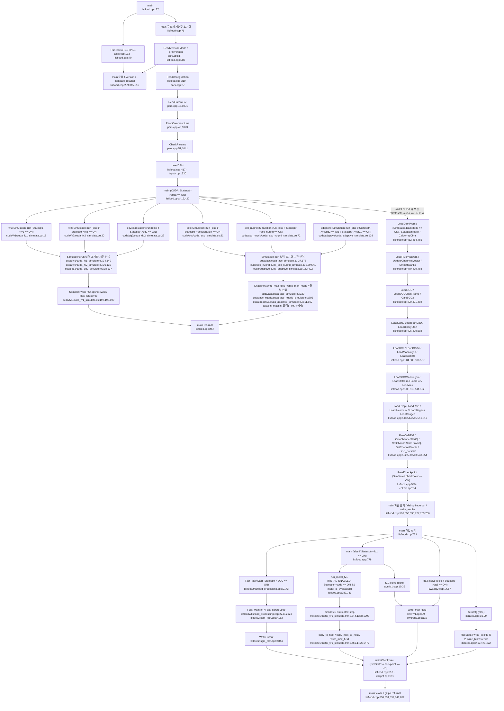
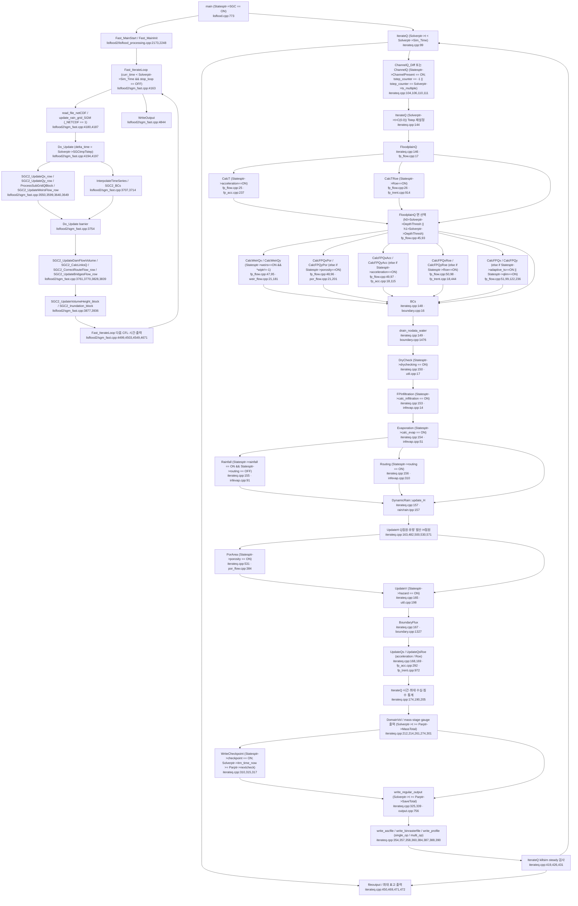

# LISFLOOD-FP 한 번의 실행: 호출 순서와 배열 생산·소비

## 판독 기준과 요약

이 문서는 AI가 작성한 소스 판독 보고서다. 원문 코드는 수정하지 않았다. 모델은 실행하지 않았다. 수치 결과와 물리 타당성은 검증하지 않았다.

기준 소스 루트는 `models/LISFLOOD-FP/raw/source_code/LISFLOOD-FP/`다. 이하 `파일:줄`은 이 루트에 상대적이다. 노트 경로는 저장소 루트에 상대적이다. 줄 번호는 `nl -ba`로 확인한다. 판독 기록은 위치를 찾는 색인으로만 사용한다.

기준 판은 공식 8.2에 공식 8.3 패치를 적용한 코드다. `VersionHistory.h:16–23`은 `#define LF_VersionMajor 8`, `#define LF_VersionMinor 1`, `#define LF_VersionInc   0`, `#define LF_CheckVersion 0`, `#define LF_Release "8.3"`을 정의한다. 같은 파일 21–22행의 원문은 `// release name printed at start-up; the numbers above stay as in 8.2`와 `// because they are written into checkpoint files`다. 체크포인트 판 번호와 표시용 배포명은 서로 다른 값이다.

판 비교의 `v8.0:`, `v8.1:`, `v8.2:`, `v8.3:`는 각각 사용자가 지정한 `_staging/recovery/extract/LISFLOOD-FP/external/` 아래 공식 압축 해제본을 가리킨다. 패치 인용의 `8.3 patch:`는 `models/LISFLOOD-FP/raw/source_code/LISFLOOD-FP-8.3-package/lisflood-8.2-to-8.3.patch`를 가리킨다. 배포본 README 인용의 `8.3 README:`는 같은 패키지의 `README.md`를 가리킨다. Zenodo 배포일과 코드 내부 이력 날짜를 동일시하지 않는다.

호출 깊이는 각 실행 드라이버를 기준으로 센다. `main`의 입력·해법 진입 호출과 각 시간 반복 드라이버의 직접 호출을 1단계로 적는다. 그 함수의 모델 내부 직접 호출을 2단계로 적는다. 3단계 이하에는 이름과 정의 위치만 적는다. CUDA 커널 실행은 호스트 호출 위치의 `<<<...>>>`를 적는다. 표준 C/C++ 함수와 CUDA·CUB·NetCDF·Metal API는 필요한 입출력·동기화 지점만 적는다. 외부 라이브러리 내부는 추적하지 않는다. 주석의 함수 호출과 빌드에 포함되지 않는 대체 구현을 활성 호출로 세지 않는다.

주요 확인 결과는 다음과 같다.

- `lisflood.cpp:417`의 `LoadDEM(Fnameptr, Statesptr, Parptr, Arrptr, verbosemode);` 뒤에서 CUDA 경로가 먼저 분기한다. CUDA 경로는 `lisflood.cpp:457`의 `return 0;`으로 끝난다. 이후 CPU 공통 입력 읽기와 최종 체크포인트에 도달하지 않는다.
- `lisflood.cpp:773–775`는 `Statesptr->SGC == ON`일 때 `Fast_MainStart(...)`를 호출한다. `iterateq.cpp:120`의 활성 문장은 `printf("SGC not processed here\n");`다. 그 아래 SGC 시간 단계 호출은 주석이다.
- 고전 CPU 경로는 하도를 먼저 계산한다. `iterateq.cpp:102`의 원문은 `// ChannelQ routine is run using Tstep calculated for previous iteration`이다. 현재 범람원 시간 간격 계산은 그 뒤 `FloodplainQ` 안에서 수행한다.
- 8.3의 Metal FV1은 `METAL_ENABLED`와 `Statesptr->cuda == ON && metal_is_available()` 조건에서 선택한다. 근거는 `lisflood.cpp:780–788`이다.

차이 분류별 개수: **A 4, B 9, C 8, D 0, E 6, F 1, H 2, X 0. 합계 30행.** 상세 결론은 §8에 적었다.

## 1 시작·입력 읽기 순서

### 1.1 빌드 조건과 실행 분기 기준

| 대상 | 원문 근거 | 호출 추적에 적용하는 조건 |
|---|---|---|
| CMake 설정 선택 | `CMakeLists.txt:10` `set(_CONFIG config.default.cmake CACHE FILEPATH "CMake config file")`; 11행 `include(${_CONFIG})` | 다른 `_CONFIG`를 지정하면 기본 조합과 달라진다. |
| 기본 조합 | `config.default.cmake:1–8` `set(_NETCDF 1)`, `add_compile_definitions(_NUMERIC_MODE=1)`, `add_compile_definitions(_ONLY_RECT=1)`, `add_compile_definitions(_PROFILE_MODE=0)`, `add_compile_definitions(_DISABLE_WET_DRY=0)`, `add_compile_definitions(_CALCULATE_Q_MODE=1)`, `add_compile_definitions(_SGM_BY_BLOCKS=0)`, `add_compile_definitions(_BALANCE_TYPE=0)` | §2의 lisflood2 수치·격자·부하 분기는 이 매크로와 별도로 적는다. |
| 수치 자료형 | `lisflood.h:75–78` `#if _NUMERIC_MODE == 1`, `#define NUMERIC_TYPE double`, `#define NUMERIC_TYPE_NAME "double"`, `#define NUM_FMT "lf"`; 86–88행 `#else`, `#define NUMERIC_TYPE float`, `#define NUMERIC_TYPE_NAME "float"` | 기본 조합은 double이다. Metal GPU 버퍼의 float 변환은 §3의 Metal 행에 적었다. |
| CPU 본체 | `CMakeLists.txt:26` `target_sources(lisflood-base INTERFACE`; 35행 `iterateq.cpp`; 46행 `lisflood2/lisflood_processing.cpp`; 51행 `swe/dg2.cpp`; 54행 `swe/fv1.cpp` | CPU 해법은 같은 실행 파일에 포함된다. |
| CUDA | `CMakeLists.txt:72–77` `check_language(CUDA)`, `if (CMAKE_CUDA_COMPILER)`, `enable_language(CUDA)`, `set_property(TARGET lisflood PROPERTY CUDA_SEPARABLE_COMPILATION ON)`, `add_compile_definitions(CUDA THRUST_IGNORE_CUB_VERSION_CHECK)` | `#ifdef CUDA` 블록은 CUDA 빌드에서만 존재한다. 런타임에는 추가로 `Statesptr->cuda == ON`을 검사한다. |
| 동적 강우 | `pars.cpp:996–1002` `if (read_string_param(param_name, line_number, param_value_ptr, "dynamicrainfile", Fnameptr->dynamicrainfilename, verbose, mode))`, `Statesptr->dynamicrainfall = ON;`, `#if (_NETCDF != 1)`, `fprintf(stderr, "ERROR: dynamic rain requires lisflood to be compiled with NetCDF support\n");`, `exit(1);`, `#endif` | `dynamicrainfile`은 `_NETCDF=1`을 요구한다. |
| GPU 요청 | `pars.cpp:965–968` `if (read_empty_param(param_name, line_number, param_value_ptr, "cuda", verbose, mode) \|\|`<br>`read_empty_param(param_name, line_number, param_value_ptr, "metal", verbose, mode))`<br>`{`<br>`Statesptr->cuda = ON; // the GPU switch, for CUDA and Metal alike` | `cuda`와 `metal`은 같은 상태 변수를 켠다. |
| GPU 없는 빌드 | `pars.cpp:1080–1085` `#if !defined(CUDA) && !defined(METAL_ENABLED)`, `if (Statesptr->cuda == ON)`, `{`, `printf("\nERROR: lisflood has not been compiled with CUDA support. Aborting...\n\n");`, `exit(1);`, `}` | 두 백엔드가 모두 없는 빌드는 GPU 요청을 거부한다. |

### 1.2 `main`의 시작과 입력 읽기

아래 순서는 호출 위치의 실행 순서다. 원문 호출에 if가 없으면 main은 그 함수를 호출한다. 조건 열에 파일 키워드만 적은 행은 피호출 함수 내부의 파일 읽기 조건을 나타낸다. 파일 이름이 없으면 해당 함수가 반환할 수 있다. CUDA 진입 뒤의 행은 CUDA 조기 반환을 통과하지 않는 실행에만 적용한다.

| 순서 | 호출 위치 파일:줄 원문 | 조건(par 키워드·명령 줄 옵션·전처리 포함) | 피호출 정의 파일:줄 |
|---|---|---|---|
| 01 | `lisflood.cpp:40` `RunTests();` | `#ifdef TESTING`; 다음 41행 `exit(0);` | `tests.cpp:133` |
| 02 | `lisflood.cpp:76–85` `memset(&Raster, 0, sizeof(Arrays));`부터 `memset(&DamDataprams, 0, sizeof(DamData));`까지 | 구조체 초기화. 기본 매개변수는 102–275행에서 대입한다. | C 라이브러리 |
| 03 | `lisflood.cpp:284` `int verbosemode = ReadVerboseMode(argc, argv);` | `-v`를 별도로 먼저 읽는다. | `pars.cpp:17` |
| 04 | `lisflood.cpp:286` `printversion(verbosemode);` | 무조건. 289행의 `if (!strcmp(argv[i], "-version")) return(0);`이면 종료한다. | `lisflood.cpp:855` |
| 05 | `lisflood.cpp:315` `compare_grids(compare_results_dir1, compare_results_dir2, ParFp.res_prefix, compare_results_ext);` | `-compare_results`; 316행 `exit(0);` | `lisflood2/file_tool.cpp:866,926` `compare_grids` |
| 06 | `lisflood.cpp:319–320` `ReadConfiguration(argc, argv, Fnameptr, Statesptr, Parptr, Solverptr,`<br>`verbosemode);` | 마지막 명령 줄 인수가 par 파일이다. `pars.cpp:39` `if (argc == 1 \|\| argv[argc - 1][0] == '-')`이면 오류 종료한다. | `pars.cpp:27` |
| 06.1 | `pars.cpp:45` `ReadParamFile(argv[argc-1], Fnameptr, Statesptr, Parptr, Solverptr, verbose);` | par 파일을 먼저 읽는다. | `pars.cpp:1091` |
| 06.2 | `pars.cpp:48` `ReadCommandLine(argc, argv, Fnameptr, Statesptr, Parptr, Solverptr, verbose);` | 명령 줄을 나중에 읽는다. 같은 대상의 대입은 명령 줄 값으로 다시 수행한다. | `pars.cpp:1023` |
| 06.3 | `pars.cpp:51` `CheckParams(Fnameptr, Statesptr, Parptr, Solverptr, verbose);` | 입력 뒤 출력 형식·옵션 조합·GPU 빌드 조건을 검사한다. | `pars.cpp:1041` |
| 07 | `lisflood.cpp:325` `if (fexist(ParFp.res_dirname) == 0)`; 329행 `system(tmp_sys_com);` | `strlen(ParFp.res_dirname) > 0`; `dirroot` 또는 `-dirroot`·`-dir`. 결과 경로는 332·337행에서 구성한다. | `util.cpp:191`; OS |
| 08 | `lisflood.cpp:346` `freopen(Fnameptr->logfilename, "w", stdout);`; 348행 `printversion(verbosemode);` | `Statesptr->logfile == ON`; `log` | C 라이브러리; `lisflood.cpp:855` |
| 09 | `lisflood.cpp:399` `tmp_fp = fopen(ParFp.ascheaderfilename, "r");`; 402행 `fgets(Params.ascheader[i], 255, tmp_fp);` | `SimStates.alt_ascheader == ON`; `ascheader`; 6줄을 읽는다. | C 라이브러리 |
| 10 | `lisflood.cpp:417` `LoadDEM(Fnameptr, Statesptr, Parptr, Arrptr, verbosemode);` | `DEMfile`. 모든 해법에 앞서 CPU 격자와 배열을 준비한다. | `input.cpp:1330` |
| 11 | `lisflood.cpp:425` `simulation.run(ParFp, SimStates, Params, ParSolver, verbosemode);` | `#ifdef CUDA`; `Statesptr->cuda == ON`; 우선순위 첫 분기 `Statesptr->fv1 == ON` | `cuda/fv1/cuda_fv1_simulate.cu:18` |
| 12 | `lisflood.cpp:430` `simulation.run(ParFp, SimStates, Params, ParSolver, verbosemode);` | 같은 CUDA 블록; `else if (Statesptr->fv2 == ON)` | `cuda/fv2/cuda_fv2_simulate.cu:20` `Simulation::run` |
| 13 | `lisflood.cpp:435` `simulation.run(ParFp, SimStates, Params, ParSolver, verbosemode);` | 같은 CUDA 블록; `else if (Statesptr->dg2 == ON)` | `cuda/dg2/cuda_dg2_simulate.cu:22` `Simulation::run` |
| 14 | `lisflood.cpp:440` `simulation.run(ParFp, SimStates, Params, ParSolver, verbosemode);` | 같은 CUDA 블록; `else if (Statesptr->acceleration == ON)` | `cuda/acc/cuda_acc_simulate.cu:21` `Simulation::run` |
| 15 | `lisflood.cpp:445` `simulation.run(ParFp, SimStates, Params, ParSolver, verbosemode);` | 같은 CUDA 블록; `else if (Statesptr->acc_nugrid == ON)` | `cuda/acc_nugrid/cuda_acc_nugrid_simulate.cu:72` `Simulation::run` |
| 16 | `lisflood.cpp:450` `simulation.run(argc, argv);` | 같은 CUDA 블록; `else if (Statesptr->mwdg2 == ON \|\| Statesptr->hwfv1 == ON)` | `cuda/adaptive/cuda_adaptive_simulate.cu:138` `Simulation::run` |
| 17 | `lisflood.cpp:454–455` `fprintf(stderr, "cuda only available for acc, fv1, fv2 and dg2 solvers\n");`<br>`return -1;` | 같은 CUDA 블록에서 해법 분기가 모두 거짓이다. 성공한 CUDA 분기는 457행 `return 0;`으로 종료한다. | `main` 종료 |
| 18 | `lisflood.cpp:462` `if (SimStates.DamMode == ON)LoadDamPrams(Fnameptr, Statesptr, Parptr, Damptr, verbosemode);` | `damfile` | `input.cpp:2420` |
| 19 | `lisflood.cpp:464` `if (SimStates.DammaskRead == ON)LoadDamMask(Fnameptr, Parptr, Arrptr, Damptr, verbosemode);` | `dammask` | `input.cpp:2490` |
| 20 | `lisflood.cpp:465` `CalcArrayDims(Statesptr, Parptr, Arrptr); // CCS populates dx, dy and dA arrays (calcs correct dimensions if using lat long grid)` | `latlong` 여부에 따라 격자 치수를 계산한다. | `util.cpp:274` |
| 21 | `lisflood.cpp:470` `LoadRiverNetwork(Fnameptr, Statesptr, Parptr, ChannelSegmentsVecPtr, Arrptr, QID7_Vec_Ptr, RiversIndexVecPtr, verbosemode); // CCS` | `riverfile` 또는 `multiriverfile` | `input.cpp:337` |
| 22 | `lisflood.cpp:479` `UpdateChannelsVector(Statesptr, CSTypePtr, QID7_Vec_Ptr, QID7Ptr, RiversIndexPtr); // CCS` | `QID7.size() != 0` | `input.cpp:847` |
| 23 | `lisflood.cpp:484` `sscanf(argv[i + 1], "%" NUM_FMT"", &tmp);`; 486행 `for (chseg = 0; chseg < CSTypePtr->N_Channel_Segments; chseg++) for (i = 0; i < CSTypePtr[chseg].chsz; i++) CSTypePtr[chseg].ChanN[i] = tmp;` | `-nch`를 하도 파일 로드 뒤 적용한다. | `main`의 직접 대입 |
| 24 | `lisflood.cpp:488` `if (SimStates.ChannelPresent == ON) SmoothBanks(Parptr, Solverptr, CSTypePtr, Arrptr, ChannelSegmentsVecPtr, verbosemode);` | 하도가 존재한다. | `util.cpp:151` |
| 25 | `lisflood.cpp:490` `if (SimStates.SGC == ON) LoadSGC(Fnameptr, Parptr, Arrptr, Statesptr, verbosemode); // load sub grid channels` | `SGCwidth` 등이 SGC를 활성화한다. | `input.cpp:2202` |
| 26 | `lisflood.cpp:491` `if (SimStates.SGC == ON && SimStates.SGCchanprams == ON) LoadSGCChanPrams(Fnameptr, Statesptr, Parptr, SGCptr, verbosemode); // This loads the parameters for the SGC group information` | SGC와 그룹 매개변수 파일을 모두 사용한다. | `input.cpp:2359` |
| 27 | `lisflood.cpp:492` `if (SimStates.SGC == ON) CalcSGCz(Fnameptr, Statesptr, Parptr, Arrptr, SGCptr, verbosemode);` | SGC. 초기 수심보다 먼저 하상·만제 수심·체적을 계산한다. | `sgc.cpp:312` `CalcSGCz` |
| 28 | `lisflood.cpp:496` `LoadStart(Fnameptr, Statesptr, Parptr, Arrptr, SGCptr, verbosemode);` | `SimStates.startfile == ON`; `startfile`; `startelev`이면 표고를 수심으로 변환한다. | `input.cpp:1206` |
| 29 | `lisflood.cpp:499` `LoadStartQ2D(Fnameptr, Parptr, Arrptr, verbosemode);` | 위 ASCII startfile 블록 안의 `SimStates.startq2d == ON` | `input.cpp:1282` |
| 30 | `lisflood.cpp:502` `if (SimStates.binarystartfile == ON) LoadBinaryStart(Fnameptr, Statesptr, Parptr, Arrptr, SGCptr, verbosemode);` | `binarystartfile` | `input.cpp:1235` |
| 31 | `lisflood.cpp:504` `LoadBCs(Fnameptr, Statesptr, Parptr, BCptr, verbosemode);` | `bcifile`; 함수가 파일 부재도 처리한다. | `input.cpp:1526` |
| 32 | `lisflood.cpp:505` `LoadBCVar(Fnameptr, Statesptr, Parptr, BCptr, CSTypePtr, Arrptr, ChannelSegmentsVecPtr, verbosemode);` | `bdyfile`; BC·점원·하도에 시계열을 연결한다. | `input.cpp:1944` |
| 33 | `lisflood.cpp:506` `LoadManningsn(Fnameptr, Parptr, Arrptr, verbosemode);` | `manningfile` | `input.cpp:914` |
| 34 | `lisflood.cpp:507` `LoadDistInfil(Fnameptr, Parptr, Arrptr, verbosemode);` | `infilfile` | `input.cpp:882` |
| 35 | `lisflood.cpp:508` `LoadSGCManningsn(Fnameptr, Parptr, Arrptr, verbosemode);` | `SGCmanningfile` | `input.cpp:941` |
| 36 | `lisflood.cpp:510` `LoadSGCdirn(Fnameptr, Parptr, Arrptr, verbosemode);` | `SGCdirnfile` | `input.cpp:969` |
| 37 | `lisflood.cpp:511` `LoadPor(Fnameptr, Statesptr, Parptr, Arrptr, verbosemode);` | `porfile` | `input.cpp:999` |
| 38 | `lisflood.cpp:512` `LoadWeir(Fnameptr, Statesptr, Parptr, Arrptr, verbosemode);` | main은 무조건 호출한다. `input.cpp:95–96`의 `if (strlen(Fnameptr->weirfilename) == 0)` / `return;`은 빈 파일 이름에서 반환한다. 파일 키워드는 `weirfile` 또는 `weir`다. | `input.cpp:93` |
| 39 | `lisflood.cpp:513` `if (SimStates.calc_evap == ON) LoadEvap(Fnameptr, Arrptr, verbosemode);` | `evaporation` | `input.cpp:2126` |
| 40 | `lisflood.cpp:514` `if (SimStates.rainfall == ON) LoadRain(Fnameptr, Arrptr, verbosemode);` | `rainfall`·`rainfallrouting` | `input.cpp:2146` |
| 41 | `lisflood.cpp:515` `if (SimStates.rainfallmask == ON) LoadRainmask(Fnameptr, Parptr, Arrptr, Statesptr, verbosemode);` | `rainfallmask` | `input.cpp:2166` |
| 42 | `lisflood.cpp:516` `if (SimStates.save_stages == ON) LoadStages(Fnameptr, Statesptr, Parptr, Stageptr, verbosemode);` | `stagefile` | `input.cpp:44` |
| 43 | `lisflood.cpp:517` `if (SimStates.gsection == ON) LoadGauges(Fnameptr, Statesptr, Parptr, Stageptr, verbosemode);` | `gaugefile` | `input.cpp:2289` |
| 44 | `lisflood.cpp:522` `FlowDirDEM(Parptr, Arrptr, Statesptr, BCptr);` | `SimStates.routing == ON` | `infevap.cpp:131` |
| 45 | `lisflood.cpp:530` `CalcChannelStartQ(Statesptr, Parptr, Arrptr, CSTypePtr, RiversIndexVecPtr, RiversIndexPtr);` | `SimStates.ChannelPresent == ON` | `ch_flow.cpp:70` `CalcChannelStartQ` |
| 46 | `lisflood.cpp:543` `SetChannelStartHfromQ(Statesptr, Parptr, Arrptr, CSTypePtr, Solverptr, RiversIndexVecPtr, RiversIndexPtr);` | 하도 존재; `startfile`이 아니고 `startq`이다. | `ch_flow.cpp:135` `SetChannelStartHfromQ` |
| 47 | `lisflood.cpp:548` `SetChannelStartH(Statesptr, Parptr, Arrptr, CSTypePtr, RiversIndexVecPtr, RiversIndexPtr);` | 하도 존재; 위 두 조건이 모두 거짓이다. | `ch_flow.cpp:24` `SetChannelStartH` |
| 48 | `lisflood.cpp:554` `SGC_hotstart(Statesptr, Parptr, Solverptr, Arrptr);` | `SimStates.startq == ON && SimStates.SGC == ON` | `sgc.cpp:563` `SGC_hotstart` |
| 49 | `lisflood.cpp:562` `tmp_fp = fopen(ParFp.opfilename, "r");`; 570행 `if (fscanf(tmp_fp, "%" NUM_FMT"", &Params.op_multisteps[i]) != 1)` | `SimStates.multi_op == ON`; `overpassfile` | C 라이브러리 |
| 50 | `lisflood.cpp:589` `ReadCheckpoint(Fnameptr, Statesptr, Parptr, Solverptr, BCptr, CSTypePtr, Arrptr, verbosemode);` | `SimStates.checkpoint == ON`; 앞서 읽은 초기 상태를 저장 상태로 덮어쓸 수 있다. | `chkpnt.cpp:34` |

### 1.3 입력 함수의 직접 하위 호출

`ReadParamFile`의 다음 단계는 `pars.cpp:1138` `CheckParam(param_name, param_value_ptr, line_number, Fnameptr, Statesptr, Parptr, Solverptr, verbose, PARAM_FILE);`이다. `ReadCommandLine`의 다음 단계는 `pars.cpp:1036` `CheckParam(param_ptr, param_value, i, Fnameptr, Statesptr, Parptr, Solverptr, verbose, CMD_LINE);`이다. `CheckParam`의 정의는 `pars.cpp:136`이다. 3단계의 공통 판독기는 `read_string_param`(`pars.cpp:54`), `read_numeric_param`(`pars.cpp:75,93`), `read_integer_param`(`pars.cpp:108`), `read_empty_param`(`pars.cpp:124`)이다.

| 순서 | 호출 위치 파일:줄 원문 | 조건 | 피호출 정의 파일:줄 |
|---|---|---|---|
| DEM.1 | `input.cpp:1335–1336` `FILE *fp = LoadDomainGeometry(Fnameptr->demfilename, Parptr, verbose,`<br>`no_data_value);` | 무조건 | `input.cpp:1470` |
| DEM.2 | `input.cpp:1339` `Arrptr->H = memory_allocate_zero_numeric_legacy(Parptr->xsz*Parptr->ysz);` | 무조건. Roe·SGC·유량·통계 배열의 분기는 §3에 적는다. | `utility.cpp:6` |
| DEM.3 | `input.cpp:1362` `allocate_swe_fields(Parptr, Arrptr);` | `Statesptr->Roe` 분기 뒤의 `Statesptr->fv1 == ON` | `swe/fields.cpp:4` `allocate_swe_fields` |
| DEM.4 | `input.cpp:1366` `dg2::allocate_fields(Parptr, Arrptr);` | 앞 분기 뒤의 `Statesptr->dg2 == ON` | `swe/dg2/fields.cpp:295` `allocate_fields` |
| DEM.5 | `input.cpp:1462` `LoadDEMData(Parptr, Arrptr->DEM, fp, no_data_value);` | 배열 할당 뒤 | `input.cpp:1502` |
| RIV.1 | `input.cpp:345` `LoadRiver(Fnameptr, Statesptr, Parptr, ChannelSegmentsVecPtr, Arrptr, QID7_Vec_Ptr, RiversIndexVecPtr, verbose); // Call LoadRiver once.` | `Statesptr->multiplerivers == 0` | `input.cpp:371` |
| RIV.2 | `input.cpp:351` `rfp = fopen_or_die(Fnameptr->multiriverfilename, "r", "Loading Rivers", verbose);`; 358행 `LoadRiver(Fnameptr, Statesptr, Parptr, ChannelSegmentsVecPtr, Arrptr, QID7_Vec_Ptr, RiversIndexVecPtr, verbose); // Call LoadRiver in loop.` | `Statesptr->multiplerivers == 1`; 파일에서 읽은 하도마다 호출한다. | `input.cpp:18` `fopen_or_die`; `input.cpp:371` |
| BDY.1 | `input.cpp:2002` `LoadTimeSeries(*timeSeries, Fnameptr->bdyfilename, fp, OFF);` | 주석 대안. `input.cpp:1999–2003`의 `/* older code (incompatible with GPU solvers)` 블록 안이다. 실행하지 않는다. | `input.cpp:1848` |
| BDY.2 | `input.cpp:2008` `LoadTimeSeries(BCptr->allTimeSeries.back(), Fnameptr->bdyfilename, fp, OFF);` | 경계·점원 시계열 | `input.cpp:1848` |
| BDY.3 | `input.cpp:2014` `LoadTimeSeries(timeSeries, Fnameptr->bdyfilename, fp, OFF);` | 주석 대안. `input.cpp:2011–2015`의 `/* James shaw code (incompatible with CPU solvers)` 블록 안이다. 실행하지 않는다. | `input.cpp:1848` |
| EVAP.1 | `input.cpp:2134` `Arrptr->evap = LoadTimeSeries(Fnameptr->evapfilename, fp, ON);` | 증발 파일을 열었다. | `input.cpp:1935`; 그 안의 `LoadTimeSeries` 호출은 1938행이다. |
| RAIN.1 | `input.cpp:2154` `Arrptr->rain = LoadTimeSeries(Fnameptr->rainfilename, fp, ON);` | 강우 파일을 열었다. | `input.cpp:1935` |
| DAM.1 | `input.cpp:2498` `read_file(Fnameptr->DamMaskfilename, no_data_value, &num_cols, &num_rows, &Arrptr->DamMask, &xllcorner, &yllcorner, &cell_size);` | 댐 마스크 | `lisflood2/file_tool.cpp:597` `read_file` |

### 1.4 입력·초기 조건의 나머지 2단계 호출

앞 표에서 정의한 입력 함수의 하위 호출을 보충한다. 같은 helper의 반복 호출은 한 행에서 호출 위치를 모두 적는다. 일반 메모리 할당·해제 wrapper는 배열의 생산 위치를 적은 §3과 함께 읽는다. wrapper 정의는 `utility.cpp:6,19,32,43,54`이다.

| 순서 | 호출 위치 파일:줄 원문 | 조건 | 피호출 정의 파일:줄 |
|---|---|---|---|
| I01 | `input.cpp:52` `fp = fopen_or_die(Fnameptr->stagefilename, "r", "Loading stage information ", verbose);` | LoadStages; stagefile | `input.cpp:18` fopen_or_die |
| I02 | `input.cpp:130` `fp = fopen_or_die(Fnameptr->weirfilename, "r", "Loading weir information", verbose);`<br>`input.cpp:150` `SetArrayValue(Arrptr->Weir_Identx, -1, (Parptr->xsz + 1) * (Parptr->ysz + 1));`<br>`input.cpp:151` `SetArrayValue(Arrptr->Weir_Identy, -1, (Parptr->xsz + 1) * (Parptr->ysz + 1));` | LoadWeir; weirfile; 방향 식별자를 초기화한다. | `input.cpp:18; utility.cpp:124` fopen_or_die / SetArrayValue |
| I03 | `input.cpp:892` `fp = fopen_or_die(Fnameptr->infilfilename, "r", "Loading distributed infiltration data", verbose);`<br>`input.cpp:901` `if (AreEqual(Arrptr->dist_infiltration[i + j * Parptr->xsz], no_data_value))` | LoadDistInfil; infilfile | `input.cpp:18,37` fopen_or_die / AreEqual |
| I04 | `input.cpp:924` `fp = fopen_or_die(Fnameptr->nfilename, "r", "Loading floodplain Manning's n data", verbose);`<br>`input.cpp:933` `if (AreEqual(Arrptr->Manningsn[i + j*Parptr->xsz], no_data_value))`<br>`input.cpp:951` `fp = fopen_or_die(Fnameptr->SGCnfilename, "r", "Loading SGC Manning's n data", verbose);`<br>`input.cpp:960` `if (AreEqual(Arrptr->SGCManningsn[i + j*Parptr->xsz], no_data_value))`<br>`input.cpp:979` `fp = fopen_or_die(Fnameptr->SGCdirnfilename, "r", "Loading SGC Direction data", verbose);`<br>`input.cpp:989` `if (AreEqual(Arrptr->SGCdirn[i + j*Parptr->xsz], no_data_value))` | LoadManningsn·LoadSGCManningsn·LoadSGCdirn; 각 파일 옵션 | `input.cpp:18,37` fopen_or_die / AreEqual |
| I05 | `input.cpp:1056` `if (AreEqual(Arrptr->paerial[i + j*Parptr->xsz], no_data_value))`<br>`input.cpp:1077` `if (AreEqual(Arrptr->paerial[i + j*Parptr->xsz + k*Parptr->xsz*Parptr->ysz], no_data_value))`<br>`input.cpp:1096` `if (AreEqual(Arrptr->paerial[i + j*Parptr->xsz], no_data_value))`<br>`input.cpp:1107` `if (AreEqual(Arrptr->pbound[i + j*Parptr->xsz + k*Parptr->xsz*Parptr->ysz], no_data_value))`<br>`input.cpp:1131` `if (AreEqual(Arrptr->paerial[i + j*Parptr->xsz + k*Parptr->xsz*Parptr->ysz], no_data_value))`<br>`input.cpp:1144` `if (AreEqual(Arrptr->pbound[i + j*Parptr->xsz + m*Parptr->xsz*Parptr->ysz + k*Parptr->xsz*Parptr->ysz], no_data_value))` | LoadPor; PFIX·PVAR·PBOUND·PBVAR 자료의 NoData 검사 | `input.cpp:37` AreEqual |
| I06 | `input.cpp:1213` `fp = fopen_or_die(Fnameptr->startfilename, "r", "Loading startfile ", verbose);`<br>`input.cpp:1225` `InitStartFile(Statesptr, Parptr, Arrptr, SGCptr, no_data_value, verbose);`<br>`input.cpp:1241` `fp = fopen_or_die(Fnameptr->startfilename, "r", "Loading initial binary startfile", verbose);`<br>`input.cpp:1272` `InitStartFile(Statesptr, Parptr, Arrptr, SGCptr, no_data_value, verbose);` | ASCII·binary 시작 파일을 읽은 뒤 공통 초기화 | `input.cpp:18,1158` fopen_or_die / InitStartFile |
| I07 | `input.cpp:1298` `fp = fopen_or_die(hu_startfile, "r", "Loading startfile.Qx ", verbose);`<br>`input.cpp:1311` `fp = fopen_or_die(hv_startfile, "r", "Loading startfile.Qy ", verbose);` | LoadStartQ2D; 두 운동량 파일 | `input.cpp:18` fopen_or_die |
| I08 | `input.cpp:1576` `fp = fopen_or_die(Fnameptr->bcifilename, "rb", "Loading boundary condition IDs\n", verbose);`<br>`input.cpp:1980` `fp = fopen_or_die(Fnameptr->bdyfilename, "r", "Loading time varying boundary conditions\n", verbose);`<br>`input.cpp:2069` `FreeTimeSeries(*timeSeries); // OLD VERSION` | LoadBCs·LoadBCVar; 2069행은 timeSeriesUsed == 0 | `input.cpp:18,1839` fopen_or_die / FreeTimeSeries |
| I09 | `input.cpp:2132` `fp = fopen_or_die(Fnameptr->evapfilename, "r", "Loading time varying evaporation", verbose);`<br>`input.cpp:2152` `fp = fopen_or_die(Fnameptr->rainfilename, "r", "Loading time varying rainfall", verbose);`<br>`input.cpp:2173` `fp = fopen_or_die(Fnameptr->rainmaskname, "rb", "Loading distributed rain mask", verbose);`<br>`input.cpp:2191` `if (AreEqual(Arrptr->Rainmask[i + j*Parptr->xsz], no_data_value))` | LoadEvap·LoadRain·LoadRainmask; Rainmask의 NoData 검사 | `input.cpp:18,37` fopen_or_die / AreEqual |
| I10 | `input.cpp:2217` `fp = fopen_or_die(Fnameptr->SGCbankfilename, "r", "Loading SGCbank ", verbose);`<br>`input.cpp:2224` `if (AreEqual(Arrptr->SGCz[i + j*Parptr->xsz], no_data_value))`<br>`input.cpp:2230` `fp = fopen_or_die(Fnameptr->SGCwidthfilename, "r", "Loading SGCwidth ", verbose);`<br>`input.cpp:2237` `if (AreEqual( Arrptr->SGCwidth[i + j*Parptr->xsz], no_data_value))`<br>`input.cpp:2248` `fp = fopen_or_die(Fnameptr->SGCchangroupfilename, "r", "Loading SGC channel group", verbose);`<br>`input.cpp:2256` `if (AreEqual(Arrptr->SGCgroup[i + j*Parptr->xsz], no_data_value) \|\| Arrptr->SGCgroup[i + j*Parptr->xsz] < 0)`<br>`input.cpp:2267` `fp = fopen_or_die(Fnameptr->ChanMaskfilename, "r", "Creating and Loading SGC Channel Mask ", verbose);`<br>`input.cpp:2275` `if (AreEqual(tmp, no_data_value)) Arrptr->ChanMask[i + j*Parptr->xsz] = 0; // In the case of no_data_value set the chan mask to zero` | LoadSGC; 폭·하상·면적·그룹 파일의 해당 옵션 | `input.cpp:18,37` fopen_or_die / AreEqual |
| I11 | `input.cpp:2297` `fp = fopen_or_die(Fnameptr->gaugefilename, "r", "Gauge section information", verbose);`<br>`input.cpp:2367` `fp = fopen_or_die(Fnameptr->SGCchanpramsfilename, "r", "Loading SGC channel parameter information", verbose);`<br>`input.cpp:2428` `fp = fopen_or_die(Fnameptr->Damparfilename, "r", "Loading Dam parameter information", verbose);` | LoadGauges·LoadSGCChanPrams·LoadDamPrams | `input.cpp:18` fopen_or_die |
| I12 | `sgc.cpp:386` `SGC_wp_prams(SGCptr);` | CalcSGCz; 그룹별 단면 전처리 | `sgc.cpp:18` SGC_wp_prams |
| I13 | `ch_flow.cpp:112` `Qstart+=InterpolateTimeSeries(csp->Q_TimeSeries[i],0);` | CalcChannelStartQ; QVAR5 초기 유입 | `boundary.cpp:1422` InterpolateTimeSeries |
| I14 | `ch_flow.cpp:193` `WSbc=InterpolateTimeSeries(csp->Q_TimeSeries[nodes-1],Solverptr->t);`<br>`ch_flow.cpp:199` `WSbc = InterpolateTimeSeries(csp->Q_TimeSeries[nodes - 1], csp->Q_Val[nodes - 1]);` | SetChannelStartHfromQ; HVAR3·RATE8 | `boundary.cpp:1422` InterpolateTimeSeries |
| I15 | `ch_flow.cpp:211–212` `Arrptr->H[csp->ChanX[nodes-1]+csp->ChanY[nodes-1]*Parptr->xsz]=CalcA(csp->ChanN[nodes-1],csp->Shalf[nodes-1],csp->ChanWidth[nodes-1],csp->ChanQ[nodes-1])`<br>`/csp->ChanWidth[nodes-1];`<br>`ch_flow.cpp:216–217` `Arrptr->H[csp->ChanX[nodes-1]+csp->ChanY[nodes-1]*Parptr->xsz]=CalcA(csp->ChanN[nodes-1],sqrt(csp->Q_Val[nodes-1]),csp->ChanWidth[nodes-1],csp->ChanQ[nodes-1])`<br>`/ csp->ChanWidth[nodes-1];`<br>`ch_flow.cpp:293` `csp->JunctionH=CalcA(csp->ChanN[i],csp->Shalf[i],csp->ChanWidth[i],csp->ChanQ[i])/csp->ChanWidth[i]; // calc new area from this flow and calc h`<br>`ch_flow.cpp:297` `Arrptr->H[pi+pj*Parptr->xsz]=CalcA(csp->ChanN[i],csp->Shalf[i],csp->ChanWidth[i],csp->ChanQ[i])/csp->ChanWidth[i]; // calc new area from this flow and calc h` | SetChannelStartHfromQ; FREE 하류·kinematic 시작 수심 | `ch_flow.cpp:537` CalcA |
| I16 | `ch_flow.cpp:245` `Jds=CalcEnergySlope(csp->ChanN[i+1],csp->ChanWidth[i+1],Arrptr->H[pid+pjd*Parptr->xsz],csp->ChanQ[i+1]);`<br>`ch_flow.cpp:253` `Arrptr->H[pi+pj*Parptr->xsz]=Arrptr->H[pi+pj*Parptr->xsz]+dh*signR(err_d);`<br>`ch_flow.cpp:255` `Jus=CalcEnergySlope(csp->ChanN[i],csp->ChanWidth[i],Arrptr->H[pi+pj*Parptr->xsz],csp->ChanQ[i]);` | SetChannelStartHfromQ; diffusive/dynsw 정상 시작 해 | `ch_flow.cpp:314,1129` CalcEnergySlope / signR |
| I17 | `rain/rain.tpp:20` `read_file_netCDF_start(filename, "rainfall_depth", &netcdf_);`<br>`rain/rain.tpp:31` `update_time(C(0.0));` | DynamicRain 생성자; enabled_가 참; _NETCDF=1 | `lisflood2/file_tool.cpp:315; rain/rain.tpp:58` read_file_netCDF_start / update_time |
| I18 | `rain/rain.tpp:65` `if (read_file_netCDF(&netcdf_, t / C(3600.0) /* s to hr */))` | update_time; enabled_가 참; 파일 시각은 시간 단위 | `lisflood2/file_tool.cpp:361` read_file_netCDF |
| I19 | `rain/rain.tpp:167` `update_time(Solverptr->t);`<br>`rain/rain.tpp:178` `NUMERIC_TYPE inc = rate_at_cell(Parptr, i, j) * Solverptr->Tstep;` | update_H; _NETCDF=1; DEM NoData 셀은 175행에서 continue | `rain/rain.tpp:58,104` update_time / rate_at_cell |
| I20 | `rain/rain.tpp:206` `if (update_time_SGC(curr_time)); // if the file had to be read update rain_grid`<br>`rain/rain.tpp:227` `rain_grid[grid_cell_index] = rate_at_cell_SGC(i, j,row_dx, row_dy, tly)*cell_area_col[j];` | update_rain_grid_SGM; _NETCDF=1; 반영할 강우 격자 | `rain/rain.tpp:79,130` update_time_SGC / rate_at_cell_SGC |

`LoadDomainGeometry`·`LoadDEMData`·`LoadStages`·`LoadStartQ2D`·`LoadPor`·`LoadRainmask` 등의 반복 셀 읽기는 각 함수 안의 `fscanf`/`fread`다. SGC 시작 체적 계산의 3단계 함수는 `InitStartFile`(`input.cpp:1158`), `CalcSGC_UpV`(`sgc.cpp:192`)다. 하도 시작 해의 3단계 이하 함수는 `CalcA`(`ch_flow.cpp:537`), `CalcEnergySlope`(`ch_flow.cpp:314`), `signR`(`ch_flow.cpp:1129`)다.

### 1.5 다른 빌드 파일의 매크로

| 빌드 선택 | 원문 | 적용할 호출 조건 |
|---|---|---|
| Apple CMake | `CMakeLists.txt:232–235` `if (APPLE)`, `add_subdirectory(metal)`, `if (METAL_ENABLED)`, `target_link_libraries(lisflood PRIVATE ${METAL_LIBRARY})`; `metal/CMakeLists.txt:6` `if(METAL_FRAMEWORK AND FOUNDATION_FRAMEWORK)`; 29행 `target_compile_definitions(lisflood-metal PUBLIC METAL_ENABLED)` | Apple 선택과 framework 검색 성공 뒤에 Metal main 분기가 존재한다. |
| makefile CUDA | `makefile:53–55` `ifdef CUDA`, `NVCCFLAGS += -Icuda/common -Icuda -ccbin $(CXX)`, `CXXFLAGS += -Icuda/common -Icuda -DCUDA` | make 변수와 컴파일 정의를 구분한다. |
| RESULT_CHECK | `result_check.mk:7` `$(CC) $(CFLAGS_RELEASE) -D _NUMERIC_MODE=1 -D RESULT_CHECK=1 -c $< -o $@` | 원래 SGC 배열을 보존하고 `Do_Update_old`를 병행하는 조합이다. |
| SGC 행·블록과 부하 분할 | `make_block1bal1.mk:9` `$(CC) $(CFLAGS_RELEASE) -D _NUMERIC_MODE=0 -D _SGM_BY_BLOCKS=1 -D _BALANCE_TYPE=1 -c $< -o $@`; `make_block0bal0.mk:9` `$(CC) $(CFLAGS_RELEASE) -D _NUMERIC_MODE=0 -D _SGM_BY_BLOCKS=0 -D _BALANCE_TYPE=0 -c $< -o $@` | 기본 CMake의 행·고정부하 선택과 다를 수 있다. `make_block1bal0.mk:9`, `make_block0bal1.mk:9`은 나머지 조합을 지정한다. |
| 대체 Q·wet/dry | `make_qmode2.mk:9` `$(CC) $(CFLAGS_RELEASE) -D _NUMERIC_MODE=0 -D _CALCULATE_Q_MODE=2 -c $< -o $@`; `make_disable_wet_dry.mk:9` `$(CC) $(CFLAGS_RELEASE) -D _NUMERIC_MODE=0 -D _DISABLE_WET_DRY=1 -c $< -o $@` | 이 조합을 기본 CMake 결과와 같은 경로로 단정하지 않는다. |
| Visual C++ 프로젝트 | `lisflood.vcxproj:305` `<PreprocessorDefinitions>_ONLY_RECT=0;_NUMERIC_MODE=0</PreprocessorDefinitions>`; `lisflood_intel.vcxproj:160`도 같은 정의 | 구성별 정의를 사용한다. CMake 기본값을 일괄 적용하지 않는다. |

`CMakeSettings.json`은 MSVC·Intel의 Debug·Release 구성을 지정한다. `linuxdep/build.sh:32–42`는 HDF5·NetCDF 의존성 빌드다. 이 파일들을 모델 시간 단계의 호출로 세지 않는다. 의존성 내부는 이번 추적 범위에 넣지 않았다.

## 2 계산 순서와 출력·종료

### 2.1 `main`의 출력 준비·해법 선택·종료

| 순서 | 호출 위치 파일:줄 원문 | 조건 | 피호출 정의 파일:줄 |
|---|---|---|---|
| M01 | `lisflood.cpp:596` `Fps.mass_fp = fopen(t1, "a");`; 599행 `Fps.mass_fp = fopen(t1, "w");` | `SimStates.checkpoint == ON && ParSolver.t > 0`이면 `.mass`에 덧붙인다. 나머지는 새로 연다. | C 라이브러리 |
| M02 | `lisflood.cpp:625` `Fps.dam_fp = fopen(t1, "w");` | `SimStates.DamMode == ON`; `.dam` | C 라이브러리 |
| M03 | `lisflood.cpp:650,653` `Fps.stage_fp = fopen(t1, "a");`, `Fps.stage_fp = fopen(t1, "w");` | `SimStates.save_stages == ON`; `.stage`; 재개 여부에 따라 모드를 선택한다. | C 라이브러리 |
| M04 | `lisflood.cpp:695,698` `Fps.vel_fp = fopen(t1, "a");`, `Fps.vel_fp = fopen(t1, "w");` | `SimStates.save_stages == ON && Statesptr->voutput_stage == ON`; `.velocity` | C 라이브러리 |
| M05 | `lisflood.cpp:727,730` `Fps.gau_fp = fopen(t1, "a");`, `Fps.gau_fp = fopen(t1, "w");` | `SimStates.gsection == ON`; `.discharge` | C 라이브러리 |
| M06 | `lisflood.cpp:763` `debugfileoutput(Fnameptr, Statesptr, Parptr, Arrptr);` | `Statesptr->maxdepthonly != ON`인 가지에서 `Statesptr->debugmode == ON` | `output.cpp:447` |
| M07 | `lisflood.cpp:766` `write_ascfile(Fnameptr->resrootname, -1, ".dem", Arrptr->SGCz, Arrptr->DEM, 0, Statesptr, Parptr);`; 768행 `write_ascfile(Fnameptr->resrootname, -1, ".dem", Arrptr->DEM, Arrptr->DEM, 0, Statesptr, Parptr);` | 같은 가지에서 SGC이면 `SGCz`, 나머지는 `DEM`을 쓴다. | `output.cpp:21` |
| M08 | `lisflood.cpp:775` `Fast_MainStart(Fnameptr, &Fps, Statesptr, Parptr, Solverptr, BCptr, Stageptr, CSTypePtr, Arrptr, SGCptr, ChannelSegmentsVecPtr, Damptr, verbosemode); //Damptr added by FEOL` | 첫 분기 `Statesptr->SGC == ON` | `lisflood2/lisflood_processing.cpp:2173` `Fast_MainStart` |
| M09 | `lisflood.cpp:783–784` `run_metal_fv1(*Fnameptr, &Fps, *Statesptr, *Parptr, *Solverptr, *BCptr,`<br>`*Stageptr, *Arrptr, verbosemode);` | 다음 분기 `Statesptr->fv1 == ON`; `#ifdef METAL_ENABLED`; `Statesptr->cuda == ON && metal_is_available()` | `metal/metal_integrate.cpp:7` `run_metal_fv1` |
| M10 | `lisflood.cpp:787–788` `fv1::solve(Fnameptr, &Fps, Statesptr, Parptr, Solverptr, BCptr,`<br>`Stageptr, Arrptr, verbosemode);` | FV1 분기에서 Metal을 선택하지 않았다. | `swe/fv1.cpp:10` |
| M11 | `lisflood.cpp:792–793` `dg2::solve(Fnameptr, &Fps, Statesptr, Parptr, Solverptr, BCptr,`<br>`Stageptr, Arrptr, verbosemode);` | 다음 분기 `Statesptr->dg2 == ON` | `swe/dg2.cpp:14` |
| M12 | `lisflood.cpp:805` `IterateQ(Fnameptr, &Fps, Statesptr, Parptr, Solverptr, BCptr, Stageptr, CSTypePtr, Arrptr, SGCptr, RiversIndexVecPtr, RiversIndexPtr, ChannelSegmentsVecPtr, verbosemode);` | 위 해법 분기가 모두 거짓이다. | `iterateq.cpp:16` |
| M13 | `lisflood.cpp:810` `if (SimStates.checkpoint == ON) WriteCheckpoint(Fnameptr, Statesptr, Parptr, Solverptr, BCptr, CSTypePtr, Arrptr, verbosemode);` | CPU 또는 Metal 드라이버 반환 뒤 | `chkpnt.cpp:211` |
| M14 | `lisflood.cpp:826` `freopen("CON", "w", stdout);` | `SimStates.logfile == ON` | C 라이브러리 |
| M15 | `lisflood.cpp:830` `if (SimStates.save_stages == ON) fclose(Fps.stage_fp);`; 834행 `system(tmp_sys_com);` | `.stage`; `SimStates.call_gzip == ON`이면 `gzip -9 -f`를 호출한다. | C 라이브러리·OS |
| M16 | `lisflood.cpp:837` `if (Fps.mass_fp != NULL) fclose(Fps.mass_fp);`; 841행 `system(tmp_sys_com);` | `.mass`; gzip 조건은 위와 같다. | C 라이브러리·OS |
| M17 | `lisflood.cpp:847` `if (Fps.dam_fp != NULL) fclose(Fps.dam_fp);`; 852행 `return 0;` | 댐 파일 닫기는 `Statesptr->DamMode == ON` 블록이다. | `main` 종료 |

`lisflood.cpp:794–800`의 `dg2new::DG2Solver`와 중복 `dg2::solve`는 주석이다. 이 문서는 이들을 실행되는 해법으로 연결하지 않는다.

### 2.2 고전 CPU 시간 반복: `IterateQ`

반복 조건 원문은 `iterateq.cpp:99` `while (Solverptr->t < Solverptr->Sim_Time)`이다. 초기 체적은 29행에서 계산한다. 초기 `Tstep`은 39–78행에서 모드별로 설정한다. `Previous_t`는 93행의 `Previous_t = Solverptr->t - Solverptr->Tstep;`으로 설정한다.

| 순서 | 호출 위치 파일:줄 원문 | 조건 | 피호출 정의 파일:줄 |
|---|---|---|---|
| C00 | `iterateq.cpp:27` `DynamicRain<> dynamic_rain(Fnameptr->dynamicrainfilename, verbose);`; 29행 `Solverptr->vol1 = DomainVol(Statesptr, Parptr, ChannelSegments, Arrptr, ChannelSegmentsVecPtr);` | 반복 전 | `rain/rain.tpp:8` DynamicRain 또는 `rain/rain_stub.tpp:5`; `util.cpp:84` |
| C01 | `iterateq.cpp:110` `if (Statesptr->diffusive == ON) ChannelQ_Diff(tstep_channel, Statesptr, Parptr, Solverptr, BCptr, ChannelSegments, Arrptr, RiversIndexVecPtr, RiversIndexPtr);`; 111행 `else ChannelQ(tstep_channel, Statesptr, Parptr, Solverptr, BCptr, ChannelSegments, Arrptr, RiversIndexVecPtr, RiversIndexPtr);` | `Statesptr->ChannelPresent == ON`; `tstep_counter == -1 \|\| tstep_counter == Solverptr->ts_multiple`; 109행 `tstep_channel = Solverptr->t - Previous_t;` | `ch_flow.cpp:566,321` |
| C02 | `iterateq.cpp:120` `printf("SGC not processed here\n");` | `Statesptr->SGC == ON`.`main`의 정상 SGC 진입점은 §2.4다. | 진단 메시지 |
| C03 | `iterateq.cpp:144` `if (Solverptr->t>C(0.0)) Solverptr->Tstep = Solverptr->InitTstep;` | `Statesptr->SGC != ON` | 직접 대입 |
| C04 | `iterateq.cpp:146` `FloodplainQ(Statesptr, Parptr, Solverptr, Arrptr, SGCptr);` | 같은 가지 | `fp_flow.cpp:17` |
| C05 | `iterateq.cpp:148` `BCs(Statesptr, Parptr, Solverptr, BCptr, ChannelSegments, Arrptr);` | 범람원 면 유량 뒤 | `boundary.cpp:16` |
| C06 | `iterateq.cpp:149` `drain_nodata_water(Parptr, Solverptr, BCptr, Arrptr);` | 함수 내부에서 `drain_nodata` 검사 | `boundary.cpp:1476` |
| C07 | `iterateq.cpp:150` `if (Statesptr->drychecking == ON) DryCheck(Parptr, Solverptr, Arrptr);` | `drychecking` | `util.cpp:17` |
| C08 | `iterateq.cpp:153` `if (Statesptr->calc_infiltration == ON) FPInfiltration(Parptr, Solverptr, Arrptr);` | `infiltration` 또는 `inf`·`infilfile`이 상태를 켠다. 실제 이 함수는 `Parptr->InfilRate`를 읽는다. | `infevap.cpp:14` |
| C09 | `iterateq.cpp:154` `if (Statesptr->calc_evap == ON) Evaporation(Parptr, Solverptr, Arrptr);` | `evaporation` | `infevap.cpp:51` |
| C10 | `iterateq.cpp:155` `if (Statesptr->rainfall == ON && Statesptr->routing == OFF) Rainfall(Parptr, Solverptr, Arrptr); // CCS rainfall with routing scheme disabled` | 강우를 쓰고 routing을 끈 경우 | `infevap.cpp:91` |
| C11 | `iterateq.cpp:156` `if (Statesptr->routing == ON) Routing(Statesptr, Parptr, Solverptr, Arrptr); // CCS Routing scheme (controls rainfall if enabled; can be used without rainfall)` | routing; 이 가지가 균일 강우도 처리한다. | `infevap.cpp:310` |
| C12 | `iterateq.cpp:157` `dynamic_rain.update_H(Parptr, Solverptr, Arrptr);` | 동적 강우 객체가 내부에서 활성 여부를 검사한다. | `rain/rain.tpp:157` `DynamicRain::update_H` |
| C13 | `iterateq.cpp:163` `UpdateH(Statesptr, Parptr, Solverptr, BCptr, ChannelSegments, Arrptr);` | Roe도 같은 수심 갱신을 사용한다. | `iterateq.cpp:482` |
| C14 | `iterateq.cpp:165` `if (Statesptr->hazard == ON) UpdateV(Statesptr, Parptr, Solverptr, BCptr, ChannelSegments, Arrptr);` | `hazard` | `util.cpp:198` |
| C15 | `iterateq.cpp:167` `BoundaryFlux(Statesptr, Parptr, Solverptr, BCptr, ChannelSegments, Arrptr, ChannelSegmentsVecPtr);` | 갱신 뒤 경계 유입·유출을 집계한다. | `boundary.cpp:1327` |
| C16 | `iterateq.cpp:168` `if (Statesptr->acceleration == ON) UpdateQs(Parptr, Arrptr); // Old value of Q updated with current timestep values` | ACC | `fp_acc.cpp:292` |
| C17 | `iterateq.cpp:169` `if (Statesptr->Roe == ON) UpdateQsRoe(Parptr, Solverptr, Arrptr); // If Roe==on UpdateQsRoe(JN/IV)` | Roe | `fp_trent.cpp:972` |
| C18 | `iterateq.cpp:174–175` `Solverptr->t += Solverptr->Tstep;`<br>`Solverptr->itCount += 1;` | 이번 범람원 시간 간격으로 시간을 갱신한다. | 직접 대입 |
| C19 | `iterateq.cpp:196–206` `if (Arrptr->H[ptr] > Solverptr->DepthThresh)`, `Arrptr->initHtm[ptr] = Solverptr->t / C(3600.0);`, `Arrptr->totalHtm[ptr] += Solverptr->Tstep / C(3600.0);`, `if (Arrptr->H[ptr] > Arrptr->maxH[ptr])`, `Arrptr->maxH[ptr] = Arrptr->H[ptr];`, `Arrptr->maxHtm[ptr] = Solverptr->t / C(3600.0);` | 바깥 조건은 190행 `Solverptr->t >= Parptr->MassTotal \|\| Statesptr->mint_hk == OFF`이다. 첫 침수 시각 대입에는 198행 `Arrptr->initHtm[ptr] == NULLVAL`도 필요하다. | 직접 대입 |
| C20 | `iterateq.cpp:214` `Solverptr->vol2 = DomainVol(Statesptr, Parptr, ChannelSegments, Arrptr, ChannelSegmentsVecPtr); // CCS` | 212행 `Solverptr->t >= Parptr->MassTotal` | `util.cpp:84` |
| C21 | `iterateq.cpp:261` `fprintf(Fptr->mass_fp, "%-12.3" NUM_FMT" %-10.4" NUM_FMT" %-10.4" NUM_FMT" %-10ld %12.4" NUM_FMT" %12.4" NUM_FMT"  %-11.3" NUM_FMT" %-10.3" NUM_FMT" %-11.3" NUM_FMT" %12.4" NUM_FMT" %12.4" NUM_FMT" %12.4" NUM_FMT"\n", Solverptr->t, Solverptr->Tstep, Solverptr->MinTstep, Solverptr->itCount, Solverptr->FArea, Solverptr->vol2, BCptr->Qin, Solverptr->Hds, BCptr->Qout, Solverptr->Qerror, Solverptr->Verror, Parptr->RainTotalLoss - (Parptr->InfilTotalLoss + Parptr->EvapTotalLoss));`; 274행 `if (Locptr->stage_check[i] == 1) fprintf(Fptr->stage_fp, "%10.4" NUM_FMT"", Arrptr->H[index]);` | 같은 질량 출력 블록; `.stage`에는 `Statesptr->save_stages == ON`도 필요하다. | C 라이브러리 |
| C22 | `iterateq.cpp:301` `discharge = CalcVirtualGauge(i, Parptr->xsz + 1, Arrptr->Qx, Arrptr->Qy, Locptr);` | 같은 블록; `Statesptr->gsection == ON`; `.discharge` | `util.cpp:231` |
| C23 | `iterateq.cpp:317` `WriteCheckpoint(Fnameptr, Statesptr, Parptr, Solverptr, BCptr, ChannelSegments, Arrptr, verbose);` | 질량 출력 블록 안; `Statesptr->checkpoint == ON`; `Solverptr->itrn_time_now >= Parptr->nextcheck` | `chkpnt.cpp:211` |
| C24 | `iterateq.cpp:339` `write_regular_output(Fnameptr, Solverptr, Statesptr, Parptr, Arrptr, SGCptr);` | 325행 `Solverptr->t >= Parptr->SaveTotal` | `output.cpp:756` |
| C25 | `iterateq.cpp:344` `write_profile(Fnameptr->resrootname, Parptr->SaveNo, ".profile", Statesptr, ChannelSegments, Arrptr, Parptr, RiversIndexVecPtr, RiversIndexPtr); // CCS` | 같은 저장 블록; `Statesptr->profileoutput == ON` | `output.cpp:281` |
| C26 | `iterateq.cpp:357–358` `if (Statesptr->binary_out == ON) write_binrasterfile(Fnameptr->resrootname, -1, ".opb", Arrptr->H, Arrptr->DEM, 0, Statesptr, Parptr);`<br>`else write_ascfile(Fnameptr->resrootname, -1, ".op", Arrptr->H, Arrptr->DEM, 0, Statesptr, Parptr);` | `Statesptr->single_op == ON && Solverptr->t >= Parptr->op` | `output.cpp:497,21` |
| C27 | `iterateq.cpp:387–388` `if (Statesptr->binary_out == ON) write_binrasterfile(Fnameptr->resrootname, i, "-T.opb", Arrptr->H, Arrptr->DEM, 0, Statesptr, Parptr);`<br>`else write_ascfile(Fnameptr->resrootname, i, "-T.op", Arrptr->H, Arrptr->DEM, 0, Statesptr, Parptr);` | `Statesptr->multi_op == ON`; `Solverptr->t >= Parptr->op_multisteps[i] && Parptr->op_multiswitch[i] == 0` | `output.cpp:497,21` |
| C28 | `iterateq.cpp:419–421` `if (Solverptr->itrn_time_now >= Parptr->killsim_time) {`<br>`if (verbose == ON) printf("Simulation kill time reached... ");`<br>`break;` | `Statesptr->killsim == ON` | 반복 중단 |
| C29 | `iterateq.cpp:429–431` `if (fabs(Parptr->steadyQdiff)<Parptr->steadyQtol) {`<br>`steadyCount += 1; // keep going a bit to make sure...`<br>`if (steadyCount == 10) break;` | `Statesptr->steadycheck == ON && Solverptr->t >= Parptr->steadyTotal`; 실패 시 434행에서 카운터를 0으로 만든다. | 반복 중단 |
| C30 | `iterateq.cpp:450` `fileoutput(Fnameptr, Statesptr, Parptr, Arrptr);` | 반복 종료 뒤 | `output.cpp:394` |
| C31 | `iterateq.cpp:469` `if (Arrptr->maxH[ptr]>1e-3) Arrptr->maxH[ptr] += Arrptr->DEM[ptr]; else Arrptr->maxH[ptr] = NULLVAL;`; 471–472행의 `.mxeb`·`.mxe` writer | 비SGC 최종 최대 수면 표고. `maxH`를 제자리에서 바꾼다. | `output.cpp:506,26` |

### 2.3 고전 CPU 호출의 2단계

| 순서 | 호출 위치 파일:줄 원문 | 조건 | 피호출 정의 파일:줄 |
|---|---|---|---|
| CH.1 | `ch_flow.cpp:373` `if (csp->Q_Ident[0] == QVAR5) Qtmp = InterpolateTimeSeries(csp->Q_TimeSeries[0], Solverptr->t); //interpolate Q from hydrograph` | `ChannelQ`; 시간변동 상류 유량 | `boundary.cpp:1422` |
| CH.2 | `ch_flow.cpp:422` `C-=BankQ(i+1,csp,Parptr,Arrptr);` | 지류의 마지막 더미 절점을 제외한다. | `ch_flow.cpp:505` |
| CH.3 | `ch_flow.cpp:427` `if (csp->Q_Ident[i + 1] == QVAR5) C += InterpolateTimeSeries(csp->Q_TimeSeries[i + 1], Solverptr->t); // interpolate from hydrograph` | 측방 유입 | `boundary.cpp:1422` |
| CH.4 | `ch_flow.cpp:431` `csp->NewA[i+1]=Newton_Raphson(csp->A[i+1],dxdt*phi,alpha0,alpha1,C,Solverptr);` | 각 하도 구간 | `ch_flow.cpp:488` |
| CH.5 | `ch_flow.cpp:441–442` `csp->ChanQ[i]=CalcQ(csp->ChanN[i], csp->Shalf[i],`<br>`csp->ChanWidth[i],Arrptr->H[csp->ChanX[i]+csp->ChanY[i]*Parptr->xsz]);` | 수심 갱신 뒤. 하류 유출도 448–454행에서 같은 함수를 부른다. | `ch_flow.cpp:529` |
| CD.1 | `ch_flow.cpp:696` `calcF(x,xn,f,deltaT,csp,Parptr,Arrptr,Qbc,chseg,WSbc,HoutFREE,Solverptr,low);` | `ChannelQ_Diff`의 Newton 반복 | `ch_flow.cpp:780` |
| CD.2 | `ch_flow.cpp:698` `calcJ(x,xn,J,deltaT,csp,chseg,HoutFREE);` | 잔차 계산 뒤 | `ch_flow.cpp:921` `calcJ` |
| CD.3 | `ch_flow.cpp:700–701` `bandec(J,2*nodes,2,2,JinvL,indx,d);`<br>`banbks(J,2*nodes,2,2,JinvL,indx,f); // On input, f is function vector from CalcF. On output, f is solution.` | Jacobian 구성 뒤 | `ch_flow.cpp:1022` `bandec`, `banbks` |
| CD.4 | `ch_flow.cpp:710` `res=norm(f,2*nodes); // norm of x (the solution)` | `exitcrit`의 `case 1`; 현재 583행 `int exitcrit=1;` | `ch_flow.cpp:1006` `norm` |
| CD.5 | `ch_flow.cpp:716–717` `calcF(x,xn,f,deltaT,csp,Parptr,Arrptr,Qbc,chseg,WSbc,HoutFREE,Solverptr,low); // recalculate f(x) for exit criteria`<br>`res=norm(f,2*nodes); // norm of f(x) (the function vector)` | `case 3`; `case 4`는 720행에서 `calcF`만 다시 부른다. | 위와 같다. |
| FP.1 | `fp_flow.cpp:25` `if(Statesptr->acceleration==ON) CalcT(Parptr, Solverptr, Arrptr);` | ACC | `fp_acc.cpp:237` |
| FP.2 | `fp_flow.cpp:26` `if(Statesptr->Roe==ON) CalcTRoe(Parptr, Solverptr, Arrptr);` | Roe | `fp_trent.cpp:914` |
| FP.3 | `fp_flow.cpp:47` `if(Statesptr->weirs==ON && *wiptr!=-1) *qptr=CalcWeirQx(i,j,Parptr, Arrptr, Solverptr, Statesptr, SGCptr); // timestep update needed here TSptr` | x면; 45행 `h0>Solverptr->DepthThresh \|\| h1>Solverptr->DepthThresh` | `weir_flow.cpp:21` |
| FP.4 | `fp_flow.cpp:48` `else if(Statesptr->porosity==ON) *qptr=CalcFPQxPor(i,j,Statesptr, Parptr, Solverptr, Arrptr); // timestep update needed here TSptr` | 둑 분기 뒤 | `por_flow.cpp:21` |
| FP.5 | `fp_flow.cpp:49` `else if(Statesptr->acceleration==ON) *qptr=CalcFPQxAcc(i,j,Statesptr, Parptr, Solverptr, Arrptr);` | 공극률 분기 뒤 | `fp_acc.cpp:18` |
| FP.6 | `fp_flow.cpp:50` `else if(Statesptr->Roe==ON) *qptr=CalcFPQxRoe(i,j,Statesptr, Parptr, Solverptr, Arrptr);` | ACC 분기 뒤 | `fp_trent.cpp:18` `CalcFPQxRoe` |
| FP.7 | `fp_flow.cpp:51` `else if(Statesptr->adaptive_ts==ON \|\| Statesptr->qlim==ON) *qptr=CalcFPQx(i,j,Statesptr, Parptr, Solverptr, Arrptr, TSptr);` | 앞 분기가 모두 거짓인 Manning 확산 흐름 | `fp_flow.cpp:122` |
| FP.8 | `fp_flow.cpp:95–99` `if(Statesptr->weirs==ON && *wiptr!=-1) *qptr=CalcWeirQy(i,j, Parptr, Arrptr, Solverptr, Statesptr, SGCptr); // timestep update needed here TSptr`<br>`else if(Statesptr->porosity==ON) *qptr=CalcFPQyPor(i,j,Statesptr, Parptr, Solverptr, Arrptr); // timestep update needed here TSptr`<br>`else if(Statesptr->acceleration==ON) *qptr=CalcFPQyAcc(i,j,Statesptr, Parptr, Solverptr, Arrptr);`<br>`else if(Statesptr->Roe==ON) *qptr=CalcFPQyRoe(i,j,Statesptr, Parptr, Solverptr, Arrptr);`<br>`else if(Statesptr->adaptive_ts==ON \|\| Statesptr->qlim==ON) *qptr=CalcFPQy(i,j,Statesptr, Parptr, Solverptr, Arrptr, TSptr);` | y면; 93행의 젖은 셀 조건 뒤. x면과 같은 우선순위다. | `weir_flow.cpp:181`; `por_flow.cpp:201`; `fp_acc.cpp:115`; `fp_trent.cpp:444` `CalcFPQyRoe`; `fp_flow.cpp:236` |
| BC.1 | `boundary.cpp:283,422` `h0 = InterpolateTimeSeries(BCptr->BC_TimeSeries[BCi], Solverptr->t);` | 시변 경계 종류 | `boundary.cpp:1422` |
| BC.2 | `boundary.cpp:306` `*qptr = RoeBCy(edge, p0, p1, pTQ, zl, zr, hl, hr, hul, hur, hvl, hvr, Statesptr, Parptr, Solverptr, Arrptr);`; 322행의 같은 인수 `RoeBCx` | Roe 수위 경계. 나머지 면은 338·354행이다. 유량 경계는 446·465·486·506행이다. | `boundary.cpp:971,563` |
| SRC.1 | `infevap.cpp:56` `evap_rate=InterpolateTimeSeries(Arrptr->evap,Solverptr->t);//constant rate across whole floodplain` | `Evaporation` | `boundary.cpp:1422` |
| SRC.2 | `infevap.cpp:96` `rain_rate=InterpolateTimeSeries(Arrptr->rain,Solverptr->t);//constant rate across whole floodplain` | `Rainfall`; `Routing`도 강우 시계열을 보간한다. | `boundary.cpp:1422` |
| H.1 | `iterateq.cpp:507` `qtmp = InterpolateTimeSeries(BCptr->PS_TimeSeries[ps_index], Solverptr->t);`; 575행 `himp = InterpolateTimeSeries(BCptr->PS_TimeSeries[ps_index], Solverptr->t) - Arrptr->DEM[BCptr->xpi[ps_index] + BCptr->ypi[ps_index] * Parptr->xsz];` | `UpdateH`의 `QVAR5`·`HVAR3` 점원 | `boundary.cpp:1422` |
| H.2 | `iterateq.cpp:531` `dAPorTemp = PorArea(i, j, Parptr, Arrptr);` | `Statesptr->porosity == ON`; 비하도 셀 | `por_flow.cpp:384` |
| MASS.1 | `boundary.cpp:1393` `BCptr->Qin+=InterpolateTimeSeries(csp->Q_TimeSeries[i],Solverptr->t); // add up QVARs` | `BoundaryFlux`의 시변 하도 유입 집계 | `boundary.cpp:1422` |

3단계 이하의 수치 보조 함수는 `CalcMaxH`(`fp_acc.cpp:208`), `MaskTestAcc`(`fp_acc.cpp:283`), `MaskTest`(`fp_flow.cpp:352`), `CalcSGC_A`(`sgc.cpp:125`), `CalcSGC_R`(`sgc.cpp:232`), `CalcSGC_UpV`(`sgc.cpp:192`), `CalcSGC_UpH`(`sgc.cpp:1659`)이다. 둑·교량은 범람원 면 유량의 대체 분기다. 공극률도 면 유량 대체 분기이며 수심 갱신 때 `PorArea`를 추가로 사용한다. 이 둘을 모든 면에서 해법 뒤에 덧붙이는 독립 단계로 해석하지 않는다.

### 2.4 SGC의 활성 경로: `lisflood2`

| 순서 | 호출 위치 파일:줄 원문 | 조건 | 피호출 정의 파일:줄 |
|---|---|---|---|
| L01 | `lisflood2/lisflood_processing.cpp:2228` `CalcT(Parptr, Solverptr, Arrptr);`; 2229행 `Solverptr->SGCtmpTstep = Solverptr->Tstep;` | `Fast_MainStart`의 `Statesptr->SGC == ON` | `fp_acc.cpp:237` |
| L02 | `lisflood2/lisflood_processing.cpp:2248` `Fast_MainInit(Fnameptr, Fptr, Statesptr, Parptr, Solverptr, BCptr, Locptr, ChannelSegments, Arrptr, SGCptr, ChannelSegmentsVecPtr, Damptr, verbose);` | 초기 시간 간격 뒤 | `lisflood2/lisflood_processing.cpp:1524` |
| L03 | `lisflood2/lisflood_processing.cpp:1633` `read_file_netCDF_start(Fnameptr->evapfilename, "evaporation", &evap_grid);` | `#if (_NETCDF == 1)`; `Statesptr->calc_evap == TIME_SPACE` | `lisflood2/file_tool.cpp:315` `read_file_netCDF_start` |
| L04 | `lisflood2/lisflood_processing.cpp:1749` `AllocateWetDryRowBound(grid_rows, block_count, wet_dry_bounds);` | 패딩 격자를 할당한 뒤 | `lisflood2/DataTypes.cpp:3` |
| L05 | `lisflood2/lisflood_processing.cpp:1762` `InitPointSourceInfoStructure(ps_layout, grid_rows, grid_cols_padded, grid_cols, g, Parptr, Arrptr, BCptr, SGCptr);` | 점원 목록 | `lisflood2/lisflood_processing.cpp:1057` |
| L06 | `lisflood2/lisflood_processing.cpp:1767` `InitBoundaryConditionStructure(boundaryCondition, grid_rows, grid_cols_padded, grid_cols, g, Parptr, Arrptr, BCptr, SGCptr);` | 경계 목록 | `lisflood2/lisflood_processing.cpp:1127` |
| L07 | `lisflood2/lisflood_processing.cpp:1787` `InitSubGridStructureByRows(sub_grid_state_rows, sub_grid_layout_rows,` | 무조건 행 목록을 만든다. 1788–1792행에서 격자·폭·SGC 정보를 전달한다. | `lisflood2/lisflood_processing.cpp:519` |
| L08 | `lisflood2/lisflood_processing.cpp:1794` `InitSubGridStructureByBlocks(sub_grid_state_blocks, sub_grid_layout_blocks,` | `#if _SGM_BY_BLOCKS == 1`; 1795–1800행이 인수다. | `lisflood2/lisflood_processing.cpp:186` |
| L09 | `lisflood2/lisflood_processing.cpp:1807` `InitWeirStructure(EWeir_Weir, weirs_weirs, grid_rows, grid_cols, grid_cols_padded,`; 1810행 `InitWeirStructure(EWeir_Bridge, weirs_bridges, grid_rows, grid_cols, grid_cols_padded,` | 둑과 교량 목록을 각각 만든다. | `lisflood2/lisflood_processing.cpp:1180` |
| L10 | `lisflood2/lisflood_processing.cpp:1818` `if (Statesptr->DamMode == ON) InitDamStructure(grid_rows, grid_cols, grid_cols_padded, Statesptr, Parptr, Arrptr,SGCptr, Damptr,verbose);` | 댐 | `lisflood2/lisflood_processing.cpp:1462` |
| L11 | `lisflood2/lisflood_processing.cpp:1824` `InitSuperLinksStructure(grid_rows, grid_cols, grid_cols_padded, Super_linksptr, Statesptr, Parptr, Arrptr, SGCptr, Solverptr, Fnameptr, verbose);` | `Statesptr->ChanMaskRead == ON` | `lisflood2/lisflood_processing.cpp:2250` |
| L12 | `lisflood2/lisflood_processing.cpp:1830` `AllocateRoutingDynamicList(grid_rows, grid_cols_padded, route_dynamic_list);`; 2085행 `InitRoutingStructure_row(route_V_ratio_per_sec_qx, route_V_ratio_per_sec_qy, j, not_last_row, grid_rows, grid_cols, grid_cols_padded, Arrptr);` | 행별 routing 초기화는 `Statesptr->routing == ON`이다. | `lisflood2/DataTypes.cpp:91`; `lisflood2/lisflood_processing.cpp:1416` |
| L13 | `lisflood2/lisflood_processing.cpp:2123` `Fast_IterateLoop(grid_cols, grid_rows, grid_cols_padded,` | 2124–2167행에서 변환한 격자·목록·출력·상태를 전달한다. `RESULT_CHECK`일 때만 2162–2164행의 원래 배열을 함께 전달한다. | `lisflood2/sgm_fast.cpp:3986` |
| L14 | `lisflood2/sgm_fast.cpp:4062` `SGC2_DomainVolumeAndFloodArea_block(block_index, grid_cols, grid_rows, grid_cols_padded, depth_thresh,`; 4092행 `SGC2_InitHBounds(grid_cols, grid_rows, grid_cols_padded, depth_thresh, sub_grid_layout_rows,`; 4096행 `SGC2_UpdateLoadBalance(grid_rows, grid_cols_padded, sub_grid_layout_rows, wet_dry_bounds);` | 반복 전 초기 체적·젖음 범위·부하 분할을 설정한다. | `lisflood2/sgm_fast.cpp:3413,3240,3301` |
| L15 | `lisflood2/sgm_fast.cpp:4099` `DynamicRain<> dynamic_rain(Fnameptr->dynamicrainfilename, verbose);` | 반복 전 | `rain/rain.tpp:8` DynamicRain 또는 `rain/rain_stub.tpp:5` |
| L16 | `lisflood2/sgm_fast.cpp:4180` `read_file_netCDF(evap_grid, curr_time);`; 4187행 `dynamic_rain.update_rain_grid_SGM(curr_time, rain_grid, dem_grid, wet_dry_bounds, dx_col, dy_col, Parptr->tly, grid_rows, grid_cols_padded, cell_area_col);` | `#if (_NETCDF == 1)`; 증발은 추가로 `Statesptr->calc_evap == TIME_SPACE`이다. | `lisflood2/file_tool.cpp:361` `read_file_netCDF`; `rain/rain.tpp:188` update_rain_grid_SGM의 `update_rain_grid_SGM` |
| L17 | `lisflood2/sgm_fast.cpp:4194` `delta_time = Solverptr->SGCtmpTstep;`; 4197행 `Do_Update(grid_cols, grid_rows, grid_cols_padded, delta_time,` | `while (curr_time < Solverptr->Sim_Time && stop_loop == OFF)`; 4198–4213행이 인수다. | `lisflood2/sgm_fast.cpp:3479` |
| L18 | `lisflood2/sgm_fast.cpp:4278` `NUMERIC_TYPE Hmax2 = Do_Update_old(&Statesptr2, &Parptr2, &Solverptr2, Arrptr, &SGCptr2, BCptr, ChannelSegments, ChannelSegmentsVecPtr);` | `#if defined(RESULT_CHECK)` | `lisflood2/sgm_fast.cpp:3459` |
| L19 | `lisflood2/sgm_fast.cpp:4499` `Solverptr->SGCtmpTstep = getmin(Solverptr->cfl*Parptr->min_dx_dy*Parptr->SGC_m / (SQRT(g * getmax(reduce_Hmax,Damptr->DamMaxH))), Solverptr->InitTstep);` | 이번 `Do_Update` 결과로 다음 단계 시간 간격을 계산한다. | 직접 대입 |
| L20 | `lisflood2/sgm_fast.cpp:4503–4504` `curr_time += delta_time;`<br>`Solverptr->t = curr_time;` | CFL 저장 뒤 | 직접 대입 |
| L21 | `lisflood2/sgm_fast.cpp:4593` `discharge = CalcVirtualGauge(i, grid_cols_padded, Qx_grid, Qy_grid, Locptr);` | `curr_time >= Parptr->MassTotal`; `Statesptr->gsection == ON` | `util.cpp:231` |
| L22 | `lisflood2/sgm_fast.cpp:4631–4633` `write_grid(Fnameptr->resrootname, Parptr->maxintcount,`<br>`NETCDF_IGNORE, ".wd_max",`<br>`tmp_grid1, grid_cols, grid_rows, Parptr->blx, Parptr->bly, Parptr->dx, &Statesptr->output_params);` | `Statesptr->maxint == ON && curr_time >= Parptr->maxintTotal`; 뒤에서 `maxH_grid`를 0으로 만든다. | `lisflood2/file_tool.cpp:755,802,815` `write_grid` |
| L23 | `lisflood2/sgm_fast.cpp:4671` `write_regular_output(Fnameptr->resrootname,` | `curr_time >= Parptr->SaveTotal`; `#if _PROFILE_MODE < 2`; 출력 종류 조건은 4686–4687행의 `Statesptr->save_depth, Statesptr->save_elev, Statesptr->save_Qs, Statesptr->voutput, Statesptr->SGCvoutput`이다. | `lisflood2/lis2_output.cpp:117` |
| L24 | `lisflood2/sgm_fast.cpp:4722,4728,4748,4755` `write_sum_grid(Fnameptr->resrootname,` | 단일·다중 overpass의 `.op`·`.opelev`·`-T.op`·`-T.opelev`; 표고에는 `save_elev` 조건도 필요하다. | `lisflood2/file_tool.cpp:847` `write_sum_grid` |
| L25 | `lisflood2/sgm_fast.cpp:4773` `stop_loop = ON;`; 4788행 `stop_loop = ON; //break;` | killsim 시간 도달 또는 steady 검사 연속 성공 카운터가 10이다. steady 종료는 4791행에서 `write_regular_output`을 추가 호출한다. | 직접 대입 |
| L26 | `lisflood2/sgm_fast.cpp:4844` `WriteOutput(Fnameptr, grid_cols, grid_rows, grid_cols_padded,` | 반복 뒤; `_PROFILE_MODE > 1`이면 먼저 4839행 `exit(0);`을 실행한다. | `lisflood2/lis2_output.cpp:468` |

`Fast_MainInit`은 `#ifndef RESULT_CHECK`에서 원래 `Arrptr` 배열을 해제한다. `lisflood2/lisflood_processing.cpp:2100`의 원문은 `memory_free_legacy(&Arrptr->H);`다. 같은 파일 2102행은 `memory_free_legacy(&Arrptr->DEM);`이다. `utility.cpp:49–50`은 `delete[] * memory;`와 `*memory = NULL;`을 실행한다. 활성 SGC 드라이버의 출력은 패딩 배열을 사용한다. §2.1의 `main` 최종 체크포인트 호출에는 이 배열 변환을 되돌리는 호출이 없다. 관련 판정은 §8에 적는다.

#### `Do_Update`의 2단계 호출 순서

다음 표는 `lisflood2/sgm_fast.cpp`에 있는 호출을 실행 순서로 적는다. `nowait` 구간은 스레드 사이의 전역 순서를 보장하지 않는다. 3754행의 `#pragma omp barrier // ensure all threads have finished their updateQ (nowait) and single section` 이후에는 그 앞의 유량 계산을 완료한다.

| 순서 | 호출 위치 파일:줄 원문 | 조건 | 피호출 정의 파일:줄 |
|---|---|---|---|
| LU01 | `lisflood2/sgm_fast.cpp:3550` `SGC2_UpdateQx_row(grid_cols,` | 각 행 x면; 3551–3558행이 인수다. | `lisflood2/sgm_fast.cpp:1617` `SGC2_UpdateQx_row` |
| LU02 | `lisflood2/sgm_fast.cpp:3562` `int route_count = SGC2_UpdateRouteQ_row(grid_row_index, row_start_x, row_end_x,`; 3572행 `SGC2_UpdateDiffusiveQ_row(grid_row_index, row_start_x, row_end_x,` | `Statesptr->routing == ON`; 다음 `else if (Statesptr->diffusive_switch == ON)` |`lisflood2/sgm_fast.cpp:1110` SGC2_UpdateDiffusiveQ_row; `lisflood2/sgm_fast.cpp:1211` SGC2_UpdateRouteQ_row|
| LU03 | `lisflood2/sgm_fast.cpp:3583` `SGC2_UpdateVelocity_row(grid_row_index, row_start_x_prev, row_end_x_prev, row_start_x, row_end_x,` | `(curr_time >= Parptr->SaveTotal && Statesptr->voutput == ON) \|\| Statesptr->voutput_max == ON` | `lisflood2/sgm_fast.cpp:708` |
| LU04 | `lisflood2/sgm_fast.cpp:3599` `SGC2_UpdateQy_row(grid_cols,`; 3612행 `int route_count = SGC2_UpdateRouteQ_row(grid_row_index, row_start_y, row_end_y,`; 3622행 `SGC2_UpdateDiffusiveQ_row(grid_row_index, row_start_y, row_end_y,`; 3633행 `SGC2_UpdateVelocity_row(grid_row_index, row_start_y_prev, row_end_y_prev, row_start_y, row_end_y,` | `not_last_row`; routing·diffusive·속도 조건은 x면과 같다. |`lisflood2/sgm_fast.cpp:708` SGC2_UpdateVelocity_row; `lisflood2/sgm_fast.cpp:1110` SGC2_UpdateDiffusiveQ_row; `lisflood2/sgm_fast.cpp:1211` SGC2_UpdateRouteQ_row; `lisflood2/sgm_fast.cpp:1737` SGC2_UpdateQy_row|
| LU05 | `lisflood2/sgm_fast.cpp:3640–3641` `ProcessSubGridQBlock(j, grid_cols_padded, depth_thresh, delta_time, g, sub_grid_layout_rows, sub_grid_state_rows, SGCptr, h_grid,`<br>`wet_dry_bounds, Qx_grid, Qy_grid, Qx_old_grid, Qy_old_grid, Parptr->max_Froude);` | `#if _SGM_BY_BLOCKS == 0` | `lisflood2/sgm_fast.cpp:1426` `ProcessSubGridQBlock` |
| LU06 | `lisflood2/sgm_fast.cpp:3644` `SGC2_UpdateVelocitySubGrid_block(j, grid_cols_padded, depth_thresh, delta_time, sub_grid_layout_rows, sub_grid_state_rows, SGCptr, h_grid);` | 위 분기; `curr_time >= Parptr->SaveTotal && Statesptr->SGCvoutput == ON` | `lisflood2/sgm_fast.cpp:1552` |
| LU07 | `lisflood2/sgm_fast.cpp:3649` `SGC2_UpdateWeirsFlow_row(j, grid_cols, grid_rows, grid_cols_padded,` | `weir_weirs->row_cols_padded != 0` | `lisflood2/sgm_fast.cpp:755` |
| LU08 | `lisflood2/sgm_fast.cpp:3663–3664` `ProcessSubGridQBlock(bi, grid_cols_padded, depth_thresh, delta_time, g, sub_grid_layout_blocks, sub_grid_state_blocks, SGCptr, h_grid,`<br>`wet_dry_bounds, Qx_grid, Qy_grid, Qx_old_grid, Qy_old_grid);`; 3667행 `SGC2_UpdateVelocitySubGrid_block(j, grid_cols_padded, depth_thresh, delta_time, sub_grid_layout_blocks, sub_grid_state_blocks, SGCptr, h_grid);` | `#if _SGM_BY_BLOCKS == 1`; `sub_grid_layout_blocks->row_cols_padded > 0`; 속도 조건은 LU06과 같다. |`lisflood2/sgm_fast.cpp:1426` ProcessSubGridQBlock; `lisflood2/sgm_fast.cpp:1552` SGC2_UpdateVelocitySubGrid_block|
| LU09 | `lisflood2/sgm_fast.cpp:3707` `ps_info.Val[ws_index] = InterpolateTimeSeries(ps_info.timeSeries[ws_index], curr_time);` | `#pragma omp single nowait`; 시계열 포인터가 NULL이 아니다. | `boundary.cpp:1422` |
| LU10 | `lisflood2/sgm_fast.cpp:3714–3717` `SGC2_BCs(grid_cols, grid_rows, grid_cols_padded, delta_time, curr_time, depth_thresh, g,`<br>`dx_col, dy_col, h_grid, Qx_grid, Qy_grid, Qx_old_grid, Qy_old_grid,`<br>`wet_dry_bounds,`<br>`Statesptr, Parptr, boundary_cond, SGCptr, Parptr->max_Froude);` | 같은 single 구간 | `lisflood2/sgm_fast.cpp:2023` |
| LU11 | `lisflood2/sgm_fast.cpp:3744` `rain_deltaH_step = InterpolateTimeSeries(rain_time_series, curr_time); //constant rate across whole floodplain` | `Statesptr->rainfall == ON`; 증발 시계열은 3722–3728행에서 직접 찾는다. | `boundary.cpp:1422` |
| LU12 | `lisflood2/sgm_fast.cpp:3761` `SGC2_UpdateDamFlowVolume(grid_cols, grid_rows, grid_cols_padded, depth_thresh, delta_time, curr_time, h_grid, volume_grid, Qx_grid, Qy_grid, Damptr, SGCptr, g, Parptr->max_Froude);` | barrier 뒤; `Statesptr->DamMode == ON` | `lisflood2/sgm_fast.cpp:959` |
| LU13 | `lisflood2/sgm_fast.cpp:3770` `SGC2_CalcLinksQ(Super_linksptr, volume_grid, h_grid, delta_time, g, depth_thresh, Parptr->max_Froude, wet_dry_bounds);` | `Statesptr->ChanMaskRead == ON` | `lisflood2/sgm_fast.cpp:4869` |
| LU14 | `lisflood2/sgm_fast.cpp:3789–3793`의 `SGC2_CalculateVelocity` 호출 | `Statesptr->save_stages == ON && Statesptr->voutput_stage == ON && curr_time >= Parptr->MassTotal`; 현재 유량과 갱신 전 수심으로 `.velocity`를 쓴다. | `lisflood2/sgm_fast.cpp:113` `SGC2_CalculateVelocity` |
| LU15 | `lisflood2/sgm_fast.cpp:3828` `SGC2_CorrectRouteFlow_row(j, grid_row_index, grid_cols, grid_rows, grid_cols_padded, delta_time,` | `Statesptr->routing_mass_check == ON` | `lisflood2/sgm_fast.cpp:1294` `SGC2_CorrectRouteFlow_row` |
| LU16 | `lisflood2/sgm_fast.cpp:3835,3839` `SGC2_UpdateBridgesFlow_row(j, grid_cols, grid_rows, grid_cols_padded,` | `weir_bridges->row_cols_padded > 0`; `_SGM_BY_BLOCKS`가 전달할 sub-grid 상태를 고른다. | `lisflood2/sgm_fast.cpp:812` |
| LU17 | `lisflood2/sgm_fast.cpp:3846` `SGC2_UpdateHazard_row(j, grid_row_index, grid_cols, grid_rows, grid_cols_padded,` | `Statesptr->hazard == ON` | `lisflood2/sgm_fast.cpp:2911` |
| LU18 | `lisflood2/sgm_fast.cpp:3877` `block_Hmax = SGC2_UpdateVolumeHeight_block(block_index, grid_cols, grid_rows, grid_cols_padded,` | 유량·교량 보정 뒤; 3878–3889행에서 강우·증발·침투·점원·체적·수심을 전달한다. | `lisflood2/sgm_fast.cpp:2971` |
| LU19 | `lisflood2/sgm_fast.cpp:3936` `SGC2_Inundation_block(block_index, grid_cols, grid_rows, grid_cols_padded,` | `time_next >= Parptr->MassTotal \|\| Statesptr->mint_hk == OFF` | `lisflood2/sgm_fast.cpp:3144` |
| LU20 | `lisflood2/sgm_fast.cpp:3954` `SGC2_DomainVolumeAndFloodArea_block(block_index, grid_cols, grid_rows, grid_cols_padded, depth_thresh,` | 추가로 `time_next >= Parptr->MassTotal` | `lisflood2/sgm_fast.cpp:3413` |
| LU21 | `lisflood2/sgm_fast.cpp:3968` `SGC2_UpdateLoadBalance(grid_rows, grid_cols_padded, sub_grid_layout_rows, wet_dry_bounds);` | `#if _BALANCE_TYPE == 1` | `lisflood2/sgm_fast.cpp:3301` |

`RESULT_CHECK`의 원래 SGC 경로는 `lisflood2/sgm_fast.cpp:3462` `SGC_FloodplainQ(Statesptr, Parptr, Solverptr, Arrptr, SGCptr);`, 3464행 `SGC_BCs(Statesptr, Parptr, Solverptr, BCptr, ChannelSegments, Arrptr, SGCptr);`, 3466행 `if (Statesptr->calc_evap == ON) SGC_Evaporation(Parptr, Solverptr, Arrptr, SGCptr);`, 3467행 `if (Statesptr->rainfall == ON && Statesptr->routing == OFF) SGC_Rainfall(Parptr, Solverptr, Arrptr);`, 3468행 `if (Statesptr->routing == ON) SGC_Routing(Statesptr, Parptr, Solverptr, Arrptr);`, 3469행 `if (Statesptr->hazard == ON) UpdateV(Statesptr, Parptr, Solverptr, BCptr, ChannelSegments, Arrptr);`, 3470행 `NUMERIC_TYPE Hmax = SGC_UpdateH(Statesptr, Parptr, Solverptr, BCptr, ChannelSegments, Arrptr, SGCptr);`, 3472행 `BoundaryFlux(Statesptr, Parptr, Solverptr, BCptr, ChannelSegments, Arrptr, ChannelSegmentsVecPtr);` 순서다. 정의는 각각 `sgc.cpp:729,1211,1436,1525,1556`, `util.cpp:198`, `sgc.cpp:1031`, `boundary.cpp:1327`이다.

### 2.5 CPU SWE: FV1과 DG2

FV1의 반복 조건은 `swe/fv1.cpp:39` `while (Solverptr->t < Solverptr->Sim_Time)`이다. DG2의 반복 조건은 `swe/dg2.cpp:57`의 같은 원문이다. 두 드라이버는 `IterateQ`를 호출하지 않는다.

| 순서 | 호출 위치 파일:줄 원문 | 조건 | 피호출 정의 파일:줄 |
|---|---|---|---|
| S01 | `swe/dg2.cpp:27–28` `read_dem_slopes(Fnameptr, Parptr, Arrptr, verbose);`<br>`zero_dem_perimeter_slopes(Parptr, Arrptr);` | DG2만; 반복 전 | `swe/dg2/fields.cpp:142,160` |
| S02 | `swe/dg2.cpp:32` `read_h_slopes(Fnameptr, Parptr, Arrptr, verbose);`; 35행 `read_discharge_slopes(Fnameptr, Parptr, Arrptr, verbose);` | DG2; `Statesptr->startfile == ON`; 유량 기울기에는 `Statesptr->startq2d == ON`도 필요하다. | `swe/dg2/fields.cpp:201,219` |
| S03 | `swe/fv1.cpp:32–34` `Solverptr->vol1 = DomainVol(Statesptr, Parptr, nullptr, Arrptr, nullptr);`<br>`initialise_Zstar(Parptr, Arrptr);`<br>`DynamicRain<> rain(Fnameptr->dynamicrainfilename, verbose);` | 반복 전. DG2는 `swe/dg2.cpp:50–52`에서 대응 함수를 부른다. | `util.cpp:84`; `swe/fv1/modifiedvars.cpp:3`; `swe/dg2/modifiedvars.cpp:3`; `rain/rain.tpp:8` |
| S04 | `swe/fv1.cpp:41` `zero_flux_stats(BCptr);`; `swe/dg2.cpp:60` `zero_flux_stats(BCptr);` | 매 단계 시작 | `swe/stats.cpp:42` |
| S05 | `swe/dg2.cpp:62` `if (Parptr->limit_slopes == ON) Solverptr->maxH = maxH(Parptr, Arrptr);` | DG2의 제한기 활성 | `swe/dg2.cpp:1012` `maxH` |
| S06 | `swe/fv1.cpp:43` `rain.update_H(Parptr, Solverptr, Arrptr);`; `swe/dg2.cpp:63`의 같은 원문 | 현재 저장된 `Tstep`으로 동적 강우를 적용한다. | `rain/rain.tpp:157`; 비NetCDF는 `rain/rain_stub.tpp:72` |
| S07 | `swe/fv1.cpp:44` `update_point_sources(Parptr, Solverptr, BCptr, Arrptr);`; `swe/dg2.cpp:64`의 같은 원문 | 점원 | `swe/fv1.cpp:187`; `swe/dg2.cpp:124` |
| S08 | `swe/dg2.cpp:65` `update_boundary_values(Parptr, Solverptr, BCptr, Arrptr);` | DG2만; 현재 단계 CFL 전에 경계 상태를 준비한다. | `swe/dg2.cpp:187` |
| S09 | `swe/dg2.cpp:69` `Solverptr->Tstep = Tstep_from_cfl(Parptr, Solverptr, Arrptr);` | DG2; `Statesptr->adaptive_ts == ON` | `swe/dg2.cpp:1069` `Tstep_from_cfl` |
| S10 | `swe/fv1.cpp:45` `apply_friction(Parptr, Solverptr, Arrptr);`; `swe/dg2.cpp:74`의 같은 원문 | 두 해법; 함수가 마찰 활성·마른 셀 조건을 검사한다. | `swe/fv1.cpp:104`; `swe/dg2/friction.cpp:4` |
| S11 | `swe/fv1.cpp:46–50` `update_Hstar(Parptr, Arrptr);`<br>`update_fluxes(Parptr, Solverptr, Arrptr);`<br>`update_fluxes_on_boundaries(Parptr, Solverptr, BCptr, Arrptr);`<br>`update_flow_variables(Parptr, Solverptr, Arrptr);`<br>`fv1::drain_nodata_water(Parptr, Solverptr, BCptr, Arrptr);` | FV1만 | `swe/fv1/modifiedvars.cpp:78` `update_Hstar`; `swe/fv1.cpp:250,306,423,157` |
| S12 | `swe/dg2.cpp:75–76` `rk_stage1(Parptr, Solverptr, BCptr, Arrptr);`<br>`rk_stage2(Parptr, Solverptr, BCptr, Arrptr);` | DG2만 | `swe/dg2.cpp:308,352` |
| S13 | `swe/fv1.cpp:52` `accumulate_boundary_flux_stats(Parptr, Solverptr, BCptr, Arrptr);`; `swe/dg2.cpp:79`의 같은 원문 | 경계 유량을 적분한다. DG2 최대 수심 갱신은 그 앞 78행이다. | `swe/stats.cpp:66` |
| S14 | `swe/fv1.cpp:58–59` `Solverptr->t += Solverptr->Tstep;`<br>`Solverptr->itCount += 1;`; `swe/dg2.cpp:85–86`의 같은 원문 | 이번 단계 시간 갱신 | 직접 대입 |
| S15 | `swe/fv1.cpp:63` `Solverptr->Tstep = Tstep_from_cfl(Parptr, Solverptr, Arrptr);` | FV1; `Statesptr->adaptive_ts == ON`; 다음 단계 시간 간격을 저장한다. | `swe/fv1.cpp:583` |
| S16 | `swe/fv1.cpp:66` `update_max_field(Parptr, Arrptr);`; `swe/dg2.cpp:78`의 같은 원문 | 갱신된 수심의 최대값 | `swe/stats.cpp:151` |
| S17 | `swe/fv1.cpp:71–72` `update_mass_stats(Statesptr, Parptr, Solverptr, BCptr, Arrptr);`<br>`write_mass_stats(Fptr, Parptr, Solverptr, BCptr);`; `swe/dg2.cpp:89–90`의 같은 원문 | `Solverptr->t >= Parptr->MassTotal` | `swe/stats.cpp:3`; `swe/output.cpp:3` |
| S18 | `swe/fv1.cpp:76` `write_depth_samples(Fptr, Parptr, Solverptr, Stageptr, Arrptr);`; 79행 `write_speed_samples(Fptr, Parptr, Solverptr, Stageptr, Arrptr);`; `swe/dg2.cpp:94,97`의 대응 호출 | 질량 출력 블록; `Statesptr->save_stages == ON`; 속도에는 `Statesptr->voutput_stage == ON`도 필요하다. | `swe/output.cpp:31,59` |
| S19 | `swe/fv1.cpp:87` `update_velocity(Parptr, Solverptr, Arrptr);`; 89행 `write_solution(Fnameptr, Statesptr, Parptr, Solverptr, Arrptr);`; `swe/dg2.cpp:105,109`의 대응 호출 | `Solverptr->t >= Parptr->SaveTotal`; 속도 계산에는 `Statesptr->voutput == ON` | `swe/stats.cpp:119`; `swe/output.cpp:102` |
| S20 | `swe/dg2.cpp:107–108` `write_solution_slopes(Fnameptr, Statesptr, Parptr, Solverptr,`<br>`Arrptr);` | DG2의 정규 저장; 일반 상태 출력보다 앞이다. | `swe/dg2/dg2_output.cpp:4` `write_solution_slopes` |
| S21 | `swe/fv1.cpp:99` `write_max_field(Fnameptr, Statesptr, Parptr, Arrptr);`; `swe/dg2.cpp:119`의 같은 원문 | 반복 종료 뒤 | `swe/output.cpp:148` |

두 CPU SWE 드라이버는 적응 모드의 첫 `Tstep`을 `1e-6`으로 설정한다. 근거는 `swe/fv1.cpp:25`와 `swe/dg2.cpp:43`의 `Solverptr->Tstep = 1e-6;`이다. 고정 모드의 대입은 두 파일 29행과 47행의 `Solverptr->Tstep = Solverptr->InitTstep;`이다. FV1은 수심 갱신 뒤 CFL을 계산한다. DG2는 강우·점원 적용 뒤 CFL을 계산한다. 해석: DG2의 강우·점원은 이번 마찰·Runge–Kutta 단계에서 새로 계산할 시간 간격보다 먼저 저장된 시간 간격을 읽는다.

#### SWE의 2단계 호출

| 순서 | 호출 위치 파일:줄 원문 | 조건 | 피호출 정의 파일:줄 |
|---|---|---|---|
| SF01 | `rain/rain.tpp:167` `update_time(Solverptr->t);`; 178행 `NUMERIC_TYPE inc = rate_at_cell(Parptr, i, j) * Solverptr->Tstep;` | `update_H`; `!enabled_`이면 165행에서 반환한다. | `rain/rain.tpp:58,104` |
| SF02 | `swe/fv1.cpp:211,222` `accumulate_point_flux_stats(BCptr, Q);`; 230·239행 `accumulate_point_flux_stats(BCptr, Q*Parptr->dx);` | 점원 종류별 수심을 쓴 뒤 | `swe/stats.cpp:48` |
| SF03 | `swe/fv1.cpp:217–218` `NUMERIC_TYPE H_new = FMIN(C(0.0), linear_interpolate(`<br>`BCptr->PS_TimeSeries[ps_i], Solverptr->t) - Z);`; 235–236행 `NUMERIC_TYPE Q = linear_interpolate(`<br>`BCptr->PS_TimeSeries[ps_i], Solverptr->t);` | HVAR·QVAR 점원 | `swe/boundary.cpp:3` `linear_interpolate` |
| SF04 | `swe/fv1.cpp:276–277` `HLL_x(Solverptr, H_neg, HU_neg, HV_neg, H_pos, HU_pos, HV_pos,`<br>`FHx, FHUx, FHVx);`; 300–301행의 `HLL_y` 대응 호출 | 내부 면. 재구성 운동량 함수는 `HUstar_neg_x`·`HVstar_neg_x`·`HUstar_pos_x`·`HVstar_pos_x`와 y 대응 함수다. | `swe/hll.cpp:6,24`; `swe/fv1/modifiedvars.cpp:137,150,163,176,189,202,215,228` |
| SF05 | `swe/fv1.cpp:331,359,385,413`의 `set_boundary_values`; 336·364행의 `HLL_x`; 390·418행의 `HLL_y` | 서·동·북·남 경계 | `swe/fv1.cpp:503`; `swe/hll.cpp:6,24`; `swe/boundary.cpp:30,40,50,60` |
| SF06 | `swe/fv1.cpp:450`의 `bed_source_x`; 460행의 `bed_source_y` | `update_flow_variables`의 운동량 갱신 | `swe/fv1.cpp:467,485` |
| SF07 | `swe/dg2.cpp:317` `set_initial_coefficients(Arrptr, U);`; 361행 `set_intermediate_coefficients(Arrptr, U_int);` | RK1·RK2 시작 | `swe/dg2/fields.cpp:6,18,55,115` initialise_field / downscale / initialise_h_from_eta |
| SF08 | `swe/dg2.cpp:321` `apply_slope_limiter(Parptr, Solverptr, Arrptr, U);`; 325행 `zero_perimeter_slopes(Parptr, Arrptr, U);`; RK2는 365·369행에서 `U_int`를 전달한다. | `Parptr->limit_slopes == ON`이면 제한기, 나머지는 경계 기울기 0화 | `swe/dg2/slope_limiter.cpp:66,6` |
| SF09 | `swe/dg2.cpp:327–331` `update_Hstar(Parptr, Solverptr, Arrptr, U);`<br>`update_HUstar(Parptr, Solverptr, Arrptr, U);`<br>`update_HVstar(Parptr, Solverptr, Arrptr, U);`<br>`update_fluxes(Parptr, Solverptr, Arrptr, U);`<br>`update_fluxes_on_boundaries(Parptr, Solverptr, BCptr, Arrptr, U);` | RK1; RK2는 371–375행에서 `U_int`로 같은 순서를 수행한다. | `swe/dg2/modifiedvars.cpp:87,148,161`; `swe/dg2.cpp:396,449` |
| SF10 | `swe/dg2.cpp:339` `L(Parptr, Solverptr, Arrptr, i, j, U, U_inc);`; 341–342행 `update_intermediate_coefficients(`<br>`Parptr, Solverptr, Arrptr, i, j, U_inc);`; 344행 `zero_discharge(Parptr, Solverptr, i, j,` | RK1. 345–347행의 대상은 `*_int` 배열이다. | `swe/dg2.cpp:787,663,1184` L / update_intermediate_coefficients / zero_discharge |
| SF11 | `swe/dg2.cpp:383` `L(Parptr, Solverptr, Arrptr, i, j, U_int, U_inc);`; 385–386행 `update_final_coefficients(`<br>`Parptr, Solverptr, Arrptr, i, j, U_inc);`; 388행 `zero_discharge(Parptr, Solverptr, i, j,` | RK2. 389–391행의 대상은 최종 `H/HU/HV`와 기울기 배열이다. | `swe/dg2.cpp:787,708,1184` L / update_final_coefficients / zero_discharge |
| SF12 | `swe/stats.cpp:12–13` `Solverptr->FArea = flood_area(Parptr, Arrptr);`<br>`Solverptr->vol2 = DomainVol(Statesptr, Parptr, nullptr, Arrptr, nullptr);` | `update_mass_stats` | `swe/stats.cpp:24`; `util.cpp:84` |
| SF13 | `swe/output.cpp:115` `write_field(Arrptr->H, ".wd", ".wdb", Fnameptr, Statesptr, Parptr);`; 134–135행 `write_field(Arrptr->HU, ".Qx", ".Qxb", Fnameptr, Statesptr, Parptr);`<br>`write_field(Arrptr->HV, ".Qy", ".Qyb", Fnameptr, Statesptr, Parptr);`; 140–141행의 `Vx/Vy` 대응 호출 | `save_depth`·`save_Qs`·`voutput` | `swe/output.cpp:168` |
| SF14 | `swe/output.cpp:122–123` `write_binrasterfile(Fnameptr->resrootname, Parptr->SaveNo,`<br>`".elevb", Arrptr->H, Arrptr->DEM, 3, Statesptr, Parptr);`; 127–128행 `write_ascfile(Fnameptr->resrootname, Parptr->SaveNo,`<br>`".elev", Arrptr->H, Arrptr->DEM, 3, Statesptr, Parptr);` | `save_elev`; `binary_out`에 따라 선택한다. | `output.cpp:497,21` |
| SF15 | `swe/output.cpp:158–159` `write_binrasterfile(Fnameptr->resrootname, -1, ".maxb", Arrptr->maxH,`<br>`Arrptr->DEM, 0, Statesptr, Parptr);`; 163–164행의 `.max` ASCII 대응 호출 | 최종 최대 수심 | `output.cpp:497,21` |

3단계 이하의 SWE 수치 보조 함수는 `HLL_x/HLL_y`(`swe/hll.cpp`), `physical_flux_x/physical_flux_y`(`swe/flux.cpp`), DG2의 `L0x/L0y/L1x/L1y`(`swe/dg2.cpp`), `limit_neg/limit_pos/gauss_lower/gauss_upper`(`swe/dg2/modifiedvars.cpp:604,616,628,640`)이다. 주석으로 남은 `swe/dg2new.cpp` 경로를 이 순서에 합치지 않는다.

### 2.6 CUDA 균일 격자의 입력·초기화

아래 표는 FV1의 직접 호출을 기준으로 적는다. FV2와 DG2의 같은 책임 호출 위치는 뒤에 대응시킨다. GPU 드라이버는 CPU에서 읽은 `Raster`를 인수로 받지 않는다. 각 드라이버가 자기 배열을 새로 할당하고 입력을 다시 읽는다.

| 순서 | 호출 위치 파일:줄 원문 | 조건 | 피호출 정의 파일:줄 |
|---|---|---|---|
| G01 | `cuda/fv1/cuda_fv1_simulate.cu:27` `if (verbose) print_device_info();` | `verbose` | `cuda/cuda_simulate.cu:9` |
| G02 | `cuda/fv1/cuda_fv1_simulate.cu:34–36` `NUMERIC_TYPE* DEM = Topography::load(filenames.demfilename, geometry,`<br>`pitch, offset, pars.nodata_elevation, states.acceleration, verbose);`<br>`Topography::clamp_boundary_values(DEM, geometry, pitch);` | DEM을 다시 읽고 경계 표고를 맞춘다. | `cuda/cuda_dem.cu:58,111` |
| G03 | `cuda/fv1/cuda_fv1_simulate.cu:38–40` `update_geometry(pars, geometry);`<br>`cuda::copy_to_symbol(cuda::geometry, &geometry, sizeof(Geometry));`<br>`cuda::copy_to_symbol(cuda::pitch, &pitch, sizeof(int));` | 격자·pitch를 GPU 상수로 복사한다. | `cuda/cuda_simulate.cu:132`; `cuda/cuda_util` 복사 API |
| G04 | `cuda/fv1/cuda_fv1_simulate.cu:42–49` `NUMERIC_TYPE* d_DEM = GhostRaster::allocate_device(geometry);`<br>`GhostRaster::copy(d_DEM, DEM, geometry);`<br>`NUMERIC_TYPE* Zstar_x = GhostRaster::allocate_device(geometry);`<br>`Topography::initialise_Zstar_x(Zstar_x, d_DEM);`<br>`NUMERIC_TYPE* Zstar_y = GhostRaster::allocate_device(geometry);`<br>`Topography::initialise_Zstar_y(Zstar_y, d_DEM);` | 지형과 재구성 표고를 device 배열에 저장한다. | `cuda/cuda_dem.cu:93,102`; `cuda/ghostraster.cpp:19,24`, `cuda/cuda_util.templates.cu:3` copy_to_symbol |
| G05 | `cuda/fv1/cuda_fv1_simulate.cu:53–55` `::DynamicRain<cuda::UnifiedAllocator<NUMERIC_TYPE>> rain(`<br>`filenames.dynamicrainfilename, verbose);`<br>`cuda::copy_to_symbol(cuda::rain_geometry, &rain.geometry(), sizeof(Geometry));` | 동적 강우의 생성자와 GPU 강우 격자 설정 | `rain/rain.tpp:8` |
| G06 | `cuda/fv1/cuda_fv1_simulate.cu:58–62` `fv1::Flow::allocate_pinned(U, geometry);`<br>`initialise_H(U.H, filenames.startfilename, states, DEM,`<br>`geometry, pitch, offset, verbose);`<br>`initialise_discharge(U.HU, U.HV, filenames.startfilename, states,`<br>`geometry, pitch, offset, verbose);` | 초기 수심·단위폭 유량. `startfile`, `startelev`, `startq2d`를 각 함수에서 검사한다. | `cuda/fv1/cuda_fv1_flow.cu:6` allocate_pinned; `cuda/cuda_simulate.cu:23,71` |
| G07 | `cuda/fv1/cuda_fv1_simulate.cu:68–72` `manning = lis::GhostRaster::allocate(geometry);`<br>`initialise_manning(manning, filenames.nfilename, geometry,`<br>`pitch, offset, verbose);`<br>`d_manning = lis::cuda::GhostRaster::allocate_device(geometry);`<br>`GhostRaster::copy(d_manning, manning, geometry);` | `strlen(filenames.nfilename) > 0` | `cuda/cuda_simulate.cu:98`; GhostRaster 할당·복사 |
| G08 | `cuda/fv1/cuda_fv1_simulate.cu:75–81` `PhysicalParams physical_params(pars, solver);`<br>`cuda::copy_to_symbol(cuda::physical_params, &physical_params,`<br>`sizeof(PhysicalParams));`<br>`SolverParams solver_params(pars, solver, states);`<br>`cuda::copy_to_symbol(cuda::solver_params, &solver_params,`<br>`sizeof(SolverParams));` | 물리·해법 매개변수 상수 복사 | `cuda/params.h:22` SolverParams; `cuda/params.h:51` PhysicalParams; CUDA 복사 API |
| G09 | `cuda/fv1/cuda_fv1_simulate.cu:83–87` `Rainfall_uniform   rainfall_uniform(C(0.0));`<br>`BoundCs boundCs;`<br>`load_boundaries(filenames, states, pars, boundCs, verbose);`<br>`cuda::Boundary::initialise(cuda::boundaries, boundCs, pitch, offset);` | 균일 강우 객체와 별도의 GPU 경계 초기화 | `rain/Rainfall_uniform.h:17` Rainfall_uniform; `cuda/cuda_simulate.cu:118`; `cuda/cuda_boundary.cu:498` |
| G10 | `cuda/fv1/cuda_fv1_simulate.cu:89–94` `auto solve = unique_ptr<cuda::Solver<Flow>>(new Solver(`<br>`U, d_DEM, Zstar_x, Zstar_y, d_manning, geometry,`<br>`physical_params, grid_size));`<br>`DynamicTimestep<fv1::Flow> dynamic_dt(cuda::dt, geometry, solver.InitTstep,`<br>`states.adaptive_ts, *solve);` | 해법과 CFL 객체 생성 | `cuda/fv1/cuda_fv1_solver.cu:485`; `cuda/cuda_solver.templates.cu:8` |
| G11 | `cuda/fv1/cuda_fv1_simulate.cu:97–102` `StatsCollector stats_collector(geometry, solver.DepthThresh, states.acceleration);`<br>`MaxField max_field(filenames.resrootname, geometry, pitch, offset,`<br>`grid_size, pars.output_precision);`<br>`Stats stats(filenames.resrootname, pars.MassInt, pars.MassTotal, states.checkpoint, solver.t);`<br>`stats.write_header(solver.t);` | 질량·최대 수심·mass 파일 생성 | `cuda/cuda_stats.cu:25`; `cuda/cuda_max_field.cu:77`; `cuda/stats.cpp:4,30` |
| G12 | `cuda/fv1/cuda_fv1_simulate.cu:104–110` `Sampler sampler(cuda::sample_points, cuda::sample_buf_idx, verbose);`<br>`if (states.save_stages == ON)`<br>`{`<br>`sampler.load_sample_points(filenames.stagefilename, geometry,`<br>`pitch, offset);`<br>`sampler.open_stage_file(filenames.resrootname, states.checkpoint, solver.t);`<br>`sampler.write_stage_header(DEM, filenames.stagefilename, states.checkpoint, solver.t);` | Sampler 생성 뒤 `states.save_stages == ON`이면 stage 위치·파일·헤더를 준비한다. | `cuda/cuda_sample.cu:89,103,121,143` |
| G13 | `cuda/fv1/cuda_fv1_simulate.cu:114–115` `sampler.open_gauge_file(filenames.resrootname, states.checkpoint, solver.t);`<br>`sampler.write_gauge_header(DEM, filenames.gaugefilename, solver.t);` | 위 블록 안의 `states.voutput_stage == ON` | `cuda/cuda_sample.cu:131,154` |
| G14 | `cuda/fv1/cuda_fv1_simulate.cu:119–121` `Snapshot snapshot(filenames.resrootname, pars.SaveInt,`<br>`pars.SaveTotal, pars.SaveNo, DEM, U, geometry, pitch, offset,`<br>`verbose, pars.output_precision);` | Snapshot 생성 | `cuda/fv1/cuda_fv1_snapshot.cu:4` |
| G15 | `cuda/fv1/cuda_fv1_simulate.cu:124` `snapshot.enable_elevation_writer();` | `states.save_elev == ON` | Snapshot의 `enable_elevation_writer` |
| G16 | `cuda/fv1/cuda_fv1_simulate.cu:128` `snapshot.enable_velocity_writer(solver.DepthThresh);` | `states.voutput == ON` | Snapshot의 `enable_velocity_writer` |
| G17 | `cuda/fv1/cuda_fv1_simulate.cu:132` `snapshot.enable_discharge_writer();` | `states.save_Qs == ON` | Snapshot의 `enable_discharge_writer` |
| G18 | `cuda/fv1/cuda_fv1_simulate.cu:135` `Flow& d_U = solve->d_U();` | 시간 반복에서 사용할 device 상태 참조 | `cuda/fv1/cuda_fv1_solver.cu:548` |
| GI01 | `cuda/cuda_simulate.cu:37–40` `StartFile::load(filename, H, geometry, pitch, offset, verbose);`<br>`if (states.startelev == ON)`<br>`{`<br>`StartFile::subtract_dem(H, DEM, geometry, pitch, offset);` | `initialise_H`: `states.startfile == ON`; 차감에는 `states.startelev == ON` | `cuda/io.cpp:79,120` |
| GI02 | `cuda/cuda_simulate.cu:93–94` `StartFile::load(hu_startfile, HU, geometry, pitch, offset, verbose);`<br>`StartFile::load(hv_startfile, HV, geometry, pitch, offset, verbose);` | `initialise_discharge`: `states.startq2d == ON` | `cuda/io.cpp:79` |
| GI03 | `cuda/cuda_simulate.cu:108–115` `FILE* file = fopen_or_die(filename, "rb", "Loading manningfile\n", verbose);`<br>`Geometry manning_file_geometry;`<br>`NUMERIC_TYPE no_data_value;`<br>`AsciiRaster::read_header(file, manning_file_geometry, no_data_value);`<br>`AsciiRaster::match_cell_dimensions_or_die(geometry, manning_file_geometry,`<br>`"initialise_manning");`<br>`AsciiRaster::read(file, manning, geometry, pitch, offset);`<br>`fclose(file);` | `initialise_manning`: ASCII 헤더·치수 검사 뒤 배열을 읽는다. | `input.cpp:18` `fopen_or_die`; `cuda/io.cpp:4,63,22` |
| GI04 | `cuda/cuda_simulate.cu:127–129` `LoadBCs(&filenames, &states, &pars, &boundCs, verbose);`<br>`LoadBCVar(&filenames, &states, &pars, &boundCs, nullptr, nullptr, nullptr,`<br>`verbose);` | `load_boundaries`: CPU 공통 BC reader를 재사용한다. | `input.cpp:1526,1944` |
| GI05 | `cuda/cuda_boundary.cu:508–512` `initialise_all_time_series(temp, h_src);`<br>`initialise_BC(temp, h_src);`<br>`initialise_PS(temp, h_src, pitch, offset);`<br>`cuda::copy_to_symbol(d_dst, &temp, sizeof(BoundaryConditions));` | Boundary::initialise의 시계열·외곽 경계·점원 초기화. 마지막에 경계 구조체를 device 상수로 복사한다. | `cuda/cuda_boundary.cu:515,547,590`; `cuda/cuda_util.templates.cu:3` |

### 2.7 CUDA FV1·FV2·DG2의 시간 반복

반복 조건은 FV1 `cuda/fv1/cuda_fv1_simulate.cu:140`, FV2 `cuda/fv2/cuda_fv2_simulate.cu:132`, DG2 `cuda/dg2/cuda_dg2_simulate.cu:137`의 `while (solver.t < solver.Sim_Time)`이다. 다음 표의 같은 행에서 세 파일의 호출은 대응 관계다. 서로 이어서 호출하는 관계가 아니다.

| 순서 | 호출 위치 파일:줄 원문 | 조건 | 피호출 정의 파일:줄 |
|---|---|---|---|
| GU01 | `cuda/fv1/cuda_fv1_simulate.cu:144–146` `rain.update_time(solver.t);`<br>`lis::cuda::DynamicRain::update<<<grid_size, CUDA_BLOCK_SIZE>>>(`<br>`d_DEM, d_U.H, rain.data());`<br>`cuda/fv2/cuda_fv2_simulate.cu:136–138` `rain.update_time(solver.t);`<br>`lis::cuda::DynamicRain::update<<<grid_size, CUDA_BLOCK_SIZE>>>(`<br>`d_DEM._0, d_U.H, rain.data());`<br>`cuda/dg2/cuda_dg2_simulate.cu:142–144` `rain.update_time(solver.t);`<br>`lis::cuda::DynamicRain::update<<<grid_size, CUDA_BLOCK_SIZE>>>(`<br>`d_DEM._0, d_U.H, rain.data());` | `rain.enabled()` | `rain/rain.tpp:58`; `cuda/cuda_rain.cu:39` `DynamicRain::update` |
| GU02 | `cuda/fv1/cuda_fv1_simulate.cu:151–152` `rainfall_uniform.update_rainfall(filenames.rainfilename, solver.t);`<br>`solve->update_uniform_rain(rainfall_uniform.value);`<br>`cuda/dg2/cuda_dg2_simulate.cu:149–151` `rainfall_uniform.update_rainfall(filenames.rainfilename, solver.t);`<br>`solve->update_uniform_rain(rainfall_uniform.value);` | `states.rainfall == ON`; FV2에는 이 호출이 없다. | `rain/Rainfall_uniform.h:25` update_rainfall; 각 `Solver::update_uniform_rain` |
| GU03 | `cuda/fv1/cuda_fv1_simulate.cu:155` `stats_collector.zero_instantaneous_mass();`<br>`cuda/fv2/cuda_fv2_simulate.cu:140` `stats_collector.zero_instantaneous_mass();`<br>`cuda/dg2/cuda_dg2_simulate.cu:154` `stats_collector.zero_instantaneous_mass();` | 무조건 | `cuda/cuda_stats.cu:67` |
| GU04 | `cuda/fv1/cuda_fv1_simulate.cu:156` `cuda::Boundary::update_time_series(solver.t);`<br>`cuda/fv2/cuda_fv2_simulate.cu:141` `cuda::Boundary::update_time_series(solver.t);`<br>`cuda/dg2/cuda_dg2_simulate.cu:155` `cuda::Boundary::update_time_series(solver.t);` | 현재 `solver.t` | `cuda/cuda_boundary.cu:648` |
| GU05 | `cuda/fv1/cuda_fv1_simulate.cu:157–160` `cuda::Boundary::update_point_sources(d_U.H, DEM,`<br>`stats_collector.instantaneous_mass());`<br>`stats_collector.accumulate_mass();`<br>`stats_collector.zero_instantaneous_mass();`<br>`cuda/fv2/cuda_fv2_simulate.cu:142–145` `cuda::Boundary::update_point_sources(d_U.H, DEM._0,`<br>`stats_collector.instantaneous_mass());`<br>`stats_collector.accumulate_mass();`<br>`stats_collector.zero_instantaneous_mass();`<br>`cuda/dg2/cuda_dg2_simulate.cu:156–159` `cuda::Boundary::update_point_sources(d_U.H, DEM._0,`<br>`stats_collector.instantaneous_mass());`<br>`stats_collector.accumulate_mass();`<br>`stats_collector.zero_instantaneous_mass();` | 점원 적용 뒤 질량을 적분하고 순간 집계를 0으로 만든다. | `cuda/cuda_boundary.cu:658`; `cuda/cuda_stats.cu:73,78,67` |
| GU06 | `cuda/fv1/cuda_fv1_simulate.cu:161–162` `solve->update_ghost_cells();`<br>`dynamic_dt.update_dt();`<br>`cuda/fv2/cuda_fv2_simulate.cu:146–147` `solve->update_ghost_cells();`<br>`dynamic_dt.update_dt();`<br>`cuda/dg2/cuda_dg2_simulate.cu:160–161` `solve->update_ghost_cells();`<br>`dynamic_dt.update_dt();` | ghost 상태 뒤 현재 flux 단계의 CFL을 계산한다. | 각 `Solver::update_ghost_cells`; `cuda/cuda_solver.templates.cu:74` |
| GU07 | `cuda/fv1/cuda_fv1_simulate.cu:166–170` `solver.t += cuda::dt;`<br>`solver.itCount++;`<br>`d_U = solve->update_flow_variables(`<br>`stats_collector.instantaneous_mass());`<br>`cuda/fv2/cuda_fv2_simulate.cu:151–155` `solver.t += cuda::dt;`<br>`solver.itCount++;`<br>`d_U = solve->update_flow_variables(`<br>`stats_collector.instantaneous_mass());`<br>`cuda/dg2/cuda_dg2_simulate.cu:165–169` `solver.t += cuda::dt;`<br>`solver.itCount++;`<br>`d_U = solve->update_flow_variables(`<br>`stats_collector.instantaneous_mass());` | 시간을 먼저 증가시킨 뒤 해법 갱신을 호출한다. | 각 `Solver::update_flow_variables` |
| GU08 | `cuda/fv1/cuda_fv1_simulate.cu:173–174` `cuda::Boundary::drain_nodata_water(d_U.H, d_DEM,`<br>`stats_collector.instantaneous_mass(), grid_size);`<br>`cuda/fv2/cuda_fv2_simulate.cu:158–159` `cuda::Boundary::drain_nodata_water(d_U.H, d_DEM._0,`<br>`stats_collector.instantaneous_mass(), grid_size);`<br>`cuda/dg2/cuda_dg2_simulate.cu:172–173` `cuda::Boundary::drain_nodata_water(d_U.H, d_DEM._0,`<br>`stats_collector.instantaneous_mass(), grid_size);` | `pars.drain_nodata` | `cuda/cuda_boundary.cu:683` |
| GU09 | `cuda/fv1/cuda_fv1_simulate.cu:176–177` `stats_collector.accumulate_mass();`<br>`max_field.update(d_U.H);`<br>`cuda/fv2/cuda_fv2_simulate.cu:161–162` `stats_collector.accumulate_mass();`<br>`max_field.update(d_U.H);`<br>`cuda/dg2/cuda_dg2_simulate.cu:175–176` `stats_collector.accumulate_mass();`<br>`max_field.update(d_U.H);` | 현재 flux 단계 질량 적분 뒤 최대 수심 갱신 | `cuda/cuda_stats.cu:78`; `cuda/cuda_max_field.cu:101` |
| GU10 | `cuda/fv1/cuda_fv1_simulate.cu:181–186` `sampler.sample(d_U.H, d_U.HU, d_U.HV, solver.t);`<br>`solve->zero_ghost_cells();`<br>`cuda::sync();`<br>`stats.write(stats_collector.create_entry(solver, d_U.H));`<br>`sampler.write_if_buffer_full();`<br>`cuda/fv2/cuda_fv2_simulate.cu:166–171` `sampler.sample(d_U.H, d_U.HU, d_U.HV, solver.t);`<br>`solve->zero_ghost_cells();`<br>`cuda::sync();`<br>`stats.write(stats_collector.create_entry(solver, d_U.H));`<br>`sampler.write_if_buffer_full();`<br>`cuda/dg2/cuda_dg2_simulate.cu:180–185` `sampler.sample(d_U.H, d_U.HU, d_U.HV, solver.t);`<br>`solve->zero_ghost_cells();`<br>`cuda::sync();`<br>`stats.write(stats_collector.create_entry(solver, d_U.H));`<br>`sampler.write_if_buffer_full();` | `stats.need_to_write(solver.t)`; 샘플 뒤 ghost를 0으로 만들고 동기화한다. | `cuda/cuda_sample.cu:164,186`; 각 `zero_ghost_cells`; `cuda/cuda_stats.cu:86`; `cuda/stats.cpp:54` |
| GU11 | `cuda/fv1/cuda_fv1_simulate.cu:189` `snapshot.write_if_needed(d_U, solver.t, states.call_gzip);`<br>`cuda/fv2/cuda_fv2_simulate.cu:174` `snapshot.write_if_needed(d_U, solver.t, states.call_gzip);`<br>`cuda/dg2/cuda_dg2_simulate.cu:188` `snapshot.write_if_needed(d_U, solver.t, states.call_gzip);` | 매 단계 저장 시각을 검사한다. | `cuda/cuda_snapshot.templates.cu:29` `write_if_needed` |
| GU12 | `cuda/fv1/cuda_fv1_simulate.cu:197–199` `sampler.write();`<br>`snapshot.wait();`<br>`max_field.write();`<br>`cuda/fv2/cuda_fv2_simulate.cu:182–184` `sampler.write();`<br>`snapshot.wait();`<br>`max_field.write();`<br>`cuda/dg2/cuda_dg2_simulate.cu:196–198` `sampler.write();`<br>`snapshot.wait();`<br>`max_field.write();` | 반복 종료 뒤 샘플 버퍼·비동기 snapshot·최대 수심 파일을 처리한다. | `cuda/cuda_sample.cu:198`; 각 `Snapshot::wait`; `cuda/cuda_max_field.cu:117` |
| GU13 | `cuda/fv1/cuda_fv1_simulate.cu:201–208` `delete[] DEM;`<br>`delete[] manning;`<br>`cuda::free_device(d_DEM);`<br>`cuda::free_device(d_manning);`<br>`cuda::free_device(Zstar_x);`<br>`cuda::free_device(Zstar_y);`<br>`Flow::free_pinned(U);`<br>`cuda::Boundary::free_device(boundaries);`<br>`cuda/fv2/cuda_fv2_simulate.cu:186–190` `d_DEM.free_device();`<br>`delete[] manning;`<br>`cuda::free_device(d_manning);`<br>`Flow::free_pinned(U);`<br>`cuda::Boundary::free_device(boundaries);`<br>`cuda/dg2/cuda_dg2_simulate.cu:200–204` `d_DEM.free_device();`<br>`delete[] manning;`<br>`cuda::free_device(d_manning);`<br>`Flow::free_pinned(U);`<br>`cuda::Boundary::free_device(boundaries);` | 종료 시 host·device 배열과 경계를 해제한다. | 각 `Flow::free_pinned`; 각 `DeviceTopography::free_device`; `cuda/cuda_boundary.cu:707` |

FV2의 입력은 `cuda/fv2/cuda_fv2_simulate.cu:36–37`의 `Topography DEM(filenames.demfilename, geometry, pitch, offset,` / `pars.nodata_elevation, states.acceleration, verbose); //// modified`과 44행의 `d_DEM.initialise(DEM, geometry);`를 사용한다. DG2의 대응 호출은 `cuda/dg2/cuda_dg2_simulate.cu:38,46`이다. FV2의 초기 상태 호출은 53–57행이다. DG2의 초기 상태 호출은 55–59행이다. DG2는 56행에서 `U.H1x`, `U.H1y`도 전달한다. DG2의 `Simulation::initialise_H`는 `cuda/dg2/cuda_dg2_simulate.cu:223–228`에서 공통 `initialise_H`와 `initialise_H_slope`를 호출한다.

`DynamicTimestep::update_dt`의 `cuda/cuda_solver.templates.cu:78–82` 원문은 다음과 같다.

```cpp
solver.update_dt_per_element(dt_field);
checkCudaErrors(cub::DeviceReduce::Min(d_temp, bytes,
        dt_field, &dt, elements));
}
cuda::sync();
```

위의 `}`는 76행 `if (adaptive)`의 끝이다. 비적응 모드는 생성자의 38행 `dt = max_dt;`를 유지한다. 해석: GU01·GU02·GU05는 GU06에서 새로 계산하는 `cuda::dt`보다 먼저 저장된 값을 읽는다. GU07의 흐름 갱신은 새 `cuda::dt`를 읽는다. 이 선후 관계는 §3의 지연 표기에 반영한다.

#### 균일 격자 해법의 2단계 커널 호출

| 순서 | 호출 위치 파일:줄 원문 | 조건 | 피호출 정의 파일:줄 |
|---|---|---|---|
| GK01 | `cuda/fv1/cuda_fv1_solver.cu:522–523` `lis::cuda::fv1::update_ghost_cells<<<64, CUDA_BLOCK_SIZE>>>(`<br>`Uold, Zstar_x, Zstar_y);` | FV1 ghost 갱신 | `cuda/fv1/cuda_fv1_solver.cu:133` |
| GK02 | `cuda/fv1/cuda_fv1_solver.cu:558–559` `lis::cuda::fv1::update_dt_per_element<<<grid_size, cuda::block_size>>>(`<br>`dt_field, Uold);` | FV1 셀별 CFL | `cuda/fv1/cuda_fv1_solver.cu:64` |
| GK03 | `cuda/fv1/cuda_fv1_solver.cu:533–534` `apply_friction<<<grid_size, cuda::block_size>>>(Uold, manning);`<br>`update_ghost_cells();` | `if (friction)`; 마찰 뒤 ghost를 다시 갱신한다. | `cuda/fv1/cuda_fv1_solver.cu:207,520` |
| GK04 | `cuda/fv1/cuda_fv1_solver.cu:537–538` `update_flow_variables_x<<<grid_size, cuda::block_size>>>`<br>`(Uold, Ux, DEM, Zstar_x, mass_stats);` | FV1 x방향 갱신 | `cuda/fv1/cuda_fv1_solver.cu:295` |
| GK05 | `cuda/fv1/cuda_fv1_solver.cu:540–545` `update_flow_variables_y<<<grid_size, cuda::block_size>>>`<br>`(Uold, Ux, U, DEM, Zstar_y, mass_stats);`<br>`std::swap(Uold, U);`<br>`return Uold;` | FV1 y방향 갱신 뒤 `Uold`와 `U`를 바꾼다. | `cuda/fv1/cuda_fv1_solver.cu:388` |
| GK06 | `cuda/fv1/cuda_fv1_solver.cu:589–590` `update_uniform_rain_func << <grid_size, cuda::block_size >> > (`<br>`Uold, DEM, rain_rate);` | FV1 균일 강우 | `cuda/fv1/cuda_fv1_solver.cu:102` |
| GK07 | `cuda/fv1/cuda_fv1_solver.cu:516–517` `zero_ghost_cells_north_south<<<1, CUDA_BLOCK_SIZE>>>(U);`<br>`zero_ghost_cells_east_west<<<1, CUDA_BLOCK_SIZE>>>(U);` | FV1 질량 집계 전 ghost 0화 | `cuda/fv1/cuda_fv1_solver.cu:14,39` |
| GK08 | `cuda/fv2/cuda_fv2_solver.cu:674` `lis::cuda::fv2::update_ghost_cells<<<64, CUDA_BLOCK_SIZE>>>(DEM, U);` | FV2 ghost 갱신 | `cuda/fv2/cuda_fv2_solver.cu:416` |
| GK09 | `cuda/fv2/cuda_fv2_solver.cu:729–730` `lis::cuda::fv2::update_dt_per_element<<<grid_size, cuda::block_size>>>(`<br>`dt_field, Uold);` | FV2 셀별 CFL | `cuda/fv2/cuda_fv2_solver.cu:89` |
| GK10 | `cuda/fv2/cuda_fv2_solver.cu:686` `apply_friction<<<grid_size, cuda::block_size>>>(Uold, manning);` | `if (friction)` | `cuda/fv2/cuda_fv2_solver.cu:527` |
| GK11 | `cuda/fv2/cuda_fv2_solver.cu:691–698` `maxH.update(Uold);`<br>`}`<br>`update_ghost_cells(Uold);`<br>`if (limit_slopes)`<br>`{`<br>`copy_slopes<<<grid_size, cuda::block_size>>>(DEM, Uold, slopes);`<br>`fv2::limit_slopes<<<grid_size, cuda::block_size>>>(DEM, Uold, slopes);` | `if (limit_slopes)`이면 최대 수심·기울기 복사·제한기를 실행한다. ghost 갱신은 항상 실행한다. | `cuda/fv2/cuda_fv2_solver.cu:669,555`; `cuda/fv2/cuda_fv2_slope_limit.cu:257` |
| GK12 | `cuda/fv2/cuda_fv2_solver.cu:701–703` `rk_stage1_x<<<grid_size, cuda::block_size>>>(DEM, Uold, Ux, mass_stats);`<br>`rk_stage1_y<<<grid_size, cuda::block_size>>>(DEM, Uold, Ux, Uint, mass_stats);`<br>`zero_discharge<<<grid_size, cuda::block_size>>>(Uint);` | FV2 RK1 x·y 뒤 마른 셀 유량을 0으로 만든다. | `cuda/fv2/cuda_fv2_solver.cu:330,344,390` |
| GK13 | `cuda/fv2/cuda_fv2_solver.cu:705–709` `update_ghost_cells(Uint);`<br>`if (limit_slopes)`<br>`{`<br>`copy_slopes<<<grid_size, cuda::block_size>>>(DEM, Uint, slopes);`<br>`fv2::limit_slopes<<<grid_size, cuda::block_size>>>(DEM, Uint, slopes);` | RK1 중간 상태의 ghost; `limit_slopes`이면 복사·제한기 | `cuda/fv2/cuda_fv2_solver.cu:669,555`; `cuda/fv2/cuda_fv2_slope_limit.cu:257` |
| GK14 | `cuda/fv2/cuda_fv2_solver.cu:712–714` `rk_stage2_x<<<grid_size, cuda::block_size>>>(DEM, Uold, Uint, Ux, mass_stats);`<br>`rk_stage2_y<<<grid_size, cuda::block_size>>>(DEM, Uint, Ux, Uold, mass_stats);`<br>`zero_discharge<<<grid_size, cuda::block_size>>>(Uold);` | FV2 RK2 x·y와 최종 마른 셀 유량 0화 | `cuda/fv2/cuda_fv2_solver.cu:359,375,390` |
| GK15 | `cuda/fv2/cuda_fv2_solver.cu:660–661` `zero_ghost_cells_north_south<<<1, CUDA_BLOCK_SIZE>>>(Uold);`<br>`zero_ghost_cells_east_west<<<1, CUDA_BLOCK_SIZE>>>(Uold);` | FV2 질량 집계 전 ghost 0화 | `cuda/fv2/cuda_fv2_solver.cu:14,39` |
| GK16 | `cuda/dg2/cuda_dg2_solver.cu:878` `lis::cuda::dg2::update_ghost_cells<<<64, CUDA_BLOCK_SIZE>>>(DEM, U);` | DG2 ghost 갱신 | `cuda/dg2/cuda_dg2_solver.cu:498` |
| GK17 | `cuda/dg2/cuda_dg2_solver.cu:955–956` `lis::cuda::dg2::update_dt_per_element<<<grid_size, cuda::block_size>>>(`<br>`dt_field, Uold);` | DG2 셀별 CFL | `cuda/dg2/cuda_dg2_solver.cu:89` |
| GK18 | `cuda/dg2/cuda_dg2_solver.cu:912` `apply_friction<<<grid_size, cuda::block_size>>>(Uold, manning);` | `if (friction)` | `cuda/dg2/cuda_dg2_solver.cu:637` |
| GK19 | `cuda/dg2/cuda_dg2_solver.cu:917–928` `maxH.update(Uold);`<br>`}`<br>`update_ghost_cells(Uold);`<br>`if (limit_slopes)`<br>`{`<br>`copy_slopes<<<grid_size, cuda::block_size>>>(DEM, Uold, slopes);`<br>`dg2::limit_slopes<<<grid_size, cuda::block_size>>>(DEM, Uold, slopes);`<br>`}`<br>`zero_perimeter_slopes(DEM, Uold);`<br>`rk_stage1_x<<<grid_size, cuda::block_size>>>(DEM, Uold, Ux, mass_stats);`<br>`rk_stage1_y<<<grid_size, cuda::block_size>>>(DEM, Uold, Ux, Uint, mass_stats);` | 제한기 최대값·ghost·기울기 제한·경계 기울기 0화·RK1 x·y | `cuda/dg2/cuda_dg2_solver.cu:873,691,895,383,397`; `cuda/dg2/cuda_dg2_slope_limit.cu:294` |
| GK20 | `cuda/dg2/cuda_dg2_solver.cu:929–940` `zero_discharge<<<grid_size, cuda::block_size>>>(Uint);`<br>`update_ghost_cells(Uint);`<br>`if (limit_slopes)`<br>`{`<br>`copy_slopes<<<grid_size, cuda::block_size>>>(DEM, Uint, slopes);`<br>`dg2::limit_slopes<<<grid_size, cuda::block_size>>>(DEM, Uint, slopes);`<br>`}`<br>`zero_perimeter_slopes(DEM, Uint);`<br>`rk_stage2_x<<<grid_size, cuda::block_size>>>(DEM, Uold, Uint, Ux, mass_stats);`<br>`rk_stage2_y<<<grid_size, cuda::block_size>>>(DEM, Uint, Ux, Uold, mass_stats);`<br>`zero_discharge<<<grid_size, cuda::block_size>>>(Uold);` | 중간 마른 셀 유량 0화·ghost·제한기·경계 기울기 0화·RK2 x·y·최종 마른 셀 유량 0화 | `cuda/dg2/cuda_dg2_solver.cu:443,873,691,895,412,428` |
| GK21 | `cuda/dg2/cuda_dg2_solver.cu:901–902` `zero_perimeter_slopes_north_south<<<1, CUDA_BLOCK_SIZE>>>(DEM, flow);`<br>`zero_perimeter_slopes_east_west<<<1, CUDA_BLOCK_SIZE>>>(DEM, flow);` | `zero_perimeter_slopes`의 두 경계 커널 | `cuda/dg2/cuda_dg2_solver.cu:721,756` |
| GK22 | `cuda/dg2/cuda_dg2_solver.cu:979–980` `update_uniform_rain_func << <grid_size, cuda::block_size >> > (`<br>`Uold, DEM, rain_rate);` | DG2 균일 강우 | `cuda/dg2/cuda_dg2_solver.cu:111` |
| GK23 | `cuda/dg2/cuda_dg2_solver.cu:864–865` `zero_ghost_cells_north_south<<<1, CUDA_BLOCK_SIZE>>>(Uold);`<br>`zero_ghost_cells_east_west<<<1, CUDA_BLOCK_SIZE>>>(Uold);` | DG2 질량 집계 전 ghost 0화 | `cuda/dg2/cuda_dg2_solver.cu:14,39` |
| GB01 | `cuda/cuda_boundary.cu:653–655` `cuda::update_time_series<<<1, 1>>>(t);`<br>`update_time_varying_boundary_conditions<<<64, CUDA_BLOCK_SIZE>>>();`<br>`update_time_varying_point_sources<<<1, CUDA_BLOCK_SIZE>>>();` | 시계열·경계·점원 값 갱신 | `cuda/cuda_boundary.cu:38,50,65` |
| GB02 | `cuda/cuda_boundary.cu:665` `cuda::update_point_sources<<<1, CUDA_BLOCK_SIZE>>>(H, DEM, mass_stats);` | FV1·FV2·DG2 점원 | `cuda/cuda_boundary.cu:96` |
| GB03 | `cuda/cuda_boundary.cu:679–681` `cuda::update_point_sources_Q << <1, CUDA_BLOCK_SIZE >> > (H, mass_stats);`<br>`cuda::update_H << <grid_size, cuda::block_size >> > (H, Qx, Qy, drycheck);`<br>`cuda::update_point_sources_H << <1, CUDA_BLOCK_SIZE >> > (H, DEM, mass_stats);` | ACC의 Q점원·flux 수심·H점원 순서 | `cuda/cuda_boundary.cu의 `update_point_sources_Q`, `update_H:219`, `update_point_sources_H`` |
| GB04 | `cuda/cuda_boundary.cu:691–692` `cuda::drain_nodata_water<<<grid_size, CUDA_BLOCK_SIZE>>>(H, DEM,`<br>`mass_stats);` | FV1·FV2·DG2 NoData 배수 | `cuda/cuda_boundary.cu:268` |
| GB05 | `cuda/cuda_boundary.cu:703–704` `cuda::drain_nodata_waterACC<<<grid_size, CUDA_BLOCK_SIZE>>>(H, DEM,`<br>`mass_stats);` | ACC NoData 배수 | `cuda/cuda_boundary.cu:301` |
| GS01 | `cuda/cuda_stats.cu:80–83` `lis::cuda::accumulate_mass<<<1, 1>>>(d_cumulative_mass,`<br>`d_instantaneous_mass);`<br>`cuda::sync();`<br>`cumulative_time += cuda::dt;` | 순간 유입·유출 적분; 동기화 뒤 누적 시간 갱신 | `cuda/cuda_stats.cu:12` |
| GS02 | `cuda/cuda_max_field.cu:106` `lis::cuda::update_max_field<<<grid_size, CUDA_BLOCK_SIZE>>>(maxH, H);` | 최대 수심 갱신 | `cuda/cuda_max_field.cu:12` |
| GS03 | `cuda/cuda_sample.cu:172` `if (active) lis::cuda::sample<<<1, 1>>>(H, HU, HV, d_sample_buf, t);` | `active`인 FV1·FV2·DG2 sampler | `cuda/cuda_sample.cu:13` |
| GS04 | `cuda/cuda_sample.cu:183` `if (active) lis::cuda::sample_ACC << <1, 1 >> > (H, Vx, Vy, d_sample_buf, t);` | `active`인 ACC sampler | `cuda/cuda_sample.cu:48` |

8.3은 위의 호스트 커널 실행 순서를 유지한다. 공유 메모리를 다음 통과에서 덮어쓰기 전에 모든 읽기 스레드가 끝나도록 커널 내부 barrier를 추가했다. FV1의 원문은 `cuda/fv1/cuda_fv1_solver.cu:380–381`의 `// shared memory is rewritten in the next pass: wait for every reader`와 `__syncthreads();`이다. y방향 대응 위치는 475–476행이다. FV2의 대응 위치는 `cuda/fv2/cuda_fv2_solver.cu:241–242,322–323`이다. DG2의 대응 위치는 `cuda/dg2/cuda_dg2_solver.cu:285–286,375–376`이다. 패치 근거는 `8.3 patch:138–174,181–217,224–260`이다.

8.3의 NoData 배수는 `cuda/cuda_boundary.cu:289,321`에서 `if (Hold == C(0.0)) continue; // dry: nothing to add to the mass balance`를 실행한다. 수심은 그 앞에서 이미 0으로 쓴다. 8.3의 `MaxField`는 `cuda/cuda_max_field.cu:97–98`에서 `maxH = GhostRaster::allocate_device(geometry);`와 `cudaMemset(maxH, 0, lis::GhostRaster::elements(geometry)*sizeof(NUMERIC_TYPE));`를 실행한다. 최종 출력은 124–127행에서 pinned 배열에 복사한 뒤 ASCII를 쓴다.

### 2.8 CUDA ACC

반복 조건은 `cuda/acc/cuda_acc_simulate.cu:178`의 `while (solver.t < solver.Sim_Time)`이다. 장치 정보·상수 복사·Stats·Sampler·Snapshot 생성은 각각 같은 파일 30·43–58·103–111·131–156행이다. stage·velocity·discharge writer 활성 조건은 137–170행이다.

| 순서 | 호출 위치 파일:줄 원문 | 조건 | 피호출 정의 파일:줄 |
|---|---|---|---|
| A01 | `cuda/acc/cuda_acc_simulate.cu:37–38` `NUMERIC_TYPE* DEM = Topography::load(filenames.demfilename, geometry,`<br>`pitch, offset, pars.nodata_elevation, states.acceleration, verbose);` | DEM·host 격자 | `cuda/cuda_dem.cu:58` |
| A02 | `cuda/acc/cuda_acc_simulate.cu:49–51` `NUMERIC_TYPE* d_DEM = GhostRaster::allocate_device_H(geometry);`<br>`GhostRaster::copy_H(d_DEM, DEM, geometry);` | ghost 없는 H 배열 배치 | `cuda/cuda_geometry.cu:46` `allocate_device_H`, `copy_H` |
| A03 | `cuda/acc/cuda_acc_simulate.cu:62–66` `acc::Flow::allocate_pinned(U, geometry);`<br>`initialise_H(U.H, filenames.startfilename, states, DEM,`<br>`geometry, pitch, offset, verbose);`<br>`nullify_max(U.maxHtm, U.initHtm, U.totalHtm, geometry, pitch, offset, verbose);` | 초기 수심·최대값 통계. `initialise_discharge` 호출은 없다. | `cuda/acc/cuda_acc_flow.cu:6` allocate_pinned; `cuda/cuda_simulate.cu:23,47` |
| A04 | `cuda/acc/cuda_acc_simulate.cu:73–76` `initialise_manning(manning, filenames.nfilename, geometry,`<br>`pitch, offset, verbose);`<br>`d_manning = lis::cuda::GhostRaster::allocate_device_H(geometry);`<br>`GhostRaster::copy_H(d_manning, manning, geometry);` | `strlen(filenames.nfilename) > 0` | `cuda/cuda_simulate.cu:98`; GhostRaster API |
| A05 | `cuda/acc/cuda_acc_simulate.cu:81` `load_boundaries(filenames, states, pars, boundCs, verbose);` | 경계 읽기 | `cuda/cuda_simulate.cu:118` |
| A06 | `cuda/acc/cuda_acc_simulate.cu:97–98` `read_checkpoint(filenames, states, pars, solver,`<br>`U.H, U.Qx, U.Qy, U.maxH, U.totalHtm, U.maxHtm, U.initHtm, stats_collector, verbose);` | `states.checkpoint == ON`; Solver 생성 전 host 배열을 복원한다. | `cuda/cuda_simulate.cu:149` |
| A07 | `cuda/acc/cuda_acc_simulate.cu:113–120` `cuda::Boundary::initialise(cuda::boundaries, boundCs, pitch, offset);`<br>`auto solve = unique_ptr<cuda::Solver<Flow>>(new Solver(`<br>`U, d_DEM, d_manning, geometry,`<br>`physical_params, grid_size));`<br>`DynamicTimestepACC<acc::Flow> dynamic_dt(cuda::dt, geometry, solver.InitTstep,`<br>`states.adaptive_ts, *solve);` | 경계 device 복사·ACC 해법·CFL 객체 | `cuda/cuda_boundary.cu:498`; `cuda/acc/cuda_acc_solver.cu:930`; `cuda/cuda_solver.templates.cu:43` |
| A08 | `cuda/acc/cuda_acc_simulate.cu:183–185` `rain.update_time(solver.t);`<br>`lis::cuda::DynamicRain::updateACC << <grid_size, CUDA_BLOCK_SIZE >> > (`<br>`d_DEM, d_U.H, rain.data());` | `rain.enabled()`; CFL 계산 전 동적 강우 | `rain/rain.tpp:58`; `cuda/cuda_rain.cu:91` `updateACC` |
| A09 | `cuda/acc/cuda_acc_simulate.cu:188–192` `stats_collector.zero_instantaneous_mass();`<br>`dynamic_dt.update_dt_ACC();`<br>`solve->FloodplainQ();` | 순간 질량 0화 뒤 CFL과 면 유량 계산 | `cuda/cuda_stats.cu:67`; `cuda/cuda_solver.templates.cu:88`; `cuda/acc/cuda_acc_solver.cu:1053` |
| A10 | `cuda/acc/cuda_acc_simulate.cu:194–196` `cuda::Boundary::update_time_series(solver.t);`<br>`solve->update_ghost_cells();` | 시계열 뒤 ghost·경계 유량 | `cuda/cuda_boundary.cu:648`; `cuda/acc/cuda_acc_solver.cu:963` |
| A11 | `cuda/acc/cuda_acc_simulate.cu:201–202` `cuda::Boundary::drain_nodata_waterACC(d_U.H, d_DEM,`<br>`stats_collector.instantaneous_mass(), grid_size);` | `pars.drain_nodata`; 수심 갱신보다 앞 | `cuda/cuda_boundary.cu:695` |
| A12 | `cuda/acc/cuda_acc_simulate.cu:207–209` `rainfall_uniform.update_rainfall(filenames.rainfilename, solver.t);`<br>`solve->update_uniform_rain(rainfall_uniform.value);` | `states.rainfall == ON` | `rain/Rainfall_uniform.h:25` update_rainfall; `cuda/acc/cuda_acc_solver.cu:970` |
| A13 | `cuda/acc/cuda_acc_simulate.cu:212–217` `stats_collector.accumulate_mass();`<br>`stats_collector.zero_instantaneous_mass();`<br>`cuda::Boundary::update_H(d_U.H, d_DEM, d_U.Qx, d_U.Qy,`<br>`stats_collector.instantaneous_mass(), grid_size, states.drychecking);` | 질량 적분·0화 뒤 Q점원·수심·H점원 | `cuda/cuda_stats.cu:78,67`; `cuda/cuda_boundary.cu:668` |
| A14 | `cuda/acc/cuda_acc_simulate.cu:219–225` `stats_collector.accumulate_mass();`<br>`d_U = solve->update_flow_variables(`<br>`stats_collector.instantaneous_mass());`<br>`cuda::sync();` | 질량 적분 뒤 old 유량 저장과 동기화 | `cuda/cuda_stats.cu:78`; `cuda/acc/cuda_acc_solver.cu:987` |
| A15 | `cuda/acc/cuda_acc_simulate.cu:230–231` `solver.t += cuda::dt;`<br>`solver.itCount++;` | 이번 단계 시간·횟수 갱신 | 직접 대입 |
| A16 | `cuda/acc/cuda_acc_simulate.cu:252` `solve->updateMaxFieldACC(solver.t);` | `stats.need_to_write(solver.t) \|\| states.mint_hk == OFF` | `cuda/acc/cuda_acc_solver.cu:977` |
| A17 | `cuda/acc/cuda_acc_simulate.cu:255–257` `snapshot.write_if_needed(d_U, solver.t, states.call_gzip);`<br>`pars.SaveTotal = snapshot.next_save;`<br>`pars.SaveNo = snapshot.counter;` | snapshot 저장 뒤 counters를 CPU Pars에 되쓴다. | `cuda/cuda_snapshot.templates.cu:29` |
| A18 | `cuda/acc/cuda_acc_simulate.cu:263` `sampler.sample_ACC(d_U.H, d_U.Vx, d_U.Vy, solver.t);` | `stats.need_to_write(solver.t)` | `cuda/cuda_sample.cu:175` |
| A19 | `cuda/acc/cuda_acc_simulate.cu:267–273` `lis::StatsEntry Stats_Entry = stats_collector.create_entry(solver, d_U.H);`<br>`stats.write(Stats_Entry);`<br>`pars.MassTotal = stats.next_save;`<br>`sampler.write_if_buffer_full();` | 같은 질량 출력 블록 | `cuda/cuda_stats.cu:86`; `cuda/stats.cpp:54`; `cuda/cuda_sample.cu:186` |
| A20 | `cuda/acc/cuda_acc_simulate.cu:282` `Flow::copy(U, d_U, geometry);` | 같은 블록; `states.checkpoint == ON` | `cuda/acc/cuda_acc_flow.cu:51` `Flow::copy` |
| A21 | `cuda/acc/cuda_acc_simulate.cu:290–293` `write_checkpoint(filenames, states, pars, solver,`<br>`U.H, U.Qx, U.Qy, U.maxH, U.totalHtm, U.maxHtm, U.initHtm, Stats_Entry, cuda::dt, verbose);`<br>`pars.nextcheck = solver.itrn_time_now + (pars.checkfreq * 3600);` | 추가로 `solver.itrn_time_now >= pars.nextcheck` | `cuda/cuda_simulate.cu:331` write_checkpoint의 `write_checkpoint` |
| A22 | `cuda/acc/cuda_acc_simulate.cu:329` `snapshot.write_max_files(d_U);` | 반복 종료 뒤. 324–326행의 sampler flush·snapshot wait·공통 max writer는 주석이다. | `cuda/cuda_snapshot.templates.cu:50` |
| A23 | `cuda/acc/cuda_acc_simulate.cu:349–354` `delete[] DEM;`<br>`delete[] manning;`<br>`cuda::free_device(d_DEM);`<br>`cuda::free_device(d_manning);`<br>`Flow::free_pinned(U);`<br>`cuda::Boundary::free_device(boundaries);` | 종료 시 해제 | `cuda/acc/cuda_acc_flow.cu:75` free_pinned; `cuda/acc/cuda_acc_flow.cu:96` free_device; `cuda/cuda_boundary.cu:707` |
| AK01 | `cuda/acc/cuda_acc_solver.cu:1021–1022` `lis::cuda::acc::update_dt_per_element<<<grid_size, cuda::block_size>>>(`<br>`dt_field, Uold);` | 셀별 CFL | `cuda/acc/cuda_acc_solver.cu:99` update_dt_per_element |
| AK02 | `cuda/acc/cuda_acc_solver.cu:1056–1061` `FloodplainQx<<<grid_size, cuda::block_size>>>`<br>`(Uold, DEM, manning, friction);`<br>`// Calculate Qy`<br>`FloodplainQy<<<grid_size, cuda::block_size>>>`<br>`(Uold, DEM, manning, friction);` | `FloodplainQ`: x면 뒤 y면 | `cuda/acc/cuda_acc_solver.cu:852,890` FloodplainQx / FloodplainQy |
| AK03 | `cuda/acc/cuda_acc_solver.cu:965–966` `lis::cuda::acc::update_ghost_cells<<<64, CUDA_BLOCK_SIZE>>>(`<br>`Uold, DEM, manning);` | 경계 유량 갱신 | `cuda/acc/cuda_acc_solver.cu:171` update_ghost_cells |
| AK04 | `cuda/acc/cuda_acc_solver.cu:972–973` `update_uniform_rain_func << <grid_size, cuda::block_size >> > (`<br>`Uold, DEM, rain_rate);` | 균일 강우 | `cuda/acc/cuda_acc_solver.cu:140` update_uniform_rain_func |
| AK05 | `cuda/acc/cuda_acc_solver.cu:994–998` `update_flow_variables_x<<<grid_size, cuda::block_size>>>`<br>`(Uold);`<br>`update_flow_variables_y<<<grid_size, cuda::block_size>>>`<br>`(Uold);` | 새 `Qx/Qy`를 `Qxold/Qyold`로 변환한다. | `cuda/acc/cuda_acc_solver.cu:591,619` |
| AK06 | `cuda/acc/cuda_acc_solver.cu:982` `update_max_field_ACC << <grid_size, cuda::block_size >> > (Uold, t);` | 최대 수심·침수 통계 | `cuda/acc/cuda_acc_solver.cu:548` update_max_field_ACC |

`DynamicTimestepACC`는 `cuda/cuda_solver.templates.cu:90–94`에서 셀별 CFL·CUB 최소 reduction·`cuda::sync()`를 항상 호출한다. 일반 `DynamicTimestep`의 `if (adaptive)` 조건을 이 함수에는 적용하지 않는다. ACC의 `killsim` 분기는 `cuda/acc/cuda_acc_simulate.cu:305–313`이다. 이 경로는 반복 중단 뒤 `main`의 최종 체크포인트로 돌아가지 않는다.

### 2.9 CUDA `acc_nugrid`: 시간 반복 전 비균일 격자 구성

이 경로의 진입 함수 정의는 `cuda/acc_nugrid/cuda_acc_nugrid_simulate.cu:72`의 `Simulation::run`이다. `main`이 전달한 `Fnames/States/Pars/Solver`를 사용한다. 다음 표의 격자 구성 호출은 541행의 시간 반복보다 앞에 있다.

| 순서 | 호출 위치 파일:줄 원문 | 조건 | 피호출 정의 파일:줄 |
|---|---|---|---|
| N01 | `cuda/acc_nugrid/cuda_acc_nugrid_simulate.cu:119–120` `LoadBCs(&filenames, &states, &pars, &boundCs, verbose);`<br>`LoadBCVar(&filenames, &states, &pars, &boundCs, nullptr, nullptr, nullptr, verbose);` | 경계 읽기 | `input.cpp:1526,1944` |
| N02 | `cuda/acc_nugrid/cuda_acc_nugrid_simulate.cu:124–140` `GaugePoints     gauge_points  ( read_num_stage_points(filenames.stagefilename));`<br>`//	Boundaries      boundaries    ( read_num_all_bdy_cells(filenames.bcifilename, pars));`<br>`Boundaries      boundaries(filenames, pars);`<br>`PointSources    point_sources ( read_num_point_srcs(filenames.bcifilename));`<br>`RainfallUniform rainfall_uniform (C(0.0));`<br>`AssembledSolution d_assem_sol(num_finest_elems, non_uniform_n);`<br>`AssembledSolution d_buf_assem_sol(num_finest_elems, non_uniform_n);`<br>`AssembledSolution d_plot_assem_sol(num_finest_elems, non_uniform_n);`<br>`ScaleCoefficients d_scale_coeffs(num_all_elems, non_uniform_n);`<br>`Details           d_details(num_details, non_uniform_n, states.startfile);`<br>`CompactionFlags   d_compaction_flags(num_finest_elems);`<br>`AssembledSolution d_nghbr_assem_sol(num_finest_elems, non_uniform_n);`<br>`read_gauge_points(filenames.stagefilename, pars, gauge_points);`<br>`//	read_all_bdy_conds(filenames.bcifilename, boundaries, pars);`<br>`read_point_srcs(filenames.bcifilename, filenames.bdyfilename, pars, solver.t, point_sources, boundCs);` | 관측점·경계·점원·강우·해·계수 객체와 입력 읽기 | `cuda/acc_nugrid/read_num_stage_points.cpp:3`, `cuda/acc_nugrid/read_num_point_srcs.cpp:3`, `cuda/acc_nugrid/read_gauge_points.cu:3` read_gauge_points, `cuda/acc_nugrid/read_point_srcs.cu:3` read_point_srcs; 각 구조체 생성자 |
| N03 | `cuda/acc_nugrid/cuda_acc_nugrid_simulate.cu:154` `bool* d_sig_details = preflag_details(boundaries, point_sources, gauge_points, num_details, solver.L);` | 경계·점원·관측점 사전 세분화 | `cuda/acc_nugrid/preflag_details.cu:4` |
| N04 | `cuda/acc_nugrid/cuda_acc_nugrid_simulate.cu:170–177` `init_max << <num_blocks_finest, THREADS_PER_BLOCK_MRA >> >`<br>`(`<br>`d_plot_assem_sol,`<br>`maxH,`<br>`totalHtm,`<br>`maxHtm,`<br>`initHtm`<br>`);` | 최대·침수 배열 초기화 | `cuda/acc_nugrid/init_max.cu:4` init_max |
| N05 | `cuda/acc_nugrid/cuda_acc_nugrid_simulate.cu:179–187` `get_modal_values`<br>`(`<br>`d_buf_assem_sol,`<br>`mesh_dim,`<br>`interface_dim,`<br>`filenames,`<br>`states,`<br>`pars.nodata_elevation`<br>`);` | DEM·시작 수심·마찰 입력 | `cuda/acc_nugrid/get_modal_values.cu:3` |
| N06 | `cuda/acc_nugrid/cuda_acc_nugrid_simulate.cu:189–194` `generate_all_morton_codes<<<num_blocks_finest, THREADS_PER_BLOCK_MRA>>>`<br>`(`<br>`d_morton_codes,`<br>`d_indices,`<br>`mesh_dim`<br>`);` | Morton 코드 생성 | `cuda/acc_nugrid/generate_all_morton_codes.cu:3` generate_all_morton_codes |
| N07 | `cuda/acc_nugrid/cuda_acc_nugrid_simulate.cu:196–205` `sort_finest_scale_coefficients_z_order`<br>`(`<br>`d_morton_codes, // unsorted`<br>`d_sorted_morton_codes, // sorted`<br>`d_buf_assem_sol, // unsorted // row majored`<br>`d_assem_sol, // sorted // zorder`<br>`d_indices, // unsorted`<br>`d_reverse_z_order, // sorted`<br>`non_uniform_n`<br>`);` | 최고 해상도 계수 정렬 | `cuda/acc_nugrid/sort_finest_scale_coefficients_z_order.cu:3` |
| N08 | `cuda/acc_nugrid/cuda_acc_nugrid_simulate.cu:207–213` `copy_finest_coefficients<<<num_blocks_finest, THREADS_PER_BLOCK_MRA>>>`<br>`(`<br>`d_assem_sol, // sorted // has h`<br>`d_scale_coeffs, // sorted // has eta`<br>`finest_lvl_idx,`<br>`non_uniform_n`<br>`);` | 최고 해상도 계수 복사 | `cuda/acc_nugrid/copy_finest_coefficients.cu:3` copy_finest_coefficients |
| N09 | `cuda/acc_nugrid/cuda_acc_nugrid_simulate.cu:215–227` `maxes = get_max_scale_coefficients(d_assem_sol);`<br>`preflag_topo /// flag cells with significant topography detail`<br>`(`<br>`d_scale_coeffs, /// in /// updated`<br>`d_details, /// out /// updated only topo`<br>`d_sig_details, /// in /// updated`<br>`maxes,`<br>`solver.epsilon,`<br>`solver.L,`<br>`non_uniform_n,`<br>`states.startfile`<br>`);` | 최대값 reduction 뒤 지형·시작 수심에 따른 사전 세분화 | `cuda/acc_nugrid/get_max_scale_coefficients.cu:5` get_max_scale_coefficients; `cuda/acc_nugrid/preflag_topo.cu:3` |
| N10 | `cuda/acc_nugrid/cuda_acc_nugrid_simulate.cu:231–255` `get_reg_tree`<br>`(`<br>`d_sig_details,`<br>`solver.L`<br>`);`<br>`if (non_uniform_n) {`<br>`traverse_tree_of_sig_details_with_n << <num_blocks_traversal, THREADS_PER_BLOCK_MRA >> >`<br>`(`<br>`d_sig_details,`<br>`d_scale_coeffs,`<br>`d_buf_assem_sol, // out // changes it from row major to non-compacted z order //only the assembled grid not the whole hierarchy`<br>`num_threads_traversal,`<br>`solver.L`<br>`);`<br>`} else {`<br>`traverse_tree_of_sig_details << <num_blocks_traversal, THREADS_PER_BLOCK_MRA >> >`<br>`(`<br>`d_sig_details,`<br>`d_scale_coeffs,`<br>`d_buf_assem_sol, // out // non-compacted z order //only the assembled grid not the whole hierarchy`<br>`num_threads_traversal,`<br>`solver.L`<br>`);` | 정규화 뒤 트리 순회. `non_uniform_n`에 따라 다른 커널을 선택한다. | `cuda/acc_nugrid/get_reg_tree.cu:3`; `cuda/acc_nugrid/traverse_tree_of_sig_details.cu:3` traverse_tree_of_sig_details; `cuda/acc_nugrid/traverse_tree_of_sig_details.cu:223` traverse_tree_of_sig_details_with_n, `cuda/acc_nugrid/traverse_tree_of_sig_details.cu:223` |
| N11 | `cuda/acc_nugrid/cuda_acc_nugrid_simulate.cu:258–282` `reverse_z_order_act_idcs`<br>`(`<br>`d_reverse_z_order, // d_keys_in`<br>`d_indices,         // d_keys_out`<br>`d_buf_assem_sol,   // d_values_in // non-compacted z order //only the assembled grid not the whole hierarchy`<br>`d_assem_sol,       // d_values_out // non-compacted row major // to be copied into another array to use for find_nonuniform_neighbours`<br>`num_finest_elems`<br>`);`<br>`get_compaction_flags << <num_blocks_finest, THREADS_PER_BLOCK_MRA >> >`<br>`(`<br>`d_buf_assem_sol,`<br>`d_compaction_flags,`<br>`num_finest_elems`<br>`);`<br>`compaction`<br>`(`<br>`d_assem_sol, // out // compacted z order`<br>`d_buf_assem_sol, // in // non-compacted z order`<br>`d_compaction_flags,`<br>`num_finest_elems,`<br>`non_uniform_n,`<br>`states.startfile`<br>`);` | 행 순서 복원·압축 플래그·압축 | `cuda/acc_nugrid/reverse_z_order_act_idcs.cu:3`, `cuda/acc_nugrid/get_compaction_flags.cu:3` get_compaction_flags, `cuda/acc_nugrid/compaction.cu:3` |
| N12 | `cuda/acc_nugrid/cuda_acc_nugrid_simulate.cu:287–301` `if (!states.startfile) {`<br>`init_h << <num_blocks_sol, THREADS_PER_BLOCK_MRA >> >`<br>`(`<br>`d_assem_sol`<br>`);`<br>`}`<br>`sort_nghbr_assem_sol_row_major // exactly the same as reverse_z_order_act_idcs`<br>`(`<br>`d_reverse_z_order,`<br>`d_indices,`<br>`d_buf_assem_sol, // in // non-compacted z order`<br>`d_nghbr_assem_sol, // out // non-compacted row major`<br>`num_finest_elems`<br>`);` | `!states.startfile`이면 초기 수심; 이웃 탐색용 행 순서 배열 생성 | `cuda/acc_nugrid/init_h.cu:4` init_h; `cuda/acc_nugrid/sort_nghbr_assem_sol_row_major.cu:5` |
| N13 | `cuda/acc_nugrid/cuda_acc_nugrid_simulate.cu:303–322` `count_neighbours << <num_blocks_sol, THREADS_PER_BLOCK_MRA >> >`<br>`(`<br>`d_assem_sol, // compacted z order`<br>`d_nghbr_assem_sol,`<br>`pars,`<br>`solver,`<br>`boundaries`<br>`);`<br>`NonUniformNeighbours d_non_uniform_nghbrs = init_neighbours(d_assem_sol, non_uniform_n);`<br>`find_nonuniform_neighbours << <num_blocks_sol, THREADS_PER_BLOCK_MRA >> >`<br>`(`<br>`d_assem_sol, // compacted z order`<br>`d_nghbr_assem_sol, // non-compacted row major`<br>`pars,`<br>`solver,`<br>`d_non_uniform_nghbrs,`<br>`boundaries`<br>`);` | 이웃 수 계산·이웃 자료구조 할당·이웃 연결 | `cuda/acc_nugrid/count_neighbours.cu:3` count_neighbours, `cuda/acc_nugrid/init_neighbours.cu:5`, `cuda/acc_nugrid/find_nonuniform_neighbours.cu:3` find_nonuniform_neighbours |
| N14 | `cuda/acc_nugrid/cuda_acc_nugrid_simulate.cu:326–329` `init_q << <num_blocks_nghbrs, THREADS_PER_BLOCK_MRA >> >`<br>`(`<br>`d_non_uniform_nghbrs`<br>`);` | 이웃 유량 0화 | `cuda/acc_nugrid/init_q.cu:4` init_q |
| N15 | `cuda/acc_nugrid/cuda_acc_nugrid_simulate.cu:335–336` `read_chkpnt(d_assem_sol, d_non_uniform_nghbrs, filenames, states, pars, solver,`<br>`maxH, totalHtm, maxHtm, initHtm, non_uniform_n, num_finest_elems, verbose);` | `states.checkpoint == ON` | `cuda/acc_nugrid/read_chkpnt.cu:4` read_chkpnt |
| N16 | `cuda/acc_nugrid/cuda_acc_nugrid_simulate.cu:458–469` `d_plot_assem_sol = project_assem_sol`<br>`(`<br>`mesh_dim,`<br>`d_sig_details,`<br>`d_scale_coeffs,`<br>`d_buf_assem_sol,`<br>`solver.L,`<br>`d_reverse_z_order,`<br>`d_indices,`<br>`d_assem_sol,`<br>`d_plot_assem_sol`<br>`);` | 반복 전 `states.save_stages == ON`이면 정규 격자로 투영한다. | `cuda/acc_nugrid/project_assem_sol.cu:3` |
| N17 | `cuda/acc_nugrid/cuda_acc_nugrid_simulate.cu:500–513` `count_interfaces_per_neighbours << <num_blocks_nghbrs, THREADS_PER_BLOCK_MRA >> >`<br>`(`<br>`d_non_uniform_nghbrs,`<br>`d_assem_sol // compacted z order`<br>`);`<br>`NonUniformInterfaces d_non_uniform_itrfaces = init_interfaces(d_non_uniform_nghbrs);`<br>`find_interfaces << <num_blocks_nghbrs, THREADS_PER_BLOCK_MRA >> >`<br>`(`<br>`d_non_uniform_nghbrs,`<br>`d_assem_sol, // compacted z order`<br>`d_non_uniform_itrfaces`<br>`);` | 면 수 계산·면 할당·면 연결 | `cuda/acc_nugrid/count_interfaces_per_neighbours.cu:3` count_interfaces_per_neighbours, `cuda/acc_nugrid/init_interfaces.cu:5` init_interfaces, `cuda/acc_nugrid/find_interfaces.cu:4` find_interfaces |

반복 전 출력 호출은 같은 파일 377행의 `write_mass_data`, 471행의 `write_gauge_point_data`, 485행의 `write_velocity_point_data`이다. stage 파일에는 `states.save_stages == ON` 조건이 필요하다. velocity 파일에는 `states.voutput_stage == ON`도 필요하다. 163–164행의 `DynamicRain<UnifiedAllocator<NUMERIC_TYPE>> rain(...)`은 별도의 NetCDF 강우 객체다.

#### `acc_nugrid`의 시간 단계와 2단계 wrapper 커널

반복 조건 원문은 `cuda/acc_nugrid/cuda_acc_nugrid_simulate.cu:541` `while (solver.t < solver.Sim_Time)`이다.

| 순서 | 호출 위치 파일:줄 원문 | 조건 | 피호출 정의 파일:줄 |
|---|---|---|---|
| NT01 | `cuda/acc_nugrid/cuda_acc_nugrid_simulate.cu:545–546` `drain_nodata_water << <num_blocks_sol, THREADS_PER_BLOCK_MRA >> > (`<br>`d_assem_sol, pars, solver);` | `pars.drain_nodata` | `cuda/acc_nugrid/rain.cu:81` |
| NT02 | `cuda/acc_nugrid/cuda_acc_nugrid_simulate.cu:549–556` `sync();`<br>`if (rain.enabled())`<br>`{`<br>`rain.update_time(solver.t);`<br>`update_rain << <num_blocks_sol, THREADS_PER_BLOCK_MRA >> > (`<br>`d_assem_sol, rain.data(), rain.geometry().xsz, rain.geometry().tly,`<br>`rain.geometry().dx, rain.geometry().dy, pars, solver);` | 동기화 뒤 `rain.enabled()`이면 동적 강우 | `cuda/acc_nugrid/cuda_utils.cu:3` sync; `rain/rain.tpp:58`; `cuda/acc_nugrid/rain.cu:43` update_rain |
| NT03 | `cuda/acc_nugrid/cuda_acc_nugrid_simulate.cu:561–564` `rainfall_uniform.update_rainfall(filenames.rainfilename, solver.t);`<br>`update_uniform_rain << <num_blocks_sol, THREADS_PER_BLOCK_MRA >> > (`<br>`d_assem_sol, pars, solver.Tstep, rainfall_uniform.value);` | `states.rainfall == ON`; CFL 계산 전 저장된 `solver.Tstep`을 읽는다. | `cuda/acc_nugrid/RainfallUniform.h:30` update_rainfall; `cuda/acc_nugrid/rain_uniform.cu:8` update_uniform_rain |
| NT04 | `cuda/acc_nugrid/cuda_acc_nugrid_simulate.cu:568–578` `if (solver.t > C(0.0)) solver.Tstep = solver.InitTstep;`<br>`calculate_dt << <num_blocks_sol, THREADS_PER_BLOCK_MRA >> >`<br>`(`<br>`d_assem_sol,`<br>`pars,`<br>`solver,`<br>`d_dt_CFL`<br>`);`<br>`solver.Tstep = get_dt_CFL(d_dt_CFL, d_assem_sol.length);` | `solver.t > C(0.0)`이면 최대 시간 간격으로 재설정한 뒤 CFL을 계산한다. | `cuda/acc_nugrid/calculate_dt.cu:3` calculate_dt; `cuda/acc_nugrid/get_dt_CFL.cu:3` |
| NT05 | `cuda/acc_nugrid/cuda_acc_nugrid_simulate.cu:580–582` `point_sources.update_all_sources(filenames.bdyfilename, solver.t, boundCs);`<br>`boundaries.update_all_inlets(filenames.bdyfilename, solver.t/*, boundCs*/);` | 점원·경계 시계열 갱신 | `cuda/acc_nugrid/PointSources.h:167`, `cuda/acc_nugrid/Boundaries.h:34` |
| NT06 | `cuda/acc_nugrid/cuda_acc_nugrid_simulate.cu:584–606` `load_interface_q_vol << <num_blocks_itfc, THREADS_PER_BLOCK_MRA >> >`<br>`(`<br>`d_non_uniform_nghbrs,`<br>`d_non_uniform_itrfaces`<br>`);`<br>`load_neighbour_h << <num_blocks_nghbrs, THREADS_PER_BLOCK_MRA >> >`<br>`(`<br>`d_assem_sol,`<br>`d_non_uniform_nghbrs,`<br>`non_uniform_n`<br>`);`<br>`compute_q << <num_blocks_nghbrs, THREADS_PER_BLOCK_MRA >> >`<br>`(`<br>`d_assem_sol,`<br>`d_non_uniform_nghbrs,`<br>`d_non_uniform_itrfaces,`<br>`pars,`<br>`solver,`<br>`boundaries,`<br>`non_uniform_n`<br>`);` | 면 유량·체적 복사; 이웃 수심 복사; 새 유량 계산 | `cuda/acc_nugrid/load_interface_q_vol.cu:4` load_interface_q_vol, `cuda/acc_nugrid/load_neighbour_h.cu:4` load_neighbour_h, `cuda/acc_nugrid/compute_q.cu:4` compute_q |
| NT07 | `cuda/acc_nugrid/cuda_acc_nugrid_simulate.cu:608–617` `update_h << <num_blocks_sol, THREADS_PER_BLOCK_MRA >> >`<br>`(`<br>`d_assem_sol,`<br>`d_non_uniform_nghbrs,`<br>`d_non_uniform_itrfaces,`<br>`pars,`<br>`solver,`<br>`boundaries,`<br>`point_sources`<br>`);` | 현재 CFL과 유량으로 수심 갱신 | `cuda/acc_nugrid/update_h.cu:4` update_h |
| NT08 | `cuda/acc_nugrid/cuda_acc_nugrid_simulate.cu:620–622` `if (solver.t > C(0.0)) solver.MinTstep = getmin(solver.MinTstep, solver.Tstep);`<br>`solver.t += solver.Tstep;`<br>`solver.itCount += 1;` | 시간과 반복 횟수 갱신 | 직접 대입 |
| NT09 | `cuda/acc_nugrid/cuda_acc_nugrid_simulate.cu:626–643` `write_mass_data`<br>`(`<br>`filenames.resrootname,`<br>`gauge_points,`<br>`mesh_dim,`<br>`solver,`<br>`states,`<br>`C(0.0),`<br>`C(0.0),`<br>`C(0.0),`<br>`C(0.0),`<br>`C(0.0),`<br>`C(0.0),`<br>`C(0.0),`<br>`C(0.0),`<br>`C(0.0),`<br>`C(0.0)`<br>`);` | `solver.t >= pars.MassTotal` | `cuda/acc_nugrid/write_mass_data.cu:3` write_mass_data |
| NT10 | `cuda/acc_nugrid/cuda_acc_nugrid_simulate.cu:647–668` `d_plot_assem_sol = project_assem_sol`<br>`(`<br>`mesh_dim,`<br>`d_sig_details,`<br>`d_scale_coeffs,`<br>`d_buf_assem_sol,`<br>`solver.L,`<br>`d_reverse_z_order,`<br>`d_indices,`<br>`d_assem_sol,`<br>`d_plot_assem_sol`<br>`);`<br>`update_max << <num_blocks_finest, THREADS_PER_BLOCK_MRA >> >`<br>`(`<br>`d_plot_assem_sol,`<br>`solver,`<br>`maxH,`<br>`totalHtm,`<br>`maxHtm,`<br>`initHtm`<br>`);` | 같은 질량 출력 블록; 정규 격자 투영 뒤 최대·침수 통계 갱신 | `cuda/acc_nugrid/project_assem_sol.cu:3`, `cuda/acc_nugrid/update_max.cu:4` update_max |
| NT11 | `cuda/acc_nugrid/cuda_acc_nugrid_simulate.cu:673–683` `write_gauge_point_data`<br>`(`<br>`filenames.resrootname,`<br>`d_plot_assem_sol,`<br>`gauge_points,`<br>`mesh_dim,`<br>`filenames.stagefilename,`<br>`pars,`<br>`solver,`<br>`states`<br>`);` | 같은 블록; `states.save_stages == ON` | `cuda/acc_nugrid/write_gauge_point_data.cu:3` write_gauge_point_data |
| NT12 | `cuda/acc_nugrid/cuda_acc_nugrid_simulate.cu:686–696` `write_velocity_point_data`<br>`(`<br>`filenames.resrootname,`<br>`d_plot_assem_sol,`<br>`gauge_points,`<br>`mesh_dim,`<br>`filenames.stagefilename,`<br>`pars,`<br>`solver,`<br>`states`<br>`);` | 위 조건에 `states.voutput_stage == ON`도 필요하다. | `cuda/acc_nugrid/write_gauge_point_data.cu:131` |
| NT13 | `cuda/acc_nugrid/cuda_acc_nugrid_simulate.cu:709–712` `write_chkpnt(d_assem_sol, d_non_uniform_nghbrs, filenames, states, pars, solver,`<br>`maxH, totalHtm, maxHtm, initHtm, non_uniform_n, num_finest_elems, verbose);`<br>`pars.nextcheck = solver.itrn_time_now + (pars.checkfreq * 3600);` | 같은 블록; `states.checkpoint == ON`; `solver.itrn_time_now >= pars.nextcheck` | `cuda/acc_nugrid/write_chkpnt.cu:4` write_chkpnt |
| NT14 | `cuda/acc_nugrid/cuda_acc_nugrid_simulate.cu:755–776` `write_soln_vtk_with_n`<br>`(`<br>`filenames.resrootname,`<br>`d_assem_sol,`<br>`pars,`<br>`solver.L,`<br>`solver.DepthThresh,`<br>`states.call_gzip,`<br>`pars.output_precision`<br>`);`<br>`}`<br>`else {`<br>`write_soln_vtk`<br>`(`<br>`filenames.resrootname,`<br>`d_assem_sol,`<br>`pars,`<br>`solver.L,`<br>`solver.DepthThresh,`<br>`states.call_gzip,`<br>`pars.output_precision`<br>`);` | `solver.t >= pars.SaveTotal`; `states.save_vtk == ON`; `non_uniform_n`으로 VTK writer 선택 | `cuda/acc_nugrid/write_soln_vtk.cu:3` write_soln_vtk; `cuda/acc_nugrid/write_soln_vtk.cu:225` write_soln_vtk_with_n |
| NT15 | `cuda/acc_nugrid/cuda_acc_nugrid_simulate.cu:793–803` `write_max_maps`<br>`(`<br>`filenames.resrootname,`<br>`mesh_dim,`<br>`pars,`<br>`maxH,`<br>`totalHtm,`<br>`maxHtm,`<br>`initHtm,`<br>`pars.output_precision`<br>`);` | 반복 종료 뒤 최대·침수 raster | `cuda/acc_nugrid/write_max_maps.cu:3` write_max_maps |
| NW01 | `cuda/acc_nugrid/preflag_topo.cu:23–35` `encode_and_thresh_topo<<<num_blocks, THREADS_PER_BLOCK_MRA>>>`<br>`(`<br>`d_scale_coeffs,`<br>`d_details,`<br>`d_sig_details, /// not used`<br>`maxes,`<br>`epsilon_local,`<br>`level,`<br>`non_uniform_n,`<br>`startfile`<br>`);`<br>`}`<br>`}` | 수준별 encode·threshold | `cuda/acc_nugrid/encode_and_thresh_topo.cu:3` encode_and_thresh_topo |
| NW02 | `cuda/acc_nugrid/get_reg_tree.cu:18–24` `reg_new<false><<<num_blocks, THREADS_PER_BLOCK_MRA>>>`<br>`(`<br>`d_sig_details,`<br>`level,`<br>`prev_lvl_idx,`<br>`curr_lvl_idx,`<br>`next_lvl_idx,` | 상위 수준; `for (int level = lev - 1; level > LVL_SINGLE_BLOCK; level--)` | `cuda/acc_nugrid/reg_new.cu:4` reg_new |
| NW03 | `cuda/acc_nugrid/get_reg_tree.cu:34–40` `reg_new<true><<<1, THREADS_PER_BLOCK_MRA>>>`<br>`(`<br>`d_sig_details,`<br>`LVL_SINGLE_BLOCK,`<br>`prev_lvl_idx,`<br>`curr_lvl_idx,`<br>`next_lvl_idx,` | 단일 블록 상위 트리 | `cuda/acc_nugrid/reg_new.cu:4` reg_new |
| NW04 | `cuda/acc_nugrid/project_assem_sol.cu:18–22` `reinsert_assem_sol<<<num_blocks_sol, THREADS_PER_BLOCK_MRA>>>`<br>`(`<br>`d_assem_sol,`<br>`d_scale_coeffs`<br>`);` | 압축 해를 계수 계층에 재삽입 | `cuda/acc_nugrid/reinsert_assem_sol.cu:3` reinsert_assem_sol |
| NW05 | `cuda/acc_nugrid/project_assem_sol.cu:28–36` `traverse_tree_of_sig_details<<<num_blocks_traversal, THREADS_PER_BLOCK_MRA>>>`<br>`(`<br>`d_sig_details,`<br>`d_scale_coeffs,`<br>`d_buf_assem_sol,`<br>`num_threads_traversal,`<br>`lev`<br>`);` | 고정된 세분화 트리를 다시 순회한다. | `cuda/acc_nugrid/traverse_tree_of_sig_details.cu:3` traverse_tree_of_sig_details |

`acc_nugrid`는 지형 기반 격자 구성 N03–N17을 매 시간 단계에 다시 호출하지 않는다. 출력 투영 NT10은 기존 `d_sig_details`를 사용한다. 해석: 이 실행 경로를 시간변동 해에 따른 동적 격자 재구성과 동일하게 설명하면 호출 순서가 달라진다. 실제 동적 재구성은 §2.10의 `adaptive` 경로에 있다.

### 2.10 CUDA `adaptive`: HWFV1·MWDG2

진입 함수 정의는 `cuda/adaptive/cuda_adaptive_simulate.cu:138`이다. 이 드라이버는 `Simulation::run(argc, argv)` 형태다. 반복 조건 원문은 422행의 `while (current_time < sim_params.time)`이다. 다음 표의 WM05–WM09가 시간 반복 안의 격자 재구성이다.

| 순서 | 호출 위치 파일:줄 원문 | 조건 | 피호출 정의 파일:줄 |
|---|---|---|---|
| W01 | `cuda/adaptive/cuda_adaptive_simulate.cu:153–167` `const int test_case = read_test_case(input_filename);`<br>`// ================ //`<br>`// =========================================================== //`<br>`// INITIALISATION OF VARIABLES AND INSTANTIATION OF STRUCTURES //`<br>`// =========================================================== //`<br>`// Structures setting up simulation`<br>`SolverParams     solver_params(input_filename);`<br>`SimulationParams sim_params   (test_case, input_filename, solver_params.L);`<br>`PlottingParams   plot_params  (input_filename);`<br>`Depths1D         bcs          (test_case);`<br>`SaveInterval     saveint      (input_filename, "saveint");`<br>`SaveInterval     massint      (input_filename, "massint");` | `argv[argc - 1]`를 별도 reader로 다시 읽는다. | `cuda/adaptive/input/read_test_case.cpp:3` read_test_case; `SolverParams`, `SimulationParams`, `PlottingParams`, `Depths1D`, `SaveInterval` 생성자 |
| W02 | `cuda/adaptive/cuda_adaptive_simulate.cu:169–176` `read_command_line_params`<br>`(`<br>`argc,`<br>`argv,`<br>`sim_params,`<br>`solver_params,`<br>`plot_params`<br>`);` | adaptive 전용 명령 줄 파서 | `cuda/adaptive/input/read_command_line_params.cpp:3` read_command_line_params |
| W03 | `cuda/adaptive/cuda_adaptive_simulate.cu:182–183` `real dx_finest = (test_case != 0) ? (sim_params.xmax - sim_params.xmin) / mesh_dim : read_cell_size(input_filename);`<br>`real dy_finest = (test_case != 0) ? (sim_params.ymax - sim_params.ymin) / mesh_dim : read_cell_size(input_filename);` | `test_case != 0`이면 영역 크기, 아니면 파일 cell size | `cuda/adaptive/input/read_cell_size.cpp:3` read_cell_size |
| W04 | `cuda/adaptive/cuda_adaptive_simulate.cu:201–203` `StagePoints  stage_points (input_filename, sim_params, dx_finest);`<br>`Boundaries   boundaries   (input_filename, sim_params, dx_finest, test_case);`<br>`PointSources point_sources(input_filename, sim_params, dx_finest, test_case, dt);` | 관측점·경계·점원 입력; 초기 `dt = C(0.001)` | `cuda/adaptive/classes/StagePoints.h:13`, `cuda/adaptive/classes/Boundaries.h:28`, `cuda/adaptive/classes/PointSources.h:453` |
| W05 | `cuda/adaptive/cuda_adaptive_simulate.cu:248–258` `bool* d_preflagged_details = preflag_details`<br>`(`<br>`boundaries,`<br>`point_sources,`<br>`stage_points,`<br>`sim_params,`<br>`solver_params,`<br>`num_details,`<br>`solver_params.L,`<br>`test_case`<br>`);` | 사전 세분화 플래그 | `cuda/adaptive/mra/preflag_details.cu:3` preflag_details |
| W06 | `cuda/adaptive/cuda_adaptive_simulate.cu:266` `write_mesh_info(sim_params, mesh_dim, plot_params.dirroot);` | 격자 정보 출력 | `cuda/adaptive/output/write_mesh_info.cpp:3` write_mesh_info |
| W07 | `cuda/adaptive/cuda_adaptive_simulate.cu:297–308` `get_nodal_values`<br>`(`<br>`d_nodal_vals,`<br>`dx_finest,`<br>`dy_finest,`<br>`bcs,`<br>`sim_params,`<br>`interface_dim,`<br>`test_case`<br>`);`<br>`}` | `test_case != 0`; 시험 영역 절점값 | `cuda/adaptive/mra/get_nodal_values.cu:3` get_nodal_values |
| W08 | `cuda/adaptive/cuda_adaptive_simulate.cu:312–322` `get_modal_values`<br>`(`<br>`d_nodal_vals,`<br>`d_buf_assem_sol,`<br>`solver_params,`<br>`sim_params,`<br>`mesh_dim,`<br>`interface_dim,`<br>`test_case,`<br>`input_filename`<br>`);` | 시험 입력 또는 raster에서 모드 계수 구성 | `cuda/adaptive/mra/get_modal_values.cu:3` get_modal_values |
| W09 | `cuda/adaptive/cuda_adaptive_simulate.cu:327–332` `generate_all_morton_codes<<<num_blocks_finest, THREADS_PER_BLOCK>>>`<br>`(`<br>`d_morton_codes,`<br>`d_indices,`<br>`mesh_dim`<br>`);` | Morton 코드 생성 | `cuda/adaptive/zorder/generate_all_morton_codes.cu:3` generate_all_morton_codes |
| W10 | `cuda/adaptive/cuda_adaptive_simulate.cu:337–347` `get_sorting_indices`<br>`(`<br>`d_morton_codes,`<br>`d_sorted_morton_codes,`<br>`d_buf_assem_sol,`<br>`d_assem_sol,`<br>`d_indices,`<br>`d_rev_z_order,`<br>`d_rev_row_major,`<br>`solver_params`<br>`);` | 정렬 인덱스 구성 | `cuda/adaptive/zorder/get_sorting_indices.cu:3` get_sorting_indices |
| W11 | `cuda/adaptive/cuda_adaptive_simulate.cu:352–369` `sort_finest_scale_coeffs_z_order<<<num_blocks_finest, THREADS_PER_BLOCK>>>`<br>`(`<br>`d_buf_assem_sol,`<br>`d_assem_sol,`<br>`d_rev_z_order,`<br>`solver_params`<br>`);`<br>`//CHECK_CUDA_ERROR(peek());`<br>`//CHECK_CUDA_ERROR(sync());`<br>`copy_finest_coefficients<<<num_blocks_finest, THREADS_PER_BLOCK>>>`<br>`(`<br>`d_assem_sol,`<br>`d_scale_coeffs,`<br>`solver_params,`<br>`finest_lvl_idx`<br>`);` | 최고 해상도 정렬 뒤 계층에 복사 | `cuda/adaptive/zorder/sort_finest_scale_coeffs_z_order.cu:3` sort_finest_scale_coeffs_z_order, `cuda/adaptive/zorder/copy_finest_coefficients.cu:3` copy_finest_coefficients |
| W12 | `cuda/adaptive/cuda_adaptive_simulate.cu:376–382` `insert_point_srcs<<<get_num_blocks(point_sources.num_srcs, THREADS_PER_BLOCK), THREADS_PER_BLOCK>>>`<br>`(`<br>`d_assem_sol,`<br>`point_sources,`<br>`dt,`<br>`dx_finest`<br>`);` | `point_sources.num_srcs > 0` | `cuda/adaptive/mra/insert_point_srcs.cu:3` insert_point_srcs |
| W13 | `cuda/adaptive/cuda_adaptive_simulate.cu:388–392` `init_sig_details<<<num_blocks_details, THREADS_PER_BLOCK>>> //d_sig_details[idx] = true;`<br>`(`<br>`d_sig_details,`<br>`num_details`<br>`);` | 유의 detail 플래그 초기화 | `cuda/adaptive/mra/init_sig_details.cu:3` init_sig_details |
| W14 | `cuda/adaptive/cuda_adaptive_simulate.cu:397–413` `maxes = get_max_scale_coeffs(d_assem_sol, d_eta_temp);`<br>`//CHECK_CUDA_ERROR(peek());`<br>`//CHECK_CUDA_ERROR(sync());`<br>`preflag_topo`<br>`(`<br>`d_scale_coeffs,`<br>`d_details,`<br>`d_preflagged_details,`<br>`maxes,`<br>`solver_params,`<br>`sim_params,`<br>`first_t_step`<br>`);`<br>`//CHECK_CUDA_ERROR(peek());` | 최대 계수와 지형 detail 사전 계산 | `cuda/adaptive/mra/get_max_scale_coeffs.cu:3` get_max_scale_coeffs, `cuda/adaptive/mra/preflag_topo.cu:3` preflag_topo |
| WM01 | `cuda/adaptive/cuda_adaptive_simulate.cu:424–430` `current_time += dt;`<br>`if ( (current_time - sim_params.time) > C(0.0) )`<br>`{`<br>`current_time -= dt;`<br>`dt = sim_params.time - current_time;`<br>`current_time += dt;` | 반복 선두에서 시간을 증가시킨다. 종료 시각을 넘으면 이번 `dt`를 줄인다. | 직접 대입 |
| WM02 | `cuda/adaptive/cuda_adaptive_simulate.cu:435–446` `zero_details<<<num_blocks_details, THREADS_PER_BLOCK>>>`<br>`(`<br>`d_details,`<br>`d_norm_details,`<br>`num_details,`<br>`solver_params`<br>`);`<br>`//CHECK_CUDA_ERROR(peek());`<br>`//CHECK_CUDA_ERROR(sync());`<br>`maxes = get_max_scale_coeffs(d_assem_sol, d_eta_temp);` | detail 0화 뒤 현재 해의 최대 계수 | `cuda/adaptive/mra/zero_details.cu:3` zero_details, `cuda/adaptive/mra/get_max_scale_coeffs.cu:3` get_max_scale_coeffs |
| WM03 | `cuda/adaptive/cuda_adaptive_simulate.cu:450–456` `reinsert_assem_sol<<<num_blocks_sol, THREADS_PER_BLOCK>>>`<br>`(`<br>`d_assem_sol,`<br>`d_assem_sol.act_idcs,`<br>`d_scale_coeffs,`<br>`solver_params`<br>`);` | `!first_t_step`; 직전 해를 계층에 재삽입 | `cuda/adaptive/mra/reinsert_assem_sol.cu:4` reinsert_assem_sol |
| WM04 | `cuda/adaptive/cuda_adaptive_simulate.cu:462–473` `point_sources.update_all_srcs(current_time);`<br>`if (point_sources.num_srcs > 0)`<br>`{`<br>`reinsert_point_srcs<<<get_num_blocks(point_sources.num_srcs, THREADS_PER_BLOCK), THREADS_PER_BLOCK>>>`<br>`(`<br>`d_scale_coeffs,`<br>`point_sources,`<br>`dt,`<br>`dx_finest,`<br>`solver_params.L`<br>`);` | 점원 시계열 뒤 `point_sources.num_srcs > 0`이면 계층에 점원 삽입 | `cuda/adaptive/classes/PointSources.h:453`; `cuda/adaptive/mra/reinsert_point_srcs.cu:3` reinsert_point_srcs |
| WM05 | `cuda/adaptive/cuda_adaptive_simulate.cu:483–493` `encoding_all`<br>`(`<br>`d_scale_coeffs,`<br>`d_details,`<br>`d_norm_details,`<br>`d_sig_details,`<br>`d_preflagged_details,`<br>`maxes,`<br>`solver_params,`<br>`for_nghbrs`<br>`);` | `solver_params.epsilon > C(0.0) \|\| first_t_step`; `for_nghbrs = false` | `cuda/adaptive/mra/encoding_all.cu:3` encoding_all |
| WM06 | `cuda/adaptive/cuda_adaptive_simulate.cu:495–511` `get_reg_tree`<br>`(`<br>`d_sig_details,`<br>`solver_params`<br>`);`<br>`//CHECK_CUDA_ERROR(peek());`<br>`//CHECK_CUDA_ERROR(sync());`<br>`decoding_all // contains extra sig`<br>`(`<br>`d_sig_details,`<br>`d_norm_details,`<br>`d_details,`<br>`d_scale_coeffs,`<br>`solver_params`<br>`);` | 같은 조건에서 트리 정규화 뒤 decoding | `cuda/adaptive/mra/get_reg_tree.cu:3` get_reg_tree, `cuda/adaptive/mra/decoding_all.cu:3` decoding_all |
| WM07 | `cuda/adaptive/cuda_adaptive_simulate.cu:516–534` `traverse_tree_of_sig_details<<<num_blocks_traversal, THREADS_PER_BLOCK>>>`<br>`(`<br>`d_sig_details,`<br>`d_scale_coeffs,`<br>`d_buf_assem_sol,`<br>`num_threads_traversal,`<br>`solver_params`<br>`);`<br>`//CHECK_CUDA_ERROR(peek());`<br>`//CHECK_CUDA_ERROR(sync());`<br>`rev_z_order_act_idcs<<<num_blocks_finest, THREADS_PER_BLOCK>>>`<br>`(`<br>`d_rev_row_major,`<br>`d_buf_assem_sol,`<br>`d_assem_sol,`<br>`num_finest_elems`<br>`);` | 같은 조건; 트리 순회 뒤 행 순서 복원 | `cuda/adaptive/mra/traverse_tree_of_sig_details.cu:3` traverse_tree_of_sig_details; `cuda/adaptive/zorder/rev_z_order_act_idcs.cu:3` rev_z_order_act_idcs |
| WM08 | `cuda/adaptive/cuda_adaptive_simulate.cu:539–567` `find_neighbours<<<num_blocks_finest, THREADS_PER_BLOCK>>>`<br>`(`<br>`d_assem_sol,`<br>`d_neighbours,`<br>`sim_params,`<br>`mesh_dim`<br>`);`<br>`//CHECK_CUDA_ERROR(peek());`<br>`//CHECK_CUDA_ERROR(sync());`<br>`get_compaction_flags<<<num_blocks_finest, THREADS_PER_BLOCK>>>`<br>`(`<br>`d_buf_assem_sol,`<br>`d_compaction_flags,`<br>`num_finest_elems`<br>`);`<br>`//CHECK_CUDA_ERROR(peek());`<br>`//CHECK_CUDA_ERROR(sync());`<br>`sort_neighbours_z_order<<<num_blocks_finest, THREADS_PER_BLOCK>>>`<br>`(`<br>`d_neighbours,`<br>`d_buf_neighbours,`<br>`d_rev_z_order,`<br>`num_finest_elems,`<br>`solver_params`<br>`);` | 같은 조건; 이웃 찾기·압축 플래그·이웃 재정렬 | `cuda/adaptive/neighbours/find_neighbours.cu:3` find_neighbours, `cuda/adaptive/neighbours/get_compaction_flags.cu:3` get_compaction_flags; `cuda/adaptive/zorder/sort_neighbours_z_order.cu:3` sort_neighbours_z_order |
| WM09 | `cuda/adaptive/cuda_adaptive_simulate.cu:572–581` `compaction`<br>`(`<br>`d_buf_assem_sol,`<br>`d_assem_sol,`<br>`d_buf_neighbours,`<br>`d_neighbours,`<br>`d_compaction_flags,`<br>`num_finest_elems,`<br>`solver_params`<br>`);` | 같은 조건; 해와 이웃을 압축 | `cuda/adaptive/neighbours/compaction.cu:3` compaction |
| WM10 | `cuda/adaptive/cuda_adaptive_simulate.cu:593–617` `load_soln_and_nghbr_coeffs<<<num_blocks_sol, THREADS_PER_BLOCK>>>`<br>`(`<br>`d_neighbours,`<br>`d_scale_coeffs,`<br>`d_assem_sol,`<br>`solver_params`<br>`);`<br>`//CHECK_CUDA_ERROR(peek());`<br>`//CHECK_CUDA_ERROR(sync());`<br>`boundaries.update_all_inlets(input_filename, current_time);`<br>`add_ghost_cells<<<num_blocks_sol, THREADS_PER_BLOCK>>>`<br>`(`<br>`d_assem_sol,`<br>`d_neighbours,`<br>`solver_params,`<br>`sim_params,`<br>`boundaries,`<br>`current_time,`<br>`dt,`<br>`dx_finest,`<br>`test_case`<br>`);` | 계수 로드 뒤 경계 시계열과 ghost 상태 | `cuda/adaptive/neighbours/load_soln_and_nghbr_coeffs.cu:3` load_soln_and_nghbr_coeffs; `cuda/adaptive/classes/Boundaries.h:28`; `cuda/adaptive/neighbours/add_ghost_cells.cu:3` add_ghost_cells |

#### `adaptive`의 해법 갱신·출력·2단계 커널

| 순서 | 호출 위치 파일:줄 원문 | 조건 | 피호출 정의 파일:줄 |
|---|---|---|---|
| WS01 | `cuda/adaptive/cuda_adaptive_simulate.cu:630–637` `friction_implicit<<<num_blocks_sol, THREADS_PER_BLOCK>>>`<br>`(`<br>`d_assem_sol,`<br>`d_neighbours,`<br>`solver_params,`<br>`sim_params,`<br>`dt`<br>`);` | `sim_params.manning > C(0.0)` | `cuda/adaptive/operators/friction_implicit.cu:3` friction_implicit |
| WS02 | `cuda/adaptive/cuda_adaptive_simulate.cu:645–655` `fv1_update<<<num_blocks_sol, THREADS_PER_BLOCK>>>`<br>`(`<br>`d_neighbours,`<br>`d_assem_sol,`<br>`solver_params,`<br>`sim_params,`<br>`dx_finest,`<br>`dy_finest,`<br>`dt,`<br>`d_dt_CFL`<br>`);` | `solver_params.solver_type == HWFV1` | `cuda/adaptive/operators/fv1_update.cu:3` fv1_update |
| WS03 | `cuda/adaptive/cuda_adaptive_simulate.cu:659–663` `copy_to_buf_assem_sol`<br>`(`<br>`d_assem_sol,`<br>`d_buf_assem_sol`<br>`);` | `solver_params.solver_type == MWDG2` | `cuda/adaptive/operators/copy_to_buf_assem_sol.cu:4` |
| WS04 | `cuda/adaptive/cuda_adaptive_simulate.cu:667–676` `limit_slopes<<<num_blocks_sol, THREADS_PER_BLOCK>>>`<br>`(`<br>`d_assem_sol,`<br>`d_neighbours,`<br>`sim_params,`<br>`solver_params,`<br>`dx_finest,`<br>`dy_finest,`<br>`maxes.h`<br>`);` | MWDG2; `solver_params.limitslopes` | `cuda/adaptive/operators/limit_slopes.cu:3` limit_slopes |
| WS05 | `cuda/adaptive/cuda_adaptive_simulate.cu:679–694` `rkdg2 = false;`<br>`dg2_update<<<num_blocks_sol, THREADS_PER_BLOCK>>>`<br>`(`<br>`d_neighbours,`<br>`d_assem_sol,`<br>`d_buf_assem_sol,`<br>`solver_params,`<br>`sim_params,`<br>`dx_finest,`<br>`dy_finest,`<br>`dt,`<br>`test_case,`<br>`d_dt_CFL,`<br>`rkdg2`<br>`);` | MWDG2; `rkdg2 = false` | `cuda/adaptive/operators/dg2_update.cu:3` dg2_update |
| WS06 | `cuda/adaptive/cuda_adaptive_simulate.cu:699–705` `reinsert_assem_sol<<<num_blocks_sol, THREADS_PER_BLOCK>>>`<br>`(`<br>`d_buf_assem_sol,`<br>`d_assem_sol.act_idcs,`<br>`d_scale_coeffs,`<br>`solver_params`<br>`);` | MWDG2 RK1 결과를 계층에 삽입 | `cuda/adaptive/mra/reinsert_assem_sol.cu:4` reinsert_assem_sol |
| WS07 | `cuda/adaptive/cuda_adaptive_simulate.cu:714–724` `encoding_all`<br>`(`<br>`d_scale_coeffs,`<br>`d_details,`<br>`d_norm_details,`<br>`d_sig_details,`<br>`d_preflagged_details,`<br>`maxes,`<br>`solver_params,`<br>`for_nghbrs`<br>`);` | MWDG2; `solver_params.epsilon > C(0.0)`; `for_nghbrs = true` | `cuda/adaptive/mra/encoding_all.cu:4` |
| WS08 | `cuda/adaptive/cuda_adaptive_simulate.cu:730–752` `load_soln_and_nghbr_coeffs<<<num_blocks_sol, THREADS_PER_BLOCK>>>`<br>`(`<br>`d_neighbours,`<br>`d_scale_coeffs,`<br>`d_buf_assem_sol,`<br>`solver_params`<br>`);`<br>`//CHECK_CUDA_ERROR(peek());`<br>`//CHECK_CUDA_ERROR(sync());`<br>`add_ghost_cells<<<num_blocks_sol, THREADS_PER_BLOCK>>>`<br>`(`<br>`d_buf_assem_sol,`<br>`d_neighbours,`<br>`solver_params,`<br>`sim_params,`<br>`boundaries,`<br>`current_time,`<br>`dt,`<br>`dx_finest,`<br>`test_case`<br>`);` | MWDG2 중간 해의 이웃과 ghost 재구성 | `cuda/adaptive/neighbours/load_soln_and_nghbr_coeffs.cu:3` load_soln_and_nghbr_coeffs, `cuda/adaptive/neighbours/add_ghost_cells.cu:3` add_ghost_cells |
| WS09 | `cuda/adaptive/cuda_adaptive_simulate.cu:761–776` `maxes.h = get_max_from_array`<br>`(`<br>`d_buf_assem_sol.h0,`<br>`d_buf_assem_sol.length`<br>`);`<br>`limit_slopes<<<num_blocks_sol, THREADS_PER_BLOCK>>>`<br>`(`<br>`d_buf_assem_sol,`<br>`d_neighbours,`<br>`sim_params,`<br>`solver_params,`<br>`dx_finest,`<br>`dy_finest,`<br>`maxes.h`<br>`);` | MWDG2; `solver_params.limitslopes`; 중간 수심 최대값 뒤 제한기 | `cuda/adaptive/mra/get_max_from_array.cu:3`; `cuda/adaptive/operators/limit_slopes.cu:3` limit_slopes |
| WS10 | `cuda/adaptive/cuda_adaptive_simulate.cu:779–792` `dg2_update<<<num_blocks_sol, THREADS_PER_BLOCK>>>`<br>`(`<br>`d_neighbours,`<br>`d_buf_assem_sol,`<br>`d_assem_sol,`<br>`solver_params,`<br>`sim_params,`<br>`dx_finest,`<br>`dy_finest,`<br>`dt,`<br>`test_case,`<br>`d_dt_CFL,`<br>`rkdg2`<br>`);` | MWDG2; 757행 `rkdg2 = true;` 뒤 RK2 | `cuda/adaptive/operators/dg2_update.cu:3` dg2_update |
| WS11 | `cuda/adaptive/cuda_adaptive_simulate.cu:798` `dt = get_dt_CFL(d_dt_CFL, d_assem_sol.length);` | 이번 갱신이 만든 셀별 CFL로 다음 `dt` 저장 | `cuda/adaptive/operators/get_dt_CFL.cu:4` |
| WS12 | `cuda/adaptive/cuda_adaptive_simulate.cu:815–825` `write_soln_vtk`<br>`(`<br>`plot_params,`<br>`d_assem_sol,`<br>`d_dt_CFL,`<br>`dx_finest,`<br>`dy_finest,`<br>`sim_params,`<br>`solver_params,`<br>`saveint`<br>`);` | `saveint.save(current_time)`와 `plot_params.vtk` | `cuda/adaptive/output/write_soln_vtk.cu:3` write_soln_vtk |
| WS13 | `cuda/adaptive/cuda_adaptive_simulate.cu:830–840` `write_all_raster_maps`<br>`(`<br>`plot_params,`<br>`d_assem_sol,`<br>`dx_finest,`<br>`dy_finest,`<br>`sim_params,`<br>`solver_params,`<br>`saveint,`<br>`first_t_step`<br>`);` | 같은 저장 조건과 `plot_params.raster_out` | `cuda/adaptive/output/write_all_raster_maps.cu:3` |
| WS14 | `cuda/adaptive/cuda_adaptive_simulate.cu:845–858` `write_c_prop_data`<br>`(`<br>`plot_params,`<br>`start,`<br>`solver_params,`<br>`sim_params,`<br>`d_assem_sol,`<br>`current_time,`<br>`time_mra,`<br>`time_solver,`<br>`dt,`<br>`d_assem_sol.length,`<br>`first_t_step`<br>`);` | 같은 저장 조건과 `plot_params.c_prop` | `cuda/adaptive/output/write_c_prop_data.cu:3` write_c_prop_data |
| WS15 | `cuda/adaptive/cuda_adaptive_simulate.cu:866–877` `write_cumulative_data`<br>`(`<br>`start,`<br>`current_time,`<br>`time_mra,`<br>`time_solver,`<br>`dt,`<br>`d_assem_sol.length,`<br>`sim_params,`<br>`plot_params,`<br>`first_t_step`<br>`);` | `massint.save(current_time)`와 `plot_params.cumulative` | `cuda/adaptive/output/write_cumulative_data.cpp:3` |
| WS16 | `cuda/adaptive/cuda_adaptive_simulate.cu:880–905` `project_assem_sol`<br>`(`<br>`mesh_dim,`<br>`d_sig_details,`<br>`d_scale_coeffs,`<br>`d_buf_assem_sol,`<br>`solver_params,`<br>`d_rev_z_order,`<br>`d_indices,`<br>`d_assem_sol,`<br>`d_plot_assem_sol`<br>`);`<br>`write_stage_point_data`<br>`(`<br>`mesh_dim,`<br>`solver_params,`<br>`plot_params,`<br>`d_plot_assem_sol,`<br>`p_finest_grid,`<br>`stage_points,`<br>`current_time,`<br>`dx_finest,`<br>`dy_finest,`<br>`first_t_step`<br>`);` | `massint.save(current_time)`; 정규 격자로 투영한 뒤 관측점 기록 | `cuda/adaptive/output/project_assem_sol.cu:4`, `cuda/adaptive/output/write_stage_point_data.cu:3` write_stage_point_data |
| WS17 | `cuda/adaptive/cuda_adaptive_simulate.cu:947–956` `CHECK_CUDA_ERROR( free_device(d_morton_codes) );`<br>`CHECK_CUDA_ERROR( free_device(d_sorted_morton_codes) );`<br>`CHECK_CUDA_ERROR( free_device(d_indices) );`<br>`CHECK_CUDA_ERROR( free_device(d_rev_z_order) );`<br>`CHECK_CUDA_ERROR( free_device(d_rev_row_major) );`<br>`CHECK_CUDA_ERROR( free_device(d_eta_temp) );`<br>`CHECK_CUDA_ERROR( free_device(d_sig_details) );`<br>`CHECK_CUDA_ERROR( free_device(d_preflagged_details) );`<br>`CHECK_CUDA_ERROR( free_device(d_norm_details) );`<br>`CHECK_CUDA_ERROR( free_device(d_dt_CFL) );` | 반복 종료 뒤 device 배열 해제 | `cuda/adaptive/utilities/cuda_utils.cu:93` free_device |
| WW01 | `cuda/adaptive/mra/encoding_all.cu:23–35` `encode_and_thresh_flow<false><<<num_blocks, THREADS_PER_BLOCK>>>`<br>`(`<br>`d_scale_coeffs,`<br>`d_details,`<br>`d_norm_details,`<br>`d_sig_details,`<br>`d_preflagged_details,`<br>`maxes,`<br>`solver_params,`<br>`level,`<br>`num_threads,`<br>`for_nghbrs`<br>`);` | `for (int level = solver_params.L - 1; level >= LVL_SINGLE_BLOCK; level--)` | `cuda/adaptive/mra/encode_and_thresh_flow.cu:26` encode_and_thresh_flow |
| WW02 | `cuda/adaptive/mra/encoding_all.cu:43–55` `encode_and_thresh_flow<true><<<1, THREADS_PER_BLOCK>>>`<br>`(`<br>`d_scale_coeffs,`<br>`d_details,`<br>`d_norm_details,`<br>`d_sig_details,`<br>`d_preflagged_details,`<br>`maxes,`<br>`solver_params,`<br>`level,`<br>`num_threads,`<br>`for_nghbrs`<br>`);` | `for (int level = LVL_SINGLE_BLOCK - 1; level >= 0; level--)` | `cuda/adaptive/mra/encode_and_thresh_flow.cu:26` encode_and_thresh_flow |
| WW03 | `cuda/adaptive/mra/get_reg_tree.cu:15–21` `regularisation<false><<<num_blocks, THREADS_PER_BLOCK>>>`<br>`(`<br>`d_sig_details,`<br>`level,`<br>`num_threads`<br>`);`<br>`}` | 상위 수준 정규화 | `cuda/adaptive/mra/regularisation.cu:5` regularisation |
| WW04 | `cuda/adaptive/mra/get_reg_tree.cu:29–35` `regularisation<true><<<1, THREADS_PER_BLOCK>>>`<br>`(`<br>`d_sig_details,`<br>`LVL_SINGLE_BLOCK,`<br>`num_threads`<br>`);`<br>`}` | 단일 블록 정규화 | `cuda/adaptive/mra/regularisation.cu:5` regularisation |
| WW05 | `cuda/adaptive/mra/decoding_all.cu:12–19` `extra_significance<true><<<1, THREADS_PER_BLOCK>>>`<br>`(`<br>`d_sig_details,`<br>`d_norm_details,`<br>`solver_params,`<br>`0,`<br>`THREADS_PER_BLOCK`<br>`);` | extra significance 상위 단일 블록 | `cuda/adaptive/mra/extra_significance.cu:5` extra_significance |
| WW06 | `cuda/adaptive/mra/decoding_all.cu:26–33` `extra_significance<false><<<num_blocks, THREADS_PER_BLOCK>>>`<br>`(`<br>`d_sig_details,`<br>`d_norm_details,`<br>`solver_params,`<br>`level,`<br>`num_threads`<br>`);` | `for (int level = LVL_SINGLE_BLOCK; level < solver_params.L - 1; level++)` | `cuda/adaptive/mra/extra_significance.cu:5` extra_significance |
| WW07 | `cuda/adaptive/mra/decoding_all.cu:36–44` `decoding<true><<<1, THREADS_PER_BLOCK>>>`<br>`(`<br>`d_sig_details,`<br>`d_details,`<br>`d_scale_coeffs,`<br>`solver_params,`<br>`0,`<br>`THREADS_PER_BLOCK`<br>`);` | decoding 상위 단일 블록 | `cuda/adaptive/mra/decoding.cu:5` decoding |
| WW08 | `cuda/adaptive/mra/decoding_all.cu:51–59` `decoding<false><<<num_blocks, THREADS_PER_BLOCK>>>`<br>`(`<br>`d_sig_details,`<br>`d_details,`<br>`d_scale_coeffs,`<br>`solver_params,`<br>`level,`<br>`num_threads`<br>`);` | `for (int level = LVL_SINGLE_BLOCK; level < solver_params.L; level++)` | `cuda/adaptive/mra/decoding.cu:5` decoding |
| WW09 | `cuda/adaptive/mra/preflag_topo.cu:20–28` `encode_and_thresh_topo<<<num_blocks, THREADS_PER_BLOCK>>>`<br>`(`<br>`d_scale_coeffs,`<br>`d_details,`<br>`d_preflagged_details,`<br>`maxes,`<br>`solver_params,`<br>`sim_params,`<br>`level,` | `for (int level = solver_params.L - 1; level >= 0; level--)` | `cuda/adaptive/mra/encode_and_thresh_topo.cu:3` encode_and_thresh_topo |
| WW10 | `cuda/adaptive/output/project_assem_sol.cu:19–25` `reinsert_assem_sol<<<num_blocks_sol, THREADS_PER_BLOCK>>>`<br>`(`<br>`d_assem_sol,`<br>`d_assem_sol.act_idcs,`<br>`d_scale_coeffs,`<br>`solver_params`<br>`);` | 출력 투영 전에 현재 해를 계층에 재삽입 | `cuda/adaptive/mra/reinsert_assem_sol.cu:4` reinsert_assem_sol |
| WW11 | `cuda/adaptive/output/project_assem_sol.cu:33–49` `traverse_tree_of_sig_details<<<num_blocks_traversal, THREADS_PER_BLOCK>>>`<br>`(`<br>`d_sig_details,`<br>`d_scale_coeffs,`<br>`d_buf_assem_sol,`<br>`num_threads_traversal,`<br>`solver_params`<br>`);`<br>`load_soln_coeffs<<<get_num_blocks(num_finest_elems, THREADS_PER_BLOCK), THREADS_PER_BLOCK>>>`<br>`(`<br>`d_buf_assem_sol,`<br>`d_scale_coeffs,`<br>`num_finest_elems`<br>`);`<br>`rev_z_order_assem_sol` | 트리 순회·최고 해상도 계수 로드 | `cuda/adaptive/mra/traverse_tree_of_sig_details.cu:3` traverse_tree_of_sig_details; `cuda/adaptive/output/project_assem_sol.cu:60` |

이 드라이버는 지역 변수 `current_time`과 `dt`를 사용한다. 반복 선두에서 현재 `dt`로 시간을 증가시킨다. 반복 후반의 `get_dt_CFL`은 다음 반복에서 사용할 값을 저장한다. `cuda/adaptive/cuda_adaptive_simulate.cu:923`의 `first_t_step = false;`가 첫 단계 전용 동작을 끝낸다. 이 드라이버의 활성 본문에는 `ReadCheckpoint`·`WriteCheckpoint`·ACC 전용 체크포인트 함수 호출이 없다.

### 2.11 8.3 Metal FV1

Metal은 `main`의 CPU 공통 입력 읽기를 거친다. `metal/metal_integrate.cpp:5`의 `bool metal_is_available() { return lis::metal::fv1::Simulator::is_available(); }`가 장치 유무를 검사한다. `metal/CMakeLists.txt:29`의 `target_compile_definitions(lisflood-metal PUBLIC METAL_ENABLED)`가 진입 분기를 컴파일한다. 같은 파일 6행의 조건은 `if(METAL_FRAMEWORK AND FOUNDATION_FRAMEWORK)`이다.

| 순서 | 호출 위치 파일:줄 원문 | 조건 | 피호출 정의 파일:줄 |
|---|---|---|---|
| Mtl01 | `metal/metal_integrate.cpp:12–13` `lis::metal::fv1::simulate(filenames, files, states, pars, solver, boundCs,`<br>`stage, arrays, verbose);` | `run_metal_fv1` | `metal/fv1/metal_fv1_simulate.mm:1344` |
| Mtl02 | `metal/fv1/metal_fv1_simulate.mm:1356–1367` `Simulator sim(filenames, pars, solver, arrays, states, boundCs, verbose);`<br>`// Check if Metal initialization succeeded`<br>`if (!sim.is_valid()) {`<br>`printf("ERROR: Metal GPU initialization failed! Check that:\n");`<br>`printf("  1. Metal shader library (metal_fv1_kernels.metallib) exists\n");`<br>`printf("  2. Metal GPU is available on this system\n");`<br>`printf("  3. Single precision mode is enabled (NUMERIC_TYPE=float)\n");`<br>`return;`<br>`}`<br>`sim.initialize(arrays.H, arrays.HU, arrays.HV, arrays.DEM, arrays.Manningsn);` | Simulator 생성 뒤 `!sim.is_valid()`이면 반환한다. 유효하면 상태를 업로드한다. | `metal/fv1/metal_fv1_simulate.mm:1291,1312` |
| Mtl03 | `metal/fv1/metal_fv1_simulate.mm:1385–1386` `solver.MinTstep = solver.InitTstep;`<br>`solver.vol1 = DomainVol(&states, &pars, nullptr, &arrays, nullptr);` | 초기 최소 시간 간격·체적 | `util.cpp:84` |
| Mtl04 | `metal/fv1/metal_fv1_simulate.mm:1390–1393` `zero_flux_stats(&boundCs);`<br>`// Execute one timestep on GPU`<br>`NUMERIC_TYPE dt = sim.step();` | `while (solver.t < solver.Sim_Time)` | `swe/stats.cpp:42`; `metal/fv1/metal_fv1_simulate.mm:1319` |
| Mtl05 | `metal/fv1/metal_fv1_simulate.mm:1404–1405` `solver.t += dt;`<br>`solver.itCount += 1;` | `dt <= 0`이면 1398행에서 중단한다. | 직접 대입 |
| Mtl06 | `metal/fv1/metal_fv1_simulate.mm:1415–1422` `sim.copy_to_host(arrays.H, arrays.HU, arrays.HV);`<br>`// Compute boundary fluxes for mass balance (Metal doesn't track these`<br>`// internally) We need to call the CPU FV1 functions to populate FHx/FHy`<br>`// arrays at boundaries`<br>`::fv1::update_Hstar(&pars, &arrays);`<br>`::fv1::update_fluxes(&pars, &solver, &arrays);`<br>`::fv1::update_fluxes_on_boundaries(&pars, &solver, &boundCs, &arrays);` | `solver.t >= pars.MassTotal`; CPU로 복사한 상태로 관측용 flux 계산 | `metal/fv1/metal_fv1_simulate.mm:1331`; `swe/fv1/modifiedvars.cpp:78` `update_Hstar`; `swe/fv1.cpp:250,306` |
| Mtl07 | `metal/fv1/metal_fv1_simulate.mm:1431–1432` `NUMERIC_TYPE unit_discharge =`<br>`CalcVirtualGauge(i, pars.xsz + 1, arrays.FHx, arrays.FHy, &stage);` | 같은 블록; `states.gsection == ON && files->gau_fp` | `util.cpp:231` |
| Mtl08 | `metal/fv1/metal_fv1_simulate.mm:1449–1450` `update_mass_stats(&states, &pars, &solver, &boundCs, &arrays);`<br>`write_mass_stats(files, &pars, &solver, &boundCs);` | 질량 통계와 mass 파일 | `swe/stats.cpp:3`; `swe/output.cpp:3` |
| Mtl09 | `metal/fv1/metal_fv1_simulate.mm:1455–1459` `sim.copy_to_host(arrays.H, arrays.HU, arrays.HV);`<br>`if (states.voutput == ON) {`<br>`update_velocity(&pars, &solver, &arrays);`<br>`}`<br>`write_solution(&filenames, &states, &pars, &solver, &arrays);` | `solver.t >= pars.SaveTotal`; 속도 계산에는 `states.voutput == ON` | `metal/fv1/metal_fv1_simulate.mm:1331`; `swe/stats.cpp:119`; `swe/output.cpp:102` |
| Mtl10 | `metal/fv1/metal_fv1_simulate.mm:1465–1477` `sim.copy_to_host(arrays.H, arrays.HU, arrays.HV);`<br>`if (states.voutput == ON) {`<br>`update_velocity(&pars, &solver, &arrays);`<br>`}`<br>`// Force a write of the final state (SaveNo will be correct)`<br>`write_solution(&filenames, &states, &pars, &solver, &arrays);`<br>`// The maximum depth field is tracked on the GPU every timestep; bring it`<br>`// back and write the .max file, as fv1::solve does on the CPU.`<br>`sim.copy_max_to_host(arrays.maxH);`<br>`write_max_field(&filenames, &states, &pars, &arrays);` | 종료 후 상태 복사·속도·정규 출력 함수·최대 수심 복사·최대 파일 | `metal/fv1/metal_fv1_simulate.mm:1331,1338`; `swe/stats.cpp:119`; `swe/output.cpp:102,148` |
| MS01 | `metal/fv1/metal_fv1_simulate.mm:1024–1037` `NUMERIC_TYPE adaptive_dt = computeTimestep();`<br>`if (is_first_step) {`<br>`adaptive_dt = states->adaptive_ts == ON ? (NUMERIC_TYPE)1e-6 : max_dt;`<br>`is_first_step = false;`<br>`}`<br>`solverParams.dt = (float)adaptive_dt;`<br>`// CRITICAL: Update solver->Tstep so BCs() uses the correct timestep`<br>`solver->Tstep = adaptive_dt;`<br>`// Update solver buffer`<br>`memcpy([solverBuffer contents], &solverParams, sizeof(MetalSolverParams));` | `SimulatorImpl::step`; 첫 단계에는 `states->adaptive_ts == ON ? (NUMERIC_TYPE)1e-6 : max_dt`로 덮어쓴다. | `metal/fv1/metal_fv1_simulate.mm:961` |
| MS02 | `metal/fv1/metal_fv1_simulate.mm:1042–1046` `updateBoundaryValues();`<br>`// --- APPLY POINT SOURCES DIRECTLY TO GPU ---`<br>`// Point sources add water directly to current GPU buffer (unified memory)`<br>`applyPointSources();` | 경계 처방값 뒤 점원 | `metal/fv1/metal_fv1_simulate.mm:863,891` |
| MS03 | `metal/fv1/metal_fv1_simulate.mm:1051–1067` `float rate = (float)InterpolateTimeSeries(arrays->rain, time);`<br>`@autoreleasepool {`<br>`id<MTLCommandBuffer> commandBuffer = [commandQueue commandBuffer];`<br>`id<MTLComputeCommandEncoder> encoder = [commandBuffer computeCommandEncoder];`<br>`[encoder setComputePipelineState:applyUniformRainPipeline];`<br>`[encoder setBuffer:H[src] offset:0 atIndex:0];`<br>`[encoder setBuffer:DEM offset:0 atIndex:1];`<br>`[encoder setBuffer:geomBuffer offset:0 atIndex:2];`<br>`[encoder setBytes:&rate length:sizeof(float) atIndex:3];`<br>`float dt = solverParams.dt;`<br>`[encoder setBytes:&dt length:sizeof(float) atIndex:4];`<br>`[encoder setBytes:&gpu_nodata length:sizeof(float) atIndex:5];`<br>`[encoder setBuffer:volOutBuffer offset:0 atIndex:6];`<br>`[encoder dispatchThreads:MTLSizeMake(geom.xsz, geom.ysz, 1)`<br>`threadsPerThreadgroup:MTLSizeMake(16, 16, 1)];`<br>`[encoder endEncoding];`<br>`[commandBuffer commit];` | `states->rainfall == ON`; 균일 강우 shader | `boundary.cpp:1422`; `metal/fv1/metal_fv1_kernels.metal:718` |
| MS04 | `metal/fv1/metal_fv1_simulate.mm:1072–1082` `if (dynamic_rain && dynamic_rain->enabled() && applyRainPipeline) {`<br>`dynamic_rain->update_time(time);`<br>`if (time >= last_rain_time + 1.0 \|\| last_rain_time < 0) {`<br>`NUMERIC_TYPE *rdata = dynamic_rain->data();`<br>`size_t num_rain_cells =`<br>`dynamic_rain->geometry().xsz * dynamic_rain->geometry().ysz;`<br>`float *d_rain = (float *)[rainDataBuffer contents];`<br>`for (size_t k = 0; k < num_rain_cells; ++k)`<br>`d_rain[k] = (float)rdata[k];` | `dynamic_rain && dynamic_rain->enabled() && applyRainPipeline`; 업로드는 `time >= last_rain_time + 1.0 \|\| last_rain_time < 0` | `rain/rain.tpp:58` |
| MS05 | `metal/fv1/metal_fv1_simulate.mm:1111–1125` `[encoder setComputePipelineState:applyRainPipeline];`<br>`[encoder setBuffer:H[src] offset:0 atIndex:0];`<br>`[encoder setBuffer:DEM offset:0 atIndex:1];`<br>`[encoder setBuffer:rainDataBuffer offset:0 atIndex:2];`<br>`[encoder setBuffer:geomBuffer offset:0 atIndex:3];`<br>`[encoder setBuffer:rainGeometryBuffer offset:0 atIndex:4];`<br>`float dt_f = (float)adaptive_dt;`<br>`[encoder setBytes:&dt_f length:sizeof(float) atIndex:5];`<br>`float nd = gpu_nodata;`<br>`[encoder setBytes:&nd length:sizeof(float) atIndex:6];`<br>`[encoder dispatchThreads:MTLSizeMake(geom.xsz, geom.ysz, 1)`<br>`threadsPerThreadgroup:MTLSizeMake(16, 16, 1)];`<br>`[encoder endEncoding];`<br>`[commandBuffer commit];` | 같은 동적 강우 조건; shader 실행 | `metal/fv1/metal_fv1_kernels.metal:771` |
| MS06 | `metal/fv1/metal_fv1_simulate.mm:1142–1151` `[encoder setComputePipelineState:applyFrictionPipeline];`<br>`[encoder setBuffer:H[src] offset:0 atIndex:0];`<br>`[encoder setBuffer:HU[src] offset:0 atIndex:1];`<br>`[encoder setBuffer:HV[src] offset:0 atIndex:2];`<br>`[encoder setBuffer:geomBuffer offset:0 atIndex:3];`<br>`[encoder setBuffer:physicsBuffer offset:0 atIndex:4];`<br>`[encoder setBuffer:solverBuffer offset:0 atIndex:5];`<br>`[encoder setBuffer:manning offset:0 atIndex:6];`<br>`[encoder dispatchThreads:gridSize`<br>`threadsPerThreadgroup:threadGroupSize];` | `applyFrictionPipeline && (has_manning_map \|\| physics.manning > 0)` | `metal/fv1/metal_fv1_kernels.metal:288` |
| MS07 | `metal/fv1/metal_fv1_simulate.mm:1156–1168` `[encoder setComputePipelineState:updateGhostCellsPipeline];`<br>`[encoder setBuffer:H[src] offset:0 atIndex:0];`<br>`[encoder setBuffer:HU[src] offset:0 atIndex:1];`<br>`[encoder setBuffer:HV[src] offset:0 atIndex:2];`<br>`[encoder setBuffer:geomBuffer offset:0 atIndex:3];`<br>`[encoder setBuffer:boundaryTypesBuffer offset:0 atIndex:4];`<br>`// Dispatch enough threads for max(pitch, ysz+2)`<br>`int maxBoundarySize = std::max(geom.pitch, geom.ysz + 2);`<br>`MTLSize ghostGridSize = MTLSizeMake(maxBoundarySize, 1, 1);`<br>`MTLSize ghostThreadGroupSize = MTLSizeMake(64, 1, 1);`<br>`[encoder dispatchThreads:ghostGridSize`<br>`threadsPerThreadgroup:ghostThreadGroupSize];` | `updateGhostCellsPipeline` | `metal/fv1/metal_fv1_kernels.metal:801` |
| MS08 | `metal/fv1/metal_fv1_simulate.mm:1173–1187` `[encoder setComputePipelineState:updateFlowXPipeline];`<br>`[encoder setBuffer:H[src] offset:0 atIndex:0];`<br>`[encoder setBuffer:HU[src] offset:0 atIndex:1];`<br>`[encoder setBuffer:HV[src] offset:0 atIndex:2];`<br>`[encoder setBuffer:H_int offset:0 atIndex:3];`<br>`[encoder setBuffer:HU_int offset:0 atIndex:4];`<br>`[encoder setBuffer:HV_int offset:0 atIndex:5];`<br>`[encoder setBuffer:DEM offset:0 atIndex:6];`<br>`[encoder setBuffer:Zstar_x offset:0 atIndex:7];`<br>`[encoder setBuffer:geomBuffer offset:0 atIndex:8];`<br>`[encoder setBuffer:physicsBuffer offset:0 atIndex:9];`<br>`[encoder setBuffer:solverBuffer offset:0 atIndex:10];`<br>`[encoder setBuffer:boundaryTypesBuffer offset:0 atIndex:11];`<br>`[encoder setBuffer:boundaryValuesBuffer offset:0 atIndex:12];`<br>`[encoder setBuffer:volOutBuffer offset:0 atIndex:13];` | x sweep의 버퍼 바인딩; 실제 dispatch는 1197행이다. | `metal/fv1/metal_fv1_kernels.metal:409` |
| MS09 | `metal/fv1/metal_fv1_simulate.mm:1202–1219` `[encoder setComputePipelineState:updateFlowYPipeline];`<br>`[encoder setBuffer:H_int offset:0 atIndex:0];`<br>`[encoder setBuffer:HU_int offset:0 atIndex:1];`<br>`[encoder setBuffer:HV_int offset:0 atIndex:2];`<br>`[encoder setBuffer:H[src] offset:0 atIndex:3];`<br>`[encoder setBuffer:HU[src] offset:0 atIndex:4];`<br>`[encoder setBuffer:HV[src] offset:0 atIndex:5];`<br>`[encoder setBuffer:H[dst] offset:0 atIndex:6];`<br>`[encoder setBuffer:HU[dst] offset:0 atIndex:7];`<br>`[encoder setBuffer:HV[dst] offset:0 atIndex:8];`<br>`[encoder setBuffer:DEM offset:0 atIndex:9];`<br>`[encoder setBuffer:Zstar_y offset:0 atIndex:10];`<br>`[encoder setBuffer:geomBuffer offset:0 atIndex:11];`<br>`[encoder setBuffer:physicsBuffer offset:0 atIndex:12];`<br>`[encoder setBuffer:solverBuffer offset:0 atIndex:13];`<br>`[encoder setBuffer:boundaryTypesBuffer offset:0 atIndex:14];`<br>`[encoder setBuffer:boundaryValuesBuffer offset:0 atIndex:15];`<br>`[encoder setBuffer:volOutBuffer offset:0 atIndex:16];` | y sweep의 버퍼 바인딩; 실제 dispatch는 1226행이다. | `metal/fv1/metal_fv1_kernels.metal:517` |
| MS10 | `metal/fv1/metal_fv1_simulate.mm:1230–1231` `[commandBuffer commit];`<br>`[commandBuffer waitUntilCompleted];` | 두 방향 갱신 완료 대기 | Metal API |
| MS11 | `metal/fv1/metal_fv1_simulate.mm:1240–1259` `[encoder setComputePipelineState:drainNodataPipeline];`<br>`[encoder setBuffer:H[dst] offset:0 atIndex:0];`<br>`[encoder setBuffer:HU[dst] offset:0 atIndex:1];`<br>`[encoder setBuffer:HV[dst] offset:0 atIndex:2];`<br>`[encoder setBuffer:DEM offset:0 atIndex:3];`<br>`[encoder setBuffer:geomBuffer offset:0 atIndex:4];`<br>`float nd = gpu_nodata;`<br>`[encoder setBytes:&nd length:sizeof(float) atIndex:5];`<br>`[encoder setBuffer:volOutBuffer offset:0 atIndex:6];`<br>`MTLSize gridSize = MTLSizeMake(geom.xsz, geom.ysz, 1);`<br>`MTLSize threadGroupSize =`<br>`MTLSizeMake(16, 16, 1); // Optimized for M1 Max`<br>`[encoder dispatchThreads:gridSize`<br>`threadsPerThreadgroup:threadGroupSize];`<br>`[encoder endEncoding];`<br>`[commandBuffer commit];`<br>`[commandBuffer waitUntilCompleted];` | `pars->drain_nodata == ON && drainNodataPipeline`; 배수 shader 뒤 완료 대기 | `metal/fv1/metal_fv1_kernels.metal:892` |
| MS12 | `metal/fv1/metal_fv1_simulate.mm:1270–1282` `[encoder setComputePipelineState:updateMaxFieldPipeline];`<br>`[encoder setBuffer:H[dst] offset:0 atIndex:0];`<br>`[encoder setBuffer:maxH offset:0 atIndex:1];`<br>`[encoder setBuffer:geomBuffer offset:0 atIndex:2];`<br>`[encoder dispatchThreads:MTLSizeMake(geom.xsz, geom.ysz, 1)`<br>`threadsPerThreadgroup:MTLSizeMake(16, 16, 1)];`<br>`[encoder endEncoding];`<br>`[commandBuffer commit];`<br>`}`<br>`}`<br>`current_buffer = dst;`<br>`time += (NUMERIC_TYPE)adaptive_dt;` | `updateMaxFieldPipeline`; 최대 수심 dispatch·commit 뒤 현재 버퍼와 시간을 변경한다. | `metal/fv1/metal_fv1_kernels.metal:978` |
| MD01 | `metal/fv1/metal_fv1_simulate.mm:975–1004` `[encoder setComputePipelineState:computeDtPipeline];`<br>`[encoder setBuffer:H[current_buffer] offset:0 atIndex:0];`<br>`[encoder setBuffer:HU[current_buffer] offset:0 atIndex:1];`<br>`[encoder setBuffer:HV[current_buffer] offset:0 atIndex:2];`<br>`// Match kernel indices: 3:dt_field, 4:geom, 5:physics, 6:cfl, 7:max_dt`<br>`[encoder setBuffer:dt_field offset:0 atIndex:3];`<br>`[encoder setBuffer:geomBuffer offset:0 atIndex:4];`<br>`[encoder setBuffer:physicsBuffer offset:0 atIndex:5];`<br>`float cfl_val = (float)solver->cfl;`<br>`[encoder setBytes:&cfl_val length:sizeof(float) atIndex:6];`<br>`float max_dt_f = (float)max_dt;`<br>`[encoder setBytes:&max_dt_f length:sizeof(float) atIndex:7];`<br>`[encoder setBytes:&max_dt_f length:sizeof(float) atIndex:7];`<br>`[encoder setBuffer:minDtBuffer`<br>`offset:0`<br>`atIndex:8]; // Bind minDt atomic buffer`<br>`MTLSize gridSize = MTLSizeMake(geom.xsz, geom.ysz, 1);`<br>`MTLSize threadGroupSize =`<br>`MTLSizeMake(16, 16, 1); // Optimized for M1 Max`<br>`[encoder dispatchThreads:gridSize`<br>`threadsPerThreadgroup:threadGroupSize];`<br>`}`<br>`[encoder endEncoding];`<br>`[commandBuffer commit];`<br>`[commandBuffer waitUntilCompleted];` | `computeTimestep`; 셀별 CFL과 원자적 최소값 shader 뒤 완료 대기 | `metal/fv1/metal_fv1_kernels.metal:628` |
| MC01 | `metal/fv1/metal_fv1_simulate.mm:1315` `impl->copyToGPU(H, HU, HV, DEM, Mann);` | `Simulator::initialize` | `metal/fv1/metal_fv1_simulate.mm:481` |
| MC02 | `metal/fv1/metal_fv1_simulate.mm:1321` `return impl->step();` | `Simulator::step` | `metal/fv1/metal_fv1_simulate.mm:1022` |
| MC03 | `metal/fv1/metal_fv1_simulate.mm:1334` `impl->copyFromGPU(H, HU, HV);` | `Simulator::copy_to_host` | `metal/fv1/metal_fv1_simulate.mm:710` |
| MC04 | `metal/fv1/metal_fv1_simulate.mm:1340` `impl->copyMaxFromGPU(maxH);` | `Simulator::copy_max_to_host` | `metal/fv1/metal_fv1_simulate.mm:730` |

`simulate`는 `metal/fv1/metal_fv1_simulate.mm:1347`의 `if (states.rainfallmask == ON || states.routing == ON)`에서 오류 종료한다. 같은 파일 1352행은 `if (states.rainfall == ON && !arrays.rain)`이다. 이 조건도 오류 종료한다. Metal의 주기 단계 안에는 `WriteCheckpoint` 호출이 없다. 드라이버가 반환하면 `main`의 810행 최종 체크포인트 조건을 만난다.

`SimulatorImpl::copyToGPU`는 초기화 중 `compute_zstar_x`·`compute_zstar_y`·`update_ghost_cells`를 실행한다. 호출 위치는 `metal/fv1/metal_fv1_simulate.mm:629,633–634,640,644–645,650,660–661`이다. shader 정의는 `metal/fv1/metal_fv1_kernels.metal:346,365,801`이다. `SimulatorImpl::copyFromGPU`는 712행 `syncMassTotals();` 뒤에 상태를 읽는다. `syncMassTotals`는 677–678행에서 완료를 기다린 뒤 680행 `float *totals = (float *)[volOutBuffer contents];`를 읽는다.

### 2.12 출력 종류와 체크포인트

| 순서 | 호출 위치 파일:줄 원문 | 조건 | 피호출 정의 파일:줄 |
|---|---|---|---|
| O01 | `output.cpp:766–767` `if (Statesptr->binary_out==ON) write_binrasterfile(Fnameptr->resrootname,Parptr->SaveNo,".wdb",Arrptr->H,Arrptr->DEM,0,Statesptr,Parptr);`<br>`else write_ascfile(Fnameptr->resrootname,Parptr->SaveNo,".wd",Arrptr->H,Arrptr->DEM,0,Statesptr,Parptr);` | `Statesptr->save_depth==ON`; `binary_out`로 writer 선택; `.wd/.wdb` | `output.cpp:497,21` |
| O02 | `output.cpp:771–772` `if (Statesptr->binary_out==ON) write_binrasterfile_SGCf(Fnameptr->resrootname,Parptr->SaveNo, ".wdfpb", Arrptr->H, Arrptr->SGCbfH, Statesptr,Parptr);`<br>`else write_ascfile_SGCf(Fnameptr->resrootname,Parptr->SaveNo, ".wdfp", Arrptr->H, Arrptr->SGCbfH, Statesptr,Parptr);` | 위 조건과 `Statesptr->SGC==ON`; `.wdfp/.wdfpb`; 원래 SGC 출력 함수의 가지 | `output.cpp:702,627` |
| O03 | `output.cpp:782–783` `if (Statesptr->binary_out == ON) write_binrasterfile(Fnameptr->resrootname, Parptr->SaveNo, ".elevb", Arrptr->H, Arrptr->SGCz, 3, Statesptr, Parptr, Solverptr->DepthThresh);`<br>`else write_ascfile(Fnameptr->resrootname,Parptr->SaveNo,".elev",Arrptr->H,Arrptr->SGCz,3,Statesptr,Parptr, Solverptr->DepthThresh);`<br>`output.cpp:788–789` `if (Statesptr->binary_out == ON) write_binrasterfile(Fnameptr->resrootname, Parptr->SaveNo, ".elevb", Arrptr->H, Arrptr->DEM, 3, Statesptr, Parptr, Solverptr->DepthThresh);`<br>`else write_ascfile(Fnameptr->resrootname, Parptr->SaveNo, ".elev", Arrptr->H, Arrptr->DEM, 3, Statesptr, Parptr, Solverptr->DepthThresh);` | `Statesptr->save_elev==ON`; SGC는 `SGCz`, 나머지는 `DEM`; flag 3 | `output.cpp:506,26` |
| O04 | `output.cpp:798–799` `write_binrasterfile(Fnameptr->resrootname,Parptr->SaveNo,".Qxb",Arrptr->Qx,Arrptr->DEM,1,Statesptr,Parptr);`<br>`write_binrasterfile(Fnameptr->resrootname,Parptr->SaveNo,".Qyb",Arrptr->Qy,Arrptr->DEM,2,Statesptr,Parptr);`<br>`output.cpp:803–804` `write_ascfile(Fnameptr->resrootname,Parptr->SaveNo,".Qx",Arrptr->Qx,Arrptr->DEM,1,Statesptr,Parptr);`<br>`write_ascfile(Fnameptr->resrootname,Parptr->SaveNo,".Qy",Arrptr->Qy,Arrptr->DEM,2,Statesptr,Parptr);` | `Statesptr->save_Qs==ON`; `.Qx/.Qy`; x·y면 flag 1·2 | `output.cpp:497,21` |
| O05 | `output.cpp:815` `CalcSGC_A(Arrptr->SGCgroup[ptr], Arrptr->H[ptr], Arrptr->SGCbfH[ptr], &A0,  &w0, SGCptr);`<br>`output.cpp:822–825` `write_binrasterfile(Fnameptr->resrootname,Parptr->SaveNo,".Fwidthb",Arrptr->SGCFlowWidth,Arrptr->DEM,0,Statesptr,Parptr);`<br>`// channel Q's`<br>`write_binrasterfile(Fnameptr->resrootname,Parptr->SaveNo,".Qcxb",Arrptr->QxSGold,Arrptr->DEM,1,Statesptr,Parptr);`<br>`write_binrasterfile(Fnameptr->resrootname,Parptr->SaveNo,".Qcyb",Arrptr->QySGold,Arrptr->DEM,2,Statesptr,Parptr);`<br>`output.cpp:829–832` `write_ascfile(Fnameptr->resrootname,Parptr->SaveNo,".Fwidth",Arrptr->SGCFlowWidth,Arrptr->DEM,0,Statesptr,Parptr);`<br>`// channel Q's`<br>`write_ascfile(Fnameptr->resrootname,Parptr->SaveNo,".Qcx",Arrptr->QxSGold,Arrptr->DEM,1,Statesptr,Parptr);`<br>`write_ascfile(Fnameptr->resrootname,Parptr->SaveNo,".Qcy",Arrptr->QySGold,Arrptr->DEM,2,Statesptr,Parptr);` | 위 조건과 SGC; 폭 계산 뒤 `.Fwidth/.Qcx/.Qcy` | `sgc.cpp:125`; `output.cpp:497,21` |
| O06 | `output.cpp:842–843` `write_binrasterfile(Fnameptr->resrootname,Parptr->SaveNo,".Vxb",Arrptr->Vx,Arrptr->DEM,1,Statesptr,Parptr);`<br>`write_binrasterfile(Fnameptr->resrootname,Parptr->SaveNo,".Vyb",Arrptr->Vy,Arrptr->DEM,2,Statesptr,Parptr);`<br>`output.cpp:847–848` `write_ascfile(Fnameptr->resrootname,Parptr->SaveNo,".Vx",Arrptr->Vx,Arrptr->DEM,1,Statesptr,Parptr);`<br>`write_ascfile(Fnameptr->resrootname,Parptr->SaveNo,".Vy",Arrptr->Vy,Arrptr->DEM,2,Statesptr,Parptr);` | `Statesptr->voutput==ON`; `.Vx/.Vy` | `output.cpp:497,21` |
| O07 | `output.cpp:968–970` `write_binrasterfile(Fnameptr->resrootname,Parptr->SaveNo,".SGCVxb",SGCVx,Arrptr->DEM,1,Statesptr,Parptr);`<br>`write_binrasterfile(Fnameptr->resrootname,Parptr->SaveNo,".SGCVyb",SGCVy,Arrptr->DEM,2,Statesptr,Parptr);`<br>`write_binrasterfile(Fnameptr->resrootname,Parptr->SaveNo,".SGCVcb",SGCvoutput,Arrptr->DEM,0,Statesptr,Parptr);`<br>`output.cpp:974–976` `write_ascfile(Fnameptr->resrootname,Parptr->SaveNo,".SGCVx",SGCVx,Arrptr->DEM,1,Statesptr,Parptr);`<br>`write_ascfile(Fnameptr->resrootname,Parptr->SaveNo,".SGCVy",SGCVy,Arrptr->DEM,2,Statesptr,Parptr);`<br>`write_ascfile(Fnameptr->resrootname,Parptr->SaveNo,".SGCVc",SGCvoutput,Arrptr->DEM,0,Statesptr,Parptr);` | `Statesptr->SGC==ON && Statesptr->SGCvoutput == ON`; `.SGCVx/.SGCVy/.SGCVc` | `output.cpp:497,21` |
| O08 | `output.cpp:985–986` `write_binrasterfile(Fnameptr->resrootname,Parptr->SaveNo,".QLxb",Arrptr->LimQx,Arrptr->DEM,1,Statesptr,Parptr);`<br>`write_binrasterfile(Fnameptr->resrootname,Parptr->SaveNo,".QLyb",Arrptr->LimQy,Arrptr->DEM,2,Statesptr,Parptr);`<br>`output.cpp:990–991` `write_ascfile(Fnameptr->resrootname,Parptr->SaveNo,".QLx",Arrptr->LimQx,Arrptr->DEM,1,Statesptr,Parptr);`<br>`write_ascfile(Fnameptr->resrootname,Parptr->SaveNo,".QLy",Arrptr->LimQy,Arrptr->DEM,2,Statesptr,Parptr);` | `Statesptr->save_QLs==ON`; `.QLx/.QLy` | `output.cpp:497,21` |
| O09 | `output.cpp:400–417` `write_binrasterfile(Fnameptr->resrootname,-1,".inittmb",Arrptr->initHtm,Arrptr->DEM,0,Statesptr,Parptr);`<br>`// Write total inundation time`<br>`write_binrasterfile(Fnameptr->resrootname,-1,".totaltmb",Arrptr->totalHtm,Arrptr->DEM,0,Statesptr,Parptr);`<br>`// Write maximum depth`<br>`write_binrasterfile(Fnameptr->resrootname,-1,".maxb",Arrptr->maxH,Arrptr->DEM,0,Statesptr,Parptr);`<br>`// Write time of maximum depth`<br>`write_binrasterfile(Fnameptr->resrootname,-1,".maxtmb",Arrptr->maxHtm,Arrptr->DEM,0,Statesptr,Parptr);`<br>`if(Statesptr->voutput==ON)`<br>`{`<br>`write_binrasterfile(Fnameptr->resrootname,-1,".maxVxb",Arrptr->maxVx,Arrptr->DEM,1,Statesptr,Parptr);`<br>`write_binrasterfile(Fnameptr->resrootname,-1,".maxVyb",Arrptr->maxVy,Arrptr->DEM,2,Statesptr,Parptr);`<br>`}`<br>`if(Statesptr->hazard==ON)`<br>`{`<br>`// Write maximum V Vd and Hazard`<br>`write_binrasterfile(Fnameptr->resrootname,-1,".maxVcb",Arrptr->maxVc,Arrptr->DEM,0,Statesptr,Parptr);`<br>`write_binrasterfile(Fnameptr->resrootname,-1,".maxVcdb",Arrptr->maxVcH,Arrptr->DEM,0,Statesptr,Parptr);`<br>`write_binrasterfile(Fnameptr->resrootname,-1,".maxHazb",Arrptr->maxHaz,Arrptr->DEM,0,Statesptr,Parptr);` | `fileoutput`의 `binary_out==ON`; 기본 침수·최대 4종; `voutput`이면 maxV 2종; `hazard`이면 maxVc·maxVcd·maxHaz | `output.cpp:497` |
| O10 | `output.cpp:423–440` `write_ascfile(Fnameptr->resrootname,-1,".inittm",Arrptr->initHtm,Arrptr->DEM,0,Statesptr,Parptr);`<br>`// Write total inundation time`<br>`write_ascfile(Fnameptr->resrootname,-1,".totaltm",Arrptr->totalHtm,Arrptr->DEM,0,Statesptr,Parptr);`<br>`// Write maximum depth`<br>`write_ascfile(Fnameptr->resrootname,-1,".max",Arrptr->maxH,Arrptr->DEM,0,Statesptr,Parptr);`<br>`// Write time of maximum depth`<br>`write_ascfile(Fnameptr->resrootname,-1,".maxtm",Arrptr->maxHtm,Arrptr->DEM,0,Statesptr,Parptr);`<br>`if(Statesptr->voutput==ON)`<br>`{`<br>`write_ascfile(Fnameptr->resrootname,-1,".maxVx",Arrptr->maxVx,Arrptr->DEM,1,Statesptr,Parptr);`<br>`write_ascfile(Fnameptr->resrootname,-1,".maxVy",Arrptr->maxVy,Arrptr->DEM,2,Statesptr,Parptr);`<br>`}`<br>`if(Statesptr->hazard==ON)`<br>`{`<br>`// Write maximum V Vd and Hazard`<br>`write_ascfile(Fnameptr->resrootname,-1,".maxVc",Arrptr->maxVc,Arrptr->DEM,0,Statesptr,Parptr);`<br>`write_ascfile(Fnameptr->resrootname,-1,".maxVcd",Arrptr->maxVcH,Arrptr->DEM,0,Statesptr,Parptr);`<br>`write_ascfile(Fnameptr->resrootname,-1,".maxHaz",Arrptr->maxHaz,Arrptr->DEM,0,Statesptr,Parptr);` | `fileoutput`의 ASCII 가지; 같은 종류를 b 없는 확장자로 쓴다. | `output.cpp:21` |
| LO01 | `lisflood2/lis2_output.cpp:159–161` `StartNetCDF(grid_cols, grid_rows, netcdf_filename, &output_params->netcdf_state, save_depth, save_elev, save_Qs, save_Velocity, save_sub_grid_Velocity, save_sub_grid);`<br>`}`<br>`write_time(save_number, curr_time, output_params);` | `output_params->netcdf_out == ON && output_params->netcdf_state.init_done == OFF`이면 파일 초기화; 시간 기록은 항상 | `lisflood2/file_tool.cpp:418` `StartNetCDF`, `write_time` |
| LO02 | `lisflood2/lis2_output.cpp:181–183` `write_grid(resrootname, save_number,`<br>`output_params->netcdf_state.varid_depth, ".wd",`<br>`tmp_grid1, grid_cols, grid_rows, Parptr->blx, Parptr->bly, Parptr->dx, output_params);`<br>`lisflood2/lis2_output.cpp:201–203` `write_grid(resrootname, save_number,`<br>`NETCDF_IGNORE, ".wdfp",`<br>`tmp_grid1, grid_cols, grid_rows, Parptr->blx, Parptr->bly, Parptr->dx, output_params);` | `save_depth == ON`; `.wd`는 `h_grid + SGC_BankFullHeight_grid`; `.wdfp`는 `h_grid` | `lisflood2/file_tool.cpp:755,802,815` `write_grid` |
| LO03 | `lisflood2/lis2_output.cpp:224–226` `write_grid(resrootname, save_number,`<br>`output_params->netcdf_state.varid_depth, ".wd_max",`<br>`tmp_grid1, grid_cols, grid_rows, Parptr->blx, Parptr->bly, Parptr->dx, output_params);`<br>`lisflood2/lis2_output.cpp:244–246` `write_grid(resrootname, save_number,`<br>`NETCDF_IGNORE, ".wdfp_max",`<br>`tmp_grid1, grid_cols, grid_rows, Parptr->blx, Parptr->bly, Parptr->dx, output_params);` | `save_depth == ON && Statesptr->saveint_max == ON`; `.wd_max/.wdfp_max` | 같은 writer |
| LO04 | `lisflood2/lis2_output.cpp:274–276` `write_grid(resrootname, save_number,`<br>`output_params->netcdf_state.varid_elevation, ".elev",`<br>`tmp_grid1, grid_cols, grid_rows, Parptr->blx, Parptr->bly, Parptr->dx, output_params);` | `save_elev == ON`; `.elev` | 같은 writer |
| LO05 | `lisflood2/lis2_output.cpp:285–291` `write_grid(resrootname, save_number,`<br>`output_params->netcdf_state.varid_qx, ".Qx",`<br>`Qx_grid, tmp_grid1, qx_grid_cols, grid_rows, grid_cols_padded, Parptr->blx - (Parptr->dx / C(2.0)), Parptr->bly, Parptr->dx, output_params);`<br>`write_grid(resrootname, save_number,`<br>`output_params->netcdf_state.varid_qy, ".Qy",`<br>`Qy_grid, tmp_grid1, qy_grid_cols, grid_rows + 1, grid_cols_padded, Parptr->blx, Parptr->bly - (Parptr->dy / C(2.0)), Parptr->dx, output_params);` | `save_Qs == ON`; `.Qx/.Qy` | 같은 writer |
| LO06 | `lisflood2/lis2_output.cpp:325–341` `write_grid(resrootname, save_number,`<br>`NETCDF_IGNORE, ".Fwidth",`<br>`tmp_grid1, grid_cols, grid_rows, Parptr->blx, Parptr->bly, Parptr->dx, output_params);`<br>`memset(tmp_grid1, 0, sizeof(NUMERIC_TYPE) * (grid_rows + 1) * grid_cols_padded);`<br>`get_sub_grid_values(grid_cols, grid_rows, qx_grid_cols, tmp_grid1, sub_grid_state->sg_flow_Q, sub_grid_layout, true);`<br>`add_boundary_sub_flow(grid_cols, grid_rows, qx_grid_cols, tmp_grid1, boundary_cond, true);`<br>`write_grid(resrootname, save_number,`<br>`output_params->netcdf_state.varid_qcx, ".Qcx",`<br>`tmp_grid1, qx_grid_cols, grid_rows, Parptr->blx - (Parptr->dx / C(2.0)), Parptr->bly, Parptr->dx, output_params);`<br>`memset(tmp_grid1, 0, sizeof(NUMERIC_TYPE) * (grid_rows + 1) * grid_cols_padded);`<br>`get_sub_grid_values(grid_cols, grid_rows, qy_grid_cols, tmp_grid1, sub_grid_state->sg_flow_Q, sub_grid_layout, false);`<br>`add_boundary_sub_flow(grid_cols, grid_rows, qy_grid_cols, tmp_grid1, boundary_cond, false);`<br>`write_grid(resrootname, save_number,`<br>`output_params->netcdf_state.varid_qcy, ".Qcy",`<br>`tmp_grid1, qy_grid_cols, grid_rows + 1, Parptr->blx, Parptr->bly - (Parptr->dy / C(2.0)), Parptr->dx, output_params);` | 위 조건과 `save_sub_grid == ON`; 폭 출력 뒤 SGC 유량을 raster에 산란하고 경계 SGC 유량 가산 | `lisflood2/lis2_output.cpp:66,8`; `lisflood2/file_tool.cpp:755,802,815` `write_grid` |
| LO07 | `lisflood2/lis2_output.cpp:372–374` `write_grid(resrootname, save_number,`<br>`output_params->netcdf_state.varid_Vx, ".Vx",`<br>`tmp_grid1, qx_grid_cols, grid_rows, Parptr->blx - (Parptr->dx / C(2.0)), Parptr->bly, Parptr->dx, output_params);`<br>`lisflood2/lis2_output.cpp:397–399` `write_grid(resrootname, save_number,`<br>`output_params->netcdf_state.varid_Vy, ".Vy",`<br>`tmp_grid1, qy_grid_cols, grid_rows + 1, Parptr->blx, Parptr->bly - (Parptr->dy / C(2.0)), Parptr->dx, output_params);` | `Statesptr->voutput == ON`; `.Vx/.Vy` | 같은 writer |
| LO08 | `lisflood2/lis2_output.cpp:406–410` `get_sub_grid_values(grid_cols, grid_rows, qx_grid_cols, tmp_grid1, sub_grid_state->sg_velocity, sub_grid_layout, true);`<br>`int qy_grid_cols = (grid_cols);`<br>`memset(tmp_grid2, 0, sizeof(NUMERIC_TYPE) * (grid_rows + 1) * grid_cols_padded);`<br>`get_sub_grid_values(grid_cols, grid_rows, qy_grid_cols, tmp_grid1, sub_grid_state->sg_velocity, sub_grid_layout, false);`<br>`lisflood2/lis2_output.cpp:438–446` `write_grid(resrootname, save_number,`<br>`output_params->netcdf_state.varid_sgc_Vx, ".SGCVx",`<br>`tmp_grid1, qx_grid_cols, grid_rows + 1, Parptr->blx - (Parptr->dx / C(2.0)), Parptr->bly, Parptr->dx, output_params);`<br>`write_grid(resrootname, save_number,`<br>`output_params->netcdf_state.varid_sgc_Vy, ".SGCVy",`<br>`tmp_grid2, qy_grid_cols, grid_rows + 1, Parptr->blx, Parptr->bly - (Parptr->dy / C(2.0)), Parptr->dx, output_params);`<br>`write_grid(resrootname, save_number,`<br>`output_params->netcdf_state.varid_sgc_Vc, ".SGCVc",`<br>`tmp_grid3, grid_cols, grid_rows + 1, Parptr->blx, Parptr->bly, Parptr->dx, output_params);` | `save_sub_grid == ON && Statesptr->SGCvoutput == ON`; `.SGCVx/.SGCVy/.SGCVc` | `lisflood2/lis2_output.cpp:66`; 같은 writer |
| LO09 | `lisflood2/lis2_output.cpp:480–482` `write_grid(Fnameptr->resrootname, -1,`<br>`NETCDF_IGNORE,`<br>`".max", maxH_grid, tmp_grid, grid_cols, grid_rows, grid_cols_padded, Parptr->blx, Parptr->bly, Parptr->dx, output_params);` | `WriteOutput`의 `Statesptr->maxdepthonly== ON` | 같은 writer |
| LO10 | `lisflood2/lis2_output.cpp:504–514` `write_grid(Fnameptr->resrootname, -1,`<br>`NETCDF_IGNORE, ".inittm",`<br>`initHtm_grid, tmp_grid, grid_cols, grid_rows, grid_cols_padded, Parptr->blx, Parptr->bly, Parptr->dx, output_params);`<br>`// Write total inundation time`<br>`write_grid(Fnameptr->resrootname, -1,`<br>`NETCDF_IGNORE, ".totaltm",`<br>`totalHtm_grid, tmp_grid, grid_cols, grid_rows, grid_cols_padded, Parptr->blx, Parptr->bly, Parptr->dx, output_params);`<br>`// Write maximum depth`<br>`write_grid(Fnameptr->resrootname, -1,`<br>`NETCDF_IGNORE,`<br>`".max", maxH_grid, tmp_grid, grid_cols, grid_rows, grid_cols_padded, Parptr->blx, Parptr->bly, Parptr->dx, output_params);`<br>`lisflood2/lis2_output.cpp:533–561` `write_grid(Fnameptr->resrootname, -1,`<br>`NETCDF_IGNORE, ".mxe",`<br>`tmp_grid, grid_cols, grid_rows, Parptr->blx, Parptr->bly, Parptr->dx, output_params);`<br>`// Write time of maximum depth`<br>`write_grid(Fnameptr->resrootname, -1,`<br>`NETCDF_IGNORE, ".maxtm",`<br>`maxHtm_grid, tmp_grid, grid_cols, grid_rows, grid_cols_padded, Parptr->blx, Parptr->bly, Parptr->dx, output_params);`<br>`if (Statesptr->voutput == ON)`<br>`{`<br>`write_grid(Fnameptr->resrootname, -1,`<br>`NETCDF_IGNORE, ".maxVx",`<br>`Vx_max_grid, tmp_grid, grid_cols + 1, grid_rows, grid_cols_padded, Parptr->blx - (Parptr->dx / C(2.0)), Parptr->bly, Parptr->dx, output_params);`<br>`write_grid(Fnameptr->resrootname, -1,`<br>`NETCDF_IGNORE, ".maxVy",`<br>`Vy_max_grid, tmp_grid, grid_cols, grid_rows + 1, grid_cols_padded, Parptr->blx, Parptr->bly - (Parptr->dy / C(2.0)), Parptr->dx, output_params);`<br>`}`<br>`if (Statesptr->hazard == ON)`<br>`{`<br>`// Write maximum V Vd and Hazard`<br>`write_grid(Fnameptr->resrootname, -1,`<br>`NETCDF_IGNORE, ".maxVc",`<br>`maxVc_grid, tmp_grid, grid_cols, grid_rows, grid_cols_padded, Parptr->blx, Parptr->bly, Parptr->dx, output_params);`<br>`write_grid(Fnameptr->resrootname, -1,`<br>`NETCDF_IGNORE, ".maxVcd",`<br>`maxVc_height_grid, tmp_grid, grid_cols, grid_rows, grid_cols_padded, Parptr->blx, Parptr->bly, Parptr->dx, output_params);`<br>`write_grid(Fnameptr->resrootname, -1,`<br>`NETCDF_IGNORE, ".maxHaz",`<br>`maxHazard_grid, tmp_grid, grid_cols, grid_rows, grid_cols_padded, Parptr->blx, Parptr->bly, Parptr->dx, output_params);` | `WriteOutput`의 일반 가지; 침수·최대·최대 표고; `voutput`·`hazard` 조건 분기 | 같은 writer |
| GO01 | `cuda/cuda_snapshot.templates.cu:36–44` `if (t >= next_save) {`<br>`wait();`<br>`F::copy(U, d_U, geometry);`<br>`if (verbose) printf("Writing snapshot at t=%f\n", t);`<br>`write(call_gzip);`<br>`next_save += interval;`<br>`counter++;` | `t >= next_save`; 이전 비동기 쓰기 대기 뒤 host 복사·새 쓰기 | `cuda/fv1/cuda_fv1_flow.cu:28`; `cuda/fv2/cuda_fv2_flow.cu:176`; `cuda/dg2/cuda_dg2_flow.cu:220`; `cuda/acc/cuda_acc_flow.cu:51`; 각 Snapshot의 wait/write 정의는 §2.13 |
| GO02 | `cuda/fv1/cuda_fv1_snapshot.cu:32–49` `writer_H = write_async(U.H, ".wd", 0, call_gzip);`<br>`if (write_elevation)`<br>`{`<br>`writer_elev = write_async(ElevationWriter(U.H, DEM), ".elev", 0, call_gzip);`<br>`}`<br>`if (write_discharge)`<br>`{`<br>`writer_HU = write_async(U.HU, ".Qx", 0, call_gzip);`<br>`writer_HV = write_async(U.HV, ".Qy", 0, call_gzip);`<br>`}`<br>`if (write_velocity)`<br>`{`<br>`writer_U = write_async(VelocityWriter(U.H, U.HU, DepthThresh), ".Vx", 0, call_gzip);`<br>`writer_V = write_async(VelocityWriter(U.H, U.HV, DepthThresh), ".Vy", 0, call_gzip);`<br>`}` | 수심은 항상; `write_elevation`, `write_discharge`, `write_velocity` 분기 | `cuda/cuda_snapshot.templates.cu:88`; `cuda/cuda_snapshot.cu:31,4` |
| GO03 | `cuda/cuda_max_field.cu:124–130` `NUMERIC_TYPE* h_maxH = GhostRaster::allocate_pinned(geometry);`<br>`cuda::copy(h_maxH, maxH, lis::GhostRaster::elements(geometry)*sizeof(NUMERIC_TYPE));`<br>`AsciiRaster::write(file, h_maxH, geometry, pitch, offset, NULLVAL,0,`<br>`precision);`<br>`fclose(file);`<br>`free_pinned(h_maxH);` | FV1·FV2·DG2 종료 `.max` | `cuda/cuda_geometry.cu:5`; `cuda/cuda_util.cu:27`; `cuda/io.templates.cpp:2` |

FV2의 `Snapshot::write`는 `cuda/fv2/cuda_fv2_snapshot.cu:30–49`에서 GO02와 같은 출력 종류를 사용한다. DG2는 `cuda/dg2/cuda_dg2_snapshot.cu`에서 평균값과 기울기 출력 분기를 가진다. ACC 최종 최대값 출력은 `cuda/acc/cuda_acc_snapshot.cu:52` `write_maxes`다. `acc_nugrid`와 `adaptive`의 출력 조건은 각각 NT09–NT15와 WS12–WS16에 적었다.

| 경로 | 읽기 | 주기 저장 | 반복 종료 뒤 저장 | 저장 배열의 범위 |
|---|---|---|---|---|
| 고전 CPU | `lisflood.cpp:589`의 `ReadCheckpoint` | `iterateq.cpp:317`; 질량 출력 시각과 실제 계산 경과 시간 조건을 함께 검사한다. | `lisflood.cpp:810` | `chkpnt.cpp:137–143,248–254`의 H·Qx·Qy·maxH·maxHtm·initHtm 저장 목록; `checkv>1`이면 `totalHtm` |
| CPU FV1·DG2 | 같은 공통 reader | `swe/fv1.cpp:39–91`, `swe/dg2.cpp:57–111`에 주기 체크포인트 호출 없음 | 같은 `main:810` | 공통 writer의 배열 목록을 사용한다. `HU/HV`·DG2 기울기 저장은 없다. |
| SGC/lisflood2 | 변환 전 같은 공통 reader | `lisflood2/sgm_fast.cpp:4601–4611`의 전체 블록이 주석 | `main:810`에 호출은 남아 있다. | `RESULT_CHECK`가 아니면 원래 배열을 해제했다. §8의 결함 후보와 연결한다. |
| CUDA FV1·FV2·DG2 | 각 run에 체크포인트 reader 호출 없음 | 각 run에 writer 호출 없음 | `main:457`의 반환 때문에 공통 최종 writer에 도달하지 않음 | `states.checkpoint`는 Stats·Sampler의 파일 열기에도 전달된다. 파일 열기 모드를 재시작 상태 복원으로 해석하지 않는다. |
| CUDA ACC | A06 | A20–A21 | 별도 최종 체크포인트 호출 없음 | `cuda/cuda_simulate.cu:388–394`에 기록하는 H·Qx·Qy·maxH·maxHtm·initHtm; `checkv > 1`일 때 `totalHtm` |
| CUDA acc_nugrid | N15 | NT13 | 별도 최종 체크포인트 호출 없음 | 압축 해·이웃·최대·침수 배열을 전용 reader/writer에 전달한다. |
| CUDA adaptive | 활성 reader 호출 없음 | 활성 writer 호출 없음 | 활성 writer 호출 없음 | 전용 지역 시간·해를 사용한다. |
| Metal FV1 | 공통 reader 뒤 상태를 GPU에 올린다. | Metal `simulate`에 주기 writer 호출 없음 | `main:810` | 최종 상태를 host에 복사한 뒤 공통 writer를 만난다. |

`ReadCheckpoint`는 기본 파일을 먼저 시도한다. `chkpnt.cpp:48` 원문은 `if((check_fp=fopen(Fnameptr->checkpointfilename,"rb"))==NULL)`이다. 기본 파일을 열지 못하고 `Statesptr->checkfile == ON`이면 57행에서 대체 파일을 시도한다. 형식 판 검사는 98행 `else if(checkv!=int(LF_CheckVersion))`이다. 모델 판 번호가 다르면 106–107행에서 경고를 쓴다. 격자 치수는 125행 `if(xchk!=Parptr->xsz || ychk!=Parptr->ysz)`에서 검사한다.

`WriteCheckpoint`는 `chkpnt.cpp:248–253`에서 다음 원문을 실행한다.

```cpp
fwrite(Arrptr->H,sizeof(NUMERIC_TYPE),Parptr->xsz*Parptr->ysz,check_fp);
fwrite(Arrptr->Qx,sizeof(NUMERIC_TYPE),(Parptr->xsz+1)*(Parptr->ysz+1),check_fp);
fwrite(Arrptr->Qy,sizeof(NUMERIC_TYPE),(Parptr->xsz+1)*(Parptr->ysz+1),check_fp);
fwrite(Arrptr->maxH,sizeof(NUMERIC_TYPE),Parptr->xsz*Parptr->ysz,check_fp);
fwrite(Arrptr->maxHtm,sizeof(NUMERIC_TYPE),Parptr->xsz*Parptr->ysz,check_fp);
fwrite(Arrptr->initHtm,sizeof(NUMERIC_TYPE),Parptr->xsz*Parptr->ysz,check_fp);
```

하도가 있으면 같은 파일 295–305행에서 `ChanQ`, `A`, `NewA`, `JunctionH`, 다음 구간의 `Q_Val`을 쓴다. `Qxold/Qyold`와 GPU·CPU SWE의 `HU/HV`를 저장 배열 목록에 추가한 것으로 요약하지 않는다.

### 2.13 반복 입출력 호출과 보조 정의 위치

앞 표의 공통 이름은 아래 정의와 연결한다. 출력의 세부 분기를 보충한다.

| 순서 | 호출 위치 파일:줄 원문 | 조건 | 피호출 정의 파일:줄 |
|---|---|---|---|
| DX01 | `swe/dg2/fields.cpp:156–157` `read_ascfile(dem1x, Parptr, Arrptr->DEM1x, "Loading DEM1x\n", verbose);`<br>`read_ascfile(dem1y, Parptr, Arrptr->DEM1y, "Loading DEM1y\n", verbose);` | CPU DG2의 read_dem_slopes | `swe/input.cpp:3` read_ascfile |
| DX02 | `swe/dg2/fields.cpp:215–216` `read_ascfile(h1x, Parptr, Arrptr->H1x, "Loading startfile 1x\n", verbose);`<br>`read_ascfile(h1y, Parptr, Arrptr->H1y, "Loading startfile 1y\n", verbose);` | CPU DG2의 read_h_slopes; S02의 startfile 조건 | `swe/input.cpp:3` read_ascfile |
| DX03 | `swe/dg2/fields.cpp:239–242` `read_ascfile(hu1x, Parptr, Arrptr->HU1x, "Loading startfile Qx1x\n", verbose);`<br>`read_ascfile(hu1y, Parptr, Arrptr->HU1y, "Loading startfile Qx1y\n", verbose);`<br>`read_ascfile(hv1x, Parptr, Arrptr->HV1x, "Loading startfile Qy1x\n", verbose);`<br>`read_ascfile(hv1y, Parptr, Arrptr->HV1y, "Loading startfile Qy1y\n", verbose);` | CPU DG2; startq2d 조건 | `swe/input.cpp:3` read_ascfile |
| DX04 | `cuda/dg2/cuda_dg2_snapshot.cu:38–40` `writer_H = write_async(U.H, ".wd", 0, call_gzip);`<br>`writer_H1x = write_async(U.H1x, ".wd1x", 0, call_gzip);`<br>`writer_H1y = write_async(U.H1y, ".wd1y", 0, call_gzip);` | Snapshot::write에 도달하면 세 수심 계수를 저장한다. | `cuda/cuda_snapshot.templates.cu:88` write_async |
| DX05 | `cuda/dg2/cuda_dg2_snapshot.cu:49–54` `writer_HU = write_async(U.HU, ".Qx", 0, call_gzip);`<br>`writer_HU1x = write_async(U.HU1x, ".Qx1x", 0, call_gzip);`<br>`writer_HU1y = write_async(U.HU1y, ".Qx1y", 0, call_gzip);`<br>`writer_HV = write_async(U.HV, ".Qy", 0, call_gzip);`<br>`writer_HV1x = write_async(U.HV1x, ".Qy1x", 0, call_gzip);`<br>`writer_HV1y = write_async(U.HV1y, ".Qy1y", 0, call_gzip);` | `if (write_discharge)` | `cuda/cuda_snapshot.templates.cu:88` write_async |

`Flow::copy`의 정의는 FV1 `cuda/fv1/cuda_fv1_flow.cu:28`, FV2 `cuda/fv2/cuda_fv2_flow.cu:176`, DG2 `cuda/dg2/cuda_dg2_flow.cu:220`, ACC `cuda/acc/cuda_acc_flow.cu:51`이다. FV2·DG2는 수심·운동량의 평균과 기울기를 함께 복사한다.

`Snapshot::write/wait`의 정의는 FV1 `cuda/fv1/cuda_fv1_snapshot.cu:30,64`, FV2 `cuda/fv2/cuda_fv2_snapshot.cu:30,64`, DG2 `cuda/dg2/cuda_dg2_snapshot.cu:36,76`, ACC `cuda/acc/cuda_acc_snapshot.cu:30,64`다. FV2도 .wd·조건부 .elev·.Qx/.Qy·.Vx/.Vy를 쓴다. DG2는 위 표의 계수 파일을 더 쓴다. DG2의 조건부 표고·유속 호출은 `cuda/dg2/cuda_dg2_snapshot.cu:44,59–60`이다.

3단계 이하의 공통 입력 함수는 `read_ascfile`(`swe/input.cpp:3`), `AsciiRaster::read_header/read`(`cuda/io.cpp:4,22`), `StartFile::load/subtract_dem`(`cuda/io.cpp:79,120`)다. 3단계 이하의 출력 함수는 `write_async`(`cuda/cuda_snapshot.templates.cu:88`), `AsciiRaster::write`(`cuda/io.templates.cpp:2`), `cuda::copy`(`cuda/cuda_util.cu:27`)다. NetCDF의 StartNetCDF·read_file·write_grid 정의는 §1.5와 §2.4·2.12의 정의 열에 적었다.


## 3 변수 생산·소비와 단계 간 지연

`Qx/Qy`는 고전 CPU에서 면을 통과하는 유량이다. `Qxold/Qyold`는 ACC에서 단위폭 유량이다. `H/HU/HV`는 SWE의 셀 수심과 두 방향 단위폭 유량이다. 배열 이름이 비슷하다는 이유로 서로 같은 배치나 단위를 갖는다고 해석하지 않는다.

### 3.1 고전 CPU와 하도

| 행 | 변수 | 쓰는 줄 원문 | 읽는 줄 원문 | 같은 단계 안 선후와 지연 |
|---|---|---|---|---|
| VC01 | `H` 초기 수심 | `input.cpp:1339` `Arrptr->H = memory_allocate_zero_numeric_legacy(Parptr->xsz*Parptr->ysz);`<br>`input.cpp:1221` `fscanf(fp, "%" NUM_FMT"", Arrptr->H + i + j*Parptr->xsz);`<br>`chkpnt.cpp:137` `fread(Arrptr->H,sizeof(NUMERIC_TYPE),Parptr->xsz*Parptr->ysz,check_fp);` | `fp_acc.cpp:39–40` `h0=Arrptr->H[p0];`<br>`h1=Arrptr->H[p1];` | 0화 뒤 startfile 또는 체크포인트가 덮어쓴다. 첫 flux는 그 상태를 읽는다. |
| VC02 | `DEM` 지형 | `input.cpp:1514–1517` `fscanf(fp, "%" NUM_FMT"", &DEM[i + j*Parptr->xsz]);`<br>`if (AreEqual(DEM[i + j*Parptr->xsz], file_nodata_value))`<br>`{`<br>`DEM[i + j*Parptr->xsz] = Parptr->nodata_elevation;` | `fp_acc.cpp:37–38` `z0=Arrptr->DEM[p0];`<br>`z1=Arrptr->DEM[p1];` | `Z`라는 CPU 전역 배열 대신 `Arrptr->DEM`을 사용한다. 하도·SGC·routing 초기화가 DEM을 바꿀 수 있다. |
| VC03 | `H` 하도 갱신 | `ch_flow.cpp:438` `else                       Arrptr->H[csp->ChanX[i]+csp->ChanY[i]*Parptr->xsz]=csp->NewA[i]/csp->ChanWidth[i]; // all other points` | `fp_flow.cpp:41–42` `h0=*hptr0;`<br>`h1=*(hptr0+1);` | 같은 단계에서 하도 수심을 먼저 쓴다. 범람원 유량이 새 하도 수심을 읽는다. |
| VC04 | `Qx/Qy`와 하도 교환 | `fp_flow.cpp:43–51` `*qptr=C(0.0);`<br>`if(h0>Solverptr->DepthThresh \|\| h1>Solverptr->DepthThresh)`<br>`{`<br>`if(Statesptr->weirs==ON && *wiptr!=-1) *qptr=CalcWeirQx(i,j,Parptr, Arrptr, Solverptr, Statesptr, SGCptr); // timestep update needed here TSptr`<br>`else if(Statesptr->porosity==ON) *qptr=CalcFPQxPor(i,j,Statesptr, Parptr, Solverptr, Arrptr); // timestep update needed here TSptr`<br>`else if(Statesptr->acceleration==ON) *qptr=CalcFPQxAcc(i,j,Statesptr, Parptr, Solverptr, Arrptr);`<br>`else if(Statesptr->Roe==ON) *qptr=CalcFPQxRoe(i,j,Statesptr, Parptr, Solverptr, Arrptr);`<br>`else if(Statesptr->adaptive_ts==ON \|\| Statesptr->qlim==ON) *qptr=CalcFPQx(i,j,Statesptr, Parptr, Solverptr, Arrptr, TSptr);`<br>`fp_flow.cpp:85–99` `*qptr=C(0.0);`<br>`//if (j == 1 && i == 80) {`<br>`//    bool test;`<br>`//    test = 1;`<br>`//}`<br>`if(h0>Solverptr->DepthThresh \|\| h1>Solverptr->DepthThresh)`<br>`{`<br>`if(Statesptr->weirs==ON && *wiptr!=-1) *qptr=CalcWeirQy(i,j, Parptr, Arrptr, Solverptr, Statesptr, SGCptr); // timestep update needed here TSptr`<br>`else if(Statesptr->porosity==ON) *qptr=CalcFPQyPor(i,j,Statesptr, Parptr, Solverptr, Arrptr); // timestep update needed here TSptr`<br>`else if(Statesptr->acceleration==ON) *qptr=CalcFPQyAcc(i,j,Statesptr, Parptr, Solverptr, Arrptr);`<br>`else if(Statesptr->Roe==ON) *qptr=CalcFPQyRoe(i,j,Statesptr, Parptr, Solverptr, Arrptr);`<br>`else if(Statesptr->adaptive_ts==ON \|\| Statesptr->qlim==ON) *qptr=CalcFPQy(i,j,Statesptr, Parptr, Solverptr, Arrptr, TSptr);` | `ch_flow.cpp:514–520` `q0=Arrptr->Qx[pi0+1+pj0*(Parptr->xsz+1)];`<br>`q1=-Arrptr->Qx[pi0+pj0*(Parptr->xsz+1)];`<br>`q2=Arrptr->Qy[pi0+(pj0+1)*(Parptr->xsz+1)];`<br>`q3=-Arrptr->Qy[pi0+pj0*(Parptr->xsz+1)];` | `ChannelQ`는 이번 `FloodplainQ`보다 앞이다. **직전 단계 값 사용(지연)**. 하도 계산을 건너뛰는 단계에도 면 유량은 매번 갱신한다. |
| VC05 | `Qx/Qy` 건조 보정 | `util.cpp:48–51` `if (*q1 < 0) *q1 *= WDweight;`<br>`if (*q2 > 0) *q2 *= WDweight;`<br>`if (*q3 < 0) *q3 *= WDweight;`<br>`if (*q4 > 0) *q4 *= WDweight;` | `iterateq.cpp:530–540` `dV = Solverptr->Tstep*(*qxptr0 - *(qxptr0 + 1) + *qyptr0 - *qyptr1);`<br>`dAPorTemp = PorArea(i, j, Parptr, Arrptr);`<br>`if (dAPorTemp == C(0.0)) (*hptr) += C(0.0);`<br>`else (*hptr) += dV / dAPorTemp;`<br>`if (*hptr<C(0.0)) *hptr = C(0.0);`<br>`}`<br>`else`<br>`{`<br>`dV = Solverptr->Tstep*(*qxptr0 - *(qxptr0 + 1) + *qyptr0 - *qyptr1);`<br>`(*hptr) += dV / Parptr->dA;` | `BCs` 뒤 `DryCheck`가 유량을 축소할 수 있다. 수심 갱신은 보정된 유량을 읽는다. |
| VC06 | `Qxold/Qyold` | `fp_acc.cpp:307` `Arrptr->Qxold[pqptr]=Arrptr->Qx[pqptr]*dxinv;`<br>`fp_acc.cpp:319` `Arrptr->Qyold[pqptr]=Arrptr->Qy[pqptr]*dxinv;` | `fp_acc.cpp:41` `q0=Arrptr->Qxold[pq0]; // in m2/s`<br>`fp_acc.cpp:50` `qy_avg=(Arrptr->Qyold[pqy1]+Arrptr->Qyold[pqy2]+Arrptr->Qyold[pqy3]+Arrptr->Qyold[pqy4])/4;`<br>`fp_acc.cpp:72–73` `qup=Arrptr->Qxold[pq0-1];`<br>`qdown=Arrptr->Qxold[pq0+1];` | 단계 후반에 `Q/dx`를 저장한다. 다음 ACC flux는 단위폭 old 유량을 읽는다. **직전 단계 값 사용(지연)**. |
| VC07 | `H` 외력과 연속식 | `infevap.cpp:37–39` `Arrptr->H[i+j*Parptr->xsz]=h0;`<br>`//for mass-balance`<br>`Parptr->InfilTotalLoss+=cell_inf*Parptr->dA;`<br>`infevap.cpp:77–79` `Arrptr->H[i+j*Parptr->xsz]=h0;`<br>`//for mass-balance`<br>`Parptr->EvapTotalLoss+=cell_evap*Parptr->dA;`<br>`infevap.cpp:119–124` `Arrptr->H[p0]=h0;`<br>`loc_rainfall_total+=cell_rain*Parptr->dA; // mass balance for local cell (cumulative)`<br>`}`<br>`}`<br>`}`<br>`Parptr->RainTotalLoss+=loc_rainfall_total; // Update domain mass balance` | `iterateq.cpp:522` `hptr = Arrptr->H + j*Parptr->xsz;`<br>`iterateq.cpp:539–541` `dV = Solverptr->Tstep*(*qxptr0 - *(qxptr0 + 1) + *qyptr0 - *qyptr1);`<br>`(*hptr) += dV / Parptr->dA;`<br>`if (*hptr<C(0.0)) *hptr = C(0.0);` | 침투·증발·강우가 H를 먼저 바꾼다. `UpdateH`는 그 H에 이번 면 유량의 체적 변화량을 더한다. `DryCheck`는 이 외력 적용 전 H를 읽는다. |
| VC08 | `H` 점원 | `iterateq.cpp:500` `Arrptr->H[BCptr->xpi[ps_index] + BCptr->ypi[ps_index] * Parptr->xsz] += BCptr->PS_Val[ps_index] * Parptr->dx*Solverptr->Tstep / Parptr->dA;`<br>`iterateq.cpp:508` `Arrptr->H[BCptr->xpi[ps_index] + BCptr->ypi[ps_index] * Parptr->xsz] += qtmp*Parptr->dx*Solverptr->Tstep / Parptr->dA;`<br>`iterateq.cpp:571` `Arrptr->H[BCptr->xpi[ps_index] + BCptr->ypi[ps_index] * Parptr->xsz] = himp;` | `iterateq.cpp:567` `Qpnt = (himp - Arrptr->H[BCptr->xpi[ps_index] + BCptr->ypi[ps_index] * Parptr->xsz])*Parptr->dA / Solverptr->Tstep;` | Q점원은 flux 발산 적용 전 H에 더한다. H점원은 적용 뒤 목표 수심으로 덮어쓴다. H점원 질량은 덮어쓰기 전 H와 목표 수심의 차로 집계한다. |
| VC09 | Roe `HU/HV`와 운동량 flux | `fp_trent.cpp:994–995` `Arrptr->HU[pc]+=-(Solverptr->Tstep/Parptr->dx)*(Arrptr->FHUx[pxr]-Arrptr->FHUx[pxl]+Arrptr->FHUy[pyr]-Arrptr->FHUy[pyl])+Solverptr->Tstep*(Arrptr->BSHU[pc]+Arrptr->TSHU[pc]+Arrptr->LSHU[pc]+Arrptr->RSHU[pc]) ;`<br>`Arrptr->HV[pc]+=-(Solverptr->Tstep/Parptr->dx)*(Arrptr->FHVx[pxr]-Arrptr->FHVx[pxl]+Arrptr->FHVy[pyr]-Arrptr->FHVy[pyl])+Solverptr->Tstep*(Arrptr->BSHV[pc]+Arrptr->TSHV[pc]+Arrptr->LSHV[pc]+Arrptr->RSHV[pc]) ;` | `fp_trent.cpp:943–944` `locV=Arrptr->HV[p0]/locH;`<br>`locU=Arrptr->HU[p0]/locH;` | 현재 면 flux·source를 읽어 수심 갱신 뒤 운동량을 쓴다. 다음 `CalcTRoe`가 읽는다. **직전 단계 값 사용(지연)**. |
| VC10 | 하도 `A/NewA/ChanQ` | `ch_flow.cpp:367–374` `if(chseg!=low && i==csp->chsz-1) csp->A[i]=csp->JunctionH*csp->ChanWidth[i];  // trib and last point - ie dummy junction node // CCS`<br>`else                           csp->A[i]=Arrptr->H[csp->ChanX[i]+csp->ChanY[i]*Parptr->xsz]*csp->ChanWidth[i]; // all other points`<br>`}`<br>`// Fix first channel element with inflow area`<br>`if (csp->Q_Ident[0] == QFIX4) Qtmp = csp->Q_Val[0];  // fixed Q inflow`<br>`if (csp->Q_Ident[0] == QVAR5) Qtmp = InterpolateTimeSeries(csp->Q_TimeSeries[0], Solverptr->t); //interpolate Q from hydrograph`<br>`csp->NewA[0]=CalcA(csp->ChanN[0],csp->Shalf[0],csp->ChanWidth[0],Qtmp); // calc new area from this flow`<br>`ch_flow.cpp:431` `csp->NewA[i+1]=Newton_Raphson(csp->A[i+1],dxdt*phi,alpha0,alpha1,C,Solverptr);`<br>`ch_flow.cpp:441–442` `csp->ChanQ[i]=CalcQ(csp->ChanN[i], csp->Shalf[i],`<br>`csp->ChanWidth[i],Arrptr->H[csp->ChanX[i]+csp->ChanY[i]*Parptr->xsz]);` | `ch_flow.cpp:412` `C=alpha0*pow(csp->NewA[i],(C(5.)/C(3.)))+phi*dxdt*csp->A[i+1];` | 현재 H에서 `A`를 만든다. 상류 `NewA`부터 하류로 순서대로 계산한다. `ChanQ`는 profile 기록용으로 쓴다. 확산 하도는 `xn`에서 H·ChanQ를 쓴다(`ch_flow.cpp:732,734`). |
| VC11 | `rain->value`·`evap` 시계열 | `input.cpp:2154–2159` `Arrptr->rain = LoadTimeSeries(Fnameptr->rainfilename, fp, ON);`<br>`fclose(fp);`<br>`// convert rainfall rate from mm/hr to m/second`<br>`for (i = 0; i < Arrptr->rain->count; i++)`<br>`Arrptr->rain->value[i] /= (1000 * 3600);` | `infevap.cpp:56–57` `evap_rate=InterpolateTimeSeries(Arrptr->evap,Solverptr->t);//constant rate across whole floodplain`<br>`cell_evap = evap_rate * Solverptr->Tstep; //rate for depth, not area`<br>`infevap.cpp:96` `rain_rate=InterpolateTimeSeries(Arrptr->rain,Solverptr->t);//constant rate across whole floodplain` | 강우는 입력에서 mm/hr를 m/s로 바꾼다. 시간 단계는 현재 시각에서 보간한 비율과 `Tstep`을 곱한다. |
| VC12 | `paerial/pbound` | `input.cpp:1052–1056` `Arrptr->paerial = memory_allocate_numeric_legacy(Parptr->xsz*Parptr->ysz);`<br>`for (j = 0; j < Parptr->ysz; j++) for (i = 0; i < Parptr->xsz; i++)`<br>`{`<br>`fscanf(fp, "%" NUM_FMT"", Arrptr->paerial + i + j*Parptr->xsz);`<br>`if (AreEqual(Arrptr->paerial[i + j*Parptr->xsz], no_data_value))` | `por_flow.cpp:397–411` `h0=Arrptr->H[p0];`<br>`// Calculate area based on the porosity value`<br>`if(Parptr->Por_Ident==1 \|\| Parptr->Por_Ident==3)`<br>`{`<br>`por0=Arrptr->paerial[p0];`<br>`dAPor=Parptr->dA*por0;`<br>`}`<br>`else if(Parptr->Por_Ident==2 \|\| Parptr->Por_Ident==4)`<br>`{`<br>`pH0=(int)(h0/zlev);`<br>`if(pH0 > (maxelev/zlev)) pH0=(maxelev/zlev);`<br>`por0=Arrptr->paerial[i+j*Parptr->xsz+pH0*Parptr->xsz*Parptr->ysz];`<br>`dAPor=Parptr->dA*por0;` | 입력 공극률을 면 유량과 체적-수심 환산에서 읽는다. `PorArea`는 외력·Q점원 적용 뒤 현재 H로 높이별 공극률 층을 고른다. |
| VC13 | 둑 `Weir_Identx/y`·매개변수 | `input.cpp:139–151` `Arrptr->Weir_hc = memory_allocate_numeric_legacy(nw);`<br>`Arrptr->Weir_Cd = memory_allocate_numeric_legacy(nw);`<br>`Arrptr->Weir_m = memory_allocate_numeric_legacy(nw);`<br>`Arrptr->Weir_w = memory_allocate_numeric_legacy(nw);`<br>`Arrptr->Weir_Typ = new EWeirType[nw]; // type of structure... weir = 0, bridge = 1;`<br>`Arrptr->Weir_Fixdir = new EDirection[nw];   // Fixed flow directions`<br>`Arrptr->Weir_Identx = new int[(Parptr->xsz + 1)*(Parptr->ysz + 1)];`<br>`Arrptr->Weir_Identy = new int[(Parptr->xsz + 1)*(Parptr->ysz + 1)];`<br>`// Defalut to -1 for no weir link, and 0 for fixed flow direction`<br>`SetArrayValue(Arrptr->Weir_Identx, -1, (Parptr->xsz + 1) * (Parptr->ysz + 1));`<br>`SetArrayValue(Arrptr->Weir_Identy, -1, (Parptr->xsz + 1) * (Parptr->ysz + 1));` | `weir_flow.cpp:57–66` `z0=Arrptr->DEM[p0];`<br>`z1=Arrptr->DEM[p1];`<br>`h0=Arrptr->H[p0];`<br>`h1=Arrptr->H[p1];`<br>`weir_id=Arrptr->Weir_Identx[i+1+j*(Parptr->xsz+1)];`<br>`if (Statesptr->SGC==ON) // reset z to subgrid channels if used`<br>`{`<br>`if (Arrptr->SGCwidth[p0] > C(0.0)) z0=Arrptr->SGCz[p0];`<br>`if (Arrptr->SGCwidth[p1] > C(0.0)) z1=Arrptr->SGCz[p1];` | 면 식 선택이 식별자를 읽는다. 둑·교량 식은 H·DEM 또는 SGCz를 읽고 Q를 반환한다. 반환값은 `FloodplainQ`의 면 배열에 쓴다. |
| VC14 | `maxH/maxHtm/initHtm/totalHtm` | `iterateq.cpp:198–206` `if (Arrptr->initHtm[ptr] == NULLVAL /*&& (Arrptr->H[ptr]>C(0.01)*/)`<br>`Arrptr->initHtm[ptr] = Solverptr->t / C(3600.0);`<br>`//if (Arrptr->H[ptr]>C(0.01))`<br>`Arrptr->totalHtm[ptr] += Solverptr->Tstep / C(3600.0);`<br>`// Update maximum water depths, and time of maximum (in hours) TDF updated only track maxH when h > DepthThresh`<br>`if (Arrptr->H[ptr] > Arrptr->maxH[ptr])`<br>`{`<br>`Arrptr->maxH[ptr] = Arrptr->H[ptr];`<br>`Arrptr->maxHtm[ptr] = Solverptr->t / C(3600.0);` | `output.cpp:423–429` `write_ascfile(Fnameptr->resrootname,-1,".inittm",Arrptr->initHtm,Arrptr->DEM,0,Statesptr,Parptr);`<br>`// Write total inundation time`<br>`write_ascfile(Fnameptr->resrootname,-1,".totaltm",Arrptr->totalHtm,Arrptr->DEM,0,Statesptr,Parptr);`<br>`// Write maximum depth`<br>`write_ascfile(Fnameptr->resrootname,-1,".max",Arrptr->maxH,Arrptr->DEM,0,Statesptr,Parptr);`<br>`// Write time of maximum depth`<br>`write_ascfile(Fnameptr->resrootname,-1,".maxtm",Arrptr->maxHtm,Arrptr->DEM,0,Statesptr,Parptr);` | 이번 H 갱신과 시간 증가 뒤 통계를 쓴다. 최종 출력이 읽는다. `mint_hk`이면 질량 출력 간격에서만 갱신한다. |
| VC15 | 고전 CPU 최종 `maxH`의 의미 변경 | `iterateq.cpp:469` `if (Arrptr->maxH[ptr]>1e-3) Arrptr->maxH[ptr] += Arrptr->DEM[ptr]; else Arrptr->maxH[ptr] = NULLVAL;` | `chkpnt.cpp:251` `fwrite(Arrptr->maxH,sizeof(NUMERIC_TYPE),Parptr->xsz*Parptr->ysz,check_fp);` | `.max` 저장 뒤 `.mxe`를 만들면서 maxH에 DEM을 더한다. `main`의 최종 체크포인트는 이 변경 뒤 배열을 읽는다. §8에서 저장 상태의 모순을 판정한다. |

### 3.2 CPU SWE와 SGC/lisflood2

| 행 | 변수 | 쓰는 줄 원문 | 읽는 줄 원문 | 같은 단계 안 선후와 지연 |
|---|---|---|---|---|
| VS01 | CPU FV1 `Zstar_x/y`, `Hstar_*` | `swe/fv1/modifiedvars.cpp:15–19` `NUMERIC_TYPE Z_neg = Arrptr->DEM[j*Parptr->xsz + i-1];`<br>`NUMERIC_TYPE Z_pos = Arrptr->DEM[j*Parptr->xsz + i];`<br>`NUMERIC_TYPE& Zstar_x = Arrptr->Zstar_x[j*(Parptr->xsz+1) + i];`<br>`Zstar_x = getmax(Z_neg, Z_pos);`<br>`swe/fv1/modifiedvars.cpp:90–93` `NUMERIC_TYPE Zstar_x = Arrptr->Zstar_x[j*(Parptr->xsz+1) + i+1];`<br>`NUMERIC_TYPE& Hstar_neg_x = Arrptr->Hstar_neg_x[j*Parptr->xsz + i];`<br>`Hstar_neg_x = getmax(C(0.0), ETA - Zstar_x);` | `swe/fv1.cpp:262–270` `NUMERIC_TYPE H_neg = Arrptr->Hstar_neg_x[j*Parptr->xsz + i-1];`<br>`NUMERIC_TYPE HU_neg = HUstar_neg_x(`<br>`Parptr, Solverptr, Arrptr, i-1, j);`<br>`NUMERIC_TYPE HV_neg = HVstar_neg_x(`<br>`Parptr, Solverptr, Arrptr, i-1, j);`<br>`NUMERIC_TYPE H_pos = Arrptr->Hstar_pos_x[j*Parptr->xsz + i];`<br>`NUMERIC_TYPE HU_pos = HUstar_pos_x(Parptr, Solverptr, Arrptr, i, j);`<br>`NUMERIC_TYPE HV_pos = HVstar_pos_x(Parptr, Solverptr, Arrptr, i, j);` | DEM에서 `Zstar`를 초기화한다. 매 단계 Hstar를 쓴 뒤 HLL flux가 읽는다. |
| VS02 | CPU FV1 `H/HU/HV`, `FH*/FHU*/FHV*` | `swe/fv1.cpp:441–452` `H = H - Solverptr->Tstep *`<br>`((H_e - H_w)/Parptr->dx + (H_n - H_s)/Parptr->dy);`<br>`NUMERIC_TYPE& HU = Arrptr->HU[j*Parptr->xsz + i];`<br>`NUMERIC_TYPE HU_w = Arrptr->FHUx[j*(Parptr->xsz+1) + i];`<br>`NUMERIC_TYPE HU_e = Arrptr->FHUx[j*(Parptr->xsz+1) + i+1];`<br>`NUMERIC_TYPE HU_n = Arrptr->FHUy[j*(Parptr->xsz+1) + i];`<br>`NUMERIC_TYPE HU_s = Arrptr->FHUy[(j+1)*(Parptr->xsz+1) + i];`<br>`HU = HU - Solverptr->Tstep *`<br>`((HU_e - HU_w)/Parptr->dx + (HU_n - HU_s)/Parptr->dy`<br>`- bed_source_x(Parptr, Solverptr, Arrptr, i, j));`<br>`swe/fv1.cpp:460–462` `HV = HV - Solverptr->Tstep *`<br>`((HV_e - HV_w)/Parptr->dx + (HV_n - HV_s)/Parptr->dy`<br>`- bed_source_y(Parptr, Solverptr, Arrptr, i, j));` | `swe/fv1.cpp:436–448` `NUMERIC_TYPE H_w = Arrptr->FHx[j*(Parptr->xsz+1) + i];`<br>`NUMERIC_TYPE H_e = Arrptr->FHx[j*(Parptr->xsz+1) + i+1];`<br>`NUMERIC_TYPE H_n = Arrptr->FHy[j*(Parptr->xsz+1) + i];`<br>`NUMERIC_TYPE H_s = Arrptr->FHy[(j+1)*(Parptr->xsz+1) + i];`<br>`H = H - Solverptr->Tstep *`<br>`((H_e - H_w)/Parptr->dx + (H_n - H_s)/Parptr->dy);`<br>`NUMERIC_TYPE& HU = Arrptr->HU[j*Parptr->xsz + i];`<br>`NUMERIC_TYPE HU_w = Arrptr->FHUx[j*(Parptr->xsz+1) + i];`<br>`NUMERIC_TYPE HU_e = Arrptr->FHUx[j*(Parptr->xsz+1) + i+1];`<br>`NUMERIC_TYPE HU_n = Arrptr->FHUy[j*(Parptr->xsz+1) + i];`<br>`NUMERIC_TYPE HU_s = Arrptr->FHUy[(j+1)*(Parptr->xsz+1) + i];` | 같은 단계에서 HLL이 만든 면 flux를 읽어 셀 보존변수를 갱신한다. 다음 마찰·CFL은 갱신 상태를 읽는다. |
| VS03 | CPU DG2 중간·최종 계수 | `swe/dg2.cpp:341–347` `update_intermediate_coefficients(`<br>`Parptr, Solverptr, Arrptr, i, j, U_inc);`<br>`zero_discharge(Parptr, Solverptr, i, j,`<br>`Arrptr->H_int, Arrptr->H1x_int, Arrptr->H1y_int,`<br>`Arrptr->HU_int, Arrptr->HU1x_int, Arrptr->HU1y_int,`<br>`Arrptr->HV_int, Arrptr->HV1x_int, Arrptr->HV1y_int);`<br>`swe/dg2.cpp:385–391` `update_final_coefficients(`<br>`Parptr, Solverptr, Arrptr, i, j, U_inc);`<br>`zero_discharge(Parptr, Solverptr, i, j,`<br>`Arrptr->H, Arrptr->H1x, Arrptr->H1y,`<br>`Arrptr->HU, Arrptr->HU1x, Arrptr->HU1y,`<br>`Arrptr->HV, Arrptr->HV1x, Arrptr->HV1y);` | `swe/dg2.cpp:361–375` `set_intermediate_coefficients(Arrptr, U_int);`<br>`if (Parptr->limit_slopes == ON)`<br>`{`<br>`apply_slope_limiter(Parptr, Solverptr, Arrptr, U_int);`<br>`}`<br>`else`<br>`{`<br>`zero_perimeter_slopes(Parptr, Arrptr, U_int);`<br>`}`<br>`update_Hstar(Parptr, Solverptr, Arrptr, U_int);`<br>`update_HUstar(Parptr, Solverptr, Arrptr, U_int);`<br>`update_HVstar(Parptr, Solverptr, Arrptr, U_int);`<br>`update_fluxes(Parptr, Solverptr, Arrptr, U_int);`<br>`update_fluxes_on_boundaries(Parptr, Solverptr, BCptr, Arrptr, U_int);` | RK1은 `H_int/HU_int/HV_int`와 `1x/1y` 계수를 쓴다. RK2는 그 중간 계수로 재구성·flux를 계산한 뒤 최종 배열을 쓴다. |
| VL01 | SGC `SGCz/SGCbfH/SGCbfV` | `sgc.cpp:442–450` `if (Statesptr->SGCbed == ON && zf != no_data)	Arrptr->SGCz[p0] = getmin(zf, Arrptr->DEM[p0] - C(0.01));						// If bed elevation is specified in the bedfile set bed elevation bed to the bed file elevation and if above the DEM set to C(0.01) below the DEM`<br>`else if (Statesptr->SGCbfh_mode == ON)		Arrptr->SGCz[p0] = getmin(z0 - p, Arrptr->DEM[p0] - C(0.01));				// If the model is told to use p as depth use p as depth e.g. SGCbfh_mode`<br>`else if (Statesptr->SGCA_mode == ON)			Arrptr->SGCz[p0] = getmin(z0 - p / w0, Arrptr->DEM[p0] - C(0.01));			// If the model is told to use p as channel area use p as area and divide by width e.g. SGCA_mode`<br>`else if (a > 0)								Arrptr->SGCz[p0] = getmin(z0 - r*pow(a, p), Arrptr->DEM[p0] - C(0.01));		// Calculate z using the hydraulic geometry and catchement area, and if above the DEM set to C(0.01) below the DEM`<br>`else											Arrptr->SGCz[p0] = getmin(z0 - r*pow(w0, p), Arrptr->DEM[p0] - C(0.01));		// Calculate z using the hydraulic geometry and channel width, and if above the DEM set to C(0.01) below the DEM`<br>`// Build the channel information into Arrptr from its parameters`<br>`Arrptr->SGCbfH[p0] = Arrptr->DEM[p0] - Arrptr->SGCz[p0]; // Calculate SGC bank full depth`<br>`if (Statesptr->SGClevee == ON) Arrptr->SGCbfH[p0] = Arrptr->SGCbfH[p0] + levee_tmp;` | `lisflood2/lisflood_processing.cpp:1940–1941` `memcpy(SGC_BankFullHeight_grid + dest_row_index, Arrptr->SGCbfH + source_row_index, source_bytes_per_row);`<br>`memset(SGC_BankFullHeight_grid + dest_row_index + grid_cols, 0, padding);`<br>`lisflood2/lisflood_processing.cpp:1988–1991` `if (SGC_BankFullHeight_grid[dest_index] == NULLVAL)`<br>`SGC_BankFullHeight_grid[dest_index] = C(0.0);`<br>`else`<br>`h_grid[dest_index] -= SGC_BankFullHeight_grid[dest_index];` | 입력 뒤 하상과 만제 수심을 계산한다. fast 격자의 H는 DEM 기준이 되도록 만제 수심을 뺀다. `h_grid`는 하도 내부에서 음수일 수 있다. |
| VL02 | SGC `SGCVol`와 fast `volume_grid` | `lisflood2/lisflood_processing.cpp:1913–1914` `memcpy(volume_grid + dest_row_index, Arrptr->SGCVol + source_row_index, source_bytes_per_row);`<br>`memset(volume_grid + dest_row_index + grid_cols, 0, padding);` | `lisflood2/sgm_fast.cpp:2523–2524` `NUMERIC_TYPE V = volume_grid[index] + dV;`<br>`volume_grid[index] = V;` | 원래 SGC 체적을 패딩 격자에 복사한다. 이후 새 flux와 외력 체적을 더해 `volume_grid`를 갱신한다. |
| VL03 | fast `h_grid/dem_grid` | `lisflood2/lisflood_processing.cpp:1909–1917` `memcpy(h_grid + dest_row_index, Arrptr->H + source_row_index, source_bytes_per_row);`<br>`memset(h_grid + dest_row_index + grid_cols, 0, padding);`<br>`// todo: check initial volume is consistent with height - initial code reading suggests that it is`<br>`memcpy(volume_grid + dest_row_index, Arrptr->SGCVol + source_row_index, source_bytes_per_row);`<br>`memset(volume_grid + dest_row_index + grid_cols, 0, padding);`<br>`memcpy(dem_grid + dest_row_index, Arrptr->DEM + source_row_index, source_bytes_per_row);`<br>`memset(dem_grid + dest_row_index + grid_cols, 0, padding);` | `lisflood2/sgm_fast.cpp:3556–3558` `tmp_row,`<br>`dem_grid, h_grid,`<br>`g_friction_sq_x_grid, Qx_grid, Qx_old_grid, Parptr->max_Froude);` | 입력 배열 복사 뒤 원래 H·DEM을 해제한다. 활성 수치 경로는 fast 격자 포인터를 읽는다. |
| VL04 | fast `Qx_grid/Qy_grid`와 `sg_flow_Q` | `lisflood2/sgm_fast.cpp:1538` `sg_flow_Q[flow_index] = channel_Q;`<br>`lisflood2/sgm_fast.cpp:788` `Qx_grid[grid_index_next] = Q;`<br>`lisflood2/sgm_fast.cpp:845` `Qx_grid[grid_index_next] = Q;` | `lisflood2/sgm_fast.cpp:2519–2524` `NUMERIC_TYPE dV = delta_time*(Qx_grid[index] - Qx_grid[index_right] + Qy_grid[index] - Qy_grid[index_below]); // compute volume change in cell`<br>`dV += delta_volume_row[i];`<br>`if (dV != C(0.0))`<br>`{`<br>`NUMERIC_TYPE V = volume_grid[index] + dV;`<br>`volume_grid[index] = V;`<br>`lisflood2/sgm_fast.cpp:3118–3121` `block_evap_loss += SGC2_UpdateVol_sub_grid_row(sg_row_start, cell_row_count, grid_cols, grid_cols_padded,`<br>`depth_thresh, evap_deltaH_step, delta_time, sg_cell_grid_index_lookup, sg_cell_x, sg_cell_y, sg_cell_SGC_BankFullHeight, sg_cell_SGC_BankFullVolume,`<br>`sg_cell_cell_area, sg_cell_flow_lookup, sg_flow_Q,  Qx_grid, Qy_grid, sg_cell_SGC_group, sg_cell_SGC_c, sg_cell_SGC_is_large,`<br>`volume_grid, h_grid, evap_grid, wet_dry_bounds, SGCptr, Statesptr->SGCd8);` | 범람원 유량 뒤 SGC 유량과 둑·교량이 해당 면을 수정한다. 체적 계산은 그 뒤에 읽는다. `sg_flow_Q`는 같은 배열에서 직전 값과 새 값을 교체한다. |
| VL05 | fast `h_grid`의 체적-수심 환산 | `lisflood2/sgm_fast.cpp:2794–2806` `if (volume_grid[index] >= C(0.0))`<br>`{`<br>`h = volume_grid[index] / row_cell_area;`<br>`}`<br>`else`<br>`{`<br>`#ifdef _DEBUG`<br>`//printf("Volume <0 %" NUM_FMT" (%d,%d) \n", volume_grid[index], i, j);`<br>`#endif`<br>`h = C(0.0);`<br>`volume_grid[index] = C(0.0);`<br>`}`<br>`h_grid[index] = h;` | `lisflood2/sgm_fast.cpp:2822–2829` `const NUMERIC_TYPE V = volume_grid[grid_index];`<br>`NUMERIC_TYPE h;`<br>`if (V >= sg_cell_SGC_BankFullVolume[cell_index] && !sg_cell_SGC_is_large[cell_index])// there is a sub-grid channel above it bank`<br>`{`<br>`// use V as the volume of water above the flood plain`<br>`// simple h calculation possible`<br>`//h = V / sg_cell_cell_area[cell_index];`<br>`h = (V - sg_cell_SGC_BankFullVolume[cell_index]) / row_cell_area;` | 일반 셀을 먼저 계산한다. SGC 셀은 만제 체적·단면 조건으로 다시 계산한다. 다음 flux는 이 결과를 읽는다. |
| VL06 | fast `rain_grid` | `lisflood2/lisflood_processing.cpp:1922–1923` `memcpy(rain_grid + dest_row_index, Arrptr->Rainmask + source_row_index, source_bytes_per_row);`<br>`memset(rain_grid + dest_row_index + grid_cols, 0, padding);`<br>`rain/rain.tpp:225–227` `if (dem_grid[grid_cell_index] != DEM_NO_DATA)`<br>`{`<br>`rain_grid[grid_cell_index] = rate_at_cell_SGC(i, j,row_dx, row_dy, tly)*cell_area_col[j];` | `lisflood2/sgm_fast.cpp:3068–3072` `if ((Statesptr->dynamicrainfall == ON \|\| Statesptr->rainfallmask == ON) && wet_dry_bounds->dem_data[j].start > -1)`<br>`{`<br>`block_evap_loss -= SGC2_Distrubuted_Rainfall_row(j, delta_time,`<br>`dem_grid + grid_row_index, rain_grid + grid_row_index, // pointer to start of row`<br>`delta_volume_row, wet_dry_bounds, Statesptr);` | 강우 마스크를 먼저 복사할 수 있다. 동적 강우는 `rate_at_cell_SGC(...)*cell_area_col[j]`를 쓴다. 체적 갱신에서 읽는다. |
| VL07 | fast `dist_infil_grid` | `lisflood2/lisflood_processing.cpp:1927–1928` `memcpy(dist_infil_grid + dest_row_index, Arrptr->dist_infiltration+ source_row_index, source_bytes_per_row);`<br>`memset(dist_infil_grid + dest_row_index + grid_cols, 0, padding);` | `lisflood2/sgm_fast.cpp:3093–3100` `if (Statesptr->calc_distributed_infiltration == ON)`<br>`{`<br>`int evap_row_start = wet_dry_bounds->fp_h[j].start;`<br>`int evap_row_end = min(wet_dry_bounds->fp_h[j].end, wet_dry_bounds->dem_data[j].end);`<br>`block_evap_loss += SGC2_Infil_floodplain_row(evap_row_start, evap_row_end, depth_thresh, row_cell_area, evap_deltaH_step,`<br>`h_grid + grid_row_index, // pointer to start of row`<br>`dist_infil_grid + grid_row_index, // pointer to start of distributed infiltratioon grid`<br>`delta_volume_row);` | 분포 침투 입력을 패딩 격자에 복사한다. `calc_distributed_infiltration` 조건에서 수심·체적 단계가 읽는다. |
| VL08 | fast `SGCtmpTstep` | `lisflood2/sgm_fast.cpp:4499` `Solverptr->SGCtmpTstep = getmin(Solverptr->cfl*Parptr->min_dx_dy*Parptr->SGC_m / (SQRT(g * getmax(reduce_Hmax,Damptr->DamMaxH))), Solverptr->InitTstep);` | `lisflood2/sgm_fast.cpp:4194` `delta_time = Solverptr->SGCtmpTstep;` | 이번 Hmax로 다음 시간 간격을 쓴다. 다음 반복에서 읽는다. **직전 단계 값 사용(지연)**. |
| VL09 | fast `maxH_grid` | `lisflood2/lisflood_processing.cpp:2030` `maxH_grid[dest_index] = C(0.0);// -SGC_BankFullHeight_grid[dest_index];`<br>`lisflood2/sgm_fast.cpp:4699` `maxH_grid[index_padded] = C(0.0); // rests max depth to zero at save interval` | `lisflood2/lis2_output.cpp:216–221` `NUMERIC_TYPE temp = maxH_grid[index_padded] + SGC_BankFullHeight_grid[index_padded];`<br>`// depth in channel or above flood plain = h + BankFullHeight (should not be negative)`<br>`// note previous version just dumped the wd with no depth_thresh truncation`<br>`if (temp <= depth_thresh)`<br>`temp = C(0.0);`<br>`tmp_grid1[index] = temp;` | 최대 수심 초기값은 0이다. `saveint_max`는 출력 뒤 최대 배열을 0으로 만든다. 이 모드의 최대값은 저장 간격마다 다시 시작한다. |

### 3.3 GPU와 원래 SGC 대조 배열

| 행 | 변수 | 쓰는 줄 원문 | 읽는 줄 원문 | 같은 단계 안 선후와 지연 |
|---|---|---|---|---|
| VG01 | CUDA FV1 `U1/U2/Ux` | `cuda/fv1/cuda_fv1_solver.cu:505–509` `Flow::allocate_device(U1, geometry);`<br>`Flow::allocate_device(U2, geometry);`<br>`Flow::allocate_device(Ux, geometry);`<br>`Flow::copy(U1, U, geometry);` | `cuda/fv1/cuda_fv1_solver.cu:537–541` `update_flow_variables_x<<<grid_size, cuda::block_size>>>`<br>`(Uold, Ux, DEM, Zstar_x, mass_stats);`<br>`update_flow_variables_y<<<grid_size, cuda::block_size>>>`<br>`(Uold, Ux, U, DEM, Zstar_y, mass_stats);` | 초기 상태를 U1에 복사한다. x방향이 Ux를 쓰고 y방향이 U를 쓴다. 543행 `std::swap(Uold, U);` 뒤 다음 단계가 새 Uold를 읽는다. |
| VG02 | CUDA FV1 `H/HU/HV` | `cuda/fv1/cuda_fv1_solver.cu:374–377` `H = U0.H - cuda::dt * (F_e.H - F_w.H)/cuda::geometry.dx;`<br>`HU = U0.HU - cuda::dt * ((F_e.HU - F_w.HU)/cuda::geometry.dx`<br>`- bed_source_x(Zstar_w, Zstar_e, Hstar_w, Ustar_neg.H, ETA));`<br>`HV = U0.HV - cuda::dt * (F_e.HV - F_w.HV)/cuda::geometry.dx;`<br>`cuda/fv1/cuda_fv1_solver.cu:469–472` `H = U0.H - cuda::dt * (F_n.H - F_s.H)/cuda::geometry.dy;`<br>`HU = U0.HU - cuda::dt * (F_n.HU - F_s.HU)/cuda::geometry.dy;`<br>`HV = U0.HV - cuda::dt * ((F_n.HV - F_s.HV)/cuda::geometry.dy`<br>`- bed_source_y(Zstar_s, Zstar_n, Ustar_pos.H, Hstar_n, ETA));` | `cuda/fv1/cuda_fv1_solver.cu:459–463` `FlowVector U0 = Uint[j*cuda::pitch + i];`<br>`NUMERIC_TYPE& H = U.H[j*cuda::pitch + i];`<br>`NUMERIC_TYPE& HU = U.HU[j*cuda::pitch + i];`<br>`NUMERIC_TYPE& HV = U.HV[j*cuda::pitch + i];` | x방향 중간 상태를 y방향이 읽는다. y방향 인수 `Uint`는 호스트 호출의 `Ux`다. 셀별 device 배열 이름은 소문자 `h/qx/qy`가 아니다. |
| VG03 | CUDA `d_DEM`, `Zstar_x/y` | `cuda/fv1/cuda_fv1_simulate.cu:42–49` `NUMERIC_TYPE* d_DEM = GhostRaster::allocate_device(geometry);`<br>`GhostRaster::copy(d_DEM, DEM, geometry);`<br>`NUMERIC_TYPE* Zstar_x = GhostRaster::allocate_device(geometry);`<br>`Topography::initialise_Zstar_x(Zstar_x, d_DEM);`<br>`NUMERIC_TYPE* Zstar_y = GhostRaster::allocate_device(geometry);`<br>`Topography::initialise_Zstar_y(Zstar_y, d_DEM);` | `cuda/fv1/cuda_fv1_solver.cu:370–376` `NUMERIC_TYPE Zstar_w = Zstar_x[j*cuda::pitch + i-1];`<br>`NUMERIC_TYPE Hstar_w = Hstar[threadIdx.y][threadIdx.x-1];`<br>`NUMERIC_TYPE ETA = U_neg.H + Z_neg;`<br>`H = U0.H - cuda::dt * (F_e.H - F_w.H)/cuda::geometry.dx;`<br>`HU = U0.HU - cuda::dt * ((F_e.HU - F_w.HU)/cuda::geometry.dx`<br>`- bed_source_x(Zstar_w, Zstar_e, Hstar_w, Ustar_neg.H, ETA));` | DEM을 device에 복사한 뒤 표고를 재구성한다. flux 커널은 이 고정 지형과 현재 흐름을 읽는다. |
| VG04 | CUDA `dt_field`와 managed `cuda::dt` | `cuda/fv1/cuda_fv1_solver.cu:86–95` `NUMERIC_TYPE dt_x = cuda::solver_params.cfl * cuda::geometry.dx`<br>`/ (FABS(U)+SQRT(cuda::physical_params.g * H));`<br>`NUMERIC_TYPE dt_y = cuda::solver_params.cfl * cuda::geometry.dy`<br>`/ (FABS(V)+SQRT(cuda::physical_params.g * H));`<br>`dt[j*cuda::pitch + i] = FMIN(dt_x, dt_y);`<br>`}`<br>`else`<br>`{`<br>`dt[j*cuda::pitch + i] = cuda::solver_params.max_dt;`<br>`cuda/cuda_solver.templates.cu:78–82` `solver.update_dt_per_element(dt_field);`<br>`checkCudaErrors(cub::DeviceReduce::Min(d_temp, bytes,`<br>`dt_field, &dt, elements));`<br>`}`<br>`cuda::sync();` | `cuda/cuda_rain.cu:57–58` `NUMERIC_TYPE& Hval = H[j*cuda::pitch + i];`<br>`Hval += rate_at_cell(rain_data, i, j) * cuda::dt;` | CFL 커널·reduction이 dt를 쓴다. 다음 반복 선두의 강우는 새 CFL 계산 전 값을 읽는다. **직전 단계 값 사용(지연)**. |
| VG05 | CUDA NetCDF 강우 `netcdf_.data` | `rain/rain.tpp:65–73` `if (read_file_netCDF(&netcdf_, t / C(3600.0) /* s to hr */))`<br>`{`<br>`netcdf_.dt *= C(3600.0); // hr to s`<br>`// convert from rainfall accumulated over dt (mm) to rainfall rate (m/s)`<br>`for (int i=0; i<geometry_.xsz*geometry_.ysz; i++)`<br>`{`<br>`netcdf_.data[i] /= netcdf_.dt;`<br>`netcdf_.data[i] /= C(1000.0); // mm to m` | `cuda/cuda_rain.cu:27–29` `if (tile_i < cuda::rain_geometry.xsz && tile_j >= 0)`<br>`{`<br>`return rain_data[tile_j*cuda::rain_geometry.xsz + tile_i];`<br>`cuda/cuda_rain.cu:57–58` `NUMERIC_TYPE& Hval = H[j*cuda::pitch + i];`<br>`Hval += rate_at_cell(rain_data, i, j) * cuda::dt;` | host NetCDF reader가 시간 슬라이스를 갱신한다. GPU 커널은 그 비율을 읽고 H를 수정한다. |
| VG06 | CUDA FV1·FV2·DG2 `MaxField::maxH` | `cuda/cuda_max_field.cu:97–98` `maxH = GhostRaster::allocate_device(geometry);`<br>`cudaMemset(maxH, 0, lis::GhostRaster::elements(geometry)*sizeof(NUMERIC_TYPE));`<br>`cuda/cuda_max_field.cu:25–26` `NUMERIC_TYPE& maxHvalue = maxH[j*cuda::pitch+i];`<br>`maxHvalue = FMAX(maxHvalue, H[j*cuda::pitch+i]);` | `cuda/cuda_max_field.cu:124–127` `NUMERIC_TYPE* h_maxH = GhostRaster::allocate_pinned(geometry);`<br>`cuda::copy(h_maxH, maxH, lis::GhostRaster::elements(geometry)*sizeof(NUMERIC_TYPE));`<br>`AsciiRaster::write(file, h_maxH, geometry, pitch, offset, NULLVAL,0,`<br>`precision);` | 8.3은 전체 ghost 격자 크기의 device 배열을 쓴다. 최종 출력 때만 host에 복사한다. |
| VG07 | CUDA ACC `Qxold/Qyold` | `cuda/acc/cuda_acc_solver.cu:606` `Uold.Qxold[pqptr]=Uold.Qx[pqptr]*(C(1.0)/cuda::geometry.dx);`<br>`cuda/acc/cuda_acc_solver.cu:634` `Uold.Qyold[pqptr]=Uold.Qy[pqptr]*(C(1.0)/cuda::geometry.dx);` | `cuda/acc/cuda_acc_solver.cu:675–687` `h0 = U.H[p0];`<br>`h1 = U.H[p1];`<br>`q0 = U.Qxold[pq0]; // in m2/s`<br>`g = cuda::physical_params.g;`<br>`dt = cuda::dt;`<br>`if (friction) {`<br>`pqy1 = j * (cuda::geometry.xsz + 1) + i;`<br>`pqy2 = j * (cuda::geometry.xsz + 1) + (i + 1);`<br>`pqy3 = (j + 1) * (cuda::geometry.xsz + 1) + i;`<br>`pqy4 = (j + 1) * (cuda::geometry.xsz + 1) + (i + 1);`<br>`qy_avg = (U.Qyold[pqy1] + U.Qyold[pqy2] + U.Qyold[pqy3] + U.Qyold[pqy4]) / C(4.0);`<br>`qvect = SQRT(q0 * q0 + qy_avg * qy_avg);` | 수심 갱신 뒤 `Q/dx`를 저장한다. 다음 `FloodplainQ`가 읽는다. **직전 단계 값 사용(지연)**. |
| VG08 | CUDA ACC `maxH/maxHtm/initHtm/totalHtm` | `cuda/acc/cuda_acc_solver.cu:568–576` `if (Uold.initHtm[pqptr] == NULLVAL)`<br>`Uold.initHtm[pqptr] = time / C(3600.0);`<br>`Uold.totalHtm[pqptr] += cuda::dt / C(3600.0);`<br>`// Update maximum water depths, and time of maximum (in hours) TDF updated only track maxH when h > DepthThresh`<br>`if (Uold.H[pqptr] > Uold.maxH[pqptr])`<br>`{`<br>`Uold.maxH[pqptr] = Uold.H[pqptr];`<br>`Uold.maxHtm[pqptr] = time / C(3600.0);` | `cuda/acc/cuda_acc_simulate.cu:290–291` `write_checkpoint(filenames, states, pars, solver,`<br>`U.H, U.Qx, U.Qy, U.maxH, U.totalHtm, U.maxHtm, U.initHtm, Stats_Entry, cuda::dt, verbose);` | ACC는 Flow에 든 통계 배열을 갱신한다. 공통 `MaxField`와 별도다. 질량 출력·mint_hk 조건은 A16이다. |
| VG09 | `acc_nugrid`의 `h/z0/z1x/z1y` | `cuda/acc_nugrid/get_modal_values.cu:95–103` `copy_cuda(d_assem_sol.h,   h_raster, bytes);`<br>`copy_cuda(d_assem_sol.v,   v_raster, bytes);`<br>`//		copy_cuda(d_assem_sol.q1,  q1_raster, bytes);`<br>`//		copy_cuda(d_assem_sol.q2,  q2_raster, bytes);`<br>`//		copy_cuda(d_assem_sol.q3,  q3_raster, bytes);`<br>`//		copy_cuda(d_assem_sol.q4,  q4_raster, bytes);`<br>`copy_cuda(d_assem_sol.z0,  dem,   bytes);`<br>`copy_cuda(d_assem_sol.z1x, dem1x, bytes);`<br>`copy_cuda(d_assem_sol.z1y, dem1y, bytes);`<br>`cuda/acc_nugrid/update_h.cu:299` `d_assem_sol.h[idx] = H;` | `cuda/acc_nugrid/update_h.cu:83–86` `NUMERIC_TYPE dV = solver.Tstep * q;`<br>`NUMERIC_TYPE dx = pars.dx * (1 << (solver.L - d_assem_sol.levels[idx]));`<br>`NUMERIC_TYPE H = d_assem_sol.h[idx];`<br>`NUMERIC_TYPE cv = H * (dx * dx);` | 입력 모드 계수를 복사한다. 매 단계 면 유량 합에서 dV를 만든 뒤 h를 쓴다. qx/qy 포인터는 `cuda/acc_nugrid/AssembledSolution.h:17–18`에서 주석이다. |
| VG10 | `acc_nugrid`의 `d_non_uniform_nghbrs.q` | `cuda/acc_nugrid/compute_q.cu:237` `d_non_uniform_nghbrs.q[idx] = ((theta * q_old) - (g * solver.Tstep * hflow * Sf)) / (C(1.0) + g * solver.Tstep * hflow * Manning * Manning * FABS(qvect) / (POW(hflow, (C(10.0) / C(3.0))))) * length; // Volumetric discharge Q` | `cuda/acc_nugrid/compute_q.cu:146` `q_old = d_non_uniform_nghbrs.q[idx] / d_non_uniform_nghbrs.dx[idx];`<br>`cuda/acc_nugrid/update_h.cu:80` `q += (flag * d_non_uniform_nghbrs.q[index + i]);` | 새 유량 계산은 같은 q 배열의 직전 값을 먼저 읽는다. **직전 단계 값 사용(지연)**. 수심 갱신은 같은 단계의 새 q를 읽는다. |
| VG11 | adaptive HWFV1 `h0/qx0/qy0/z0` | `cuda/adaptive/operators/fv1_update.cu:240–242` `d_assem_sol.h0 [idx] = h;`<br>`d_assem_sol.qx0[idx] = qx;`<br>`d_assem_sol.qy0[idx] = qy;` | `cuda/adaptive/operators/fv1_update.cu:76–79` `real z  = d_assem_sol.z0[idx];`<br>`real h  = d_assem_sol.h0[idx];`<br>`real qx = d_assem_sol.qx0[idx];`<br>`real qy = d_assem_sol.qy0[idx];` | MRA가 압축한 모드 평균값을 읽는다. flux 발산 뒤 같은 배열을 쓴다. `d_dt_CFL`은 237행에서 다음 dt 후보를 쓴다. |
| VG12 | adaptive MWDG2 평균·기울기 | `cuda/adaptive/operators/dg2_update.cu:326–334` `h0   = (rkdg2) ? C(0.5) * (coeffs.h._0   + h0  ) : coeffs.h._0  ;`<br>`h1x  = (rkdg2) ? C(0.5) * (coeffs.h._1x  + h1x ) : coeffs.h._1x ;`<br>`h1y  = (rkdg2) ? C(0.5) * (coeffs.h._1y  + h1y ) : coeffs.h._1y ;`<br>`qx0  = (rkdg2) ? C(0.5) * (coeffs.qx._0  + qx0 ) : coeffs.qx._0 ;`<br>`qx1x = (rkdg2) ? C(0.5) * (coeffs.qx._1x + qx1x) : coeffs.qx._1x;`<br>`qx1y = (rkdg2) ? C(0.5) * (coeffs.qx._1y + qx1y) : coeffs.qx._1y;`<br>`qy0  = (rkdg2) ? C(0.5) * (coeffs.qy._0  + qy0 ) : coeffs.qy._0 ;`<br>`qy1x = (rkdg2) ? C(0.5) * (coeffs.qy._1x + qy1x) : coeffs.qy._1x;`<br>`qy1y = (rkdg2) ? C(0.5) * (coeffs.qy._1y + qy1y) : coeffs.qy._1y;` | `cuda/adaptive/operators/dg2_update.cu:121–133` `d_assem_sol_load.h0[idx],`<br>`d_assem_sol_load.h1x[idx],`<br>`d_assem_sol_load.h1y[idx],`<br>`},`<br>`{`<br>`d_assem_sol_load.qx0[idx],`<br>`d_assem_sol_load.qx1x[idx],`<br>`d_assem_sol_load.qx1y[idx],`<br>`},`<br>`{`<br>`d_assem_sol_load.qy0[idx],`<br>`d_assem_sol_load.qy1x[idx],`<br>`d_assem_sol_load.qy1y[idx],` | RK1은 buffer에 쓴다. RK2는 buffer를 읽어 원래 해와 반씩 결합한다. 대상 참조는 같은 파일 316–324행에서 정한다. |
| VG13 | Metal `H[2]/HU[2]/HV[2]`, `H_int/HU_int/HV_int` | `metal/fv1/metal_fv1_simulate.mm:577–580` `d_H[gpu_idx] = h;`<br>`d_HU[gpu_idx] = (float)h_HU[cpu_idx];`<br>`d_HV[gpu_idx] = -(float)h_HV[cpu_idx];`<br>`d_DEM[gpu_idx] = dem - dem_offset;`<br>`metal/fv1/metal_fv1_simulate.mm:1281–1282` `current_buffer = dst;`<br>`time += (NUMERIC_TYPE)adaptive_dt;` | `metal/fv1/metal_fv1_simulate.mm:1174–1179` `[encoder setBuffer:H[src] offset:0 atIndex:0];`<br>`[encoder setBuffer:HU[src] offset:0 atIndex:1];`<br>`[encoder setBuffer:HV[src] offset:0 atIndex:2];`<br>`[encoder setBuffer:H_int offset:0 atIndex:3];`<br>`[encoder setBuffer:HU_int offset:0 atIndex:4];`<br>`[encoder setBuffer:HV_int offset:0 atIndex:5];`<br>`metal/fv1/metal_fv1_simulate.mm:1203–1211` `[encoder setBuffer:H_int offset:0 atIndex:0];`<br>`[encoder setBuffer:HU_int offset:0 atIndex:1];`<br>`[encoder setBuffer:HV_int offset:0 atIndex:2];`<br>`[encoder setBuffer:H[src] offset:0 atIndex:3];`<br>`[encoder setBuffer:HU[src] offset:0 atIndex:4];`<br>`[encoder setBuffer:HV[src] offset:0 atIndex:5];`<br>`[encoder setBuffer:H[dst] offset:0 atIndex:6];`<br>`[encoder setBuffer:HU[dst] offset:0 atIndex:7];`<br>`[encoder setBuffer:HV[dst] offset:0 atIndex:8];` | 초기 복사는 float 버퍼를 쓴다. HV 부호 변환은 원문대로 유지한다. x sweep이 중간 버퍼를 쓰고 y sweep이 dst 버퍼를 쓴다. 현재 버퍼 교체는 두 sweep 뒤다. |
| VG14 | Metal `maxH` | `metal/fv1/metal_fv1_kernels.metal:989–990` `int idx = j * geom.pitch + i;`<br>`maxH[idx] = max(maxH[idx], H[idx]);` | `metal/fv1/metal_fv1_simulate.mm:1476–1477` `sim.copy_max_to_host(arrays.maxH);`<br>`write_max_field(&filenames, &states, &pars, &arrays);` | 매 단계 shader가 새 H와 최대값을 비교한다. 종료 뒤 host로 가져와 `.max`를 쓴다. |
| VSG01 | 원래 SGC `QxSGold/QySGold` | `sgc.cpp:844` `Arrptr->QxSGold[pq0] = (qc - g*A0*dt*Sf) / (1 + dt*g*cn*fabs(qc) / (pow(R, C(4.0) / C(3.0))*A0));`<br>`sgc.cpp:961` `Arrptr->QySGold[pq0] = (qc - g*A0*dt*Sf) / (1 + dt*g*cn*fabs(qc) / (pow(R, C(4.0) / C(3.0))*A0));` | `sgc.cpp:826` `qc = Arrptr->QxSGold[pq0]; // Get old q in m3/s`<br>`sgc.cpp:942` `Qc = Arrptr->QySGold[pq0]; // Get old q in m3/s` | `SGC_hotstart` 또는 이전 SGC flux가 쓴 값을 읽는다. **직전 단계 값 사용(지연)**. 활성 일반 SGC 실행은 fast 목록으로 변환한다. 이 원래 격자 시간 반복은 `RESULT_CHECK` 대조 경로다. |
| VSG02 | 원래 SGC `SGCdVol/SGCVol/H` | `sgc.cpp:1072` `Arrptr->SGCdVol[pTH] += dV; // Add volume to SGCdVol for use later by update H e.g wait for main update H before calculating H`<br>`sgc.cpp:1097–1105` `Arrptr->SGCVol[p0] += dV; // Add dV to Vol. This is now the total volume.`<br>`Arrptr->SGCVol[p0] = getmax(Arrptr->SGCVol[p0], C(0.0)); // if volume has gone negative set to zero, should not happen so will result in mass balance error`<br>`if (Arrptr->SGCVol[p0] > C(0.0))`<br>`{`<br>`gr = Arrptr->SGCgroup[p0]; // channel group number`<br>`/* //CCS_deletion`<br>`if (Arrptr->SGCwidth[p0] == C(0.0))														Arrptr->H[p0] = Arrptr->SGCVol[p0]/Parptr->dA; // there is no sub-grid channel so normal updateH`<br>`else if (Arrptr->SGCVol[p0] >= Arrptr->SGCbfV[p0] && Arrptr->SGCwidth[p0] < Parptr->dx)	Arrptr->H[p0] = Arrptr->SGCbfH[p0]+(Arrptr->SGCVol[p0]-Arrptr->SGCbfV[p0])/Parptr->dA; // there is a sub-grid channel but its over bank // Note need to include check for SGCwidth < cell width to make sure out of bank volume is not accounted for in cells with channels wider than a cell`<br>`else																					Arrptr->H[p0] = CalcSGC_UpH(SGCptr->SGCchantype[gr],  Arrptr->SGCVol[p0], SGCptr->SGCs[gr], Arrptr->SGCc[p0]); // there is a sub-grid channel and its within bank` | `sgc.cpp:1093–1094` `dV += Arrptr->SGCdVol[p0]; // add on all other volume changes in cell`<br>`Arrptr->SGCdVol[p0] = C(0.0); // rest SGCdVol to zero` | 점원·외력 체적을 모은 뒤 flux 체적과 합친다. 사용한 SGCdVol을 0으로 만든다. 단면 조건에 따라 SGCVol을 H로 바꾼다. |

### 3.4 Roe/TRENT의 유량 계산 중 수심 대입

| 배열 | 쓰는 줄 원문 | 읽는 줄 원문 | 같은 단계 안 선후 |
|---|---|---|---|
| `H`의 overtopping 보정 | `fp_trent.cpp:167` `Arrptr->H[p0]=dtol;`; 286행 `Arrptr->H[p1]=dtol;`; 604행 `Arrptr->H[p0]=dtol;`; 743행 `Arrptr->H[p1]=dtol;` | `fp_trent.cpp:51–52` `h0=hl=Arrptr->H[p0];`<br>`h1=hr=Arrptr->H[p1];`; y방향은 483–484행의 같은 대입 | 159·278·596·734행 부근의 overtopping 분기에서 실행한다. FloodplainQ는 x면을 먼저 계산하고 y면을 나중에 계산한다. 해석: Roe의 H는 유량 계산 동안에도 바뀔 수 있다. H 변경을 UpdateH 한 곳으로 한정하지 않는다. |

이 대입을 보편적인 모든 셀의 추가 단계로 해석하지 않는다. 각 면의 overtopping 조건에서만 수행한다. x면의 조건 원문은 `fp_trent.cpp:159` `if (hr*fctm+Arrptr->DEM[p1] > Arrptr->DEM[p0]  && (hur/hr-pow(g*hr,C(0.5))) <= C(0.) ){ /* overtopping */`와 278행 `if (hl*fctm+Arrptr->DEM[p0]  > Arrptr->DEM[p1]  && (hul/hl+pow(g*hl,C(0.5))) >= C(0.)){ /* overtopping */`다.


## 4 실행 흐름도

### 4.1 시작부터 종료까지

상자의 조건은 코드의 조건식을 유지한다. 여러 해법으로 갈라지는 화살표는 대안 경로다. 동시에 여러 해법을 실행한다는 뜻이 아니다.



CUDA 경로의 GL·GL2 상자는 각 드라이버 내부를 묶은 표기다. 반복 조건 원문은 §2.7–§2.10에 적었다. CUDA FV2·DG2의 최종 출력 호출 위치는 GU12다. TESTING 종료는 lisflood.cpp:41의 exit(0)이다. 버전·결과 비교 종료와 실행 계산을 구분한다.

### 4.2 고전 CPU 한 시간 단계와 SGC 분기

SGC 분기는 main에서 갈라진다. 그림의 SGC 경로를 IterateQ 안에서 실행하는 것으로 읽지 않는다. SGC의 nowait 유량 구간과 single 경계 구간은 barrier에서 합류한다.



그림에서 CalcT와 CalcTRoe는 코드상 독립 if다. 두 상태를 동시에 켠 비정상 조합의 호출 순서는 fp_flow.cpp:25 다음 26행이다. 정상적인 한 해법 선택을 그림의 분기로 표시했다. Manning 적응 시간 간격은 별도 선행 함수가 아니라 CalcFPQx/CalcFPQy가 전달받은 TSptr를 갱신한다. FloodplainQ는 fp_flow.cpp:65,114에서 스레드별 최소 시간 간격을 합친다.

### 4.3 GPU 한 시간 단계

균일 격자 SWE의 상단 경로와 ACC의 하단 경로는 외력·CFL·시간 증가의 위치가 다르다. 8.3 표시는 실제 패치가 바꾼 위치다.

```mermaid
flowchart TD
    E["main GPU 해법 분기 (#ifdef CUDA; Statesptr->cuda == ON)<br/>lisflood.cpp:419,420"]
    U0["Simulation::run (solver.t < solver.Sim_Time)<br/>cuda/fv1/cuda_fv1_simulate.cu:140<br/>cuda/fv2/cuda_fv2_simulate.cu:132<br/>cuda/dg2/cuda_dg2_simulate.cu:137"]
    UR["DynamicRain::update / update_uniform_rain (rain.enabled(); rainfall)<br/>cuda/fv1/cuda_fv1_simulate.cu:145,152<br/>cuda/dg2/cuda_dg2_simulate.cu:143,151"]
    UB["zero_instantaneous_mass / Boundary::update_time_series / update_point_sources / accumulate_mass<br/>cuda/fv1/cuda_fv1_simulate.cu:155,156,157,159,160"]
    UD["update_ghost_cells / DynamicTimestep::update_dt<br/>cuda/fv1/cuda_fv1_simulate.cu:161,162<br/>cuda/cuda_solver.templates.cu:78,79,82"]
    UT["Simulation::run 시간 증가·update_flow_variables<br/>cuda/fv1/cuda_fv1_simulate.cu:166,169<br/>cuda/fv2/cuda_fv2_simulate.cu:151,154<br/>cuda/dg2/cuda_dg2_simulate.cu:165,168"]
    F1["apply_friction / update_ghost_cells (friction)<br/>cuda/fv1/cuda_fv1_solver.cu:533,534"]
    F1X["update_flow_variables_x 커널<br/>cuda/fv1/cuda_fv1_solver.cu:537"]
    F1Y["update_flow_variables_y 커널 / swap<br/>cuda/fv1/cuda_fv1_solver.cu:540,543"]
    F2["apply_friction / maxH.update / ghost / copy_slopes·limit_slopes (friction; limit_slopes)<br/>cuda/fv2/cuda_fv2_solver.cu:686,691,694,697,698"]
    F2R1["rk_stage1_x / rk_stage1_y / zero_discharge<br/>cuda/fv2/cuda_fv2_solver.cu:701,702,703"]
    F2R2["ghost / limit_slopes / rk_stage2_x / rk_stage2_y / zero_discharge<br/>cuda/fv2/cuda_fv2_solver.cu:705,709,712,713,714"]
    D2["apply_friction / maxH.update / ghost / limit_slopes / zero_perimeter_slopes<br/>cuda/dg2/cuda_dg2_solver.cu:912,917,920,924,926"]
    D2R1["rk_stage1_x / rk_stage1_y / zero_discharge<br/>cuda/dg2/cuda_dg2_solver.cu:927,928,929"]
    D2R2["ghost / limit_slopes / zero_perimeter_slopes / rk_stage2_x / rk_stage2_y / zero_discharge<br/>cuda/dg2/cuda_dg2_solver.cu:931,935,937,938,939,940"]
    SY["8.3 커널 내부 __syncthreads<br/>cuda/fv1/cuda_fv1_solver.cu:381,476<br/>cuda/fv2/cuda_fv2_solver.cu:242,323<br/>cuda/dg2/cuda_dg2_solver.cu:286,376"]
    DN["Boundary::drain_nodata_water (pars.drain_nodata)<br/>cuda/fv1/cuda_fv1_simulate.cu:173<br/>8.3 dry Hold 검사 cuda/cuda_boundary.cu:289"]
    MX["accumulate_mass / MaxField::update<br/>cuda/fv1/cuda_fv1_simulate.cu:176,177<br/>8.3 device maxH cuda/cuda_max_field.cu:97"]
    ST["Sampler::sample / zero_ghost_cells / create_entry / Stats::write (stats.need_to_write(solver.t))<br/>cuda/fv1/cuda_fv1_simulate.cu:181,182,185"]
    SN["Snapshot::write_if_needed<br/>cuda/fv1/cuda_fv1_simulate.cu:189"]
    UF["Sampler::write / Snapshot::wait / MaxField::write<br/>cuda/fv1/cuda_fv1_simulate.cu:197,198,199"]
    A0["acc::Simulation::run (solver.t < solver.Sim_Time)<br/>cuda/acc/cuda_acc_simulate.cu:178"]
    AR["DynamicRain::updateACC (rain.enabled())<br/>cuda/acc/cuda_acc_simulate.cu:184"]
    AD["zero_instantaneous_mass / update_dt_ACC<br/>cuda/acc/cuda_acc_simulate.cu:188,190"]
    AQ["FloodplainQx / FloodplainQy<br/>cuda/acc/cuda_acc_solver.cu:1056,1060"]
    AB["Boundary::update_time_series / update_ghost_cells<br/>cuda/acc/cuda_acc_simulate.cu:194,196"]
    AN["drain_nodata_waterACC / update_uniform_rain<br/>cuda/acc/cuda_acc_simulate.cu:201,209<br/>8.3 dry Hold 검사 cuda/cuda_boundary.cu:321"]
    AH["Boundary::update_H: Q점원·연속식·H점원<br/>cuda/cuda_boundary.cu:679,680,681"]
    AO["accumulate_mass / update_flow_variables: Qxold·Qyold 저장<br/>cuda/acc/cuda_acc_simulate.cu:219,222<br/>cuda/acc/cuda_acc_solver.cu:994,997"]
    AT["Simulation::run 시간 증가 / updateMaxFieldACC<br/>cuda/acc/cuda_acc_simulate.cu:230,252"]
    AS["Snapshot::write_if_needed / Stats::write / write_checkpoint<br/>cuda/acc/cuda_acc_simulate.cu:255,269,290"]
    AF["Snapshot::write_max_files<br/>cuda/acc/cuda_acc_simulate.cu:329"]
    NI["acc_nugrid 격자 구성<br/>cuda/acc_nugrid/cuda_acc_nugrid_simulate.cu:217,231,314"]
    N0["acc_nugrid::Simulation::run (solver.t < solver.Sim_Time)<br/>cuda/acc_nugrid/cuda_acc_nugrid_simulate.cu:541"]
    N1["calculate_dt / get_dt_CFL / load_interface_q_vol / load_neighbour_h<br/>cuda/acc_nugrid/cuda_acc_nugrid_simulate.cu:570,578,584,590"]
    N2["compute_q / update_h / project_assem_sol / update_max<br/>cuda/acc_nugrid/cuda_acc_nugrid_simulate.cu:597,608,647,660"]
    NF["write_soln_vtk / write_max_maps<br/>cuda/acc_nugrid/cuda_acc_nugrid_simulate.cu:767,793"]
    W0["adaptive::Simulation::run (current_time < sim_params.time)<br/>cuda/adaptive/cuda_adaptive_simulate.cu:422"]
    WM["encoding_all / get_reg_tree / decoding_all / compaction (solver_params.epsilon > C(0.0) || first_t_step)<br/>cuda/adaptive/cuda_adaptive_simulate.cu:483,495,504,572"]
    WS["fv1_update 또는 dg2_update RK1·RK2 / get_dt_CFL<br/>cuda/adaptive/cuda_adaptive_simulate.cu:645,681,779,798"]
    WO["write_all_raster_maps / write_stage_point_data<br/>cuda/adaptive/cuda_adaptive_simulate.cu:830,893"]
    MT["Metal simulate (solver.t < solver.Sim_Time)<br/>metal/fv1/metal_fv1_simulate.mm:1388"]
    MK["Simulator::step / computeTimestep / update_flow_x / update_flow_y<br/>metal/fv1/metal_fv1_simulate.mm:1024,1197,1226"]
    MO["copy_to_host / write_solution<br/>metal/fv1/metal_fv1_simulate.mm:1415,1459"]
    MF["copy_max_to_host / write_max_field<br/>metal/fv1/metal_fv1_simulate.mm:1476,1477"]
    E --> U0
    U0 --> UR --> UB --> UD --> UT
    UT --> F1 --> F1X --> F1Y --> SY
    UT --> F2 --> F2R1 --> F2R2 --> SY
    UT --> D2 --> D2R1 --> D2R2 --> SY
    SY --> DN --> MX --> ST --> SN --> U0
    U0 --> UF
    E --> A0
    A0 --> AR --> AD --> AQ --> AB --> AN --> AH --> AO --> AT --> AS --> A0
    A0 --> AF
    E --> NI --> N0 --> N1 --> N2 --> N0
    N0 --> NF
    E --> W0 --> WM --> WS --> WO --> W0
    EM["main fv1 Metal 분기 (METAL_ENABLED; Statesptr->cuda == ON && metal_is_available())<br/>lisflood.cpp:778,782,783"]
    EM --> MT --> MK --> MO --> MT
    MT --> MF
```



SY는 별도 호스트 커널이 아니다. 각 방향 커널 내부의 공유 메모리 재사용 동기화 위치를 묶은 상자다. FV2는 UR의 동적 강우만 호출한다. ACC의 순간 질량 초기화·적분 지점은 A09–A14에 적었다. N0의 격자 구성은 반복 전 한 번 수행한다. Metal 화살표는 main의 METAL_ENABLED 분기이며 CUDA 매크로 분기의 자식이 아니다.

Claude 렌더 확인(10-21): 세 그림을 mmdc로 렌더해 확인했다. 원문과 대조해 다섯 곳을 고쳤다. (a)의 `C`에서 `D1`로 가는 화살표에 CPU 경로 조건을 달았다. `LoadDamPrams` 상자에 `SimStates.DamMode == ON` 조건을 달았다. 적응격자 출력 줄(`cuda/adaptive/cuda_adaptive_simulate.cu:811,862,947`)은 `write_max_files`가 아니라 저장 조건과 해제이므로 그 뜻을 적었다. (c)의 Metal 경로는 `lisflood.cpp:420`의 CUDA 분기가 아니라 `lisflood.cpp:778,782,783`의 fv1 분기에서 시작하므로 시작 상자를 따로 두었다. FV2 상자의 697행은 `copy_slopes`이므로 이름을 보탰다.

## 5 매뉴얼 세 종과 코드의 대조

### 5.1 문서 판과 쪽 판독

`user manual.pdf p.1`의 표지는 `Code release 6.1.1`과 `25th November 2013`을 적는다. p.2의 문서 정보는 `Code release 6.0.4`다. 본문 머리글은 `Code release 5.9.6`이다. p.5의 판 이력은 `5.8 Feb 15 2013` 등을 적는다. 표지의 숫자만으로 본문 전체의 코드 판을 확정하지 않는다.

`user manual.docx p.1(변환본)`은 변경 추적을 표시한다. `6.1.1`에는 삭제선이 있다. `8.0.0`에는 삽입선이 있다. 날짜의 삽입 문자열은 `20th`, `July`, `2020`이다. p.5에는 `8.0 Jul 20 2020 New first-order finite volume (FV1) and second-order discontinuous Galerkin (DG2) solvers for multi-core CPUs and Nvidia GPUs; support for spatially-varying rainfall (James Shaw)`가 삽입되어 있다. 삭제 문자열과 삽입 문자열이 붙은 텍스트 추출 결과를 배포명으로 사용하지 않는다.

`user manual +bridge.docx p.1(변환본)`은 `Code release 4.3.6`과 `25th April 2008`을 적는다. p.5의 판 이력에는 `4.3 Sep 04 2009`와 `4.1 Nov 10 2008 TRENT solver added but not tested.`가 있다. 해석: 표지 날짜는 뒤에 추가된 모든 절의 작성일을 나타내지 않는다.

시간 간격·해법·기본값은 PDF p.11·16·32, Word p.1·5·19·20·23·30, bridge p.5·21의 쪽 이미지를 직접 열어 확인했다. 아래 표의 쪽 번호는 파일의 물리적 쪽이다. Word 두 문서의 쪽 번호는 변환본을 기준으로 한다. 문서 식을 인용하는 행은 쪽 이미지에서 본 표기대로 적었다.

### 5.2 실행·선택·시간 간격

| 문서와 쪽의 원문 | 코드 원문 | 판정 | 이유 |
|---|---|---|---|
| `user manual.pdf p.33` `lisflood_win [command line options] model.par`; `user manual.docx p.38(변환본)` `./lisflood_win [command line options] model.par`; `user manual +bridge.docx p.35(변환본)` `Just remember that the parameter file is the last argument on the command line.` | `pars.cpp:39` `if (argc == 1 \|\| argv[argc - 1][0] == '-')`; 45행 `ReadParamFile(argv[argc-1], Fnameptr, Statesptr, Parptr, Solverptr, verbose);` | 일치 | 마지막 인수가 par 파일이다. 실행파일 이름은 빌드 산출물 이름으로 바뀔 수 있다. |
| `user manual.pdf p.33`와 `user manual.docx p.38(변환본)`, `user manual +bridge.docx p.35(변환본)`의 공통 문자열 `provide override control of certain model parameters specified in the input files` | `pars.cpp:45` `ReadParamFile(argv[argc-1], Fnameptr, Statesptr, Parptr, Solverptr, verbose);`; 48행 `ReadCommandLine(argc, argv, Fnameptr, Statesptr, Parptr, Solverptr, verbose);` | 일치 | 코드가 par 파일을 먼저 읽고 명령 줄 대입을 나중에 수행한다. 하도 n의 최종 대입은 `lisflood.cpp:483–486`에 있다. |
| `user manual.pdf p.16` `If none of these items are entered then the 1D kinematic solver will be used to river channel flow and the 2D adaptive solver will be used for floodplain flow`; Word p.20에 같은 문장 | `iterateq.cpp:110–111`의 하도 호출 분기(C01의 원문); `fp_flow.cpp:51` `else if(Statesptr->adaptive_ts==ON \|\| Statesptr->qlim==ON) *qptr=CalcFPQx(i,j,Statesptr, Parptr, Solverptr, Arrptr, TSptr);` | 일치 | 실제 호출 전체는 C01·FP07에 적었다. `diffusive`는 1D 하도 선택이다. 범람원 Manning 확산 해법과 같은 상태 변수가 아니다. |
| PDF p.10–12의 해법 목록은 Routing·Flow-limited·Adaptive·Acceleration·Roe·Kinematic·Diffusive·Sub-grid channel이다. Word p.5에는 `8.0 Jul 20 2020` FV1·DG2 추가 이력이 있다. bridge p.5에는 `4.1 Nov 10 2008 TRENT solver added but not tested.`가 있다. | `VersionHistory.h:34` `8.0  Jul 24 2020  FV1 and DG2 Solvers added (JS)`; `v8.0:lisflood.cpp:406–413`의 FV1·DG2 호출; 현행 `lisflood.cpp:783–784`의 `run_metal_fv1` 호출 | A, RF-001 | PDF와 bridge의 이전 해법 목록에 이후 기능을 소급해 넣지 않는다. Metal 추가는 `VersionHistory.h:31–32`와 8.3 패치가 명시한다. |
| `user manual.docx p.20(변환본)` `cuda` 행의 적용 범위 `FV1 or DG2 only` | `v8.0:lisflood.cpp:406–418`은 FV1·DG2만 분기한다. `v8.1:lisflood.cpp:423,433,438`은 FV2·ACC·acc_nugrid 분기를 더 가진다. 현행 `lisflood.cpp:448–450`은 adaptive를 호출한다. | A, RF-002 | Word의 8.0 삽입 이력과 공식 8.0 코드가 일치한다. 현재 CUDA 목록은 더 넓다. |
| `user manual.docx p.19(변환본)` `all items are case sensitive` | `pars.cpp:56`과 126행 `if (STRCMPi(param_name, current_param_name) == 0)`; `v8.0:pars.cpp:56`도 같은 문장 | B, RF-003 | 이 행은 par 키워드에 대한 대소문자 구분 주장이다. 8.0 시점의 파서도 대소문자를 무시한다. 파일 이름을 찾는 OS 규칙과 구분한다. |
| `user manual.docx p.39(변환본)` 및 PDF p.34·bridge p.35의 문장 `The order in which command line options are used is not important.` | `pars.cpp:973–979`은 `limitslopes`를 읽는 순간 `Statesptr->dg2 == OFF && Statesptr->mwdg2 == OFF && Statesptr->fv2 == OFF`이면 종료한다. `pars.cpp:585` `Solverptr->cfl = C(0.5);`는 그 앞에서 읽은 `cfl`을 덮어쓴다. | B, RF-004 | Word의 8.0 시점에도 FV1 선택이 CFL을 대입한다(`v8.0:pars.cpp:574`). 원문의 무조건적인 순서 독립 주장은 현재 옵션 전체에 성립하지 않는다. |
| PDF p.16 및 Word p.20의 `acceleration` 설명 `cannot be used in non-adaptive time step model` | `pars.cpp:300–305`의 adaptoff 분기는 `return;`으로 끝난다. 307–314행의 acceleration 분기도 `return;`으로 끝난다. 317행 주석 `// Don't combine adaptoff and acceleration keywords. Program aborts.` 뒤의 318–322행 충돌 검사는 이 두 키워드에서 도달할 수 없다. | E, RF-005 | 반대 근거인 충돌 검사 자체를 먼저 확인했다. 앞선 반환 때문에 그 검사가 실행되지 않는다. 매뉴얼의 금지와 코드 자신의 중단 주석에 함께 어긋난다. |
| Word p.23 `depththresh` 기본값 `Default: 0.001 (FV1: 10⁻⁶)` | `v8.0:pars.cpp:575` `Solverptr->DepthThresh = C(1e-6);`; `v8.1:pars.cpp:586` 및 현행 `pars.cpp:586` `Solverptr->DepthThresh = C(1e-3);` | A, RF-006 | Word p.5의 8.0 추가 이력과 공식 8.0 값이 맞는다. 이후 판에서 기본값이 바뀌었다. |
| PDF p.16 및 Word p.20 `initial_tstep`: `Initial guess for the optimum time step and maximum possible time step.`; bridge p.21도 같은 문장 | `lisflood.cpp:165` `ParSolver.InitTstep = C(10.0); // Maximum timestep`; `fp_acc.cpp:271–272` `locT=cfl*Parptr->dx/(sqrt(g*MH));` / `Solverptr->Tstep=getmin(Solverptr->Tstep,locT);`; `swe/fv1.cpp:25` `Solverptr->Tstep = 1e-6;`; `cuda/adaptive/cuda_adaptive_simulate.cu:184` `real dt        = C(0.001);` | C, RF-007 | 초기 추정·상한 설명만으로 해법별 첫 단계 대입을 알 수 없다. 고전 CPU·CPU SWE·adaptive의 초기 간격은 서로 다르다. |
| PDF p.11 `The stable time step scales with 1/∆t`; 같은 쪽의 adaptive 설명은 `scales with (1/∆x)2`다. Word p.14도 이 문장을 유지한다. | `fp_acc.cpp:271` `locT=cfl*Parptr->dx/(sqrt(g*MH));`; `fp_flow.cpp:160` `*TSptr=getmin(*TSptr,(C(0.25)*Parptr->dy*Parptr->dy/alpha));` | B, RF-008 | 문서 표기를 식으로 옮기면 각각 \(1/\Delta t\), \((1/\Delta x)^2\)다. ACC 시간 간격은 고정 수심에서 격자 폭에 비례한다. Manning 확산 시간 간격의 코드 분자는 격자 폭의 제곱이다. 같은 PDF p.15의 `reduces quadratically with grid size` 및 `linearly with the ‘acceleration’ model`도 p.11의 역수 표기와 맞지 않는다. |
| PDF p.19 및 Word p.23 `ts_multiple` 설명 `Decouples the channel and floodplain time step and increases the channel timestep.`; bridge p.23 `Decouples the channel and floodplain time step.` | `iterateq.cpp:102` `// ChannelQ routine is run using Tstep calculated for previous iteration`; 106행 `if (tstep_counter == -1 \|\| tstep_counter == Solverptr->ts_multiple)`; 109행 `tstep_channel = Solverptr->t - Previous_t;` | C, RF-009 | 분리 설명은 맞다. 하도 호출이 현재 범람원 CFL 계산보다 앞선다는 사실은 이 설명에 없다. `BankQ`가 읽는 범람원 Q도 직전 단계 값이다. 생산·소비 순서는 VC07에 적었다. |
| PDF p.11 `Roe` 설명 `uses an approximate Riemann solver by Roe based on the TRENT model presented in Villanueva and Wright (2006)`; bridge p.5 `TRENT solver added but not tested.` | `pars.cpp:410`의 키워드는 `Roe`다. 420행의 키워드는 `Roe_slow`다. `fp_flow.cpp:50,98`은 `CalcFPQxRoe`·`CalcFPQyRoe`를 호출한다. 정의는 `fp_trent.cpp:18,444`다. | 일치 | 현행 파일명 TRENT와 실행 플래그 Roe를 구분한다. 별도의 `TRENT` 상태 플래그를 만든다고 읽지 않는다. `Roe_slow`는 같은 Roe 함수 내부와 경계 처리의 ghost-cell 분기를 켠다. |
| PDF p.12 및 Word p.15 `For any cell containing a sub-grid channel segment, the solver calculates the combined flow of water within the cell, contained both within the channel located in that cell and across the adjacent floodplain.` | `lisflood2/sgm_fast.cpp:3550`의 `SGC2_UpdateQx_row` 호출과 3640행의 `ProcessSubGridQBlock` 호출; 3877행의 `SGC2_UpdateVolumeHeight_block` 호출 | 일치 | 문서는 결합한 물리량을 설명한다. 현재 실행 위치는 격자 변환 뒤의 lisflood2다. 원래 `sgc.cpp`의 RESULT_CHECK 경로와 같은 실행 위치라고 해석하지 않는다. |
| PDF p.32 `.chkpnt` 설명 `by specifying the keyword checkpointing in the .par file`; 같은 PDF p.35 `using the checkpoint option in the parameter file` | `pars.cpp:563`은 `checkpoint`를 읽는다. `pars.cpp:1020` `if (verbose == ON) printf("Unknown parameter ignored: %s.\n", param_name);` | B, RF-010 | 같은 문서의 기능 표·실행 절은 `checkpoint`를 적는다. `checkpointing`은 파서 키워드가 아니다. 파서의 키워드 비교는 정확한 문자열 비교이며 접두어 비교가 아니다. |
| PDF p.35 및 Word p.40, bridge p.36의 공통 문장 `If checkpointing is on, then when the model starts it automatically looks for the default file named “resroot”.chkpnt in the directory from which the model was executed.` | `chkpnt.cpp:48` `if((check_fp=fopen(Fnameptr->checkpointfilename,"rb"))==NULL)`; 54행 `if(Statesptr->checkfile == ON)`; 57행 `if((check_fp=fopen(Fnameptr->loadCheckpointFilename,"rb"))==NULL)` | 일치 | 기본 체크포인트를 먼저 연다. 기본 파일이 없을 때 대체 파일을 시도한다. CUDA ACC·acc_nugrid의 별도 구현은 §2.8–2.9에 적었다. |
| PDF p.36 `A checkpoint is made at the end of the simulation as well as during it`; bridge p.36 `The checkpointing facility writes a copy of all important variables to a binary file.` | `lisflood.cpp:810`의 최종 `WriteCheckpoint` 호출; `lisflood.cpp:457` `return 0;`; `lisflood2/sgm_fast.cpp:4601–4611`의 주석 처리된 checkpoint 블록; 저장 배열 원문은 §2.12 | C, RF-021 | 고전 경로의 설명을 모든 드라이버에 일반화할 수 없다. CPU SWE의 HU·HV·DG2 계수와 ACC의 Qold는 공통 체크포인트 저장 목록에 없다. SGC 최종 저장의 별도 결함 후보는 RF-025다. |
| PDF p.31 `The model then linearly interpolates these values to give the evaporation rate at each time step.`; PDF p.32 강우 문장 `The model then linearly interpolates these values to give the rainfall rate at each time step.` | `infevap.cpp:56`의 `InterpolateTimeSeries` 호출과 96행의 같은 함수 호출; `input.cpp:2159`의 mm/hr 환산 | 일치 | 고전 CPU 경로의 균일 강우·증발이다. lisflood2 시간별 증발 찾기는 LU11에 적었다. FV2 CUDA의 균일 강우 함수는 반환만 한다. 후자의 누락 조건은 RF-028에 적는다. |
| Word p.20 `Can reduce model runtime by at least 3× compared to the default solver running on a 16-core CPU.` | 실행 순서와 커널의 존재만 확인했다. | H, RF-011 | 특정 장치·입력·측정 조건이 필요한 성능 주장이다. 호출 순서로 배속을 검증하지 않는다. |
| PDF p.33 `There is no specific order in which to attempt these tasks`; bridge p.34의 `Setting up a simulation`은 DEM·n·하도·경계·par·초기조건 파일을 만드는 절차다. | 실제 읽기는 `lisflood.cpp:417,470,494–517` 및 §1.2 순서다. | H, RF-012 | 문서가 사용자에게 제시한 파일 준비 절차다. 프로그램의 파일 열기 순서를 규정하는 문장이 아니다. |

### 5.3 문서가 생략한 시간 단계 구분

PDF p.11의 `It calculates flow between cells during a time step`은 개별 호출 순서를 정하지 않는다. §2.2의 C01→C04→C05→C08–C13 순서와 §3의 직전 단계 값 사용을 함께 기록해야 한 번의 실행을 재현할 수 있다. 이 순서 생략은 RF-009의 C 결론에 포함한다.

Word p.20의 `fv1`, `dg2`, `cuda`는 선택 키워드를 설명한다. CPU FV1은 시간 전진 뒤 다음 CFL을 계산한다. CUDA FV1은 현재 단계의 ghost 갱신 뒤 CFL을 계산한다. 근거는 `swe/fv1.cpp:58–63`과 `cuda/fv1/cuda_fv1_simulate.cu:161–170`이다. 해법별 간격 위치의 생략은 RF-007의 C 결론에 포함한다.

## 6 기존 노트 대조와 수정안

아래 경로는 `models/LISFLOOD-FP/`에 상대적이다. 노트의 원문과 수정안은 구분한다. 노트 파일은 수정하지 않았다.

### 6.1 원문 대조

| 노트 파일:줄 원문 | 판정 | 근거 코드 |
|---|---|---|
| `source-analysis/lisflood-fp-architecture-source-map.md:7` `:34 main`; 29행 `int main(int argc, char *argv[])                  // :34`; `source-analysis/lisflood-fp-lisflood2-driver.md:24` `lisflood.cpp:772  Fast_MainStart`; `source-analysis/lisflood-fp-swe-fv1-dg2.md:26` `lisflood.cpp:775` | A, RF-017 | `v8.2:lisflood.cpp:34`의 main과 772행의 Fast_MainStart가 현행 37·775행으로 이동했다. Metal 분기는 현행 780–788행에 추가되었다. 노트의 8.2 인용 위치와 현재 위치를 구분한다. |
| `source-analysis/lisflood-fp-architecture-source-map.md:39` `비균일격자=v8.x dynamic resolution adaptivity`; 68행 `acc_nugrid` 설명 `동적 해상도 적응`; `source-analysis/lisflood-fp-cuda-gpu.md:24` `동적 비균일 격자(non-uniform grid)`; 215행 `동적 해상도`; 모델 `README.md:11` `dynamic resolution adaptivity`와 `(비균일격자 acc_nugrid)` 연결 | B, RF-014 | `cuda/acc_nugrid/cuda_acc_nugrid_simulate.cu:154–282`는 시간 반복 전 한 번 트리를 구성한다. 541행의 while 안은 570행 CFL→597행 compute_q→608행 update_h다. `cuda/adaptive/cuda_adaptive_simulate.cu:479–581`은 시간 반복 안에서 재구성한다. |
| `source-analysis/lisflood-fp-architecture-source-map.md:61` `dg2new = multiwavelet 적응`; 83행 `swe/dg2new.cpp`에 대한 `DG2 multiwavelet 적응 격자` | B, RF-015 | `lisflood.cpp:794–800`은 dg2new 호출을 주석 처리한다. 활성 adaptive 호출은 `lisflood.cpp:448–450`의 `lis::cuda::adaptive::Simulation`이다. `source-analysis/lisflood-fp-swe-fv1-dg2.md:29`의 `dg2new는 multiwavelet 적응 솔버가 아니다.`는 이 코드와 일치한다. |
| `source-analysis/lisflood-fp-cuda-gpu.md:17` `GPU 경로는 보존형 SWE 를 HLL Riemann flux 로 직접 적분한다.`; 229행 `4개 솔버 패밀리(fv1/dg2/acc/acc_nugrid)가 동일 HLL/boundary/ghostraster 인프라 공유` | B, RF-016 | `cuda/acc/cuda_acc_solver.cu:1053–1061`은 FloodplainQx·FloodplainQy를 호출한다. `cuda/acc_nugrid/compute_q.cu:237`의 관성식은 HLL 호출이 아니다. ACC와 full SWE를 같은 해법 설명으로 묶을 수 없다. |
| `source-analysis/lisflood-fp-cuda-gpu.md:17` `솔버 패밀리는 4종으로 분기한다`; `source-analysis/lisflood-fp-architecture-source-map.md:68` `cuda/{acc,fv1,dg2,acc_nugrid}` | C, RF-018 | 8.2에도 FV2와 adaptive가 있다. 현행 main의 호출은 `lisflood.cpp:425,430,435,440,445,450`이다. Metal은 별도 8.3 분기다. 네 종류라는 목록에는 같은 판의 활성 분기가 빠져 있다. |
| `source-analysis/lisflood-fp-classic-acc-flow.md:273–283`의 하도→Δt 리셋→FloodplainQ→BCs→손실·강우→UpdateH→BoundaryFlux→UpdateQs 순서 | 일치 | `iterateq.cpp:104–175`. `source-analysis/lisflood-fp-classic-acc-flow.md:287`은 SGC 비활성 분기를 이미 명시한다. 이 문장은 유지한다. |
| `source-analysis/lisflood-fp-classic-acc-flow.md:265` `SGC 는 별도로 CalcT 선실행(:84)` | 일치(도달 범위 명시 필요) | `iterateq.cpp:79–88`에는 초기 SGC 분기가 있다. 정상 main의 SGC 실행은 `lisflood.cpp:775`에서 Fast_MainStart로 간다. 초기 분기가 있다는 사실을 정상 SGC driver로 읽지 않는다. 보충안은 RF-030의 C 결론이다. |
| `source-analysis/lisflood-fp-io-boundary.md:54` `솔버 선택 키워드 (상호배타, cfl/DepthThresh 자동설정)`; 55행 `각각 충돌 조합(adaptoff+acceleration 등)은 exit(1)` | B, RF-019 | `pars.cpp:309`, 584·592·602·612·622·632행은 각 플래그를 켠다. 앞서 켠 다른 해법 플래그를 전부 끄지 않는다. main이 우선순위를 적용한다. adaptoff·acceleration 충돌 검사의 도달 불가 근거는 RF-005다. |
| `source-analysis/lisflood-fp-io-boundary.md:61` `routing은 inertial/SGC 없으면 비활성`; 같은 행 `latlong·DamMode는 SGC 필수` | C, RF-020 | `pars.cpp:1053`의 routing 조건과 1058행의 latlong 조건에는 `verbose == ON`이 있다. 1063행의 DamMode 검사에도 verbose == ON이 있다. 노트는 verbose 조건을 생략했다. |
| `source-analysis/lisflood-fp-io-boundary.md:134` `쓰기(WriteCheckpoint, chkpnt.cpp:211)는 checkfreq(시간) 간격 + 종료 시`; `manual-notes/lisflood-fp-user-manual.md:314` `계산시간 간격마다 모델 상태를 binary로 기록·덮어쓰기.` | C, RF-021 | 고전 CPU에는 `iterateq.cpp:317`과 `lisflood.cpp:810`이 있다. lisflood2 반복 저장은 `lisflood2/sgm_fast.cpp:4601–4611`에서 주석이다. CUDA 조기 반환은 main의 최종 저장을 건너뛴다. 저장 배열의 차이는 §2.12다. |
| `source-analysis/lisflood-fp-lisflood2-driver.md:18` `classic 의 IterateQ/UpdateH 대신 자체 루프를 돈다.`; 99–104행 Q→BC→barrier→bridge/hazard→Vol/H 순서 | 일치 | `lisflood.cpp:775`, `lisflood2/sgm_fast.cpp:3550–3954`. `nowait` 구간에는 스레드 사이의 완전한 직렬 순서를 부여하지 않는다. |
| `source-analysis/lisflood-fp-lisflood2-driver.md:161` `timestep` 행 `UpdateH 내부에서 CFL` | C, RF-030 | 이 설명은 비교 대상이 원래 SGC_UpdateH일 때 적용된다. 고전 ACC의 활성 `UpdateH` 정의는 `iterateq.cpp:482`이며 CFL은 `fp_acc.cpp:237`의 CalcT가 정한다. 비교 표에 원래 SGC 검증 경로라는 한정이 필요하다. |
| `source-analysis/lisflood-fp-channel-sgc.md:72` `RESULT_CHECK 블록 내`와 `CPU 검증용 경로` | 일치 | `sgc.cpp:726` `#ifdef RESULT_CHECK`; `lisflood2/sgm_fast.cpp:3458` `#ifdef RESULT_CHECK`와 3462–3472행의 옛 SGC 호출. 단면 전처리 CalcSGCz는 이 가드 앞의 활성 함수다. |
| `source-analysis/lisflood-fp-swe-fv1-dg2.md:126–134`의 rain→점원→마찰→재구성→flux→갱신→배수→다음 CFL | 일치 | `swe/fv1.cpp:43–66`. CUDA FV1과 CFL 계산 위치가 다르다. |
| `source-analysis/lisflood-fp-mwdg2-adaptive-mra.md:54` `첫 Δt=0.001 s 하드코딩`; 55행 `simulation.run(argc, argv)`와 `본체 파서(input.cpp)` | 앞의 시간 간격은 일치. 파서 파일명은 B, RF-029 | `cuda/adaptive/cuda_adaptive_simulate.cu:184` `real dt        = C(0.001);`; 169–176행의 별도 명령 줄 파서. main의 본체 구성 파서는 `pars.cpp:27`이다. `input.cpp`는 실제 격자·파일 읽기를 담당한다. |
| `web-refs/lisflood-fp-official-resources.md:29` `version 8.2`와 `pub 2024-07-29` | 일치(해당 배포본 정보) | 사용자가 지정한 8.2 공식 배포본의 메타 정보다. 현행 raw 코드의 표시 판을 설명하려면 `VersionHistory.h:23` `#define LF_Release "8.3"`과 8.3 패키지 설명을 덧붙여야 한다. 이 보충은 RF-017의 판 구분에 포함한다. |

### 6.2 노트에 넣을 수정안

다음 문단은 붙여 넣을 수정안이다. 코드 판·해법 범위가 달라지는 문장은 기존 문장을 교체하는 형태다.

- 아키텍처 맵: “분석 기준은 공식 8.2에 공식 8.3 패치를 적용한 코드다. main은 `lisflood.cpp:37`에서 시작한다. CUDA는 FV1→FV2→DG2→ACC→acc_nugrid→adaptive 순서로 플래그를 검사한다. acc_nugrid는 시간 반복 전에 비균일 격자를 구성한다. HWFV1·MWDG2는 `cuda/adaptive/`에서 시간 반복 중 해와 격자를 재구성한다. CPU DG2 리팩터링인 dg2new의 main 호출은 주석이다. Metal FV1은 8.3의 별도 백엔드다.”
- 고전 ACC 노트: “하도 계산은 현재 범람원 CFL 계산보다 먼저 실행된다. 하도는 직전 범람원 유량과 누적한 하도 시간 간격을 사용한다. 정상 main의 SGC 실행은 Fast_MainStart다. IterateQ 안의 SGC 시간 단계 호출은 주석이다.”
- CUDA 노트: “GPU 해법은 ACC 계열과 full SWE 계열을 포함한다. FV1·FV2·DG2는 HLL 흐름을 사용한다. ACC는 관성식을 사용한다. acc_nugrid의 격자 구성은 반복 전 한 번 수행된다. adaptive의 MRA는 반복 안에서 수행된다. 8.3은 공통 MaxField의 최대수심 배열을 device에 할당하고, FV1·FV2·DG2 방향 커널의 공유 메모리 재사용 barrier를 보완했다.”
- lisflood2 노트: “자료 변환 뒤의 h_grid는 범람원 기준 수심을 저장한다. 출력은 SGC_BankFullHeight를 더해 전체 수심을 재구성한다. 이전 격자의 Qold를 옮기는 부분에는 TODO가 있다. 기본 빌드는 원래 Arrptr 배열을 해제한다. 반복 체크포인트는 주석이다. main의 최종 체크포인트는 원래 Arrptr을 받으므로 기본 빌드에서 별도 검토가 필요하다.”
- IO 노트: “해법 플래그 설정은 전체 상호배타성을 보장하지 않는다. main의 분기 우선순위가 실제 driver를 결정한다. limitslopes와 cfl은 읽는 순서에 영향을 받는다. CheckParams의 routing·latlong·DamMode 제한에는 verbose 조건이 있다. 체크포인트 지원과 저장 배열은 driver별로 구분한다.”
- 모델 README와 adaptive 노트: “현행 raw 표시 판은 8.3이다. 시간 반복 중의 격자 적응은 cuda/adaptive의 HWFV1·MWDG2다. 본체 구성 파서는 pars.cpp다. 별도 adaptive 파서는 입력 파일과 명령 줄을 다시 읽는다.”

## 7

## 8 차이 결론

### 8.1 코드 결함 후보의 반대 근거 확인

**RF-005 — adaptoff·acceleration 충돌 검사.** `pars.cpp:317`은 두 키워드를 함께 쓰면 중단한다고 주석에 적는다. 실제 중단문은 322행에 있다. 반대 근거로 이 검사와 `CheckParams` 전체를 확인했다. 앞선 adaptoff 분기는 305행에서 반환한다. acceleration 분기는 314행에서 반환한다. 따라서 이 두 키워드로 318–322행에 도달하지 않는다. 매뉴얼의 조합 금지와 자신의 중단 주석이라는 두 근거에 모순된다. 근거 강도는 강함이다. `adaptoff`를 나중에 읽으면 `acceleration`은 켜진 채 `qlim`도 켜진다. 수치 결과의 영향은 실행하지 않았다. 같은 8.0 판을 대조해도 `v8.0:pars.cpp:294,303`은 충돌 검사보다 먼저 반환한다. 그 판의 Word p.20은 비적응 조합을 금지한다. 따라서 자신의 중단 주석과 같은 판 문서라는 서로 다른 종류의 근거가 있다.

**RF-022 — SWE 지정 수위 점원의 FMIN.** `swe/fv1.cpp:207`의 원문은 `NUMERIC_TYPE H_new = FMIN(C(0.0), BCptr->PS_Val[ps_i] - Z);`다. 217–218행의 원문은 `NUMERIC_TYPE H_new = FMIN(C(0.0), linear_interpolate(`와 `BCptr->PS_TimeSeries[ps_i], Solverptr->t) - Z);`다. 같은 함수의 209·220행은 계산한 값을 H에 대입한다. `cuda/cuda_boundary.cu:115–119`도 같은 FMIN 방향을 사용한다. 반대 근거로 `_NUMERIC_MODE`와 다른 경계 경로를 확인했다. `lisflood.h:80,91`에서 FMIN은 각각 fmin·fminf다. 양쪽 모드 모두 최솟값이다. 같은 FV1의 외곽 HFIX는 `swe/fv1.cpp:531` `H_outside = FMAX(C(0.0), BCptr->BC_Val[bc_i] - Z);`다. 고전 CPU는 `iterateq.cpp:565`에서 음수 수심을 0으로 자른다. CUDA ACC의 H 점원도 `cuda/cuda_boundary.cu:194` `if (H_new < C(0.0)) H_new = C(0.0);`를 실행한다. 같은 판의 외곽 경계와 ACC 경로라는 두 근거에 모순된다. 해석: 지정 수면고가 하상보다 높아도 이 FMIN 연산은 양의 지정 수심을 만들지 못한다. 근거 강도는 강함이다. 수치 실험은 하지 않았다. 이 연산은 `v8.0:swe/fv1.cpp:207,217–218`에도 같다. 같은 8.0 판 Word p.30(변환본)의 HFIX 설명은 `Fixed free surface elevation`이다. HVAR 설명은 `Time varying free surface elevation`이다. 같은 절은 영역 내부 점에도 이 경계를 지정한다고 적는다. 쪽 이미지를 확인했다. 해석: 하상 위에 지정한 양의 수심을 0으로 바꾸는 연산은 이 같은 판의 수위 지정 설명과도 맞지 않는다. 따라서 같은 판 문서와 다른 계산 경로를 각각 근거로 삼는다.

**RF-023 — 8.2 MaxField 할당.** `v8.2:cuda/cuda_max_field.cu:96–100`의 acceleration 분기는 `maxH = GhostRaster::allocate_pinned_H(geometry);` 등을 실행한다. `v8.2:cuda/fv1/cuda_fv1_simulate.cu:98–99`의 생성자 인수는 `MaxField max_field(filenames.resrootname, geometry, pitch, offset,`와 `grid_size, pars.output_precision);`다. 생성자의 여섯째 인수는 acceleration이다. 근거는 `cuda/cuda_max_field.cuh:19–21`의 `dim3 grid_size,`, `int acceleration,`, `int precision = DEFAULT_PRECISION`다. 기본 `output_precision`은 `lisflood.cpp:149` `Params.output_precision = 3;`이다. 따라서 이 기본 FV1 호출은 acceleration 인수에 3을 전달한다.

반대 근거로 일반 pinned 할당과 device 할당을 구분했다. `cuda/cuda_geometry.cu:11`의 일반 pinned 할당은 전체 ghost 크기다. `_H` 할당만 43행에서 elements_H를 사용한다. `cuda/ghostraster.cpp:11`의 원문은 `return (geometry.xsz)*(geometry.ysz);`다. 반면 최대수심 커널의 `cuda/cuda_max_field.cu:25`는 `NUMERIC_TYPE& maxHvalue = maxH[j*cuda::pitch+i];`다. `cuda/ghostraster.cpp:21`은 `return geometry.xsz + 2;`다. 입력 인수 연결과 커널의 ghost 인덱스라는 두 근거가 비패딩 할당과 모순된다. 모든 pinned 메모리가 잘못되었다고 판정하지 않는다. 근거 강도는 강함이다. 이 후보는 **8.2 결함**이다. 8.3은 `8.3 patch:98–112`에서 분기를 삭제하고 `+	maxH = GhostRaster::allocate_device(geometry);`를 추가한다. 같은 패치 121–127행은 출력 때 CPU로 복사한다. 133행은 device 해제로 바꾼다.

**RF-024 — 8.2 방향 커널의 공유 메모리 재사용.** `v8.2:cuda/fv1/cuda_fv1_solver.cu:359`에는 흐름을 쓴 뒤 읽기 전에 `__syncthreads();`가 있다. 반대 근거인 이 barrier를 먼저 확인했다. 361행 `if (threadIdx.x == 0) continue;` 뒤에서 이웃 흐름을 읽는다. 381–383행에는 다음 반복의 덮어쓰기 전 barrier가 없다. 8.3은 lane 제외를 조건 안으로 옮기고 모든 스레드가 뒤의 barrier에 도달하게 한다. 원문은 `cuda/fv1/cuda_fv1_solver.cu:380–381`의 `// shared memory is rewritten in the next pass: wait for every reader`와 `__syncthreads();`다. 같은 판 수정 주석과 `8.3 README:34`의 `the flux kernels do not synchronise their threads at the end of each pass`가 두 근거다. 근거 강도는 강함이다. 이 후보는 **8.2 결함**이다. 8.3에서 FV1·FV2·DG2의 x·y 방향을 고쳤다. 패치 위치는 `8.3 patch:138–174,181–217,224–260`이다. README의 특정 격자 크기와 재현성 수치는 이 보고서에서 실행 검증하지 않았다.

**RF-025 — 기본 SGC 경로의 최종 체크포인트.** 반대 근거로 RESULT_CHECK 가드와 체크포인트 끄기 대입을 먼저 찾았다. `lisflood2/lisflood_processing.cpp:2092`의 `#ifndef RESULT_CHECK` 아래 2100행은 `memory_free_legacy(&Arrptr->H);`다. 1539·1540행도 Qx·Qy를 해제한다. `utility.cpp:49–50`의 원문은 `delete[] * memory;`와 `*memory = NULL;`이다. 원래 배열을 해제하는 것은 의도된 자료 변환이다. 정상 출력은 패딩 배열을 사용한다. 반면 `lisflood.cpp:810`은 반환 뒤 동일 Arrptr로 WriteCheckpoint를 호출한다. `chkpnt.cpp:248–249`의 원문은 `fwrite(Arrptr->H,sizeof(NUMERIC_TYPE),Parptr->xsz*Parptr->ysz,check_fp);`와 `fwrite(Arrptr->Qx,sizeof(NUMERIC_TYPE),(Parptr->xsz+1)*(Parptr->ysz+1),check_fp);`다.

해제 뒤 NULL 대입과 공통 writer의 비영 크기 읽기라는 두 경로가 모순된다. `lisflood2/sgm_fast.cpp:4601–4611`의 반복 저장은 주석이다. 이것은 main의 최종 호출을 막지 않는다. `Statesptr->checkpoint=OFF;`는 `chkpnt.cpp:225`의 파일 열기 실패 때만 수행한다. 기본 CMake에는 RESULT_CHECK 정의가 없다. 트리거는 SGC·checkpoint 활성, 비어 있지 않은 영역, 기본 비RESULT_CHECK 경로, 체크포인트 파일 열기 성공이다. 근거 강도는 강함이다. 크래시나 파일 손상의 실제 재현은 하지 않았다.

**RF-026 — 최대수심을 표고로 바꾼 뒤의 최종 체크포인트.** 반대 근거로 원래 주석과 복구 대입을 찾았다. `iterateq.cpp:452`는 `// Must be last because maxH changed to Maximum elevation !!!`라고 적는다. 469행의 원문은 `if (Arrptr->maxH[ptr]>1e-3) Arrptr->maxH[ptr] += Arrptr->DEM[ptr]; else Arrptr->maxH[ptr] = NULLVAL;`다. .mxe 출력에는 이 변경이 의도되어 있다. 그러나 main은 이어서 810행에서 체크포인트를 쓴다. `chkpnt.cpp:251`의 원문은 `fwrite(Arrptr->maxH,sizeof(NUMERIC_TYPE),Parptr->xsz*Parptr->ysz,check_fp);`다. 재개는 `chkpnt.cpp:140`에서 이 값을 maxH로 읽는다. `iterateq.cpp:203–205`는 H와 maxH를 수심끼리 비교하는 경로다. 파일 출력용 표고 변경을 체크포인트 전에 되돌리는 대입은 이 반환 경로에 없다. 자신의 마지막 연산 주석과 재시작 뒤의 수심 비교라는 두 근거에 모순된다. 트리거는 IterateQ 경로와 최종 checkpoint 활성이다. 근거 강도는 강함이다. 재시작 수치 결과는 검증하지 않았다.

### 8.2 차이별 확정 분류

분류별 개수: **A 4, B 9, C 8, D 0, E 6, F 1, H 2, X 0. 합계 30행.** 일치 행은 이 개수에서 제외했다. 같은 차이가 여러 노트에 반복되면 하나의 RF 행으로 묶었다. D와 X로 분류한 행은 없다. 외부 논문의 계수나 식을 가져와야 하는 새 판정은 하지 않았다.

| 행 ID | 항목 | 결론 | 근거(원문 인용) | 노트에 쓸 결론 문장 |
|---|---|---|---|---|
| RF-001 | PDF·bridge 이후의 해법 추가 | A 판 차이 | PDF p.1 `Code release 6.1.1`, `25th November 2013`; bridge p.1 `Code release 4.3.6`, `25th April 2008`; bridge p.5에는 2009년 이력도 있다. Word p.5 `8.0 Jul 20 2020 New first-order finite volume (FV1) and second-order discontinuous Galerkin (DG2) solvers for multi-core CPUs and Nvidia GPUs`; `VersionHistory.h:34` `8.0  Jul 24 2020  FV1 and DG2 Solvers added (JS)`; `v8.0:lisflood.cpp:409,413`의 실제 simulation.run 호출. Metal은 `VersionHistory.h:32` `the mass counter, flux kernels synchronised; Metal FV1 back end (HR)`와 `lisflood.cpp:783–784`의 실제 호출. | PDF·bridge의 해법 목록은 현행 8.3의 전체 목록이 아니다. FV1·DG2는 8.0 계열에서 추가되었다. Metal FV1은 8.3에서 추가되었다. |
| RF-002 | Word CUDA의 FV1·DG2 한정 | A 판 차이 | Word p.1의 삽입 판 `8.0.0`·날짜 `20th July 2020`; p.5의 8.0 이력; p.20 `FV1 or DG2 only`; `v8.0:lisflood.cpp:417` `fprintf(stderr, "cuda only available for fv1 and dg2 solvers\n");`; `v8.1:lisflood.cpp:423` `else if (Statesptr->fv2 == ON)`, 433행 `else if (Statesptr->acceleration == ON)`, 438행 `else if (Statesptr->acc_nugrid == ON)`; `VersionHistory.h:33`의 8.1 병합 이력. | Word의 CUDA 적용 범위는 8.0 선택 분기에 맞는다. 현재 코드에는 FV2·ACC·acc_nugrid·adaptive 선택도 있다. |
| RF-003 | Word의 키워드 대소문자 구분 | B 문서 오기 | Word p.19 `all items are case sensitive`; 같은 문서의 8.0 이력과 대조한 `v8.0:pars.cpp:56` `if (STRCMPi(param_name, current_param_name) == 0)`; 현행 `pars.cpp:56,126`도 같다. | par 키워드 판독기는 대소문자를 무시한다. 파일 이름을 찾는 OS 규칙은 별도다. |
| RF-004 | 명령 줄 옵션 순서 독립 주장 | B 문서 오기 | Word p.39 `The order in which command line options are used is not important.`; `v8.0:pars.cpp:574` `Solverptr->cfl = C(0.5);`; 현행 `pars.cpp:585`도 같다. `pars.cpp:975–978`은 해법 플래그를 읽기 전에 limitslopes를 읽으면 오류 종료한다. | 명령 줄은 par 파일 뒤에 적용된다. 일부 옵션은 처리 순서에 영향을 받는다. cfl은 해법 선택 뒤에 지정한다. limitslopes는 적용할 해법 선택 뒤에 지정한다. |
| RF-005 | adaptoff·acceleration 충돌 검사 도달 불가 | E 코드 결함 후보, 강함 | `pars.cpp:317` `// Don't combine adaptoff and acceleration keywords. Program aborts.`; 305·314행 `return;`; PDF p.16·Word p.20 `cannot be used in non-adaptive time step model`. 반대 근거와 도달성은 §8.1. | 두 키워드의 충돌 검사에는 앞선 반환 때문에 도달하지 않는다. 조합 금지를 파서가 보장한다고 쓰지 않는다. |
| RF-006 | FV1 기본 DepthThresh | A 판 차이 | Word p.1 삽입 판 `8.0.0`·2020년 7월 20일과 p.5의 FV1 추가 이력; p.23 `FV1: 10⁻⁶`; `v8.0:pars.cpp:575` `Solverptr->DepthThresh = C(1e-6);`; `v8.1:pars.cpp:586` `Solverptr->DepthThresh = C(1e-3);`; 현행 `pars.cpp:586`도 같다. | Word의 FV1 기본값 10⁻⁶은 8.0 코드에 맞는다. 현재 기본값은 10⁻³이다. |
| RF-007 | 첫 단계·다음 단계 CFL 위치 | C 문서 누락 | PDF p.16·Word p.20 `Initial guess for the optimum time step and maximum possible time step.`; `swe/fv1.cpp:25` `Solverptr->Tstep = 1e-6;`; `cuda/adaptive/cuda_adaptive_simulate.cu:184` `real dt        = C(0.001);`; `swe/fv1.cpp:58` `Solverptr->t += Solverptr->Tstep;` 뒤 63행의 CFL; GPU FV1은 `cuda/fv1/cuda_fv1_simulate.cu:162`에서 현재 단계 CFL. | initial_tstep의 뜻과 별도로 해법별 첫 간격과 CFL 산정 시점을 적는다. CPU FV1은 전진 뒤 다음 간격을 구한다. GPU FV1은 현재 전진 전에 간격을 구한다. |
| RF-008 | 시간 간격의 역수 비례 표기 | B 문서 오기 | PDF p.11 및 Word p.14의 `scales with 1/∆t`, `scales with (1/∆x)2`; PDF p.15의 `reduces quadratically with grid size`·`linearly with the ‘acceleration’ model`; `fp_acc.cpp:271` `locT=cfl*Parptr->dx/(sqrt(g*MH));`; `fp_flow.cpp:160` `*TSptr=getmin(*TSptr,(C(0.25)*Parptr->dy*Parptr->dy/alpha));`. 쪽 이미지를 확인했다. | ACC의 CFL 식은 고정 수심에서 격자 폭에 비례한다. Manning 확산식의 분자는 격자 폭의 제곱이다. 매뉴얼의 역수 표기를 시간 간격 식으로 옮기지 않는다. |
| RF-009 | 하도·범람원의 단계 사이 지연 | C 문서 누락 | PDF p.19·Word p.23 `Decouples the channel and floodplain time step and increases the channel timestep.`; `iterateq.cpp:102` `// ChannelQ routine is run using Tstep calculated for previous iteration`; `ch_flow.cpp:514–520`의 Qx·Qy 읽기; `iterateq.cpp:146`의 뒤따르는 FloodplainQ. | 하도는 현재 범람원 계산 전에 실행된다. BankQ는 직전 단계 범람원 유량을 사용한다. 하도 시간 간격은 분리 배수에 따라 누적한다. |
| RF-010 | PDF의 checkpointing 키워드 | B 문서 오기 | PDF p.32 `by specifying the keyword checkpointing in the .par file`; 같은 PDF p.35 `using the checkpoint option in the parameter file`; `pars.cpp:563`의 실제 키워드 `"checkpoint"`; 1020행 `if (verbose == ON) printf("Unknown parameter ignored: %s.\n", param_name);` | 기능 이름은 checkpointing이다. par 키워드는 checkpoint다. |
| RF-011 | CUDA 최소 배속 주장 | H 코드 대조 대상 아님 | Word p.20 `Can reduce model runtime by at least 3× compared to the default solver running on a 16-core CPU.`; 이번 작업은 모델 실행을 금지한다. | 호출 순서와 커널 판독으로 배속을 검증하지 않았다. |
| RF-012 | 입력 파일 준비 순서 | H 코드 대조 대상 아님 | PDF p.33 `There is no specific order in which to attempt these tasks`; bridge p.34의 `Setting up a simulation`. 실행의 파일 읽기 위치는 `lisflood.cpp:417,470,494–517`. | 매뉴얼의 사용자 준비 절차와 프로그램의 파일 읽기 순서를 구분한다. |
| RF-013 | 8.3의 마른 NoData 셀 질량 가산 생략 | F 표기 차이 | `8.3 patch:79,87` `+				if (Hold == C(0.0)) continue; // dry: nothing to add to the mass balance`; 현행 `cuda/cuda_boundary.cu:291–292` `NUMERIC_TYPE Q = -Hold * cuda::geometry.dx * cuda::geometry.dy` / `/ cuda::dt;`. Hold가 0이고 dt가 유한 양수이면 이 식은 0이다. 0의 질량 가산을 생략해도 이 조건에서 가산 결과는 같다. | 8.3은 마른 NoData 셀의 0 질량 가산을 건너뛴다. 이를 젖은 셀의 배수식 변경으로 설명하지 않는다. 유한 양수 dt 조건에서 식의 결과는 같다. |
| RF-014 | acc_nugrid의 동적 격자 설명 | B 문서 오기 | `source-analysis/lisflood-fp-architecture-source-map.md:68` `동적 해상도 적응`; `source-analysis/lisflood-fp-cuda-gpu.md:211` `동적 비균일 격자`; `cuda/acc_nugrid/cuda_acc_nugrid_simulate.cu:541` `while (solver.t < solver.Sim_Time)` 앞에서 트리를 구성한다. 반복의 계산 커널은 597행 compute_q와 608행 update_h다. | acc_nugrid는 시간 반복 전에 구성한 비균일 격자를 사용한다. 시간 반복 중 적응 격자는 cuda/adaptive와 구분한다. |
| RF-015 | dg2new를 멀티웨이블릿 해법으로 연결 | B 문서 오기 | `source-analysis/lisflood-fp-architecture-source-map.md:61` `dg2new = multiwavelet 적응`; `lisflood.cpp:794–800`은 dg2new 실행을 주석 처리한다. 활성 적응 해법 호출은 450행 `simulation.run(argc, argv);`다. | dg2new는 CPU DG2 리팩터링 코드다. 활성 MWDG2 해법의 위치는 cuda/adaptive다. |
| RF-016 | 모든 GPU를 FV1·HLL로 일반화 | B 문서 오기 | `source-analysis/lisflood-fp-cuda-gpu.md:17` `GPU 경로는 보존형 SWE 를 HLL Riemann flux 로 직접 적분한다.`; `cuda/acc/cuda_acc_solver.cu:1056–1057` `FloodplainQx<<<grid_size, cuda::block_size>>>` / `(Uold, DEM, manning, friction);`; `cuda/acc_nugrid/compute_q.cu:237`의 관성식. | FV1·FV2·DG2의 full SWE와 ACC 계열의 국소 관성식을 구분한다. |
| RF-017 | 노트의 8.2 위치·표시 판 | A 판 차이 | 아키텍처 맵 7·29행의 `:34 main`; lisflood2 노트 24행 `lisflood.cpp:772  Fast_MainStart`; `v8.2:lisflood.cpp:34` `int main(int argc, char *argv[])`; 현행 `lisflood.cpp:37`도 같은 선언이다. `v8.2:lisflood.cpp:772` 호출은 현행 775행이다. `VersionHistory.h:23` `#define LF_Release "8.3"`; 31–32행의 2026년 10월 7일 이력. | 노트의 8.2 분석 이력은 유지한다. 현재 raw 코드의 인용 위치와 표시 판 8.3을 별도로 갱신한다. |
| RF-018 | GPU 해법 목록의 누락 | C 문서 누락 | `source-analysis/lisflood-fp-cuda-gpu.md:17` `솔버 패밀리는 4종으로 분기한다`; 현행 `lisflood.cpp:430` FV2, 450행 adaptive 호출. `v8.2:lisflood.cpp`에도 해당 분기가 있다. Metal 추가는 별도의 8.3 변경이다. | CUDA 목록에 FV2·adaptive를 추가한다. 8.3의 Metal FV1은 별도 백엔드로 적는다. |
| RF-019 | 파서의 전체 상호배타성 주장 | B 문서 오기 | `source-analysis/lisflood-fp-io-boundary.md:54` `상호배타`; 55행 `각각 충돌 조합`이 `exit(1)`한다는 문장. `pars.cpp:584` `Statesptr->fv1 = ON;`; 632행 `Statesptr->dg2 = ON;`; `lisflood.cpp:423,778,790`은 분기 우선순위를 적용한다. | 해법 플래그를 모두 상호배타적으로 정리한다고 쓰지 않는다. CPU와 GPU의 실제 분기 우선순위를 적는다. |
| RF-020 | routing·latlong·DamMode 검사의 verbose 조건 | C 문서 누락 | IO 노트 61행의 조건 없는 비활성 설명; `pars.cpp:1053`의 원문 `if (Statesptr->routing == ON && Statesptr->acceleration == OFF && Statesptr->SGC == OFF && verbose == ON) // CCS disable routing if not being used with inertial or SG model:`; 1058행의 latlong 검사에도 `verbose == ON`이 있다. | routing·latlong 후처리 검사에는 verbose 조건이 있다. DamMode 검사에도 verbose 조건이 있다. 각 검사에서 요구하는 상태 조건은 원문대로 구분한다. |
| RF-021 | 체크포인트 지원·저장 변수의 적용 범위 | C 문서 누락 | PDF p.36 `A checkpoint is made at the end of the simulation as well as during it`; IO 노트 134행 `간격 + 종료 시`; `lisflood.cpp:457` `return 0;`; `chkpnt.cpp:248–254`의 저장 배열 목록; `lisflood2/sgm_fast.cpp:4601–4611`의 주석 블록. | 체크포인트 지원은 driver별로 적는다. 공통 writer는 H·Qx·Qy·최대수심 통계를 쓰지만 Qold·SWE 운동량·DG2 계수를 쓰지 않는다. 지원하지 않는 상태가 복구된다고 쓰지 않는다. |
| RF-022 | SWE HFIX·HVAR 점원 수심 | E 코드 결함 후보, 강함 | `swe/fv1.cpp:207` `NUMERIC_TYPE H_new = FMIN(C(0.0), BCptr->PS_Val[ps_i] - Z);`; `cuda/cuda_boundary.cu:115–116`도 FMIN이다. 같은 FV1 외곽의 531행은 FMAX다. `lisflood.h:80,91`은 FMIN을 fmin·fminf로 정의한다. 반대 근거와 다른 경로 대조는 §8.1. | CPU SWE·공통 CUDA의 H 점원은 최솟값을 취한다. 같은 판 외곽·ACC 경로와 다르므로 결함 후보로 기록한다. |
| RF-023 | 8.2 공통 GPU 최대수심 배열 | E 코드 결함 후보, 강함. 8.3에서 수정 | `v8.2:cuda/cuda_max_field.cu:97` `maxH = GhostRaster::allocate_pinned_H(geometry); //// change to allocate_pinned_H()`; `v8.2:cuda/fv1/cuda_fv1_simulate.cu:98–99`의 여섯째 인수는 output_precision이다. 커널의 ghost 인덱스와 크기 대조는 §8.1. `8.3 patch:110–112`의 device 전체 크기 할당, 121–127행의 출력 시 복사, 133행의 device 해제가 수정 근거다. | 8.2 MaxField의 인수 연결과 비패딩 할당에는 ghost 크기 모순이 있다. 8.3은 최대수심을 device 전체 크기로 할당하고 출력할 때 CPU로 복사한다. |
| RF-024 | 8.2 GPU 방향 커널의 뒤쪽 barrier | E 코드 결함 후보, 강함. 8.3에서 수정 | `v8.2:cuda/fv1/cuda_fv1_solver.cu:361` `if (threadIdx.x == 0) continue;`; 381–383행에는 재사용 전 barrier가 없다. 현행 380–381행 `// shared memory is rewritten in the next pass: wait for every reader` / `__syncthreads();`; `8.3 patch:138–174,181–217,224–260`이 세 해법의 두 방향을 수정한다. 반대 근거는 §8.1. | 8.3은 FV1·FV2·DG2 방향 커널에서 다음 공유 메모리 쓰기 전에 모든 읽기가 끝나도록 동기화한다. 호스트 호출 순서는 유지한다. |
| RF-025 | 기본 SGC 최종 체크포인트의 원래 포인터 | E 코드 결함 후보, 강함 | `lisflood2/lisflood_processing.cpp:2100` `memory_free_legacy(&Arrptr->H);`; `utility.cpp:50` `*memory = NULL;`; `lisflood.cpp:810`의 최종 WriteCheckpoint; `chkpnt.cpp:248` `fwrite(Arrptr->H,sizeof(NUMERIC_TYPE),Parptr->xsz*Parptr->ysz,check_fp);`. RESULT_CHECK·파일 열기 실패의 반대 조건은 §8.1. | 기본 SGC는 원래 H·Q 배열을 해제한다. main의 최종 writer는 그 포인터를 받으므로 결함 후보로 기록한다. |
| RF-026 | 최종 체크포인트의 maxH 단위 | E 코드 결함 후보, 강함 | `iterateq.cpp:452` `// Must be last because maxH changed to Maximum elevation !!!`; 469행의 DEM 가산; `chkpnt.cpp:251`의 maxH 쓰기와 140행의 maxH 읽기; `iterateq.cpp:203–205`의 수심 비교. 복구 대입 확인은 §8.1. | IterateQ의 최종 .mxe 출력은 maxH를 표고로 바꾼다. 그 뒤 공통 체크포인트에 같은 배열을 쓰는 경로는 수심 복구와 맞지 않는다. |
| RF-027 | lisflood2 단계 안의 유속 샘플 시점 | C 문서 누락 | lisflood2 노트 101행 `stage velocity 출력`; `lisflood2/sgm_fast.cpp:3789–3793`은 현재 Q와 h_grid로 SGC2_CalculateVelocity를 호출한다. 수심 변경 호출은 그 뒤 3877행의 SGC2_UpdateVolumeHeight_block이다. | lisflood2의 stage 유속은 현재 단계 유량과 갱신 전 수심을 사용한다. 격자 유속 출력의 시점과 구분한다. |
| RF-028 | 강우·손실 키워드와 해법별 실제 호출 | C 문서 누락 | PDF p.32 `The model then linearly interpolates these values to give the rainfall rate at each time step.`; 고전 CPU 호출은 `iterateq.cpp:153–157`; CUDA FV1은 `cuda/fv1/cuda_fv1_simulate.cu:151–153`의 균일 강우 호출을 가진다. CUDA FV2 반복에는 그 호출이 없다. `cuda/fv2/cuda_fv2_solver.cu:754–759`의 update_uniform_rain 본문은 `return;`이다. | 파서가 외력 파일을 받는다는 사실만으로 모든 driver가 그 외력을 적용한다고 쓰지 않는다. 균일·동적 강우와 증발·침투의 실제 호출을 해법별로 적는다. |
| RF-029 | adaptive 노트의 본체 파서 파일명 | B 문서 오기 | `source-analysis/lisflood-fp-mwdg2-adaptive-mra.md:55` `본체 파서(input.cpp)`; `pars.cpp:27` `void ReadConfiguration`; `input.cpp:1330`은 LoadDEM이다. | 본체 구성 파서는 pars.cpp다. input.cpp는 DEM·경계 등 실제 입력 파일을 읽는다. |
| RF-030 | 원래 SGC 경로와 고전 ACC의 CFL 혼용 | C 문서 누락 | 고전 ACC 노트 265행 `SGC 는 별도로 CalcT 선실행(:84)`; lisflood2 노트 161행 `UpdateH 내부에서 CFL`; 활성 ACC는 `fp_flow.cpp:25` `if(Statesptr->acceleration==ON) CalcT(Parptr, Solverptr, Arrptr);`; 원래 SGC 비교 경로는 `sgc.cpp:726`의 RESULT_CHECK 안이다. | 원래 SGC_UpdateH와 활성 고전 ACC의 UpdateH를 구분한다. 정상 SGC는 lisflood2에서 다음 CFL을 계산한다. |

### 8.3 판독 범위와 검증 기록

보고서에 인용한 현재 원자료 파일을 공식 8.3 압축 해제본과 SHA-256으로 비교했다. 양쪽에 있는 187개 파일은 모두 바이트가 같았다. 이 개수는 보고서의 코드·빌드 파일 인용에서 경로를 모아 산출했다. 원자료 전체 파일 수를 뜻하지 않는다.

공식 8.3 비교본의 source 디렉터리에는 다음 보조 파일 12개가 없다: `CMakeSettings.json`, `linuxdep/build.sh`, `lisflood.vcxproj`, `lisflood_intel.vcxproj`, `make_block0bal0.mk`, `make_block0bal1.mk`, `make_block1bal0.mk`, `make_block1bal1.mk`, `make_disable_wet_dry.mk`, `make_qmode2.mk`, `result_check.mk`, `tests.cpp`. 이 파일들은 현재 원자료에서 읽었다. 각 파일은 공식 8.2 비교본과 바이트가 같았다. 8.3 패치의 diff 대상에도 이 파일들이 없다. 따라서 이 파일의 빌드·검증 진입점 판독은 공식 8.2 내용이 남은 패치 적용 원자료를 근거로 삼았다.

흐름도 세 개는 로컬 Mermaid로 메모리 안에서 SVG를 생성했다. 생성된 노드 수는 전체 흐름 47개, CPU 시간 단계 44개, GPU 시간 단계 45개였다. 각 그림은 60개 이하 조건을 만족한다. 자기 화살표는 없다. 상자 문자열은 큰따옴표로 감쌌다. 반복 조건은 원문과 대조했다. 렌더에는 JSDOM과 근사 글자 폭을 사용했다. 축소 렌더에서 구조를 확인했다. 브라우저별 글꼴 배치의 동일성은 검증하지 않았다. 별도 그림 파일은 만들지 않았다.

호출 표의 인용문을 해당 원문 줄과 다시 대조했다. 표 사이에 생긴 빈 행을 정리했다. RF 행의 고유 ID와 분류 개수를 다시 집계했다. §7은 비워 두었다.

시작·입력·해법 분기·초기 조건·시간 반복·출력·체크포인트·종료의 모델 내부 직접 호출을 2단계까지 기록했다. 3단계 이하는 보조 함수 이름과 정의 위치를 기록했다. 매뉴얼 세 종과 기존 노트의 계산 흐름 서술을 대조했다. 원자료 코드와 기존 노트는 수정하지 않았다. 모델을 실행하지 않았다. 컴파일 성공과 수치 재현성은 검증하지 않았다.

분류별 개수: A 4, B 9, C 8, D 0, E 6, F 1, H 2, X 0. 합계 30행. 열지 못한 파일: 없음. 공식 8.3 비교본에 없는 보조 파일 12개는 위 문단에 명시했다.
