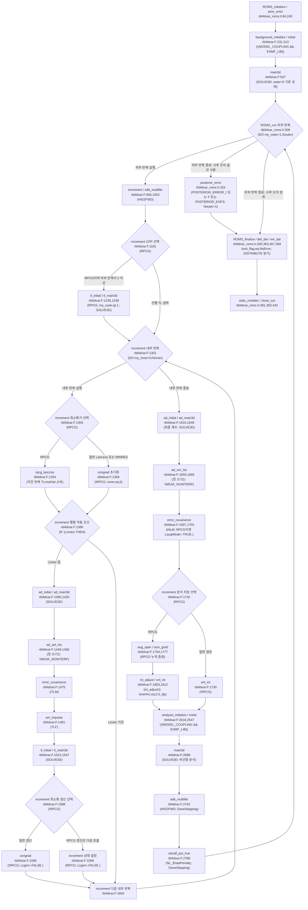
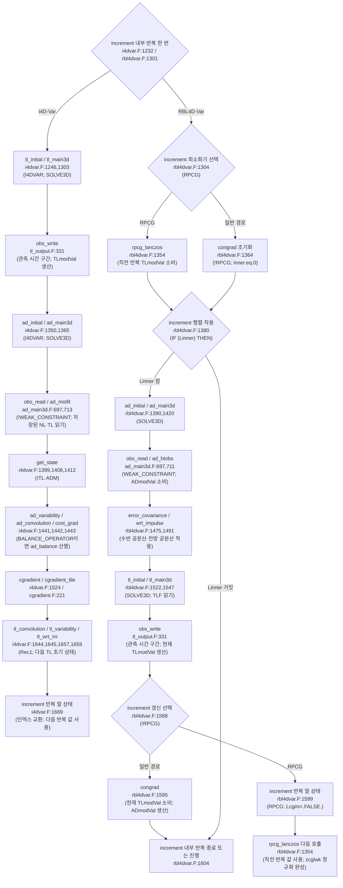

# ROMS 자료동화 호출 흐름 판독

## 판독 기준과 요약

판독일은 2026-10-14이다. 코드 루트는 `models/ROMS/raw/source_code/roms/`이다. 이 보고서의 `ROMS/`·`Master/`·`docs/` 경로는 코드 루트에 대한 상대 경로이다. 위키 경로는 `models/ROMS/raw/manuals/wiki/wikitext/`에 대한 상대 경로이다. 노트 경로는 저장소 루트에 대한 상대 경로이다.

`git log -1 --format=fuller`는 HEAD를 `57aecf589a408b1e5490d2db7f9bd0196062a44e`로 표시한다. 해당 커밋의 제목은 `Reporting Computer Memory Availability and Usage (#81)`이다. 작성·커밋 시각은 `2026-09-18 15:31:42 -0400`이다. `docs/ROMS_ChangeLog.md:8`의 첫 항목은 `- [2026 ROMS Log](https://github.com/myroms/roms/compare/8dc44e6...develop)`이다. ChangeLog의 첫 항목은 연도별 비교 링크이다. `CMakeLists.txt:53`의 원문은 `project(roms VERSION 4.1 LANGUAGES Fortran)`이다. 이 보고서는 HEAD를 코드 판의 식별자로 쓴다.

현재 판의 계산 본체는 `ROMS/Drivers/i4dvar.F`·`r4dvar.F`·`rbl4dvar.F`이다. 현재 판의 실행 순서 제어기는 `ROMS/Drivers/i4dvar_roms.h`·`r4dvar_roms.h`·`rbl4dvar_roms.h`이다. 요청에 적힌 `i4dvar.h`·`r4dvar.h`·`rbl4dvar.h`는 현재 판에 없다. 파일명과 계산 순서의 차이는 §8에서 각각 판정한다.

판독은 원문에 `nl -ba`를 적용한 줄을 기준으로 한다. 판독 기록은 항목을 찾는 색인으로만 쓴다. 전처리 조건은 호출 위치를 포함하는 조건과 상위 드라이버 선택 조건을 함께 적용한다. 특정 응용 헤더를 선택하지 않았으므로 이 보고서는 실제 실행에 활성화된 옵션 조합을 주장하지 않는다. `ROMS/External`과 `User/Include`는 옵션 정의 판독에서 제외한다.

호출 깊이는 계산 phase를 기준으로 센다. 실행 순서 제어기의 phase 호출을 먼저 기록한다. phase 안의 직접 `CALL`은 1단계이다. 그 피호출 루틴 안의 직접 `CALL`은 2단계이다. 3단계 이하에는 루틴 이름과 정의 위치를 기록한다. 이 정의는 현재 판의 phase 분리가 계산 커널 판독 깊이를 줄이지 않도록 한다. `FoundError` 같은 공통 오류 함수와 NetCDF 쓰기 함수는 필요한 분기와 생산·소비 근거에서 별도로 기록한다. MPI 라이브러리 내부는 판독하지 않는다.

모델을 실행하지 않는다. 빌드하지 않는다. 수치 수렴이나 계산 결과의 정확성을 검증한 것으로 쓰지 않는다. 기존 노트는 수정하지 않는다. §6의 수정안은 이 보고서 안에만 기록한다.

계산 요약: I4는 각 외부 반복에서 비선형 기본 상태를 실행한다. I4의 내부 반복은 TL 적분, AD 적분, 경사 변환, cgradient 갱신 순서이다. R4와 RBL은 외부 반복 전에 outer=0의 비선형 기본 상태를 실행한다. R4의 내부 행렬 작용은 AD·공분산·TL 순서이다. R4의 분석 적분은 RPM이다. RBL의 분석 적분은 비선형 모델이다. RBL의 RPCG는 현재 AD·TL 행렬 작용 전에 최소화기를 호출한다. 해당 원문 호출은 §2.1의 표에 있다. 값의 지연 사용은 §3에 있다. 그림은 §4에 있다.

분류별 개수: A 4, B 8, C 11, D 1, E 4, F 1, H 7, X 0. 합계 36행이다. 집계 대상은 §8의 고유 RF2 행이다.

## 1 시작·입력 읽기 순서

### 1.1 드라이버 선택과 입력의 선후

`Master/roms_kernel.F`는 `#elif` 순서에서 처음 성립하는 드라이버를 포함한다. 아래 조건에는 앞선 분기를 선택하지 않았다는 조건이 추가된다. `SPLIT_*` 드라이버는 이번 판독의 실행 경로에 포함하지 않는다. 공통 `.F` 안에서 `SPLIT_4DVAR`에만 속하는 호출은 이번 실행 경로에서 제외한다.

| 순서 | 호출 위치 파일:줄 원문 | 조건(전처리 옵션 포함) | 피호출 정의 파일:줄 |
|---|---|---|---|
| 1 | `Master/master.F:26` `# include "roms.h"` | `Master/master.F:16`의 `#if defined MODEL_COUPLING && !defined CMEPS`를 선택하지 않는 `#else` 경로이다. | `Master/roms.h:1` |
| 2-I | `Master/roms_kernel.F:154` `# include "i4dvar_roms.h"` | `:153` `#elif defined I4DVAR && !defined SPLIT_I4DVAR`이다. 앞선 #elif를 선택하지 않는다. | `ROMS/Drivers/i4dvar_roms.h:78` |
| 2-RBL | `Master/roms_kernel.F:160` `# include "rbl4dvar_roms.h"` | `:159` `#elif defined RBL4DVAR && !defined SPLIT_RBL4DVAR`이다. 앞선 #elif를 선택하지 않는다. | `ROMS/Drivers/rbl4dvar_roms.h:84` |
| 2-R | `Master/roms_kernel.F:166` `# include "r4dvar_roms.h"` | `:165` `#elif defined R4DVAR && !defined SPLIT_R4DVAR`이다. 앞선 #elif를 선택하지 않는다. | `ROMS/Drivers/r4dvar_roms.h:84` |
| 3a | `Master/roms.h:80` `CALL mpi_init_thread (required, provided, MyError)` | `DISTRIBUTE && MPI && MULTI_THREAD`이다. | 외부 MPI 경계이다. |
| 3b | `Master/roms.h:86` `CALL mpi_init (MyError)` | `DISTRIBUTE && MPI && !MULTI_THREAD`이다. | 외부 MPI 경계이다. |
| 4 | `Master/roms.h:96` `CALL mpi_comm_rank (MPI_COMM_WORLD, MyRank, MyError)` | `DISTRIBUTE && MPI`이다. | 외부 MPI 경계이다. |
| 5 | `Master/roms.h:111` `CALL ROMS_initialize (first)` | `:109` `IF (exit_flag.eq.NoError) THEN`이다. `:110` `first=.TRUE.`를 먼저 설정한다. | I: `i4dvar_roms.h:78`. R: `r4dvar_roms.h:84`. RBL: `rbl4dvar_roms.h:84`. |
| 6 | `Master/roms.h:124` `CALL ROMS_run (run_time)` | `:119` `IF (exit_flag.eq.NoError) THEN`이다. `:122` `run_time=MAX(run_time, dt(ng)*ntimes(ng))`로 계산 창을 설정한다. | I: `i4dvar_roms.h:245`. R: `r4dvar_roms.h:248`. RBL: `rbl4dvar_roms.h:248`. |
| 7 | `Master/roms.h:131` `CALL ROMS_finalize` | 정상 계산과 오류 계산의 종료에서 호출한다. | I: `i4dvar_roms.h:329`. R: `r4dvar_roms.h:338`. RBL: `rbl4dvar_roms.h:340`. |
| 8 | `Master/roms.h:133` `CALL finalize_pio` | `:132` `#if defined PIO_LIB && defined DISTRIBUTE`이다. | `ROMS/Utility/set_pio.F:293`의 finalize_pio이다. |
| 9 | `Master/roms.h:135` `CALL ROMS_deallocate_arrays` | 종료 정리이다. | `ROMS/Modules/mod_arrays.F:277`의 ROMS_deallocate_arrays이다. |
| 10 | `Master/roms.h:137` `CALL mpi_finalize (MyError)` | `:136` `#if defined DISTRIBUTE && defined MPI`이다. | 외부 MPI 경계이다. |

이 표의 2-I·2-RBL·2-R은 전처리 선택이다. 런타임에서 세 드라이버를 차례로 실행하는 단계가 아니다. 결합 실행은 `Master/master.F:18`의 `#  include "mct_driver.h"`와 `:20`의 `#  include "esmf_driver.h"`에서 별도 진입한다. 결합 시스템의 외부 실행기는 이번 계산 드라이버의 호출 깊이에 포함하지 않는다.

### 1.2 전처리 조건과 기본값의 판독

`ROMS/Include/cppdefs.h:753`의 `#if defined ROMS_HEADER`는 응용 헤더 포함을 결정한다. `:754`의 `# include ROMS_HEADER` 뒤에 `:763`의 `#include "globaldefs.h"`가 온다. `makefile:78`의 기본 응용은 `ROMS_APPLICATION ?= UPWELLING`이다. `ROMS/Bin/build_roms.sh:161`의 예제 선택은 `export   ROMS_APPLICATION=UPWELLING`이다. 이 기본 응용 선택은 자료동화 CPP 옵션의 기본 활성화를 뜻하지 않는다.

| 옵션 관계 | 원문 근거 | 이 판독에서 적용하는 조건 |
|---|---|---|
| 구 이름 | `globaldefs.h:264` `#ifdef IS4DVAR`。`:266` `#  define I4DVAR`。`:276` `#ifdef W4DPSAS`。`:278` `#  define RBL4DVAR`。`:294` `#ifdef W4DVAR`。`:296` `#  define R4DVAR` | 옛 CPP 이름을 현재 가족으로 연결한다. |
| TL·AD | `globaldefs.h:392` `# define TANGENT`。`:426` `# define ADJOINT` | 세 자료동화 가족이 상위 조건 목록에 들어 있다. |
| RPM | `globaldefs.h:436` `# define TL_IOMS` | `R4DVAR`가 해당 상위 조건에 들어 있다. RBL4D-Var는 최소화 행렬 작용에 `tl_main3d`를 사용한다. |
| 관측·기본 상태 | `globaldefs.h:591` `# define FOUR_DVAR`。`:643` `# define OBSERVATIONS`。`:658` `# define TLM_OBS`。`:681` `# define FORWARD_READ`。`:700` `# define FORWARD_WRITE` | 세 가족은 관측과 기본 상태 입출력 경로를 활성화한다. |
| `WEAK_CONSTRAINT`와 모델 오차 | `globaldefs.h:575` `# define WEAK_CONSTRAINT`。`rbl4dvar.F:2897` `IF (NSA.eq.2) THEN` | R4D·RBL은 `WEAK_CONSTRAINT`를 내부에서 정의한다. 실제 모델 오차 표준편차 읽기는 `NSA.eq.2`로 분기한다. `WEAK_CONSTRAINT`만 보고 실제 약제약 설정을 단정하지 않는다. |
| 공분산 구현 | `ROMS/Adjoint/ad_convolution.F`의 `MULTI_SCALE_B` 포함 분기와 `ROMS/Tangent/tl_convolution.F`의 같은 분기 | `_mono.h`는 `MULTI_SCALE_B`가 없는 경로이다. `_multi.h`는 `MULTI_SCALE_B` 경로이다. §8은 I4D-Var의 인자 수 문제를 별도로 판정한다. |
| 수렴 설정 | `read_asspar.F:173` `GradErr=Rvalue(1)`。`:182` `LhotStart=Lvalue(1)` | 입력 값이다. 드라이버의 반복 종료 조건과 구별한다. |
| 사후 오차 제한 | `read_phypar.F:8033` `IF (Nouter.gt.1) THEN`。`:8038` `exit_flag=5` | 상위 CPP는 `WEAK_CONSTRAINT`와 사후 오차 옵션이다. 다중 외부 반복의 사후 오차 추정을 입력 단계에서 거부한다. |
| RPCG 사전조건 제한 | `read_asspar.F:2649` `#  if defined WEAK_CONSTRAINT && defined RPCG`。`:2655` `IF (Lprecond) THEN`。`:2662` `exit_flag=5` | RPCG의 `Lprecond` 경로는 입력 단계에서 거부한다. |

### 1.3 시작과 입력의 직접 호출 목록

다음 표는 세 `ROMS_initialize`의 모든 직접 호출을 기록한다. 다음 표는 입력·배열 초기화 루틴의 다음 단계 호출도 기록한다. `prior_error`의 직접 호출은 §2.2에 기록한다. MPI·OpenMP 호출에는 호출 위치와 조건만 기록한다. MPI·OpenMP 라이브러리 내부는 전개하지 않는다. 표의 `#else`·`#elif` 뒤에 붙인 `해석:`은 전처리 분기의 논리 조건이다. 원문 조건은 그 앞의 줄 인용이다. 다중 줄 조건의 연속 줄은 같은 원문 분기에 속한다.

#### roms_initialize — ROMS/Drivers/i4dvar_roms.h:78

공통 CPP: 상위 드라이버 선택 조건.  호출은 원문 줄 순서이다. `ng`·`tile`·`thread` 반복은 원문의 격자·타일·스레드 범위를 적용한다. 

| 순서 | 호출 위치 파일:줄 원문 | 조건(전처리 옵션 포함) | 피호출 정의 파일:줄 |
|---|---|---|---|
| S01-001 | `ROMS/Drivers/i4dvar_roms.h:119` `CALL mpi_comm_rank (OCN_COMM_WORLD, MyRank, MyError)` | `ROMS/Drivers/i4dvar_roms.h:108` `#ifdef DISTRIBUTE` | 외부 MPI·OpenMP·수치 라이브러리 경계 |
| S01-002 | `ROMS/Drivers/i4dvar_roms.h:120` `CALL mpi_comm_size (OCN_COMM_WORLD, MySize, MyError)` | `ROMS/Drivers/i4dvar_roms.h:108` `#ifdef DISTRIBUTE` | 외부 MPI·OpenMP·수치 라이브러리 경계 |
| S01-003 | `ROMS/Drivers/i4dvar_roms.h:136` `CALL initialize_parallel` | `ROMS/Drivers/i4dvar_roms.h:130` `IF (first) THEN` | `ROMS/Modules/mod_parallel.F:300` |
| S01-004 | `ROMS/Drivers/i4dvar_roms.h:155` `CALL inp_par (iNLM)` | `ROMS/Drivers/i4dvar_roms.h:130` `IF (first) THEN` | `ROMS/Utility/inp_par.F:55` |
| S01-005 | `ROMS/Drivers/i4dvar_roms.h:193` `CALL wclock_on (ng, iNLM, 0, __LINE__, MyFile)` | `ROMS/Drivers/i4dvar_roms.h:130` `IF (first) THEN` | `ROMS/Utility/timers.F:2` |
| S01-006 | `ROMS/Drivers/i4dvar_roms.h:199` `CALL ROMS_allocate_arrays (allocate_vars)` | `ROMS/Drivers/i4dvar_roms.h:130` `IF (first) THEN` | `ROMS/Modules/mod_arrays.F:127` |
| S01-007 | `ROMS/Drivers/i4dvar_roms.h:200` `CALL ROMS_initialize_arrays` | `ROMS/Drivers/i4dvar_roms.h:130` `IF (first) THEN` | `ROMS/Modules/mod_arrays.F:379` |
| S01-008 | `ROMS/Drivers/i4dvar_roms.h:213` `CALL initialize_ocn2atm_coupling (ng, MyRank)` | `ROMS/Drivers/i4dvar_roms.h:205` `#if defined MCT_LIB && (defined ATM_COUPLING \|\| defined WAV_COUPLING)` `ROMS/Drivers/i4dvar_roms.h:212` `# ifdef ATM_COUPLING` | `Master/mct_roms_wrf.h:15` |
| S01-009 | `ROMS/Drivers/i4dvar_roms.h:216` `CALL initialize_ocn2wav_coupling (ng, MyRank)` | `ROMS/Drivers/i4dvar_roms.h:205` `#if defined MCT_LIB && (defined ATM_COUPLING \|\| defined WAV_COUPLING)` `ROMS/Drivers/i4dvar_roms.h:215` `# ifdef WAV_COUPLING` | `Master/mct_roms_swan.h:15` |
| S01-010 | `ROMS/Drivers/i4dvar_roms.h:237` `CALL prior_error (ng)` | 상위 루틴 조건 | `ROMS/Drivers/i4dvar.F:2494` `ROMS/Drivers/r4dvar.F:1807` `ROMS/Drivers/rbl4dvar.F:2832` |

#### roms_initialize — ROMS/Drivers/r4dvar_roms.h:84

공통 CPP: 상위 드라이버 선택 조건.  호출은 원문 줄 순서이다. `ng`·`tile`·`thread` 반복은 원문의 격자·타일·스레드 범위를 적용한다. 

| 순서 | 호출 위치 파일:줄 원문 | 조건(전처리 옵션 포함) | 피호출 정의 파일:줄 |
|---|---|---|---|
| S02-001 | `ROMS/Drivers/r4dvar_roms.h:125` `CALL mpi_comm_rank (OCN_COMM_WORLD, MyRank, MyError)` | `ROMS/Drivers/r4dvar_roms.h:114` `#ifdef DISTRIBUTE` | 외부 MPI·OpenMP·수치 라이브러리 경계 |
| S02-002 | `ROMS/Drivers/r4dvar_roms.h:126` `CALL mpi_comm_size (OCN_COMM_WORLD, MySize, MyError)` | `ROMS/Drivers/r4dvar_roms.h:114` `#ifdef DISTRIBUTE` | 외부 MPI·OpenMP·수치 라이브러리 경계 |
| S02-003 | `ROMS/Drivers/r4dvar_roms.h:142` `CALL initialize_parallel` | `ROMS/Drivers/r4dvar_roms.h:136` `IF (first) THEN` | `ROMS/Modules/mod_parallel.F:300` |
| S02-004 | `ROMS/Drivers/r4dvar_roms.h:161` `CALL inp_par (iNLM)` | `ROMS/Drivers/r4dvar_roms.h:136` `IF (first) THEN` | `ROMS/Utility/inp_par.F:55` |
| S02-005 | `ROMS/Drivers/r4dvar_roms.h:199` `CALL wclock_on (ng, iNLM, 0, __LINE__, MyFile)` | `ROMS/Drivers/r4dvar_roms.h:136` `IF (first) THEN` | `ROMS/Utility/timers.F:2` |
| S02-006 | `ROMS/Drivers/r4dvar_roms.h:205` `CALL ROMS_allocate_arrays (allocate_vars)` | `ROMS/Drivers/r4dvar_roms.h:136` `IF (first) THEN` | `ROMS/Modules/mod_arrays.F:127` |
| S02-007 | `ROMS/Drivers/r4dvar_roms.h:206` `CALL ROMS_initialize_arrays` | `ROMS/Drivers/r4dvar_roms.h:136` `IF (first) THEN` | `ROMS/Modules/mod_arrays.F:379` |
| S02-008 | `ROMS/Drivers/r4dvar_roms.h:219` `CALL initialize_ocn2atm_coupling (ng, MyRank)` | `ROMS/Drivers/r4dvar_roms.h:211` `#if defined MCT_LIB && (defined ATM_COUPLING \|\| defined WAV_COUPLING)` `ROMS/Drivers/r4dvar_roms.h:218` `# ifdef ATM_COUPLING` | `Master/mct_roms_wrf.h:15` |
| S02-009 | `ROMS/Drivers/r4dvar_roms.h:222` `CALL initialize_ocn2wav_coupling (ng, MyRank)` | `ROMS/Drivers/r4dvar_roms.h:211` `#if defined MCT_LIB && (defined ATM_COUPLING \|\| defined WAV_COUPLING)` `ROMS/Drivers/r4dvar_roms.h:221` `# ifdef WAV_COUPLING` | `Master/mct_roms_swan.h:15` |
| S02-010 | `ROMS/Drivers/r4dvar_roms.h:240` `CALL prior_error (ng)` | 상위 루틴 조건 | `ROMS/Drivers/i4dvar.F:2494` `ROMS/Drivers/r4dvar.F:1807` `ROMS/Drivers/rbl4dvar.F:2832` |

#### roms_initialize — ROMS/Drivers/rbl4dvar_roms.h:84

공통 CPP: 상위 드라이버 선택 조건.  호출은 원문 줄 순서이다. `ng`·`tile`·`thread` 반복은 원문의 격자·타일·스레드 범위를 적용한다. 

| 순서 | 호출 위치 파일:줄 원문 | 조건(전처리 옵션 포함) | 피호출 정의 파일:줄 |
|---|---|---|---|
| S03-001 | `ROMS/Drivers/rbl4dvar_roms.h:125` `CALL mpi_comm_rank (OCN_COMM_WORLD, MyRank, MyError)` | `ROMS/Drivers/rbl4dvar_roms.h:114` `#ifdef DISTRIBUTE` | 외부 MPI·OpenMP·수치 라이브러리 경계 |
| S03-002 | `ROMS/Drivers/rbl4dvar_roms.h:126` `CALL mpi_comm_size (OCN_COMM_WORLD, MySize, MyError)` | `ROMS/Drivers/rbl4dvar_roms.h:114` `#ifdef DISTRIBUTE` | 외부 MPI·OpenMP·수치 라이브러리 경계 |
| S03-003 | `ROMS/Drivers/rbl4dvar_roms.h:142` `CALL initialize_parallel` | `ROMS/Drivers/rbl4dvar_roms.h:136` `IF (first) THEN` | `ROMS/Modules/mod_parallel.F:300` |
| S03-004 | `ROMS/Drivers/rbl4dvar_roms.h:161` `CALL inp_par (iNLM)` | `ROMS/Drivers/rbl4dvar_roms.h:136` `IF (first) THEN` | `ROMS/Utility/inp_par.F:55` |
| S03-005 | `ROMS/Drivers/rbl4dvar_roms.h:199` `CALL wclock_on (ng, iNLM, 0, __LINE__, MyFile)` | `ROMS/Drivers/rbl4dvar_roms.h:136` `IF (first) THEN` | `ROMS/Utility/timers.F:2` |
| S03-006 | `ROMS/Drivers/rbl4dvar_roms.h:205` `CALL ROMS_allocate_arrays (allocate_vars)` | `ROMS/Drivers/rbl4dvar_roms.h:136` `IF (first) THEN` | `ROMS/Modules/mod_arrays.F:127` |
| S03-007 | `ROMS/Drivers/rbl4dvar_roms.h:206` `CALL ROMS_initialize_arrays` | `ROMS/Drivers/rbl4dvar_roms.h:136` `IF (first) THEN` | `ROMS/Modules/mod_arrays.F:379` |
| S03-008 | `ROMS/Drivers/rbl4dvar_roms.h:219` `CALL initialize_ocn2atm_coupling (ng, MyRank)` | `ROMS/Drivers/rbl4dvar_roms.h:211` `#if defined MCT_LIB && (defined ATM_COUPLING \|\| defined WAV_COUPLING)` `ROMS/Drivers/rbl4dvar_roms.h:218` `# ifdef ATM_COUPLING` | `Master/mct_roms_wrf.h:15` |
| S03-009 | `ROMS/Drivers/rbl4dvar_roms.h:222` `CALL initialize_ocn2wav_coupling (ng, MyRank)` | `ROMS/Drivers/rbl4dvar_roms.h:211` `#if defined MCT_LIB && (defined ATM_COUPLING \|\| defined WAV_COUPLING)` `ROMS/Drivers/rbl4dvar_roms.h:221` `# ifdef WAV_COUPLING` | `Master/mct_roms_swan.h:15` |
| S03-010 | `ROMS/Drivers/rbl4dvar_roms.h:240` `CALL prior_error (ng)` | 상위 루틴 조건 | `ROMS/Drivers/i4dvar.F:2494` `ROMS/Drivers/r4dvar.F:1807` `ROMS/Drivers/rbl4dvar.F:2832` |

#### inp_par — ROMS/Utility/inp_par.F:55

공통 CPP: 상위 드라이버 선택 조건.  호출은 원문 줄 순서이다. `ng`·`tile`·`thread` 반복은 원문의 격자·타일·스레드 범위를 적용한다. 

| 순서 | 호출 위치 파일:줄 원문 | 조건(전처리 옵션 포함) | 피호출 정의 파일:줄 |
|---|---|---|---|
| S04-001 | `ROMS/Utility/inp_par.F:126` `IF (Master) CALL get_date (date_str)` | `ROMS/Utility/inp_par.F:125` `#ifdef DISTRIBUTE` `ROMS/Utility/inp_par.F:126` `IF (Master) CALL get_date (date_str)` | `ROMS/Utility/dateclock.F:855` |
| S04-002 | `ROMS/Utility/inp_par.F:127` `CALL mp_bcasts (1, model, date_str)` | `ROMS/Utility/inp_par.F:125` `#ifdef DISTRIBUTE` | `ROMS/Utility/distribute.F:109` (generic; 차원·kind로 분기) |
| S04-003 | `ROMS/Utility/inp_par.F:129` `CALL get_date (date_str)` | `ROMS/Utility/inp_par.F:128` `#else` (해석: `!((defined DISTRIBUTE))`) | `ROMS/Utility/dateclock.F:855` |
| S04-004 | `ROMS/Utility/inp_par.F:143` `CALL read_PhyPar (model, inp, out, Lwrite)` | 상위 루틴 조건 | `ROMS/Utility/read_phypar.F:2` |
| S04-005 | `ROMS/Utility/inp_par.F:145` `CALL mp_bcasti (1, model, exit_flag)` | `ROMS/Utility/inp_par.F:144` `#ifdef DISTRIBUTE` | `ROMS/Utility/distribute.F:103` (generic; 차원·kind로 분기) |
| S04-006 | `ROMS/Utility/inp_par.F:168` `CALL read_IcePar (model, 15, out, Lwrite)` | `ROMS/Utility/inp_par.F:160` `#ifdef SEAICE` | `ROMS/Nonlinear/SeaIce/ice_inp.h:1` `ROMS/Utility/read_icepar.F:19` |
| S04-007 | `ROMS/Utility/inp_par.F:179` `CALL read_BioPar (model, 25, out, Lwrite)` | `ROMS/Utility/inp_par.F:171` `#ifdef BIOLOGY` | `ROMS/Nonlinear/Biology/red_tide_inp.h:1` `ROMS/Nonlinear/Biology/npzd_Franks_inp.h:1` `ROMS/Nonlinear/Biology/npzd_Powell_inp.h:1` `ROMS/Nonlinear/Biology/npzd_iron_inp.h:1` `ROMS/Nonlinear/Biology/nemuro_inp.h:1` `ROMS/Nonlinear/Biology/hypoxia_srm_inp.h:1` `ROMS/Nonlinear/Biology/ecosim_inp.h:1` `ROMS/Nonlinear/Biology/ecb_inp.h:1` `ROMS/Nonlinear/Biology/fennel_inp.h:1` `ROMS/Utility/read_biopar.F:36` |
| S04-008 | `ROMS/Utility/inp_par.F:190` `CALL read_SedPar (model, 35, out, Lwrite)` | `ROMS/Utility/inp_par.F:182` `#ifdef SEDIMENT` | `ROMS/Nonlinear/Sediment/sediment_inp.h:1` `ROMS/Utility/read_sedpar.F:17` |
| S04-009 | `ROMS/Utility/inp_par.F:200` `CALL set_contact (1, model)` | `ROMS/Utility/inp_par.F:193` `#ifdef NESTING` | `ROMS/Utility/set_contact.F:41` |
| S04-010 | `ROMS/Utility/inp_par.F:254` `CALL tile_indices (model, Im, Jm, Lm, Mm,                         &` | 상위 루틴 조건 | `ROMS/Utility/tile_indices.F:62` |
| S04-011 | `ROMS/Utility/inp_par.F:269` `CALL netcdf_get_dim (ng, iNLM, TRIM(GRX(ng)%name))` | `ROMS/Utility/inp_par.F:257` `#ifdef GRID_EXTRACT` `ROMS/Utility/inp_par.F:267` `SELECT CASE (GRX(ng)%IOtype)` `ROMS/Utility/inp_par.F:268` `CASE (io_nf90)` | `ROMS/Modules/mod_netcdf.F:326` |
| S04-012 | `ROMS/Utility/inp_par.F:272` `CALL pio_netcdf_get_dim (ng, iNLM, TRIM(GRX(ng)%name))` | `ROMS/Utility/inp_par.F:257` `#ifdef GRID_EXTRACT` `ROMS/Utility/inp_par.F:270` `#  if defined PIO_LIB && defined DISTRIBUTE` `ROMS/Utility/inp_par.F:267` `SELECT CASE (GRX(ng)%IOtype)` `ROMS/Utility/inp_par.F:271` `CASE (io_pio)` | `ROMS/Modules/mod_pio_netcdf.F:877` |
| S04-013 | `ROMS/Utility/inp_par.F:312` `CALL tile_indices (model, xtr_Im, xtr_Jm, xtr_Lm, xtr_Mm,         &` | `ROMS/Utility/inp_par.F:257` `#ifdef GRID_EXTRACT` | `ROMS/Utility/tile_indices.F:62` |
| S04-014 | `ROMS/Utility/inp_par.F:321` `CALL tile_obs_bounds (model, Im, Jm, Lm, Mm,                      &` | 상위 루틴 조건 | `ROMS/Utility/tile_indices.F:288` |
| S04-015 | `ROMS/Utility/inp_par.F:411` `CALL mp_bcasti (1, model, exit_flag)` | `ROMS/Utility/inp_par.F:410` `#ifdef DISTRIBUTE` | `ROMS/Utility/distribute.F:103` (generic; 차원·kind로 분기) |
| S04-016 | `ROMS/Utility/inp_par.F:506` `CALL read_AssPar (model, 35, out, Lwrite)` | `ROMS/Utility/inp_par.F:498` `#if defined FOUR_DVAR \|\| defined VERIFICATION` | `ROMS/Utility/read_asspar.F:3` `ROMS/Utility/read_asspar.F:2725` |
| S04-017 | `ROMS/Utility/inp_par.F:517` `CALL read_FltPar (model, 45, out, Lwrite)` | `ROMS/Utility/inp_par.F:509` `#ifdef FLOATS` | `ROMS/Utility/read_fltpar.F:3` `ROMS/Utility/read_fltpar.F:338` |
| S04-018 | `ROMS/Utility/inp_par.F:528` `CALL read_FltBioPar (model, 50, out, Lwrite)` | `ROMS/Utility/inp_par.F:520` `#if defined FLOATS && defined FLOAT_BIOLOGY` | `ROMS/Nonlinear/Biology/oyster_floats_inp.h:1` `ROMS/Utility/read_fltbiopar.F:20` |
| S04-019 | `ROMS/Utility/inp_par.F:539` `CALL read_StaPar (model, 55, out, Lwrite)` | `ROMS/Utility/inp_par.F:531` `#ifdef STATIONS` | `ROMS/Utility/read_stapar.F:3` `ROMS/Utility/read_stapar.F:1021` |
| S04-020 | `ROMS/Utility/inp_par.F:551` `CALL read_VegPar (model, 65, out, Lwrite)` | `ROMS/Utility/inp_par.F:543` `#ifdef VEGETATION` | `ROMS/Nonlinear/Vegetation/vegetation_inp.h:1` `ROMS/Utility/read_vegpar.F:17` |
| S04-021 | `ROMS/Utility/inp_par.F:566` `CALL tadv_report (out, iNLM, Hadvection, Vadvection, Lwrite)` | `ROMS/Utility/inp_par.F:553` `#ifdef SOLVE3D` | `ROMS/Utility/tadv.F:382` |
| S04-022 | `ROMS/Utility/inp_par.F:574` `CALL tadv_report (out, iADM, ad_Hadvection, ad_Vadvection, Lwrite)` | `ROMS/Utility/inp_par.F:553` `#ifdef SOLVE3D` `ROMS/Utility/inp_par.F:569` `# if defined ADJOINT \|\| defined TANGENT \|\| defined TL_IOMS` | `ROMS/Utility/tadv.F:382` |
| S04-023 | `ROMS/Utility/inp_par.F:618` `CALL lbc_report (out, ifield, LBC)` | `ROMS/Utility/inp_par.F:610` `IF (Master.and.Lwrite) THEN` `ROMS/Utility/inp_par.F:616` `DO ifield=1,nLBCvar` `ROMS/Utility/inp_par.F:617` `IF (idBvar(ifield).gt.0) THEN` | `ROMS/Utility/lbc.F:1015` |
| S04-024 | `ROMS/Utility/inp_par.F:627` `CALL lbc_report (out, ifield, ad_LBC)` | `ROMS/Utility/inp_par.F:622` `#if defined ADJOINT \|\| defined TANGENT \|\| defined TL_IOMS` `ROMS/Utility/inp_par.F:610` `IF (Master.and.Lwrite) THEN` `ROMS/Utility/inp_par.F:625` `DO ifield=1,nLBCvar` `ROMS/Utility/inp_par.F:626` `IF (idBvar(ifield).gt.0) THEN` | `ROMS/Utility/lbc.F:1015` |
| S04-025 | `ROMS/Utility/inp_par.F:920` `CALL checkdefs` | `ROMS/Utility/inp_par.F:919` `IF (Master.and.Lwrite) THEN` | `ROMS/Utility/checkdefs.F:2` |
| S04-026 | `ROMS/Utility/inp_par.F:924` `CALL mp_bcasti (1, model, exit_flag)` | `ROMS/Utility/inp_par.F:923` `#ifdef DISTRIBUTE` | `ROMS/Utility/distribute.F:103` (generic; 차원·kind로 분기) |
| S04-027 | `ROMS/Utility/inp_par.F:925` `CALL mp_bcasts (1, model, Coptions)` | `ROMS/Utility/inp_par.F:923` `#ifdef DISTRIBUTE` | `ROMS/Utility/distribute.F:109` (generic; 차원·kind로 분기) |
| S04-028 | `ROMS/Utility/inp_par.F:935` `CALL ran_seed (sequence)` | 상위 루틴 조건 | `ROMS/Utility/ran_state.F:195` |

#### initialize_parallel — ROMS/Modules/mod_parallel.F:300

공통 CPP: 상위 드라이버 선택 조건.  호출은 원문 줄 순서이다. `ng`·`tile`·`thread` 반복은 원문의 격자·타일·스레드 범위를 적용한다. 

| 순서 | 호출 위치 파일:줄 원문 | 조건(전처리 옵션 포함) | 피호출 정의 파일:줄 |
|---|---|---|---|
| S05-001 | `ROMS/Modules/mod_parallel.F:329` `CALL omp_set_dynamic (.FALSE.)` | `ROMS/Modules/mod_parallel.F:320` `#if defined _OPENMP` | 외부 MPI·OpenMP·수치 라이브러리 경계 |
| S05-002 | `ROMS/Modules/mod_parallel.F:355` `CALL mpi_comm_size (OCN_COMM_WORLD, numthreads, MyError)` | `ROMS/Modules/mod_parallel.F:344` `#elif defined DISTRIBUTE` (해석: `!((defined _OPENMP)) && (defined DISTRIBUTE)`) `ROMS/Modules/mod_parallel.F:345` `# ifdef MPI` | 외부 MPI·OpenMP·수치 라이브러리 경계 |
| S05-003 | `ROMS/Modules/mod_parallel.F:363` `CALL mpi_comm_rank (OCN_COMM_WORLD, FullRank, MyError)` | `ROMS/Modules/mod_parallel.F:344` `#elif defined DISTRIBUTE` (해석: `!((defined _OPENMP)) && (defined DISTRIBUTE)`) `ROMS/Modules/mod_parallel.F:345` `# ifdef MPI` | 외부 MPI·OpenMP·수치 라이브러리 경계 |

#### read_phypar — ROMS/Utility/read_phypar.F:2

공통 CPP: 상위 드라이버 선택 조건.  호출은 원문 줄 순서이다. `ng`·`tile`·`thread` 반복은 원문의 격자·타일·스레드 범위를 적용한다. 

| 순서 | 호출 위치 파일:줄 원문 | 조건(전처리 옵션 포함) | 피호출 정의 파일:줄 |
|---|---|---|---|
| S06-001 | `ROMS/Utility/read_phypar.F:181` `CALL allocate_param              ! modules that solely` | `ROMS/Utility/read_phypar.F:149` `DO WHILE (.TRUE.)` `ROMS/Utility/read_phypar.F:152` `IF (status.gt.0) THEN` `ROMS/Utility/read_phypar.F:153` `SELECT CASE (TRIM(KeyWord))` `ROMS/Utility/read_phypar.F:171` `CASE ('Ngrids')` | `ROMS/Modules/mod_param.F:738` |
| S06-002 | `ROMS/Utility/read_phypar.F:182` `CALL allocate_parallel (Ngrids)  ! depend on the number` | `ROMS/Utility/read_phypar.F:149` `DO WHILE (.TRUE.)` `ROMS/Utility/read_phypar.F:152` `IF (status.gt.0) THEN` `ROMS/Utility/read_phypar.F:153` `SELECT CASE (TRIM(KeyWord))` `ROMS/Utility/read_phypar.F:171` `CASE ('Ngrids')` | `ROMS/Modules/mod_parallel.F:203` |
| S06-003 | `ROMS/Utility/read_phypar.F:183` `CALL allocate_iounits (Ngrids)   ! nested grids` | `ROMS/Utility/read_phypar.F:149` `DO WHILE (.TRUE.)` `ROMS/Utility/read_phypar.F:152` `IF (status.gt.0) THEN` `ROMS/Utility/read_phypar.F:153` `SELECT CASE (TRIM(KeyWord))` `ROMS/Utility/read_phypar.F:171` `CASE ('Ngrids')` | `ROMS/Modules/mod_iounits.F:334` |
| S06-004 | `ROMS/Utility/read_phypar.F:184` `CALL allocate_stepping (Ngrids)` | `ROMS/Utility/read_phypar.F:149` `DO WHILE (.TRUE.)` `ROMS/Utility/read_phypar.F:152` `IF (status.gt.0) THEN` `ROMS/Utility/read_phypar.F:153` `SELECT CASE (TRIM(KeyWord))` `ROMS/Utility/read_phypar.F:171` `CASE ('Ngrids')` | `ROMS/Modules/mod_stepping.F:115` |
| S06-005 | `ROMS/Utility/read_phypar.F:191` `CALL allocate_fourdvar` | `ROMS/Utility/read_phypar.F:190` `#if defined FOUR_DVAR \|\| defined VERIFICATION` `ROMS/Utility/read_phypar.F:149` `DO WHILE (.TRUE.)` `ROMS/Utility/read_phypar.F:152` `IF (status.gt.0) THEN` `ROMS/Utility/read_phypar.F:153` `SELECT CASE (TRIM(KeyWord))` `ROMS/Utility/read_phypar.F:171` `CASE ('Ngrids')` | `ROMS/Modules/mod_fourdvar.F:921` |
| S06-006 | `ROMS/Utility/read_phypar.F:376` `CALL initialize_biology` | `ROMS/Utility/read_phypar.F:375` `#ifdef BIOLOGY` `ROMS/Utility/read_phypar.F:149` `DO WHILE (.TRUE.)` `ROMS/Utility/read_phypar.F:152` `IF (status.gt.0) THEN` `ROMS/Utility/read_phypar.F:153` `SELECT CASE (TRIM(KeyWord))` `ROMS/Utility/read_phypar.F:372` `CASE ('NtileJ')` | `ROMS/Nonlinear/Biology/nemuro_mod.h:280` `ROMS/Nonlinear/Biology/npzd_Powell_mod.h:101` `ROMS/Nonlinear/Biology/npzd_iron_mod.h:127` `ROMS/Nonlinear/Biology/fennel_mod.h:167` `ROMS/Nonlinear/Biology/npzd_Franks_mod.h:72` `ROMS/Nonlinear/Biology/ecb_mod.h:190` `ROMS/Nonlinear/Biology/red_tide_mod.h:100` `ROMS/Nonlinear/Biology/hypoxia_srm_mod.h:37` `ROMS/Nonlinear/Biology/ecosim_mod.h:498` |
| S06-007 | `ROMS/Utility/read_phypar.F:379` `CALL initialize_sediment` | `ROMS/Utility/read_phypar.F:378` `#if defined SEDIMENT \|\| defined BBL_MODEL` `ROMS/Utility/read_phypar.F:149` `DO WHILE (.TRUE.)` `ROMS/Utility/read_phypar.F:152` `IF (status.gt.0) THEN` `ROMS/Utility/read_phypar.F:153` `SELECT CASE (TRIM(KeyWord))` `ROMS/Utility/read_phypar.F:372` `CASE ('NtileJ')` | `ROMS/Nonlinear/Sediment/sediment_mod.h:273` |
| S06-008 | `ROMS/Utility/read_phypar.F:381` `CALL initialize_param    ! Continue allocating/initalizing` | `ROMS/Utility/read_phypar.F:149` `DO WHILE (.TRUE.)` `ROMS/Utility/read_phypar.F:152` `IF (status.gt.0) THEN` `ROMS/Utility/read_phypar.F:153` `SELECT CASE (TRIM(KeyWord))` `ROMS/Utility/read_phypar.F:372` `CASE ('NtileJ')` | `ROMS/Modules/mod_param.F:1275` |
| S06-009 | `ROMS/Utility/read_phypar.F:382` `CALL allocate_scalars    ! variables since the application` | `ROMS/Utility/read_phypar.F:149` `DO WHILE (.TRUE.)` `ROMS/Utility/read_phypar.F:152` `IF (status.gt.0) THEN` `ROMS/Utility/read_phypar.F:153` `SELECT CASE (TRIM(KeyWord))` `ROMS/Utility/read_phypar.F:372` `CASE ('NtileJ')` | `ROMS/Modules/mod_scalars.F:1972` |
| S06-010 | `ROMS/Utility/read_phypar.F:383` `CALL initialize_scalars  ! number of nested grids and` | `ROMS/Utility/read_phypar.F:149` `DO WHILE (.TRUE.)` `ROMS/Utility/read_phypar.F:152` `IF (status.gt.0) THEN` `ROMS/Utility/read_phypar.F:153` `SELECT CASE (TRIM(KeyWord))` `ROMS/Utility/read_phypar.F:372` `CASE ('NtileJ')` | `ROMS/Modules/mod_scalars.F:4324` |
| S06-011 | `ROMS/Utility/read_phypar.F:384` `CALL allocate_ncparam    ! domain parameters are known` | `ROMS/Utility/read_phypar.F:149` `DO WHILE (.TRUE.)` `ROMS/Utility/read_phypar.F:152` `IF (status.gt.0) THEN` `ROMS/Utility/read_phypar.F:153` `SELECT CASE (TRIM(KeyWord))` `ROMS/Utility/read_phypar.F:372` `CASE ('NtileJ')` | `ROMS/Modules/mod_ncparam.F:689` |
| S06-012 | `ROMS/Utility/read_phypar.F:385` `CALL initialize_ncparam` | `ROMS/Utility/read_phypar.F:149` `DO WHILE (.TRUE.)` `ROMS/Utility/read_phypar.F:152` `IF (status.gt.0) THEN` `ROMS/Utility/read_phypar.F:153` `SELECT CASE (TRIM(KeyWord))` `ROMS/Utility/read_phypar.F:372` `CASE ('NtileJ')` | `ROMS/Modules/mod_ncparam.F:1258` |
| S06-013 | `ROMS/Utility/read_phypar.F:1035` `CALL ref_clock (time_ref)` | `ROMS/Utility/read_phypar.F:149` `DO WHILE (.TRUE.)` `ROMS/Utility/read_phypar.F:152` `IF (status.gt.0) THEN` `ROMS/Utility/read_phypar.F:153` `SELECT CASE (TRIM(KeyWord))` `ROMS/Utility/read_phypar.F:1032` `CASE ('TIME_REF')` | `ROMS/Utility/dateclock.F:971` |
| S06-014 | `ROMS/Utility/read_phypar.F:4880` `CALL edit_file_struct (ng, OutFiles, HIS)` | `ROMS/Utility/read_phypar.F:4874` `IF ((nHIS(ng).gt.0).and.(ndefHIS(ng).gt.0)) THEN` | `ROMS/Utility/edit_multifile.F:347` |
| S06-015 | `ROMS/Utility/read_phypar.F:4889` `CALL edit_file_struct (ng, OutFiles, XTR)` | `ROMS/Utility/read_phypar.F:4882` `#ifdef GRID_EXTRACT` `ROMS/Utility/read_phypar.F:4883` `IF ((nXTR(ng).gt.0).and.(ndefXTR(ng).gt.0)) THEN` | `ROMS/Utility/edit_multifile.F:347` |
| S06-016 | `ROMS/Utility/read_phypar.F:4898` `CALL edit_file_struct (ng, OutFiles, QCK)` | `ROMS/Utility/read_phypar.F:4892` `IF ((nQCK(ng).gt.0).and.(ndefQCK(ng).gt.0)) THEN` | `ROMS/Utility/edit_multifile.F:347` |
| S06-017 | `ROMS/Utility/read_phypar.F:4907` `CALL edit_file_struct (ng, OutFiles, ADM)` | `ROMS/Utility/read_phypar.F:4900` `#ifdef ADJOINT` `ROMS/Utility/read_phypar.F:4901` `IF ((nADJ(ng).gt.0).and.(ndefADJ(ng).gt.0)) THEN` | `ROMS/Utility/edit_multifile.F:347` |
| S06-018 | `ROMS/Utility/read_phypar.F:4917` `CALL edit_file_struct (ng, OutFiles, AVG)` | `ROMS/Utility/read_phypar.F:4910` `#ifdef AVERAGES` `ROMS/Utility/read_phypar.F:4911` `IF ((nAVG(ng).gt.0).and.(ndefAVG(ng).gt.0)) THEN` | `ROMS/Utility/edit_multifile.F:347` |
| S06-019 | `ROMS/Utility/read_phypar.F:4928` `CALL edit_file_struct (ng, OutFiles, DIA)` | `ROMS/Utility/read_phypar.F:4921` `#ifdef DIAGNOSTICS` `ROMS/Utility/read_phypar.F:4922` `IF ((nDIA(ng).gt.0).and.(ndefDIA(ng).gt.0)) THEN` | `ROMS/Utility/edit_multifile.F:347` |
| S06-020 | `ROMS/Utility/read_phypar.F:4939` `CALL edit_file_struct (ng, OutFiles, TLM)` | `ROMS/Utility/read_phypar.F:4932` `#if defined TANGENT \|\| defined TL_IOMS` `ROMS/Utility/read_phypar.F:4933` `IF ((nTLM(ng).gt.0).and.(ndefTLM(ng).gt.0)) THEN` | `ROMS/Utility/edit_multifile.F:347` |
| S06-021 | `ROMS/Utility/read_phypar.F:5000` `CALL initialize_pio` | `ROMS/Utility/read_phypar.F:4996` `#if defined PIO_LIB && defined DISTRIBUTE` | `ROMS/Utility/set_pio.F:49` |
| S06-022 | `ROMS/Utility/read_phypar.F:8019` `CALL tides_date (ng)` | `ROMS/Utility/read_phypar.F:8010` `#if !defined ANA_TIDES              && \` `ROMS/Utility/read_phypar.F:8011` `(defined TIDE_GENERATING_FORCES \|\| \` `ROMS/Utility/read_phypar.F:8012` `defined SSH_TIDES              \|\| defined UV_TIDES)` | `ROMS/Utility/tides_date.F:5` `ROMS/Utility/tides_date.F:197` |

#### roms_allocate_arrays — ROMS/Modules/mod_arrays.F:127

공통 CPP: 상위 드라이버 선택 조건.  호출은 원문 줄 순서이다. `ng`·`tile`·`thread` 반복은 원문의 격자·타일·스레드 범위를 적용한다. 

| 순서 | 호출 위치 파일:줄 원문 | 조건(전처리 옵션 포함) | 피호출 정의 파일:줄 |
|---|---|---|---|
| S07-001 | `ROMS/Modules/mod_arrays.F:156` `CALL wclock_on (ng, iNLM, 1, __LINE__, MyFile)` | `ROMS/Modules/mod_arrays.F:148` `#ifdef PROFILE` | `ROMS/Utility/timers.F:2` |
| S07-002 | `ROMS/Modules/mod_arrays.F:184` `CALL allocate_average (ng, LBi, UBi, LBj, UBj)` | `ROMS/Modules/mod_arrays.F:180` `#if defined AVERAGES    \|\| \` `ROMS/Modules/mod_arrays.F:181` `(defined AD_AVERAGES && defined ADJOINT) \|\| \` `ROMS/Modules/mod_arrays.F:182` `(defined RP_AVERAGES && defined TL_IOMS) \|\| \` `ROMS/Modules/mod_arrays.F:183` `(defined TL_AVERAGES && defined TANGENT)` `ROMS/Modules/mod_arrays.F:166` `IF (allocate_vars) then` | `ROMS/Modules/mod_average.F:355` |
| S07-003 | `ROMS/Modules/mod_arrays.F:186` `CALL allocate_boundary (ng)` | `ROMS/Modules/mod_arrays.F:166` `IF (allocate_vars) then` | `ROMS/Modules/mod_boundary.F:767` |
| S07-004 | `ROMS/Modules/mod_arrays.F:188` `CALL allocate_bbl (ng, LBi, UBi, LBj, UBj)` | `ROMS/Modules/mod_arrays.F:187` `#ifdef BBL_MODEL` `ROMS/Modules/mod_arrays.F:166` `IF (allocate_vars) then` | `ROMS/Modules/mod_bbl.F:66` |
| S07-005 | `ROMS/Modules/mod_arrays.F:191` `CALL allocate_clima (ng, LBi, UBi, LBj, UBj)` | `ROMS/Modules/mod_arrays.F:166` `IF (allocate_vars) then` `ROMS/Modules/mod_arrays.F:190` `IF (LallocateClima.or.Lclimatology(ng)) THEN` | `ROMS/Modules/mod_clima.F:157` |
| S07-006 | `ROMS/Modules/mod_arrays.F:194` `CALL allocate_coupling (ng, LBi, UBi, LBj, UBj)` | `ROMS/Modules/mod_arrays.F:193` `#ifdef SOLVE3D` `ROMS/Modules/mod_arrays.F:166` `IF (allocate_vars) then` | `ROMS/Modules/mod_coupling.F:106` |
| S07-007 | `ROMS/Modules/mod_arrays.F:197` `CALL allocate_diags (ng, LBi, UBi, LBj, UBj)` | `ROMS/Modules/mod_arrays.F:196` `#ifdef DIAGNOSTICS` `ROMS/Modules/mod_arrays.F:166` `IF (allocate_vars) then` | `ROMS/Modules/mod_diags.F:104` |
| S07-008 | `ROMS/Modules/mod_arrays.F:200` `CALL allocate_extract (ng, ExtractFlag(ng),                   &` | `ROMS/Modules/mod_arrays.F:199` `#ifdef GRID_EXTRACT` `ROMS/Modules/mod_arrays.F:166` `IF (allocate_vars) then` | `ROMS/Modules/mod_extract.F:186` |
| S07-009 | `ROMS/Modules/mod_arrays.F:206` `CALL allocate_forces (ng, LBi, UBi, LBj, UBj)` | `ROMS/Modules/mod_arrays.F:166` `IF (allocate_vars) then` | `ROMS/Modules/mod_forces.F:567` |
| S07-010 | `ROMS/Modules/mod_arrays.F:207` `CALL allocate_grid (ng, ExtractFlag(ng),                      &` | `ROMS/Modules/mod_arrays.F:166` `IF (allocate_vars) then` | `ROMS/Modules/mod_grid.F:369` |
| S07-011 | `ROMS/Modules/mod_arrays.F:210` `CALL allocate_ice (ng, LBi, UBi, LBj, UBj, .TRUE.)` | `ROMS/Modules/mod_arrays.F:209` `#ifdef ICE_MODEL` `ROMS/Modules/mod_arrays.F:166` `IF (allocate_vars) then` | `ROMS/Nonlinear/SeaIce/ice_mod.h:330` |
| S07-012 | `ROMS/Modules/mod_arrays.F:212` `CALL allocate_mixing (ng, LBi, UBi, LBj, UBj)` | `ROMS/Modules/mod_arrays.F:166` `IF (allocate_vars) then` | `ROMS/Modules/mod_mixing.F:403` |
| S07-013 | `ROMS/Modules/mod_arrays.F:213` `CALL allocate_ocean (ng, LBi, UBi, LBj, UBj)` | `ROMS/Modules/mod_arrays.F:166` `IF (allocate_vars) then` | `ROMS/Modules/mod_ocean.F:368` |
| S07-014 | `ROMS/Modules/mod_arrays.F:215` `CALL allocate_sedbed (ng, LBi, UBi, LBj, UBj)` | `ROMS/Modules/mod_arrays.F:214` `#if defined SEDIMENT \|\| defined BBL_MODEL` `ROMS/Modules/mod_arrays.F:166` `IF (allocate_vars) then` | `ROMS/Nonlinear/Sediment/sedbed_mod.h:226` |
| S07-015 | `ROMS/Modules/mod_arrays.F:218` `CALL allocate_sedflocs (ng, LBi, UBi, LBj, UBj)` | `ROMS/Modules/mod_arrays.F:217` `#if defined SEDIMENT && defined SED_FLOCS` `ROMS/Modules/mod_arrays.F:166` `IF (allocate_vars) then` | `ROMS/Nonlinear/Sediment/sedflocs_mod.h:71` |
| S07-016 | `ROMS/Modules/mod_arrays.F:221` `CALL allocate_vegetation (ng, iNLM, LBi, UBi, LBj, UBj)` | `ROMS/Modules/mod_arrays.F:220` `#if defined VEGETATION` `ROMS/Modules/mod_arrays.F:166` `IF (allocate_vars) then` | `ROMS/Nonlinear/Vegetation/vegetation_mod.h:295` |
| S07-017 | `ROMS/Modules/mod_arrays.F:224` `CALL allocate_tides (ng, LBi, UBi, LBj, UBj)` | `ROMS/Modules/mod_arrays.F:223` `#if defined SSH_TIDES \|\| defined UV_TIDES` `ROMS/Modules/mod_arrays.F:166` `IF (allocate_vars) then` | `ROMS/Modules/mod_tides.F:137` |
| S07-018 | `ROMS/Modules/mod_arrays.F:227` `CALL allocate_sources (ng)` | `ROMS/Modules/mod_arrays.F:166` `IF (allocate_vars) then` `ROMS/Modules/mod_arrays.F:226` `IF (LuvSrc(ng).or.LwSrc(ng).or.ANY(LtracerSrc(:,ng))) THEN` | `ROMS/Modules/mod_sources.F:101` |
| S07-019 | `ROMS/Modules/mod_arrays.F:240` `CALL allocate_nesting` | `ROMS/Modules/mod_arrays.F:233` `#ifdef NESTING` `ROMS/Modules/mod_arrays.F:166` `IF (allocate_vars) then` | `ROMS/Modules/mod_nesting.F:441` |
| S07-020 | `ROMS/Modules/mod_arrays.F:253` `CALL set_iodecomp` | `ROMS/Modules/mod_arrays.F:245` `#if defined PIO_LIB && defined DISTRIBUTE` `ROMS/Modules/mod_arrays.F:166` `IF (allocate_vars) then` | `ROMS/Utility/set_pio.F:703` |
| S07-021 | `ROMS/Modules/mod_arrays.F:268` `CALL wclock_off (ng, iNLM, 1, __LINE__, MyFile)` | `ROMS/Modules/mod_arrays.F:260` `#ifdef PROFILE` | `ROMS/Utility/timers.F:147` |

#### roms_initialize_arrays — ROMS/Modules/mod_arrays.F:379

공통 CPP: 상위 드라이버 선택 조건.  호출은 원문 줄 순서이다. `ng`·`tile`·`thread` 반복은 원문의 격자·타일·스레드 범위를 적용한다. 

| 순서 | 호출 위치 파일:줄 원문 | 조건(전처리 옵션 포함) | 피호출 정의 파일:줄 |
|---|---|---|---|
| S08-001 | `ROMS/Modules/mod_arrays.F:405` `CALL wclock_on (ng, iNLM, 1, __LINE__, MyFile)` | `ROMS/Modules/mod_arrays.F:397` `#ifdef PROFILE` | `ROMS/Utility/timers.F:2` |
| S08-002 | `ROMS/Modules/mod_arrays.F:418` `CALL initialize_nesting` | `ROMS/Modules/mod_arrays.F:416` `#ifdef NESTING` `ROMS/Modules/mod_arrays.F:417` `IF (ng.eq.1) THEN` | `ROMS/Modules/mod_nesting.F:1214` |
| S08-003 | `ROMS/Modules/mod_arrays.F:426` `CALL initialize_average (ng, tile)` | `ROMS/Modules/mod_arrays.F:422` `#if defined AVERAGES    \|\| \` `ROMS/Modules/mod_arrays.F:423` `(defined AD_AVERAGES && defined ADJOINT) \|\| \` `ROMS/Modules/mod_arrays.F:424` `(defined RP_AVERAGES && defined TL_IOMS) \|\| \` `ROMS/Modules/mod_arrays.F:425` `(defined TL_AVERAGES && defined TANGENT)` | `ROMS/Modules/mod_average.F:1515` |
| S08-004 | `ROMS/Modules/mod_arrays.F:429` `CALL initialize_bbl (ng, tile)` | `ROMS/Modules/mod_arrays.F:428` `#ifdef BBL_MODEL` | `ROMS/Modules/mod_bbl.F:208` |
| S08-005 | `ROMS/Modules/mod_arrays.F:431` `CALL initialize_boundary (ng, tile, model)` | 상위 루틴 조건 | `ROMS/Modules/mod_boundary.F:3193` |
| S08-006 | `ROMS/Modules/mod_arrays.F:434` `CALL initialize_clima (ng, tile)` | `ROMS/Modules/mod_arrays.F:433` `IF (LallocateClima.or.Lclimatology(ng)) THEN` | `ROMS/Modules/mod_clima.F:491` |
| S08-007 | `ROMS/Modules/mod_arrays.F:437` `CALL initialize_coupling (ng, tile, model)` | `ROMS/Modules/mod_arrays.F:436` `#ifdef SOLVE3D` | `ROMS/Modules/mod_coupling.F:427` |

| S08-008 | `ROMS/Modules/mod_arrays.F:440` `CALL initialize_diags (ng, tile)` | `ROMS/Modules/mod_arrays.F:439` `#ifdef DIAGNOSTICS` | `ROMS/Modules/mod_diags.F:363` |
| S08-009 | `ROMS/Modules/mod_arrays.F:443` `CALL initialize_extract (ng, tile, model)` | `ROMS/Modules/mod_arrays.F:442` `#ifdef GRID_EXTRACT` | `ROMS/Modules/mod_extract.F:588` |
| S08-010 | `ROMS/Modules/mod_arrays.F:445` `CALL initialize_forces (ng, tile, model)` | 상위 루틴 조건 | `ROMS/Modules/mod_forces.F:1754` |
| S08-011 | `ROMS/Modules/mod_arrays.F:446` `CALL initialize_grid (ng, tile, model)` | 상위 루틴 조건 | `ROMS/Modules/mod_grid.F:1240` |
| S08-012 | `ROMS/Modules/mod_arrays.F:448` `CALL initialize_ice (ng, tile, model)` | `ROMS/Modules/mod_arrays.F:447` `#ifdef ICE_MODEL` | `ROMS/Nonlinear/SeaIce/ice_mod.h:651` |
| S08-013 | `ROMS/Modules/mod_arrays.F:450` `CALL initialize_mixing (ng, tile, model)` | 상위 루틴 조건 | `ROMS/Modules/mod_mixing.F:1284` |
| S08-014 | `ROMS/Modules/mod_arrays.F:452` `CALL initialize_multiscale (ng, tile, model)` | `ROMS/Modules/mod_arrays.F:451` `#if defined MULTI_SCALE_B && defined FOUR_DVAR` | `ROMS/Utility/roms_multiscale.F:462` |
| S08-015 | `ROMS/Modules/mod_arrays.F:454` `CALL initialize_ocean (ng, tile, model)` | 상위 루틴 조건 | `ROMS/Modules/mod_ocean.F:1563` |
| S08-016 | `ROMS/Modules/mod_arrays.F:456` `CALL initialize_sedbed (ng, tile, model)` | `ROMS/Modules/mod_arrays.F:455` `#if defined SEDIMENT \|\| defined BBL_MODEL` | `ROMS/Nonlinear/Sediment/sedbed_mod.h:521` |
| S08-017 | `ROMS/Modules/mod_arrays.F:459` `CALL initialize_sedflocs (ng, tile, model)` | `ROMS/Modules/mod_arrays.F:458` `#if defined SEDIMENT && defined SED_FLOCS` | `ROMS/Nonlinear/Sediment/sedflocs_mod.h:116` |
| S08-018 | `ROMS/Modules/mod_arrays.F:462` `CALL initialize_vegetation (ng, tile, model)` | `ROMS/Modules/mod_arrays.F:461` `#if defined VEGETATION` | `ROMS/Nonlinear/Vegetation/vegetation_mod.h:650` |
| S08-019 | `ROMS/Modules/mod_arrays.F:465` `CALL initialize_tides (ng, tile)` | `ROMS/Modules/mod_arrays.F:464` `#if defined SSH_TIDES \|\| defined UV_TIDES` | `ROMS/Modules/mod_tides.F:498` |
| S08-020 | `ROMS/Modules/mod_arrays.F:477` `CALL initialize_fourdvar` | `ROMS/Modules/mod_arrays.F:471` `#if defined FOUR_DVAR \|\| defined VERIFICATION` | `ROMS/Modules/mod_fourdvar.F:1541` |
| S08-021 | `ROMS/Modules/mod_arrays.F:488` `CALL wclock_off (ng, iNLM, 1, __LINE__, MyFile)` | `ROMS/Modules/mod_arrays.F:480` `#ifdef PROFILE` | `ROMS/Utility/timers.F:147` |

#### read_asspar — ROMS/Utility/read_asspar.F:3

공통 CPP: `ROMS/Utility/read_asspar.F:2` `#if defined FOUR_DVAR \|\| defined VERIFICATION`.  호출은 원문 줄 순서이다. `ng`·`tile`·`thread` 반복은 원문의 격자·타일·스레드 범위를 적용한다. 

| 순서 | 호출 위치 파일:줄 원문 | 조건(전처리 옵션 포함) | 피호출 정의 파일:줄 |
|---|---|---|---|
| S09-001 | `ROMS/Utility/read_asspar.F:2421` `CALL mp_bcasti (ng, model, exit_flag)` | `ROMS/Utility/read_asspar.F:133` `# if defined FOUR_DVAR  \|\| defined VERIFICATION \|\| \` `ROMS/Utility/read_asspar.F:134` `(defined HESSIAN_SV && defined BNORM)` `ROMS/Utility/read_asspar.F:2420` `#  if defined DISTRIBUTE && defined MULTI_SCALE_B` `ROMS/Utility/read_asspar.F:1499` `REPORT_LOOP : DO ng=1,Ngrids` | `ROMS/Utility/distribute.F:103` (generic; 차원·kind로 분기) |

#### set_grid — ROMS/Utility/set_grid.F:2

공통 CPP: 상위 드라이버 선택 조건.  호출은 원문 줄 순서이다. `ng`·`tile`·`thread` 반복은 원문의 격자·타일·스레드 범위를 적용한다. 

| 순서 | 호출 위치 파일:줄 원문 | 조건(전처리 옵션 포함) | 피호출 정의 파일:줄 |
|---|---|---|---|
| S10-001 | `ROMS/Utility/set_grid.F:65` `CALL ana_grid (ng, tile, model)` | `ROMS/Utility/set_grid.F:63` `#ifdef ANA_GRID` | `ROMS/Functionals/ana_grid.h:2` |
| S10-002 | `ROMS/Utility/set_grid.F:67` `CALL ana_mask (ng, tile, model)` | `ROMS/Utility/set_grid.F:63` `#ifdef ANA_GRID` `ROMS/Utility/set_grid.F:66` `# ifdef MASKING` | `ROMS/Functionals/ana_mask.h:2` |
| S10-003 | `ROMS/Utility/set_grid.F:72` `CALL ana_scope (ng, tile, model)` | `ROMS/Utility/set_grid.F:63` `#ifdef ANA_GRID` `ROMS/Utility/set_grid.F:69` `# if defined AD_SENSITIVITY    \|\| defined I4DVAR_ANA_SENSITIVITY \|\| \` `ROMS/Utility/set_grid.F:70` `defined OPT_OBSERVATIONS  \|\| defined SO_SEMI                \|\| \` `ROMS/Utility/set_grid.F:71` `defined SENSITIVITY_4DVAR` | `ROMS/Functionals/ana_scope.h:2` |
| S10-004 | `ROMS/Utility/set_grid.F:79` `CALL get_grid (ng, MyRank, model)` | `ROMS/Utility/set_grid.F:76` `#else` (해석: `!((defined ANA_GRID))`) `ROMS/Utility/set_grid.F:78` `# ifdef DISTRIBUTE` | `ROMS/Utility/get_grid.F:54` |
| S10-005 | `ROMS/Utility/set_grid.F:81` `CALL get_grid (ng, -1, model)` | `ROMS/Utility/set_grid.F:76` `#else` (해석: `!((defined ANA_GRID))`) `ROMS/Utility/set_grid.F:80` `# else` (해석: `!((defined DISTRIBUTE))`) | `ROMS/Utility/get_grid.F:54` |
| S10-006 | `ROMS/Utility/set_grid.F:85` `CALL mp_bcasti (ng, model, exit_flag)` | `ROMS/Utility/set_grid.F:76` `#else` (해석: `!((defined ANA_GRID))`) `ROMS/Utility/set_grid.F:84` `# ifdef DISTRIBUTE` | `ROMS/Utility/distribute.F:103` (generic; 차원·kind로 분기) |
| S10-007 | `ROMS/Utility/set_grid.F:99` `CALL get_extract (ng, MyRank, model)` | `ROMS/Utility/set_grid.F:91` `#ifdef GRID_EXTRACT` `ROMS/Utility/set_grid.F:98` `# ifdef DISTRIBUTE` | `ROMS/Utility/get_extract.F:51` |
| S10-008 | `ROMS/Utility/set_grid.F:101` `CALL get_extract (ng, -1, model)` | `ROMS/Utility/set_grid.F:91` `#ifdef GRID_EXTRACT` `ROMS/Utility/set_grid.F:100` `# else` (해석: `!((defined DISTRIBUTE))`) | `ROMS/Utility/get_extract.F:51` |
| S10-009 | `ROMS/Utility/set_grid.F:112` `CALL set_scoord (ng)` | `ROMS/Utility/set_grid.F:105` `#ifdef SOLVE3D` | `ROMS/Utility/set_scoord.F:3` `ROMS/Utility/set_scoord.F:574` |
| S10-010 | `ROMS/Utility/set_grid.F:124` `CALL set_weights (ng)` | `ROMS/Utility/set_grid.F:117` `#ifdef SOLVE3D` | `ROMS/Utility/set_weights.F:3` `ROMS/Utility/set_weights.F:241` |
| S10-011 | `ROMS/Utility/set_grid.F:135` `CALL metrics (ng, tile, model)` | 상위 루틴 조건 | `ROMS/Utility/metrics.F:23` |

| S10-012 | `ROMS/Utility/set_grid.F:147` `CALL nesting (ng, model, ndxdy)` | `ROMS/Utility/set_grid.F:139` `#ifdef NESTING` | `ROMS/Nonlinear/nesting.F:139` |
| S10-013 | `ROMS/Utility/set_grid.F:158` `CALL ana_wtype (ng, tile, iNLM)` | `ROMS/Utility/set_grid.F:150` `#if defined WTYPE_GRID && defined ANA_WTYPE     && \` `ROMS/Utility/set_grid.F:151` `(defined LMD_SKPP   \|\| defined SOLAR_SOURCE)` | `ROMS/Functionals/ana_wtype.h:2` |
| S10-014 | `ROMS/Utility/set_grid.F:173` `CALL ana_nudgcoef (ng, tile, model)` | `ROMS/Utility/set_grid.F:163` `#ifndef CORRELATION` `ROMS/Utility/set_grid.F:170` `# ifdef ANA_NUDGCOEF` `ROMS/Utility/set_grid.F:171` `IF (Lnudging(ng)) THEN` | `ROMS/Functionals/ana_nudgcoef.h:2` |
| S10-015 | `ROMS/Utility/set_grid.F:181` `CALL get_nudgcoef (ng, MyRank, model)` | `ROMS/Utility/set_grid.F:163` `#ifndef CORRELATION` `ROMS/Utility/set_grid.F:177` `# else` (해석: `!((defined ANA_NUDGCOEF))`) `ROMS/Utility/set_grid.F:180` `#  ifdef DISTRIBUTE` `ROMS/Utility/set_grid.F:178` `IF (Lnudging(ng)) THEN` | `ROMS/Utility/get_nudgcoef.F:55` |
| S10-016 | `ROMS/Utility/set_grid.F:183` `CALL get_nudgcoef (ng, -1, model)` | `ROMS/Utility/set_grid.F:163` `#ifndef CORRELATION` `ROMS/Utility/set_grid.F:177` `# else` (해석: `!((defined ANA_NUDGCOEF))`) `ROMS/Utility/set_grid.F:182` `#  else` (해석: `!((defined DISTRIBUTE))`) `ROMS/Utility/set_grid.F:178` `IF (Lnudging(ng)) THEN` | `ROMS/Utility/get_nudgcoef.F:55` |
| S10-017 | `ROMS/Utility/set_grid.F:187` `CALL mp_bcasti (ng, model, exit_flag)` | `ROMS/Utility/set_grid.F:163` `#ifndef CORRELATION` `ROMS/Utility/set_grid.F:177` `# else` (해석: `!((defined ANA_NUDGCOEF))`) `ROMS/Utility/set_grid.F:186` `#  ifdef DISTRIBUTE` `ROMS/Utility/set_grid.F:178` `IF (Lnudging(ng)) THEN` | `ROMS/Utility/distribute.F:103` (generic; 차원·kind로 분기) |
| S10-018 | `ROMS/Utility/set_grid.F:202` `CALL harmonic_constituents (Lnodal)` | `ROMS/Utility/set_grid.F:163` `#ifndef CORRELATION` `ROMS/Utility/set_grid.F:194` `# ifdef TIDE_GENERATING_FORCES` | `ROMS/Utility/equilibrium_tide.F:246` |

## 2 계산 순서와 직접 호출

### 2.1 외부 반복과 내부 반복

다음 표의 계산 창은 `RunInterval`이다. 3차원 경로는 `SOLVE3D`를 요구한다. 각 `main3d`의 2차원 대체 호출은 아래 직접 호출 목록에 함께 적는다. `FoundError(exit_flag, NoError, __LINE__, MyFile)`가 참이면 호출자가 반환한다. 이 오류 반환을 수렴 종료로 해석하지 않는다.

| 순서 | 호출 위치 파일:줄 원문 | 조건(전처리 옵션 포함) | 피호출 정의 파일:줄 |
|---|---|---|---|
| I 외부 시작 | `i4dvar_roms.h:292` `OUTER_LOOP : DO my_outer=1,Nouter` | `I4DVAR && !SPLIT_I4DVAR`이다. `:293` `outer=my_outer`와 `:294` `inner=0`을 설정한다. | 드라이버 반복이다. |
| I 기본 상태 | `i4dvar_roms.h:302` `CALL background (my_outer, RunInterval)` | 각 외부 반복이다. | `i4dvar.F:562` |
| I 초기화 | `i4dvar.F:610` `CALL background_initialize (my_outer)` | `:604` `# if !(defined MODEL_COUPLING && defined ESMF_LIB)` | `i4dvar.F:204` |
| I 비선형 적분 | `i4dvar.F:682` `CALL main3d (RunInterval)` | `SOLVE3D`이다. 새 `HIS`에 기본 상태를 저장한다. | `ROMS/Nonlinear/main3d.F:3` |
| I 증분 | `i4dvar_roms.h:308` `CALL increment (my_outer, RunInterval)` | 각 외부 반복이다. | `i4dvar.F:792` |
| I 내부 시작 | `i4dvar.F:1232` `INNER_LOOP : DO my_inner=0,Ninner` | 0번은 초기화 반복이다. 이 문장의 근거는 `i4dvar.F:1227`의 `!  Notice that inner loop iteration start from zero. This is needed to`이다. | 내부 반복은 `:1675`에서 끝난다. |
| I TL 실행 | `i4dvar.F:1303` `CALL tl_main3d (RunInterval)` | `SOLVE3D`이다. `:1246` `CALL tl_initial (ng)`이 먼저 온다. | `ROMS/Tangent/tl_main3d.F:3` |
| I AD 실행 | `i4dvar.F:1365` `CALL ad_main3d (RunInterval)` | `SOLVE3D`이다. `:1350` `CALL ad_initial (ng)`이 먼저 온다. | `ROMS/Adjoint/ad_main3d.F:3` |
| I 경사 계산 | `i4dvar.F:1441` `CALL ad_variability (ng, tile, LADJ2, Lweak)`.  `:1442` `CALL ad_convolution (ng, tile, LADJ2, Lweak, 2)`.  `:1443` `CALL cost_grad (ng, tile, LTLM1, LTLM2, LADJ2)` | `BALANCE_OPERATOR`이면 `:1439`의 `ad_balance`가 먼저 온다. | `ad_variability.F:55`.  `ad_convolution_mono.h:121` 또는 `ad_convolution_multi.h:139`.  `cost_grad.F:42` |
| I 최소화 | `i4dvar.F:1524` `CALL cgradient (ng, tile, iTLM, my_inner, my_outer)` | 경사를 계산한 뒤이다. | `ROMS/Utility/cgradient.F:204` |
| I 다음 TL 상태 | `i4dvar.F:1644` `CALL tl_convolution (ng, tile, Lcon, Lweak, 2)`.  `:1645` `CALL tl_variability (ng, tile, Lcon, Lweak)`.  `:1657` `CALL tl_wrt_ini (ng, MyRank, Lcon, Rec1)` | `BALANCE_OPERATOR`이면 `:1647`의 `tl_balance`를 추가한다. 쓰기에서 `DISTRIBUTE`이면 `MyRank`를 넘긴다. | `tl_convolution_mono.h:121` 또는 `tl_convolution_multi.h:139`.  `tl_variability.F:56`.  `tl_wrt_ini.F:73` |
| I 분석 저장 | `i4dvar_roms.h:314` `CALL analysis (my_outer, RunInterval)` | 내부 반복 종료 뒤이다. | `i4dvar.F:1727` |
| I 최종 분석 적분 | `i4dvar_roms.h:323` `CALL posterior_analysis (RunInterval)` | 모든 외부 반복 종료 뒤이다. | `i4dvar.F:2279` |
| R 기본 상태 | `r4dvar_roms.h:302` `CALL background (outer, RunInterval)` | `:293` `outer=0`이다. 외부 반복 전에 한 번 호출한다. | `r4dvar.F:172` |
| R 외부 반복 | `r4dvar_roms.h:307` `OUTER_LOOP : DO my_outer=1,Nouter`.  `:314` `CALL increment (my_outer, RunInterval)`.  `:320` `CALL analysis (my_outer, RunInterval)` | `R4DVAR && !SPLIT_R4DVAR`이다. | `r4dvar.F:405`.  `r4dvar.F:1409` |
| R 무강제 RPM | `r4dvar.F:906` `CALL rp_main3d (RunInterval)` | `!DATALESS_LOOPS && SOLVE3D`이다. `:875` `SporadicImpulse(ng)=.FALSE.`와 `:876` `FrequentImpulse(ng)=.FALSE.`를 먼저 설정한다. | `ROMS/Representer/rp_main3d.F:3` |
| R 내부 반복 | `r4dvar.F:1004` `INNER_LOOP : DO my_inner=0,Ninner` | `!DATALESS_LOOPS`이다. `:1013`에서 `Lcgini=.TRUE.`인 `congrad`를 초기화한다. | `ROMS/Utility/congrad.F:161` |
| R 행렬 작용 | `r4dvar.F:1074` `CALL ad_main3d (RunInterval)`.  `:1128` `CALL error_covariance (iTLM, driver, my_outer, my_inner,      &`.  `:1145` `CALL wrt_impulse (ng, MyRank, iADM, ADM(ng)%name)`.  `:1212` `CALL tl_main3d (RunInterval)` | `:1028` `INNER_COMPUTE : IF (Linner) THEN`이다. 3차원 적분에는 `SOLVE3D`를 적용한다. | `ad_main3d.F:3`.  `convolve_mono.h:225` 또는 `convolve_multi.h:256`.  `wrt_impulse.F:58`.  `tl_main3d.F:3` |
| R 최소화 갱신 | `r4dvar.F:1259` `CALL congrad (ng, iRPM, my_outer, my_inner, Ninner, Lcgini)` | `Linner` 경로의 TL 적분 뒤이다. `:1258` `Lcgini=.FALSE.`이다. | `congrad.F:161` |
| R 최종 계수 적용 | `r4dvar.F:1322` `CALL ad_main3d (RunInterval)`.  `:1360` `CALL error_covariance (iRPM, driver, my_outer, inner,             &`.  `:1377` `CALL wrt_impulse (ng, MyRank, iADM, ADM(ng)%name)` | 내부 반복 밖이다. 분석 RPM에 사용할 강제를 준비한다. | 위의 AD·공분산·impulse 정의이다. |
| R 분석 적분 | `r4dvar.F:1694` `CALL rp_main3d (RunInterval)` | `SOLVE3D`이다. | `rp_main3d.F:3` |
| RBL 기본 상태 | `rbl4dvar_roms.h:303` `CALL background (outer, RunInterval)` | `:295` `outer=0`이다. 외부 반복 전에 한 번 호출한다. | `rbl4dvar.F:411` |
| RBL 외부 반복 | `rbl4dvar_roms.h:308` `OUTER_LOOP : DO my_outer=1,Nouter`.  `:316` `CALL increment (my_outer, RunInterval)`.  `:322` `CALL analysis (my_outer, RunInterval)` | `RBL4DVAR && !SPLIT_RBL4DVAR`이다. | `rbl4dvar.F:656`.  `rbl4dvar.F:2569` |
| RBL 선행 TL | `rbl4dvar.F:1249` `CALL tl_main3d (RunInterval)` | `RPCG` 경로의 `my_outer.gt.1`에서 직전 분석 증분의 TL 값을 계산한다. | `tl_main3d.F:3` |
| RBL 내부 반복 | `rbl4dvar.F:1301` `INNER_LOOP : DO my_inner=0,Ninner` | 0번을 포함한다. `RPCG`와 그 `#else`를 구별한다. | 반복은 `:1604`에서 끝난다. |
| RBL RPCG 갱신 | `rbl4dvar.F:1354` `CALL rpcg_lanczos (ng, iTLM, my_outer, inner, Ninner, Lcgini)` | `RPCG`이다. 행렬 작용 전에 호출한다. `:1305` `IF (inner.ne.Ninner) THEN`이면 `Linner=.TRUE.`이다. | `ROMS/Utility/rpcg_lanczos.F:71` |
| RBL 일반 갱신 | `rbl4dvar.F:1364` `CALL congrad (ng, iRPM, my_outer, inner, Ninner, Lcgini)`.  `:1595` `CALL congrad (ng, iTLM, my_outer, inner, Ninner, Lcgini)` | `!RPCG`이다. 앞 호출은 0번 초기화이다. 뒤 호출은 행렬 작용 후 갱신이다. `MINRES`는 `congrad` 안의 분기이다. | `congrad.F:161` |
| RBL 행렬 작용 | `rbl4dvar.F:1420` `CALL ad_main3d (RunInterval)`.  `:1475` `CALL error_covariance (iTLM, driver, my_outer, inner,         &`.  `:1491` `CALL wrt_impulse (ng, MyTile, iADM, ADM(ng)%name)`.  `:1547` `CALL tl_main3d (RunInterval)` | `:1380` `INNER_COMPUTE : IF (Linner) THEN`이다. 3차원 적분에는 `SOLVE3D`를 적용한다. | 위의 AD·공분산·impulse·TL 정의이다. |
| RBL 최종 계수 적용 | `rbl4dvar.F:1646` `CALL ad_main3d (RunInterval)`.  `:1697` `CALL error_covariance (iNLM, driver, my_outer, inner,             &` | 내부 반복 밖이다. `RPCG`이면 `LaugWeak=.TRUE.`이다. `#else`의 공분산 호출은 `:1702`이다. | 위의 AD·공분산 정의이다. |
| RBL 분석 적분 | `rbl4dvar.F:2618` `CALL analysis_initialize (my_outer)`.  `:2688` `CALL main3d (RunInterval)` | 초기화 호출은 `!(MODEL_COUPLING && ESMF_LIB)`이다. 적분은 `SOLVE3D`이다. | `rbl4dvar.F:2075`.  `main3d.F:3` |

해석: R4D-Var의 무강제 RPM은 관측 공간 우변을 준비하는 경로이다. R4D-Var 내부 행렬 작용의 전방 커널은 TL이다. R4D-Var 분석 궤적의 전방 커널은 RPM이다. RBL4D-Var 분석 궤적의 전방 커널은 비선형 모델이다.

`Linner`의 일반 경로는 `r4dvar.F:1020`의 `IF ((my_inner.ne.0).or.(Nrun.ne.1)) THEN`과 `:1021`의 `IF (((my_inner.eq.0).and.LhotStart).or.(my_inner.ne.0)) THEN`으로 정한다. RBL의 같은 조건은 `rbl4dvar.F:1371`의 `IF ((inner.ne.0).or.(Nrun.ne.1)) THEN`과 `:1372`의 `IF (((inner.eq.0).and.LhotStart).or.(inner.ne.0)) THEN`이다. 따라서 0번에서 AD·TL 행렬 작용이 항상 실행된다고 쓰지 않는다.

### 2.2 계산 phase의 모든 직접 호출

다음 표는 `SPLIT_4DVAR`에만 속하는 호출을 제외한다. 다음 표는 세 계산 모듈의 나머지 직접 호출을 원문 줄 순서로 기록한다. 각 표의 공통 CPP와 각 행의 조건을 함께 적용한다. `prior_error`는 시작 단계에서 호출한다. `posterior_error`는 사후 오차 옵션에서만 호출한다.

#### background_initialize — ROMS/Drivers/i4dvar.F:204

공통 CPP: `ROMS/Drivers/i4dvar.F:4` `#ifdef I4DVAR`.  호출은 원문 줄 순서이다. `ng`·`tile`·`thread` 반복은 원문의 격자·타일·스레드 범위를 적용한다. 

| 순서 | 호출 위치 파일:줄 원문 | 조건(전처리 옵션 포함) | 피호출 정의 파일:줄 |
|---|---|---|---|
| P01-001 | `ROMS/Drivers/i4dvar.F:249` `CALL wclock_on (ng, iNLM, 86, __LINE__, MyFile)` | `ROMS/Drivers/i4dvar.F:243` `# ifdef PROFILE` | `ROMS/Utility/timers.F:2` |
| P01-002 | `ROMS/Drivers/i4dvar.F:258` `CALL initialize_mixing (ng, tile, iNLM)` | 상위 루틴 조건 | `ROMS/Modules/mod_mixing.F:1284` |
| P01-003 | `ROMS/Drivers/i4dvar.F:471` `CALL initial` | 상위 루틴 조건 | `ROMS/Nonlinear/initial.F:2` |
| P01-004 | `ROMS/Drivers/i4dvar.F:487` `CALL wrt_ini (ng, MyRank, Tindex)` | `ROMS/Drivers/i4dvar.F:486` `# ifdef DISTRIBUTE` `ROMS/Drivers/i4dvar.F:480` `IF (my_outer.eq.1) THEN` | `ROMS/Utility/wrt_ini.F:88` |
| P01-005 | `ROMS/Drivers/i4dvar.F:489` `CALL wrt_ini (ng, -1, Tindex)` | `ROMS/Drivers/i4dvar.F:488` `# else` (해석: `!((defined DISTRIBUTE))`) `ROMS/Drivers/i4dvar.F:480` `IF (my_outer.eq.1) THEN` | `ROMS/Utility/wrt_ini.F:88` |
| P01-006 | `ROMS/Drivers/i4dvar.F:508` `CALL background_std (ng, tile, Tindex, Lstd)` | `ROMS/Drivers/i4dvar.F:495` `# ifdef STD_MODEL` `ROMS/Drivers/i4dvar.F:504` `IF (my_outer.eq.1) THEN` | `ROMS/Utility/background_std.F:79` |
| P01-007 | `ROMS/Drivers/i4dvar.F:520` `CALL wrt_std (ng, MyRank, Lstd)` | `ROMS/Drivers/i4dvar.F:495` `# ifdef STD_MODEL` `ROMS/Drivers/i4dvar.F:519` `#  ifdef DISTRIBUTE` `ROMS/Drivers/i4dvar.F:504` `IF (my_outer.eq.1) THEN` `ROMS/Drivers/i4dvar.F:515` `IF (LwrtSTD(ng)) THEN` | `ROMS/Utility/wrt_std.F:49` |
| P01-008 | `ROMS/Drivers/i4dvar.F:522` `CALL wrt_std (ng, -1, Lstd)` | `ROMS/Drivers/i4dvar.F:495` `# ifdef STD_MODEL` `ROMS/Drivers/i4dvar.F:521` `#  else` (해석: `!((defined DISTRIBUTE))`) `ROMS/Drivers/i4dvar.F:504` `IF (my_outer.eq.1) THEN` `ROMS/Drivers/i4dvar.F:515` `IF (LwrtSTD(ng)) THEN` | `ROMS/Utility/wrt_std.F:49` |
| P01-009 | `ROMS/Drivers/i4dvar.F:538` `CALL balance_ref (ng, tile, Lini)` | `ROMS/Drivers/i4dvar.F:530` `# if defined BALANCE_OPERATOR && defined ZETA_ELLIPTIC` `ROMS/Drivers/i4dvar.F:535` `IF (balance(isFsur)) THEN` | `ROMS/Utility/zeta_balance.F:51` |
| P01-010 | `ROMS/Drivers/i4dvar.F:539` `CALL biconj (ng, tile, iNLM, Lini)` | `ROMS/Drivers/i4dvar.F:530` `# if defined BALANCE_OPERATOR && defined ZETA_ELLIPTIC` `ROMS/Drivers/i4dvar.F:535` `IF (balance(isFsur)) THEN` | `ROMS/Utility/zeta_balance.F:391` |
| P01-011 | `ROMS/Drivers/i4dvar.F:552` `CALL def_mod (ng)` | `ROMS/Drivers/i4dvar.F:549` `IF (my_outer.eq.1) THEN` | `ROMS/Utility/def_mod.F:48` |

#### background — ROMS/Drivers/i4dvar.F:562

공통 CPP: `ROMS/Drivers/i4dvar.F:4` `#ifdef I4DVAR`.  호출은 원문 줄 순서이다. `ng`·`tile`·`thread` 반복은 원문의 격자·타일·스레드 범위를 적용한다. 

| 순서 | 호출 위치 파일:줄 원문 | 조건(전처리 옵션 포함) | 피호출 정의 파일:줄 |
|---|---|---|---|
| P02-001 | `ROMS/Drivers/i4dvar.F:610` `CALL background_initialize (my_outer)` | `ROMS/Drivers/i4dvar.F:604` `# if !(defined MODEL_COUPLING && defined ESMF_LIB)` | `ROMS/Drivers/i4dvar.F:204` |
| P02-002 | `ROMS/Drivers/i4dvar.F:634` `CALL wclock_on (ng, iNLM, 86, __LINE__, MyFile)` | `ROMS/Drivers/i4dvar.F:628` `# ifdef PROFILE` | `ROMS/Utility/timers.F:2` |
| P02-003 | `ROMS/Drivers/i4dvar.F:682` `CALL main3d (RunInterval)` | `ROMS/Drivers/i4dvar.F:681` `# ifdef SOLVE3D` | `ROMS/Nonlinear/main3d.F:3` `ROMS/Nonlinear/main3d.F:1182` |
| P02-004 | `ROMS/Drivers/i4dvar.F:684` `CALL main2d (RunInterval)` | `ROMS/Drivers/i4dvar.F:683` `# else` (해석: `!((defined SOLVE3D))`) | `ROMS/Nonlinear/main2d.F:3` `ROMS/Nonlinear/main2d.F:745` |
| P02-005 | `ROMS/Drivers/i4dvar.F:717` `CALL wrt_frc (ng, MyRank, Lfout(ng), Lini)` | `ROMS/Drivers/i4dvar.F:709` `# if defined ADJUST_BOUNDARY \|\| defined ADJUST_STFLUX \|\| \` `ROMS/Drivers/i4dvar.F:710` `defined ADJUST_WSTRESS` `ROMS/Drivers/i4dvar.F:716` `#  ifdef DISTRIBUTE` `ROMS/Drivers/i4dvar.F:707` `IF (DoneStepping) THEN` | `ROMS/Utility/wrt_ini.F:1033` |
| P02-006 | `ROMS/Drivers/i4dvar.F:719` `CALL wrt_frc (ng, -1, Lfout(ng), Lini)` | `ROMS/Drivers/i4dvar.F:709` `# if defined ADJUST_BOUNDARY \|\| defined ADJUST_STFLUX \|\| \` `ROMS/Drivers/i4dvar.F:710` `defined ADJUST_WSTRESS` `ROMS/Drivers/i4dvar.F:718` `#  else` (해석: `!((defined DISTRIBUTE))`) `ROMS/Drivers/i4dvar.F:707` `IF (DoneStepping) THEN` | `ROMS/Utility/wrt_ini.F:1033` |
| P02-007 | `ROMS/Drivers/i4dvar.F:725` `CALL wrt_frc (ng, MyRank, Lfout(ng), Lbck)` | `ROMS/Drivers/i4dvar.F:709` `# if defined ADJUST_BOUNDARY \|\| defined ADJUST_STFLUX \|\| \` `ROMS/Drivers/i4dvar.F:710` `defined ADJUST_WSTRESS` `ROMS/Drivers/i4dvar.F:724` `#  ifdef DISTRIBUTE` `ROMS/Drivers/i4dvar.F:707` `IF (DoneStepping) THEN` `ROMS/Drivers/i4dvar.F:723` `IF (my_outer.eq.1) THEN` | `ROMS/Utility/wrt_ini.F:1033` |
| P02-008 | `ROMS/Drivers/i4dvar.F:727` `CALL wrt_frc (ng, -1, Lfout(ng), Lbck)` | `ROMS/Drivers/i4dvar.F:709` `# if defined ADJUST_BOUNDARY \|\| defined ADJUST_STFLUX \|\| \` `ROMS/Drivers/i4dvar.F:710` `defined ADJUST_WSTRESS` `ROMS/Drivers/i4dvar.F:726` `#  else` (해석: `!((defined DISTRIBUTE))`) `ROMS/Drivers/i4dvar.F:707` `IF (DoneStepping) THEN` `ROMS/Drivers/i4dvar.F:723` `IF (my_outer.eq.1) THEN` | `ROMS/Utility/wrt_ini.F:1033` |
| P02-009 | `ROMS/Drivers/i4dvar.F:741` `CALL netcdf_put_fvar (ng, iNLM, DAV(ng)%name,             &` | `ROMS/Drivers/i4dvar.F:707` `IF (DoneStepping) THEN` `ROMS/Drivers/i4dvar.F:739` `SELECT CASE (DAV(ng)%IOtype)` `ROMS/Drivers/i4dvar.F:740` `CASE (io_nf90)` | `ROMS/Modules/mod_netcdf.F:83` (generic; 차원·kind로 분기) |
| P02-010 | `ROMS/Drivers/i4dvar.F:750` `CALL pio_netcdf_put_fvar (ng, iNLM, DAV(ng)%name,         &` | `ROMS/Drivers/i4dvar.F:748` `# if defined PIO_LIB && defined DISTRIBUTE` `ROMS/Drivers/i4dvar.F:707` `IF (DoneStepping) THEN` `ROMS/Drivers/i4dvar.F:739` `SELECT CASE (DAV(ng)%IOtype)` `ROMS/Drivers/i4dvar.F:749` `CASE (io_pio)` | `ROMS/Modules/mod_pio_netcdf.F:92` (generic; 차원·kind로 분기) |
| P02-011 | `ROMS/Drivers/i4dvar.F:770` `CALL close_forward` | `ROMS/Drivers/i4dvar.F:762` `# if defined OUT_NETCDF4 && defined DELAYED_SYNC_NF90 \|\| \` `ROMS/Drivers/i4dvar.F:763` `defined PIO_LIB     && defined DELAYED_SYNC_PIO` | `ROMS/Utility/close_io.F:92` |
| P02-012 | `ROMS/Drivers/i4dvar.F:779` `CALL wclock_off (ng, iNLM, 86, __LINE__, MyFile)` | `ROMS/Drivers/i4dvar.F:773` `# ifdef PROFILE` | `ROMS/Utility/timers.F:147` |

#### increment — ROMS/Drivers/i4dvar.F:792

공통 CPP: `ROMS/Drivers/i4dvar.F:4` `#ifdef I4DVAR`.  호출은 원문 줄 순서이다. `ng`·`tile`·`thread` 반복은 원문의 격자·타일·스레드 범위를 적용한다. 

| 순서 | 호출 위치 파일:줄 원문 | 조건(전처리 옵션 포함) | 피호출 정의 파일:줄 |
|---|---|---|---|
| P03-001 | `ROMS/Drivers/i4dvar.F:844` `CALL wclock_on (ng, iTLM, 87, __LINE__, MyFile)` | `ROMS/Drivers/i4dvar.F:838` `# ifdef PROFILE` | `ROMS/Utility/timers.F:2` |
| P03-002 | `ROMS/Drivers/i4dvar.F:1151` `CALL edit_multifile ('HIS2FWD')` | 상위 루틴 조건 | `ROMS/Utility/edit_multifile.F:2` |
| P03-003 | `ROMS/Drivers/i4dvar.F:1171` `CALL edit_multifile ('QCK2BLK')` | `ROMS/Drivers/i4dvar.F:1157` `# ifdef FORWARD_FLUXES` | `ROMS/Utility/edit_multifile.F:2` |
| P03-004 | `ROMS/Drivers/i4dvar.F:1188` `CALL initialize_ocean (ng, tile, iNLM)` | 상위 루틴 조건 | `ROMS/Modules/mod_ocean.F:1563` |
| P03-005 | `ROMS/Drivers/i4dvar.F:1223` `CALL def_hessian (ng)` | 상위 루틴 조건 | `ROMS/Utility/def_hessian.F:56` |
| P03-006 | `ROMS/Drivers/i4dvar.F:1246` `CALL tl_initial (ng)` | `ROMS/Drivers/i4dvar.F:1232` `INNER_LOOP : DO my_inner=0,Ninner` | `ROMS/Tangent/tl_initial.F:3` `ROMS/Tangent/tl_initial.F:753` |
| P03-007 | `ROMS/Drivers/i4dvar.F:1255` `CALL tl_wrt_ini (ng, MyRank, LTLM1, Rec2)` | `ROMS/Drivers/i4dvar.F:1254` `# ifdef DISTRIBUTE` `ROMS/Drivers/i4dvar.F:1232` `INNER_LOOP : DO my_inner=0,Ninner` `ROMS/Drivers/i4dvar.F:1252` `IF ((my_inner.eq.0).and.(my_outer.eq.1)) THEN` | `ROMS/Tangent/tl_wrt_ini.F:73` |
| P03-008 | `ROMS/Drivers/i4dvar.F:1257` `CALL tl_wrt_ini (ng, -1, LTLM1, Rec2)` | `ROMS/Drivers/i4dvar.F:1256` `# else` (해석: `!((defined DISTRIBUTE))`) `ROMS/Drivers/i4dvar.F:1232` `INNER_LOOP : DO my_inner=0,Ninner` `ROMS/Drivers/i4dvar.F:1252` `IF ((my_inner.eq.0).and.(my_outer.eq.1)) THEN` | `ROMS/Tangent/tl_wrt_ini.F:73` |
| P03-009 | `ROMS/Drivers/i4dvar.F:1261` `CALL tl_wrt_ini (ng, MyRank, LTLM1, Rec3)` | `ROMS/Drivers/i4dvar.F:1260` `# ifdef DISTRIBUTE` `ROMS/Drivers/i4dvar.F:1232` `INNER_LOOP : DO my_inner=0,Ninner` `ROMS/Drivers/i4dvar.F:1252` `IF ((my_inner.eq.0).and.(my_outer.eq.1)) THEN` | `ROMS/Tangent/tl_wrt_ini.F:73` |
| P03-010 | `ROMS/Drivers/i4dvar.F:1263` `CALL tl_wrt_ini (ng, -1, LTLM1, Rec3)` | `ROMS/Drivers/i4dvar.F:1262` `# else` (해석: `!((defined DISTRIBUTE))`) `ROMS/Drivers/i4dvar.F:1232` `INNER_LOOP : DO my_inner=0,Ninner` `ROMS/Drivers/i4dvar.F:1252` `IF ((my_inner.eq.0).and.(my_outer.eq.1)) THEN` | `ROMS/Tangent/tl_wrt_ini.F:73` |
| P03-011 | `ROMS/Drivers/i4dvar.F:1267` `CALL tl_wrt_ini (ng, MyRank, LTLM1, Rec4)` | `ROMS/Drivers/i4dvar.F:1266` `# ifdef DISTRIBUTE` `ROMS/Drivers/i4dvar.F:1232` `INNER_LOOP : DO my_inner=0,Ninner` `ROMS/Drivers/i4dvar.F:1252` `IF ((my_inner.eq.0).and.(my_outer.eq.1)) THEN` | `ROMS/Tangent/tl_wrt_ini.F:73` |
| P03-012 | `ROMS/Drivers/i4dvar.F:1269` `CALL tl_wrt_ini (ng, -1, LTLM1, Rec4)` | `ROMS/Drivers/i4dvar.F:1268` `# else` (해석: `!((defined DISTRIBUTE))`) `ROMS/Drivers/i4dvar.F:1232` `INNER_LOOP : DO my_inner=0,Ninner` `ROMS/Drivers/i4dvar.F:1252` `IF ((my_inner.eq.0).and.(my_outer.eq.1)) THEN` | `ROMS/Tangent/tl_wrt_ini.F:73` |
| P03-013 | `ROMS/Drivers/i4dvar.F:1303` `CALL tl_main3d (RunInterval)` | `ROMS/Drivers/i4dvar.F:1302` `# ifdef SOLVE3D` `ROMS/Drivers/i4dvar.F:1232` `INNER_LOOP : DO my_inner=0,Ninner` | `ROMS/Tangent/tl_main3d.F:3` `ROMS/Tangent/tl_main3d.F:916` |
| P03-014 | `ROMS/Drivers/i4dvar.F:1305` `CALL tl_main2d (RunInterval)` | `ROMS/Drivers/i4dvar.F:1304` `# else` (해석: `!((defined SOLVE3D))`) `ROMS/Drivers/i4dvar.F:1232` `INNER_LOOP : DO my_inner=0,Ninner` | `ROMS/Tangent/tl_main2d.F:3` `ROMS/Tangent/tl_main2d.F:411` |
| P03-015 | `ROMS/Drivers/i4dvar.F:1323` `CALL wrt_evolved (ng, MyRank, kstp(ng), nrhs(ng))` | `ROMS/Drivers/i4dvar.F:1309` `# ifdef EVOLVED_LCZ` `ROMS/Drivers/i4dvar.F:1322` `#  ifdef DISTRIBUTE` `ROMS/Drivers/i4dvar.F:1232` `INNER_LOOP : DO my_inner=0,Ninner` `ROMS/Drivers/i4dvar.F:1320` `IF (my_inner.ne.0) THEN` | `ROMS/Utility/wrt_evolved.F:54` |
| P03-016 | `ROMS/Drivers/i4dvar.F:1325` `CALL wrt_evolved (ng, -1, kstp(ng), nrhs(ng))` | `ROMS/Drivers/i4dvar.F:1309` `# ifdef EVOLVED_LCZ` `ROMS/Drivers/i4dvar.F:1324` `#  else` (해석: `!((defined DISTRIBUTE))`) `ROMS/Drivers/i4dvar.F:1232` `INNER_LOOP : DO my_inner=0,Ninner` `ROMS/Drivers/i4dvar.F:1320` `IF (my_inner.ne.0) THEN` | `ROMS/Utility/wrt_evolved.F:54` |
| P03-017 | `ROMS/Drivers/i4dvar.F:1338` `CALL close_file (ng, iTLM, TLM(ng))` | `ROMS/Drivers/i4dvar.F:1332` `# ifdef MULTIPLE_TLM` `ROMS/Drivers/i4dvar.F:1232` `INNER_LOOP : DO my_inner=0,Ninner` | `ROMS/Utility/close_io.F:43` |
| P03-018 | `ROMS/Drivers/i4dvar.F:1350` `CALL ad_initial (ng)` | `ROMS/Drivers/i4dvar.F:1232` `INNER_LOOP : DO my_inner=0,Ninner` | `ROMS/Adjoint/ad_initial.F:3` `ROMS/Adjoint/ad_initial.F:685` |
| P03-019 | `ROMS/Drivers/i4dvar.F:1365` `CALL ad_main3d (RunInterval)` | `ROMS/Drivers/i4dvar.F:1364` `# ifdef SOLVE3D` `ROMS/Drivers/i4dvar.F:1232` `INNER_LOOP : DO my_inner=0,Ninner` | `ROMS/Adjoint/ad_main3d.F:3` `ROMS/Adjoint/ad_main3d.F:1214` |
| P03-020 | `ROMS/Drivers/i4dvar.F:1367` `CALL ad_main2d (RunInterval)` | `ROMS/Drivers/i4dvar.F:1366` `# else` (해석: `!((defined SOLVE3D))`) `ROMS/Drivers/i4dvar.F:1232` `INNER_LOOP : DO my_inner=0,Ninner` | `ROMS/Adjoint/ad_main2d.F:3` `ROMS/Adjoint/ad_main2d.F:569` |
| P03-021 | `ROMS/Drivers/i4dvar.F:1375` `CALL initialize_ocean (ng, tile, iADM)` | `ROMS/Drivers/i4dvar.F:1232` `INNER_LOOP : DO my_inner=0,Ninner` | `ROMS/Modules/mod_ocean.F:1563` |
| P03-022 | `ROMS/Drivers/i4dvar.F:1377` `CALL initialize_forces (ng, tile, iADM)` | `ROMS/Drivers/i4dvar.F:1376` `# if defined ADJUST_STFLUX \|\| defined ADJUST_WSTRESS` `ROMS/Drivers/i4dvar.F:1232` `INNER_LOOP : DO my_inner=0,Ninner` | `ROMS/Modules/mod_forces.F:1754` |
| P03-023 | `ROMS/Drivers/i4dvar.F:1380` `CALL initialize_boundary (ng, tile, iADM)` | `ROMS/Drivers/i4dvar.F:1379` `# ifdef ADJUST_BOUNDARY` `ROMS/Drivers/i4dvar.F:1232` `INNER_LOOP : DO my_inner=0,Ninner` | `ROMS/Modules/mod_boundary.F:3193` |
| P03-024 | `ROMS/Drivers/i4dvar.F:1399` `CALL get_state (ng, iTLM, 8, ITL(ng), InpRec, LTLM1)` | `ROMS/Drivers/i4dvar.F:1232` `INNER_LOOP : DO my_inner=0,Ninner` `ROMS/Drivers/i4dvar.F:1397` `IF (my_inner.eq.0) THEN` | `ROMS/Utility/get_state.F:92` |
| P03-025 | `ROMS/Drivers/i4dvar.F:1403` `CALL get_state (ng, iTLM, 8, ITL(ng), InpRec, LTLM1)` | `ROMS/Drivers/i4dvar.F:1232` `INNER_LOOP : DO my_inner=0,Ninner` `ROMS/Drivers/i4dvar.F:1401` `ELSE` `ROMS/Drivers/i4dvar.F:1397` `IF (my_inner.eq.0) THEN` | `ROMS/Utility/get_state.F:92` |
| P03-026 | `ROMS/Drivers/i4dvar.F:1408` `CALL get_state (ng, iTLM, 8, ITL(ng), InpRec, LTLM2)` | `ROMS/Drivers/i4dvar.F:1232` `INNER_LOOP : DO my_inner=0,Ninner` | `ROMS/Utility/get_state.F:92` |
| P03-027 | `ROMS/Drivers/i4dvar.F:1412` `CALL get_state (ng, iADM, 4, ADM(ng), InpRec, LADJ2)` | `ROMS/Drivers/i4dvar.F:1232` `INNER_LOOP : DO my_inner=0,Ninner` | `ROMS/Utility/get_state.F:92` |
| P03-028 | `ROMS/Drivers/i4dvar.F:1417` `CALL get_state (ng, iNLM, 2, INI(ng), InpRec, Lini)` | `ROMS/Drivers/i4dvar.F:1415` `# ifdef BALANCE_OPERATOR` `ROMS/Drivers/i4dvar.F:1232` `INNER_LOOP : DO my_inner=0,Ninner` | `ROMS/Utility/get_state.F:92` |
| P03-029 | `ROMS/Drivers/i4dvar.F:1439` `CALL ad_balance (ng, tile, Lini, LADJ2)` | `ROMS/Drivers/i4dvar.F:1438` `# ifdef BALANCE_OPERATOR` `ROMS/Drivers/i4dvar.F:1232` `INNER_LOOP : DO my_inner=0,Ninner` | `ROMS/Adjoint/ad_balance.F:58` |
| P03-030 | `ROMS/Drivers/i4dvar.F:1441` `CALL ad_variability (ng, tile, LADJ2, Lweak)` | `ROMS/Drivers/i4dvar.F:1232` `INNER_LOOP : DO my_inner=0,Ninner` | `ROMS/Adjoint/ad_variability.F:55` |
| P03-031 | `ROMS/Drivers/i4dvar.F:1442` `CALL ad_convolution (ng, tile, LADJ2, Lweak, 2)` | `ROMS/Drivers/i4dvar.F:1232` `INNER_LOOP : DO my_inner=0,Ninner` | `ROMS/Adjoint/ad_convolution_mono.h:121` `ROMS/Adjoint/ad_convolution_multi.h:139` |
| P03-032 | `ROMS/Drivers/i4dvar.F:1443` `CALL cost_grad (ng, tile, LTLM1, LTLM2, LADJ2)` | `ROMS/Drivers/i4dvar.F:1232` `INNER_LOOP : DO my_inner=0,Ninner` | `ROMS/Utility/cost_grad.F:42` |
| P03-033 | `ROMS/Drivers/i4dvar.F:1470` `CALL get_state (ng, iADM, 3, ADM(ng), InpRec, LADJ1)` | `ROMS/Drivers/i4dvar.F:1232` `INNER_LOOP : DO my_inner=0,Ninner` `ROMS/Drivers/i4dvar.F:1467` `IF (my_inner.gt.0) THEN` | `ROMS/Utility/get_state.F:92` |
| P03-034 | `ROMS/Drivers/i4dvar.F:1484` `CALL get_state (ng, iTLM, 2, ITL(ng), InpRec, LTLM2)` | `ROMS/Drivers/i4dvar.F:1232` `INNER_LOOP : DO my_inner=0,Ninner` `ROMS/Drivers/i4dvar.F:1481` `IF (my_inner.eq.0) THEN` | `ROMS/Utility/get_state.F:92` |

| P03-035 | `ROMS/Drivers/i4dvar.F:1488` `CALL back_cost (ng, tile, LTLM2)` | `ROMS/Drivers/i4dvar.F:1232` `INNER_LOOP : DO my_inner=0,Ninner` `ROMS/Drivers/i4dvar.F:1481` `IF (my_inner.eq.0) THEN` | `ROMS/Utility/back_cost.F:70` |
| P03-036 | `ROMS/Drivers/i4dvar.F:1524` `CALL cgradient (ng, tile, iTLM, my_inner, my_outer)` | `ROMS/Drivers/i4dvar.F:1232` `INNER_LOOP : DO my_inner=0,Ninner` | `ROMS/Utility/cgradient.F:204` |
| P03-037 | `ROMS/Drivers/i4dvar.F:1597` `CALL ad_wrt_his (ng, MyRank)` | `ROMS/Drivers/i4dvar.F:1596` `# ifdef DISTRIBUTE` `ROMS/Drivers/i4dvar.F:1232` `INNER_LOOP : DO my_inner=0,Ninner` | `ROMS/Adjoint/ad_wrt_his.F:65` |
| P03-038 | `ROMS/Drivers/i4dvar.F:1599` `CALL ad_wrt_his (ng, -1)` | `ROMS/Drivers/i4dvar.F:1598` `# else` (해석: `!((defined DISTRIBUTE))`) `ROMS/Drivers/i4dvar.F:1232` `INNER_LOOP : DO my_inner=0,Ninner` | `ROMS/Adjoint/ad_wrt_his.F:65` |
| P03-039 | `ROMS/Drivers/i4dvar.F:1610` `CALL tl_wrt_ini (ng, MyRank, LTLM2, Rec3)` | `ROMS/Drivers/i4dvar.F:1609` `# ifdef DISTRIBUTE` `ROMS/Drivers/i4dvar.F:1232` `INNER_LOOP : DO my_inner=0,Ninner` | `ROMS/Tangent/tl_wrt_ini.F:73` |
| P03-040 | `ROMS/Drivers/i4dvar.F:1612` `CALL tl_wrt_ini (ng, -1, LTLM2, Rec3)` | `ROMS/Drivers/i4dvar.F:1611` `# else` (해석: `!((defined DISTRIBUTE))`) `ROMS/Drivers/i4dvar.F:1232` `INNER_LOOP : DO my_inner=0,Ninner` | `ROMS/Tangent/tl_wrt_ini.F:73` |
| P03-041 | `ROMS/Drivers/i4dvar.F:1622` `CALL get_state (ng, iNLM, 2, INI(ng), InpRec, Lini)` | `ROMS/Drivers/i4dvar.F:1232` `INNER_LOOP : DO my_inner=0,Ninner` | `ROMS/Utility/get_state.F:92` |
| P03-042 | `ROMS/Drivers/i4dvar.F:1626` `CALL get_state (ng, iNLM, 9, INI(ng), InpRec, Lbck)` | `ROMS/Drivers/i4dvar.F:1232` `INNER_LOOP : DO my_inner=0,Ninner` | `ROMS/Utility/get_state.F:92` |
| P03-043 | `ROMS/Drivers/i4dvar.F:1644` `CALL tl_convolution (ng, tile, Lcon, Lweak, 2)` | `ROMS/Drivers/i4dvar.F:1232` `INNER_LOOP : DO my_inner=0,Ninner` | `ROMS/Tangent/tl_convolution_multi.h:139` `ROMS/Tangent/tl_convolution_mono.h:121` |
| P03-044 | `ROMS/Drivers/i4dvar.F:1645` `CALL tl_variability (ng, tile, Lcon, Lweak)` | `ROMS/Drivers/i4dvar.F:1232` `INNER_LOOP : DO my_inner=0,Ninner` | `ROMS/Tangent/tl_variability.F:56` |
| P03-045 | `ROMS/Drivers/i4dvar.F:1647` `CALL tl_balance (ng, tile, Lini, Lcon)` | `ROMS/Drivers/i4dvar.F:1646` `# ifdef BALANCE_OPERATOR` `ROMS/Drivers/i4dvar.F:1232` `INNER_LOOP : DO my_inner=0,Ninner` | `ROMS/Tangent/tl_balance.F:58` |
| P03-046 | `ROMS/Drivers/i4dvar.F:1657` `CALL tl_wrt_ini (ng, MyRank, Lcon, Rec1)` | `ROMS/Drivers/i4dvar.F:1656` `# ifdef DISTRIBUTE` `ROMS/Drivers/i4dvar.F:1232` `INNER_LOOP : DO my_inner=0,Ninner` | `ROMS/Tangent/tl_wrt_ini.F:73` |
| P03-047 | `ROMS/Drivers/i4dvar.F:1659` `CALL tl_wrt_ini (ng, -1, Lcon, Rec1)` | `ROMS/Drivers/i4dvar.F:1658` `# else` (해석: `!((defined DISTRIBUTE))`) `ROMS/Drivers/i4dvar.F:1232` `INNER_LOOP : DO my_inner=0,Ninner` | `ROMS/Tangent/tl_wrt_ini.F:73` |
| P03-048 | `ROMS/Drivers/i4dvar.F:1688` `CALL close_file (ng, iADM, ADM(ng))` | 상위 루틴 조건 | `ROMS/Utility/close_io.F:43` |
| P03-049 | `ROMS/Drivers/i4dvar.F:1695` `CALL close_file (ng, iADM, HSS(ng))` | 상위 루틴 조건 | `ROMS/Utility/close_io.F:43` |
| P03-050 | `ROMS/Drivers/i4dvar.F:1705` `CALL wclock_off (ng, iTLM, 87, __LINE__, MyFile)` | `ROMS/Drivers/i4dvar.F:1699` `# ifdef PROFILE` | `ROMS/Utility/timers.F:147` |

#### analysis — ROMS/Drivers/i4dvar.F:1727

공통 CPP: `ROMS/Drivers/i4dvar.F:4` `#ifdef I4DVAR`.  호출은 원문 줄 순서이다. `ng`·`tile`·`thread` 반복은 원문의 격자·타일·스레드 범위를 적용한다. 

| 순서 | 호출 위치 파일:줄 원문 | 조건(전처리 옵션 포함) | 피호출 정의 파일:줄 |
|---|---|---|---|
| P04-001 | `ROMS/Drivers/i4dvar.F:1778` `CALL wclock_on (ng, iNLM, 88, __LINE__, MyFile)` | `ROMS/Drivers/i4dvar.F:1772` `# ifdef PROFILE` | `ROMS/Utility/timers.F:2` |
| P04-002 | `ROMS/Drivers/i4dvar.F:1787` `CALL initialize_ocean (ng, tile, iNLM)` | 상위 루틴 조건 | `ROMS/Modules/mod_ocean.F:1563` |
| P04-003 | `ROMS/Drivers/i4dvar.F:1861` `CALL get_state (ng, iNLM, 1, INI(ng), InpRec, Lini)` | 상위 루틴 조건 | `ROMS/Utility/get_state.F:92` |
| P04-004 | `ROMS/Drivers/i4dvar.F:1865` `CALL get_state (ng, iTLM, 1, ITL(ng), InpRec, LTLM1)` | 상위 루틴 조건 | `ROMS/Utility/get_state.F:92` |
| P04-005 | `ROMS/Drivers/i4dvar.F:1869` `CALL ini_adjust (ng, tile, iTLM, LTLM1, Lini)` | 상위 루틴 조건 | `ROMS/Utility/ini_adjust.F:71` |
| P04-006 | `ROMS/Drivers/i4dvar.F:1881` `CALL wrt_ini (ng, MyRank, Lini, OutRec)` | `ROMS/Drivers/i4dvar.F:1880` `# ifdef DISTRIBUTE` | `ROMS/Utility/wrt_ini.F:88` |
| P04-007 | `ROMS/Drivers/i4dvar.F:1883` `CALL wrt_ini (ng, -1, Lini, OutRec)` | `ROMS/Drivers/i4dvar.F:1882` `# else` (해석: `!((defined DISTRIBUTE))`) | `ROMS/Utility/wrt_ini.F:88` |
| P04-008 | `ROMS/Drivers/i4dvar.F:1894` `CALL get_state (ng, iTLM, 8, ITL(ng), InpRec, LTLM1)` | 상위 루틴 조건 | `ROMS/Utility/get_state.F:92` |
| P04-009 | `ROMS/Drivers/i4dvar.F:1898` `CALL get_state (ng, iTLM, 8, ITL(ng), InpRec, LTLM2)` | 상위 루틴 조건 | `ROMS/Utility/get_state.F:92` |
| P04-010 | `ROMS/Drivers/i4dvar.F:1902` `CALL sum_grad (ng, tile, LTLM1, LTLM2)` | 상위 루틴 조건 | `ROMS/Utility/sum_grad.F:25` |
| P04-011 | `ROMS/Drivers/i4dvar.F:1910` `CALL tl_wrt_ini (ng, MyRank, LTLM2, Rec4)` | `ROMS/Drivers/i4dvar.F:1909` `# ifdef DISTRIBUTE` | `ROMS/Tangent/tl_wrt_ini.F:73` |
| P04-012 | `ROMS/Drivers/i4dvar.F:1912` `CALL tl_wrt_ini (ng, -1, LTLM2, Rec4)` | `ROMS/Drivers/i4dvar.F:1911` `# else` (해석: `!((defined DISTRIBUTE))`) | `ROMS/Tangent/tl_wrt_ini.F:73` |
| P04-013 | `ROMS/Drivers/i4dvar.F:1944` `CALL get_state (ng, iTLM, 1, ITL(ng), InpRec, Lfinp(ng))` | `ROMS/Drivers/i4dvar.F:1917` `# if defined ADJUST_STFLUX   \|\| defined ADJUST_WSTRESS \|\| \` `ROMS/Drivers/i4dvar.F:1918` `defined ADJUST_BOUNDARY` `ROMS/Drivers/i4dvar.F:1942` `#  if defined BULK_FLUXES && !defined FORWARD_FLUXES` | `ROMS/Utility/get_state.F:92` |
| P04-014 | `ROMS/Drivers/i4dvar.F:1948` `CALL get_state (ng, iTLM, 1, ITL(ng), Rec4, Lfinp(ng))` | `ROMS/Drivers/i4dvar.F:1917` `# if defined ADJUST_STFLUX   \|\| defined ADJUST_WSTRESS \|\| \` `ROMS/Drivers/i4dvar.F:1918` `defined ADJUST_BOUNDARY` `ROMS/Drivers/i4dvar.F:1946` `#  if defined FORWARD_FLUXES \|\| !defined BULK_FLUXES` | `ROMS/Utility/get_state.F:92` |
| P04-015 | `ROMS/Drivers/i4dvar.F:1952` `CALL tl_convolution (ng, tile, Lcon, Lweak, 2)` | `ROMS/Drivers/i4dvar.F:1917` `# if defined ADJUST_STFLUX   \|\| defined ADJUST_WSTRESS \|\| \` `ROMS/Drivers/i4dvar.F:1918` `defined ADJUST_BOUNDARY` `ROMS/Drivers/i4dvar.F:1946` `#  if defined FORWARD_FLUXES \|\| !defined BULK_FLUXES` | `ROMS/Tangent/tl_convolution_multi.h:139` `ROMS/Tangent/tl_convolution_mono.h:121` |
| P04-016 | `ROMS/Drivers/i4dvar.F:1953` `CALL tl_variability (ng, tile, Lcon, Lweak)` | `ROMS/Drivers/i4dvar.F:1917` `# if defined ADJUST_STFLUX   \|\| defined ADJUST_WSTRESS \|\| \` `ROMS/Drivers/i4dvar.F:1918` `defined ADJUST_BOUNDARY` `ROMS/Drivers/i4dvar.F:1946` `#  if defined FORWARD_FLUXES \|\| !defined BULK_FLUXES` | `ROMS/Tangent/tl_variability.F:56` |
| P04-017 | `ROMS/Drivers/i4dvar.F:1983` `CALL initialize_ocean (ng, tile, iTLM)` | 상위 루틴 조건 | `ROMS/Modules/mod_ocean.F:1563` |
| P04-018 | `ROMS/Drivers/i4dvar.F:1991` `CALL close_file (ng, iNLM, FWD(ng))` | 상위 루틴 조건 | `ROMS/Utility/close_io.F:43` |
| P04-019 | `ROMS/Drivers/i4dvar.F:2001` `CALL wclock_off (ng, iNLM, 88, __LINE__, MyFile)` | `ROMS/Drivers/i4dvar.F:1995` `# ifdef PROFILE` | `ROMS/Utility/timers.F:147` |

#### posterior_analysis_initialize — ROMS/Drivers/i4dvar.F:2009

공통 CPP: `ROMS/Drivers/i4dvar.F:4` `#ifdef I4DVAR`.  호출은 원문 줄 순서이다. `ng`·`tile`·`thread` 반복은 원문의 격자·타일·스레드 범위를 적용한다. 

| 순서 | 호출 위치 파일:줄 원문 | 조건(전처리 옵션 포함) | 피호출 정의 파일:줄 |
|---|---|---|---|
| P05-001 | `ROMS/Drivers/i4dvar.F:2047` `CALL wclock_on (ng, iNLM, 88, __LINE__, MyFile)` | `ROMS/Drivers/i4dvar.F:2041` `# ifdef PROFILE` | `ROMS/Utility/timers.F:2` |
| P05-002 | `ROMS/Drivers/i4dvar.F:2056` `CALL initialize_mixing (ng, tile, iNLM)` | 상위 루틴 조건 | `ROMS/Modules/mod_mixing.F:1284` |
| P05-003 | `ROMS/Drivers/i4dvar.F:2250` `CALL initial` | 상위 루틴 조건 | `ROMS/Nonlinear/initial.F:2` |
| P05-004 | `ROMS/Drivers/i4dvar.F:2269` `CALL wclock_off (ng, iNLM, 88, __LINE__, MyFile)` | `ROMS/Drivers/i4dvar.F:2263` `# ifdef PROFILE` | `ROMS/Utility/timers.F:147` |

#### posterior_analysis — ROMS/Drivers/i4dvar.F:2279

공통 CPP: `ROMS/Drivers/i4dvar.F:4` `#ifdef I4DVAR`.  호출은 원문 줄 순서이다. `ng`·`tile`·`thread` 반복은 원문의 격자·타일·스레드 범위를 적용한다. 

| 순서 | 호출 위치 파일:줄 원문 | 조건(전처리 옵션 포함) | 피호출 정의 파일:줄 |
|---|---|---|---|
| P06-001 | `ROMS/Drivers/i4dvar.F:2322` `CALL posterior_analysis_initialize` | `ROMS/Drivers/i4dvar.F:2316` `# if !(defined MODEL_COUPLING && defined ESMF_LIB)` | `ROMS/Drivers/i4dvar.F:2009` |
| P06-002 | `ROMS/Drivers/i4dvar.F:2343` `CALL wclock_on (ng, iNLM, 88, __LINE__, MyFile)` | `ROMS/Drivers/i4dvar.F:2337` `# ifdef PROFILE` | `ROMS/Utility/timers.F:2` |
| P06-003 | `ROMS/Drivers/i4dvar.F:2388` `CALL main3d (RunInterval)` | `ROMS/Drivers/i4dvar.F:2387` `# ifdef SOLVE3D` | `ROMS/Nonlinear/main3d.F:3` `ROMS/Nonlinear/main3d.F:1182` |
| P06-004 | `ROMS/Drivers/i4dvar.F:2390` `CALL main2d (RunInterval)` | `ROMS/Drivers/i4dvar.F:2389` `# else` (해석: `!((defined SOLVE3D))`) | `ROMS/Nonlinear/main2d.F:3` `ROMS/Nonlinear/main2d.F:745` |
| P06-005 | `ROMS/Drivers/i4dvar.F:2423` `CALL netcdf_put_fvar (ng, iNLM, DAV(ng)%name,             &` | `ROMS/Drivers/i4dvar.F:2413` `IF (DoneStepping) THEN` `ROMS/Drivers/i4dvar.F:2421` `SELECT CASE (DAV(ng)%IOtype)` `ROMS/Drivers/i4dvar.F:2422` `CASE (io_nf90)` | `ROMS/Modules/mod_netcdf.F:83` (generic; 차원·kind로 분기) |
| P06-006 | `ROMS/Drivers/i4dvar.F:2432` `CALL pio_netcdf_put_fvar (ng, iNLM, DAV(ng)%name,         &` | `ROMS/Drivers/i4dvar.F:2430` `# if defined PIO_LIB && defined DISTRIBUTE` `ROMS/Drivers/i4dvar.F:2413` `IF (DoneStepping) THEN` `ROMS/Drivers/i4dvar.F:2421` `SELECT CASE (DAV(ng)%IOtype)` `ROMS/Drivers/i4dvar.F:2431` `CASE (io_pio)` | `ROMS/Modules/mod_pio_netcdf.F:92` (generic; 차원·kind로 분기) |
| P06-007 | `ROMS/Drivers/i4dvar.F:2478` `CALL wclock_off (ng, iNLM, 88, __LINE__, MyFile)` | `ROMS/Drivers/i4dvar.F:2472` `# ifdef PROFILE` | `ROMS/Utility/timers.F:147` |

#### prior_error — ROMS/Drivers/i4dvar.F:2494

공통 CPP: `ROMS/Drivers/i4dvar.F:4` `#ifdef I4DVAR`.  호출은 원문 줄 순서이다. `ng`·`tile`·`thread` 반복은 원문의 격자·타일·스레드 범위를 적용한다. 

| 순서 | 호출 위치 파일:줄 원문 | 조건(전처리 옵션 포함) | 피호출 정의 파일:줄 |
|---|---|---|---|
| P07-001 | `ROMS/Drivers/i4dvar.F:2533` `CALL set_grid (ng, iNLM)` | `ROMS/Drivers/i4dvar.F:2532` `IF (SetGridConfig(ng)) THEN` | `ROMS/Utility/set_grid.F:2` |
| P07-002 | `ROMS/Drivers/i4dvar.F:2549` `CALL get_state (ng, 10, 10, STD(5,ng), STDrec, Tindex)` | `ROMS/Drivers/i4dvar.F:2548` `# ifdef STD_MODEL` `ROMS/Drivers/i4dvar.F:2540` `IF (LgetSTD) THEN` `ROMS/Drivers/i4dvar.F:2545` `IF (LreadSTD(ng)) THEN` | `ROMS/Utility/get_state.F:92` |
| P07-003 | `ROMS/Drivers/i4dvar.F:2551` `CALL get_state (ng, 10, 10, STD(1,ng), STDrec, Tindex)` | `ROMS/Drivers/i4dvar.F:2550` `# else` (해석: `!((defined STD_MODEL))`) `ROMS/Drivers/i4dvar.F:2540` `IF (LgetSTD) THEN` `ROMS/Drivers/i4dvar.F:2545` `IF (LreadSTD(ng)) THEN` | `ROMS/Utility/get_state.F:92` |
| P07-004 | `ROMS/Drivers/i4dvar.F:2562` `CALL get_state (ng, 12, 12, STD(3,ng), STDrec, Tindex)` | `ROMS/Drivers/i4dvar.F:2556` `# ifdef ADJUST_BOUNDARY` `ROMS/Drivers/i4dvar.F:2540` `IF (LgetSTD) THEN` | `ROMS/Utility/get_state.F:92` |
| P07-005 | `ROMS/Drivers/i4dvar.F:2572` `CALL get_state (ng, 13, 13, STD(4,ng), STDrec, Tindex)` | `ROMS/Drivers/i4dvar.F:2566` `# if defined ADJUST_WSTRESS \|\| defined ADJUST_STFLUX` `ROMS/Drivers/i4dvar.F:2540` `IF (LgetSTD) THEN` | `ROMS/Utility/get_state.F:92` |
| P07-006 | `ROMS/Drivers/i4dvar.F:2584` `CALL def_std (ng)` | `ROMS/Drivers/i4dvar.F:2576` `# ifdef STD_MODEL` `ROMS/Drivers/i4dvar.F:2540` `IF (LgetSTD) THEN` `ROMS/Drivers/i4dvar.F:2583` `IF (LdefSTD(ng)) THEN` | `ROMS/Utility/def_std.F:50` |
| P07-007 | `ROMS/Drivers/i4dvar.F:2600` `CALL multiscale_get_scales (MSB(ng), ng, tile, iTLM)` | `ROMS/Drivers/i4dvar.F:2594` `# if defined MULTI_SCALE_B && defined NONUNIFORM_SCALES` | `ROMS/Utility/roms_multiscale.F:1012` |
| P07-008 | `ROMS/Drivers/i4dvar.F:2613` `CALL def_norm (ng, iNLM, 1)` | `ROMS/Drivers/i4dvar.F:2610` `GET_NORMALIZATION : IF (LgetNRM) THEN` `ROMS/Drivers/i4dvar.F:2612` `IF (ANY(LwrtNRM(:,ng))) THEN` | `ROMS/Utility/def_norm.F:52` |
| P07-009 | `ROMS/Drivers/i4dvar.F:2618` `CALL def_norm (ng, iNLM, 3)` | `ROMS/Drivers/i4dvar.F:2616` `# ifdef ADJUST_BOUNDARY` `ROMS/Drivers/i4dvar.F:2610` `GET_NORMALIZATION : IF (LgetNRM) THEN` `ROMS/Drivers/i4dvar.F:2612` `IF (ANY(LwrtNRM(:,ng))) THEN` | `ROMS/Utility/def_norm.F:52` |
| P07-010 | `ROMS/Drivers/i4dvar.F:2624` `CALL def_norm (ng, iNLM, 4)` | `ROMS/Drivers/i4dvar.F:2622` `# if defined ADJUST_WSTRESS \|\| defined ADJUST_STFLUX` `ROMS/Drivers/i4dvar.F:2610` `GET_NORMALIZATION : IF (LgetNRM) THEN` `ROMS/Drivers/i4dvar.F:2612` `IF (ANY(LwrtNRM(:,ng))) THEN` | `ROMS/Utility/def_norm.F:52` |
| P07-011 | `ROMS/Drivers/i4dvar.F:2642` `CALL multiscale_eigen (ng, tile, Lnew(ng), ifac)` | `ROMS/Drivers/i4dvar.F:2628` `# ifdef MULTI_SCALE_B` `ROMS/Drivers/i4dvar.F:2610` `GET_NORMALIZATION : IF (LgetNRM) THEN` `ROMS/Drivers/i4dvar.F:2612` `IF (ANY(LwrtNRM(:,ng))) THEN` | `ROMS/Utility/multiscale_eigen.F:105` |
| P07-012 | `ROMS/Drivers/i4dvar.F:2648` `CALL multiscale_eigen_write (MSB(ng), ng, iTLM)` | `ROMS/Drivers/i4dvar.F:2628` `# ifdef MULTI_SCALE_B` `ROMS/Drivers/i4dvar.F:2610` `GET_NORMALIZATION : IF (LgetNRM) THEN` `ROMS/Drivers/i4dvar.F:2612` `IF (ANY(LwrtNRM(:,ng))) THEN` | `ROMS/Utility/multiscale_eigen.F:1652` |
| P07-013 | `ROMS/Drivers/i4dvar.F:2657` `CALL normalization (ng, tile, ifac)` | `ROMS/Drivers/i4dvar.F:2610` `GET_NORMALIZATION : IF (LgetNRM) THEN` `ROMS/Drivers/i4dvar.F:2612` `IF (ANY(LwrtNRM(:,ng))) THEN` | `ROMS/Utility/normalization_multi.h:194` `ROMS/Utility/normalization_mono.h:148` |
| P07-014 | `ROMS/Drivers/i4dvar.F:2668` `CALL get_state (ng, 14, 14, NRM(1,ng), NRMrec, 1)` | `ROMS/Drivers/i4dvar.F:2610` `GET_NORMALIZATION : IF (LgetNRM) THEN` `ROMS/Drivers/i4dvar.F:2665` `ELSE` `ROMS/Drivers/i4dvar.F:2612` `IF (ANY(LwrtNRM(:,ng))) THEN` | `ROMS/Utility/get_state.F:92` |
| P07-015 | `ROMS/Drivers/i4dvar.F:2673` `CALL get_state (ng, 16, 16, NRM(3,ng), NRMrec, 1)` | `ROMS/Drivers/i4dvar.F:2671` `# ifdef ADJUST_BOUNDARY` `ROMS/Drivers/i4dvar.F:2610` `GET_NORMALIZATION : IF (LgetNRM) THEN` `ROMS/Drivers/i4dvar.F:2665` `ELSE` `ROMS/Drivers/i4dvar.F:2612` `IF (ANY(LwrtNRM(:,ng))) THEN` | `ROMS/Utility/get_state.F:92` |
| P07-016 | `ROMS/Drivers/i4dvar.F:2679` `CALL get_state (ng, 17, 17, NRM(4,ng), NRMrec, 1)` | `ROMS/Drivers/i4dvar.F:2677` `# if defined ADJUST_WSTRESS \|\| defined ADJUST_STFLUX` `ROMS/Drivers/i4dvar.F:2610` `GET_NORMALIZATION : IF (LgetNRM) THEN` `ROMS/Drivers/i4dvar.F:2665` `ELSE` `ROMS/Drivers/i4dvar.F:2612` `IF (ANY(LwrtNRM(:,ng))) THEN` | `ROMS/Utility/get_state.F:92` |
| P07-017 | `ROMS/Drivers/i4dvar.F:2688` `CALL multiscale_eigen_read (MSB(ng), ng, iTLM)` | `ROMS/Drivers/i4dvar.F:2683` `# ifdef MULTI_SCALE_B` `ROMS/Drivers/i4dvar.F:2610` `GET_NORMALIZATION : IF (LgetNRM) THEN` `ROMS/Drivers/i4dvar.F:2665` `ELSE` `ROMS/Drivers/i4dvar.F:2612` `IF (ANY(LwrtNRM(:,ng))) THEN` | `ROMS/Utility/multiscale_eigen.F:956` |

#### background — ROMS/Drivers/r4dvar.F:172

공통 CPP: `ROMS/Drivers/r4dvar.F:4` `#ifdef R4DVAR`.  호출은 원문 줄 순서이다. `ng`·`tile`·`thread` 반복은 원문의 격자·타일·스레드 범위를 적용한다. 

| 순서 | 호출 위치 파일:줄 원문 | 조건(전처리 옵션 포함) | 피호출 정의 파일:줄 |
|---|---|---|---|
| P08-001 | `ROMS/Drivers/r4dvar.F:223` `CALL wclock_on (ng, iNLM, 86, __LINE__, MyFile)` | `ROMS/Drivers/r4dvar.F:217` `# ifdef PROFILE` | `ROMS/Utility/timers.F:2` |
| P08-002 | `ROMS/Drivers/r4dvar.F:242` `CALL initial` | 상위 루틴 조건 | `ROMS/Nonlinear/initial.F:2` |
| P08-003 | `ROMS/Drivers/r4dvar.F:256` `CALL wrt_ini (ng, MyRank, Tindex)` | `ROMS/Drivers/r4dvar.F:255` `# ifdef DISTRIBUTE` | `ROMS/Utility/wrt_ini.F:88` |
| P08-004 | `ROMS/Drivers/r4dvar.F:258` `CALL wrt_ini (ng, -1, Tindex)` | `ROMS/Drivers/r4dvar.F:257` `# else` (해석: `!((defined DISTRIBUTE))`) | `ROMS/Utility/wrt_ini.F:88` |
| P08-005 | `ROMS/Drivers/r4dvar.F:276` `CALL background_std (ng, tile, Tindex, Lstd)` | `ROMS/Drivers/r4dvar.F:263` `# ifdef STD_MODEL` `ROMS/Drivers/r4dvar.F:272` `IF (my_outer.eq.0) THEN` | `ROMS/Utility/background_std.F:79` |
| P08-006 | `ROMS/Drivers/r4dvar.F:288` `CALL wrt_std (ng, MyRank, Lstd)` | `ROMS/Drivers/r4dvar.F:263` `# ifdef STD_MODEL` `ROMS/Drivers/r4dvar.F:287` `#  ifdef DISTRIBUTE` `ROMS/Drivers/r4dvar.F:272` `IF (my_outer.eq.0) THEN` `ROMS/Drivers/r4dvar.F:283` `IF (LwrtSTD(ng)) THEN` | `ROMS/Utility/wrt_std.F:49` |
| P08-007 | `ROMS/Drivers/r4dvar.F:290` `CALL wrt_std (ng, -1, Lstd)` | `ROMS/Drivers/r4dvar.F:263` `# ifdef STD_MODEL` `ROMS/Drivers/r4dvar.F:289` `#  else` (해석: `!((defined DISTRIBUTE))`) `ROMS/Drivers/r4dvar.F:272` `IF (my_outer.eq.0) THEN` `ROMS/Drivers/r4dvar.F:283` `IF (LwrtSTD(ng)) THEN` | `ROMS/Utility/wrt_std.F:49` |
| P08-008 | `ROMS/Drivers/r4dvar.F:314` `CALL def_mod (ng)` | 상위 루틴 조건 | `ROMS/Utility/def_mod.F:48` |
| P08-009 | `ROMS/Drivers/r4dvar.F:364` `CALL main3d (RunInterval)` | `ROMS/Drivers/r4dvar.F:363` `# ifdef SOLVE3D` | `ROMS/Nonlinear/main3d.F:3` `ROMS/Nonlinear/main3d.F:1182` |
| P08-010 | `ROMS/Drivers/r4dvar.F:366` `CALL main2d (RunInterval)` | `ROMS/Drivers/r4dvar.F:365` `# else` (해석: `!((defined SOLVE3D))`) | `ROMS/Nonlinear/main2d.F:3` `ROMS/Nonlinear/main2d.F:745` |
| P08-011 | `ROMS/Drivers/r4dvar.F:383` `CALL close_forward` | `ROMS/Drivers/r4dvar.F:375` `# if defined OUT_NETCDF4 && defined DELAYED_SYNC_NF90 \|\| \` `ROMS/Drivers/r4dvar.F:376` `defined PIO_LIB     && defined DELAYED_SYNC_PIO` | `ROMS/Utility/close_io.F:92` |
| P08-012 | `ROMS/Drivers/r4dvar.F:392` `CALL wclock_off (ng, iNLM, 86, __LINE__, MyFile)` | `ROMS/Drivers/r4dvar.F:386` `# ifdef PROFILE` | `ROMS/Utility/timers.F:147` |

#### increment — ROMS/Drivers/r4dvar.F:405

공통 CPP: `ROMS/Drivers/r4dvar.F:4` `#ifdef R4DVAR`.  호출은 원문 줄 순서이다. `ng`·`tile`·`thread` 반복은 원문의 격자·타일·스레드 범위를 적용한다. 

| 순서 | 호출 위치 파일:줄 원문 | 조건(전처리 옵션 포함) | 피호출 정의 파일:줄 |
|---|---|---|---|
| P09-001 | `ROMS/Drivers/r4dvar.F:491` `CALL wclock_on (ng, iTLM, 87, __LINE__, MyFile)` | `ROMS/Drivers/r4dvar.F:485` `# ifdef PROFILE` | `ROMS/Utility/timers.F:2` |
| P09-002 | `ROMS/Drivers/r4dvar.F:764` `CALL tl_def_ini (ng)` | `ROMS/Drivers/r4dvar.F:758` `CHECK_OUTER1 : IF (my_outer.eq.1) THEN` | `ROMS/Tangent/tl_def_ini.F:42` |
| P09-003 | `ROMS/Drivers/r4dvar.F:773` `CALL def_impulse (ng)` | `ROMS/Drivers/r4dvar.F:758` `CHECK_OUTER1 : IF (my_outer.eq.1) THEN` | `ROMS/Utility/def_impulse.F:48` |
| P09-004 | `ROMS/Drivers/r4dvar.F:786` `CALL def_hessian (ng)` | `ROMS/Drivers/r4dvar.F:777` `# if defined POSTERIOR_EOFS    \|\| defined POSTERIOR_ERROR_I \|\| \` `ROMS/Drivers/r4dvar.F:778` `defined POSTERIOR_ERROR_F` `ROMS/Drivers/r4dvar.F:758` `CHECK_OUTER1 : IF (my_outer.eq.1) THEN` | `ROMS/Utility/def_hessian.F:56` |
| P09-005 | `ROMS/Drivers/r4dvar.F:798` `CALL def_error (ng)` | `ROMS/Drivers/r4dvar.F:791` `# if defined POSTERIOR_ERROR_I \|\| defined POSTERIOR_ERROR_F` `ROMS/Drivers/r4dvar.F:758` `CHECK_OUTER1 : IF (my_outer.eq.1) THEN` | `ROMS/Utility/def_error.F:50` |
| P09-006 | `ROMS/Drivers/r4dvar.F:816` `CALL initialize_ocean (ng, tile, iNLM)` | 상위 루틴 조건 | `ROMS/Modules/mod_ocean.F:1563` |
| P09-007 | `ROMS/Drivers/r4dvar.F:827` `CALL edit_multifile ('HIS2FWD')` | `ROMS/Drivers/r4dvar.F:826` `IF (my_outer.eq.1) THEN` | `ROMS/Utility/edit_multifile.F:2` |
| P09-008 | `ROMS/Drivers/r4dvar.F:829` `CALL edit_multifile ('TLM2FWD')` | `ROMS/Drivers/r4dvar.F:828` `ELSE` `ROMS/Drivers/r4dvar.F:826` `IF (my_outer.eq.1) THEN` | `ROMS/Utility/edit_multifile.F:2` |
| P09-009 | `ROMS/Drivers/r4dvar.F:850` `CALL edit_multifile ('QCK2BLK')` | `ROMS/Drivers/r4dvar.F:836` `# ifdef FORWARD_FLUXES` | `ROMS/Utility/edit_multifile.F:2` |
| P09-010 | `ROMS/Drivers/r4dvar.F:887` `CALL rp_initial (ng)` | `ROMS/Drivers/r4dvar.F:879` `# ifndef DATALESS_LOOPS` | `ROMS/Representer/rp_initial.F:3` `ROMS/Representer/rp_initial.F:622` |
| P09-011 | `ROMS/Drivers/r4dvar.F:906` `CALL rp_main3d (RunInterval)` | `ROMS/Drivers/r4dvar.F:879` `# ifndef DATALESS_LOOPS` `ROMS/Drivers/r4dvar.F:905` `#  ifdef SOLVE3D` | `ROMS/Representer/rp_main3d.F:3` `ROMS/Representer/rp_main3d.F:584` |
| P09-012 | `ROMS/Drivers/r4dvar.F:908` `CALL rp_main2d (RunInterval)` | `ROMS/Drivers/r4dvar.F:879` `# ifndef DATALESS_LOOPS` `ROMS/Drivers/r4dvar.F:907` `#  else` (해석: `!((defined SOLVE3D))`) | `ROMS/Representer/rp_main2d.F:3` `ROMS/Representer/rp_main2d.F:392` |
| P09-013 | `ROMS/Drivers/r4dvar.F:935` `CALL netcdf_put_fvar (ng, iRPM, DAV(ng)%name,               &` | `ROMS/Drivers/r4dvar.F:879` `# ifndef DATALESS_LOOPS` `ROMS/Drivers/r4dvar.F:933` `SELECT CASE (DAV(ng)%IOtype)` `ROMS/Drivers/r4dvar.F:934` `CASE (io_nf90)` | `ROMS/Modules/mod_netcdf.F:83` (generic; 차원·kind로 분기) |
| P09-014 | `ROMS/Drivers/r4dvar.F:944` `CALL pio_netcdf_put_fvar (ng, iRPM, DAV(ng)%name,           &` | `ROMS/Drivers/r4dvar.F:879` `# ifndef DATALESS_LOOPS` `ROMS/Drivers/r4dvar.F:942` `#  if defined PIO_LIB && defined DISTRIBUTE` `ROMS/Drivers/r4dvar.F:933` `SELECT CASE (DAV(ng)%IOtype)` `ROMS/Drivers/r4dvar.F:943` `CASE (io_pio)` | `ROMS/Modules/mod_pio_netcdf.F:92` (generic; 차원·kind로 분기) |
| P09-015 | `ROMS/Drivers/r4dvar.F:974` `CALL initialize_forces (ng, tile, iTLM)` | `ROMS/Drivers/r4dvar.F:879` `# ifndef DATALESS_LOOPS` | `ROMS/Modules/mod_forces.F:1754` |
| P09-016 | `ROMS/Drivers/r4dvar.F:976` `CALL initialize_boundary (ng, tile, iTLM)` | `ROMS/Drivers/r4dvar.F:879` `# ifndef DATALESS_LOOPS` `ROMS/Drivers/r4dvar.F:975` `#  ifdef ADJUST_BOUNDARY` | `ROMS/Modules/mod_boundary.F:3193` |
| P09-017 | `ROMS/Drivers/r4dvar.F:988` `CALL get_state (ng, iNLM, 2, INI(ng), Lini, Lini)` | `ROMS/Drivers/r4dvar.F:879` `# ifndef DATALESS_LOOPS` `ROMS/Drivers/r4dvar.F:981` `#  if defined BALANCE_OPERATOR && defined ZETA_ELLIPTIC` `ROMS/Drivers/r4dvar.F:986` `IF (balance(isFsur)) THEN` | `ROMS/Utility/get_state.F:92` |
| P09-018 | `ROMS/Drivers/r4dvar.F:992` `CALL balance_ref (ng, tile, Lini)` | `ROMS/Drivers/r4dvar.F:879` `# ifndef DATALESS_LOOPS` `ROMS/Drivers/r4dvar.F:981` `#  if defined BALANCE_OPERATOR && defined ZETA_ELLIPTIC` `ROMS/Drivers/r4dvar.F:986` `IF (balance(isFsur)) THEN` | `ROMS/Utility/zeta_balance.F:51` |
| P09-019 | `ROMS/Drivers/r4dvar.F:993` `CALL biconj (ng, tile, iNLM, Lini)` | `ROMS/Drivers/r4dvar.F:879` `# ifndef DATALESS_LOOPS` `ROMS/Drivers/r4dvar.F:981` `#  if defined BALANCE_OPERATOR && defined ZETA_ELLIPTIC` `ROMS/Drivers/r4dvar.F:986` `IF (balance(isFsur)) THEN` | `ROMS/Utility/zeta_balance.F:391` |
| P09-020 | `ROMS/Drivers/r4dvar.F:1013` `CALL congrad (ng, iRPM, my_outer, my_inner, Ninner, Lcgini)` | `ROMS/Drivers/r4dvar.F:879` `# ifndef DATALESS_LOOPS` `ROMS/Drivers/r4dvar.F:1004` `INNER_LOOP : DO my_inner=0,Ninner` `ROMS/Drivers/r4dvar.F:1010` `IF (my_inner.eq.0) THEN` | `ROMS/Utility/congrad.F:161` |
| P09-021 | `ROMS/Drivers/r4dvar.F:1038` `CALL ad_initial (ng)` | `ROMS/Drivers/r4dvar.F:879` `# ifndef DATALESS_LOOPS` `ROMS/Drivers/r4dvar.F:1004` `INNER_LOOP : DO my_inner=0,Ninner` `ROMS/Drivers/r4dvar.F:1028` `INNER_COMPUTE : IF (Linner) THEN` | `ROMS/Adjoint/ad_initial.F:3` `ROMS/Adjoint/ad_initial.F:685` |
| P09-022 | `ROMS/Drivers/r4dvar.F:1074` `CALL ad_main3d (RunInterval)` | `ROMS/Drivers/r4dvar.F:879` `# ifndef DATALESS_LOOPS` `ROMS/Drivers/r4dvar.F:1073` `#  ifdef SOLVE3D` `ROMS/Drivers/r4dvar.F:1004` `INNER_LOOP : DO my_inner=0,Ninner` `ROMS/Drivers/r4dvar.F:1028` `INNER_COMPUTE : IF (Linner) THEN` | `ROMS/Adjoint/ad_main3d.F:3` `ROMS/Adjoint/ad_main3d.F:1214` |
| P09-023 | `ROMS/Drivers/r4dvar.F:1076` `CALL ad_main2d (RunInterval)` | `ROMS/Drivers/r4dvar.F:879` `# ifndef DATALESS_LOOPS` `ROMS/Drivers/r4dvar.F:1075` `#  else` (해석: `!((defined SOLVE3D))`) `ROMS/Drivers/r4dvar.F:1004` `INNER_LOOP : DO my_inner=0,Ninner` `ROMS/Drivers/r4dvar.F:1028` `INNER_COMPUTE : IF (Linner) THEN` | `ROMS/Adjoint/ad_main2d.F:3` `ROMS/Adjoint/ad_main2d.F:569` |
| P09-024 | `ROMS/Drivers/r4dvar.F:1098` `CALL ad_wrt_his (ng, MyRank)` | `ROMS/Drivers/r4dvar.F:879` `# ifndef DATALESS_LOOPS` `ROMS/Drivers/r4dvar.F:1097` `#  ifdef DISTRIBUTE` `ROMS/Drivers/r4dvar.F:1004` `INNER_LOOP : DO my_inner=0,Ninner` `ROMS/Drivers/r4dvar.F:1028` `INNER_COMPUTE : IF (Linner) THEN` | `ROMS/Adjoint/ad_wrt_his.F:65` |
| P09-025 | `ROMS/Drivers/r4dvar.F:1100` `CALL ad_wrt_his (ng, -1)` | `ROMS/Drivers/r4dvar.F:879` `# ifndef DATALESS_LOOPS` `ROMS/Drivers/r4dvar.F:1099` `#  else` (해석: `!((defined DISTRIBUTE))`) `ROMS/Drivers/r4dvar.F:1004` `INNER_LOOP : DO my_inner=0,Ninner` `ROMS/Drivers/r4dvar.F:1028` `INNER_COMPUTE : IF (Linner) THEN` | `ROMS/Adjoint/ad_wrt_his.F:65` |
| P09-026 | `ROMS/Drivers/r4dvar.F:1112` `CALL ad_wrt_his (ng, MyRank)` | `ROMS/Drivers/r4dvar.F:879` `# ifndef DATALESS_LOOPS` `ROMS/Drivers/r4dvar.F:1111` `#  ifdef DISTRIBUTE` `ROMS/Drivers/r4dvar.F:1004` `INNER_LOOP : DO my_inner=0,Ninner` `ROMS/Drivers/r4dvar.F:1028` `INNER_COMPUTE : IF (Linner) THEN` | `ROMS/Adjoint/ad_wrt_his.F:65` |
| P09-027 | `ROMS/Drivers/r4dvar.F:1114` `CALL ad_wrt_his (ng, -1)` | `ROMS/Drivers/r4dvar.F:879` `# ifndef DATALESS_LOOPS` `ROMS/Drivers/r4dvar.F:1113` `#  else` (해석: `!((defined DISTRIBUTE))`) `ROMS/Drivers/r4dvar.F:1004` `INNER_LOOP : DO my_inner=0,Ninner` `ROMS/Drivers/r4dvar.F:1028` `INNER_COMPUTE : IF (Linner) THEN` | `ROMS/Adjoint/ad_wrt_his.F:65` |
| P09-028 | `ROMS/Drivers/r4dvar.F:1128` `CALL error_covariance (iTLM, driver, my_outer, my_inner,      &` | `ROMS/Drivers/r4dvar.F:879` `# ifndef DATALESS_LOOPS` `ROMS/Drivers/r4dvar.F:1004` `INNER_LOOP : DO my_inner=0,Ninner` `ROMS/Drivers/r4dvar.F:1028` `INNER_COMPUTE : IF (Linner) THEN` | `ROMS/Utility/convolve_multi.h:256` `ROMS/Utility/convolve_mono.h:225` |
| P09-029 | `ROMS/Drivers/r4dvar.F:1145` `CALL wrt_impulse (ng, MyRank, iADM, ADM(ng)%name)` | `ROMS/Drivers/r4dvar.F:879` `# ifndef DATALESS_LOOPS` `ROMS/Drivers/r4dvar.F:1144` `#  ifdef DISTRIBUTE` `ROMS/Drivers/r4dvar.F:1004` `INNER_LOOP : DO my_inner=0,Ninner` `ROMS/Drivers/r4dvar.F:1028` `INNER_COMPUTE : IF (Linner) THEN` | `ROMS/Utility/wrt_impulse.F:58` |
| P09-030 | `ROMS/Drivers/r4dvar.F:1147` `CALL wrt_impulse (ng, -1, iADM, ADM(ng)%name)` | `ROMS/Drivers/r4dvar.F:879` `# ifndef DATALESS_LOOPS` `ROMS/Drivers/r4dvar.F:1146` `#  else` (해석: `!((defined DISTRIBUTE))`) `ROMS/Drivers/r4dvar.F:1004` `INNER_LOOP : DO my_inner=0,Ninner` `ROMS/Drivers/r4dvar.F:1028` `INNER_COMPUTE : IF (Linner) THEN` | `ROMS/Utility/wrt_impulse.F:58` |
| P09-031 | `ROMS/Drivers/r4dvar.F:1176` `CALL tl_initial (ng)` | `ROMS/Drivers/r4dvar.F:879` `# ifndef DATALESS_LOOPS` `ROMS/Drivers/r4dvar.F:1004` `INNER_LOOP : DO my_inner=0,Ninner` `ROMS/Drivers/r4dvar.F:1028` `INNER_COMPUTE : IF (Linner) THEN` | `ROMS/Tangent/tl_initial.F:3` `ROMS/Tangent/tl_initial.F:753` |
| P09-032 | `ROMS/Drivers/r4dvar.F:1212` `CALL tl_main3d (RunInterval)` | `ROMS/Drivers/r4dvar.F:879` `# ifndef DATALESS_LOOPS` `ROMS/Drivers/r4dvar.F:1211` `#  ifdef SOLVE3D` `ROMS/Drivers/r4dvar.F:1004` `INNER_LOOP : DO my_inner=0,Ninner` `ROMS/Drivers/r4dvar.F:1028` `INNER_COMPUTE : IF (Linner) THEN` | `ROMS/Tangent/tl_main3d.F:3` `ROMS/Tangent/tl_main3d.F:916` |
| P09-033 | `ROMS/Drivers/r4dvar.F:1214` `CALL tl_main2d (RunInterval)` | `ROMS/Drivers/r4dvar.F:879` `# ifndef DATALESS_LOOPS` `ROMS/Drivers/r4dvar.F:1213` `#  else` (해석: `!((defined SOLVE3D))`) `ROMS/Drivers/r4dvar.F:1004` `INNER_LOOP : DO my_inner=0,Ninner` `ROMS/Drivers/r4dvar.F:1028` `INNER_COMPUTE : IF (Linner) THEN` | `ROMS/Tangent/tl_main2d.F:3` `ROMS/Tangent/tl_main2d.F:411` |
| P09-034 | `ROMS/Drivers/r4dvar.F:1231` `CALL load_TLtoAD (ng, tile, Lold(ng), Lold(ng), add)` | `ROMS/Drivers/r4dvar.F:879` `# ifndef DATALESS_LOOPS` `ROMS/Drivers/r4dvar.F:1223` `#  ifdef POSTERIOR_ERROR_F` `ROMS/Drivers/r4dvar.F:1004` `INNER_LOOP : DO my_inner=0,Ninner` `ROMS/Drivers/r4dvar.F:1028` `INNER_COMPUTE : IF (Linner) THEN` | `ROMS/Utility/ini_adjust.F:1412` |

| P09-035 | `ROMS/Drivers/r4dvar.F:1241` `CALL wrt_hessian (ng, MyRank, Lold(ng), Lold(ng))` | `ROMS/Drivers/r4dvar.F:879` `# ifndef DATALESS_LOOPS` `ROMS/Drivers/r4dvar.F:1223` `#  ifdef POSTERIOR_ERROR_F` `ROMS/Drivers/r4dvar.F:1240` `#   ifdef DISTRIBUTE` `ROMS/Drivers/r4dvar.F:1004` `INNER_LOOP : DO my_inner=0,Ninner` `ROMS/Drivers/r4dvar.F:1028` `INNER_COMPUTE : IF (Linner) THEN` `ROMS/Drivers/r4dvar.F:1238` `IF (my_inner.ne.0) THEN` | `ROMS/Utility/wrt_hessian.F:61` |
| P09-036 | `ROMS/Drivers/r4dvar.F:1243` `CALL wrt_hessian (ng, -1, Lold(ng), Lold(ng))` | `ROMS/Drivers/r4dvar.F:879` `# ifndef DATALESS_LOOPS` `ROMS/Drivers/r4dvar.F:1223` `#  ifdef POSTERIOR_ERROR_F` `ROMS/Drivers/r4dvar.F:1242` `#   else` (해석: `!((defined DISTRIBUTE))`) `ROMS/Drivers/r4dvar.F:1004` `INNER_LOOP : DO my_inner=0,Ninner` `ROMS/Drivers/r4dvar.F:1028` `INNER_COMPUTE : IF (Linner) THEN` `ROMS/Drivers/r4dvar.F:1238` `IF (my_inner.ne.0) THEN` | `ROMS/Utility/wrt_hessian.F:61` |
| P09-037 | `ROMS/Drivers/r4dvar.F:1259` `CALL congrad (ng, iRPM, my_outer, my_inner, Ninner, Lcgini)` | `ROMS/Drivers/r4dvar.F:879` `# ifndef DATALESS_LOOPS` `ROMS/Drivers/r4dvar.F:1004` `INNER_LOOP : DO my_inner=0,Ninner` `ROMS/Drivers/r4dvar.F:1028` `INNER_COMPUTE : IF (Linner) THEN` | `ROMS/Utility/congrad.F:161` |
| P09-038 | `ROMS/Drivers/r4dvar.F:1271` `CALL close_file (ng, iTLM, TLM(ng))` | `ROMS/Drivers/r4dvar.F:879` `# ifndef DATALESS_LOOPS` | `ROMS/Utility/close_io.F:43` |
| P09-039 | `ROMS/Drivers/r4dvar.F:1286` `CALL ad_initial (ng)` | `ROMS/Drivers/r4dvar.F:879` `# ifndef DATALESS_LOOPS` | `ROMS/Adjoint/ad_initial.F:3` `ROMS/Adjoint/ad_initial.F:685` |
| P09-040 | `ROMS/Drivers/r4dvar.F:1322` `CALL ad_main3d (RunInterval)` | `ROMS/Drivers/r4dvar.F:879` `# ifndef DATALESS_LOOPS` `ROMS/Drivers/r4dvar.F:1321` `#  ifdef SOLVE3D` | `ROMS/Adjoint/ad_main3d.F:3` `ROMS/Adjoint/ad_main3d.F:1214` |
| P09-041 | `ROMS/Drivers/r4dvar.F:1324` `CALL ad_main2d (RunInterval)` | `ROMS/Drivers/r4dvar.F:879` `# ifndef DATALESS_LOOPS` `ROMS/Drivers/r4dvar.F:1323` `#  else` (해석: `!((defined SOLVE3D))`) | `ROMS/Adjoint/ad_main2d.F:3` `ROMS/Adjoint/ad_main2d.F:569` |
| P09-042 | `ROMS/Drivers/r4dvar.F:1335` `CALL ad_wrt_his (ng, MyRank)` | `ROMS/Drivers/r4dvar.F:879` `# ifndef DATALESS_LOOPS` `ROMS/Drivers/r4dvar.F:1334` `#  ifdef DISTRIBUTE` | `ROMS/Adjoint/ad_wrt_his.F:65` |
| P09-043 | `ROMS/Drivers/r4dvar.F:1337` `CALL ad_wrt_his (ng, -1)` | `ROMS/Drivers/r4dvar.F:879` `# ifndef DATALESS_LOOPS` `ROMS/Drivers/r4dvar.F:1336` `#  else` (해석: `!((defined DISTRIBUTE))`) | `ROMS/Adjoint/ad_wrt_his.F:65` |
| P09-044 | `ROMS/Drivers/r4dvar.F:1348` `CALL ad_wrt_his (ng, MyRank)` | `ROMS/Drivers/r4dvar.F:879` `# ifndef DATALESS_LOOPS` `ROMS/Drivers/r4dvar.F:1347` `#  ifdef DISTRIBUTE` | `ROMS/Adjoint/ad_wrt_his.F:65` |
| P09-045 | `ROMS/Drivers/r4dvar.F:1350` `CALL ad_wrt_his (ng, -1)` | `ROMS/Drivers/r4dvar.F:879` `# ifndef DATALESS_LOOPS` `ROMS/Drivers/r4dvar.F:1349` `#  else` (해석: `!((defined DISTRIBUTE))`) | `ROMS/Adjoint/ad_wrt_his.F:65` |
| P09-046 | `ROMS/Drivers/r4dvar.F:1360` `CALL error_covariance (iRPM, driver, my_outer, inner,             &` | `ROMS/Drivers/r4dvar.F:879` `# ifndef DATALESS_LOOPS` | `ROMS/Utility/convolve_multi.h:256` `ROMS/Utility/convolve_mono.h:225` |
| P09-047 | `ROMS/Drivers/r4dvar.F:1377` `CALL wrt_impulse (ng, MyRank, iADM, ADM(ng)%name)` | `ROMS/Drivers/r4dvar.F:879` `# ifndef DATALESS_LOOPS` `ROMS/Drivers/r4dvar.F:1376` `#  ifdef DISTRIBUTE` | `ROMS/Utility/wrt_impulse.F:58` |
| P09-048 | `ROMS/Drivers/r4dvar.F:1379` `CALL wrt_impulse (ng, -1, iADM, ADM(ng)%name)` | `ROMS/Drivers/r4dvar.F:879` `# ifndef DATALESS_LOOPS` `ROMS/Drivers/r4dvar.F:1378` `#  else` (해석: `!((defined DISTRIBUTE))`) | `ROMS/Utility/wrt_impulse.F:58` |
| P09-049 | `ROMS/Drivers/r4dvar.F:1392` `CALL wclock_off (ng, iTLM, 87, __LINE__, MyFile)` | `ROMS/Drivers/r4dvar.F:1386` `# ifdef PROFILE` | `ROMS/Utility/timers.F:147` |

#### analysis — ROMS/Drivers/r4dvar.F:1409

공통 CPP: `ROMS/Drivers/r4dvar.F:4` `#ifdef R4DVAR`.  호출은 원문 줄 순서이다. `ng`·`tile`·`thread` 반복은 원문의 격자·타일·스레드 범위를 적용한다. 

| 순서 | 호출 위치 파일:줄 원문 | 조건(전처리 옵션 포함) | 피호출 정의 파일:줄 |
|---|---|---|---|
| P10-001 | `ROMS/Drivers/r4dvar.F:1461` `CALL wclock_on (ng, iNLM, 88, __LINE__, MyFile)` | `ROMS/Drivers/r4dvar.F:1455` `# ifdef PROFILE` | `ROMS/Utility/timers.F:2` |
| P10-002 | `ROMS/Drivers/r4dvar.F:1662` `CALL rp_initial (ng)` | 상위 루틴 조건 | `ROMS/Representer/rp_initial.F:3` `ROMS/Representer/rp_initial.F:622` |
| P10-003 | `ROMS/Drivers/r4dvar.F:1694` `CALL rp_main3d (RunInterval)` | `ROMS/Drivers/r4dvar.F:1693` `# ifdef SOLVE3D` | `ROMS/Representer/rp_main3d.F:3` `ROMS/Representer/rp_main3d.F:584` |
| P10-004 | `ROMS/Drivers/r4dvar.F:1696` `CALL rp_main2d (RunInterval)` | `ROMS/Drivers/r4dvar.F:1695` `# else` (해석: `!((defined SOLVE3D))`) | `ROMS/Representer/rp_main2d.F:3` `ROMS/Representer/rp_main2d.F:392` |
| P10-005 | `ROMS/Drivers/r4dvar.F:1737` `CALL netcdf_put_fvar (ng, iRPM, DAV(ng)%name,               &` | `ROMS/Drivers/r4dvar.F:1735` `SELECT CASE (DAV(ng)%IOtype)` `ROMS/Drivers/r4dvar.F:1736` `CASE (io_nf90)` | `ROMS/Modules/mod_netcdf.F:83` (generic; 차원·kind로 분기) |
| P10-006 | `ROMS/Drivers/r4dvar.F:1746` `CALL pio_netcdf_put_fvar (ng, iRPM, DAV(ng)%name,           &` | `ROMS/Drivers/r4dvar.F:1744` `# if defined PIO_LIB && defined DISTRIBUTE` `ROMS/Drivers/r4dvar.F:1735` `SELECT CASE (DAV(ng)%IOtype)` `ROMS/Drivers/r4dvar.F:1745` `CASE (io_pio)` | `ROMS/Modules/mod_pio_netcdf.F:92` (generic; 차원·kind로 분기) |
| P10-007 | `ROMS/Drivers/r4dvar.F:1773` `CALL close_file (ng, iRPM, FWD(ng))` | 상위 루틴 조건 | `ROMS/Utility/close_io.F:43` |
| P10-008 | `ROMS/Drivers/r4dvar.F:1792` `CALL wclock_off (ng, iNLM, 88, __LINE__, MyFile)` | `ROMS/Drivers/r4dvar.F:1786` `# ifdef PROFILE` | `ROMS/Utility/timers.F:147` |

#### prior_error — ROMS/Drivers/r4dvar.F:1807

공통 CPP: `ROMS/Drivers/r4dvar.F:4` `#ifdef R4DVAR`.  호출은 원문 줄 순서이다. `ng`·`tile`·`thread` 반복은 원문의 격자·타일·스레드 범위를 적용한다. 

| 순서 | 호출 위치 파일:줄 원문 | 조건(전처리 옵션 포함) | 피호출 정의 파일:줄 |
|---|---|---|---|
| P11-001 | `ROMS/Drivers/r4dvar.F:1846` `CALL set_grid (ng, iNLM)` | `ROMS/Drivers/r4dvar.F:1845` `IF (SetGridConfig(ng)) THEN` | `ROMS/Utility/set_grid.F:2` |
| P11-002 | `ROMS/Drivers/r4dvar.F:1860` `CALL get_state (ng, 10, 10, STD(5,ng), STDrec, Tindex)` | `ROMS/Drivers/r4dvar.F:1859` `# ifdef STD_MODEL` `ROMS/Drivers/r4dvar.F:1856` `IF (LreadSTD(ng)) THEN` | `ROMS/Utility/get_state.F:92` |
| P11-003 | `ROMS/Drivers/r4dvar.F:1862` `CALL get_state (ng, 10, 10, STD(1,ng), STDrec, Tindex)` | `ROMS/Drivers/r4dvar.F:1861` `# else` (해석: `!((defined STD_MODEL))`) `ROMS/Drivers/r4dvar.F:1856` `IF (LreadSTD(ng)) THEN` | `ROMS/Utility/get_state.F:92` |
| P11-004 | `ROMS/Drivers/r4dvar.F:1873` `CALL get_state (ng, 11, 11, STD(2,ng), STDrec, Tindex)` | `ROMS/Drivers/r4dvar.F:1872` `IF (NSA.eq.2) THEN` | `ROMS/Utility/get_state.F:92` |
| P11-005 | `ROMS/Drivers/r4dvar.F:1883` `CALL get_state (ng, 12, 12, STD(3,ng), STDrec, Tindex)` | `ROMS/Drivers/r4dvar.F:1877` `# ifdef ADJUST_BOUNDARY` | `ROMS/Utility/get_state.F:92` |
| P11-006 | `ROMS/Drivers/r4dvar.F:1893` `CALL get_state (ng, 13, 13, STD(4,ng), STDrec, Tindex)` | `ROMS/Drivers/r4dvar.F:1887` `# if defined ADJUST_WSTRESS \|\| defined ADJUST_STFLUX` | `ROMS/Utility/get_state.F:92` |
| P11-007 | `ROMS/Drivers/r4dvar.F:1905` `CALL def_std (ng)` | `ROMS/Drivers/r4dvar.F:1897` `# ifdef STD_MODEL` `ROMS/Drivers/r4dvar.F:1904` `IF (LdefSTD(ng)) THEN` | `ROMS/Utility/def_std.F:50` |
| P11-008 | `ROMS/Drivers/r4dvar.F:1920` `CALL multiscale_get_scales (MSB(ng), ng, tile, iTLM)` | `ROMS/Drivers/r4dvar.F:1914` `# if defined MULTI_SCALE_B && defined NONUNIFORM_SCALES` | `ROMS/Utility/roms_multiscale.F:1012` |
| P11-009 | `ROMS/Drivers/r4dvar.F:1932` `CALL def_norm (ng, iNLM, 1)` | `ROMS/Drivers/r4dvar.F:1930` `GET_NORMALIZATION : IF (ANY(LwrtNRM(:,ng))) THEN` | `ROMS/Utility/def_norm.F:52` |
| P11-010 | `ROMS/Drivers/r4dvar.F:1936` `CALL def_norm (ng, iNLM, 2)` | `ROMS/Drivers/r4dvar.F:1930` `GET_NORMALIZATION : IF (ANY(LwrtNRM(:,ng))) THEN` `ROMS/Drivers/r4dvar.F:1935` `IF (NSA.eq.2) THEN` | `ROMS/Utility/def_norm.F:52` |
| P11-011 | `ROMS/Drivers/r4dvar.F:1942` `CALL def_norm (ng, iNLM, 3)` | `ROMS/Drivers/r4dvar.F:1940` `# ifdef ADJUST_BOUNDARY` `ROMS/Drivers/r4dvar.F:1930` `GET_NORMALIZATION : IF (ANY(LwrtNRM(:,ng))) THEN` | `ROMS/Utility/def_norm.F:52` |
| P11-012 | `ROMS/Drivers/r4dvar.F:1948` `CALL def_norm (ng, iNLM, 4)` | `ROMS/Drivers/r4dvar.F:1946` `# if defined ADJUST_WSTRESS \|\| defined ADJUST_STFLUX` `ROMS/Drivers/r4dvar.F:1930` `GET_NORMALIZATION : IF (ANY(LwrtNRM(:,ng))) THEN` | `ROMS/Utility/def_norm.F:52` |
| P11-013 | `ROMS/Drivers/r4dvar.F:1966` `CALL multiscale_eigen (ng, tile, Lnew(ng), ifac)` | `ROMS/Drivers/r4dvar.F:1952` `# ifdef MULTI_SCALE_B` `ROMS/Drivers/r4dvar.F:1930` `GET_NORMALIZATION : IF (ANY(LwrtNRM(:,ng))) THEN` | `ROMS/Utility/multiscale_eigen.F:105` |
| P11-014 | `ROMS/Drivers/r4dvar.F:1972` `CALL multiscale_eigen_write (MSB(ng), ng, iTLM)` | `ROMS/Drivers/r4dvar.F:1952` `# ifdef MULTI_SCALE_B` `ROMS/Drivers/r4dvar.F:1930` `GET_NORMALIZATION : IF (ANY(LwrtNRM(:,ng))) THEN` | `ROMS/Utility/multiscale_eigen.F:1652` |
| P11-015 | `ROMS/Drivers/r4dvar.F:1981` `CALL normalization (ng, tile, ifac)` | `ROMS/Drivers/r4dvar.F:1930` `GET_NORMALIZATION : IF (ANY(LwrtNRM(:,ng))) THEN` | `ROMS/Utility/normalization_multi.h:194` `ROMS/Utility/normalization_mono.h:148` |
| P11-016 | `ROMS/Drivers/r4dvar.F:1991` `CALL get_state (ng, 14, 14, NRM(1,ng), NRMrec, 1)` | `ROMS/Drivers/r4dvar.F:1988` `ELSE` `ROMS/Drivers/r4dvar.F:1930` `GET_NORMALIZATION : IF (ANY(LwrtNRM(:,ng))) THEN` | `ROMS/Utility/get_state.F:92` |
| P11-017 | `ROMS/Drivers/r4dvar.F:1995` `CALL get_state (ng, 15, 15, NRM(2,ng), NRMrec, 2)` | `ROMS/Drivers/r4dvar.F:1988` `ELSE` `ROMS/Drivers/r4dvar.F:1930` `GET_NORMALIZATION : IF (ANY(LwrtNRM(:,ng))) THEN` `ROMS/Drivers/r4dvar.F:1994` `IF (NSA.eq.2) THEN` | `ROMS/Utility/get_state.F:92` |
| P11-018 | `ROMS/Drivers/r4dvar.F:2001` `CALL get_state (ng, 16, 16, NRM(3,ng), NRMrec, 1)` | `ROMS/Drivers/r4dvar.F:1999` `# ifdef ADJUST_BOUNDARY` `ROMS/Drivers/r4dvar.F:1988` `ELSE` `ROMS/Drivers/r4dvar.F:1930` `GET_NORMALIZATION : IF (ANY(LwrtNRM(:,ng))) THEN` | `ROMS/Utility/get_state.F:92` |
| P11-019 | `ROMS/Drivers/r4dvar.F:2007` `CALL get_state (ng, 17, 17, NRM(4,ng), NRMrec, 1)` | `ROMS/Drivers/r4dvar.F:2005` `# if defined ADJUST_WSTRESS \|\| defined ADJUST_STFLUX` `ROMS/Drivers/r4dvar.F:1988` `ELSE` `ROMS/Drivers/r4dvar.F:1930` `GET_NORMALIZATION : IF (ANY(LwrtNRM(:,ng))) THEN` | `ROMS/Utility/get_state.F:92` |
| P11-020 | `ROMS/Drivers/r4dvar.F:2016` `CALL multiscale_eigen_read (MSB(ng), ng, iTLM)` | `ROMS/Drivers/r4dvar.F:2011` `# ifdef MULTI_SCALE_B` `ROMS/Drivers/r4dvar.F:1988` `ELSE` `ROMS/Drivers/r4dvar.F:1930` `GET_NORMALIZATION : IF (ANY(LwrtNRM(:,ng))) THEN` | `ROMS/Utility/multiscale_eigen.F:956` |

#### posterior_error — ROMS/Drivers/r4dvar.F:2027

공통 CPP: `ROMS/Drivers/r4dvar.F:4` `#ifdef R4DVAR`. `ROMS/Drivers/r4dvar.F:2024` `# if defined POSTERIOR_ERROR_I \|\| defined POSTERIOR_ERROR_F \|\| \` `ROMS/Drivers/r4dvar.F:2025` `defined POSTERIOR_EOFS`.  호출은 원문 줄 순서이다. `ng`·`tile`·`thread` 반복은 원문의 격자·타일·스레드 범위를 적용한다. 

| 순서 | 호출 위치 파일:줄 원문 | 조건(전처리 옵션 포함) | 피호출 정의 파일:줄 |
|---|---|---|---|
| P12-001 | `ROMS/Drivers/r4dvar.F:2073` `CALL initialize_ocean (ng, tile, iADM)` | `ROMS/Drivers/r4dvar.F:2062` `#  if defined POSTERIOR_ERROR_I \|\| defined POSTERIOR_ERROR_F` | `ROMS/Modules/mod_ocean.F:1563` |
| P12-002 | `ROMS/Drivers/r4dvar.F:2074` `CALL initialize_ocean (ng, tile, iTLM)` | `ROMS/Drivers/r4dvar.F:2062` `#  if defined POSTERIOR_ERROR_I \|\| defined POSTERIOR_ERROR_F` | `ROMS/Modules/mod_ocean.F:1563` |
| P12-003 | `ROMS/Drivers/r4dvar.F:2075` `CALL initialize_forces (ng, tile, iADM)` | `ROMS/Drivers/r4dvar.F:2062` `#  if defined POSTERIOR_ERROR_I \|\| defined POSTERIOR_ERROR_F` | `ROMS/Modules/mod_forces.F:1754` |
| P12-004 | `ROMS/Drivers/r4dvar.F:2076` `CALL initialize_forces (ng, tile, iTLM)` | `ROMS/Drivers/r4dvar.F:2062` `#  if defined POSTERIOR_ERROR_I \|\| defined POSTERIOR_ERROR_F` | `ROMS/Modules/mod_forces.F:1754` |
| P12-005 | `ROMS/Drivers/r4dvar.F:2078` `CALL initialize_boundary (ng, tile, iADM)` | `ROMS/Drivers/r4dvar.F:2062` `#  if defined POSTERIOR_ERROR_I \|\| defined POSTERIOR_ERROR_F` `ROMS/Drivers/r4dvar.F:2077` `#   ifdef ADJUST_BOUNDARY` | `ROMS/Modules/mod_boundary.F:3193` |
| P12-006 | `ROMS/Drivers/r4dvar.F:2079` `CALL initialize_boundary (ng, tile, iTLM)` | `ROMS/Drivers/r4dvar.F:2062` `#  if defined POSTERIOR_ERROR_I \|\| defined POSTERIOR_ERROR_F` `ROMS/Drivers/r4dvar.F:2077` `#   ifdef ADJUST_BOUNDARY` | `ROMS/Modules/mod_boundary.F:3193` |
| P12-007 | `ROMS/Drivers/r4dvar.F:2091` `CALL posterior_var (ng, tile, iTLM, my_outer)` | `ROMS/Drivers/r4dvar.F:2062` `#  if defined POSTERIOR_ERROR_I \|\| defined POSTERIOR_ERROR_F` `ROMS/Drivers/r4dvar.F:2087` `VAR_OLOOP : DO my_outer=1,Nouter` | `ROMS/Utility/posterior_var.F:58` |
| P12-008 | `ROMS/Drivers/r4dvar.F:2102` `CALL wrt_error (ng, MyRank, Rec1, Rec1)` | `ROMS/Drivers/r4dvar.F:2062` `#  if defined POSTERIOR_ERROR_I \|\| defined POSTERIOR_ERROR_F` `ROMS/Drivers/r4dvar.F:2101` `#   ifdef DISTRIBUTE` | `ROMS/Utility/wrt_error.F:61` |
| P12-009 | `ROMS/Drivers/r4dvar.F:2104` `CALL wrt_error (ng, -1, Rec1, Rec1)` | `ROMS/Drivers/r4dvar.F:2062` `#  if defined POSTERIOR_ERROR_I \|\| defined POSTERIOR_ERROR_F` `ROMS/Drivers/r4dvar.F:2103` `#   else` (해석: `!((defined DISTRIBUTE))`) | `ROMS/Utility/wrt_error.F:61` |
| P12-010 | `ROMS/Drivers/r4dvar.F:2114` `CALL initialize_ocean (ng, tile, iADM)` | `ROMS/Drivers/r4dvar.F:2062` `#  if defined POSTERIOR_ERROR_I \|\| defined POSTERIOR_ERROR_F` | `ROMS/Modules/mod_ocean.F:1563` |
| P12-011 | `ROMS/Drivers/r4dvar.F:2115` `CALL initialize_ocean (ng, tile, iTLM)` | `ROMS/Drivers/r4dvar.F:2062` `#  if defined POSTERIOR_ERROR_I \|\| defined POSTERIOR_ERROR_F` | `ROMS/Modules/mod_ocean.F:1563` |
| P12-012 | `ROMS/Drivers/r4dvar.F:2116` `CALL initialize_forces (ng, tile, iADM)` | `ROMS/Drivers/r4dvar.F:2062` `#  if defined POSTERIOR_ERROR_I \|\| defined POSTERIOR_ERROR_F` | `ROMS/Modules/mod_forces.F:1754` |
| P12-013 | `ROMS/Drivers/r4dvar.F:2117` `CALL initialize_forces (ng, tile, iTLM)` | `ROMS/Drivers/r4dvar.F:2062` `#  if defined POSTERIOR_ERROR_I \|\| defined POSTERIOR_ERROR_F` | `ROMS/Modules/mod_forces.F:1754` |
| P12-014 | `ROMS/Drivers/r4dvar.F:2119` `CALL initialize_boundary (ng, tile, iADM)` | `ROMS/Drivers/r4dvar.F:2062` `#  if defined POSTERIOR_ERROR_I \|\| defined POSTERIOR_ERROR_F` `ROMS/Drivers/r4dvar.F:2118` `#   ifdef ADJUST_BOUNDARY` | `ROMS/Modules/mod_boundary.F:3193` |
| P12-015 | `ROMS/Drivers/r4dvar.F:2120` `CALL initialize_boundary (ng, tile, iTLM)` | `ROMS/Drivers/r4dvar.F:2062` `#  if defined POSTERIOR_ERROR_I \|\| defined POSTERIOR_ERROR_F` `ROMS/Drivers/r4dvar.F:2118` `#   ifdef ADJUST_BOUNDARY` | `ROMS/Modules/mod_boundary.F:3193` |
| P12-016 | `ROMS/Drivers/r4dvar.F:2156` `CALL random_ic (ng, tile, iTLM, inner, outer,             &` | `ROMS/Drivers/r4dvar.F:2126` `#  ifdef POSTERIOR_EOFS` `ROMS/Drivers/r4dvar.F:2144` `TRACE_OLOOP : DO my_outer=1,Nouter` `ROMS/Drivers/r4dvar.F:2148` `TRACE_ILOOP : DO my_inner=1,NpostI` | `ROMS/Utility/random_ic.F:30` |
| P12-017 | `ROMS/Drivers/r4dvar.F:2164` `CALL convolve (driver, Lini, Lold, Lnew)` | `ROMS/Drivers/r4dvar.F:2126` `#  ifdef POSTERIOR_EOFS` `ROMS/Drivers/r4dvar.F:2144` `TRACE_OLOOP : DO my_outer=1,Nouter` `ROMS/Drivers/r4dvar.F:2148` `TRACE_ILOOP : DO my_inner=1,NpostI` | `ROMS/Utility/convolve_multi.h:132` `ROMS/Utility/convolve_mono.h:124` |
| P12-018 | `ROMS/Drivers/r4dvar.F:2172` `CALL posterior (ng, tile, iTLM, inner, outer, Ltrace)` | `ROMS/Drivers/r4dvar.F:2126` `#  ifdef POSTERIOR_EOFS` `ROMS/Drivers/r4dvar.F:2144` `TRACE_OLOOP : DO my_outer=1,Nouter` `ROMS/Drivers/r4dvar.F:2148` `TRACE_ILOOP : DO my_inner=1,NpostI` | `ROMS/Utility/posterior.F:64` |
| P12-019 | `ROMS/Drivers/r4dvar.F:2209` `CALL get_state (ng, iTLM, 1, ITL(ng), Rec, Lold(ng))` | `ROMS/Drivers/r4dvar.F:2126` `#  ifdef POSTERIOR_EOFS` `ROMS/Drivers/r4dvar.F:2185` `POST_OLOOP : DO my_outer=1,Nouter` `ROMS/Drivers/r4dvar.F:2198` `POST_ILOOP : DO my_inner=0,NpostI` `ROMS/Drivers/r4dvar.F:2206` `IF (my_inner.ne.0) THEN` | `ROMS/Utility/get_state.F:92` |
| P12-020 | `ROMS/Drivers/r4dvar.F:2216` `CALL random_ic (ng, tile, iTLM, inner, outer,           &` | `ROMS/Drivers/r4dvar.F:2126` `#  ifdef POSTERIOR_EOFS` `ROMS/Drivers/r4dvar.F:2185` `POST_OLOOP : DO my_outer=1,Nouter` `ROMS/Drivers/r4dvar.F:2198` `POST_ILOOP : DO my_inner=0,NpostI` `ROMS/Drivers/r4dvar.F:2213` `ELSE` `ROMS/Drivers/r4dvar.F:2206` `IF (my_inner.ne.0) THEN` | `ROMS/Utility/random_ic.F:30` |
| P12-021 | `ROMS/Drivers/r4dvar.F:2226` `CALL convolve (driver, Lini, Lold, Lnew)` | `ROMS/Drivers/r4dvar.F:2126` `#  ifdef POSTERIOR_EOFS` `ROMS/Drivers/r4dvar.F:2185` `POST_OLOOP : DO my_outer=1,Nouter` `ROMS/Drivers/r4dvar.F:2198` `POST_ILOOP : DO my_inner=0,NpostI` | `ROMS/Utility/convolve_multi.h:132` `ROMS/Utility/convolve_mono.h:124` |
| P12-022 | `ROMS/Drivers/r4dvar.F:2234` `CALL posterior (ng, tile, iTLM, inner, outer, Ltrace)` | `ROMS/Drivers/r4dvar.F:2126` `#  ifdef POSTERIOR_EOFS` `ROMS/Drivers/r4dvar.F:2185` `POST_OLOOP : DO my_outer=1,Nouter` `ROMS/Drivers/r4dvar.F:2198` `POST_ILOOP : DO my_inner=0,NpostI` | `ROMS/Utility/posterior.F:64` |
| P12-023 | `ROMS/Drivers/r4dvar.F:2255` `CALL ad_wrt_his (ng, MyRank)` | `ROMS/Drivers/r4dvar.F:2126` `#  ifdef POSTERIOR_EOFS` `ROMS/Drivers/r4dvar.F:2254` `#   ifdef DISTRIBUTE` `ROMS/Drivers/r4dvar.F:2185` `POST_OLOOP : DO my_outer=1,Nouter` `ROMS/Drivers/r4dvar.F:2198` `POST_ILOOP : DO my_inner=0,NpostI` | `ROMS/Adjoint/ad_wrt_his.F:65` |
| P12-024 | `ROMS/Drivers/r4dvar.F:2257` `CALL ad_wrt_his (ng, -1)` | `ROMS/Drivers/r4dvar.F:2126` `#  ifdef POSTERIOR_EOFS` `ROMS/Drivers/r4dvar.F:2256` `#   else` (해석: `!((defined DISTRIBUTE))`) `ROMS/Drivers/r4dvar.F:2185` `POST_OLOOP : DO my_outer=1,Nouter` `ROMS/Drivers/r4dvar.F:2198` `POST_ILOOP : DO my_inner=0,NpostI` | `ROMS/Adjoint/ad_wrt_his.F:65` |
| P12-025 | `ROMS/Drivers/r4dvar.F:2269` `CALL tl_wrt_ini (ng, MyRank, Lnew(ng), Rec1)` | `ROMS/Drivers/r4dvar.F:2126` `#  ifdef POSTERIOR_EOFS` `ROMS/Drivers/r4dvar.F:2268` `#   ifdef DISTRIBUTE` `ROMS/Drivers/r4dvar.F:2185` `POST_OLOOP : DO my_outer=1,Nouter` `ROMS/Drivers/r4dvar.F:2198` `POST_ILOOP : DO my_inner=0,NpostI` | `ROMS/Tangent/tl_wrt_ini.F:73` |
| P12-026 | `ROMS/Drivers/r4dvar.F:2271` `CALL tl_wrt_ini (ng, -1, Lnew(ng), Rec1)` | `ROMS/Drivers/r4dvar.F:2126` `#  ifdef POSTERIOR_EOFS` `ROMS/Drivers/r4dvar.F:2270` `#   else` (해석: `!((defined DISTRIBUTE))`) `ROMS/Drivers/r4dvar.F:2185` `POST_OLOOP : DO my_outer=1,Nouter` `ROMS/Drivers/r4dvar.F:2198` `POST_ILOOP : DO my_inner=0,NpostI` | `ROMS/Tangent/tl_wrt_ini.F:73` |

#### background_initialize — ROMS/Drivers/rbl4dvar.F:231

공통 CPP: `ROMS/Drivers/rbl4dvar.F:4` `#ifdef RBL4DVAR`.  호출은 원문 줄 순서이다. `ng`·`tile`·`thread` 반복은 원문의 격자·타일·스레드 범위를 적용한다. 

| 순서 | 호출 위치 파일:줄 원문 | 조건(전처리 옵션 포함) | 피호출 정의 파일:줄 |
|---|---|---|---|
| P13-001 | `ROMS/Drivers/rbl4dvar.F:277` `CALL wclock_on (ng, iNLM, 86, __LINE__, MyFile)` | `ROMS/Drivers/rbl4dvar.F:271` `# ifdef PROFILE` | `ROMS/Utility/timers.F:2` |
| P13-002 | `ROMS/Drivers/rbl4dvar.F:292` `CALL initialize_mixing (ng, tile, iTLM)` | 상위 루틴 조건 | `ROMS/Modules/mod_mixing.F:1284` |
| P13-003 | `ROMS/Drivers/rbl4dvar.F:313` `CALL initial` | 상위 루틴 조건 | `ROMS/Nonlinear/initial.F:2` |
| P13-004 | `ROMS/Drivers/rbl4dvar.F:326` `CALL wrt_ini (ng, MyTile, Tindex, Lbck)` | 상위 루틴 조건 | `ROMS/Utility/wrt_ini.F:88` |
| P13-005 | `ROMS/Drivers/rbl4dvar.F:343` `CALL background_std (ng, tile, Tindex, Lstd)` | `ROMS/Drivers/rbl4dvar.F:330` `# ifdef STD_MODEL` `ROMS/Drivers/rbl4dvar.F:339` `IF (my_outer.eq.0) THEN` | `ROMS/Utility/background_std.F:79` |
| P13-006 | `ROMS/Drivers/rbl4dvar.F:354` `CALL wrt_std (ng, MyTile, Lstd)` | `ROMS/Drivers/rbl4dvar.F:330` `# ifdef STD_MODEL` `ROMS/Drivers/rbl4dvar.F:339` `IF (my_outer.eq.0) THEN` `ROMS/Drivers/rbl4dvar.F:350` `IF (LwrtSTD(ng)) THEN` | `ROMS/Utility/wrt_std.F:49` |
| P13-007 | `ROMS/Drivers/rbl4dvar.F:391` `CALL def_mod (ng)` | 상위 루틴 조건 | `ROMS/Utility/def_mod.F:48` |
| P13-008 | `ROMS/Drivers/rbl4dvar.F:401` `CALL wclock_off (ng, iNLM, 86, __LINE__, MyFile)` | `ROMS/Drivers/rbl4dvar.F:395` `# ifdef PROFILE` | `ROMS/Utility/timers.F:147` |

#### background — ROMS/Drivers/rbl4dvar.F:411

공통 CPP: `ROMS/Drivers/rbl4dvar.F:4` `#ifdef RBL4DVAR`.  호출은 원문 줄 순서이다. `ng`·`tile`·`thread` 반복은 원문의 격자·타일·스레드 범위를 적용한다. 

| 순서 | 호출 위치 파일:줄 원문 | 조건(전처리 옵션 포함) | 피호출 정의 파일:줄 |
|---|---|---|---|
| P14-001 | `ROMS/Drivers/rbl4dvar.F:462` `CALL background_initialize (my_outer)` | `ROMS/Drivers/rbl4dvar.F:456` `# if !(defined MODEL_COUPLING && defined ESMF_LIB)` | `ROMS/Drivers/rbl4dvar.F:231` |
| P14-002 | `ROMS/Drivers/rbl4dvar.F:485` `CALL wclock_on (ng, iNLM, 86, __LINE__, MyFile)` | `ROMS/Drivers/rbl4dvar.F:479` `# ifdef PROFILE` | `ROMS/Utility/timers.F:2` |
| P14-003 | `ROMS/Drivers/rbl4dvar.F:537` `CALL main3d (RunInterval)` | `ROMS/Drivers/rbl4dvar.F:536` `# ifdef SOLVE3D` | `ROMS/Nonlinear/main3d.F:3` `ROMS/Nonlinear/main3d.F:1182` |
| P14-004 | `ROMS/Drivers/rbl4dvar.F:539` `CALL main2d (RunInterval)` | `ROMS/Drivers/rbl4dvar.F:538` `# else` (해석: `!((defined SOLVE3D))`) | `ROMS/Nonlinear/main2d.F:3` `ROMS/Nonlinear/main2d.F:745` |
| P14-005 | `ROMS/Drivers/rbl4dvar.F:601` `CALL netcdf_put_fvar (ng, iNLM, DAV(ng)%name,             &` | `ROMS/Drivers/rbl4dvar.F:562` `IF (DoneStepping) THEN` `ROMS/Drivers/rbl4dvar.F:599` `SELECT CASE (DAV(ng)%IOtype)` `ROMS/Drivers/rbl4dvar.F:600` `CASE (io_nf90)` | `ROMS/Modules/mod_netcdf.F:83` (generic; 차원·kind로 분기) |
| P14-006 | `ROMS/Drivers/rbl4dvar.F:609` `CALL pio_netcdf_put_fvar (ng, iNLM, DAV(ng)%name,         &` | `ROMS/Drivers/rbl4dvar.F:607` `# if defined PIO_LIB && defined DISTRIBUTE` `ROMS/Drivers/rbl4dvar.F:562` `IF (DoneStepping) THEN` `ROMS/Drivers/rbl4dvar.F:599` `SELECT CASE (DAV(ng)%IOtype)` `ROMS/Drivers/rbl4dvar.F:608` `CASE (io_pio)` | `ROMS/Modules/mod_pio_netcdf.F:92` (generic; 차원·kind로 분기) |
| P14-007 | `ROMS/Drivers/rbl4dvar.F:632` `CALL close_forward` | `ROMS/Drivers/rbl4dvar.F:624` `# if defined OUT_NETCDF4 && defined DELAYED_SYNC_NF90 \|\| \` `ROMS/Drivers/rbl4dvar.F:625` `defined PIO_LIB     && defined DELAYED_SYNC_PIO` | `ROMS/Utility/close_io.F:92` |
| P14-008 | `ROMS/Drivers/rbl4dvar.F:641` `CALL wclock_off (ng, iNLM, 86, __LINE__, MyFile)` | `ROMS/Drivers/rbl4dvar.F:635` `# ifdef PROFILE` | `ROMS/Utility/timers.F:147` |

#### increment — ROMS/Drivers/rbl4dvar.F:656

공통 CPP: `ROMS/Drivers/rbl4dvar.F:4` `#ifdef RBL4DVAR`.  호출은 원문 줄 순서이다. `ng`·`tile`·`thread` 반복은 원문의 격자·타일·스레드 범위를 적용한다. 

| 순서 | 호출 위치 파일:줄 원문 | 조건(전처리 옵션 포함) | 피호출 정의 파일:줄 |
|---|---|---|---|
| P15-001 | `ROMS/Drivers/rbl4dvar.F:727` `CALL wclock_on (ng, iTLM, 87, __LINE__, MyFile)` | `ROMS/Drivers/rbl4dvar.F:721` `# ifdef PROFILE` | `ROMS/Utility/timers.F:2` |
| P15-002 | `ROMS/Drivers/rbl4dvar.F:1053` `CALL edit_multifile ('HIS2FWD')` | 상위 루틴 조건 | `ROMS/Utility/edit_multifile.F:2` |
| P15-003 | `ROMS/Drivers/rbl4dvar.F:1073` `CALL edit_multifile ('QCK2BLK')` | `ROMS/Drivers/rbl4dvar.F:1059` `# ifdef FORWARD_FLUXES` | `ROMS/Utility/edit_multifile.F:2` |
| P15-004 | `ROMS/Drivers/rbl4dvar.F:1107` `CALL tl_def_ini (ng)` | `ROMS/Drivers/rbl4dvar.F:1101` `CHECK_OUTER1 : IF (my_outer.eq.1) THEN` | `ROMS/Tangent/tl_def_ini.F:42` |
| P15-005 | `ROMS/Drivers/rbl4dvar.F:1119` `CALL tl_wrt_ini (ng, MyTile, Rec1, Rec1)` | `ROMS/Drivers/rbl4dvar.F:1112` `# ifdef RPCG` `ROMS/Drivers/rbl4dvar.F:1101` `CHECK_OUTER1 : IF (my_outer.eq.1) THEN` | `ROMS/Tangent/tl_wrt_ini.F:73` |
| P15-006 | `ROMS/Drivers/rbl4dvar.F:1122` `CALL tl_wrt_ini (ng, MyTile, Rec1, Rec2)` | `ROMS/Drivers/rbl4dvar.F:1112` `# ifdef RPCG` `ROMS/Drivers/rbl4dvar.F:1101` `CHECK_OUTER1 : IF (my_outer.eq.1) THEN` | `ROMS/Tangent/tl_wrt_ini.F:73` |
| P15-007 | `ROMS/Drivers/rbl4dvar.F:1125` `CALL tl_wrt_ini (ng, MyTile, Rec1, Rec3)` | `ROMS/Drivers/rbl4dvar.F:1112` `# ifdef RPCG` `ROMS/Drivers/rbl4dvar.F:1101` `CHECK_OUTER1 : IF (my_outer.eq.1) THEN` | `ROMS/Tangent/tl_wrt_ini.F:73` |
| P15-008 | `ROMS/Drivers/rbl4dvar.F:1128` `CALL tl_wrt_ini (ng, MyTile, Rec1, Rec4)` | `ROMS/Drivers/rbl4dvar.F:1112` `# ifdef RPCG` `ROMS/Drivers/rbl4dvar.F:1101` `CHECK_OUTER1 : IF (my_outer.eq.1) THEN` | `ROMS/Tangent/tl_wrt_ini.F:73` |
| P15-009 | `ROMS/Drivers/rbl4dvar.F:1131` `CALL tl_wrt_ini (ng, MyTile, Rec1, Rec5)` | `ROMS/Drivers/rbl4dvar.F:1112` `# ifdef RPCG` `ROMS/Drivers/rbl4dvar.F:1101` `CHECK_OUTER1 : IF (my_outer.eq.1) THEN` | `ROMS/Tangent/tl_wrt_ini.F:73` |
| P15-010 | `ROMS/Drivers/rbl4dvar.F:1137` `CALL tl_wrt_ini (ng, MyTile, Rec1, nLAST+irec)` | `ROMS/Drivers/rbl4dvar.F:1112` `# ifdef RPCG` `ROMS/Drivers/rbl4dvar.F:1101` `CHECK_OUTER1 : IF (my_outer.eq.1) THEN` `ROMS/Drivers/rbl4dvar.F:1134` `IF (nADJ(ng).lt.ntimes(ng)) THEN` `ROMS/Drivers/rbl4dvar.F:1136` `DO irec=1,nADrec(ng)` | `ROMS/Tangent/tl_wrt_ini.F:73` |
| P15-011 | `ROMS/Drivers/rbl4dvar.F:1149` `CALL def_impulse (ng)` | `ROMS/Drivers/rbl4dvar.F:1101` `CHECK_OUTER1 : IF (my_outer.eq.1) THEN` | `ROMS/Utility/def_impulse.F:48` |
| P15-012 | `ROMS/Drivers/rbl4dvar.F:1162` `CALL def_hessian (ng)` | `ROMS/Drivers/rbl4dvar.F:1153` `# if defined POSTERIOR_EOFS    \|\| defined POSTERIOR_ERROR_I \|\| \` `ROMS/Drivers/rbl4dvar.F:1154` `defined POSTERIOR_ERROR_F` `ROMS/Drivers/rbl4dvar.F:1101` `CHECK_OUTER1 : IF (my_outer.eq.1) THEN` | `ROMS/Utility/def_hessian.F:56` |
| P15-013 | `ROMS/Drivers/rbl4dvar.F:1174` `CALL def_error (ng)` | `ROMS/Drivers/rbl4dvar.F:1167` `# if defined POSTERIOR_ERROR_I \|\| defined POSTERIOR_ERROR_F` `ROMS/Drivers/rbl4dvar.F:1101` `CHECK_OUTER1 : IF (my_outer.eq.1) THEN` | `ROMS/Utility/def_error.F:50` |
| P15-014 | `ROMS/Drivers/rbl4dvar.F:1205` `CALL initialize_ocean (ng, tile, iNLM)` | `ROMS/Drivers/rbl4dvar.F:1181` `# ifdef RPCG` `ROMS/Drivers/rbl4dvar.F:1192` `CHECK_OUTER2 : IF (my_outer.gt.1) THEN` | `ROMS/Modules/mod_ocean.F:1563` |
| P15-015 | `ROMS/Drivers/rbl4dvar.F:1206` `CALL initialize_forces (ng, tile, iTLM)` | `ROMS/Drivers/rbl4dvar.F:1181` `# ifdef RPCG` `ROMS/Drivers/rbl4dvar.F:1192` `CHECK_OUTER2 : IF (my_outer.gt.1) THEN` | `ROMS/Modules/mod_forces.F:1754` |
| P15-016 | `ROMS/Drivers/rbl4dvar.F:1208` `CALL initialize_boundary (ng, tile, iTLM)` | `ROMS/Drivers/rbl4dvar.F:1181` `# ifdef RPCG` `ROMS/Drivers/rbl4dvar.F:1207` `#  ifdef ADJUST_BOUNDARY` `ROMS/Drivers/rbl4dvar.F:1192` `CHECK_OUTER2 : IF (my_outer.gt.1) THEN` | `ROMS/Modules/mod_boundary.F:3193` |
| P15-017 | `ROMS/Drivers/rbl4dvar.F:1235` `CALL tl_initial (ng)` | `ROMS/Drivers/rbl4dvar.F:1181` `# ifdef RPCG` `ROMS/Drivers/rbl4dvar.F:1192` `CHECK_OUTER2 : IF (my_outer.gt.1) THEN` | `ROMS/Tangent/tl_initial.F:3` `ROMS/Tangent/tl_initial.F:753` |
| P15-018 | `ROMS/Drivers/rbl4dvar.F:1249` `CALL tl_main3d (RunInterval)` | `ROMS/Drivers/rbl4dvar.F:1181` `# ifdef RPCG` `ROMS/Drivers/rbl4dvar.F:1248` `#  ifdef SOLVE3D` `ROMS/Drivers/rbl4dvar.F:1192` `CHECK_OUTER2 : IF (my_outer.gt.1) THEN` | `ROMS/Tangent/tl_main3d.F:3` `ROMS/Tangent/tl_main3d.F:916` |
| P15-019 | `ROMS/Drivers/rbl4dvar.F:1251` `CALL tl_main2d (RunInterval)` | `ROMS/Drivers/rbl4dvar.F:1181` `# ifdef RPCG` `ROMS/Drivers/rbl4dvar.F:1250` `#  else` (해석: `!((defined SOLVE3D))`) `ROMS/Drivers/rbl4dvar.F:1192` `CHECK_OUTER2 : IF (my_outer.gt.1) THEN` | `ROMS/Tangent/tl_main2d.F:3` `ROMS/Tangent/tl_main2d.F:411` |
| P15-020 | `ROMS/Drivers/rbl4dvar.F:1272` `CALL initialize_ocean (ng, tile, iNLM)` | 상위 루틴 조건 | `ROMS/Modules/mod_ocean.F:1563` |
| P15-021 | `ROMS/Drivers/rbl4dvar.F:1273` `CALL initialize_forces (ng, tile, iTLM)` | 상위 루틴 조건 | `ROMS/Modules/mod_forces.F:1754` |
| P15-022 | `ROMS/Drivers/rbl4dvar.F:1275` `CALL initialize_boundary (ng, tile, iTLM)` | `ROMS/Drivers/rbl4dvar.F:1274` `# ifdef ADJUST_BOUNDARY` | `ROMS/Modules/mod_boundary.F:3193` |
| P15-023 | `ROMS/Drivers/rbl4dvar.F:1287` `CALL get_state (ng, iNLM, 2, INI(ng), Lini, Lini)` | `ROMS/Drivers/rbl4dvar.F:1280` `# if defined BALANCE_OPERATOR && defined ZETA_ELLIPTIC` `ROMS/Drivers/rbl4dvar.F:1285` `IF (balance(isFsur)) THEN` | `ROMS/Utility/get_state.F:92` |
| P15-024 | `ROMS/Drivers/rbl4dvar.F:1291` `CALL balance_ref (ng, tile, Lini)` | `ROMS/Drivers/rbl4dvar.F:1280` `# if defined BALANCE_OPERATOR && defined ZETA_ELLIPTIC` `ROMS/Drivers/rbl4dvar.F:1285` `IF (balance(isFsur)) THEN` | `ROMS/Utility/zeta_balance.F:51` |
| P15-025 | `ROMS/Drivers/rbl4dvar.F:1292` `CALL biconj (ng, tile, iNLM, Lini)` | `ROMS/Drivers/rbl4dvar.F:1280` `# if defined BALANCE_OPERATOR && defined ZETA_ELLIPTIC` `ROMS/Drivers/rbl4dvar.F:1285` `IF (balance(isFsur)) THEN` | `ROMS/Utility/zeta_balance.F:391` |
| P15-026 | `ROMS/Drivers/rbl4dvar.F:1318` `CALL netcdf_get_fvar (ng, iTLM, DAV(ng)%name,           &` | `ROMS/Drivers/rbl4dvar.F:1304` `# ifdef RPCG` `ROMS/Drivers/rbl4dvar.F:1301` `INNER_LOOP : DO my_inner=0,Ninner` `ROMS/Drivers/rbl4dvar.F:1314` `IF ((inner.eq.0).and.(my_outer.gt.1)) THEN` `ROMS/Drivers/rbl4dvar.F:1316` `SELECT CASE (DAV(ng)%IOtype)` `ROMS/Drivers/rbl4dvar.F:1317` `CASE (io_nf90)` | `ROMS/Modules/mod_netcdf.F:45` (generic; 차원·kind로 분기) |
| P15-027 | `ROMS/Drivers/rbl4dvar.F:1323` `CALL netcdf_get_fvar (ng, iTLM, DAV(ng)%name,           &` | `ROMS/Drivers/rbl4dvar.F:1304` `# ifdef RPCG` `ROMS/Drivers/rbl4dvar.F:1301` `INNER_LOOP : DO my_inner=0,Ninner` `ROMS/Drivers/rbl4dvar.F:1314` `IF ((inner.eq.0).and.(my_outer.gt.1)) THEN` `ROMS/Drivers/rbl4dvar.F:1316` `SELECT CASE (DAV(ng)%IOtype)` `ROMS/Drivers/rbl4dvar.F:1317` `CASE (io_nf90)` | `ROMS/Modules/mod_netcdf.F:45` (generic; 차원·kind로 분기) |
| P15-028 | `ROMS/Drivers/rbl4dvar.F:1333` `CALL pio_netcdf_get_fvar (ng, iTLM, DAV(ng)%name,       &` | `ROMS/Drivers/rbl4dvar.F:1304` `# ifdef RPCG` `ROMS/Drivers/rbl4dvar.F:1331` `#  if defined PIO_LIB && defined DISTRIBUTE` `ROMS/Drivers/rbl4dvar.F:1301` `INNER_LOOP : DO my_inner=0,Ninner` `ROMS/Drivers/rbl4dvar.F:1314` `IF ((inner.eq.0).and.(my_outer.gt.1)) THEN` `ROMS/Drivers/rbl4dvar.F:1316` `SELECT CASE (DAV(ng)%IOtype)` `ROMS/Drivers/rbl4dvar.F:1332` `CASE (io_pio)` | `ROMS/Modules/mod_pio_netcdf.F:49` (generic; 차원·kind로 분기) |
| P15-029 | `ROMS/Drivers/rbl4dvar.F:1338` `CALL pio_netcdf_get_fvar (ng, iTLM, DAV(ng)%name,       &` | `ROMS/Drivers/rbl4dvar.F:1304` `# ifdef RPCG` `ROMS/Drivers/rbl4dvar.F:1331` `#  if defined PIO_LIB && defined DISTRIBUTE` `ROMS/Drivers/rbl4dvar.F:1301` `INNER_LOOP : DO my_inner=0,Ninner` `ROMS/Drivers/rbl4dvar.F:1314` `IF ((inner.eq.0).and.(my_outer.gt.1)) THEN` `ROMS/Drivers/rbl4dvar.F:1316` `SELECT CASE (DAV(ng)%IOtype)` `ROMS/Drivers/rbl4dvar.F:1332` `CASE (io_pio)` | `ROMS/Modules/mod_pio_netcdf.F:49` (generic; 차원·kind로 분기) |
| P15-030 | `ROMS/Drivers/rbl4dvar.F:1354` `CALL rpcg_lanczos (ng, iTLM, my_outer, inner, Ninner, Lcgini)` | `ROMS/Drivers/rbl4dvar.F:1304` `# ifdef RPCG` `ROMS/Drivers/rbl4dvar.F:1301` `INNER_LOOP : DO my_inner=0,Ninner` | `ROMS/Utility/rpcg_lanczos.F:71` |
| P15-031 | `ROMS/Drivers/rbl4dvar.F:1364` `CALL congrad (ng, iRPM, my_outer, inner, Ninner, Lcgini)` | `ROMS/Drivers/rbl4dvar.F:1356` `# else` (해석: `!((defined RPCG))`) `ROMS/Drivers/rbl4dvar.F:1301` `INNER_LOOP : DO my_inner=0,Ninner` `ROMS/Drivers/rbl4dvar.F:1361` `IF (inner.eq.0) THEN` | `ROMS/Utility/congrad.F:161` |
| P15-032 | `ROMS/Drivers/rbl4dvar.F:1390` `CALL ad_initial (ng)` | `ROMS/Drivers/rbl4dvar.F:1301` `INNER_LOOP : DO my_inner=0,Ninner` `ROMS/Drivers/rbl4dvar.F:1380` `INNER_COMPUTE : IF (Linner) THEN` | `ROMS/Adjoint/ad_initial.F:3` `ROMS/Adjoint/ad_initial.F:685` |
| P15-033 | `ROMS/Drivers/rbl4dvar.F:1420` `CALL ad_main3d (RunInterval)` | `ROMS/Drivers/rbl4dvar.F:1419` `# ifdef SOLVE3D` `ROMS/Drivers/rbl4dvar.F:1301` `INNER_LOOP : DO my_inner=0,Ninner` `ROMS/Drivers/rbl4dvar.F:1380` `INNER_COMPUTE : IF (Linner) THEN` | `ROMS/Adjoint/ad_main3d.F:3` `ROMS/Adjoint/ad_main3d.F:1214` |
| P15-034 | `ROMS/Drivers/rbl4dvar.F:1422` `CALL ad_main2d (RunInterval)` | `ROMS/Drivers/rbl4dvar.F:1421` `# else` (해석: `!((defined SOLVE3D))`) `ROMS/Drivers/rbl4dvar.F:1301` `INNER_LOOP : DO my_inner=0,Ninner` `ROMS/Drivers/rbl4dvar.F:1380` `INNER_COMPUTE : IF (Linner) THEN` | `ROMS/Adjoint/ad_main2d.F:3` `ROMS/Adjoint/ad_main2d.F:569` |

| P15-035 | `ROMS/Drivers/rbl4dvar.F:1446` `CALL ad_wrt_his (ng, MyTile)` | `ROMS/Drivers/rbl4dvar.F:1439` `# ifndef WEAK_NOINTERP` `ROMS/Drivers/rbl4dvar.F:1301` `INNER_LOOP : DO my_inner=0,Ninner` `ROMS/Drivers/rbl4dvar.F:1380` `INNER_COMPUTE : IF (Linner) THEN` | `ROMS/Adjoint/ad_wrt_his.F:65` |
| P15-036 | `ROMS/Drivers/rbl4dvar.F:1456` `CALL ad_wrt_his (ng, MyTile)` | `ROMS/Drivers/rbl4dvar.F:1301` `INNER_LOOP : DO my_inner=0,Ninner` `ROMS/Drivers/rbl4dvar.F:1380` `INNER_COMPUTE : IF (Linner) THEN` | `ROMS/Adjoint/ad_wrt_his.F:65` |
| P15-037 | `ROMS/Drivers/rbl4dvar.F:1475` `CALL error_covariance (iTLM, driver, my_outer, inner,         &` | `ROMS/Drivers/rbl4dvar.F:1301` `INNER_LOOP : DO my_inner=0,Ninner` `ROMS/Drivers/rbl4dvar.F:1380` `INNER_COMPUTE : IF (Linner) THEN` | `ROMS/Utility/convolve_multi.h:256` `ROMS/Utility/convolve_mono.h:225` |
| P15-038 | `ROMS/Drivers/rbl4dvar.F:1491` `CALL wrt_impulse (ng, MyTile, iADM, ADM(ng)%name)` | `ROMS/Drivers/rbl4dvar.F:1301` `INNER_LOOP : DO my_inner=0,Ninner` `ROMS/Drivers/rbl4dvar.F:1380` `INNER_COMPUTE : IF (Linner) THEN` | `ROMS/Utility/wrt_impulse.F:58` |
| P15-039 | `ROMS/Drivers/rbl4dvar.F:1522` `CALL tl_initial (ng)` | `ROMS/Drivers/rbl4dvar.F:1301` `INNER_LOOP : DO my_inner=0,Ninner` `ROMS/Drivers/rbl4dvar.F:1380` `INNER_COMPUTE : IF (Linner) THEN` | `ROMS/Tangent/tl_initial.F:3` `ROMS/Tangent/tl_initial.F:753` |
| P15-040 | `ROMS/Drivers/rbl4dvar.F:1547` `CALL tl_main3d (RunInterval)` | `ROMS/Drivers/rbl4dvar.F:1546` `# ifdef SOLVE3D` `ROMS/Drivers/rbl4dvar.F:1301` `INNER_LOOP : DO my_inner=0,Ninner` `ROMS/Drivers/rbl4dvar.F:1380` `INNER_COMPUTE : IF (Linner) THEN` | `ROMS/Tangent/tl_main3d.F:3` `ROMS/Tangent/tl_main3d.F:916` |
| P15-041 | `ROMS/Drivers/rbl4dvar.F:1549` `CALL tl_main2d (RunInterval)` | `ROMS/Drivers/rbl4dvar.F:1548` `# else` (해석: `!((defined SOLVE3D))`) `ROMS/Drivers/rbl4dvar.F:1301` `INNER_LOOP : DO my_inner=0,Ninner` `ROMS/Drivers/rbl4dvar.F:1380` `INNER_COMPUTE : IF (Linner) THEN` | `ROMS/Tangent/tl_main2d.F:3` `ROMS/Tangent/tl_main2d.F:411` |
| P15-042 | `ROMS/Drivers/rbl4dvar.F:1566` `CALL load_TLtoAD (ng, tile, Lold(ng), Lold(ng), add)` | `ROMS/Drivers/rbl4dvar.F:1558` `# ifdef POSTERIOR_ERROR_F` `ROMS/Drivers/rbl4dvar.F:1301` `INNER_LOOP : DO my_inner=0,Ninner` `ROMS/Drivers/rbl4dvar.F:1380` `INNER_COMPUTE : IF (Linner) THEN` | `ROMS/Utility/ini_adjust.F:1412` |
| P15-043 | `ROMS/Drivers/rbl4dvar.F:1576` `CALL wrt_hessian (ng, tile, Lold(ng), Lold(ng))` | `ROMS/Drivers/rbl4dvar.F:1558` `# ifdef POSTERIOR_ERROR_F` `ROMS/Drivers/rbl4dvar.F:1575` `#  ifdef DISTRIBUTE` `ROMS/Drivers/rbl4dvar.F:1301` `INNER_LOOP : DO my_inner=0,Ninner` `ROMS/Drivers/rbl4dvar.F:1380` `INNER_COMPUTE : IF (Linner) THEN` `ROMS/Drivers/rbl4dvar.F:1573` `IF (inner.ne.0) THEN` | `ROMS/Utility/wrt_hessian.F:61` |
| P15-044 | `ROMS/Drivers/rbl4dvar.F:1578` `CALL wrt_hessian (ng, -1, Lold(ng), Lold(ng))` | `ROMS/Drivers/rbl4dvar.F:1558` `# ifdef POSTERIOR_ERROR_F` `ROMS/Drivers/rbl4dvar.F:1577` `#  else` (해석: `!((defined DISTRIBUTE))`) `ROMS/Drivers/rbl4dvar.F:1301` `INNER_LOOP : DO my_inner=0,Ninner` `ROMS/Drivers/rbl4dvar.F:1380` `INNER_COMPUTE : IF (Linner) THEN` `ROMS/Drivers/rbl4dvar.F:1573` `IF (inner.ne.0) THEN` | `ROMS/Utility/wrt_hessian.F:61` |
| P15-045 | `ROMS/Drivers/rbl4dvar.F:1595` `CALL congrad (ng, iTLM, my_outer, inner, Ninner, Lcgini)` | `ROMS/Drivers/rbl4dvar.F:1588` `# ifndef RPCG` `ROMS/Drivers/rbl4dvar.F:1301` `INNER_LOOP : DO my_inner=0,Ninner` `ROMS/Drivers/rbl4dvar.F:1380` `INNER_COMPUTE : IF (Linner) THEN` | `ROMS/Utility/congrad.F:161` |
| P15-046 | `ROMS/Drivers/rbl4dvar.F:1616` `CALL ad_initial (ng)` | 상위 루틴 조건 | `ROMS/Adjoint/ad_initial.F:3` `ROMS/Adjoint/ad_initial.F:685` |
| P15-047 | `ROMS/Drivers/rbl4dvar.F:1646` `CALL ad_main3d (RunInterval)` | `ROMS/Drivers/rbl4dvar.F:1645` `# ifdef SOLVE3D` | `ROMS/Adjoint/ad_main3d.F:3` `ROMS/Adjoint/ad_main3d.F:1214` |
| P15-048 | `ROMS/Drivers/rbl4dvar.F:1648` `CALL ad_main2d (RunInterval)` | `ROMS/Drivers/rbl4dvar.F:1647` `# else` (해석: `!((defined SOLVE3D))`) | `ROMS/Adjoint/ad_main2d.F:3` `ROMS/Adjoint/ad_main2d.F:569` |
| P15-049 | `ROMS/Drivers/rbl4dvar.F:1659` `CALL ad_wrt_his (ng, MyTile)` | `ROMS/Drivers/rbl4dvar.F:1652` `# ifndef WEAK_NOINTERP` | `ROMS/Adjoint/ad_wrt_his.F:65` |
| P15-050 | `ROMS/Drivers/rbl4dvar.F:1669` `CALL ad_wrt_his (ng, MyTile)` | 상위 루틴 조건 | `ROMS/Adjoint/ad_wrt_his.F:65` |
| P15-051 | `ROMS/Drivers/rbl4dvar.F:1697` `CALL error_covariance (iNLM, driver, my_outer, inner,             &` | `ROMS/Drivers/rbl4dvar.F:1689` `# ifdef RPCG` | `ROMS/Utility/convolve_multi.h:256` `ROMS/Utility/convolve_mono.h:225` |
| P15-052 | `ROMS/Drivers/rbl4dvar.F:1702` `CALL error_covariance (iNLM, driver, my_outer, inner,             &` | `ROMS/Drivers/rbl4dvar.F:1701` `# else` (해석: `!((defined RPCG))`) | `ROMS/Utility/convolve_multi.h:256` `ROMS/Utility/convolve_mono.h:225` |
| P15-053 | `ROMS/Drivers/rbl4dvar.F:1730` `CALL wrt_ini (ng, MyTile, Lnew(ng))` | `ROMS/Drivers/rbl4dvar.F:1724` `# else` (해석: `!((defined RPCG))`) | `ROMS/Utility/wrt_ini.F:88` |
| P15-054 | `ROMS/Drivers/rbl4dvar.F:1736` `CALL wrt_frc_AD (ng, MyTile, Lold(ng), INI(ng)%Rindex)` | `ROMS/Drivers/rbl4dvar.F:1724` `# else` (해석: `!((defined RPCG))`) `ROMS/Drivers/rbl4dvar.F:1733` `#  if defined ADJUST_STFLUX   \|\| defined ADJUST_WSTRESS \|\| \` `ROMS/Drivers/rbl4dvar.F:1734` `defined ADJUST_BOUNDARY` | `ROMS/Utility/wrt_ini.F:1736` |
| P15-055 | `ROMS/Drivers/rbl4dvar.F:1749` `CALL get_state (ng, iTLM, 4, ITL(ng), Rec3, LTLM1)` | `ROMS/Drivers/rbl4dvar.F:1742` `# ifdef RPCG` | `ROMS/Utility/get_state.F:92` |
| P15-056 | `ROMS/Drivers/rbl4dvar.F:1754` `CALL aug_oper (ng, tile, LTLM1, LTLM2)` | `ROMS/Drivers/rbl4dvar.F:1742` `# ifdef RPCG` | `ROMS/Utility/comp_Jb0.F:358` |
| P15-057 | `ROMS/Drivers/rbl4dvar.F:1761` `CALL tl_wrt_ini (ng, MyTile, LTLM2, Rec5)` | `ROMS/Drivers/rbl4dvar.F:1742` `# ifdef RPCG` | `ROMS/Tangent/tl_wrt_ini.F:73` |
| P15-058 | `ROMS/Drivers/rbl4dvar.F:1769` `CALL get_state (ng, iTLM, 4, ITL(ng), Rec2, LTLM1)` | `ROMS/Drivers/rbl4dvar.F:1742` `# ifdef RPCG` | `ROMS/Utility/get_state.F:92` |
| P15-059 | `ROMS/Drivers/rbl4dvar.F:1771` `CALL get_state (ng, iTLM, 4, ITL(ng), Rec5, LTLM2)` | `ROMS/Drivers/rbl4dvar.F:1742` `# ifdef RPCG` | `ROMS/Utility/get_state.F:92` |
| P15-060 | `ROMS/Drivers/rbl4dvar.F:1777` `CALL sum_grad (ng, tile, LTLM1, LTLM2)` | `ROMS/Drivers/rbl4dvar.F:1742` `# ifdef RPCG` | `ROMS/Utility/sum_grad.F:25` |
| P15-061 | `ROMS/Drivers/rbl4dvar.F:1786` `CALL tl_wrt_ini (ng, MyTile, LTLM2, Rec2)` | `ROMS/Drivers/rbl4dvar.F:1742` `# ifdef RPCG` | `ROMS/Tangent/tl_wrt_ini.F:73` |
| P15-062 | `ROMS/Drivers/rbl4dvar.F:1795` `CALL get_state (ng, iNLM, 9, INI(ng), LiNL, Lnew(ng))` | `ROMS/Drivers/rbl4dvar.F:1742` `# ifdef RPCG` | `ROMS/Utility/get_state.F:92` |
| P15-063 | `ROMS/Drivers/rbl4dvar.F:1797` `CALL get_state (ng, iADM, 4, ITL(ng), Rec2, LTLM1)` | `ROMS/Drivers/rbl4dvar.F:1742` `# ifdef RPCG` `ROMS/Drivers/rbl4dvar.F:1796` `IF (timeIAU(ng).eq.0.0_dp) THEN` | `ROMS/Utility/get_state.F:92` |
| P15-064 | `ROMS/Drivers/rbl4dvar.F:1803` `CALL ini_adjust (ng, tile, iADM, LTLM1, Lnew(ng))` | `ROMS/Drivers/rbl4dvar.F:1742` `# ifdef RPCG` `ROMS/Drivers/rbl4dvar.F:1801` `IF (timeIAU(ng).eq.0.0_dp) THEN` | `ROMS/Utility/ini_adjust.F:71` |
| P15-065 | `ROMS/Drivers/rbl4dvar.F:1812` `CALL wrt_ini (ng, MyTile, Lnew(ng))` | `ROMS/Drivers/rbl4dvar.F:1742` `# ifdef RPCG` | `ROMS/Utility/wrt_ini.F:88` |
| P15-066 | `ROMS/Drivers/rbl4dvar.F:1818` `CALL wrt_frc_AD (ng, MyTile, LTLM1, INI(ng)%Rindex)` | `ROMS/Drivers/rbl4dvar.F:1742` `# ifdef RPCG` `ROMS/Drivers/rbl4dvar.F:1815` `#  if defined ADJUST_STFLUX   \|\| defined ADJUST_WSTRESS \|\| \` `ROMS/Drivers/rbl4dvar.F:1816` `defined ADJUST_BOUNDARY` | `ROMS/Utility/wrt_ini.F:1736` |
| P15-067 | `ROMS/Drivers/rbl4dvar.F:1832` `CALL get_state (ng, iTLM, 4, ITL(ng), Rec4, LTLM1)` | `ROMS/Drivers/rbl4dvar.F:1742` `# ifdef RPCG` | `ROMS/Utility/get_state.F:92` |
| P15-068 | `ROMS/Drivers/rbl4dvar.F:1838` `CALL aug_oper (ng, tile, LTLM1, LTLM2)` | `ROMS/Drivers/rbl4dvar.F:1742` `# ifdef RPCG` | `ROMS/Utility/comp_Jb0.F:358` |
| P15-069 | `ROMS/Drivers/rbl4dvar.F:1844` `CALL sum_grad (ng, tile, LTLM1, LTLM2)` | `ROMS/Drivers/rbl4dvar.F:1742` `# ifdef RPCG` | `ROMS/Utility/sum_grad.F:25` |
| P15-070 | `ROMS/Drivers/rbl4dvar.F:1850` `CALL get_state (ng, iTLM, 4, ADM(ng), ADrec, LTLM1)` | `ROMS/Drivers/rbl4dvar.F:1742` `# ifdef RPCG` | `ROMS/Utility/get_state.F:92` |
| P15-071 | `ROMS/Drivers/rbl4dvar.F:1856` `CALL sum_grad (ng, tile, LTLM1, LTLM2)` | `ROMS/Drivers/rbl4dvar.F:1742` `# ifdef RPCG` | `ROMS/Utility/sum_grad.F:25` |
| P15-072 | `ROMS/Drivers/rbl4dvar.F:1864` `CALL tl_wrt_ini (ng, MyTile, LTLM2, Rec4)` | `ROMS/Drivers/rbl4dvar.F:1742` `# ifdef RPCG` | `ROMS/Tangent/tl_wrt_ini.F:73` |
| P15-073 | `ROMS/Drivers/rbl4dvar.F:1880` `CALL wrt_impulse (ng, MyTile, iADM, ADM(ng)%name)` | 상위 루틴 조건 | `ROMS/Utility/wrt_impulse.F:58` |
| P15-074 | `ROMS/Drivers/rbl4dvar.F:1894` `CALL get_state (ng, iTLM, 4, ITL(ng), jrec, LTLM1)` | `ROMS/Drivers/rbl4dvar.F:1884` `# ifdef RPCG` `ROMS/Drivers/rbl4dvar.F:1891` `DO i=1,nADrec(ng)/2` | `ROMS/Utility/get_state.F:92` |

| P15-075 | `ROMS/Drivers/rbl4dvar.F:1898` `CALL aug_oper (ng, tile, LTLM1, LTLM2)` | `ROMS/Drivers/rbl4dvar.F:1884` `# ifdef RPCG` `ROMS/Drivers/rbl4dvar.F:1891` `DO i=1,nADrec(ng)/2` | `ROMS/Utility/comp_Jb0.F:358` |
| P15-076 | `ROMS/Drivers/rbl4dvar.F:1907` `CALL get_state (ng, 7, 4, TLF(ng), irec, LTLM1)` | `ROMS/Drivers/rbl4dvar.F:1884` `# ifdef RPCG` `ROMS/Drivers/rbl4dvar.F:1891` `DO i=1,nADrec(ng)/2` | `ROMS/Utility/get_state.F:92` |
| P15-077 | `ROMS/Drivers/rbl4dvar.F:1912` `CALL sum_imp (ng, tile, LTLM2)` | `ROMS/Drivers/rbl4dvar.F:1884` `# ifdef RPCG` `ROMS/Drivers/rbl4dvar.F:1891` `DO i=1,nADrec(ng)/2` | `ROMS/Utility/sum_imp.F:20` |
| P15-078 | `ROMS/Drivers/rbl4dvar.F:1919` `CALL wrt_aug_imp (ng, MyTile, iTLM, LTLM2, i)` | `ROMS/Drivers/rbl4dvar.F:1884` `# ifdef RPCG` `ROMS/Drivers/rbl4dvar.F:1891` `DO i=1,nADrec(ng)/2` | `ROMS/Utility/wrt_aug_imp.F:42` |
| P15-079 | `ROMS/Drivers/rbl4dvar.F:1929` `CALL get_state (ng, iTLM, 4, ITL(ng), Rec2, LTLM1)` | `ROMS/Drivers/rbl4dvar.F:1884` `# ifdef RPCG` | `ROMS/Utility/get_state.F:92` |
| P15-080 | `ROMS/Drivers/rbl4dvar.F:1931` `CALL get_state (ng, iTLM, 4, ITL(ng), Rec3, LTLM2)` | `ROMS/Drivers/rbl4dvar.F:1884` `# ifdef RPCG` | `ROMS/Utility/get_state.F:92` |
| P15-081 | `ROMS/Drivers/rbl4dvar.F:1937` `CALL sum_grad (ng, tile, LTLM1, LTLM2)` | `ROMS/Drivers/rbl4dvar.F:1884` `# ifdef RPCG` | `ROMS/Utility/sum_grad.F:25` |
| P15-082 | `ROMS/Drivers/rbl4dvar.F:1944` `CALL tl_wrt_ini (ng, MyTile, LTLM2, Rec3)` | `ROMS/Drivers/rbl4dvar.F:1884` `# ifdef RPCG` | `ROMS/Tangent/tl_wrt_ini.F:73` |
| P15-083 | `ROMS/Drivers/rbl4dvar.F:1957` `CALL get_state (ng, iADM, 4, ITL(ng), Rec3, LTLM1)` | `ROMS/Drivers/rbl4dvar.F:1884` `# ifdef RPCG` `ROMS/Drivers/rbl4dvar.F:1948` `# if defined ADJUST_STFLUX \|\| defined ADJUST_WSTRESS \|\| \` `ROMS/Drivers/rbl4dvar.F:1949` `defined ADJUST_BOUNDARY` | `ROMS/Utility/get_state.F:92` |
| P15-084 | `ROMS/Drivers/rbl4dvar.F:1961` `CALL wrt_frc_AD (ng, MyTile, LTLM1, INI(ng)%Rindex)` | `ROMS/Drivers/rbl4dvar.F:1884` `# ifdef RPCG` `ROMS/Drivers/rbl4dvar.F:1948` `# if defined ADJUST_STFLUX \|\| defined ADJUST_WSTRESS \|\| \` `ROMS/Drivers/rbl4dvar.F:1949` `defined ADJUST_BOUNDARY` | `ROMS/Utility/wrt_ini.F:1736` |
| P15-085 | `ROMS/Drivers/rbl4dvar.F:1973` `CALL get_state (ng, iTLM, 4, ITL(ng), jrec, LTLM1)` | `ROMS/Drivers/rbl4dvar.F:1884` `# ifdef RPCG` `ROMS/Drivers/rbl4dvar.F:1970` `DO i=1,nADrec(ng)/2` | `ROMS/Utility/get_state.F:92` |
| P15-086 | `ROMS/Drivers/rbl4dvar.F:1976` `CALL get_state (ng, 7, 4, TLF(ng), irec, LTLM2)` | `ROMS/Drivers/rbl4dvar.F:1884` `# ifdef RPCG` `ROMS/Drivers/rbl4dvar.F:1970` `DO i=1,nADrec(ng)/2` | `ROMS/Utility/get_state.F:92` |
| P15-087 | `ROMS/Drivers/rbl4dvar.F:1981` `CALL sum_imp (ng, tile, LTLM1)` | `ROMS/Drivers/rbl4dvar.F:1884` `# ifdef RPCG` `ROMS/Drivers/rbl4dvar.F:1970` `DO i=1,nADrec(ng)/2` | `ROMS/Utility/sum_imp.F:20` |
| P15-088 | `ROMS/Drivers/rbl4dvar.F:1987` `CALL tl_wrt_ini (ng, MyTile, LTLM1, jrec)` | `ROMS/Drivers/rbl4dvar.F:1884` `# ifdef RPCG` `ROMS/Drivers/rbl4dvar.F:1970` `DO i=1,nADrec(ng)/2` | `ROMS/Tangent/tl_wrt_ini.F:73` |
| P15-089 | `ROMS/Drivers/rbl4dvar.F:1998` `CALL get_state (ng, iADM, 8, ITL(ng), Rec4, LTLM1)` | `ROMS/Drivers/rbl4dvar.F:1884` `# ifdef RPCG` | `ROMS/Utility/get_state.F:92` |
| P15-090 | `ROMS/Drivers/rbl4dvar.F:2000` `CALL get_state (ng, iTLM, 8, ITL(ng), Rec3, LTLM1)` | `ROMS/Drivers/rbl4dvar.F:1884` `# ifdef RPCG` | `ROMS/Utility/get_state.F:92` |
| P15-091 | `ROMS/Drivers/rbl4dvar.F:2006` `CALL comp_Jb0 (ng, tile, iTLM, my_outer, LTLM1, LTLM1)` | `ROMS/Drivers/rbl4dvar.F:1884` `# ifdef RPCG` | `ROMS/Utility/comp_Jb0.F:48` |
| P15-092 | `ROMS/Drivers/rbl4dvar.F:2025` `CALL get_state (ng, iADM, 8, ITL(ng), jrec1, LTLM1)` | `ROMS/Drivers/rbl4dvar.F:1884` `# ifdef RPCG` `ROMS/Drivers/rbl4dvar.F:2022` `DO irec=1,nADrec(ng)/2` | `ROMS/Utility/get_state.F:92` |
| P15-093 | `ROMS/Drivers/rbl4dvar.F:2027` `CALL get_state (ng, iTLM, 8, ITL(ng), jrec2, LTLM1)` | `ROMS/Drivers/rbl4dvar.F:1884` `# ifdef RPCG` `ROMS/Drivers/rbl4dvar.F:2022` `DO irec=1,nADrec(ng)/2` | `ROMS/Utility/get_state.F:92` |
| P15-094 | `ROMS/Drivers/rbl4dvar.F:2031` `CALL comp_Jb0 (ng, tile, iTLM, my_outer, LTLM1, LTLM1)` | `ROMS/Drivers/rbl4dvar.F:1884` `# ifdef RPCG` `ROMS/Drivers/rbl4dvar.F:2022` `DO irec=1,nADrec(ng)/2` | `ROMS/Utility/comp_Jb0.F:48` |
| P15-095 | `ROMS/Drivers/rbl4dvar.F:2043` `CALL get_state (ng, iTLM, 8, ITL(ng), jrec, LTLM1)` | `ROMS/Drivers/rbl4dvar.F:1884` `# ifdef RPCG` `ROMS/Drivers/rbl4dvar.F:2041` `DO irec=1,nADrec(ng)/2` | `ROMS/Utility/get_state.F:92` |
| P15-096 | `ROMS/Drivers/rbl4dvar.F:2047` `CALL wrt_aug_imp (ng, MyTile, iTLM, LTLM1, irec)` | `ROMS/Drivers/rbl4dvar.F:1884` `# ifdef RPCG` `ROMS/Drivers/rbl4dvar.F:2041` `DO irec=1,nADrec(ng)/2` | `ROMS/Utility/wrt_aug_imp.F:42` |
| P15-097 | `ROMS/Drivers/rbl4dvar.F:2059` `CALL wclock_off (ng, iTLM, 87, __LINE__, MyFile)` | `ROMS/Drivers/rbl4dvar.F:2053` `# ifdef PROFILE` | `ROMS/Utility/timers.F:147` |

#### analysis_initialize — ROMS/Drivers/rbl4dvar.F:2075

공통 CPP: `ROMS/Drivers/rbl4dvar.F:4` `#ifdef RBL4DVAR`.  호출은 원문 줄 순서이다. `ng`·`tile`·`thread` 반복은 원문의 격자·타일·스레드 범위를 적용한다. 

| 순서 | 호출 위치 파일:줄 원문 | 조건(전처리 옵션 포함) | 피호출 정의 파일:줄 |
|---|---|---|---|
| P16-001 | `ROMS/Drivers/rbl4dvar.F:2127` `CALL wclock_on (ng, iNLM, 88, __LINE__, MyFile)` | `ROMS/Drivers/rbl4dvar.F:2121` `# ifdef PROFILE` | `ROMS/Utility/timers.F:2` |
| P16-002 | `ROMS/Drivers/rbl4dvar.F:2137` `CALL initialize_ocean (ng, tile, iTLM)` | 상위 루틴 조건 | `ROMS/Modules/mod_ocean.F:1563` |
| P16-003 | `ROMS/Drivers/rbl4dvar.F:2138` `CALL initialize_forces (ng, tile, iTLM)` | 상위 루틴 조건 | `ROMS/Modules/mod_forces.F:1754` |
| P16-004 | `ROMS/Drivers/rbl4dvar.F:2140` `CALL initialize_boundary (ng, tile, iTLM)` | `ROMS/Drivers/rbl4dvar.F:2139` `# ifdef ADJUST_BOUNDARY` | `ROMS/Modules/mod_boundary.F:3193` |
| P16-005 | `ROMS/Drivers/rbl4dvar.F:2142` `CALL initialize_mixing (ng, tile, iNLM)` | 상위 루틴 조건 | `ROMS/Modules/mod_mixing.F:1284` |
| P16-006 | `ROMS/Drivers/rbl4dvar.F:2354` `CALL tl_def_ini (ng)` | `ROMS/Drivers/rbl4dvar.F:2336` `# if defined GRID_EXTRACT && defined SPLIT_EXECUTABLE` `ROMS/Drivers/rbl4dvar.F:2351` `IF (my_outer.eq.1) THEN` | `ROMS/Tangent/tl_def_ini.F:42` |
| P16-007 | `ROMS/Drivers/rbl4dvar.F:2364` `CALL tl_wrt_ini (ng, MyTile, Rec1, Rec1)` | `ROMS/Drivers/rbl4dvar.F:2336` `# if defined GRID_EXTRACT && defined SPLIT_EXECUTABLE` `ROMS/Drivers/rbl4dvar.F:2351` `IF (my_outer.eq.1) THEN` | `ROMS/Tangent/tl_wrt_ini.F:73` |
| P16-008 | `ROMS/Drivers/rbl4dvar.F:2367` `CALL tl_wrt_ini (ng, MyTile, Rec1, Rec2)` | `ROMS/Drivers/rbl4dvar.F:2336` `# if defined GRID_EXTRACT && defined SPLIT_EXECUTABLE` `ROMS/Drivers/rbl4dvar.F:2351` `IF (my_outer.eq.1) THEN` | `ROMS/Tangent/tl_wrt_ini.F:73` |
| P16-009 | `ROMS/Drivers/rbl4dvar.F:2370` `CALL tl_wrt_ini (ng, MyTile, Rec1, Rec3)` | `ROMS/Drivers/rbl4dvar.F:2336` `# if defined GRID_EXTRACT && defined SPLIT_EXECUTABLE` `ROMS/Drivers/rbl4dvar.F:2351` `IF (my_outer.eq.1) THEN` | `ROMS/Tangent/tl_wrt_ini.F:73` |
| P16-010 | `ROMS/Drivers/rbl4dvar.F:2373` `CALL tl_wrt_ini (ng, MyTile, Rec1, Rec4)` | `ROMS/Drivers/rbl4dvar.F:2336` `# if defined GRID_EXTRACT && defined SPLIT_EXECUTABLE` `ROMS/Drivers/rbl4dvar.F:2351` `IF (my_outer.eq.1) THEN` | `ROMS/Tangent/tl_wrt_ini.F:73` |
| P16-011 | `ROMS/Drivers/rbl4dvar.F:2376` `CALL tl_wrt_ini (ng, MyTile, Rec1, Rec5)` | `ROMS/Drivers/rbl4dvar.F:2336` `# if defined GRID_EXTRACT && defined SPLIT_EXECUTABLE` `ROMS/Drivers/rbl4dvar.F:2351` `IF (my_outer.eq.1) THEN` | `ROMS/Tangent/tl_wrt_ini.F:73` |
| P16-012 | `ROMS/Drivers/rbl4dvar.F:2386` `CALL tl_def_ini (ng)` | `ROMS/Drivers/rbl4dvar.F:2336` `# if defined GRID_EXTRACT && defined SPLIT_EXECUTABLE` `ROMS/Drivers/rbl4dvar.F:2379` `ELSE` `ROMS/Drivers/rbl4dvar.F:2351` `IF (my_outer.eq.1) THEN` | `ROMS/Tangent/tl_def_ini.F:42` |
| P16-013 | `ROMS/Drivers/rbl4dvar.F:2396` `CALL get_state (ng, iNLM, 1, INI(ng), LiNL, Lnew(ng))` | `ROMS/Drivers/rbl4dvar.F:2336` `# if defined GRID_EXTRACT && defined SPLIT_EXECUTABLE` | `ROMS/Utility/get_state.F:92` |
| P16-014 | `ROMS/Drivers/rbl4dvar.F:2406` `CALL state_regrid (ng, MyTile, iTLM, Rec2, LTLM1,               &` | `ROMS/Drivers/rbl4dvar.F:2336` `# if defined GRID_EXTRACT && defined SPLIT_EXECUTABLE` | `ROMS/Utility/state_regrid.F:359` |
| P16-015 | `ROMS/Drivers/rbl4dvar.F:2410` `CALL tl_wrt_ini (ng, MyTile, LTLM1, Rec2)` | `ROMS/Drivers/rbl4dvar.F:2336` `# if defined GRID_EXTRACT && defined SPLIT_EXECUTABLE` | `ROMS/Tangent/tl_wrt_ini.F:73` |
| P16-016 | `ROMS/Drivers/rbl4dvar.F:2414` `CALL tl_wrt_ini (ng, MyTile, LTLM1, Rec3)` | `ROMS/Drivers/rbl4dvar.F:2336` `# if defined GRID_EXTRACT && defined SPLIT_EXECUTABLE` `ROMS/Drivers/rbl4dvar.F:2413` `IF (my_outer.eq.1) THEN` | `ROMS/Tangent/tl_wrt_ini.F:73` |
| P16-017 | `ROMS/Drivers/rbl4dvar.F:2428` `CALL state_regrid (ng, MyTile, iTLM, Rec3, LTLM1,             &` | `ROMS/Drivers/rbl4dvar.F:2336` `# if defined GRID_EXTRACT && defined SPLIT_EXECUTABLE` `ROMS/Drivers/rbl4dvar.F:2426` `IF (my_outer.gt.1) THEN` | `ROMS/Utility/state_regrid.F:359` |
| P16-018 | `ROMS/Drivers/rbl4dvar.F:2434` `CALL tl_wrt_ini (ng, MyTile, LTLM1, Rec3)` | `ROMS/Drivers/rbl4dvar.F:2336` `# if defined GRID_EXTRACT && defined SPLIT_EXECUTABLE` `ROMS/Drivers/rbl4dvar.F:2426` `IF (my_outer.gt.1) THEN` | `ROMS/Tangent/tl_wrt_ini.F:73` |
| P16-019 | `ROMS/Drivers/rbl4dvar.F:2447` `CALL ini_adjust (ng, tile, iTLM, LTLM1, Lnew(ng))` | `ROMS/Drivers/rbl4dvar.F:2336` `# if defined GRID_EXTRACT && defined SPLIT_EXECUTABLE` `ROMS/Drivers/rbl4dvar.F:2445` `IF (timeIAU(ng).eq.0.0_dp) THEN` | `ROMS/Utility/ini_adjust.F:71` |
| P16-020 | `ROMS/Drivers/rbl4dvar.F:2464` `CALL get_state (ng, 19, 19, ITL(ng), Rec3, LTLM1)` | `ROMS/Drivers/rbl4dvar.F:2336` `# if defined GRID_EXTRACT && defined SPLIT_EXECUTABLE` `ROMS/Drivers/rbl4dvar.F:2452` `#  ifdef RPCG` `ROMS/Drivers/rbl4dvar.F:2462` `IF (timeIAU(ng).gt.0.0_dp) THEN` | `ROMS/Utility/get_state.F:92` |
| P16-021 | `ROMS/Drivers/rbl4dvar.F:2468` `CALL frc_iau_ini (ng, tile, iTLM, LTLM1)` | `ROMS/Drivers/rbl4dvar.F:2336` `# if defined GRID_EXTRACT && defined SPLIT_EXECUTABLE` `ROMS/Drivers/rbl4dvar.F:2452` `#  ifdef RPCG` `ROMS/Drivers/rbl4dvar.F:2462` `IF (timeIAU(ng).gt.0.0_dp) THEN` | `ROMS/Utility/frc_iau.F:47` |
| P16-022 | `ROMS/Drivers/rbl4dvar.F:2481` `CALL wrt_ini (ng, MyTile, Lnew(ng), LiNL)` | `ROMS/Drivers/rbl4dvar.F:2336` `# if defined GRID_EXTRACT && defined SPLIT_EXECUTABLE` | `ROMS/Utility/wrt_ini.F:88` |
| P16-023 | `ROMS/Drivers/rbl4dvar.F:2496` `CALL state_regrid (ng, MyTile, iTLM, jrec, LTLM2,           &` | `ROMS/Drivers/rbl4dvar.F:2336` `# if defined GRID_EXTRACT && defined SPLIT_EXECUTABLE` `ROMS/Drivers/rbl4dvar.F:2485` `#  ifdef RPCG` `ROMS/Drivers/rbl4dvar.F:2493` `IF (FrequentImpulse(ng)) THEN` `ROMS/Drivers/rbl4dvar.F:2494` `DO i=1,nADrec(ng)/2` | `ROMS/Utility/state_regrid.F:359` |
| P16-024 | `ROMS/Drivers/rbl4dvar.F:2500` `CALL tl_wrt_ini (ng, MyTile, LTLM2, Rec2)` | `ROMS/Drivers/rbl4dvar.F:2336` `# if defined GRID_EXTRACT && defined SPLIT_EXECUTABLE` `ROMS/Drivers/rbl4dvar.F:2485` `#  ifdef RPCG` `ROMS/Drivers/rbl4dvar.F:2493` `IF (FrequentImpulse(ng)) THEN` `ROMS/Drivers/rbl4dvar.F:2494` `DO i=1,nADrec(ng)/2` | `ROMS/Tangent/tl_wrt_ini.F:73` |
| P16-025 | `ROMS/Drivers/rbl4dvar.F:2518` `CALL get_state (ng, 19, 19, ITL(ng), Rec3, LTLM1)` | `ROMS/Drivers/rbl4dvar.F:2507` `# else` (해석: `!((defined GRID_EXTRACT && defined SPLIT_EXECUTABLE))`) `ROMS/Drivers/rbl4dvar.F:2509` `#  ifdef RPCG` `ROMS/Drivers/rbl4dvar.F:2516` `IF (timeIAU(ng).gt.0.0_dp) THEN` | `ROMS/Utility/get_state.F:92` |
| P16-026 | `ROMS/Drivers/rbl4dvar.F:2528` `CALL frc_iau_ini (ng, tile, iTLM, LTLM1)` | `ROMS/Drivers/rbl4dvar.F:2507` `# else` (해석: `!((defined GRID_EXTRACT && defined SPLIT_EXECUTABLE))`) `ROMS/Drivers/rbl4dvar.F:2509` `#  ifdef RPCG` `ROMS/Drivers/rbl4dvar.F:2526` `IF (timeIAU(ng).gt.0.0_dp) THEN` | `ROMS/Utility/frc_iau.F:47` |
| P16-027 | `ROMS/Drivers/rbl4dvar.F:2547` `CALL initial` | 상위 루틴 조건 | `ROMS/Nonlinear/initial.F:2` |

#### analysis — ROMS/Drivers/rbl4dvar.F:2569

공통 CPP: `ROMS/Drivers/rbl4dvar.F:4` `#ifdef RBL4DVAR`.  호출은 원문 줄 순서이다. `ng`·`tile`·`thread` 반복은 원문의 격자·타일·스레드 범위를 적용한다. 

| 순서 | 호출 위치 파일:줄 원문 | 조건(전처리 옵션 포함) | 피호출 정의 파일:줄 |
|---|---|---|---|
| P17-001 | `ROMS/Drivers/rbl4dvar.F:2618` `CALL analysis_initialize (my_outer)` | `ROMS/Drivers/rbl4dvar.F:2612` `# if !(defined MODEL_COUPLING && defined ESMF_LIB)` | `ROMS/Drivers/rbl4dvar.F:2075` |
| P17-002 | `ROMS/Drivers/rbl4dvar.F:2639` `CALL wclock_on (ng, iNLM, 88, __LINE__, MyFile)` | `ROMS/Drivers/rbl4dvar.F:2633` `# ifdef PROFILE` | `ROMS/Utility/timers.F:2` |
| P17-003 | `ROMS/Drivers/rbl4dvar.F:2688` `CALL main3d (RunInterval)` | `ROMS/Drivers/rbl4dvar.F:2687` `# ifdef SOLVE3D` | `ROMS/Nonlinear/main3d.F:3` `ROMS/Nonlinear/main3d.F:1182` |
| P17-004 | `ROMS/Drivers/rbl4dvar.F:2690` `CALL main2d (RunInterval)` | `ROMS/Drivers/rbl4dvar.F:2689` `# else` (해석: `!((defined SOLVE3D))`) | `ROMS/Nonlinear/main2d.F:3` `ROMS/Nonlinear/main2d.F:745` |
| P17-005 | `ROMS/Drivers/rbl4dvar.F:2742` `CALL edit_multifile ('HIS2FWD')` | `ROMS/Drivers/rbl4dvar.F:2713` `IF (DoneStepping) THEN` | `ROMS/Utility/edit_multifile.F:2` |
| P17-006 | `ROMS/Drivers/rbl4dvar.F:2756` `CALL edit_multifile ('QCK2BLK')` | `ROMS/Drivers/rbl4dvar.F:2748` `# ifdef FORWARD_FLUXES` `ROMS/Drivers/rbl4dvar.F:2713` `IF (DoneStepping) THEN` | `ROMS/Utility/edit_multifile.F:2` |
| P17-007 | `ROMS/Drivers/rbl4dvar.F:2786` `CALL netcdf_put_fvar (ng, iNLM, DAV(ng)%name,             &` | `ROMS/Drivers/rbl4dvar.F:2713` `IF (DoneStepping) THEN` `ROMS/Drivers/rbl4dvar.F:2784` `SELECT CASE (DAV(ng)%IOtype)` `ROMS/Drivers/rbl4dvar.F:2785` `CASE (io_nf90)` | `ROMS/Modules/mod_netcdf.F:83` (generic; 차원·kind로 분기) |
| P17-008 | `ROMS/Drivers/rbl4dvar.F:2795` `CALL pio_netcdf_put_fvar (ng, iNLM, DAV(ng)%name,         &` | `ROMS/Drivers/rbl4dvar.F:2793` `# if defined PIO_LIB && defined DISTRIBUTE` `ROMS/Drivers/rbl4dvar.F:2713` `IF (DoneStepping) THEN` `ROMS/Drivers/rbl4dvar.F:2784` `SELECT CASE (DAV(ng)%IOtype)` `ROMS/Drivers/rbl4dvar.F:2794` `CASE (io_pio)` | `ROMS/Modules/mod_pio_netcdf.F:92` (generic; 차원·kind로 분기) |
| P17-009 | `ROMS/Drivers/rbl4dvar.F:2817` `CALL wclock_off (ng, iNLM, 88, __LINE__, MyFile)` | `ROMS/Drivers/rbl4dvar.F:2811` `# ifdef PROFILE` | `ROMS/Utility/timers.F:147` |

#### prior_error — ROMS/Drivers/rbl4dvar.F:2832

공통 CPP: `ROMS/Drivers/rbl4dvar.F:4` `#ifdef RBL4DVAR`.  호출은 원문 줄 순서이다. `ng`·`tile`·`thread` 반복은 원문의 격자·타일·스레드 범위를 적용한다. 

| 순서 | 호출 위치 파일:줄 원문 | 조건(전처리 옵션 포함) | 피호출 정의 파일:줄 |
|---|---|---|---|
| P18-001 | `ROMS/Drivers/rbl4dvar.F:2871` `CALL set_grid (ng, iNLM)` | `ROMS/Drivers/rbl4dvar.F:2870` `IF (SetGridConfig(ng)) THEN` | `ROMS/Utility/set_grid.F:2` |
| P18-002 | `ROMS/Drivers/rbl4dvar.F:2885` `CALL get_state (ng, 10, 10, STD(5,ng), STDrec, Tindex)` | `ROMS/Drivers/rbl4dvar.F:2884` `# ifdef STD_MODEL` `ROMS/Drivers/rbl4dvar.F:2881` `IF (LreadSTD(ng)) THEN` | `ROMS/Utility/get_state.F:92` |
| P18-003 | `ROMS/Drivers/rbl4dvar.F:2887` `CALL get_state (ng, 10, 10, STD(1,ng), STDrec, Tindex)` | `ROMS/Drivers/rbl4dvar.F:2886` `# else` (해석: `!((defined STD_MODEL))`) `ROMS/Drivers/rbl4dvar.F:2881` `IF (LreadSTD(ng)) THEN` | `ROMS/Utility/get_state.F:92` |
| P18-004 | `ROMS/Drivers/rbl4dvar.F:2898` `CALL get_state (ng, 11, 11, STD(2,ng), STDrec, Tindex)` | `ROMS/Drivers/rbl4dvar.F:2897` `IF (NSA.eq.2) THEN` | `ROMS/Utility/get_state.F:92` |
| P18-005 | `ROMS/Drivers/rbl4dvar.F:2908` `CALL get_state (ng, 12, 12, STD(3,ng), STDrec, Tindex)` | `ROMS/Drivers/rbl4dvar.F:2902` `# ifdef ADJUST_BOUNDARY` | `ROMS/Utility/get_state.F:92` |
| P18-006 | `ROMS/Drivers/rbl4dvar.F:2918` `CALL get_state (ng, 13, 13, STD(4,ng), STDrec, Tindex)` | `ROMS/Drivers/rbl4dvar.F:2912` `# if defined ADJUST_WSTRESS \|\| defined ADJUST_STFLUX` | `ROMS/Utility/get_state.F:92` |
| P18-007 | `ROMS/Drivers/rbl4dvar.F:2930` `CALL def_std (ng)` | `ROMS/Drivers/rbl4dvar.F:2922` `# ifdef STD_MODEL` `ROMS/Drivers/rbl4dvar.F:2929` `IF (LdefSTD(ng)) THEN` | `ROMS/Utility/def_std.F:50` |
| P18-008 | `ROMS/Drivers/rbl4dvar.F:2945` `CALL multiscale_get_scales (MSB(ng), ng, tile, iTLM)` | `ROMS/Drivers/rbl4dvar.F:2939` `# if defined MULTI_SCALE_B && defined NONUNIFORM_SCALES` | `ROMS/Utility/roms_multiscale.F:1012` |
| P18-009 | `ROMS/Drivers/rbl4dvar.F:2957` `CALL def_norm (ng, iNLM, 1)` | `ROMS/Drivers/rbl4dvar.F:2955` `GET_NORMALIZATION : IF (ANY(LwrtNRM(:,ng))) THEN` | `ROMS/Utility/def_norm.F:52` |
| P18-010 | `ROMS/Drivers/rbl4dvar.F:2961` `CALL def_norm (ng, iNLM, 2)` | `ROMS/Drivers/rbl4dvar.F:2955` `GET_NORMALIZATION : IF (ANY(LwrtNRM(:,ng))) THEN` `ROMS/Drivers/rbl4dvar.F:2960` `IF (NSA.eq.2) THEN` | `ROMS/Utility/def_norm.F:52` |
| P18-011 | `ROMS/Drivers/rbl4dvar.F:2967` `CALL def_norm (ng, iNLM, 3)` | `ROMS/Drivers/rbl4dvar.F:2965` `# ifdef ADJUST_BOUNDARY` `ROMS/Drivers/rbl4dvar.F:2955` `GET_NORMALIZATION : IF (ANY(LwrtNRM(:,ng))) THEN` | `ROMS/Utility/def_norm.F:52` |
| P18-012 | `ROMS/Drivers/rbl4dvar.F:2973` `CALL def_norm (ng, iNLM, 4)` | `ROMS/Drivers/rbl4dvar.F:2971` `# if defined ADJUST_WSTRESS \|\| defined ADJUST_STFLUX` `ROMS/Drivers/rbl4dvar.F:2955` `GET_NORMALIZATION : IF (ANY(LwrtNRM(:,ng))) THEN` | `ROMS/Utility/def_norm.F:52` |
| P18-013 | `ROMS/Drivers/rbl4dvar.F:2991` `CALL multiscale_eigen (ng, tile, Lnew(ng), ifac)` | `ROMS/Drivers/rbl4dvar.F:2977` `# ifdef MULTI_SCALE_B` `ROMS/Drivers/rbl4dvar.F:2955` `GET_NORMALIZATION : IF (ANY(LwrtNRM(:,ng))) THEN` | `ROMS/Utility/multiscale_eigen.F:105` |
| P18-014 | `ROMS/Drivers/rbl4dvar.F:2997` `CALL multiscale_eigen_write (MSB(ng), ng, iTLM)` | `ROMS/Drivers/rbl4dvar.F:2977` `# ifdef MULTI_SCALE_B` `ROMS/Drivers/rbl4dvar.F:2955` `GET_NORMALIZATION : IF (ANY(LwrtNRM(:,ng))) THEN` | `ROMS/Utility/multiscale_eigen.F:1652` |
| P18-015 | `ROMS/Drivers/rbl4dvar.F:3006` `CALL normalization (ng, tile, ifac)` | `ROMS/Drivers/rbl4dvar.F:2955` `GET_NORMALIZATION : IF (ANY(LwrtNRM(:,ng))) THEN` | `ROMS/Utility/normalization_multi.h:194` `ROMS/Utility/normalization_mono.h:148` |
| P18-016 | `ROMS/Drivers/rbl4dvar.F:3017` `CALL get_state (ng, 14, 14, NRM(1,ng), NRMrec, 1)` | `ROMS/Drivers/rbl4dvar.F:3014` `ELSE` `ROMS/Drivers/rbl4dvar.F:2955` `GET_NORMALIZATION : IF (ANY(LwrtNRM(:,ng))) THEN` | `ROMS/Utility/get_state.F:92` |
| P18-017 | `ROMS/Drivers/rbl4dvar.F:3021` `CALL get_state (ng, 15, 15, NRM(2,ng), NRMrec, 2)` | `ROMS/Drivers/rbl4dvar.F:3014` `ELSE` `ROMS/Drivers/rbl4dvar.F:2955` `GET_NORMALIZATION : IF (ANY(LwrtNRM(:,ng))) THEN` `ROMS/Drivers/rbl4dvar.F:3020` `IF (NSA.eq.2) THEN` | `ROMS/Utility/get_state.F:92` |
| P18-018 | `ROMS/Drivers/rbl4dvar.F:3027` `CALL get_state (ng, 16, 16, NRM(3,ng), NRMrec, 1)` | `ROMS/Drivers/rbl4dvar.F:3025` `# ifdef ADJUST_BOUNDARY` `ROMS/Drivers/rbl4dvar.F:3014` `ELSE` `ROMS/Drivers/rbl4dvar.F:2955` `GET_NORMALIZATION : IF (ANY(LwrtNRM(:,ng))) THEN` | `ROMS/Utility/get_state.F:92` |
| P18-019 | `ROMS/Drivers/rbl4dvar.F:3033` `CALL get_state (ng, 17, 17, NRM(4,ng), NRMrec, 1)` | `ROMS/Drivers/rbl4dvar.F:3031` `# if defined ADJUST_WSTRESS \|\| defined ADJUST_STFLUX` `ROMS/Drivers/rbl4dvar.F:3014` `ELSE` `ROMS/Drivers/rbl4dvar.F:2955` `GET_NORMALIZATION : IF (ANY(LwrtNRM(:,ng))) THEN` | `ROMS/Utility/get_state.F:92` |
| P18-020 | `ROMS/Drivers/rbl4dvar.F:3042` `CALL multiscale_eigen_read (MSB(ng), ng, iTLM)` | `ROMS/Drivers/rbl4dvar.F:3037` `# ifdef MULTI_SCALE_B` `ROMS/Drivers/rbl4dvar.F:3014` `ELSE` `ROMS/Drivers/rbl4dvar.F:2955` `GET_NORMALIZATION : IF (ANY(LwrtNRM(:,ng))) THEN` | `ROMS/Utility/multiscale_eigen.F:956` |

#### posterior_error — ROMS/Drivers/rbl4dvar.F:3053

공통 CPP: `ROMS/Drivers/rbl4dvar.F:4` `#ifdef RBL4DVAR`. `ROMS/Drivers/rbl4dvar.F:3050` `# if defined POSTERIOR_ERROR_I \|\| defined POSTERIOR_ERROR_F \|\| \` `ROMS/Drivers/rbl4dvar.F:3051` `defined POSTERIOR_EOFS`.  호출은 원문 줄 순서이다. `ng`·`tile`·`thread` 반복은 원문의 격자·타일·스레드 범위를 적용한다. 

| 순서 | 호출 위치 파일:줄 원문 | 조건(전처리 옵션 포함) | 피호출 정의 파일:줄 |
|---|---|---|---|
| P19-001 | `ROMS/Drivers/rbl4dvar.F:3101` `CALL initialize_ocean (ng, tile, iADM)` | `ROMS/Drivers/rbl4dvar.F:3090` `#  if defined POSTERIOR_ERROR_I \|\| defined POSTERIOR_ERROR_F` | `ROMS/Modules/mod_ocean.F:1563` |
| P19-002 | `ROMS/Drivers/rbl4dvar.F:3102` `CALL initialize_ocean (ng, tile, iTLM)` | `ROMS/Drivers/rbl4dvar.F:3090` `#  if defined POSTERIOR_ERROR_I \|\| defined POSTERIOR_ERROR_F` | `ROMS/Modules/mod_ocean.F:1563` |
| P19-003 | `ROMS/Drivers/rbl4dvar.F:3103` `CALL initialize_forces (ng, tile, iADM)` | `ROMS/Drivers/rbl4dvar.F:3090` `#  if defined POSTERIOR_ERROR_I \|\| defined POSTERIOR_ERROR_F` | `ROMS/Modules/mod_forces.F:1754` |
| P19-004 | `ROMS/Drivers/rbl4dvar.F:3104` `CALL initialize_forces (ng, tile, iTLM)` | `ROMS/Drivers/rbl4dvar.F:3090` `#  if defined POSTERIOR_ERROR_I \|\| defined POSTERIOR_ERROR_F` | `ROMS/Modules/mod_forces.F:1754` |
| P19-005 | `ROMS/Drivers/rbl4dvar.F:3106` `CALL initialize_boundary (ng, tile, iADM)` | `ROMS/Drivers/rbl4dvar.F:3090` `#  if defined POSTERIOR_ERROR_I \|\| defined POSTERIOR_ERROR_F` `ROMS/Drivers/rbl4dvar.F:3105` `#   ifdef ADJUST_BOUNDARY` | `ROMS/Modules/mod_boundary.F:3193` |
| P19-006 | `ROMS/Drivers/rbl4dvar.F:3107` `CALL initialize_boundary (ng, tile, iTLM)` | `ROMS/Drivers/rbl4dvar.F:3090` `#  if defined POSTERIOR_ERROR_I \|\| defined POSTERIOR_ERROR_F` `ROMS/Drivers/rbl4dvar.F:3105` `#   ifdef ADJUST_BOUNDARY` | `ROMS/Modules/mod_boundary.F:3193` |
| P19-007 | `ROMS/Drivers/rbl4dvar.F:3119` `CALL posterior_var (ng, tile, iTLM, outer)` | `ROMS/Drivers/rbl4dvar.F:3090` `#  if defined POSTERIOR_ERROR_I \|\| defined POSTERIOR_ERROR_F` `ROMS/Drivers/rbl4dvar.F:3115` `VAR_OLOOP : DO my_outer=1,Nouter` | `ROMS/Utility/posterior_var.F:58` |
| P19-008 | `ROMS/Drivers/rbl4dvar.F:3129` `CALL wrt_error (ng, MyTile, Rec1, Rec1)` | `ROMS/Drivers/rbl4dvar.F:3090` `#  if defined POSTERIOR_ERROR_I \|\| defined POSTERIOR_ERROR_F` | `ROMS/Utility/wrt_error.F:61` |
| P19-009 | `ROMS/Drivers/rbl4dvar.F:3138` `CALL initialize_ocean (ng, tile, iADM)` | `ROMS/Drivers/rbl4dvar.F:3090` `#  if defined POSTERIOR_ERROR_I \|\| defined POSTERIOR_ERROR_F` | `ROMS/Modules/mod_ocean.F:1563` |
| P19-010 | `ROMS/Drivers/rbl4dvar.F:3139` `CALL initialize_ocean (ng, tile, iTLM)` | `ROMS/Drivers/rbl4dvar.F:3090` `#  if defined POSTERIOR_ERROR_I \|\| defined POSTERIOR_ERROR_F` | `ROMS/Modules/mod_ocean.F:1563` |
| P19-011 | `ROMS/Drivers/rbl4dvar.F:3140` `CALL initialize_forces (ng, tile, iADM)` | `ROMS/Drivers/rbl4dvar.F:3090` `#  if defined POSTERIOR_ERROR_I \|\| defined POSTERIOR_ERROR_F` | `ROMS/Modules/mod_forces.F:1754` |
| P19-012 | `ROMS/Drivers/rbl4dvar.F:3141` `CALL initialize_forces (ng, tile, iTLM)` | `ROMS/Drivers/rbl4dvar.F:3090` `#  if defined POSTERIOR_ERROR_I \|\| defined POSTERIOR_ERROR_F` | `ROMS/Modules/mod_forces.F:1754` |
| P19-013 | `ROMS/Drivers/rbl4dvar.F:3143` `CALL initialize_boundary (ng, tile, iADM)` | `ROMS/Drivers/rbl4dvar.F:3090` `#  if defined POSTERIOR_ERROR_I \|\| defined POSTERIOR_ERROR_F` `ROMS/Drivers/rbl4dvar.F:3142` `#   ifdef ADJUST_BOUNDARY` | `ROMS/Modules/mod_boundary.F:3193` |
| P19-014 | `ROMS/Drivers/rbl4dvar.F:3144` `CALL initialize_boundary (ng, tile, iTLM)` | `ROMS/Drivers/rbl4dvar.F:3090` `#  if defined POSTERIOR_ERROR_I \|\| defined POSTERIOR_ERROR_F` `ROMS/Drivers/rbl4dvar.F:3142` `#   ifdef ADJUST_BOUNDARY` | `ROMS/Modules/mod_boundary.F:3193` |
| P19-015 | `ROMS/Drivers/rbl4dvar.F:3180` `CALL random_ic (ng, tile, iTLM, inner, outer,             &` | `ROMS/Drivers/rbl4dvar.F:3150` `#  ifdef POSTERIOR_EOFS` `ROMS/Drivers/rbl4dvar.F:3168` `TRACE_OLOOP : DO my_outer=1,Nouter` `ROMS/Drivers/rbl4dvar.F:3172` `TRACE_ILOOP : DO my_inner=1,NpostI` | `ROMS/Utility/random_ic.F:30` |
| P19-016 | `ROMS/Drivers/rbl4dvar.F:3188` `CALL convolve (driver, Lini, Lold, Lnew)` | `ROMS/Drivers/rbl4dvar.F:3150` `#  ifdef POSTERIOR_EOFS` `ROMS/Drivers/rbl4dvar.F:3168` `TRACE_OLOOP : DO my_outer=1,Nouter` `ROMS/Drivers/rbl4dvar.F:3172` `TRACE_ILOOP : DO my_inner=1,NpostI` | `ROMS/Utility/convolve_multi.h:132` `ROMS/Utility/convolve_mono.h:124` |
| P19-017 | `ROMS/Drivers/rbl4dvar.F:3196` `CALL posterior (ng, tile, iTLM, inner, outer, Ltrace)` | `ROMS/Drivers/rbl4dvar.F:3150` `#  ifdef POSTERIOR_EOFS` `ROMS/Drivers/rbl4dvar.F:3168` `TRACE_OLOOP : DO my_outer=1,Nouter` `ROMS/Drivers/rbl4dvar.F:3172` `TRACE_ILOOP : DO my_inner=1,NpostI` | `ROMS/Utility/posterior.F:64` |
| P19-018 | `ROMS/Drivers/rbl4dvar.F:3233` `CALL get_state (ng, iTLM, 1, ITL(ng), Rec, Lold(ng))` | `ROMS/Drivers/rbl4dvar.F:3150` `#  ifdef POSTERIOR_EOFS` `ROMS/Drivers/rbl4dvar.F:3209` `POST_OLOOP : DO my_outer=1,Nouter` `ROMS/Drivers/rbl4dvar.F:3222` `POST_ILOOP : DO my_inner=0,NpostI` `ROMS/Drivers/rbl4dvar.F:3230` `IF (inner.ne.0) THEN` | `ROMS/Utility/get_state.F:92` |
| P19-019 | `ROMS/Drivers/rbl4dvar.F:3241` `CALL random_ic (ng, tile, iTLM, inner, outer,           &` | `ROMS/Drivers/rbl4dvar.F:3150` `#  ifdef POSTERIOR_EOFS` `ROMS/Drivers/rbl4dvar.F:3209` `POST_OLOOP : DO my_outer=1,Nouter` `ROMS/Drivers/rbl4dvar.F:3222` `POST_ILOOP : DO my_inner=0,NpostI` `ROMS/Drivers/rbl4dvar.F:3237` `ELSE` `ROMS/Drivers/rbl4dvar.F:3230` `IF (inner.ne.0) THEN` | `ROMS/Utility/random_ic.F:30` |
| P19-020 | `ROMS/Drivers/rbl4dvar.F:3251` `CALL convolve (driver, Lini, Lold, Lnew)` | `ROMS/Drivers/rbl4dvar.F:3150` `#  ifdef POSTERIOR_EOFS` `ROMS/Drivers/rbl4dvar.F:3209` `POST_OLOOP : DO my_outer=1,Nouter` `ROMS/Drivers/rbl4dvar.F:3222` `POST_ILOOP : DO my_inner=0,NpostI` | `ROMS/Utility/convolve_multi.h:132` `ROMS/Utility/convolve_mono.h:124` |
| P19-021 | `ROMS/Drivers/rbl4dvar.F:3259` `CALL posterior (ng, tile, iTLM, inner, outer, Ltrace)` | `ROMS/Drivers/rbl4dvar.F:3150` `#  ifdef POSTERIOR_EOFS` `ROMS/Drivers/rbl4dvar.F:3209` `POST_OLOOP : DO my_outer=1,Nouter` `ROMS/Drivers/rbl4dvar.F:3222` `POST_ILOOP : DO my_inner=0,NpostI` | `ROMS/Utility/posterior.F:64` |
| P19-022 | `ROMS/Drivers/rbl4dvar.F:3279` `CALL ad_wrt_his (ng, MyTile)` | `ROMS/Drivers/rbl4dvar.F:3150` `#  ifdef POSTERIOR_EOFS` `ROMS/Drivers/rbl4dvar.F:3209` `POST_OLOOP : DO my_outer=1,Nouter` `ROMS/Drivers/rbl4dvar.F:3222` `POST_ILOOP : DO my_inner=0,NpostI` | `ROMS/Adjoint/ad_wrt_his.F:65` |
| P19-023 | `ROMS/Drivers/rbl4dvar.F:3289` `CALL tl_wrt_ini (ng, MyTile, Lnew(ng), Rec1)` | `ROMS/Drivers/rbl4dvar.F:3150` `#  ifdef POSTERIOR_EOFS` `ROMS/Drivers/rbl4dvar.F:3209` `POST_OLOOP : DO my_outer=1,Nouter` `ROMS/Drivers/rbl4dvar.F:3222` `POST_ILOOP : DO my_inner=0,NpostI` | `ROMS/Tangent/tl_wrt_ini.F:73` |

### 2.3 직접 피호출 루틴의 다음 단계 호출

다음 표는 §2.2의 직접 피호출 루틴마다 모든 직접 `CALL`을 기록한다. 같은 피호출 루틴은 한 번 기록한다. 입력 단계에서 이미 전개한 `set_grid`의 표는 §1.3을 함께 적용한다. 기본 상태·관측 처리와 최소화의 물리 커널 호출도 이 표에 포함한다. 출력 루틴의 종류 분기는 §2.5에서 추가로 전개한다. generic NetCDF 입출력의 실체 선택은 §2.4에서 기록한다. `_NOT_YET` 옵션을 요구하면서 실체 정의가 없는 호출은 구현 대기 분기로 표시한다. 해당 옵션을 활성화해 실행한 것으로 쓰지 않는다.

#### multiscale_eigen_read — ROMS/Utility/multiscale_eigen.F:956

공통 CPP: `ROMS/Utility/multiscale_eigen.F:4` `#if defined FOUR_DVAR && defined MULTI_SCALE_B`.  호출은 원문 줄 순서이다. `ng`·`tile`·`thread` 반복은 원문의 격자·타일·스레드 범위를 적용한다. 

| 순서 | 호출 위치 파일:줄 원문 | 조건(전처리 옵션 포함) | 피호출 정의 파일:줄 |
|---|---|---|---|
| Q01-001 | `ROMS/Utility/multiscale_eigen.F:1005` `CALL netcdf_open (ng, model, ncname, omode,               &` | `ROMS/Utility/multiscale_eigen.F:988` `FILE_LOOP : DO i=1,NSA` `ROMS/Utility/multiscale_eigen.F:990` `LREAD_EIGEN : IF (.not.LwrtNRM(i,ng)) THEN` `ROMS/Utility/multiscale_eigen.F:1002` `IF (NRM(i,ng)%IOtype.eq.io_nf90) THEN` `ROMS/Utility/multiscale_eigen.F:1003` `IF (NRM(i,ng)%ncid.eq.-1) THEN` | `ROMS/Modules/mod_netcdf.F:9850` |
| Q01-002 | `ROMS/Utility/multiscale_eigen.F:1014` `CALL pio_netcdf_open (ng, model, ncname, omode,           &` | `ROMS/Utility/multiscale_eigen.F:1010` `# if defined PIO_LIB && defined DISTRIBUTE` `ROMS/Utility/multiscale_eigen.F:988` `FILE_LOOP : DO i=1,NSA` `ROMS/Utility/multiscale_eigen.F:990` `LREAD_EIGEN : IF (.not.LwrtNRM(i,ng)) THEN` `ROMS/Utility/multiscale_eigen.F:1011` `ELSE IF (NRM(i,ng)%IOtype.eq.io_pio) THEN` `ROMS/Utility/multiscale_eigen.F:1012` `IF (NRM(i,ng)%pioFile%fh.eq.-1) THEN` | `ROMS/Modules/mod_pio_netcdf.F:9641` |
| Q01-003 | `ROMS/Utility/multiscale_eigen.F:1024` `CALL netcdf_get_fvar (ng, model, ncname,                  &` | `ROMS/Utility/multiscale_eigen.F:988` `FILE_LOOP : DO i=1,NSA` `ROMS/Utility/multiscale_eigen.F:990` `LREAD_EIGEN : IF (.not.LwrtNRM(i,ng)) THEN` `ROMS/Utility/multiscale_eigen.F:1022` `SELECT CASE (NRM(i,ng)%IOtype)` `ROMS/Utility/multiscale_eigen.F:1023` `CASE (io_nf90)` | `ROMS/Modules/mod_netcdf.F:45` (generic; 차원·kind로 분기) |
| Q01-004 | `ROMS/Utility/multiscale_eigen.F:1039` `CALL netcdf_get_fvar (ng, model, ncname,                  &` | `ROMS/Utility/multiscale_eigen.F:988` `FILE_LOOP : DO i=1,NSA` `ROMS/Utility/multiscale_eigen.F:990` `LREAD_EIGEN : IF (.not.LwrtNRM(i,ng)) THEN` `ROMS/Utility/multiscale_eigen.F:1022` `SELECT CASE (NRM(i,ng)%IOtype)` `ROMS/Utility/multiscale_eigen.F:1023` `CASE (io_nf90)` | `ROMS/Modules/mod_netcdf.F:45` (generic; 차원·kind로 분기) |
| Q01-005 | `ROMS/Utility/multiscale_eigen.F:1054` `CALL netcdf_get_fvar (ng, model, ncname,                  &` | `ROMS/Utility/multiscale_eigen.F:988` `FILE_LOOP : DO i=1,NSA` `ROMS/Utility/multiscale_eigen.F:990` `LREAD_EIGEN : IF (.not.LwrtNRM(i,ng)) THEN` `ROMS/Utility/multiscale_eigen.F:1022` `SELECT CASE (NRM(i,ng)%IOtype)` `ROMS/Utility/multiscale_eigen.F:1023` `CASE (io_nf90)` | `ROMS/Modules/mod_netcdf.F:45` (generic; 차원·kind로 분기) |
| Q01-006 | `ROMS/Utility/multiscale_eigen.F:1071` `CALL netcdf_get_fvar (ng, model, ncname,                  &` | `ROMS/Utility/multiscale_eigen.F:1069` `# ifdef SOLVE3D` `ROMS/Utility/multiscale_eigen.F:988` `FILE_LOOP : DO i=1,NSA` `ROMS/Utility/multiscale_eigen.F:990` `LREAD_EIGEN : IF (.not.LwrtNRM(i,ng)) THEN` `ROMS/Utility/multiscale_eigen.F:1022` `SELECT CASE (NRM(i,ng)%IOtype)` `ROMS/Utility/multiscale_eigen.F:1023` `CASE (io_nf90)` | `ROMS/Modules/mod_netcdf.F:45` (generic; 차원·kind로 분기) |
| Q01-007 | `ROMS/Utility/multiscale_eigen.F:1086` `CALL netcdf_get_fvar (ng, model, ncname,                  &` | `ROMS/Utility/multiscale_eigen.F:1069` `# ifdef SOLVE3D` `ROMS/Utility/multiscale_eigen.F:988` `FILE_LOOP : DO i=1,NSA` `ROMS/Utility/multiscale_eigen.F:990` `LREAD_EIGEN : IF (.not.LwrtNRM(i,ng)) THEN` `ROMS/Utility/multiscale_eigen.F:1022` `SELECT CASE (NRM(i,ng)%IOtype)` `ROMS/Utility/multiscale_eigen.F:1023` `CASE (io_nf90)` | `ROMS/Modules/mod_netcdf.F:45` (generic; 차원·kind로 분기) |
| Q01-008 | `ROMS/Utility/multiscale_eigen.F:1103` `CALL netcdf_get_fvar (ng, model, ncname,                &` | `ROMS/Utility/multiscale_eigen.F:1069` `# ifdef SOLVE3D` `ROMS/Utility/multiscale_eigen.F:988` `FILE_LOOP : DO i=1,NSA` `ROMS/Utility/multiscale_eigen.F:990` `LREAD_EIGEN : IF (.not.LwrtNRM(i,ng)) THEN` `ROMS/Utility/multiscale_eigen.F:1022` `SELECT CASE (NRM(i,ng)%IOtype)` `ROMS/Utility/multiscale_eigen.F:1023` `CASE (io_nf90)` `ROMS/Utility/multiscale_eigen.F:1101` `DO itrc=1,NT(ng)` | `ROMS/Modules/mod_netcdf.F:45` (generic; 차원·kind로 분기) |
| Q01-009 | `ROMS/Utility/multiscale_eigen.F:1122` `CALL pio_netcdf_get_fvar (ng, model, ncname,              &` | `ROMS/Utility/multiscale_eigen.F:1120` `# if defined PIO_LIB && defined DISTRIBUTE` `ROMS/Utility/multiscale_eigen.F:988` `FILE_LOOP : DO i=1,NSA` `ROMS/Utility/multiscale_eigen.F:990` `LREAD_EIGEN : IF (.not.LwrtNRM(i,ng)) THEN` `ROMS/Utility/multiscale_eigen.F:1022` `SELECT CASE (NRM(i,ng)%IOtype)` `ROMS/Utility/multiscale_eigen.F:1121` `CASE (io_pio)` | `ROMS/Modules/mod_pio_netcdf.F:49` (generic; 차원·kind로 분기) |
| Q01-010 | `ROMS/Utility/multiscale_eigen.F:1137` `CALL pio_netcdf_get_fvar (ng, model, ncname,              &` | `ROMS/Utility/multiscale_eigen.F:1120` `# if defined PIO_LIB && defined DISTRIBUTE` `ROMS/Utility/multiscale_eigen.F:988` `FILE_LOOP : DO i=1,NSA` `ROMS/Utility/multiscale_eigen.F:990` `LREAD_EIGEN : IF (.not.LwrtNRM(i,ng)) THEN` `ROMS/Utility/multiscale_eigen.F:1022` `SELECT CASE (NRM(i,ng)%IOtype)` `ROMS/Utility/multiscale_eigen.F:1121` `CASE (io_pio)` | `ROMS/Modules/mod_pio_netcdf.F:49` (generic; 차원·kind로 분기) |
| Q01-011 | `ROMS/Utility/multiscale_eigen.F:1152` `CALL pio_netcdf_get_fvar (ng, model, ncname,              &` | `ROMS/Utility/multiscale_eigen.F:1120` `# if defined PIO_LIB && defined DISTRIBUTE` `ROMS/Utility/multiscale_eigen.F:988` `FILE_LOOP : DO i=1,NSA` `ROMS/Utility/multiscale_eigen.F:990` `LREAD_EIGEN : IF (.not.LwrtNRM(i,ng)) THEN` `ROMS/Utility/multiscale_eigen.F:1022` `SELECT CASE (NRM(i,ng)%IOtype)` `ROMS/Utility/multiscale_eigen.F:1121` `CASE (io_pio)` | `ROMS/Modules/mod_pio_netcdf.F:49` (generic; 차원·kind로 분기) |
| Q01-012 | `ROMS/Utility/multiscale_eigen.F:1169` `CALL pio_netcdf_get_fvar (ng, model, ncname,              &` | `ROMS/Utility/multiscale_eigen.F:1120` `# if defined PIO_LIB && defined DISTRIBUTE` `ROMS/Utility/multiscale_eigen.F:1167` `#  ifdef SOLVE3D` `ROMS/Utility/multiscale_eigen.F:988` `FILE_LOOP : DO i=1,NSA` `ROMS/Utility/multiscale_eigen.F:990` `LREAD_EIGEN : IF (.not.LwrtNRM(i,ng)) THEN` `ROMS/Utility/multiscale_eigen.F:1022` `SELECT CASE (NRM(i,ng)%IOtype)` `ROMS/Utility/multiscale_eigen.F:1121` `CASE (io_pio)` | `ROMS/Modules/mod_pio_netcdf.F:49` (generic; 차원·kind로 분기) |
| Q01-013 | `ROMS/Utility/multiscale_eigen.F:1184` `CALL pio_netcdf_get_fvar (ng, model, ncname,              &` | `ROMS/Utility/multiscale_eigen.F:1120` `# if defined PIO_LIB && defined DISTRIBUTE` `ROMS/Utility/multiscale_eigen.F:1167` `#  ifdef SOLVE3D` `ROMS/Utility/multiscale_eigen.F:988` `FILE_LOOP : DO i=1,NSA` `ROMS/Utility/multiscale_eigen.F:990` `LREAD_EIGEN : IF (.not.LwrtNRM(i,ng)) THEN` `ROMS/Utility/multiscale_eigen.F:1022` `SELECT CASE (NRM(i,ng)%IOtype)` `ROMS/Utility/multiscale_eigen.F:1121` `CASE (io_pio)` | `ROMS/Modules/mod_pio_netcdf.F:49` (generic; 차원·kind로 분기) |
| Q01-014 | `ROMS/Utility/multiscale_eigen.F:1201` `CALL pio_netcdf_get_fvar (ng, model, ncname,            &` | `ROMS/Utility/multiscale_eigen.F:1120` `# if defined PIO_LIB && defined DISTRIBUTE` `ROMS/Utility/multiscale_eigen.F:1167` `#  ifdef SOLVE3D` `ROMS/Utility/multiscale_eigen.F:988` `FILE_LOOP : DO i=1,NSA` `ROMS/Utility/multiscale_eigen.F:990` `LREAD_EIGEN : IF (.not.LwrtNRM(i,ng)) THEN` `ROMS/Utility/multiscale_eigen.F:1022` `SELECT CASE (NRM(i,ng)%IOtype)` `ROMS/Utility/multiscale_eigen.F:1121` `CASE (io_pio)` `ROMS/Utility/multiscale_eigen.F:1199` `DO itrc=1,NT(ng)` | `ROMS/Modules/mod_pio_netcdf.F:49` (generic; 차원·kind로 분기) |
| Q01-015 | `ROMS/Utility/multiscale_eigen.F:1242` `CALL netcdf_open (ng, model, ncname, omode,                 &` | `ROMS/Utility/multiscale_eigen.F:1223` `# ifdef ADJUST_BOUNDARY` `ROMS/Utility/multiscale_eigen.F:1231` `BRY_LREAD_EIGEN : IF (.not.LwrtNRM(3,ng)) THEN` `ROMS/Utility/multiscale_eigen.F:1239` `IF (NRM(3,ng)%IOtype.eq.io_nf90) THEN` `ROMS/Utility/multiscale_eigen.F:1240` `IF (NRM(3,ng)%ncid.eq.-1) THEN` | `ROMS/Modules/mod_netcdf.F:9850` |
| Q01-016 | `ROMS/Utility/multiscale_eigen.F:1251` `CALL pio_netcdf_open (ng, model, ncname, omode,             &` | `ROMS/Utility/multiscale_eigen.F:1223` `# ifdef ADJUST_BOUNDARY` `ROMS/Utility/multiscale_eigen.F:1247` `#  if defined PIO_LIB && defined DISTRIBUTE` `ROMS/Utility/multiscale_eigen.F:1231` `BRY_LREAD_EIGEN : IF (.not.LwrtNRM(3,ng)) THEN` `ROMS/Utility/multiscale_eigen.F:1248` `ELSE IF (NRM(3,ng)%IOtype.eq.io_pio) THEN` `ROMS/Utility/multiscale_eigen.F:1249` `IF (NRM(3,ng)%pioFile%fh.eq.-1) THEN` | `ROMS/Modules/mod_pio_netcdf.F:9641` |
| Q01-017 | `ROMS/Utility/multiscale_eigen.F:1264` `CALL netcdf_get_fvar (ng, model, ncname,                  &` | `ROMS/Utility/multiscale_eigen.F:1223` `# ifdef ADJUST_BOUNDARY` `ROMS/Utility/multiscale_eigen.F:1231` `BRY_LREAD_EIGEN : IF (.not.LwrtNRM(3,ng)) THEN` `ROMS/Utility/multiscale_eigen.F:1259` `SELECT CASE (NRM(3,ng)%IOtype)` `ROMS/Utility/multiscale_eigen.F:1261` `CASE (io_nf90)` `ROMS/Utility/multiscale_eigen.F:1263` `IF (ANY(Lobc(:,isFsur,ng))) THEN` | `ROMS/Modules/mod_netcdf.F:45` (generic; 차원·kind로 분기) |
| Q01-018 | `ROMS/Utility/multiscale_eigen.F:1281` `CALL netcdf_get_fvar (ng, model, ncname,                  &` | `ROMS/Utility/multiscale_eigen.F:1223` `# ifdef ADJUST_BOUNDARY` `ROMS/Utility/multiscale_eigen.F:1231` `BRY_LREAD_EIGEN : IF (.not.LwrtNRM(3,ng)) THEN` `ROMS/Utility/multiscale_eigen.F:1259` `SELECT CASE (NRM(3,ng)%IOtype)` `ROMS/Utility/multiscale_eigen.F:1261` `CASE (io_nf90)` `ROMS/Utility/multiscale_eigen.F:1280` `IF (ANY(Lobc(:,isUbar,ng))) THEN` | `ROMS/Modules/mod_netcdf.F:45` (generic; 차원·kind로 분기) |
| Q01-019 | `ROMS/Utility/multiscale_eigen.F:1298` `CALL netcdf_get_fvar (ng, model, ncname,                  &` | `ROMS/Utility/multiscale_eigen.F:1223` `# ifdef ADJUST_BOUNDARY` `ROMS/Utility/multiscale_eigen.F:1231` `BRY_LREAD_EIGEN : IF (.not.LwrtNRM(3,ng)) THEN` `ROMS/Utility/multiscale_eigen.F:1259` `SELECT CASE (NRM(3,ng)%IOtype)` `ROMS/Utility/multiscale_eigen.F:1261` `CASE (io_nf90)` `ROMS/Utility/multiscale_eigen.F:1297` `IF (ANY(Lobc(:,isVbar,ng))) THEN` | `ROMS/Modules/mod_netcdf.F:45` (generic; 차원·kind로 분기) |
| Q01-020 | `ROMS/Utility/multiscale_eigen.F:1317` `CALL netcdf_get_fvar (ng, model, ncname,                  &` | `ROMS/Utility/multiscale_eigen.F:1223` `# ifdef ADJUST_BOUNDARY` `ROMS/Utility/multiscale_eigen.F:1314` `#  ifdef SOLVE3D` `ROMS/Utility/multiscale_eigen.F:1231` `BRY_LREAD_EIGEN : IF (.not.LwrtNRM(3,ng)) THEN` `ROMS/Utility/multiscale_eigen.F:1259` `SELECT CASE (NRM(3,ng)%IOtype)` `ROMS/Utility/multiscale_eigen.F:1261` `CASE (io_nf90)` `ROMS/Utility/multiscale_eigen.F:1316` `IF (ANY(Lobc(:,isUvel,ng))) THEN` | `ROMS/Modules/mod_netcdf.F:45` (generic; 차원·kind로 분기) |
| Q01-021 | `ROMS/Utility/multiscale_eigen.F:1334` `CALL netcdf_get_fvar (ng, model, ncname,                  &` | `ROMS/Utility/multiscale_eigen.F:1223` `# ifdef ADJUST_BOUNDARY` `ROMS/Utility/multiscale_eigen.F:1314` `#  ifdef SOLVE3D` `ROMS/Utility/multiscale_eigen.F:1231` `BRY_LREAD_EIGEN : IF (.not.LwrtNRM(3,ng)) THEN` `ROMS/Utility/multiscale_eigen.F:1259` `SELECT CASE (NRM(3,ng)%IOtype)` `ROMS/Utility/multiscale_eigen.F:1261` `CASE (io_nf90)` `ROMS/Utility/multiscale_eigen.F:1333` `IF (ANY(Lobc(:,isVvel,ng))) THEN` | `ROMS/Modules/mod_netcdf.F:45` (generic; 차원·kind로 분기) |
| Q01-022 | `ROMS/Utility/multiscale_eigen.F:1353` `CALL netcdf_get_fvar (ng, model, ncname,                &` | `ROMS/Utility/multiscale_eigen.F:1223` `# ifdef ADJUST_BOUNDARY` `ROMS/Utility/multiscale_eigen.F:1314` `#  ifdef SOLVE3D` `ROMS/Utility/multiscale_eigen.F:1231` `BRY_LREAD_EIGEN : IF (.not.LwrtNRM(3,ng)) THEN` `ROMS/Utility/multiscale_eigen.F:1259` `SELECT CASE (NRM(3,ng)%IOtype)` `ROMS/Utility/multiscale_eigen.F:1261` `CASE (io_nf90)` `ROMS/Utility/multiscale_eigen.F:1350` `DO itrc=1,NT(ng)` `ROMS/Utility/multiscale_eigen.F:1351` `IF (ANY(Lobc(:,isTvar(itrc),ng))) THEN` | `ROMS/Modules/mod_netcdf.F:45` (generic; 차원·kind로 분기) |
| Q01-023 | `ROMS/Utility/multiscale_eigen.F:1376` `CALL pio_netcdf_get_fvar (ng, model, ncname,              &` | `ROMS/Utility/multiscale_eigen.F:1223` `# ifdef ADJUST_BOUNDARY` `ROMS/Utility/multiscale_eigen.F:1371` `#  if defined PIO_LIB && defined DISTRIBUTE` `ROMS/Utility/multiscale_eigen.F:1231` `BRY_LREAD_EIGEN : IF (.not.LwrtNRM(3,ng)) THEN` `ROMS/Utility/multiscale_eigen.F:1259` `SELECT CASE (NRM(3,ng)%IOtype)` `ROMS/Utility/multiscale_eigen.F:1373` `CASE (io_pio)` `ROMS/Utility/multiscale_eigen.F:1375` `IF (ANY(Lobc(:,isFsur,ng))) THEN` | `ROMS/Modules/mod_pio_netcdf.F:49` (generic; 차원·kind로 분기) |
| Q01-024 | `ROMS/Utility/multiscale_eigen.F:1393` `CALL pio_netcdf_get_fvar (ng, model, ncname,              &` | `ROMS/Utility/multiscale_eigen.F:1223` `# ifdef ADJUST_BOUNDARY` `ROMS/Utility/multiscale_eigen.F:1371` `#  if defined PIO_LIB && defined DISTRIBUTE` `ROMS/Utility/multiscale_eigen.F:1231` `BRY_LREAD_EIGEN : IF (.not.LwrtNRM(3,ng)) THEN` `ROMS/Utility/multiscale_eigen.F:1259` `SELECT CASE (NRM(3,ng)%IOtype)` `ROMS/Utility/multiscale_eigen.F:1373` `CASE (io_pio)` `ROMS/Utility/multiscale_eigen.F:1392` `IF (ANY(Lobc(:,isUbar,ng))) THEN` | `ROMS/Modules/mod_pio_netcdf.F:49` (generic; 차원·kind로 분기) |
| Q01-025 | `ROMS/Utility/multiscale_eigen.F:1410` `CALL pio_netcdf_get_fvar (ng, model, ncname,              &` | `ROMS/Utility/multiscale_eigen.F:1223` `# ifdef ADJUST_BOUNDARY` `ROMS/Utility/multiscale_eigen.F:1371` `#  if defined PIO_LIB && defined DISTRIBUTE` `ROMS/Utility/multiscale_eigen.F:1231` `BRY_LREAD_EIGEN : IF (.not.LwrtNRM(3,ng)) THEN` `ROMS/Utility/multiscale_eigen.F:1259` `SELECT CASE (NRM(3,ng)%IOtype)` `ROMS/Utility/multiscale_eigen.F:1373` `CASE (io_pio)` `ROMS/Utility/multiscale_eigen.F:1409` `IF (ANY(Lobc(:,isVbar,ng))) THEN` | `ROMS/Modules/mod_pio_netcdf.F:49` (generic; 차원·kind로 분기) |
| Q01-026 | `ROMS/Utility/multiscale_eigen.F:1429` `CALL pio_netcdf_get_fvar (ng, model, ncname,              &` | `ROMS/Utility/multiscale_eigen.F:1223` `# ifdef ADJUST_BOUNDARY` `ROMS/Utility/multiscale_eigen.F:1371` `#  if defined PIO_LIB && defined DISTRIBUTE` `ROMS/Utility/multiscale_eigen.F:1426` `#   ifdef SOLVE3D` `ROMS/Utility/multiscale_eigen.F:1231` `BRY_LREAD_EIGEN : IF (.not.LwrtNRM(3,ng)) THEN` `ROMS/Utility/multiscale_eigen.F:1259` `SELECT CASE (NRM(3,ng)%IOtype)` `ROMS/Utility/multiscale_eigen.F:1373` `CASE (io_pio)` `ROMS/Utility/multiscale_eigen.F:1428` `IF (ANY(Lobc(:,isUvel,ng))) THEN` | `ROMS/Modules/mod_pio_netcdf.F:49` (generic; 차원·kind로 분기) |
| Q01-027 | `ROMS/Utility/multiscale_eigen.F:1446` `CALL pio_netcdf_get_fvar (ng, model, ncname,              &` | `ROMS/Utility/multiscale_eigen.F:1223` `# ifdef ADJUST_BOUNDARY` `ROMS/Utility/multiscale_eigen.F:1371` `#  if defined PIO_LIB && defined DISTRIBUTE` `ROMS/Utility/multiscale_eigen.F:1426` `#   ifdef SOLVE3D` `ROMS/Utility/multiscale_eigen.F:1231` `BRY_LREAD_EIGEN : IF (.not.LwrtNRM(3,ng)) THEN` `ROMS/Utility/multiscale_eigen.F:1259` `SELECT CASE (NRM(3,ng)%IOtype)` `ROMS/Utility/multiscale_eigen.F:1373` `CASE (io_pio)` `ROMS/Utility/multiscale_eigen.F:1445` `IF (ANY(Lobc(:,isVvel,ng))) THEN` | `ROMS/Modules/mod_pio_netcdf.F:49` (generic; 차원·kind로 분기) |
| Q01-028 | `ROMS/Utility/multiscale_eigen.F:1465` `CALL pio_netcdf_get_fvar (ng, model, ncname,            &` | `ROMS/Utility/multiscale_eigen.F:1223` `# ifdef ADJUST_BOUNDARY` `ROMS/Utility/multiscale_eigen.F:1371` `#  if defined PIO_LIB && defined DISTRIBUTE` `ROMS/Utility/multiscale_eigen.F:1426` `#   ifdef SOLVE3D` `ROMS/Utility/multiscale_eigen.F:1231` `BRY_LREAD_EIGEN : IF (.not.LwrtNRM(3,ng)) THEN` `ROMS/Utility/multiscale_eigen.F:1259` `SELECT CASE (NRM(3,ng)%IOtype)` `ROMS/Utility/multiscale_eigen.F:1373` `CASE (io_pio)` `ROMS/Utility/multiscale_eigen.F:1462` `DO itrc=1,NT(ng)` `ROMS/Utility/multiscale_eigen.F:1463` `IF (ANY(Lobc(:,isTvar(itrc),ng))) THEN` | `ROMS/Modules/mod_pio_netcdf.F:49` (generic; 차원·kind로 분기) |
| Q01-029 | `ROMS/Utility/multiscale_eigen.F:1508` `CALL netcdf_open (ng, model, ncname, omode,                 &` | `ROMS/Utility/multiscale_eigen.F:1489` `# if defined ADJUST_WSTRESS \|\| defined ADJUST_STFLUX` `ROMS/Utility/multiscale_eigen.F:1497` `FRC_LREAD_EIGEN : IF (.not.LwrtNRM(4,ng)) THEN` `ROMS/Utility/multiscale_eigen.F:1505` `IF (NRM(4,ng)%IOtype.eq.io_nf90) THEN` `ROMS/Utility/multiscale_eigen.F:1506` `IF (NRM(4,ng)%ncid.eq.-1) THEN` | `ROMS/Modules/mod_netcdf.F:9850` |
| Q01-030 | `ROMS/Utility/multiscale_eigen.F:1517` `CALL pio_netcdf_open (ng, model, ncname, omode,             &` | `ROMS/Utility/multiscale_eigen.F:1489` `# if defined ADJUST_WSTRESS \|\| defined ADJUST_STFLUX` `ROMS/Utility/multiscale_eigen.F:1513` `#  if defined PIO_LIB && defined DISTRIBUTE` `ROMS/Utility/multiscale_eigen.F:1497` `FRC_LREAD_EIGEN : IF (.not.LwrtNRM(4,ng)) THEN` `ROMS/Utility/multiscale_eigen.F:1514` `ELSE IF (NRM(4,ng)%IOtype.eq.io_pio) THEN` `ROMS/Utility/multiscale_eigen.F:1515` `IF (NRM(4,ng)%pioFile%fh.eq.-1) THEN` | `ROMS/Modules/mod_pio_netcdf.F:9641` |
| Q01-031 | `ROMS/Utility/multiscale_eigen.F:1531` `CALL netcdf_get_fvar (ng, model, ncname,                    &` | `ROMS/Utility/multiscale_eigen.F:1489` `# if defined ADJUST_WSTRESS \|\| defined ADJUST_STFLUX` `ROMS/Utility/multiscale_eigen.F:1529` `#  ifdef ADJUST_WSTRESS` `ROMS/Utility/multiscale_eigen.F:1497` `FRC_LREAD_EIGEN : IF (.not.LwrtNRM(4,ng)) THEN` `ROMS/Utility/multiscale_eigen.F:1525` `SELECT CASE (NRM(4,ng)%IOtype)` `ROMS/Utility/multiscale_eigen.F:1527` `CASE (io_nf90)` | `ROMS/Modules/mod_netcdf.F:45` (generic; 차원·kind로 분기) |
| Q01-032 | `ROMS/Utility/multiscale_eigen.F:1545` `CALL netcdf_get_fvar (ng, model, ncname,                    &` | `ROMS/Utility/multiscale_eigen.F:1489` `# if defined ADJUST_WSTRESS \|\| defined ADJUST_STFLUX` `ROMS/Utility/multiscale_eigen.F:1529` `#  ifdef ADJUST_WSTRESS` `ROMS/Utility/multiscale_eigen.F:1497` `FRC_LREAD_EIGEN : IF (.not.LwrtNRM(4,ng)) THEN` `ROMS/Utility/multiscale_eigen.F:1525` `SELECT CASE (NRM(4,ng)%IOtype)` `ROMS/Utility/multiscale_eigen.F:1527` `CASE (io_nf90)` | `ROMS/Modules/mod_netcdf.F:45` (generic; 차원·kind로 분기) |
| Q01-033 | `ROMS/Utility/multiscale_eigen.F:1564` `CALL netcdf_get_fvar (ng, model, ncname,                &` | `ROMS/Utility/multiscale_eigen.F:1489` `# if defined ADJUST_WSTRESS \|\| defined ADJUST_STFLUX` `ROMS/Utility/multiscale_eigen.F:1559` `#  if defined ADJUST_STFLUX && defined SOLVE3D` `ROMS/Utility/multiscale_eigen.F:1497` `FRC_LREAD_EIGEN : IF (.not.LwrtNRM(4,ng)) THEN` `ROMS/Utility/multiscale_eigen.F:1525` `SELECT CASE (NRM(4,ng)%IOtype)` `ROMS/Utility/multiscale_eigen.F:1527` `CASE (io_nf90)` `ROMS/Utility/multiscale_eigen.F:1561` `DO itrc=1,NT(ng)` `ROMS/Utility/multiscale_eigen.F:1562` `IF (Lstflux(itrc,ng)) THEN` | `ROMS/Modules/mod_netcdf.F:45` (generic; 차원·kind로 분기) |
| Q01-034 | `ROMS/Utility/multiscale_eigen.F:1587` `CALL pio_netcdf_get_fvar (ng, model, ncname,                &` | `ROMS/Utility/multiscale_eigen.F:1489` `# if defined ADJUST_WSTRESS \|\| defined ADJUST_STFLUX` `ROMS/Utility/multiscale_eigen.F:1581` `#  if defined PIO_LIB && defined DISTRIBUTE` `ROMS/Utility/multiscale_eigen.F:1585` `#   ifdef ADJUST_WSTRESS` `ROMS/Utility/multiscale_eigen.F:1497` `FRC_LREAD_EIGEN : IF (.not.LwrtNRM(4,ng)) THEN` `ROMS/Utility/multiscale_eigen.F:1525` `SELECT CASE (NRM(4,ng)%IOtype)` `ROMS/Utility/multiscale_eigen.F:1583` `CASE (io_pio)` | `ROMS/Modules/mod_pio_netcdf.F:49` (generic; 차원·kind로 분기) |

| Q01-035 | `ROMS/Utility/multiscale_eigen.F:1601` `CALL pio_netcdf_get_fvar (ng, model, ncname,                &` | `ROMS/Utility/multiscale_eigen.F:1489` `# if defined ADJUST_WSTRESS \|\| defined ADJUST_STFLUX` `ROMS/Utility/multiscale_eigen.F:1581` `#  if defined PIO_LIB && defined DISTRIBUTE` `ROMS/Utility/multiscale_eigen.F:1585` `#   ifdef ADJUST_WSTRESS` `ROMS/Utility/multiscale_eigen.F:1497` `FRC_LREAD_EIGEN : IF (.not.LwrtNRM(4,ng)) THEN` `ROMS/Utility/multiscale_eigen.F:1525` `SELECT CASE (NRM(4,ng)%IOtype)` `ROMS/Utility/multiscale_eigen.F:1583` `CASE (io_pio)` | `ROMS/Modules/mod_pio_netcdf.F:49` (generic; 차원·kind로 분기) |
| Q01-036 | `ROMS/Utility/multiscale_eigen.F:1620` `CALL pio_netcdf_get_fvar (ng, model, ncname,            &` | `ROMS/Utility/multiscale_eigen.F:1489` `# if defined ADJUST_WSTRESS \|\| defined ADJUST_STFLUX` `ROMS/Utility/multiscale_eigen.F:1581` `#  if defined PIO_LIB && defined DISTRIBUTE` `ROMS/Utility/multiscale_eigen.F:1615` `#   if defined ADJUST_STFLUX && defined SOLVE3D` `ROMS/Utility/multiscale_eigen.F:1497` `FRC_LREAD_EIGEN : IF (.not.LwrtNRM(4,ng)) THEN` `ROMS/Utility/multiscale_eigen.F:1525` `SELECT CASE (NRM(4,ng)%IOtype)` `ROMS/Utility/multiscale_eigen.F:1583` `CASE (io_pio)` `ROMS/Utility/multiscale_eigen.F:1617` `DO itrc=1,NT(ng)` `ROMS/Utility/multiscale_eigen.F:1618` `IF (Lstflux(itrc,ng)) THEN` | `ROMS/Modules/mod_pio_netcdf.F:49` (generic; 차원·kind로 분기) |

#### congrad — ROMS/Utility/congrad.F:161

공통 CPP: `ROMS/Utility/congrad.F:4` `#if defined WEAK_CONSTRAINT && \` `ROMS/Utility/congrad.F:5` `!(defined RPCG            \|\| \` `ROMS/Utility/congrad.F:6` `defined R_SYMMETRY      \|\| \` `ROMS/Utility/congrad.F:7` `defined SP4DVAR)`.  호출은 원문 줄 순서이다. `ng`·`tile`·`thread` 반복은 원문의 격자·타일·스레드 범위를 적용한다. 

| 순서 | 호출 위치 파일:줄 원문 | 조건(전처리 옵션 포함) | 피호출 정의 파일:줄 |
|---|---|---|---|
| Q02-001 | `ROMS/Utility/congrad.F:210` `CALL wclock_on (ng, model, 85, __LINE__, MyFile)` | `ROMS/Utility/congrad.F:206` `# ifdef PROFILE` | `ROMS/Utility/timers.F:2` |
| Q02-002 | `ROMS/Utility/congrad.F:303` `CALL rprecond (ng, Lscale, Ltrans, outLoop, NinnLoop,     &` | `ROMS/Utility/congrad.F:228` `MASTER_THREAD : IF (Master) THEN` `ROMS/Utility/congrad.F:248` `MINIMIZE : IF (innLoop.eq.0) THEN` `ROMS/Utility/congrad.F:263` `IF ((outLoop.eq.1).or.(.not.LhotStart)) THEN` `ROMS/Utility/congrad.F:300` `IF (Lprecond.and.(outLoop.gt.1)) THEN` | `ROMS/Utility/rpcg_lanczos.F:1261` |
| Q02-003 | `ROMS/Utility/congrad.F:329` `CALL rprecond (ng, Lscale, Ltrans, outLoop, NinnLoop,     &` | `ROMS/Utility/congrad.F:228` `MASTER_THREAD : IF (Master) THEN` `ROMS/Utility/congrad.F:248` `MINIMIZE : IF (innLoop.eq.0) THEN` `ROMS/Utility/congrad.F:263` `IF ((outLoop.eq.1).or.(.not.LhotStart)) THEN` `ROMS/Utility/congrad.F:326` `IF (Lprecond.and.(outLoop.gt.1)) THEN` | `ROMS/Utility/rpcg_lanczos.F:1261` |
| Q02-004 | `ROMS/Utility/congrad.F:417` `CALL rprecond (ng, Lscale, Ltrans, outLoop, NinnLoop,   &` | `ROMS/Utility/congrad.F:228` `MASTER_THREAD : IF (Master) THEN` `ROMS/Utility/congrad.F:248` `MINIMIZE : IF (innLoop.eq.0) THEN` `ROMS/Utility/congrad.F:360` `ELSE` `ROMS/Utility/congrad.F:263` `IF ((outLoop.eq.1).or.(.not.LhotStart)) THEN` `ROMS/Utility/congrad.F:390` `ELSE` `ROMS/Utility/congrad.F:362` `IF (Lcgini) THEN` `ROMS/Utility/congrad.F:414` `IF (Lprecond.and.(outLoop.gt.1)) THEN` | `ROMS/Utility/rpcg_lanczos.F:1261` |
| Q02-005 | `ROMS/Utility/congrad.F:444` `CALL rprecond (ng, Lscale, Ltrans, outLoop, NinnLoop,   &` | `ROMS/Utility/congrad.F:228` `MASTER_THREAD : IF (Master) THEN` `ROMS/Utility/congrad.F:248` `MINIMIZE : IF (innLoop.eq.0) THEN` `ROMS/Utility/congrad.F:360` `ELSE` `ROMS/Utility/congrad.F:263` `IF ((outLoop.eq.1).or.(.not.LhotStart)) THEN` `ROMS/Utility/congrad.F:390` `ELSE` `ROMS/Utility/congrad.F:362` `IF (Lcgini) THEN` `ROMS/Utility/congrad.F:441` `IF (Lprecond.and.(outLoop.gt.1)) THEN` | `ROMS/Utility/rpcg_lanczos.F:1261` |
| Q02-006 | `ROMS/Utility/congrad.F:500` `CALL rprecond (ng, Lscale, Ltrans, outLoop, NinnLoop, zt)` | `ROMS/Utility/congrad.F:228` `MASTER_THREAD : IF (Master) THEN` `ROMS/Utility/congrad.F:471` `ELSE` `ROMS/Utility/congrad.F:248` `MINIMIZE : IF (innLoop.eq.0) THEN` `ROMS/Utility/congrad.F:497` `IF (Lprecond.and.(outLoop.gt.1)) THEN` | `ROMS/Utility/rpcg_lanczos.F:1261` |
| Q02-007 | `ROMS/Utility/congrad.F:512` `CALL rprecond (ng, Lscale, Ltrans, outLoop, NinnLoop, pgrad)` | `ROMS/Utility/congrad.F:228` `MASTER_THREAD : IF (Master) THEN` `ROMS/Utility/congrad.F:471` `ELSE` `ROMS/Utility/congrad.F:248` `MINIMIZE : IF (innLoop.eq.0) THEN` `ROMS/Utility/congrad.F:509` `IF (Lprecond.and.(outLoop.gt.1)) THEN` | `ROMS/Utility/rpcg_lanczos.F:1261` |
| Q02-008 | `ROMS/Utility/congrad.F:597` `CALL sqlq(innLoop, ztriT, tau, zwork1)` | `ROMS/Utility/congrad.F:577` `# ifdef MINRES` `ROMS/Utility/congrad.F:228` `MASTER_THREAD : IF (Master) THEN` `ROMS/Utility/congrad.F:471` `ELSE` `ROMS/Utility/congrad.F:248` `MINIMIZE : IF (innLoop.eq.0) THEN` | `ROMS/Utility/sqlq.F:4` `ROMS/Utility/sqlq.F:108` |
| Q02-009 | `ROMS/Utility/congrad.F:701` `CALL rprecond (ng, Lscale, Ltrans, outLoop, NinnLoop, px)` | `ROMS/Utility/congrad.F:228` `MASTER_THREAD : IF (Master) THEN` `ROMS/Utility/congrad.F:471` `ELSE` `ROMS/Utility/congrad.F:248` `MINIMIZE : IF (innLoop.eq.0) THEN` `ROMS/Utility/congrad.F:698` `IF (Lprecond.and.(outLoop.gt.1)) THEN` | `ROMS/Utility/rpcg_lanczos.F:1261` |
| Q02-010 | `ROMS/Utility/congrad.F:717` `CALL rprecond (ng, Lscale, Ltrans, outLoop, NinnLoop, zw)` | `ROMS/Utility/congrad.F:228` `MASTER_THREAD : IF (Master) THEN` `ROMS/Utility/congrad.F:471` `ELSE` `ROMS/Utility/congrad.F:248` `MINIMIZE : IF (innLoop.eq.0) THEN` `ROMS/Utility/congrad.F:714` `IF (Lprecond.and.(outLoop.gt.1)) THEN` | `ROMS/Utility/rpcg_lanczos.F:1261` |
| Q02-011 | `ROMS/Utility/congrad.F:1015` `CALL rprecond (ng, Lscale, Ltrans, outLoop, NinnLoop,     &` | `ROMS/Utility/congrad.F:228` `MASTER_THREAD : IF (Master) THEN` `ROMS/Utility/congrad.F:471` `ELSE` `ROMS/Utility/congrad.F:248` `MINIMIZE : IF (innLoop.eq.0) THEN` `ROMS/Utility/congrad.F:1005` `ELSE` `ROMS/Utility/congrad.F:989` `IF (innLoop.eq.NinnLoop) THEN` `ROMS/Utility/congrad.F:1012` `IF (Lprecond.and.(outLoop.gt.1)) THEN` | `ROMS/Utility/rpcg_lanczos.F:1261` |
| Q02-012 | `ROMS/Utility/congrad.F:1113` `CALL DSTEQR ('I', innLoop, cg_Ritz(1,outLoop), zwork(1,1),  &` | `ROMS/Utility/congrad.F:228` `MASTER_THREAD : IF (Master) THEN` `ROMS/Utility/congrad.F:1100` `IF (innLoop.eq.NinnLoop) THEN` `ROMS/Utility/congrad.F:1101` `IF (LhessianEV.or.Lprecond) THEN` | `ROMS/Utility/lapack_mod.F:65` |
| Q02-013 | `ROMS/Utility/congrad.F:1174` `CALL RPevecs (ng, outLoop, NinnLoop)` | `ROMS/Utility/congrad.F:228` `MASTER_THREAD : IF (Master) THEN` `ROMS/Utility/congrad.F:1100` `IF (innLoop.eq.NinnLoop) THEN` `ROMS/Utility/congrad.F:1101` `IF (LhessianEV.or.Lprecond) THEN` | `ROMS/Utility/congrad.F:1281` |
| Q02-014 | `ROMS/Utility/congrad.F:1186` `CALL mp_bcasti (ng, model, exit_flag)` | `ROMS/Utility/congrad.F:1185` `# ifdef DISTRIBUTE` | `ROMS/Utility/distribute.F:103` (generic; 차원·kind로 분기) |
| Q02-015 | `ROMS/Utility/congrad.F:1196` `CALL mp_bcastf (ng, model, ADmodVal)` | `ROMS/Utility/congrad.F:1190` `# ifdef DISTRIBUTE` | `ROMS/Utility/distribute.F:82` (generic; 차원·kind로 분기) |
| Q02-016 | `ROMS/Utility/congrad.F:1202` `CALL mp_bcasti (ng, model, info)` | `ROMS/Utility/congrad.F:1190` `# ifdef DISTRIBUTE` | `ROMS/Utility/distribute.F:103` (generic; 차원·kind로 분기) |
| Q02-017 | `ROMS/Utility/congrad.F:1203` `CALL mp_bcastf (ng, model, cg_beta(:,outLoop))` | `ROMS/Utility/congrad.F:1190` `# ifdef DISTRIBUTE` | `ROMS/Utility/distribute.F:82` (generic; 차원·kind로 분기) |
| Q02-018 | `ROMS/Utility/congrad.F:1204` `CALL mp_bcastf (ng, model, cg_QG(:,outLoop))` | `ROMS/Utility/congrad.F:1190` `# ifdef DISTRIBUTE` | `ROMS/Utility/distribute.F:82` (generic; 차원·kind로 분기) |
| Q02-019 | `ROMS/Utility/congrad.F:1205` `CALL mp_bcastf (ng, model, cg_delta(:,outLoop))` | `ROMS/Utility/congrad.F:1190` `# ifdef DISTRIBUTE` | `ROMS/Utility/distribute.F:82` (generic; 차원·kind로 분기) |
| Q02-020 | `ROMS/Utility/congrad.F:1206` `CALL mp_bcastf (ng, model, cg_dla(:,outLoop))` | `ROMS/Utility/congrad.F:1190` `# ifdef DISTRIBUTE` | `ROMS/Utility/distribute.F:82` (generic; 차원·kind로 분기) |
| Q02-021 | `ROMS/Utility/congrad.F:1207` `CALL mp_bcastf (ng, model, cg_Gnorm_y(:))` | `ROMS/Utility/congrad.F:1190` `# ifdef DISTRIBUTE` | `ROMS/Utility/distribute.F:82` (generic; 차원·kind로 분기) |
| Q02-022 | `ROMS/Utility/congrad.F:1208` `CALL mp_bcastf (ng, model, cg_Gnorm_v(:))` | `ROMS/Utility/congrad.F:1190` `# ifdef DISTRIBUTE` | `ROMS/Utility/distribute.F:82` (generic; 차원·kind로 분기) |
| Q02-023 | `ROMS/Utility/congrad.F:1209` `CALL mp_bcastf (ng, model, cg_pxsave(:))` | `ROMS/Utility/congrad.F:1190` `# ifdef DISTRIBUTE` | `ROMS/Utility/distribute.F:82` (generic; 차원·kind로 분기) |
| Q02-024 | `ROMS/Utility/congrad.F:1210` `CALL mp_bcastf (ng, model, cg_innov(:))` | `ROMS/Utility/congrad.F:1190` `# ifdef DISTRIBUTE` | `ROMS/Utility/distribute.F:82` (generic; 차원·kind로 분기) |
| Q02-025 | `ROMS/Utility/congrad.F:1211` `CALL mp_bcastf (ng, model, zgrad0(:,outLoop))` | `ROMS/Utility/congrad.F:1190` `# ifdef DISTRIBUTE` | `ROMS/Utility/distribute.F:82` (generic; 차원·kind로 분기) |
| Q02-026 | `ROMS/Utility/congrad.F:1212` `CALL mp_bcastf (ng, model, zcglwk(:,:,outLoop))` | `ROMS/Utility/congrad.F:1190` `# ifdef DISTRIBUTE` | `ROMS/Utility/distribute.F:82` (generic; 차원·kind로 분기) |
| Q02-027 | `ROMS/Utility/congrad.F:1214` `CALL mp_bcastf (ng, model, cg_Ritz(:,outLoop))` | `ROMS/Utility/congrad.F:1190` `# ifdef DISTRIBUTE` `ROMS/Utility/congrad.F:1213` `IF ((LhessianEV.or.Lprecond).and.(innLoop.eq.NinnLoop)) THEN` | `ROMS/Utility/distribute.F:82` (generic; 차원·kind로 분기) |
| Q02-028 | `ROMS/Utility/congrad.F:1215` `CALL mp_bcastf (ng, model, cg_RitzErr(:,outLoop))` | `ROMS/Utility/congrad.F:1190` `# ifdef DISTRIBUTE` `ROMS/Utility/congrad.F:1213` `IF ((LhessianEV.or.Lprecond).and.(innLoop.eq.NinnLoop)) THEN` | `ROMS/Utility/distribute.F:82` (generic; 차원·kind로 분기) |
| Q02-029 | `ROMS/Utility/congrad.F:1216` `CALL mp_bcastf (ng, model, cg_zv(:,:,outLoop))` | `ROMS/Utility/congrad.F:1190` `# ifdef DISTRIBUTE` `ROMS/Utility/congrad.F:1213` `IF ((LhessianEV.or.Lprecond).and.(innLoop.eq.NinnLoop)) THEN` | `ROMS/Utility/distribute.F:82` (generic; 차원·kind로 분기) |
| Q02-030 | `ROMS/Utility/congrad.F:1217` `CALL mp_bcastf (ng, model, vcglev(:,:,outLoop))` | `ROMS/Utility/congrad.F:1190` `# ifdef DISTRIBUTE` `ROMS/Utility/congrad.F:1213` `IF ((LhessianEV.or.Lprecond).and.(innLoop.eq.NinnLoop)) THEN` | `ROMS/Utility/distribute.F:82` (generic; 차원·kind로 분기) |
| Q02-031 | `ROMS/Utility/congrad.F:1225` `CALL cg_write_congrad (ng, model, innLoop, outLoop, NinnLoop,     &` | 상위 루틴 조건 | `ROMS/Utility/congrad.F:1681` |
| Q02-032 | `ROMS/Utility/congrad.F:1233` `CALL wclock_off (ng, model, 85, __LINE__, MyFile)` | `ROMS/Utility/congrad.F:1229` `# ifdef PROFILE` | `ROMS/Utility/timers.F:147` |

#### main2d — ROMS/Nonlinear/main2d.F:3

공통 CPP: `ROMS/Nonlinear/main2d.F:2` `#if defined NONLINEAR && !defined SOLVE3D`.  호출은 원문 줄 순서이다. `ng`·`tile`·`thread` 반복은 원문의 격자·타일·스레드 범위를 적용한다. 

| 순서 | 호출 위치 파일:줄 원문 | 조건(전처리 옵션 포함) | 피호출 정의 파일:줄 |
|---|---|---|---|
| Q03-001 | `ROMS/Nonlinear/main2d.F:137` `CALL ntimesteps (iNLM, RunInterval, nl, Nsteps, Rsteps)` | `ROMS/Nonlinear/main2d.F:116` `KERNEL_LOOP : DO WHILE (Time_Step)` `ROMS/Nonlinear/main2d.F:128` `NEST_LAYER : DO WHILE (DoNestLayer)` | `ROMS/Utility/ntimestep.F:2` |
| Q03-002 | `ROMS/Nonlinear/main2d.F:160` `CALL get_data (ng)` | `ROMS/Nonlinear/main2d.F:116` `KERNEL_LOOP : DO WHILE (Time_Step)` `ROMS/Nonlinear/main2d.F:128` `NEST_LAYER : DO WHILE (DoNestLayer)` `ROMS/Nonlinear/main2d.F:143` `STEP_LOOP : DO istep=1,Nsteps` `ROMS/Nonlinear/main2d.F:157` `DO ig=1,GridsInLayer(nl)` | `ROMS/Nonlinear/get_data.F:2` |
| Q03-003 | `ROMS/Nonlinear/main2d.F:175` `CALL set_data (ng, tile)` | `ROMS/Nonlinear/main2d.F:116` `KERNEL_LOOP : DO WHILE (Time_Step)` `ROMS/Nonlinear/main2d.F:128` `NEST_LAYER : DO WHILE (DoNestLayer)` `ROMS/Nonlinear/main2d.F:143` `STEP_LOOP : DO istep=1,Nsteps` `ROMS/Nonlinear/main2d.F:172` `DO ig=1,GridsInLayer(nl)` | `ROMS/Nonlinear/set_data.F:3` `ROMS/Nonlinear/set_data.F:1453` |
| Q03-004 | `ROMS/Nonlinear/main2d.F:206` `CALL forcing (ng, tile, kstp(ng), nstp(ng))` | `ROMS/Nonlinear/main2d.F:182` `# if defined NLM_OUTER                \|\| \` `ROMS/Nonlinear/main2d.F:183` `defined RBL4DVAR                 \|\| \` `ROMS/Nonlinear/main2d.F:184` `defined RBL4DVAR_ANA_SENSITIVITY \|\| \` `ROMS/Nonlinear/main2d.F:185` `defined RBL4DVAR_FCT_SENSITIVITY` `ROMS/Nonlinear/main2d.F:116` `KERNEL_LOOP : DO WHILE (Time_Step)` `ROMS/Nonlinear/main2d.F:128` `NEST_LAYER : DO WHILE (DoNestLayer)` `ROMS/Nonlinear/main2d.F:143` `STEP_LOOP : DO istep=1,Nsteps` `ROMS/Nonlinear/main2d.F:195` `DO ig=1,GridsInLayer(nl)` `ROMS/Nonlinear/main2d.F:198` `IF ((iic(ng).gt.1).and.(iic(ng).ne.ntend(ng)+1).and.      &` `ROMS/Nonlinear/main2d.F:199` `&            (MOD(iic(ng)-1,nadj(ng)).eq.0)) THEN` `ROMS/Nonlinear/main2d.F:204` `IF (FrequentImpulse(ng)) THEN` | `ROMS/Nonlinear/forcing.F:29` |
| Q03-005 | `ROMS/Nonlinear/main2d.F:227` `CALL ini_zeta (ng, tile, iNLM)` | `ROMS/Nonlinear/main2d.F:116` `KERNEL_LOOP : DO WHILE (Time_Step)` `ROMS/Nonlinear/main2d.F:128` `NEST_LAYER : DO WHILE (DoNestLayer)` `ROMS/Nonlinear/main2d.F:143` `STEP_LOOP : DO istep=1,Nsteps` `ROMS/Nonlinear/main2d.F:220` `DO ig=1,GridsInLayer(nl)` `ROMS/Nonlinear/main2d.F:222` `IF (iic(ng).eq.ntstart(ng)) THEN` | `ROMS/Nonlinear/ini_fields.F:718` |
| Q03-006 | `ROMS/Nonlinear/main2d.F:234` `CALL ini_fields (ng, tile, iNLM)` | `ROMS/Nonlinear/main2d.F:116` `KERNEL_LOOP : DO WHILE (Time_Step)` `ROMS/Nonlinear/main2d.F:128` `NEST_LAYER : DO WHILE (DoNestLayer)` `ROMS/Nonlinear/main2d.F:143` `STEP_LOOP : DO istep=1,Nsteps` `ROMS/Nonlinear/main2d.F:220` `DO ig=1,GridsInLayer(nl)` `ROMS/Nonlinear/main2d.F:222` `IF (iic(ng).eq.ntstart(ng)) THEN` | `ROMS/Nonlinear/ini_fields.F:67` |
| Q03-007 | `ROMS/Nonlinear/main2d.F:244` `CALL nesting (ng, iNLM, ngetD)` | `ROMS/Nonlinear/main2d.F:238` `# ifdef NESTING` `ROMS/Nonlinear/main2d.F:116` `KERNEL_LOOP : DO WHILE (Time_Step)` `ROMS/Nonlinear/main2d.F:128` `NEST_LAYER : DO WHILE (DoNestLayer)` `ROMS/Nonlinear/main2d.F:143` `STEP_LOOP : DO istep=1,Nsteps` `ROMS/Nonlinear/main2d.F:220` `DO ig=1,GridsInLayer(nl)` `ROMS/Nonlinear/main2d.F:222` `IF (iic(ng).eq.ntstart(ng)) THEN` `ROMS/Nonlinear/main2d.F:243` `IF (RefinedGrid(ng)) THEN` | `ROMS/Nonlinear/nesting.F:139` |
| Q03-008 | `ROMS/Nonlinear/main2d.F:260` `CALL set_avg (ng, tile)` | `ROMS/Nonlinear/main2d.F:259` `# ifdef AVERAGES` `ROMS/Nonlinear/main2d.F:116` `KERNEL_LOOP : DO WHILE (Time_Step)` `ROMS/Nonlinear/main2d.F:128` `NEST_LAYER : DO WHILE (DoNestLayer)` `ROMS/Nonlinear/main2d.F:143` `STEP_LOOP : DO istep=1,Nsteps` `ROMS/Nonlinear/main2d.F:256` `DO ig=1,GridsInLayer(nl)` | `ROMS/Nonlinear/set_avg.F:33` |
| Q03-009 | `ROMS/Nonlinear/main2d.F:263` `CALL set_diags (ng, tile)` | `ROMS/Nonlinear/main2d.F:262` `# ifdef DIAGNOSTICS` `ROMS/Nonlinear/main2d.F:116` `KERNEL_LOOP : DO WHILE (Time_Step)` `ROMS/Nonlinear/main2d.F:128` `NEST_LAYER : DO WHILE (DoNestLayer)` `ROMS/Nonlinear/main2d.F:143` `STEP_LOOP : DO istep=1,Nsteps` `ROMS/Nonlinear/main2d.F:256` `DO ig=1,GridsInLayer(nl)` | `ROMS/Utility/set_diags.F:3` `ROMS/Utility/set_diags.F:732` |
| Q03-010 | `ROMS/Nonlinear/main2d.F:266` `CALL equilibrium_tide (ng, tile, iNLM)` | `ROMS/Nonlinear/main2d.F:265` `# ifdef TIDE_GENERATING_FORCES` `ROMS/Nonlinear/main2d.F:116` `KERNEL_LOOP : DO WHILE (Time_Step)` `ROMS/Nonlinear/main2d.F:128` `NEST_LAYER : DO WHILE (DoNestLayer)` `ROMS/Nonlinear/main2d.F:143` `STEP_LOOP : DO istep=1,Nsteps` `ROMS/Nonlinear/main2d.F:256` `DO ig=1,GridsInLayer(nl)` | `ROMS/Utility/equilibrium_tide.F:81` |
| Q03-011 | `ROMS/Nonlinear/main2d.F:268` `CALL diag (ng, tile)` | `ROMS/Nonlinear/main2d.F:116` `KERNEL_LOOP : DO WHILE (Time_Step)` `ROMS/Nonlinear/main2d.F:128` `NEST_LAYER : DO WHILE (DoNestLayer)` `ROMS/Nonlinear/main2d.F:143` `STEP_LOOP : DO istep=1,Nsteps` `ROMS/Nonlinear/main2d.F:256` `DO ig=1,GridsInLayer(nl)` | `ROMS/Nonlinear/diag.F:23` |
| Q03-012 | `ROMS/Nonlinear/main2d.F:270` `CALL nl_dotproduct (ng, tile, Lnew(ng))` | `ROMS/Nonlinear/main2d.F:269` `# ifdef TLM_CHECK` `ROMS/Nonlinear/main2d.F:116` `KERNEL_LOOP : DO WHILE (Time_Step)` `ROMS/Nonlinear/main2d.F:128` `NEST_LAYER : DO WHILE (DoNestLayer)` `ROMS/Nonlinear/main2d.F:143` `STEP_LOOP : DO istep=1,Nsteps` `ROMS/Nonlinear/main2d.F:256` `DO ig=1,GridsInLayer(nl)` | `ROMS/Utility/dotproduct.F:39` |
| Q03-013 | `ROMS/Nonlinear/main2d.F:289` `CALL ocn2atm_coupling (ng, tile)` | `ROMS/Nonlinear/main2d.F:277` `# if defined ATM_COUPLING && defined MCT_LIB` `ROMS/Nonlinear/main2d.F:116` `KERNEL_LOOP : DO WHILE (Time_Step)` `ROMS/Nonlinear/main2d.F:128` `NEST_LAYER : DO WHILE (DoNestLayer)` `ROMS/Nonlinear/main2d.F:143` `STEP_LOOP : DO istep=1,Nsteps` `ROMS/Nonlinear/main2d.F:284` `DO ig=1,GridsInLayer(nl)` `ROMS/Nonlinear/main2d.F:286` `IF ((iic(ng).ne.ntstart(ng)).and.                         &` `ROMS/Nonlinear/main2d.F:287` `&            MOD(iic(ng),CoupleSteps(Iatmos,ng)).eq.0) THEN` | `Master/mct_roms_wrf.h:142` |
| Q03-014 | `ROMS/Nonlinear/main2d.F:308` `CALL obc_adjust (ng, tile, Lbinp(ng))` | `ROMS/Nonlinear/main2d.F:296` `# ifdef ADJUST_BOUNDARY` `ROMS/Nonlinear/main2d.F:116` `KERNEL_LOOP : DO WHILE (Time_Step)` `ROMS/Nonlinear/main2d.F:128` `NEST_LAYER : DO WHILE (DoNestLayer)` `ROMS/Nonlinear/main2d.F:143` `STEP_LOOP : DO istep=1,Nsteps` `ROMS/Nonlinear/main2d.F:304` `DO ig=1,GridsInLayer(nl)` `ROMS/Nonlinear/main2d.F:306` `IF (iic(ng).lt.(ntend(ng)+1)) THEN` | `ROMS/Nonlinear/obc_adjust.F:35` |
| Q03-015 | `ROMS/Nonlinear/main2d.F:309` `CALL load_obc (ng, tile, Lbout(ng))` | `ROMS/Nonlinear/main2d.F:296` `# ifdef ADJUST_BOUNDARY` `ROMS/Nonlinear/main2d.F:116` `KERNEL_LOOP : DO WHILE (Time_Step)` `ROMS/Nonlinear/main2d.F:128` `NEST_LAYER : DO WHILE (DoNestLayer)` `ROMS/Nonlinear/main2d.F:143` `STEP_LOOP : DO istep=1,Nsteps` `ROMS/Nonlinear/main2d.F:304` `DO ig=1,GridsInLayer(nl)` `ROMS/Nonlinear/main2d.F:306` `IF (iic(ng).lt.(ntend(ng)+1)) THEN` | `ROMS/Nonlinear/obc_adjust.F:502` |
| Q03-016 | `ROMS/Nonlinear/main2d.F:327` `CALL frc_adjust (ng, tile, Lfinp(ng))` | `ROMS/Nonlinear/main2d.F:316` `# ifdef ADJUST_WSTRESS` `ROMS/Nonlinear/main2d.F:116` `KERNEL_LOOP : DO WHILE (Time_Step)` `ROMS/Nonlinear/main2d.F:128` `NEST_LAYER : DO WHILE (DoNestLayer)` `ROMS/Nonlinear/main2d.F:143` `STEP_LOOP : DO istep=1,Nsteps` `ROMS/Nonlinear/main2d.F:323` `DO ig=1,GridsInLayer(nl)` `ROMS/Nonlinear/main2d.F:325` `IF (iic(ng).lt.(ntend(ng)+1)) THEN` | `ROMS/Nonlinear/frc_adjust.F:35` |
| Q03-017 | `ROMS/Nonlinear/main2d.F:328` `CALL load_frc (ng, tile, Lfout(ng))` | `ROMS/Nonlinear/main2d.F:316` `# ifdef ADJUST_WSTRESS` `ROMS/Nonlinear/main2d.F:116` `KERNEL_LOOP : DO WHILE (Time_Step)` `ROMS/Nonlinear/main2d.F:128` `NEST_LAYER : DO WHILE (DoNestLayer)` `ROMS/Nonlinear/main2d.F:143` `STEP_LOOP : DO istep=1,Nsteps` `ROMS/Nonlinear/main2d.F:323` `DO ig=1,GridsInLayer(nl)` `ROMS/Nonlinear/main2d.F:325` `IF (iic(ng).lt.(ntend(ng)+1)) THEN` | `ROMS/Nonlinear/frc_adjust.F:220` |
| Q03-018 | `ROMS/Nonlinear/main2d.F:347` `CALL ocn2wav_coupling (ng, tile)` | `ROMS/Nonlinear/main2d.F:335` `# if defined WAV_COUPLING && defined MCT_LIB` `ROMS/Nonlinear/main2d.F:116` `KERNEL_LOOP : DO WHILE (Time_Step)` `ROMS/Nonlinear/main2d.F:128` `NEST_LAYER : DO WHILE (DoNestLayer)` `ROMS/Nonlinear/main2d.F:143` `STEP_LOOP : DO istep=1,Nsteps` `ROMS/Nonlinear/main2d.F:342` `DO ig=1,GridsInLayer(nl)` `ROMS/Nonlinear/main2d.F:344` `IF ((iic(ng).ne.ntstart(ng)).and.                         &` `ROMS/Nonlinear/main2d.F:345` `&            MOD(iic(ng)-1,CoupleSteps(Iwaves,ng)).eq.0) THEN` | `Master/mct_roms_swan.h:142` |
| Q03-019 | `ROMS/Nonlinear/main2d.F:362` `CALL set_vbc (ng, tile)` | `ROMS/Nonlinear/main2d.F:116` `KERNEL_LOOP : DO WHILE (Time_Step)` `ROMS/Nonlinear/main2d.F:128` `NEST_LAYER : DO WHILE (DoNestLayer)` `ROMS/Nonlinear/main2d.F:143` `STEP_LOOP : DO istep=1,Nsteps` `ROMS/Nonlinear/main2d.F:359` `DO ig=1,GridsInLayer(nl)` | `ROMS/Nonlinear/set_vbc.F:27` `ROMS/Nonlinear/set_vbc.F:728` |
| Q03-020 | `ROMS/Nonlinear/main2d.F:364` `CALL set_tides (ng, tile)` | `ROMS/Nonlinear/main2d.F:363` `# if defined SSH_TIDES \|\| defined UV_TIDES` `ROMS/Nonlinear/main2d.F:116` `KERNEL_LOOP : DO WHILE (Time_Step)` `ROMS/Nonlinear/main2d.F:128` `NEST_LAYER : DO WHILE (DoNestLayer)` `ROMS/Nonlinear/main2d.F:143` `STEP_LOOP : DO istep=1,Nsteps` `ROMS/Nonlinear/main2d.F:359` `DO ig=1,GridsInLayer(nl)` | `ROMS/Nonlinear/set_tides.F:25` |
| Q03-021 | `ROMS/Nonlinear/main2d.F:378` `CALL nesting (ng, iNLM, nbstr)` | `ROMS/Nonlinear/main2d.F:370` `# ifdef NESTING` `ROMS/Nonlinear/main2d.F:116` `KERNEL_LOOP : DO WHILE (Time_Step)` `ROMS/Nonlinear/main2d.F:128` `NEST_LAYER : DO WHILE (DoNestLayer)` `ROMS/Nonlinear/main2d.F:143` `STEP_LOOP : DO istep=1,Nsteps` `ROMS/Nonlinear/main2d.F:375` `DO ig=1,GridsInLayer(nl)` `ROMS/Nonlinear/main2d.F:377` `IF (ANY(CompositeGrid(:,ng))) THEN` | `ROMS/Nonlinear/nesting.F:139` |
| Q03-022 | `ROMS/Nonlinear/main2d.F:392` `CALL output (ng)` | `ROMS/Nonlinear/main2d.F:116` `KERNEL_LOOP : DO WHILE (Time_Step)` `ROMS/Nonlinear/main2d.F:128` `NEST_LAYER : DO WHILE (DoNestLayer)` `ROMS/Nonlinear/main2d.F:143` `STEP_LOOP : DO istep=1,Nsteps` `ROMS/Nonlinear/main2d.F:389` `DO ig=1,GridsInLayer(nl)` | `ROMS/Nonlinear/output.F:3` `ROMS/Nonlinear/output.F:757` |
| Q03-023 | `ROMS/Nonlinear/main2d.F:418` `CALL nesting (ng, iNLM, nputD)` | `ROMS/Nonlinear/main2d.F:401` `# ifdef NESTING` `ROMS/Nonlinear/main2d.F:116` `KERNEL_LOOP : DO WHILE (Time_Step)` `ROMS/Nonlinear/main2d.F:128` `NEST_LAYER : DO WHILE (DoNestLayer)` `ROMS/Nonlinear/main2d.F:143` `STEP_LOOP : DO istep=1,Nsteps` `ROMS/Nonlinear/main2d.F:415` `DO ig=1,GridsInLayer(nl)` `ROMS/Nonlinear/main2d.F:417` `IF (RefinedGrid(ng).and.(RefineScale(ng).gt.0)) THEN` | `ROMS/Nonlinear/nesting.F:139` |
| Q03-024 | `ROMS/Nonlinear/main2d.F:420` `CALL nesting (ng, iNLM, nmflx)` | `ROMS/Nonlinear/main2d.F:401` `# ifdef NESTING` `ROMS/Nonlinear/main2d.F:419` `#  ifdef NESTING_DEBUG` `ROMS/Nonlinear/main2d.F:116` `KERNEL_LOOP : DO WHILE (Time_Step)` `ROMS/Nonlinear/main2d.F:128` `NEST_LAYER : DO WHILE (DoNestLayer)` `ROMS/Nonlinear/main2d.F:143` `STEP_LOOP : DO istep=1,Nsteps` `ROMS/Nonlinear/main2d.F:415` `DO ig=1,GridsInLayer(nl)` `ROMS/Nonlinear/main2d.F:417` `IF (RefinedGrid(ng).and.(RefineScale(ng).gt.0)) THEN` | `ROMS/Nonlinear/nesting.F:139` |
| Q03-025 | `ROMS/Nonlinear/main2d.F:445` `CALL step2d (ng, tile)                    ! sequence` | `ROMS/Nonlinear/main2d.F:426` `# ifdef STEP2D_FB_AB3_AM4` `ROMS/Nonlinear/main2d.F:116` `KERNEL_LOOP : DO WHILE (Time_Step)` `ROMS/Nonlinear/main2d.F:128` `NEST_LAYER : DO WHILE (DoNestLayer)` `ROMS/Nonlinear/main2d.F:143` `STEP_LOOP : DO istep=1,Nsteps` `ROMS/Nonlinear/main2d.F:436` `DO ig=1,GridsInLayer(nl)` `ROMS/Nonlinear/main2d.F:443` `IF (MOD(knew(ng),2).eq.0) THEN                ! zig-zag` | `ROMS/Nonlinear/step2d_LF_AM3.h:18` `ROMS/Nonlinear/step2d_FB.h:74` `ROMS/Nonlinear/step2d_FB_LF_AM3.h:70` |
| Q03-026 | `ROMS/Nonlinear/main2d.F:450` `CALL step2d (ng, tile)` | `ROMS/Nonlinear/main2d.F:426` `# ifdef STEP2D_FB_AB3_AM4` `ROMS/Nonlinear/main2d.F:116` `KERNEL_LOOP : DO WHILE (Time_Step)` `ROMS/Nonlinear/main2d.F:128` `NEST_LAYER : DO WHILE (DoNestLayer)` `ROMS/Nonlinear/main2d.F:143` `STEP_LOOP : DO istep=1,Nsteps` `ROMS/Nonlinear/main2d.F:436` `DO ig=1,GridsInLayer(nl)` `ROMS/Nonlinear/main2d.F:448` `ELSE` `ROMS/Nonlinear/main2d.F:443` `IF (MOD(knew(ng),2).eq.0) THEN                ! zig-zag` | `ROMS/Nonlinear/step2d_LF_AM3.h:18` `ROMS/Nonlinear/step2d_FB.h:74` `ROMS/Nonlinear/step2d_FB_LF_AM3.h:70` |
| Q03-027 | `ROMS/Nonlinear/main2d.F:478` `CALL step2d (ng, tile)` | `ROMS/Nonlinear/main2d.F:456` `# else` (해석: `!((defined STEP2D_FB_AB3_AM4))`) `ROMS/Nonlinear/main2d.F:458` `#  ifdef STEP2D_FB_LF_AM3` `ROMS/Nonlinear/main2d.F:116` `KERNEL_LOOP : DO WHILE (Time_Step)` `ROMS/Nonlinear/main2d.F:128` `NEST_LAYER : DO WHILE (DoNestLayer)` `ROMS/Nonlinear/main2d.F:143` `STEP_LOOP : DO istep=1,Nsteps` `ROMS/Nonlinear/main2d.F:470` `DO ig=1,GridsInLayer(nl)` | `ROMS/Nonlinear/step2d_LF_AM3.h:18` `ROMS/Nonlinear/step2d_FB.h:74` `ROMS/Nonlinear/step2d_FB_LF_AM3.h:70` |
| Q03-028 | `ROMS/Nonlinear/main2d.F:496` `CALL nesting (ng, iNLM, n2dPS)` | `ROMS/Nonlinear/main2d.F:456` `# else` (해석: `!((defined STEP2D_FB_AB3_AM4))`) `ROMS/Nonlinear/main2d.F:458` `#  ifdef STEP2D_FB_LF_AM3` `ROMS/Nonlinear/main2d.F:483` `#   ifdef NESTING` `ROMS/Nonlinear/main2d.F:116` `KERNEL_LOOP : DO WHILE (Time_Step)` `ROMS/Nonlinear/main2d.F:128` `NEST_LAYER : DO WHILE (DoNestLayer)` `ROMS/Nonlinear/main2d.F:143` `STEP_LOOP : DO istep=1,Nsteps` `ROMS/Nonlinear/main2d.F:493` `DO ig=1,GridsInLayer(nl)` `ROMS/Nonlinear/main2d.F:495` `IF (ANY(CompositeGrid(:,ng))) THEN` | `ROMS/Nonlinear/nesting.F:139` |
| Q03-029 | `ROMS/Nonlinear/main2d.F:500` `CALL nesting (ng, iNLM, nmflx)` | `ROMS/Nonlinear/main2d.F:456` `# else` (해석: `!((defined STEP2D_FB_AB3_AM4))`) `ROMS/Nonlinear/main2d.F:458` `#  ifdef STEP2D_FB_LF_AM3` `ROMS/Nonlinear/main2d.F:483` `#   ifdef NESTING` `ROMS/Nonlinear/main2d.F:498` `#    ifdef NESTING_DEBUG` `ROMS/Nonlinear/main2d.F:116` `KERNEL_LOOP : DO WHILE (Time_Step)` `ROMS/Nonlinear/main2d.F:128` `NEST_LAYER : DO WHILE (DoNestLayer)` `ROMS/Nonlinear/main2d.F:143` `STEP_LOOP : DO istep=1,Nsteps` `ROMS/Nonlinear/main2d.F:493` `DO ig=1,GridsInLayer(nl)` `ROMS/Nonlinear/main2d.F:499` `IF (RefinedGrid(ng).and.(RefineScale(ng).gt.0)) THEN` | `ROMS/Nonlinear/nesting.F:139` |
| Q03-030 | `ROMS/Nonlinear/main2d.F:514` `CALL step2d (ng, tile)` | `ROMS/Nonlinear/main2d.F:456` `# else` (해석: `!((defined STEP2D_FB_AB3_AM4))`) `ROMS/Nonlinear/main2d.F:458` `#  ifdef STEP2D_FB_LF_AM3` `ROMS/Nonlinear/main2d.F:116` `KERNEL_LOOP : DO WHILE (Time_Step)` `ROMS/Nonlinear/main2d.F:128` `NEST_LAYER : DO WHILE (DoNestLayer)` `ROMS/Nonlinear/main2d.F:143` `STEP_LOOP : DO istep=1,Nsteps` `ROMS/Nonlinear/main2d.F:508` `DO ig=1,GridsInLayer(nl)` | `ROMS/Nonlinear/step2d_LF_AM3.h:18` `ROMS/Nonlinear/step2d_FB.h:74` `ROMS/Nonlinear/step2d_FB_LF_AM3.h:70` |
| Q03-031 | `ROMS/Nonlinear/main2d.F:551` `CALL step2d (ng, tile)` | `ROMS/Nonlinear/main2d.F:456` `# else` (해석: `!((defined STEP2D_FB_AB3_AM4))`) `ROMS/Nonlinear/main2d.F:519` `#  else` (해석: `!((defined STEP2D_FB_LF_AM3))`) `ROMS/Nonlinear/main2d.F:116` `KERNEL_LOOP : DO WHILE (Time_Step)` `ROMS/Nonlinear/main2d.F:128` `NEST_LAYER : DO WHILE (DoNestLayer)` `ROMS/Nonlinear/main2d.F:143` `STEP_LOOP : DO istep=1,Nsteps` `ROMS/Nonlinear/main2d.F:531` `DO ig=1,GridsInLayer(nl)` | `ROMS/Nonlinear/step2d_LF_AM3.h:18` `ROMS/Nonlinear/step2d_FB.h:74` `ROMS/Nonlinear/step2d_FB_LF_AM3.h:70` |
| Q03-032 | `ROMS/Nonlinear/main2d.F:571` `CALL nesting (ng, iNLM, n2dPS)` | `ROMS/Nonlinear/main2d.F:456` `# else` (해석: `!((defined STEP2D_FB_AB3_AM4))`) `ROMS/Nonlinear/main2d.F:519` `#  else` (해석: `!((defined STEP2D_FB_LF_AM3))`) `ROMS/Nonlinear/main2d.F:556` `#   ifdef NESTING` `ROMS/Nonlinear/main2d.F:116` `KERNEL_LOOP : DO WHILE (Time_Step)` `ROMS/Nonlinear/main2d.F:128` `NEST_LAYER : DO WHILE (DoNestLayer)` `ROMS/Nonlinear/main2d.F:143` `STEP_LOOP : DO istep=1,Nsteps` `ROMS/Nonlinear/main2d.F:568` `DO ig=1,GridsInLayer(nl)` `ROMS/Nonlinear/main2d.F:570` `IF (ANY(CompositeGrid(:,ng))) THEN` | `ROMS/Nonlinear/nesting.F:139` |
| Q03-033 | `ROMS/Nonlinear/main2d.F:575` `CALL nesting (ng, iNLM, nmflx)` | `ROMS/Nonlinear/main2d.F:456` `# else` (해석: `!((defined STEP2D_FB_AB3_AM4))`) `ROMS/Nonlinear/main2d.F:519` `#  else` (해석: `!((defined STEP2D_FB_LF_AM3))`) `ROMS/Nonlinear/main2d.F:556` `#   ifdef NESTING` `ROMS/Nonlinear/main2d.F:573` `#    ifdef NESTING_DEBUG` `ROMS/Nonlinear/main2d.F:116` `KERNEL_LOOP : DO WHILE (Time_Step)` `ROMS/Nonlinear/main2d.F:128` `NEST_LAYER : DO WHILE (DoNestLayer)` `ROMS/Nonlinear/main2d.F:143` `STEP_LOOP : DO istep=1,Nsteps` `ROMS/Nonlinear/main2d.F:568` `DO ig=1,GridsInLayer(nl)` `ROMS/Nonlinear/main2d.F:574` `IF (RefinedGrid(ng).and.(RefineScale(ng).gt.0)) THEN` | `ROMS/Nonlinear/nesting.F:139` |
| Q03-034 | `ROMS/Nonlinear/main2d.F:599` `CALL step2d (ng, tile)` | `ROMS/Nonlinear/main2d.F:456` `# else` (해석: `!((defined STEP2D_FB_AB3_AM4))`) `ROMS/Nonlinear/main2d.F:519` `#  else` (해석: `!((defined STEP2D_FB_LF_AM3))`) `ROMS/Nonlinear/main2d.F:116` `KERNEL_LOOP : DO WHILE (Time_Step)` `ROMS/Nonlinear/main2d.F:128` `NEST_LAYER : DO WHILE (DoNestLayer)` `ROMS/Nonlinear/main2d.F:143` `STEP_LOOP : DO istep=1,Nsteps` `ROMS/Nonlinear/main2d.F:583` `DO ig=1,GridsInLayer(nl)` `ROMS/Nonlinear/main2d.F:597` `IF (iif(ng).lt.(nfast(ng)+1)) THEN` | `ROMS/Nonlinear/step2d_LF_AM3.h:18` `ROMS/Nonlinear/step2d_FB.h:74` `ROMS/Nonlinear/step2d_FB_LF_AM3.h:70` |

| Q03-035 | `ROMS/Nonlinear/main2d.F:620` `CALL nesting (ng, iNLM, nmask)` | `ROMS/Nonlinear/main2d.F:608` `# ifdef NESTING` `ROMS/Nonlinear/main2d.F:609` `#  if defined MASKING && defined WET_DRY` `ROMS/Nonlinear/main2d.F:116` `KERNEL_LOOP : DO WHILE (Time_Step)` `ROMS/Nonlinear/main2d.F:128` `NEST_LAYER : DO WHILE (DoNestLayer)` `ROMS/Nonlinear/main2d.F:143` `STEP_LOOP : DO istep=1,Nsteps` `ROMS/Nonlinear/main2d.F:618` `DO ig=1,GridsInLayer(nl)` | `ROMS/Nonlinear/nesting.F:139` |
| Q03-036 | `ROMS/Nonlinear/main2d.F:639` `CALL nesting (ng, iNLM, n2dCS)` | `ROMS/Nonlinear/main2d.F:608` `# ifdef NESTING` `ROMS/Nonlinear/main2d.F:116` `KERNEL_LOOP : DO WHILE (Time_Step)` `ROMS/Nonlinear/main2d.F:128` `NEST_LAYER : DO WHILE (DoNestLayer)` `ROMS/Nonlinear/main2d.F:143` `STEP_LOOP : DO istep=1,Nsteps` `ROMS/Nonlinear/main2d.F:636` `DO ig=1,GridsInLayer(nl)` `ROMS/Nonlinear/main2d.F:638` `IF (ANY(CompositeGrid(:,ng))) THEN` | `ROMS/Nonlinear/nesting.F:139` |
| Q03-037 | `ROMS/Nonlinear/main2d.F:643` `CALL nesting (ng, iNLM, nmflx)` | `ROMS/Nonlinear/main2d.F:608` `# ifdef NESTING` `ROMS/Nonlinear/main2d.F:641` `#  ifdef NESTING_DEBUG` `ROMS/Nonlinear/main2d.F:116` `KERNEL_LOOP : DO WHILE (Time_Step)` `ROMS/Nonlinear/main2d.F:128` `NEST_LAYER : DO WHILE (DoNestLayer)` `ROMS/Nonlinear/main2d.F:143` `STEP_LOOP : DO istep=1,Nsteps` `ROMS/Nonlinear/main2d.F:636` `DO ig=1,GridsInLayer(nl)` `ROMS/Nonlinear/main2d.F:642` `IF (RefinedGrid(ng).and.(RefineScale(ng).gt.0)) THEN` | `ROMS/Nonlinear/nesting.F:139` |
| Q03-038 | `ROMS/Nonlinear/main2d.F:667` `CALL nesting (ng, iNLM, n2way)` | `ROMS/Nonlinear/main2d.F:649` `# ifdef NESTING` `ROMS/Nonlinear/main2d.F:650` `#  ifndef ONE_WAY` `ROMS/Nonlinear/main2d.F:116` `KERNEL_LOOP : DO WHILE (Time_Step)` `ROMS/Nonlinear/main2d.F:128` `NEST_LAYER : DO WHILE (DoNestLayer)` `ROMS/Nonlinear/main2d.F:143` `STEP_LOOP : DO istep=1,Nsteps` `ROMS/Nonlinear/main2d.F:663` `DO il=NestLayers,1,-1` `ROMS/Nonlinear/main2d.F:664` `DO ig=1,GridsInLayer(il)` `ROMS/Nonlinear/main2d.F:666` `IF (do_twoway(iNLM, nl, il, ng, istep)) THEN` | `ROMS/Nonlinear/nesting.F:139` |
| Q03-039 | `ROMS/Nonlinear/main2d.F:684` `CALL nesting (ng, iNLM, ngetD)` | `ROMS/Nonlinear/main2d.F:649` `# ifdef NESTING` `ROMS/Nonlinear/main2d.F:116` `KERNEL_LOOP : DO WHILE (Time_Step)` `ROMS/Nonlinear/main2d.F:128` `NEST_LAYER : DO WHILE (DoNestLayer)` `ROMS/Nonlinear/main2d.F:143` `STEP_LOOP : DO istep=1,Nsteps` `ROMS/Nonlinear/main2d.F:681` `DO ig=1,GridsInLayer(nl)` `ROMS/Nonlinear/main2d.F:683` `IF (DonorToFiner(ng)) THEN` | `ROMS/Nonlinear/nesting.F:139` |
| Q03-040 | `ROMS/Nonlinear/main2d.F:710` `CALL step_floats (ng, Lstr, Lend)` | `ROMS/Nonlinear/main2d.F:689` `# ifdef FLOATS` `ROMS/Nonlinear/main2d.F:116` `KERNEL_LOOP : DO WHILE (Time_Step)` `ROMS/Nonlinear/main2d.F:128` `NEST_LAYER : DO WHILE (DoNestLayer)` `ROMS/Nonlinear/main2d.F:143` `STEP_LOOP : DO istep=1,Nsteps` `ROMS/Nonlinear/main2d.F:699` `DO ig=1,GridsInLayer(nl)` `ROMS/Nonlinear/main2d.F:701` `IF (Lfloats(ng)) THEN` | `ROMS/Nonlinear/step_floats.F:42` |
| Q03-041 | `ROMS/Nonlinear/main2d.F:733` `CALL time_string (time(ng), time_code(ng))` | `ROMS/Nonlinear/main2d.F:116` `KERNEL_LOOP : DO WHILE (Time_Step)` `ROMS/Nonlinear/main2d.F:128` `NEST_LAYER : DO WHILE (DoNestLayer)` `ROMS/Nonlinear/main2d.F:143` `STEP_LOOP : DO istep=1,Nsteps` `ROMS/Nonlinear/main2d.F:728` `DO ig=1,GridsInLayer(nl)` | `ROMS/Utility/dateclock.F:1271` |

#### load_tltoad — ROMS/Utility/ini_adjust.F:1412

공통 CPP: `ROMS/Utility/ini_adjust.F:4` `#if defined FORCING_SV       \|\| \` `ROMS/Utility/ini_adjust.F:5` `defined HESSIAN_FSV      \|\| \` `ROMS/Utility/ini_adjust.F:6` `defined HESSIAN_SO       \|\| \` `ROMS/Utility/ini_adjust.F:7` `defined HESSIAN_SV       \|\| \` `ROMS/Utility/ini_adjust.F:8` `defined OPT_PERTURBATION \|\| \` `ROMS/Utility/ini_adjust.F:9` `defined STOCHASTIC_OPT   \|\| \` `ROMS/Utility/ini_adjust.F:10` `defined TLM_CHECK        \|\| \` `ROMS/Utility/ini_adjust.F:11` `(defined ADJOINT         && \` `ROMS/Utility/ini_adjust.F:12` `defined TANGENT)`. `ROMS/Utility/ini_adjust.F:594` `# if defined TANGENT && defined ADJOINT`.  호출은 원문 줄 순서이다. `ng`·`tile`·`thread` 반복은 원문의 격자·타일·스레드 범위를 적용한다. 

| 순서 | 호출 위치 파일:줄 원문 | 조건(전처리 옵션 포함) | 피호출 정의 파일:줄 |
|---|---|---|---|
| Q04-001 | `ROMS/Utility/ini_adjust.F:1452` `CALL wclock_on (ng, iADM, 7, __LINE__, MyFile)` | `ROMS/Utility/ini_adjust.F:1451` `#  ifdef PROFILE` | `ROMS/Utility/timers.F:2` |
| Q04-002 | `ROMS/Utility/ini_adjust.F:1454` `CALL load_TLtoAD_tile (ng, tile,                                  &` | 상위 루틴 조건 | `ROMS/Utility/ini_adjust.F:1531` |
| Q04-003 | `ROMS/Utility/ini_adjust.F:1524` `CALL wclock_off (ng, iADM, 7, __LINE__, MyFile)` | `ROMS/Utility/ini_adjust.F:1523` `#  ifdef PROFILE` | `ROMS/Utility/timers.F:147` |

#### edit_multifile — ROMS/Utility/edit_multifile.F:2

공통 CPP: 상위 드라이버 선택 조건.  호출은 원문 줄 순서이다. `ng`·`tile`·`thread` 반복은 원문의 격자·타일·스레드 범위를 적용한다. 

| 순서 | 호출 위치 파일:줄 원문 | 조건(전처리 옵션 포함) | 피호출 정의 파일:줄 |
|---|---|---|---|
| Q05-001 | `ROMS/Utility/edit_multifile.F:63` `CALL close_file (ng, iNLM, HIS(ng), HIS(ng)%name)` | `ROMS/Utility/edit_multifile.F:55` `SELECT CASE (TRIM(ADJUSTL(task)))` `ROMS/Utility/edit_multifile.F:60` `CASE ('HIS2FWD')` `ROMS/Utility/edit_multifile.F:62` `IF (ndefHIS(ng).gt.0) THEN` | `ROMS/Utility/close_io.F:43` |
| Q05-002 | `ROMS/Utility/edit_multifile.F:66` `CALL edit_file_struct (ng, Nfiles, FWD)` | `ROMS/Utility/edit_multifile.F:55` `SELECT CASE (TRIM(ADJUSTL(task)))` `ROMS/Utility/edit_multifile.F:60` `CASE ('HIS2FWD')` `ROMS/Utility/edit_multifile.F:62` `IF (ndefHIS(ng).gt.0) THEN` | `ROMS/Utility/edit_multifile.F:347` |
| Q05-003 | `ROMS/Utility/edit_multifile.F:90` `CALL close_file (ng, iNLM, HIS(ng), HIS(ng)%name)` | `ROMS/Utility/edit_multifile.F:55` `SELECT CASE (TRIM(ADJUSTL(task)))` `ROMS/Utility/edit_multifile.F:87` `CASE ('HIS2BLK')` `ROMS/Utility/edit_multifile.F:89` `IF (ndefHIS(ng).gt.0) THEN` | `ROMS/Utility/close_io.F:43` |
| Q05-004 | `ROMS/Utility/edit_multifile.F:93` `CALL edit_file_struct (ng, Nfiles, BLK)` | `ROMS/Utility/edit_multifile.F:55` `SELECT CASE (TRIM(ADJUSTL(task)))` `ROMS/Utility/edit_multifile.F:87` `CASE ('HIS2BLK')` `ROMS/Utility/edit_multifile.F:89` `IF (ndefHIS(ng).gt.0) THEN` | `ROMS/Utility/edit_multifile.F:347` |
| Q05-005 | `ROMS/Utility/edit_multifile.F:117` `CALL close_file (ng, iNLM, QCK(ng), QCK(ng)%name)` | `ROMS/Utility/edit_multifile.F:55` `SELECT CASE (TRIM(ADJUSTL(task)))` `ROMS/Utility/edit_multifile.F:114` `CASE ('QCK2BLK')` `ROMS/Utility/edit_multifile.F:116` `IF (ndefQCK(ng).gt.0) THEN` | `ROMS/Utility/close_io.F:43` |
| Q05-006 | `ROMS/Utility/edit_multifile.F:120` `CALL edit_file_struct (ng, Nfiles, BLK)` | `ROMS/Utility/edit_multifile.F:55` `SELECT CASE (TRIM(ADJUSTL(task)))` `ROMS/Utility/edit_multifile.F:114` `CASE ('QCK2BLK')` `ROMS/Utility/edit_multifile.F:116` `IF (ndefQCK(ng).gt.0) THEN` | `ROMS/Utility/edit_multifile.F:347` |
| Q05-007 | `ROMS/Utility/edit_multifile.F:145` `CALL close_file (ng, iNLM, BLK(ng), BLK(ng)%name)` | `ROMS/Utility/edit_multifile.F:55` `SELECT CASE (TRIM(ADJUSTL(task)))` `ROMS/Utility/edit_multifile.F:141` `CASE ('FWD2BLK')` `ROMS/Utility/edit_multifile.F:144` `IF (Nfiles.gt.1) THEN` | `ROMS/Utility/close_io.F:43` |
| Q05-008 | `ROMS/Utility/edit_multifile.F:146` `CALL edit_file_struct (ng, Nfiles, BLK)` | `ROMS/Utility/edit_multifile.F:55` `SELECT CASE (TRIM(ADJUSTL(task)))` `ROMS/Utility/edit_multifile.F:141` `CASE ('FWD2BLK')` `ROMS/Utility/edit_multifile.F:144` `IF (Nfiles.gt.1) THEN` | `ROMS/Utility/edit_multifile.F:347` |
| Q05-009 | `ROMS/Utility/edit_multifile.F:175` `CALL close_file (ng, iNLM, HIS(ng), HIS(ng)%name)` | `ROMS/Utility/edit_multifile.F:163` `#ifdef RBL4DVAR_FCT_SENSITIVITY` `ROMS/Utility/edit_multifile.F:55` `SELECT CASE (TRIM(ADJUSTL(task)))` `ROMS/Utility/edit_multifile.F:171` `CASE ('FWD2HIS')` `ROMS/Utility/edit_multifile.F:174` `IF (Nfiles.gt.1) THEN` | `ROMS/Utility/close_io.F:43` |
| Q05-010 | `ROMS/Utility/edit_multifile.F:176` `CALL edit_file_struct (ng, Nfiles, HIS)` | `ROMS/Utility/edit_multifile.F:163` `#ifdef RBL4DVAR_FCT_SENSITIVITY` `ROMS/Utility/edit_multifile.F:55` `SELECT CASE (TRIM(ADJUSTL(task)))` `ROMS/Utility/edit_multifile.F:171` `CASE ('FWD2HIS')` `ROMS/Utility/edit_multifile.F:174` `IF (Nfiles.gt.1) THEN` | `ROMS/Utility/edit_multifile.F:347` |
| Q05-011 | `ROMS/Utility/edit_multifile.F:218` `CALL close_file (ng, iNLM, FCTA(ng), FCTA(ng)%name)` | `ROMS/Utility/edit_multifile.F:163` `#ifdef RBL4DVAR_FCT_SENSITIVITY` `ROMS/Utility/edit_multifile.F:55` `SELECT CASE (TRIM(ADJUSTL(task)))` `ROMS/Utility/edit_multifile.F:214` `CASE ('FCTA2FWD')` `ROMS/Utility/edit_multifile.F:217` `IF (Nfiles.gt.1) THEN` | `ROMS/Utility/close_io.F:43` |
| Q05-012 | `ROMS/Utility/edit_multifile.F:219` `CALL edit_file_struct (ng, Nfiles, FWD)` | `ROMS/Utility/edit_multifile.F:163` `#ifdef RBL4DVAR_FCT_SENSITIVITY` `ROMS/Utility/edit_multifile.F:55` `SELECT CASE (TRIM(ADJUSTL(task)))` `ROMS/Utility/edit_multifile.F:214` `CASE ('FCTA2FWD')` `ROMS/Utility/edit_multifile.F:217` `IF (Nfiles.gt.1) THEN` | `ROMS/Utility/edit_multifile.F:347` |
| Q05-013 | `ROMS/Utility/edit_multifile.F:244` `CALL close_file (ng, iNLM, FCTA(ng), FCTA(ng)%name)` | `ROMS/Utility/edit_multifile.F:163` `#ifdef RBL4DVAR_FCT_SENSITIVITY` `ROMS/Utility/edit_multifile.F:55` `SELECT CASE (TRIM(ADJUSTL(task)))` `ROMS/Utility/edit_multifile.F:240` `CASE ('FCTA2BLK')` `ROMS/Utility/edit_multifile.F:243` `IF (Nfiles.gt.1) THEN` | `ROMS/Utility/close_io.F:43` |
| Q05-014 | `ROMS/Utility/edit_multifile.F:245` `CALL edit_file_struct (ng, Nfiles, BLK)` | `ROMS/Utility/edit_multifile.F:163` `#ifdef RBL4DVAR_FCT_SENSITIVITY` `ROMS/Utility/edit_multifile.F:55` `SELECT CASE (TRIM(ADJUSTL(task)))` `ROMS/Utility/edit_multifile.F:240` `CASE ('FCTA2BLK')` `ROMS/Utility/edit_multifile.F:243` `IF (Nfiles.gt.1) THEN` | `ROMS/Utility/edit_multifile.F:347` |
| Q05-015 | `ROMS/Utility/edit_multifile.F:269` `CALL close_file (ng, iNLM, FCTB(ng), FCTB(ng)%name)` | `ROMS/Utility/edit_multifile.F:163` `#ifdef RBL4DVAR_FCT_SENSITIVITY` `ROMS/Utility/edit_multifile.F:55` `SELECT CASE (TRIM(ADJUSTL(task)))` `ROMS/Utility/edit_multifile.F:265` `CASE ('FCTB2FWD')` `ROMS/Utility/edit_multifile.F:268` `IF (Nfiles.gt.1) THEN` | `ROMS/Utility/close_io.F:43` |
| Q05-016 | `ROMS/Utility/edit_multifile.F:270` `CALL edit_file_struct (ng, Nfiles, FWD)` | `ROMS/Utility/edit_multifile.F:163` `#ifdef RBL4DVAR_FCT_SENSITIVITY` `ROMS/Utility/edit_multifile.F:55` `SELECT CASE (TRIM(ADJUSTL(task)))` `ROMS/Utility/edit_multifile.F:265` `CASE ('FCTB2FWD')` `ROMS/Utility/edit_multifile.F:268` `IF (Nfiles.gt.1) THEN` | `ROMS/Utility/edit_multifile.F:347` |
| Q05-017 | `ROMS/Utility/edit_multifile.F:295` `CALL close_file (ng, iNLM, FCTB(ng), FCTB(ng)%name)` | `ROMS/Utility/edit_multifile.F:163` `#ifdef RBL4DVAR_FCT_SENSITIVITY` `ROMS/Utility/edit_multifile.F:55` `SELECT CASE (TRIM(ADJUSTL(task)))` `ROMS/Utility/edit_multifile.F:291` `CASE ('FCTB2BLK')` `ROMS/Utility/edit_multifile.F:294` `IF (Nfiles.gt.1) THEN` | `ROMS/Utility/close_io.F:43` |
| Q05-018 | `ROMS/Utility/edit_multifile.F:296` `CALL edit_file_struct (ng, Nfiles, BLK)` | `ROMS/Utility/edit_multifile.F:163` `#ifdef RBL4DVAR_FCT_SENSITIVITY` `ROMS/Utility/edit_multifile.F:55` `SELECT CASE (TRIM(ADJUSTL(task)))` `ROMS/Utility/edit_multifile.F:291` `CASE ('FCTB2BLK')` `ROMS/Utility/edit_multifile.F:294` `IF (Nfiles.gt.1) THEN` | `ROMS/Utility/edit_multifile.F:347` |
| Q05-019 | `ROMS/Utility/edit_multifile.F:321` `CALL close_file (ng, iNLM, TLM(ng), TLM(ng)%name)` | `ROMS/Utility/edit_multifile.F:55` `SELECT CASE (TRIM(ADJUSTL(task)))` `ROMS/Utility/edit_multifile.F:318` `CASE ('TLM2FWD')` `ROMS/Utility/edit_multifile.F:320` `IF (ndefTLM(ng).gt.0) THEN` | `ROMS/Utility/close_io.F:43` |
| Q05-020 | `ROMS/Utility/edit_multifile.F:324` `CALL edit_file_struct (ng, Nfiles, FWD)` | `ROMS/Utility/edit_multifile.F:55` `SELECT CASE (TRIM(ADJUSTL(task)))` `ROMS/Utility/edit_multifile.F:318` `CASE ('TLM2FWD')` `ROMS/Utility/edit_multifile.F:320` `IF (ndefTLM(ng).gt.0) THEN` | `ROMS/Utility/edit_multifile.F:347` |

#### balance_ref — ROMS/Utility/zeta_balance.F:51

공통 CPP: `ROMS/Utility/zeta_balance.F:4` `#if defined BALANCE_OPERATOR  && defined ZETA_ELLIPTIC`.  호출은 원문 줄 순서이다. `ng`·`tile`·`thread` 반복은 원문의 격자·타일·스레드 범위를 적용한다. 

| 순서 | 호출 위치 파일:줄 원문 | 조건(전처리 옵션 포함) | 피호출 정의 파일:줄 |
|---|---|---|---|
| Q06-001 | `ROMS/Utility/zeta_balance.F:84` `CALL set_depth (ng, tile, iNLM)` | `ROMS/Utility/zeta_balance.F:77` `# ifdef SOLVE3D` | `ROMS/Nonlinear/set_depth.F:33` |
| Q06-002 | `ROMS/Utility/zeta_balance.F:86` `CALL rho_eos (ng, tile, iNLM)` | `ROMS/Utility/zeta_balance.F:77` `# ifdef SOLVE3D` | `ROMS/Nonlinear/rho_eos.F:47` |
| Q06-003 | `ROMS/Utility/zeta_balance.F:89` `CALL balance_ref_tile (ng, tile,                                  &` | 상위 루틴 조건 | `ROMS/Utility/zeta_balance.F:122` |

#### multiscale_eigen — ROMS/Utility/multiscale_eigen.F:105

공통 CPP: `ROMS/Utility/multiscale_eigen.F:4` `#if defined FOUR_DVAR && defined MULTI_SCALE_B`.  호출은 원문 줄 순서이다. `ng`·`tile`·`thread` 반복은 원문의 격자·타일·스레드 범위를 적용한다. 

| 순서 | 호출 위치 파일:줄 원문 | 조건(전처리 옵션 포함) | 피호출 정의 파일:줄 |
|---|---|---|---|
| Q07-001 | `ROMS/Utility/multiscale_eigen.F:126` `CALL multiscale_eigen_tile (MSB(ng), ng, tile, iTLM,              &` | 상위 루틴 조건 | `ROMS/Utility/multiscale_eigen.F:164` |

#### aug_oper — ROMS/Utility/comp_Jb0.F:358

공통 CPP: `ROMS/Utility/comp_Jb0.F:4` `#ifdef RPCG`.  호출은 원문 줄 순서이다. `ng`·`tile`·`thread` 반복은 원문의 격자·타일·스레드 범위를 적용한다. 

| 순서 | 호출 위치 파일:줄 원문 | 조건(전처리 옵션 포함) | 피호출 정의 파일:줄 |
|---|---|---|---|
| Q08-001 | `ROMS/Utility/comp_Jb0.F:379` `CALL aug_oper_tile (ng, tile,                                     &` | 상위 루틴 조건 | `ROMS/Utility/comp_Jb0.F:414` |

#### multiscale_eigen_write — ROMS/Utility/multiscale_eigen.F:1652

공통 CPP: `ROMS/Utility/multiscale_eigen.F:4` `#if defined FOUR_DVAR && defined MULTI_SCALE_B`.  호출은 원문 줄 순서이다. `ng`·`tile`·`thread` 반복은 원문의 격자·타일·스레드 범위를 적용한다. 

| 순서 | 호출 위치 파일:줄 원문 | 조건(전처리 옵션 포함) | 피호출 정의 파일:줄 |
|---|---|---|---|
| Q09-001 | `ROMS/Utility/multiscale_eigen.F:1697` `CALL netcdf_put_fvar (ng, model, ncname,                  &` | `ROMS/Utility/multiscale_eigen.F:1683` `FILE_LOOP : DO i=1,NSA` `ROMS/Utility/multiscale_eigen.F:1685` `LWRITE_EIGEN : IF (LwrtNRM(i,ng)) THEN` `ROMS/Utility/multiscale_eigen.F:1695` `SELECT CASE (NRM(i,ng)%IOtype)` `ROMS/Utility/multiscale_eigen.F:1696` `CASE (io_nf90)` | `ROMS/Modules/mod_netcdf.F:83` (generic; 차원·kind로 분기) |
| Q09-002 | `ROMS/Utility/multiscale_eigen.F:1713` `CALL netcdf_put_fvar (ng, model, ncname,                  &` | `ROMS/Utility/multiscale_eigen.F:1683` `FILE_LOOP : DO i=1,NSA` `ROMS/Utility/multiscale_eigen.F:1685` `LWRITE_EIGEN : IF (LwrtNRM(i,ng)) THEN` `ROMS/Utility/multiscale_eigen.F:1695` `SELECT CASE (NRM(i,ng)%IOtype)` `ROMS/Utility/multiscale_eigen.F:1696` `CASE (io_nf90)` | `ROMS/Modules/mod_netcdf.F:83` (generic; 차원·kind로 분기) |
| Q09-003 | `ROMS/Utility/multiscale_eigen.F:1729` `CALL netcdf_put_fvar (ng, model, ncname,                  &` | `ROMS/Utility/multiscale_eigen.F:1683` `FILE_LOOP : DO i=1,NSA` `ROMS/Utility/multiscale_eigen.F:1685` `LWRITE_EIGEN : IF (LwrtNRM(i,ng)) THEN` `ROMS/Utility/multiscale_eigen.F:1695` `SELECT CASE (NRM(i,ng)%IOtype)` `ROMS/Utility/multiscale_eigen.F:1696` `CASE (io_nf90)` | `ROMS/Modules/mod_netcdf.F:83` (generic; 차원·kind로 분기) |
| Q09-004 | `ROMS/Utility/multiscale_eigen.F:1747` `CALL netcdf_put_fvar (ng, model, ncname,                  &` | `ROMS/Utility/multiscale_eigen.F:1745` `# ifdef SOLVE3D` `ROMS/Utility/multiscale_eigen.F:1683` `FILE_LOOP : DO i=1,NSA` `ROMS/Utility/multiscale_eigen.F:1685` `LWRITE_EIGEN : IF (LwrtNRM(i,ng)) THEN` `ROMS/Utility/multiscale_eigen.F:1695` `SELECT CASE (NRM(i,ng)%IOtype)` `ROMS/Utility/multiscale_eigen.F:1696` `CASE (io_nf90)` | `ROMS/Modules/mod_netcdf.F:83` (generic; 차원·kind로 분기) |
| Q09-005 | `ROMS/Utility/multiscale_eigen.F:1763` `CALL netcdf_put_fvar (ng, model, ncname,                  &` | `ROMS/Utility/multiscale_eigen.F:1745` `# ifdef SOLVE3D` `ROMS/Utility/multiscale_eigen.F:1683` `FILE_LOOP : DO i=1,NSA` `ROMS/Utility/multiscale_eigen.F:1685` `LWRITE_EIGEN : IF (LwrtNRM(i,ng)) THEN` `ROMS/Utility/multiscale_eigen.F:1695` `SELECT CASE (NRM(i,ng)%IOtype)` `ROMS/Utility/multiscale_eigen.F:1696` `CASE (io_nf90)` | `ROMS/Modules/mod_netcdf.F:83` (generic; 차원·kind로 분기) |
| Q09-006 | `ROMS/Utility/multiscale_eigen.F:1781` `CALL netcdf_put_fvar (ng, model, ncname,                &` | `ROMS/Utility/multiscale_eigen.F:1745` `# ifdef SOLVE3D` `ROMS/Utility/multiscale_eigen.F:1683` `FILE_LOOP : DO i=1,NSA` `ROMS/Utility/multiscale_eigen.F:1685` `LWRITE_EIGEN : IF (LwrtNRM(i,ng)) THEN` `ROMS/Utility/multiscale_eigen.F:1695` `SELECT CASE (NRM(i,ng)%IOtype)` `ROMS/Utility/multiscale_eigen.F:1696` `CASE (io_nf90)` `ROMS/Utility/multiscale_eigen.F:1779` `DO itrc=1,NT(ng)` | `ROMS/Modules/mod_netcdf.F:83` (generic; 차원·kind로 분기) |
| Q09-007 | `ROMS/Utility/multiscale_eigen.F:1801` `CALL pio_netcdf_put_fvar (ng, model, ncname,              &` | `ROMS/Utility/multiscale_eigen.F:1799` `# if defined PIO_LIB && defined DISTRIBUTE` `ROMS/Utility/multiscale_eigen.F:1683` `FILE_LOOP : DO i=1,NSA` `ROMS/Utility/multiscale_eigen.F:1685` `LWRITE_EIGEN : IF (LwrtNRM(i,ng)) THEN` `ROMS/Utility/multiscale_eigen.F:1695` `SELECT CASE (NRM(i,ng)%IOtype)` `ROMS/Utility/multiscale_eigen.F:1800` `CASE (io_pio)` | `ROMS/Modules/mod_pio_netcdf.F:92` (generic; 차원·kind로 분기) |
| Q09-008 | `ROMS/Utility/multiscale_eigen.F:1817` `CALL pio_netcdf_put_fvar (ng, model, ncname,              &` | `ROMS/Utility/multiscale_eigen.F:1799` `# if defined PIO_LIB && defined DISTRIBUTE` `ROMS/Utility/multiscale_eigen.F:1683` `FILE_LOOP : DO i=1,NSA` `ROMS/Utility/multiscale_eigen.F:1685` `LWRITE_EIGEN : IF (LwrtNRM(i,ng)) THEN` `ROMS/Utility/multiscale_eigen.F:1695` `SELECT CASE (NRM(i,ng)%IOtype)` `ROMS/Utility/multiscale_eigen.F:1800` `CASE (io_pio)` | `ROMS/Modules/mod_pio_netcdf.F:92` (generic; 차원·kind로 분기) |
| Q09-009 | `ROMS/Utility/multiscale_eigen.F:1833` `CALL pio_netcdf_put_fvar (ng, model, ncname,              &` | `ROMS/Utility/multiscale_eigen.F:1799` `# if defined PIO_LIB && defined DISTRIBUTE` `ROMS/Utility/multiscale_eigen.F:1683` `FILE_LOOP : DO i=1,NSA` `ROMS/Utility/multiscale_eigen.F:1685` `LWRITE_EIGEN : IF (LwrtNRM(i,ng)) THEN` `ROMS/Utility/multiscale_eigen.F:1695` `SELECT CASE (NRM(i,ng)%IOtype)` `ROMS/Utility/multiscale_eigen.F:1800` `CASE (io_pio)` | `ROMS/Modules/mod_pio_netcdf.F:92` (generic; 차원·kind로 분기) |
| Q09-010 | `ROMS/Utility/multiscale_eigen.F:1851` `CALL pio_netcdf_put_fvar (ng, model, ncname,              &` | `ROMS/Utility/multiscale_eigen.F:1799` `# if defined PIO_LIB && defined DISTRIBUTE` `ROMS/Utility/multiscale_eigen.F:1849` `#  ifdef SOLVE3D` `ROMS/Utility/multiscale_eigen.F:1683` `FILE_LOOP : DO i=1,NSA` `ROMS/Utility/multiscale_eigen.F:1685` `LWRITE_EIGEN : IF (LwrtNRM(i,ng)) THEN` `ROMS/Utility/multiscale_eigen.F:1695` `SELECT CASE (NRM(i,ng)%IOtype)` `ROMS/Utility/multiscale_eigen.F:1800` `CASE (io_pio)` | `ROMS/Modules/mod_pio_netcdf.F:92` (generic; 차원·kind로 분기) |
| Q09-011 | `ROMS/Utility/multiscale_eigen.F:1867` `CALL pio_netcdf_put_fvar (ng, model, ncname,              &` | `ROMS/Utility/multiscale_eigen.F:1799` `# if defined PIO_LIB && defined DISTRIBUTE` `ROMS/Utility/multiscale_eigen.F:1849` `#  ifdef SOLVE3D` `ROMS/Utility/multiscale_eigen.F:1683` `FILE_LOOP : DO i=1,NSA` `ROMS/Utility/multiscale_eigen.F:1685` `LWRITE_EIGEN : IF (LwrtNRM(i,ng)) THEN` `ROMS/Utility/multiscale_eigen.F:1695` `SELECT CASE (NRM(i,ng)%IOtype)` `ROMS/Utility/multiscale_eigen.F:1800` `CASE (io_pio)` | `ROMS/Modules/mod_pio_netcdf.F:92` (generic; 차원·kind로 분기) |
| Q09-012 | `ROMS/Utility/multiscale_eigen.F:1885` `CALL pio_netcdf_put_fvar (ng, model, ncname,            &` | `ROMS/Utility/multiscale_eigen.F:1799` `# if defined PIO_LIB && defined DISTRIBUTE` `ROMS/Utility/multiscale_eigen.F:1849` `#  ifdef SOLVE3D` `ROMS/Utility/multiscale_eigen.F:1683` `FILE_LOOP : DO i=1,NSA` `ROMS/Utility/multiscale_eigen.F:1685` `LWRITE_EIGEN : IF (LwrtNRM(i,ng)) THEN` `ROMS/Utility/multiscale_eigen.F:1695` `SELECT CASE (NRM(i,ng)%IOtype)` `ROMS/Utility/multiscale_eigen.F:1800` `CASE (io_pio)` `ROMS/Utility/multiscale_eigen.F:1883` `DO itrc=1,NT(ng)` | `ROMS/Modules/mod_pio_netcdf.F:92` (generic; 차원·kind로 분기) |
| Q09-013 | `ROMS/Utility/multiscale_eigen.F:1927` `CALL netcdf_put_fvar (ng, model, ncname,                  &` | `ROMS/Utility/multiscale_eigen.F:1908` `# ifdef ADJUST_BOUNDARY` `ROMS/Utility/multiscale_eigen.F:1916` `BRY_LWRITE_EIGEN : IF (LwrtNRM(3,ng)) THEN` `ROMS/Utility/multiscale_eigen.F:1922` `SELECT CASE (NRM(3,ng)%IOtype)` `ROMS/Utility/multiscale_eigen.F:1924` `CASE (io_nf90)` `ROMS/Utility/multiscale_eigen.F:1926` `IF (ANY(Lobc(:,isFsur,ng))) THEN` | `ROMS/Modules/mod_netcdf.F:83` (generic; 차원·kind로 분기) |
| Q09-014 | `ROMS/Utility/multiscale_eigen.F:1945` `CALL netcdf_put_fvar (ng, model, ncname,                  &` | `ROMS/Utility/multiscale_eigen.F:1908` `# ifdef ADJUST_BOUNDARY` `ROMS/Utility/multiscale_eigen.F:1916` `BRY_LWRITE_EIGEN : IF (LwrtNRM(3,ng)) THEN` `ROMS/Utility/multiscale_eigen.F:1922` `SELECT CASE (NRM(3,ng)%IOtype)` `ROMS/Utility/multiscale_eigen.F:1924` `CASE (io_nf90)` `ROMS/Utility/multiscale_eigen.F:1944` `IF (ANY(Lobc(:,isUbar,ng))) THEN` | `ROMS/Modules/mod_netcdf.F:83` (generic; 차원·kind로 분기) |
| Q09-015 | `ROMS/Utility/multiscale_eigen.F:1963` `CALL netcdf_put_fvar (ng, model, ncname,                  &` | `ROMS/Utility/multiscale_eigen.F:1908` `# ifdef ADJUST_BOUNDARY` `ROMS/Utility/multiscale_eigen.F:1916` `BRY_LWRITE_EIGEN : IF (LwrtNRM(3,ng)) THEN` `ROMS/Utility/multiscale_eigen.F:1922` `SELECT CASE (NRM(3,ng)%IOtype)` `ROMS/Utility/multiscale_eigen.F:1924` `CASE (io_nf90)` `ROMS/Utility/multiscale_eigen.F:1962` `IF (ANY(Lobc(:,isVbar,ng))) THEN` | `ROMS/Modules/mod_netcdf.F:83` (generic; 차원·kind로 분기) |
| Q09-016 | `ROMS/Utility/multiscale_eigen.F:1983` `CALL netcdf_put_fvar (ng, model, ncname,                  &` | `ROMS/Utility/multiscale_eigen.F:1908` `# ifdef ADJUST_BOUNDARY` `ROMS/Utility/multiscale_eigen.F:1980` `#  ifdef SOLVE3D` `ROMS/Utility/multiscale_eigen.F:1916` `BRY_LWRITE_EIGEN : IF (LwrtNRM(3,ng)) THEN` `ROMS/Utility/multiscale_eigen.F:1922` `SELECT CASE (NRM(3,ng)%IOtype)` `ROMS/Utility/multiscale_eigen.F:1924` `CASE (io_nf90)` `ROMS/Utility/multiscale_eigen.F:1982` `IF (ANY(Lobc(:,isUvel,ng))) THEN` | `ROMS/Modules/mod_netcdf.F:83` (generic; 차원·kind로 분기) |
| Q09-017 | `ROMS/Utility/multiscale_eigen.F:2001` `CALL netcdf_put_fvar (ng, model, ncname,                  &` | `ROMS/Utility/multiscale_eigen.F:1908` `# ifdef ADJUST_BOUNDARY` `ROMS/Utility/multiscale_eigen.F:1980` `#  ifdef SOLVE3D` `ROMS/Utility/multiscale_eigen.F:1916` `BRY_LWRITE_EIGEN : IF (LwrtNRM(3,ng)) THEN` `ROMS/Utility/multiscale_eigen.F:1922` `SELECT CASE (NRM(3,ng)%IOtype)` `ROMS/Utility/multiscale_eigen.F:1924` `CASE (io_nf90)` `ROMS/Utility/multiscale_eigen.F:2000` `IF (ANY(Lobc(:,isVvel,ng))) THEN` | `ROMS/Modules/mod_netcdf.F:83` (generic; 차원·kind로 분기) |
| Q09-018 | `ROMS/Utility/multiscale_eigen.F:2021` `CALL netcdf_put_fvar (ng, model, ncname,                &` | `ROMS/Utility/multiscale_eigen.F:1908` `# ifdef ADJUST_BOUNDARY` `ROMS/Utility/multiscale_eigen.F:1980` `#  ifdef SOLVE3D` `ROMS/Utility/multiscale_eigen.F:1916` `BRY_LWRITE_EIGEN : IF (LwrtNRM(3,ng)) THEN` `ROMS/Utility/multiscale_eigen.F:1922` `SELECT CASE (NRM(3,ng)%IOtype)` `ROMS/Utility/multiscale_eigen.F:1924` `CASE (io_nf90)` `ROMS/Utility/multiscale_eigen.F:2018` `DO itrc=1,NT(ng)` `ROMS/Utility/multiscale_eigen.F:2019` `IF (ANY(Lobc(:,isTvar(itrc),ng))) THEN` | `ROMS/Modules/mod_netcdf.F:83` (generic; 차원·kind로 분기) |
| Q09-019 | `ROMS/Utility/multiscale_eigen.F:2045` `CALL pio_netcdf_put_fvar (ng, model, ncname,              &` | `ROMS/Utility/multiscale_eigen.F:1908` `# ifdef ADJUST_BOUNDARY` `ROMS/Utility/multiscale_eigen.F:2040` `#  if defined PIO_LIB && defined DISTRIBUTE` `ROMS/Utility/multiscale_eigen.F:1916` `BRY_LWRITE_EIGEN : IF (LwrtNRM(3,ng)) THEN` `ROMS/Utility/multiscale_eigen.F:1922` `SELECT CASE (NRM(3,ng)%IOtype)` `ROMS/Utility/multiscale_eigen.F:2042` `CASE (io_pio)` `ROMS/Utility/multiscale_eigen.F:2044` `IF (ANY(Lobc(:,isFsur,ng))) THEN` | `ROMS/Modules/mod_pio_netcdf.F:92` (generic; 차원·kind로 분기) |
| Q09-020 | `ROMS/Utility/multiscale_eigen.F:2063` `CALL pio_netcdf_put_fvar (ng, model, ncname,              &` | `ROMS/Utility/multiscale_eigen.F:1908` `# ifdef ADJUST_BOUNDARY` `ROMS/Utility/multiscale_eigen.F:2040` `#  if defined PIO_LIB && defined DISTRIBUTE` `ROMS/Utility/multiscale_eigen.F:1916` `BRY_LWRITE_EIGEN : IF (LwrtNRM(3,ng)) THEN` `ROMS/Utility/multiscale_eigen.F:1922` `SELECT CASE (NRM(3,ng)%IOtype)` `ROMS/Utility/multiscale_eigen.F:2042` `CASE (io_pio)` `ROMS/Utility/multiscale_eigen.F:2062` `IF (ANY(Lobc(:,isUbar,ng))) THEN` | `ROMS/Modules/mod_pio_netcdf.F:92` (generic; 차원·kind로 분기) |
| Q09-021 | `ROMS/Utility/multiscale_eigen.F:2081` `CALL pio_netcdf_put_fvar (ng, model, ncname,              &` | `ROMS/Utility/multiscale_eigen.F:1908` `# ifdef ADJUST_BOUNDARY` `ROMS/Utility/multiscale_eigen.F:2040` `#  if defined PIO_LIB && defined DISTRIBUTE` `ROMS/Utility/multiscale_eigen.F:1916` `BRY_LWRITE_EIGEN : IF (LwrtNRM(3,ng)) THEN` `ROMS/Utility/multiscale_eigen.F:1922` `SELECT CASE (NRM(3,ng)%IOtype)` `ROMS/Utility/multiscale_eigen.F:2042` `CASE (io_pio)` `ROMS/Utility/multiscale_eigen.F:2080` `IF (ANY(Lobc(:,isVbar,ng))) THEN` | `ROMS/Modules/mod_pio_netcdf.F:92` (generic; 차원·kind로 분기) |
| Q09-022 | `ROMS/Utility/multiscale_eigen.F:2101` `CALL pio_netcdf_put_fvar (ng, model, ncname,              &` | `ROMS/Utility/multiscale_eigen.F:1908` `# ifdef ADJUST_BOUNDARY` `ROMS/Utility/multiscale_eigen.F:2040` `#  if defined PIO_LIB && defined DISTRIBUTE` `ROMS/Utility/multiscale_eigen.F:2098` `#   ifdef SOLVE3D` `ROMS/Utility/multiscale_eigen.F:1916` `BRY_LWRITE_EIGEN : IF (LwrtNRM(3,ng)) THEN` `ROMS/Utility/multiscale_eigen.F:1922` `SELECT CASE (NRM(3,ng)%IOtype)` `ROMS/Utility/multiscale_eigen.F:2042` `CASE (io_pio)` `ROMS/Utility/multiscale_eigen.F:2100` `IF (ANY(Lobc(:,isUvel,ng))) THEN` | `ROMS/Modules/mod_pio_netcdf.F:92` (generic; 차원·kind로 분기) |
| Q09-023 | `ROMS/Utility/multiscale_eigen.F:2119` `CALL pio_netcdf_put_fvar (ng, model, ncname,              &` | `ROMS/Utility/multiscale_eigen.F:1908` `# ifdef ADJUST_BOUNDARY` `ROMS/Utility/multiscale_eigen.F:2040` `#  if defined PIO_LIB && defined DISTRIBUTE` `ROMS/Utility/multiscale_eigen.F:2098` `#   ifdef SOLVE3D` `ROMS/Utility/multiscale_eigen.F:1916` `BRY_LWRITE_EIGEN : IF (LwrtNRM(3,ng)) THEN` `ROMS/Utility/multiscale_eigen.F:1922` `SELECT CASE (NRM(3,ng)%IOtype)` `ROMS/Utility/multiscale_eigen.F:2042` `CASE (io_pio)` `ROMS/Utility/multiscale_eigen.F:2118` `IF (ANY(Lobc(:,isVvel,ng))) THEN` | `ROMS/Modules/mod_pio_netcdf.F:92` (generic; 차원·kind로 분기) |
| Q09-024 | `ROMS/Utility/multiscale_eigen.F:2139` `CALL pio_netcdf_put_fvar (ng, model, ncname,            &` | `ROMS/Utility/multiscale_eigen.F:1908` `# ifdef ADJUST_BOUNDARY` `ROMS/Utility/multiscale_eigen.F:2040` `#  if defined PIO_LIB && defined DISTRIBUTE` `ROMS/Utility/multiscale_eigen.F:2098` `#   ifdef SOLVE3D` `ROMS/Utility/multiscale_eigen.F:1916` `BRY_LWRITE_EIGEN : IF (LwrtNRM(3,ng)) THEN` `ROMS/Utility/multiscale_eigen.F:1922` `SELECT CASE (NRM(3,ng)%IOtype)` `ROMS/Utility/multiscale_eigen.F:2042` `CASE (io_pio)` `ROMS/Utility/multiscale_eigen.F:2136` `DO itrc=1,NT(ng)` `ROMS/Utility/multiscale_eigen.F:2137` `IF (ANY(Lobc(:,isTvar(itrc),ng))) THEN` | `ROMS/Modules/mod_pio_netcdf.F:92` (generic; 차원·kind로 분기) |
| Q09-025 | `ROMS/Utility/multiscale_eigen.F:2184` `CALL netcdf_put_fvar (ng, model, ncname,                    &` | `ROMS/Utility/multiscale_eigen.F:2164` `# if defined ADJUST_WSTRESS \|\| defined ADJUST_STFLUX` `ROMS/Utility/multiscale_eigen.F:2182` `#  ifdef ADJUST_WSTRESS` `ROMS/Utility/multiscale_eigen.F:2172` `FRC_LWRITE_EIGEN : IF (LwrtNRM(4,ng)) THEN` `ROMS/Utility/multiscale_eigen.F:2178` `SELECT CASE (NRM(4,ng)%IOtype)` `ROMS/Utility/multiscale_eigen.F:2180` `CASE (io_nf90)` | `ROMS/Modules/mod_netcdf.F:83` (generic; 차원·kind로 분기) |
| Q09-026 | `ROMS/Utility/multiscale_eigen.F:2199` `CALL netcdf_put_fvar (ng, model, ncname,                    &` | `ROMS/Utility/multiscale_eigen.F:2164` `# if defined ADJUST_WSTRESS \|\| defined ADJUST_STFLUX` `ROMS/Utility/multiscale_eigen.F:2182` `#  ifdef ADJUST_WSTRESS` `ROMS/Utility/multiscale_eigen.F:2172` `FRC_LWRITE_EIGEN : IF (LwrtNRM(4,ng)) THEN` `ROMS/Utility/multiscale_eigen.F:2178` `SELECT CASE (NRM(4,ng)%IOtype)` `ROMS/Utility/multiscale_eigen.F:2180` `CASE (io_nf90)` | `ROMS/Modules/mod_netcdf.F:83` (generic; 차원·kind로 분기) |
| Q09-027 | `ROMS/Utility/multiscale_eigen.F:2219` `CALL netcdf_put_fvar (ng, model, ncname,                &` | `ROMS/Utility/multiscale_eigen.F:2164` `# if defined ADJUST_WSTRESS \|\| defined ADJUST_STFLUX` `ROMS/Utility/multiscale_eigen.F:2214` `#  if defined ADJUST_STFLUX && defined SOLVE3D` `ROMS/Utility/multiscale_eigen.F:2172` `FRC_LWRITE_EIGEN : IF (LwrtNRM(4,ng)) THEN` `ROMS/Utility/multiscale_eigen.F:2178` `SELECT CASE (NRM(4,ng)%IOtype)` `ROMS/Utility/multiscale_eigen.F:2180` `CASE (io_nf90)` `ROMS/Utility/multiscale_eigen.F:2216` `DO itrc=1,NT(ng)` `ROMS/Utility/multiscale_eigen.F:2217` `IF (Lstflux(itrc,ng)) THEN` | `ROMS/Modules/mod_netcdf.F:83` (generic; 차원·kind로 분기) |
| Q09-028 | `ROMS/Utility/multiscale_eigen.F:2243` `CALL pio_netcdf_put_fvar (ng, model, ncname,                &` | `ROMS/Utility/multiscale_eigen.F:2164` `# if defined ADJUST_WSTRESS \|\| defined ADJUST_STFLUX` `ROMS/Utility/multiscale_eigen.F:2237` `#  if defined PIO_LIB && defined DISTRIBUTE` `ROMS/Utility/multiscale_eigen.F:2241` `#   ifdef ADJUST_WSTRESS` `ROMS/Utility/multiscale_eigen.F:2172` `FRC_LWRITE_EIGEN : IF (LwrtNRM(4,ng)) THEN` `ROMS/Utility/multiscale_eigen.F:2178` `SELECT CASE (NRM(4,ng)%IOtype)` `ROMS/Utility/multiscale_eigen.F:2239` `CASE (io_pio)` | `ROMS/Modules/mod_pio_netcdf.F:92` (generic; 차원·kind로 분기) |
| Q09-029 | `ROMS/Utility/multiscale_eigen.F:2258` `CALL pio_netcdf_put_fvar (ng, model, ncname,                &` | `ROMS/Utility/multiscale_eigen.F:2164` `# if defined ADJUST_WSTRESS \|\| defined ADJUST_STFLUX` `ROMS/Utility/multiscale_eigen.F:2237` `#  if defined PIO_LIB && defined DISTRIBUTE` `ROMS/Utility/multiscale_eigen.F:2241` `#   ifdef ADJUST_WSTRESS` `ROMS/Utility/multiscale_eigen.F:2172` `FRC_LWRITE_EIGEN : IF (LwrtNRM(4,ng)) THEN` `ROMS/Utility/multiscale_eigen.F:2178` `SELECT CASE (NRM(4,ng)%IOtype)` `ROMS/Utility/multiscale_eigen.F:2239` `CASE (io_pio)` | `ROMS/Modules/mod_pio_netcdf.F:92` (generic; 차원·kind로 분기) |
| Q09-030 | `ROMS/Utility/multiscale_eigen.F:2278` `CALL pio_netcdf_put_fvar (ng, model, ncname,            &` | `ROMS/Utility/multiscale_eigen.F:2164` `# if defined ADJUST_WSTRESS \|\| defined ADJUST_STFLUX` `ROMS/Utility/multiscale_eigen.F:2237` `#  if defined PIO_LIB && defined DISTRIBUTE` `ROMS/Utility/multiscale_eigen.F:2273` `#   if defined ADJUST_STFLUX && defined SOLVE3D` `ROMS/Utility/multiscale_eigen.F:2172` `FRC_LWRITE_EIGEN : IF (LwrtNRM(4,ng)) THEN` `ROMS/Utility/multiscale_eigen.F:2178` `SELECT CASE (NRM(4,ng)%IOtype)` `ROMS/Utility/multiscale_eigen.F:2239` `CASE (io_pio)` `ROMS/Utility/multiscale_eigen.F:2275` `DO itrc=1,NT(ng)` `ROMS/Utility/multiscale_eigen.F:2276` `IF (Lstflux(itrc,ng)) THEN` | `ROMS/Modules/mod_pio_netcdf.F:92` (generic; 차원·kind로 분기) |

#### get_state — ROMS/Utility/get_state.F:92

공통 CPP: 상위 드라이버 선택 조건.  호출은 원문 줄 순서이다. `ng`·`tile`·`thread` 반복은 원문의 격자·타일·스레드 범위를 적용한다. 

| 순서 | 호출 위치 파일:줄 원문 | 조건(전처리 옵션 포함) | 피호출 정의 파일:줄 |
|---|---|---|---|
| Q10-001 | `ROMS/Utility/get_state.F:136` `CALL get_state_nf90 (ng, model, msg, S, IniRec, Tindex,       &` | `ROMS/Utility/get_state.F:134` `SELECT CASE (S%IOtype)` `ROMS/Utility/get_state.F:135` `CASE (io_nf90)` | `ROMS/Utility/get_state.F:163` |
| Q10-002 | `ROMS/Utility/get_state.F:144` `CALL get_state_pio (ng, model, msg, S, IniRec, Tindex,        &` | `ROMS/Utility/get_state.F:142` `#if defined PIO_LIB && defined DISTRIBUTE` `ROMS/Utility/get_state.F:134` `SELECT CASE (S%IOtype)` `ROMS/Utility/get_state.F:143` `CASE (io_pio)` | `ROMS/Utility/get_state.F:671` |

#### cgradient — ROMS/Utility/cgradient.F:204

공통 CPP: `ROMS/Utility/cgradient.F:5` `#ifdef I4DVAR`.  호출은 원문 줄 순서이다. `ng`·`tile`·`thread` 반복은 원문의 격자·타일·스레드 범위를 적용한다. 

| 순서 | 호출 위치 파일:줄 원문 | 조건(전처리 옵션 포함) | 피호출 정의 파일:줄 |
|---|---|---|---|
| Q11-001 | `ROMS/Utility/cgradient.F:219` `CALL wclock_on (ng, model, 85, __LINE__, MyFile)` | `ROMS/Utility/cgradient.F:218` `# ifdef PROFILE` | `ROMS/Utility/timers.F:2` |
| Q11-002 | `ROMS/Utility/cgradient.F:221` `CALL cgradient_tile (ng, tile, model,                             &` | 상위 루틴 조건 | `ROMS/Utility/cgradient.F:343` |
| Q11-003 | `ROMS/Utility/cgradient.F:336` `CALL wclock_off (ng, model, 85, __LINE__, MyFile)` | `ROMS/Utility/cgradient.F:335` `# ifdef PROFILE` | `ROMS/Utility/timers.F:147` |

#### ad_main3d — ROMS/Adjoint/ad_main3d.F:3

공통 CPP: `ROMS/Adjoint/ad_main3d.F:2` `#if defined ADJOINT && defined SOLVE3D`.  호출은 원문 줄 순서이다. `ng`·`tile`·`thread` 반복은 원문의 격자·타일·스레드 범위를 적용한다. 

| 순서 | 호출 위치 파일:줄 원문 | 조건(전처리 옵션 포함) | 피호출 정의 파일:줄 |
|---|---|---|---|
| Q12-001 | `ROMS/Adjoint/ad_main3d.F:200` `CALL nlm_step_sequence (RunInterval, icount)` | `ROMS/Adjoint/ad_main3d.F:194` `# ifdef NESTING` | `ROMS/Utility/ntimestep.F:254` |
| Q12-002 | `ROMS/Adjoint/ad_main3d.F:258` `CALL ntimesteps (iADM, RunInterval, nl, Nsteps, Rsteps)` | `ROMS/Adjoint/ad_main3d.F:249` `# else` (해석: `!((defined NESTING))`) `ROMS/Adjoint/ad_main3d.F:213` `KERNEL_LOOP : DO WHILE (Time_Step)` `ROMS/Adjoint/ad_main3d.F:227` `NEST_LAYER : DO WHILE (DoNestLayer)` | `ROMS/Utility/ntimestep.F:2` |
| Q12-003 | `ROMS/Adjoint/ad_main3d.F:296` `CALL ad_get_data (ng)` | `ROMS/Adjoint/ad_main3d.F:213` `KERNEL_LOOP : DO WHILE (Time_Step)` `ROMS/Adjoint/ad_main3d.F:227` `NEST_LAYER : DO WHILE (DoNestLayer)` `ROMS/Adjoint/ad_main3d.F:266` `STEP_LOOP : DO istep=Nsteps,1,-1` `ROMS/Adjoint/ad_main3d.F:294` `DO ig=1,GridsInLayer(nl)` | `ROMS/Adjoint/ad_get_data.F:3` `ROMS/Adjoint/ad_get_data.F:1788` |
| Q12-004 | `ROMS/Adjoint/ad_main3d.F:308` `CALL ad_set_data (ng, tile)` | `ROMS/Adjoint/ad_main3d.F:213` `KERNEL_LOOP : DO WHILE (Time_Step)` `ROMS/Adjoint/ad_main3d.F:227` `NEST_LAYER : DO WHILE (DoNestLayer)` `ROMS/Adjoint/ad_main3d.F:266` `STEP_LOOP : DO istep=Nsteps,1,-1` `ROMS/Adjoint/ad_main3d.F:305` `DO ig=1,GridsInLayer(nl)` | `ROMS/Adjoint/ad_set_data.F:3` `ROMS/Adjoint/ad_set_data.F:1590` |
| Q12-005 | `ROMS/Adjoint/ad_main3d.F:310` `CALL set_depth (ng, tile, iADM)` | `ROMS/Adjoint/ad_main3d.F:309` `# if defined FORWARD_READ \|\| defined JEDI` `ROMS/Adjoint/ad_main3d.F:213` `KERNEL_LOOP : DO WHILE (Time_Step)` `ROMS/Adjoint/ad_main3d.F:227` `NEST_LAYER : DO WHILE (DoNestLayer)` `ROMS/Adjoint/ad_main3d.F:266` `STEP_LOOP : DO istep=Nsteps,1,-1` `ROMS/Adjoint/ad_main3d.F:305` `DO ig=1,GridsInLayer(nl)` | `ROMS/Nonlinear/set_depth.F:33` |
| Q12-006 | `ROMS/Adjoint/ad_main3d.F:313` `CALL equilibrium_tide (ng, tile, iADM)` | `ROMS/Adjoint/ad_main3d.F:312` `# ifdef TIDE_GENERATING_FORCES` `ROMS/Adjoint/ad_main3d.F:213` `KERNEL_LOOP : DO WHILE (Time_Step)` `ROMS/Adjoint/ad_main3d.F:227` `NEST_LAYER : DO WHILE (DoNestLayer)` `ROMS/Adjoint/ad_main3d.F:266` `STEP_LOOP : DO istep=Nsteps,1,-1` `ROMS/Adjoint/ad_main3d.F:305` `DO ig=1,GridsInLayer(nl)` | `ROMS/Utility/equilibrium_tide.F:81` |
| Q12-007 | `ROMS/Adjoint/ad_main3d.F:328` `CALL set_massflux (ng, tile, iADM)` | `ROMS/Adjoint/ad_main3d.F:319` `# if defined FORWARD_READ \|\| defined JEDI` `ROMS/Adjoint/ad_main3d.F:213` `KERNEL_LOOP : DO WHILE (Time_Step)` `ROMS/Adjoint/ad_main3d.F:227` `NEST_LAYER : DO WHILE (DoNestLayer)` `ROMS/Adjoint/ad_main3d.F:266` `STEP_LOOP : DO istep=Nsteps,1,-1` `ROMS/Adjoint/ad_main3d.F:325` `DO ig=1,GridsInLayer(nl)` | `ROMS/Nonlinear/set_massflux.F:28` |
| Q12-008 | `ROMS/Adjoint/ad_main3d.F:329` `CALL rho_eos (ng, tile, iADM)` | `ROMS/Adjoint/ad_main3d.F:319` `# if defined FORWARD_READ \|\| defined JEDI` `ROMS/Adjoint/ad_main3d.F:213` `KERNEL_LOOP : DO WHILE (Time_Step)` `ROMS/Adjoint/ad_main3d.F:227` `NEST_LAYER : DO WHILE (DoNestLayer)` `ROMS/Adjoint/ad_main3d.F:266` `STEP_LOOP : DO istep=Nsteps,1,-1` `ROMS/Adjoint/ad_main3d.F:325` `DO ig=1,GridsInLayer(nl)` | `ROMS/Nonlinear/rho_eos.F:47` |
| Q12-009 | `ROMS/Adjoint/ad_main3d.F:370` `CALL ad_step_floats (ng, Lstr, Lend)` | `ROMS/Adjoint/ad_main3d.F:341` `# ifdef FLOATS_NOT_YET` `ROMS/Adjoint/ad_main3d.F:213` `KERNEL_LOOP : DO WHILE (Time_Step)` `ROMS/Adjoint/ad_main3d.F:227` `NEST_LAYER : DO WHILE (DoNestLayer)` `ROMS/Adjoint/ad_main3d.F:266` `STEP_LOOP : DO istep=Nsteps,1,-1` `ROMS/Adjoint/ad_main3d.F:339` `ADVANCE : IF (ad_advance) THEN` `ROMS/Adjoint/ad_main3d.F:353` `DO ig=1,GridsInLayer(nl)` `ROMS/Adjoint/ad_main3d.F:355` `IF (Lfloats(Ng)) THEN` | 정의 없음: 전체 코드 트리에서 SUBROUTINE·INTERFACE 이름 검색. *_NOT_YET 분기는 구현 대기 경로이다. |
| Q12-010 | `ROMS/Adjoint/ad_main3d.F:388` `CALL ad_nesting (ng, iADM, ngetD)` | `ROMS/Adjoint/ad_main3d.F:375` `# ifdef NESTING` `ROMS/Adjoint/ad_main3d.F:213` `KERNEL_LOOP : DO WHILE (Time_Step)` `ROMS/Adjoint/ad_main3d.F:227` `NEST_LAYER : DO WHILE (DoNestLayer)` `ROMS/Adjoint/ad_main3d.F:266` `STEP_LOOP : DO istep=Nsteps,1,-1` `ROMS/Adjoint/ad_main3d.F:339` `ADVANCE : IF (ad_advance) THEN` `ROMS/Adjoint/ad_main3d.F:385` `DO ig=1,GridsInLayer(nl)` `ROMS/Adjoint/ad_main3d.F:387` `IF (DonorToFiner(ng)) THEN` | `ROMS/Adjoint/ad_nesting.F:135` |
| Q12-011 | `ROMS/Adjoint/ad_main3d.F:408` `CALL ad_nesting (ng, iADM, n2way)` | `ROMS/Adjoint/ad_main3d.F:375` `# ifdef NESTING` `ROMS/Adjoint/ad_main3d.F:391` `#  ifndef ONE_WAY` `ROMS/Adjoint/ad_main3d.F:213` `KERNEL_LOOP : DO WHILE (Time_Step)` `ROMS/Adjoint/ad_main3d.F:227` `NEST_LAYER : DO WHILE (DoNestLayer)` `ROMS/Adjoint/ad_main3d.F:266` `STEP_LOOP : DO istep=Nsteps,1,-1` `ROMS/Adjoint/ad_main3d.F:339` `ADVANCE : IF (ad_advance) THEN` `ROMS/Adjoint/ad_main3d.F:404` `DO il=1,NestLayers` `ROMS/Adjoint/ad_main3d.F:405` `DO ig=1,GridsInLayer(il)` `ROMS/Adjoint/ad_main3d.F:407` `IF (do_twoway(iADM,nl,il,ng,istep)) THEN` | `ROMS/Adjoint/ad_nesting.F:135` |
| Q12-012 | `ROMS/Adjoint/ad_main3d.F:429` `CALL ad_nesting (ng, iADM, n3dTV)` | `ROMS/Adjoint/ad_main3d.F:415` `# ifndef TS_FIXED` `ROMS/Adjoint/ad_main3d.F:421` `#  ifdef NESTING` `ROMS/Adjoint/ad_main3d.F:213` `KERNEL_LOOP : DO WHILE (Time_Step)` `ROMS/Adjoint/ad_main3d.F:227` `NEST_LAYER : DO WHILE (DoNestLayer)` `ROMS/Adjoint/ad_main3d.F:266` `STEP_LOOP : DO istep=Nsteps,1,-1` `ROMS/Adjoint/ad_main3d.F:339` `ADVANCE : IF (ad_advance) THEN` `ROMS/Adjoint/ad_main3d.F:426` `DO ig=1,GridsInLayer(nl)` `ROMS/Adjoint/ad_main3d.F:428` `IF (ANY(CompositeGrid(:,ng))) THEN` | `ROMS/Adjoint/ad_nesting.F:135` |
| Q12-013 | `ROMS/Adjoint/ad_main3d.F:440` `CALL reset_massflux (ng, tile, iADM)    ! intermediate` | `ROMS/Adjoint/ad_main3d.F:415` `# ifndef TS_FIXED` `ROMS/Adjoint/ad_main3d.F:213` `KERNEL_LOOP : DO WHILE (Time_Step)` `ROMS/Adjoint/ad_main3d.F:227` `NEST_LAYER : DO WHILE (DoNestLayer)` `ROMS/Adjoint/ad_main3d.F:266` `STEP_LOOP : DO istep=Nsteps,1,-1` `ROMS/Adjoint/ad_main3d.F:339` `ADVANCE : IF (ad_advance) THEN` `ROMS/Adjoint/ad_main3d.F:437` `DO ig=1,GridsInLayer(nl)` | `ROMS/Nonlinear/set_massflux.F:190` |
| Q12-014 | `ROMS/Adjoint/ad_main3d.F:450` `CALL omega (ng, tile, iADM)   ! BASIC STATE w-velocity` | `ROMS/Adjoint/ad_main3d.F:415` `# ifndef TS_FIXED` `ROMS/Adjoint/ad_main3d.F:213` `KERNEL_LOOP : DO WHILE (Time_Step)` `ROMS/Adjoint/ad_main3d.F:227` `NEST_LAYER : DO WHILE (DoNestLayer)` `ROMS/Adjoint/ad_main3d.F:266` `STEP_LOOP : DO istep=Nsteps,1,-1` `ROMS/Adjoint/ad_main3d.F:339` `ADVANCE : IF (ad_advance) THEN` `ROMS/Adjoint/ad_main3d.F:447` `DO ig=1,GridsInLayer(nl)` | `ROMS/Nonlinear/omega.F:41` |
| Q12-015 | `ROMS/Adjoint/ad_main3d.F:451` `CALL ad_step3d_t (ng, tile)` | `ROMS/Adjoint/ad_main3d.F:415` `# ifndef TS_FIXED` `ROMS/Adjoint/ad_main3d.F:213` `KERNEL_LOOP : DO WHILE (Time_Step)` `ROMS/Adjoint/ad_main3d.F:227` `NEST_LAYER : DO WHILE (DoNestLayer)` `ROMS/Adjoint/ad_main3d.F:266` `STEP_LOOP : DO istep=Nsteps,1,-1` `ROMS/Adjoint/ad_main3d.F:339` `ADVANCE : IF (ad_advance) THEN` `ROMS/Adjoint/ad_main3d.F:447` `DO ig=1,GridsInLayer(nl)` | `ROMS/Adjoint/ad_step3d_t.F:46` |
| Q12-016 | `ROMS/Adjoint/ad_main3d.F:466` `CALL ad_sediment (ng, tile)` | `ROMS/Adjoint/ad_main3d.F:465` `# ifdef SEDIMENT_NOT_YET` `ROMS/Adjoint/ad_main3d.F:213` `KERNEL_LOOP : DO WHILE (Time_Step)` `ROMS/Adjoint/ad_main3d.F:227` `NEST_LAYER : DO WHILE (DoNestLayer)` `ROMS/Adjoint/ad_main3d.F:266` `STEP_LOOP : DO istep=Nsteps,1,-1` `ROMS/Adjoint/ad_main3d.F:339` `ADVANCE : IF (ad_advance) THEN` `ROMS/Adjoint/ad_main3d.F:462` `DO ig=1,GridsInLayer(nl)` | 정의 없음: 전체 코드 트리에서 SUBROUTINE·INTERFACE 이름 검색. *_NOT_YET 분기는 구현 대기 경로이다. |
| Q12-017 | `ROMS/Adjoint/ad_main3d.F:469` `CALL ad_biology (ng, tile)` | `ROMS/Adjoint/ad_main3d.F:468` `# ifdef BIOLOGY` `ROMS/Adjoint/ad_main3d.F:213` `KERNEL_LOOP : DO WHILE (Time_Step)` `ROMS/Adjoint/ad_main3d.F:227` `NEST_LAYER : DO WHILE (DoNestLayer)` `ROMS/Adjoint/ad_main3d.F:266` `STEP_LOOP : DO istep=Nsteps,1,-1` `ROMS/Adjoint/ad_main3d.F:339` `ADVANCE : IF (ad_advance) THEN` `ROMS/Adjoint/ad_main3d.F:462` `DO ig=1,GridsInLayer(nl)` | `ROMS/Adjoint/Biology/ad_npzd_iron.h:33` `ROMS/Adjoint/Biology/ad_npzd_Powell.h:33` `ROMS/Adjoint/Biology/ad_npzd_Franks.h:31` |
| Q12-018 | `ROMS/Adjoint/ad_main3d.F:472` `CALL ad_my25_corstep (ng, tile)` | `ROMS/Adjoint/ad_main3d.F:471` `# ifdef MY25_MIXING_NOT_YET` `ROMS/Adjoint/ad_main3d.F:213` `KERNEL_LOOP : DO WHILE (Time_Step)` `ROMS/Adjoint/ad_main3d.F:227` `NEST_LAYER : DO WHILE (DoNestLayer)` `ROMS/Adjoint/ad_main3d.F:266` `STEP_LOOP : DO istep=Nsteps,1,-1` `ROMS/Adjoint/ad_main3d.F:339` `ADVANCE : IF (ad_advance) THEN` `ROMS/Adjoint/ad_main3d.F:462` `DO ig=1,GridsInLayer(nl)` | 정의 없음: 전체 코드 트리에서 SUBROUTINE·INTERFACE 이름 검색. *_NOT_YET 분기는 구현 대기 경로이다. |
| Q12-019 | `ROMS/Adjoint/ad_main3d.F:474` `CALL ad_gls_corstep (ng, tile)` | `ROMS/Adjoint/ad_main3d.F:473` `# elif defined GLS_MIXING_NOT_YET` (해석: `!((defined MY25_MIXING_NOT_YET)) && (defined GLS_MIXING_NOT_YET)`) `ROMS/Adjoint/ad_main3d.F:213` `KERNEL_LOOP : DO WHILE (Time_Step)` `ROMS/Adjoint/ad_main3d.F:227` `NEST_LAYER : DO WHILE (DoNestLayer)` `ROMS/Adjoint/ad_main3d.F:266` `STEP_LOOP : DO istep=Nsteps,1,-1` `ROMS/Adjoint/ad_main3d.F:339` `ADVANCE : IF (ad_advance) THEN` `ROMS/Adjoint/ad_main3d.F:462` `DO ig=1,GridsInLayer(nl)` | 정의 없음: 전체 코드 트리에서 SUBROUTINE·INTERFACE 이름 검색. *_NOT_YET 분기는 구현 대기 경로이다. |
| Q12-020 | `ROMS/Adjoint/ad_main3d.F:476` `CALL ad_omega (ng, tile, iADM)` | `ROMS/Adjoint/ad_main3d.F:213` `KERNEL_LOOP : DO WHILE (Time_Step)` `ROMS/Adjoint/ad_main3d.F:227` `NEST_LAYER : DO WHILE (DoNestLayer)` `ROMS/Adjoint/ad_main3d.F:266` `STEP_LOOP : DO istep=Nsteps,1,-1` `ROMS/Adjoint/ad_main3d.F:339` `ADVANCE : IF (ad_advance) THEN` `ROMS/Adjoint/ad_main3d.F:462` `DO ig=1,GridsInLayer(nl)` | `ROMS/Adjoint/ad_omega.F:30` |
| Q12-021 | `ROMS/Adjoint/ad_main3d.F:477` `CALL set_massflux (ng, tile, iADM)     ! BASIC STATE` | `ROMS/Adjoint/ad_main3d.F:213` `KERNEL_LOOP : DO WHILE (Time_Step)` `ROMS/Adjoint/ad_main3d.F:227` `NEST_LAYER : DO WHILE (DoNestLayer)` `ROMS/Adjoint/ad_main3d.F:266` `STEP_LOOP : DO istep=Nsteps,1,-1` `ROMS/Adjoint/ad_main3d.F:339` `ADVANCE : IF (ad_advance) THEN` `ROMS/Adjoint/ad_main3d.F:462` `DO ig=1,GridsInLayer(nl)` | `ROMS/Nonlinear/set_massflux.F:28` |
| Q12-022 | `ROMS/Adjoint/ad_main3d.F:490` `CALL ad_nesting (ng, iADM, n3duv)` | `ROMS/Adjoint/ad_main3d.F:481` `# ifdef NESTING` `ROMS/Adjoint/ad_main3d.F:213` `KERNEL_LOOP : DO WHILE (Time_Step)` `ROMS/Adjoint/ad_main3d.F:227` `NEST_LAYER : DO WHILE (DoNestLayer)` `ROMS/Adjoint/ad_main3d.F:266` `STEP_LOOP : DO istep=Nsteps,1,-1` `ROMS/Adjoint/ad_main3d.F:339` `ADVANCE : IF (ad_advance) THEN` `ROMS/Adjoint/ad_main3d.F:487` `DO ig=1,GridsInLayer(nl)` `ROMS/Adjoint/ad_main3d.F:489` `IF (ANY(CompositeGrid(:,ng))) THEN` | `ROMS/Adjoint/ad_nesting.F:135` |
| Q12-023 | `ROMS/Adjoint/ad_main3d.F:506` `CALL omega (ng, tile, iADM)   ! BASIC STATE w-velocity` | `ROMS/Adjoint/ad_main3d.F:213` `KERNEL_LOOP : DO WHILE (Time_Step)` `ROMS/Adjoint/ad_main3d.F:227` `NEST_LAYER : DO WHILE (DoNestLayer)` `ROMS/Adjoint/ad_main3d.F:266` `STEP_LOOP : DO istep=Nsteps,1,-1` `ROMS/Adjoint/ad_main3d.F:339` `ADVANCE : IF (ad_advance) THEN` `ROMS/Adjoint/ad_main3d.F:503` `DO ig=1,GridsInLayer(nl)` | `ROMS/Nonlinear/omega.F:41` |
| Q12-024 | `ROMS/Adjoint/ad_main3d.F:507` `CALL ad_step3d_uv (ng, tile)` | `ROMS/Adjoint/ad_main3d.F:213` `KERNEL_LOOP : DO WHILE (Time_Step)` `ROMS/Adjoint/ad_main3d.F:227` `NEST_LAYER : DO WHILE (DoNestLayer)` `ROMS/Adjoint/ad_main3d.F:266` `STEP_LOOP : DO istep=Nsteps,1,-1` `ROMS/Adjoint/ad_main3d.F:339` `ADVANCE : IF (ad_advance) THEN` `ROMS/Adjoint/ad_main3d.F:503` `DO ig=1,GridsInLayer(nl)` | `ROMS/Adjoint/ad_step3d_uv.F:56` |
| Q12-025 | `ROMS/Adjoint/ad_main3d.F:523` `CALL ad_nesting (ng, iADM, nzwgt)` | `ROMS/Adjoint/ad_main3d.F:516` `# ifdef NESTING` `ROMS/Adjoint/ad_main3d.F:213` `KERNEL_LOOP : DO WHILE (Time_Step)` `ROMS/Adjoint/ad_main3d.F:227` `NEST_LAYER : DO WHILE (DoNestLayer)` `ROMS/Adjoint/ad_main3d.F:266` `STEP_LOOP : DO istep=Nsteps,1,-1` `ROMS/Adjoint/ad_main3d.F:339` `ADVANCE : IF (ad_advance) THEN` `ROMS/Adjoint/ad_main3d.F:521` `DO ig=1,GridsInLayer(nl)` | `ROMS/Adjoint/ad_nesting.F:135` |
| Q12-026 | `ROMS/Adjoint/ad_main3d.F:529` `CALL ad_set_depth (ng, tile, iADM)` | `ROMS/Adjoint/ad_main3d.F:213` `KERNEL_LOOP : DO WHILE (Time_Step)` `ROMS/Adjoint/ad_main3d.F:227` `NEST_LAYER : DO WHILE (DoNestLayer)` `ROMS/Adjoint/ad_main3d.F:266` `STEP_LOOP : DO istep=Nsteps,1,-1` `ROMS/Adjoint/ad_main3d.F:339` `ADVANCE : IF (ad_advance) THEN` `ROMS/Adjoint/ad_main3d.F:526` `DO ig=1,GridsInLayer(nl)` | `ROMS/Adjoint/ad_set_depth.F:35` |
| Q12-027 | `ROMS/Adjoint/ad_main3d.F:542` `CALL ad_nesting (ng, iADM, n2dfx)` | `ROMS/Adjoint/ad_main3d.F:533` `# ifdef NESTING` `ROMS/Adjoint/ad_main3d.F:213` `KERNEL_LOOP : DO WHILE (Time_Step)` `ROMS/Adjoint/ad_main3d.F:227` `NEST_LAYER : DO WHILE (DoNestLayer)` `ROMS/Adjoint/ad_main3d.F:266` `STEP_LOOP : DO istep=Nsteps,1,-1` `ROMS/Adjoint/ad_main3d.F:339` `ADVANCE : IF (ad_advance) THEN` `ROMS/Adjoint/ad_main3d.F:539` `DO ig=1,GridsInLayer(nl)` `ROMS/Adjoint/ad_main3d.F:541` `IF (ANY(CompositeGrid(:,ng))) THEN` | `ROMS/Adjoint/ad_nesting.F:135` |
| Q12-028 | `ROMS/Adjoint/ad_main3d.F:555` `CALL ad_nesting (ng, iADM, nmask)` | `ROMS/Adjoint/ad_main3d.F:533` `# ifdef NESTING` `ROMS/Adjoint/ad_main3d.F:546` `#  if defined MASKING && defined WET_DRY` `ROMS/Adjoint/ad_main3d.F:213` `KERNEL_LOOP : DO WHILE (Time_Step)` `ROMS/Adjoint/ad_main3d.F:227` `NEST_LAYER : DO WHILE (DoNestLayer)` `ROMS/Adjoint/ad_main3d.F:266` `STEP_LOOP : DO istep=Nsteps,1,-1` `ROMS/Adjoint/ad_main3d.F:339` `ADVANCE : IF (ad_advance) THEN` `ROMS/Adjoint/ad_main3d.F:553` `DO ig=1,GridsInLayer(nl)` | `ROMS/Adjoint/ad_nesting.F:135` |
| Q12-029 | `ROMS/Adjoint/ad_main3d.F:578` `CALL ad_nesting (ng, iADM, n2dCS)` | `ROMS/Adjoint/ad_main3d.F:567` `# ifdef NESTING` `ROMS/Adjoint/ad_main3d.F:213` `KERNEL_LOOP : DO WHILE (Time_Step)` `ROMS/Adjoint/ad_main3d.F:227` `NEST_LAYER : DO WHILE (DoNestLayer)` `ROMS/Adjoint/ad_main3d.F:266` `STEP_LOOP : DO istep=Nsteps,1,-1` `ROMS/Adjoint/ad_main3d.F:339` `ADVANCE : IF (ad_advance) THEN` `ROMS/Adjoint/ad_main3d.F:565` `LOOP_2D : DO my_iif=MAXVAL(nfast)+1,1,-1` `ROMS/Adjoint/ad_main3d.F:575` `DO ig=1,GridsInLayer(nl)` `ROMS/Adjoint/ad_main3d.F:577` `IF (ANY(CompositeGrid(:,ng))) THEN` | `ROMS/Adjoint/ad_nesting.F:135` |
| Q12-030 | `ROMS/Adjoint/ad_main3d.F:581` `CALL ad_nesting (ng, iADM, nmflx)` | `ROMS/Adjoint/ad_main3d.F:567` `# ifdef NESTING` `ROMS/Adjoint/ad_main3d.F:213` `KERNEL_LOOP : DO WHILE (Time_Step)` `ROMS/Adjoint/ad_main3d.F:227` `NEST_LAYER : DO WHILE (DoNestLayer)` `ROMS/Adjoint/ad_main3d.F:266` `STEP_LOOP : DO istep=Nsteps,1,-1` `ROMS/Adjoint/ad_main3d.F:339` `ADVANCE : IF (ad_advance) THEN` `ROMS/Adjoint/ad_main3d.F:565` `LOOP_2D : DO my_iif=MAXVAL(nfast)+1,1,-1` `ROMS/Adjoint/ad_main3d.F:575` `DO ig=1,GridsInLayer(nl)` `ROMS/Adjoint/ad_main3d.F:580` `IF (RefinedGrid(ng).and.(RefineScale(ng).gt.0)) THEN` | `ROMS/Adjoint/ad_nesting.F:135` |
| Q12-031 | `ROMS/Adjoint/ad_main3d.F:595` `CALL ad_step2d (ng, tile)` | `ROMS/Adjoint/ad_main3d.F:213` `KERNEL_LOOP : DO WHILE (Time_Step)` `ROMS/Adjoint/ad_main3d.F:227` `NEST_LAYER : DO WHILE (DoNestLayer)` `ROMS/Adjoint/ad_main3d.F:266` `STEP_LOOP : DO istep=Nsteps,1,-1` `ROMS/Adjoint/ad_main3d.F:339` `ADVANCE : IF (ad_advance) THEN` `ROMS/Adjoint/ad_main3d.F:565` `LOOP_2D : DO my_iif=MAXVAL(nfast)+1,1,-1` `ROMS/Adjoint/ad_main3d.F:590` `DO ig=1,GridsInLayer(nl)` `ROMS/Adjoint/ad_main3d.F:593` `IF (iif(ng).lt.(nfast(ng)+1)) THEN` | `ROMS/Adjoint/ad_step2d_LF_AM3.h:20` `ROMS/Adjoint/ad_step2d_FB_LF_AM3.h:76` `ROMS/Adjoint/ad_step2d_FB.h:80` |
| Q12-032 | `ROMS/Adjoint/ad_main3d.F:629` `CALL ad_nesting (ng, iADM, n2dPS)` | `ROMS/Adjoint/ad_main3d.F:617` `# ifdef NESTING` `ROMS/Adjoint/ad_main3d.F:213` `KERNEL_LOOP : DO WHILE (Time_Step)` `ROMS/Adjoint/ad_main3d.F:227` `NEST_LAYER : DO WHILE (DoNestLayer)` `ROMS/Adjoint/ad_main3d.F:266` `STEP_LOOP : DO istep=Nsteps,1,-1` `ROMS/Adjoint/ad_main3d.F:339` `ADVANCE : IF (ad_advance) THEN` `ROMS/Adjoint/ad_main3d.F:565` `LOOP_2D : DO my_iif=MAXVAL(nfast)+1,1,-1` `ROMS/Adjoint/ad_main3d.F:626` `DO ig=1,GridsInLayer(nl)` `ROMS/Adjoint/ad_main3d.F:628` `IF (ANY(CompositeGrid(:,ng))) THEN` | `ROMS/Adjoint/ad_nesting.F:135` |
| Q12-033 | `ROMS/Adjoint/ad_main3d.F:632` `CALL ad_nesting (ng, iADM, nmflx)` | `ROMS/Adjoint/ad_main3d.F:617` `# ifdef NESTING` `ROMS/Adjoint/ad_main3d.F:213` `KERNEL_LOOP : DO WHILE (Time_Step)` `ROMS/Adjoint/ad_main3d.F:227` `NEST_LAYER : DO WHILE (DoNestLayer)` `ROMS/Adjoint/ad_main3d.F:266` `STEP_LOOP : DO istep=Nsteps,1,-1` `ROMS/Adjoint/ad_main3d.F:339` `ADVANCE : IF (ad_advance) THEN` `ROMS/Adjoint/ad_main3d.F:565` `LOOP_2D : DO my_iif=MAXVAL(nfast)+1,1,-1` `ROMS/Adjoint/ad_main3d.F:626` `DO ig=1,GridsInLayer(nl)` `ROMS/Adjoint/ad_main3d.F:631` `IF (RefinedGrid(ng).and.(RefineScale(ng).gt.0)) THEN` | `ROMS/Adjoint/ad_nesting.F:135` |
| Q12-034 | `ROMS/Adjoint/ad_main3d.F:647` `CALL ad_step2d (ng, tile)` | `ROMS/Adjoint/ad_main3d.F:213` `KERNEL_LOOP : DO WHILE (Time_Step)` `ROMS/Adjoint/ad_main3d.F:227` `NEST_LAYER : DO WHILE (DoNestLayer)` `ROMS/Adjoint/ad_main3d.F:266` `STEP_LOOP : DO istep=Nsteps,1,-1` `ROMS/Adjoint/ad_main3d.F:339` `ADVANCE : IF (ad_advance) THEN` `ROMS/Adjoint/ad_main3d.F:565` `LOOP_2D : DO my_iif=MAXVAL(nfast)+1,1,-1` `ROMS/Adjoint/ad_main3d.F:643` `DO ig=1,GridsInLayer(nl)` `ROMS/Adjoint/ad_main3d.F:645` `IF (my_iif.le.(nfast(ng)+1)) THEN` | `ROMS/Adjoint/ad_step2d_LF_AM3.h:20` `ROMS/Adjoint/ad_step2d_FB_LF_AM3.h:76` `ROMS/Adjoint/ad_step2d_FB.h:80` |

| Q12-035 | `ROMS/Adjoint/ad_main3d.F:697` `CALL obs_read (ng, iADM, backward)` | `ROMS/Adjoint/ad_main3d.F:676` `# if (defined FOUR_DVAR    && !defined I4DVAR_ANA_SENSITIVITY) && \` `ROMS/Adjoint/ad_main3d.F:677` `defined OBSERVATIONS` `ROMS/Adjoint/ad_main3d.F:213` `KERNEL_LOOP : DO WHILE (Time_Step)` `ROMS/Adjoint/ad_main3d.F:227` `NEST_LAYER : DO WHILE (DoNestLayer)` `ROMS/Adjoint/ad_main3d.F:266` `STEP_LOOP : DO istep=Nsteps,1,-1` `ROMS/Adjoint/ad_main3d.F:684` `DO ig=1,GridsInLayer(nl)` `ROMS/Adjoint/ad_main3d.F:688` `IF (.not.Lsen4DVAR(ng).and.LsenFCT(ng)) THEN` `ROMS/Adjoint/ad_main3d.F:690` `IF (.not.Lsen4DVAR(ng)) THEN` `ROMS/Adjoint/ad_main3d.F:694` `IF (((time(ng)-HalfDT).le.ObsTime(ng)).and.               &` `ROMS/Adjoint/ad_main3d.F:695` `&             (ObsTime(ng).lt.(time(ng)+HalfDT))) THEN` | `ROMS/Utility/obs_read.F:41` |
| Q12-036 | `ROMS/Adjoint/ad_main3d.F:711` `CALL ad_htobs (ng, tile, iADM)` | `ROMS/Adjoint/ad_main3d.F:676` `# if (defined FOUR_DVAR    && !defined I4DVAR_ANA_SENSITIVITY) && \` `ROMS/Adjoint/ad_main3d.F:677` `defined OBSERVATIONS` `ROMS/Adjoint/ad_main3d.F:710` `#  ifdef WEAK_CONSTRAINT` `ROMS/Adjoint/ad_main3d.F:213` `KERNEL_LOOP : DO WHILE (Time_Step)` `ROMS/Adjoint/ad_main3d.F:227` `NEST_LAYER : DO WHILE (DoNestLayer)` `ROMS/Adjoint/ad_main3d.F:266` `STEP_LOOP : DO istep=Nsteps,1,-1` `ROMS/Adjoint/ad_main3d.F:684` `DO ig=1,GridsInLayer(nl)` `ROMS/Adjoint/ad_main3d.F:688` `IF (.not.Lsen4DVAR(ng).and.LsenFCT(ng)) THEN` `ROMS/Adjoint/ad_main3d.F:690` `IF (.not.Lsen4DVAR(ng)) THEN` `ROMS/Adjoint/ad_main3d.F:706` `IF ((iic(ng).ne.ntstart(ng)).or.Lsadd(ng)) THEN` | `ROMS/Adjoint/ad_htobs.F:29` |
| Q12-037 | `ROMS/Adjoint/ad_main3d.F:713` `CALL ad_misfit (ng, tile, iADM)` | `ROMS/Adjoint/ad_main3d.F:676` `# if (defined FOUR_DVAR    && !defined I4DVAR_ANA_SENSITIVITY) && \` `ROMS/Adjoint/ad_main3d.F:677` `defined OBSERVATIONS` `ROMS/Adjoint/ad_main3d.F:712` `#  else` (해석: `!((defined WEAK_CONSTRAINT))`) `ROMS/Adjoint/ad_main3d.F:213` `KERNEL_LOOP : DO WHILE (Time_Step)` `ROMS/Adjoint/ad_main3d.F:227` `NEST_LAYER : DO WHILE (DoNestLayer)` `ROMS/Adjoint/ad_main3d.F:266` `STEP_LOOP : DO istep=Nsteps,1,-1` `ROMS/Adjoint/ad_main3d.F:684` `DO ig=1,GridsInLayer(nl)` `ROMS/Adjoint/ad_main3d.F:688` `IF (.not.Lsen4DVAR(ng).and.LsenFCT(ng)) THEN` `ROMS/Adjoint/ad_main3d.F:690` `IF (.not.Lsen4DVAR(ng)) THEN` `ROMS/Adjoint/ad_main3d.F:706` `IF ((iic(ng).ne.ntstart(ng)).or.Lsadd(ng)) THEN` | `ROMS/Adjoint/ad_misfit.F:28` |
| Q12-038 | `ROMS/Adjoint/ad_main3d.F:738` `CALL ad_force_dual (ng, tile, kstp(ng), nstp(ng))` | `ROMS/Adjoint/ad_main3d.F:727` `# ifdef WEAK_CONSTRAINT` `ROMS/Adjoint/ad_main3d.F:213` `KERNEL_LOOP : DO WHILE (Time_Step)` `ROMS/Adjoint/ad_main3d.F:227` `NEST_LAYER : DO WHILE (DoNestLayer)` `ROMS/Adjoint/ad_main3d.F:266` `STEP_LOOP : DO istep=Nsteps,1,-1` `ROMS/Adjoint/ad_main3d.F:734` `DO ig=1,GridsInLayer(nl)` `ROMS/Adjoint/ad_main3d.F:736` `IF (ProcessObs(ng)) THEN` | `ROMS/Adjoint/ad_force_dual.F:25` |
| Q12-039 | `ROMS/Adjoint/ad_main3d.F:753` `CALL ad_nesting (ng, iADM, nrhst)` | `ROMS/Adjoint/ad_main3d.F:744` `# ifdef NESTING` `ROMS/Adjoint/ad_main3d.F:213` `KERNEL_LOOP : DO WHILE (Time_Step)` `ROMS/Adjoint/ad_main3d.F:227` `NEST_LAYER : DO WHILE (DoNestLayer)` `ROMS/Adjoint/ad_main3d.F:266` `STEP_LOOP : DO istep=Nsteps,1,-1` `ROMS/Adjoint/ad_main3d.F:750` `DO ig=1,GridsInLayer(nl)` `ROMS/Adjoint/ad_main3d.F:752` `IF (ANY(CompositeGrid(:,ng))) THEN` | `ROMS/Adjoint/ad_nesting.F:135` |
| Q12-040 | `ROMS/Adjoint/ad_main3d.F:767` `CALL ad_my25_prestep (ng, tile)` | `ROMS/Adjoint/ad_main3d.F:766` `# ifdef MY25_MIXING_NOT_YET` `ROMS/Adjoint/ad_main3d.F:213` `KERNEL_LOOP : DO WHILE (Time_Step)` `ROMS/Adjoint/ad_main3d.F:227` `NEST_LAYER : DO WHILE (DoNestLayer)` `ROMS/Adjoint/ad_main3d.F:266` `STEP_LOOP : DO istep=Nsteps,1,-1` `ROMS/Adjoint/ad_main3d.F:763` `DO ig=1,GridsInLayer(nl)` | 정의 없음: 전체 코드 트리에서 SUBROUTINE·INTERFACE 이름 검색. *_NOT_YET 분기는 구현 대기 경로이다. |
| Q12-041 | `ROMS/Adjoint/ad_main3d.F:769` `CALL ad_gls_prestep (ng, tile)` | `ROMS/Adjoint/ad_main3d.F:768` `# elif defined GLS_MIXING_NOT_YET` (해석: `!((defined MY25_MIXING_NOT_YET)) && (defined GLS_MIXING_NOT_YET)`) `ROMS/Adjoint/ad_main3d.F:213` `KERNEL_LOOP : DO WHILE (Time_Step)` `ROMS/Adjoint/ad_main3d.F:227` `NEST_LAYER : DO WHILE (DoNestLayer)` `ROMS/Adjoint/ad_main3d.F:266` `STEP_LOOP : DO istep=Nsteps,1,-1` `ROMS/Adjoint/ad_main3d.F:763` `DO ig=1,GridsInLayer(nl)` | 정의 없음: 전체 코드 트리에서 SUBROUTINE·INTERFACE 이름 검색. *_NOT_YET 분기는 구현 대기 경로이다. |
| Q12-042 | `ROMS/Adjoint/ad_main3d.F:771` `CALL ad_rhs3d (ng, tile)` | `ROMS/Adjoint/ad_main3d.F:213` `KERNEL_LOOP : DO WHILE (Time_Step)` `ROMS/Adjoint/ad_main3d.F:227` `NEST_LAYER : DO WHILE (DoNestLayer)` `ROMS/Adjoint/ad_main3d.F:266` `STEP_LOOP : DO istep=Nsteps,1,-1` `ROMS/Adjoint/ad_main3d.F:763` `DO ig=1,GridsInLayer(nl)` | `ROMS/Adjoint/ad_rhs3d.F:28` |
| Q12-043 | `ROMS/Adjoint/ad_main3d.F:789` `CALL ad_nesting (ng, iADM, nmflx)` | `ROMS/Adjoint/ad_main3d.F:775` `# ifdef NESTING` `ROMS/Adjoint/ad_main3d.F:213` `KERNEL_LOOP : DO WHILE (Time_Step)` `ROMS/Adjoint/ad_main3d.F:227` `NEST_LAYER : DO WHILE (DoNestLayer)` `ROMS/Adjoint/ad_main3d.F:266` `STEP_LOOP : DO istep=Nsteps,1,-1` `ROMS/Adjoint/ad_main3d.F:786` `DO ig=1,GridsInLayer(nl)` `ROMS/Adjoint/ad_main3d.F:788` `IF (RefinedGrid(ng).and.(RefineScale(ng).gt.0)) THEN` | `ROMS/Adjoint/ad_nesting.F:135` |
| Q12-044 | `ROMS/Adjoint/ad_main3d.F:790` `CALL ad_nesting (ng, iADM, nputD)` | `ROMS/Adjoint/ad_main3d.F:775` `# ifdef NESTING` `ROMS/Adjoint/ad_main3d.F:213` `KERNEL_LOOP : DO WHILE (Time_Step)` `ROMS/Adjoint/ad_main3d.F:227` `NEST_LAYER : DO WHILE (DoNestLayer)` `ROMS/Adjoint/ad_main3d.F:266` `STEP_LOOP : DO istep=Nsteps,1,-1` `ROMS/Adjoint/ad_main3d.F:786` `DO ig=1,GridsInLayer(nl)` `ROMS/Adjoint/ad_main3d.F:788` `IF (RefinedGrid(ng).and.(RefineScale(ng).gt.0)) THEN` | `ROMS/Adjoint/ad_nesting.F:135` |
| Q12-045 | `ROMS/Adjoint/ad_main3d.F:804` `CALL ad_nesting (ng, iADM, nzeta)` | `ROMS/Adjoint/ad_main3d.F:796` `# ifdef NESTING` `ROMS/Adjoint/ad_main3d.F:213` `KERNEL_LOOP : DO WHILE (Time_Step)` `ROMS/Adjoint/ad_main3d.F:227` `NEST_LAYER : DO WHILE (DoNestLayer)` `ROMS/Adjoint/ad_main3d.F:266` `STEP_LOOP : DO istep=Nsteps,1,-1` `ROMS/Adjoint/ad_main3d.F:801` `DO ig=1,GridsInLayer(nl)` `ROMS/Adjoint/ad_main3d.F:803` `IF (ANY(CompositeGrid(:,ng))) THEN` | `ROMS/Adjoint/ad_nesting.F:135` |
| Q12-046 | `ROMS/Adjoint/ad_main3d.F:819` `CALL ad_set_zeta (ng, tile)` | `ROMS/Adjoint/ad_main3d.F:213` `KERNEL_LOOP : DO WHILE (Time_Step)` `ROMS/Adjoint/ad_main3d.F:227` `NEST_LAYER : DO WHILE (DoNestLayer)` `ROMS/Adjoint/ad_main3d.F:266` `STEP_LOOP : DO istep=Nsteps,1,-1` `ROMS/Adjoint/ad_main3d.F:813` `DO ig=1,GridsInLayer(nl)` | `ROMS/Adjoint/ad_set_zeta.F:26` |
| Q12-047 | `ROMS/Adjoint/ad_main3d.F:834` `CALL ad_wvelocity (ng, tile, nstp(ng))` | `ROMS/Adjoint/ad_main3d.F:832` `# ifdef SENSITIVITY_4DVAR` `ROMS/Adjoint/ad_main3d.F:213` `KERNEL_LOOP : DO WHILE (Time_Step)` `ROMS/Adjoint/ad_main3d.F:227` `NEST_LAYER : DO WHILE (DoNestLayer)` `ROMS/Adjoint/ad_main3d.F:266` `STEP_LOOP : DO istep=Nsteps,1,-1` `ROMS/Adjoint/ad_main3d.F:829` `DO ig=1,GridsInLayer(nl)` `ROMS/Adjoint/ad_main3d.F:833` `IF (SCALARS(ng)%Lstate(isWvel)) THEN` | `ROMS/Adjoint/ad_wvelocity.F:26` |
| Q12-048 | `ROMS/Adjoint/ad_main3d.F:837` `CALL ad_omega (ng, tile, iADM)` | `ROMS/Adjoint/ad_main3d.F:213` `KERNEL_LOOP : DO WHILE (Time_Step)` `ROMS/Adjoint/ad_main3d.F:227` `NEST_LAYER : DO WHILE (DoNestLayer)` `ROMS/Adjoint/ad_main3d.F:266` `STEP_LOOP : DO istep=Nsteps,1,-1` `ROMS/Adjoint/ad_main3d.F:829` `DO ig=1,GridsInLayer(nl)` | `ROMS/Adjoint/ad_omega.F:30` |
| Q12-049 | `ROMS/Adjoint/ad_main3d.F:839` `CALL ad_ana_vmix (ng, tile, iADM)` | `ROMS/Adjoint/ad_main3d.F:838` `# if defined ANA_VMIX_NOT_YET` `ROMS/Adjoint/ad_main3d.F:213` `KERNEL_LOOP : DO WHILE (Time_Step)` `ROMS/Adjoint/ad_main3d.F:227` `NEST_LAYER : DO WHILE (DoNestLayer)` `ROMS/Adjoint/ad_main3d.F:266` `STEP_LOOP : DO istep=Nsteps,1,-1` `ROMS/Adjoint/ad_main3d.F:829` `DO ig=1,GridsInLayer(nl)` | 정의 없음: 전체 코드 트리에서 SUBROUTINE·INTERFACE 이름 검색. *_NOT_YET 분기는 구현 대기 경로이다. |
| Q12-050 | `ROMS/Adjoint/ad_main3d.F:841` `CALL ad_lmd_vmix (ng, tile)` | `ROMS/Adjoint/ad_main3d.F:840` `# elif defined LMD_MIXING_NOT_YET` (해석: `!((defined ANA_VMIX_NOT_YET)) && (defined LMD_MIXING_NOT_YET)`) `ROMS/Adjoint/ad_main3d.F:213` `KERNEL_LOOP : DO WHILE (Time_Step)` `ROMS/Adjoint/ad_main3d.F:227` `NEST_LAYER : DO WHILE (DoNestLayer)` `ROMS/Adjoint/ad_main3d.F:266` `STEP_LOOP : DO istep=Nsteps,1,-1` `ROMS/Adjoint/ad_main3d.F:829` `DO ig=1,GridsInLayer(nl)` | 정의 없음: 전체 코드 트리에서 SUBROUTINE·INTERFACE 이름 검색. *_NOT_YET 분기는 구현 대기 경로이다. |
| Q12-051 | `ROMS/Adjoint/ad_main3d.F:843` `CALL ad_bvf_mix (ng, tile)` | `ROMS/Adjoint/ad_main3d.F:842` `# elif defined BVF_MIXING` (해석: `!((defined ANA_VMIX_NOT_YET) \|\| (defined LMD_MIXING_NOT_YET)) && (defined BVF_MIXING)`) `ROMS/Adjoint/ad_main3d.F:213` `KERNEL_LOOP : DO WHILE (Time_Step)` `ROMS/Adjoint/ad_main3d.F:227` `NEST_LAYER : DO WHILE (DoNestLayer)` `ROMS/Adjoint/ad_main3d.F:266` `STEP_LOOP : DO istep=Nsteps,1,-1` `ROMS/Adjoint/ad_main3d.F:829` `DO ig=1,GridsInLayer(nl)` | 정의 없음: 전체 코드 트리에서 SUBROUTINE·INTERFACE 이름 검색. *_NOT_YET 분기는 구현 대기 경로이다. |
| Q12-052 | `ROMS/Adjoint/ad_main3d.F:861` `CALL ad_pack (ng, tile, Nstr(ng), Nend(ng),           &` | `ROMS/Adjoint/ad_main3d.F:848` `# ifdef SO_SEMI` `ROMS/Adjoint/ad_main3d.F:213` `KERNEL_LOOP : DO WHILE (Time_Step)` `ROMS/Adjoint/ad_main3d.F:227` `NEST_LAYER : DO WHILE (DoNestLayer)` `ROMS/Adjoint/ad_main3d.F:266` `STEP_LOOP : DO istep=Nsteps,1,-1` `ROMS/Adjoint/ad_main3d.F:856` `DO ig=1,GridsInLayer(nl)` `ROMS/Adjoint/ad_main3d.F:858` `IF (MOD(iic(ng)-1,nADJ(ng)).eq.0) THEN` | `ROMS/Utility/packing.F:340` `ROMS/Utility/packing.F:1268` `ROMS/Utility/packing.F:4166` |
| Q12-053 | `ROMS/Adjoint/ad_main3d.F:876` `CALL ad_nesting (ng, iADM, nbstr)` | `ROMS/Adjoint/ad_main3d.F:868` `# ifdef NESTING` `ROMS/Adjoint/ad_main3d.F:213` `KERNEL_LOOP : DO WHILE (Time_Step)` `ROMS/Adjoint/ad_main3d.F:227` `NEST_LAYER : DO WHILE (DoNestLayer)` `ROMS/Adjoint/ad_main3d.F:266` `STEP_LOOP : DO istep=Nsteps,1,-1` `ROMS/Adjoint/ad_main3d.F:873` `DO ig=1,GridsInLayer(nl)` `ROMS/Adjoint/ad_main3d.F:875` `IF (ANY(CompositeGrid(:,ng))) THEN` | `ROMS/Adjoint/ad_nesting.F:135` |
| Q12-054 | `ROMS/Adjoint/ad_main3d.F:890` `CALL ad_set_tides (ng, tile)` | `ROMS/Adjoint/ad_main3d.F:889` `# if defined SSH_TIDES_NOT_YET \|\| defined UV_TIDES_NOT_YET` `ROMS/Adjoint/ad_main3d.F:213` `KERNEL_LOOP : DO WHILE (Time_Step)` `ROMS/Adjoint/ad_main3d.F:227` `NEST_LAYER : DO WHILE (DoNestLayer)` `ROMS/Adjoint/ad_main3d.F:266` `STEP_LOOP : DO istep=Nsteps,1,-1` `ROMS/Adjoint/ad_main3d.F:886` `DO ig=1,GridsInLayer(nl)` | 정의 없음: 전체 코드 트리에서 SUBROUTINE·INTERFACE 이름 검색. *_NOT_YET 분기는 구현 대기 경로이다. |
| Q12-055 | `ROMS/Adjoint/ad_main3d.F:892` `CALL ad_set_vbc (ng, tile)` | `ROMS/Adjoint/ad_main3d.F:213` `KERNEL_LOOP : DO WHILE (Time_Step)` `ROMS/Adjoint/ad_main3d.F:227` `NEST_LAYER : DO WHILE (DoNestLayer)` `ROMS/Adjoint/ad_main3d.F:266` `STEP_LOOP : DO istep=Nsteps,1,-1` `ROMS/Adjoint/ad_main3d.F:886` `DO ig=1,GridsInLayer(nl)` | `ROMS/Adjoint/ad_set_vbc.F:31` `ROMS/Adjoint/ad_set_vbc.F:1229` |
| Q12-056 | `ROMS/Adjoint/ad_main3d.F:894` `CALL ad_bblm (ng, tile)` | `ROMS/Adjoint/ad_main3d.F:893` `# ifdef BBL_MODEL_NOT_YET` `ROMS/Adjoint/ad_main3d.F:213` `KERNEL_LOOP : DO WHILE (Time_Step)` `ROMS/Adjoint/ad_main3d.F:227` `NEST_LAYER : DO WHILE (DoNestLayer)` `ROMS/Adjoint/ad_main3d.F:266` `STEP_LOOP : DO istep=Nsteps,1,-1` `ROMS/Adjoint/ad_main3d.F:886` `DO ig=1,GridsInLayer(nl)` | 정의 없음: 전체 코드 트리에서 SUBROUTINE·INTERFACE 이름 검색. *_NOT_YET 분기는 구현 대기 경로이다. |
| Q12-057 | `ROMS/Adjoint/ad_main3d.F:897` `CALL ad_bulk_flux (ng, tile)` | `ROMS/Adjoint/ad_main3d.F:896` `# if defined BULK_FLUXES_NOT_YET && !defined PRIOR_BULK_FLUXES` `ROMS/Adjoint/ad_main3d.F:213` `KERNEL_LOOP : DO WHILE (Time_Step)` `ROMS/Adjoint/ad_main3d.F:227` `NEST_LAYER : DO WHILE (DoNestLayer)` `ROMS/Adjoint/ad_main3d.F:266` `STEP_LOOP : DO istep=Nsteps,1,-1` `ROMS/Adjoint/ad_main3d.F:886` `DO ig=1,GridsInLayer(nl)` | `ROMS/Adjoint/ad_bulk_flux.F:54` |
| Q12-058 | `ROMS/Adjoint/ad_main3d.F:914` `CALL ocn2wav_coupling (ng, tile)` | `ROMS/Adjoint/ad_main3d.F:902` `# if defined WAV_COUPLING_NOT_YET && defined MCT_LIB` `ROMS/Adjoint/ad_main3d.F:213` `KERNEL_LOOP : DO WHILE (Time_Step)` `ROMS/Adjoint/ad_main3d.F:227` `NEST_LAYER : DO WHILE (DoNestLayer)` `ROMS/Adjoint/ad_main3d.F:266` `STEP_LOOP : DO istep=Nsteps,1,-1` `ROMS/Adjoint/ad_main3d.F:909` `DO ig=1,GridsInLayer(nl)` `ROMS/Adjoint/ad_main3d.F:911` `IF ((iic(ng).ne.ntstart(ng)).and.                         &` `ROMS/Adjoint/ad_main3d.F:912` `&            MOD(iic(ng)-1,CoupleSteps(Iwaves,ng)).eq.0) THEN` | `Master/mct_roms_swan.h:142` |
| Q12-059 | `ROMS/Adjoint/ad_main3d.F:932` `CALL ocn2atm_coupling (ng, tile)` | `ROMS/Adjoint/ad_main3d.F:920` `# if defined ATM_COUPLING_NOT_YET && defined MCT_LIB` `ROMS/Adjoint/ad_main3d.F:213` `KERNEL_LOOP : DO WHILE (Time_Step)` `ROMS/Adjoint/ad_main3d.F:227` `NEST_LAYER : DO WHILE (DoNestLayer)` `ROMS/Adjoint/ad_main3d.F:266` `STEP_LOOP : DO istep=Nsteps,1,-1` `ROMS/Adjoint/ad_main3d.F:927` `DO ig=1,GridsInLayer(nl)` `ROMS/Adjoint/ad_main3d.F:929` `IF ((iic(ng).ne.ntstart(ng)).and.                         &` `ROMS/Adjoint/ad_main3d.F:930` `&            MOD(iic(ng)-1,CoupleSteps(Iatmos,ng)).eq.0) THEN` | `Master/mct_roms_wrf.h:142` |
| Q12-060 | `ROMS/Adjoint/ad_main3d.F:949` `CALL ad_rho_eos (ng, tile, iADM)` | `ROMS/Adjoint/ad_main3d.F:948` `# ifndef TS_FIXED` `ROMS/Adjoint/ad_main3d.F:213` `KERNEL_LOOP : DO WHILE (Time_Step)` `ROMS/Adjoint/ad_main3d.F:227` `NEST_LAYER : DO WHILE (DoNestLayer)` `ROMS/Adjoint/ad_main3d.F:266` `STEP_LOOP : DO istep=Nsteps,1,-1` `ROMS/Adjoint/ad_main3d.F:945` `DO ig=1,GridsInLayer(nl)` | `ROMS/Adjoint/ad_rho_eos.F:48` |
| Q12-061 | `ROMS/Adjoint/ad_main3d.F:951` `CALL ad_set_massflux (ng, tile, iADM)` | `ROMS/Adjoint/ad_main3d.F:213` `KERNEL_LOOP : DO WHILE (Time_Step)` `ROMS/Adjoint/ad_main3d.F:227` `NEST_LAYER : DO WHILE (DoNestLayer)` `ROMS/Adjoint/ad_main3d.F:266` `STEP_LOOP : DO istep=Nsteps,1,-1` `ROMS/Adjoint/ad_main3d.F:945` `DO ig=1,GridsInLayer(nl)` | `ROMS/Adjoint/ad_set_massflux.F:30` |
| Q12-062 | `ROMS/Adjoint/ad_main3d.F:952` `CALL ad_diag (ng, tile)` | `ROMS/Adjoint/ad_main3d.F:213` `KERNEL_LOOP : DO WHILE (Time_Step)` `ROMS/Adjoint/ad_main3d.F:227` `NEST_LAYER : DO WHILE (DoNestLayer)` `ROMS/Adjoint/ad_main3d.F:266` `STEP_LOOP : DO istep=Nsteps,1,-1` `ROMS/Adjoint/ad_main3d.F:945` `DO ig=1,GridsInLayer(nl)` | `ROMS/Adjoint/ad_diag.F:24` |
| Q12-063 | `ROMS/Adjoint/ad_main3d.F:954` `CALL ad_set_avg (ng, tile)` | `ROMS/Adjoint/ad_main3d.F:953` `# ifdef AD_AVERAGES` `ROMS/Adjoint/ad_main3d.F:213` `KERNEL_LOOP : DO WHILE (Time_Step)` `ROMS/Adjoint/ad_main3d.F:227` `NEST_LAYER : DO WHILE (DoNestLayer)` `ROMS/Adjoint/ad_main3d.F:266` `STEP_LOOP : DO istep=Nsteps,1,-1` `ROMS/Adjoint/ad_main3d.F:945` `DO ig=1,GridsInLayer(nl)` | `ROMS/Adjoint/ad_set_avg.F:25` |
| Q12-064 | `ROMS/Adjoint/ad_main3d.F:969` `CALL ad_set_depth (ng, tile, iADM)` | `ROMS/Adjoint/ad_main3d.F:960` `# ifdef FORCING_SV` `ROMS/Adjoint/ad_main3d.F:213` `KERNEL_LOOP : DO WHILE (Time_Step)` `ROMS/Adjoint/ad_main3d.F:227` `NEST_LAYER : DO WHILE (DoNestLayer)` `ROMS/Adjoint/ad_main3d.F:266` `STEP_LOOP : DO istep=Nsteps,1,-1` `ROMS/Adjoint/ad_main3d.F:966` `DO ig=1,GridsInLayer(nl)` | `ROMS/Adjoint/ad_set_depth.F:35` |
| Q12-065 | `ROMS/Adjoint/ad_main3d.F:970` `CALL ad_forcing (ng, tile, kstp(ng), nstp(ng))` | `ROMS/Adjoint/ad_main3d.F:960` `# ifdef FORCING_SV` `ROMS/Adjoint/ad_main3d.F:213` `KERNEL_LOOP : DO WHILE (Time_Step)` `ROMS/Adjoint/ad_main3d.F:227` `NEST_LAYER : DO WHILE (DoNestLayer)` `ROMS/Adjoint/ad_main3d.F:266` `STEP_LOOP : DO istep=Nsteps,1,-1` `ROMS/Adjoint/ad_main3d.F:966` `DO ig=1,GridsInLayer(nl)` | `ROMS/Adjoint/ad_forcing.F:25` |
| Q12-066 | `ROMS/Adjoint/ad_main3d.F:1026` `CALL ad_out_fields (ng, tile, iADM)` | `ROMS/Adjoint/ad_main3d.F:1013` `# ifdef AD_OUTPUT_STATE` `ROMS/Adjoint/ad_main3d.F:213` `KERNEL_LOOP : DO WHILE (Time_Step)` `ROMS/Adjoint/ad_main3d.F:227` `NEST_LAYER : DO WHILE (DoNestLayer)` `ROMS/Adjoint/ad_main3d.F:266` `STEP_LOOP : DO istep=Nsteps,1,-1` `ROMS/Adjoint/ad_main3d.F:1022` `DO ig=1,GridsInLayer(nl)` `ROMS/Adjoint/ad_main3d.F:1024` `IF (iic(ng).ne.ntend(ng)) THEN` | `ROMS/Adjoint/ad_ini_fields.F:1483` |
| Q12-067 | `ROMS/Adjoint/ad_main3d.F:1029` `CALL ad_set_depth (ng, tile, iADM)` | `ROMS/Adjoint/ad_main3d.F:1013` `# ifdef AD_OUTPUT_STATE` `ROMS/Adjoint/ad_main3d.F:213` `KERNEL_LOOP : DO WHILE (Time_Step)` `ROMS/Adjoint/ad_main3d.F:227` `NEST_LAYER : DO WHILE (DoNestLayer)` `ROMS/Adjoint/ad_main3d.F:266` `STEP_LOOP : DO istep=Nsteps,1,-1` `ROMS/Adjoint/ad_main3d.F:1022` `DO ig=1,GridsInLayer(nl)` `ROMS/Adjoint/ad_main3d.F:1024` `IF (iic(ng).ne.ntend(ng)) THEN` | `ROMS/Adjoint/ad_set_depth.F:35` |
| Q12-068 | `ROMS/Adjoint/ad_main3d.F:1030` `CALL ad_out_zeta (ng, tile, iADM)` | `ROMS/Adjoint/ad_main3d.F:1013` `# ifdef AD_OUTPUT_STATE` `ROMS/Adjoint/ad_main3d.F:213` `KERNEL_LOOP : DO WHILE (Time_Step)` `ROMS/Adjoint/ad_main3d.F:227` `NEST_LAYER : DO WHILE (DoNestLayer)` `ROMS/Adjoint/ad_main3d.F:266` `STEP_LOOP : DO istep=Nsteps,1,-1` `ROMS/Adjoint/ad_main3d.F:1022` `DO ig=1,GridsInLayer(nl)` `ROMS/Adjoint/ad_main3d.F:1024` `IF (iic(ng).ne.ntend(ng)) THEN` | `ROMS/Adjoint/ad_ini_fields.F:1943` |
| Q12-069 | `ROMS/Adjoint/ad_main3d.F:1047` `CALL ad_post_initial (ng, iADM)` | `ROMS/Adjoint/ad_main3d.F:1035` `# ifndef FORCING_SV` `ROMS/Adjoint/ad_main3d.F:213` `KERNEL_LOOP : DO WHILE (Time_Step)` `ROMS/Adjoint/ad_main3d.F:227` `NEST_LAYER : DO WHILE (DoNestLayer)` `ROMS/Adjoint/ad_main3d.F:266` `STEP_LOOP : DO istep=Nsteps,1,-1` `ROMS/Adjoint/ad_main3d.F:1044` `DO ig=1,GridsInLayer(nl)` `ROMS/Adjoint/ad_main3d.F:1046` `IF (iic(ng).eq.ntend(ng)) THEN` | `ROMS/Adjoint/ad_post_initial.F:43` |
| Q12-070 | `ROMS/Adjoint/ad_main3d.F:1065` `CALL ad_frc_adjust (ng, tile, Lfout(ng))` | `ROMS/Adjoint/ad_main3d.F:1052` `# if defined ADJUST_STFLUX \|\| defined ADJUST_WSTRESS` `ROMS/Adjoint/ad_main3d.F:1059` `#  ifdef RBL4DVAR_FCT_SENSITIVITY` `ROMS/Adjoint/ad_main3d.F:213` `KERNEL_LOOP : DO WHILE (Time_Step)` `ROMS/Adjoint/ad_main3d.F:227` `NEST_LAYER : DO WHILE (DoNestLayer)` `ROMS/Adjoint/ad_main3d.F:266` `STEP_LOOP : DO istep=Nsteps,1,-1` `ROMS/Adjoint/ad_main3d.F:1060` `DO ig=1,GridsInLayer(nl)` `ROMS/Adjoint/ad_main3d.F:1062` `IF (.not.Lsen4DVAR(ng)) THEN          ! ignore in forecast` `ROMS/Adjoint/ad_main3d.F:1063` `IF (iic(ng).ne.ntstart(ng)) THEN    !           interval` | `ROMS/Adjoint/ad_frc_adjust.F:33` |
| Q12-071 | `ROMS/Adjoint/ad_main3d.F:1075` `CALL ad_frc_adjust (ng, tile, Lfout(ng))` | `ROMS/Adjoint/ad_main3d.F:1052` `# if defined ADJUST_STFLUX \|\| defined ADJUST_WSTRESS` `ROMS/Adjoint/ad_main3d.F:1070` `#  else` (해석: `!((defined RBL4DVAR_FCT_SENSITIVITY))`) `ROMS/Adjoint/ad_main3d.F:213` `KERNEL_LOOP : DO WHILE (Time_Step)` `ROMS/Adjoint/ad_main3d.F:227` `NEST_LAYER : DO WHILE (DoNestLayer)` `ROMS/Adjoint/ad_main3d.F:266` `STEP_LOOP : DO istep=Nsteps,1,-1` `ROMS/Adjoint/ad_main3d.F:1071` `DO ig=1,GridsInLayer(nl)` `ROMS/Adjoint/ad_main3d.F:1073` `IF (iic(ng).ne.ntstart(ng)) THEN` | `ROMS/Adjoint/ad_frc_adjust.F:33` |
| Q12-072 | `ROMS/Adjoint/ad_main3d.F:1095` `CALL ad_obc2d_adjust (ng, tile, Lbout(ng))` | `ROMS/Adjoint/ad_main3d.F:1082` `# ifdef ADJUST_BOUNDARY` `ROMS/Adjoint/ad_main3d.F:1089` `#  ifdef RBL4DVAR_FCT_SENSITIVITY` `ROMS/Adjoint/ad_main3d.F:213` `KERNEL_LOOP : DO WHILE (Time_Step)` `ROMS/Adjoint/ad_main3d.F:227` `NEST_LAYER : DO WHILE (DoNestLayer)` `ROMS/Adjoint/ad_main3d.F:266` `STEP_LOOP : DO istep=Nsteps,1,-1` `ROMS/Adjoint/ad_main3d.F:1090` `DO ig=1,GridsInLayer(nl)` `ROMS/Adjoint/ad_main3d.F:1092` `IF (.not.Lsen4DVAR(ng)) THEN          ! ignore in forecast` `ROMS/Adjoint/ad_main3d.F:1093` `IF (iic(ng).ne.ntstart(ng)) THEN    !           interval` | `ROMS/Adjoint/ad_obc_adjust.F:722` |
| Q12-073 | `ROMS/Adjoint/ad_main3d.F:1096` `CALL ad_set_depth_bry (ng, tile, iADM)` | `ROMS/Adjoint/ad_main3d.F:1082` `# ifdef ADJUST_BOUNDARY` `ROMS/Adjoint/ad_main3d.F:1089` `#  ifdef RBL4DVAR_FCT_SENSITIVITY` `ROMS/Adjoint/ad_main3d.F:213` `KERNEL_LOOP : DO WHILE (Time_Step)` `ROMS/Adjoint/ad_main3d.F:227` `NEST_LAYER : DO WHILE (DoNestLayer)` `ROMS/Adjoint/ad_main3d.F:266` `STEP_LOOP : DO istep=Nsteps,1,-1` `ROMS/Adjoint/ad_main3d.F:1090` `DO ig=1,GridsInLayer(nl)` `ROMS/Adjoint/ad_main3d.F:1092` `IF (.not.Lsen4DVAR(ng)) THEN          ! ignore in forecast` `ROMS/Adjoint/ad_main3d.F:1093` `IF (iic(ng).ne.ntstart(ng)) THEN    !           interval` | `ROMS/Adjoint/ad_set_depth.F:417` |
| Q12-074 | `ROMS/Adjoint/ad_main3d.F:1097` `CALL ad_obc_adjust (ng, tile, Lbout(ng))` | `ROMS/Adjoint/ad_main3d.F:1082` `# ifdef ADJUST_BOUNDARY` `ROMS/Adjoint/ad_main3d.F:1089` `#  ifdef RBL4DVAR_FCT_SENSITIVITY` `ROMS/Adjoint/ad_main3d.F:213` `KERNEL_LOOP : DO WHILE (Time_Step)` `ROMS/Adjoint/ad_main3d.F:227` `NEST_LAYER : DO WHILE (DoNestLayer)` `ROMS/Adjoint/ad_main3d.F:266` `STEP_LOOP : DO istep=Nsteps,1,-1` `ROMS/Adjoint/ad_main3d.F:1090` `DO ig=1,GridsInLayer(nl)` `ROMS/Adjoint/ad_main3d.F:1092` `IF (.not.Lsen4DVAR(ng)) THEN          ! ignore in forecast` `ROMS/Adjoint/ad_main3d.F:1093` `IF (iic(ng).ne.ntstart(ng)) THEN    !           interval` | `ROMS/Adjoint/ad_obc_adjust.F:36` |

| Q12-075 | `ROMS/Adjoint/ad_main3d.F:1107` `CALL ad_obc2d_adjust (ng, tile, Lbout(ng))` | `ROMS/Adjoint/ad_main3d.F:1082` `# ifdef ADJUST_BOUNDARY` `ROMS/Adjoint/ad_main3d.F:1102` `#  else` (해석: `!((defined RBL4DVAR_FCT_SENSITIVITY))`) `ROMS/Adjoint/ad_main3d.F:213` `KERNEL_LOOP : DO WHILE (Time_Step)` `ROMS/Adjoint/ad_main3d.F:227` `NEST_LAYER : DO WHILE (DoNestLayer)` `ROMS/Adjoint/ad_main3d.F:266` `STEP_LOOP : DO istep=Nsteps,1,-1` `ROMS/Adjoint/ad_main3d.F:1103` `DO ig=1,GridsInLayer(nl)` `ROMS/Adjoint/ad_main3d.F:1105` `IF (iic(ng).ne.ntstart(ng)) THEN` | `ROMS/Adjoint/ad_obc_adjust.F:722` |
| Q12-076 | `ROMS/Adjoint/ad_main3d.F:1108` `CALL ad_set_depth_bry (ng, tile, iADM)` | `ROMS/Adjoint/ad_main3d.F:1082` `# ifdef ADJUST_BOUNDARY` `ROMS/Adjoint/ad_main3d.F:1102` `#  else` (해석: `!((defined RBL4DVAR_FCT_SENSITIVITY))`) `ROMS/Adjoint/ad_main3d.F:213` `KERNEL_LOOP : DO WHILE (Time_Step)` `ROMS/Adjoint/ad_main3d.F:227` `NEST_LAYER : DO WHILE (DoNestLayer)` `ROMS/Adjoint/ad_main3d.F:266` `STEP_LOOP : DO istep=Nsteps,1,-1` `ROMS/Adjoint/ad_main3d.F:1103` `DO ig=1,GridsInLayer(nl)` `ROMS/Adjoint/ad_main3d.F:1105` `IF (iic(ng).ne.ntstart(ng)) THEN` | `ROMS/Adjoint/ad_set_depth.F:417` |
| Q12-077 | `ROMS/Adjoint/ad_main3d.F:1109` `CALL ad_obc_adjust (ng, tile, Lbout(ng))` | `ROMS/Adjoint/ad_main3d.F:1082` `# ifdef ADJUST_BOUNDARY` `ROMS/Adjoint/ad_main3d.F:1102` `#  else` (해석: `!((defined RBL4DVAR_FCT_SENSITIVITY))`) `ROMS/Adjoint/ad_main3d.F:213` `KERNEL_LOOP : DO WHILE (Time_Step)` `ROMS/Adjoint/ad_main3d.F:227` `NEST_LAYER : DO WHILE (DoNestLayer)` `ROMS/Adjoint/ad_main3d.F:266` `STEP_LOOP : DO istep=Nsteps,1,-1` `ROMS/Adjoint/ad_main3d.F:1103` `DO ig=1,GridsInLayer(nl)` `ROMS/Adjoint/ad_main3d.F:1105` `IF (iic(ng).ne.ntstart(ng)) THEN` | `ROMS/Adjoint/ad_obc_adjust.F:36` |
| Q12-078 | `ROMS/Adjoint/ad_main3d.F:1126` `CALL ad_set_depth (ng, tile, iADM)` | `ROMS/Adjoint/ad_main3d.F:1116` `# if defined WEAK_CONSTRAINT && !defined SP4DVAR` `ROMS/Adjoint/ad_main3d.F:213` `KERNEL_LOOP : DO WHILE (Time_Step)` `ROMS/Adjoint/ad_main3d.F:227` `NEST_LAYER : DO WHILE (DoNestLayer)` `ROMS/Adjoint/ad_main3d.F:266` `STEP_LOOP : DO istep=Nsteps,1,-1` `ROMS/Adjoint/ad_main3d.F:1122` `DO ig=1,GridsInLayer(nl)` `ROMS/Adjoint/ad_main3d.F:1124` `IF (iic(ng).ne.ntstart(ng)) THEN` | `ROMS/Adjoint/ad_set_depth.F:35` |
| Q12-079 | `ROMS/Adjoint/ad_main3d.F:1127` `CALL frc_ADgather (ng, tile)` | `ROMS/Adjoint/ad_main3d.F:1116` `# if defined WEAK_CONSTRAINT && !defined SP4DVAR` `ROMS/Adjoint/ad_main3d.F:213` `KERNEL_LOOP : DO WHILE (Time_Step)` `ROMS/Adjoint/ad_main3d.F:227` `NEST_LAYER : DO WHILE (DoNestLayer)` `ROMS/Adjoint/ad_main3d.F:266` `STEP_LOOP : DO istep=Nsteps,1,-1` `ROMS/Adjoint/ad_main3d.F:1122` `DO ig=1,GridsInLayer(nl)` `ROMS/Adjoint/ad_main3d.F:1124` `IF (iic(ng).ne.ntstart(ng)) THEN` | `ROMS/Utility/frc_weak.F:26` |
| Q12-080 | `ROMS/Adjoint/ad_main3d.F:1140` `CALL ad_output (ng)` | `ROMS/Adjoint/ad_main3d.F:213` `KERNEL_LOOP : DO WHILE (Time_Step)` `ROMS/Adjoint/ad_main3d.F:227` `NEST_LAYER : DO WHILE (DoNestLayer)` `ROMS/Adjoint/ad_main3d.F:266` `STEP_LOOP : DO istep=Nsteps,1,-1` `ROMS/Adjoint/ad_main3d.F:1138` `DO ig=1,GridsInLayer(nl)` | `ROMS/Adjoint/ad_output.F:3` `ROMS/Adjoint/ad_output.F:318` |
| Q12-081 | `ROMS/Adjoint/ad_main3d.F:1155` `CALL frc_clear (ng, tile)` | `ROMS/Adjoint/ad_main3d.F:1145` `# if defined WEAK_CONSTRAINT && !defined SP4DVAR` `ROMS/Adjoint/ad_main3d.F:213` `KERNEL_LOOP : DO WHILE (Time_Step)` `ROMS/Adjoint/ad_main3d.F:227` `NEST_LAYER : DO WHILE (DoNestLayer)` `ROMS/Adjoint/ad_main3d.F:266` `STEP_LOOP : DO istep=Nsteps,1,-1` `ROMS/Adjoint/ad_main3d.F:1151` `DO ig=1,GridsInLayer(nl)` `ROMS/Adjoint/ad_main3d.F:1153` `IF (MOD(iic(ng)-1,nADJ(ng)).eq.0) THEN` | `ROMS/Utility/frc_weak.F:405` |
| Q12-082 | `ROMS/Adjoint/ad_main3d.F:1180` `CALL adsen_force (ng, tile)` | `ROMS/Adjoint/ad_main3d.F:1161` `# if (defined AD_SENSITIVITY   \|\| defined I4DVAR_ANA_SENSITIVITY \|\| \` `ROMS/Adjoint/ad_main3d.F:1162` `defined OPT_OBSERVATIONS \|\| defined SENSITIVITY_4DVAR)     && \` `ROMS/Adjoint/ad_main3d.F:1163` `!defined OBS_SPACE` `ROMS/Adjoint/ad_main3d.F:213` `KERNEL_LOOP : DO WHILE (Time_Step)` `ROMS/Adjoint/ad_main3d.F:227` `NEST_LAYER : DO WHILE (DoNestLayer)` `ROMS/Adjoint/ad_main3d.F:266` `STEP_LOOP : DO istep=Nsteps,1,-1` `ROMS/Adjoint/ad_main3d.F:1170` `DO ig=1,GridsInLayer(nl)` `ROMS/Adjoint/ad_main3d.F:1173` `IF (Lsen4DVAR(ng)) THEN` `ROMS/Adjoint/ad_main3d.F:1176` `IF ((DendS(ng).ge.tdays(ng)).and.                       &` `ROMS/Adjoint/ad_main3d.F:1177` `&              (tdays(ng).ge.DstrS(ng))) THEN` | `ROMS/Adjoint/adsen_force.F:28` |
| Q12-083 | `ROMS/Adjoint/ad_main3d.F:1202` `CALL time_string (time(ng), time_code(ng))` | `ROMS/Adjoint/ad_main3d.F:213` `KERNEL_LOOP : DO WHILE (Time_Step)` `ROMS/Adjoint/ad_main3d.F:227` `NEST_LAYER : DO WHILE (DoNestLayer)` `ROMS/Adjoint/ad_main3d.F:266` `STEP_LOOP : DO istep=Nsteps,1,-1` `ROMS/Adjoint/ad_main3d.F:1195` `DO ig=1,GridsInLayer(nl)` | `ROMS/Utility/dateclock.F:1271` |

#### cost_grad — ROMS/Utility/cost_grad.F:42

공통 CPP: `ROMS/Utility/cost_grad.F:3` `#if defined I4DVAR`.  호출은 원문 줄 순서이다. `ng`·`tile`·`thread` 반복은 원문의 격자·타일·스레드 범위를 적용한다. 

| 순서 | 호출 위치 파일:줄 원문 | 조건(전처리 옵션 포함) | 피호출 정의 파일:줄 |
|---|---|---|---|
| Q13-001 | `ROMS/Utility/cost_grad.F:62` `CALL cost_grad_tile (ng, tile,                                    &` | 상위 루틴 조건 | `ROMS/Utility/cost_grad.F:122` |

#### ad_initial — ROMS/Adjoint/ad_initial.F:3

공통 CPP: `ROMS/Adjoint/ad_initial.F:2` `#ifdef ADJOINT`.  호출은 원문 줄 순서이다. `ng`·`tile`·`thread` 반복은 원문의 격자·타일·스레드 범위를 적용한다. 

| 순서 | 호출 위치 파일:줄 원문 | 조건(전처리 옵션 포함) | 피호출 정의 파일:줄 |
|---|---|---|---|
| Q14-001 | `ROMS/Adjoint/ad_initial.F:207` `CALL wclock_on (ng, iADM, 2, __LINE__, MyFile)` | `ROMS/Adjoint/ad_initial.F:200` `# ifdef PROFILE` | `ROMS/Utility/timers.F:2` |
| Q14-002 | `ROMS/Adjoint/ad_initial.F:250` `CALL set_grid (ng, iTLM)` | `ROMS/Adjoint/ad_initial.F:249` `IF (SetGridConfig(ng)) THEN` | `ROMS/Utility/set_grid.F:2` |
| Q14-003 | `ROMS/Adjoint/ad_initial.F:264` `CALL ini_hmixcoef (ng, tile, iADM)` | 상위 루틴 조건 | `ROMS/Utility/ini_hmixcoef.F:29` |
| Q14-004 | `ROMS/Adjoint/ad_initial.F:276` `CALL ana_sponge (ng, tile, iADM)` | `ROMS/Adjoint/ad_initial.F:267` `# ifdef ANA_SPONGE` `ROMS/Adjoint/ad_initial.F:274` `IF (Lsponge(ng)) THEN` | `ROMS/Functionals/ana_sponge.h:2` `ROMS/Functionals/ana_hmixcoef.h:2` |
| Q14-005 | `ROMS/Adjoint/ad_initial.F:294` `CALL initialize_ocean (ng, tile, iNLM)` | `ROMS/Adjoint/ad_initial.F:286` `# if defined AD_SENSITIVITY   \|\| defined I4DVAR_ANA_SENSITIVITY \|\| \` `ROMS/Adjoint/ad_initial.F:287` `defined OPT_OBSERVATIONS \|\| defined SO_SEMI` | `ROMS/Modules/mod_ocean.F:1563` |
| Q14-006 | `ROMS/Adjoint/ad_initial.F:295` `CALL initialize_ocean (ng, tile, iADM)` | `ROMS/Adjoint/ad_initial.F:286` `# if defined AD_SENSITIVITY   \|\| defined I4DVAR_ANA_SENSITIVITY \|\| \` `ROMS/Adjoint/ad_initial.F:287` `defined OPT_OBSERVATIONS \|\| defined SO_SEMI` | `ROMS/Modules/mod_ocean.F:1563` |
| Q14-007 | `ROMS/Adjoint/ad_initial.F:297` `CALL initialize_coupling (ng, tile, iADM)` | `ROMS/Adjoint/ad_initial.F:286` `# if defined AD_SENSITIVITY   \|\| defined I4DVAR_ANA_SENSITIVITY \|\| \` `ROMS/Adjoint/ad_initial.F:287` `defined OPT_OBSERVATIONS \|\| defined SO_SEMI` `ROMS/Adjoint/ad_initial.F:296` `#  if defined SOLVE3D` | `ROMS/Modules/mod_coupling.F:427` |
| Q14-008 | `ROMS/Adjoint/ad_initial.F:298` `CALL initialize_mixing (ng, tile, iADM)` | `ROMS/Adjoint/ad_initial.F:286` `# if defined AD_SENSITIVITY   \|\| defined I4DVAR_ANA_SENSITIVITY \|\| \` `ROMS/Adjoint/ad_initial.F:287` `defined OPT_OBSERVATIONS \|\| defined SO_SEMI` `ROMS/Adjoint/ad_initial.F:296` `#  if defined SOLVE3D` | `ROMS/Modules/mod_mixing.F:1284` |
| Q14-009 | `ROMS/Adjoint/ad_initial.F:300` `CALL initialize_forces (ng, tile, iADM)` | `ROMS/Adjoint/ad_initial.F:286` `# if defined AD_SENSITIVITY   \|\| defined I4DVAR_ANA_SENSITIVITY \|\| \` `ROMS/Adjoint/ad_initial.F:287` `defined OPT_OBSERVATIONS \|\| defined SO_SEMI` | `ROMS/Modules/mod_forces.F:1754` |
| Q14-010 | `ROMS/Adjoint/ad_initial.F:301` `CALL initialize_grid (ng, tile, iADM)` | `ROMS/Adjoint/ad_initial.F:286` `# if defined AD_SENSITIVITY   \|\| defined I4DVAR_ANA_SENSITIVITY \|\| \` `ROMS/Adjoint/ad_initial.F:287` `defined OPT_OBSERVATIONS \|\| defined SO_SEMI` | `ROMS/Modules/mod_grid.F:1240` |
| Q14-011 | `ROMS/Adjoint/ad_initial.F:303` `CALL initialize_boundary (ng, tile, iADM)` | `ROMS/Adjoint/ad_initial.F:286` `# if defined AD_SENSITIVITY   \|\| defined I4DVAR_ANA_SENSITIVITY \|\| \` `ROMS/Adjoint/ad_initial.F:287` `defined OPT_OBSERVATIONS \|\| defined SO_SEMI` `ROMS/Adjoint/ad_initial.F:302` `#  ifdef ADJUST_BOUNDARY` | `ROMS/Modules/mod_boundary.F:3193` |
| Q14-012 | `ROMS/Adjoint/ad_initial.F:316` `CALL initialize_ocean (ng, tile, iNLM)` | `ROMS/Adjoint/ad_initial.F:307` `# elif defined FOUR_DVAR && !defined I4DVAR_ANA_SENSITIVITY` (해석: `!((defined AD_SENSITIVITY   \|\| defined I4DVAR_ANA_SENSITIVITY \|\| defined OPT_OBSERVATIONS \|\| defined SO_SEMI)) && (defined FOUR_DVAR && !defined I4DVAR_ANA_SENSITIVITY)`) | `ROMS/Modules/mod_ocean.F:1563` |
| Q14-013 | `ROMS/Adjoint/ad_initial.F:317` `CALL initialize_forces (ng, tile, iNLM)` | `ROMS/Adjoint/ad_initial.F:307` `# elif defined FOUR_DVAR && !defined I4DVAR_ANA_SENSITIVITY` (해석: `!((defined AD_SENSITIVITY   \|\| defined I4DVAR_ANA_SENSITIVITY \|\| defined OPT_OBSERVATIONS \|\| defined SO_SEMI)) && (defined FOUR_DVAR && !defined I4DVAR_ANA_SENSITIVITY)`) | `ROMS/Modules/mod_forces.F:1754` |
| Q14-014 | `ROMS/Adjoint/ad_initial.F:318` `CALL initialize_ocean (ng, tile, iADM)` | `ROMS/Adjoint/ad_initial.F:307` `# elif defined FOUR_DVAR && !defined I4DVAR_ANA_SENSITIVITY` (해석: `!((defined AD_SENSITIVITY   \|\| defined I4DVAR_ANA_SENSITIVITY \|\| defined OPT_OBSERVATIONS \|\| defined SO_SEMI)) && (defined FOUR_DVAR && !defined I4DVAR_ANA_SENSITIVITY)`) | `ROMS/Modules/mod_ocean.F:1563` |
| Q14-015 | `ROMS/Adjoint/ad_initial.F:320` `CALL initialize_coupling (ng, tile, iADM)` | `ROMS/Adjoint/ad_initial.F:307` `# elif defined FOUR_DVAR && !defined I4DVAR_ANA_SENSITIVITY` (해석: `!((defined AD_SENSITIVITY   \|\| defined I4DVAR_ANA_SENSITIVITY \|\| defined OPT_OBSERVATIONS \|\| defined SO_SEMI)) && (defined FOUR_DVAR && !defined I4DVAR_ANA_SENSITIVITY)`) `ROMS/Adjoint/ad_initial.F:319` `#  if defined SOLVE3D` | `ROMS/Modules/mod_coupling.F:427` |
| Q14-016 | `ROMS/Adjoint/ad_initial.F:321` `CALL initialize_mixing (ng, tile, iADM)` | `ROMS/Adjoint/ad_initial.F:307` `# elif defined FOUR_DVAR && !defined I4DVAR_ANA_SENSITIVITY` (해석: `!((defined AD_SENSITIVITY   \|\| defined I4DVAR_ANA_SENSITIVITY \|\| defined OPT_OBSERVATIONS \|\| defined SO_SEMI)) && (defined FOUR_DVAR && !defined I4DVAR_ANA_SENSITIVITY)`) `ROMS/Adjoint/ad_initial.F:319` `#  if defined SOLVE3D` | `ROMS/Modules/mod_mixing.F:1284` |
| Q14-017 | `ROMS/Adjoint/ad_initial.F:323` `CALL initialize_forces (ng, tile, iADM)` | `ROMS/Adjoint/ad_initial.F:307` `# elif defined FOUR_DVAR && !defined I4DVAR_ANA_SENSITIVITY` (해석: `!((defined AD_SENSITIVITY   \|\| defined I4DVAR_ANA_SENSITIVITY \|\| defined OPT_OBSERVATIONS \|\| defined SO_SEMI)) && (defined FOUR_DVAR && !defined I4DVAR_ANA_SENSITIVITY)`) | `ROMS/Modules/mod_forces.F:1754` |
| Q14-018 | `ROMS/Adjoint/ad_initial.F:324` `CALL initialize_grid (ng, tile, iADM)` | `ROMS/Adjoint/ad_initial.F:307` `# elif defined FOUR_DVAR && !defined I4DVAR_ANA_SENSITIVITY` (해석: `!((defined AD_SENSITIVITY   \|\| defined I4DVAR_ANA_SENSITIVITY \|\| defined OPT_OBSERVATIONS \|\| defined SO_SEMI)) && (defined FOUR_DVAR && !defined I4DVAR_ANA_SENSITIVITY)`) | `ROMS/Modules/mod_grid.F:1240` |
| Q14-019 | `ROMS/Adjoint/ad_initial.F:326` `CALL initialize_boundary (ng, tile, iADM)` | `ROMS/Adjoint/ad_initial.F:307` `# elif defined FOUR_DVAR && !defined I4DVAR_ANA_SENSITIVITY` (해석: `!((defined AD_SENSITIVITY   \|\| defined I4DVAR_ANA_SENSITIVITY \|\| defined OPT_OBSERVATIONS \|\| defined SO_SEMI)) && (defined FOUR_DVAR && !defined I4DVAR_ANA_SENSITIVITY)`) `ROMS/Adjoint/ad_initial.F:325` `#  ifdef ADJUST_BOUNDARY` | `ROMS/Modules/mod_boundary.F:3193` |
| Q14-020 | `ROMS/Adjoint/ad_initial.F:340` `CALL set_depth (ng, tile, iADM)` | `ROMS/Adjoint/ad_initial.F:330` `# else` (해석: `!((defined AD_SENSITIVITY   \|\| defined I4DVAR_ANA_SENSITIVITY \|\| defined OPT_OBSERVATIONS \|\| defined SO_SEMI) \|\| (defined FOUR_DVAR && !defined I4DVAR_ANA_SENSITIVITY))`) `ROMS/Adjoint/ad_initial.F:332` `#  if defined SOLVE3D && !defined INI_FILE` | `ROMS/Nonlinear/set_depth.F:33` |
| Q14-021 | `ROMS/Adjoint/ad_initial.F:354` `CALL ana_initial (ng, tile, iADM)` | `ROMS/Adjoint/ad_initial.F:330` `# else` (해석: `!((defined AD_SENSITIVITY   \|\| defined I4DVAR_ANA_SENSITIVITY \|\| defined OPT_OBSERVATIONS \|\| defined SO_SEMI) \|\| (defined FOUR_DVAR && !defined I4DVAR_ANA_SENSITIVITY))`) `ROMS/Adjoint/ad_initial.F:348` `#  ifdef ANA_INITIAL` `ROMS/Adjoint/ad_initial.F:352` `IF (nrrec(ng).eq.0) THEN` | `ROMS/Functionals/ana_initial.h:2` |
| Q14-022 | `ROMS/Adjoint/ad_initial.F:365` `CALL ana_passive (ng, tile, iADM)` | `ROMS/Adjoint/ad_initial.F:330` `# else` (해석: `!((defined AD_SENSITIVITY   \|\| defined I4DVAR_ANA_SENSITIVITY \|\| defined OPT_OBSERVATIONS \|\| defined SO_SEMI) \|\| (defined FOUR_DVAR && !defined I4DVAR_ANA_SENSITIVITY))`) `ROMS/Adjoint/ad_initial.F:359` `#  if defined ANA_PASSIVE && defined SOLVE3D` `ROMS/Adjoint/ad_initial.F:363` `IF (nrrec(ng).eq.0) THEN` | `ROMS/Functionals/ana_passive.h:2` |
| Q14-023 | `ROMS/Adjoint/ad_initial.F:376` `CALL ana_biology (ng, tile, iADM)` | `ROMS/Adjoint/ad_initial.F:330` `# else` (해석: `!((defined AD_SENSITIVITY   \|\| defined I4DVAR_ANA_SENSITIVITY \|\| defined OPT_OBSERVATIONS \|\| defined SO_SEMI) \|\| (defined FOUR_DVAR && !defined I4DVAR_ANA_SENSITIVITY))`) `ROMS/Adjoint/ad_initial.F:370` `#  if defined ANA_BIOLOGY && defined SOLVE3D` `ROMS/Adjoint/ad_initial.F:374` `IF (nrrec(ng).eq.0) THEN` | `ROMS/Functionals/ana_biology.h:2` |
| Q14-024 | `ROMS/Adjoint/ad_initial.F:387` `CALL ana_sediment (ng, tile, iADM)` | `ROMS/Adjoint/ad_initial.F:330` `# else` (해석: `!((defined AD_SENSITIVITY   \|\| defined I4DVAR_ANA_SENSITIVITY \|\| defined OPT_OBSERVATIONS \|\| defined SO_SEMI) \|\| (defined FOUR_DVAR && !defined I4DVAR_ANA_SENSITIVITY))`) `ROMS/Adjoint/ad_initial.F:381` `#  if defined ANA_SEDIMENT_NOT_YET && defined SOLVE3D` `ROMS/Adjoint/ad_initial.F:385` `IF (nrrec(ng).eq.0) THEN` | `ROMS/Functionals/ana_sediment.h:2` |
| Q14-025 | `ROMS/Adjoint/ad_initial.F:395` `CALL get_state (ng, iADM, 1, IAD(ng), IniRec, Tindex)` | `ROMS/Adjoint/ad_initial.F:330` `# else` (해석: `!((defined AD_SENSITIVITY   \|\| defined I4DVAR_ANA_SENSITIVITY \|\| defined OPT_OBSERVATIONS \|\| defined SO_SEMI) \|\| (defined FOUR_DVAR && !defined I4DVAR_ANA_SENSITIVITY))`) `ROMS/Adjoint/ad_initial.F:394` `#  ifdef INI_FILE` | `ROMS/Utility/get_state.F:92` |
| Q14-026 | `ROMS/Adjoint/ad_initial.F:398` `CALL mp_bcasti (ng, iADM, exit_flag)` | `ROMS/Adjoint/ad_initial.F:330` `# else` (해석: `!((defined AD_SENSITIVITY   \|\| defined I4DVAR_ANA_SENSITIVITY \|\| defined OPT_OBSERVATIONS \|\| defined SO_SEMI) \|\| (defined FOUR_DVAR && !defined I4DVAR_ANA_SENSITIVITY))`) `ROMS/Adjoint/ad_initial.F:394` `#  ifdef INI_FILE` `ROMS/Adjoint/ad_initial.F:397` `#   ifdef DISTRIBUTE` | `ROMS/Utility/distribute.F:103` (generic; 차원·kind로 분기) |
| Q14-027 | `ROMS/Adjoint/ad_initial.F:403` `CALL get_state (ng, iADM, 1, IAD(ng), IniRec, Tindex)` | `ROMS/Adjoint/ad_initial.F:330` `# else` (해석: `!((defined AD_SENSITIVITY   \|\| defined I4DVAR_ANA_SENSITIVITY \|\| defined OPT_OBSERVATIONS \|\| defined SO_SEMI) \|\| (defined FOUR_DVAR && !defined I4DVAR_ANA_SENSITIVITY))`) `ROMS/Adjoint/ad_initial.F:401` `#  else` (해석: `!((defined INI_FILE))`) `ROMS/Adjoint/ad_initial.F:402` `IF (nrrec(ng).ne.0) THEN` | `ROMS/Utility/get_state.F:92` |
| Q14-028 | `ROMS/Adjoint/ad_initial.F:406` `CALL mp_bcasti (ng, iADM, exit_flag)` | `ROMS/Adjoint/ad_initial.F:330` `# else` (해석: `!((defined AD_SENSITIVITY   \|\| defined I4DVAR_ANA_SENSITIVITY \|\| defined OPT_OBSERVATIONS \|\| defined SO_SEMI) \|\| (defined FOUR_DVAR && !defined I4DVAR_ANA_SENSITIVITY))`) `ROMS/Adjoint/ad_initial.F:401` `#  else` (해석: `!((defined INI_FILE))`) `ROMS/Adjoint/ad_initial.F:405` `#   ifdef DISTRIBUTE` `ROMS/Adjoint/ad_initial.F:402` `IF (nrrec(ng).ne.0) THEN` | `ROMS/Utility/distribute.F:103` (generic; 차원·kind로 분기) |
| Q14-029 | `ROMS/Adjoint/ad_initial.F:434` `CALL get_wetdry (ng, MyRank, iADM, IniRec(ng))` | `ROMS/Adjoint/ad_initial.F:424` `# ifdef WET_DRY` `ROMS/Adjoint/ad_initial.F:433` `#  ifdef DISTRIBUTE` `ROMS/Adjoint/ad_initial.F:432` `IF (nrrec(ng).ne.0) THEN` | `ROMS/Utility/get_wetdry.F:44` |
| Q14-030 | `ROMS/Adjoint/ad_initial.F:435` `CALL mp_bcasti (ng, iADM, exit_flag)` | `ROMS/Adjoint/ad_initial.F:424` `# ifdef WET_DRY` `ROMS/Adjoint/ad_initial.F:433` `#  ifdef DISTRIBUTE` `ROMS/Adjoint/ad_initial.F:432` `IF (nrrec(ng).ne.0) THEN` | `ROMS/Utility/distribute.F:103` (generic; 차원·kind로 분기) |
| Q14-031 | `ROMS/Adjoint/ad_initial.F:437` `CALL get_wetdry (ng, -1, iADM, IniRec(ng))` | `ROMS/Adjoint/ad_initial.F:424` `# ifdef WET_DRY` `ROMS/Adjoint/ad_initial.F:436` `#  else` (해석: `!((defined DISTRIBUTE))`) `ROMS/Adjoint/ad_initial.F:432` `IF (nrrec(ng).ne.0) THEN` | `ROMS/Utility/get_wetdry.F:44` |
| Q14-032 | `ROMS/Adjoint/ad_initial.F:442` `CALL wetdry (ng, tile, Tindex(ng), .TRUE.)` | `ROMS/Adjoint/ad_initial.F:424` `# ifdef WET_DRY` `ROMS/Adjoint/ad_initial.F:440` `ELSE` `ROMS/Adjoint/ad_initial.F:432` `IF (nrrec(ng).ne.0) THEN` | `ROMS/Nonlinear/wetdry.F:21` |
| Q14-033 | `ROMS/Adjoint/ad_initial.F:462` `CALL obs_initial (ng, iADM, .TRUE.)` | `ROMS/Adjoint/ad_initial.F:447` `# ifdef OBSERVATIONS` `ROMS/Adjoint/ad_initial.F:457` `IF (.not.Lsen4DVAR(ng).and.LsenFCT(ng)) THEN` `ROMS/Adjoint/ad_initial.F:459` `IF (Lobspace(ng)) THEN` | `ROMS/Utility/obs_initial.F:40` |
| Q14-034 | `ROMS/Adjoint/ad_initial.F:480` `CALL ana_perturb (ng, tile, iADM)` | `ROMS/Adjoint/ad_initial.F:472` `# if defined ANA_PERTURB  && \` `ROMS/Adjoint/ad_initial.F:473` `(defined SANITY_CHECK \|\| defined R_SYMMETRY)` | `ROMS/Functionals/ana_perturb.h:2` |

| Q14-035 | `ROMS/Adjoint/ad_initial.F:526` `CALL ana_psource (ng, tile, iADM)` | `ROMS/Adjoint/ad_initial.F:515` `#ifdef ANA_PSOURCE` `ROMS/Adjoint/ad_initial.F:524` `IF (LuvSrc(ng).or.LwSrc(ng).or.ANY(LtracerSrc(:,ng))) THEN` | `ROMS/Functionals/ana_psource.h:2` |
| Q14-036 | `ROMS/Adjoint/ad_initial.F:540` `CALL close_inp (ng, iADM)` | 상위 루틴 조건 | `ROMS/Utility/close_io.F:161` |
| Q14-037 | `ROMS/Adjoint/ad_initial.F:541` `CALL check_multifile (ng, iADM)` | 상위 루틴 조건 | `ROMS/Utility/check_multifile.F:2` |
| Q14-038 | `ROMS/Adjoint/ad_initial.F:543` `CALL mp_bcasti (ng, iADM, exit_flag)` | `ROMS/Adjoint/ad_initial.F:542` `# ifdef DISTRIBUTE` | `ROMS/Utility/distribute.F:103` (generic; 차원·kind로 분기) |
| Q14-039 | `ROMS/Adjoint/ad_initial.F:553` `CALL ad_get_idata (ng)` | 상위 루틴 조건 | `ROMS/Adjoint/ad_get_idata.F:3` `ROMS/Adjoint/ad_get_idata.F:270` |
| Q14-040 | `ROMS/Adjoint/ad_initial.F:554` `CALL ad_get_data (ng)` | 상위 루틴 조건 | `ROMS/Adjoint/ad_get_data.F:3` `ROMS/Adjoint/ad_get_data.F:1788` |
| Q14-041 | `ROMS/Adjoint/ad_initial.F:556` `CALL mp_bcasti (ng, iADM, exit_flag)` | `ROMS/Adjoint/ad_initial.F:555` `# ifdef DISTRIBUTE` | `ROMS/Utility/distribute.F:103` (generic; 차원·kind로 분기) |
| Q14-042 | `ROMS/Adjoint/ad_initial.F:568` `CALL set_zeta_timeavg (ng, tile, iTLM)` | `ROMS/Adjoint/ad_initial.F:560` `# if defined SOLVE3D && defined ADM_DRIVER` `ROMS/Adjoint/ad_initial.F:567` `#  ifdef NONLINEAR` | `ROMS/Nonlinear/ini_fields.F:996` |
| Q14-043 | `ROMS/Adjoint/ad_initial.F:570` `CALL set_depth (ng, tile, iTLM)` | `ROMS/Adjoint/ad_initial.F:560` `# if defined SOLVE3D && defined ADM_DRIVER` | `ROMS/Nonlinear/set_depth.F:33` |
| Q14-044 | `ROMS/Adjoint/ad_initial.F:581` `CALL set_masks (ng, tile, iADM)` | `ROMS/Adjoint/ad_initial.F:574` `# ifdef MASKING` | `ROMS/Utility/set_masks.F:49` |
| Q14-045 | `ROMS/Adjoint/ad_initial.F:594` `CALL wpoints (ng, tile, iADM)` | `ROMS/Adjoint/ad_initial.F:585` `# if defined PROPAGATOR \|\| \` `ROMS/Adjoint/ad_initial.F:586` `(defined MASKING    && (defined READ_WATER \|\| defined WRITE_WATER) )` | `ROMS/Utility/wpoints.F:39` |
| Q14-046 | `ROMS/Adjoint/ad_initial.F:612` `CALL adsen_initial (ng, tile)` | `ROMS/Adjoint/ad_initial.F:598` `# if defined AD_SENSITIVITY   \|\| defined I4DVAR_ANA_SENSITIVITY \|\| \` `ROMS/Adjoint/ad_initial.F:599` `defined OPT_OBSERVATIONS \|\| defined SENSITIVITY_4DVAR      \|\| \` `ROMS/Adjoint/ad_initial.F:600` `defined SO_SEMI` `ROMS/Adjoint/ad_initial.F:610` `#  if !defined AD_IMPULSE` `ROMS/Adjoint/ad_initial.F:608` `IF (Lsen4DVAR(ng)) THEN` | `ROMS/Adjoint/adsen_initial.F:29` |
| Q14-047 | `ROMS/Adjoint/ad_initial.F:628` `CALL ana_drag (ng, tile, iADM)` | `ROMS/Adjoint/ad_initial.F:620` `# if defined ANA_DRAG && defined UV_DRAG_GRID` `ROMS/Adjoint/ad_initial.F:626` `IF (Nrun.eq.ERstr) THEN` | `ROMS/Functionals/ana_drag.h:2` |
| Q14-048 | `ROMS/Adjoint/ad_initial.F:640` `CALL stiffness (ng, tile, iADM)` | `ROMS/Adjoint/ad_initial.F:637` `IF (Lstiffness) THEN` | `ROMS/Utility/stiffness.F:31` |
| Q14-049 | `ROMS/Adjoint/ad_initial.F:651` `CALL grid_coords (ng, iADM)` | `ROMS/Adjoint/ad_initial.F:644` `# if defined FLOATS_NOT_YET \|\| defined STATIONS` | `ROMS/Utility/grid_coords.F:3` `ROMS/Utility/grid_coords.F:244` |
| Q14-050 | `ROMS/Adjoint/ad_initial.F:661` `CALL ocn2wav_coupling (ng, tile)` | `ROMS/Adjoint/ad_initial.F:654` `# if defined WAV_COUPLING_NOT_YET && defined MCT_LIB` | `Master/mct_roms_swan.h:142` |
| Q14-051 | `ROMS/Adjoint/ad_initial.F:670` `CALL time_string (time(ng), time_code(ng))` | 상위 루틴 조건 | `ROMS/Utility/dateclock.F:1271` |
| Q14-052 | `ROMS/Adjoint/ad_initial.F:679` `CALL wclock_off (ng, iADM, 2, __LINE__, MyFile)` | `ROMS/Adjoint/ad_initial.F:672` `# ifdef PROFILE` | `ROMS/Utility/timers.F:147` |

#### def_std — ROMS/Utility/def_std.F:50

공통 CPP: `ROMS/Utility/def_std.F:4` `#ifdef STD_MODEL`.  호출은 원문 줄 순서이다. `ng`·`tile`·`thread` 반복은 원문의 격자·타일·스레드 범위를 적용한다. 

| 순서 | 호출 위치 파일:줄 원문 | 조건(전처리 옵션 포함) | 피호출 정의 파일:줄 |
|---|---|---|---|
| Q15-001 | `ROMS/Utility/def_std.F:68` `CALL def_std_nf90 (ng)` | `ROMS/Utility/def_std.F:66` `SELECT CASE (STD(5,ng)%IOtype)` `ROMS/Utility/def_std.F:67` `CASE (io_nf90)` | `ROMS/Utility/def_std.F:87` |
| Q15-002 | `ROMS/Utility/def_std.F:72` `CALL def_std_pio (ng)` | `ROMS/Utility/def_std.F:70` `# if defined PIO_LIB && defined DISTRIBUTE` `ROMS/Utility/def_std.F:66` `SELECT CASE (STD(5,ng)%IOtype)` `ROMS/Utility/def_std.F:71` `CASE (io_pio)` | `ROMS/Utility/def_std.F:783` |

#### multiscale_get_scales — ROMS/Utility/roms_multiscale.F:1012

공통 CPP: `ROMS/Utility/roms_multiscale.F:3` `#ifdef MULTI_SCALE_B`. `ROMS/Utility/roms_multiscale.F:1001` `# ifdef NONUNIFORM_SCALES`.  호출은 원문 줄 순서이다. `ng`·`tile`·`thread` 반복은 원문의 격자·타일·스레드 범위를 적용한다. 

| 순서 | 호출 위치 파일:줄 원문 | 조건(전처리 옵션 포함) | 피호출 정의 파일:줄 |
|---|---|---|---|
| Q16-001 | `ROMS/Utility/roms_multiscale.F:1077` `CALL netcdf_open (ng, model, ncname, 1, SVC(ng)%ncid)` | 상위 루틴 조건 | `ROMS/Modules/mod_netcdf.F:9850` |
| Q16-002 | `ROMS/Utility/roms_multiscale.F:1085` `CALL netcdf_check_dim (ng, model, ncname,                         &` | 상위 루틴 조건 | `ROMS/Modules/mod_netcdf.F:537` |
| Q16-003 | `ROMS/Utility/roms_multiscale.F:1091` `CALL netcdf_inq_var (ng, model, ncname,                           &` | 상위 루틴 조건 | `ROMS/Modules/mod_netcdf.F:1532` |
| Q16-004 | `ROMS/Utility/roms_multiscale.F:1203` `CALL mp_reduce (ng, model, 4, Fvalue, op_handle)` | `ROMS/Utility/roms_multiscale.F:1202` `#  ifdef DISTRIBUTE` `ROMS/Utility/roms_multiscale.F:1104` `CONTROL_VAR : DO i=1,MstateVar` `ROMS/Utility/roms_multiscale.F:1105` `IF (icSvar(i).gt.0) THEN` `ROMS/Utility/roms_multiscale.F:1110` `MS_LOOP : DO ns=1,Nscale` `ROMS/Utility/roms_multiscale.F:1111` `LREAD_CORRELATION : IF (foundit) THEN` | `ROMS/Utility/distribute.F:121` (generic; 차원·kind로 분기) |
| Q16-005 | `ROMS/Utility/roms_multiscale.F:1215` `CALL mp_exchange3d (ng, tile, model, 1,                   &` | `ROMS/Utility/roms_multiscale.F:1211` `#  ifdef DISTRIBUTE` `ROMS/Utility/roms_multiscale.F:1104` `CONTROL_VAR : DO i=1,MstateVar` `ROMS/Utility/roms_multiscale.F:1105` `IF (icSvar(i).gt.0) THEN` `ROMS/Utility/roms_multiscale.F:1110` `MS_LOOP : DO ns=1,Nscale` `ROMS/Utility/roms_multiscale.F:1111` `LREAD_CORRELATION : IF (foundit) THEN` | `ROMS/Utility/mp_exchange.F:2032` |

#### initial — ROMS/Nonlinear/initial.F:2

공통 CPP: 상위 드라이버 선택 조건.  호출은 원문 줄 순서이다. `ng`·`tile`·`thread` 반복은 원문의 격자·타일·스레드 범위를 적용한다. 

| 순서 | 호출 위치 파일:줄 원문 | 조건(전처리 옵션 포함) | 피호출 정의 파일:줄 |
|---|---|---|---|
| Q17-001 | `ROMS/Nonlinear/initial.F:195` `CALL wclock_on (ng, iNLM, 2, __LINE__, MyFile)` | `ROMS/Nonlinear/initial.F:187` `#ifdef PROFILE` | `ROMS/Utility/timers.F:2` |
| Q17-002 | `ROMS/Nonlinear/initial.F:216` `CALL def_ini (ng)` | `ROMS/Nonlinear/initial.F:201` `#ifdef FOUR_DVAR` `ROMS/Nonlinear/initial.F:215` `# ifndef CORRELATION` `ROMS/Nonlinear/initial.F:213` `IF (LdefINI(ng)) THEN` | `ROMS/Utility/def_ini.F:40` |
| Q17-003 | `ROMS/Nonlinear/initial.F:219` `CALL mp_bcasti (ng, iNLM, exit_flag)` | `ROMS/Nonlinear/initial.F:201` `#ifdef FOUR_DVAR` `ROMS/Nonlinear/initial.F:218` `# ifdef DISTRIBUTE` `ROMS/Nonlinear/initial.F:213` `IF (LdefINI(ng)) THEN` | `ROMS/Utility/distribute.F:103` (generic; 차원·kind로 분기) |
| Q17-004 | `ROMS/Nonlinear/initial.F:277` `CALL set_grid (ng, iNLM)` | `ROMS/Nonlinear/initial.F:276` `IF (SetGridConfig(ng)) THEN` | `ROMS/Utility/set_grid.F:2` |
| Q17-005 | `ROMS/Nonlinear/initial.F:293` `CALL ini_hmixcoef (ng, tile, iNLM)` | 상위 루틴 조건 | `ROMS/Utility/ini_hmixcoef.F:29` |
| Q17-006 | `ROMS/Nonlinear/initial.F:308` `CALL ana_sponge (ng, tile, iNLM)` | `ROMS/Nonlinear/initial.F:298` `#ifdef ANA_SPONGE` `ROMS/Nonlinear/initial.F:306` `IF (Lsponge(ng)) THEN` | `ROMS/Functionals/ana_sponge.h:2` `ROMS/Functionals/ana_hmixcoef.h:2` |
| Q17-007 | `ROMS/Nonlinear/initial.F:326` `CALL initialize_ocean (ng, tile, iNLM)` | `ROMS/Nonlinear/initial.F:320` `#ifdef TLM_CHECK` | `ROMS/Modules/mod_ocean.F:1563` |
| Q17-008 | `ROMS/Nonlinear/initial.F:341` `CALL set_depth (ng, tile, iNLM)` | `ROMS/Nonlinear/initial.F:332` `#if defined SOLVE3D && !defined INI_FILE` | `ROMS/Nonlinear/set_depth.F:33` |
| Q17-009 | `ROMS/Nonlinear/initial.F:358` `CALL ana_initial (ng, tile, iNLM)` | `ROMS/Nonlinear/initial.F:351` `#ifdef ANA_INITIAL` `ROMS/Nonlinear/initial.F:356` `IF (nrrec(ng).eq.0) THEN` | `ROMS/Functionals/ana_initial.h:2` |
| Q17-010 | `ROMS/Nonlinear/initial.F:372` `CALL ana_passive (ng, tile, iNLM)` | `ROMS/Nonlinear/initial.F:365` `#if defined ANA_PASSIVE && defined SOLVE3D` `ROMS/Nonlinear/initial.F:370` `IF (nrrec(ng).eq.0) THEN` | `ROMS/Functionals/ana_passive.h:2` |
| Q17-011 | `ROMS/Nonlinear/initial.F:386` `CALL ana_biology (ng, tile, iNLM)` | `ROMS/Nonlinear/initial.F:379` `#if defined ANA_BIOLOGY && defined SOLVE3D` `ROMS/Nonlinear/initial.F:384` `IF (nrrec(ng).eq.0) THEN` | `ROMS/Functionals/ana_biology.h:2` |
| Q17-012 | `ROMS/Nonlinear/initial.F:401` `CALL ana_sediment (ng, tile, iNLM)` | `ROMS/Nonlinear/initial.F:393` `#if defined ANA_SEDIMENT && defined SOLVE3D` `ROMS/Nonlinear/initial.F:399` `IF (nrrec(ng).eq.0) THEN` | `ROMS/Functionals/ana_sediment.h:2` |
| Q17-013 | `ROMS/Nonlinear/initial.F:415` `CALL ana_vegetation (ng, tile, iNLM)` | `ROMS/Nonlinear/initial.F:408` `#if defined ANA_VEGETATION && defined SOLVE3D` `ROMS/Nonlinear/initial.F:413` `IF (nrrec(ng).eq.0) THEN` | `ROMS/Functionals/ana_vegetation.h:2` |
| Q17-014 | `ROMS/Nonlinear/initial.F:428` `CALL get_state (ng, iNLM, 1, INI(ng), IniRec(ng), Tindex(ng))` | `ROMS/Nonlinear/initial.F:422` `#if defined INI_FILE && !defined RBL4DVAR_FCT_SENSITIVITY` | `ROMS/Utility/get_state.F:92` |
| Q17-015 | `ROMS/Nonlinear/initial.F:431` `CALL mp_bcasti (ng, iNLM, exit_flag)` | `ROMS/Nonlinear/initial.F:422` `#if defined INI_FILE && !defined RBL4DVAR_FCT_SENSITIVITY` `ROMS/Nonlinear/initial.F:430` `# ifdef DISTRIBUTE` | `ROMS/Utility/distribute.F:103` (generic; 차원·kind로 분기) |
| Q17-016 | `ROMS/Nonlinear/initial.F:444` `CALL get_state (ng, 0, 1, INI(ng), IniRec(ng), Tindex(ng))` | `ROMS/Nonlinear/initial.F:437` `#else` (해석: `!((defined INI_FILE && !defined RBL4DVAR_FCT_SENSITIVITY))`) `ROMS/Nonlinear/initial.F:442` `IF (nrrec(ng).ne.0) THEN` | `ROMS/Utility/get_state.F:92` |
| Q17-017 | `ROMS/Nonlinear/initial.F:447` `CALL mp_bcasti (ng, iNLM, exit_flag)` | `ROMS/Nonlinear/initial.F:437` `#else` (해석: `!((defined INI_FILE && !defined RBL4DVAR_FCT_SENSITIVITY))`) `ROMS/Nonlinear/initial.F:446` `# ifdef DISTRIBUTE` `ROMS/Nonlinear/initial.F:442` `IF (nrrec(ng).ne.0) THEN` | `ROMS/Utility/distribute.F:103` (generic; 차원·kind로 분기) |
| Q17-018 | `ROMS/Nonlinear/initial.F:469` `CALL get_wetdry (ng, MyRank, iNLM, IniRec(ng))` | `ROMS/Nonlinear/initial.F:456` `#ifdef WET_DRY` `ROMS/Nonlinear/initial.F:468` `# ifdef DISTRIBUTE` `ROMS/Nonlinear/initial.F:466` `IF (nrrec(ng).ne.0) THEN` | `ROMS/Utility/get_wetdry.F:44` |
| Q17-019 | `ROMS/Nonlinear/initial.F:471` `CALL get_wetdry (ng, -1, iNLM, IniRec(ng))` | `ROMS/Nonlinear/initial.F:456` `#ifdef WET_DRY` `ROMS/Nonlinear/initial.F:470` `# else` (해석: `!((defined DISTRIBUTE))`) `ROMS/Nonlinear/initial.F:466` `IF (nrrec(ng).ne.0) THEN` | `ROMS/Utility/get_wetdry.F:44` |
| Q17-020 | `ROMS/Nonlinear/initial.F:475` `CALL mp_bcasti (ng, iNLM, exit_flag)` | `ROMS/Nonlinear/initial.F:456` `#ifdef WET_DRY` `ROMS/Nonlinear/initial.F:474` `# ifdef DISTRIBUTE` `ROMS/Nonlinear/initial.F:466` `IF (nrrec(ng).ne.0) THEN` | `ROMS/Utility/distribute.F:103` (generic; 차원·kind로 분기) |
| Q17-021 | `ROMS/Nonlinear/initial.F:481` `CALL wetdry (ng, tile, Tindex(ng), .TRUE.)` | `ROMS/Nonlinear/initial.F:456` `#ifdef WET_DRY` `ROMS/Nonlinear/initial.F:479` `ELSE` `ROMS/Nonlinear/initial.F:466` `IF (nrrec(ng).ne.0) THEN` | `ROMS/Nonlinear/wetdry.F:21` |
| Q17-022 | `ROMS/Nonlinear/initial.F:500` `CALL obs_initial (ng, iNLM, .FALSE.)` | `ROMS/Nonlinear/initial.F:488` `#if defined OBSERVATIONS && !defined RBL4DVAR_FCT_SENSITIVITY` | `ROMS/Utility/obs_initial.F:40` |
| Q17-023 | `ROMS/Nonlinear/initial.F:524` `CALL get_state (ng, 5, 5, INI(ng), IniRec(ng), Tindex(ng))` | `ROMS/Nonlinear/initial.F:507` `#if (defined ADJUST_BOUNDARY          \|\| \` `ROMS/Nonlinear/initial.F:508` `defined ADJUST_STFLUX            \|\| \` `ROMS/Nonlinear/initial.F:509` `defined ADJUST_WSTRESS)          && \` `ROMS/Nonlinear/initial.F:510` `(defined RBL4DVAR                 \|\| \` `ROMS/Nonlinear/initial.F:511` `defined RBL4DVAR_ANA_SENSITIVITY \|\| \` `ROMS/Nonlinear/initial.F:512` `defined RBL4DVAR_FCT_SENSITIVITY \|\| \` `ROMS/Nonlinear/initial.F:513` `defined TL_RBL4DVAR)` `ROMS/Nonlinear/initial.F:521` `IF (Nrun.gt.1) THEN` | `ROMS/Utility/get_state.F:92` |
| Q17-024 | `ROMS/Nonlinear/initial.F:527` `CALL mp_bcasti (ng, iNLM, exit_flag)` | `ROMS/Nonlinear/initial.F:507` `#if (defined ADJUST_BOUNDARY          \|\| \` `ROMS/Nonlinear/initial.F:508` `defined ADJUST_STFLUX            \|\| \` `ROMS/Nonlinear/initial.F:509` `defined ADJUST_WSTRESS)          && \` `ROMS/Nonlinear/initial.F:510` `(defined RBL4DVAR                 \|\| \` `ROMS/Nonlinear/initial.F:511` `defined RBL4DVAR_ANA_SENSITIVITY \|\| \` `ROMS/Nonlinear/initial.F:512` `defined RBL4DVAR_FCT_SENSITIVITY \|\| \` `ROMS/Nonlinear/initial.F:513` `defined TL_RBL4DVAR)` `ROMS/Nonlinear/initial.F:526` `# ifdef DISTRIBUTE` `ROMS/Nonlinear/initial.F:521` `IF (Nrun.gt.1) THEN` | `ROMS/Utility/distribute.F:103` (generic; 차원·kind로 분기) |
| Q17-025 | `ROMS/Nonlinear/initial.F:546` `CALL ini_perturb (ng, tile, Lnew(ng), Tindex(ng))` | `ROMS/Nonlinear/initial.F:535` `#ifdef TLM_CHECK` `ROMS/Nonlinear/initial.F:543` `IF (outer.ge.1) THEN` | `ROMS/Utility/ini_adjust.F:2233` |
| Q17-026 | `ROMS/Nonlinear/initial.F:563` `CALL set_depth0 (ng, tile, iNLM)` | `ROMS/Nonlinear/initial.F:553` `#ifdef SOLVE3D` | `ROMS/Nonlinear/set_depth.F:280` |
| Q17-027 | `ROMS/Nonlinear/initial.F:564` `CALL set_zeta_timeavg (ng, tile, iNLM)` | `ROMS/Nonlinear/initial.F:553` `#ifdef SOLVE3D` | `ROMS/Nonlinear/ini_fields.F:996` |
| Q17-028 | `ROMS/Nonlinear/initial.F:565` `CALL set_depth  (ng, tile, iNLM)` | `ROMS/Nonlinear/initial.F:553` `#ifdef SOLVE3D` | `ROMS/Nonlinear/set_depth.F:33` |
| Q17-029 | `ROMS/Nonlinear/initial.F:576` `CALL set_massflux (ng, tile, iNLM)` | `ROMS/Nonlinear/initial.F:553` `#ifdef SOLVE3D` | `ROMS/Nonlinear/set_massflux.F:28` |
| Q17-030 | `ROMS/Nonlinear/initial.F:590` `CALL omega (ng, tile, iNLM)` | `ROMS/Nonlinear/initial.F:553` `#ifdef SOLVE3D` | `ROMS/Nonlinear/omega.F:41` |
| Q17-031 | `ROMS/Nonlinear/initial.F:591` `CALL rho_eos (ng, tile, iNLM)` | `ROMS/Nonlinear/initial.F:553` `#ifdef SOLVE3D` | `ROMS/Nonlinear/rho_eos.F:47` |
| Q17-032 | `ROMS/Nonlinear/initial.F:609` `CALL ana_psource (ng, tile, iNLM)` | `ROMS/Nonlinear/initial.F:597` `#ifdef ANA_PSOURCE` `ROMS/Nonlinear/initial.F:607` `IF (LuvSrc(ng).or.LwSrc(ng).or.ANY(LtracerSrc(:,ng))) THEN` | `ROMS/Functionals/ana_psource.h:2` |
| Q17-033 | `ROMS/Nonlinear/initial.F:669` `CALL close_inp (ng, iNLM)` | `ROMS/Nonlinear/initial.F:616` `#if defined FOUR_DVAR \|\| !defined TANGENT \|\| !defined ADJOINT` `ROMS/Nonlinear/initial.F:658` `# if !defined CORRELATION` | `ROMS/Utility/close_io.F:161` |
| Q17-034 | `ROMS/Nonlinear/initial.F:670` `CALL check_multifile (ng, iNLM)` | `ROMS/Nonlinear/initial.F:616` `#if defined FOUR_DVAR \|\| !defined TANGENT \|\| !defined ADJOINT` `ROMS/Nonlinear/initial.F:658` `# if !defined CORRELATION` | `ROMS/Utility/check_multifile.F:2` |

| Q17-035 | `ROMS/Nonlinear/initial.F:673` `CALL mp_bcasti (ng, iNLM, exit_flag)` | `ROMS/Nonlinear/initial.F:616` `#if defined FOUR_DVAR \|\| !defined TANGENT \|\| !defined ADJOINT` `ROMS/Nonlinear/initial.F:658` `# if !defined CORRELATION` `ROMS/Nonlinear/initial.F:672` `#  ifdef DISTRIBUTE` | `ROMS/Utility/distribute.F:103` (generic; 차원·kind로 분기) |
| Q17-036 | `ROMS/Nonlinear/initial.F:683` `CALL get_idata (ng)` | `ROMS/Nonlinear/initial.F:616` `#if defined FOUR_DVAR \|\| !defined TANGENT \|\| !defined ADJOINT` `ROMS/Nonlinear/initial.F:658` `# if !defined CORRELATION` | `ROMS/Nonlinear/get_idata.F:2` |
| Q17-037 | `ROMS/Nonlinear/initial.F:684` `CALL get_data (ng)` | `ROMS/Nonlinear/initial.F:616` `#if defined FOUR_DVAR \|\| !defined TANGENT \|\| !defined ADJOINT` `ROMS/Nonlinear/initial.F:658` `# if !defined CORRELATION` | `ROMS/Nonlinear/get_data.F:2` |
| Q17-038 | `ROMS/Nonlinear/initial.F:687` `CALL mp_bcasti (ng, iNLM, exit_flag)` | `ROMS/Nonlinear/initial.F:616` `#if defined FOUR_DVAR \|\| !defined TANGENT \|\| !defined ADJOINT` `ROMS/Nonlinear/initial.F:658` `# if !defined CORRELATION` `ROMS/Nonlinear/initial.F:686` `#  ifdef DISTRIBUTE` | `ROMS/Utility/distribute.F:103` (generic; 차원·kind로 분기) |
| Q17-039 | `ROMS/Nonlinear/initial.F:703` `CALL set_masks (ng, tile, iNLM)` | `ROMS/Nonlinear/initial.F:695` `#ifdef MASKING` | `ROMS/Utility/set_masks.F:49` |
| Q17-040 | `ROMS/Nonlinear/initial.F:719` `CALL nesting (ng, iNLM, nmask)` | `ROMS/Nonlinear/initial.F:709` `#if !defined CORRELATION` `ROMS/Nonlinear/initial.F:710` `# ifdef NESTING` `ROMS/Nonlinear/initial.F:711` `#  if defined MASKING \|\| defined WET_DRY` | `ROMS/Nonlinear/nesting.F:139` |
| Q17-041 | `ROMS/Nonlinear/initial.F:734` `CALL nesting (ng, iNLM, nFSIC)        ! free-surface` | `ROMS/Nonlinear/initial.F:709` `#if !defined CORRELATION` `ROMS/Nonlinear/initial.F:710` `# ifdef NESTING` `ROMS/Nonlinear/initial.F:730` `DO nl=1,NestLayers` `ROMS/Nonlinear/initial.F:731` `DO ig=1,GridsInLayer(nl)` `ROMS/Nonlinear/initial.F:733` `IF (ANY(CompositeGrid(:,ng))) THEN` | `ROMS/Nonlinear/nesting.F:139` |
| Q17-042 | `ROMS/Nonlinear/initial.F:736` `CALL nesting (ng, iNLM, n2dIC)        ! 2d momentum` | `ROMS/Nonlinear/initial.F:709` `#if !defined CORRELATION` `ROMS/Nonlinear/initial.F:710` `# ifdef NESTING` `ROMS/Nonlinear/initial.F:735` `#  ifndef SOLVE3D` `ROMS/Nonlinear/initial.F:730` `DO nl=1,NestLayers` `ROMS/Nonlinear/initial.F:731` `DO ig=1,GridsInLayer(nl)` `ROMS/Nonlinear/initial.F:733` `IF (ANY(CompositeGrid(:,ng))) THEN` | `ROMS/Nonlinear/nesting.F:139` |
| Q17-043 | `ROMS/Nonlinear/initial.F:748` `CALL nesting (ng, iNLM, nzwgt)` | `ROMS/Nonlinear/initial.F:709` `#if !defined CORRELATION` `ROMS/Nonlinear/initial.F:710` `# ifdef NESTING` `ROMS/Nonlinear/initial.F:742` `#  ifdef SOLVE3D` | `ROMS/Nonlinear/nesting.F:139` |
| Q17-044 | `ROMS/Nonlinear/initial.F:757` `CALL nesting (ng, iNLM, n3dIC)        ! 3D momentum` | `ROMS/Nonlinear/initial.F:709` `#if !defined CORRELATION` `ROMS/Nonlinear/initial.F:710` `# ifdef NESTING` `ROMS/Nonlinear/initial.F:742` `#  ifdef SOLVE3D` `ROMS/Nonlinear/initial.F:753` `DO nl=1,NestLayers` `ROMS/Nonlinear/initial.F:754` `DO ig=1,GridsInLayer(nl)` `ROMS/Nonlinear/initial.F:756` `IF (ANY(CompositeGrid(:,ng))) THEN` | `ROMS/Nonlinear/nesting.F:139` |
| Q17-045 | `ROMS/Nonlinear/initial.F:758` `CALL nesting (ng, iNLM, nTVIC)        ! Tracer variables` | `ROMS/Nonlinear/initial.F:709` `#if !defined CORRELATION` `ROMS/Nonlinear/initial.F:710` `# ifdef NESTING` `ROMS/Nonlinear/initial.F:742` `#  ifdef SOLVE3D` `ROMS/Nonlinear/initial.F:753` `DO nl=1,NestLayers` `ROMS/Nonlinear/initial.F:754` `DO ig=1,GridsInLayer(nl)` `ROMS/Nonlinear/initial.F:756` `IF (ANY(CompositeGrid(:,ng))) THEN` | `ROMS/Nonlinear/nesting.F:139` |
| Q17-046 | `ROMS/Nonlinear/initial.F:776` `CALL wpoints (ng, tile, iNLM)` | `ROMS/Nonlinear/initial.F:766` `#if defined PROPAGATOR \|\| \` `ROMS/Nonlinear/initial.F:767` `(defined MASKING    && (defined READ_WATER \|\| defined WRITE_WATER ))` | `ROMS/Utility/wpoints.F:39` |
| Q17-047 | `ROMS/Nonlinear/initial.F:797` `CALL get_state (ng, 7, 7, TLF(ng), FrcRec(ng), 1)` | `ROMS/Nonlinear/initial.F:782` `#if defined NLM_OUTER                \|\| \` `ROMS/Nonlinear/initial.F:783` `defined RBL4DVAR                 \|\| \` `ROMS/Nonlinear/initial.F:784` `defined RBL4DVAR_ANA_SENSITIVITY \|\| \` `ROMS/Nonlinear/initial.F:785` `defined RBL4DVAR_FCT_SENSITIVITY \|\| \` `ROMS/Nonlinear/initial.F:786` `defined TL_RBL4DVAR` `ROMS/Nonlinear/initial.F:794` `IF (SporadicImpulse(ng)) THEN` | `ROMS/Utility/get_state.F:92` |
| Q17-048 | `ROMS/Nonlinear/initial.F:801` `CALL mp_bcasti (ng, iTLM, exit_flag)` | `ROMS/Nonlinear/initial.F:782` `#if defined NLM_OUTER                \|\| \` `ROMS/Nonlinear/initial.F:783` `defined RBL4DVAR                 \|\| \` `ROMS/Nonlinear/initial.F:784` `defined RBL4DVAR_ANA_SENSITIVITY \|\| \` `ROMS/Nonlinear/initial.F:785` `defined RBL4DVAR_FCT_SENSITIVITY \|\| \` `ROMS/Nonlinear/initial.F:786` `defined TL_RBL4DVAR` `ROMS/Nonlinear/initial.F:800` `# ifdef DISTRIBUTE` `ROMS/Nonlinear/initial.F:794` `IF (SporadicImpulse(ng)) THEN` | `ROMS/Utility/distribute.F:103` (generic; 차원·kind로 분기) |
| Q17-049 | `ROMS/Nonlinear/initial.F:817` `CALL ana_drag (ng, tile, iNLM)` | `ROMS/Nonlinear/initial.F:808` `#if defined ANA_DRAG && defined UV_DRAG_GRID` `ROMS/Nonlinear/initial.F:814` `IF (Nrun.eq.ERstr) THEN` | `ROMS/Functionals/ana_drag.h:2` |
| Q17-050 | `ROMS/Nonlinear/initial.F:832` `CALL stiffness (ng, tile, iNLM)` | `ROMS/Nonlinear/initial.F:828` `IF (Lstiffness) THEN` | `ROMS/Utility/stiffness.F:31` |
| Q17-051 | `ROMS/Nonlinear/initial.F:847` `CALL grid_coords (ng, iNLM)` | `ROMS/Nonlinear/initial.F:838` `#if defined FLOATS \|\| defined STATIONS` | `ROMS/Utility/grid_coords.F:3` `ROMS/Utility/grid_coords.F:244` |
| Q17-052 | `ROMS/Nonlinear/initial.F:861` `CALL ocn2wav_coupling (ng, tile)` | `ROMS/Nonlinear/initial.F:853` `# if defined WAV_COUPLING && defined MCT_LIB` | `Master/mct_roms_swan.h:142` |
| Q17-053 | `ROMS/Nonlinear/initial.F:876` `CALL time_string (time(ng), time_code(ng))` | 상위 루틴 조건 | `ROMS/Utility/dateclock.F:1271` |
| Q17-054 | `ROMS/Nonlinear/initial.F:887` `CALL wclock_off (ng, iNLM, 2, __LINE__, MyFile)` | `ROMS/Nonlinear/initial.F:879` `#ifdef PROFILE` | `ROMS/Utility/timers.F:147` |

#### def_impulse — ROMS/Utility/def_impulse.F:48

공통 CPP: `ROMS/Utility/def_impulse.F:3` `#ifdef WEAK_CONSTRAINT`.  호출은 원문 줄 순서이다. `ng`·`tile`·`thread` 반복은 원문의 격자·타일·스레드 범위를 적용한다. 

| 순서 | 호출 위치 파일:줄 원문 | 조건(전처리 옵션 포함) | 피호출 정의 파일:줄 |
|---|---|---|---|
| Q18-001 | `ROMS/Utility/def_impulse.F:66` `CALL def_impulse_nf90 (ng)` | `ROMS/Utility/def_impulse.F:64` `SELECT CASE (TLF(ng)%IOtype)` `ROMS/Utility/def_impulse.F:65` `CASE (io_nf90)` | `ROMS/Utility/def_impulse.F:85` |
| Q18-002 | `ROMS/Utility/def_impulse.F:70` `CALL def_impulse_pio (ng)` | `ROMS/Utility/def_impulse.F:68` `# if defined PIO_LIB && defined DISTRIBUTE` `ROMS/Utility/def_impulse.F:64` `SELECT CASE (TLF(ng)%IOtype)` `ROMS/Utility/def_impulse.F:69` `CASE (io_pio)` | `ROMS/Utility/def_impulse.F:683` |

#### background_std — ROMS/Utility/background_std.F:79

공통 CPP: `ROMS/Utility/background_std.F:4` `#ifdef STD_MODEL`.  호출은 원문 줄 순서이다. `ng`·`tile`·`thread` 반복은 원문의 격자·타일·스레드 범위를 적용한다. 

| 순서 | 호출 위치 파일:줄 원문 | 조건(전처리 옵션 포함) | 피호출 정의 파일:줄 |
|---|---|---|---|
| Q19-001 | `ROMS/Utility/background_std.F:97` `CALL set_depth (ng, tile, iNLM)` | `ROMS/Utility/background_std.F:90` `# ifdef SOLVE3D` | `ROMS/Nonlinear/set_depth.F:33` |
| Q19-002 | `ROMS/Utility/background_std.F:100` `CALL background_std_tile (ng, tile,                               &` | 상위 루틴 조건 | `ROMS/Utility/background_std.F:133` |

#### ad_wrt_his — ROMS/Adjoint/ad_wrt_his.F:65

공통 CPP: `ROMS/Adjoint/ad_wrt_his.F:3` `#ifdef ADJOINT`.  호출은 원문 줄 순서이다. `ng`·`tile`·`thread` 반복은 원문의 격자·타일·스레드 범위를 적용한다. 

| 순서 | 호출 위치 파일:줄 원문 | 조건(전처리 옵션 포함) | 피호출 정의 파일:줄 |
|---|---|---|---|
| Q20-001 | `ROMS/Adjoint/ad_wrt_his.F:97` `CALL ad_wrt_his_nf90 (ng, iADM, tile,                         &` | `ROMS/Adjoint/ad_wrt_his.F:95` `SELECT CASE (ADM(ng)%IOtype)` `ROMS/Adjoint/ad_wrt_his.F:96` `CASE (io_nf90)` | `ROMS/Adjoint/ad_wrt_his.F:124` |
| Q20-002 | `ROMS/Adjoint/ad_wrt_his.F:105` `CALL ad_wrt_his_pio (ng, iADM, tile,                          &` | `ROMS/Adjoint/ad_wrt_his.F:103` `# if defined PIO_LIB && defined DISTRIBUTE` `ROMS/Adjoint/ad_wrt_his.F:95` `SELECT CASE (ADM(ng)%IOtype)` `ROMS/Adjoint/ad_wrt_his.F:104` `CASE (io_pio)` | `ROMS/Adjoint/ad_wrt_his.F:1297` |

#### ad_balance — ROMS/Adjoint/ad_balance.F:58

공통 CPP: `ROMS/Adjoint/ad_balance.F:4` `#if defined TANGENT && defined BALANCE_OPERATOR`.  호출은 원문 줄 순서이다. `ng`·`tile`·`thread` 반복은 원문의 격자·타일·스레드 범위를 적용한다. 

| 순서 | 호출 위치 파일:줄 원문 | 조건(전처리 옵션 포함) | 피호출 정의 파일:줄 |
|---|---|---|---|
| Q21-001 | `ROMS/Adjoint/ad_balance.F:93` `CALL set_depth (ng, tile, iADM)` | `ROMS/Adjoint/ad_balance.F:86` `# ifdef SOLVE3D` | `ROMS/Nonlinear/set_depth.F:33` |
| Q21-002 | `ROMS/Adjoint/ad_balance.F:95` `CALL rho_eos (ng, tile, iADM)` | `ROMS/Adjoint/ad_balance.F:86` `# ifdef SOLVE3D` | `ROMS/Nonlinear/rho_eos.F:47` |
| Q21-003 | `ROMS/Adjoint/ad_balance.F:98` `CALL ad_balance_tile (ng, tile,                                   &` | 상위 루틴 조건 | `ROMS/Adjoint/ad_balance.F:151` |

#### main3d — ROMS/Nonlinear/main3d.F:3

공통 CPP: `ROMS/Nonlinear/main3d.F:2` `#if defined NONLINEAR && defined SOLVE3D`.  호출은 원문 줄 순서이다. `ng`·`tile`·`thread` 반복은 원문의 격자·타일·스레드 범위를 적용한다. 

| 순서 | 호출 위치 파일:줄 원문 | 조건(전처리 옵션 포함) | 피호출 정의 파일:줄 |
|---|---|---|---|
| Q22-001 | `ROMS/Nonlinear/main3d.F:215` `CALL ntimesteps (iNLM, RunInterval, nl, Nsteps, Rsteps)` | `ROMS/Nonlinear/main3d.F:194` `KERNEL_LOOP : DO WHILE (Time_Step)` `ROMS/Nonlinear/main3d.F:206` `NEST_LAYER : DO WHILE (DoNestLayer)` | `ROMS/Utility/ntimestep.F:2` |
| Q22-002 | `ROMS/Nonlinear/main3d.F:246` `CALL get_data (ng)` | `ROMS/Nonlinear/main3d.F:194` `KERNEL_LOOP : DO WHILE (Time_Step)` `ROMS/Nonlinear/main3d.F:206` `NEST_LAYER : DO WHILE (DoNestLayer)` `ROMS/Nonlinear/main3d.F:221` `STEP_LOOP : DO istep=1,Nsteps` `ROMS/Nonlinear/main3d.F:242` `DO ig=1,GridsInLayer(nl)` `ROMS/Nonlinear/main3d.F:245` `IF (ProcessInputData(ng)) THEN` | `ROMS/Nonlinear/get_data.F:2` |
| Q22-003 | `ROMS/Nonlinear/main3d.F:263` `CALL set_data (ng, tile)` | `ROMS/Nonlinear/main3d.F:194` `KERNEL_LOOP : DO WHILE (Time_Step)` `ROMS/Nonlinear/main3d.F:206` `NEST_LAYER : DO WHILE (DoNestLayer)` `ROMS/Nonlinear/main3d.F:221` `STEP_LOOP : DO istep=1,Nsteps` `ROMS/Nonlinear/main3d.F:259` `DO ig=1,GridsInLayer(nl)` `ROMS/Nonlinear/main3d.F:261` `IF (ProcessInputData(ng)) THEN` | `ROMS/Nonlinear/set_data.F:3` `ROMS/Nonlinear/set_data.F:1453` |
| Q22-004 | `ROMS/Nonlinear/main3d.F:306` `CALL frc_iau (ng, tile, iTLM, 1)` | `ROMS/Nonlinear/main3d.F:270` `# if defined NLM_OUTER                \|\| \` `ROMS/Nonlinear/main3d.F:271` `defined RBL4DVAR                 \|\| \` `ROMS/Nonlinear/main3d.F:272` `defined RBL4DVAR_ANA_SENSITIVITY \|\| \` `ROMS/Nonlinear/main3d.F:273` `defined RBL4DVAR_FCT_SENSITIVITY` `ROMS/Nonlinear/main3d.F:303` `#  ifdef RPCG` `ROMS/Nonlinear/main3d.F:194` `KERNEL_LOOP : DO WHILE (Time_Step)` `ROMS/Nonlinear/main3d.F:206` `NEST_LAYER : DO WHILE (DoNestLayer)` `ROMS/Nonlinear/main3d.F:221` `STEP_LOOP : DO istep=1,Nsteps` `ROMS/Nonlinear/main3d.F:287` `DO ig=1,GridsInLayer(nl)` `ROMS/Nonlinear/main3d.F:294` `IF (FrequentImpulse(ng).or.IAUswitch(ng)) THEN` `ROMS/Nonlinear/main3d.F:297` `IF ((iic(ng).gt.1).and.(iic(ng).ne.ntend(ng)+1).and.    &` `ROMS/Nonlinear/main3d.F:298` `&              (MOD(iic(ng)-1,nadj(ng)).eq.0)) THEN` `ROMS/Nonlinear/main3d.F:304` `IF (FrequentImpulse(ng).and.IAUswitch(ng)) THEN` | `ROMS/Utility/frc_iau.F:293` |
| Q22-005 | `ROMS/Nonlinear/main3d.F:310` `CALL forcing (ng, tile, kstp(ng), nstp(ng))` | `ROMS/Nonlinear/main3d.F:270` `# if defined NLM_OUTER                \|\| \` `ROMS/Nonlinear/main3d.F:271` `defined RBL4DVAR                 \|\| \` `ROMS/Nonlinear/main3d.F:272` `defined RBL4DVAR_ANA_SENSITIVITY \|\| \` `ROMS/Nonlinear/main3d.F:273` `defined RBL4DVAR_FCT_SENSITIVITY` `ROMS/Nonlinear/main3d.F:303` `#  ifdef RPCG` `ROMS/Nonlinear/main3d.F:194` `KERNEL_LOOP : DO WHILE (Time_Step)` `ROMS/Nonlinear/main3d.F:206` `NEST_LAYER : DO WHILE (DoNestLayer)` `ROMS/Nonlinear/main3d.F:221` `STEP_LOOP : DO istep=1,Nsteps` `ROMS/Nonlinear/main3d.F:287` `DO ig=1,GridsInLayer(nl)` `ROMS/Nonlinear/main3d.F:294` `IF (FrequentImpulse(ng).or.IAUswitch(ng)) THEN` `ROMS/Nonlinear/main3d.F:297` `IF ((iic(ng).gt.1).and.(iic(ng).ne.ntend(ng)+1).and.    &` `ROMS/Nonlinear/main3d.F:298` `&              (MOD(iic(ng)-1,nadj(ng)).eq.0)) THEN` | `ROMS/Nonlinear/forcing.F:29` |
| Q22-006 | `ROMS/Nonlinear/main3d.F:311` `CALL set_depth (ng, tile, iNLM)` | `ROMS/Nonlinear/main3d.F:270` `# if defined NLM_OUTER                \|\| \` `ROMS/Nonlinear/main3d.F:271` `defined RBL4DVAR                 \|\| \` `ROMS/Nonlinear/main3d.F:272` `defined RBL4DVAR_ANA_SENSITIVITY \|\| \` `ROMS/Nonlinear/main3d.F:273` `defined RBL4DVAR_FCT_SENSITIVITY` `ROMS/Nonlinear/main3d.F:303` `#  ifdef RPCG` `ROMS/Nonlinear/main3d.F:194` `KERNEL_LOOP : DO WHILE (Time_Step)` `ROMS/Nonlinear/main3d.F:206` `NEST_LAYER : DO WHILE (DoNestLayer)` `ROMS/Nonlinear/main3d.F:221` `STEP_LOOP : DO istep=1,Nsteps` `ROMS/Nonlinear/main3d.F:287` `DO ig=1,GridsInLayer(nl)` `ROMS/Nonlinear/main3d.F:294` `IF (FrequentImpulse(ng).or.IAUswitch(ng)) THEN` `ROMS/Nonlinear/main3d.F:297` `IF ((iic(ng).gt.1).and.(iic(ng).ne.ntend(ng)+1).and.    &` `ROMS/Nonlinear/main3d.F:298` `&              (MOD(iic(ng)-1,nadj(ng)).eq.0)) THEN` | `ROMS/Nonlinear/set_depth.F:33` |
| Q22-007 | `ROMS/Nonlinear/main3d.F:317` `CALL forcing (ng, tile, kstp(ng), nstp(ng))` | `ROMS/Nonlinear/main3d.F:270` `# if defined NLM_OUTER                \|\| \` `ROMS/Nonlinear/main3d.F:271` `defined RBL4DVAR                 \|\| \` `ROMS/Nonlinear/main3d.F:272` `defined RBL4DVAR_ANA_SENSITIVITY \|\| \` `ROMS/Nonlinear/main3d.F:273` `defined RBL4DVAR_FCT_SENSITIVITY` `ROMS/Nonlinear/main3d.F:314` `#  else` (해석: `!((defined RPCG))`) `ROMS/Nonlinear/main3d.F:194` `KERNEL_LOOP : DO WHILE (Time_Step)` `ROMS/Nonlinear/main3d.F:206` `NEST_LAYER : DO WHILE (DoNestLayer)` `ROMS/Nonlinear/main3d.F:221` `STEP_LOOP : DO istep=1,Nsteps` `ROMS/Nonlinear/main3d.F:287` `DO ig=1,GridsInLayer(nl)` `ROMS/Nonlinear/main3d.F:294` `IF (FrequentImpulse(ng).or.IAUswitch(ng)) THEN` `ROMS/Nonlinear/main3d.F:297` `IF ((iic(ng).gt.1).and.(iic(ng).ne.ntend(ng)+1).and.    &` `ROMS/Nonlinear/main3d.F:298` `&              (MOD(iic(ng)-1,nadj(ng)).eq.0)) THEN` `ROMS/Nonlinear/main3d.F:315` `IF (FrequentImpulse(ng)) THEN` | `ROMS/Nonlinear/forcing.F:29` |
| Q22-008 | `ROMS/Nonlinear/main3d.F:318` `CALL set_depth (ng, tile, iNLM)` | `ROMS/Nonlinear/main3d.F:270` `# if defined NLM_OUTER                \|\| \` `ROMS/Nonlinear/main3d.F:271` `defined RBL4DVAR                 \|\| \` `ROMS/Nonlinear/main3d.F:272` `defined RBL4DVAR_ANA_SENSITIVITY \|\| \` `ROMS/Nonlinear/main3d.F:273` `defined RBL4DVAR_FCT_SENSITIVITY` `ROMS/Nonlinear/main3d.F:314` `#  else` (해석: `!((defined RPCG))`) `ROMS/Nonlinear/main3d.F:194` `KERNEL_LOOP : DO WHILE (Time_Step)` `ROMS/Nonlinear/main3d.F:206` `NEST_LAYER : DO WHILE (DoNestLayer)` `ROMS/Nonlinear/main3d.F:221` `STEP_LOOP : DO istep=1,Nsteps` `ROMS/Nonlinear/main3d.F:287` `DO ig=1,GridsInLayer(nl)` `ROMS/Nonlinear/main3d.F:294` `IF (FrequentImpulse(ng).or.IAUswitch(ng)) THEN` `ROMS/Nonlinear/main3d.F:297` `IF ((iic(ng).gt.1).and.(iic(ng).ne.ntend(ng)+1).and.    &` `ROMS/Nonlinear/main3d.F:298` `&              (MOD(iic(ng)-1,nadj(ng)).eq.0)) THEN` `ROMS/Nonlinear/main3d.F:315` `IF (FrequentImpulse(ng)) THEN` | `ROMS/Nonlinear/set_depth.F:33` |
| Q22-009 | `ROMS/Nonlinear/main3d.F:344` `CALL post_initial (ng, iNLM)` | `ROMS/Nonlinear/main3d.F:332` `# ifndef JEDI` `ROMS/Nonlinear/main3d.F:194` `KERNEL_LOOP : DO WHILE (Time_Step)` `ROMS/Nonlinear/main3d.F:206` `NEST_LAYER : DO WHILE (DoNestLayer)` `ROMS/Nonlinear/main3d.F:221` `STEP_LOOP : DO istep=1,Nsteps` `ROMS/Nonlinear/main3d.F:341` `DO ig=1,GridsInLayer(nl)` `ROMS/Nonlinear/main3d.F:343` `IF (iic(ng).eq.ntstart(ng)) THEN` | `ROMS/Nonlinear/post_initial.F:43` |
| Q22-010 | `ROMS/Nonlinear/main3d.F:357` `CALL set_massflux (ng, tile, iNLM)` | `ROMS/Nonlinear/main3d.F:194` `KERNEL_LOOP : DO WHILE (Time_Step)` `ROMS/Nonlinear/main3d.F:206` `NEST_LAYER : DO WHILE (DoNestLayer)` `ROMS/Nonlinear/main3d.F:221` `STEP_LOOP : DO istep=1,Nsteps` `ROMS/Nonlinear/main3d.F:354` `DO ig=1,GridsInLayer(nl)` | `ROMS/Nonlinear/set_massflux.F:28` |
| Q22-011 | `ROMS/Nonlinear/main3d.F:359` `CALL rho_eos (ng, tile, iNLM)` | `ROMS/Nonlinear/main3d.F:358` `# ifndef TS_FIXED` `ROMS/Nonlinear/main3d.F:194` `KERNEL_LOOP : DO WHILE (Time_Step)` `ROMS/Nonlinear/main3d.F:206` `NEST_LAYER : DO WHILE (DoNestLayer)` `ROMS/Nonlinear/main3d.F:221` `STEP_LOOP : DO istep=1,Nsteps` `ROMS/Nonlinear/main3d.F:354` `DO ig=1,GridsInLayer(nl)` | `ROMS/Nonlinear/rho_eos.F:47` |
| Q22-012 | `ROMS/Nonlinear/main3d.F:362` `CALL equilibrium_tide (ng, tile, iNLM)` | `ROMS/Nonlinear/main3d.F:361` `# ifdef TIDE_GENERATING_FORCES` `ROMS/Nonlinear/main3d.F:194` `KERNEL_LOOP : DO WHILE (Time_Step)` `ROMS/Nonlinear/main3d.F:206` `NEST_LAYER : DO WHILE (DoNestLayer)` `ROMS/Nonlinear/main3d.F:221` `STEP_LOOP : DO istep=1,Nsteps` `ROMS/Nonlinear/main3d.F:354` `DO ig=1,GridsInLayer(nl)` | `ROMS/Utility/equilibrium_tide.F:81` |
| Q22-013 | `ROMS/Nonlinear/main3d.F:364` `CALL diag (ng, tile)` | `ROMS/Nonlinear/main3d.F:194` `KERNEL_LOOP : DO WHILE (Time_Step)` `ROMS/Nonlinear/main3d.F:206` `NEST_LAYER : DO WHILE (DoNestLayer)` `ROMS/Nonlinear/main3d.F:221` `STEP_LOOP : DO istep=1,Nsteps` `ROMS/Nonlinear/main3d.F:354` `DO ig=1,GridsInLayer(nl)` | `ROMS/Nonlinear/diag.F:23` |
| Q22-014 | `ROMS/Nonlinear/main3d.F:366` `CALL nl_dotproduct (ng, tile, Lnew(ng))` | `ROMS/Nonlinear/main3d.F:365` `# ifdef TLM_CHECK` `ROMS/Nonlinear/main3d.F:194` `KERNEL_LOOP : DO WHILE (Time_Step)` `ROMS/Nonlinear/main3d.F:206` `NEST_LAYER : DO WHILE (DoNestLayer)` `ROMS/Nonlinear/main3d.F:221` `STEP_LOOP : DO istep=1,Nsteps` `ROMS/Nonlinear/main3d.F:354` `DO ig=1,GridsInLayer(nl)` | `ROMS/Utility/dotproduct.F:39` |
| Q22-015 | `ROMS/Nonlinear/main3d.F:385` `CALL ocn2atm_coupling (ng, tile)` | `ROMS/Nonlinear/main3d.F:373` `# if defined ATM_COUPLING && defined MCT_LIB` `ROMS/Nonlinear/main3d.F:194` `KERNEL_LOOP : DO WHILE (Time_Step)` `ROMS/Nonlinear/main3d.F:206` `NEST_LAYER : DO WHILE (DoNestLayer)` `ROMS/Nonlinear/main3d.F:221` `STEP_LOOP : DO istep=1,Nsteps` `ROMS/Nonlinear/main3d.F:380` `DO ig=1,GridsInLayer(nl)` `ROMS/Nonlinear/main3d.F:382` `IF ((iic(ng).ne.ntstart(ng)).and.                         &` `ROMS/Nonlinear/main3d.F:383` `&            MOD(iic(ng)-1,CoupleSteps(Iatmos,ng)).eq.0) THEN` | `Master/mct_roms_wrf.h:142` |
| Q22-016 | `ROMS/Nonlinear/main3d.F:404` `CALL ocn2wav_coupling (ng, tile)` | `ROMS/Nonlinear/main3d.F:392` `# if defined WAV_COUPLING && defined MCT_LIB` `ROMS/Nonlinear/main3d.F:194` `KERNEL_LOOP : DO WHILE (Time_Step)` `ROMS/Nonlinear/main3d.F:206` `NEST_LAYER : DO WHILE (DoNestLayer)` `ROMS/Nonlinear/main3d.F:221` `STEP_LOOP : DO istep=1,Nsteps` `ROMS/Nonlinear/main3d.F:399` `DO ig=1,GridsInLayer(nl)` `ROMS/Nonlinear/main3d.F:401` `IF ((iic(ng).ne.ntstart(ng)).and.                         &` `ROMS/Nonlinear/main3d.F:402` `&            MOD(iic(ng)-1,CoupleSteps(Iwaves,ng)).eq.0) THEN` | `Master/mct_roms_swan.h:142` |
| Q22-017 | `ROMS/Nonlinear/main3d.F:421` `CALL wec_dissip (ng, tile)` | `ROMS/Nonlinear/main3d.F:411` `# ifdef WEC_VF` `ROMS/Nonlinear/main3d.F:420` `#  if defined WDISS_THORGUZA \|\| defined WDISS_CHURTHOR` `ROMS/Nonlinear/main3d.F:194` `KERNEL_LOOP : DO WHILE (Time_Step)` `ROMS/Nonlinear/main3d.F:206` `NEST_LAYER : DO WHILE (DoNestLayer)` `ROMS/Nonlinear/main3d.F:221` `STEP_LOOP : DO istep=1,Nsteps` `ROMS/Nonlinear/main3d.F:417` `DO ig=1,GridsInLayer(nl)` | `ROMS/Nonlinear/WEC/wec_dissip.F:55` |
| Q22-018 | `ROMS/Nonlinear/main3d.F:424` `CALL wec_roller (ng, tile)` | `ROMS/Nonlinear/main3d.F:411` `# ifdef WEC_VF` `ROMS/Nonlinear/main3d.F:423` `#  ifdef WEC_ROLLER` `ROMS/Nonlinear/main3d.F:194` `KERNEL_LOOP : DO WHILE (Time_Step)` `ROMS/Nonlinear/main3d.F:206` `NEST_LAYER : DO WHILE (DoNestLayer)` `ROMS/Nonlinear/main3d.F:221` `STEP_LOOP : DO istep=1,Nsteps` `ROMS/Nonlinear/main3d.F:417` `DO ig=1,GridsInLayer(nl)` | `ROMS/Nonlinear/WEC/wec_roller.F:49` |
| Q22-019 | `ROMS/Nonlinear/main3d.F:426` `CALL wec_stokes (ng, tile)` | `ROMS/Nonlinear/main3d.F:411` `# ifdef WEC_VF` `ROMS/Nonlinear/main3d.F:194` `KERNEL_LOOP : DO WHILE (Time_Step)` `ROMS/Nonlinear/main3d.F:206` `NEST_LAYER : DO WHILE (DoNestLayer)` `ROMS/Nonlinear/main3d.F:221` `STEP_LOOP : DO istep=1,Nsteps` `ROMS/Nonlinear/main3d.F:417` `DO ig=1,GridsInLayer(nl)` | `ROMS/Nonlinear/WEC/wec_stokes.F:66` |
| Q22-020 | `ROMS/Nonlinear/main3d.F:443` `CALL ice_albedo (ng, tile, iNLM)` | `ROMS/Nonlinear/main3d.F:441` `# ifdef BULK_FLUXES` `ROMS/Nonlinear/main3d.F:442` `#  if defined ICE_MODEL && defined ALBEDO && defined SHORTWAVE` `ROMS/Nonlinear/main3d.F:194` `KERNEL_LOOP : DO WHILE (Time_Step)` `ROMS/Nonlinear/main3d.F:206` `NEST_LAYER : DO WHILE (DoNestLayer)` `ROMS/Nonlinear/main3d.F:221` `STEP_LOOP : DO istep=1,Nsteps` `ROMS/Nonlinear/main3d.F:438` `DO ig=1,GridsInLayer(nl)` | `ROMS/Nonlinear/SeaIce/ice_albedo.F:49` |
| Q22-021 | `ROMS/Nonlinear/main3d.F:446` `IF (Nrun.eq.1) CALL bulk_flux (ng, tile)` | `ROMS/Nonlinear/main3d.F:441` `# ifdef BULK_FLUXES` `ROMS/Nonlinear/main3d.F:445` `#  if defined FOUR_DVAR && defined PRIOR_BULK_FLUXES` `ROMS/Nonlinear/main3d.F:194` `KERNEL_LOOP : DO WHILE (Time_Step)` `ROMS/Nonlinear/main3d.F:206` `NEST_LAYER : DO WHILE (DoNestLayer)` `ROMS/Nonlinear/main3d.F:221` `STEP_LOOP : DO istep=1,Nsteps` `ROMS/Nonlinear/main3d.F:438` `DO ig=1,GridsInLayer(nl)` `ROMS/Nonlinear/main3d.F:446` `IF (Nrun.eq.1) CALL bulk_flux (ng, tile)` | `ROMS/Nonlinear/bulk_flux.F:106` |
| Q22-022 | `ROMS/Nonlinear/main3d.F:448` `CALL bulk_flux (ng, tile)` | `ROMS/Nonlinear/main3d.F:441` `# ifdef BULK_FLUXES` `ROMS/Nonlinear/main3d.F:447` `#  else` (해석: `!((defined FOUR_DVAR && defined PRIOR_BULK_FLUXES))`) `ROMS/Nonlinear/main3d.F:194` `KERNEL_LOOP : DO WHILE (Time_Step)` `ROMS/Nonlinear/main3d.F:206` `NEST_LAYER : DO WHILE (DoNestLayer)` `ROMS/Nonlinear/main3d.F:221` `STEP_LOOP : DO istep=1,Nsteps` `ROMS/Nonlinear/main3d.F:438` `DO ig=1,GridsInLayer(nl)` | `ROMS/Nonlinear/bulk_flux.F:106` |
| Q22-023 | `ROMS/Nonlinear/main3d.F:452` `CALL bblm (ng, tile)` | `ROMS/Nonlinear/main3d.F:451` `# ifdef BBL_MODEL` `ROMS/Nonlinear/main3d.F:194` `KERNEL_LOOP : DO WHILE (Time_Step)` `ROMS/Nonlinear/main3d.F:206` `NEST_LAYER : DO WHILE (DoNestLayer)` `ROMS/Nonlinear/main3d.F:221` `STEP_LOOP : DO istep=1,Nsteps` `ROMS/Nonlinear/main3d.F:438` `DO ig=1,GridsInLayer(nl)` | `ROMS/Nonlinear/BBL/sg_bbl.h:31` `ROMS/Nonlinear/BBL/mb_bbl.h:54` `ROMS/Nonlinear/BBL/ssw_bbl.h:65` |
| Q22-024 | `ROMS/Nonlinear/main3d.F:454` `CALL set_vbc (ng, tile)` | `ROMS/Nonlinear/main3d.F:194` `KERNEL_LOOP : DO WHILE (Time_Step)` `ROMS/Nonlinear/main3d.F:206` `NEST_LAYER : DO WHILE (DoNestLayer)` `ROMS/Nonlinear/main3d.F:221` `STEP_LOOP : DO istep=1,Nsteps` `ROMS/Nonlinear/main3d.F:438` `DO ig=1,GridsInLayer(nl)` | `ROMS/Nonlinear/set_vbc.F:27` `ROMS/Nonlinear/set_vbc.F:728` |
| Q22-025 | `ROMS/Nonlinear/main3d.F:456` `CALL set_tides (ng, tile)` | `ROMS/Nonlinear/main3d.F:455` `# if defined SSH_TIDES \|\| defined UV_TIDES` `ROMS/Nonlinear/main3d.F:194` `KERNEL_LOOP : DO WHILE (Time_Step)` `ROMS/Nonlinear/main3d.F:206` `NEST_LAYER : DO WHILE (DoNestLayer)` `ROMS/Nonlinear/main3d.F:221` `STEP_LOOP : DO istep=1,Nsteps` `ROMS/Nonlinear/main3d.F:438` `DO ig=1,GridsInLayer(nl)` | `ROMS/Nonlinear/set_tides.F:25` |
| Q22-026 | `ROMS/Nonlinear/main3d.F:470` `CALL nesting (ng, iNLM, nbstr)` | `ROMS/Nonlinear/main3d.F:462` `# ifdef NESTING` `ROMS/Nonlinear/main3d.F:194` `KERNEL_LOOP : DO WHILE (Time_Step)` `ROMS/Nonlinear/main3d.F:206` `NEST_LAYER : DO WHILE (DoNestLayer)` `ROMS/Nonlinear/main3d.F:221` `STEP_LOOP : DO istep=1,Nsteps` `ROMS/Nonlinear/main3d.F:467` `DO ig=1,GridsInLayer(nl)` `ROMS/Nonlinear/main3d.F:469` `IF (ANY(CompositeGrid(:,ng))) THEN` | `ROMS/Nonlinear/nesting.F:139` |
| Q22-027 | `ROMS/Nonlinear/main3d.F:481` `CALL seaice (iNLM)` | `ROMS/Nonlinear/main3d.F:475` `# if defined ICE_MODEL` `ROMS/Nonlinear/main3d.F:194` `KERNEL_LOOP : DO WHILE (Time_Step)` `ROMS/Nonlinear/main3d.F:206` `NEST_LAYER : DO WHILE (DoNestLayer)` `ROMS/Nonlinear/main3d.F:221` `STEP_LOOP : DO istep=1,Nsteps` | `ROMS/Nonlinear/SeaIce/seaice.F:53` |
| Q22-028 | `ROMS/Nonlinear/main3d.F:496` `CALL obc_adjust (ng, tile, Lbinp(ng))` | `ROMS/Nonlinear/main3d.F:484` `# ifdef ADJUST_BOUNDARY` `ROMS/Nonlinear/main3d.F:194` `KERNEL_LOOP : DO WHILE (Time_Step)` `ROMS/Nonlinear/main3d.F:206` `NEST_LAYER : DO WHILE (DoNestLayer)` `ROMS/Nonlinear/main3d.F:221` `STEP_LOOP : DO istep=1,Nsteps` `ROMS/Nonlinear/main3d.F:492` `DO ig=1,GridsInLayer(nl)` `ROMS/Nonlinear/main3d.F:494` `IF (iic(ng).lt.(ntend(ng)+1)) THEN` | `ROMS/Nonlinear/obc_adjust.F:35` |
| Q22-029 | `ROMS/Nonlinear/main3d.F:497` `CALL load_obc (ng, tile, Lbout(ng))` | `ROMS/Nonlinear/main3d.F:484` `# ifdef ADJUST_BOUNDARY` `ROMS/Nonlinear/main3d.F:194` `KERNEL_LOOP : DO WHILE (Time_Step)` `ROMS/Nonlinear/main3d.F:206` `NEST_LAYER : DO WHILE (DoNestLayer)` `ROMS/Nonlinear/main3d.F:221` `STEP_LOOP : DO istep=1,Nsteps` `ROMS/Nonlinear/main3d.F:492` `DO ig=1,GridsInLayer(nl)` `ROMS/Nonlinear/main3d.F:494` `IF (iic(ng).lt.(ntend(ng)+1)) THEN` | `ROMS/Nonlinear/obc_adjust.F:502` |
| Q22-030 | `ROMS/Nonlinear/main3d.F:516` `CALL frc_adjust (ng, tile, Lfinp(ng))` | `ROMS/Nonlinear/main3d.F:504` `# if defined ADJUST_STFLUX \|\| defined ADJUST_WSTRESS` `ROMS/Nonlinear/main3d.F:194` `KERNEL_LOOP : DO WHILE (Time_Step)` `ROMS/Nonlinear/main3d.F:206` `NEST_LAYER : DO WHILE (DoNestLayer)` `ROMS/Nonlinear/main3d.F:221` `STEP_LOOP : DO istep=1,Nsteps` `ROMS/Nonlinear/main3d.F:512` `DO ig=1,GridsInLayer(nl)` `ROMS/Nonlinear/main3d.F:514` `IF (iic(ng).lt.(ntend(ng)+1)) THEN` | `ROMS/Nonlinear/frc_adjust.F:35` |
| Q22-031 | `ROMS/Nonlinear/main3d.F:517` `CALL load_frc (ng, tile, Lfout(ng))` | `ROMS/Nonlinear/main3d.F:504` `# if defined ADJUST_STFLUX \|\| defined ADJUST_WSTRESS` `ROMS/Nonlinear/main3d.F:194` `KERNEL_LOOP : DO WHILE (Time_Step)` `ROMS/Nonlinear/main3d.F:206` `NEST_LAYER : DO WHILE (DoNestLayer)` `ROMS/Nonlinear/main3d.F:221` `STEP_LOOP : DO istep=1,Nsteps` `ROMS/Nonlinear/main3d.F:512` `DO ig=1,GridsInLayer(nl)` `ROMS/Nonlinear/main3d.F:514` `IF (iic(ng).lt.(ntend(ng)+1)) THEN` | `ROMS/Nonlinear/frc_adjust.F:220` |
| Q22-032 | `ROMS/Nonlinear/main3d.F:534` `CALL ana_vmix (ng, tile, iNLM)` | `ROMS/Nonlinear/main3d.F:533` `# if defined ANA_VMIX` `ROMS/Nonlinear/main3d.F:194` `KERNEL_LOOP : DO WHILE (Time_Step)` `ROMS/Nonlinear/main3d.F:206` `NEST_LAYER : DO WHILE (DoNestLayer)` `ROMS/Nonlinear/main3d.F:221` `STEP_LOOP : DO istep=1,Nsteps` `ROMS/Nonlinear/main3d.F:530` `DO ig=1,GridsInLayer(nl)` | `ROMS/Functionals/ana_vmix.h:2` |
| Q22-033 | `ROMS/Nonlinear/main3d.F:536` `CALL lmd_vmix (ng, tile)` | `ROMS/Nonlinear/main3d.F:535` `# elif defined LMD_MIXING` (해석: `!((defined ANA_VMIX)) && (defined LMD_MIXING)`) `ROMS/Nonlinear/main3d.F:194` `KERNEL_LOOP : DO WHILE (Time_Step)` `ROMS/Nonlinear/main3d.F:206` `NEST_LAYER : DO WHILE (DoNestLayer)` `ROMS/Nonlinear/main3d.F:221` `STEP_LOOP : DO istep=1,Nsteps` `ROMS/Nonlinear/main3d.F:530` `DO ig=1,GridsInLayer(nl)` | `ROMS/Nonlinear/lmd_vmix.F:33` |
| Q22-034 | `ROMS/Nonlinear/main3d.F:538` `CALL bvf_mix (ng, tile)` | `ROMS/Nonlinear/main3d.F:537` `# elif defined BVF_MIXING` (해석: `!((defined ANA_VMIX) \|\| (defined LMD_MIXING)) && (defined BVF_MIXING)`) `ROMS/Nonlinear/main3d.F:194` `KERNEL_LOOP : DO WHILE (Time_Step)` `ROMS/Nonlinear/main3d.F:206` `NEST_LAYER : DO WHILE (DoNestLayer)` `ROMS/Nonlinear/main3d.F:221` `STEP_LOOP : DO istep=1,Nsteps` `ROMS/Nonlinear/main3d.F:530` `DO ig=1,GridsInLayer(nl)` | `ROMS/Nonlinear/bvf_mix.F:27` |

| Q22-035 | `ROMS/Nonlinear/main3d.F:541` `CALL hmixing (ng, tile)` | `ROMS/Nonlinear/main3d.F:540` `# if defined DIFF_3DCOEF \|\| defined VISC_3DCOEF` `ROMS/Nonlinear/main3d.F:194` `KERNEL_LOOP : DO WHILE (Time_Step)` `ROMS/Nonlinear/main3d.F:206` `NEST_LAYER : DO WHILE (DoNestLayer)` `ROMS/Nonlinear/main3d.F:221` `STEP_LOOP : DO istep=1,Nsteps` `ROMS/Nonlinear/main3d.F:530` `DO ig=1,GridsInLayer(nl)` | `ROMS/Nonlinear/hmixing.F:53` |
| Q22-036 | `ROMS/Nonlinear/main3d.F:543` `CALL omega (ng, tile, iNLM)` | `ROMS/Nonlinear/main3d.F:194` `KERNEL_LOOP : DO WHILE (Time_Step)` `ROMS/Nonlinear/main3d.F:206` `NEST_LAYER : DO WHILE (DoNestLayer)` `ROMS/Nonlinear/main3d.F:221` `STEP_LOOP : DO istep=1,Nsteps` `ROMS/Nonlinear/main3d.F:530` `DO ig=1,GridsInLayer(nl)` | `ROMS/Nonlinear/omega.F:41` |
| Q22-037 | `ROMS/Nonlinear/main3d.F:544` `CALL wvelocity (ng, tile, nstp(ng))` | `ROMS/Nonlinear/main3d.F:194` `KERNEL_LOOP : DO WHILE (Time_Step)` `ROMS/Nonlinear/main3d.F:206` `NEST_LAYER : DO WHILE (DoNestLayer)` `ROMS/Nonlinear/main3d.F:221` `STEP_LOOP : DO istep=1,Nsteps` `ROMS/Nonlinear/main3d.F:530` `DO ig=1,GridsInLayer(nl)` | `ROMS/Nonlinear/wvelocity.F:26` |
| Q22-038 | `ROMS/Nonlinear/main3d.F:546` `CALL wec_wvelocity (ng, tile, nstp(ng))` | `ROMS/Nonlinear/main3d.F:545` `# ifdef WEC` `ROMS/Nonlinear/main3d.F:194` `KERNEL_LOOP : DO WHILE (Time_Step)` `ROMS/Nonlinear/main3d.F:206` `NEST_LAYER : DO WHILE (DoNestLayer)` `ROMS/Nonlinear/main3d.F:221` `STEP_LOOP : DO istep=1,Nsteps` `ROMS/Nonlinear/main3d.F:530` `DO ig=1,GridsInLayer(nl)` | `ROMS/Nonlinear/WEC/wec_wvelocity.F:38` |
| Q22-039 | `ROMS/Nonlinear/main3d.F:565` `CALL set_zeta (ng, tile)` | `ROMS/Nonlinear/main3d.F:552` `# if !(defined STEP2D_FB_AB3_AM4 \|\| defined STEP2D_FB_LF_AM3) \|\| \` `ROMS/Nonlinear/main3d.F:553` `defined DIAGNOSTICS       \|\| defined AVERAGES` `ROMS/Nonlinear/main3d.F:564` `#  if !(defined STEP2D_FB_AB3_AM4 \|\| defined STEP2D_FB_LF_AM3)` `ROMS/Nonlinear/main3d.F:194` `KERNEL_LOOP : DO WHILE (Time_Step)` `ROMS/Nonlinear/main3d.F:206` `NEST_LAYER : DO WHILE (DoNestLayer)` `ROMS/Nonlinear/main3d.F:221` `STEP_LOOP : DO istep=1,Nsteps` `ROMS/Nonlinear/main3d.F:561` `DO ig=1,GridsInLayer(nl)` | `ROMS/Nonlinear/set_zeta.F:25` |
| Q22-040 | `ROMS/Nonlinear/main3d.F:568` `CALL set_diags (ng, tile)` | `ROMS/Nonlinear/main3d.F:552` `# if !(defined STEP2D_FB_AB3_AM4 \|\| defined STEP2D_FB_LF_AM3) \|\| \` `ROMS/Nonlinear/main3d.F:553` `defined DIAGNOSTICS       \|\| defined AVERAGES` `ROMS/Nonlinear/main3d.F:567` `#  ifdef DIAGNOSTICS` `ROMS/Nonlinear/main3d.F:194` `KERNEL_LOOP : DO WHILE (Time_Step)` `ROMS/Nonlinear/main3d.F:206` `NEST_LAYER : DO WHILE (DoNestLayer)` `ROMS/Nonlinear/main3d.F:221` `STEP_LOOP : DO istep=1,Nsteps` `ROMS/Nonlinear/main3d.F:561` `DO ig=1,GridsInLayer(nl)` | `ROMS/Utility/set_diags.F:3` `ROMS/Utility/set_diags.F:732` |
| Q22-041 | `ROMS/Nonlinear/main3d.F:571` `CALL set_avg (ng, tile)` | `ROMS/Nonlinear/main3d.F:552` `# if !(defined STEP2D_FB_AB3_AM4 \|\| defined STEP2D_FB_LF_AM3) \|\| \` `ROMS/Nonlinear/main3d.F:553` `defined DIAGNOSTICS       \|\| defined AVERAGES` `ROMS/Nonlinear/main3d.F:570` `#  ifdef AVERAGES` `ROMS/Nonlinear/main3d.F:194` `KERNEL_LOOP : DO WHILE (Time_Step)` `ROMS/Nonlinear/main3d.F:206` `NEST_LAYER : DO WHILE (DoNestLayer)` `ROMS/Nonlinear/main3d.F:221` `STEP_LOOP : DO istep=1,Nsteps` `ROMS/Nonlinear/main3d.F:561` `DO ig=1,GridsInLayer(nl)` | `ROMS/Nonlinear/set_avg.F:33` |
| Q22-042 | `ROMS/Nonlinear/main3d.F:586` `CALL nesting (ng, iNLM, nzeta)` | `ROMS/Nonlinear/main3d.F:578` `# ifdef NESTING` `ROMS/Nonlinear/main3d.F:194` `KERNEL_LOOP : DO WHILE (Time_Step)` `ROMS/Nonlinear/main3d.F:206` `NEST_LAYER : DO WHILE (DoNestLayer)` `ROMS/Nonlinear/main3d.F:221` `STEP_LOOP : DO istep=1,Nsteps` `ROMS/Nonlinear/main3d.F:583` `DO ig=1,GridsInLayer(nl)` `ROMS/Nonlinear/main3d.F:585` `IF (ANY(CompositeGrid(:,ng))) THEN` | `ROMS/Nonlinear/nesting.F:139` |
| Q22-043 | `ROMS/Nonlinear/main3d.F:600` `CALL output (ng)` | `ROMS/Nonlinear/main3d.F:194` `KERNEL_LOOP : DO WHILE (Time_Step)` `ROMS/Nonlinear/main3d.F:206` `NEST_LAYER : DO WHILE (DoNestLayer)` `ROMS/Nonlinear/main3d.F:221` `STEP_LOOP : DO istep=1,Nsteps` `ROMS/Nonlinear/main3d.F:597` `DO ig=1,GridsInLayer(nl)` | `ROMS/Nonlinear/output.F:3` `ROMS/Nonlinear/output.F:757` |
| Q22-044 | `ROMS/Nonlinear/main3d.F:626` `CALL nesting (ng, iNLM, nputD)` | `ROMS/Nonlinear/main3d.F:609` `# ifdef NESTING` `ROMS/Nonlinear/main3d.F:194` `KERNEL_LOOP : DO WHILE (Time_Step)` `ROMS/Nonlinear/main3d.F:206` `NEST_LAYER : DO WHILE (DoNestLayer)` `ROMS/Nonlinear/main3d.F:221` `STEP_LOOP : DO istep=1,Nsteps` `ROMS/Nonlinear/main3d.F:623` `DO ig=1,GridsInLayer(nl)` `ROMS/Nonlinear/main3d.F:625` `IF (RefinedGrid(ng).and.(RefineScale(ng).gt.0)) THEN` | `ROMS/Nonlinear/nesting.F:139` |
| Q22-045 | `ROMS/Nonlinear/main3d.F:628` `CALL nesting (ng, iNLM, nmflx)` | `ROMS/Nonlinear/main3d.F:609` `# ifdef NESTING` `ROMS/Nonlinear/main3d.F:627` `#  ifdef NESTING_DEBUG` `ROMS/Nonlinear/main3d.F:194` `KERNEL_LOOP : DO WHILE (Time_Step)` `ROMS/Nonlinear/main3d.F:206` `NEST_LAYER : DO WHILE (DoNestLayer)` `ROMS/Nonlinear/main3d.F:221` `STEP_LOOP : DO istep=1,Nsteps` `ROMS/Nonlinear/main3d.F:623` `DO ig=1,GridsInLayer(nl)` `ROMS/Nonlinear/main3d.F:625` `IF (RefinedGrid(ng).and.(RefineScale(ng).gt.0)) THEN` | `ROMS/Nonlinear/nesting.F:139` |
| Q22-046 | `ROMS/Nonlinear/main3d.F:641` `CALL rhs3d (ng, tile)` | `ROMS/Nonlinear/main3d.F:194` `KERNEL_LOOP : DO WHILE (Time_Step)` `ROMS/Nonlinear/main3d.F:206` `NEST_LAYER : DO WHILE (DoNestLayer)` `ROMS/Nonlinear/main3d.F:221` `STEP_LOOP : DO istep=1,Nsteps` `ROMS/Nonlinear/main3d.F:638` `DO ig=1,GridsInLayer(nl)` | `ROMS/Nonlinear/rhs3d.F:25` |
| Q22-047 | `ROMS/Nonlinear/main3d.F:643` `CALL my25_prestep (ng, tile)` | `ROMS/Nonlinear/main3d.F:642` `# ifdef MY25_MIXING` `ROMS/Nonlinear/main3d.F:194` `KERNEL_LOOP : DO WHILE (Time_Step)` `ROMS/Nonlinear/main3d.F:206` `NEST_LAYER : DO WHILE (DoNestLayer)` `ROMS/Nonlinear/main3d.F:221` `STEP_LOOP : DO istep=1,Nsteps` `ROMS/Nonlinear/main3d.F:638` `DO ig=1,GridsInLayer(nl)` | `ROMS/Nonlinear/my25_prestep.F:29` |
| Q22-048 | `ROMS/Nonlinear/main3d.F:645` `CALL gls_prestep (ng, tile)` | `ROMS/Nonlinear/main3d.F:644` `# elif defined GLS_MIXING` (해석: `!((defined MY25_MIXING)) && (defined GLS_MIXING)`) `ROMS/Nonlinear/main3d.F:194` `KERNEL_LOOP : DO WHILE (Time_Step)` `ROMS/Nonlinear/main3d.F:206` `NEST_LAYER : DO WHILE (DoNestLayer)` `ROMS/Nonlinear/main3d.F:221` `STEP_LOOP : DO istep=1,Nsteps` `ROMS/Nonlinear/main3d.F:638` `DO ig=1,GridsInLayer(nl)` | `ROMS/Nonlinear/gls_prestep.F:29` |
| Q22-049 | `ROMS/Nonlinear/main3d.F:660` `CALL nesting (ng, iNLM, nrhst)` | `ROMS/Nonlinear/main3d.F:651` `# ifdef NESTING` `ROMS/Nonlinear/main3d.F:194` `KERNEL_LOOP : DO WHILE (Time_Step)` `ROMS/Nonlinear/main3d.F:206` `NEST_LAYER : DO WHILE (DoNestLayer)` `ROMS/Nonlinear/main3d.F:221` `STEP_LOOP : DO istep=1,Nsteps` `ROMS/Nonlinear/main3d.F:657` `DO ig=1,GridsInLayer(nl)` `ROMS/Nonlinear/main3d.F:659` `IF (ANY(CompositeGrid(:,ng))) THEN` | `ROMS/Nonlinear/nesting.F:139` |
| Q22-050 | `ROMS/Nonlinear/main3d.F:687` `CALL step2d (ng, tile)                ! sequence` | `ROMS/Nonlinear/main3d.F:665` `# ifdef STEP2D_FB_AB3_AM4` `ROMS/Nonlinear/main3d.F:194` `KERNEL_LOOP : DO WHILE (Time_Step)` `ROMS/Nonlinear/main3d.F:206` `NEST_LAYER : DO WHILE (DoNestLayer)` `ROMS/Nonlinear/main3d.F:221` `STEP_LOOP : DO istep=1,Nsteps` `ROMS/Nonlinear/main3d.F:675` `LOOP_2D : DO my_iif=1,MAXVAL(nfast)` `ROMS/Nonlinear/main3d.F:677` `DO ig=1,GridsInLayer(nl)` `ROMS/Nonlinear/main3d.F:679` `IF (my_iif.le.nfast(ng)) THEN` `ROMS/Nonlinear/main3d.F:685` `IF (MOD(knew(ng),2).eq.0) THEN            ! zig-zag` | `ROMS/Nonlinear/step2d_LF_AM3.h:18` `ROMS/Nonlinear/step2d_FB.h:74` `ROMS/Nonlinear/step2d_FB_LF_AM3.h:70` |
| Q22-051 | `ROMS/Nonlinear/main3d.F:692` `CALL step2d (ng, tile)` | `ROMS/Nonlinear/main3d.F:665` `# ifdef STEP2D_FB_AB3_AM4` `ROMS/Nonlinear/main3d.F:194` `KERNEL_LOOP : DO WHILE (Time_Step)` `ROMS/Nonlinear/main3d.F:206` `NEST_LAYER : DO WHILE (DoNestLayer)` `ROMS/Nonlinear/main3d.F:221` `STEP_LOOP : DO istep=1,Nsteps` `ROMS/Nonlinear/main3d.F:675` `LOOP_2D : DO my_iif=1,MAXVAL(nfast)` `ROMS/Nonlinear/main3d.F:677` `DO ig=1,GridsInLayer(nl)` `ROMS/Nonlinear/main3d.F:679` `IF (my_iif.le.nfast(ng)) THEN` `ROMS/Nonlinear/main3d.F:690` `ELSE` `ROMS/Nonlinear/main3d.F:685` `IF (MOD(knew(ng),2).eq.0) THEN            ! zig-zag` | `ROMS/Nonlinear/step2d_LF_AM3.h:18` `ROMS/Nonlinear/step2d_FB.h:74` `ROMS/Nonlinear/step2d_FB_LF_AM3.h:70` |
| Q22-052 | `ROMS/Nonlinear/main3d.F:708` `CALL nesting (ng, iNLM, n2dCS)` | `ROMS/Nonlinear/main3d.F:665` `# ifdef STEP2D_FB_AB3_AM4` `ROMS/Nonlinear/main3d.F:699` `#  ifdef NESTING` `ROMS/Nonlinear/main3d.F:194` `KERNEL_LOOP : DO WHILE (Time_Step)` `ROMS/Nonlinear/main3d.F:206` `NEST_LAYER : DO WHILE (DoNestLayer)` `ROMS/Nonlinear/main3d.F:221` `STEP_LOOP : DO istep=1,Nsteps` `ROMS/Nonlinear/main3d.F:675` `LOOP_2D : DO my_iif=1,MAXVAL(nfast)` `ROMS/Nonlinear/main3d.F:705` `DO ig=1,GridsInLayer(nl)` `ROMS/Nonlinear/main3d.F:707` `IF (ANY(CompositeGrid(:,ng))) THEN` | `ROMS/Nonlinear/nesting.F:139` |
| Q22-053 | `ROMS/Nonlinear/main3d.F:738` `CALL step2d (ng, tile)` | `ROMS/Nonlinear/main3d.F:714` `# else` (해석: `!((defined STEP2D_FB_AB3_AM4))`) `ROMS/Nonlinear/main3d.F:716` `#  ifdef STEP2D_FB_LF_AM3` `ROMS/Nonlinear/main3d.F:194` `KERNEL_LOOP : DO WHILE (Time_Step)` `ROMS/Nonlinear/main3d.F:206` `NEST_LAYER : DO WHILE (DoNestLayer)` `ROMS/Nonlinear/main3d.F:221` `STEP_LOOP : DO istep=1,Nsteps` `ROMS/Nonlinear/main3d.F:726` `LOOP_2D : DO my_iif=1,MAXVAL(nfast)` `ROMS/Nonlinear/main3d.F:730` `DO ig=1,GridsInLayer(nl)` `ROMS/Nonlinear/main3d.F:732` `IF (my_iif.le.nfast(ng)) THEN` | `ROMS/Nonlinear/step2d_LF_AM3.h:18` `ROMS/Nonlinear/step2d_FB.h:74` `ROMS/Nonlinear/step2d_FB_LF_AM3.h:70` |
| Q22-054 | `ROMS/Nonlinear/main3d.F:759` `CALL nesting (ng, iNLM, n2dPS)` | `ROMS/Nonlinear/main3d.F:714` `# else` (해석: `!((defined STEP2D_FB_AB3_AM4))`) `ROMS/Nonlinear/main3d.F:716` `#  ifdef STEP2D_FB_LF_AM3` `ROMS/Nonlinear/main3d.F:744` `#   ifdef NESTING` `ROMS/Nonlinear/main3d.F:194` `KERNEL_LOOP : DO WHILE (Time_Step)` `ROMS/Nonlinear/main3d.F:206` `NEST_LAYER : DO WHILE (DoNestLayer)` `ROMS/Nonlinear/main3d.F:221` `STEP_LOOP : DO istep=1,Nsteps` `ROMS/Nonlinear/main3d.F:726` `LOOP_2D : DO my_iif=1,MAXVAL(nfast)` `ROMS/Nonlinear/main3d.F:756` `DO ig=1,GridsInLayer(nl)` `ROMS/Nonlinear/main3d.F:758` `IF (ANY(CompositeGrid(:,ng))) THEN` | `ROMS/Nonlinear/nesting.F:139` |
| Q22-055 | `ROMS/Nonlinear/main3d.F:763` `CALL nesting (ng, iNLM, nmflx)` | `ROMS/Nonlinear/main3d.F:714` `# else` (해석: `!((defined STEP2D_FB_AB3_AM4))`) `ROMS/Nonlinear/main3d.F:716` `#  ifdef STEP2D_FB_LF_AM3` `ROMS/Nonlinear/main3d.F:744` `#   ifdef NESTING` `ROMS/Nonlinear/main3d.F:761` `#    ifdef NESTING_DEBUG` `ROMS/Nonlinear/main3d.F:194` `KERNEL_LOOP : DO WHILE (Time_Step)` `ROMS/Nonlinear/main3d.F:206` `NEST_LAYER : DO WHILE (DoNestLayer)` `ROMS/Nonlinear/main3d.F:221` `STEP_LOOP : DO istep=1,Nsteps` `ROMS/Nonlinear/main3d.F:726` `LOOP_2D : DO my_iif=1,MAXVAL(nfast)` `ROMS/Nonlinear/main3d.F:756` `DO ig=1,GridsInLayer(nl)` `ROMS/Nonlinear/main3d.F:762` `IF (RefinedGrid(ng).and.(RefineScale(ng).gt.0)) THEN` | `ROMS/Nonlinear/nesting.F:139` |
| Q22-056 | `ROMS/Nonlinear/main3d.F:778` `CALL step2d (ng, tile)` | `ROMS/Nonlinear/main3d.F:714` `# else` (해석: `!((defined STEP2D_FB_AB3_AM4))`) `ROMS/Nonlinear/main3d.F:716` `#  ifdef STEP2D_FB_LF_AM3` `ROMS/Nonlinear/main3d.F:194` `KERNEL_LOOP : DO WHILE (Time_Step)` `ROMS/Nonlinear/main3d.F:206` `NEST_LAYER : DO WHILE (DoNestLayer)` `ROMS/Nonlinear/main3d.F:221` `STEP_LOOP : DO istep=1,Nsteps` `ROMS/Nonlinear/main3d.F:726` `LOOP_2D : DO my_iif=1,MAXVAL(nfast)` `ROMS/Nonlinear/main3d.F:771` `DO ig=1,GridsInLayer(nl)` `ROMS/Nonlinear/main3d.F:773` `IF (my_iif.le.nfast(ng)) THEN` | `ROMS/Nonlinear/step2d_LF_AM3.h:18` `ROMS/Nonlinear/step2d_FB.h:74` `ROMS/Nonlinear/step2d_FB_LF_AM3.h:70` |
| Q22-057 | `ROMS/Nonlinear/main3d.F:799` `CALL nesting (ng, iNLM, n2dCS)` | `ROMS/Nonlinear/main3d.F:714` `# else` (해석: `!((defined STEP2D_FB_AB3_AM4))`) `ROMS/Nonlinear/main3d.F:716` `#  ifdef STEP2D_FB_LF_AM3` `ROMS/Nonlinear/main3d.F:784` `#   ifdef NESTING` `ROMS/Nonlinear/main3d.F:194` `KERNEL_LOOP : DO WHILE (Time_Step)` `ROMS/Nonlinear/main3d.F:206` `NEST_LAYER : DO WHILE (DoNestLayer)` `ROMS/Nonlinear/main3d.F:221` `STEP_LOOP : DO istep=1,Nsteps` `ROMS/Nonlinear/main3d.F:726` `LOOP_2D : DO my_iif=1,MAXVAL(nfast)` `ROMS/Nonlinear/main3d.F:796` `DO ig=1,GridsInLayer(nl)` `ROMS/Nonlinear/main3d.F:798` `IF (ANY(CompositeGrid(:,ng))) THEN` | `ROMS/Nonlinear/nesting.F:139` |
| Q22-058 | `ROMS/Nonlinear/main3d.F:803` `CALL nesting (ng, iNLM, nmflx)` | `ROMS/Nonlinear/main3d.F:714` `# else` (해석: `!((defined STEP2D_FB_AB3_AM4))`) `ROMS/Nonlinear/main3d.F:716` `#  ifdef STEP2D_FB_LF_AM3` `ROMS/Nonlinear/main3d.F:784` `#   ifdef NESTING` `ROMS/Nonlinear/main3d.F:801` `#    ifdef NESTING_DEBUG` `ROMS/Nonlinear/main3d.F:194` `KERNEL_LOOP : DO WHILE (Time_Step)` `ROMS/Nonlinear/main3d.F:206` `NEST_LAYER : DO WHILE (DoNestLayer)` `ROMS/Nonlinear/main3d.F:221` `STEP_LOOP : DO istep=1,Nsteps` `ROMS/Nonlinear/main3d.F:726` `LOOP_2D : DO my_iif=1,MAXVAL(nfast)` `ROMS/Nonlinear/main3d.F:796` `DO ig=1,GridsInLayer(nl)` `ROMS/Nonlinear/main3d.F:802` `IF (RefinedGrid(ng).and.(RefineScale(ng).gt.0)) THEN` | `ROMS/Nonlinear/nesting.F:139` |
| Q22-059 | `ROMS/Nonlinear/main3d.F:848` `CALL step2d (ng, tile)` | `ROMS/Nonlinear/main3d.F:714` `# else` (해석: `!((defined STEP2D_FB_AB3_AM4))`) `ROMS/Nonlinear/main3d.F:810` `#  else` (해석: `!((defined STEP2D_FB_LF_AM3))`) `ROMS/Nonlinear/main3d.F:194` `KERNEL_LOOP : DO WHILE (Time_Step)` `ROMS/Nonlinear/main3d.F:206` `NEST_LAYER : DO WHILE (DoNestLayer)` `ROMS/Nonlinear/main3d.F:221` `STEP_LOOP : DO istep=1,Nsteps` `ROMS/Nonlinear/main3d.F:819` `LOOP_2D : DO my_iif=1,MAXVAL(nfast)+1` `ROMS/Nonlinear/main3d.F:824` `DO ig=1,GridsInLayer(nl)` `ROMS/Nonlinear/main3d.F:846` `IF (my_iif.le.(nfast(ng)+1)) THEN` | `ROMS/Nonlinear/step2d_LF_AM3.h:18` `ROMS/Nonlinear/step2d_FB.h:74` `ROMS/Nonlinear/step2d_FB_LF_AM3.h:70` |
| Q22-060 | `ROMS/Nonlinear/main3d.F:869` `CALL nesting (ng, iNLM, n2dPS)` | `ROMS/Nonlinear/main3d.F:714` `# else` (해석: `!((defined STEP2D_FB_AB3_AM4))`) `ROMS/Nonlinear/main3d.F:810` `#  else` (해석: `!((defined STEP2D_FB_LF_AM3))`) `ROMS/Nonlinear/main3d.F:854` `#   ifdef NESTING` `ROMS/Nonlinear/main3d.F:194` `KERNEL_LOOP : DO WHILE (Time_Step)` `ROMS/Nonlinear/main3d.F:206` `NEST_LAYER : DO WHILE (DoNestLayer)` `ROMS/Nonlinear/main3d.F:221` `STEP_LOOP : DO istep=1,Nsteps` `ROMS/Nonlinear/main3d.F:819` `LOOP_2D : DO my_iif=1,MAXVAL(nfast)+1` `ROMS/Nonlinear/main3d.F:866` `DO ig=1,GridsInLayer(nl)` `ROMS/Nonlinear/main3d.F:868` `IF (ANY(CompositeGrid(:,ng))) THEN` | `ROMS/Nonlinear/nesting.F:139` |
| Q22-061 | `ROMS/Nonlinear/main3d.F:873` `CALL nesting (ng, iNLM, nmflx)` | `ROMS/Nonlinear/main3d.F:714` `# else` (해석: `!((defined STEP2D_FB_AB3_AM4))`) `ROMS/Nonlinear/main3d.F:810` `#  else` (해석: `!((defined STEP2D_FB_LF_AM3))`) `ROMS/Nonlinear/main3d.F:854` `#   ifdef NESTING` `ROMS/Nonlinear/main3d.F:871` `#    ifdef NESTING_DEBUG` `ROMS/Nonlinear/main3d.F:194` `KERNEL_LOOP : DO WHILE (Time_Step)` `ROMS/Nonlinear/main3d.F:206` `NEST_LAYER : DO WHILE (DoNestLayer)` `ROMS/Nonlinear/main3d.F:221` `STEP_LOOP : DO istep=1,Nsteps` `ROMS/Nonlinear/main3d.F:819` `LOOP_2D : DO my_iif=1,MAXVAL(nfast)+1` `ROMS/Nonlinear/main3d.F:866` `DO ig=1,GridsInLayer(nl)` `ROMS/Nonlinear/main3d.F:872` `IF (RefinedGrid(ng).and.(RefineScale(ng).gt.0)) THEN` | `ROMS/Nonlinear/nesting.F:139` |
| Q22-062 | `ROMS/Nonlinear/main3d.F:897` `CALL step2d (ng, tile)` | `ROMS/Nonlinear/main3d.F:714` `# else` (해석: `!((defined STEP2D_FB_AB3_AM4))`) `ROMS/Nonlinear/main3d.F:810` `#  else` (해석: `!((defined STEP2D_FB_LF_AM3))`) `ROMS/Nonlinear/main3d.F:194` `KERNEL_LOOP : DO WHILE (Time_Step)` `ROMS/Nonlinear/main3d.F:206` `NEST_LAYER : DO WHILE (DoNestLayer)` `ROMS/Nonlinear/main3d.F:221` `STEP_LOOP : DO istep=1,Nsteps` `ROMS/Nonlinear/main3d.F:819` `LOOP_2D : DO my_iif=1,MAXVAL(nfast)+1` `ROMS/Nonlinear/main3d.F:881` `DO ig=1,GridsInLayer(nl)` `ROMS/Nonlinear/main3d.F:895` `IF (iif(ng).lt.(nfast(ng)+1)) THEN` | `ROMS/Nonlinear/step2d_LF_AM3.h:18` `ROMS/Nonlinear/step2d_FB.h:74` `ROMS/Nonlinear/step2d_FB_LF_AM3.h:70` |
| Q22-063 | `ROMS/Nonlinear/main3d.F:918` `CALL nesting (ng, iNLM, n2dCS)` | `ROMS/Nonlinear/main3d.F:714` `# else` (해석: `!((defined STEP2D_FB_AB3_AM4))`) `ROMS/Nonlinear/main3d.F:810` `#  else` (해석: `!((defined STEP2D_FB_LF_AM3))`) `ROMS/Nonlinear/main3d.F:903` `#   ifdef NESTING` `ROMS/Nonlinear/main3d.F:194` `KERNEL_LOOP : DO WHILE (Time_Step)` `ROMS/Nonlinear/main3d.F:206` `NEST_LAYER : DO WHILE (DoNestLayer)` `ROMS/Nonlinear/main3d.F:221` `STEP_LOOP : DO istep=1,Nsteps` `ROMS/Nonlinear/main3d.F:819` `LOOP_2D : DO my_iif=1,MAXVAL(nfast)+1` `ROMS/Nonlinear/main3d.F:915` `DO ig=1,GridsInLayer(nl)` `ROMS/Nonlinear/main3d.F:917` `IF (ANY(CompositeGrid(:,ng))) THEN` | `ROMS/Nonlinear/nesting.F:139` |
| Q22-064 | `ROMS/Nonlinear/main3d.F:922` `CALL nesting (ng, iNLM, nmflx)` | `ROMS/Nonlinear/main3d.F:714` `# else` (해석: `!((defined STEP2D_FB_AB3_AM4))`) `ROMS/Nonlinear/main3d.F:810` `#  else` (해석: `!((defined STEP2D_FB_LF_AM3))`) `ROMS/Nonlinear/main3d.F:903` `#   ifdef NESTING` `ROMS/Nonlinear/main3d.F:920` `#    ifdef NESTING_DEBUG` `ROMS/Nonlinear/main3d.F:194` `KERNEL_LOOP : DO WHILE (Time_Step)` `ROMS/Nonlinear/main3d.F:206` `NEST_LAYER : DO WHILE (DoNestLayer)` `ROMS/Nonlinear/main3d.F:221` `STEP_LOOP : DO istep=1,Nsteps` `ROMS/Nonlinear/main3d.F:819` `LOOP_2D : DO my_iif=1,MAXVAL(nfast)+1` `ROMS/Nonlinear/main3d.F:915` `DO ig=1,GridsInLayer(nl)` `ROMS/Nonlinear/main3d.F:921` `IF (RefinedGrid(ng).and.(RefineScale(ng).gt.0)) THEN` | `ROMS/Nonlinear/nesting.F:139` |
| Q22-065 | `ROMS/Nonlinear/main3d.F:944` `CALL nesting (ng, iNLM, nmask)` | `ROMS/Nonlinear/main3d.F:932` `# ifdef NESTING` `ROMS/Nonlinear/main3d.F:933` `#  if defined MASKING && defined WET_DRY` `ROMS/Nonlinear/main3d.F:194` `KERNEL_LOOP : DO WHILE (Time_Step)` `ROMS/Nonlinear/main3d.F:206` `NEST_LAYER : DO WHILE (DoNestLayer)` `ROMS/Nonlinear/main3d.F:221` `STEP_LOOP : DO istep=1,Nsteps` `ROMS/Nonlinear/main3d.F:942` `DO ig=1,GridsInLayer(nl)` | `ROMS/Nonlinear/nesting.F:139` |
| Q22-066 | `ROMS/Nonlinear/main3d.F:957` `CALL nesting (ng, iNLM, n2dfx)` | `ROMS/Nonlinear/main3d.F:932` `# ifdef NESTING` `ROMS/Nonlinear/main3d.F:194` `KERNEL_LOOP : DO WHILE (Time_Step)` `ROMS/Nonlinear/main3d.F:206` `NEST_LAYER : DO WHILE (DoNestLayer)` `ROMS/Nonlinear/main3d.F:221` `STEP_LOOP : DO istep=1,Nsteps` `ROMS/Nonlinear/main3d.F:954` `DO ig=1,GridsInLayer(nl)` `ROMS/Nonlinear/main3d.F:956` `IF (ANY(CompositeGrid(:,ng))) THEN` | `ROMS/Nonlinear/nesting.F:139` |
| Q22-067 | `ROMS/Nonlinear/main3d.F:972` `CALL set_depth (ng, tile, iNLM)` | `ROMS/Nonlinear/main3d.F:962` `# if !(defined STEP2D_FB_AB3_AM4 \|\| defined STEP2D_FB_LF_AM3)` `ROMS/Nonlinear/main3d.F:194` `KERNEL_LOOP : DO WHILE (Time_Step)` `ROMS/Nonlinear/main3d.F:206` `NEST_LAYER : DO WHILE (DoNestLayer)` `ROMS/Nonlinear/main3d.F:221` `STEP_LOOP : DO istep=1,Nsteps` `ROMS/Nonlinear/main3d.F:969` `DO ig=1,GridsInLayer(nl)` | `ROMS/Nonlinear/set_depth.F:33` |
| Q22-068 | `ROMS/Nonlinear/main3d.F:999` `CALL step3d_uv (ng, tile)` | `ROMS/Nonlinear/main3d.F:194` `KERNEL_LOOP : DO WHILE (Time_Step)` `ROMS/Nonlinear/main3d.F:206` `NEST_LAYER : DO WHILE (DoNestLayer)` `ROMS/Nonlinear/main3d.F:221` `STEP_LOOP : DO istep=1,Nsteps` `ROMS/Nonlinear/main3d.F:996` `DO ig=1,GridsInLayer(nl)` | `ROMS/Nonlinear/step3d_uv.F:49` |
| Q22-069 | `ROMS/Nonlinear/main3d.F:1013` `CALL nesting (ng, iNLM, n3duv)` | `ROMS/Nonlinear/main3d.F:1004` `# ifdef NESTING` `ROMS/Nonlinear/main3d.F:194` `KERNEL_LOOP : DO WHILE (Time_Step)` `ROMS/Nonlinear/main3d.F:206` `NEST_LAYER : DO WHILE (DoNestLayer)` `ROMS/Nonlinear/main3d.F:221` `STEP_LOOP : DO istep=1,Nsteps` `ROMS/Nonlinear/main3d.F:1010` `DO ig=1,GridsInLayer(nl)` `ROMS/Nonlinear/main3d.F:1012` `IF (ANY(CompositeGrid(:,ng))) THEN` | `ROMS/Nonlinear/nesting.F:139` |
| Q22-070 | `ROMS/Nonlinear/main3d.F:1026` `CALL omega (ng, tile, iNLM)` | `ROMS/Nonlinear/main3d.F:194` `KERNEL_LOOP : DO WHILE (Time_Step)` `ROMS/Nonlinear/main3d.F:206` `NEST_LAYER : DO WHILE (DoNestLayer)` `ROMS/Nonlinear/main3d.F:221` `STEP_LOOP : DO istep=1,Nsteps` `ROMS/Nonlinear/main3d.F:1023` `DO ig=1,GridsInLayer(nl)` | `ROMS/Nonlinear/omega.F:41` |
| Q22-071 | `ROMS/Nonlinear/main3d.F:1028` `CALL my25_corstep (ng, tile)` | `ROMS/Nonlinear/main3d.F:1027` `# ifdef MY25_MIXING` `ROMS/Nonlinear/main3d.F:194` `KERNEL_LOOP : DO WHILE (Time_Step)` `ROMS/Nonlinear/main3d.F:206` `NEST_LAYER : DO WHILE (DoNestLayer)` `ROMS/Nonlinear/main3d.F:221` `STEP_LOOP : DO istep=1,Nsteps` `ROMS/Nonlinear/main3d.F:1023` `DO ig=1,GridsInLayer(nl)` | `ROMS/Nonlinear/my25_corstep.F:35` |
| Q22-072 | `ROMS/Nonlinear/main3d.F:1030` `CALL gls_corstep (ng, tile)` | `ROMS/Nonlinear/main3d.F:1029` `# elif defined GLS_MIXING` (해석: `!((defined MY25_MIXING)) && (defined GLS_MIXING)`) `ROMS/Nonlinear/main3d.F:194` `KERNEL_LOOP : DO WHILE (Time_Step)` `ROMS/Nonlinear/main3d.F:206` `NEST_LAYER : DO WHILE (DoNestLayer)` `ROMS/Nonlinear/main3d.F:221` `STEP_LOOP : DO istep=1,Nsteps` `ROMS/Nonlinear/main3d.F:1023` `DO ig=1,GridsInLayer(nl)` | `ROMS/Nonlinear/gls_corstep.F:37` |
| Q22-073 | `ROMS/Nonlinear/main3d.F:1033` `CALL wec_wave_mix (ng, tile)` | `ROMS/Nonlinear/main3d.F:1032` `# if defined WEC_VF && defined WAVE_MIXING` `ROMS/Nonlinear/main3d.F:194` `KERNEL_LOOP : DO WHILE (Time_Step)` `ROMS/Nonlinear/main3d.F:206` `NEST_LAYER : DO WHILE (DoNestLayer)` `ROMS/Nonlinear/main3d.F:221` `STEP_LOOP : DO istep=1,Nsteps` `ROMS/Nonlinear/main3d.F:1023` `DO ig=1,GridsInLayer(nl)` | `ROMS/Nonlinear/WEC/wec_wave_mix.F:49` |
| Q22-074 | `ROMS/Nonlinear/main3d.F:1036` `CALL biology (ng, tile)` | `ROMS/Nonlinear/main3d.F:1035` `# ifdef BIOLOGY` `ROMS/Nonlinear/main3d.F:194` `KERNEL_LOOP : DO WHILE (Time_Step)` `ROMS/Nonlinear/main3d.F:206` `NEST_LAYER : DO WHILE (DoNestLayer)` `ROMS/Nonlinear/main3d.F:221` `STEP_LOOP : DO istep=1,Nsteps` `ROMS/Nonlinear/main3d.F:1023` `DO ig=1,GridsInLayer(nl)` | `ROMS/Nonlinear/Biology/npzd_Franks.h:33` `ROMS/Nonlinear/Biology/nemuro.h:44` `ROMS/Nonlinear/Biology/fennel.h:131` `ROMS/Nonlinear/Biology/red_tide.h:41` `ROMS/Nonlinear/Biology/hypoxia_srm.h:50` `ROMS/Nonlinear/Biology/ecosim.h:56` `ROMS/Nonlinear/Biology/npzd_Powell.h:35` `ROMS/Nonlinear/Biology/ecb.h:191` `ROMS/Nonlinear/Biology/npzd_iron.h:33` |

| Q22-075 | `ROMS/Nonlinear/main3d.F:1039` `CALL sediment (ng, tile)` | `ROMS/Nonlinear/main3d.F:1038` `# ifdef SEDIMENT` `ROMS/Nonlinear/main3d.F:194` `KERNEL_LOOP : DO WHILE (Time_Step)` `ROMS/Nonlinear/main3d.F:206` `NEST_LAYER : DO WHILE (DoNestLayer)` `ROMS/Nonlinear/main3d.F:221` `STEP_LOOP : DO istep=1,Nsteps` `ROMS/Nonlinear/main3d.F:1023` `DO ig=1,GridsInLayer(nl)` | `ROMS/Nonlinear/Sediment/sediment.F:77` |
| Q22-076 | `ROMS/Nonlinear/main3d.F:1054` `CALL marsh_dynamics (ng, tile)` | `ROMS/Nonlinear/main3d.F:1045` `# if defined VEGETATION && defined MARSH_DYNAMICS` `ROMS/Nonlinear/main3d.F:194` `KERNEL_LOOP : DO WHILE (Time_Step)` `ROMS/Nonlinear/main3d.F:206` `NEST_LAYER : DO WHILE (DoNestLayer)` `ROMS/Nonlinear/main3d.F:221` `STEP_LOOP : DO istep=1,Nsteps` `ROMS/Nonlinear/main3d.F:1051` `DO ig=1,GridsInLayer(nl)` | `ROMS/Nonlinear/Vegetation/marsh_dynamics.F:57` |
| Q22-077 | `ROMS/Nonlinear/main3d.F:1067` `CALL step3d_t (ng, tile)` | `ROMS/Nonlinear/main3d.F:1058` `# ifndef TS_FIXED` `ROMS/Nonlinear/main3d.F:194` `KERNEL_LOOP : DO WHILE (Time_Step)` `ROMS/Nonlinear/main3d.F:206` `NEST_LAYER : DO WHILE (DoNestLayer)` `ROMS/Nonlinear/main3d.F:221` `STEP_LOOP : DO istep=1,Nsteps` `ROMS/Nonlinear/main3d.F:1064` `DO ig=1,GridsInLayer(nl)` | `ROMS/Nonlinear/step3d_t.F:40` |
| Q22-078 | `ROMS/Nonlinear/main3d.F:1080` `CALL nesting (ng, iNLM, n3dTV)` | `ROMS/Nonlinear/main3d.F:1058` `# ifndef TS_FIXED` `ROMS/Nonlinear/main3d.F:1072` `#  ifdef NESTING` `ROMS/Nonlinear/main3d.F:194` `KERNEL_LOOP : DO WHILE (Time_Step)` `ROMS/Nonlinear/main3d.F:206` `NEST_LAYER : DO WHILE (DoNestLayer)` `ROMS/Nonlinear/main3d.F:221` `STEP_LOOP : DO istep=1,Nsteps` `ROMS/Nonlinear/main3d.F:1077` `DO ig=1,GridsInLayer(nl)` `ROMS/Nonlinear/main3d.F:1079` `IF (ANY(CompositeGrid(:,ng))) THEN` | `ROMS/Nonlinear/nesting.F:139` |
| Q22-079 | `ROMS/Nonlinear/main3d.F:1104` `CALL nesting (ng, iNLM, n2way)` | `ROMS/Nonlinear/main3d.F:1086` `# ifdef NESTING` `ROMS/Nonlinear/main3d.F:1087` `#  ifndef ONE_WAY` `ROMS/Nonlinear/main3d.F:194` `KERNEL_LOOP : DO WHILE (Time_Step)` `ROMS/Nonlinear/main3d.F:206` `NEST_LAYER : DO WHILE (DoNestLayer)` `ROMS/Nonlinear/main3d.F:221` `STEP_LOOP : DO istep=1,Nsteps` `ROMS/Nonlinear/main3d.F:1100` `DO il=NestLayers,1,-1` `ROMS/Nonlinear/main3d.F:1101` `DO ig=1,GridsInLayer(il)` `ROMS/Nonlinear/main3d.F:1103` `IF (do_twoway(iNLM, nl, il, ng, istep)) THEN` | `ROMS/Nonlinear/nesting.F:139` |
| Q22-080 | `ROMS/Nonlinear/main3d.F:1121` `CALL nesting (ng, iNLM, ngetD)` | `ROMS/Nonlinear/main3d.F:1086` `# ifdef NESTING` `ROMS/Nonlinear/main3d.F:194` `KERNEL_LOOP : DO WHILE (Time_Step)` `ROMS/Nonlinear/main3d.F:206` `NEST_LAYER : DO WHILE (DoNestLayer)` `ROMS/Nonlinear/main3d.F:221` `STEP_LOOP : DO istep=1,Nsteps` `ROMS/Nonlinear/main3d.F:1118` `DO ig=1,GridsInLayer(nl)` `ROMS/Nonlinear/main3d.F:1120` `IF (DonorToFiner(ng)) THEN` | `ROMS/Nonlinear/nesting.F:139` |
| Q22-081 | `ROMS/Nonlinear/main3d.F:1147` `CALL step_floats (ng, Lstr, Lend)` | `ROMS/Nonlinear/main3d.F:1126` `# ifdef FLOATS` `ROMS/Nonlinear/main3d.F:194` `KERNEL_LOOP : DO WHILE (Time_Step)` `ROMS/Nonlinear/main3d.F:206` `NEST_LAYER : DO WHILE (DoNestLayer)` `ROMS/Nonlinear/main3d.F:221` `STEP_LOOP : DO istep=1,Nsteps` `ROMS/Nonlinear/main3d.F:1136` `DO ig=1,GridsInLayer(nl)` `ROMS/Nonlinear/main3d.F:1138` `IF (Lfloats(ng)) THEN` | `ROMS/Nonlinear/step_floats.F:42` |
| Q22-082 | `ROMS/Nonlinear/main3d.F:1170` `CALL time_string (time(ng), time_code(ng))` | `ROMS/Nonlinear/main3d.F:194` `KERNEL_LOOP : DO WHILE (Time_Step)` `ROMS/Nonlinear/main3d.F:206` `NEST_LAYER : DO WHILE (DoNestLayer)` `ROMS/Nonlinear/main3d.F:221` `STEP_LOOP : DO istep=1,Nsteps` `ROMS/Nonlinear/main3d.F:1165` `DO ig=1,GridsInLayer(nl)` | `ROMS/Utility/dateclock.F:1271` |

#### convolve — ROMS/Utility/convolve_multi.h:132

공통 CPP: 상위 드라이버 선택 조건.  `MULTI_SCALE_B` 포함 경로이다.  호출은 원문 줄 순서이다. `ng`·`tile`·`thread` 반복은 원문의 격자·타일·스레드 범위를 적용한다. 

| 순서 | 호출 위치 파일:줄 원문 | 조건(전처리 옵션 포함) | 피호출 정의 파일:줄 |
|---|---|---|---|
| Q23-001 | `ROMS/Utility/convolve_multi.h:169` `CALL get_state (ng, iNLM, 2, INI(ng), IniRec, IniRec)` | `ROMS/Utility/convolve_multi.h:163` `#ifdef BALANCE_OPERATOR` | `ROMS/Utility/get_state.F:92` |
| Q23-002 | `ROMS/Utility/convolve_multi.h:188` `CALL wclock_on (ng, iADM, 82, __LINE__, MyFile)` | `ROMS/Utility/convolve_multi.h:187` `#ifdef PROFILE` `ROMS/Utility/convolve_multi.h:185` `NESTED_GRID_LOOP : DO ng=1,Ngrids` `ROMS/Utility/convolve_multi.h:186` `MULTISCALE_LOOP : DO ns=1,Nscale(ng)` | `ROMS/Utility/timers.F:2` |
| Q23-003 | `ROMS/Utility/convolve_multi.h:191` `CALL load_TLtoAD (ng, tile, Rold(ng), Rold(ng), add)` | `ROMS/Utility/convolve_multi.h:185` `NESTED_GRID_LOOP : DO ng=1,Ngrids` `ROMS/Utility/convolve_multi.h:186` `MULTISCALE_LOOP : DO ns=1,Nscale(ng)` | `ROMS/Utility/ini_adjust.F:1412` |
| Q23-004 | `ROMS/Utility/convolve_multi.h:193` `CALL ad_balance (ng, tile, Rini, Rold(ng))` | `ROMS/Utility/convolve_multi.h:192` `#ifdef BALANCE_OPERATOR` `ROMS/Utility/convolve_multi.h:185` `NESTED_GRID_LOOP : DO ng=1,Ngrids` `ROMS/Utility/convolve_multi.h:186` `MULTISCALE_LOOP : DO ns=1,Nscale(ng)` | `ROMS/Adjoint/ad_balance.F:58` |
| Q23-005 | `ROMS/Utility/convolve_multi.h:196` `CALL ad_variability (ng, tile, Rold(ng), Lweak)` | `ROMS/Utility/convolve_multi.h:195` `#ifndef DIRAC` `ROMS/Utility/convolve_multi.h:185` `NESTED_GRID_LOOP : DO ng=1,Ngrids` `ROMS/Utility/convolve_multi.h:186` `MULTISCALE_LOOP : DO ns=1,Nscale(ng)` | `ROMS/Adjoint/ad_variability.F:55` |
| Q23-006 | `ROMS/Utility/convolve_multi.h:198` `CALL ad_convolution (ng, tile, ns, Rold(ng), Lweak, ifac)` | `ROMS/Utility/convolve_multi.h:185` `NESTED_GRID_LOOP : DO ng=1,Ngrids` `ROMS/Utility/convolve_multi.h:186` `MULTISCALE_LOOP : DO ns=1,Nscale(ng)` | `ROMS/Adjoint/ad_convolution_mono.h:121` `ROMS/Adjoint/ad_convolution_multi.h:139` |
| Q23-007 | `ROMS/Utility/convolve_multi.h:201` `CALL wclock_off (ng, iADM, 82, __LINE__, MyFile)` | `ROMS/Utility/convolve_multi.h:200` `#ifdef PROFILE` `ROMS/Utility/convolve_multi.h:185` `NESTED_GRID_LOOP : DO ng=1,Ngrids` `ROMS/Utility/convolve_multi.h:186` `MULTISCALE_LOOP : DO ns=1,Nscale(ng)` | `ROMS/Utility/timers.F:147` |
| Q23-008 | `ROMS/Utility/convolve_multi.h:213` `CALL wclock_on (ng, iTLM, 82, __LINE__, MyFile)` | `ROMS/Utility/convolve_multi.h:212` `#ifdef PROFILE` `ROMS/Utility/convolve_multi.h:185` `NESTED_GRID_LOOP : DO ng=1,Ngrids` `ROMS/Utility/convolve_multi.h:186` `MULTISCALE_LOOP : DO ns=1,Nscale(ng)` | `ROMS/Utility/timers.F:2` |
| Q23-009 | `ROMS/Utility/convolve_multi.h:216` `CALL load_ADtoTL (ng, tile, Rold(ng), Rnew(ng), add)` | `ROMS/Utility/convolve_multi.h:185` `NESTED_GRID_LOOP : DO ng=1,Ngrids` `ROMS/Utility/convolve_multi.h:186` `MULTISCALE_LOOP : DO ns=1,Nscale(ng)` | `ROMS/Utility/ini_adjust.F:596` |
| Q23-010 | `ROMS/Utility/convolve_multi.h:217` `CALL tl_convolution (ng, tile, ns, Rnew(ng), Lweak, ifac)` | `ROMS/Utility/convolve_multi.h:185` `NESTED_GRID_LOOP : DO ng=1,Ngrids` `ROMS/Utility/convolve_multi.h:186` `MULTISCALE_LOOP : DO ns=1,Nscale(ng)` | `ROMS/Tangent/tl_convolution_multi.h:139` `ROMS/Tangent/tl_convolution_mono.h:121` |
| Q23-011 | `ROMS/Utility/convolve_multi.h:219` `CALL tl_variability (ng, tile, Rnew(ng), Lweak)` | `ROMS/Utility/convolve_multi.h:218` `#ifndef DIRAC` `ROMS/Utility/convolve_multi.h:185` `NESTED_GRID_LOOP : DO ng=1,Ngrids` `ROMS/Utility/convolve_multi.h:186` `MULTISCALE_LOOP : DO ns=1,Nscale(ng)` | `ROMS/Tangent/tl_variability.F:56` |
| Q23-012 | `ROMS/Utility/convolve_multi.h:222` `CALL tl_balance (ng, tile, Rini, Rnew(ng))` | `ROMS/Utility/convolve_multi.h:221` `#ifdef BALANCE_OPERATOR` `ROMS/Utility/convolve_multi.h:185` `NESTED_GRID_LOOP : DO ng=1,Ngrids` `ROMS/Utility/convolve_multi.h:186` `MULTISCALE_LOOP : DO ns=1,Nscale(ng)` | `ROMS/Tangent/tl_balance.F:58` |
| Q23-013 | `ROMS/Utility/convolve_multi.h:226` `CALL wclock_off (ng, iTLM, 82, __LINE__, MyFile)` | `ROMS/Utility/convolve_multi.h:225` `#ifdef PROFILE` `ROMS/Utility/convolve_multi.h:185` `NESTED_GRID_LOOP : DO ng=1,Ngrids` `ROMS/Utility/convolve_multi.h:186` `MULTISCALE_LOOP : DO ns=1,Nscale(ng)` | `ROMS/Utility/timers.F:147` |
| Q23-014 | `ROMS/Utility/convolve_multi.h:233` `CALL wclock_on (ng, iTLM, 82, __LINE__, MyFile)` | `ROMS/Utility/convolve_multi.h:232` `#ifdef PROFILE` `ROMS/Utility/convolve_multi.h:185` `NESTED_GRID_LOOP : DO ng=1,Ngrids` `ROMS/Utility/convolve_multi.h:186` `MULTISCALE_LOOP : DO ns=1,Nscale(ng)` | `ROMS/Utility/timers.F:2` |
| Q23-015 | `ROMS/Utility/convolve_multi.h:236` `CALL sum_multi_B (ng, tile, ns, Rnew(ng), Rnew(ng))` | `ROMS/Utility/convolve_multi.h:185` `NESTED_GRID_LOOP : DO ng=1,Ngrids` `ROMS/Utility/convolve_multi.h:186` `MULTISCALE_LOOP : DO ns=1,Nscale(ng)` | `ROMS/Utility/sum_multi_B.F:47` |
| Q23-016 | `ROMS/Utility/convolve_multi.h:245` `CALL wclock_on (ng, iTLM, 82, __LINE__, MyFile)` | `ROMS/Utility/convolve_multi.h:244` `#ifdef PROFILE` | `ROMS/Utility/timers.F:2` |
| Q23-017 | `ROMS/Utility/convolve_multi.h:248` `CALL load_ADtoTL (ng, tile, Rnew(ng), Rnew(ng), add)` | 상위 루틴 조건 | `ROMS/Utility/ini_adjust.F:596` |

#### convolve — ROMS/Utility/convolve_mono.h:124

공통 CPP: 상위 드라이버 선택 조건.  `MULTI_SCALE_B` 미정의 포함 경로이다.  호출은 원문 줄 순서이다. `ng`·`tile`·`thread` 반복은 원문의 격자·타일·스레드 범위를 적용한다. 

| 순서 | 호출 위치 파일:줄 원문 | 조건(전처리 옵션 포함) | 피호출 정의 파일:줄 |
|---|---|---|---|
| Q24-001 | `ROMS/Utility/convolve_mono.h:160` `CALL get_state (ng, iNLM, 2, INI(ng), IniRec, IniRec)` | `ROMS/Utility/convolve_mono.h:154` `#ifdef BALANCE_OPERATOR` | `ROMS/Utility/get_state.F:92` |
| Q24-002 | `ROMS/Utility/convolve_mono.h:177` `CALL wclock_on (ng, iADM, 82, __LINE__, MyFile)` | `ROMS/Utility/convolve_mono.h:176` `#ifdef PROFILE` | `ROMS/Utility/timers.F:2` |
| Q24-003 | `ROMS/Utility/convolve_mono.h:180` `CALL load_TLtoAD (ng, tile, Rold(ng), Rold(ng), add)` | 상위 루틴 조건 | `ROMS/Utility/ini_adjust.F:1412` |
| Q24-004 | `ROMS/Utility/convolve_mono.h:182` `CALL ad_balance (ng, tile, Rini, Rold(ng))` | `ROMS/Utility/convolve_mono.h:181` `#ifdef BALANCE_OPERATOR` | `ROMS/Adjoint/ad_balance.F:58` |
| Q24-005 | `ROMS/Utility/convolve_mono.h:185` `CALL ad_variability (ng, tile, Rold(ng), Lweak)` | `ROMS/Utility/convolve_mono.h:184` `#ifndef DIRAC` | `ROMS/Adjoint/ad_variability.F:55` |
| Q24-006 | `ROMS/Utility/convolve_mono.h:187` `CALL ad_convolution (ng, tile, Rold(ng), Lweak, 2)` | 상위 루틴 조건 | `ROMS/Adjoint/ad_convolution_mono.h:121` `ROMS/Adjoint/ad_convolution_multi.h:139` |
| Q24-007 | `ROMS/Utility/convolve_mono.h:190` `CALL wclock_off (ng, iADM, 82, __LINE__, MyFile)` | `ROMS/Utility/convolve_mono.h:189` `#ifdef PROFILE` | `ROMS/Utility/timers.F:147` |
| Q24-008 | `ROMS/Utility/convolve_mono.h:204` `CALL wclock_on (ng, iTLM, 82, __LINE__, MyFile)` | `ROMS/Utility/convolve_mono.h:203` `#ifdef PROFILE` | `ROMS/Utility/timers.F:2` |
| Q24-009 | `ROMS/Utility/convolve_mono.h:207` `CALL load_ADtoTL (ng, tile, Rold(ng), Rnew(ng), add)` | 상위 루틴 조건 | `ROMS/Utility/ini_adjust.F:596` |
| Q24-010 | `ROMS/Utility/convolve_mono.h:208` `CALL tl_convolution (ng, tile, Rnew(ng), Lweak, 2)` | 상위 루틴 조건 | `ROMS/Tangent/tl_convolution_multi.h:139` `ROMS/Tangent/tl_convolution_mono.h:121` |
| Q24-011 | `ROMS/Utility/convolve_mono.h:210` `CALL tl_variability (ng, tile, Rnew(ng), Lweak)` | `ROMS/Utility/convolve_mono.h:209` `#ifndef DIRAC` | `ROMS/Tangent/tl_variability.F:56` |
| Q24-012 | `ROMS/Utility/convolve_mono.h:213` `CALL tl_balance (ng, tile, Rini, Rnew(ng))` | `ROMS/Utility/convolve_mono.h:212` `#ifdef BALANCE_OPERATOR` | `ROMS/Tangent/tl_balance.F:58` |
| Q24-013 | `ROMS/Utility/convolve_mono.h:217` `CALL wclock_off (ng, iTLM, 82, __LINE__, MyFile)` | `ROMS/Utility/convolve_mono.h:216` `#ifdef PROFILE` | `ROMS/Utility/timers.F:147` |

#### frc_iau_ini — ROMS/Utility/frc_iau.F:47

공통 CPP: `ROMS/Utility/frc_iau.F:4` `#if defined RBL4DVAR && defined RPCG`.  호출은 원문 줄 순서이다. `ng`·`tile`·`thread` 반복은 원문의 격자·타일·스레드 범위를 적용한다. 

| 순서 | 호출 위치 파일:줄 원문 | 조건(전처리 옵션 포함) | 피호출 정의 파일:줄 |
|---|---|---|---|
| Q25-001 | `ROMS/Utility/frc_iau.F:76` `CALL wclock_on (ng, model, 7, __LINE__, __FILE__)` | `ROMS/Utility/frc_iau.F:75` `# ifdef PROFILE` | `ROMS/Utility/timers.F:2` |
| Q25-002 | `ROMS/Utility/frc_iau.F:78` `CALL frc_iau_ini_tile (ng, tile, model, Linp,                     &` | 상위 루틴 조건 | `ROMS/Utility/frc_iau.F:111` |
| Q25-003 | `ROMS/Utility/frc_iau.F:104` `CALL wclock_off (ng, model, 7, __LINE__, __FILE__)` | `ROMS/Utility/frc_iau.F:103` `# ifdef PROFILE` | `ROMS/Utility/timers.F:147` |

#### def_error — ROMS/Utility/def_error.F:50

공통 CPP: `ROMS/Utility/def_error.F:3` `#if defined WEAK_CONSTRAINT   && \` `ROMS/Utility/def_error.F:4` `(defined POSTERIOR_ERROR_F \|\| defined POSTERIOR_ERROR_I)`.  호출은 원문 줄 순서이다. `ng`·`tile`·`thread` 반복은 원문의 격자·타일·스레드 범위를 적용한다. 

| 순서 | 호출 위치 파일:줄 원문 | 조건(전처리 옵션 포함) | 피호출 정의 파일:줄 |
|---|---|---|---|
| Q26-001 | `ROMS/Utility/def_error.F:68` `CALL def_error_nf90 (ng)` | `ROMS/Utility/def_error.F:66` `SELECT CASE (ERR(ng)%IOtype)` `ROMS/Utility/def_error.F:67` `CASE (io_nf90)` | `ROMS/Utility/def_error.F:87` |
| Q26-002 | `ROMS/Utility/def_error.F:72` `CALL def_error_pio (ng)` | `ROMS/Utility/def_error.F:70` `# if defined PIO_LIB && defined DISTRIBUTE` `ROMS/Utility/def_error.F:66` `SELECT CASE (ERR(ng)%IOtype)` `ROMS/Utility/def_error.F:71` `CASE (io_pio)` | `ROMS/Utility/def_error.F:1123` |

#### error_covariance — ROMS/Utility/convolve_multi.h:256

공통 CPP: 상위 드라이버 선택 조건.  `MULTI_SCALE_B` 포함 경로이다.  호출은 원문 줄 순서이다. `ng`·`tile`·`thread` 반복은 원문의 격자·타일·스레드 범위를 적용한다. 

| 순서 | 호출 위치 파일:줄 원문 | 조건(전처리 옵션 포함) | 피호출 정의 파일:줄 |
|---|---|---|---|
| Q27-001 | `ROMS/Utility/convolve_multi.h:308` `CALL initialize_ocean (ng, tile, iADM)` | 상위 루틴 조건 | `ROMS/Modules/mod_ocean.F:1563` |
| Q27-002 | `ROMS/Utility/convolve_multi.h:339` `CALL get_state (ng, iTLM, 4, ADM(ng), ADrec, Rold(ng))` | `ROMS/Utility/convolve_multi.h:334` `NESTED_GRID_LOOP : DO ng=1,Ngrids` `ROMS/Utility/convolve_multi.h:335` `MULTISCALE_LOOP : DO ns=1,Nscale(ng)` | `ROMS/Utility/get_state.F:92` |
| Q27-003 | `ROMS/Utility/convolve_multi.h:348` `CALL get_state (ng, iNLM, 2, INI(ng), IniRec, IniRec)` | `ROMS/Utility/convolve_multi.h:342` `#ifdef BALANCE_OPERATOR` `ROMS/Utility/convolve_multi.h:334` `NESTED_GRID_LOOP : DO ng=1,Ngrids` `ROMS/Utility/convolve_multi.h:335` `MULTISCALE_LOOP : DO ns=1,Nscale(ng)` | `ROMS/Utility/get_state.F:92` |
| Q27-004 | `ROMS/Utility/convolve_multi.h:365` `CALL wclock_on (ng, model, 82, __LINE__, MyFile)` | `ROMS/Utility/convolve_multi.h:364` `#ifdef PROFILE` `ROMS/Utility/convolve_multi.h:334` `NESTED_GRID_LOOP : DO ng=1,Ngrids` `ROMS/Utility/convolve_multi.h:335` `MULTISCALE_LOOP : DO ns=1,Nscale(ng)` | `ROMS/Utility/timers.F:2` |
| Q27-005 | `ROMS/Utility/convolve_multi.h:369` `CALL load_TLtoAD (ng, tile, Rold(ng), Rold(ng), add)` | `ROMS/Utility/convolve_multi.h:334` `NESTED_GRID_LOOP : DO ng=1,Ngrids` `ROMS/Utility/convolve_multi.h:335` `MULTISCALE_LOOP : DO ns=1,Nscale(ng)` | `ROMS/Utility/ini_adjust.F:1412` |
| Q27-006 | `ROMS/Utility/convolve_multi.h:371` `CALL ad_balance (ng, tile, Rini, Rold(ng))` | `ROMS/Utility/convolve_multi.h:370` `#ifdef BALANCE_OPERATOR` `ROMS/Utility/convolve_multi.h:334` `NESTED_GRID_LOOP : DO ng=1,Ngrids` `ROMS/Utility/convolve_multi.h:335` `MULTISCALE_LOOP : DO ns=1,Nscale(ng)` | `ROMS/Adjoint/ad_balance.F:58` |
| Q27-007 | `ROMS/Utility/convolve_multi.h:373` `CALL ad_variability (ng, tile, Rold(ng), Lweak)` | `ROMS/Utility/convolve_multi.h:334` `NESTED_GRID_LOOP : DO ng=1,Ngrids` `ROMS/Utility/convolve_multi.h:335` `MULTISCALE_LOOP : DO ns=1,Nscale(ng)` | `ROMS/Adjoint/ad_variability.F:55` |
| Q27-008 | `ROMS/Utility/convolve_multi.h:374` `CALL ad_convolution (ng, tile, ns, Rold(ng), Lweak, ifac)` | `ROMS/Utility/convolve_multi.h:334` `NESTED_GRID_LOOP : DO ng=1,Ngrids` `ROMS/Utility/convolve_multi.h:335` `MULTISCALE_LOOP : DO ns=1,Nscale(ng)` | `ROMS/Adjoint/ad_convolution_mono.h:121` `ROMS/Adjoint/ad_convolution_multi.h:139` |
| Q27-009 | `ROMS/Utility/convolve_multi.h:375` `CALL initialize_ocean (ng, tile, iTLM)` | `ROMS/Utility/convolve_multi.h:334` `NESTED_GRID_LOOP : DO ng=1,Ngrids` `ROMS/Utility/convolve_multi.h:335` `MULTISCALE_LOOP : DO ns=1,Nscale(ng)` | `ROMS/Modules/mod_ocean.F:1563` |
| Q27-010 | `ROMS/Utility/convolve_multi.h:376` `CALL initialize_forces (ng, tile, iTLM)` | `ROMS/Utility/convolve_multi.h:334` `NESTED_GRID_LOOP : DO ng=1,Ngrids` `ROMS/Utility/convolve_multi.h:335` `MULTISCALE_LOOP : DO ns=1,Nscale(ng)` | `ROMS/Modules/mod_forces.F:1754` |
| Q27-011 | `ROMS/Utility/convolve_multi.h:378` `CALL initialize_boundary (ng, tile, iTLM)` | `ROMS/Utility/convolve_multi.h:377` `#ifdef ADJUST_BOUNDARY` `ROMS/Utility/convolve_multi.h:334` `NESTED_GRID_LOOP : DO ng=1,Ngrids` `ROMS/Utility/convolve_multi.h:335` `MULTISCALE_LOOP : DO ns=1,Nscale(ng)` | `ROMS/Modules/mod_boundary.F:3193` |
| Q27-012 | `ROMS/Utility/convolve_multi.h:383` `CALL wclock_off (ng, model, 82, __LINE__, MyFile)` | `ROMS/Utility/convolve_multi.h:381` `#ifdef PROFILE` `ROMS/Utility/convolve_multi.h:334` `NESTED_GRID_LOOP : DO ng=1,Ngrids` `ROMS/Utility/convolve_multi.h:335` `MULTISCALE_LOOP : DO ns=1,Nscale(ng)` | `ROMS/Utility/timers.F:147` |
| Q27-013 | `ROMS/Utility/convolve_multi.h:397` `CALL wclock_on (ng, model, 82, __LINE__, MyFile)` | `ROMS/Utility/convolve_multi.h:396` `#ifdef PROFILE` `ROMS/Utility/convolve_multi.h:334` `NESTED_GRID_LOOP : DO ng=1,Ngrids` `ROMS/Utility/convolve_multi.h:335` `MULTISCALE_LOOP : DO ns=1,Nscale(ng)` | `ROMS/Utility/timers.F:2` |
| Q27-014 | `ROMS/Utility/convolve_multi.h:401` `CALL load_ADtoTL (ng, tile, Rold(ng), Rold(ng), add)` | `ROMS/Utility/convolve_multi.h:334` `NESTED_GRID_LOOP : DO ng=1,Ngrids` `ROMS/Utility/convolve_multi.h:335` `MULTISCALE_LOOP : DO ns=1,Nscale(ng)` | `ROMS/Utility/ini_adjust.F:596` |
| Q27-015 | `ROMS/Utility/convolve_multi.h:402` `CALL tl_convolution (ng, tile, ns, Rold(ng), Lweak, ifac)` | `ROMS/Utility/convolve_multi.h:334` `NESTED_GRID_LOOP : DO ng=1,Ngrids` `ROMS/Utility/convolve_multi.h:335` `MULTISCALE_LOOP : DO ns=1,Nscale(ng)` | `ROMS/Tangent/tl_convolution_multi.h:139` `ROMS/Tangent/tl_convolution_mono.h:121` |
| Q27-016 | `ROMS/Utility/convolve_multi.h:403` `CALL tl_variability (ng, tile, Rold(ng), Lweak)` | `ROMS/Utility/convolve_multi.h:334` `NESTED_GRID_LOOP : DO ng=1,Ngrids` `ROMS/Utility/convolve_multi.h:335` `MULTISCALE_LOOP : DO ns=1,Nscale(ng)` | `ROMS/Tangent/tl_variability.F:56` |
| Q27-017 | `ROMS/Utility/convolve_multi.h:405` `CALL tl_balance (ng, tile, Rini, Rold(ng))` | `ROMS/Utility/convolve_multi.h:404` `#ifdef BALANCE_OPERATOR` `ROMS/Utility/convolve_multi.h:334` `NESTED_GRID_LOOP : DO ng=1,Ngrids` `ROMS/Utility/convolve_multi.h:335` `MULTISCALE_LOOP : DO ns=1,Nscale(ng)` | `ROMS/Tangent/tl_balance.F:58` |
| Q27-018 | `ROMS/Utility/convolve_multi.h:413` `CALL wclock_on (ng, model, 82, __LINE__, MyFile)` | `ROMS/Utility/convolve_multi.h:412` `#ifdef PROFILE` `ROMS/Utility/convolve_multi.h:334` `NESTED_GRID_LOOP : DO ng=1,Ngrids` `ROMS/Utility/convolve_multi.h:335` `MULTISCALE_LOOP : DO ns=1,Nscale(ng)` | `ROMS/Utility/timers.F:2` |
| Q27-019 | `ROMS/Utility/convolve_multi.h:416` `CALL sum_multi_B (ng, tile, ns, Rold(ng), Rnew(ng))` | `ROMS/Utility/convolve_multi.h:334` `NESTED_GRID_LOOP : DO ng=1,Ngrids` `ROMS/Utility/convolve_multi.h:335` `MULTISCALE_LOOP : DO ns=1,Nscale(ng)` | `ROMS/Utility/sum_multi_B.F:47` |
| Q27-020 | `ROMS/Utility/convolve_multi.h:427` `CALL load_TLtoAD (ng, tile, Rold(ng), Rold(ng), add)` | `ROMS/Utility/convolve_multi.h:419` `#ifdef POSTERIOR_ERROR_I` `ROMS/Utility/convolve_multi.h:334` `NESTED_GRID_LOOP : DO ng=1,Ngrids` `ROMS/Utility/convolve_multi.h:335` `MULTISCALE_LOOP : DO ns=1,Nscale(ng)` `ROMS/Utility/convolve_multi.h:425` `IF (Lposterior) THEN` | `ROMS/Utility/ini_adjust.F:1412` |
| Q27-021 | `ROMS/Utility/convolve_multi.h:434` `CALL wclock_off (ng, model, 82, __LINE__, MyFile)` | `ROMS/Utility/convolve_multi.h:432` `#ifdef PROFILE` `ROMS/Utility/convolve_multi.h:334` `NESTED_GRID_LOOP : DO ng=1,Ngrids` `ROMS/Utility/convolve_multi.h:335` `MULTISCALE_LOOP : DO ns=1,Nscale(ng)` | `ROMS/Utility/timers.F:147` |
| Q27-022 | `ROMS/Utility/convolve_multi.h:444` `CALL wclock_on (ng, model, 82, __LINE__, MyFile)` | `ROMS/Utility/convolve_multi.h:443` `#ifdef PROFILE` | `ROMS/Utility/timers.F:2` |
| Q27-023 | `ROMS/Utility/convolve_multi.h:447` `CALL load_ADtoTL (ng, tile, Rnew(ng), Rold(ng), add)` | 상위 루틴 조건 | `ROMS/Utility/ini_adjust.F:596` |
| Q27-024 | `ROMS/Utility/convolve_multi.h:463` `CALL get_state (ng, iNLM, 9, INI(ng), BckRec, Rnew(ng))` | `ROMS/Utility/convolve_multi.h:451` `#if defined ARRAY_MODES            \|\| defined R4DVAR \|\| \` `ROMS/Utility/convolve_multi.h:452` `defined R4DVAR_ANA_SENSITIVITY` `ROMS/Utility/convolve_multi.h:459` `IF ((model.eq.iRPM).and.                                          &` `ROMS/Utility/convolve_multi.h:460` `&    (INDEX(driver,'r4dvar').ne.0)) THEN` | `ROMS/Utility/get_state.F:92` |
| Q27-025 | `ROMS/Utility/convolve_multi.h:470` `CALL load_TLtoAD (ng, tile, Rold(ng), Rold(ng), add)` | `ROMS/Utility/convolve_multi.h:451` `#if defined ARRAY_MODES            \|\| defined R4DVAR \|\| \` `ROMS/Utility/convolve_multi.h:452` `defined R4DVAR_ANA_SENSITIVITY` `ROMS/Utility/convolve_multi.h:459` `IF ((model.eq.iRPM).and.                                          &` `ROMS/Utility/convolve_multi.h:460` `&    (INDEX(driver,'r4dvar').ne.0)) THEN` | `ROMS/Utility/ini_adjust.F:1412` |
| Q27-026 | `ROMS/Utility/convolve_multi.h:471` `CALL rp_ini_adjust (ng, tile, Rnew(ng), Rold(ng))` | `ROMS/Utility/convolve_multi.h:451` `#if defined ARRAY_MODES            \|\| defined R4DVAR \|\| \` `ROMS/Utility/convolve_multi.h:452` `defined R4DVAR_ANA_SENSITIVITY` `ROMS/Utility/convolve_multi.h:459` `IF ((model.eq.iRPM).and.                                          &` `ROMS/Utility/convolve_multi.h:460` `&    (INDEX(driver,'r4dvar').ne.0)) THEN` | `ROMS/Utility/ini_adjust.F:320` |
| Q27-027 | `ROMS/Utility/convolve_multi.h:488` `CALL get_state (ng, iNLM, 9, INI(ng), BckRec, Rnew(ng))` | `ROMS/Utility/convolve_multi.h:476` `#elif defined RBL4DVAR \|\| defined RBL4DVAR_ANA_SENSITIVITY` (해석: `!((defined ARRAY_MODES            \|\| defined R4DVAR \|\| defined R4DVAR_ANA_SENSITIVITY)) && (defined RBL4DVAR \|\| defined RBL4DVAR_ANA_SENSITIVITY)`) `ROMS/Utility/convolve_multi.h:477` `# ifndef RPCG` `ROMS/Utility/convolve_multi.h:484` `IF ((model.eq.iNLM).and.                                          &` `ROMS/Utility/convolve_multi.h:485` `&    (INDEX(driver,'rbl4dvar').ne.0)) THEN` | `ROMS/Utility/get_state.F:92` |
| Q27-028 | `ROMS/Utility/convolve_multi.h:495` `CALL load_TLtoAD (ng, tile, Rold(ng), Rold(ng), add)` | `ROMS/Utility/convolve_multi.h:476` `#elif defined RBL4DVAR \|\| defined RBL4DVAR_ANA_SENSITIVITY` (해석: `!((defined ARRAY_MODES            \|\| defined R4DVAR \|\| defined R4DVAR_ANA_SENSITIVITY)) && (defined RBL4DVAR \|\| defined RBL4DVAR_ANA_SENSITIVITY)`) `ROMS/Utility/convolve_multi.h:477` `# ifndef RPCG` `ROMS/Utility/convolve_multi.h:484` `IF ((model.eq.iNLM).and.                                          &` `ROMS/Utility/convolve_multi.h:485` `&    (INDEX(driver,'rbl4dvar').ne.0)) THEN` | `ROMS/Utility/ini_adjust.F:1412` |
| Q27-029 | `ROMS/Utility/convolve_multi.h:496` `CALL ini_adjust (ng, tile, Rold(ng), Rnew(ng))` | `ROMS/Utility/convolve_multi.h:476` `#elif defined RBL4DVAR \|\| defined RBL4DVAR_ANA_SENSITIVITY` (해석: `!((defined ARRAY_MODES            \|\| defined R4DVAR \|\| defined R4DVAR_ANA_SENSITIVITY)) && (defined RBL4DVAR \|\| defined RBL4DVAR_ANA_SENSITIVITY)`) `ROMS/Utility/convolve_multi.h:477` `# ifndef RPCG` `ROMS/Utility/convolve_multi.h:484` `IF ((model.eq.iNLM).and.                                          &` `ROMS/Utility/convolve_multi.h:485` `&    (INDEX(driver,'rbl4dvar').ne.0)) THEN` | `ROMS/Utility/ini_adjust.F:71` |
| Q27-030 | `ROMS/Utility/convolve_multi.h:511` `CALL tl_wrt_ini (ng, MyRank, Rold(ng), Rec1)` | `ROMS/Utility/convolve_multi.h:510` `#ifdef DISTRIBUTE` `ROMS/Utility/convolve_multi.h:508` `IF (model.eq.iTLM) THEN` | `ROMS/Tangent/tl_wrt_ini.F:73` |
| Q27-031 | `ROMS/Utility/convolve_multi.h:513` `CALL tl_wrt_ini (ng, -1, Rold(ng), Rec1)` | `ROMS/Utility/convolve_multi.h:512` `#else` (해석: `!((defined DISTRIBUTE))`) `ROMS/Utility/convolve_multi.h:508` `IF (model.eq.iTLM) THEN` | `ROMS/Tangent/tl_wrt_ini.F:73` |
| Q27-032 | `ROMS/Utility/convolve_multi.h:522` `CALL rp_wrt_ini (ng, MyRank, Rold(ng), Rec2)` | `ROMS/Utility/convolve_multi.h:517` `#if defined ARRAY_MODES            \|\| defined R4DVAR \|\| \` `ROMS/Utility/convolve_multi.h:518` `defined R4DVAR_ANA_SENSITIVITY` `ROMS/Utility/convolve_multi.h:521` `# ifdef DISTRIBUTE` `ROMS/Utility/convolve_multi.h:519` `ELSE IF (model.eq.iRPM) THEN` | `ROMS/Representer/rp_wrt_ini.F:71` |
| Q27-033 | `ROMS/Utility/convolve_multi.h:524` `CALL rp_wrt_ini (ng, -1, Rold(ng), Rec2)` | `ROMS/Utility/convolve_multi.h:517` `#if defined ARRAY_MODES            \|\| defined R4DVAR \|\| \` `ROMS/Utility/convolve_multi.h:518` `defined R4DVAR_ANA_SENSITIVITY` `ROMS/Utility/convolve_multi.h:523` `# else` (해석: `!((defined DISTRIBUTE))`) `ROMS/Utility/convolve_multi.h:519` `ELSE IF (model.eq.iRPM) THEN` | `ROMS/Representer/rp_wrt_ini.F:71` |
| Q27-034 | `ROMS/Utility/convolve_multi.h:533` `CALL wrt_ini (ng, MyRank, Rnew(ng))` | `ROMS/Utility/convolve_multi.h:528` `#elif (defined RBL4DVAR \|\| defined RBL4DVAR_ANA_SENSITIVITY) && \` `ROMS/Utility/convolve_multi.h:529` `!defined RPCG` (해석: `!((defined ARRAY_MODES            \|\| defined R4DVAR \|\| defined R4DVAR_ANA_SENSITIVITY)) && ((defined RBL4DVAR \|\| defined RBL4DVAR_ANA_SENSITIVITY) && !defined RPCG)`) `ROMS/Utility/convolve_multi.h:532` `# ifdef DISTRIBUTE` `ROMS/Utility/convolve_multi.h:530` `ELSE IF (model.eq.iNLM) THEN` | `ROMS/Utility/wrt_ini.F:88` |

| Q27-035 | `ROMS/Utility/convolve_multi.h:535` `CALL wrt_ini (ng, -1, Rnew(ng))` | `ROMS/Utility/convolve_multi.h:528` `#elif (defined RBL4DVAR \|\| defined RBL4DVAR_ANA_SENSITIVITY) && \` `ROMS/Utility/convolve_multi.h:529` `!defined RPCG` (해석: `!((defined ARRAY_MODES            \|\| defined R4DVAR \|\| defined R4DVAR_ANA_SENSITIVITY)) && ((defined RBL4DVAR \|\| defined RBL4DVAR_ANA_SENSITIVITY) && !defined RPCG)`) `ROMS/Utility/convolve_multi.h:534` `# else` (해석: `!((defined DISTRIBUTE))`) `ROMS/Utility/convolve_multi.h:530` `ELSE IF (model.eq.iNLM) THEN` | `ROMS/Utility/wrt_ini.F:88` |
| Q27-036 | `ROMS/Utility/convolve_multi.h:541` `CALL wrt_frc_AD (ng, MyRank, Rold(ng), INI(ng)%Rindex)` | `ROMS/Utility/convolve_multi.h:528` `#elif (defined RBL4DVAR \|\| defined RBL4DVAR_ANA_SENSITIVITY) && \` `ROMS/Utility/convolve_multi.h:529` `!defined RPCG` (해석: `!((defined ARRAY_MODES            \|\| defined R4DVAR \|\| defined R4DVAR_ANA_SENSITIVITY)) && ((defined RBL4DVAR \|\| defined RBL4DVAR_ANA_SENSITIVITY) && !defined RPCG)`) `ROMS/Utility/convolve_multi.h:538` `# if defined ADJUST_STFLUX \|\| defined ADJUST_WSTRESS \|\| \` `ROMS/Utility/convolve_multi.h:539` `defined ADJUST_BOUNDARY` `ROMS/Utility/convolve_multi.h:540` `#  ifdef DISTRIBUTE` `ROMS/Utility/convolve_multi.h:530` `ELSE IF (model.eq.iNLM) THEN` | `ROMS/Utility/wrt_ini.F:1736` |
| Q27-037 | `ROMS/Utility/convolve_multi.h:543` `CALL wrt_frc_AD (ng, -1, Rold(ng), INI(ng)%Rindex)` | `ROMS/Utility/convolve_multi.h:528` `#elif (defined RBL4DVAR \|\| defined RBL4DVAR_ANA_SENSITIVITY) && \` `ROMS/Utility/convolve_multi.h:529` `!defined RPCG` (해석: `!((defined ARRAY_MODES            \|\| defined R4DVAR \|\| defined R4DVAR_ANA_SENSITIVITY)) && ((defined RBL4DVAR \|\| defined RBL4DVAR_ANA_SENSITIVITY) && !defined RPCG)`) `ROMS/Utility/convolve_multi.h:538` `# if defined ADJUST_STFLUX \|\| defined ADJUST_WSTRESS \|\| \` `ROMS/Utility/convolve_multi.h:539` `defined ADJUST_BOUNDARY` `ROMS/Utility/convolve_multi.h:542` `#  else` (해석: `!((defined DISTRIBUTE))`) `ROMS/Utility/convolve_multi.h:530` `ELSE IF (model.eq.iNLM) THEN` | `ROMS/Utility/wrt_ini.F:1736` |
| Q27-038 | `ROMS/Utility/convolve_multi.h:561` `CALL tl_wrt_ini (ng, MyRank, Rold(ng), Rec2)` | `ROMS/Utility/convolve_multi.h:551` `#ifdef RPCG` `ROMS/Utility/convolve_multi.h:560` `# ifdef DISTRIBUTE` `ROMS/Utility/convolve_multi.h:558` `IF (model.eq.iNLM) THEN` | `ROMS/Tangent/tl_wrt_ini.F:73` |
| Q27-039 | `ROMS/Utility/convolve_multi.h:563` `CALL tl_wrt_ini (ng, -1, Rold(ng), Rec2)` | `ROMS/Utility/convolve_multi.h:551` `#ifdef RPCG` `ROMS/Utility/convolve_multi.h:562` `# else` (해석: `!((defined DISTRIBUTE))`) `ROMS/Utility/convolve_multi.h:558` `IF (model.eq.iNLM) THEN` | `ROMS/Tangent/tl_wrt_ini.F:73` |
| Q27-040 | `ROMS/Utility/convolve_multi.h:579` `CALL wrt_hessian (ng, MyRank, Rold(ng), Rold(ng))` | `ROMS/Utility/convolve_multi.h:570` `#ifdef POSTERIOR_ERROR_I` `ROMS/Utility/convolve_multi.h:578` `# ifdef DISTRIBUTE` `ROMS/Utility/convolve_multi.h:576` `IF (Lposterior.and.(inner.ne.0)) THEN` | `ROMS/Utility/wrt_hessian.F:61` |
| Q27-041 | `ROMS/Utility/convolve_multi.h:581` `CALL wrt_hessian (ng, -1, Rold(ng), Rold(ng))` | `ROMS/Utility/convolve_multi.h:570` `#ifdef POSTERIOR_ERROR_I` `ROMS/Utility/convolve_multi.h:580` `# else` (해석: `!((defined DISTRIBUTE))`) `ROMS/Utility/convolve_multi.h:576` `IF (Lposterior.and.(inner.ne.0)) THEN` | `ROMS/Utility/wrt_hessian.F:61` |
| Q27-042 | `ROMS/Utility/convolve_multi.h:611` `CALL get_state (ng, iTLM, 4, ITL(ng), jrec, LTLM1)` | `ROMS/Utility/convolve_multi.h:588` `#ifdef RPCG` `ROMS/Utility/convolve_multi.h:595` `IF (LaugWeak) THEN` `ROMS/Utility/convolve_multi.h:605` `DO irec=1,nADrec/2` | `ROMS/Utility/get_state.F:92` |
| Q27-043 | `ROMS/Utility/convolve_multi.h:615` `CALL aug_oper (ng, tile, LTLM1, LTLM2)` | `ROMS/Utility/convolve_multi.h:588` `#ifdef RPCG` `ROMS/Utility/convolve_multi.h:595` `IF (LaugWeak) THEN` `ROMS/Utility/convolve_multi.h:605` `DO irec=1,nADrec/2` | `ROMS/Utility/comp_Jb0.F:358` |
| Q27-044 | `ROMS/Utility/convolve_multi.h:619` `CALL sum_grad (ng, tile, LTLM1, LTLM2)` | `ROMS/Utility/convolve_multi.h:588` `#ifdef RPCG` `ROMS/Utility/convolve_multi.h:595` `IF (LaugWeak) THEN` `ROMS/Utility/convolve_multi.h:605` `DO irec=1,nADrec/2` | `ROMS/Utility/sum_grad.F:25` |
| Q27-045 | `ROMS/Utility/convolve_multi.h:625` `CALL get_state (ng, iTLM, 4, ADM(ng), ADrec, LTLM1)` | `ROMS/Utility/convolve_multi.h:588` `#ifdef RPCG` `ROMS/Utility/convolve_multi.h:595` `IF (LaugWeak) THEN` `ROMS/Utility/convolve_multi.h:605` `DO irec=1,nADrec/2` | `ROMS/Utility/get_state.F:92` |
| Q27-046 | `ROMS/Utility/convolve_multi.h:629` `CALL sum_grad (ng, tile, LTLM1, LTLM2)` | `ROMS/Utility/convolve_multi.h:588` `#ifdef RPCG` `ROMS/Utility/convolve_multi.h:595` `IF (LaugWeak) THEN` `ROMS/Utility/convolve_multi.h:605` `DO irec=1,nADrec/2` | `ROMS/Utility/sum_grad.F:25` |
| Q27-047 | `ROMS/Utility/convolve_multi.h:636` `CALL tl_wrt_ini (ng, MyRank, LTLM2, jrec)` | `ROMS/Utility/convolve_multi.h:588` `#ifdef RPCG` `ROMS/Utility/convolve_multi.h:635` `# ifdef DISTRIBUTE` `ROMS/Utility/convolve_multi.h:595` `IF (LaugWeak) THEN` `ROMS/Utility/convolve_multi.h:605` `DO irec=1,nADrec/2` | `ROMS/Tangent/tl_wrt_ini.F:73` |
| Q27-048 | `ROMS/Utility/convolve_multi.h:638` `CALL tl_wrt_ini (ng, -1, LTLM2, jrec)` | `ROMS/Utility/convolve_multi.h:588` `#ifdef RPCG` `ROMS/Utility/convolve_multi.h:637` `# else` (해석: `!((defined DISTRIBUTE))`) `ROMS/Utility/convolve_multi.h:595` `IF (LaugWeak) THEN` `ROMS/Utility/convolve_multi.h:605` `DO irec=1,nADrec/2` | `ROMS/Tangent/tl_wrt_ini.F:73` |
| Q27-049 | `ROMS/Utility/convolve_multi.h:666` `CALL wclock_on (ng, model, 82, __LINE__, MyFile)` | `ROMS/Utility/convolve_multi.h:647` `#ifdef TIME_CONV_NOT_YET` `ROMS/Utility/convolve_multi.h:665` `# ifdef PROFILE` `ROMS/Utility/convolve_multi.h:664` `IF (Nrec(ng).gt.3) THEN` | `ROMS/Utility/timers.F:2` |
| Q27-050 | `ROMS/Utility/convolve_multi.h:675` `CALL get_state (ng, iTLM, 4, ADM(ng), ADrec, Rold(ng))` | `ROMS/Utility/convolve_multi.h:647` `#ifdef TIME_CONV_NOT_YET` `ROMS/Utility/convolve_multi.h:664` `IF (Nrec(ng).gt.3) THEN` `ROMS/Utility/convolve_multi.h:668` `DO irec=1,Nrec(ng)-1` | `ROMS/Utility/get_state.F:92` |
| Q27-051 | `ROMS/Utility/convolve_multi.h:689` `CALL load_TLtoAD (ng, tile, Rold(ng), Rold(ng), add)` | `ROMS/Utility/convolve_multi.h:647` `#ifdef TIME_CONV_NOT_YET` `ROMS/Utility/convolve_multi.h:664` `IF (Nrec(ng).gt.3) THEN` `ROMS/Utility/convolve_multi.h:668` `DO irec=1,Nrec(ng)-1` | `ROMS/Utility/ini_adjust.F:1412` |
| Q27-052 | `ROMS/Utility/convolve_multi.h:691` `CALL ad_balance (ng, tile, Rini, Rold(ng))` | `ROMS/Utility/convolve_multi.h:647` `#ifdef TIME_CONV_NOT_YET` `ROMS/Utility/convolve_multi.h:690` `# ifdef BALANCE_OPERATOR` `ROMS/Utility/convolve_multi.h:664` `IF (Nrec(ng).gt.3) THEN` `ROMS/Utility/convolve_multi.h:668` `DO irec=1,Nrec(ng)-1` | `ROMS/Adjoint/ad_balance.F:58` |
| Q27-053 | `ROMS/Utility/convolve_multi.h:693` `CALL ad_variability (ng, tile, Rold(ng), Lweak)` | `ROMS/Utility/convolve_multi.h:647` `#ifdef TIME_CONV_NOT_YET` `ROMS/Utility/convolve_multi.h:664` `IF (Nrec(ng).gt.3) THEN` `ROMS/Utility/convolve_multi.h:668` `DO irec=1,Nrec(ng)-1` | `ROMS/Adjoint/ad_variability.F:55` |
| Q27-054 | `ROMS/Utility/convolve_multi.h:694` `CALL ad_convolution (ng, tile, Rold(ng), Lweak, ifac)` | `ROMS/Utility/convolve_multi.h:647` `#ifdef TIME_CONV_NOT_YET` `ROMS/Utility/convolve_multi.h:664` `IF (Nrec(ng).gt.3) THEN` `ROMS/Utility/convolve_multi.h:668` `DO irec=1,Nrec(ng)-1` | `ROMS/Adjoint/ad_convolution_mono.h:121` `ROMS/Adjoint/ad_convolution_multi.h:139` |
| Q27-055 | `ROMS/Utility/convolve_multi.h:695` `CALL initialize_ocean (ng, tile, iTLM)` | `ROMS/Utility/convolve_multi.h:647` `#ifdef TIME_CONV_NOT_YET` `ROMS/Utility/convolve_multi.h:664` `IF (Nrec(ng).gt.3) THEN` `ROMS/Utility/convolve_multi.h:668` `DO irec=1,Nrec(ng)-1` | `ROMS/Modules/mod_ocean.F:1563` |
| Q27-056 | `ROMS/Utility/convolve_multi.h:696` `CALL initialize_forces (ng, tile, iTLM)` | `ROMS/Utility/convolve_multi.h:647` `#ifdef TIME_CONV_NOT_YET` `ROMS/Utility/convolve_multi.h:664` `IF (Nrec(ng).gt.3) THEN` `ROMS/Utility/convolve_multi.h:668` `DO irec=1,Nrec(ng)-1` | `ROMS/Modules/mod_forces.F:1754` |
| Q27-057 | `ROMS/Utility/convolve_multi.h:698` `CALL initialize_boundary (ng, tile, iTLM)` | `ROMS/Utility/convolve_multi.h:647` `#ifdef TIME_CONV_NOT_YET` `ROMS/Utility/convolve_multi.h:697` `# ifdef ADJUST_BOUNDARY` `ROMS/Utility/convolve_multi.h:664` `IF (Nrec(ng).gt.3) THEN` `ROMS/Utility/convolve_multi.h:668` `DO irec=1,Nrec(ng)-1` | `ROMS/Modules/mod_boundary.F:3193` |
| Q27-058 | `ROMS/Utility/convolve_multi.h:710` `CALL ad_wrt_his (ng, MyRank)` | `ROMS/Utility/convolve_multi.h:647` `#ifdef TIME_CONV_NOT_YET` `ROMS/Utility/convolve_multi.h:709` `# ifdef DISTRIBUTE` `ROMS/Utility/convolve_multi.h:664` `IF (Nrec(ng).gt.3) THEN` `ROMS/Utility/convolve_multi.h:668` `DO irec=1,Nrec(ng)-1` | `ROMS/Adjoint/ad_wrt_his.F:65` |
| Q27-059 | `ROMS/Utility/convolve_multi.h:712` `CALL ad_wrt_his (ng, -1)` | `ROMS/Utility/convolve_multi.h:647` `#ifdef TIME_CONV_NOT_YET` `ROMS/Utility/convolve_multi.h:711` `# else` (해석: `!((defined DISTRIBUTE))`) `ROMS/Utility/convolve_multi.h:664` `IF (Nrec(ng).gt.3) THEN` `ROMS/Utility/convolve_multi.h:668` `DO irec=1,Nrec(ng)-1` | `ROMS/Adjoint/ad_wrt_his.F:65` |
| Q27-060 | `ROMS/Utility/convolve_multi.h:719` `CALL wclock_off (ng, model, 82, __LINE__, MyFile)` | `ROMS/Utility/convolve_multi.h:647` `#ifdef TIME_CONV_NOT_YET` `ROMS/Utility/convolve_multi.h:718` `# ifdef PROFILE` `ROMS/Utility/convolve_multi.h:664` `IF (Nrec(ng).gt.3) THEN` | `ROMS/Utility/timers.F:147` |
| Q27-061 | `ROMS/Utility/convolve_multi.h:730` `CALL time_corr (ng, tile, iADM, ADM(ng)%IOtype, ADM(ng)%name)` | `ROMS/Utility/convolve_multi.h:647` `#ifdef TIME_CONV_NOT_YET` | `ROMS/Utility/time_corr.F:57` |
| Q27-062 | `ROMS/Utility/convolve_multi.h:738` `CALL wclock_on (ng, model, 82, __LINE__, MyFile)` | `ROMS/Utility/convolve_multi.h:647` `#ifdef TIME_CONV_NOT_YET` `ROMS/Utility/convolve_multi.h:737` `# ifdef PROFILE` `ROMS/Utility/convolve_multi.h:736` `IF (Nrec(ng).gt.3) THEN` | `ROMS/Utility/timers.F:2` |
| Q27-063 | `ROMS/Utility/convolve_multi.h:751` `CALL get_state (ng, 6, 6, TLF(ng), ADrec, Rold(ng))` | `ROMS/Utility/convolve_multi.h:647` `#ifdef TIME_CONV_NOT_YET` `ROMS/Utility/convolve_multi.h:736` `IF (Nrec(ng).gt.3) THEN` `ROMS/Utility/convolve_multi.h:742` `DO irec=Nrec(ng)-1,1,-1` | `ROMS/Utility/get_state.F:92` |
| Q27-064 | `ROMS/Utility/convolve_multi.h:757` `CALL tl_convolution (ng, tile, Rold(ng), Lweak, ifac)` | `ROMS/Utility/convolve_multi.h:647` `#ifdef TIME_CONV_NOT_YET` `ROMS/Utility/convolve_multi.h:736` `IF (Nrec(ng).gt.3) THEN` `ROMS/Utility/convolve_multi.h:742` `DO irec=Nrec(ng)-1,1,-1` | `ROMS/Tangent/tl_convolution_multi.h:139` `ROMS/Tangent/tl_convolution_mono.h:121` |
| Q27-065 | `ROMS/Utility/convolve_multi.h:758` `CALL tl_variability (ng, tile, Rold(ng), Lweak)` | `ROMS/Utility/convolve_multi.h:647` `#ifdef TIME_CONV_NOT_YET` `ROMS/Utility/convolve_multi.h:736` `IF (Nrec(ng).gt.3) THEN` `ROMS/Utility/convolve_multi.h:742` `DO irec=Nrec(ng)-1,1,-1` | `ROMS/Tangent/tl_variability.F:56` |
| Q27-066 | `ROMS/Utility/convolve_multi.h:760` `CALL tl_balance (ng, tile, Rini, Rold(ng))` | `ROMS/Utility/convolve_multi.h:647` `#ifdef TIME_CONV_NOT_YET` `ROMS/Utility/convolve_multi.h:759` `# ifdef BALANCE_OPERATOR` `ROMS/Utility/convolve_multi.h:736` `IF (Nrec(ng).gt.3) THEN` `ROMS/Utility/convolve_multi.h:742` `DO irec=Nrec(ng)-1,1,-1` | `ROMS/Tangent/tl_balance.F:58` |
| Q27-067 | `ROMS/Utility/convolve_multi.h:762` `CALL load_TLtoAD (ng, tile, Rold(ng), Rold(ng), add)` | `ROMS/Utility/convolve_multi.h:647` `#ifdef TIME_CONV_NOT_YET` `ROMS/Utility/convolve_multi.h:736` `IF (Nrec(ng).gt.3) THEN` `ROMS/Utility/convolve_multi.h:742` `DO irec=Nrec(ng)-1,1,-1` | `ROMS/Utility/ini_adjust.F:1412` |
| Q27-068 | `ROMS/Utility/convolve_multi.h:773` `CALL ad_wrt_his (ng, MyRank)` | `ROMS/Utility/convolve_multi.h:647` `#ifdef TIME_CONV_NOT_YET` `ROMS/Utility/convolve_multi.h:772` `# ifdef DISTRIBUTE` `ROMS/Utility/convolve_multi.h:736` `IF (Nrec(ng).gt.3) THEN` `ROMS/Utility/convolve_multi.h:742` `DO irec=Nrec(ng)-1,1,-1` | `ROMS/Adjoint/ad_wrt_his.F:65` |
| Q27-069 | `ROMS/Utility/convolve_multi.h:775` `CALL ad_wrt_his (ng, -1)` | `ROMS/Utility/convolve_multi.h:647` `#ifdef TIME_CONV_NOT_YET` `ROMS/Utility/convolve_multi.h:774` `# else` (해석: `!((defined DISTRIBUTE))`) `ROMS/Utility/convolve_multi.h:736` `IF (Nrec(ng).gt.3) THEN` `ROMS/Utility/convolve_multi.h:742` `DO irec=Nrec(ng)-1,1,-1` | `ROMS/Adjoint/ad_wrt_his.F:65` |
| Q27-070 | `ROMS/Utility/convolve_multi.h:782` `CALL wclock_off (ng, model, 82, __LINE__, MyFile)` | `ROMS/Utility/convolve_multi.h:647` `#ifdef TIME_CONV_NOT_YET` `ROMS/Utility/convolve_multi.h:781` `# ifdef PROFILE` `ROMS/Utility/convolve_multi.h:736` `IF (Nrec(ng).gt.3) THEN` | `ROMS/Utility/timers.F:147` |
| Q27-071 | `ROMS/Utility/convolve_multi.h:801` `CALL wclock_on (ng, model, 82, __LINE__, MyFile)` | `ROMS/Utility/convolve_multi.h:787` `#else` (해석: `!((defined TIME_CONV_NOT_YET))`) `ROMS/Utility/convolve_multi.h:800` `# ifdef PROFILE` `ROMS/Utility/convolve_multi.h:797` `WEAK_NESTED_LOOP : DO ng=1,Ngrids` `ROMS/Utility/convolve_multi.h:798` `WEAK_SWITCH : IF (Nrec(ng).gt.3) THEN` | `ROMS/Utility/timers.F:2` |
| Q27-072 | `ROMS/Utility/convolve_multi.h:813` `CALL get_state (ng, iTLM, 4, ADM(ng), ADrec, Rold(ng))` | `ROMS/Utility/convolve_multi.h:787` `#else` (해석: `!((defined TIME_CONV_NOT_YET))`) `ROMS/Utility/convolve_multi.h:797` `WEAK_NESTED_LOOP : DO ng=1,Ngrids` `ROMS/Utility/convolve_multi.h:798` `WEAK_SWITCH : IF (Nrec(ng).gt.3) THEN` `ROMS/Utility/convolve_multi.h:804` `WEAK_REC_LOOP : DO irec=1,Nrec(ng)-1` `ROMS/Utility/convolve_multi.h:805` `WEAK_MULTISCALE_LOOP : DO ns=1,Nscale(ng)` | `ROMS/Utility/get_state.F:92` |
| Q27-073 | `ROMS/Utility/convolve_multi.h:828` `CALL load_TLtoAD (ng, tile, Rold(ng), Rold(ng), add)` | `ROMS/Utility/convolve_multi.h:787` `#else` (해석: `!((defined TIME_CONV_NOT_YET))`) `ROMS/Utility/convolve_multi.h:797` `WEAK_NESTED_LOOP : DO ng=1,Ngrids` `ROMS/Utility/convolve_multi.h:798` `WEAK_SWITCH : IF (Nrec(ng).gt.3) THEN` `ROMS/Utility/convolve_multi.h:804` `WEAK_REC_LOOP : DO irec=1,Nrec(ng)-1` `ROMS/Utility/convolve_multi.h:805` `WEAK_MULTISCALE_LOOP : DO ns=1,Nscale(ng)` | `ROMS/Utility/ini_adjust.F:1412` |
| Q27-074 | `ROMS/Utility/convolve_multi.h:830` `CALL ad_balance (ng, tile, Rini, Rold(ng))` | `ROMS/Utility/convolve_multi.h:787` `#else` (해석: `!((defined TIME_CONV_NOT_YET))`) `ROMS/Utility/convolve_multi.h:829` `# ifdef BALANCE_OPERATOR` `ROMS/Utility/convolve_multi.h:797` `WEAK_NESTED_LOOP : DO ng=1,Ngrids` `ROMS/Utility/convolve_multi.h:798` `WEAK_SWITCH : IF (Nrec(ng).gt.3) THEN` `ROMS/Utility/convolve_multi.h:804` `WEAK_REC_LOOP : DO irec=1,Nrec(ng)-1` `ROMS/Utility/convolve_multi.h:805` `WEAK_MULTISCALE_LOOP : DO ns=1,Nscale(ng)` | `ROMS/Adjoint/ad_balance.F:58` |

| Q27-075 | `ROMS/Utility/convolve_multi.h:832` `CALL ad_variability (ng, tile, Rold(ng), Lweak)` | `ROMS/Utility/convolve_multi.h:787` `#else` (해석: `!((defined TIME_CONV_NOT_YET))`) `ROMS/Utility/convolve_multi.h:797` `WEAK_NESTED_LOOP : DO ng=1,Ngrids` `ROMS/Utility/convolve_multi.h:798` `WEAK_SWITCH : IF (Nrec(ng).gt.3) THEN` `ROMS/Utility/convolve_multi.h:804` `WEAK_REC_LOOP : DO irec=1,Nrec(ng)-1` `ROMS/Utility/convolve_multi.h:805` `WEAK_MULTISCALE_LOOP : DO ns=1,Nscale(ng)` | `ROMS/Adjoint/ad_variability.F:55` |
| Q27-076 | `ROMS/Utility/convolve_multi.h:833` `CALL ad_convolution (ng, tile, ns, Rold(ng),Lweak, ifac)` | `ROMS/Utility/convolve_multi.h:787` `#else` (해석: `!((defined TIME_CONV_NOT_YET))`) `ROMS/Utility/convolve_multi.h:797` `WEAK_NESTED_LOOP : DO ng=1,Ngrids` `ROMS/Utility/convolve_multi.h:798` `WEAK_SWITCH : IF (Nrec(ng).gt.3) THEN` `ROMS/Utility/convolve_multi.h:804` `WEAK_REC_LOOP : DO irec=1,Nrec(ng)-1` `ROMS/Utility/convolve_multi.h:805` `WEAK_MULTISCALE_LOOP : DO ns=1,Nscale(ng)` | `ROMS/Adjoint/ad_convolution_mono.h:121` `ROMS/Adjoint/ad_convolution_multi.h:139` |
| Q27-077 | `ROMS/Utility/convolve_multi.h:834` `CALL initialize_ocean (ng, tile, iTLM)` | `ROMS/Utility/convolve_multi.h:787` `#else` (해석: `!((defined TIME_CONV_NOT_YET))`) `ROMS/Utility/convolve_multi.h:797` `WEAK_NESTED_LOOP : DO ng=1,Ngrids` `ROMS/Utility/convolve_multi.h:798` `WEAK_SWITCH : IF (Nrec(ng).gt.3) THEN` `ROMS/Utility/convolve_multi.h:804` `WEAK_REC_LOOP : DO irec=1,Nrec(ng)-1` `ROMS/Utility/convolve_multi.h:805` `WEAK_MULTISCALE_LOOP : DO ns=1,Nscale(ng)` | `ROMS/Modules/mod_ocean.F:1563` |
| Q27-078 | `ROMS/Utility/convolve_multi.h:835` `CALL initialize_forces (ng, tile, iTLM)` | `ROMS/Utility/convolve_multi.h:787` `#else` (해석: `!((defined TIME_CONV_NOT_YET))`) `ROMS/Utility/convolve_multi.h:797` `WEAK_NESTED_LOOP : DO ng=1,Ngrids` `ROMS/Utility/convolve_multi.h:798` `WEAK_SWITCH : IF (Nrec(ng).gt.3) THEN` `ROMS/Utility/convolve_multi.h:804` `WEAK_REC_LOOP : DO irec=1,Nrec(ng)-1` `ROMS/Utility/convolve_multi.h:805` `WEAK_MULTISCALE_LOOP : DO ns=1,Nscale(ng)` | `ROMS/Modules/mod_forces.F:1754` |
| Q27-079 | `ROMS/Utility/convolve_multi.h:837` `CALL initialize_boundary (ng, tile, iTLM)` | `ROMS/Utility/convolve_multi.h:787` `#else` (해석: `!((defined TIME_CONV_NOT_YET))`) `ROMS/Utility/convolve_multi.h:836` `# ifdef ADJUST_BOUNDARY` `ROMS/Utility/convolve_multi.h:797` `WEAK_NESTED_LOOP : DO ng=1,Ngrids` `ROMS/Utility/convolve_multi.h:798` `WEAK_SWITCH : IF (Nrec(ng).gt.3) THEN` `ROMS/Utility/convolve_multi.h:804` `WEAK_REC_LOOP : DO irec=1,Nrec(ng)-1` `ROMS/Utility/convolve_multi.h:805` `WEAK_MULTISCALE_LOOP : DO ns=1,Nscale(ng)` | `ROMS/Modules/mod_boundary.F:3193` |
| Q27-080 | `ROMS/Utility/convolve_multi.h:852` `CALL load_ADtoTL (ng, tile, Rold(ng), Rold(ng), add)` | `ROMS/Utility/convolve_multi.h:787` `#else` (해석: `!((defined TIME_CONV_NOT_YET))`) `ROMS/Utility/convolve_multi.h:797` `WEAK_NESTED_LOOP : DO ng=1,Ngrids` `ROMS/Utility/convolve_multi.h:798` `WEAK_SWITCH : IF (Nrec(ng).gt.3) THEN` `ROMS/Utility/convolve_multi.h:804` `WEAK_REC_LOOP : DO irec=1,Nrec(ng)-1` `ROMS/Utility/convolve_multi.h:805` `WEAK_MULTISCALE_LOOP : DO ns=1,Nscale(ng)` | `ROMS/Utility/ini_adjust.F:596` |
| Q27-081 | `ROMS/Utility/convolve_multi.h:853` `CALL tl_convolution (ng, tile, ns, Rold(ng),Lweak, ifac)` | `ROMS/Utility/convolve_multi.h:787` `#else` (해석: `!((defined TIME_CONV_NOT_YET))`) `ROMS/Utility/convolve_multi.h:797` `WEAK_NESTED_LOOP : DO ng=1,Ngrids` `ROMS/Utility/convolve_multi.h:798` `WEAK_SWITCH : IF (Nrec(ng).gt.3) THEN` `ROMS/Utility/convolve_multi.h:804` `WEAK_REC_LOOP : DO irec=1,Nrec(ng)-1` `ROMS/Utility/convolve_multi.h:805` `WEAK_MULTISCALE_LOOP : DO ns=1,Nscale(ng)` | `ROMS/Tangent/tl_convolution_multi.h:139` `ROMS/Tangent/tl_convolution_mono.h:121` |
| Q27-082 | `ROMS/Utility/convolve_multi.h:854` `CALL tl_variability (ng, tile, Rold(ng), Lweak)` | `ROMS/Utility/convolve_multi.h:787` `#else` (해석: `!((defined TIME_CONV_NOT_YET))`) `ROMS/Utility/convolve_multi.h:797` `WEAK_NESTED_LOOP : DO ng=1,Ngrids` `ROMS/Utility/convolve_multi.h:798` `WEAK_SWITCH : IF (Nrec(ng).gt.3) THEN` `ROMS/Utility/convolve_multi.h:804` `WEAK_REC_LOOP : DO irec=1,Nrec(ng)-1` `ROMS/Utility/convolve_multi.h:805` `WEAK_MULTISCALE_LOOP : DO ns=1,Nscale(ng)` | `ROMS/Tangent/tl_variability.F:56` |
| Q27-083 | `ROMS/Utility/convolve_multi.h:856` `CALL tl_balance (ng, tile, Rini, Rold(ng))` | `ROMS/Utility/convolve_multi.h:787` `#else` (해석: `!((defined TIME_CONV_NOT_YET))`) `ROMS/Utility/convolve_multi.h:855` `# ifdef BALANCE_OPERATOR` `ROMS/Utility/convolve_multi.h:797` `WEAK_NESTED_LOOP : DO ng=1,Ngrids` `ROMS/Utility/convolve_multi.h:798` `WEAK_SWITCH : IF (Nrec(ng).gt.3) THEN` `ROMS/Utility/convolve_multi.h:804` `WEAK_REC_LOOP : DO irec=1,Nrec(ng)-1` `ROMS/Utility/convolve_multi.h:805` `WEAK_MULTISCALE_LOOP : DO ns=1,Nscale(ng)` | `ROMS/Tangent/tl_balance.F:58` |
| Q27-084 | `ROMS/Utility/convolve_multi.h:864` `CALL wclock_on (ng, model, 82, __LINE__, MyFile)` | `ROMS/Utility/convolve_multi.h:787` `#else` (해석: `!((defined TIME_CONV_NOT_YET))`) `ROMS/Utility/convolve_multi.h:863` `# ifdef PROFILE` `ROMS/Utility/convolve_multi.h:797` `WEAK_NESTED_LOOP : DO ng=1,Ngrids` `ROMS/Utility/convolve_multi.h:798` `WEAK_SWITCH : IF (Nrec(ng).gt.3) THEN` `ROMS/Utility/convolve_multi.h:804` `WEAK_REC_LOOP : DO irec=1,Nrec(ng)-1` `ROMS/Utility/convolve_multi.h:805` `WEAK_MULTISCALE_LOOP : DO ns=1,Nscale(ng)` | `ROMS/Utility/timers.F:2` |
| Q27-085 | `ROMS/Utility/convolve_multi.h:867` `CALL sum_multi_B (ng, tile, ns, Rold(ng), Rnew(ng))` | `ROMS/Utility/convolve_multi.h:787` `#else` (해석: `!((defined TIME_CONV_NOT_YET))`) `ROMS/Utility/convolve_multi.h:797` `WEAK_NESTED_LOOP : DO ng=1,Ngrids` `ROMS/Utility/convolve_multi.h:798` `WEAK_SWITCH : IF (Nrec(ng).gt.3) THEN` `ROMS/Utility/convolve_multi.h:804` `WEAK_REC_LOOP : DO irec=1,Nrec(ng)-1` `ROMS/Utility/convolve_multi.h:805` `WEAK_MULTISCALE_LOOP : DO ns=1,Nscale(ng)` | `ROMS/Utility/sum_multi_B.F:47` |
| Q27-086 | `ROMS/Utility/convolve_multi.h:879` `CALL ad_wrt_his (ng, MyRank)` | `ROMS/Utility/convolve_multi.h:787` `#else` (해석: `!((defined TIME_CONV_NOT_YET))`) `ROMS/Utility/convolve_multi.h:878` `# ifdef DISTRIBUTE` `ROMS/Utility/convolve_multi.h:797` `WEAK_NESTED_LOOP : DO ng=1,Ngrids` `ROMS/Utility/convolve_multi.h:798` `WEAK_SWITCH : IF (Nrec(ng).gt.3) THEN` `ROMS/Utility/convolve_multi.h:804` `WEAK_REC_LOOP : DO irec=1,Nrec(ng)-1` | `ROMS/Adjoint/ad_wrt_his.F:65` |
| Q27-087 | `ROMS/Utility/convolve_multi.h:881` `CALL ad_wrt_his (ng, -1)` | `ROMS/Utility/convolve_multi.h:787` `#else` (해석: `!((defined TIME_CONV_NOT_YET))`) `ROMS/Utility/convolve_multi.h:880` `# else` (해석: `!((defined DISTRIBUTE))`) `ROMS/Utility/convolve_multi.h:797` `WEAK_NESTED_LOOP : DO ng=1,Ngrids` `ROMS/Utility/convolve_multi.h:798` `WEAK_SWITCH : IF (Nrec(ng).gt.3) THEN` `ROMS/Utility/convolve_multi.h:804` `WEAK_REC_LOOP : DO irec=1,Nrec(ng)-1` | `ROMS/Adjoint/ad_wrt_his.F:65` |
| Q27-088 | `ROMS/Utility/convolve_multi.h:890` `CALL wclock_off (ng, model, 82, __LINE__, MyFile)` | `ROMS/Utility/convolve_multi.h:787` `#else` (해석: `!((defined TIME_CONV_NOT_YET))`) `ROMS/Utility/convolve_multi.h:889` `# ifdef PROFILE` `ROMS/Utility/convolve_multi.h:797` `WEAK_NESTED_LOOP : DO ng=1,Ngrids` `ROMS/Utility/convolve_multi.h:798` `WEAK_SWITCH : IF (Nrec(ng).gt.3) THEN` | `ROMS/Utility/timers.F:147` |

#### error_covariance — ROMS/Utility/convolve_mono.h:225

공통 CPP: 상위 드라이버 선택 조건.  `MULTI_SCALE_B` 미정의 포함 경로이다.  호출은 원문 줄 순서이다. `ng`·`tile`·`thread` 반복은 원문의 격자·타일·스레드 범위를 적용한다. 

| 순서 | 호출 위치 파일:줄 원문 | 조건(전처리 옵션 포함) | 피호출 정의 파일:줄 |
|---|---|---|---|
| Q28-001 | `ROMS/Utility/convolve_mono.h:276` `CALL initialize_ocean (ng, tile, iADM)` | 상위 루틴 조건 | `ROMS/Modules/mod_ocean.F:1563` |
| Q28-002 | `ROMS/Utility/convolve_mono.h:305` `CALL get_state (ng, iTLM, 4, ADM(ng), ADrec, Rold(ng))` | 상위 루틴 조건 | `ROMS/Utility/get_state.F:92` |
| Q28-003 | `ROMS/Utility/convolve_mono.h:316` `CALL get_state (ng, iNLM, 2, INI(ng), IniRec, IniRec)` | `ROMS/Utility/convolve_mono.h:309` `#ifdef BALANCE_OPERATOR` | `ROMS/Utility/get_state.F:92` |
| Q28-004 | `ROMS/Utility/convolve_mono.h:334` `CALL wclock_on (ng, model, 82, __LINE__, MyFile)` | `ROMS/Utility/convolve_mono.h:333` `#ifdef PROFILE` | `ROMS/Utility/timers.F:2` |
| Q28-005 | `ROMS/Utility/convolve_mono.h:337` `CALL load_TLtoAD (ng, tile, Rold(ng), Rold(ng), add)` | 상위 루틴 조건 | `ROMS/Utility/ini_adjust.F:1412` |
| Q28-006 | `ROMS/Utility/convolve_mono.h:339` `CALL ad_balance (ng, tile, Rini, Rold(ng))` | `ROMS/Utility/convolve_mono.h:338` `#ifdef BALANCE_OPERATOR` | `ROMS/Adjoint/ad_balance.F:58` |
| Q28-007 | `ROMS/Utility/convolve_mono.h:341` `CALL ad_variability (ng, tile, Rold(ng), Lweak)` | 상위 루틴 조건 | `ROMS/Adjoint/ad_variability.F:55` |
| Q28-008 | `ROMS/Utility/convolve_mono.h:342` `CALL ad_convolution (ng, tile, Rold(ng), Lweak, 2)` | 상위 루틴 조건 | `ROMS/Adjoint/ad_convolution_mono.h:121` `ROMS/Adjoint/ad_convolution_multi.h:139` |
| Q28-009 | `ROMS/Utility/convolve_mono.h:343` `CALL initialize_ocean (ng, tile, iTLM)` | 상위 루틴 조건 | `ROMS/Modules/mod_ocean.F:1563` |
| Q28-010 | `ROMS/Utility/convolve_mono.h:344` `CALL initialize_forces (ng, tile, iTLM)` | 상위 루틴 조건 | `ROMS/Modules/mod_forces.F:1754` |
| Q28-011 | `ROMS/Utility/convolve_mono.h:346` `CALL initialize_boundary (ng, tile, iTLM)` | `ROMS/Utility/convolve_mono.h:345` `#ifdef ADJUST_BOUNDARY` | `ROMS/Modules/mod_boundary.F:3193` |
| Q28-012 | `ROMS/Utility/convolve_mono.h:350` `CALL wclock_off (ng, model, 82, __LINE__, MyFile)` | `ROMS/Utility/convolve_mono.h:349` `#ifdef PROFILE` | `ROMS/Utility/timers.F:147` |
| Q28-013 | `ROMS/Utility/convolve_mono.h:365` `CALL wclock_on (ng, model, 82, __LINE__, MyFile)` | `ROMS/Utility/convolve_mono.h:364` `#ifdef PROFILE` | `ROMS/Utility/timers.F:2` |
| Q28-014 | `ROMS/Utility/convolve_mono.h:368` `CALL load_ADtoTL (ng, tile, Rold(ng), Rold(ng), add)` | 상위 루틴 조건 | `ROMS/Utility/ini_adjust.F:596` |
| Q28-015 | `ROMS/Utility/convolve_mono.h:369` `CALL tl_convolution (ng, tile, Rold(ng), Lweak, 2)` | 상위 루틴 조건 | `ROMS/Tangent/tl_convolution_multi.h:139` `ROMS/Tangent/tl_convolution_mono.h:121` |
| Q28-016 | `ROMS/Utility/convolve_mono.h:370` `CALL tl_variability (ng, tile, Rold(ng), Lweak)` | 상위 루틴 조건 | `ROMS/Tangent/tl_variability.F:56` |
| Q28-017 | `ROMS/Utility/convolve_mono.h:372` `CALL tl_balance (ng, tile, Rini, Rold(ng))` | `ROMS/Utility/convolve_mono.h:371` `#ifdef BALANCE_OPERATOR` | `ROMS/Tangent/tl_balance.F:58` |
| Q28-018 | `ROMS/Utility/convolve_mono.h:383` `CALL load_TLtoAD (ng, tile, Rold(ng), Rold(ng), add)` | `ROMS/Utility/convolve_mono.h:376` `#ifdef POSTERIOR_ERROR_I` `ROMS/Utility/convolve_mono.h:381` `IF (Lposterior) THEN` | `ROMS/Utility/ini_adjust.F:1412` |
| Q28-019 | `ROMS/Utility/convolve_mono.h:388` `CALL wclock_off (ng, model, 82, __LINE__, MyFile)` | `ROMS/Utility/convolve_mono.h:387` `#ifdef PROFILE` | `ROMS/Utility/timers.F:147` |
| Q28-020 | `ROMS/Utility/convolve_mono.h:404` `CALL get_state (ng, iNLM, 9, INI(ng), BckRec, Rnew(ng))` | `ROMS/Utility/convolve_mono.h:392` `#if defined ARRAY_MODES            \|\| defined R4DVAR \|\| \` `ROMS/Utility/convolve_mono.h:393` `defined R4DVAR_ANA_SENSITIVITY` `ROMS/Utility/convolve_mono.h:400` `IF ((model.eq.iRPM).and.                                          &` `ROMS/Utility/convolve_mono.h:401` `&    (INDEX(driver,'r4dvar').ne.0)) THEN` | `ROMS/Utility/get_state.F:92` |
| Q28-021 | `ROMS/Utility/convolve_mono.h:411` `CALL load_TLtoAD (ng, tile, Rold(ng), Rold(ng), add)` | `ROMS/Utility/convolve_mono.h:392` `#if defined ARRAY_MODES            \|\| defined R4DVAR \|\| \` `ROMS/Utility/convolve_mono.h:393` `defined R4DVAR_ANA_SENSITIVITY` `ROMS/Utility/convolve_mono.h:400` `IF ((model.eq.iRPM).and.                                          &` `ROMS/Utility/convolve_mono.h:401` `&    (INDEX(driver,'r4dvar').ne.0)) THEN` | `ROMS/Utility/ini_adjust.F:1412` |
| Q28-022 | `ROMS/Utility/convolve_mono.h:412` `CALL rp_ini_adjust (ng, tile, Rnew(ng), Rold(ng))` | `ROMS/Utility/convolve_mono.h:392` `#if defined ARRAY_MODES            \|\| defined R4DVAR \|\| \` `ROMS/Utility/convolve_mono.h:393` `defined R4DVAR_ANA_SENSITIVITY` `ROMS/Utility/convolve_mono.h:400` `IF ((model.eq.iRPM).and.                                          &` `ROMS/Utility/convolve_mono.h:401` `&    (INDEX(driver,'r4dvar').ne.0)) THEN` | `ROMS/Utility/ini_adjust.F:320` |
| Q28-023 | `ROMS/Utility/convolve_mono.h:429` `CALL get_state (ng, iNLM, 9, INI(ng), BckRec, Rnew(ng))` | `ROMS/Utility/convolve_mono.h:417` `#elif defined RBL4DVAR \|\| defined RBL4DVAR_ANA_SENSITIVITY` (해석: `!((defined ARRAY_MODES            \|\| defined R4DVAR \|\| defined R4DVAR_ANA_SENSITIVITY)) && (defined RBL4DVAR \|\| defined RBL4DVAR_ANA_SENSITIVITY)`) `ROMS/Utility/convolve_mono.h:418` `# ifndef RPCG` `ROMS/Utility/convolve_mono.h:425` `IF ((model.eq.iNLM).and.                                          &` `ROMS/Utility/convolve_mono.h:426` `&    (INDEX(driver,'rbl4dvar').ne.0)) THEN` | `ROMS/Utility/get_state.F:92` |
| Q28-024 | `ROMS/Utility/convolve_mono.h:436` `CALL load_TLtoAD (ng, tile, Rold(ng), Rold(ng), add)` | `ROMS/Utility/convolve_mono.h:417` `#elif defined RBL4DVAR \|\| defined RBL4DVAR_ANA_SENSITIVITY` (해석: `!((defined ARRAY_MODES            \|\| defined R4DVAR \|\| defined R4DVAR_ANA_SENSITIVITY)) && (defined RBL4DVAR \|\| defined RBL4DVAR_ANA_SENSITIVITY)`) `ROMS/Utility/convolve_mono.h:418` `# ifndef RPCG` `ROMS/Utility/convolve_mono.h:425` `IF ((model.eq.iNLM).and.                                          &` `ROMS/Utility/convolve_mono.h:426` `&    (INDEX(driver,'rbl4dvar').ne.0)) THEN` | `ROMS/Utility/ini_adjust.F:1412` |
| Q28-025 | `ROMS/Utility/convolve_mono.h:437` `CALL ini_adjust (ng, tile, Rold(ng), Rnew(ng))` | `ROMS/Utility/convolve_mono.h:417` `#elif defined RBL4DVAR \|\| defined RBL4DVAR_ANA_SENSITIVITY` (해석: `!((defined ARRAY_MODES            \|\| defined R4DVAR \|\| defined R4DVAR_ANA_SENSITIVITY)) && (defined RBL4DVAR \|\| defined RBL4DVAR_ANA_SENSITIVITY)`) `ROMS/Utility/convolve_mono.h:418` `# ifndef RPCG` `ROMS/Utility/convolve_mono.h:425` `IF ((model.eq.iNLM).and.                                          &` `ROMS/Utility/convolve_mono.h:426` `&    (INDEX(driver,'rbl4dvar').ne.0)) THEN` | `ROMS/Utility/ini_adjust.F:71` |
| Q28-026 | `ROMS/Utility/convolve_mono.h:452` `CALL tl_wrt_ini (ng, MyRank, Rold(ng), Rec1)` | `ROMS/Utility/convolve_mono.h:451` `#ifdef DISTRIBUTE` `ROMS/Utility/convolve_mono.h:449` `IF (model.eq.iTLM) THEN` | `ROMS/Tangent/tl_wrt_ini.F:73` |
| Q28-027 | `ROMS/Utility/convolve_mono.h:454` `CALL tl_wrt_ini (ng, -1, Rold(ng), Rec1)` | `ROMS/Utility/convolve_mono.h:453` `#else` (해석: `!((defined DISTRIBUTE))`) `ROMS/Utility/convolve_mono.h:449` `IF (model.eq.iTLM) THEN` | `ROMS/Tangent/tl_wrt_ini.F:73` |
| Q28-028 | `ROMS/Utility/convolve_mono.h:463` `CALL rp_wrt_ini (ng, MyRank, Rold(ng), Rec2)` | `ROMS/Utility/convolve_mono.h:458` `#if defined ARRAY_MODES            \|\| defined R4DVAR \|\| \` `ROMS/Utility/convolve_mono.h:459` `defined R4DVAR_ANA_SENSITIVITY` `ROMS/Utility/convolve_mono.h:462` `# ifdef DISTRIBUTE` `ROMS/Utility/convolve_mono.h:460` `ELSE IF (model.eq.iRPM) THEN` | `ROMS/Representer/rp_wrt_ini.F:71` |
| Q28-029 | `ROMS/Utility/convolve_mono.h:465` `CALL rp_wrt_ini (ng, -1, Rold(ng), Rec2)` | `ROMS/Utility/convolve_mono.h:458` `#if defined ARRAY_MODES            \|\| defined R4DVAR \|\| \` `ROMS/Utility/convolve_mono.h:459` `defined R4DVAR_ANA_SENSITIVITY` `ROMS/Utility/convolve_mono.h:464` `# else` (해석: `!((defined DISTRIBUTE))`) `ROMS/Utility/convolve_mono.h:460` `ELSE IF (model.eq.iRPM) THEN` | `ROMS/Representer/rp_wrt_ini.F:71` |
| Q28-030 | `ROMS/Utility/convolve_mono.h:474` `CALL wrt_ini (ng, MyRank, Rnew(ng))` | `ROMS/Utility/convolve_mono.h:469` `#elif (defined RBL4DVAR \|\| defined RBL4DVAR_ANA_SENSITIVITY) && \` `ROMS/Utility/convolve_mono.h:470` `!defined RPCG` (해석: `!((defined ARRAY_MODES            \|\| defined R4DVAR \|\| defined R4DVAR_ANA_SENSITIVITY)) && ((defined RBL4DVAR \|\| defined RBL4DVAR_ANA_SENSITIVITY) && !defined RPCG)`) `ROMS/Utility/convolve_mono.h:473` `# ifdef DISTRIBUTE` `ROMS/Utility/convolve_mono.h:471` `ELSE IF (model.eq.iNLM) THEN` | `ROMS/Utility/wrt_ini.F:88` |
| Q28-031 | `ROMS/Utility/convolve_mono.h:476` `CALL wrt_ini (ng, -1, Rnew(ng))` | `ROMS/Utility/convolve_mono.h:469` `#elif (defined RBL4DVAR \|\| defined RBL4DVAR_ANA_SENSITIVITY) && \` `ROMS/Utility/convolve_mono.h:470` `!defined RPCG` (해석: `!((defined ARRAY_MODES            \|\| defined R4DVAR \|\| defined R4DVAR_ANA_SENSITIVITY)) && ((defined RBL4DVAR \|\| defined RBL4DVAR_ANA_SENSITIVITY) && !defined RPCG)`) `ROMS/Utility/convolve_mono.h:475` `# else` (해석: `!((defined DISTRIBUTE))`) `ROMS/Utility/convolve_mono.h:471` `ELSE IF (model.eq.iNLM) THEN` | `ROMS/Utility/wrt_ini.F:88` |
| Q28-032 | `ROMS/Utility/convolve_mono.h:482` `CALL wrt_frc_AD (ng, MyRank, Rold(ng), INI(ng)%Rindex)` | `ROMS/Utility/convolve_mono.h:469` `#elif (defined RBL4DVAR \|\| defined RBL4DVAR_ANA_SENSITIVITY) && \` `ROMS/Utility/convolve_mono.h:470` `!defined RPCG` (해석: `!((defined ARRAY_MODES            \|\| defined R4DVAR \|\| defined R4DVAR_ANA_SENSITIVITY)) && ((defined RBL4DVAR \|\| defined RBL4DVAR_ANA_SENSITIVITY) && !defined RPCG)`) `ROMS/Utility/convolve_mono.h:479` `# if defined ADJUST_STFLUX \|\| defined ADJUST_WSTRESS \|\| \` `ROMS/Utility/convolve_mono.h:480` `defined ADJUST_BOUNDARY` `ROMS/Utility/convolve_mono.h:481` `#  ifdef DISTRIBUTE` `ROMS/Utility/convolve_mono.h:471` `ELSE IF (model.eq.iNLM) THEN` | `ROMS/Utility/wrt_ini.F:1736` |
| Q28-033 | `ROMS/Utility/convolve_mono.h:484` `CALL wrt_frc_AD (ng, -1, Rold(ng), INI(ng)%Rindex)` | `ROMS/Utility/convolve_mono.h:469` `#elif (defined RBL4DVAR \|\| defined RBL4DVAR_ANA_SENSITIVITY) && \` `ROMS/Utility/convolve_mono.h:470` `!defined RPCG` (해석: `!((defined ARRAY_MODES            \|\| defined R4DVAR \|\| defined R4DVAR_ANA_SENSITIVITY)) && ((defined RBL4DVAR \|\| defined RBL4DVAR_ANA_SENSITIVITY) && !defined RPCG)`) `ROMS/Utility/convolve_mono.h:479` `# if defined ADJUST_STFLUX \|\| defined ADJUST_WSTRESS \|\| \` `ROMS/Utility/convolve_mono.h:480` `defined ADJUST_BOUNDARY` `ROMS/Utility/convolve_mono.h:483` `#  else` (해석: `!((defined DISTRIBUTE))`) `ROMS/Utility/convolve_mono.h:471` `ELSE IF (model.eq.iNLM) THEN` | `ROMS/Utility/wrt_ini.F:1736` |
| Q28-034 | `ROMS/Utility/convolve_mono.h:502` `CALL tl_wrt_ini (ng, MyRank, Rold(ng), Rec2)` | `ROMS/Utility/convolve_mono.h:492` `#ifdef RPCG` `ROMS/Utility/convolve_mono.h:501` `# ifdef DISTRIBUTE` `ROMS/Utility/convolve_mono.h:499` `IF (model.eq.iNLM) THEN` | `ROMS/Tangent/tl_wrt_ini.F:73` |

| Q28-035 | `ROMS/Utility/convolve_mono.h:504` `CALL tl_wrt_ini (ng, -1, Rold(ng), Rec2)` | `ROMS/Utility/convolve_mono.h:492` `#ifdef RPCG` `ROMS/Utility/convolve_mono.h:503` `# else` (해석: `!((defined DISTRIBUTE))`) `ROMS/Utility/convolve_mono.h:499` `IF (model.eq.iNLM) THEN` | `ROMS/Tangent/tl_wrt_ini.F:73` |
| Q28-036 | `ROMS/Utility/convolve_mono.h:520` `CALL wrt_hessian (ng, MyRank, Rold(ng), Rold(ng))` | `ROMS/Utility/convolve_mono.h:511` `#ifdef POSTERIOR_ERROR_I` `ROMS/Utility/convolve_mono.h:519` `# ifdef DISTRIBUTE` `ROMS/Utility/convolve_mono.h:517` `IF (Lposterior.and.(inner.ne.0)) THEN` | `ROMS/Utility/wrt_hessian.F:61` |
| Q28-037 | `ROMS/Utility/convolve_mono.h:522` `CALL wrt_hessian (ng, -1, Rold(ng), Rold(ng))` | `ROMS/Utility/convolve_mono.h:511` `#ifdef POSTERIOR_ERROR_I` `ROMS/Utility/convolve_mono.h:521` `# else` (해석: `!((defined DISTRIBUTE))`) `ROMS/Utility/convolve_mono.h:517` `IF (Lposterior.and.(inner.ne.0)) THEN` | `ROMS/Utility/wrt_hessian.F:61` |
| Q28-038 | `ROMS/Utility/convolve_mono.h:551` `CALL get_state (ng, iTLM, 4, ITL(ng), jrec, LTLM1)` | `ROMS/Utility/convolve_mono.h:528` `#ifdef RPCG` `ROMS/Utility/convolve_mono.h:535` `IF (LaugWeak) THEN` `ROMS/Utility/convolve_mono.h:545` `DO irec=1,nADrec/2` | `ROMS/Utility/get_state.F:92` |
| Q28-039 | `ROMS/Utility/convolve_mono.h:555` `CALL aug_oper (ng, tile, LTLM1, LTLM2)` | `ROMS/Utility/convolve_mono.h:528` `#ifdef RPCG` `ROMS/Utility/convolve_mono.h:535` `IF (LaugWeak) THEN` `ROMS/Utility/convolve_mono.h:545` `DO irec=1,nADrec/2` | `ROMS/Utility/comp_Jb0.F:358` |
| Q28-040 | `ROMS/Utility/convolve_mono.h:559` `CALL sum_grad (ng, tile, LTLM1, LTLM2)` | `ROMS/Utility/convolve_mono.h:528` `#ifdef RPCG` `ROMS/Utility/convolve_mono.h:535` `IF (LaugWeak) THEN` `ROMS/Utility/convolve_mono.h:545` `DO irec=1,nADrec/2` | `ROMS/Utility/sum_grad.F:25` |
| Q28-041 | `ROMS/Utility/convolve_mono.h:565` `CALL get_state (ng, iTLM, 4, ADM(ng), ADrec, LTLM1)` | `ROMS/Utility/convolve_mono.h:528` `#ifdef RPCG` `ROMS/Utility/convolve_mono.h:535` `IF (LaugWeak) THEN` `ROMS/Utility/convolve_mono.h:545` `DO irec=1,nADrec/2` | `ROMS/Utility/get_state.F:92` |
| Q28-042 | `ROMS/Utility/convolve_mono.h:569` `CALL sum_grad (ng, tile, LTLM1, LTLM2)` | `ROMS/Utility/convolve_mono.h:528` `#ifdef RPCG` `ROMS/Utility/convolve_mono.h:535` `IF (LaugWeak) THEN` `ROMS/Utility/convolve_mono.h:545` `DO irec=1,nADrec/2` | `ROMS/Utility/sum_grad.F:25` |
| Q28-043 | `ROMS/Utility/convolve_mono.h:576` `CALL tl_wrt_ini (ng, MyRank, LTLM2, jrec)` | `ROMS/Utility/convolve_mono.h:528` `#ifdef RPCG` `ROMS/Utility/convolve_mono.h:575` `# ifdef DISTRIBUTE` `ROMS/Utility/convolve_mono.h:535` `IF (LaugWeak) THEN` `ROMS/Utility/convolve_mono.h:545` `DO irec=1,nADrec/2` | `ROMS/Tangent/tl_wrt_ini.F:73` |
| Q28-044 | `ROMS/Utility/convolve_mono.h:578` `CALL tl_wrt_ini (ng, -1, LTLM2, jrec)` | `ROMS/Utility/convolve_mono.h:528` `#ifdef RPCG` `ROMS/Utility/convolve_mono.h:577` `# else` (해석: `!((defined DISTRIBUTE))`) `ROMS/Utility/convolve_mono.h:535` `IF (LaugWeak) THEN` `ROMS/Utility/convolve_mono.h:545` `DO irec=1,nADrec/2` | `ROMS/Tangent/tl_wrt_ini.F:73` |
| Q28-045 | `ROMS/Utility/convolve_mono.h:603` `CALL wclock_on (ng, model, 82, __LINE__, MyFile)` | `ROMS/Utility/convolve_mono.h:586` `#ifdef TIME_CONV` `ROMS/Utility/convolve_mono.h:602` `# ifdef PROFILE` `ROMS/Utility/convolve_mono.h:601` `IF (Nrec(ng).gt.3) THEN` | `ROMS/Utility/timers.F:2` |
| Q28-046 | `ROMS/Utility/convolve_mono.h:612` `CALL get_state (ng, iTLM, 4, ADM(ng), ADrec, Rold(ng))` | `ROMS/Utility/convolve_mono.h:586` `#ifdef TIME_CONV` `ROMS/Utility/convolve_mono.h:601` `IF (Nrec(ng).gt.3) THEN` `ROMS/Utility/convolve_mono.h:605` `DO irec=1,Nrec(ng)-1` | `ROMS/Utility/get_state.F:92` |
| Q28-047 | `ROMS/Utility/convolve_mono.h:626` `CALL load_TLtoAD (ng, tile, Rold(ng), Rold(ng), add)` | `ROMS/Utility/convolve_mono.h:586` `#ifdef TIME_CONV` `ROMS/Utility/convolve_mono.h:601` `IF (Nrec(ng).gt.3) THEN` `ROMS/Utility/convolve_mono.h:605` `DO irec=1,Nrec(ng)-1` | `ROMS/Utility/ini_adjust.F:1412` |
| Q28-048 | `ROMS/Utility/convolve_mono.h:628` `CALL ad_balance (ng, tile, Rini, Rold(ng))` | `ROMS/Utility/convolve_mono.h:586` `#ifdef TIME_CONV` `ROMS/Utility/convolve_mono.h:627` `# ifdef BALANCE_OPERATOR` `ROMS/Utility/convolve_mono.h:601` `IF (Nrec(ng).gt.3) THEN` `ROMS/Utility/convolve_mono.h:605` `DO irec=1,Nrec(ng)-1` | `ROMS/Adjoint/ad_balance.F:58` |
| Q28-049 | `ROMS/Utility/convolve_mono.h:630` `CALL ad_variability (ng, tile, Rold(ng), Lweak)` | `ROMS/Utility/convolve_mono.h:586` `#ifdef TIME_CONV` `ROMS/Utility/convolve_mono.h:601` `IF (Nrec(ng).gt.3) THEN` `ROMS/Utility/convolve_mono.h:605` `DO irec=1,Nrec(ng)-1` | `ROMS/Adjoint/ad_variability.F:55` |
| Q28-050 | `ROMS/Utility/convolve_mono.h:631` `CALL ad_convolution (ng, tile, Rold(ng), Lweak, 2)` | `ROMS/Utility/convolve_mono.h:586` `#ifdef TIME_CONV` `ROMS/Utility/convolve_mono.h:601` `IF (Nrec(ng).gt.3) THEN` `ROMS/Utility/convolve_mono.h:605` `DO irec=1,Nrec(ng)-1` | `ROMS/Adjoint/ad_convolution_mono.h:121` `ROMS/Adjoint/ad_convolution_multi.h:139` |
| Q28-051 | `ROMS/Utility/convolve_mono.h:632` `CALL initialize_ocean (ng, tile, iTLM)` | `ROMS/Utility/convolve_mono.h:586` `#ifdef TIME_CONV` `ROMS/Utility/convolve_mono.h:601` `IF (Nrec(ng).gt.3) THEN` `ROMS/Utility/convolve_mono.h:605` `DO irec=1,Nrec(ng)-1` | `ROMS/Modules/mod_ocean.F:1563` |
| Q28-052 | `ROMS/Utility/convolve_mono.h:633` `CALL initialize_forces (ng, tile, iTLM)` | `ROMS/Utility/convolve_mono.h:586` `#ifdef TIME_CONV` `ROMS/Utility/convolve_mono.h:601` `IF (Nrec(ng).gt.3) THEN` `ROMS/Utility/convolve_mono.h:605` `DO irec=1,Nrec(ng)-1` | `ROMS/Modules/mod_forces.F:1754` |
| Q28-053 | `ROMS/Utility/convolve_mono.h:635` `CALL initialize_boundary (ng, tile, iTLM)` | `ROMS/Utility/convolve_mono.h:586` `#ifdef TIME_CONV` `ROMS/Utility/convolve_mono.h:634` `# ifdef ADJUST_BOUNDARY` `ROMS/Utility/convolve_mono.h:601` `IF (Nrec(ng).gt.3) THEN` `ROMS/Utility/convolve_mono.h:605` `DO irec=1,Nrec(ng)-1` | `ROMS/Modules/mod_boundary.F:3193` |
| Q28-054 | `ROMS/Utility/convolve_mono.h:647` `CALL ad_wrt_his (ng, MyRank)` | `ROMS/Utility/convolve_mono.h:586` `#ifdef TIME_CONV` `ROMS/Utility/convolve_mono.h:646` `# ifdef DISTRIBUTE` `ROMS/Utility/convolve_mono.h:601` `IF (Nrec(ng).gt.3) THEN` `ROMS/Utility/convolve_mono.h:605` `DO irec=1,Nrec(ng)-1` | `ROMS/Adjoint/ad_wrt_his.F:65` |
| Q28-055 | `ROMS/Utility/convolve_mono.h:649` `CALL ad_wrt_his (ng, -1)` | `ROMS/Utility/convolve_mono.h:586` `#ifdef TIME_CONV` `ROMS/Utility/convolve_mono.h:648` `# else` (해석: `!((defined DISTRIBUTE))`) `ROMS/Utility/convolve_mono.h:601` `IF (Nrec(ng).gt.3) THEN` `ROMS/Utility/convolve_mono.h:605` `DO irec=1,Nrec(ng)-1` | `ROMS/Adjoint/ad_wrt_his.F:65` |
| Q28-056 | `ROMS/Utility/convolve_mono.h:656` `CALL wclock_off (ng, model, 82, __LINE__, MyFile)` | `ROMS/Utility/convolve_mono.h:586` `#ifdef TIME_CONV` `ROMS/Utility/convolve_mono.h:655` `# ifdef PROFILE` `ROMS/Utility/convolve_mono.h:601` `IF (Nrec(ng).gt.3) THEN` | `ROMS/Utility/timers.F:147` |
| Q28-057 | `ROMS/Utility/convolve_mono.h:667` `CALL time_corr (ng, tile, iADM, ADM(ng)%IOtype, ADM(ng)%name)` | `ROMS/Utility/convolve_mono.h:586` `#ifdef TIME_CONV` | `ROMS/Utility/time_corr.F:57` |
| Q28-058 | `ROMS/Utility/convolve_mono.h:675` `CALL wclock_on (ng, model, 82, __LINE__, MyFile)` | `ROMS/Utility/convolve_mono.h:586` `#ifdef TIME_CONV` `ROMS/Utility/convolve_mono.h:674` `# ifdef PROFILE` `ROMS/Utility/convolve_mono.h:673` `IF (Nrec(ng).gt.3) THEN` | `ROMS/Utility/timers.F:2` |
| Q28-059 | `ROMS/Utility/convolve_mono.h:688` `CALL get_state (ng, 6, 6, TLF(ng), ADrec, Rold(ng))` | `ROMS/Utility/convolve_mono.h:586` `#ifdef TIME_CONV` `ROMS/Utility/convolve_mono.h:673` `IF (Nrec(ng).gt.3) THEN` `ROMS/Utility/convolve_mono.h:679` `DO irec=Nrec(ng)-1,1,-1` | `ROMS/Utility/get_state.F:92` |
| Q28-060 | `ROMS/Utility/convolve_mono.h:694` `CALL tl_convolution (ng, tile, Rold(ng), Lweak, 2)` | `ROMS/Utility/convolve_mono.h:586` `#ifdef TIME_CONV` `ROMS/Utility/convolve_mono.h:673` `IF (Nrec(ng).gt.3) THEN` `ROMS/Utility/convolve_mono.h:679` `DO irec=Nrec(ng)-1,1,-1` | `ROMS/Tangent/tl_convolution_multi.h:139` `ROMS/Tangent/tl_convolution_mono.h:121` |
| Q28-061 | `ROMS/Utility/convolve_mono.h:695` `CALL tl_variability (ng, tile, Rold(ng), Lweak)` | `ROMS/Utility/convolve_mono.h:586` `#ifdef TIME_CONV` `ROMS/Utility/convolve_mono.h:673` `IF (Nrec(ng).gt.3) THEN` `ROMS/Utility/convolve_mono.h:679` `DO irec=Nrec(ng)-1,1,-1` | `ROMS/Tangent/tl_variability.F:56` |
| Q28-062 | `ROMS/Utility/convolve_mono.h:697` `CALL tl_balance (ng, tile, Rini, Rold(ng))` | `ROMS/Utility/convolve_mono.h:586` `#ifdef TIME_CONV` `ROMS/Utility/convolve_mono.h:696` `# ifdef BALANCE_OPERATOR` `ROMS/Utility/convolve_mono.h:673` `IF (Nrec(ng).gt.3) THEN` `ROMS/Utility/convolve_mono.h:679` `DO irec=Nrec(ng)-1,1,-1` | `ROMS/Tangent/tl_balance.F:58` |
| Q28-063 | `ROMS/Utility/convolve_mono.h:699` `CALL load_TLtoAD (ng, tile, Rold(ng), Rold(ng), add)` | `ROMS/Utility/convolve_mono.h:586` `#ifdef TIME_CONV` `ROMS/Utility/convolve_mono.h:673` `IF (Nrec(ng).gt.3) THEN` `ROMS/Utility/convolve_mono.h:679` `DO irec=Nrec(ng)-1,1,-1` | `ROMS/Utility/ini_adjust.F:1412` |
| Q28-064 | `ROMS/Utility/convolve_mono.h:710` `CALL ad_wrt_his (ng, MyRank)` | `ROMS/Utility/convolve_mono.h:586` `#ifdef TIME_CONV` `ROMS/Utility/convolve_mono.h:709` `# ifdef DISTRIBUTE` `ROMS/Utility/convolve_mono.h:673` `IF (Nrec(ng).gt.3) THEN` `ROMS/Utility/convolve_mono.h:679` `DO irec=Nrec(ng)-1,1,-1` | `ROMS/Adjoint/ad_wrt_his.F:65` |
| Q28-065 | `ROMS/Utility/convolve_mono.h:712` `CALL ad_wrt_his (ng, -1)` | `ROMS/Utility/convolve_mono.h:586` `#ifdef TIME_CONV` `ROMS/Utility/convolve_mono.h:711` `# else` (해석: `!((defined DISTRIBUTE))`) `ROMS/Utility/convolve_mono.h:673` `IF (Nrec(ng).gt.3) THEN` `ROMS/Utility/convolve_mono.h:679` `DO irec=Nrec(ng)-1,1,-1` | `ROMS/Adjoint/ad_wrt_his.F:65` |
| Q28-066 | `ROMS/Utility/convolve_mono.h:719` `CALL wclock_off (ng, model, 82, __LINE__, MyFile)` | `ROMS/Utility/convolve_mono.h:586` `#ifdef TIME_CONV` `ROMS/Utility/convolve_mono.h:718` `# ifdef PROFILE` `ROMS/Utility/convolve_mono.h:673` `IF (Nrec(ng).gt.3) THEN` | `ROMS/Utility/timers.F:147` |
| Q28-067 | `ROMS/Utility/convolve_mono.h:737` `CALL wclock_on (ng, model, 82, __LINE__, MyFile)` | `ROMS/Utility/convolve_mono.h:724` `#else` (해석: `!((defined TIME_CONV))`) `ROMS/Utility/convolve_mono.h:736` `# ifdef PROFILE` `ROMS/Utility/convolve_mono.h:733` `WEAK_NESTED_LOOP : DO ng=1,Ngrids` `ROMS/Utility/convolve_mono.h:734` `WEAK_SWITCH : IF (Nrec(ng).gt.3) THEN` | `ROMS/Utility/timers.F:2` |
| Q28-068 | `ROMS/Utility/convolve_mono.h:748` `CALL get_state (ng, iTLM, 4, ADM(ng), ADrec, Rold(ng))` | `ROMS/Utility/convolve_mono.h:724` `#else` (해석: `!((defined TIME_CONV))`) `ROMS/Utility/convolve_mono.h:733` `WEAK_NESTED_LOOP : DO ng=1,Ngrids` `ROMS/Utility/convolve_mono.h:734` `WEAK_SWITCH : IF (Nrec(ng).gt.3) THEN` `ROMS/Utility/convolve_mono.h:740` `WEAK_REC_LOOP : DO irec=1,Nrec(ng)-1` | `ROMS/Utility/get_state.F:92` |
| Q28-069 | `ROMS/Utility/convolve_mono.h:762` `CALL load_TLtoAD (ng, tile, Rold(ng), Rold(ng), add)` | `ROMS/Utility/convolve_mono.h:724` `#else` (해석: `!((defined TIME_CONV))`) `ROMS/Utility/convolve_mono.h:733` `WEAK_NESTED_LOOP : DO ng=1,Ngrids` `ROMS/Utility/convolve_mono.h:734` `WEAK_SWITCH : IF (Nrec(ng).gt.3) THEN` `ROMS/Utility/convolve_mono.h:740` `WEAK_REC_LOOP : DO irec=1,Nrec(ng)-1` | `ROMS/Utility/ini_adjust.F:1412` |
| Q28-070 | `ROMS/Utility/convolve_mono.h:764` `CALL ad_balance (ng, tile, Rini, Rold(ng))` | `ROMS/Utility/convolve_mono.h:724` `#else` (해석: `!((defined TIME_CONV))`) `ROMS/Utility/convolve_mono.h:763` `# ifdef BALANCE_OPERATOR` `ROMS/Utility/convolve_mono.h:733` `WEAK_NESTED_LOOP : DO ng=1,Ngrids` `ROMS/Utility/convolve_mono.h:734` `WEAK_SWITCH : IF (Nrec(ng).gt.3) THEN` `ROMS/Utility/convolve_mono.h:740` `WEAK_REC_LOOP : DO irec=1,Nrec(ng)-1` | `ROMS/Adjoint/ad_balance.F:58` |
| Q28-071 | `ROMS/Utility/convolve_mono.h:766` `CALL ad_variability (ng, tile, Rold(ng), Lweak)` | `ROMS/Utility/convolve_mono.h:724` `#else` (해석: `!((defined TIME_CONV))`) `ROMS/Utility/convolve_mono.h:733` `WEAK_NESTED_LOOP : DO ng=1,Ngrids` `ROMS/Utility/convolve_mono.h:734` `WEAK_SWITCH : IF (Nrec(ng).gt.3) THEN` `ROMS/Utility/convolve_mono.h:740` `WEAK_REC_LOOP : DO irec=1,Nrec(ng)-1` | `ROMS/Adjoint/ad_variability.F:55` |
| Q28-072 | `ROMS/Utility/convolve_mono.h:767` `CALL ad_convolution (ng, tile, Rold(ng), Lweak, 2)` | `ROMS/Utility/convolve_mono.h:724` `#else` (해석: `!((defined TIME_CONV))`) `ROMS/Utility/convolve_mono.h:733` `WEAK_NESTED_LOOP : DO ng=1,Ngrids` `ROMS/Utility/convolve_mono.h:734` `WEAK_SWITCH : IF (Nrec(ng).gt.3) THEN` `ROMS/Utility/convolve_mono.h:740` `WEAK_REC_LOOP : DO irec=1,Nrec(ng)-1` | `ROMS/Adjoint/ad_convolution_mono.h:121` `ROMS/Adjoint/ad_convolution_multi.h:139` |
| Q28-073 | `ROMS/Utility/convolve_mono.h:768` `CALL initialize_ocean (ng, tile, iTLM)` | `ROMS/Utility/convolve_mono.h:724` `#else` (해석: `!((defined TIME_CONV))`) `ROMS/Utility/convolve_mono.h:733` `WEAK_NESTED_LOOP : DO ng=1,Ngrids` `ROMS/Utility/convolve_mono.h:734` `WEAK_SWITCH : IF (Nrec(ng).gt.3) THEN` `ROMS/Utility/convolve_mono.h:740` `WEAK_REC_LOOP : DO irec=1,Nrec(ng)-1` | `ROMS/Modules/mod_ocean.F:1563` |
| Q28-074 | `ROMS/Utility/convolve_mono.h:769` `CALL initialize_forces (ng, tile, iTLM)` | `ROMS/Utility/convolve_mono.h:724` `#else` (해석: `!((defined TIME_CONV))`) `ROMS/Utility/convolve_mono.h:733` `WEAK_NESTED_LOOP : DO ng=1,Ngrids` `ROMS/Utility/convolve_mono.h:734` `WEAK_SWITCH : IF (Nrec(ng).gt.3) THEN` `ROMS/Utility/convolve_mono.h:740` `WEAK_REC_LOOP : DO irec=1,Nrec(ng)-1` | `ROMS/Modules/mod_forces.F:1754` |

| Q28-075 | `ROMS/Utility/convolve_mono.h:771` `CALL initialize_boundary (ng, tile, iTLM)` | `ROMS/Utility/convolve_mono.h:724` `#else` (해석: `!((defined TIME_CONV))`) `ROMS/Utility/convolve_mono.h:770` `# ifdef ADJUST_BOUNDARY` `ROMS/Utility/convolve_mono.h:733` `WEAK_NESTED_LOOP : DO ng=1,Ngrids` `ROMS/Utility/convolve_mono.h:734` `WEAK_SWITCH : IF (Nrec(ng).gt.3) THEN` `ROMS/Utility/convolve_mono.h:740` `WEAK_REC_LOOP : DO irec=1,Nrec(ng)-1` | `ROMS/Modules/mod_boundary.F:3193` |
| Q28-076 | `ROMS/Utility/convolve_mono.h:786` `CALL load_ADtoTL (ng, tile, Rold(ng), Rold(ng), add)` | `ROMS/Utility/convolve_mono.h:724` `#else` (해석: `!((defined TIME_CONV))`) `ROMS/Utility/convolve_mono.h:733` `WEAK_NESTED_LOOP : DO ng=1,Ngrids` `ROMS/Utility/convolve_mono.h:734` `WEAK_SWITCH : IF (Nrec(ng).gt.3) THEN` `ROMS/Utility/convolve_mono.h:740` `WEAK_REC_LOOP : DO irec=1,Nrec(ng)-1` | `ROMS/Utility/ini_adjust.F:596` |
| Q28-077 | `ROMS/Utility/convolve_mono.h:787` `CALL tl_convolution (ng, tile, Rold(ng), Lweak, 2)` | `ROMS/Utility/convolve_mono.h:724` `#else` (해석: `!((defined TIME_CONV))`) `ROMS/Utility/convolve_mono.h:733` `WEAK_NESTED_LOOP : DO ng=1,Ngrids` `ROMS/Utility/convolve_mono.h:734` `WEAK_SWITCH : IF (Nrec(ng).gt.3) THEN` `ROMS/Utility/convolve_mono.h:740` `WEAK_REC_LOOP : DO irec=1,Nrec(ng)-1` | `ROMS/Tangent/tl_convolution_multi.h:139` `ROMS/Tangent/tl_convolution_mono.h:121` |
| Q28-078 | `ROMS/Utility/convolve_mono.h:788` `CALL tl_variability (ng, tile, Rold(ng), Lweak)` | `ROMS/Utility/convolve_mono.h:724` `#else` (해석: `!((defined TIME_CONV))`) `ROMS/Utility/convolve_mono.h:733` `WEAK_NESTED_LOOP : DO ng=1,Ngrids` `ROMS/Utility/convolve_mono.h:734` `WEAK_SWITCH : IF (Nrec(ng).gt.3) THEN` `ROMS/Utility/convolve_mono.h:740` `WEAK_REC_LOOP : DO irec=1,Nrec(ng)-1` | `ROMS/Tangent/tl_variability.F:56` |
| Q28-079 | `ROMS/Utility/convolve_mono.h:790` `CALL tl_balance (ng, tile, Rini, Rold(ng))` | `ROMS/Utility/convolve_mono.h:724` `#else` (해석: `!((defined TIME_CONV))`) `ROMS/Utility/convolve_mono.h:789` `# ifdef BALANCE_OPERATOR` `ROMS/Utility/convolve_mono.h:733` `WEAK_NESTED_LOOP : DO ng=1,Ngrids` `ROMS/Utility/convolve_mono.h:734` `WEAK_SWITCH : IF (Nrec(ng).gt.3) THEN` `ROMS/Utility/convolve_mono.h:740` `WEAK_REC_LOOP : DO irec=1,Nrec(ng)-1` | `ROMS/Tangent/tl_balance.F:58` |
| Q28-080 | `ROMS/Utility/convolve_mono.h:792` `CALL load_TLtoAD (ng, tile, Rold(ng), Rold(ng), add)` | `ROMS/Utility/convolve_mono.h:724` `#else` (해석: `!((defined TIME_CONV))`) `ROMS/Utility/convolve_mono.h:733` `WEAK_NESTED_LOOP : DO ng=1,Ngrids` `ROMS/Utility/convolve_mono.h:734` `WEAK_SWITCH : IF (Nrec(ng).gt.3) THEN` `ROMS/Utility/convolve_mono.h:740` `WEAK_REC_LOOP : DO irec=1,Nrec(ng)-1` | `ROMS/Utility/ini_adjust.F:1412` |
| Q28-081 | `ROMS/Utility/convolve_mono.h:802` `CALL ad_wrt_his (ng, MyRank)` | `ROMS/Utility/convolve_mono.h:724` `#else` (해석: `!((defined TIME_CONV))`) `ROMS/Utility/convolve_mono.h:801` `# ifdef DISTRIBUTE` `ROMS/Utility/convolve_mono.h:733` `WEAK_NESTED_LOOP : DO ng=1,Ngrids` `ROMS/Utility/convolve_mono.h:734` `WEAK_SWITCH : IF (Nrec(ng).gt.3) THEN` `ROMS/Utility/convolve_mono.h:740` `WEAK_REC_LOOP : DO irec=1,Nrec(ng)-1` | `ROMS/Adjoint/ad_wrt_his.F:65` |
| Q28-082 | `ROMS/Utility/convolve_mono.h:804` `CALL ad_wrt_his (ng, -1)` | `ROMS/Utility/convolve_mono.h:724` `#else` (해석: `!((defined TIME_CONV))`) `ROMS/Utility/convolve_mono.h:803` `# else` (해석: `!((defined DISTRIBUTE))`) `ROMS/Utility/convolve_mono.h:733` `WEAK_NESTED_LOOP : DO ng=1,Ngrids` `ROMS/Utility/convolve_mono.h:734` `WEAK_SWITCH : IF (Nrec(ng).gt.3) THEN` `ROMS/Utility/convolve_mono.h:740` `WEAK_REC_LOOP : DO irec=1,Nrec(ng)-1` | `ROMS/Adjoint/ad_wrt_his.F:65` |
| Q28-083 | `ROMS/Utility/convolve_mono.h:813` `CALL wclock_off (ng, model, 82, __LINE__, MyFile)` | `ROMS/Utility/convolve_mono.h:724` `#else` (해석: `!((defined TIME_CONV))`) `ROMS/Utility/convolve_mono.h:812` `# ifdef PROFILE` `ROMS/Utility/convolve_mono.h:733` `WEAK_NESTED_LOOP : DO ng=1,Ngrids` `ROMS/Utility/convolve_mono.h:734` `WEAK_SWITCH : IF (Nrec(ng).gt.3) THEN` | `ROMS/Utility/timers.F:147` |

#### biconj — ROMS/Utility/zeta_balance.F:391

공통 CPP: `ROMS/Utility/zeta_balance.F:4` `#if defined BALANCE_OPERATOR  && defined ZETA_ELLIPTIC`.  호출은 원문 줄 순서이다. `ng`·`tile`·`thread` 반복은 원문의 격자·타일·스레드 범위를 적용한다. 

| 순서 | 호출 위치 파일:줄 원문 | 조건(전처리 옵션 포함) | 피호출 정의 파일:줄 |
|---|---|---|---|
| Q29-001 | `ROMS/Utility/zeta_balance.F:414` `CALL biconj_tile (ng, tile, model,                                &` | 상위 루틴 조건 | `ROMS/Utility/zeta_balance.F:446` |

#### ad_main2d — ROMS/Adjoint/ad_main2d.F:3

공통 CPP: `ROMS/Adjoint/ad_main2d.F:2` `#if defined ADJOINT && !defined SOLVE3D`.  호출은 원문 줄 순서이다. `ng`·`tile`·`thread` 반복은 원문의 격자·타일·스레드 범위를 적용한다. 

| 순서 | 호출 위치 파일:줄 원문 | 조건(전처리 옵션 포함) | 피호출 정의 파일:줄 |
|---|---|---|---|
| Q30-001 | `ROMS/Adjoint/ad_main2d.F:131` `CALL time_string (time(ng), time_code(ng))` | `ROMS/Adjoint/ad_main2d.F:121` `STEP_LOOP : DO WHILE (my_StepTime.le.(RunInterval+0.5_r8*MaxDT))` | `ROMS/Utility/dateclock.F:1271` |
| Q30-002 | `ROMS/Adjoint/ad_main2d.F:139` `CALL ad_get_data (ng)` | `ROMS/Adjoint/ad_main2d.F:121` `STEP_LOOP : DO WHILE (my_StepTime.le.(RunInterval+0.5_r8*MaxDT))` | `ROMS/Adjoint/ad_get_data.F:3` `ROMS/Adjoint/ad_get_data.F:1788` |
| Q30-003 | `ROMS/Adjoint/ad_main2d.F:150` `CALL ad_set_data (ng, tile)` | `ROMS/Adjoint/ad_main2d.F:121` `STEP_LOOP : DO WHILE (my_StepTime.le.(RunInterval+0.5_r8*MaxDT))` | `ROMS/Adjoint/ad_set_data.F:3` `ROMS/Adjoint/ad_set_data.F:1590` |
| Q30-004 | `ROMS/Adjoint/ad_main2d.F:152` `CALL ad_set_avg (ng, tile)` | `ROMS/Adjoint/ad_main2d.F:151` `# ifdef AD_AVERAGES` `ROMS/Adjoint/ad_main2d.F:121` `STEP_LOOP : DO WHILE (my_StepTime.le.(RunInterval+0.5_r8*MaxDT))` | `ROMS/Adjoint/ad_set_avg.F:25` |
| Q30-005 | `ROMS/Adjoint/ad_main2d.F:155` `CALL equilibrium_tide (ng, tile, iADM)` | `ROMS/Adjoint/ad_main2d.F:154` `# ifdef TIDE_GENERATING_FORCES` `ROMS/Adjoint/ad_main2d.F:121` `STEP_LOOP : DO WHILE (my_StepTime.le.(RunInterval+0.5_r8*MaxDT))` | `ROMS/Utility/equilibrium_tide.F:81` |
| Q30-006 | `ROMS/Adjoint/ad_main2d.F:160` `CALL ad_diag (ng, tile)` | `ROMS/Adjoint/ad_main2d.F:121` `STEP_LOOP : DO WHILE (my_StepTime.le.(RunInterval+0.5_r8*MaxDT))` | `ROMS/Adjoint/ad_diag.F:24` |
| Q30-007 | `ROMS/Adjoint/ad_main2d.F:181` `CALL obs_read (ng, iADM, backward)` | `ROMS/Adjoint/ad_main2d.F:165` `# if (defined FOUR_DVAR    && !defined I4DVAR_ANA_SENSITIVITY) && \` `ROMS/Adjoint/ad_main2d.F:166` `defined OBSERVATIONS` `ROMS/Adjoint/ad_main2d.F:121` `STEP_LOOP : DO WHILE (my_StepTime.le.(RunInterval+0.5_r8*MaxDT))` `ROMS/Adjoint/ad_main2d.F:175` `IF (.not.Lsen4DVAR(ng)) THEN` `ROMS/Adjoint/ad_main2d.F:178` `IF (((time(ng)-HalfDT).le.ObsTime(ng)).and.                 &` `ROMS/Adjoint/ad_main2d.F:179` `&          (ObsTime(ng).lt.(time(ng)+HalfDT))) THEN` | `ROMS/Utility/obs_read.F:41` |
| Q30-008 | `ROMS/Adjoint/ad_main2d.F:196` `CALL ad_htobs (ng, tile, iADM)` | `ROMS/Adjoint/ad_main2d.F:165` `# if (defined FOUR_DVAR    && !defined I4DVAR_ANA_SENSITIVITY) && \` `ROMS/Adjoint/ad_main2d.F:166` `defined OBSERVATIONS` `ROMS/Adjoint/ad_main2d.F:195` `#  ifdef WEAK_CONSTRAINT` `ROMS/Adjoint/ad_main2d.F:121` `STEP_LOOP : DO WHILE (my_StepTime.le.(RunInterval+0.5_r8*MaxDT))` `ROMS/Adjoint/ad_main2d.F:175` `IF (.not.Lsen4DVAR(ng)) THEN` `ROMS/Adjoint/ad_main2d.F:192` `IF ((iic(ng).ne.ntstart(ng)).or.Lsadd(ng)) THEN` | `ROMS/Adjoint/ad_htobs.F:29` |
| Q30-009 | `ROMS/Adjoint/ad_main2d.F:198` `CALL ad_misfit (ng, tile, iADM)` | `ROMS/Adjoint/ad_main2d.F:165` `# if (defined FOUR_DVAR    && !defined I4DVAR_ANA_SENSITIVITY) && \` `ROMS/Adjoint/ad_main2d.F:166` `defined OBSERVATIONS` `ROMS/Adjoint/ad_main2d.F:197` `#  else` (해석: `!((defined WEAK_CONSTRAINT))`) `ROMS/Adjoint/ad_main2d.F:121` `STEP_LOOP : DO WHILE (my_StepTime.le.(RunInterval+0.5_r8*MaxDT))` `ROMS/Adjoint/ad_main2d.F:175` `IF (.not.Lsen4DVAR(ng)) THEN` `ROMS/Adjoint/ad_main2d.F:192` `IF ((iic(ng).ne.ntstart(ng)).or.Lsadd(ng)) THEN` | `ROMS/Adjoint/ad_misfit.F:28` |
| Q30-010 | `ROMS/Adjoint/ad_main2d.F:221` `CALL ad_forcing (ng, tile, knew(ng), nnew(ng))` | `ROMS/Adjoint/ad_main2d.F:211` `# ifdef WEAK_CONSTRAINT` `ROMS/Adjoint/ad_main2d.F:121` `STEP_LOOP : DO WHILE (my_StepTime.le.(RunInterval+0.5_r8*MaxDT))` `ROMS/Adjoint/ad_main2d.F:219` `IF (ProcessObs(ng)) THEN` | `ROMS/Adjoint/ad_forcing.F:25` |
| Q30-011 | `ROMS/Adjoint/ad_main2d.F:255` `CALL ad_step_floats (ng, Lstr, Lend)` | `ROMS/Adjoint/ad_main2d.F:231` `# ifdef FLOATS_NOT_YET` `ROMS/Adjoint/ad_main2d.F:121` `STEP_LOOP : DO WHILE (my_StepTime.le.(RunInterval+0.5_r8*MaxDT))` `ROMS/Adjoint/ad_main2d.F:229` `TIME_STEP: IF (MINVAL(iic).ne.MINVAL(ntstart)) THEN` `ROMS/Adjoint/ad_main2d.F:240` `IF (Lfloats(Ng)) THEN` | 정의 없음: 전체 코드 트리에서 SUBROUTINE·INTERFACE 이름 검색. *_NOT_YET 분기는 구현 대기 경로이다. |
| Q30-012 | `ROMS/Adjoint/ad_main2d.F:274` `CALL ad_step2d (ng, tile)` | `ROMS/Adjoint/ad_main2d.F:121` `STEP_LOOP : DO WHILE (my_StepTime.le.(RunInterval+0.5_r8*MaxDT))` `ROMS/Adjoint/ad_main2d.F:229` `TIME_STEP: IF (MINVAL(iic).ne.MINVAL(ntstart)) THEN` `ROMS/Adjoint/ad_main2d.F:272` `IF (iif(ng).lt.(nfast(ng)+1)) THEN` | `ROMS/Adjoint/ad_step2d_LF_AM3.h:20` `ROMS/Adjoint/ad_step2d_FB_LF_AM3.h:76` `ROMS/Adjoint/ad_step2d_FB.h:80` |
| Q30-013 | `ROMS/Adjoint/ad_main2d.F:296` `CALL ad_step2d (ng, tile)` | `ROMS/Adjoint/ad_main2d.F:121` `STEP_LOOP : DO WHILE (my_StepTime.le.(RunInterval+0.5_r8*MaxDT))` `ROMS/Adjoint/ad_main2d.F:229` `TIME_STEP: IF (MINVAL(iic).ne.MINVAL(ntstart)) THEN` | `ROMS/Adjoint/ad_step2d_LF_AM3.h:20` `ROMS/Adjoint/ad_step2d_FB_LF_AM3.h:76` `ROMS/Adjoint/ad_step2d_FB.h:80` |
| Q30-014 | `ROMS/Adjoint/ad_main2d.F:325` `CALL ad_pack (ng, tile, Nstr(ng), Nend(ng),               &` | `ROMS/Adjoint/ad_main2d.F:313` `# ifdef SO_SEMI` `ROMS/Adjoint/ad_main2d.F:121` `STEP_LOOP : DO WHILE (my_StepTime.le.(RunInterval+0.5_r8*MaxDT))` `ROMS/Adjoint/ad_main2d.F:322` `IF (MOD(iic(ng)-1,nADJ(ng)).eq.0) THEN` | `ROMS/Utility/packing.F:340` `ROMS/Utility/packing.F:1268` `ROMS/Utility/packing.F:4166` |
| Q30-015 | `ROMS/Adjoint/ad_main2d.F:339` `CALL ad_set_tides (ng, tile)` | `ROMS/Adjoint/ad_main2d.F:338` `# if defined SSH_TIDES_NOT_YET \|\| defined UV_TIDES_NOT_YET` `ROMS/Adjoint/ad_main2d.F:121` `STEP_LOOP : DO WHILE (my_StepTime.le.(RunInterval+0.5_r8*MaxDT))` | 정의 없음: 전체 코드 트리에서 SUBROUTINE·INTERFACE 이름 검색. *_NOT_YET 분기는 구현 대기 경로이다. |
| Q30-016 | `ROMS/Adjoint/ad_main2d.F:341` `CALL ad_set_vbc (ng, tile)` | `ROMS/Adjoint/ad_main2d.F:121` `STEP_LOOP : DO WHILE (my_StepTime.le.(RunInterval+0.5_r8*MaxDT))` | `ROMS/Adjoint/ad_set_vbc.F:31` `ROMS/Adjoint/ad_set_vbc.F:1229` |
| Q30-017 | `ROMS/Adjoint/ad_main2d.F:356` `CALL ocn2wav_coupling (ng, tile)` | `ROMS/Adjoint/ad_main2d.F:345` `# if defined WAV_COUPLING_NOT_YET && defined MCT_LIB` `ROMS/Adjoint/ad_main2d.F:121` `STEP_LOOP : DO WHILE (my_StepTime.le.(RunInterval+0.5_r8*MaxDT))` `ROMS/Adjoint/ad_main2d.F:353` `IF ((iic(ng).ne.ntstart(ng)).and.                             &` `ROMS/Adjoint/ad_main2d.F:354` `&        MOD(iic(ng)-1,CoupleSteps(Iwaves,ng)).eq.0) THEN` | `Master/mct_roms_swan.h:142` |
| Q30-018 | `ROMS/Adjoint/ad_main2d.F:373` `CALL ocn2atm_coupling (ng, tile)` | `ROMS/Adjoint/ad_main2d.F:362` `# if defined ATM_COUPLING_NOT_YET && defined MCT_LIB` `ROMS/Adjoint/ad_main2d.F:121` `STEP_LOOP : DO WHILE (my_StepTime.le.(RunInterval+0.5_r8*MaxDT))` `ROMS/Adjoint/ad_main2d.F:370` `IF ((iic(ng).ne.ntstart(ng)).and.                             &` `ROMS/Adjoint/ad_main2d.F:371` `&        MOD(iic(ng)-1,CoupleSteps(Iatmos,ng)).eq.0) THEN` | `Master/mct_roms_wrf.h:142` |
| Q30-019 | `ROMS/Adjoint/ad_main2d.F:390` `CALL ad_out_fields (ng, tile, iADM)` | `ROMS/Adjoint/ad_main2d.F:378` `# ifdef AD_OUTPUT_STATE` `ROMS/Adjoint/ad_main2d.F:121` `STEP_LOOP : DO WHILE (my_StepTime.le.(RunInterval+0.5_r8*MaxDT))` `ROMS/Adjoint/ad_main2d.F:388` `IF (iic(ng).ne.ntend(ng)) THEN` | `ROMS/Adjoint/ad_ini_fields.F:1483` |
| Q30-020 | `ROMS/Adjoint/ad_main2d.F:393` `CALL ad_out_zeta (ng, tile, iADM)` | `ROMS/Adjoint/ad_main2d.F:378` `# ifdef AD_OUTPUT_STATE` `ROMS/Adjoint/ad_main2d.F:121` `STEP_LOOP : DO WHILE (my_StepTime.le.(RunInterval+0.5_r8*MaxDT))` `ROMS/Adjoint/ad_main2d.F:388` `IF (iic(ng).ne.ntend(ng)) THEN` | `ROMS/Adjoint/ad_ini_fields.F:1943` |
| Q30-021 | `ROMS/Adjoint/ad_main2d.F:410` `CALL ad_ini_fields (ng, tile, iADM)` | `ROMS/Adjoint/ad_main2d.F:121` `STEP_LOOP : DO WHILE (my_StepTime.le.(RunInterval+0.5_r8*MaxDT))` `ROMS/Adjoint/ad_main2d.F:405` `IF (iic(ng).eq.ntend(ng)) THEN` | `ROMS/Adjoint/ad_ini_fields.F:66` |
| Q30-022 | `ROMS/Adjoint/ad_main2d.F:416` `CALL ad_ini_zeta (ng, tile, iADM)` | `ROMS/Adjoint/ad_main2d.F:121` `STEP_LOOP : DO WHILE (my_StepTime.le.(RunInterval+0.5_r8*MaxDT))` `ROMS/Adjoint/ad_main2d.F:405` `IF (iic(ng).eq.ntend(ng)) THEN` | `ROMS/Adjoint/ad_ini_fields.F:970` |
| Q30-023 | `ROMS/Adjoint/ad_main2d.F:430` `CALL ad_forcing (ng, tile, kstp(ng), knew(ng), nstp(ng))` | `ROMS/Adjoint/ad_main2d.F:421` `# ifdef FORCING_SV` `ROMS/Adjoint/ad_main2d.F:121` `STEP_LOOP : DO WHILE (my_StepTime.le.(RunInterval+0.5_r8*MaxDT))` `ROMS/Adjoint/ad_main2d.F:427` `IF (iic(ng).ne.ntend(ng)) THEN` | `ROMS/Adjoint/ad_forcing.F:25` |
| Q30-024 | `ROMS/Adjoint/ad_main2d.F:436` `CALL ad_forcing (ng, tile, kstp(ng), krhs(ng), nstp(ng))` | `ROMS/Adjoint/ad_main2d.F:421` `# ifdef FORCING_SV` `ROMS/Adjoint/ad_main2d.F:121` `STEP_LOOP : DO WHILE (my_StepTime.le.(RunInterval+0.5_r8*MaxDT))` `ROMS/Adjoint/ad_main2d.F:433` `ELSE` `ROMS/Adjoint/ad_main2d.F:427` `IF (iic(ng).ne.ntend(ng)) THEN` | `ROMS/Adjoint/ad_forcing.F:25` |
| Q30-025 | `ROMS/Adjoint/ad_main2d.F:454` `CALL ad_frc_adjust (ng, tile, Lfout(ng))` | `ROMS/Adjoint/ad_main2d.F:442` `# ifdef ADJUST_WSTRESS` `ROMS/Adjoint/ad_main2d.F:449` `#  ifdef RBL4DVAR_FCT_SENSITIVITY` `ROMS/Adjoint/ad_main2d.F:121` `STEP_LOOP : DO WHILE (my_StepTime.le.(RunInterval+0.5_r8*MaxDT))` `ROMS/Adjoint/ad_main2d.F:451` `IF (.not.Lsen4DVAR(ng)) THEN     ! ignore in forecast interval` `ROMS/Adjoint/ad_main2d.F:452` `IF (iic(ng).ne.ntstart(ng)) THEN` | `ROMS/Adjoint/ad_frc_adjust.F:33` |
| Q30-026 | `ROMS/Adjoint/ad_main2d.F:463` `CALL ad_frc_adjust (ng, tile, Lfout(ng))` | `ROMS/Adjoint/ad_main2d.F:442` `# ifdef ADJUST_WSTRESS` `ROMS/Adjoint/ad_main2d.F:459` `#  else` (해석: `!((defined RBL4DVAR_FCT_SENSITIVITY))`) `ROMS/Adjoint/ad_main2d.F:121` `STEP_LOOP : DO WHILE (my_StepTime.le.(RunInterval+0.5_r8*MaxDT))` `ROMS/Adjoint/ad_main2d.F:461` `IF (iic(ng).ne.ntstart(ng)) THEN` | `ROMS/Adjoint/ad_frc_adjust.F:33` |
| Q30-027 | `ROMS/Adjoint/ad_main2d.F:482` `CALL ad_obc_adjust (ng, tile, Lbout(ng))` | `ROMS/Adjoint/ad_main2d.F:470` `# ifdef ADJUST_BOUNDARY` `ROMS/Adjoint/ad_main2d.F:477` `#  ifdef RBL4DVAR_FCT_SENSITIVITY` `ROMS/Adjoint/ad_main2d.F:121` `STEP_LOOP : DO WHILE (my_StepTime.le.(RunInterval+0.5_r8*MaxDT))` `ROMS/Adjoint/ad_main2d.F:479` `IF (.not.Lsen4DVAR(ng)) THEN     ! ignore in forecast interval` `ROMS/Adjoint/ad_main2d.F:480` `IF (iic(ng).ne.ntstart(ng)) THEN` | `ROMS/Adjoint/ad_obc_adjust.F:36` |
| Q30-028 | `ROMS/Adjoint/ad_main2d.F:491` `CALL ad_obc_adjust (ng, tile, Lbout(ng))` | `ROMS/Adjoint/ad_main2d.F:470` `# ifdef ADJUST_BOUNDARY` `ROMS/Adjoint/ad_main2d.F:487` `#  else` (해석: `!((defined RBL4DVAR_FCT_SENSITIVITY))`) `ROMS/Adjoint/ad_main2d.F:121` `STEP_LOOP : DO WHILE (my_StepTime.le.(RunInterval+0.5_r8*MaxDT))` `ROMS/Adjoint/ad_main2d.F:489` `IF (iic(ng).ne.ntstart(ng)) THEN` | `ROMS/Adjoint/ad_obc_adjust.F:36` |
| Q30-029 | `ROMS/Adjoint/ad_main2d.F:507` `CALL frc_ADgather (ng, tile)` | `ROMS/Adjoint/ad_main2d.F:498` `# if defined WEAK_CONSTRAINT && !defined SP4DVAR` `ROMS/Adjoint/ad_main2d.F:121` `STEP_LOOP : DO WHILE (my_StepTime.le.(RunInterval+0.5_r8*MaxDT))` `ROMS/Adjoint/ad_main2d.F:505` `IF (iic(ng).ne.ntstart(ng)) THEN` | `ROMS/Utility/frc_weak.F:26` |
| Q30-030 | `ROMS/Adjoint/ad_main2d.F:518` `CALL ad_output (ng)` | `ROMS/Adjoint/ad_main2d.F:121` `STEP_LOOP : DO WHILE (my_StepTime.le.(RunInterval+0.5_r8*MaxDT))` | `ROMS/Adjoint/ad_output.F:3` `ROMS/Adjoint/ad_output.F:318` |
| Q30-031 | `ROMS/Adjoint/ad_main2d.F:531` `CALL frc_clear (ng, tile)` | `ROMS/Adjoint/ad_main2d.F:522` `# if defined WEAK_CONSTRAINT && !defined SP4DVAR` `ROMS/Adjoint/ad_main2d.F:121` `STEP_LOOP : DO WHILE (my_StepTime.le.(RunInterval+0.5_r8*MaxDT))` `ROMS/Adjoint/ad_main2d.F:529` `IF (MOD(iic(ng)-1,nADJ(ng)).eq.0) THEN` | `ROMS/Utility/frc_weak.F:405` |
| Q30-032 | `ROMS/Adjoint/ad_main2d.F:554` `CALL adsen_force (ng, tile)` | `ROMS/Adjoint/ad_main2d.F:537` `# if defined AD_SENSITIVITY   \|\| defined I4DVAR_ANA_SENSITIVITY \|\| \` `ROMS/Adjoint/ad_main2d.F:538` `defined OPT_OBSERVATIONS \|\| defined SENSITIVITY_4DVAR` `ROMS/Adjoint/ad_main2d.F:121` `STEP_LOOP : DO WHILE (my_StepTime.le.(RunInterval+0.5_r8*MaxDT))` `ROMS/Adjoint/ad_main2d.F:547` `IF (Lsen4DVAR(ng)) THEN` `ROMS/Adjoint/ad_main2d.F:550` `IF ((DendS(ng).ge.tdays(ng)).and.                           &` `ROMS/Adjoint/ad_main2d.F:551` `&          (tdays(ng).ge.DstrS(ng))) THEN` | `ROMS/Adjoint/adsen_force.F:28` |

#### comp_jb0 — ROMS/Utility/comp_Jb0.F:48

공통 CPP: `ROMS/Utility/comp_Jb0.F:4` `#ifdef RPCG`.  호출은 원문 줄 순서이다. `ng`·`tile`·`thread` 반복은 원문의 격자·타일·스레드 범위를 적용한다. 

| 순서 | 호출 위치 파일:줄 원문 | 조건(전처리 옵션 포함) | 피호출 정의 파일:줄 |
|---|---|---|---|
| Q31-001 | `ROMS/Utility/comp_Jb0.F:59` `CALL comp_Jb0_tile (ng, tile, model,                              &` | 상위 루틴 조건 | `ROMS/Utility/comp_Jb0.F:125` |

#### def_mod — ROMS/Utility/def_mod.F:48

공통 CPP: `ROMS/Utility/def_mod.F:3` `#if defined FOUR_DVAR \|\| defined VERIFICATION`.  호출은 원문 줄 순서이다. `ng`·`tile`·`thread` 반복은 원문의 격자·타일·스레드 범위를 적용한다. 

| 순서 | 호출 위치 파일:줄 원문 | 조건(전처리 옵션 포함) | 피호출 정의 파일:줄 |
|---|---|---|---|
| Q32-001 | `ROMS/Utility/def_mod.F:66` `CALL def_mod_nf90 (ng)` | `ROMS/Utility/def_mod.F:64` `SELECT CASE (DAV(ng)%IOtype)` `ROMS/Utility/def_mod.F:65` `CASE (io_nf90)` | `ROMS/Utility/def_mod.F:85` |
| Q32-002 | `ROMS/Utility/def_mod.F:70` `CALL def_mod_pio (ng)` | `ROMS/Utility/def_mod.F:68` `# if defined PIO_LIB && defined DISTRIBUTE` `ROMS/Utility/def_mod.F:64` `SELECT CASE (DAV(ng)%IOtype)` `ROMS/Utility/def_mod.F:69` `CASE (io_pio)` | `ROMS/Utility/def_mod.F:2421` |

#### ad_variability — ROMS/Adjoint/ad_variability.F:55

공통 CPP: `ROMS/Adjoint/ad_variability.F:4` `#if defined ADJOINT && defined FOUR_DVAR`.  호출은 원문 줄 순서이다. `ng`·`tile`·`thread` 반복은 원문의 격자·타일·스레드 범위를 적용한다. 

| 순서 | 호출 위치 파일:줄 원문 | 조건(전처리 옵션 포함) | 피호출 정의 파일:줄 |
|---|---|---|---|
| Q33-001 | `ROMS/Adjoint/ad_variability.F:77` `CALL ad_variability_tile (ng, tile,                               &` | 상위 루틴 조건 | `ROMS/Adjoint/ad_variability.F:146` |

#### ad_convolution — ROMS/Adjoint/ad_convolution_mono.h:121

공통 CPP: 상위 드라이버 선택 조건.  `MULTI_SCALE_B` 미정의 포함 경로이다.  호출은 원문 줄 순서이다. `ng`·`tile`·`thread` 반복은 원문의 격자·타일·스레드 범위를 적용한다. 

| 순서 | 호출 위치 파일:줄 원문 | 조건(전처리 옵션 포함) | 피호출 정의 파일:줄 |
|---|---|---|---|
| Q34-001 | `ROMS/Adjoint/ad_convolution_mono.h:136` `CALL ad_convolution_tile (ng, tile, iADM,                         &` | 상위 루틴 조건 | `ROMS/Adjoint/ad_convolution_mono.h:199` |

#### ad_convolution — ROMS/Adjoint/ad_convolution_multi.h:139

공통 CPP: 상위 드라이버 선택 조건.  `MULTI_SCALE_B` 포함 경로이다.  호출은 원문 줄 순서이다. `ng`·`tile`·`thread` 반복은 원문의 격자·타일·스레드 범위를 적용한다. 

| 순서 | 호출 위치 파일:줄 원문 | 조건(전처리 옵션 포함) | 피호출 정의 파일:줄 |
|---|---|---|---|
| Q35-001 | `ROMS/Adjoint/ad_convolution_multi.h:156` `CALL ad_convolution_tile (MSB(ng), ng, tile, iADM,                &` | 상위 루틴 조건 | `ROMS/Adjoint/ad_convolution_multi.h:219` |

#### close_forward — ROMS/Utility/close_io.F:92

공통 CPP: 상위 드라이버 선택 조건.  호출은 원문 줄 순서이다. `ng`·`tile`·`thread` 반복은 원문의 격자·타일·스레드 범위를 적용한다. 

| 순서 | 호출 위치 파일:줄 원문 | 조건(전처리 옵션 포함) | 피호출 정의 파일:줄 |
|---|---|---|---|
| Q36-001 | `ROMS/Utility/close_io.F:142` `CALL close_file (ng, iNLM, FWD(ng), FWD(ng)%name, Lupdate)` | `ROMS/Utility/close_io.F:128` `#if defined FORWARD_WRITE` | `ROMS/Utility/close_io.F:43` |
| Q36-002 | `ROMS/Utility/close_io.F:144` `CALL close_file (ng, iNLM, HIS(ng), HIS(ng)%name, Lupdate)` | 상위 루틴 조건 | `ROMS/Utility/close_io.F:43` |
| Q36-003 | `ROMS/Utility/close_io.F:145` `CALL close_file (ng, iNLM, QCK(ng), QCK(ng)%name, Lupdate)` | 상위 루틴 조건 | `ROMS/Utility/close_io.F:43` |
| Q36-004 | `ROMS/Utility/close_io.F:147` `CALL close_file (ng, iNLM, AVG(ng), AVG(ng)%name, Lupdate)` | `ROMS/Utility/close_io.F:146` `#ifdef AVERAGES` | `ROMS/Utility/close_io.F:43` |
| Q36-005 | `ROMS/Utility/close_io.F:150` `CALL close_file (ng, iNLM, DIA(ng), DIA(ng)%name, Lupdate)` | `ROMS/Utility/close_io.F:149` `#ifdef DIAGNOSTICS` | `ROMS/Utility/close_io.F:43` |
| Q36-006 | `ROMS/Utility/close_io.F:153` `CALL close_file (ng, iNLM, XTR(ng), XTR(ng)%name, Lupdate)` | `ROMS/Utility/close_io.F:152` `#ifdef GRID_EXTRACT` | `ROMS/Utility/close_io.F:43` |

#### back_cost — ROMS/Utility/back_cost.F:70

공통 CPP: `ROMS/Utility/back_cost.F:3` `#ifdef BACKGROUND`.  호출은 원문 줄 순서이다. `ng`·`tile`·`thread` 반복은 원문의 격자·타일·스레드 범위를 적용한다. 

| 순서 | 호출 위치 파일:줄 원문 | 조건(전처리 옵션 포함) | 피호출 정의 파일:줄 |
|---|---|---|---|
| Q37-001 | `ROMS/Utility/back_cost.F:93` `CALL back_cost_tile (ng, tile,                                    &` | 상위 루틴 조건 | `ROMS/Utility/back_cost.F:133` |

#### def_norm — ROMS/Utility/def_norm.F:52

공통 CPP: `ROMS/Utility/def_norm.F:3` `#ifdef FOUR_DVAR`.  호출은 원문 줄 순서이다. `ng`·`tile`·`thread` 반복은 원문의 격자·타일·스레드 범위를 적용한다. 

| 순서 | 호출 위치 파일:줄 원문 | 조건(전처리 옵션 포함) | 피호출 정의 파일:줄 |
|---|---|---|---|
| Q38-001 | `ROMS/Utility/def_norm.F:70` `CALL def_norm_nf90 (ng, model, ifile)` | `ROMS/Utility/def_norm.F:68` `SELECT CASE (NRM(ifile,ng)%IOtype)` `ROMS/Utility/def_norm.F:69` `CASE (io_nf90)` | `ROMS/Utility/def_norm.F:89` |
| Q38-002 | `ROMS/Utility/def_norm.F:74` `CALL def_norm_pio (ng, model, ifile)` | `ROMS/Utility/def_norm.F:72` `# if defined PIO_LIB && defined DISTRIBUTE` `ROMS/Utility/def_norm.F:68` `SELECT CASE (NRM(ifile,ng)%IOtype)` `ROMS/Utility/def_norm.F:73` `CASE (io_pio)` | `ROMS/Utility/def_norm.F:1518` |

#### ini_adjust — ROMS/Utility/ini_adjust.F:71

공통 CPP: `ROMS/Utility/ini_adjust.F:4` `#if defined FORCING_SV       \|\| \` `ROMS/Utility/ini_adjust.F:5` `defined HESSIAN_FSV      \|\| \` `ROMS/Utility/ini_adjust.F:6` `defined HESSIAN_SO       \|\| \` `ROMS/Utility/ini_adjust.F:7` `defined HESSIAN_SV       \|\| \` `ROMS/Utility/ini_adjust.F:8` `defined OPT_PERTURBATION \|\| \` `ROMS/Utility/ini_adjust.F:9` `defined STOCHASTIC_OPT   \|\| \` `ROMS/Utility/ini_adjust.F:10` `defined TLM_CHECK        \|\| \` `ROMS/Utility/ini_adjust.F:11` `(defined ADJOINT         && \` `ROMS/Utility/ini_adjust.F:12` `defined TANGENT)`. `ROMS/Utility/ini_adjust.F:66` `# if defined ADJOINT   && defined TANGENT`. `ROMS/Utility/ini_adjust.F:67` `#  if defined I4DVAR   \|\| defined TL_RBL4DVAR \|\| \` `ROMS/Utility/ini_adjust.F:68` `defined RBL4DVAR \|\| defined RBL4DVAR_ANA_SENSITIVITY \|\| \` `ROMS/Utility/ini_adjust.F:69` `defined SP4DVAR`.  호출은 원문 줄 순서이다. `ng`·`tile`·`thread` 반복은 원문의 격자·타일·스레드 범위를 적용한다. 

| 순서 | 호출 위치 파일:줄 원문 | 조건(전처리 옵션 포함) | 피호출 정의 파일:줄 |
|---|---|---|---|
| Q39-001 | `ROMS/Utility/ini_adjust.F:107` `CALL wclock_on (ng, iNLM, 7, __LINE__, MyFile)` | `ROMS/Utility/ini_adjust.F:106` `#   ifdef PROFILE` | `ROMS/Utility/timers.F:2` |
| Q39-002 | `ROMS/Utility/ini_adjust.F:112` `CALL state_assign (ng, tile, Istate, Linp)` | 상위 루틴 조건 | `ROMS/Utility/state_assign.F:70` |
| Q39-003 | `ROMS/Utility/ini_adjust.F:116` `CALL ini_adjust_tile (ng, tile,                                   &` | 상위 루틴 조건 | `ROMS/Utility/ini_adjust.F:153` |
| Q39-004 | `ROMS/Utility/ini_adjust.F:144` `CALL state_unassign` | 상위 루틴 조건 | `ROMS/Utility/state_assign.F:297` |
| Q39-005 | `ROMS/Utility/ini_adjust.F:146` `CALL wclock_off (ng, iNLM, 7, __LINE__, MyFile)` | `ROMS/Utility/ini_adjust.F:145` `#   ifdef PROFILE` | `ROMS/Utility/timers.F:147` |

#### close_file — ROMS/Utility/close_io.F:43

공통 CPP: 상위 드라이버 선택 조건.  호출은 원문 줄 순서이다. `ng`·`tile`·`thread` 반복은 원문의 격자·타일·스레드 범위를 적용한다. 

| 순서 | 호출 위치 파일:줄 원문 | 조건(전처리 옵션 포함) | 피호출 정의 파일:줄 |
|---|---|---|---|
| Q40-001 | `ROMS/Utility/close_io.F:70` `CALL netcdf_close (ng, model, S%ncid,                       &` | `ROMS/Utility/close_io.F:67` `SELECT CASE (S%IOtype)` `ROMS/Utility/close_io.F:68` `CASE (io_nf90)` `ROMS/Utility/close_io.F:69` `IF (S%ncid.ne.ClosedState) THEN` | `ROMS/Modules/mod_netcdf.F:9486` |
| Q40-002 | `ROMS/Utility/close_io.F:79` `CALL pio_netcdf_close (ng, model, S%pioFile,              &` | `ROMS/Utility/close_io.F:75` `#if defined PIO_LIB && defined DISTRIBUTE` `ROMS/Utility/close_io.F:67` `SELECT CASE (S%IOtype)` `ROMS/Utility/close_io.F:76` `CASE (io_pio)` `ROMS/Utility/close_io.F:77` `IF (ASSOCIATED(S%pioFile%iosystem)) THEN` `ROMS/Utility/close_io.F:78` `IF (S%pioFile%fh.ne.ClosedState) THEN` | `ROMS/Modules/mod_pio_netcdf.F:9354` |

#### def_hessian — ROMS/Utility/def_hessian.F:56

공통 CPP: `ROMS/Utility/def_hessian.F:3` `#if defined I4DVAR                \|\| \` `ROMS/Utility/def_hessian.F:4` `(defined WEAK_CONSTRAINT      && \` `ROMS/Utility/def_hessian.F:5` `(defined POSTERIOR_EOFS      \|\| defined POSTERIOR_ERROR_I \|\| \` `ROMS/Utility/def_hessian.F:6` `defined POSTERIOR_ERROR_F)) \|\| defined LCZ_FINAL`.  호출은 원문 줄 순서이다. `ng`·`tile`·`thread` 반복은 원문의 격자·타일·스레드 범위를 적용한다. 

| 순서 | 호출 위치 파일:줄 원문 | 조건(전처리 옵션 포함) | 피호출 정의 파일:줄 |
|---|---|---|---|
| Q41-001 | `ROMS/Utility/def_hessian.F:74` `CALL def_hessian_nf90 (ng)` | `ROMS/Utility/def_hessian.F:72` `SELECT CASE (HSS(ng)%IOtype)` `ROMS/Utility/def_hessian.F:73` `CASE (io_nf90)` | `ROMS/Utility/def_hessian.F:93` |
| Q41-002 | `ROMS/Utility/def_hessian.F:78` `CALL def_hessian_pio (ng)` | `ROMS/Utility/def_hessian.F:76` `# if defined PIO_LIB && defined DISTRIBUTE` `ROMS/Utility/def_hessian.F:72` `SELECT CASE (HSS(ng)%IOtype)` `ROMS/Utility/def_hessian.F:77` `CASE (io_pio)` | `ROMS/Utility/def_hessian.F:1146` |

#### rpcg_lanczos — ROMS/Utility/rpcg_lanczos.F:71

공통 CPP: `ROMS/Utility/rpcg_lanczos.F:4` `#if defined WEAK_CONSTRAINT && defined RPCG`.  호출은 원문 줄 순서이다. `ng`·`tile`·`thread` 반복은 원문의 격자·타일·스레드 범위를 적용한다. 

| 순서 | 호출 위치 파일:줄 원문 | 조건(전처리 옵션 포함) | 피호출 정의 파일:줄 |
|---|---|---|---|
| Q42-001 | `ROMS/Utility/rpcg_lanczos.F:111` `CALL wclock_on (ng, model, 85, __LINE__, MyFile)` | `ROMS/Utility/rpcg_lanczos.F:107` `# ifdef PROFILE` | `ROMS/Utility/timers.F:2` |
| Q42-002 | `ROMS/Utility/rpcg_lanczos.F:194` `CALL rprecond (ng, Lscale, Laug, outLoop, NinnLoop-1,     &` | `ROMS/Utility/rpcg_lanczos.F:146` `MASTER_THREAD : IF (Master) THEN` `ROMS/Utility/rpcg_lanczos.F:161` `MINIMIZE : IF (innLoop.eq.0) THEN` `ROMS/Utility/rpcg_lanczos.F:182` `ELSE` `ROMS/Utility/rpcg_lanczos.F:175` `IF (outLoop.eq.1) THEN` `ROMS/Utility/rpcg_lanczos.F:188` `IF (Lprecond) THEN` | `ROMS/Utility/rpcg_lanczos.F:1261` |
| Q42-003 | `ROMS/Utility/rpcg_lanczos.F:242` `CALL rprecond (ng, Lscale, Laug, outLoop, NinnLoop-1,     &` | `ROMS/Utility/rpcg_lanczos.F:146` `MASTER_THREAD : IF (Master) THEN` `ROMS/Utility/rpcg_lanczos.F:161` `MINIMIZE : IF (innLoop.eq.0) THEN` `ROMS/Utility/rpcg_lanczos.F:239` `IF (Lprecond.and.(outLoop.gt.1)) THEN` | `ROMS/Utility/rpcg_lanczos.F:1261` |
| Q42-004 | `ROMS/Utility/rpcg_lanczos.F:495` `CALL rprecond (ng, Lscale, Laug, outLoop, NinnLoop-1, px)` | `ROMS/Utility/rpcg_lanczos.F:146` `MASTER_THREAD : IF (Master) THEN` `ROMS/Utility/rpcg_lanczos.F:267` `ELSE` `ROMS/Utility/rpcg_lanczos.F:161` `MINIMIZE : IF (innLoop.eq.0) THEN` `ROMS/Utility/rpcg_lanczos.F:350` `ELSE` `ROMS/Utility/rpcg_lanczos.F:275` `IF (innLoop.EQ.1) THEN` `ROMS/Utility/rpcg_lanczos.F:492` `IF (Lprecond.and.(outLoop.gt.1)) THEN` | `ROMS/Utility/rpcg_lanczos.F:1261` |
| Q42-005 | `ROMS/Utility/rpcg_lanczos.F:511` `CALL rprecond (ng, Lscale, Laug, outLoop, NinnLoop-1, zw)` | `ROMS/Utility/rpcg_lanczos.F:146` `MASTER_THREAD : IF (Master) THEN` `ROMS/Utility/rpcg_lanczos.F:267` `ELSE` `ROMS/Utility/rpcg_lanczos.F:161` `MINIMIZE : IF (innLoop.eq.0) THEN` `ROMS/Utility/rpcg_lanczos.F:350` `ELSE` `ROMS/Utility/rpcg_lanczos.F:275` `IF (innLoop.EQ.1) THEN` `ROMS/Utility/rpcg_lanczos.F:508` `IF (Lprecond.and.(outLoop.gt.1)) THEN` | `ROMS/Utility/rpcg_lanczos.F:1261` |
| Q42-006 | `ROMS/Utility/rpcg_lanczos.F:850` `CALL rprecond (ng, Lscale, Laug, outLoop, NinnLoop-1, pgrad)` | `ROMS/Utility/rpcg_lanczos.F:146` `MASTER_THREAD : IF (Master) THEN` `ROMS/Utility/rpcg_lanczos.F:267` `ELSE` `ROMS/Utility/rpcg_lanczos.F:161` `MINIMIZE : IF (innLoop.eq.0) THEN` `ROMS/Utility/rpcg_lanczos.F:847` `IF (Lprecond.and.(outLoop.gt.1)) THEN` | `ROMS/Utility/rpcg_lanczos.F:1261` |
| Q42-007 | `ROMS/Utility/rpcg_lanczos.F:977` `CALL DSTEQR ('I', innLoop-1, cg_Ritz(1,outLoop), zwork(1,1),&` | `ROMS/Utility/rpcg_lanczos.F:146` `MASTER_THREAD : IF (Master) THEN` `ROMS/Utility/rpcg_lanczos.F:964` `IF (innLoop.eq.NinnLoop) THEN` `ROMS/Utility/rpcg_lanczos.F:965` `IF (LhessianEV.or.Lprecond) THEN` | `ROMS/Utility/lapack_mod.F:65` |
| Q42-008 | `ROMS/Utility/rpcg_lanczos.F:1039` `CALL RPevecs (ng, outLoop, NinnLoop-1)` | `ROMS/Utility/rpcg_lanczos.F:146` `MASTER_THREAD : IF (Master) THEN` `ROMS/Utility/rpcg_lanczos.F:964` `IF (innLoop.eq.NinnLoop) THEN` `ROMS/Utility/rpcg_lanczos.F:965` `IF (LhessianEV.or.Lprecond) THEN` | `ROMS/Utility/rpcg_lanczos.F:1167` |
| Q42-009 | `ROMS/Utility/rpcg_lanczos.F:1051` `CALL mp_bcasti (ng, model, exit_flag)` | `ROMS/Utility/rpcg_lanczos.F:1050` `# ifdef DISTRIBUTE` | `ROMS/Utility/distribute.F:103` (generic; 차원·kind로 분기) |
| Q42-010 | `ROMS/Utility/rpcg_lanczos.F:1061` `CALL mp_bcastf (ng, model, ADmodVal)` | `ROMS/Utility/rpcg_lanczos.F:1055` `# ifdef DISTRIBUTE` | `ROMS/Utility/distribute.F:82` (generic; 차원·kind로 분기) |
| Q42-011 | `ROMS/Utility/rpcg_lanczos.F:1066` `CALL mp_bcastf (ng, model, Hbk(:,outLoop))` | `ROMS/Utility/rpcg_lanczos.F:1055` `# ifdef DISTRIBUTE` `ROMS/Utility/rpcg_lanczos.F:1062` `#  if defined RBL4DVAR          \|\| defined R4DVAR      \|\| \` `ROMS/Utility/rpcg_lanczos.F:1063` `defined SENSITIVITY_4DVAR \|\| defined TL_RBL4DVAR \|\| \` `ROMS/Utility/rpcg_lanczos.F:1064` `defined TL_R4DVAR` | `ROMS/Utility/distribute.F:82` (generic; 차원·kind로 분기) |
| Q42-012 | `ROMS/Utility/rpcg_lanczos.F:1067` `CALL mp_bcastf (ng, model, Jb0(outLoop-1))` | `ROMS/Utility/rpcg_lanczos.F:1055` `# ifdef DISTRIBUTE` `ROMS/Utility/rpcg_lanczos.F:1062` `#  if defined RBL4DVAR          \|\| defined R4DVAR      \|\| \` `ROMS/Utility/rpcg_lanczos.F:1063` `defined SENSITIVITY_4DVAR \|\| defined TL_RBL4DVAR \|\| \` `ROMS/Utility/rpcg_lanczos.F:1064` `defined TL_R4DVAR` | `ROMS/Utility/distribute.F:82` (generic; 차원·kind로 분기) |
| Q42-013 | `ROMS/Utility/rpcg_lanczos.F:1069` `CALL mp_bcasti (ng, model, info)` | `ROMS/Utility/rpcg_lanczos.F:1055` `# ifdef DISTRIBUTE` | `ROMS/Utility/distribute.F:103` (generic; 차원·kind로 분기) |
| Q42-014 | `ROMS/Utility/rpcg_lanczos.F:1070` `CALL mp_bcastf (ng, model, cg_beta(:,outLoop))` | `ROMS/Utility/rpcg_lanczos.F:1055` `# ifdef DISTRIBUTE` | `ROMS/Utility/distribute.F:82` (generic; 차원·kind로 분기) |
| Q42-015 | `ROMS/Utility/rpcg_lanczos.F:1071` `CALL mp_bcastf (ng, model, cg_QG(:,outLoop))` | `ROMS/Utility/rpcg_lanczos.F:1055` `# ifdef DISTRIBUTE` | `ROMS/Utility/distribute.F:82` (generic; 차원·kind로 분기) |
| Q42-016 | `ROMS/Utility/rpcg_lanczos.F:1072` `CALL mp_bcastf (ng, model, cg_delta(:,outLoop))` | `ROMS/Utility/rpcg_lanczos.F:1055` `# ifdef DISTRIBUTE` | `ROMS/Utility/distribute.F:82` (generic; 차원·kind로 분기) |
| Q42-017 | `ROMS/Utility/rpcg_lanczos.F:1073` `CALL mp_bcastf (ng, model, cg_dla(:,outLoop))` | `ROMS/Utility/rpcg_lanczos.F:1055` `# ifdef DISTRIBUTE` | `ROMS/Utility/distribute.F:82` (generic; 차원·kind로 분기) |
| Q42-018 | `ROMS/Utility/rpcg_lanczos.F:1074` `CALL mp_bcastf (ng, model, cg_Gnorm_y(:))` | `ROMS/Utility/rpcg_lanczos.F:1055` `# ifdef DISTRIBUTE` | `ROMS/Utility/distribute.F:82` (generic; 차원·kind로 분기) |
| Q42-019 | `ROMS/Utility/rpcg_lanczos.F:1075` `CALL mp_bcastf (ng, model, cg_Gnorm_v(:))` | `ROMS/Utility/rpcg_lanczos.F:1055` `# ifdef DISTRIBUTE` | `ROMS/Utility/distribute.F:82` (generic; 차원·kind로 분기) |
| Q42-020 | `ROMS/Utility/rpcg_lanczos.F:1076` `CALL mp_bcastf (ng, model, FOURDVAR(ng)%cg_pxsave(:))` | `ROMS/Utility/rpcg_lanczos.F:1055` `# ifdef DISTRIBUTE` | `ROMS/Utility/distribute.F:82` (generic; 차원·kind로 분기) |
| Q42-021 | `ROMS/Utility/rpcg_lanczos.F:1078` `CALL mp_bcastf (ng, model, cg_innov(:))` | `ROMS/Utility/rpcg_lanczos.F:1055` `# ifdef DISTRIBUTE` | `ROMS/Utility/distribute.F:82` (generic; 차원·kind로 분기) |
| Q42-022 | `ROMS/Utility/rpcg_lanczos.F:1079` `CALL mp_bcastf (ng, model, zgrad0(:,outLoop))` | `ROMS/Utility/rpcg_lanczos.F:1055` `# ifdef DISTRIBUTE` | `ROMS/Utility/distribute.F:82` (generic; 차원·kind로 분기) |
| Q42-023 | `ROMS/Utility/rpcg_lanczos.F:1083` `CALL mp_bcastf (ng, model, cg_Ritz(:,outLoop))` | `ROMS/Utility/rpcg_lanczos.F:1055` `# ifdef DISTRIBUTE` `ROMS/Utility/rpcg_lanczos.F:1082` `IF ((LhessianEV.or.Lprecond).and.(innLoop.eq.NinnLoop)) THEN` | `ROMS/Utility/distribute.F:82` (generic; 차원·kind로 분기) |
| Q42-024 | `ROMS/Utility/rpcg_lanczos.F:1084` `CALL mp_bcastf (ng, model, cg_RitzErr(:,outLoop))` | `ROMS/Utility/rpcg_lanczos.F:1055` `# ifdef DISTRIBUTE` `ROMS/Utility/rpcg_lanczos.F:1082` `IF ((LhessianEV.or.Lprecond).and.(innLoop.eq.NinnLoop)) THEN` | `ROMS/Utility/distribute.F:82` (generic; 차원·kind로 분기) |
| Q42-025 | `ROMS/Utility/rpcg_lanczos.F:1085` `CALL mp_bcastf (ng, model, cg_zv(:,:,outLoop))` | `ROMS/Utility/rpcg_lanczos.F:1055` `# ifdef DISTRIBUTE` `ROMS/Utility/rpcg_lanczos.F:1082` `IF ((LhessianEV.or.Lprecond).and.(innLoop.eq.NinnLoop)) THEN` | `ROMS/Utility/distribute.F:82` (generic; 차원·kind로 분기) |
| Q42-026 | `ROMS/Utility/rpcg_lanczos.F:1088` `CALL mp_bcastf (ng, model, Jf)` | `ROMS/Utility/rpcg_lanczos.F:1055` `# ifdef DISTRIBUTE` | `ROMS/Utility/distribute.F:82` (generic; 차원·kind로 분기) |
| Q42-027 | `ROMS/Utility/rpcg_lanczos.F:1089` `CALL mp_bcastf (ng, model, Jdata)` | `ROMS/Utility/rpcg_lanczos.F:1055` `# ifdef DISTRIBUTE` | `ROMS/Utility/distribute.F:82` (generic; 차원·kind로 분기) |
| Q42-028 | `ROMS/Utility/rpcg_lanczos.F:1090` `CALL mp_bcastf (ng, model, Jmod)` | `ROMS/Utility/rpcg_lanczos.F:1055` `# ifdef DISTRIBUTE` | `ROMS/Utility/distribute.F:82` (generic; 차원·kind로 분기) |
| Q42-029 | `ROMS/Utility/rpcg_lanczos.F:1091` `CALL mp_bcastf (ng, model, Jopt)` | `ROMS/Utility/rpcg_lanczos.F:1055` `# ifdef DISTRIBUTE` | `ROMS/Utility/distribute.F:82` (generic; 차원·kind로 분기) |
| Q42-030 | `ROMS/Utility/rpcg_lanczos.F:1092` `CALL mp_bcastf (ng, model, Jobs)` | `ROMS/Utility/rpcg_lanczos.F:1055` `# ifdef DISTRIBUTE` | `ROMS/Utility/distribute.F:82` (generic; 차원·kind로 분기) |
| Q42-031 | `ROMS/Utility/rpcg_lanczos.F:1093` `CALL mp_bcastf (ng, model, Jact)` | `ROMS/Utility/rpcg_lanczos.F:1055` `# ifdef DISTRIBUTE` | `ROMS/Utility/distribute.F:82` (generic; 차원·kind로 분기) |
| Q42-032 | `ROMS/Utility/rpcg_lanczos.F:1094` `CALL mp_bcastf (ng, model, preducv)` | `ROMS/Utility/rpcg_lanczos.F:1055` `# ifdef DISTRIBUTE` | `ROMS/Utility/distribute.F:82` (generic; 차원·kind로 분기) |
| Q42-033 | `ROMS/Utility/rpcg_lanczos.F:1095` `CALL mp_bcastf (ng, model, preducy)` | `ROMS/Utility/rpcg_lanczos.F:1055` `# ifdef DISTRIBUTE` | `ROMS/Utility/distribute.F:82` (generic; 차원·kind로 분기) |
| Q42-034 | `ROMS/Utility/rpcg_lanczos.F:1110` `CALL cg_write_rpcg (ng, model, innLoop, outLoop,               &` | `ROMS/Utility/rpcg_lanczos.F:1109` `IF (innLoop.gt.0) THEN` | `ROMS/Utility/rpcg_lanczos.F:1413` |

| Q42-035 | `ROMS/Utility/rpcg_lanczos.F:1119` `CALL wclock_off (ng, model, 85, __LINE__, MyFile)` | `ROMS/Utility/rpcg_lanczos.F:1115` `# ifdef PROFILE` | `ROMS/Utility/timers.F:147` |

#### tl_def_ini — ROMS/Tangent/tl_def_ini.F:42

공통 CPP: `ROMS/Tangent/tl_def_ini.F:3` `#if (defined TANGENT \|\| defined TL_IOMS) && defined FOUR_DVAR`.  호출은 원문 줄 순서이다. `ng`·`tile`·`thread` 반복은 원문의 격자·타일·스레드 범위를 적용한다. 

| 순서 | 호출 위치 파일:줄 원문 | 조건(전처리 옵션 포함) | 피호출 정의 파일:줄 |
|---|---|---|---|
| Q43-001 | `ROMS/Tangent/tl_def_ini.F:60` `CALL tl_def_ini_nf90 (ng)` | `ROMS/Tangent/tl_def_ini.F:58` `SELECT CASE (ITL(ng)%IOtype)` `ROMS/Tangent/tl_def_ini.F:59` `CASE (io_nf90)` | `ROMS/Tangent/tl_def_ini.F:79` |
| Q43-002 | `ROMS/Tangent/tl_def_ini.F:64` `CALL tl_def_ini_pio (ng)` | `ROMS/Tangent/tl_def_ini.F:62` `# if defined PIO_LIB && defined DISTRIBUTE` `ROMS/Tangent/tl_def_ini.F:58` `SELECT CASE (ITL(ng)%IOtype)` `ROMS/Tangent/tl_def_ini.F:63` `CASE (io_pio)` | `ROMS/Tangent/tl_def_ini.F:1052` |

#### rp_main2d — ROMS/Representer/rp_main2d.F:3

공통 CPP: `ROMS/Representer/rp_main2d.F:2` `#if defined TL_IOMS && !defined SOLVE3D`.  호출은 원문 줄 순서이다. `ng`·`tile`·`thread` 반복은 원문의 격자·타일·스레드 범위를 적용한다. 

| 순서 | 호출 위치 파일:줄 원문 | 조건(전처리 옵션 포함) | 피호출 정의 파일:줄 |
|---|---|---|---|
| Q44-001 | `ROMS/Representer/rp_main2d.F:104` `CALL time_string (time(ng), time_code(ng))` | `ROMS/Representer/rp_main2d.F:93` `STEP_LOOP : DO WHILE (my_StepTime.le.(RunInterval+0.5_r8*MaxDT))` | `ROMS/Utility/dateclock.F:1271` |
| Q44-002 | `ROMS/Representer/rp_main2d.F:115` `CALL rp_get_data (ng)` | `ROMS/Representer/rp_main2d.F:93` `STEP_LOOP : DO WHILE (my_StepTime.le.(RunInterval+0.5_r8*MaxDT))` | `ROMS/Representer/rp_get_data.F:3` `ROMS/Representer/rp_get_data.F:1754` |
| Q44-003 | `ROMS/Representer/rp_main2d.F:128` `CALL rp_set_data (ng, tile)` | `ROMS/Representer/rp_main2d.F:93` `STEP_LOOP : DO WHILE (my_StepTime.le.(RunInterval+0.5_r8*MaxDT))` | `ROMS/Representer/rp_set_data.F:3` `ROMS/Representer/rp_set_data.F:1810` |
| Q44-004 | `ROMS/Representer/rp_main2d.F:147` `CALL tl_forcing (ng, tile, kstp(ng), nstp(ng))` | `ROMS/Representer/rp_main2d.F:134` `# ifdef WEAK_CONSTRAINT` `ROMS/Representer/rp_main2d.F:93` `STEP_LOOP : DO WHILE (my_StepTime.le.(RunInterval+0.5_r8*MaxDT))` `ROMS/Representer/rp_main2d.F:145` `IF (FrequentImpulse(ng)) THEN` | `ROMS/Tangent/tl_forcing.F:25` |
| Q44-005 | `ROMS/Representer/rp_main2d.F:165` `CALL rp_ini_zeta (ng, tile, iRPM)` | `ROMS/Representer/rp_main2d.F:93` `STEP_LOOP : DO WHILE (my_StepTime.le.(RunInterval+0.5_r8*MaxDT))` `ROMS/Representer/rp_main2d.F:160` `IF (iic(ng).eq.ntstart(ng)) THEN` | `ROMS/Representer/rp_ini_fields.F:654` |
| Q44-006 | `ROMS/Representer/rp_main2d.F:172` `CALL rp_ini_fields (ng, tile, iRPM)` | `ROMS/Representer/rp_main2d.F:93` `STEP_LOOP : DO WHILE (my_StepTime.le.(RunInterval+0.5_r8*MaxDT))` `ROMS/Representer/rp_main2d.F:160` `IF (iic(ng).eq.ntstart(ng)) THEN` | `ROMS/Representer/rp_ini_fields.F:64` |
| Q44-007 | `ROMS/Representer/rp_main2d.F:187` `CALL tl_set_avg (ng, tile)` | `ROMS/Representer/rp_main2d.F:186` `# ifdef RP_AVERAGES` `ROMS/Representer/rp_main2d.F:93` `STEP_LOOP : DO WHILE (my_StepTime.le.(RunInterval+0.5_r8*MaxDT))` | `ROMS/Tangent/tl_set_avg.F:26` |
| Q44-008 | `ROMS/Representer/rp_main2d.F:193` `CALL equilibrium_tide (ng, tile, iRPM)` | `ROMS/Representer/rp_main2d.F:192` `# ifdef TIDE_GENERATING_FORCES` `ROMS/Representer/rp_main2d.F:93` `STEP_LOOP : DO WHILE (my_StepTime.le.(RunInterval+0.5_r8*MaxDT))` | `ROMS/Utility/equilibrium_tide.F:81` |
| Q44-009 | `ROMS/Representer/rp_main2d.F:195` `CALL rp_diag (ng, tile)` | `ROMS/Representer/rp_main2d.F:93` `STEP_LOOP : DO WHILE (my_StepTime.le.(RunInterval+0.5_r8*MaxDT))` | `ROMS/Representer/rp_diag.F:25` |
| Q44-010 | `ROMS/Representer/rp_main2d.F:211` `CALL ocn2atm_coupling (ng, tile)` | `ROMS/Representer/rp_main2d.F:200` `# if defined ATM_COUPLING_NOT_YET && defined MCT_LIB` `ROMS/Representer/rp_main2d.F:93` `STEP_LOOP : DO WHILE (my_StepTime.le.(RunInterval+0.5_r8*MaxDT))` `ROMS/Representer/rp_main2d.F:208` `IF ((iic(ng).ne.ntstart(ng)).and.                             &` `ROMS/Representer/rp_main2d.F:209` `&        MOD(iic(ng)-1,CoupleSteps(Iatmos,ng)).eq.0) THEN` | `Master/mct_roms_wrf.h:142` |
| Q44-011 | `ROMS/Representer/rp_main2d.F:229` `CALL ocn2wav_coupling (ng, tile)` | `ROMS/Representer/rp_main2d.F:218` `# if defined WAV_COUPLING_NOT_YET && defined MCT_LIB` `ROMS/Representer/rp_main2d.F:93` `STEP_LOOP : DO WHILE (my_StepTime.le.(RunInterval+0.5_r8*MaxDT))` `ROMS/Representer/rp_main2d.F:226` `IF ((iic(ng).ne.ntstart(ng)).and.                             &` `ROMS/Representer/rp_main2d.F:227` `&        MOD(iic(ng)-1,CoupleSteps(Iwaves,ng)).eq.0) THEN` | `Master/mct_roms_swan.h:142` |
| Q44-012 | `ROMS/Representer/rp_main2d.F:242` `CALL rp_set_vbc (ng, tile)` | `ROMS/Representer/rp_main2d.F:93` `STEP_LOOP : DO WHILE (my_StepTime.le.(RunInterval+0.5_r8*MaxDT))` | `ROMS/Representer/rp_set_vbc.F:32` `ROMS/Representer/rp_set_vbc.F:1015` |
| Q44-013 | `ROMS/Representer/rp_main2d.F:244` `CALL rp_set_tides (ng, tile)` | `ROMS/Representer/rp_main2d.F:243` `# if defined SSH_TIDES_NOT_YET \|\| defined UV_TIDES_NOT_YET` `ROMS/Representer/rp_main2d.F:93` `STEP_LOOP : DO WHILE (my_StepTime.le.(RunInterval+0.5_r8*MaxDT))` | 정의 없음: 전체 코드 트리에서 SUBROUTINE·INTERFACE 이름 검색. *_NOT_YET 분기는 구현 대기 경로이다. |
| Q44-014 | `ROMS/Representer/rp_main2d.F:260` `CALL rp_obc_adjust (ng, tile, Lbinp(ng))` | `ROMS/Representer/rp_main2d.F:250` `# ifdef ADJUST_BOUNDARY` `ROMS/Representer/rp_main2d.F:93` `STEP_LOOP : DO WHILE (my_StepTime.le.(RunInterval+0.5_r8*MaxDT))` `ROMS/Representer/rp_main2d.F:258` `IF (iic(ng).lt.(ntend(ng)+1)) THEN` | `ROMS/Representer/rp_obc_adjust.F:36` |
| Q44-015 | `ROMS/Representer/rp_main2d.F:277` `CALL rp_frc_adjust (ng, tile, Lfinp(ng))` | `ROMS/Representer/rp_main2d.F:267` `# ifdef ADJUST_WSTRESS` `ROMS/Representer/rp_main2d.F:93` `STEP_LOOP : DO WHILE (my_StepTime.le.(RunInterval+0.5_r8*MaxDT))` `ROMS/Representer/rp_main2d.F:275` `IF (iic(ng).lt.(ntend(ng)+1)) THEN` | `ROMS/Representer/rp_frc_adjust.F:33` |
| Q44-016 | `ROMS/Representer/rp_main2d.F:292` `CALL rp_output (ng)` | `ROMS/Representer/rp_main2d.F:93` `STEP_LOOP : DO WHILE (my_StepTime.le.(RunInterval+0.5_r8*MaxDT))` | `ROMS/Representer/rp_output.F:3` `ROMS/Representer/rp_output.F:357` |
| Q44-017 | `ROMS/Representer/rp_main2d.F:326` `CALL rp_step2d (ng, tile)` | `ROMS/Representer/rp_main2d.F:93` `STEP_LOOP : DO WHILE (my_StepTime.le.(RunInterval+0.5_r8*MaxDT))` | `ROMS/Representer/rp_step2d_FB_LF_AM3.h:74` `ROMS/Representer/rp_step2d_FB.h:76` `ROMS/Representer/rp_step2d_LF_AM3.h:57` |
| Q44-018 | `ROMS/Representer/rp_main2d.F:348` `CALL rp_step2d (ng, tile)` | `ROMS/Representer/rp_main2d.F:93` `STEP_LOOP : DO WHILE (my_StepTime.le.(RunInterval+0.5_r8*MaxDT))` `ROMS/Representer/rp_main2d.F:346` `IF (iif(ng).lt.(nfast(ng)+1)) THEN` | `ROMS/Representer/rp_step2d_FB_LF_AM3.h:74` `ROMS/Representer/rp_step2d_FB.h:76` `ROMS/Representer/rp_step2d_LF_AM3.h:57` |
| Q44-019 | `ROMS/Representer/rp_main2d.F:374` `CALL rp_step_floats (ng, Lstr, Lend)` | `ROMS/Representer/rp_main2d.F:354` `# ifdef FLOATS_NOT_YET` `ROMS/Representer/rp_main2d.F:93` `STEP_LOOP : DO WHILE (my_StepTime.le.(RunInterval+0.5_r8*MaxDT))` `ROMS/Representer/rp_main2d.F:365` `IF (Lfloats(Ng)) THEN` | 정의 없음: 전체 코드 트리에서 SUBROUTINE·INTERFACE 이름 검색. *_NOT_YET 분기는 구현 대기 경로이다. |

#### wrt_error — ROMS/Utility/wrt_error.F:61

공통 CPP: `ROMS/Utility/wrt_error.F:3` `#if defined WEAK_CONSTRAINT   && \` `ROMS/Utility/wrt_error.F:4` `(defined POSTERIOR_ERROR_F \|\| defined POSTERIOR_ERROR_I)`.  호출은 원문 줄 순서이다. `ng`·`tile`·`thread` 반복은 원문의 격자·타일·스레드 범위를 적용한다. 

| 순서 | 호출 위치 파일:줄 원문 | 조건(전처리 옵션 포함) | 피호출 정의 파일:줄 |
|---|---|---|---|
| Q45-001 | `ROMS/Utility/wrt_error.F:93` `CALL wrt_error_nf90 (ng, tile, kout, nout,                    &` | `ROMS/Utility/wrt_error.F:91` `SELECT CASE (ERR(ng)%IOtype)` `ROMS/Utility/wrt_error.F:92` `CASE (io_nf90)` | `ROMS/Utility/wrt_error.F:120` |
| Q45-002 | `ROMS/Utility/wrt_error.F:101` `CALL wrt_error_pio (ng, tile, kout, nout,                     &` | `ROMS/Utility/wrt_error.F:99` `# if defined PIO_LIB && defined DISTRIBUTE` `ROMS/Utility/wrt_error.F:91` `SELECT CASE (ERR(ng)%IOtype)` `ROMS/Utility/wrt_error.F:100` `CASE (io_pio)` | `ROMS/Utility/wrt_error.F:613` |

#### random_ic — ROMS/Utility/random_ic.F:30

공통 CPP: `ROMS/Utility/random_ic.F:4` `#if defined WEAK_CONSTRAINT   && \` `ROMS/Utility/random_ic.F:5` `(defined POSTERIOR_EOFS    \|\| defined POSTERIOR_ERROR_I \|\| \` `ROMS/Utility/random_ic.F:6` `defined POSTERIOR_ERROR_F)`.  호출은 원문 줄 순서이다. `ng`·`tile`·`thread` 반복은 원문의 격자·타일·스레드 범위를 적용한다. 

| 순서 | 호출 위치 파일:줄 원문 | 조건(전처리 옵션 포함) | 피호출 정의 파일:줄 |
|---|---|---|---|
| Q46-001 | `ROMS/Utility/random_ic.F:62` `CALL wclock_on (ng, model, 83, __LINE__, MyFile)` | `ROMS/Utility/random_ic.F:61` `# ifdef PROFILE` | `ROMS/Utility/timers.F:2` |
| Q46-002 | `ROMS/Utility/random_ic.F:65` `CALL random_ic_tile (ng, tile,                                    &` | 상위 루틴 조건 | `ROMS/Utility/random_ic.F:108` |
| Q46-003 | `ROMS/Utility/random_ic.F:101` `CALL wclock_off (ng, model, 83, __LINE__, MyFile)` | `ROMS/Utility/random_ic.F:100` `# ifdef PROFILE` | `ROMS/Utility/timers.F:147` |

#### wrt_frc_ad — ROMS/Utility/wrt_ini.F:1736

공통 CPP: `ROMS/Utility/wrt_ini.F:4` `#ifdef FOUR_DVAR`. `ROMS/Utility/wrt_ini.F:1029` `# if defined ADJUST_BOUNDARY \|\| \` `ROMS/Utility/wrt_ini.F:1030` `defined ADJUST_WSTRESS  \|\| defined ADJUST_STFLUX`.  호출은 원문 줄 순서이다. `ng`·`tile`·`thread` 반복은 원문의 격자·타일·스레드 범위를 적용한다. 

| 순서 | 호출 위치 파일:줄 원문 | 조건(전처리 옵션 포함) | 피호출 정의 파일:줄 |
|---|---|---|---|
| Q47-001 | `ROMS/Utility/wrt_ini.F:1769` `CALL wrt_frc_AD_nf90 (ng, tile, Tindex, OutRec,               &` | `ROMS/Utility/wrt_ini.F:1767` `SELECT CASE (INI(ng)%IOtype)` `ROMS/Utility/wrt_ini.F:1768` `CASE (io_nf90)` | `ROMS/Utility/wrt_ini.F:1795` |
| Q47-002 | `ROMS/Utility/wrt_ini.F:1777` `CALL wrt_frc_AD_pio (ng, tile, Tindex, OutRec,                &` | `ROMS/Utility/wrt_ini.F:1775` `#  if defined PIO_LIB && defined DISTRIBUTE` `ROMS/Utility/wrt_ini.F:1767` `SELECT CASE (INI(ng)%IOtype)` `ROMS/Utility/wrt_ini.F:1776` `CASE (io_pio)` | `ROMS/Utility/wrt_ini.F:2102` |

#### wclock_off — ROMS/Utility/timers.F:147

공통 CPP: 상위 드라이버 선택 조건.  호출은 원문 줄 순서이다. `ng`·`tile`·`thread` 반복은 원문의 격자·타일·스레드 범위를 적용한다. 

| 순서 | 호출 위치 파일:줄 원문 | 조건(전처리 옵션 포함) | 피호출 정의 파일:줄 |
|---|---|---|---|
| Q48-001 | `ROMS/Utility/timers.F:279` `CALL mp_barrier (ng, model, MyCOMM)` | `ROMS/Utility/timers.F:278` `#ifdef DISTRIBUTE` `ROMS/Utility/timers.F:259` `IF ((region.eq.0).and.(proc(1,MyModel,ng).eq.1)) THEN` `ROMS/Utility/timers.F:277` `IF (ng.eq.1) THEN` | `ROMS/Utility/distribute.F:133` |
| Q48-002 | `ROMS/Utility/timers.F:285` `CALL mp_collect (ng, model, nPETs, Tspv, Tend, MyCOMM)` | `ROMS/Utility/timers.F:278` `#ifdef DISTRIBUTE` `ROMS/Utility/timers.F:259` `IF ((region.eq.0).and.(proc(1,MyModel,ng).eq.1)) THEN` `ROMS/Utility/timers.F:277` `IF (ng.eq.1) THEN` | `ROMS/Utility/distribute.F:116` (generic; 차원·kind로 분기) |
| Q48-003 | `ROMS/Utility/timers.F:327` `CALL mp_reduce (ng, MyModel, Nregion+1, rbuffer(0:),        &` | `ROMS/Utility/timers.F:321` `#ifdef DISTRIBUTE` `ROMS/Utility/timers.F:259` `IF ((region.eq.0).and.(proc(1,MyModel,ng).eq.1)) THEN` `ROMS/Utility/timers.F:319` `IF (thread_count.eq.NSUB) THEN` `ROMS/Utility/timers.F:323` `DO imodel=1,4                   ! reduced sum between nodes` | `ROMS/Utility/distribute.F:121` (generic; 차원·kind로 분기) |

#### tl_variability — ROMS/Tangent/tl_variability.F:56

공통 CPP: `ROMS/Tangent/tl_variability.F:4` `#if defined TANGENT && defined FOUR_DVAR`.  호출은 원문 줄 순서이다. `ng`·`tile`·`thread` 반복은 원문의 격자·타일·스레드 범위를 적용한다. 

| 순서 | 호출 위치 파일:줄 원문 | 조건(전처리 옵션 포함) | 피호출 정의 파일:줄 |
|---|---|---|---|
| Q49-001 | `ROMS/Tangent/tl_variability.F:78` `CALL tl_variability_tile (ng, tile,                               &` | 상위 루틴 조건 | `ROMS/Tangent/tl_variability.F:147` |

#### tl_main2d — ROMS/Tangent/tl_main2d.F:3

공통 CPP: `ROMS/Tangent/tl_main2d.F:2` `#if defined TANGENT && !defined SOLVE3D`.  호출은 원문 줄 순서이다. `ng`·`tile`·`thread` 반복은 원문의 격자·타일·스레드 범위를 적용한다. 

| 순서 | 호출 위치 파일:줄 원문 | 조건(전처리 옵션 포함) | 피호출 정의 파일:줄 |
|---|---|---|---|
| Q50-001 | `ROMS/Tangent/tl_main2d.F:102` `CALL time_string (time(ng), time_code(ng))` | `ROMS/Tangent/tl_main2d.F:91` `STEP_LOOP : DO WHILE (my_StepTime.le.(RunInterval+0.5_r8*MaxDT))` | `ROMS/Utility/dateclock.F:1271` |
| Q50-002 | `ROMS/Tangent/tl_main2d.F:113` `CALL tl_get_data (ng)` | `ROMS/Tangent/tl_main2d.F:91` `STEP_LOOP : DO WHILE (my_StepTime.le.(RunInterval+0.5_r8*MaxDT))` | `ROMS/Tangent/tl_get_data.F:3` `ROMS/Tangent/tl_get_data.F:1754` |
| Q50-003 | `ROMS/Tangent/tl_main2d.F:126` `CALL tl_set_data (ng, tile)` | `ROMS/Tangent/tl_main2d.F:91` `STEP_LOOP : DO WHILE (my_StepTime.le.(RunInterval+0.5_r8*MaxDT))` | `ROMS/Tangent/tl_set_data.F:3` `ROMS/Tangent/tl_set_data.F:1522` |
| Q50-004 | `ROMS/Tangent/tl_main2d.F:154` `CALL tl_forcing (ng, tile, kstp(ng), nstp(ng))` | `ROMS/Tangent/tl_main2d.F:132` `# if (defined WEAK_CONSTRAINT \|\| defined FORCING_SV) && \` `ROMS/Tangent/tl_main2d.F:133` `!defined SP4DVAR` `ROMS/Tangent/tl_main2d.F:144` `#  ifdef WEAK_CONSTRAINT` `ROMS/Tangent/tl_main2d.F:91` `STEP_LOOP : DO WHILE (my_StepTime.le.(RunInterval+0.5_r8*MaxDT))` `ROMS/Tangent/tl_main2d.F:146` `IF ((iic(ng).gt.1).and.(iic(ng).ne.ntend(ng)+1).and.          &` `ROMS/Tangent/tl_main2d.F:147` `&        (MOD(iic(ng)-1,nadj(ng)).eq.0)) THEN` `ROMS/Tangent/tl_main2d.F:152` `IF (FrequentImpulse(ng)) THEN` | `ROMS/Tangent/tl_forcing.F:25` |
| Q50-005 | `ROMS/Tangent/tl_main2d.F:163` `CALL tl_forcing (ng, tile, kstp(ng), nstp(ng))` | `ROMS/Tangent/tl_main2d.F:132` `# if (defined WEAK_CONSTRAINT \|\| defined FORCING_SV) && \` `ROMS/Tangent/tl_main2d.F:133` `!defined SP4DVAR` `ROMS/Tangent/tl_main2d.F:161` `#  else` (해석: `!((defined WEAK_CONSTRAINT))`) `ROMS/Tangent/tl_main2d.F:91` `STEP_LOOP : DO WHILE (my_StepTime.le.(RunInterval+0.5_r8*MaxDT))` | `ROMS/Tangent/tl_forcing.F:25` |
| Q50-006 | `ROMS/Tangent/tl_main2d.F:181` `CALL tl_ini_zeta (ng, tile, iTLM)` | `ROMS/Tangent/tl_main2d.F:91` `STEP_LOOP : DO WHILE (my_StepTime.le.(RunInterval+0.5_r8*MaxDT))` `ROMS/Tangent/tl_main2d.F:176` `IF (iic(ng).eq.ntstart(ng)) THEN` | `ROMS/Tangent/tl_ini_fields.F:643` |
| Q50-007 | `ROMS/Tangent/tl_main2d.F:188` `CALL tl_ini_fields (ng, tile, iTLM)` | `ROMS/Tangent/tl_main2d.F:91` `STEP_LOOP : DO WHILE (my_StepTime.le.(RunInterval+0.5_r8*MaxDT))` `ROMS/Tangent/tl_main2d.F:176` `IF (iic(ng).eq.ntstart(ng)) THEN` | `ROMS/Tangent/tl_ini_fields.F:64` |
| Q50-008 | `ROMS/Tangent/tl_main2d.F:203` `CALL tl_set_avg (ng, tile)` | `ROMS/Tangent/tl_main2d.F:202` `# ifdef TL_AVERAGES` `ROMS/Tangent/tl_main2d.F:91` `STEP_LOOP : DO WHILE (my_StepTime.le.(RunInterval+0.5_r8*MaxDT))` | `ROMS/Tangent/tl_set_avg.F:26` |
| Q50-009 | `ROMS/Tangent/tl_main2d.F:209` `CALL equilibrium_tide (ng, tile, iTLM)` | `ROMS/Tangent/tl_main2d.F:208` `# ifdef TIDE_GENERATING_FORCES` `ROMS/Tangent/tl_main2d.F:91` `STEP_LOOP : DO WHILE (my_StepTime.le.(RunInterval+0.5_r8*MaxDT))` | `ROMS/Utility/equilibrium_tide.F:81` |
| Q50-010 | `ROMS/Tangent/tl_main2d.F:211` `CALL tl_diag (ng, tile)` | `ROMS/Tangent/tl_main2d.F:91` `STEP_LOOP : DO WHILE (my_StepTime.le.(RunInterval+0.5_r8*MaxDT))` | `ROMS/Tangent/tl_diag.F:24` |
| Q50-011 | `ROMS/Tangent/tl_main2d.F:213` `CALL tl_dotproduct (ng, tile, Lnew(ng))` | `ROMS/Tangent/tl_main2d.F:212` `# ifdef TLM_CHECK` `ROMS/Tangent/tl_main2d.F:91` `STEP_LOOP : DO WHILE (my_StepTime.le.(RunInterval+0.5_r8*MaxDT))` | `ROMS/Utility/dotproduct.F:1111` |
| Q50-012 | `ROMS/Tangent/tl_main2d.F:230` `CALL ocn2atm_coupling (ng, tile)` | `ROMS/Tangent/tl_main2d.F:219` `# if defined ATM_COUPLING_NOT_YET && defined MCT_LIB` `ROMS/Tangent/tl_main2d.F:91` `STEP_LOOP : DO WHILE (my_StepTime.le.(RunInterval+0.5_r8*MaxDT))` `ROMS/Tangent/tl_main2d.F:227` `IF ((iic(ng).ne.ntstart(ng)).and.                             &` `ROMS/Tangent/tl_main2d.F:228` `&        MOD(iic(ng)-1,CoupleSteps(Iatmos,ng)).eq.0) THEN` | `Master/mct_roms_wrf.h:142` |
| Q50-013 | `ROMS/Tangent/tl_main2d.F:247` `CALL tl_obc_adjust (ng, tile, Lbinp(ng))` | `ROMS/Tangent/tl_main2d.F:237` `# ifdef ADJUST_BOUNDARY` `ROMS/Tangent/tl_main2d.F:91` `STEP_LOOP : DO WHILE (my_StepTime.le.(RunInterval+0.5_r8*MaxDT))` `ROMS/Tangent/tl_main2d.F:245` `IF (iic(ng).lt.(ntend(ng)+1)) THEN` | `ROMS/Tangent/tl_obc_adjust.F:36` |
| Q50-014 | `ROMS/Tangent/tl_main2d.F:264` `CALL tl_frc_adjust (ng, tile, Lfinp(ng))` | `ROMS/Tangent/tl_main2d.F:254` `# ifdef ADJUST_WSTRESS` `ROMS/Tangent/tl_main2d.F:91` `STEP_LOOP : DO WHILE (my_StepTime.le.(RunInterval+0.5_r8*MaxDT))` `ROMS/Tangent/tl_main2d.F:262` `IF (iic(ng).lt.(ntend(ng)+1)) THEN` | `ROMS/Tangent/tl_frc_adjust.F:33` |
| Q50-015 | `ROMS/Tangent/tl_main2d.F:282` `CALL ocn2wav_coupling (ng, tile)` | `ROMS/Tangent/tl_main2d.F:271` `# if defined WAV_COUPLING_NOT_YET && defined MCT_LIB` `ROMS/Tangent/tl_main2d.F:91` `STEP_LOOP : DO WHILE (my_StepTime.le.(RunInterval+0.5_r8*MaxDT))` `ROMS/Tangent/tl_main2d.F:279` `IF ((iic(ng).ne.ntstart(ng)).and.                             &` `ROMS/Tangent/tl_main2d.F:280` `&        MOD(iic(ng)-1,CoupleSteps(Iwaves,ng)).eq.0) THEN` | `Master/mct_roms_swan.h:142` |
| Q50-016 | `ROMS/Tangent/tl_main2d.F:295` `CALL tl_set_vbc (ng, tile)` | `ROMS/Tangent/tl_main2d.F:91` `STEP_LOOP : DO WHILE (my_StepTime.le.(RunInterval+0.5_r8*MaxDT))` | `ROMS/Tangent/tl_set_vbc.F:32` `ROMS/Tangent/tl_set_vbc.F:889` |
| Q50-017 | `ROMS/Tangent/tl_main2d.F:297` `CALL tl_set_tides (ng, tile)` | `ROMS/Tangent/tl_main2d.F:296` `# if defined SSH_TIDES_NOT_YET \|\| defined UV_TIDES_NOT_YET` `ROMS/Tangent/tl_main2d.F:91` `STEP_LOOP : DO WHILE (my_StepTime.le.(RunInterval+0.5_r8*MaxDT))` | 정의 없음: 전체 코드 트리에서 SUBROUTINE·INTERFACE 이름 검색. *_NOT_YET 분기는 구현 대기 경로이다. |
| Q50-018 | `ROMS/Tangent/tl_main2d.F:311` `CALL tl_output (ng)` | `ROMS/Tangent/tl_main2d.F:91` `STEP_LOOP : DO WHILE (my_StepTime.le.(RunInterval+0.5_r8*MaxDT))` | `ROMS/Tangent/tl_output.F:3` `ROMS/Tangent/tl_output.F:360` |
| Q50-019 | `ROMS/Tangent/tl_main2d.F:345` `CALL tl_step2d (ng, tile)` | `ROMS/Tangent/tl_main2d.F:91` `STEP_LOOP : DO WHILE (my_StepTime.le.(RunInterval+0.5_r8*MaxDT))` | `ROMS/Tangent/tl_step2d_FB_LF_AM3.h:74` `ROMS/Tangent/tl_step2d_LF_AM3.h:57` `ROMS/Tangent/tl_step2d_FB.h:79` |
| Q50-020 | `ROMS/Tangent/tl_main2d.F:367` `CALL tl_step2d (ng, tile)` | `ROMS/Tangent/tl_main2d.F:91` `STEP_LOOP : DO WHILE (my_StepTime.le.(RunInterval+0.5_r8*MaxDT))` `ROMS/Tangent/tl_main2d.F:365` `IF (iif(ng).lt.(nfast(ng)+1)) THEN` | `ROMS/Tangent/tl_step2d_FB_LF_AM3.h:74` `ROMS/Tangent/tl_step2d_LF_AM3.h:57` `ROMS/Tangent/tl_step2d_FB.h:79` |
| Q50-021 | `ROMS/Tangent/tl_main2d.F:393` `CALL tl_step_floats (ng, Lstr, Lend)` | `ROMS/Tangent/tl_main2d.F:373` `# ifdef FLOATS_NOT_YET` `ROMS/Tangent/tl_main2d.F:91` `STEP_LOOP : DO WHILE (my_StepTime.le.(RunInterval+0.5_r8*MaxDT))` `ROMS/Tangent/tl_main2d.F:384` `IF (Lfloats(Ng)) THEN` | 정의 없음: 전체 코드 트리에서 SUBROUTINE·INTERFACE 이름 검색. *_NOT_YET 분기는 구현 대기 경로이다. |

#### wrt_hessian — ROMS/Utility/wrt_hessian.F:61

공통 CPP: `ROMS/Utility/wrt_hessian.F:3` `#if defined I4DVAR                \|\| \` `ROMS/Utility/wrt_hessian.F:4` `(defined WEAK_CONSTRAINT      && \` `ROMS/Utility/wrt_hessian.F:5` `(defined POSTERIOR_EOFS      \|\| defined POSTERIOR_ERROR_I \|\|\` `ROMS/Utility/wrt_hessian.F:6` `defined POSTERIOR_ERROR_F)) \|\| defined LCZ_FINAL`.  호출은 원문 줄 순서이다. `ng`·`tile`·`thread` 반복은 원문의 격자·타일·스레드 범위를 적용한다. 

| 순서 | 호출 위치 파일:줄 원문 | 조건(전처리 옵션 포함) | 피호출 정의 파일:줄 |
|---|---|---|---|
| Q51-001 | `ROMS/Utility/wrt_hessian.F:93` `CALL wrt_hessian_nf90 (ng, tile, kout, nout,                  &` | `ROMS/Utility/wrt_hessian.F:91` `SELECT CASE (HSS(ng)%IOtype)` `ROMS/Utility/wrt_hessian.F:92` `CASE (io_nf90)` | `ROMS/Utility/wrt_hessian.F:120` |
| Q51-002 | `ROMS/Utility/wrt_hessian.F:101` `CALL wrt_hessian_pio (ng, tile, kout, nout,                   &` | `ROMS/Utility/wrt_hessian.F:99` `# if defined PIO_LIB && defined DISTRIBUTE` `ROMS/Utility/wrt_hessian.F:91` `SELECT CASE (HSS(ng)%IOtype)` `ROMS/Utility/wrt_hessian.F:100` `CASE (io_pio)` | `ROMS/Utility/wrt_hessian.F:592` |

#### wrt_impulse — ROMS/Utility/wrt_impulse.F:58

공통 CPP: `ROMS/Utility/wrt_impulse.F:3` `#if defined ADJOINT && defined IMPULSE`.  호출은 원문 줄 순서이다. `ng`·`tile`·`thread` 반복은 원문의 격자·타일·스레드 범위를 적용한다. 

| 순서 | 호출 위치 파일:줄 원문 | 조건(전처리 옵션 포함) | 피호출 정의 파일:줄 |
|---|---|---|---|
| Q52-001 | `ROMS/Utility/wrt_impulse.F:85` `CALL wrt_impulse_nf90 (ng, tile, model, INPncname,            &` | `ROMS/Utility/wrt_impulse.F:83` `SELECT CASE (LZE(ng)%IOtype)` `ROMS/Utility/wrt_impulse.F:84` `CASE (io_nf90)` | `ROMS/Utility/wrt_impulse.F:106` |
| Q52-002 | `ROMS/Utility/wrt_impulse.F:90` `CALL wrt_impulse_pio (ng, tile, model, INPncname,             &` | `ROMS/Utility/wrt_impulse.F:88` `# if defined PIO_LIB && defined DISTRIBUTE` `ROMS/Utility/wrt_impulse.F:83` `SELECT CASE (LZE(ng)%IOtype)` `ROMS/Utility/wrt_impulse.F:89` `CASE (io_pio)` | `ROMS/Utility/wrt_impulse.F:653` |

#### wrt_evolved — ROMS/Utility/wrt_evolved.F:54

공통 CPP: `ROMS/Utility/wrt_evolved.F:3` `#if (defined I4DVAR && defined EVOLVED_LCZ) \|\| defined LCZ_FINAL`.  호출은 원문 줄 순서이다. `ng`·`tile`·`thread` 반복은 원문의 격자·타일·스레드 범위를 적용한다. 

| 순서 | 호출 위치 파일:줄 원문 | 조건(전처리 옵션 포함) | 피호출 정의 파일:줄 |
|---|---|---|---|
| Q53-001 | `ROMS/Utility/wrt_evolved.F:86` `CALL wrt_evolved_nf90 (ng, tile, kout, nout,                  &` | `ROMS/Utility/wrt_evolved.F:84` `SELECT CASE (LZE(ng)%IOtype)` `ROMS/Utility/wrt_evolved.F:85` `CASE (io_nf90)` | `ROMS/Utility/wrt_evolved.F:113` |
| Q53-002 | `ROMS/Utility/wrt_evolved.F:94` `CALL wrt_evolved_pio (ng, tile, kout, nout,                   &` | `ROMS/Utility/wrt_evolved.F:92` `# if defined PIO_LIB && defined DISTRIBUTE` `ROMS/Utility/wrt_evolved.F:84` `SELECT CASE (LZE(ng)%IOtype)` `ROMS/Utility/wrt_evolved.F:93` `CASE (io_pio)` | `ROMS/Utility/wrt_evolved.F:586` |

#### sum_imp — ROMS/Utility/sum_imp.F:20

공통 CPP: `ROMS/Utility/sum_imp.F:3` `#if defined WEAK_CONSTRAINT && defined RPCG`.  호출은 원문 줄 순서이다. `ng`·`tile`·`thread` 반복은 원문의 격자·타일·스레드 범위를 적용한다. 

| 순서 | 호출 위치 파일:줄 원문 | 조건(전처리 옵션 포함) | 피호출 정의 파일:줄 |
|---|---|---|---|
| Q54-001 | `ROMS/Utility/sum_imp.F:40` `CALL sum_imp_tile (ng, tile,                                      &` | 상위 루틴 조건 | `ROMS/Utility/sum_imp.F:63` |

#### tl_initial — ROMS/Tangent/tl_initial.F:3

공통 CPP: `ROMS/Tangent/tl_initial.F:2` `#ifdef TANGENT`.  호출은 원문 줄 순서이다. `ng`·`tile`·`thread` 반복은 원문의 격자·타일·스레드 범위를 적용한다. 

| 순서 | 호출 위치 파일:줄 원문 | 조건(전처리 옵션 포함) | 피호출 정의 파일:줄 |
|---|---|---|---|
| Q55-001 | `ROMS/Tangent/tl_initial.F:214` `CALL wclock_on (ng, iTLM, 2, __LINE__, MyFile)` | `ROMS/Tangent/tl_initial.F:207` `# ifdef PROFILE` | `ROMS/Utility/timers.F:2` |
| Q55-002 | `ROMS/Tangent/tl_initial.F:247` `CALL tl_def_ini (ng)` | `ROMS/Tangent/tl_initial.F:228` `# elif defined FOUR_DVAR    && \` `ROMS/Tangent/tl_initial.F:229` `!(defined HESSIAN_SV   \|\| defined HESSIAN_SO \|\| \` `ROMS/Tangent/tl_initial.F:230` `defined HESSIAN_FSV) \|\| defined TLM_CHECK` (해석: `!((defined OPT_OBSERVATIONS)) && (defined FOUR_DVAR    && !(defined HESSIAN_SV   \|\| defined HESSIAN_SO \|\| defined HESSIAN_FSV) \|\| defined TLM_CHECK)`) `ROMS/Tangent/tl_initial.F:237` `#  ifndef I4DVAR_ANA_SENSITIVITY` `ROMS/Tangent/tl_initial.F:238` `#   ifdef I4DVAR` `ROMS/Tangent/tl_initial.F:245` `IF ((Nrun.eq.ERstr).and.(inner.eq.0)) THEN` | `ROMS/Tangent/tl_def_ini.F:42` |
| Q55-003 | `ROMS/Tangent/tl_initial.F:251` `CALL tl_wrt_ini (ng, MyRank, Tindex, 1)` | `ROMS/Tangent/tl_initial.F:228` `# elif defined FOUR_DVAR    && \` `ROMS/Tangent/tl_initial.F:229` `!(defined HESSIAN_SV   \|\| defined HESSIAN_SO \|\| \` `ROMS/Tangent/tl_initial.F:230` `defined HESSIAN_FSV) \|\| defined TLM_CHECK` (해석: `!((defined OPT_OBSERVATIONS)) && (defined FOUR_DVAR    && !(defined HESSIAN_SV   \|\| defined HESSIAN_SO \|\| defined HESSIAN_FSV) \|\| defined TLM_CHECK)`) `ROMS/Tangent/tl_initial.F:237` `#  ifndef I4DVAR_ANA_SENSITIVITY` `ROMS/Tangent/tl_initial.F:238` `#   ifdef I4DVAR` `ROMS/Tangent/tl_initial.F:250` `#    ifdef DISTRIBUTE` `ROMS/Tangent/tl_initial.F:245` `IF ((Nrun.eq.ERstr).and.(inner.eq.0)) THEN` | `ROMS/Tangent/tl_wrt_ini.F:73` |
| Q55-004 | `ROMS/Tangent/tl_initial.F:253` `CALL tl_wrt_ini (ng, -1, Tindex, 1)` | `ROMS/Tangent/tl_initial.F:228` `# elif defined FOUR_DVAR    && \` `ROMS/Tangent/tl_initial.F:229` `!(defined HESSIAN_SV   \|\| defined HESSIAN_SO \|\| \` `ROMS/Tangent/tl_initial.F:230` `defined HESSIAN_FSV) \|\| defined TLM_CHECK` (해석: `!((defined OPT_OBSERVATIONS)) && (defined FOUR_DVAR    && !(defined HESSIAN_SV   \|\| defined HESSIAN_SO \|\| defined HESSIAN_FSV) \|\| defined TLM_CHECK)`) `ROMS/Tangent/tl_initial.F:237` `#  ifndef I4DVAR_ANA_SENSITIVITY` `ROMS/Tangent/tl_initial.F:238` `#   ifdef I4DVAR` `ROMS/Tangent/tl_initial.F:252` `#    else` (해석: `!((defined DISTRIBUTE))`) `ROMS/Tangent/tl_initial.F:245` `IF ((Nrun.eq.ERstr).and.(inner.eq.0)) THEN` | `ROMS/Tangent/tl_wrt_ini.F:73` |
| Q55-005 | `ROMS/Tangent/tl_initial.F:258` `CALL tl_wrt_ini (ng, MyRank, Tindex, 2)` | `ROMS/Tangent/tl_initial.F:228` `# elif defined FOUR_DVAR    && \` `ROMS/Tangent/tl_initial.F:229` `!(defined HESSIAN_SV   \|\| defined HESSIAN_SO \|\| \` `ROMS/Tangent/tl_initial.F:230` `defined HESSIAN_FSV) \|\| defined TLM_CHECK` (해석: `!((defined OPT_OBSERVATIONS)) && (defined FOUR_DVAR    && !(defined HESSIAN_SV   \|\| defined HESSIAN_SO \|\| defined HESSIAN_FSV) \|\| defined TLM_CHECK)`) `ROMS/Tangent/tl_initial.F:237` `#  ifndef I4DVAR_ANA_SENSITIVITY` `ROMS/Tangent/tl_initial.F:238` `#   ifdef I4DVAR` `ROMS/Tangent/tl_initial.F:257` `#    ifdef DISTRIBUTE` `ROMS/Tangent/tl_initial.F:245` `IF ((Nrun.eq.ERstr).and.(inner.eq.0)) THEN` | `ROMS/Tangent/tl_wrt_ini.F:73` |
| Q55-006 | `ROMS/Tangent/tl_initial.F:260` `CALL tl_wrt_ini (ng, -1, Tindex, 2)` | `ROMS/Tangent/tl_initial.F:228` `# elif defined FOUR_DVAR    && \` `ROMS/Tangent/tl_initial.F:229` `!(defined HESSIAN_SV   \|\| defined HESSIAN_SO \|\| \` `ROMS/Tangent/tl_initial.F:230` `defined HESSIAN_FSV) \|\| defined TLM_CHECK` (해석: `!((defined OPT_OBSERVATIONS)) && (defined FOUR_DVAR    && !(defined HESSIAN_SV   \|\| defined HESSIAN_SO \|\| defined HESSIAN_FSV) \|\| defined TLM_CHECK)`) `ROMS/Tangent/tl_initial.F:237` `#  ifndef I4DVAR_ANA_SENSITIVITY` `ROMS/Tangent/tl_initial.F:238` `#   ifdef I4DVAR` `ROMS/Tangent/tl_initial.F:259` `#    else` (해석: `!((defined DISTRIBUTE))`) `ROMS/Tangent/tl_initial.F:245` `IF ((Nrun.eq.ERstr).and.(inner.eq.0)) THEN` | `ROMS/Tangent/tl_wrt_ini.F:73` |
| Q55-007 | `ROMS/Tangent/tl_initial.F:310` `CALL set_grid (ng, iTLM)` | `ROMS/Tangent/tl_initial.F:309` `IF (SetGridConfig(ng)) THEN` | `ROMS/Utility/set_grid.F:2` |
| Q55-008 | `ROMS/Tangent/tl_initial.F:324` `CALL ini_hmixcoef (ng, tile, iTLM)` | 상위 루틴 조건 | `ROMS/Utility/ini_hmixcoef.F:29` |
| Q55-009 | `ROMS/Tangent/tl_initial.F:336` `CALL ana_sponge (ng, tile, iTLM)` | `ROMS/Tangent/tl_initial.F:327` `# ifdef ANA_SPONGE` `ROMS/Tangent/tl_initial.F:334` `IF (Lsponge(ng)) THEN` | `ROMS/Functionals/ana_sponge.h:2` `ROMS/Functionals/ana_hmixcoef.h:2` |
| Q55-010 | `ROMS/Tangent/tl_initial.F:357` `CALL initialize_ocean (ng, tile, iTLM)` | `ROMS/Tangent/tl_initial.F:346` `# if defined FOUR_DVAR              && \` `ROMS/Tangent/tl_initial.F:347` `!defined I4DVAR_ANA_SENSITIVITY && \` `ROMS/Tangent/tl_initial.F:348` `!(defined HESSIAN_SV            \|\| \` `ROMS/Tangent/tl_initial.F:349` `defined HESSIAN_SO            \|\| \` `ROMS/Tangent/tl_initial.F:350` `defined HESSIAN_FSV)` `ROMS/Tangent/tl_initial.F:351` `#  if defined OPT_OBSERVATIONS \|\| defined TLM_CHECK \|\| \` `ROMS/Tangent/tl_initial.F:352` `defined WEAK_CONSTRAINT` | `ROMS/Modules/mod_ocean.F:1563` |
| Q55-011 | `ROMS/Tangent/tl_initial.F:359` `CALL initialize_coupling (ng, tile, 0)` | `ROMS/Tangent/tl_initial.F:346` `# if defined FOUR_DVAR              && \` `ROMS/Tangent/tl_initial.F:347` `!defined I4DVAR_ANA_SENSITIVITY && \` `ROMS/Tangent/tl_initial.F:348` `!(defined HESSIAN_SV            \|\| \` `ROMS/Tangent/tl_initial.F:349` `defined HESSIAN_SO            \|\| \` `ROMS/Tangent/tl_initial.F:350` `defined HESSIAN_FSV)` `ROMS/Tangent/tl_initial.F:351` `#  if defined OPT_OBSERVATIONS \|\| defined TLM_CHECK \|\| \` `ROMS/Tangent/tl_initial.F:352` `defined WEAK_CONSTRAINT` `ROMS/Tangent/tl_initial.F:358` `#   ifdef SOLVE3D` | `ROMS/Modules/mod_coupling.F:427` |
| Q55-012 | `ROMS/Tangent/tl_initial.F:362` `CALL initialize_ocean (ng, tile, iNLM)` | `ROMS/Tangent/tl_initial.F:346` `# if defined FOUR_DVAR              && \` `ROMS/Tangent/tl_initial.F:347` `!defined I4DVAR_ANA_SENSITIVITY && \` `ROMS/Tangent/tl_initial.F:348` `!(defined HESSIAN_SV            \|\| \` `ROMS/Tangent/tl_initial.F:349` `defined HESSIAN_SO            \|\| \` `ROMS/Tangent/tl_initial.F:350` `defined HESSIAN_FSV)` `ROMS/Tangent/tl_initial.F:351` `#  if defined OPT_OBSERVATIONS \|\| defined TLM_CHECK \|\| \` `ROMS/Tangent/tl_initial.F:352` `defined WEAK_CONSTRAINT` `ROMS/Tangent/tl_initial.F:361` `#   ifdef SP4DVAR` | `ROMS/Modules/mod_ocean.F:1563` |
| Q55-013 | `ROMS/Tangent/tl_initial.F:363` `CALL initialize_forces (ng, tile, iNLM)` | `ROMS/Tangent/tl_initial.F:346` `# if defined FOUR_DVAR              && \` `ROMS/Tangent/tl_initial.F:347` `!defined I4DVAR_ANA_SENSITIVITY && \` `ROMS/Tangent/tl_initial.F:348` `!(defined HESSIAN_SV            \|\| \` `ROMS/Tangent/tl_initial.F:349` `defined HESSIAN_SO            \|\| \` `ROMS/Tangent/tl_initial.F:350` `defined HESSIAN_FSV)` `ROMS/Tangent/tl_initial.F:351` `#  if defined OPT_OBSERVATIONS \|\| defined TLM_CHECK \|\| \` `ROMS/Tangent/tl_initial.F:352` `defined WEAK_CONSTRAINT` `ROMS/Tangent/tl_initial.F:361` `#   ifdef SP4DVAR` | `ROMS/Modules/mod_forces.F:1754` |
| Q55-014 | `ROMS/Tangent/tl_initial.F:380` `CALL initialize_boundary (ng, tile, iTLM)` | `ROMS/Tangent/tl_initial.F:346` `# if defined FOUR_DVAR              && \` `ROMS/Tangent/tl_initial.F:347` `!defined I4DVAR_ANA_SENSITIVITY && \` `ROMS/Tangent/tl_initial.F:348` `!(defined HESSIAN_SV            \|\| \` `ROMS/Tangent/tl_initial.F:349` `defined HESSIAN_SO            \|\| \` `ROMS/Tangent/tl_initial.F:350` `defined HESSIAN_FSV)` `ROMS/Tangent/tl_initial.F:367` `#  else` (해석: `!((defined OPT_OBSERVATIONS \|\| defined TLM_CHECK \|\| defined WEAK_CONSTRAINT))`) `ROMS/Tangent/tl_initial.F:368` `#   ifndef WEAK_CONSTRAINT` `ROMS/Tangent/tl_initial.F:379` `#    ifdef ADJUST_BOUNDARY` `ROMS/Tangent/tl_initial.F:377` `IF (inner.eq.0) THEN` | `ROMS/Modules/mod_boundary.F:3193` |
| Q55-015 | `ROMS/Tangent/tl_initial.F:383` `CALL initialize_forces (ng, tile, iTLM)` | `ROMS/Tangent/tl_initial.F:346` `# if defined FOUR_DVAR              && \` `ROMS/Tangent/tl_initial.F:347` `!defined I4DVAR_ANA_SENSITIVITY && \` `ROMS/Tangent/tl_initial.F:348` `!(defined HESSIAN_SV            \|\| \` `ROMS/Tangent/tl_initial.F:349` `defined HESSIAN_SO            \|\| \` `ROMS/Tangent/tl_initial.F:350` `defined HESSIAN_FSV)` `ROMS/Tangent/tl_initial.F:367` `#  else` (해석: `!((defined OPT_OBSERVATIONS \|\| defined TLM_CHECK \|\| defined WEAK_CONSTRAINT))`) `ROMS/Tangent/tl_initial.F:368` `#   ifndef WEAK_CONSTRAINT` `ROMS/Tangent/tl_initial.F:382` `#    if defined ADJUST_STFLUX \|\| defined ADJUST_WSTRESS` `ROMS/Tangent/tl_initial.F:377` `IF (inner.eq.0) THEN` | `ROMS/Modules/mod_forces.F:1754` |
| Q55-016 | `ROMS/Tangent/tl_initial.F:385` `CALL initialize_ocean (ng, tile, iTLM)` | `ROMS/Tangent/tl_initial.F:346` `# if defined FOUR_DVAR              && \` `ROMS/Tangent/tl_initial.F:347` `!defined I4DVAR_ANA_SENSITIVITY && \` `ROMS/Tangent/tl_initial.F:348` `!(defined HESSIAN_SV            \|\| \` `ROMS/Tangent/tl_initial.F:349` `defined HESSIAN_SO            \|\| \` `ROMS/Tangent/tl_initial.F:350` `defined HESSIAN_FSV)` `ROMS/Tangent/tl_initial.F:367` `#  else` (해석: `!((defined OPT_OBSERVATIONS \|\| defined TLM_CHECK \|\| defined WEAK_CONSTRAINT))`) `ROMS/Tangent/tl_initial.F:368` `#   ifndef WEAK_CONSTRAINT` `ROMS/Tangent/tl_initial.F:377` `IF (inner.eq.0) THEN` | `ROMS/Modules/mod_ocean.F:1563` |
| Q55-017 | `ROMS/Tangent/tl_initial.F:395` `CALL tl_wrt_ini (ng, MyRank, Tindex, wrtRec)` | `ROMS/Tangent/tl_initial.F:346` `# if defined FOUR_DVAR              && \` `ROMS/Tangent/tl_initial.F:347` `!defined I4DVAR_ANA_SENSITIVITY && \` `ROMS/Tangent/tl_initial.F:348` `!(defined HESSIAN_SV            \|\| \` `ROMS/Tangent/tl_initial.F:349` `defined HESSIAN_SO            \|\| \` `ROMS/Tangent/tl_initial.F:350` `defined HESSIAN_FSV)` `ROMS/Tangent/tl_initial.F:367` `#  else` (해석: `!((defined OPT_OBSERVATIONS \|\| defined TLM_CHECK \|\| defined WEAK_CONSTRAINT))`) `ROMS/Tangent/tl_initial.F:368` `#   ifndef WEAK_CONSTRAINT` `ROMS/Tangent/tl_initial.F:394` `#    ifdef DISTRIBUTE` `ROMS/Tangent/tl_initial.F:377` `IF (inner.eq.0) THEN` `ROMS/Tangent/tl_initial.F:392` `IF (Nrun.gt.1) THEN` | `ROMS/Tangent/tl_wrt_ini.F:73` |
| Q55-018 | `ROMS/Tangent/tl_initial.F:397` `CALL tl_wrt_ini (ng, -1, Tindex, wrtRec)` | `ROMS/Tangent/tl_initial.F:346` `# if defined FOUR_DVAR              && \` `ROMS/Tangent/tl_initial.F:347` `!defined I4DVAR_ANA_SENSITIVITY && \` `ROMS/Tangent/tl_initial.F:348` `!(defined HESSIAN_SV            \|\| \` `ROMS/Tangent/tl_initial.F:349` `defined HESSIAN_SO            \|\| \` `ROMS/Tangent/tl_initial.F:350` `defined HESSIAN_FSV)` `ROMS/Tangent/tl_initial.F:367` `#  else` (해석: `!((defined OPT_OBSERVATIONS \|\| defined TLM_CHECK \|\| defined WEAK_CONSTRAINT))`) `ROMS/Tangent/tl_initial.F:368` `#   ifndef WEAK_CONSTRAINT` `ROMS/Tangent/tl_initial.F:396` `#    else` (해석: `!((defined DISTRIBUTE))`) `ROMS/Tangent/tl_initial.F:377` `IF (inner.eq.0) THEN` `ROMS/Tangent/tl_initial.F:392` `IF (Nrun.gt.1) THEN` | `ROMS/Tangent/tl_wrt_ini.F:73` |
| Q55-019 | `ROMS/Tangent/tl_initial.F:415` `CALL tl_bath (ng, tile)` | `ROMS/Tangent/tl_initial.F:406` `# if defined RBL4DVAR          \|\| defined R4DVAR      \|\| \` `ROMS/Tangent/tl_initial.F:407` `defined SENSITIVITY_4DVAR \|\| defined TL_RBL4DVAR \|\| \` `ROMS/Tangent/tl_initial.F:408` `defined TL_R4DVAR` | `ROMS/Tangent/tl_set_depth.F:809` |
| Q55-020 | `ROMS/Tangent/tl_initial.F:429` `CALL ana_initial (ng, tile, iTLM)` | `ROMS/Tangent/tl_initial.F:423` `# ifdef ANA_INITIAL` `ROMS/Tangent/tl_initial.F:427` `IF (nrrec(ng).eq.0) THEN` | `ROMS/Functionals/ana_initial.h:2` |
| Q55-021 | `ROMS/Tangent/tl_initial.F:440` `CALL ana_passive (ng, tile, iTLM)` | `ROMS/Tangent/tl_initial.F:434` `# if defined ANA_PASSIVE && defined SOLVE3D` `ROMS/Tangent/tl_initial.F:438` `IF (nrrec(ng).eq.0) THEN` | `ROMS/Functionals/ana_passive.h:2` |
| Q55-022 | `ROMS/Tangent/tl_initial.F:451` `CALL ana_biology (ng, tile, iTLM)` | `ROMS/Tangent/tl_initial.F:445` `# if defined ANA_BIOLOGY && defined SOLVE3D` `ROMS/Tangent/tl_initial.F:449` `IF (nrrec(ng).eq.0) THEN` | `ROMS/Functionals/ana_biology.h:2` |
| Q55-023 | `ROMS/Tangent/tl_initial.F:462` `CALL ana_sediment (ng, tile, iTLM)` | `ROMS/Tangent/tl_initial.F:456` `# if defined ANA_SEDIMENT_NOT_YET && defined SOLVE3D` `ROMS/Tangent/tl_initial.F:460` `IF (nrrec(ng).eq.0) THEN` | `ROMS/Functionals/ana_sediment.h:2` |
| Q55-024 | `ROMS/Tangent/tl_initial.F:473` `CALL ini_lanczos (ng, tile, Lnew(ng), Tindex)` | `ROMS/Tangent/tl_initial.F:467` `# ifdef I4DVAR_ANA_SENSITIVITY` | `ROMS/Utility/ini_lanczos.F:67` |
| Q55-025 | `ROMS/Tangent/tl_initial.F:481` `CALL get_state (ng, iTLM, 1, ITL(ng), IniRec, Tindex)` | `ROMS/Tangent/tl_initial.F:476` `# else` (해석: `!((defined I4DVAR_ANA_SENSITIVITY))`) `ROMS/Tangent/tl_initial.F:480` `#  ifdef INI_FILE` | `ROMS/Utility/get_state.F:92` |
| Q55-026 | `ROMS/Tangent/tl_initial.F:486` `CALL get_state (ng, iTLM, 1, ITL(ng), IniRec, Tindex)` | `ROMS/Tangent/tl_initial.F:476` `# else` (해석: `!((defined I4DVAR_ANA_SENSITIVITY))`) `ROMS/Tangent/tl_initial.F:484` `#  else` (해석: `!((defined INI_FILE))`) `ROMS/Tangent/tl_initial.F:485` `IF (nrrec(ng).ne.0) THEN` | `ROMS/Utility/get_state.F:92` |
| Q55-027 | `ROMS/Tangent/tl_initial.F:503` `CALL get_wetdry (ng, MyRank, iTLM, IniRec(ng))` | `ROMS/Tangent/tl_initial.F:493` `# ifdef WET_DRY` `ROMS/Tangent/tl_initial.F:502` `#  ifdef DISTRIBUTE` `ROMS/Tangent/tl_initial.F:501` `IF (nrrec(ng).ne.0) THEN` | `ROMS/Utility/get_wetdry.F:44` |
| Q55-028 | `ROMS/Tangent/tl_initial.F:504` `CALL mp_bcasti (ng, iTLM, exit_flag)` | `ROMS/Tangent/tl_initial.F:493` `# ifdef WET_DRY` `ROMS/Tangent/tl_initial.F:502` `#  ifdef DISTRIBUTE` `ROMS/Tangent/tl_initial.F:501` `IF (nrrec(ng).ne.0) THEN` | `ROMS/Utility/distribute.F:103` (generic; 차원·kind로 분기) |
| Q55-029 | `ROMS/Tangent/tl_initial.F:506` `CALL get_wetdry (ng, -1, iTLM, IniRec(ng))` | `ROMS/Tangent/tl_initial.F:493` `# ifdef WET_DRY` `ROMS/Tangent/tl_initial.F:505` `#  else` (해석: `!((defined DISTRIBUTE))`) `ROMS/Tangent/tl_initial.F:501` `IF (nrrec(ng).ne.0) THEN` | `ROMS/Utility/get_wetdry.F:44` |
| Q55-030 | `ROMS/Tangent/tl_initial.F:511` `CALL wetdry (ng, tile, Tindex(ng), .TRUE.)` | `ROMS/Tangent/tl_initial.F:493` `# ifdef WET_DRY` `ROMS/Tangent/tl_initial.F:509` `ELSE` `ROMS/Tangent/tl_initial.F:501` `IF (nrrec(ng).ne.0) THEN` | `ROMS/Nonlinear/wetdry.F:21` |
| Q55-031 | `ROMS/Tangent/tl_initial.F:526` `CALL obs_initial (ng, iTLM, .FALSE.)` | `ROMS/Tangent/tl_initial.F:516` `# ifdef OBSERVATIONS` | `ROMS/Utility/obs_initial.F:40` |
| Q55-032 | `ROMS/Tangent/tl_initial.F:538` `CALL ana_perturb (ng, tile, iTLM)` | `ROMS/Tangent/tl_initial.F:530` `# if defined ANA_PERTURB && defined SANITY_CHECK` | `ROMS/Functionals/ana_perturb.h:2` |
| Q55-033 | `ROMS/Tangent/tl_initial.F:551` `CALL tl_ini_perturb (ng, tile, Lnew(ng), Tindex)` | `ROMS/Tangent/tl_initial.F:542` `# ifdef TLM_CHECK` | `ROMS/Utility/ini_adjust.F:3139` |
| Q55-034 | `ROMS/Tangent/tl_initial.F:597` `CALL ana_psource (ng, tile, iTLM)` | `ROMS/Tangent/tl_initial.F:586` `#ifdef ANA_PSOURCE` `ROMS/Tangent/tl_initial.F:595` `IF (LuvSrc(ng).or.LwSrc(ng).or.ANY(LtracerSrc(:,ng))) THEN` | `ROMS/Functionals/ana_psource.h:2` |

| Q55-035 | `ROMS/Tangent/tl_initial.F:611` `CALL close_inp (ng, iTLM)` | 상위 루틴 조건 | `ROMS/Utility/close_io.F:161` |
| Q55-036 | `ROMS/Tangent/tl_initial.F:612` `CALL check_multifile (ng, iTLM)` | 상위 루틴 조건 | `ROMS/Utility/check_multifile.F:2` |
| Q55-037 | `ROMS/Tangent/tl_initial.F:614` `CALL mp_bcasti (ng, iTLM, exit_flag)` | `ROMS/Tangent/tl_initial.F:613` `# ifdef DISTRIBUTE` | `ROMS/Utility/distribute.F:103` (generic; 차원·kind로 분기) |
| Q55-038 | `ROMS/Tangent/tl_initial.F:624` `CALL tl_get_idata (ng)` | 상위 루틴 조건 | `ROMS/Tangent/tl_get_idata.F:3` `ROMS/Tangent/tl_get_idata.F:270` |
| Q55-039 | `ROMS/Tangent/tl_initial.F:625` `CALL tl_get_data (ng)` | 상위 루틴 조건 | `ROMS/Tangent/tl_get_data.F:3` `ROMS/Tangent/tl_get_data.F:1754` |
| Q55-040 | `ROMS/Tangent/tl_initial.F:627` `CALL mp_bcasti (ng, iTLM, exit_flag)` | `ROMS/Tangent/tl_initial.F:626` `# ifdef DISTRIBUTE` | `ROMS/Utility/distribute.F:103` (generic; 차원·kind로 분기) |
| Q55-041 | `ROMS/Tangent/tl_initial.F:639` `CALL set_zeta_timeavg (ng, tile, iTLM)` | `ROMS/Tangent/tl_initial.F:631` `# if defined SOLVE3D && defined TLM_DRIVER` `ROMS/Tangent/tl_initial.F:638` `#  ifdef NONLINEAR` | `ROMS/Nonlinear/ini_fields.F:996` |
| Q55-042 | `ROMS/Tangent/tl_initial.F:641` `CALL set_depth (ng, tile, iTLM)` | `ROMS/Tangent/tl_initial.F:631` `# if defined SOLVE3D && defined TLM_DRIVER` | `ROMS/Nonlinear/set_depth.F:33` |
| Q55-043 | `ROMS/Tangent/tl_initial.F:652` `CALL set_masks (ng, tile, iTLM)` | `ROMS/Tangent/tl_initial.F:645` `# ifdef MASKING` | `ROMS/Utility/set_masks.F:49` |
| Q55-044 | `ROMS/Tangent/tl_initial.F:665` `CALL wpoints (ng, tile, iTLM)` | `ROMS/Tangent/tl_initial.F:656` `# if defined PROPAGATOR \|\| \` `ROMS/Tangent/tl_initial.F:657` `(defined MASKING    && (defined READ_WATER \|\| defined WRITE_WATER ))` | `ROMS/Utility/wpoints.F:39` |
| Q55-045 | `ROMS/Tangent/tl_initial.F:682` `CALL get_state (ng, 7, 7, TLF(ng), IniRec, 1)` | `ROMS/Tangent/tl_initial.F:669` `# ifdef WEAK_CONSTRAINT` `ROMS/Tangent/tl_initial.F:680` `IF (nADJ(ng).lt.ntimes(ng)) THEN` | `ROMS/Utility/get_state.F:92` |
| Q55-046 | `ROMS/Tangent/tl_initial.F:695` `CALL ana_drag (ng, tile, iTLM)` | `ROMS/Tangent/tl_initial.F:687` `# if defined ANA_DRAG && defined UV_DRAG_GRID` `ROMS/Tangent/tl_initial.F:693` `IF (Nrun.eq.ERstr) THEN` | `ROMS/Functionals/ana_drag.h:2` |
| Q55-047 | `ROMS/Tangent/tl_initial.F:707` `CALL stiffness (ng, tile, iTLM)` | `ROMS/Tangent/tl_initial.F:704` `IF (Lstiffness) THEN` | `ROMS/Utility/stiffness.F:31` |
| Q55-048 | `ROMS/Tangent/tl_initial.F:718` `CALL grid_coords (ng, iTLM)` | `ROMS/Tangent/tl_initial.F:711` `# if defined FLOATS_NOT_YET \|\| defined STATIONS` | `ROMS/Utility/grid_coords.F:3` `ROMS/Utility/grid_coords.F:244` |
| Q55-049 | `ROMS/Tangent/tl_initial.F:728` `CALL ocn2wav_coupling (ng, tile)` | `ROMS/Tangent/tl_initial.F:721` `# if defined WAV_COUPLING_NOT_YET && defined MCT_LIB` | `Master/mct_roms_swan.h:142` |
| Q55-050 | `ROMS/Tangent/tl_initial.F:737` `CALL time_string (time(ng), time_code(ng))` | 상위 루틴 조건 | `ROMS/Utility/dateclock.F:1271` |
| Q55-051 | `ROMS/Tangent/tl_initial.F:746` `CALL wclock_off (ng, iTLM, 2, __LINE__, MyFile)` | `ROMS/Tangent/tl_initial.F:739` `# ifdef PROFILE` | `ROMS/Utility/timers.F:147` |

#### wrt_std — ROMS/Utility/wrt_std.F:49

공통 CPP: `ROMS/Utility/wrt_std.F:4` `#if defined STD_MODEL`.  호출은 원문 줄 순서이다. `ng`·`tile`·`thread` 반복은 원문의 격자·타일·스레드 범위를 적용한다. 

| 순서 | 호출 위치 파일:줄 원문 | 조건(전처리 옵션 포함) | 피호출 정의 파일:줄 |
|---|---|---|---|
| Q56-001 | `ROMS/Utility/wrt_std.F:74` `CALL wrt_std_nf90 (ng, tile, Lstd,                            &` | `ROMS/Utility/wrt_std.F:72` `SELECT CASE (STD(5,ng)%IOtype)` `ROMS/Utility/wrt_std.F:73` `CASE (io_nf90)` | `ROMS/Utility/wrt_std.F:96` |
| Q56-002 | `ROMS/Utility/wrt_std.F:79` `CALL wrt_std_pio (ng, tile, Lstd,                             &` | `ROMS/Utility/wrt_std.F:77` `# if defined PIO_LIB && defined DISTRIBUTE` `ROMS/Utility/wrt_std.F:72` `SELECT CASE (STD(5,ng)%IOtype)` `ROMS/Utility/wrt_std.F:78` `CASE (io_pio)` | `ROMS/Utility/wrt_std.F:332` |

#### tl_main3d — ROMS/Tangent/tl_main3d.F:3

공통 CPP: `ROMS/Tangent/tl_main3d.F:2` `#if defined TANGENT && defined SOLVE3D`.  호출은 원문 줄 순서이다. `ng`·`tile`·`thread` 반복은 원문의 격자·타일·스레드 범위를 적용한다. 

| 순서 | 호출 위치 파일:줄 원문 | 조건(전처리 옵션 포함) | 피호출 정의 파일:줄 |
|---|---|---|---|
| Q57-001 | `ROMS/Tangent/tl_main3d.F:179` `CALL ntimesteps (iTLM, RunInterval, nl, Nsteps, Rsteps)` | `ROMS/Tangent/tl_main3d.F:158` `KERNEL_LOOP : DO WHILE (Time_Step)` `ROMS/Tangent/tl_main3d.F:170` `NEST_LAYER : DO WHILE (DoNestLayer)` | `ROMS/Utility/ntimestep.F:2` |
| Q57-002 | `ROMS/Tangent/tl_main3d.F:210` `CALL tl_get_data (ng)` | `ROMS/Tangent/tl_main3d.F:158` `KERNEL_LOOP : DO WHILE (Time_Step)` `ROMS/Tangent/tl_main3d.F:170` `NEST_LAYER : DO WHILE (DoNestLayer)` `ROMS/Tangent/tl_main3d.F:185` `STEP_LOOP : DO istep=1,Nsteps` `ROMS/Tangent/tl_main3d.F:206` `DO ig=1,GridsInLayer(nl)` `ROMS/Tangent/tl_main3d.F:209` `IF (ProcessInputData(ng)) THEN` | `ROMS/Tangent/tl_get_data.F:3` `ROMS/Tangent/tl_get_data.F:1754` |
| Q57-003 | `ROMS/Tangent/tl_main3d.F:227` `CALL tl_set_data (ng, tile)` | `ROMS/Tangent/tl_main3d.F:158` `KERNEL_LOOP : DO WHILE (Time_Step)` `ROMS/Tangent/tl_main3d.F:170` `NEST_LAYER : DO WHILE (DoNestLayer)` `ROMS/Tangent/tl_main3d.F:185` `STEP_LOOP : DO istep=1,Nsteps` `ROMS/Tangent/tl_main3d.F:223` `DO ig=1,GridsInLayer(nl)` `ROMS/Tangent/tl_main3d.F:226` `IF (ProcessInputData(ng)) THEN` | `ROMS/Tangent/tl_set_data.F:3` `ROMS/Tangent/tl_set_data.F:1522` |
| Q57-004 | `ROMS/Tangent/tl_main3d.F:230` `CALL set_depth (ng, tile, iTLM)` | `ROMS/Tangent/tl_main3d.F:229` `# if defined FORWARD_READ \|\| defined JEDI` `ROMS/Tangent/tl_main3d.F:158` `KERNEL_LOOP : DO WHILE (Time_Step)` `ROMS/Tangent/tl_main3d.F:170` `NEST_LAYER : DO WHILE (DoNestLayer)` `ROMS/Tangent/tl_main3d.F:185` `STEP_LOOP : DO istep=1,Nsteps` `ROMS/Tangent/tl_main3d.F:223` `DO ig=1,GridsInLayer(nl)` | `ROMS/Nonlinear/set_depth.F:33` |
| Q57-005 | `ROMS/Tangent/tl_main3d.F:246` `CALL set_massflux (ng, tile, iTLM)` | `ROMS/Tangent/tl_main3d.F:237` `# if defined FORWARD_READ \|\| defined JEDI` `ROMS/Tangent/tl_main3d.F:158` `KERNEL_LOOP : DO WHILE (Time_Step)` `ROMS/Tangent/tl_main3d.F:170` `NEST_LAYER : DO WHILE (DoNestLayer)` `ROMS/Tangent/tl_main3d.F:185` `STEP_LOOP : DO istep=1,Nsteps` `ROMS/Tangent/tl_main3d.F:243` `DO ig=1,GridsInLayer(nl)` | `ROMS/Nonlinear/set_massflux.F:28` |
| Q57-006 | `ROMS/Tangent/tl_main3d.F:275` `CALL tl_forcing (ng, tile, kstp(ng), nstp(ng))` | `ROMS/Tangent/tl_main3d.F:252` `# if (defined WEAK_CONSTRAINT \|\| defined FORCING_SV) && \` `ROMS/Tangent/tl_main3d.F:253` `!defined SP4DVAR` `ROMS/Tangent/tl_main3d.F:265` `#  ifdef WEAK_CONSTRAINT` `ROMS/Tangent/tl_main3d.F:158` `KERNEL_LOOP : DO WHILE (Time_Step)` `ROMS/Tangent/tl_main3d.F:170` `NEST_LAYER : DO WHILE (DoNestLayer)` `ROMS/Tangent/tl_main3d.F:185` `STEP_LOOP : DO istep=1,Nsteps` `ROMS/Tangent/tl_main3d.F:263` `DO ig=1,GridsInLayer(nl)` `ROMS/Tangent/tl_main3d.F:267` `IF ((iic(ng).gt.1).and.(iic(ng).ne.ntend(ng)+1).and.      &` `ROMS/Tangent/tl_main3d.F:268` `&            (MOD(iic(ng)-1,nadj(ng)).eq.0)) THEN` `ROMS/Tangent/tl_main3d.F:273` `IF (FrequentImpulse(ng)) THEN` | `ROMS/Tangent/tl_forcing.F:25` |
| Q57-007 | `ROMS/Tangent/tl_main3d.F:276` `CALL tl_set_depth (ng, tile, iTLM)` | `ROMS/Tangent/tl_main3d.F:252` `# if (defined WEAK_CONSTRAINT \|\| defined FORCING_SV) && \` `ROMS/Tangent/tl_main3d.F:253` `!defined SP4DVAR` `ROMS/Tangent/tl_main3d.F:265` `#  ifdef WEAK_CONSTRAINT` `ROMS/Tangent/tl_main3d.F:158` `KERNEL_LOOP : DO WHILE (Time_Step)` `ROMS/Tangent/tl_main3d.F:170` `NEST_LAYER : DO WHILE (DoNestLayer)` `ROMS/Tangent/tl_main3d.F:185` `STEP_LOOP : DO istep=1,Nsteps` `ROMS/Tangent/tl_main3d.F:263` `DO ig=1,GridsInLayer(nl)` `ROMS/Tangent/tl_main3d.F:267` `IF ((iic(ng).gt.1).and.(iic(ng).ne.ntend(ng)+1).and.      &` `ROMS/Tangent/tl_main3d.F:268` `&            (MOD(iic(ng)-1,nadj(ng)).eq.0)) THEN` `ROMS/Tangent/tl_main3d.F:273` `IF (FrequentImpulse(ng)) THEN` | `ROMS/Tangent/tl_set_depth.F:40` |
| Q57-008 | `ROMS/Tangent/tl_main3d.F:285` `CALL tl_forcing (ng, tile, kstp(ng), nstp(ng))` | `ROMS/Tangent/tl_main3d.F:252` `# if (defined WEAK_CONSTRAINT \|\| defined FORCING_SV) && \` `ROMS/Tangent/tl_main3d.F:253` `!defined SP4DVAR` `ROMS/Tangent/tl_main3d.F:283` `#  else` (해석: `!((defined WEAK_CONSTRAINT))`) `ROMS/Tangent/tl_main3d.F:158` `KERNEL_LOOP : DO WHILE (Time_Step)` `ROMS/Tangent/tl_main3d.F:170` `NEST_LAYER : DO WHILE (DoNestLayer)` `ROMS/Tangent/tl_main3d.F:185` `STEP_LOOP : DO istep=1,Nsteps` `ROMS/Tangent/tl_main3d.F:263` `DO ig=1,GridsInLayer(nl)` | `ROMS/Tangent/tl_forcing.F:25` |
| Q57-009 | `ROMS/Tangent/tl_main3d.F:286` `CALL tl_set_depth (ng, tile, iTLM)` | `ROMS/Tangent/tl_main3d.F:252` `# if (defined WEAK_CONSTRAINT \|\| defined FORCING_SV) && \` `ROMS/Tangent/tl_main3d.F:253` `!defined SP4DVAR` `ROMS/Tangent/tl_main3d.F:283` `#  else` (해석: `!((defined WEAK_CONSTRAINT))`) `ROMS/Tangent/tl_main3d.F:158` `KERNEL_LOOP : DO WHILE (Time_Step)` `ROMS/Tangent/tl_main3d.F:170` `NEST_LAYER : DO WHILE (DoNestLayer)` `ROMS/Tangent/tl_main3d.F:185` `STEP_LOOP : DO istep=1,Nsteps` `ROMS/Tangent/tl_main3d.F:263` `DO ig=1,GridsInLayer(nl)` | `ROMS/Tangent/tl_set_depth.F:40` |
| Q57-010 | `ROMS/Tangent/tl_main3d.F:305` `CALL tl_post_initial (ng, iTLM)` | `ROMS/Tangent/tl_main3d.F:293` `# if !(defined FORCING_SV \|\| defined JEDI)` `ROMS/Tangent/tl_main3d.F:158` `KERNEL_LOOP : DO WHILE (Time_Step)` `ROMS/Tangent/tl_main3d.F:170` `NEST_LAYER : DO WHILE (DoNestLayer)` `ROMS/Tangent/tl_main3d.F:185` `STEP_LOOP : DO istep=1,Nsteps` `ROMS/Tangent/tl_main3d.F:302` `DO ig=1,GridsInLayer(nl)` `ROMS/Tangent/tl_main3d.F:304` `IF (iic(ng).eq.ntstart(ng)) THEN` | `ROMS/Tangent/tl_post_initial.F:43` |
| Q57-011 | `ROMS/Tangent/tl_main3d.F:319` `CALL tl_set_massflux (ng, tile, iTLM)` | `ROMS/Tangent/tl_main3d.F:158` `KERNEL_LOOP : DO WHILE (Time_Step)` `ROMS/Tangent/tl_main3d.F:170` `NEST_LAYER : DO WHILE (DoNestLayer)` `ROMS/Tangent/tl_main3d.F:185` `STEP_LOOP : DO istep=1,Nsteps` `ROMS/Tangent/tl_main3d.F:316` `DO ig=1,GridsInLayer(nl)` | `ROMS/Tangent/tl_set_massflux.F:30` |
| Q57-012 | `ROMS/Tangent/tl_main3d.F:321` `CALL tl_rho_eos (ng, tile, iTLM)` | `ROMS/Tangent/tl_main3d.F:320` `# ifndef TS_FIXED` `ROMS/Tangent/tl_main3d.F:158` `KERNEL_LOOP : DO WHILE (Time_Step)` `ROMS/Tangent/tl_main3d.F:170` `NEST_LAYER : DO WHILE (DoNestLayer)` `ROMS/Tangent/tl_main3d.F:185` `STEP_LOOP : DO istep=1,Nsteps` `ROMS/Tangent/tl_main3d.F:316` `DO ig=1,GridsInLayer(nl)` | `ROMS/Tangent/tl_rho_eos.F:47` |
| Q57-013 | `ROMS/Tangent/tl_main3d.F:324` `CALL equilibrium_tide (ng, tile, iTLM)` | `ROMS/Tangent/tl_main3d.F:323` `# ifdef TIDE_GENERATING_FORCES` `ROMS/Tangent/tl_main3d.F:158` `KERNEL_LOOP : DO WHILE (Time_Step)` `ROMS/Tangent/tl_main3d.F:170` `NEST_LAYER : DO WHILE (DoNestLayer)` `ROMS/Tangent/tl_main3d.F:185` `STEP_LOOP : DO istep=1,Nsteps` `ROMS/Tangent/tl_main3d.F:316` `DO ig=1,GridsInLayer(nl)` | `ROMS/Utility/equilibrium_tide.F:81` |
| Q57-014 | `ROMS/Tangent/tl_main3d.F:326` `CALL tl_diag (ng, tile)` | `ROMS/Tangent/tl_main3d.F:158` `KERNEL_LOOP : DO WHILE (Time_Step)` `ROMS/Tangent/tl_main3d.F:170` `NEST_LAYER : DO WHILE (DoNestLayer)` `ROMS/Tangent/tl_main3d.F:185` `STEP_LOOP : DO istep=1,Nsteps` `ROMS/Tangent/tl_main3d.F:316` `DO ig=1,GridsInLayer(nl)` | `ROMS/Tangent/tl_diag.F:24` |
| Q57-015 | `ROMS/Tangent/tl_main3d.F:328` `CALL omega (ng, tile, iTLM)` | `ROMS/Tangent/tl_main3d.F:327` `# if defined FORWARD_READ \|\| defined JEDI` `ROMS/Tangent/tl_main3d.F:158` `KERNEL_LOOP : DO WHILE (Time_Step)` `ROMS/Tangent/tl_main3d.F:170` `NEST_LAYER : DO WHILE (DoNestLayer)` `ROMS/Tangent/tl_main3d.F:185` `STEP_LOOP : DO istep=1,Nsteps` `ROMS/Tangent/tl_main3d.F:316` `DO ig=1,GridsInLayer(nl)` | `ROMS/Nonlinear/omega.F:41` |
| Q57-016 | `ROMS/Tangent/tl_main3d.F:331` `CALL tl_dotproduct (ng, tile, Lnew(ng))` | `ROMS/Tangent/tl_main3d.F:330` `# ifdef TLM_CHECK` `ROMS/Tangent/tl_main3d.F:158` `KERNEL_LOOP : DO WHILE (Time_Step)` `ROMS/Tangent/tl_main3d.F:170` `NEST_LAYER : DO WHILE (DoNestLayer)` `ROMS/Tangent/tl_main3d.F:185` `STEP_LOOP : DO istep=1,Nsteps` `ROMS/Tangent/tl_main3d.F:316` `DO ig=1,GridsInLayer(nl)` | `ROMS/Utility/dotproduct.F:1111` |
| Q57-017 | `ROMS/Tangent/tl_main3d.F:350` `CALL ocn2atm_coupling (ng, tile)` | `ROMS/Tangent/tl_main3d.F:338` `# if defined ATM_COUPLING_NOT_YET && defined MCT_LIB` `ROMS/Tangent/tl_main3d.F:158` `KERNEL_LOOP : DO WHILE (Time_Step)` `ROMS/Tangent/tl_main3d.F:170` `NEST_LAYER : DO WHILE (DoNestLayer)` `ROMS/Tangent/tl_main3d.F:185` `STEP_LOOP : DO istep=1,Nsteps` `ROMS/Tangent/tl_main3d.F:345` `DO ig=1,GridsInLayer(nl)` `ROMS/Tangent/tl_main3d.F:347` `IF ((iic(ng).ne.ntstart(ng)).and.                         &` `ROMS/Tangent/tl_main3d.F:348` `&            MOD(iic(ng)-1,CoupleSteps(Iatmos,ng)).eq.0) THEN` | `Master/mct_roms_wrf.h:142` |
| Q57-018 | `ROMS/Tangent/tl_main3d.F:369` `CALL ocn2wav_coupling (ng, tile)` | `ROMS/Tangent/tl_main3d.F:357` `# if defined WAV_COUPLING_NOT_YET && defined MCT_LIB` `ROMS/Tangent/tl_main3d.F:158` `KERNEL_LOOP : DO WHILE (Time_Step)` `ROMS/Tangent/tl_main3d.F:170` `NEST_LAYER : DO WHILE (DoNestLayer)` `ROMS/Tangent/tl_main3d.F:185` `STEP_LOOP : DO istep=1,Nsteps` `ROMS/Tangent/tl_main3d.F:364` `DO ig=1,GridsInLayer(nl)` `ROMS/Tangent/tl_main3d.F:366` `IF ((iic(ng).ne.ntstart(ng)).and.                         &` `ROMS/Tangent/tl_main3d.F:367` `&            MOD(iic(ng)-1,CoupleSteps(Iwaves,ng)).eq.0) THEN` | `Master/mct_roms_swan.h:142` |
| Q57-019 | `ROMS/Tangent/tl_main3d.F:385` `CALL tl_bulk_flux (ng, tile)` | `ROMS/Tangent/tl_main3d.F:384` `# if defined BULK_FLUXES_NOT_YET && !defined PRIOR_BULK_FLUXES` `ROMS/Tangent/tl_main3d.F:158` `KERNEL_LOOP : DO WHILE (Time_Step)` `ROMS/Tangent/tl_main3d.F:170` `NEST_LAYER : DO WHILE (DoNestLayer)` `ROMS/Tangent/tl_main3d.F:185` `STEP_LOOP : DO istep=1,Nsteps` `ROMS/Tangent/tl_main3d.F:381` `DO ig=1,GridsInLayer(nl)` | `ROMS/Tangent/tl_bulk_flux.F:65` |
| Q57-020 | `ROMS/Tangent/tl_main3d.F:388` `CALL tl_bblm (ng, tile)` | `ROMS/Tangent/tl_main3d.F:387` `# ifdef BBL_MODEL_NOT_YET` `ROMS/Tangent/tl_main3d.F:158` `KERNEL_LOOP : DO WHILE (Time_Step)` `ROMS/Tangent/tl_main3d.F:170` `NEST_LAYER : DO WHILE (DoNestLayer)` `ROMS/Tangent/tl_main3d.F:185` `STEP_LOOP : DO istep=1,Nsteps` `ROMS/Tangent/tl_main3d.F:381` `DO ig=1,GridsInLayer(nl)` | 정의 없음: 전체 코드 트리에서 SUBROUTINE·INTERFACE 이름 검색. *_NOT_YET 분기는 구현 대기 경로이다. |
| Q57-021 | `ROMS/Tangent/tl_main3d.F:390` `CALL tl_set_vbc (ng, tile)` | `ROMS/Tangent/tl_main3d.F:158` `KERNEL_LOOP : DO WHILE (Time_Step)` `ROMS/Tangent/tl_main3d.F:170` `NEST_LAYER : DO WHILE (DoNestLayer)` `ROMS/Tangent/tl_main3d.F:185` `STEP_LOOP : DO istep=1,Nsteps` `ROMS/Tangent/tl_main3d.F:381` `DO ig=1,GridsInLayer(nl)` | `ROMS/Tangent/tl_set_vbc.F:32` `ROMS/Tangent/tl_set_vbc.F:889` |
| Q57-022 | `ROMS/Tangent/tl_main3d.F:392` `CALL tl_set_tides (ng, tile)` | `ROMS/Tangent/tl_main3d.F:391` `# if defined SSH_TIDES_NOT_YET \|\| defined UV_TIDES_NOT_YET` `ROMS/Tangent/tl_main3d.F:158` `KERNEL_LOOP : DO WHILE (Time_Step)` `ROMS/Tangent/tl_main3d.F:170` `NEST_LAYER : DO WHILE (DoNestLayer)` `ROMS/Tangent/tl_main3d.F:185` `STEP_LOOP : DO istep=1,Nsteps` `ROMS/Tangent/tl_main3d.F:381` `DO ig=1,GridsInLayer(nl)` | 정의 없음: 전체 코드 트리에서 SUBROUTINE·INTERFACE 이름 검색. *_NOT_YET 분기는 구현 대기 경로이다. |
| Q57-023 | `ROMS/Tangent/tl_main3d.F:406` `CALL tl_nesting (ng, iTLM, nbstr)` | `ROMS/Tangent/tl_main3d.F:398` `# ifdef NESTING` `ROMS/Tangent/tl_main3d.F:158` `KERNEL_LOOP : DO WHILE (Time_Step)` `ROMS/Tangent/tl_main3d.F:170` `NEST_LAYER : DO WHILE (DoNestLayer)` `ROMS/Tangent/tl_main3d.F:185` `STEP_LOOP : DO istep=1,Nsteps` `ROMS/Tangent/tl_main3d.F:403` `DO ig=1,GridsInLayer(nl)` `ROMS/Tangent/tl_main3d.F:405` `IF (ANY(CompositeGrid(:,ng))) THEN` | `ROMS/Tangent/tl_nesting.F:113` |
| Q57-024 | `ROMS/Tangent/tl_main3d.F:422` `CALL tl_obc_adjust (ng, tile, Lbinp(ng))` | `ROMS/Tangent/tl_main3d.F:411` `# ifdef ADJUST_BOUNDARY` `ROMS/Tangent/tl_main3d.F:158` `KERNEL_LOOP : DO WHILE (Time_Step)` `ROMS/Tangent/tl_main3d.F:170` `NEST_LAYER : DO WHILE (DoNestLayer)` `ROMS/Tangent/tl_main3d.F:185` `STEP_LOOP : DO istep=1,Nsteps` `ROMS/Tangent/tl_main3d.F:418` `DO ig=1,GridsInLayer(nl)` `ROMS/Tangent/tl_main3d.F:420` `IF (iic(ng).lt.(ntend(ng)+1)) THEN` | `ROMS/Tangent/tl_obc_adjust.F:36` |
| Q57-025 | `ROMS/Tangent/tl_main3d.F:423` `CALL tl_set_depth_bry (ng, tile, iTLM)` | `ROMS/Tangent/tl_main3d.F:411` `# ifdef ADJUST_BOUNDARY` `ROMS/Tangent/tl_main3d.F:158` `KERNEL_LOOP : DO WHILE (Time_Step)` `ROMS/Tangent/tl_main3d.F:170` `NEST_LAYER : DO WHILE (DoNestLayer)` `ROMS/Tangent/tl_main3d.F:185` `STEP_LOOP : DO istep=1,Nsteps` `ROMS/Tangent/tl_main3d.F:418` `DO ig=1,GridsInLayer(nl)` `ROMS/Tangent/tl_main3d.F:420` `IF (iic(ng).lt.(ntend(ng)+1)) THEN` | `ROMS/Tangent/tl_set_depth.F:369` |
| Q57-026 | `ROMS/Tangent/tl_main3d.F:424` `CALL tl_obc2d_adjust (ng, tile, Lbinp(ng))` | `ROMS/Tangent/tl_main3d.F:411` `# ifdef ADJUST_BOUNDARY` `ROMS/Tangent/tl_main3d.F:158` `KERNEL_LOOP : DO WHILE (Time_Step)` `ROMS/Tangent/tl_main3d.F:170` `NEST_LAYER : DO WHILE (DoNestLayer)` `ROMS/Tangent/tl_main3d.F:185` `STEP_LOOP : DO istep=1,Nsteps` `ROMS/Tangent/tl_main3d.F:418` `DO ig=1,GridsInLayer(nl)` `ROMS/Tangent/tl_main3d.F:420` `IF (iic(ng).lt.(ntend(ng)+1)) THEN` | `ROMS/Tangent/tl_obc_adjust.F:482` |
| Q57-027 | `ROMS/Tangent/tl_main3d.F:442` `CALL tl_frc_adjust (ng, tile, Lfinp(ng))` | `ROMS/Tangent/tl_main3d.F:431` `# if defined ADJUST_STFLUX \|\| defined ADJUST_WSTRESS` `ROMS/Tangent/tl_main3d.F:158` `KERNEL_LOOP : DO WHILE (Time_Step)` `ROMS/Tangent/tl_main3d.F:170` `NEST_LAYER : DO WHILE (DoNestLayer)` `ROMS/Tangent/tl_main3d.F:185` `STEP_LOOP : DO istep=1,Nsteps` `ROMS/Tangent/tl_main3d.F:438` `DO ig=1,GridsInLayer(nl)` `ROMS/Tangent/tl_main3d.F:440` `IF (iic(ng).lt.(ntend(ng)+1)) THEN` | `ROMS/Tangent/tl_frc_adjust.F:33` |
| Q57-028 | `ROMS/Tangent/tl_main3d.F:459` `CALL tl_ana_vmix (ng, tile)` | `ROMS/Tangent/tl_main3d.F:458` `# if defined ANA_VMIX_NOT_YET` `ROMS/Tangent/tl_main3d.F:158` `KERNEL_LOOP : DO WHILE (Time_Step)` `ROMS/Tangent/tl_main3d.F:170` `NEST_LAYER : DO WHILE (DoNestLayer)` `ROMS/Tangent/tl_main3d.F:185` `STEP_LOOP : DO istep=1,Nsteps` `ROMS/Tangent/tl_main3d.F:455` `DO ig=1,GridsInLayer(nl)` | 정의 없음: 전체 코드 트리에서 SUBROUTINE·INTERFACE 이름 검색. *_NOT_YET 분기는 구현 대기 경로이다. |
| Q57-029 | `ROMS/Tangent/tl_main3d.F:461` `CALL tl_lmd_vmix (ng, tile)` | `ROMS/Tangent/tl_main3d.F:460` `# elif defined LMD_MIXING_NOT_YET` (해석: `!((defined ANA_VMIX_NOT_YET)) && (defined LMD_MIXING_NOT_YET)`) `ROMS/Tangent/tl_main3d.F:158` `KERNEL_LOOP : DO WHILE (Time_Step)` `ROMS/Tangent/tl_main3d.F:170` `NEST_LAYER : DO WHILE (DoNestLayer)` `ROMS/Tangent/tl_main3d.F:185` `STEP_LOOP : DO istep=1,Nsteps` `ROMS/Tangent/tl_main3d.F:455` `DO ig=1,GridsInLayer(nl)` | 정의 없음: 전체 코드 트리에서 SUBROUTINE·INTERFACE 이름 검색. *_NOT_YET 분기는 구현 대기 경로이다. |
| Q57-030 | `ROMS/Tangent/tl_main3d.F:463` `CALL tl_bvf_mix (ng, tile)` | `ROMS/Tangent/tl_main3d.F:462` `# elif defined BVF_MIXING_NOT_YET` (해석: `!((defined ANA_VMIX_NOT_YET) \|\| (defined LMD_MIXING_NOT_YET)) && (defined BVF_MIXING_NOT_YET)`) `ROMS/Tangent/tl_main3d.F:158` `KERNEL_LOOP : DO WHILE (Time_Step)` `ROMS/Tangent/tl_main3d.F:170` `NEST_LAYER : DO WHILE (DoNestLayer)` `ROMS/Tangent/tl_main3d.F:185` `STEP_LOOP : DO istep=1,Nsteps` `ROMS/Tangent/tl_main3d.F:455` `DO ig=1,GridsInLayer(nl)` | 정의 없음: 전체 코드 트리에서 SUBROUTINE·INTERFACE 이름 검색. *_NOT_YET 분기는 구현 대기 경로이다. |
| Q57-031 | `ROMS/Tangent/tl_main3d.F:465` `CALL tl_omega (ng, tile, iTLM)` | `ROMS/Tangent/tl_main3d.F:158` `KERNEL_LOOP : DO WHILE (Time_Step)` `ROMS/Tangent/tl_main3d.F:170` `NEST_LAYER : DO WHILE (DoNestLayer)` `ROMS/Tangent/tl_main3d.F:185` `STEP_LOOP : DO istep=1,Nsteps` `ROMS/Tangent/tl_main3d.F:455` `DO ig=1,GridsInLayer(nl)` | `ROMS/Tangent/tl_omega.F:34` |
| Q57-032 | `ROMS/Tangent/tl_main3d.F:480` `CALL tl_set_zeta (ng, tile)` | `ROMS/Tangent/tl_main3d.F:158` `KERNEL_LOOP : DO WHILE (Time_Step)` `ROMS/Tangent/tl_main3d.F:170` `NEST_LAYER : DO WHILE (DoNestLayer)` `ROMS/Tangent/tl_main3d.F:185` `STEP_LOOP : DO istep=1,Nsteps` `ROMS/Tangent/tl_main3d.F:477` `DO ig=1,GridsInLayer(nl)` | `ROMS/Tangent/tl_set_zeta.F:26` |
| Q57-033 | `ROMS/Tangent/tl_main3d.F:485` `CALL tl_set_avg (ng, tile)` | `ROMS/Tangent/tl_main3d.F:484` `#  ifdef TL_AVERAGES` `ROMS/Tangent/tl_main3d.F:158` `KERNEL_LOOP : DO WHILE (Time_Step)` `ROMS/Tangent/tl_main3d.F:170` `NEST_LAYER : DO WHILE (DoNestLayer)` `ROMS/Tangent/tl_main3d.F:185` `STEP_LOOP : DO istep=1,Nsteps` `ROMS/Tangent/tl_main3d.F:477` `DO ig=1,GridsInLayer(nl)` | `ROMS/Tangent/tl_set_avg.F:26` |
| Q57-034 | `ROMS/Tangent/tl_main3d.F:499` `CALL tl_nesting (ng, iTLM, nzeta)` | `ROMS/Tangent/tl_main3d.F:491` `# ifdef NESTING` `ROMS/Tangent/tl_main3d.F:158` `KERNEL_LOOP : DO WHILE (Time_Step)` `ROMS/Tangent/tl_main3d.F:170` `NEST_LAYER : DO WHILE (DoNestLayer)` `ROMS/Tangent/tl_main3d.F:185` `STEP_LOOP : DO istep=1,Nsteps` `ROMS/Tangent/tl_main3d.F:496` `DO ig=1,GridsInLayer(nl)` `ROMS/Tangent/tl_main3d.F:498` `IF (ANY(CompositeGrid(:,ng))) THEN` | `ROMS/Tangent/tl_nesting.F:113` |

| Q57-035 | `ROMS/Tangent/tl_main3d.F:513` `CALL tl_output (ng)` | `ROMS/Tangent/tl_main3d.F:158` `KERNEL_LOOP : DO WHILE (Time_Step)` `ROMS/Tangent/tl_main3d.F:170` `NEST_LAYER : DO WHILE (DoNestLayer)` `ROMS/Tangent/tl_main3d.F:185` `STEP_LOOP : DO istep=1,Nsteps` `ROMS/Tangent/tl_main3d.F:510` `DO ig=1,GridsInLayer(nl)` | `ROMS/Tangent/tl_output.F:3` `ROMS/Tangent/tl_output.F:360` |
| Q57-036 | `ROMS/Tangent/tl_main3d.F:539` `CALL tl_nesting (ng, iTLM, nputD)` | `ROMS/Tangent/tl_main3d.F:522` `# ifdef NESTING` `ROMS/Tangent/tl_main3d.F:158` `KERNEL_LOOP : DO WHILE (Time_Step)` `ROMS/Tangent/tl_main3d.F:170` `NEST_LAYER : DO WHILE (DoNestLayer)` `ROMS/Tangent/tl_main3d.F:185` `STEP_LOOP : DO istep=1,Nsteps` `ROMS/Tangent/tl_main3d.F:536` `DO ig=1,GridsInLayer(nl)` `ROMS/Tangent/tl_main3d.F:538` `IF (RefinedGrid(ng).and.(RefineScale(ng).gt.0)) THEN` | `ROMS/Tangent/tl_nesting.F:113` |
| Q57-037 | `ROMS/Tangent/tl_main3d.F:541` `CALL tl_nesting (ng, iTLM, nmflx)` | `ROMS/Tangent/tl_main3d.F:522` `# ifdef NESTING` `ROMS/Tangent/tl_main3d.F:540` `#  ifdef NESTING_DEBUG` `ROMS/Tangent/tl_main3d.F:158` `KERNEL_LOOP : DO WHILE (Time_Step)` `ROMS/Tangent/tl_main3d.F:170` `NEST_LAYER : DO WHILE (DoNestLayer)` `ROMS/Tangent/tl_main3d.F:185` `STEP_LOOP : DO istep=1,Nsteps` `ROMS/Tangent/tl_main3d.F:536` `DO ig=1,GridsInLayer(nl)` `ROMS/Tangent/tl_main3d.F:538` `IF (RefinedGrid(ng).and.(RefineScale(ng).gt.0)) THEN` | `ROMS/Tangent/tl_nesting.F:113` |
| Q57-038 | `ROMS/Tangent/tl_main3d.F:554` `CALL tl_rhs3d (ng, tile)` | `ROMS/Tangent/tl_main3d.F:158` `KERNEL_LOOP : DO WHILE (Time_Step)` `ROMS/Tangent/tl_main3d.F:170` `NEST_LAYER : DO WHILE (DoNestLayer)` `ROMS/Tangent/tl_main3d.F:185` `STEP_LOOP : DO istep=1,Nsteps` `ROMS/Tangent/tl_main3d.F:551` `DO ig=1,GridsInLayer(nl)` | `ROMS/Tangent/tl_rhs3d.F:28` |
| Q57-039 | `ROMS/Tangent/tl_main3d.F:556` `CALL tl_my25_prestep (ng, tile)` | `ROMS/Tangent/tl_main3d.F:555` `#  ifdef MY25_MIXING_NOT_YET` `ROMS/Tangent/tl_main3d.F:158` `KERNEL_LOOP : DO WHILE (Time_Step)` `ROMS/Tangent/tl_main3d.F:170` `NEST_LAYER : DO WHILE (DoNestLayer)` `ROMS/Tangent/tl_main3d.F:185` `STEP_LOOP : DO istep=1,Nsteps` `ROMS/Tangent/tl_main3d.F:551` `DO ig=1,GridsInLayer(nl)` | 정의 없음: 전체 코드 트리에서 SUBROUTINE·INTERFACE 이름 검색. *_NOT_YET 분기는 구현 대기 경로이다. |
| Q57-040 | `ROMS/Tangent/tl_main3d.F:558` `CALL tl_gls_prestep (ng, tile)` | `ROMS/Tangent/tl_main3d.F:557` `#  elif defined GLS_MIXING_NOT_YET` (해석: `!((defined MY25_MIXING_NOT_YET)) && (defined GLS_MIXING_NOT_YET)`) `ROMS/Tangent/tl_main3d.F:158` `KERNEL_LOOP : DO WHILE (Time_Step)` `ROMS/Tangent/tl_main3d.F:170` `NEST_LAYER : DO WHILE (DoNestLayer)` `ROMS/Tangent/tl_main3d.F:185` `STEP_LOOP : DO istep=1,Nsteps` `ROMS/Tangent/tl_main3d.F:551` `DO ig=1,GridsInLayer(nl)` | 정의 없음: 전체 코드 트리에서 SUBROUTINE·INTERFACE 이름 검색. *_NOT_YET 분기는 구현 대기 경로이다. |
| Q57-041 | `ROMS/Tangent/tl_main3d.F:573` `CALL tl_nesting (ng, iTLM, nrhst)` | `ROMS/Tangent/tl_main3d.F:564` `# ifdef NESTING` `ROMS/Tangent/tl_main3d.F:158` `KERNEL_LOOP : DO WHILE (Time_Step)` `ROMS/Tangent/tl_main3d.F:170` `NEST_LAYER : DO WHILE (DoNestLayer)` `ROMS/Tangent/tl_main3d.F:185` `STEP_LOOP : DO istep=1,Nsteps` `ROMS/Tangent/tl_main3d.F:570` `DO ig=1,GridsInLayer(nl)` `ROMS/Tangent/tl_main3d.F:572` `IF (ANY(CompositeGrid(:,ng))) THEN` | `ROMS/Tangent/tl_nesting.F:113` |
| Q57-042 | `ROMS/Tangent/tl_main3d.F:612` `CALL tl_step2d (ng, tile)` | `ROMS/Tangent/tl_main3d.F:158` `KERNEL_LOOP : DO WHILE (Time_Step)` `ROMS/Tangent/tl_main3d.F:170` `NEST_LAYER : DO WHILE (DoNestLayer)` `ROMS/Tangent/tl_main3d.F:185` `STEP_LOOP : DO istep=1,Nsteps` `ROMS/Tangent/tl_main3d.F:583` `LOOP_2D : DO my_iif=1,MAXVAL(nfast)+1` `ROMS/Tangent/tl_main3d.F:588` `DO ig=1,GridsInLayer(nl)` `ROMS/Tangent/tl_main3d.F:610` `IF (my_iif.le.(nfast(ng)+1)) THEN` | `ROMS/Tangent/tl_step2d_FB_LF_AM3.h:74` `ROMS/Tangent/tl_step2d_LF_AM3.h:57` `ROMS/Tangent/tl_step2d_FB.h:79` |
| Q57-043 | `ROMS/Tangent/tl_main3d.F:633` `CALL tl_nesting (ng, iTLM, n2dPS)` | `ROMS/Tangent/tl_main3d.F:618` `# ifdef NESTING` `ROMS/Tangent/tl_main3d.F:158` `KERNEL_LOOP : DO WHILE (Time_Step)` `ROMS/Tangent/tl_main3d.F:170` `NEST_LAYER : DO WHILE (DoNestLayer)` `ROMS/Tangent/tl_main3d.F:185` `STEP_LOOP : DO istep=1,Nsteps` `ROMS/Tangent/tl_main3d.F:583` `LOOP_2D : DO my_iif=1,MAXVAL(nfast)+1` `ROMS/Tangent/tl_main3d.F:630` `DO ig=1,GridsInLayer(nl)` `ROMS/Tangent/tl_main3d.F:632` `IF (ANY(CompositeGrid(:,ng))) THEN` | `ROMS/Tangent/tl_nesting.F:113` |
| Q57-044 | `ROMS/Tangent/tl_main3d.F:636` `CALL tl_nesting (ng, iTLM, nmflx)` | `ROMS/Tangent/tl_main3d.F:618` `# ifdef NESTING` `ROMS/Tangent/tl_main3d.F:158` `KERNEL_LOOP : DO WHILE (Time_Step)` `ROMS/Tangent/tl_main3d.F:170` `NEST_LAYER : DO WHILE (DoNestLayer)` `ROMS/Tangent/tl_main3d.F:185` `STEP_LOOP : DO istep=1,Nsteps` `ROMS/Tangent/tl_main3d.F:583` `LOOP_2D : DO my_iif=1,MAXVAL(nfast)+1` `ROMS/Tangent/tl_main3d.F:630` `DO ig=1,GridsInLayer(nl)` `ROMS/Tangent/tl_main3d.F:635` `IF (RefinedGrid(ng).and.(RefineScale(ng).gt.0)) THEN` | `ROMS/Tangent/tl_nesting.F:113` |
| Q57-045 | `ROMS/Tangent/tl_main3d.F:659` `CALL tl_step2d (ng, tile)` | `ROMS/Tangent/tl_main3d.F:158` `KERNEL_LOOP : DO WHILE (Time_Step)` `ROMS/Tangent/tl_main3d.F:170` `NEST_LAYER : DO WHILE (DoNestLayer)` `ROMS/Tangent/tl_main3d.F:185` `STEP_LOOP : DO istep=1,Nsteps` `ROMS/Tangent/tl_main3d.F:583` `LOOP_2D : DO my_iif=1,MAXVAL(nfast)+1` `ROMS/Tangent/tl_main3d.F:643` `DO ig=1,GridsInLayer(nl)` `ROMS/Tangent/tl_main3d.F:657` `IF (iif(ng).lt.(nfast(ng)+1)) THEN` | `ROMS/Tangent/tl_step2d_FB_LF_AM3.h:74` `ROMS/Tangent/tl_step2d_LF_AM3.h:57` `ROMS/Tangent/tl_step2d_FB.h:79` |
| Q57-046 | `ROMS/Tangent/tl_main3d.F:680` `CALL tl_nesting (ng, iTLM, n2dCS)` | `ROMS/Tangent/tl_main3d.F:665` `# ifdef NESTING` `ROMS/Tangent/tl_main3d.F:158` `KERNEL_LOOP : DO WHILE (Time_Step)` `ROMS/Tangent/tl_main3d.F:170` `NEST_LAYER : DO WHILE (DoNestLayer)` `ROMS/Tangent/tl_main3d.F:185` `STEP_LOOP : DO istep=1,Nsteps` `ROMS/Tangent/tl_main3d.F:583` `LOOP_2D : DO my_iif=1,MAXVAL(nfast)+1` `ROMS/Tangent/tl_main3d.F:677` `DO ig=1,GridsInLayer(nl)` `ROMS/Tangent/tl_main3d.F:679` `IF (ANY(CompositeGrid(:,ng))) THEN` | `ROMS/Tangent/tl_nesting.F:113` |
| Q57-047 | `ROMS/Tangent/tl_main3d.F:683` `CALL tl_nesting (ng, iTLM, nmflx)` | `ROMS/Tangent/tl_main3d.F:665` `# ifdef NESTING` `ROMS/Tangent/tl_main3d.F:158` `KERNEL_LOOP : DO WHILE (Time_Step)` `ROMS/Tangent/tl_main3d.F:170` `NEST_LAYER : DO WHILE (DoNestLayer)` `ROMS/Tangent/tl_main3d.F:185` `STEP_LOOP : DO istep=1,Nsteps` `ROMS/Tangent/tl_main3d.F:583` `LOOP_2D : DO my_iif=1,MAXVAL(nfast)+1` `ROMS/Tangent/tl_main3d.F:677` `DO ig=1,GridsInLayer(nl)` `ROMS/Tangent/tl_main3d.F:682` `IF (RefinedGrid(ng).and.(RefineScale(ng).gt.0)) THEN` | `ROMS/Tangent/tl_nesting.F:113` |
| Q57-048 | `ROMS/Tangent/tl_main3d.F:699` `CALL tl_nesting (ng, iTLM, nmask)` | `ROMS/Tangent/tl_main3d.F:689` `# ifdef NESTING` `ROMS/Tangent/tl_main3d.F:690` `#  if defined MASKING && defined WET_DRY` `ROMS/Tangent/tl_main3d.F:158` `KERNEL_LOOP : DO WHILE (Time_Step)` `ROMS/Tangent/tl_main3d.F:170` `NEST_LAYER : DO WHILE (DoNestLayer)` `ROMS/Tangent/tl_main3d.F:185` `STEP_LOOP : DO istep=1,Nsteps` `ROMS/Tangent/tl_main3d.F:697` `DO ig=1,GridsInLayer(nl)` | `ROMS/Tangent/tl_nesting.F:113` |
| Q57-049 | `ROMS/Tangent/tl_main3d.F:710` `CALL tl_nesting (ng, iTLM, n2dfx)` | `ROMS/Tangent/tl_main3d.F:689` `# ifdef NESTING` `ROMS/Tangent/tl_main3d.F:158` `KERNEL_LOOP : DO WHILE (Time_Step)` `ROMS/Tangent/tl_main3d.F:170` `NEST_LAYER : DO WHILE (DoNestLayer)` `ROMS/Tangent/tl_main3d.F:185` `STEP_LOOP : DO istep=1,Nsteps` `ROMS/Tangent/tl_main3d.F:707` `DO ig=1,GridsInLayer(nl)` `ROMS/Tangent/tl_main3d.F:709` `IF (ANY(CompositeGrid(:,ng))) THEN` | `ROMS/Tangent/tl_nesting.F:113` |
| Q57-050 | `ROMS/Tangent/tl_main3d.F:723` `CALL tl_set_depth (ng, tile, iTLM)` | `ROMS/Tangent/tl_main3d.F:158` `KERNEL_LOOP : DO WHILE (Time_Step)` `ROMS/Tangent/tl_main3d.F:170` `NEST_LAYER : DO WHILE (DoNestLayer)` `ROMS/Tangent/tl_main3d.F:185` `STEP_LOOP : DO istep=1,Nsteps` `ROMS/Tangent/tl_main3d.F:720` `DO ig=1,GridsInLayer(nl)` | `ROMS/Tangent/tl_set_depth.F:40` |
| Q57-051 | `ROMS/Tangent/tl_main3d.F:735` `CALL tl_nesting (ng, iTLM, nzwgt)` | `ROMS/Tangent/tl_main3d.F:728` `# ifdef NESTING` `ROMS/Tangent/tl_main3d.F:158` `KERNEL_LOOP : DO WHILE (Time_Step)` `ROMS/Tangent/tl_main3d.F:170` `NEST_LAYER : DO WHILE (DoNestLayer)` `ROMS/Tangent/tl_main3d.F:185` `STEP_LOOP : DO istep=1,Nsteps` `ROMS/Tangent/tl_main3d.F:733` `DO ig=1,GridsInLayer(nl)` | `ROMS/Tangent/tl_nesting.F:113` |
| Q57-052 | `ROMS/Tangent/tl_main3d.F:749` `CALL tl_step3d_uv (ng, tile)` | `ROMS/Tangent/tl_main3d.F:158` `KERNEL_LOOP : DO WHILE (Time_Step)` `ROMS/Tangent/tl_main3d.F:170` `NEST_LAYER : DO WHILE (DoNestLayer)` `ROMS/Tangent/tl_main3d.F:185` `STEP_LOOP : DO istep=1,Nsteps` `ROMS/Tangent/tl_main3d.F:746` `DO ig=1,GridsInLayer(nl)` | `ROMS/Tangent/tl_step3d_uv.F:55` |
| Q57-053 | `ROMS/Tangent/tl_main3d.F:763` `CALL tl_nesting (ng, iTLM, n3duv)` | `ROMS/Tangent/tl_main3d.F:754` `# ifdef NESTING` `ROMS/Tangent/tl_main3d.F:158` `KERNEL_LOOP : DO WHILE (Time_Step)` `ROMS/Tangent/tl_main3d.F:170` `NEST_LAYER : DO WHILE (DoNestLayer)` `ROMS/Tangent/tl_main3d.F:185` `STEP_LOOP : DO istep=1,Nsteps` `ROMS/Tangent/tl_main3d.F:760` `DO ig=1,GridsInLayer(nl)` `ROMS/Tangent/tl_main3d.F:762` `IF (ANY(CompositeGrid(:,ng))) THEN` | `ROMS/Tangent/tl_nesting.F:113` |
| Q57-054 | `ROMS/Tangent/tl_main3d.F:776` `CALL tl_omega (ng, tile, iTLM)` | `ROMS/Tangent/tl_main3d.F:158` `KERNEL_LOOP : DO WHILE (Time_Step)` `ROMS/Tangent/tl_main3d.F:170` `NEST_LAYER : DO WHILE (DoNestLayer)` `ROMS/Tangent/tl_main3d.F:185` `STEP_LOOP : DO istep=1,Nsteps` `ROMS/Tangent/tl_main3d.F:773` `DO ig=1,GridsInLayer(nl)` | `ROMS/Tangent/tl_omega.F:34` |
| Q57-055 | `ROMS/Tangent/tl_main3d.F:778` `CALL tl_my25_corstep (ng, tile)` | `ROMS/Tangent/tl_main3d.F:777` `# ifdef MY25_MIXING_NOT_YET` `ROMS/Tangent/tl_main3d.F:158` `KERNEL_LOOP : DO WHILE (Time_Step)` `ROMS/Tangent/tl_main3d.F:170` `NEST_LAYER : DO WHILE (DoNestLayer)` `ROMS/Tangent/tl_main3d.F:185` `STEP_LOOP : DO istep=1,Nsteps` `ROMS/Tangent/tl_main3d.F:773` `DO ig=1,GridsInLayer(nl)` | 정의 없음: 전체 코드 트리에서 SUBROUTINE·INTERFACE 이름 검색. *_NOT_YET 분기는 구현 대기 경로이다. |
| Q57-056 | `ROMS/Tangent/tl_main3d.F:780` `CALL tl_gls_corstep (ng, tile)` | `ROMS/Tangent/tl_main3d.F:779` `# elif defined GLS_MIXING_NOT_YET` (해석: `!((defined MY25_MIXING_NOT_YET)) && (defined GLS_MIXING_NOT_YET)`) `ROMS/Tangent/tl_main3d.F:158` `KERNEL_LOOP : DO WHILE (Time_Step)` `ROMS/Tangent/tl_main3d.F:170` `NEST_LAYER : DO WHILE (DoNestLayer)` `ROMS/Tangent/tl_main3d.F:185` `STEP_LOOP : DO istep=1,Nsteps` `ROMS/Tangent/tl_main3d.F:773` `DO ig=1,GridsInLayer(nl)` | 정의 없음: 전체 코드 트리에서 SUBROUTINE·INTERFACE 이름 검색. *_NOT_YET 분기는 구현 대기 경로이다. |
| Q57-057 | `ROMS/Tangent/tl_main3d.F:783` `CALL tl_biology (ng, tile)` | `ROMS/Tangent/tl_main3d.F:782` `# ifdef BIOLOGY` `ROMS/Tangent/tl_main3d.F:158` `KERNEL_LOOP : DO WHILE (Time_Step)` `ROMS/Tangent/tl_main3d.F:170` `NEST_LAYER : DO WHILE (DoNestLayer)` `ROMS/Tangent/tl_main3d.F:185` `STEP_LOOP : DO istep=1,Nsteps` `ROMS/Tangent/tl_main3d.F:773` `DO ig=1,GridsInLayer(nl)` | `ROMS/Tangent/Biology/tl_npzd_Franks.h:31` `ROMS/Tangent/Biology/tl_npzd_Powell.h:33` `ROMS/Tangent/Biology/tl_npzd_iron.h:33` |
| Q57-058 | `ROMS/Tangent/tl_main3d.F:786` `CALL tl_sediment (ng, tile)` | `ROMS/Tangent/tl_main3d.F:785` `# ifdef SEDIMENT_NOT_YET` `ROMS/Tangent/tl_main3d.F:158` `KERNEL_LOOP : DO WHILE (Time_Step)` `ROMS/Tangent/tl_main3d.F:170` `NEST_LAYER : DO WHILE (DoNestLayer)` `ROMS/Tangent/tl_main3d.F:185` `STEP_LOOP : DO istep=1,Nsteps` `ROMS/Tangent/tl_main3d.F:773` `DO ig=1,GridsInLayer(nl)` | 정의 없음: 전체 코드 트리에서 SUBROUTINE·INTERFACE 이름 검색. *_NOT_YET 분기는 구현 대기 경로이다. |
| Q57-059 | `ROMS/Tangent/tl_main3d.F:801` `CALL tl_step3d_t (ng, tile)` | `ROMS/Tangent/tl_main3d.F:792` `# ifndef TS_FIXED` `ROMS/Tangent/tl_main3d.F:158` `KERNEL_LOOP : DO WHILE (Time_Step)` `ROMS/Tangent/tl_main3d.F:170` `NEST_LAYER : DO WHILE (DoNestLayer)` `ROMS/Tangent/tl_main3d.F:185` `STEP_LOOP : DO istep=1,Nsteps` `ROMS/Tangent/tl_main3d.F:798` `DO ig=1,GridsInLayer(nl)` | `ROMS/Tangent/tl_step3d_t.F:46` |
| Q57-060 | `ROMS/Tangent/tl_main3d.F:814` `CALL tl_nesting (ng, iTLM, n3dTV)` | `ROMS/Tangent/tl_main3d.F:792` `# ifndef TS_FIXED` `ROMS/Tangent/tl_main3d.F:806` `#  ifdef NESTING` `ROMS/Tangent/tl_main3d.F:158` `KERNEL_LOOP : DO WHILE (Time_Step)` `ROMS/Tangent/tl_main3d.F:170` `NEST_LAYER : DO WHILE (DoNestLayer)` `ROMS/Tangent/tl_main3d.F:185` `STEP_LOOP : DO istep=1,Nsteps` `ROMS/Tangent/tl_main3d.F:811` `DO ig=1,GridsInLayer(nl)` `ROMS/Tangent/tl_main3d.F:813` `IF (ANY(CompositeGrid(:,ng))) THEN` | `ROMS/Tangent/tl_nesting.F:113` |
| Q57-061 | `ROMS/Tangent/tl_main3d.F:838` `CALL tl_nesting (ng, iTLM, n2way)` | `ROMS/Tangent/tl_main3d.F:820` `# ifdef NESTING` `ROMS/Tangent/tl_main3d.F:821` `#  ifndef ONE_WAY` `ROMS/Tangent/tl_main3d.F:158` `KERNEL_LOOP : DO WHILE (Time_Step)` `ROMS/Tangent/tl_main3d.F:170` `NEST_LAYER : DO WHILE (DoNestLayer)` `ROMS/Tangent/tl_main3d.F:185` `STEP_LOOP : DO istep=1,Nsteps` `ROMS/Tangent/tl_main3d.F:834` `DO il=NestLayers,1,-1` `ROMS/Tangent/tl_main3d.F:835` `DO ig=1,GridsInLayer(il)` `ROMS/Tangent/tl_main3d.F:837` `IF (do_twoway(iTLM, nl, il, ng, istep)) THEN` | `ROMS/Tangent/tl_nesting.F:113` |
| Q57-062 | `ROMS/Tangent/tl_main3d.F:855` `CALL tl_nesting (ng, iTLM, ngetD)` | `ROMS/Tangent/tl_main3d.F:820` `# ifdef NESTING` `ROMS/Tangent/tl_main3d.F:158` `KERNEL_LOOP : DO WHILE (Time_Step)` `ROMS/Tangent/tl_main3d.F:170` `NEST_LAYER : DO WHILE (DoNestLayer)` `ROMS/Tangent/tl_main3d.F:185` `STEP_LOOP : DO istep=1,Nsteps` `ROMS/Tangent/tl_main3d.F:852` `DO ig=1,GridsInLayer(nl)` `ROMS/Tangent/tl_main3d.F:854` `IF (DonorToFiner(ng)) THEN` | `ROMS/Tangent/tl_nesting.F:113` |
| Q57-063 | `ROMS/Tangent/tl_main3d.F:881` `CALL tl_step_floats (ng, Lstr, Lend)` | `ROMS/Tangent/tl_main3d.F:860` `# ifdef FLOATS_NOT_YET` `ROMS/Tangent/tl_main3d.F:158` `KERNEL_LOOP : DO WHILE (Time_Step)` `ROMS/Tangent/tl_main3d.F:170` `NEST_LAYER : DO WHILE (DoNestLayer)` `ROMS/Tangent/tl_main3d.F:185` `STEP_LOOP : DO istep=1,Nsteps` `ROMS/Tangent/tl_main3d.F:870` `DO ig=1,GridsInLayer(nl)` `ROMS/Tangent/tl_main3d.F:872` `IF (Lfloats(ng)) THEN` | 정의 없음: 전체 코드 트리에서 SUBROUTINE·INTERFACE 이름 검색. *_NOT_YET 분기는 구현 대기 경로이다. |
| Q57-064 | `ROMS/Tangent/tl_main3d.F:904` `CALL time_string (time(ng), time_code(ng))` | `ROMS/Tangent/tl_main3d.F:158` `KERNEL_LOOP : DO WHILE (Time_Step)` `ROMS/Tangent/tl_main3d.F:170` `NEST_LAYER : DO WHILE (DoNestLayer)` `ROMS/Tangent/tl_main3d.F:185` `STEP_LOOP : DO istep=1,Nsteps` `ROMS/Tangent/tl_main3d.F:899` `DO ig=1,GridsInLayer(nl)` | `ROMS/Utility/dateclock.F:1271` |

#### tl_convolution — ROMS/Tangent/tl_convolution_multi.h:139

공통 CPP: 상위 드라이버 선택 조건.  `MULTI_SCALE_B` 포함 경로이다.  호출은 원문 줄 순서이다. `ng`·`tile`·`thread` 반복은 원문의 격자·타일·스레드 범위를 적용한다. 

| 순서 | 호출 위치 파일:줄 원문 | 조건(전처리 옵션 포함) | 피호출 정의 파일:줄 |
|---|---|---|---|
| Q58-001 | `ROMS/Tangent/tl_convolution_multi.h:156` `CALL tl_convolution_tile (MSB(ng), ng, tile, iTLM,                &` | 상위 루틴 조건 | `ROMS/Tangent/tl_convolution_multi.h:219` |

#### tl_convolution — ROMS/Tangent/tl_convolution_mono.h:121

공통 CPP: 상위 드라이버 선택 조건.  `MULTI_SCALE_B` 미정의 포함 경로이다.  호출은 원문 줄 순서이다. `ng`·`tile`·`thread` 반복은 원문의 격자·타일·스레드 범위를 적용한다. 

| 순서 | 호출 위치 파일:줄 원문 | 조건(전처리 옵션 포함) | 피호출 정의 파일:줄 |
|---|---|---|---|
| Q59-001 | `ROMS/Tangent/tl_convolution_mono.h:136` `CALL tl_convolution_tile (ng, tile, iTLM,                         &` | 상위 루틴 조건 | `ROMS/Tangent/tl_convolution_mono.h:199` |

#### sum_grad — ROMS/Utility/sum_grad.F:25

공통 CPP: `ROMS/Utility/sum_grad.F:3` `#if defined I4DVAR \|\| defined RPCG`.  호출은 원문 줄 순서이다. `ng`·`tile`·`thread` 반복은 원문의 격자·타일·스레드 범위를 적용한다. 

| 순서 | 호출 위치 파일:줄 원문 | 조건(전처리 옵션 포함) | 피호출 정의 파일:줄 |
|---|---|---|---|
| Q60-001 | `ROMS/Utility/sum_grad.F:45` `CALL sum_grad_tile (ng, tile,                                     &` | 상위 루틴 조건 | `ROMS/Utility/sum_grad.F:79` |

#### posterior_var — ROMS/Utility/posterior_var.F:58

공통 CPP: `ROMS/Utility/posterior_var.F:5` `#if defined WEAK_CONSTRAINT   && \` `ROMS/Utility/posterior_var.F:6` `(defined POSTERIOR_ERROR_I \|\| defined POSTERIOR_ERROR_F)`.  호출은 원문 줄 순서이다. `ng`·`tile`·`thread` 반복은 원문의 격자·타일·스레드 범위를 적용한다. 

| 순서 | 호출 위치 파일:줄 원문 | 조건(전처리 옵션 포함) | 피호출 정의 파일:줄 |
|---|---|---|---|
| Q61-001 | `ROMS/Utility/posterior_var.F:73` `CALL wclock_on (ng, model, 83, __LINE__, MyFile)` | `ROMS/Utility/posterior_var.F:72` `# ifdef PROFILE` | `ROMS/Utility/timers.F:2` |
| Q61-002 | `ROMS/Utility/posterior_var.F:76` `CALL posterior_var_tile (ng, tile, model,                         &` | 상위 루틴 조건 | `ROMS/Utility/posterior_var.F:213` |
| Q61-003 | `ROMS/Utility/posterior_var.F:206` `CALL wclock_off (ng, model, 83, __LINE__, MyFile)` | `ROMS/Utility/posterior_var.F:205` `# ifdef PROFILE` | `ROMS/Utility/timers.F:147` |

#### posterior — ROMS/Utility/posterior.F:64

공통 CPP: `ROMS/Utility/posterior.F:4` `#if defined WEAK_CONSTRAINT   && \` `ROMS/Utility/posterior.F:5` `(defined POSTERIOR_EOFS    \|\| defined POSTERIOR_ERROR_I \|\| \` `ROMS/Utility/posterior.F:6` `defined POSTERIOR_ERROR_F)`.  호출은 원문 줄 순서이다. `ng`·`tile`·`thread` 반복은 원문의 격자·타일·스레드 범위를 적용한다. 

| 순서 | 호출 위치 파일:줄 원문 | 조건(전처리 옵션 포함) | 피호출 정의 파일:줄 |
|---|---|---|---|
| Q62-001 | `ROMS/Utility/posterior.F:80` `CALL wclock_on (ng, model, 83, __LINE__, MyFile)` | `ROMS/Utility/posterior.F:79` `# ifdef PROFILE` | `ROMS/Utility/timers.F:2` |
| Q62-002 | `ROMS/Utility/posterior.F:83` `CALL posterior_tile (ng, tile, model,                             &` | 상위 루틴 조건 | `ROMS/Utility/posterior.F:221` |
| Q62-003 | `ROMS/Utility/posterior.F:214` `CALL wclock_off (ng, model, 83, __LINE__, MyFile)` | `ROMS/Utility/posterior.F:213` `# ifdef PROFILE` | `ROMS/Utility/timers.F:147` |

#### set_grid — ROMS/Utility/set_grid.F:2

공통 CPP: 상위 드라이버 선택 조건.  호출은 원문 줄 순서이다. `ng`·`tile`·`thread` 반복은 원문의 격자·타일·스레드 범위를 적용한다. 

| 순서 | 호출 위치 파일:줄 원문 | 조건(전처리 옵션 포함) | 피호출 정의 파일:줄 |
|---|---|---|---|
| Q63-001 | `ROMS/Utility/set_grid.F:65` `CALL ana_grid (ng, tile, model)` | `ROMS/Utility/set_grid.F:63` `#ifdef ANA_GRID` | `ROMS/Functionals/ana_grid.h:2` |
| Q63-002 | `ROMS/Utility/set_grid.F:67` `CALL ana_mask (ng, tile, model)` | `ROMS/Utility/set_grid.F:63` `#ifdef ANA_GRID` `ROMS/Utility/set_grid.F:66` `# ifdef MASKING` | `ROMS/Functionals/ana_mask.h:2` |
| Q63-003 | `ROMS/Utility/set_grid.F:72` `CALL ana_scope (ng, tile, model)` | `ROMS/Utility/set_grid.F:63` `#ifdef ANA_GRID` `ROMS/Utility/set_grid.F:69` `# if defined AD_SENSITIVITY    \|\| defined I4DVAR_ANA_SENSITIVITY \|\| \` `ROMS/Utility/set_grid.F:70` `defined OPT_OBSERVATIONS  \|\| defined SO_SEMI                \|\| \` `ROMS/Utility/set_grid.F:71` `defined SENSITIVITY_4DVAR` | `ROMS/Functionals/ana_scope.h:2` |
| Q63-004 | `ROMS/Utility/set_grid.F:79` `CALL get_grid (ng, MyRank, model)` | `ROMS/Utility/set_grid.F:76` `#else` (해석: `!((defined ANA_GRID))`) `ROMS/Utility/set_grid.F:78` `# ifdef DISTRIBUTE` | `ROMS/Utility/get_grid.F:54` |
| Q63-005 | `ROMS/Utility/set_grid.F:81` `CALL get_grid (ng, -1, model)` | `ROMS/Utility/set_grid.F:76` `#else` (해석: `!((defined ANA_GRID))`) `ROMS/Utility/set_grid.F:80` `# else` (해석: `!((defined DISTRIBUTE))`) | `ROMS/Utility/get_grid.F:54` |
| Q63-006 | `ROMS/Utility/set_grid.F:85` `CALL mp_bcasti (ng, model, exit_flag)` | `ROMS/Utility/set_grid.F:76` `#else` (해석: `!((defined ANA_GRID))`) `ROMS/Utility/set_grid.F:84` `# ifdef DISTRIBUTE` | `ROMS/Utility/distribute.F:103` (generic; 차원·kind로 분기) |
| Q63-007 | `ROMS/Utility/set_grid.F:99` `CALL get_extract (ng, MyRank, model)` | `ROMS/Utility/set_grid.F:91` `#ifdef GRID_EXTRACT` `ROMS/Utility/set_grid.F:98` `# ifdef DISTRIBUTE` | `ROMS/Utility/get_extract.F:51` |
| Q63-008 | `ROMS/Utility/set_grid.F:101` `CALL get_extract (ng, -1, model)` | `ROMS/Utility/set_grid.F:91` `#ifdef GRID_EXTRACT` `ROMS/Utility/set_grid.F:100` `# else` (해석: `!((defined DISTRIBUTE))`) | `ROMS/Utility/get_extract.F:51` |
| Q63-009 | `ROMS/Utility/set_grid.F:112` `CALL set_scoord (ng)` | `ROMS/Utility/set_grid.F:105` `#ifdef SOLVE3D` | `ROMS/Utility/set_scoord.F:3` `ROMS/Utility/set_scoord.F:574` |
| Q63-010 | `ROMS/Utility/set_grid.F:124` `CALL set_weights (ng)` | `ROMS/Utility/set_grid.F:117` `#ifdef SOLVE3D` | `ROMS/Utility/set_weights.F:3` `ROMS/Utility/set_weights.F:241` |
| Q63-011 | `ROMS/Utility/set_grid.F:135` `CALL metrics (ng, tile, model)` | 상위 루틴 조건 | `ROMS/Utility/metrics.F:23` |
| Q63-012 | `ROMS/Utility/set_grid.F:147` `CALL nesting (ng, model, ndxdy)` | `ROMS/Utility/set_grid.F:139` `#ifdef NESTING` | `ROMS/Nonlinear/nesting.F:139` |
| Q63-013 | `ROMS/Utility/set_grid.F:158` `CALL ana_wtype (ng, tile, iNLM)` | `ROMS/Utility/set_grid.F:150` `#if defined WTYPE_GRID && defined ANA_WTYPE     && \` `ROMS/Utility/set_grid.F:151` `(defined LMD_SKPP   \|\| defined SOLAR_SOURCE)` | `ROMS/Functionals/ana_wtype.h:2` |
| Q63-014 | `ROMS/Utility/set_grid.F:173` `CALL ana_nudgcoef (ng, tile, model)` | `ROMS/Utility/set_grid.F:163` `#ifndef CORRELATION` `ROMS/Utility/set_grid.F:170` `# ifdef ANA_NUDGCOEF` `ROMS/Utility/set_grid.F:171` `IF (Lnudging(ng)) THEN` | `ROMS/Functionals/ana_nudgcoef.h:2` |
| Q63-015 | `ROMS/Utility/set_grid.F:181` `CALL get_nudgcoef (ng, MyRank, model)` | `ROMS/Utility/set_grid.F:163` `#ifndef CORRELATION` `ROMS/Utility/set_grid.F:177` `# else` (해석: `!((defined ANA_NUDGCOEF))`) `ROMS/Utility/set_grid.F:180` `#  ifdef DISTRIBUTE` `ROMS/Utility/set_grid.F:178` `IF (Lnudging(ng)) THEN` | `ROMS/Utility/get_nudgcoef.F:55` |
| Q63-016 | `ROMS/Utility/set_grid.F:183` `CALL get_nudgcoef (ng, -1, model)` | `ROMS/Utility/set_grid.F:163` `#ifndef CORRELATION` `ROMS/Utility/set_grid.F:177` `# else` (해석: `!((defined ANA_NUDGCOEF))`) `ROMS/Utility/set_grid.F:182` `#  else` (해석: `!((defined DISTRIBUTE))`) `ROMS/Utility/set_grid.F:178` `IF (Lnudging(ng)) THEN` | `ROMS/Utility/get_nudgcoef.F:55` |
| Q63-017 | `ROMS/Utility/set_grid.F:187` `CALL mp_bcasti (ng, model, exit_flag)` | `ROMS/Utility/set_grid.F:163` `#ifndef CORRELATION` `ROMS/Utility/set_grid.F:177` `# else` (해석: `!((defined ANA_NUDGCOEF))`) `ROMS/Utility/set_grid.F:186` `#  ifdef DISTRIBUTE` `ROMS/Utility/set_grid.F:178` `IF (Lnudging(ng)) THEN` | `ROMS/Utility/distribute.F:103` (generic; 차원·kind로 분기) |
| Q63-018 | `ROMS/Utility/set_grid.F:202` `CALL harmonic_constituents (Lnodal)` | `ROMS/Utility/set_grid.F:163` `#ifndef CORRELATION` `ROMS/Utility/set_grid.F:194` `# ifdef TIDE_GENERATING_FORCES` | `ROMS/Utility/equilibrium_tide.F:246` |

#### wrt_frc — ROMS/Utility/wrt_ini.F:1033

공통 CPP: `ROMS/Utility/wrt_ini.F:4` `#ifdef FOUR_DVAR`. `ROMS/Utility/wrt_ini.F:1029` `# if defined ADJUST_BOUNDARY \|\| \` `ROMS/Utility/wrt_ini.F:1030` `defined ADJUST_WSTRESS  \|\| defined ADJUST_STFLUX`.  호출은 원문 줄 순서이다. `ng`·`tile`·`thread` 반복은 원문의 격자·타일·스레드 범위를 적용한다. 

| 순서 | 호출 위치 파일:줄 원문 | 조건(전처리 옵션 포함) | 피호출 정의 파일:줄 |
|---|---|---|---|
| Q64-001 | `ROMS/Utility/wrt_ini.F:1066` `CALL wrt_frc_nf90 (ng, tile, Tindex, OutRec,                  &` | `ROMS/Utility/wrt_ini.F:1064` `SELECT CASE (INI(ng)%IOtype)` `ROMS/Utility/wrt_ini.F:1065` `CASE (io_nf90)` | `ROMS/Utility/wrt_ini.F:1092` |
| Q64-002 | `ROMS/Utility/wrt_ini.F:1074` `CALL wrt_frc_pio (ng, tile, Tindex, OutRec,                   &` | `ROMS/Utility/wrt_ini.F:1072` `#  if defined PIO_LIB && defined DISTRIBUTE` `ROMS/Utility/wrt_ini.F:1064` `SELECT CASE (INI(ng)%IOtype)` `ROMS/Utility/wrt_ini.F:1073` `CASE (io_pio)` | `ROMS/Utility/wrt_ini.F:1403` |

#### normalization — ROMS/Utility/normalization_multi.h:194

공통 CPP: 상위 드라이버 선택 조건.  `MULTI_SCALE_B` 포함 경로이다.  호출은 원문 줄 순서이다. `ng`·`tile`·`thread` 반복은 원문의 격자·타일·스레드 범위를 적용한다. 

| 순서 | 호출 위치 파일:줄 원문 | 조건(전처리 옵션 포함) | 피호출 정의 파일:줄 |
|---|---|---|---|
| Q65-001 | `ROMS/Utility/normalization_multi.h:217` `CALL normalization_tile (MSB(ng), ng, tile,                     &` | `ROMS/Utility/normalization_multi.h:216` `IF (Nmethod(ng).eq.0) THEN` | `ROMS/Utility/normalization_multi.h:296` |
| Q65-002 | `ROMS/Utility/normalization_multi.h:256` `CALL randomization_tile (MSB(ng), ng, tile,                     &` | `ROMS/Utility/normalization_multi.h:255` `ELSE IF (Nmethod(ng).eq.1) THEN` | `ROMS/Utility/normalization_multi.h:3317` |

#### normalization — ROMS/Utility/normalization_mono.h:148

공통 CPP: 상위 드라이버 선택 조건.  `MULTI_SCALE_B` 미정의 포함 경로이다.  호출은 원문 줄 순서이다. `ng`·`tile`·`thread` 반복은 원문의 격자·타일·스레드 범위를 적용한다. 

| 순서 | 호출 위치 파일:줄 원문 | 조건(전처리 옵션 포함) | 피호출 정의 파일:줄 |
|---|---|---|---|
| Q66-001 | `ROMS/Utility/normalization_mono.h:165` `CALL normalization_tile (ng, tile,                              &` | `ROMS/Utility/normalization_mono.h:164` `IF (Nmethod(ng).eq.0) THEN` | `ROMS/Utility/normalization_mono.h:244` |
| Q66-002 | `ROMS/Utility/normalization_mono.h:204` `CALL randomization_tile (ng, tile,                              &` | `ROMS/Utility/normalization_mono.h:203` `ELSE IF (Nmethod(ng).eq.1) THEN` | `ROMS/Utility/normalization_mono.h:3369` |

#### rp_main3d — ROMS/Representer/rp_main3d.F:3

공통 CPP: `ROMS/Representer/rp_main3d.F:2` `#if defined TL_IOMS && defined SOLVE3D`.  호출은 원문 줄 순서이다. `ng`·`tile`·`thread` 반복은 원문의 격자·타일·스레드 범위를 적용한다. 

| 순서 | 호출 위치 파일:줄 원문 | 조건(전처리 옵션 포함) | 피호출 정의 파일:줄 |
|---|---|---|---|
| Q67-001 | `ROMS/Representer/rp_main3d.F:152` `CALL time_string (time(ng), time_code(ng))` | `ROMS/Representer/rp_main3d.F:138` `STEP_LOOP : DO WHILE (my_StepTime.le.(RunInterval+0.5_r8*MaxDT))` | `ROMS/Utility/dateclock.F:1271` |
| Q67-002 | `ROMS/Representer/rp_main3d.F:163` `CALL rp_get_data (ng)` | `ROMS/Representer/rp_main3d.F:138` `STEP_LOOP : DO WHILE (my_StepTime.le.(RunInterval+0.5_r8*MaxDT))` | `ROMS/Representer/rp_get_data.F:3` `ROMS/Representer/rp_get_data.F:1754` |
| Q67-003 | `ROMS/Representer/rp_main3d.F:176` `CALL rp_set_data (ng, tile)` | `ROMS/Representer/rp_main3d.F:138` `STEP_LOOP : DO WHILE (my_StepTime.le.(RunInterval+0.5_r8*MaxDT))` | `ROMS/Representer/rp_set_data.F:3` `ROMS/Representer/rp_set_data.F:1810` |
| Q67-004 | `ROMS/Representer/rp_main3d.F:178` `CALL set_depth (ng, tile, iRPM)` | `ROMS/Representer/rp_main3d.F:177` `# ifdef FORWARD_READ` `ROMS/Representer/rp_main3d.F:138` `STEP_LOOP : DO WHILE (my_StepTime.le.(RunInterval+0.5_r8*MaxDT))` | `ROMS/Nonlinear/set_depth.F:33` |
| Q67-005 | `ROMS/Representer/rp_main3d.F:193` `CALL set_massflux (ng, tile, iRPM)` | `ROMS/Representer/rp_main3d.F:185` `# ifdef FORWARD_READ` `ROMS/Representer/rp_main3d.F:138` `STEP_LOOP : DO WHILE (my_StepTime.le.(RunInterval+0.5_r8*MaxDT))` | `ROMS/Nonlinear/set_massflux.F:28` |
| Q67-006 | `ROMS/Representer/rp_main3d.F:211` `CALL tl_forcing (ng, tile, kstp(ng), nstp(ng))` | `ROMS/Representer/rp_main3d.F:198` `# ifdef WEAK_CONSTRAINT` `ROMS/Representer/rp_main3d.F:138` `STEP_LOOP : DO WHILE (my_StepTime.le.(RunInterval+0.5_r8*MaxDT))` `ROMS/Representer/rp_main3d.F:209` `IF (FrequentImpulse(ng)) THEN` | `ROMS/Tangent/tl_forcing.F:25` |
| Q67-007 | `ROMS/Representer/rp_main3d.F:227` `CALL rp_post_initial (ng, iRPM)` | `ROMS/Representer/rp_main3d.F:138` `STEP_LOOP : DO WHILE (my_StepTime.le.(RunInterval+0.5_r8*MaxDT))` `ROMS/Representer/rp_main3d.F:226` `IF (iic(ng).eq.ntstart(ng)) THEN` | `ROMS/Representer/rp_post_initial.F:39` |
| Q67-008 | `ROMS/Representer/rp_main3d.F:239` `CALL rp_set_massflux (ng, tile, iRPM)` | `ROMS/Representer/rp_main3d.F:138` `STEP_LOOP : DO WHILE (my_StepTime.le.(RunInterval+0.5_r8*MaxDT))` | `ROMS/Representer/rp_set_massflux.F:30` |
| Q67-009 | `ROMS/Representer/rp_main3d.F:241` `CALL rp_rho_eos (ng, tile, iRPM)` | `ROMS/Representer/rp_main3d.F:240` `# ifndef TS_FIXED` `ROMS/Representer/rp_main3d.F:138` `STEP_LOOP : DO WHILE (my_StepTime.le.(RunInterval+0.5_r8*MaxDT))` | `ROMS/Representer/rp_rho_eos.F:47` |
| Q67-010 | `ROMS/Representer/rp_main3d.F:244` `CALL equilibrium_tide (ng, tile, iTLM)` | `ROMS/Representer/rp_main3d.F:243` `# ifdef TIDE_GENERATING_FORCES` `ROMS/Representer/rp_main3d.F:138` `STEP_LOOP : DO WHILE (my_StepTime.le.(RunInterval+0.5_r8*MaxDT))` | `ROMS/Utility/equilibrium_tide.F:81` |
| Q67-011 | `ROMS/Representer/rp_main3d.F:246` `CALL rp_diag (ng, tile)` | `ROMS/Representer/rp_main3d.F:138` `STEP_LOOP : DO WHILE (my_StepTime.le.(RunInterval+0.5_r8*MaxDT))` | `ROMS/Representer/rp_diag.F:25` |
| Q67-012 | `ROMS/Representer/rp_main3d.F:248` `CALL omega (ng, tile, iRPM)` | `ROMS/Representer/rp_main3d.F:247` `# ifdef FORWARD_READ` `ROMS/Representer/rp_main3d.F:138` `STEP_LOOP : DO WHILE (my_StepTime.le.(RunInterval+0.5_r8*MaxDT))` | `ROMS/Nonlinear/omega.F:41` |
| Q67-013 | `ROMS/Representer/rp_main3d.F:266` `CALL ocn2atm_coupling (ng, tile)` | `ROMS/Representer/rp_main3d.F:255` `# if defined ATM_COUPLING_NOT_YET && defined MCT_LIB` `ROMS/Representer/rp_main3d.F:138` `STEP_LOOP : DO WHILE (my_StepTime.le.(RunInterval+0.5_r8*MaxDT))` `ROMS/Representer/rp_main3d.F:263` `IF ((iic(ng).ne.ntstart(ng)).and.                             &` `ROMS/Representer/rp_main3d.F:264` `&        MOD(iic(ng)-1,CoupleSteps(Iatmos,ng)).eq.0) THEN` | `Master/mct_roms_wrf.h:142` |
| Q67-014 | `ROMS/Representer/rp_main3d.F:284` `CALL ocn2wav_coupling (ng, tile)` | `ROMS/Representer/rp_main3d.F:273` `# if defined WAV_COUPLING_NOT_YET && defined MCT_LIB` `ROMS/Representer/rp_main3d.F:138` `STEP_LOOP : DO WHILE (my_StepTime.le.(RunInterval+0.5_r8*MaxDT))` `ROMS/Representer/rp_main3d.F:281` `IF ((iic(ng).ne.ntstart(ng)).and.                             &` `ROMS/Representer/rp_main3d.F:282` `&        MOD(iic(ng),CoupleSteps(Iwaves,ng)).eq.0) THEN` | `Master/mct_roms_swan.h:142` |
| Q67-015 | `ROMS/Representer/rp_main3d.F:299` `CALL rp_bulk_flux (ng, tile)` | `ROMS/Representer/rp_main3d.F:298` `# if defined BULK_FLUXES_NOT_YET && !defined PRIOR_BULK_FLUXES` `ROMS/Representer/rp_main3d.F:138` `STEP_LOOP : DO WHILE (my_StepTime.le.(RunInterval+0.5_r8*MaxDT))` | `ROMS/Representer/rp_bulk_flux.F:65` |
| Q67-016 | `ROMS/Representer/rp_main3d.F:302` `CALL rp_bblm (ng, tile)` | `ROMS/Representer/rp_main3d.F:301` `# ifdef BBL_MODEL_NOT_YET` `ROMS/Representer/rp_main3d.F:138` `STEP_LOOP : DO WHILE (my_StepTime.le.(RunInterval+0.5_r8*MaxDT))` | 정의 없음: 전체 코드 트리에서 SUBROUTINE·INTERFACE 이름 검색. *_NOT_YET 분기는 구현 대기 경로이다. |
| Q67-017 | `ROMS/Representer/rp_main3d.F:304` `CALL rp_set_vbc (ng, tile)` | `ROMS/Representer/rp_main3d.F:138` `STEP_LOOP : DO WHILE (my_StepTime.le.(RunInterval+0.5_r8*MaxDT))` | `ROMS/Representer/rp_set_vbc.F:32` `ROMS/Representer/rp_set_vbc.F:1015` |
| Q67-018 | `ROMS/Representer/rp_main3d.F:306` `CALL rp_set_tides (ng, tile)` | `ROMS/Representer/rp_main3d.F:305` `# if defined SSH_TIDES_NOT_YET \|\| defined UV_TIDES_NOT_YET` `ROMS/Representer/rp_main3d.F:138` `STEP_LOOP : DO WHILE (my_StepTime.le.(RunInterval+0.5_r8*MaxDT))` | 정의 없음: 전체 코드 트리에서 SUBROUTINE·INTERFACE 이름 검색. *_NOT_YET 분기는 구현 대기 경로이다. |
| Q67-019 | `ROMS/Representer/rp_main3d.F:322` `CALL rp_obc_adjust (ng, tile, Lbinp(ng))` | `ROMS/Representer/rp_main3d.F:312` `# ifdef ADJUST_BOUNDARY` `ROMS/Representer/rp_main3d.F:138` `STEP_LOOP : DO WHILE (my_StepTime.le.(RunInterval+0.5_r8*MaxDT))` `ROMS/Representer/rp_main3d.F:320` `IF ((Nrun.ne.1).and.(iic(ng).lt.(ntend(ng)+1))) THEN` | `ROMS/Representer/rp_obc_adjust.F:36` |
| Q67-020 | `ROMS/Representer/rp_main3d.F:323` `CALL rp_set_depth_bry (ng, tile, iRPM)` | `ROMS/Representer/rp_main3d.F:312` `# ifdef ADJUST_BOUNDARY` `ROMS/Representer/rp_main3d.F:138` `STEP_LOOP : DO WHILE (my_StepTime.le.(RunInterval+0.5_r8*MaxDT))` `ROMS/Representer/rp_main3d.F:320` `IF ((Nrun.ne.1).and.(iic(ng).lt.(ntend(ng)+1))) THEN` | `ROMS/Representer/rp_set_depth.F:424` |
| Q67-021 | `ROMS/Representer/rp_main3d.F:324` `CALL rp_obc2d_adjust (ng, tile, Lbinp(ng))` | `ROMS/Representer/rp_main3d.F:312` `# ifdef ADJUST_BOUNDARY` `ROMS/Representer/rp_main3d.F:138` `STEP_LOOP : DO WHILE (my_StepTime.le.(RunInterval+0.5_r8*MaxDT))` `ROMS/Representer/rp_main3d.F:320` `IF ((Nrun.ne.1).and.(iic(ng).lt.(ntend(ng)+1))) THEN` | `ROMS/Representer/rp_obc_adjust.F:510` |
| Q67-022 | `ROMS/Representer/rp_main3d.F:341` `CALL rp_frc_adjust (ng, tile, Lfinp(ng))` | `ROMS/Representer/rp_main3d.F:331` `# if defined ADJUST_STFLUX \|\| defined ADJUST_WSTRESS` `ROMS/Representer/rp_main3d.F:138` `STEP_LOOP : DO WHILE (my_StepTime.le.(RunInterval+0.5_r8*MaxDT))` `ROMS/Representer/rp_main3d.F:339` `IF (iic(ng).lt.(ntend(ng)+1)) THEN` | `ROMS/Representer/rp_frc_adjust.F:33` |
| Q67-023 | `ROMS/Representer/rp_main3d.F:357` `CALL rp_ana_vmix (ng, tile)` | `ROMS/Representer/rp_main3d.F:356` `# if defined ANA_VMIX_NOT_YET` `ROMS/Representer/rp_main3d.F:138` `STEP_LOOP : DO WHILE (my_StepTime.le.(RunInterval+0.5_r8*MaxDT))` | 정의 없음: 전체 코드 트리에서 SUBROUTINE·INTERFACE 이름 검색. *_NOT_YET 분기는 구현 대기 경로이다. |
| Q67-024 | `ROMS/Representer/rp_main3d.F:359` `CALL rp_lmd_vmix (ng, tile)` | `ROMS/Representer/rp_main3d.F:358` `# elif defined LMD_MIXING_NOT_YET` (해석: `!((defined ANA_VMIX_NOT_YET)) && (defined LMD_MIXING_NOT_YET)`) `ROMS/Representer/rp_main3d.F:138` `STEP_LOOP : DO WHILE (my_StepTime.le.(RunInterval+0.5_r8*MaxDT))` | 정의 없음: 전체 코드 트리에서 SUBROUTINE·INTERFACE 이름 검색. *_NOT_YET 분기는 구현 대기 경로이다. |
| Q67-025 | `ROMS/Representer/rp_main3d.F:361` `CALL rp_bvf_mix (ng, tile)` | `ROMS/Representer/rp_main3d.F:360` `# elif defined BVF_MIXING_NOT_YET` (해석: `!((defined ANA_VMIX_NOT_YET) \|\| (defined LMD_MIXING_NOT_YET)) && (defined BVF_MIXING_NOT_YET)`) `ROMS/Representer/rp_main3d.F:138` `STEP_LOOP : DO WHILE (my_StepTime.le.(RunInterval+0.5_r8*MaxDT))` | 정의 없음: 전체 코드 트리에서 SUBROUTINE·INTERFACE 이름 검색. *_NOT_YET 분기는 구현 대기 경로이다. |
| Q67-026 | `ROMS/Representer/rp_main3d.F:363` `CALL rp_omega (ng, tile, iRPM)` | `ROMS/Representer/rp_main3d.F:138` `STEP_LOOP : DO WHILE (my_StepTime.le.(RunInterval+0.5_r8*MaxDT))` | `ROMS/Representer/rp_omega.F:34` |
| Q67-027 | `ROMS/Representer/rp_main3d.F:377` `CALL rp_set_zeta (ng, tile)` | `ROMS/Representer/rp_main3d.F:138` `STEP_LOOP : DO WHILE (my_StepTime.le.(RunInterval+0.5_r8*MaxDT))` | `ROMS/Representer/rp_set_zeta.F:26` |
| Q67-028 | `ROMS/Representer/rp_main3d.F:382` `CALL tl_set_avg (ng, tile)` | `ROMS/Representer/rp_main3d.F:381` `#  ifdef RP_AVERAGES` `ROMS/Representer/rp_main3d.F:138` `STEP_LOOP : DO WHILE (my_StepTime.le.(RunInterval+0.5_r8*MaxDT))` | `ROMS/Tangent/tl_set_avg.F:26` |
| Q67-029 | `ROMS/Representer/rp_main3d.F:396` `CALL rp_output (ng)` | `ROMS/Representer/rp_main3d.F:138` `STEP_LOOP : DO WHILE (my_StepTime.le.(RunInterval+0.5_r8*MaxDT))` | `ROMS/Representer/rp_output.F:3` `ROMS/Representer/rp_output.F:357` |
| Q67-030 | `ROMS/Representer/rp_main3d.F:409` `CALL rp_rhs3d (ng, tile)` | `ROMS/Representer/rp_main3d.F:138` `STEP_LOOP : DO WHILE (my_StepTime.le.(RunInterval+0.5_r8*MaxDT))` | `ROMS/Representer/rp_rhs3d.F:28` |
| Q67-031 | `ROMS/Representer/rp_main3d.F:411` `CALL rp_my25_prestep (ng, tile)` | `ROMS/Representer/rp_main3d.F:410` `#  ifdef MY25_MIXING_NOT_YET` `ROMS/Representer/rp_main3d.F:138` `STEP_LOOP : DO WHILE (my_StepTime.le.(RunInterval+0.5_r8*MaxDT))` | 정의 없음: 전체 코드 트리에서 SUBROUTINE·INTERFACE 이름 검색. *_NOT_YET 분기는 구현 대기 경로이다. |
| Q67-032 | `ROMS/Representer/rp_main3d.F:413` `CALL rp_gls_prestep (ng, tile)` | `ROMS/Representer/rp_main3d.F:412` `#  elif defined GLS_MIXING_NOT_YET` (해석: `!((defined MY25_MIXING_NOT_YET)) && (defined GLS_MIXING_NOT_YET)`) `ROMS/Representer/rp_main3d.F:138` `STEP_LOOP : DO WHILE (my_StepTime.le.(RunInterval+0.5_r8*MaxDT))` | 정의 없음: 전체 코드 트리에서 SUBROUTINE·INTERFACE 이름 검색. *_NOT_YET 분기는 구현 대기 경로이다. |
| Q67-033 | `ROMS/Representer/rp_main3d.F:452` `CALL rp_step2d (ng, tile)` | `ROMS/Representer/rp_main3d.F:138` `STEP_LOOP : DO WHILE (my_StepTime.le.(RunInterval+0.5_r8*MaxDT))` `ROMS/Representer/rp_main3d.F:424` `LOOP_2D : DO my_iif=1,MAXVAL(nfast)+1` `ROMS/Representer/rp_main3d.F:450` `IF (my_iif.le.(nfast(ng)+1)) THEN` | `ROMS/Representer/rp_step2d_FB_LF_AM3.h:74` `ROMS/Representer/rp_step2d_FB.h:76` `ROMS/Representer/rp_step2d_LF_AM3.h:57` |
| Q67-034 | `ROMS/Representer/rp_main3d.F:475` `CALL rp_step2d (ng, tile)` | `ROMS/Representer/rp_main3d.F:138` `STEP_LOOP : DO WHILE (my_StepTime.le.(RunInterval+0.5_r8*MaxDT))` `ROMS/Representer/rp_main3d.F:424` `LOOP_2D : DO my_iif=1,MAXVAL(nfast)+1` `ROMS/Representer/rp_main3d.F:473` `IF (iif(ng).lt.(nfast(ng)+1)) THEN` | `ROMS/Representer/rp_step2d_FB_LF_AM3.h:74` `ROMS/Representer/rp_step2d_FB.h:76` `ROMS/Representer/rp_step2d_LF_AM3.h:57` |

| Q67-035 | `ROMS/Representer/rp_main3d.F:490` `CALL rp_set_depth (ng, tile, iRPM)` | `ROMS/Representer/rp_main3d.F:138` `STEP_LOOP : DO WHILE (my_StepTime.le.(RunInterval+0.5_r8*MaxDT))` | `ROMS/Representer/rp_set_depth.F:40` |
| Q67-036 | `ROMS/Representer/rp_main3d.F:504` `CALL rp_step3d_uv (ng, tile)` | `ROMS/Representer/rp_main3d.F:138` `STEP_LOOP : DO WHILE (my_StepTime.le.(RunInterval+0.5_r8*MaxDT))` | `ROMS/Representer/rp_step3d_uv.F:55` |
| Q67-037 | `ROMS/Representer/rp_main3d.F:516` `CALL rp_omega (ng, tile, iRPM)` | `ROMS/Representer/rp_main3d.F:138` `STEP_LOOP : DO WHILE (my_StepTime.le.(RunInterval+0.5_r8*MaxDT))` | `ROMS/Representer/rp_omega.F:34` |
| Q67-038 | `ROMS/Representer/rp_main3d.F:518` `CALL rp_my25_corstep (ng, tile)` | `ROMS/Representer/rp_main3d.F:517` `# ifdef MY25_MIXING_NOT_YET` `ROMS/Representer/rp_main3d.F:138` `STEP_LOOP : DO WHILE (my_StepTime.le.(RunInterval+0.5_r8*MaxDT))` | 정의 없음: 전체 코드 트리에서 SUBROUTINE·INTERFACE 이름 검색. *_NOT_YET 분기는 구현 대기 경로이다. |
| Q67-039 | `ROMS/Representer/rp_main3d.F:520` `CALL rp_gls_corstep (ng, tile)` | `ROMS/Representer/rp_main3d.F:519` `# elif defined GLS_MIXING_NOT_YET` (해석: `!((defined MY25_MIXING_NOT_YET)) && (defined GLS_MIXING_NOT_YET)`) `ROMS/Representer/rp_main3d.F:138` `STEP_LOOP : DO WHILE (my_StepTime.le.(RunInterval+0.5_r8*MaxDT))` | 정의 없음: 전체 코드 트리에서 SUBROUTINE·INTERFACE 이름 검색. *_NOT_YET 분기는 구현 대기 경로이다. |
| Q67-040 | `ROMS/Representer/rp_main3d.F:523` `CALL rp_biology (ng, tile)` | `ROMS/Representer/rp_main3d.F:522` `# ifdef BIOLOGY` `ROMS/Representer/rp_main3d.F:138` `STEP_LOOP : DO WHILE (my_StepTime.le.(RunInterval+0.5_r8*MaxDT))` | `ROMS/Representer/Biology/rp_npzd_Powell.h:33` `ROMS/Representer/Biology/rp_npzd_Franks.h:31` `ROMS/Representer/Biology/rp_npzd_iron.h:33` |
| Q67-041 | `ROMS/Representer/rp_main3d.F:526` `CALL rp_sediment (ng, tile)` | `ROMS/Representer/rp_main3d.F:525` `# ifdef SEDIMENT_NOT_YET` `ROMS/Representer/rp_main3d.F:138` `STEP_LOOP : DO WHILE (my_StepTime.le.(RunInterval+0.5_r8*MaxDT))` | 정의 없음: 전체 코드 트리에서 SUBROUTINE·INTERFACE 이름 검색. *_NOT_YET 분기는 구현 대기 경로이다. |
| Q67-042 | `ROMS/Representer/rp_main3d.F:540` `CALL rp_step3d_t (ng, tile)` | `ROMS/Representer/rp_main3d.F:532` `# ifndef TS_FIXED` `ROMS/Representer/rp_main3d.F:138` `STEP_LOOP : DO WHILE (my_StepTime.le.(RunInterval+0.5_r8*MaxDT))` | `ROMS/Representer/rp_step3d_t.F:46` |
| Q67-043 | `ROMS/Representer/rp_main3d.F:566` `CALL rp_step_floats (ng, Lstr, Lend)` | `ROMS/Representer/rp_main3d.F:546` `# ifdef FLOATS_NOT_YET` `ROMS/Representer/rp_main3d.F:138` `STEP_LOOP : DO WHILE (my_StepTime.le.(RunInterval+0.5_r8*MaxDT))` `ROMS/Representer/rp_main3d.F:557` `IF (Lfloats(Ng)) THEN` | 정의 없음: 전체 코드 트리에서 SUBROUTINE·INTERFACE 이름 검색. *_NOT_YET 분기는 구현 대기 경로이다. |

#### tl_balance — ROMS/Tangent/tl_balance.F:58

공통 CPP: `ROMS/Tangent/tl_balance.F:4` `#if defined TANGENT && defined BALANCE_OPERATOR`.  호출은 원문 줄 순서이다. `ng`·`tile`·`thread` 반복은 원문의 격자·타일·스레드 범위를 적용한다. 

| 순서 | 호출 위치 파일:줄 원문 | 조건(전처리 옵션 포함) | 피호출 정의 파일:줄 |
|---|---|---|---|
| Q68-001 | `ROMS/Tangent/tl_balance.F:93` `CALL set_depth (ng, tile, iTLM)` | `ROMS/Tangent/tl_balance.F:86` `# ifdef SOLVE3D` | `ROMS/Nonlinear/set_depth.F:33` |
| Q68-002 | `ROMS/Tangent/tl_balance.F:95` `CALL rho_eos (ng, tile, iTLM)` | `ROMS/Tangent/tl_balance.F:86` `# ifdef SOLVE3D` | `ROMS/Nonlinear/rho_eos.F:47` |
| Q68-003 | `ROMS/Tangent/tl_balance.F:98` `CALL tl_balance_tile (ng, tile,                                   &` | 상위 루틴 조건 | `ROMS/Tangent/tl_balance.F:151` |

#### tl_wrt_ini — ROMS/Tangent/tl_wrt_ini.F:73

공통 CPP: `ROMS/Tangent/tl_wrt_ini.F:3` `#if (defined TANGENT \|\| defined TL_IOMS) && defined FOUR_DVAR`.  호출은 원문 줄 순서이다. `ng`·`tile`·`thread` 반복은 원문의 격자·타일·스레드 범위를 적용한다. 

| 순서 | 호출 위치 파일:줄 원문 | 조건(전처리 옵션 포함) | 피호출 정의 파일:줄 |
|---|---|---|---|
| Q69-001 | `ROMS/Tangent/tl_wrt_ini.F:105` `CALL tl_wrt_ini_nf90 (ng, tile, Tindex, OutRec,               &` | `ROMS/Tangent/tl_wrt_ini.F:103` `SELECT CASE (ITL(ng)%IOtype)` `ROMS/Tangent/tl_wrt_ini.F:104` `CASE (io_nf90)` | `ROMS/Tangent/tl_wrt_ini.F:132` |
| Q69-002 | `ROMS/Tangent/tl_wrt_ini.F:113` `CALL tl_wrt_ini_pio (ng, tile, Tindex, OutRec,                &` | `ROMS/Tangent/tl_wrt_ini.F:111` `# if defined PIO_LIB && defined DISTRIBUTE` `ROMS/Tangent/tl_wrt_ini.F:103` `SELECT CASE (ITL(ng)%IOtype)` `ROMS/Tangent/tl_wrt_ini.F:112` `CASE (io_pio)` | `ROMS/Tangent/tl_wrt_ini.F:690` |

#### wclock_on — ROMS/Utility/timers.F:2

공통 CPP: 상위 드라이버 선택 조건.  호출은 원문 줄 순서이다. `ng`·`tile`·`thread` 반복은 원문의 격자·타일·스레드 범위를 적용한다. 

| 순서 | 호출 위치 파일:줄 원문 | 조건(전처리 옵션 포함) | 피호출 정의 파일:줄 |
|---|---|---|---|
| Q70-001 | `ROMS/Utility/timers.F:114` `CALL mp_barrier (ng, model, MyCOMM)` | `ROMS/Utility/timers.F:113` `#ifdef DISTRIBUTE` `ROMS/Utility/timers.F:103` `IF ((region.eq.0).and.(proc(1,MyModel,ng).eq.0)) THEN` `ROMS/Utility/timers.F:112` `IF (ng.eq.1) THEN` | `ROMS/Utility/distribute.F:133` |
| Q70-002 | `ROMS/Utility/timers.F:121` `CALL mp_collect (ng, model, nPETs, Pspv, Pids, MyCOMM)` | `ROMS/Utility/timers.F:113` `#ifdef DISTRIBUTE` `ROMS/Utility/timers.F:115` `# ifdef ROMS_STDOUT` `ROMS/Utility/timers.F:103` `IF ((region.eq.0).and.(proc(1,MyModel,ng).eq.0)) THEN` `ROMS/Utility/timers.F:112` `IF (ng.eq.1) THEN` | `ROMS/Utility/distribute.F:116` (generic; 차원·kind로 분기) |

#### wrt_ini — ROMS/Utility/wrt_ini.F:88

공통 CPP: `ROMS/Utility/wrt_ini.F:4` `#ifdef FOUR_DVAR`.  호출은 원문 줄 순서이다. `ng`·`tile`·`thread` 반복은 원문의 격자·타일·스레드 범위를 적용한다. 

| 순서 | 호출 위치 파일:줄 원문 | 조건(전처리 옵션 포함) | 피호출 정의 파일:줄 |
|---|---|---|---|
| Q71-001 | `ROMS/Utility/wrt_ini.F:114` `CALL wrt_ini_nf90 (ng, tile, Tindex,                          &` | `ROMS/Utility/wrt_ini.F:112` `SELECT CASE (INI(ng)%IOtype)` `ROMS/Utility/wrt_ini.F:113` `CASE (io_nf90)` | `ROMS/Utility/wrt_ini.F:137` |
| Q71-002 | `ROMS/Utility/wrt_ini.F:120` `CALL wrt_ini_pio (ng, tile, Tindex,                           &` | `ROMS/Utility/wrt_ini.F:118` `# if defined PIO_LIB && defined DISTRIBUTE` `ROMS/Utility/wrt_ini.F:112` `SELECT CASE (INI(ng)%IOtype)` `ROMS/Utility/wrt_ini.F:119` `CASE (io_pio)` | `ROMS/Utility/wrt_ini.F:554` |

#### wrt_aug_imp — ROMS/Utility/wrt_aug_imp.F:42

공통 CPP: `ROMS/Utility/wrt_aug_imp.F:3` `#if defined WEAK_CONSTRAINT && defined RPCG`.  호출은 원문 줄 순서이다. `ng`·`tile`·`thread` 반복은 원문의 격자·타일·스레드 범위를 적용한다. 

| 순서 | 호출 위치 파일:줄 원문 | 조건(전처리 옵션 포함) | 피호출 정의 파일:줄 |
|---|---|---|---|
| Q72-001 | `ROMS/Utility/wrt_aug_imp.F:67` `CALL wrt_aug_imp_nf90 (ng, tile, model, Iinp, Iout,           &` | `ROMS/Utility/wrt_aug_imp.F:65` `SELECT CASE (TLF(ng)%IOtype)` `ROMS/Utility/wrt_aug_imp.F:66` `CASE (io_nf90)` | `ROMS/Utility/wrt_aug_imp.F:88` |
| Q72-002 | `ROMS/Utility/wrt_aug_imp.F:72` `CALL wrt_aug_imp_pio (ng, tile, model, Iinp, Iout,            &` | `ROMS/Utility/wrt_aug_imp.F:70` `# if defined PIO_LIB && defined DISTRIBUTE` `ROMS/Utility/wrt_aug_imp.F:65` `SELECT CASE (TLF(ng)%IOtype)` `ROMS/Utility/wrt_aug_imp.F:71` `CASE (io_pio)` | `ROMS/Utility/wrt_aug_imp.F:293` |

#### rp_initial — ROMS/Representer/rp_initial.F:3

공통 CPP: `ROMS/Representer/rp_initial.F:2` `#ifdef TL_IOMS`.  호출은 원문 줄 순서이다. `ng`·`tile`·`thread` 반복은 원문의 격자·타일·스레드 범위를 적용한다. 

| 순서 | 호출 위치 파일:줄 원문 | 조건(전처리 옵션 포함) | 피호출 정의 파일:줄 |
|---|---|---|---|
| Q73-001 | `ROMS/Representer/rp_initial.F:178` `CALL time_string (time(ng), time_code(ng))` | 상위 루틴 조건 | `ROMS/Utility/dateclock.F:1271` |
| Q73-002 | `ROMS/Representer/rp_initial.F:202` `CALL wclock_on (ng, iRPM, 2, __LINE__, MyFile)` | `ROMS/Representer/rp_initial.F:195` `# ifdef PROFILE` | `ROMS/Utility/timers.F:2` |
| Q73-003 | `ROMS/Representer/rp_initial.F:220` `CALL rp_def_ini (ng)` | `ROMS/Representer/rp_initial.F:206` `# ifdef WEAK_CONSTRAINT` `ROMS/Representer/rp_initial.F:216` `IF (Nrun.eq.ERstr) THEN` | `ROMS/Representer/rp_def_ini.F:40` |
| Q73-004 | `ROMS/Representer/rp_initial.F:254` `CALL set_grid (ng, iTLM)` | `ROMS/Representer/rp_initial.F:253` `IF (SetGridConfig(ng)) THEN` | `ROMS/Utility/set_grid.F:2` |
| Q73-005 | `ROMS/Representer/rp_initial.F:268` `CALL ini_hmixcoef (ng, tile, iRPM)` | 상위 루틴 조건 | `ROMS/Utility/ini_hmixcoef.F:29` |
| Q73-006 | `ROMS/Representer/rp_initial.F:280` `CALL ana_sponge (ng, tile, iRPM)` | `ROMS/Representer/rp_initial.F:271` `# ifdef ANA_SPONGE` `ROMS/Representer/rp_initial.F:278` `IF (Lsponge(ng)) THEN` | `ROMS/Functionals/ana_sponge.h:2` `ROMS/Functionals/ana_hmixcoef.h:2` |
| Q73-007 | `ROMS/Representer/rp_initial.F:295` `CALL initialize_ocean (ng, tile, iNLM)` | `ROMS/Representer/rp_initial.F:290` `# if defined PICARD_TEST \|\| defined WEAK_CONSTRAINT` | `ROMS/Modules/mod_ocean.F:1563` |
| Q73-008 | `ROMS/Representer/rp_initial.F:296` `CALL initialize_ocean (ng, tile, iRPM)` | `ROMS/Representer/rp_initial.F:290` `# if defined PICARD_TEST \|\| defined WEAK_CONSTRAINT` | `ROMS/Modules/mod_ocean.F:1563` |
| Q73-009 | `ROMS/Representer/rp_initial.F:298` `CALL initialize_coupling (ng, tile, 0)` | `ROMS/Representer/rp_initial.F:290` `# if defined PICARD_TEST \|\| defined WEAK_CONSTRAINT` `ROMS/Representer/rp_initial.F:297` `#  ifdef SOLVE3D` | `ROMS/Modules/mod_coupling.F:427` |
| Q73-010 | `ROMS/Representer/rp_initial.F:299` `CALL initialize_mixing (ng, tile, iRPM)` | `ROMS/Representer/rp_initial.F:290` `# if defined PICARD_TEST \|\| defined WEAK_CONSTRAINT` `ROMS/Representer/rp_initial.F:297` `#  ifdef SOLVE3D` | `ROMS/Modules/mod_mixing.F:1284` |
| Q73-011 | `ROMS/Representer/rp_initial.F:302` `CALL initialize_forces (ng, tile, iADM)` | `ROMS/Representer/rp_initial.F:290` `# if defined PICARD_TEST \|\| defined WEAK_CONSTRAINT` | `ROMS/Modules/mod_forces.F:1754` |
| Q73-012 | `ROMS/Representer/rp_initial.F:303` `CALL initialize_forces (ng, tile, iNLM)` | `ROMS/Representer/rp_initial.F:290` `# if defined PICARD_TEST \|\| defined WEAK_CONSTRAINT` | `ROMS/Modules/mod_forces.F:1754` |
| Q73-013 | `ROMS/Representer/rp_initial.F:304` `CALL initialize_forces (ng, tile, iRPM)` | `ROMS/Representer/rp_initial.F:290` `# if defined PICARD_TEST \|\| defined WEAK_CONSTRAINT` | `ROMS/Modules/mod_forces.F:1754` |
| Q73-014 | `ROMS/Representer/rp_initial.F:316` `CALL set_depth (ng, tile, iRPM)` | `ROMS/Representer/rp_initial.F:308` `# if defined SOLVE3D && !defined INI_FILE` | `ROMS/Nonlinear/set_depth.F:33` |
| Q73-015 | `ROMS/Representer/rp_initial.F:328` `CALL rp_bath (ng, tile)` | `ROMS/Representer/rp_initial.F:320` `# if !(defined SEDIMENT_NOT_YET && defined SED_MORPH_NOT_YET)` | `ROMS/Representer/rp_set_depth.F:939` |
| Q73-016 | `ROMS/Representer/rp_initial.F:341` `CALL ana_initial (ng, tile, iRPM)` | `ROMS/Representer/rp_initial.F:337` `# ifdef ANA_INITIAL` `ROMS/Representer/rp_initial.F:339` `IF (nrrec(ng).eq.0) THEN` | `ROMS/Functionals/ana_initial.h:2` |
| Q73-017 | `ROMS/Representer/rp_initial.F:352` `CALL ana_passive (ng, tile, iRPM)` | `ROMS/Representer/rp_initial.F:346` `# if defined ANA_PASSIVE && defined SOLVE3D` `ROMS/Representer/rp_initial.F:350` `IF (nrrec(ng).eq.0) THEN` | `ROMS/Functionals/ana_passive.h:2` |
| Q73-018 | `ROMS/Representer/rp_initial.F:363` `CALL ana_biology (ng, tile, iRPM)` | `ROMS/Representer/rp_initial.F:357` `# if defined ANA_BIOLOGY && defined SOLVE3D` `ROMS/Representer/rp_initial.F:361` `IF (nrrec(ng).eq.0) THEN` | `ROMS/Functionals/ana_biology.h:2` |
| Q73-019 | `ROMS/Representer/rp_initial.F:374` `CALL ana_sediment (ng, tile, iRPM)` | `ROMS/Representer/rp_initial.F:368` `# if defined ANA_SEDIMENT_NOT_YET && defined SOLVE3D` `ROMS/Representer/rp_initial.F:372` `IF (nrrec(ng).eq.0) THEN` | `ROMS/Functionals/ana_sediment.h:2` |
| Q73-020 | `ROMS/Representer/rp_initial.F:382` `CALL get_state (ng, iRPM, 1, IRP(ng), IniRec, Tindex)` | `ROMS/Representer/rp_initial.F:381` `# ifdef INI_FILE` | `ROMS/Utility/get_state.F:92` |
| Q73-021 | `ROMS/Representer/rp_initial.F:386` `CALL get_state (ng, iRPM, 1, IRP(ng), IniRec, Tindex)` | `ROMS/Representer/rp_initial.F:384` `# else` (해석: `!((defined INI_FILE))`) `ROMS/Representer/rp_initial.F:385` `IF (nrrec(ng).ne.0) THEN` | `ROMS/Utility/get_state.F:92` |
| Q73-022 | `ROMS/Representer/rp_initial.F:389` `CALL mp_bcasti (ng, iNLM, exit_flag)` | `ROMS/Representer/rp_initial.F:384` `# else` (해석: `!((defined INI_FILE))`) `ROMS/Representer/rp_initial.F:388` `# ifdef DISTRIBUTE` `ROMS/Representer/rp_initial.F:385` `IF (nrrec(ng).ne.0) THEN` | `ROMS/Utility/distribute.F:103` (generic; 차원·kind로 분기) |
| Q73-023 | `ROMS/Representer/rp_initial.F:405` `CALL get_wetdry (ng, MyRank, iRPM, IniRec(ng))` | `ROMS/Representer/rp_initial.F:395` `# ifdef WET_DRY` `ROMS/Representer/rp_initial.F:404` `#  ifdef DISTRIBUTE` `ROMS/Representer/rp_initial.F:403` `IF (nrrec(ng).ne.0) THEN` | `ROMS/Utility/get_wetdry.F:44` |
| Q73-024 | `ROMS/Representer/rp_initial.F:406` `CALL mp_bcasti (ng, iRPM, exit_flag)` | `ROMS/Representer/rp_initial.F:395` `# ifdef WET_DRY` `ROMS/Representer/rp_initial.F:404` `#  ifdef DISTRIBUTE` `ROMS/Representer/rp_initial.F:403` `IF (nrrec(ng).ne.0) THEN` | `ROMS/Utility/distribute.F:103` (generic; 차원·kind로 분기) |
| Q73-025 | `ROMS/Representer/rp_initial.F:408` `CALL get_wetdry (ng, -1, iRPM, IniRec(ng))` | `ROMS/Representer/rp_initial.F:395` `# ifdef WET_DRY` `ROMS/Representer/rp_initial.F:407` `#  else` (해석: `!((defined DISTRIBUTE))`) `ROMS/Representer/rp_initial.F:403` `IF (nrrec(ng).ne.0) THEN` | `ROMS/Utility/get_wetdry.F:44` |
| Q73-026 | `ROMS/Representer/rp_initial.F:413` `CALL wetdry (ng, tile, Tindex(ng), .TRUE.)` | `ROMS/Representer/rp_initial.F:395` `# ifdef WET_DRY` `ROMS/Representer/rp_initial.F:411` `ELSE` `ROMS/Representer/rp_initial.F:403` `IF (nrrec(ng).ne.0) THEN` | `ROMS/Nonlinear/wetdry.F:21` |
| Q73-027 | `ROMS/Representer/rp_initial.F:428` `CALL obs_initial (ng, iRPM, .FALSE.)` | `ROMS/Representer/rp_initial.F:418` `# ifdef OBSERVATIONS` | `ROMS/Utility/obs_initial.F:40` |
| Q73-028 | `ROMS/Representer/rp_initial.F:440` `CALL ana_perturb (ng, tile, iRPM)` | `ROMS/Representer/rp_initial.F:432` `# if defined ANA_PERTURB && defined SANITY_CHECK` | `ROMS/Functionals/ana_perturb.h:2` |
| Q73-029 | `ROMS/Representer/rp_initial.F:451` `CALL set_depth (ng, tile, iRPM)` | `ROMS/Representer/rp_initial.F:444` `# ifdef SOLVE3D` | `ROMS/Nonlinear/set_depth.F:33` |
| Q73-030 | `ROMS/Representer/rp_initial.F:452` `CALL rp_set_depth (ng, tile, iRPM)` | `ROMS/Representer/rp_initial.F:444` `# ifdef SOLVE3D` | `ROMS/Representer/rp_set_depth.F:40` |
| Q73-031 | `ROMS/Representer/rp_initial.F:460` `CALL rp_set_massflux (ng, tile, iRPM)` | `ROMS/Representer/rp_initial.F:444` `# ifdef SOLVE3D` | `ROMS/Representer/rp_set_massflux.F:30` |
| Q73-032 | `ROMS/Representer/rp_initial.F:461` `CALL set_massflux (ng, tile, iRPM)` | `ROMS/Representer/rp_initial.F:444` `# ifdef SOLVE3D` | `ROMS/Nonlinear/set_massflux.F:28` |
| Q73-033 | `ROMS/Representer/rp_initial.F:470` `CALL rp_omega (ng, tile, iRPM)` | `ROMS/Representer/rp_initial.F:444` `# ifdef SOLVE3D` | `ROMS/Representer/rp_omega.F:34` |
| Q73-034 | `ROMS/Representer/rp_initial.F:471` `CALL omega (ng, tile, iRPM)` | `ROMS/Representer/rp_initial.F:444` `# ifdef SOLVE3D` | `ROMS/Nonlinear/omega.F:41` |

| Q73-035 | `ROMS/Representer/rp_initial.F:486` `CALL ana_psource (ng, tile, iRPM)` | `ROMS/Representer/rp_initial.F:475` `#ifdef ANA_PSOURCE` `ROMS/Representer/rp_initial.F:484` `IF (LuvSrc(ng).or.LwSrc(ng).or.ANY(LtracerSrc(:,ng))) THEN` | `ROMS/Functionals/ana_psource.h:2` |
| Q73-036 | `ROMS/Representer/rp_initial.F:500` `CALL close_inp (ng, iRPM)` | 상위 루틴 조건 | `ROMS/Utility/close_io.F:161` |
| Q73-037 | `ROMS/Representer/rp_initial.F:501` `CALL check_multifile (ng, iRPM)` | 상위 루틴 조건 | `ROMS/Utility/check_multifile.F:2` |
| Q73-038 | `ROMS/Representer/rp_initial.F:503` `CALL mp_bcasti (ng, iRPM, exit_flag)` | `ROMS/Representer/rp_initial.F:502` `# ifdef DISTRIBUTE` | `ROMS/Utility/distribute.F:103` (generic; 차원·kind로 분기) |
| Q73-039 | `ROMS/Representer/rp_initial.F:513` `CALL rp_get_idata (ng)` | 상위 루틴 조건 | `ROMS/Representer/rp_get_idata.F:3` `ROMS/Representer/rp_get_idata.F:270` |
| Q73-040 | `ROMS/Representer/rp_initial.F:514` `CALL rp_get_data (ng)` | 상위 루틴 조건 | `ROMS/Representer/rp_get_data.F:3` `ROMS/Representer/rp_get_data.F:1754` |
| Q73-041 | `ROMS/Representer/rp_initial.F:524` `CALL set_masks (ng, tile, iRPM)` | `ROMS/Representer/rp_initial.F:517` `# ifdef MASKING` | `ROMS/Utility/set_masks.F:49` |
| Q73-042 | `ROMS/Representer/rp_initial.F:537` `CALL wpoints (ng, tile, iRPM)` | `ROMS/Representer/rp_initial.F:528` `# if defined PROPAGATOR \|\| \` `ROMS/Representer/rp_initial.F:529` `(defined MASKING    && (defined READ_WATER \|\| defined WRITE_WATER ))` | `ROMS/Utility/wpoints.F:39` |
| Q73-043 | `ROMS/Representer/rp_initial.F:548` `CALL rp_rho_eos (ng, tile, iRPM)` | `ROMS/Representer/rp_initial.F:541` `# ifdef SOLVE3D` | `ROMS/Representer/rp_rho_eos.F:47` |
| Q73-044 | `ROMS/Representer/rp_initial.F:549` `CALL rho_eos (ng, tile, iRPM)` | `ROMS/Representer/rp_initial.F:541` `# ifdef SOLVE3D` | `ROMS/Nonlinear/rho_eos.F:47` |
| Q73-045 | `ROMS/Representer/rp_initial.F:561` `CALL ana_drag (ng, tile, iRPM)` | `ROMS/Representer/rp_initial.F:553` `# if defined ANA_DRAG && defined UV_DRAG_GRID` `ROMS/Representer/rp_initial.F:559` `IF (Nrun.eq.ERstr) THEN` | `ROMS/Functionals/ana_drag.h:2` |
| Q73-046 | `ROMS/Representer/rp_initial.F:573` `CALL stiffness (ng, tile, iRPM)` | `ROMS/Representer/rp_initial.F:570` `IF (Lstiffness) THEN` | `ROMS/Utility/stiffness.F:31` |
| Q73-047 | `ROMS/Representer/rp_initial.F:584` `CALL grid_coords (ng, iRPM)` | `ROMS/Representer/rp_initial.F:577` `# if defined FLOATS_NOT_YET \|\| defined STATIONS` | `ROMS/Utility/grid_coords.F:3` `ROMS/Utility/grid_coords.F:244` |
| Q73-048 | `ROMS/Representer/rp_initial.F:594` `CALL ocn2wav_coupling (ng, tile)` | `ROMS/Representer/rp_initial.F:587` `# if defined WAV_COUPLING_NOT_YET && defined MCT_LIB` | `Master/mct_roms_swan.h:142` |
| Q73-049 | `ROMS/Representer/rp_initial.F:615` `CALL wclock_off (ng, iRPM, 2, __LINE__, MyFile)` | `ROMS/Representer/rp_initial.F:608` `# ifdef PROFILE` | `ROMS/Utility/timers.F:147` |

### 2.4 NetCDF generic 분기와 3단계 이름

phase가 직접 호출하는 generic은 `netcdf_get_fvar`·`netcdf_put_fvar`와 PIO 대응 이름이다. `mod_netcdf.F:45`의 `INTERFACE netcdf_get_fvar`와 `:83`의 `INTERFACE netcdf_put_fvar`는 인수의 rank와 kind로 실체를 선택한다. `mod_pio_netcdf.F:49`와 `:92`는 PIO 대응 인터페이스이다. 계산 phase가 넘기는 관측·비용 배열은 1차원 배열이다. 시간 스칼라는 0차원 값이다. 파일의 `start`·`total` 인수 차원은 데이터 인수의 rank를 바꾸지 않는다. `mod_kinds.F:38`의 `integer, parameter :: dp = SELECTED_REAL_KIND(12,300)  ! 64-bit`는 최소화용 kind를 정의한다. `SINGLE_PRECISION`에서는 `r8`와 `dp`를 구별하는 `_dp` 실체가 추가된다.

다음 표는 호출되는 rank 0·1 실체의 다음 직접 호출을 기록한다. rank 2 이상 실체는 이 phase의 직접 호출 인수에 해당하지 않는다.

#### pio_netcdf_put_fvar_0d — ROMS/Modules/mod_pio_netcdf.F:7389

공통 CPP: `ROMS/Modules/mod_pio_netcdf.F:3` `#if defined PIO_LIB && defined DISTRIBUTE`.  호출은 원문 줄 순서이다. `ng`·`tile`·`thread` 반복은 원문의 격자·타일·스레드 범위를 적용한다. 

| 순서 | 호출 위치 파일:줄 원문 | 조건(전처리 옵션 포함) | 피호출 정의 파일:줄 |
|---|---|---|---|
| G01-001 | `ROMS/Modules/mod_pio_netcdf.F:7458` `CALL pio_netcdf_open (ng, model, TRIM(ncname), 1, my_pioFile)` | `ROMS/Modules/mod_pio_netcdf.F:7457` `IF (.not.PRESENT(pioFile)) THEN` | `ROMS/Modules/mod_pio_netcdf.F:9641` |
| G01-002 | `ROMS/Modules/mod_pio_netcdf.F:7498` `CALL pio_netcdf_close (ng, model, my_pioFile, ncname, .FALSE.)` | `ROMS/Modules/mod_pio_netcdf.F:7497` `IF (.not.PRESENT(pioFile)) THEN` | `ROMS/Modules/mod_pio_netcdf.F:9354` |

#### netcdf_put_fvar_1d — ROMS/Modules/mod_netcdf.F:7520

공통 CPP: 상위 드라이버 선택 조건.  호출은 원문 줄 순서이다. `ng`·`tile`·`thread` 반복은 원문의 격자·타일·스레드 범위를 적용한다. 

| 순서 | 호출 위치 파일:줄 원문 | 조건(전처리 옵션 포함) | 피호출 정의 파일:줄 |
|---|---|---|---|
| G02-001 | `ROMS/Modules/mod_netcdf.F:7583` `CALL netcdf_open (ng, model, TRIM(ncname), 1, my_ncid)` | `ROMS/Modules/mod_netcdf.F:7582` `IF (.not.PRESENT(ncid)) THEN` | `ROMS/Modules/mod_netcdf.F:9850` |
| G02-002 | `ROMS/Modules/mod_netcdf.F:7623` `CALL mp_bcasti (ng, model, ibuffer)` | `ROMS/Modules/mod_netcdf.F:7617` `#if !defined PARALLEL_IO && defined DISTRIBUTE` | `ROMS/Utility/distribute.F:103` (generic; 차원·kind로 분기) |
| G02-003 | `ROMS/Modules/mod_netcdf.F:7631` `CALL netcdf_close (ng, model, my_ncid, ncname, .FALSE.)` | `ROMS/Modules/mod_netcdf.F:7630` `IF (.not.PRESENT(ncid)) THEN` | `ROMS/Modules/mod_netcdf.F:9486` |

#### netcdf_get_fvar_0dp — ROMS/Modules/mod_netcdf.F:2684

공통 CPP: `ROMS/Modules/mod_netcdf.F:2682` `#ifdef SINGLE_PRECISION`.  호출은 원문 줄 순서이다. `ng`·`tile`·`thread` 반복은 원문의 격자·타일·스레드 범위를 적용한다. 

| 순서 | 호출 위치 파일:줄 원문 | 조건(전처리 옵션 포함) | 피호출 정의 파일:줄 |
|---|---|---|---|
| G03-001 | `ROMS/Modules/mod_netcdf.F:2766` `CALL netcdf_open (ng, model, TRIM(ncname), 0, my_ncid)` | `ROMS/Modules/mod_netcdf.F:2765` `IF (.not.PRESENT(ncid)) THEN` | `ROMS/Modules/mod_netcdf.F:9850` |
| G03-002 | `ROMS/Modules/mod_netcdf.F:2815` `CALL mp_bcasti (ng, model, ibuffer)` | `ROMS/Modules/mod_netcdf.F:2809` `# if !defined PARALLEL_IO && defined DISTRIBUTE` | `ROMS/Utility/distribute.F:103` (generic; 차원·kind로 분기) |
| G03-003 | `ROMS/Modules/mod_netcdf.F:2819` `CALL mp_bcastf (ng, model, A)` | `ROMS/Modules/mod_netcdf.F:2809` `# if !defined PARALLEL_IO && defined DISTRIBUTE` `ROMS/Modules/mod_netcdf.F:2818` `IF (DoBroadcast.and.(exit_flag.eq.NoError)) THEN` | `ROMS/Utility/distribute.F:82` (generic; 차원·kind로 분기) |
| G03-004 | `ROMS/Modules/mod_netcdf.F:2837` `CALL netcdf_close (ng, model, my_ncid, ncname, .FALSE.)` | `ROMS/Modules/mod_netcdf.F:2836` `IF (.not.PRESENT(ncid)) THEN` | `ROMS/Modules/mod_netcdf.F:9486` |

#### pio_netcdf_get_fvar_0d — ROMS/Modules/mod_pio_netcdf.F:3954

공통 CPP: `ROMS/Modules/mod_pio_netcdf.F:3` `#if defined PIO_LIB && defined DISTRIBUTE`.  호출은 원문 줄 순서이다. `ng`·`tile`·`thread` 반복은 원문의 격자·타일·스레드 범위를 적용한다. 

| 순서 | 호출 위치 파일:줄 원문 | 조건(전처리 옵션 포함) | 피호출 정의 파일:줄 |
|---|---|---|---|
| G04-001 | `ROMS/Modules/mod_pio_netcdf.F:4034` `CALL pio_netcdf_open (ng, model, TRIM(ncname), 0, my_pioFile)` | `ROMS/Modules/mod_pio_netcdf.F:4033` `IF (.not.PRESENT(pioFile)) THEN` | `ROMS/Modules/mod_pio_netcdf.F:9641` |
| G04-002 | `ROMS/Modules/mod_pio_netcdf.F:4077` `CALL pio_netcdf_close (ng, model, my_pioFile, ncname, .FALSE.)` | `ROMS/Modules/mod_pio_netcdf.F:4076` `IF (.not.PRESENT(pioFile)) THEN` | `ROMS/Modules/mod_pio_netcdf.F:9354` |

#### pio_netcdf_get_fvar_1dp — ROMS/Modules/mod_pio_netcdf.F:3294

공통 CPP: `ROMS/Modules/mod_pio_netcdf.F:3` `#if defined PIO_LIB && defined DISTRIBUTE`. `ROMS/Modules/mod_pio_netcdf.F:3156` `# ifdef SINGLE_PRECISION`.  호출은 원문 줄 순서이다. `ng`·`tile`·`thread` 반복은 원문의 격자·타일·스레드 범위를 적용한다. 

| 순서 | 호출 위치 파일:줄 원문 | 조건(전처리 옵션 포함) | 피호출 정의 파일:줄 |
|---|---|---|---|
| G05-001 | `ROMS/Modules/mod_pio_netcdf.F:3395` `CALL pio_netcdf_open (ng, model, TRIM(ncname), 0, my_pioFile)` | `ROMS/Modules/mod_pio_netcdf.F:3394` `IF (.not.PRESENT(pioFile)) THEN` | `ROMS/Modules/mod_pio_netcdf.F:9641` |
| G05-002 | `ROMS/Modules/mod_pio_netcdf.F:3440` `CALL pio_netcdf_get_fatt (ng, model, ncname, my_pioVar,           &` | 상위 루틴 조건 | `ROMS/Modules/mod_pio_netcdf.F:42` (generic; 차원·kind로 분기) |
| G05-003 | `ROMS/Modules/mod_pio_netcdf.F:3495` `CALL pio_netcdf_close (ng, model, my_pioFile, ncname, .FALSE.)` | `ROMS/Modules/mod_pio_netcdf.F:3494` `IF (.not.PRESENT(pioFile)) THEN` | `ROMS/Modules/mod_pio_netcdf.F:9354` |

#### netcdf_get_fvar_0d — ROMS/Modules/mod_netcdf.F:3593

공통 CPP: 상위 드라이버 선택 조건.  호출은 원문 줄 순서이다. `ng`·`tile`·`thread` 반복은 원문의 격자·타일·스레드 범위를 적용한다. 

| 순서 | 호출 위치 파일:줄 원문 | 조건(전처리 옵션 포함) | 피호출 정의 파일:줄 |
|---|---|---|---|
| G06-001 | `ROMS/Modules/mod_netcdf.F:3675` `CALL netcdf_open (ng, model, TRIM(ncname), 0, my_ncid)` | `ROMS/Modules/mod_netcdf.F:3674` `IF (.not.PRESENT(ncid)) THEN` | `ROMS/Modules/mod_netcdf.F:9850` |
| G06-002 | `ROMS/Modules/mod_netcdf.F:3724` `CALL mp_bcasti (ng, model, ibuffer)` | `ROMS/Modules/mod_netcdf.F:3718` `#if !defined PARALLEL_IO && defined DISTRIBUTE` | `ROMS/Utility/distribute.F:103` (generic; 차원·kind로 분기) |
| G06-003 | `ROMS/Modules/mod_netcdf.F:3728` `CALL mp_bcastf (ng, model, A)` | `ROMS/Modules/mod_netcdf.F:3718` `#if !defined PARALLEL_IO && defined DISTRIBUTE` `ROMS/Modules/mod_netcdf.F:3727` `IF (DoBroadcast.and.(exit_flag.eq.NoError)) THEN` | `ROMS/Utility/distribute.F:82` (generic; 차원·kind로 분기) |
| G06-004 | `ROMS/Modules/mod_netcdf.F:3746` `CALL netcdf_close (ng, model, my_ncid, ncname, .FALSE.)` | `ROMS/Modules/mod_netcdf.F:3745` `IF (.not.PRESENT(ncid)) THEN` | `ROMS/Modules/mod_netcdf.F:9486` |

#### netcdf_get_fvar_1d — ROMS/Modules/mod_netcdf.F:3759

공통 CPP: 상위 드라이버 선택 조건.  호출은 원문 줄 순서이다. `ng`·`tile`·`thread` 반복은 원문의 격자·타일·스레드 범위를 적용한다. 

| 순서 | 호출 위치 파일:줄 원문 | 조건(전처리 옵션 포함) | 피호출 정의 파일:줄 |
|---|---|---|---|
| G07-001 | `ROMS/Modules/mod_netcdf.F:3858` `CALL netcdf_open (ng, model, TRIM(ncname), 0, my_ncid)` | `ROMS/Modules/mod_netcdf.F:3857` `IF (.not.PRESENT(ncid)) THEN` | `ROMS/Modules/mod_netcdf.F:9850` |
| G07-002 | `ROMS/Modules/mod_netcdf.F:3906` `CALL mp_bcasti (ng, model, ibuffer)` | `ROMS/Modules/mod_netcdf.F:3900` `#if !defined PARALLEL_IO && defined DISTRIBUTE` | `ROMS/Utility/distribute.F:103` (generic; 차원·kind로 분기) |
| G07-003 | `ROMS/Modules/mod_netcdf.F:3910` `CALL mp_bcastf (ng, model, A)` | `ROMS/Modules/mod_netcdf.F:3900` `#if !defined PARALLEL_IO && defined DISTRIBUTE` `ROMS/Modules/mod_netcdf.F:3909` `IF (DoBroadcast.and.(exit_flag.eq.NoError)) THEN` | `ROMS/Utility/distribute.F:82` (generic; 차원·kind로 분기) |
| G07-004 | `ROMS/Modules/mod_netcdf.F:3931` `CALL netcdf_get_fatt (ng, model, ncname, varid, AttName,          &` | 상위 루틴 조건 | `ROMS/Modules/mod_netcdf.F:38` (generic; 차원·kind로 분기) |
| G07-005 | `ROMS/Modules/mod_netcdf.F:3986` `CALL netcdf_close (ng, model, my_ncid, ncname, .FALSE.)` | `ROMS/Modules/mod_netcdf.F:3985` `IF (.not.PRESENT(ncid)) THEN` | `ROMS/Modules/mod_netcdf.F:9486` |

#### pio_netcdf_get_fvar_1d — ROMS/Modules/mod_pio_netcdf.F:4090

공통 CPP: `ROMS/Modules/mod_pio_netcdf.F:3` `#if defined PIO_LIB && defined DISTRIBUTE`.  호출은 원문 줄 순서이다. `ng`·`tile`·`thread` 반복은 원문의 격자·타일·스레드 범위를 적용한다. 

| 순서 | 호출 위치 파일:줄 원문 | 조건(전처리 옵션 포함) | 피호출 정의 파일:줄 |
|---|---|---|---|
| G08-001 | `ROMS/Modules/mod_pio_netcdf.F:4191` `CALL pio_netcdf_open (ng, model, TRIM(ncname), 0, my_pioFile)` | `ROMS/Modules/mod_pio_netcdf.F:4190` `IF (.not.PRESENT(pioFile)) THEN` | `ROMS/Modules/mod_pio_netcdf.F:9641` |
| G08-002 | `ROMS/Modules/mod_pio_netcdf.F:4236` `CALL pio_netcdf_get_fatt (ng, model, ncname, my_pioVar,           &` | 상위 루틴 조건 | `ROMS/Modules/mod_pio_netcdf.F:42` (generic; 차원·kind로 분기) |
| G08-003 | `ROMS/Modules/mod_pio_netcdf.F:4291` `CALL pio_netcdf_close (ng, model, my_pioFile, ncname, .FALSE.)` | `ROMS/Modules/mod_pio_netcdf.F:4290` `IF (.not.PRESENT(pioFile)) THEN` | `ROMS/Modules/mod_pio_netcdf.F:9354` |

#### pio_netcdf_get_fvar_0dp — ROMS/Modules/mod_pio_netcdf.F:3158

공통 CPP: `ROMS/Modules/mod_pio_netcdf.F:3` `#if defined PIO_LIB && defined DISTRIBUTE`. `ROMS/Modules/mod_pio_netcdf.F:3156` `# ifdef SINGLE_PRECISION`.  호출은 원문 줄 순서이다. `ng`·`tile`·`thread` 반복은 원문의 격자·타일·스레드 범위를 적용한다. 

| 순서 | 호출 위치 파일:줄 원문 | 조건(전처리 옵션 포함) | 피호출 정의 파일:줄 |
|---|---|---|---|
| G09-001 | `ROMS/Modules/mod_pio_netcdf.F:3238` `CALL pio_netcdf_open (ng, model, TRIM(ncname), 0, my_pioFile)` | `ROMS/Modules/mod_pio_netcdf.F:3237` `IF (.not.PRESENT(pioFile)) THEN` | `ROMS/Modules/mod_pio_netcdf.F:9641` |
| G09-002 | `ROMS/Modules/mod_pio_netcdf.F:3281` `CALL pio_netcdf_close (ng, model, my_pioFile, ncname, .FALSE.)` | `ROMS/Modules/mod_pio_netcdf.F:3280` `IF (.not.PRESENT(pioFile)) THEN` | `ROMS/Modules/mod_pio_netcdf.F:9354` |

#### pio_netcdf_put_fvar_0dp — ROMS/Modules/mod_pio_netcdf.F:6921

공통 CPP: `ROMS/Modules/mod_pio_netcdf.F:3` `#if defined PIO_LIB && defined DISTRIBUTE`. `ROMS/Modules/mod_pio_netcdf.F:6919` `#ifdef SINGLE_PRECISION`.  호출은 원문 줄 순서이다. `ng`·`tile`·`thread` 반복은 원문의 격자·타일·스레드 범위를 적용한다. 

| 순서 | 호출 위치 파일:줄 원문 | 조건(전처리 옵션 포함) | 피호출 정의 파일:줄 |
|---|---|---|---|
| G10-001 | `ROMS/Modules/mod_pio_netcdf.F:6990` `CALL pio_netcdf_open (ng, model, TRIM(ncname), 1, my_pioFile)` | `ROMS/Modules/mod_pio_netcdf.F:6989` `IF (.not.PRESENT(pioFile)) THEN` | `ROMS/Modules/mod_pio_netcdf.F:9641` |
| G10-002 | `ROMS/Modules/mod_pio_netcdf.F:7030` `CALL pio_netcdf_close (ng, model, my_pioFile, ncname, .FALSE.)` | `ROMS/Modules/mod_pio_netcdf.F:7029` `IF (.not.PRESENT(pioFile)) THEN` | `ROMS/Modules/mod_pio_netcdf.F:9354` |

#### pio_netcdf_put_fvar_1d — ROMS/Modules/mod_pio_netcdf.F:7511

공통 CPP: `ROMS/Modules/mod_pio_netcdf.F:3` `#if defined PIO_LIB && defined DISTRIBUTE`.  호출은 원문 줄 순서이다. `ng`·`tile`·`thread` 반복은 원문의 격자·타일·스레드 범위를 적용한다. 

| 순서 | 호출 위치 파일:줄 원문 | 조건(전처리 옵션 포함) | 피호출 정의 파일:줄 |
|---|---|---|---|
| G11-001 | `ROMS/Modules/mod_pio_netcdf.F:7578` `CALL pio_netcdf_open (ng, model, TRIM(ncname), 1, my_pioFile)` | `ROMS/Modules/mod_pio_netcdf.F:7577` `IF (.not.PRESENT(pioFile)) THEN` | `ROMS/Modules/mod_pio_netcdf.F:9641` |
| G11-002 | `ROMS/Modules/mod_pio_netcdf.F:7613` `CALL pio_netcdf_close (ng, model, my_pioFile, ncname, .FALSE.)` | `ROMS/Modules/mod_pio_netcdf.F:7612` `IF (.not.PRESENT(pioFile)) THEN` | `ROMS/Modules/mod_pio_netcdf.F:9354` |

#### pio_netcdf_put_fvar_1dp — ROMS/Modules/mod_pio_netcdf.F:7043

공통 CPP: `ROMS/Modules/mod_pio_netcdf.F:3` `#if defined PIO_LIB && defined DISTRIBUTE`. `ROMS/Modules/mod_pio_netcdf.F:6919` `#ifdef SINGLE_PRECISION`.  호출은 원문 줄 순서이다. `ng`·`tile`·`thread` 반복은 원문의 격자·타일·스레드 범위를 적용한다. 

| 순서 | 호출 위치 파일:줄 원문 | 조건(전처리 옵션 포함) | 피호출 정의 파일:줄 |
|---|---|---|---|
| G12-001 | `ROMS/Modules/mod_pio_netcdf.F:7110` `CALL pio_netcdf_open (ng, model, TRIM(ncname), 1, my_pioFile)` | `ROMS/Modules/mod_pio_netcdf.F:7109` `IF (.not.PRESENT(pioFile)) THEN` | `ROMS/Modules/mod_pio_netcdf.F:9641` |
| G12-002 | `ROMS/Modules/mod_pio_netcdf.F:7145` `CALL pio_netcdf_close (ng, model, my_pioFile, ncname, .FALSE.)` | `ROMS/Modules/mod_pio_netcdf.F:7144` `IF (.not.PRESENT(pioFile)) THEN` | `ROMS/Modules/mod_pio_netcdf.F:9354` |

#### netcdf_get_fvar_1dp — ROMS/Modules/mod_netcdf.F:2850

공통 CPP: `ROMS/Modules/mod_netcdf.F:2682` `#ifdef SINGLE_PRECISION`.  호출은 원문 줄 순서이다. `ng`·`tile`·`thread` 반복은 원문의 격자·타일·스레드 범위를 적용한다. 

| 순서 | 호출 위치 파일:줄 원문 | 조건(전처리 옵션 포함) | 피호출 정의 파일:줄 |
|---|---|---|---|
| G13-001 | `ROMS/Modules/mod_netcdf.F:2949` `CALL netcdf_open (ng, model, TRIM(ncname), 0, my_ncid)` | `ROMS/Modules/mod_netcdf.F:2948` `IF (.not.PRESENT(ncid)) THEN` | `ROMS/Modules/mod_netcdf.F:9850` |
| G13-002 | `ROMS/Modules/mod_netcdf.F:2997` `CALL mp_bcasti (ng, model, ibuffer)` | `ROMS/Modules/mod_netcdf.F:2991` `# if !defined PARALLEL_IO && defined DISTRIBUTE` | `ROMS/Utility/distribute.F:103` (generic; 차원·kind로 분기) |
| G13-003 | `ROMS/Modules/mod_netcdf.F:3001` `CALL mp_bcastf (ng, model, A)` | `ROMS/Modules/mod_netcdf.F:2991` `# if !defined PARALLEL_IO && defined DISTRIBUTE` `ROMS/Modules/mod_netcdf.F:3000` `IF (DoBroadcast.and.(exit_flag.eq.NoError)) THEN` | `ROMS/Utility/distribute.F:82` (generic; 차원·kind로 분기) |
| G13-004 | `ROMS/Modules/mod_netcdf.F:3022` `CALL netcdf_get_fatt (ng, model, ncname, varid, AttName,          &` | 상위 루틴 조건 | `ROMS/Modules/mod_netcdf.F:38` (generic; 차원·kind로 분기) |
| G13-005 | `ROMS/Modules/mod_netcdf.F:3077` `CALL netcdf_close (ng, model, my_ncid, ncname, .FALSE.)` | `ROMS/Modules/mod_netcdf.F:3076` `IF (.not.PRESENT(ncid)) THEN` | `ROMS/Modules/mod_netcdf.F:9486` |

#### netcdf_put_fvar_0dp — ROMS/Modules/mod_netcdf.F:6885

공통 CPP: `ROMS/Modules/mod_netcdf.F:6883` `#ifdef SINGLE_PRECISION`.  호출은 원문 줄 순서이다. `ng`·`tile`·`thread` 반복은 원문의 격자·타일·스레드 범위를 적용한다. 

| 순서 | 호출 위치 파일:줄 원문 | 조건(전처리 옵션 포함) | 피호출 정의 파일:줄 |
|---|---|---|---|
| G14-001 | `ROMS/Modules/mod_netcdf.F:6950` `CALL netcdf_open (ng, model, TRIM(ncname), 1, my_ncid)` | `ROMS/Modules/mod_netcdf.F:6949` `IF (.not.PRESENT(ncid)) THEN` | `ROMS/Modules/mod_netcdf.F:9850` |
| G14-002 | `ROMS/Modules/mod_netcdf.F:6995` `CALL mp_bcasti (ng, model, ibuffer)` | `ROMS/Modules/mod_netcdf.F:6989` `# if !defined PARALLEL_IO && defined DISTRIBUTE` | `ROMS/Utility/distribute.F:103` (generic; 차원·kind로 분기) |
| G14-003 | `ROMS/Modules/mod_netcdf.F:7003` `CALL netcdf_close (ng, model, my_ncid, ncname, .FALSE.)` | `ROMS/Modules/mod_netcdf.F:7002` `IF (.not.PRESENT(ncid)) THEN` | `ROMS/Modules/mod_netcdf.F:9486` |

#### netcdf_put_fvar_0d — ROMS/Modules/mod_netcdf.F:7389

공통 CPP: 상위 드라이버 선택 조건.  호출은 원문 줄 순서이다. `ng`·`tile`·`thread` 반복은 원문의 격자·타일·스레드 범위를 적용한다. 

| 순서 | 호출 위치 파일:줄 원문 | 조건(전처리 옵션 포함) | 피호출 정의 파일:줄 |
|---|---|---|---|
| G15-001 | `ROMS/Modules/mod_netcdf.F:7454` `CALL netcdf_open (ng, model, TRIM(ncname), 1, my_ncid)` | `ROMS/Modules/mod_netcdf.F:7453` `IF (.not.PRESENT(ncid)) THEN` | `ROMS/Modules/mod_netcdf.F:9850` |
| G15-002 | `ROMS/Modules/mod_netcdf.F:7499` `CALL mp_bcasti (ng, model, ibuffer)` | `ROMS/Modules/mod_netcdf.F:7493` `#if !defined PARALLEL_IO && defined DISTRIBUTE` | `ROMS/Utility/distribute.F:103` (generic; 차원·kind로 분기) |
| G15-003 | `ROMS/Modules/mod_netcdf.F:7507` `CALL netcdf_close (ng, model, my_ncid, ncname, .FALSE.)` | `ROMS/Modules/mod_netcdf.F:7506` `IF (.not.PRESENT(ncid)) THEN` | `ROMS/Modules/mod_netcdf.F:9486` |

#### netcdf_put_fvar_1dp — ROMS/Modules/mod_netcdf.F:7016

공통 CPP: `ROMS/Modules/mod_netcdf.F:6883` `#ifdef SINGLE_PRECISION`.  호출은 원문 줄 순서이다. `ng`·`tile`·`thread` 반복은 원문의 격자·타일·스레드 범위를 적용한다. 

| 순서 | 호출 위치 파일:줄 원문 | 조건(전처리 옵션 포함) | 피호출 정의 파일:줄 |
|---|---|---|---|
| G16-001 | `ROMS/Modules/mod_netcdf.F:7079` `CALL netcdf_open (ng, model, TRIM(ncname), 1, my_ncid)` | `ROMS/Modules/mod_netcdf.F:7078` `IF (.not.PRESENT(ncid)) THEN` | `ROMS/Modules/mod_netcdf.F:9850` |
| G16-002 | `ROMS/Modules/mod_netcdf.F:7119` `CALL mp_bcasti (ng, model, ibuffer)` | `ROMS/Modules/mod_netcdf.F:7113` `# if !defined PARALLEL_IO && defined DISTRIBUTE` | `ROMS/Utility/distribute.F:103` (generic; 차원·kind로 분기) |
| G16-003 | `ROMS/Modules/mod_netcdf.F:7127` `CALL netcdf_close (ng, model, my_ncid, ncname, .FALSE.)` | `ROMS/Modules/mod_netcdf.F:7126` `IF (.not.PRESENT(ncid)) THEN` | `ROMS/Modules/mod_netcdf.F:9486` |

다음 목록은 2단계 피호출의 정의 위치를 기록한다. 목록의 항목은 3단계에 들어가는 루틴이다. 이 목록은 루틴 몸체의 추가 재귀 판독을 요구하지 않는다. 같은 파일의 tile 실체는 그 파일의 정의 위치를 기록한다. MPI·OpenMP·LAPACK 함수 실체는 범위 밖이다.

| 이름 | 정의 파일:줄 |
|---|---|
| `ad_ana_vmix` | 정의 없음: 전체 코드 트리에서 SUBROUTINE·INTERFACE 이름 검색. *_NOT_YET 분기는 구현 대기 경로이다. |
| `ad_balance` | `ROMS/Adjoint/ad_balance.F:58` |
| `ad_balance_tile` | `ROMS/Adjoint/ad_balance.F:151` |
| `ad_bblm` | 정의 없음: 전체 코드 트리에서 SUBROUTINE·INTERFACE 이름 검색. *_NOT_YET 분기는 구현 대기 경로이다. |
| `ad_biology` | `ROMS/Adjoint/Biology/ad_npzd_iron.h:33` `ROMS/Adjoint/Biology/ad_npzd_Powell.h:33` `ROMS/Adjoint/Biology/ad_npzd_Franks.h:31` |
| `ad_bulk_flux` | `ROMS/Adjoint/ad_bulk_flux.F:54` |
| `ad_bvf_mix` | 정의 없음: 전체 코드 트리에서 SUBROUTINE·INTERFACE 이름 검색. *_NOT_YET 분기는 구현 대기 경로이다. |
| `ad_convolution` | `ROMS/Adjoint/ad_convolution_mono.h:121` `ROMS/Adjoint/ad_convolution_multi.h:139` |
| `ad_convolution_tile` | `ROMS/Adjoint/ad_convolution_mono.h:199` `ROMS/Adjoint/ad_convolution_multi.h:219` |
| `ad_diag` | `ROMS/Adjoint/ad_diag.F:24` |
| `ad_force_dual` | `ROMS/Adjoint/ad_force_dual.F:25` |
| `ad_forcing` | `ROMS/Adjoint/ad_forcing.F:25` |
| `ad_frc_adjust` | `ROMS/Adjoint/ad_frc_adjust.F:33` |
| `ad_get_data` | `ROMS/Adjoint/ad_get_data.F:3` `ROMS/Adjoint/ad_get_data.F:1788` |
| `ad_get_idata` | `ROMS/Adjoint/ad_get_idata.F:3` `ROMS/Adjoint/ad_get_idata.F:270` |
| `ad_gls_corstep` | 정의 없음: 전체 코드 트리에서 SUBROUTINE·INTERFACE 이름 검색. *_NOT_YET 분기는 구현 대기 경로이다. |
| `ad_gls_prestep` | 정의 없음: 전체 코드 트리에서 SUBROUTINE·INTERFACE 이름 검색. *_NOT_YET 분기는 구현 대기 경로이다. |
| `ad_htobs` | `ROMS/Adjoint/ad_htobs.F:29` |
| `ad_ini_fields` | `ROMS/Adjoint/ad_ini_fields.F:66` |
| `ad_ini_zeta` | `ROMS/Adjoint/ad_ini_fields.F:970` |
| `ad_lmd_vmix` | 정의 없음: 전체 코드 트리에서 SUBROUTINE·INTERFACE 이름 검색. *_NOT_YET 분기는 구현 대기 경로이다. |
| `ad_misfit` | `ROMS/Adjoint/ad_misfit.F:28` |
| `ad_my25_corstep` | 정의 없음: 전체 코드 트리에서 SUBROUTINE·INTERFACE 이름 검색. *_NOT_YET 분기는 구현 대기 경로이다. |
| `ad_my25_prestep` | 정의 없음: 전체 코드 트리에서 SUBROUTINE·INTERFACE 이름 검색. *_NOT_YET 분기는 구현 대기 경로이다. |
| `ad_nesting` | `ROMS/Adjoint/ad_nesting.F:135` |
| `ad_obc2d_adjust` | `ROMS/Adjoint/ad_obc_adjust.F:722` |
| `ad_obc_adjust` | `ROMS/Adjoint/ad_obc_adjust.F:36` |
| `ad_omega` | `ROMS/Adjoint/ad_omega.F:30` |
| `ad_out_fields` | `ROMS/Adjoint/ad_ini_fields.F:1483` |
| `ad_out_zeta` | `ROMS/Adjoint/ad_ini_fields.F:1943` |
| `ad_output` | `ROMS/Adjoint/ad_output.F:3` `ROMS/Adjoint/ad_output.F:318` |
| `ad_pack` | `ROMS/Utility/packing.F:340` `ROMS/Utility/packing.F:1268` `ROMS/Utility/packing.F:4166` |
| `ad_post_initial` | `ROMS/Adjoint/ad_post_initial.F:43` |
| `ad_rho_eos` | `ROMS/Adjoint/ad_rho_eos.F:48` |
| `ad_rhs3d` | `ROMS/Adjoint/ad_rhs3d.F:28` |
| `ad_sediment` | 정의 없음: 전체 코드 트리에서 SUBROUTINE·INTERFACE 이름 검색. *_NOT_YET 분기는 구현 대기 경로이다. |

| `ad_set_avg` | `ROMS/Adjoint/ad_set_avg.F:25` |
| `ad_set_data` | `ROMS/Adjoint/ad_set_data.F:3` `ROMS/Adjoint/ad_set_data.F:1590` |
| `ad_set_depth` | `ROMS/Adjoint/ad_set_depth.F:35` |
| `ad_set_depth_bry` | `ROMS/Adjoint/ad_set_depth.F:417` |
| `ad_set_massflux` | `ROMS/Adjoint/ad_set_massflux.F:30` |
| `ad_set_tides` | 정의 없음: 전체 코드 트리에서 SUBROUTINE·INTERFACE 이름 검색. *_NOT_YET 분기는 구현 대기 경로이다. |
| `ad_set_vbc` | `ROMS/Adjoint/ad_set_vbc.F:31` `ROMS/Adjoint/ad_set_vbc.F:1229` |
| `ad_set_zeta` | `ROMS/Adjoint/ad_set_zeta.F:26` |
| `ad_step2d` | `ROMS/Adjoint/ad_step2d_LF_AM3.h:20` `ROMS/Adjoint/ad_step2d_FB_LF_AM3.h:76` `ROMS/Adjoint/ad_step2d_FB.h:80` |
| `ad_step3d_t` | `ROMS/Adjoint/ad_step3d_t.F:46` |
| `ad_step3d_uv` | `ROMS/Adjoint/ad_step3d_uv.F:56` |
| `ad_step_floats` | 정의 없음: 전체 코드 트리에서 SUBROUTINE·INTERFACE 이름 검색. *_NOT_YET 분기는 구현 대기 경로이다. |
| `ad_variability` | `ROMS/Adjoint/ad_variability.F:55` |
| `ad_variability_tile` | `ROMS/Adjoint/ad_variability.F:146` |
| `ad_wrt_his` | `ROMS/Adjoint/ad_wrt_his.F:65` |
| `ad_wrt_his_nf90` | `ROMS/Adjoint/ad_wrt_his.F:124` |
| `ad_wrt_his_pio` | `ROMS/Adjoint/ad_wrt_his.F:1297` |
| `ad_wvelocity` | `ROMS/Adjoint/ad_wvelocity.F:26` |
| `adsen_force` | `ROMS/Adjoint/adsen_force.F:28` |
| `adsen_initial` | `ROMS/Adjoint/adsen_initial.F:29` |
| `ana_biology` | `ROMS/Functionals/ana_biology.h:2` |
| `ana_drag` | `ROMS/Functionals/ana_drag.h:2` |
| `ana_grid` | `ROMS/Functionals/ana_grid.h:2` |
| `ana_initial` | `ROMS/Functionals/ana_initial.h:2` |
| `ana_mask` | `ROMS/Functionals/ana_mask.h:2` |
| `ana_nudgcoef` | `ROMS/Functionals/ana_nudgcoef.h:2` |
| `ana_passive` | `ROMS/Functionals/ana_passive.h:2` |
| `ana_perturb` | `ROMS/Functionals/ana_perturb.h:2` |
| `ana_psource` | `ROMS/Functionals/ana_psource.h:2` |
| `ana_scope` | `ROMS/Functionals/ana_scope.h:2` |
| `ana_sediment` | `ROMS/Functionals/ana_sediment.h:2` |
| `ana_sponge` | `ROMS/Functionals/ana_sponge.h:2` `ROMS/Functionals/ana_hmixcoef.h:2` |
| `ana_vegetation` | `ROMS/Functionals/ana_vegetation.h:2` |
| `ana_vmix` | `ROMS/Functionals/ana_vmix.h:2` |
| `ana_wtype` | `ROMS/Functionals/ana_wtype.h:2` |
| `aug_oper` | `ROMS/Utility/comp_Jb0.F:358` |
| `aug_oper_tile` | `ROMS/Utility/comp_Jb0.F:414` |
| `back_cost_tile` | `ROMS/Utility/back_cost.F:133` |
| `background_std_tile` | `ROMS/Utility/background_std.F:133` |
| `balance_ref_tile` | `ROMS/Utility/zeta_balance.F:122` |

| `bblm` | `ROMS/Nonlinear/BBL/sg_bbl.h:31` `ROMS/Nonlinear/BBL/mb_bbl.h:54` `ROMS/Nonlinear/BBL/ssw_bbl.h:65` |
| `biconj_tile` | `ROMS/Utility/zeta_balance.F:446` |
| `biology` | `ROMS/Nonlinear/Biology/npzd_Franks.h:33` `ROMS/Nonlinear/Biology/nemuro.h:44` `ROMS/Nonlinear/Biology/fennel.h:131` `ROMS/Nonlinear/Biology/red_tide.h:41` `ROMS/Nonlinear/Biology/hypoxia_srm.h:50` `ROMS/Nonlinear/Biology/ecosim.h:56` `ROMS/Nonlinear/Biology/npzd_Powell.h:35` `ROMS/Nonlinear/Biology/ecb.h:191` `ROMS/Nonlinear/Biology/npzd_iron.h:33` |
| `bulk_flux` | `ROMS/Nonlinear/bulk_flux.F:106` |
| `bvf_mix` | `ROMS/Nonlinear/bvf_mix.F:27` |
| `cg_write_congrad` | `ROMS/Utility/congrad.F:1681` |
| `cg_write_rpcg` | `ROMS/Utility/rpcg_lanczos.F:1413` |
| `cgradient_tile` | `ROMS/Utility/cgradient.F:343` |
| `check_multifile` | `ROMS/Utility/check_multifile.F:2` |
| `close_file` | `ROMS/Utility/close_io.F:43` |
| `close_inp` | `ROMS/Utility/close_io.F:161` |
| `comp_jb0_tile` | `ROMS/Utility/comp_Jb0.F:125` |
| `cost_grad_tile` | `ROMS/Utility/cost_grad.F:122` |
| `def_error_nf90` | `ROMS/Utility/def_error.F:87` |
| `def_error_pio` | `ROMS/Utility/def_error.F:1123` |
| `def_hessian_nf90` | `ROMS/Utility/def_hessian.F:93` |
| `def_hessian_pio` | `ROMS/Utility/def_hessian.F:1146` |
| `def_impulse_nf90` | `ROMS/Utility/def_impulse.F:85` |
| `def_impulse_pio` | `ROMS/Utility/def_impulse.F:683` |
| `def_ini` | `ROMS/Utility/def_ini.F:40` |
| `def_mod_nf90` | `ROMS/Utility/def_mod.F:85` |
| `def_mod_pio` | `ROMS/Utility/def_mod.F:2421` |
| `def_norm_nf90` | `ROMS/Utility/def_norm.F:89` |
| `def_norm_pio` | `ROMS/Utility/def_norm.F:1518` |
| `def_std_nf90` | `ROMS/Utility/def_std.F:87` |
| `def_std_pio` | `ROMS/Utility/def_std.F:783` |
| `diag` | `ROMS/Nonlinear/diag.F:23` |
| `dsteqr` | `ROMS/Utility/lapack_mod.F:65` |
| `edit_file_struct` | `ROMS/Utility/edit_multifile.F:347` |
| `equilibrium_tide` | `ROMS/Utility/equilibrium_tide.F:81` |
| `forcing` | `ROMS/Nonlinear/forcing.F:29` |
| `frc_adgather` | `ROMS/Utility/frc_weak.F:26` |
| `frc_adjust` | `ROMS/Nonlinear/frc_adjust.F:35` |
| `frc_clear` | `ROMS/Utility/frc_weak.F:405` |
| `frc_iau` | `ROMS/Utility/frc_iau.F:293` |
| `frc_iau_ini_tile` | `ROMS/Utility/frc_iau.F:111` |
| `get_data` | `ROMS/Nonlinear/get_data.F:2` |
| `get_extract` | `ROMS/Utility/get_extract.F:51` |
| `get_grid` | `ROMS/Utility/get_grid.F:54` |

| `get_idata` | `ROMS/Nonlinear/get_idata.F:2` |
| `get_nudgcoef` | `ROMS/Utility/get_nudgcoef.F:55` |
| `get_state` | `ROMS/Utility/get_state.F:92` |
| `get_state_nf90` | `ROMS/Utility/get_state.F:163` |
| `get_state_pio` | `ROMS/Utility/get_state.F:671` |
| `get_wetdry` | `ROMS/Utility/get_wetdry.F:44` |
| `gls_corstep` | `ROMS/Nonlinear/gls_corstep.F:37` |
| `gls_prestep` | `ROMS/Nonlinear/gls_prestep.F:29` |
| `grid_coords` | `ROMS/Utility/grid_coords.F:3` `ROMS/Utility/grid_coords.F:244` |
| `harmonic_constituents` | `ROMS/Utility/equilibrium_tide.F:246` |
| `hmixing` | `ROMS/Nonlinear/hmixing.F:53` |
| `ice_albedo` | `ROMS/Nonlinear/SeaIce/ice_albedo.F:49` |
| `ini_adjust` | `ROMS/Utility/ini_adjust.F:71` |
| `ini_adjust_tile` | `ROMS/Utility/ini_adjust.F:153` |
| `ini_fields` | `ROMS/Nonlinear/ini_fields.F:67` |
| `ini_hmixcoef` | `ROMS/Utility/ini_hmixcoef.F:29` |
| `ini_lanczos` | `ROMS/Utility/ini_lanczos.F:67` |
| `ini_perturb` | `ROMS/Utility/ini_adjust.F:2233` |
| `ini_zeta` | `ROMS/Nonlinear/ini_fields.F:718` |
| `initialize_boundary` | `ROMS/Modules/mod_boundary.F:3193` |
| `initialize_coupling` | `ROMS/Modules/mod_coupling.F:427` |
| `initialize_forces` | `ROMS/Modules/mod_forces.F:1754` |
| `initialize_grid` | `ROMS/Modules/mod_grid.F:1240` |
| `initialize_mixing` | `ROMS/Modules/mod_mixing.F:1284` |
| `initialize_ocean` | `ROMS/Modules/mod_ocean.F:1563` |
| `lmd_vmix` | `ROMS/Nonlinear/lmd_vmix.F:33` |
| `load_adtotl` | `ROMS/Utility/ini_adjust.F:596` |
| `load_frc` | `ROMS/Nonlinear/frc_adjust.F:220` |
| `load_obc` | `ROMS/Nonlinear/obc_adjust.F:502` |
| `load_tltoad` | `ROMS/Utility/ini_adjust.F:1412` |
| `load_tltoad_tile` | `ROMS/Utility/ini_adjust.F:1531` |
| `marsh_dynamics` | `ROMS/Nonlinear/Vegetation/marsh_dynamics.F:57` |
| `metrics` | `ROMS/Utility/metrics.F:23` |
| `mp_barrier` | `ROMS/Utility/distribute.F:133` |
| `mp_bcastf` | `ROMS/Utility/distribute.F:82` (generic; 차원·kind로 분기) |
| `mp_bcasti` | `ROMS/Utility/distribute.F:103` (generic; 차원·kind로 분기) |
| `mp_collect` | `ROMS/Utility/distribute.F:116` (generic; 차원·kind로 분기) |
| `mp_exchange3d` | `ROMS/Utility/mp_exchange.F:2032` |
| `mp_reduce` | `ROMS/Utility/distribute.F:121` (generic; 차원·kind로 분기) |
| `multiscale_eigen_tile` | `ROMS/Utility/multiscale_eigen.F:164` |

| `my25_corstep` | `ROMS/Nonlinear/my25_corstep.F:35` |
| `my25_prestep` | `ROMS/Nonlinear/my25_prestep.F:29` |
| `nesting` | `ROMS/Nonlinear/nesting.F:139` |
| `netcdf_check_dim` | `ROMS/Modules/mod_netcdf.F:537` |
| `netcdf_close` | `ROMS/Modules/mod_netcdf.F:9486` |
| `netcdf_get_fatt` | `ROMS/Modules/mod_netcdf.F:38` (generic; 차원·kind로 분기) |
| `netcdf_get_fvar` | `ROMS/Modules/mod_netcdf.F:45` (generic; 차원·kind로 분기) |
| `netcdf_inq_var` | `ROMS/Modules/mod_netcdf.F:1532` |
| `netcdf_open` | `ROMS/Modules/mod_netcdf.F:9850` |
| `netcdf_put_fvar` | `ROMS/Modules/mod_netcdf.F:83` (generic; 차원·kind로 분기) |
| `nl_dotproduct` | `ROMS/Utility/dotproduct.F:39` |
| `nlm_step_sequence` | `ROMS/Utility/ntimestep.F:254` |
| `normalization_tile` | `ROMS/Utility/normalization_multi.h:296` `ROMS/Utility/normalization_mono.h:244` |
| `ntimesteps` | `ROMS/Utility/ntimestep.F:2` |
| `obc_adjust` | `ROMS/Nonlinear/obc_adjust.F:35` |
| `obs_initial` | `ROMS/Utility/obs_initial.F:40` |
| `obs_read` | `ROMS/Utility/obs_read.F:41` |
| `ocn2atm_coupling` | `Master/mct_roms_wrf.h:142` |
| `ocn2wav_coupling` | `Master/mct_roms_swan.h:142` |
| `omega` | `ROMS/Nonlinear/omega.F:41` |
| `output` | `ROMS/Nonlinear/output.F:3` `ROMS/Nonlinear/output.F:757` |
| `pio_netcdf_close` | `ROMS/Modules/mod_pio_netcdf.F:9354` |
| `pio_netcdf_get_fatt` | `ROMS/Modules/mod_pio_netcdf.F:42` (generic; 차원·kind로 분기) |
| `pio_netcdf_get_fvar` | `ROMS/Modules/mod_pio_netcdf.F:49` (generic; 차원·kind로 분기) |
| `pio_netcdf_open` | `ROMS/Modules/mod_pio_netcdf.F:9641` |
| `pio_netcdf_put_fvar` | `ROMS/Modules/mod_pio_netcdf.F:92` (generic; 차원·kind로 분기) |
| `post_initial` | `ROMS/Nonlinear/post_initial.F:43` |
| `posterior_tile` | `ROMS/Utility/posterior.F:221` |
| `posterior_var_tile` | `ROMS/Utility/posterior_var.F:213` |
| `random_ic_tile` | `ROMS/Utility/random_ic.F:108` |
| `randomization_tile` | `ROMS/Utility/normalization_multi.h:3317` `ROMS/Utility/normalization_mono.h:3369` |
| `reset_massflux` | `ROMS/Nonlinear/set_massflux.F:190` |
| `rho_eos` | `ROMS/Nonlinear/rho_eos.F:47` |
| `rhs3d` | `ROMS/Nonlinear/rhs3d.F:25` |
| `rp_ana_vmix` | 정의 없음: 전체 코드 트리에서 SUBROUTINE·INTERFACE 이름 검색. *_NOT_YET 분기는 구현 대기 경로이다. |
| `rp_bath` | `ROMS/Representer/rp_set_depth.F:939` |
| `rp_bblm` | 정의 없음: 전체 코드 트리에서 SUBROUTINE·INTERFACE 이름 검색. *_NOT_YET 분기는 구현 대기 경로이다. |
| `rp_biology` | `ROMS/Representer/Biology/rp_npzd_Powell.h:33` `ROMS/Representer/Biology/rp_npzd_Franks.h:31` `ROMS/Representer/Biology/rp_npzd_iron.h:33` |
| `rp_bulk_flux` | `ROMS/Representer/rp_bulk_flux.F:65` |
| `rp_bvf_mix` | 정의 없음: 전체 코드 트리에서 SUBROUTINE·INTERFACE 이름 검색. *_NOT_YET 분기는 구현 대기 경로이다. |

| `rp_def_ini` | `ROMS/Representer/rp_def_ini.F:40` |
| `rp_diag` | `ROMS/Representer/rp_diag.F:25` |
| `rp_frc_adjust` | `ROMS/Representer/rp_frc_adjust.F:33` |
| `rp_get_data` | `ROMS/Representer/rp_get_data.F:3` `ROMS/Representer/rp_get_data.F:1754` |
| `rp_get_idata` | `ROMS/Representer/rp_get_idata.F:3` `ROMS/Representer/rp_get_idata.F:270` |
| `rp_gls_corstep` | 정의 없음: 전체 코드 트리에서 SUBROUTINE·INTERFACE 이름 검색. *_NOT_YET 분기는 구현 대기 경로이다. |
| `rp_gls_prestep` | 정의 없음: 전체 코드 트리에서 SUBROUTINE·INTERFACE 이름 검색. *_NOT_YET 분기는 구현 대기 경로이다. |
| `rp_ini_adjust` | `ROMS/Utility/ini_adjust.F:320` |
| `rp_ini_fields` | `ROMS/Representer/rp_ini_fields.F:64` |
| `rp_ini_zeta` | `ROMS/Representer/rp_ini_fields.F:654` |
| `rp_lmd_vmix` | 정의 없음: 전체 코드 트리에서 SUBROUTINE·INTERFACE 이름 검색. *_NOT_YET 분기는 구현 대기 경로이다. |
| `rp_my25_corstep` | 정의 없음: 전체 코드 트리에서 SUBROUTINE·INTERFACE 이름 검색. *_NOT_YET 분기는 구현 대기 경로이다. |
| `rp_my25_prestep` | 정의 없음: 전체 코드 트리에서 SUBROUTINE·INTERFACE 이름 검색. *_NOT_YET 분기는 구현 대기 경로이다. |
| `rp_obc2d_adjust` | `ROMS/Representer/rp_obc_adjust.F:510` |
| `rp_obc_adjust` | `ROMS/Representer/rp_obc_adjust.F:36` |
| `rp_omega` | `ROMS/Representer/rp_omega.F:34` |
| `rp_output` | `ROMS/Representer/rp_output.F:3` `ROMS/Representer/rp_output.F:357` |
| `rp_post_initial` | `ROMS/Representer/rp_post_initial.F:39` |
| `rp_rho_eos` | `ROMS/Representer/rp_rho_eos.F:47` |
| `rp_rhs3d` | `ROMS/Representer/rp_rhs3d.F:28` |
| `rp_sediment` | 정의 없음: 전체 코드 트리에서 SUBROUTINE·INTERFACE 이름 검색. *_NOT_YET 분기는 구현 대기 경로이다. |
| `rp_set_data` | `ROMS/Representer/rp_set_data.F:3` `ROMS/Representer/rp_set_data.F:1810` |
| `rp_set_depth` | `ROMS/Representer/rp_set_depth.F:40` |
| `rp_set_depth_bry` | `ROMS/Representer/rp_set_depth.F:424` |
| `rp_set_massflux` | `ROMS/Representer/rp_set_massflux.F:30` |
| `rp_set_tides` | 정의 없음: 전체 코드 트리에서 SUBROUTINE·INTERFACE 이름 검색. *_NOT_YET 분기는 구현 대기 경로이다. |
| `rp_set_vbc` | `ROMS/Representer/rp_set_vbc.F:32` `ROMS/Representer/rp_set_vbc.F:1015` |
| `rp_set_zeta` | `ROMS/Representer/rp_set_zeta.F:26` |
| `rp_step2d` | `ROMS/Representer/rp_step2d_FB_LF_AM3.h:74` `ROMS/Representer/rp_step2d_FB.h:76` `ROMS/Representer/rp_step2d_LF_AM3.h:57` |
| `rp_step3d_t` | `ROMS/Representer/rp_step3d_t.F:46` |
| `rp_step3d_uv` | `ROMS/Representer/rp_step3d_uv.F:55` |
| `rp_step_floats` | 정의 없음: 전체 코드 트리에서 SUBROUTINE·INTERFACE 이름 검색. *_NOT_YET 분기는 구현 대기 경로이다. |
| `rp_wrt_ini` | `ROMS/Representer/rp_wrt_ini.F:71` |
| `rpevecs` | `ROMS/Utility/rpcg_lanczos.F:1167` `ROMS/Utility/congrad.F:1281` |
| `rprecond` | `ROMS/Utility/rpcg_lanczos.F:1261` |
| `seaice` | `ROMS/Nonlinear/SeaIce/seaice.F:53` |
| `sediment` | `ROMS/Nonlinear/Sediment/sediment.F:77` |
| `set_avg` | `ROMS/Nonlinear/set_avg.F:33` |
| `set_data` | `ROMS/Nonlinear/set_data.F:3` `ROMS/Nonlinear/set_data.F:1453` |
| `set_depth` | `ROMS/Nonlinear/set_depth.F:33` |

| `set_depth0` | `ROMS/Nonlinear/set_depth.F:280` |
| `set_diags` | `ROMS/Utility/set_diags.F:3` `ROMS/Utility/set_diags.F:732` |
| `set_grid` | `ROMS/Utility/set_grid.F:2` |
| `set_masks` | `ROMS/Utility/set_masks.F:49` |
| `set_massflux` | `ROMS/Nonlinear/set_massflux.F:28` |
| `set_scoord` | `ROMS/Utility/set_scoord.F:3` `ROMS/Utility/set_scoord.F:574` |
| `set_tides` | `ROMS/Nonlinear/set_tides.F:25` |
| `set_vbc` | `ROMS/Nonlinear/set_vbc.F:27` `ROMS/Nonlinear/set_vbc.F:728` |
| `set_weights` | `ROMS/Utility/set_weights.F:3` `ROMS/Utility/set_weights.F:241` |
| `set_zeta` | `ROMS/Nonlinear/set_zeta.F:25` |
| `set_zeta_timeavg` | `ROMS/Nonlinear/ini_fields.F:996` |
| `sqlq` | `ROMS/Utility/sqlq.F:4` `ROMS/Utility/sqlq.F:108` |
| `state_assign` | `ROMS/Utility/state_assign.F:70` |
| `state_unassign` | `ROMS/Utility/state_assign.F:297` |
| `step2d` | `ROMS/Nonlinear/step2d_LF_AM3.h:18` `ROMS/Nonlinear/step2d_FB.h:74` `ROMS/Nonlinear/step2d_FB_LF_AM3.h:70` |
| `step3d_t` | `ROMS/Nonlinear/step3d_t.F:40` |
| `step3d_uv` | `ROMS/Nonlinear/step3d_uv.F:49` |
| `step_floats` | `ROMS/Nonlinear/step_floats.F:42` |
| `stiffness` | `ROMS/Utility/stiffness.F:31` |
| `sum_grad` | `ROMS/Utility/sum_grad.F:25` |
| `sum_grad_tile` | `ROMS/Utility/sum_grad.F:79` |
| `sum_imp_tile` | `ROMS/Utility/sum_imp.F:63` |
| `sum_multi_b` | `ROMS/Utility/sum_multi_B.F:47` |
| `time_corr` | `ROMS/Utility/time_corr.F:57` |
| `time_string` | `ROMS/Utility/dateclock.F:1271` |
| `tl_ana_vmix` | 정의 없음: 전체 코드 트리에서 SUBROUTINE·INTERFACE 이름 검색. *_NOT_YET 분기는 구현 대기 경로이다. |
| `tl_balance` | `ROMS/Tangent/tl_balance.F:58` |
| `tl_balance_tile` | `ROMS/Tangent/tl_balance.F:151` |
| `tl_bath` | `ROMS/Tangent/tl_set_depth.F:809` |
| `tl_bblm` | 정의 없음: 전체 코드 트리에서 SUBROUTINE·INTERFACE 이름 검색. *_NOT_YET 분기는 구현 대기 경로이다. |
| `tl_biology` | `ROMS/Tangent/Biology/tl_npzd_Franks.h:31` `ROMS/Tangent/Biology/tl_npzd_Powell.h:33` `ROMS/Tangent/Biology/tl_npzd_iron.h:33` |
| `tl_bulk_flux` | `ROMS/Tangent/tl_bulk_flux.F:65` |
| `tl_bvf_mix` | 정의 없음: 전체 코드 트리에서 SUBROUTINE·INTERFACE 이름 검색. *_NOT_YET 분기는 구현 대기 경로이다. |
| `tl_convolution` | `ROMS/Tangent/tl_convolution_multi.h:139` `ROMS/Tangent/tl_convolution_mono.h:121` |
| `tl_convolution_tile` | `ROMS/Tangent/tl_convolution_multi.h:219` `ROMS/Tangent/tl_convolution_mono.h:199` |
| `tl_def_ini` | `ROMS/Tangent/tl_def_ini.F:42` |
| `tl_def_ini_nf90` | `ROMS/Tangent/tl_def_ini.F:79` |
| `tl_def_ini_pio` | `ROMS/Tangent/tl_def_ini.F:1052` |
| `tl_diag` | `ROMS/Tangent/tl_diag.F:24` |
| `tl_dotproduct` | `ROMS/Utility/dotproduct.F:1111` |

| `tl_forcing` | `ROMS/Tangent/tl_forcing.F:25` |
| `tl_frc_adjust` | `ROMS/Tangent/tl_frc_adjust.F:33` |
| `tl_get_data` | `ROMS/Tangent/tl_get_data.F:3` `ROMS/Tangent/tl_get_data.F:1754` |
| `tl_get_idata` | `ROMS/Tangent/tl_get_idata.F:3` `ROMS/Tangent/tl_get_idata.F:270` |
| `tl_gls_corstep` | 정의 없음: 전체 코드 트리에서 SUBROUTINE·INTERFACE 이름 검색. *_NOT_YET 분기는 구현 대기 경로이다. |
| `tl_gls_prestep` | 정의 없음: 전체 코드 트리에서 SUBROUTINE·INTERFACE 이름 검색. *_NOT_YET 분기는 구현 대기 경로이다. |
| `tl_ini_fields` | `ROMS/Tangent/tl_ini_fields.F:64` |
| `tl_ini_perturb` | `ROMS/Utility/ini_adjust.F:3139` |
| `tl_ini_zeta` | `ROMS/Tangent/tl_ini_fields.F:643` |
| `tl_lmd_vmix` | 정의 없음: 전체 코드 트리에서 SUBROUTINE·INTERFACE 이름 검색. *_NOT_YET 분기는 구현 대기 경로이다. |
| `tl_my25_corstep` | 정의 없음: 전체 코드 트리에서 SUBROUTINE·INTERFACE 이름 검색. *_NOT_YET 분기는 구현 대기 경로이다. |
| `tl_my25_prestep` | 정의 없음: 전체 코드 트리에서 SUBROUTINE·INTERFACE 이름 검색. *_NOT_YET 분기는 구현 대기 경로이다. |
| `tl_nesting` | `ROMS/Tangent/tl_nesting.F:113` |
| `tl_obc2d_adjust` | `ROMS/Tangent/tl_obc_adjust.F:482` |
| `tl_obc_adjust` | `ROMS/Tangent/tl_obc_adjust.F:36` |
| `tl_omega` | `ROMS/Tangent/tl_omega.F:34` |
| `tl_output` | `ROMS/Tangent/tl_output.F:3` `ROMS/Tangent/tl_output.F:360` |
| `tl_post_initial` | `ROMS/Tangent/tl_post_initial.F:43` |
| `tl_rho_eos` | `ROMS/Tangent/tl_rho_eos.F:47` |
| `tl_rhs3d` | `ROMS/Tangent/tl_rhs3d.F:28` |
| `tl_sediment` | 정의 없음: 전체 코드 트리에서 SUBROUTINE·INTERFACE 이름 검색. *_NOT_YET 분기는 구현 대기 경로이다. |
| `tl_set_avg` | `ROMS/Tangent/tl_set_avg.F:26` |
| `tl_set_data` | `ROMS/Tangent/tl_set_data.F:3` `ROMS/Tangent/tl_set_data.F:1522` |
| `tl_set_depth` | `ROMS/Tangent/tl_set_depth.F:40` |
| `tl_set_depth_bry` | `ROMS/Tangent/tl_set_depth.F:369` |
| `tl_set_massflux` | `ROMS/Tangent/tl_set_massflux.F:30` |
| `tl_set_tides` | 정의 없음: 전체 코드 트리에서 SUBROUTINE·INTERFACE 이름 검색. *_NOT_YET 분기는 구현 대기 경로이다. |
| `tl_set_vbc` | `ROMS/Tangent/tl_set_vbc.F:32` `ROMS/Tangent/tl_set_vbc.F:889` |
| `tl_set_zeta` | `ROMS/Tangent/tl_set_zeta.F:26` |
| `tl_step2d` | `ROMS/Tangent/tl_step2d_FB_LF_AM3.h:74` `ROMS/Tangent/tl_step2d_LF_AM3.h:57` `ROMS/Tangent/tl_step2d_FB.h:79` |
| `tl_step3d_t` | `ROMS/Tangent/tl_step3d_t.F:46` |
| `tl_step3d_uv` | `ROMS/Tangent/tl_step3d_uv.F:55` |
| `tl_step_floats` | 정의 없음: 전체 코드 트리에서 SUBROUTINE·INTERFACE 이름 검색. *_NOT_YET 분기는 구현 대기 경로이다. |
| `tl_variability` | `ROMS/Tangent/tl_variability.F:56` |
| `tl_variability_tile` | `ROMS/Tangent/tl_variability.F:147` |
| `tl_wrt_ini` | `ROMS/Tangent/tl_wrt_ini.F:73` |
| `tl_wrt_ini_nf90` | `ROMS/Tangent/tl_wrt_ini.F:132` |
| `tl_wrt_ini_pio` | `ROMS/Tangent/tl_wrt_ini.F:690` |
| `wclock_off` | `ROMS/Utility/timers.F:147` |
| `wclock_on` | `ROMS/Utility/timers.F:2` |

| `wec_dissip` | `ROMS/Nonlinear/WEC/wec_dissip.F:55` |
| `wec_roller` | `ROMS/Nonlinear/WEC/wec_roller.F:49` |
| `wec_stokes` | `ROMS/Nonlinear/WEC/wec_stokes.F:66` |
| `wec_wave_mix` | `ROMS/Nonlinear/WEC/wec_wave_mix.F:49` |
| `wec_wvelocity` | `ROMS/Nonlinear/WEC/wec_wvelocity.F:38` |
| `wetdry` | `ROMS/Nonlinear/wetdry.F:21` |
| `wpoints` | `ROMS/Utility/wpoints.F:39` |
| `wrt_aug_imp_nf90` | `ROMS/Utility/wrt_aug_imp.F:88` |
| `wrt_aug_imp_pio` | `ROMS/Utility/wrt_aug_imp.F:293` |
| `wrt_error_nf90` | `ROMS/Utility/wrt_error.F:120` |
| `wrt_error_pio` | `ROMS/Utility/wrt_error.F:613` |
| `wrt_evolved_nf90` | `ROMS/Utility/wrt_evolved.F:113` |
| `wrt_evolved_pio` | `ROMS/Utility/wrt_evolved.F:586` |
| `wrt_frc_ad` | `ROMS/Utility/wrt_ini.F:1736` |
| `wrt_frc_ad_nf90` | `ROMS/Utility/wrt_ini.F:1795` |
| `wrt_frc_ad_pio` | `ROMS/Utility/wrt_ini.F:2102` |
| `wrt_frc_nf90` | `ROMS/Utility/wrt_ini.F:1092` |
| `wrt_frc_pio` | `ROMS/Utility/wrt_ini.F:1403` |
| `wrt_hessian` | `ROMS/Utility/wrt_hessian.F:61` |
| `wrt_hessian_nf90` | `ROMS/Utility/wrt_hessian.F:120` |
| `wrt_hessian_pio` | `ROMS/Utility/wrt_hessian.F:592` |
| `wrt_impulse_nf90` | `ROMS/Utility/wrt_impulse.F:106` |
| `wrt_impulse_pio` | `ROMS/Utility/wrt_impulse.F:653` |
| `wrt_ini` | `ROMS/Utility/wrt_ini.F:88` |
| `wrt_ini_nf90` | `ROMS/Utility/wrt_ini.F:137` |
| `wrt_ini_pio` | `ROMS/Utility/wrt_ini.F:554` |
| `wrt_std_nf90` | `ROMS/Utility/wrt_std.F:96` |
| `wrt_std_pio` | `ROMS/Utility/wrt_std.F:332` |
| `wvelocity` | `ROMS/Nonlinear/wvelocity.F:26` |

### 2.5 출력 종류의 분기와 종료 저장

다음 표는 출력 호출의 종류를 구분한다. 출력 빈도 조건은 이어지는 출력 루틴별 직접 호출 표에 원문 그대로 적는다.

| 순서 | 호출 위치 파일:줄 원문 | 조건(전처리 옵션 포함) | 피호출 정의 파일:줄 |
|---|---|---|---|
| NLM 출력 | `main3d.F:600` `CALL output (ng)` | 비선형 3차원 시간 단계이다. | `ROMS/Nonlinear/output.F:3` |
| TL 출력 | `tl_main3d.F:513` `CALL tl_output (ng)` | 접선 선형 3차원 시간 단계이다. | `ROMS/Tangent/tl_output.F:3` |
| AD 출력 | `ad_main3d.F:1140` `CALL ad_output (ng)` | 수반 3차원 역시간 단계이다. | `ROMS/Adjoint/ad_output.F:3` |
| RPM 출력 | `rp_main3d.F:396` `CALL rp_output (ng)` | 표현자 3차원 시간 단계이다. | `ROMS/Representer/rp_output.F:3` |
| HIS 상태 | `output.F:223` `CALL wrt_his (ng, tile)` | `:212` `IF (LwrtHIS(ng)) THEN`와 `:222` `IF (MOD(iic(ng)-1,nHIS(ng)).eq.0) THEN`이다. perturbation 분기는 아래 표에 적는다. | `ROMS/Utility/wrt_his.F`의 정의 위치는 아래 표에 적는다. |
| EXTRACT·QCK | `output.F:318` `CALL wrt_extract (ng, tile)`.  `:418` `CALL wrt_quick (ng, tile)` | 각각 추출·quicksave 스위치와 기록 간격 조건이다. | 아래 출력 표의 정의 위치이다. |
| 평균·진단 | `output.F:519` `CALL wrt_avg (ng, tile)`.  `:618` `CALL wrt_diags (ng, tile)` | `AVERAGES`·`DIAGNOSTICS` 및 각 쓰기 스위치·간격 조건이다. | 아래 출력 표의 정의 위치이다. |
| 위치·입자·재시작 | `output.F:645` `CALL wrt_station (ng, tile)`.  `:678` `CALL wrt_floats (ng)`.  `:703` `CALL wrt_rst (ng, tile)` | `STATIONS`·`FLOATS`·`LwrtRST(ng)` 및 각 기록 조건이다. | 아래 출력 표의 정의 위치이다. |
| NLM 관측값 | `output.F:721` `CALL obs_read (ng, iNLM, .FALSE.)`.  `:728` `CALL obs_write (ng, tile, iNLM)` | `FOUR_DVAR \|\| VERIFICATION`와 `OBSERVATIONS`이다. 관측 시간 구간 조건은 `:718`·`:719`이다. `R4DVAR`이면 `:730`의 NLM `obs_cost`를 제외한다. | `obs_read.F:41`.  `obs_write.F:55` |
| TL 관측값 | `tl_output.F:322` `CALL obs_read (ng, iTLM, .FALSE.)`.  `:331` `CALL obs_write (ng, tile, iTLM)`.  `:334` `CALL obs_cost (ng, iTLM)` | 관측 시간 구간에서 쓴다. `obs_cost`는 `!WEAK_CONSTRAINT`에서 호출한다. dual 비용은 최소화기가 계산한다. | `obs_read.F:41`.  `obs_write.F:55`.  `obs_cost.F:3` |
| RPM 관측값 | `rp_output.F:327` `CALL obs_read (ng, iRPM, .FALSE.)`.  `:328` `CALL obs_write (ng, tile, iRPM)`.  `:331` `CALL obs_cost (ng, iRPM)` | 관측 시간 구간이다. R4D-Var는 RPM 관측 비용을 계산한다. | 같은 관측 루틴이다. |
| AD 상태·강제 | `ad_output.F:193` `CALL ad_wrt_his (ng, MyRank)` | `DISTRIBUTE`·`LwrtADJ(ng)`·`wrtHIS`이다. `WRTforce`와 `LwrtState2d`·`LwrtState3d`가 파일 변수 종류를 정한다. | `ad_wrt_his.F:65` |
| 분석 DAI | `i4dvar_roms.h:352` `CALL def_dai (ng)`.  `:356` `CALL wrt_dai (ng, MyRank)` | `exit_flag.eq.NoError`이다. `DISTRIBUTE`가 없으면 `:358`에서 `-1`을 넘긴다. RBL 대응 위치는 `:363`·`:367`·`:369`이다. | 아래 종료 표의 정의 위치이다. |
| R4 DAI 준비 | `r4dvar_roms.h:399` `CALL get_state (ng, iRPM, 1, TLM(ng), InpRec, Tindex)` | 최종 외부 반복 RPM 파일의 `ocean_time` 마지막 기록을 먼저 읽는다. `:405`에서 DAI를 쓴다. | `get_state.F:92`와 종료 표의 `wrt_dai`이다. |

`i4dvar.F:2388`의 `CALL main3d (RunInterval)`는 최종 분석으로 비선형 적분을 다시 수행한다. `i4dvar.F:2424`의 `&                              'NLcost_function',                  &`는 `Nouter+1` 열에 최종 비용을 저장하는 호출 인수이다. `r4dvar.F:1738`의 `&                            'RP_fDataPenalty',                    &`는 RPM 최종 비용의 저장 이름이다. `rbl4dvar.F:2787`의 `&                              'NL_fDataPenalty',                  &`는 비선형 분석 최종 비용의 저장 이름이다.

아래 표는 출력 루틴과 세 `ROMS_finalize`의 모든 직접 호출을 기록한다. NetCDF 형식은 각 파일 구조의 `IOtype`이 `io_nf90`인지 `io_pio`인지로 선택한다. PIO 경로는 `PIO_LIB && DISTRIBUTE`를 요구한다.

#### roms_finalize — ROMS/Drivers/i4dvar_roms.h:329

공통 CPP: 상위 드라이버 선택 조건.  호출은 원문 줄 순서이다. `ng`·`tile`·`thread` 반복은 원문의 격자·타일·스레드 범위를 적용한다. 

| 순서 | 호출 위치 파일:줄 원문 | 조건(전처리 옵션 포함) | 피호출 정의 파일:줄 |
|---|---|---|---|
| O01-001 | `ROMS/Drivers/i4dvar_roms.h:352` `CALL def_dai (ng)` | `ROMS/Drivers/i4dvar_roms.h:349` `IF (exit_flag.eq.NoError) THEN` | `ROMS/Utility/def_dai.F:51` |
| O01-002 | `ROMS/Drivers/i4dvar_roms.h:356` `CALL wrt_dai (ng, MyRank)` | `ROMS/Drivers/i4dvar_roms.h:355` `#ifdef DISTRIBUTE` `ROMS/Drivers/i4dvar_roms.h:349` `IF (exit_flag.eq.NoError) THEN` | `ROMS/Utility/wrt_dai.F:45` |
| O01-003 | `ROMS/Drivers/i4dvar_roms.h:358` `CALL wrt_dai (ng, -1)` | `ROMS/Drivers/i4dvar_roms.h:357` `#else` (해석: `!((defined DISTRIBUTE))`) `ROMS/Drivers/i4dvar_roms.h:349` `IF (exit_flag.eq.NoError) THEN` | `ROMS/Utility/wrt_dai.F:45` |
| O01-004 | `ROMS/Drivers/i4dvar_roms.h:371` `CALL stats_modobs (ng, MyRank)` | `ROMS/Drivers/i4dvar_roms.h:370` `#ifdef DISTRIBUTE` `ROMS/Drivers/i4dvar_roms.h:368` `IF (exit_flag.eq.NoError) THEN` | `ROMS/Utility/stats_modobs.F:62` |
| O01-005 | `ROMS/Drivers/i4dvar_roms.h:373` `CALL stats_modobs (ng, -1)` | `ROMS/Drivers/i4dvar_roms.h:372` `#else` (해석: `!((defined DISTRIBUTE))`) `ROMS/Drivers/i4dvar_roms.h:368` `IF (exit_flag.eq.NoError) THEN` | `ROMS/Utility/stats_modobs.F:62` |
| O01-006 | `ROMS/Drivers/i4dvar_roms.h:398` `CALL wrt_rst (ng, MyRank)` | `ROMS/Drivers/i4dvar_roms.h:397` `#ifdef DISTRIBUTE` `ROMS/Drivers/i4dvar_roms.h:384` `IF (exit_flag.eq.1) THEN` `ROMS/Drivers/i4dvar_roms.h:386` `IF (LwrtRST(ng)) THEN` | `ROMS/Utility/wrt_rst.F:62` |
| O01-007 | `ROMS/Drivers/i4dvar_roms.h:400` `CALL wrt_rst (ng, -1)` | `ROMS/Drivers/i4dvar_roms.h:399` `#else` (해석: `!((defined DISTRIBUTE))`) `ROMS/Drivers/i4dvar_roms.h:384` `IF (exit_flag.eq.1) THEN` `ROMS/Drivers/i4dvar_roms.h:386` `IF (LwrtRST(ng)) THEN` | `ROMS/Utility/wrt_rst.F:62` |
| O01-008 | `ROMS/Drivers/i4dvar_roms.h:420` `CALL wclock_off (ng, iNLM, 0, __LINE__, MyFile)` | 상위 루틴 조건 | `ROMS/Utility/timers.F:147` |
| O01-009 | `ROMS/Drivers/i4dvar_roms.h:426` `CALL memory` | 상위 루틴 조건 | `ROMS/Utility/memory.F:2` |
| O01-010 | `ROMS/Drivers/i4dvar_roms.h:431` `CALL close_inp (ng, iNLM)` | 상위 루틴 조건 | `ROMS/Utility/close_io.F:161` |
| O01-011 | `ROMS/Drivers/i4dvar_roms.h:433` `CALL close_out` | 상위 루틴 조건 | `ROMS/Utility/close_io.F:262` |

#### roms_finalize — ROMS/Drivers/r4dvar_roms.h:338

공통 CPP: 상위 드라이버 선택 조건.  호출은 원문 줄 순서이다. `ng`·`tile`·`thread` 반복은 원문의 격자·타일·스레드 범위를 적용한다. 

| 순서 | 호출 위치 파일:줄 원문 | 조건(전처리 옵션 포함) | 피호출 정의 파일:줄 |
|---|---|---|---|
| O02-001 | `ROMS/Drivers/r4dvar_roms.h:365` `CALL def_dai (ng)` | `ROMS/Drivers/r4dvar_roms.h:362` `IF (exit_flag.eq.NoError) THEN` | `ROMS/Utility/def_dai.F:51` |
| O02-002 | `ROMS/Drivers/r4dvar_roms.h:385` `CALL netcdf_get_dim (ng, iRPM, TLM(ng)%name,              &` | `ROMS/Drivers/r4dvar_roms.h:362` `IF (exit_flag.eq.NoError) THEN` `ROMS/Drivers/r4dvar_roms.h:383` `SELECT CASE (TLM(ng)%IOtype)` `ROMS/Drivers/r4dvar_roms.h:384` `CASE (io_nf90)` | `ROMS/Modules/mod_netcdf.F:326` |
| O02-003 | `ROMS/Drivers/r4dvar_roms.h:391` `CALL pio_netcdf_get_dim (ng, iRPM, TLM(ng)%name,          &` | `ROMS/Drivers/r4dvar_roms.h:389` `#if defined PIO_LIB && defined DISTRIBUTE` `ROMS/Drivers/r4dvar_roms.h:362` `IF (exit_flag.eq.NoError) THEN` `ROMS/Drivers/r4dvar_roms.h:383` `SELECT CASE (TLM(ng)%IOtype)` `ROMS/Drivers/r4dvar_roms.h:390` `CASE (io_pio)` | `ROMS/Modules/mod_pio_netcdf.F:877` |
| O02-004 | `ROMS/Drivers/r4dvar_roms.h:399` `CALL get_state (ng, iRPM, 1, TLM(ng), InpRec, Tindex)` | `ROMS/Drivers/r4dvar_roms.h:362` `IF (exit_flag.eq.NoError) THEN` | `ROMS/Utility/get_state.F:92` |
| O02-005 | `ROMS/Drivers/r4dvar_roms.h:405` `CALL wrt_dai (ng, MyRank)` | `ROMS/Drivers/r4dvar_roms.h:404` `#ifdef DISTRIBUTE` `ROMS/Drivers/r4dvar_roms.h:362` `IF (exit_flag.eq.NoError) THEN` | `ROMS/Utility/wrt_dai.F:45` |
| O02-006 | `ROMS/Drivers/r4dvar_roms.h:407` `CALL wrt_dai (ng, -1)` | `ROMS/Drivers/r4dvar_roms.h:406` `#else` (해석: `!((defined DISTRIBUTE))`) `ROMS/Drivers/r4dvar_roms.h:362` `IF (exit_flag.eq.NoError) THEN` | `ROMS/Utility/wrt_dai.F:45` |
| O02-007 | `ROMS/Drivers/r4dvar_roms.h:419` `CALL stats_modobs (ng, MyRank)` | `ROMS/Drivers/r4dvar_roms.h:418` `#ifdef DISTRIBUTE` | `ROMS/Utility/stats_modobs.F:62` |
| O02-008 | `ROMS/Drivers/r4dvar_roms.h:421` `CALL stats_modobs (ng, -1)` | `ROMS/Drivers/r4dvar_roms.h:420` `#else` (해석: `!((defined DISTRIBUTE))`) | `ROMS/Utility/stats_modobs.F:62` |
| O02-009 | `ROMS/Drivers/r4dvar_roms.h:445` `CALL wrt_rst (ng, MyRank)` | `ROMS/Drivers/r4dvar_roms.h:444` `#ifdef DISTRIBUTE` `ROMS/Drivers/r4dvar_roms.h:431` `IF (exit_flag.eq.1) THEN` `ROMS/Drivers/r4dvar_roms.h:433` `IF (LwrtRST(ng)) THEN` | `ROMS/Utility/wrt_rst.F:62` |
| O02-010 | `ROMS/Drivers/r4dvar_roms.h:447` `CALL wrt_rst (ng, -1)` | `ROMS/Drivers/r4dvar_roms.h:446` `#else` (해석: `!((defined DISTRIBUTE))`) `ROMS/Drivers/r4dvar_roms.h:431` `IF (exit_flag.eq.1) THEN` `ROMS/Drivers/r4dvar_roms.h:433` `IF (LwrtRST(ng)) THEN` | `ROMS/Utility/wrt_rst.F:62` |
| O02-011 | `ROMS/Drivers/r4dvar_roms.h:467` `CALL wclock_off (ng, iNLM, 0, __LINE__, MyFile)` | 상위 루틴 조건 | `ROMS/Utility/timers.F:147` |
| O02-012 | `ROMS/Drivers/r4dvar_roms.h:473` `CALL memory` | 상위 루틴 조건 | `ROMS/Utility/memory.F:2` |
| O02-013 | `ROMS/Drivers/r4dvar_roms.h:478` `CALL close_inp (ng, iNLM)` | 상위 루틴 조건 | `ROMS/Utility/close_io.F:161` |
| O02-014 | `ROMS/Drivers/r4dvar_roms.h:480` `CALL close_out` | 상위 루틴 조건 | `ROMS/Utility/close_io.F:262` |

#### roms_finalize — ROMS/Drivers/rbl4dvar_roms.h:340

공통 CPP: 상위 드라이버 선택 조건.  호출은 원문 줄 순서이다. `ng`·`tile`·`thread` 반복은 원문의 격자·타일·스레드 범위를 적용한다. 

| 순서 | 호출 위치 파일:줄 원문 | 조건(전처리 옵션 포함) | 피호출 정의 파일:줄 |
|---|---|---|---|
| O03-001 | `ROMS/Drivers/rbl4dvar_roms.h:363` `CALL def_dai (ng)` | `ROMS/Drivers/rbl4dvar_roms.h:360` `IF (exit_flag.eq.NoError) THEN` | `ROMS/Utility/def_dai.F:51` |
| O03-002 | `ROMS/Drivers/rbl4dvar_roms.h:367` `CALL wrt_dai (ng, MyRank)` | `ROMS/Drivers/rbl4dvar_roms.h:366` `#ifdef DISTRIBUTE` `ROMS/Drivers/rbl4dvar_roms.h:360` `IF (exit_flag.eq.NoError) THEN` | `ROMS/Utility/wrt_dai.F:45` |
| O03-003 | `ROMS/Drivers/rbl4dvar_roms.h:369` `CALL wrt_dai (ng, -1)` | `ROMS/Drivers/rbl4dvar_roms.h:368` `#else` (해석: `!((defined DISTRIBUTE))`) `ROMS/Drivers/rbl4dvar_roms.h:360` `IF (exit_flag.eq.NoError) THEN` | `ROMS/Utility/wrt_dai.F:45` |
| O03-004 | `ROMS/Drivers/rbl4dvar_roms.h:381` `CALL stats_modobs (ng, MyRank)` | `ROMS/Drivers/rbl4dvar_roms.h:380` `#ifdef DISTRIBUTE` | `ROMS/Utility/stats_modobs.F:62` |
| O03-005 | `ROMS/Drivers/rbl4dvar_roms.h:383` `CALL stats_modobs (ng, -1)` | `ROMS/Drivers/rbl4dvar_roms.h:382` `#else` (해석: `!((defined DISTRIBUTE))`) | `ROMS/Utility/stats_modobs.F:62` |
| O03-006 | `ROMS/Drivers/rbl4dvar_roms.h:407` `CALL wrt_rst (ng, MyRank)` | `ROMS/Drivers/rbl4dvar_roms.h:406` `#ifdef DISTRIBUTE` `ROMS/Drivers/rbl4dvar_roms.h:393` `IF (exit_flag.eq.1) THEN` `ROMS/Drivers/rbl4dvar_roms.h:395` `IF (LwrtRST(ng)) THEN` | `ROMS/Utility/wrt_rst.F:62` |
| O03-007 | `ROMS/Drivers/rbl4dvar_roms.h:409` `CALL wrt_rst (ng, -1)` | `ROMS/Drivers/rbl4dvar_roms.h:408` `#else` (해석: `!((defined DISTRIBUTE))`) `ROMS/Drivers/rbl4dvar_roms.h:393` `IF (exit_flag.eq.1) THEN` `ROMS/Drivers/rbl4dvar_roms.h:395` `IF (LwrtRST(ng)) THEN` | `ROMS/Utility/wrt_rst.F:62` |
| O03-008 | `ROMS/Drivers/rbl4dvar_roms.h:429` `CALL wclock_off (ng, iNLM, 0, __LINE__, MyFile)` | 상위 루틴 조건 | `ROMS/Utility/timers.F:147` |
| O03-009 | `ROMS/Drivers/rbl4dvar_roms.h:435` `CALL memory` | 상위 루틴 조건 | `ROMS/Utility/memory.F:2` |
| O03-010 | `ROMS/Drivers/rbl4dvar_roms.h:440` `CALL close_inp (ng, iNLM)` | 상위 루틴 조건 | `ROMS/Utility/close_io.F:161` |
| O03-011 | `ROMS/Drivers/rbl4dvar_roms.h:442` `CALL close_out` | 상위 루틴 조건 | `ROMS/Utility/close_io.F:262` |

#### ad_output — ROMS/Adjoint/ad_output.F:3

공통 CPP: `ROMS/Adjoint/ad_output.F:2` `#ifdef ADJOINT`.  호출은 원문 줄 순서이다. `ng`·`tile`·`thread` 반복은 원문의 격자·타일·스레드 범위를 적용한다. 

| 순서 | 호출 위치 파일:줄 원문 | 조건(전처리 옵션 포함) | 피호출 정의 파일:줄 |
|---|---|---|---|
| O04-001 | `ROMS/Adjoint/ad_output.F:62` `CALL wclock_on (ng, iADM, 8, __LINE__, MyFile)` | `ROMS/Adjoint/ad_output.F:56` `# ifdef PROFILE` | `ROMS/Utility/timers.F:2` |
| O04-002 | `ROMS/Adjoint/ad_output.F:137` `CALL mp_bcasts (ng, iADM, ADM(ng)%name)` | `ROMS/Adjoint/ad_output.F:136` `# ifdef DISTRIBUTE` `ROMS/Adjoint/ad_output.F:88` `IF (LdefADJ(ng)) THEN` `ROMS/Adjoint/ad_output.F:89` `IF (ndefADJ(ng).gt.0) THEN` `ROMS/Adjoint/ad_output.F:115` `IF (Ldefine) THEN                     ! create new file or` | `ROMS/Utility/distribute.F:109` (generic; 차원·kind로 분기) |
| O04-003 | `ROMS/Adjoint/ad_output.F:140` `CALL close_file (ng, iADM, ADM(ng), ADM(ng)%name, Lupdate)` | `ROMS/Adjoint/ad_output.F:88` `IF (LdefADJ(ng)) THEN` `ROMS/Adjoint/ad_output.F:89` `IF (ndefADJ(ng).gt.0) THEN` `ROMS/Adjoint/ad_output.F:115` `IF (Ldefine) THEN                     ! create new file or` | `ROMS/Utility/close_io.F:43` |
| O04-004 | `ROMS/Adjoint/ad_output.F:141` `CALL ad_def_his (ng, NewFile)` | `ROMS/Adjoint/ad_output.F:88` `IF (LdefADJ(ng)) THEN` `ROMS/Adjoint/ad_output.F:89` `IF (ndefADJ(ng).gt.0) THEN` `ROMS/Adjoint/ad_output.F:115` `IF (Ldefine) THEN                     ! create new file or` | `ROMS/Adjoint/ad_def_his.F:50` |
| O04-005 | `ROMS/Adjoint/ad_output.F:151` `CALL ad_def_his (ng, ldefout(ng))` | `ROMS/Adjoint/ad_output.F:88` `IF (LdefADJ(ng)) THEN` `ROMS/Adjoint/ad_output.F:149` `ELSE` `ROMS/Adjoint/ad_output.F:89` `IF (ndefADJ(ng).gt.0) THEN` `ROMS/Adjoint/ad_output.F:150` `IF (iic(ng).eq.ntstart(ng)) THEN` | `ROMS/Adjoint/ad_def_his.F:50` |
| O04-006 | `ROMS/Adjoint/ad_output.F:166` `CALL ad_wrt_his (ng, MyRank)` | `ROMS/Adjoint/ad_output.F:165` `# ifdef DISTRIBUTE` `ROMS/Adjoint/ad_output.F:161` `IF (LwrtADJ(ng)) THEN` `ROMS/Adjoint/ad_output.F:162` `IF (LwrtPER(ng)) THEN` `ROMS/Adjoint/ad_output.F:163` `IF ((iic(ng).ne.ntstart(ng)).and.                             &` `ROMS/Adjoint/ad_output.F:164` `&        (MOD(iic(ng)-1,nADJ(ng)).eq.0)) THEN` | `ROMS/Adjoint/ad_wrt_his.F:65` |
| O04-007 | `ROMS/Adjoint/ad_output.F:168` `CALL ad_wrt_his (ng, -1)` | `ROMS/Adjoint/ad_output.F:167` `# else` (해석: `!((defined DISTRIBUTE))`) `ROMS/Adjoint/ad_output.F:161` `IF (LwrtADJ(ng)) THEN` `ROMS/Adjoint/ad_output.F:162` `IF (LwrtPER(ng)) THEN` `ROMS/Adjoint/ad_output.F:163` `IF ((iic(ng).ne.ntstart(ng)).and.                             &` `ROMS/Adjoint/ad_output.F:164` `&        (MOD(iic(ng)-1,nADJ(ng)).eq.0)) THEN` | `ROMS/Adjoint/ad_wrt_his.F:65` |
| O04-008 | `ROMS/Adjoint/ad_output.F:193` `CALL ad_wrt_his (ng, MyRank)` | `ROMS/Adjoint/ad_output.F:192` `# ifdef DISTRIBUTE` `ROMS/Adjoint/ad_output.F:161` `IF (LwrtADJ(ng)) THEN` `ROMS/Adjoint/ad_output.F:172` `ELSE` `ROMS/Adjoint/ad_output.F:162` `IF (LwrtPER(ng)) THEN` `ROMS/Adjoint/ad_output.F:191` `IF (wrtHIS) THEN` | `ROMS/Adjoint/ad_wrt_his.F:65` |
| O04-009 | `ROMS/Adjoint/ad_output.F:195` `CALL ad_wrt_his (ng, -1)` | `ROMS/Adjoint/ad_output.F:194` `# else` (해석: `!((defined DISTRIBUTE))`) `ROMS/Adjoint/ad_output.F:161` `IF (LwrtADJ(ng)) THEN` `ROMS/Adjoint/ad_output.F:172` `ELSE` `ROMS/Adjoint/ad_output.F:162` `IF (LwrtPER(ng)) THEN` `ROMS/Adjoint/ad_output.F:191` `IF (wrtHIS) THEN` | `ROMS/Adjoint/ad_wrt_his.F:65` |
| O04-010 | `ROMS/Adjoint/ad_output.F:266` `CALL mp_bcasts (ng, iADM, AVG(ng)%name)` | `ROMS/Adjoint/ad_output.F:202` `# ifdef AD_AVERAGES` `ROMS/Adjoint/ad_output.F:265` `#  ifdef DISTRIBUTE` `ROMS/Adjoint/ad_output.F:212` `IF (LdefAVG(ng)) THEN` `ROMS/Adjoint/ad_output.F:213` `IF (ndefAVG(ng).gt.0) THEN` `ROMS/Adjoint/ad_output.F:240` `IF (Ldefine) THEN` | `ROMS/Utility/distribute.F:109` (generic; 차원·kind로 분기) |
| O04-011 | `ROMS/Adjoint/ad_output.F:269` `CALL close_file (ng, iADM, ADM(ng), ADM(ng)%name, Lupdate)` | `ROMS/Adjoint/ad_output.F:202` `# ifdef AD_AVERAGES` `ROMS/Adjoint/ad_output.F:212` `IF (LdefAVG(ng)) THEN` `ROMS/Adjoint/ad_output.F:213` `IF (ndefAVG(ng).gt.0) THEN` `ROMS/Adjoint/ad_output.F:240` `IF (Ldefine) THEN` | `ROMS/Utility/close_io.F:43` |
| O04-012 | `ROMS/Adjoint/ad_output.F:270` `CALL def_avg (ng, Newfile)` | `ROMS/Adjoint/ad_output.F:202` `# ifdef AD_AVERAGES` `ROMS/Adjoint/ad_output.F:212` `IF (LdefAVG(ng)) THEN` `ROMS/Adjoint/ad_output.F:213` `IF (ndefAVG(ng).gt.0) THEN` `ROMS/Adjoint/ad_output.F:240` `IF (Ldefine) THEN` | `ROMS/Utility/def_avg.F:78` |
| O04-013 | `ROMS/Adjoint/ad_output.F:276` `CALL def_avg (ng, ldefout(ng))` | `ROMS/Adjoint/ad_output.F:202` `# ifdef AD_AVERAGES` `ROMS/Adjoint/ad_output.F:212` `IF (LdefAVG(ng)) THEN` `ROMS/Adjoint/ad_output.F:274` `ELSE` `ROMS/Adjoint/ad_output.F:213` `IF (ndefAVG(ng).gt.0) THEN` `ROMS/Adjoint/ad_output.F:275` `IF (iic(ng).eq.ntstart(ng)) THEN` | `ROMS/Utility/def_avg.F:78` |
| O04-014 | `ROMS/Adjoint/ad_output.F:290` `CALL wrt_avg (ng, MyRank)` | `ROMS/Adjoint/ad_output.F:202` `# ifdef AD_AVERAGES` `ROMS/Adjoint/ad_output.F:289` `#  ifdef DISTRIBUTE` `ROMS/Adjoint/ad_output.F:286` `IF (LwrtAVG(ng)) THEN` `ROMS/Adjoint/ad_output.F:287` `IF ((iic(ng).ne.ntstart(ng)).and.                               &` `ROMS/Adjoint/ad_output.F:288` `&      (MOD(iic(ng),nAVG(ng)).eq.1)) THEN` | `ROMS/Utility/wrt_avg.F:82` |
| O04-015 | `ROMS/Adjoint/ad_output.F:292` `CALL wrt_avg (ng, -1)` | `ROMS/Adjoint/ad_output.F:202` `# ifdef AD_AVERAGES` `ROMS/Adjoint/ad_output.F:291` `#  else` (해석: `!((defined DISTRIBUTE))`) `ROMS/Adjoint/ad_output.F:286` `IF (LwrtAVG(ng)) THEN` `ROMS/Adjoint/ad_output.F:287` `IF ((iic(ng).ne.ntstart(ng)).and.                               &` `ROMS/Adjoint/ad_output.F:288` `&      (MOD(iic(ng),nAVG(ng)).eq.1)) THEN` | `ROMS/Utility/wrt_avg.F:82` |
| O04-016 | `ROMS/Adjoint/ad_output.F:305` `CALL wclock_off (ng, iADM, 8, __LINE__, MyFile)` | `ROMS/Adjoint/ad_output.F:299` `# ifdef PROFILE` | `ROMS/Utility/timers.F:147` |

#### tl_output — ROMS/Tangent/tl_output.F:3

공통 CPP: `ROMS/Tangent/tl_output.F:2` `#ifdef TANGENT`.  호출은 원문 줄 순서이다. `ng`·`tile`·`thread` 반복은 원문의 격자·타일·스레드 범위를 적용한다. 

| 순서 | 호출 위치 파일:줄 원문 | 조건(전처리 옵션 포함) | 피호출 정의 파일:줄 |
|---|---|---|---|
| O05-001 | `ROMS/Tangent/tl_output.F:69` `CALL wclock_on (ng, iTLM, 8, __LINE__, MyFile)` | `ROMS/Tangent/tl_output.F:63` `# ifdef PROFILE` | `ROMS/Utility/timers.F:2` |
| O05-002 | `ROMS/Tangent/tl_output.F:144` `CALL mp_bcasts (ng, iTLM, TLM(ng)%name)` | `ROMS/Tangent/tl_output.F:143` `# ifdef DISTRIBUTE` `ROMS/Tangent/tl_output.F:95` `IF (LdefTLM(ng)) THEN` `ROMS/Tangent/tl_output.F:96` `IF (ndefTLM(ng).gt.0) THEN` `ROMS/Tangent/tl_output.F:122` `IF (Ldefine) THEN                     ! create new file or` | `ROMS/Utility/distribute.F:109` (generic; 차원·kind로 분기) |
| O05-003 | `ROMS/Tangent/tl_output.F:147` `CALL close_file (ng, iTLM, TLM(ng), TLM(ng)%name, Lupdate)` | `ROMS/Tangent/tl_output.F:95` `IF (LdefTLM(ng)) THEN` `ROMS/Tangent/tl_output.F:96` `IF (ndefTLM(ng).gt.0) THEN` `ROMS/Tangent/tl_output.F:122` `IF (Ldefine) THEN                     ! create new file or` | `ROMS/Utility/close_io.F:43` |
| O05-004 | `ROMS/Tangent/tl_output.F:148` `CALL tl_def_his (ng, NewFile)` | `ROMS/Tangent/tl_output.F:95` `IF (LdefTLM(ng)) THEN` `ROMS/Tangent/tl_output.F:96` `IF (ndefTLM(ng).gt.0) THEN` `ROMS/Tangent/tl_output.F:122` `IF (Ldefine) THEN                     ! create new file or` | `ROMS/Tangent/tl_def_his.F:50` |
| O05-005 | `ROMS/Tangent/tl_output.F:158` `CALL tl_def_his (ng, ldefout(ng))` | `ROMS/Tangent/tl_output.F:95` `IF (LdefTLM(ng)) THEN` `ROMS/Tangent/tl_output.F:156` `ELSE` `ROMS/Tangent/tl_output.F:96` `IF (ndefTLM(ng).gt.0) THEN` `ROMS/Tangent/tl_output.F:157` `IF (iic(ng).eq.ntstart(ng)) THEN` | `ROMS/Tangent/tl_def_his.F:50` |
| O05-006 | `ROMS/Tangent/tl_output.F:177` `CALL tl_wrt_his (ng, MyRank)` | `ROMS/Tangent/tl_output.F:170` `# if defined STOCHASTIC_OPT \|\| defined FORCING_SV \|\| \` `ROMS/Tangent/tl_output.F:171` `defined HESSIAN_SO     \|\| defined HESSIAN_FSV` `ROMS/Tangent/tl_output.F:176` `#  ifdef DISTRIBUTE` `ROMS/Tangent/tl_output.F:169` `IF (LwrtTLM(ng)) THEN` `ROMS/Tangent/tl_output.F:175` `IF (iic(ng).eq.1) THEN` | `ROMS/Tangent/tl_wrt_his.F:67` |
| O05-007 | `ROMS/Tangent/tl_output.F:179` `CALL tl_wrt_his (ng, -1)` | `ROMS/Tangent/tl_output.F:170` `# if defined STOCHASTIC_OPT \|\| defined FORCING_SV \|\| \` `ROMS/Tangent/tl_output.F:171` `defined HESSIAN_SO     \|\| defined HESSIAN_FSV` `ROMS/Tangent/tl_output.F:178` `#  else` (해석: `!((defined DISTRIBUTE))`) `ROMS/Tangent/tl_output.F:169` `IF (LwrtTLM(ng)) THEN` `ROMS/Tangent/tl_output.F:175` `IF (iic(ng).eq.1) THEN` | `ROMS/Tangent/tl_wrt_his.F:67` |
| O05-008 | `ROMS/Tangent/tl_output.F:188` `CALL tl_wrt_his (ng, MyRank)` | `ROMS/Tangent/tl_output.F:183` `# else` (해석: `!((defined STOCHASTIC_OPT \|\| defined FORCING_SV \|\| defined HESSIAN_SO     \|\| defined HESSIAN_FSV))`) `ROMS/Tangent/tl_output.F:187` `#  ifdef DISTRIBUTE` `ROMS/Tangent/tl_output.F:169` `IF (LwrtTLM(ng)) THEN` `ROMS/Tangent/tl_output.F:184` `IF (LwrtPER(ng)) THEN` `ROMS/Tangent/tl_output.F:185` `IF ((iic(ng).gt.ntstart(ng)).and.                             &` `ROMS/Tangent/tl_output.F:186` `&        (MOD(iic(ng)-1,nTLM(ng)).eq.0)) THEN` | `ROMS/Tangent/tl_wrt_his.F:67` |
| O05-009 | `ROMS/Tangent/tl_output.F:190` `CALL tl_wrt_his (ng, -1)` | `ROMS/Tangent/tl_output.F:183` `# else` (해석: `!((defined STOCHASTIC_OPT \|\| defined FORCING_SV \|\| defined HESSIAN_SO     \|\| defined HESSIAN_FSV))`) `ROMS/Tangent/tl_output.F:189` `#  else` (해석: `!((defined DISTRIBUTE))`) `ROMS/Tangent/tl_output.F:169` `IF (LwrtTLM(ng)) THEN` `ROMS/Tangent/tl_output.F:184` `IF (LwrtPER(ng)) THEN` `ROMS/Tangent/tl_output.F:185` `IF ((iic(ng).gt.ntstart(ng)).and.                             &` `ROMS/Tangent/tl_output.F:186` `&        (MOD(iic(ng)-1,nTLM(ng)).eq.0)) THEN` | `ROMS/Tangent/tl_wrt_his.F:67` |
| O05-010 | `ROMS/Tangent/tl_output.F:198` `CALL tl_wrt_his (ng, MyRank)` | `ROMS/Tangent/tl_output.F:183` `# else` (해석: `!((defined STOCHASTIC_OPT \|\| defined FORCING_SV \|\| defined HESSIAN_SO     \|\| defined HESSIAN_FSV))`) `ROMS/Tangent/tl_output.F:197` `#  ifdef DISTRIBUTE` `ROMS/Tangent/tl_output.F:169` `IF (LwrtTLM(ng)) THEN` `ROMS/Tangent/tl_output.F:194` `ELSE` `ROMS/Tangent/tl_output.F:184` `IF (LwrtPER(ng)) THEN` `ROMS/Tangent/tl_output.F:195` `IF ((MOD(iic(ng)-1,nTLM(ng)).eq.0).and.                       &` `ROMS/Tangent/tl_output.F:196` `&        ((nrrec(ng).eq.0).or.(iic(ng).ne.ntstart(ng)))) THEN` | `ROMS/Tangent/tl_wrt_his.F:67` |
| O05-011 | `ROMS/Tangent/tl_output.F:200` `CALL tl_wrt_his (ng, -1)` | `ROMS/Tangent/tl_output.F:183` `# else` (해석: `!((defined STOCHASTIC_OPT \|\| defined FORCING_SV \|\| defined HESSIAN_SO     \|\| defined HESSIAN_FSV))`) `ROMS/Tangent/tl_output.F:199` `#  else` (해석: `!((defined DISTRIBUTE))`) `ROMS/Tangent/tl_output.F:169` `IF (LwrtTLM(ng)) THEN` `ROMS/Tangent/tl_output.F:194` `ELSE` `ROMS/Tangent/tl_output.F:184` `IF (LwrtPER(ng)) THEN` `ROMS/Tangent/tl_output.F:195` `IF ((MOD(iic(ng)-1,nTLM(ng)).eq.0).and.                       &` `ROMS/Tangent/tl_output.F:196` `&        ((nrrec(ng).eq.0).or.(iic(ng).ne.ntstart(ng)))) THEN` | `ROMS/Tangent/tl_wrt_his.F:67` |
| O05-012 | `ROMS/Tangent/tl_output.F:273` `CALL mp_bcasts (ng, iTLM, AVG(ng)%name)` | `ROMS/Tangent/tl_output.F:208` `# ifdef TL_AVERAGES` `ROMS/Tangent/tl_output.F:272` `#  ifdef DISTRIBUTE` `ROMS/Tangent/tl_output.F:218` `IF (LdefAVG(ng)) THEN` `ROMS/Tangent/tl_output.F:219` `IF (ndefAVG(ng).gt.0) THEN` `ROMS/Tangent/tl_output.F:247` `IF (Ldefine) THEN` | `ROMS/Utility/distribute.F:109` (generic; 차원·kind로 분기) |
| O05-013 | `ROMS/Tangent/tl_output.F:276` `CALL close_file (ng, iTLM, AVG(ng), AVG(ng)%name, Lupdate)` | `ROMS/Tangent/tl_output.F:208` `# ifdef TL_AVERAGES` `ROMS/Tangent/tl_output.F:218` `IF (LdefAVG(ng)) THEN` `ROMS/Tangent/tl_output.F:219` `IF (ndefAVG(ng).gt.0) THEN` `ROMS/Tangent/tl_output.F:247` `IF (Ldefine) THEN` | `ROMS/Utility/close_io.F:43` |
| O05-014 | `ROMS/Tangent/tl_output.F:277` `CALL def_avg (ng, Newfile)` | `ROMS/Tangent/tl_output.F:208` `# ifdef TL_AVERAGES` `ROMS/Tangent/tl_output.F:218` `IF (LdefAVG(ng)) THEN` `ROMS/Tangent/tl_output.F:219` `IF (ndefAVG(ng).gt.0) THEN` `ROMS/Tangent/tl_output.F:247` `IF (Ldefine) THEN` | `ROMS/Utility/def_avg.F:78` |
| O05-015 | `ROMS/Tangent/tl_output.F:283` `CALL def_avg (ng, ldefout(ng))` | `ROMS/Tangent/tl_output.F:208` `# ifdef TL_AVERAGES` `ROMS/Tangent/tl_output.F:218` `IF (LdefAVG(ng)) THEN` `ROMS/Tangent/tl_output.F:281` `ELSE` `ROMS/Tangent/tl_output.F:219` `IF (ndefAVG(ng).gt.0) THEN` `ROMS/Tangent/tl_output.F:282` `IF (iic(ng).eq.ntstart(ng)) THEN` | `ROMS/Utility/def_avg.F:78` |
| O05-016 | `ROMS/Tangent/tl_output.F:297` `CALL wrt_avg (ng, MyRank)` | `ROMS/Tangent/tl_output.F:208` `# ifdef TL_AVERAGES` `ROMS/Tangent/tl_output.F:296` `#  ifdef DISTRIBUTE` `ROMS/Tangent/tl_output.F:293` `IF (LwrtAVG(ng)) THEN` `ROMS/Tangent/tl_output.F:294` `IF ((iic(ng).gt.ntstart(ng)).and.                               &` `ROMS/Tangent/tl_output.F:295` `&      (MOD(iic(ng)-1,nAVG(ng)).eq.0)) THEN` | `ROMS/Utility/wrt_avg.F:82` |
| O05-017 | `ROMS/Tangent/tl_output.F:299` `CALL wrt_avg (ng, -1)` | `ROMS/Tangent/tl_output.F:208` `# ifdef TL_AVERAGES` `ROMS/Tangent/tl_output.F:298` `#  else` (해석: `!((defined DISTRIBUTE))`) `ROMS/Tangent/tl_output.F:293` `IF (LwrtAVG(ng)) THEN` `ROMS/Tangent/tl_output.F:294` `IF ((iic(ng).gt.ntstart(ng)).and.                               &` `ROMS/Tangent/tl_output.F:295` `&      (MOD(iic(ng)-1,nAVG(ng)).eq.0)) THEN` | `ROMS/Utility/wrt_avg.F:82` |
| O05-018 | `ROMS/Tangent/tl_output.F:322` `CALL obs_read (ng, iTLM, .FALSE.)` | `ROMS/Tangent/tl_output.F:306` `# if defined FOUR_DVAR` `ROMS/Tangent/tl_output.F:307` `#  ifdef OBSERVATIONS` `ROMS/Tangent/tl_output.F:314` `IF (((time(ng)-0.5_r8*dt(ng)).le.ObsTime(ng)).and.              &` `ROMS/Tangent/tl_output.F:315` `&      (ObsTime(ng).lt.(time(ng)+0.5_r8*dt(ng)))) THEN` | `ROMS/Utility/obs_read.F:41` |
| O05-019 | `ROMS/Tangent/tl_output.F:328` `CALL obs_write (ng, tile, iTLM)` | `ROMS/Tangent/tl_output.F:306` `# if defined FOUR_DVAR` `ROMS/Tangent/tl_output.F:307` `#  ifdef OBSERVATIONS` `ROMS/Tangent/tl_output.F:323` `#   ifdef SP4DVAR` `ROMS/Tangent/tl_output.F:314` `IF (((time(ng)-0.5_r8*dt(ng)).le.ObsTime(ng)).and.              &` `ROMS/Tangent/tl_output.F:315` `&      (ObsTime(ng).lt.(time(ng)+0.5_r8*dt(ng)))) THEN` `ROMS/Tangent/tl_output.F:327` `IF (iic(ng).ne.ntend(ng)+1.or.Lsadd(ng)) THEN` | `ROMS/Utility/obs_write.F:55` |
| O05-020 | `ROMS/Tangent/tl_output.F:331` `CALL obs_write (ng, tile, iTLM)` | `ROMS/Tangent/tl_output.F:306` `# if defined FOUR_DVAR` `ROMS/Tangent/tl_output.F:307` `#  ifdef OBSERVATIONS` `ROMS/Tangent/tl_output.F:330` `#   else` (해석: `!((defined SP4DVAR))`) `ROMS/Tangent/tl_output.F:314` `IF (((time(ng)-0.5_r8*dt(ng)).le.ObsTime(ng)).and.              &` `ROMS/Tangent/tl_output.F:315` `&      (ObsTime(ng).lt.(time(ng)+0.5_r8*dt(ng)))) THEN` | `ROMS/Utility/obs_write.F:55` |
| O05-021 | `ROMS/Tangent/tl_output.F:334` `CALL obs_cost (ng, iTLM)` | `ROMS/Tangent/tl_output.F:306` `# if defined FOUR_DVAR` `ROMS/Tangent/tl_output.F:307` `#  ifdef OBSERVATIONS` `ROMS/Tangent/tl_output.F:333` `#   ifndef WEAK_CONSTRAINT` `ROMS/Tangent/tl_output.F:314` `IF (((time(ng)-0.5_r8*dt(ng)).le.ObsTime(ng)).and.              &` `ROMS/Tangent/tl_output.F:315` `&      (ObsTime(ng).lt.(time(ng)+0.5_r8*dt(ng)))) THEN` | `ROMS/Utility/obs_cost.F:3` `ROMS/Utility/obs_cost.F:247` |
| O05-022 | `ROMS/Tangent/tl_output.F:347` `CALL wclock_off (ng, iTLM, 8, __LINE__, MyFile)` | `ROMS/Tangent/tl_output.F:341` `# ifdef PROFILE` | `ROMS/Utility/timers.F:147` |

#### output — ROMS/Nonlinear/output.F:3

공통 CPP: `ROMS/Nonlinear/output.F:2` `#ifdef NONLINEAR`.  호출은 원문 줄 순서이다. `ng`·`tile`·`thread` 반복은 원문의 격자·타일·스레드 범위를 적용한다. 

| 순서 | 호출 위치 파일:줄 원문 | 조건(전처리 옵션 포함) | 피호출 정의 파일:줄 |
|---|---|---|---|
| O06-001 | `ROMS/Nonlinear/output.F:104` `CALL wclock_on (ng, iNLM, 8, __LINE__, MyFile)` | `ROMS/Nonlinear/output.F:98` `# ifdef PROFILE` | `ROMS/Utility/timers.F:2` |
| O06-002 | `ROMS/Nonlinear/output.F:187` `CALL mp_bcasts (ng, iNLM, HIS(ng)%name)` | `ROMS/Nonlinear/output.F:186` `# ifdef DISTRIBUTE` `ROMS/Nonlinear/output.F:138` `IF (LdefHIS(ng)) THEN` `ROMS/Nonlinear/output.F:139` `IF (ndefHIS(ng).gt.0) THEN` `ROMS/Nonlinear/output.F:165` `IF (Ldefine) THEN                     ! create new file or` | `ROMS/Utility/distribute.F:109` (generic; 차원·kind로 분기) |
| O06-003 | `ROMS/Nonlinear/output.F:190` `CALL close_file (ng, iNLM, HIS(ng), HIS(ng)%name, Lupdate)` | `ROMS/Nonlinear/output.F:138` `IF (LdefHIS(ng)) THEN` `ROMS/Nonlinear/output.F:139` `IF (ndefHIS(ng).gt.0) THEN` `ROMS/Nonlinear/output.F:165` `IF (Ldefine) THEN                     ! create new file or` | `ROMS/Utility/close_io.F:43` |
| O06-004 | `ROMS/Nonlinear/output.F:191` `CALL def_his (ng, NewFile)` | `ROMS/Nonlinear/output.F:138` `IF (LdefHIS(ng)) THEN` `ROMS/Nonlinear/output.F:139` `IF (ndefHIS(ng).gt.0) THEN` `ROMS/Nonlinear/output.F:165` `IF (Ldefine) THEN                     ! create new file or` | `ROMS/Utility/def_his.F:82` |
| O06-005 | `ROMS/Nonlinear/output.F:201` `CALL def_his (ng, ldefout(ng))` | `ROMS/Nonlinear/output.F:138` `IF (LdefHIS(ng)) THEN` `ROMS/Nonlinear/output.F:199` `ELSE` `ROMS/Nonlinear/output.F:139` `IF (ndefHIS(ng).gt.0) THEN` `ROMS/Nonlinear/output.F:200` `IF (iic(ng).eq.ntstart(ng)) THEN` | `ROMS/Utility/def_his.F:82` |
| O06-006 | `ROMS/Nonlinear/output.F:217` `CALL wrt_his (ng, tile)` | `ROMS/Nonlinear/output.F:212` `IF (LwrtHIS(ng)) THEN` `ROMS/Nonlinear/output.F:213` `IF (LwrtPER(ng)) THEN` `ROMS/Nonlinear/output.F:214` `IF ((iic(ng).gt.ntstart(ng)).and.                             &` `ROMS/Nonlinear/output.F:215` `&        (MOD(iic(ng)-1,nHIS(ng)).eq.0)) THEN` `ROMS/Nonlinear/output.F:216` `IF (nrrec(ng).eq.0.or.iic(ng).ne.ntstart(ng)) THEN` | `ROMS/Utility/wrt_his.F:109` |
| O06-007 | `ROMS/Nonlinear/output.F:223` `CALL wrt_his (ng, tile)` | `ROMS/Nonlinear/output.F:212` `IF (LwrtHIS(ng)) THEN` `ROMS/Nonlinear/output.F:221` `ELSE` `ROMS/Nonlinear/output.F:213` `IF (LwrtPER(ng)) THEN` `ROMS/Nonlinear/output.F:222` `IF (MOD(iic(ng)-1,nHIS(ng)).eq.0) THEN` | `ROMS/Utility/wrt_his.F:109` |
| O06-008 | `ROMS/Nonlinear/output.F:288` `CALL mp_bcasts (ng, iNLM, XTR(ng)%name)` | `ROMS/Nonlinear/output.F:229` `# ifdef GRID_EXTRACT` `ROMS/Nonlinear/output.F:287` `#  ifdef DISTRIBUTE` `ROMS/Nonlinear/output.F:239` `IF (LdefXTR(ng)) THEN` `ROMS/Nonlinear/output.F:240` `IF (ndefXTR(ng).gt.0) THEN` `ROMS/Nonlinear/output.F:266` `IF (Ldefine) THEN                     ! create new file or` | `ROMS/Utility/distribute.F:109` (generic; 차원·kind로 분기) |
| O06-009 | `ROMS/Nonlinear/output.F:291` `CALL close_file (ng, iNLM, XTR(ng), XTR(ng)%name, Lupdate)` | `ROMS/Nonlinear/output.F:229` `# ifdef GRID_EXTRACT` `ROMS/Nonlinear/output.F:239` `IF (LdefXTR(ng)) THEN` `ROMS/Nonlinear/output.F:240` `IF (ndefXTR(ng).gt.0) THEN` `ROMS/Nonlinear/output.F:266` `IF (Ldefine) THEN                     ! create new file or` | `ROMS/Utility/close_io.F:43` |
| O06-010 | `ROMS/Nonlinear/output.F:292` `CALL def_extract (ng, NewFile)` | `ROMS/Nonlinear/output.F:229` `# ifdef GRID_EXTRACT` `ROMS/Nonlinear/output.F:239` `IF (LdefXTR(ng)) THEN` `ROMS/Nonlinear/output.F:240` `IF (ndefXTR(ng).gt.0) THEN` `ROMS/Nonlinear/output.F:266` `IF (Ldefine) THEN                     ! create new file or` | `ROMS/Utility/def_extract.F:92` |
| O06-011 | `ROMS/Nonlinear/output.F:302` `CALL def_extract (ng, ldefout(ng))` | `ROMS/Nonlinear/output.F:229` `# ifdef GRID_EXTRACT` `ROMS/Nonlinear/output.F:239` `IF (LdefXTR(ng)) THEN` `ROMS/Nonlinear/output.F:300` `ELSE` `ROMS/Nonlinear/output.F:240` `IF (ndefXTR(ng).gt.0) THEN` `ROMS/Nonlinear/output.F:301` `IF (iic(ng).eq.ntstart(ng)) THEN` | `ROMS/Utility/def_extract.F:92` |
| O06-012 | `ROMS/Nonlinear/output.F:318` `CALL wrt_extract (ng, tile)` | `ROMS/Nonlinear/output.F:229` `# ifdef GRID_EXTRACT` `ROMS/Nonlinear/output.F:313` `IF (LwrtXTR(ng)) THEN` `ROMS/Nonlinear/output.F:314` `IF (LwrtPER(ng)) THEN` `ROMS/Nonlinear/output.F:315` `IF ((iic(ng).gt.ntstart(ng)).and.                             &` `ROMS/Nonlinear/output.F:316` `&        (MOD(iic(ng)-1,nXTR(ng)).eq.0)) THEN` `ROMS/Nonlinear/output.F:317` `IF (nrrec(ng).eq.0.or.iic(ng).ne.ntstart(ng)) THEN` | `ROMS/Utility/wrt_extract.F:114` |
| O06-013 | `ROMS/Nonlinear/output.F:324` `CALL wrt_extract (ng, tile)` | `ROMS/Nonlinear/output.F:229` `# ifdef GRID_EXTRACT` `ROMS/Nonlinear/output.F:313` `IF (LwrtXTR(ng)) THEN` `ROMS/Nonlinear/output.F:322` `ELSE` `ROMS/Nonlinear/output.F:314` `IF (LwrtPER(ng)) THEN` `ROMS/Nonlinear/output.F:323` `IF (MOD(iic(ng)-1,nXTR(ng)).eq.0) THEN` | `ROMS/Utility/wrt_extract.F:114` |
| O06-014 | `ROMS/Nonlinear/output.F:388` `CALL mp_bcasts (ng, iNLM, QCK(ng)%name)` | `ROMS/Nonlinear/output.F:387` `# ifdef DISTRIBUTE` `ROMS/Nonlinear/output.F:339` `IF (LdefQCK(ng)) THEN` `ROMS/Nonlinear/output.F:340` `IF (ndefQCK(ng).gt.0) THEN` `ROMS/Nonlinear/output.F:366` `IF (Ldefine) THEN                     ! create new file or` | `ROMS/Utility/distribute.F:109` (generic; 차원·kind로 분기) |
| O06-015 | `ROMS/Nonlinear/output.F:391` `CALL close_file (ng, iNLM, QCK(ng), QCK(ng)%name, Lupdate)` | `ROMS/Nonlinear/output.F:339` `IF (LdefQCK(ng)) THEN` `ROMS/Nonlinear/output.F:340` `IF (ndefQCK(ng).gt.0) THEN` `ROMS/Nonlinear/output.F:366` `IF (Ldefine) THEN                     ! create new file or` | `ROMS/Utility/close_io.F:43` |
| O06-016 | `ROMS/Nonlinear/output.F:392` `CALL def_quick (ng, NewFile)` | `ROMS/Nonlinear/output.F:339` `IF (LdefQCK(ng)) THEN` `ROMS/Nonlinear/output.F:340` `IF (ndefQCK(ng).gt.0) THEN` `ROMS/Nonlinear/output.F:366` `IF (Ldefine) THEN                     ! create new file or` | `ROMS/Utility/def_quick.F:82` |
| O06-017 | `ROMS/Nonlinear/output.F:402` `CALL def_quick (ng, ldefout(ng))` | `ROMS/Nonlinear/output.F:339` `IF (LdefQCK(ng)) THEN` `ROMS/Nonlinear/output.F:400` `ELSE` `ROMS/Nonlinear/output.F:340` `IF (ndefQCK(ng).gt.0) THEN` `ROMS/Nonlinear/output.F:401` `IF (iic(ng).eq.ntstart(ng)) THEN` | `ROMS/Utility/def_quick.F:82` |
| O06-018 | `ROMS/Nonlinear/output.F:418` `CALL wrt_quick (ng, tile)` | `ROMS/Nonlinear/output.F:413` `IF (LwrtQCK(ng)) THEN` `ROMS/Nonlinear/output.F:414` `IF (LwrtPER(ng)) THEN` `ROMS/Nonlinear/output.F:415` `IF ((iic(ng).gt.ntstart(ng)).and.                             &` `ROMS/Nonlinear/output.F:416` `&        (MOD(iic(ng)-1,nQCK(ng)).eq.0)) THEN` `ROMS/Nonlinear/output.F:417` `IF (nrrec(ng).eq.0.or.iic(ng).ne.ntstart(ng)) THEN` | `ROMS/Utility/wrt_quick.F:93` |
| O06-019 | `ROMS/Nonlinear/output.F:424` `CALL wrt_quick (ng, tile)` | `ROMS/Nonlinear/output.F:413` `IF (LwrtQCK(ng)) THEN` `ROMS/Nonlinear/output.F:422` `ELSE` `ROMS/Nonlinear/output.F:414` `IF (LwrtPER(ng)) THEN` `ROMS/Nonlinear/output.F:423` `IF (MOD(iic(ng)-1,nQCK(ng)).eq.0) THEN` | `ROMS/Utility/wrt_quick.F:93` |
| O06-020 | `ROMS/Nonlinear/output.F:495` `CALL mp_bcasts (ng, iNLM, AVG(ng)%name)` | `ROMS/Nonlinear/output.F:430` `# ifdef AVERAGES` `ROMS/Nonlinear/output.F:494` `#  ifdef DISTRIBUTE` `ROMS/Nonlinear/output.F:440` `IF (LdefAVG(ng)) THEN` `ROMS/Nonlinear/output.F:441` `IF (ndefAVG(ng).gt.0) THEN` `ROMS/Nonlinear/output.F:469` `IF (Ldefine) THEN` | `ROMS/Utility/distribute.F:109` (generic; 차원·kind로 분기) |
| O06-021 | `ROMS/Nonlinear/output.F:498` `CALL close_file (ng, iNLM, AVG(ng), AVG(ng)%name, Lupdate)` | `ROMS/Nonlinear/output.F:430` `# ifdef AVERAGES` `ROMS/Nonlinear/output.F:440` `IF (LdefAVG(ng)) THEN` `ROMS/Nonlinear/output.F:441` `IF (ndefAVG(ng).gt.0) THEN` `ROMS/Nonlinear/output.F:469` `IF (Ldefine) THEN` | `ROMS/Utility/close_io.F:43` |
| O06-022 | `ROMS/Nonlinear/output.F:499` `CALL def_avg (ng, Newfile)` | `ROMS/Nonlinear/output.F:430` `# ifdef AVERAGES` `ROMS/Nonlinear/output.F:440` `IF (LdefAVG(ng)) THEN` `ROMS/Nonlinear/output.F:441` `IF (ndefAVG(ng).gt.0) THEN` `ROMS/Nonlinear/output.F:469` `IF (Ldefine) THEN` | `ROMS/Utility/def_avg.F:78` |
| O06-023 | `ROMS/Nonlinear/output.F:505` `CALL def_avg (ng, ldefout(ng))` | `ROMS/Nonlinear/output.F:430` `# ifdef AVERAGES` `ROMS/Nonlinear/output.F:440` `IF (LdefAVG(ng)) THEN` `ROMS/Nonlinear/output.F:503` `ELSE` `ROMS/Nonlinear/output.F:441` `IF (ndefAVG(ng).gt.0) THEN` `ROMS/Nonlinear/output.F:504` `IF (iic(ng).eq.ntstart(ng)) THEN` | `ROMS/Utility/def_avg.F:78` |
| O06-024 | `ROMS/Nonlinear/output.F:519` `CALL wrt_avg (ng, tile)` | `ROMS/Nonlinear/output.F:430` `# ifdef AVERAGES` `ROMS/Nonlinear/output.F:515` `IF (LwrtAVG(ng)) THEN` `ROMS/Nonlinear/output.F:516` `IF (((iic(ng).gt.ntstart(ng)).and.                              &` `ROMS/Nonlinear/output.F:517` `&       (MOD(iic(ng)-1,nAVG(ng)).eq.0)).or.                        &` `ROMS/Nonlinear/output.F:518` `&      ((iic(ng).ge.ntsAVG(ng)).and.(nAVG(ng).eq.1))) THEN` | `ROMS/Utility/wrt_avg.F:82` |
| O06-025 | `ROMS/Nonlinear/output.F:522` `CALL wrt_tides (ng, tile)` | `ROMS/Nonlinear/output.F:430` `# ifdef AVERAGES` `ROMS/Nonlinear/output.F:521` `#  if defined AVERAGES_DETIDE && (defined SSH_TIDES \|\| defined UV_TIDES)` `ROMS/Nonlinear/output.F:515` `IF (LwrtAVG(ng)) THEN` `ROMS/Nonlinear/output.F:516` `IF (((iic(ng).gt.ntstart(ng)).and.                              &` `ROMS/Nonlinear/output.F:517` `&       (MOD(iic(ng)-1,nAVG(ng)).eq.0)).or.                        &` `ROMS/Nonlinear/output.F:518` `&      ((iic(ng).ge.ntsAVG(ng)).and.(nAVG(ng).eq.1))) THEN` | `ROMS/Utility/wrt_tides.F:45` |
| O06-026 | `ROMS/Nonlinear/output.F:594` `CALL mp_bcasts (ng, iNLM, DIA(ng)%name)` | `ROMS/Nonlinear/output.F:529` `# ifdef DIAGNOSTICS` `ROMS/Nonlinear/output.F:593` `#  ifdef DISTRIBUTE` `ROMS/Nonlinear/output.F:539` `IF (LdefDIA(ng)) THEN` `ROMS/Nonlinear/output.F:540` `IF (ndefDIA(ng).gt.0) THEN` `ROMS/Nonlinear/output.F:568` `IF (Ldefine) THEN` | `ROMS/Utility/distribute.F:109` (generic; 차원·kind로 분기) |
| O06-027 | `ROMS/Nonlinear/output.F:597` `CALL close_file (ng, iNLM, DIA(ng), DIA(ng)%name, Lupdate)` | `ROMS/Nonlinear/output.F:529` `# ifdef DIAGNOSTICS` `ROMS/Nonlinear/output.F:539` `IF (LdefDIA(ng)) THEN` `ROMS/Nonlinear/output.F:540` `IF (ndefDIA(ng).gt.0) THEN` `ROMS/Nonlinear/output.F:568` `IF (Ldefine) THEN` | `ROMS/Utility/close_io.F:43` |
| O06-028 | `ROMS/Nonlinear/output.F:598` `CALL def_diags (ng, Newfile)` | `ROMS/Nonlinear/output.F:529` `# ifdef DIAGNOSTICS` `ROMS/Nonlinear/output.F:539` `IF (LdefDIA(ng)) THEN` `ROMS/Nonlinear/output.F:540` `IF (ndefDIA(ng).gt.0) THEN` `ROMS/Nonlinear/output.F:568` `IF (Ldefine) THEN` | `ROMS/Utility/def_diags.F:50` |
| O06-029 | `ROMS/Nonlinear/output.F:604` `CALL def_diags (ng, ldefout(ng))` | `ROMS/Nonlinear/output.F:529` `# ifdef DIAGNOSTICS` `ROMS/Nonlinear/output.F:539` `IF (LdefDIA(ng)) THEN` `ROMS/Nonlinear/output.F:602` `ELSE` `ROMS/Nonlinear/output.F:540` `IF (ndefDIA(ng).gt.0) THEN` `ROMS/Nonlinear/output.F:603` `IF (iic(ng).eq.ntstart(ng)) THEN` | `ROMS/Utility/def_diags.F:50` |
| O06-030 | `ROMS/Nonlinear/output.F:618` `CALL wrt_diags (ng, tile)` | `ROMS/Nonlinear/output.F:529` `# ifdef DIAGNOSTICS` `ROMS/Nonlinear/output.F:614` `IF (LwrtDIA(ng)) THEN` `ROMS/Nonlinear/output.F:615` `IF (((iic(ng).gt.ntstart(ng)).and.                              &` `ROMS/Nonlinear/output.F:616` `&       (MOD(iic(ng)-1,nDIA(ng)).eq.0)).or.                        &` `ROMS/Nonlinear/output.F:617` `&      ((iic(ng).ge.ntsDIA(ng)).and.(nDIA(ng).eq.1))) THEN` | `ROMS/Utility/wrt_diags.F:50` |
| O06-031 | `ROMS/Nonlinear/output.F:637` `CALL def_station (ng, ldefout(ng))` | `ROMS/Nonlinear/output.F:624` `# ifdef STATIONS` `ROMS/Nonlinear/output.F:630` `IF (Lstations(ng).and.                                            &` `ROMS/Nonlinear/output.F:631` `&    (Nstation(ng).gt.0).and.(nSTA(ng).gt.0)) THEN` `ROMS/Nonlinear/output.F:636` `IF (LdefSTA(ng).and.(iic(ng).eq.ntstart(ng))) THEN` | `ROMS/Utility/def_station.F:74` |
| O06-032 | `ROMS/Nonlinear/output.F:645` `CALL wrt_station (ng, tile)` | `ROMS/Nonlinear/output.F:624` `# ifdef STATIONS` `ROMS/Nonlinear/output.F:630` `IF (Lstations(ng).and.                                            &` `ROMS/Nonlinear/output.F:631` `&    (Nstation(ng).gt.0).and.(nSTA(ng).gt.0)) THEN` `ROMS/Nonlinear/output.F:644` `IF (MOD(iic(ng)-1,nSTA(ng)).eq.0) THEN` | `ROMS/Utility/wrt_station.F:80` |
| O06-033 | `ROMS/Nonlinear/output.F:669` `CALL def_floats (ng, NewFile)` | `ROMS/Nonlinear/output.F:651` `# ifdef FLOATS` `ROMS/Nonlinear/output.F:657` `IF (Lfloats(ng).and.                                              &` `ROMS/Nonlinear/output.F:658` `&    (Nfloats(ng).gt.0).and.(nFLT(ng).gt.0)) THEN` `ROMS/Nonlinear/output.F:663` `IF (LdefFLT(ng)) THEN` | `ROMS/Utility/def_floats.F:52` |
| O06-034 | `ROMS/Nonlinear/output.F:678` `CALL wrt_floats (ng)` | `ROMS/Nonlinear/output.F:651` `# ifdef FLOATS` `ROMS/Nonlinear/output.F:657` `IF (Lfloats(ng).and.                                              &` `ROMS/Nonlinear/output.F:658` `&    (Nfloats(ng).gt.0).and.(nFLT(ng).gt.0)) THEN` `ROMS/Nonlinear/output.F:676` `IF ((MOD(iic(ng)-1,nFLT(ng)).eq.0).and.                         &` `ROMS/Nonlinear/output.F:677` `&      ((frrec(ng).eq.0).or.(iic(ng).ne.ntstart(ng)))) THEN` | `ROMS/Utility/wrt_floats.F:39` |

| O06-035 | `ROMS/Nonlinear/output.F:692` `CALL def_rst (ng)` | `ROMS/Nonlinear/output.F:691` `IF (LdefRST(ng)) THEN` | `ROMS/Utility/def_rst.F:69` |
| O06-036 | `ROMS/Nonlinear/output.F:703` `CALL wrt_rst (ng, tile)` | `ROMS/Nonlinear/output.F:700` `IF (LwrtRST(ng)) THEN` `ROMS/Nonlinear/output.F:701` `IF ((iic(ng).gt.ntstart(ng)).and.                               &` `ROMS/Nonlinear/output.F:702` `&      (MOD(iic(ng)-1,nRST(ng)).eq.0)) THEN` | `ROMS/Utility/wrt_rst.F:62` |
| O06-037 | `ROMS/Nonlinear/output.F:721` `CALL obs_read (ng, iNLM, .FALSE.)` | `ROMS/Nonlinear/output.F:708` `# if (defined FOUR_DVAR              \|\| \` `ROMS/Nonlinear/output.F:709` `defined VERIFICATION)          && \` `ROMS/Nonlinear/output.F:710` `!defined I4DVAR_ANA_SENSITIVITY` `ROMS/Nonlinear/output.F:711` `#  ifdef OBSERVATIONS` `ROMS/Nonlinear/output.F:718` `IF (((time(ng)-0.5_r8*dt(ng)).le.ObsTime(ng)).and.                &` `ROMS/Nonlinear/output.F:719` `&    (ObsTime(ng).lt.(time(ng)+0.5_r8*dt(ng)))) THEN` | `ROMS/Utility/obs_read.F:41` |
| O06-038 | `ROMS/Nonlinear/output.F:724` `CALL obs_write (ng, tile, iNLM)` | `ROMS/Nonlinear/output.F:708` `# if (defined FOUR_DVAR              \|\| \` `ROMS/Nonlinear/output.F:709` `defined VERIFICATION)          && \` `ROMS/Nonlinear/output.F:710` `!defined I4DVAR_ANA_SENSITIVITY` `ROMS/Nonlinear/output.F:711` `#  ifdef OBSERVATIONS` `ROMS/Nonlinear/output.F:722` `#   ifdef SP4DVAR` `ROMS/Nonlinear/output.F:718` `IF (((time(ng)-0.5_r8*dt(ng)).le.ObsTime(ng)).and.                &` `ROMS/Nonlinear/output.F:719` `&    (ObsTime(ng).lt.(time(ng)+0.5_r8*dt(ng)))) THEN` `ROMS/Nonlinear/output.F:723` `IF (iic(ng).ne.ntend(ng)+1.or.Lsadd(ng)) THEN` | `ROMS/Utility/obs_write.F:55` |
| O06-039 | `ROMS/Nonlinear/output.F:725` `CALL obs_cost (ng, iNLM)` | `ROMS/Nonlinear/output.F:708` `# if (defined FOUR_DVAR              \|\| \` `ROMS/Nonlinear/output.F:709` `defined VERIFICATION)          && \` `ROMS/Nonlinear/output.F:710` `!defined I4DVAR_ANA_SENSITIVITY` `ROMS/Nonlinear/output.F:711` `#  ifdef OBSERVATIONS` `ROMS/Nonlinear/output.F:722` `#   ifdef SP4DVAR` `ROMS/Nonlinear/output.F:718` `IF (((time(ng)-0.5_r8*dt(ng)).le.ObsTime(ng)).and.                &` `ROMS/Nonlinear/output.F:719` `&    (ObsTime(ng).lt.(time(ng)+0.5_r8*dt(ng)))) THEN` `ROMS/Nonlinear/output.F:723` `IF (iic(ng).ne.ntend(ng)+1.or.Lsadd(ng)) THEN` | `ROMS/Utility/obs_cost.F:3` `ROMS/Utility/obs_cost.F:247` |
| O06-040 | `ROMS/Nonlinear/output.F:728` `CALL obs_write (ng, tile, iNLM)` | `ROMS/Nonlinear/output.F:708` `# if (defined FOUR_DVAR              \|\| \` `ROMS/Nonlinear/output.F:709` `defined VERIFICATION)          && \` `ROMS/Nonlinear/output.F:710` `!defined I4DVAR_ANA_SENSITIVITY` `ROMS/Nonlinear/output.F:711` `#  ifdef OBSERVATIONS` `ROMS/Nonlinear/output.F:727` `#   else` (해석: `!((defined SP4DVAR))`) `ROMS/Nonlinear/output.F:718` `IF (((time(ng)-0.5_r8*dt(ng)).le.ObsTime(ng)).and.                &` `ROMS/Nonlinear/output.F:719` `&    (ObsTime(ng).lt.(time(ng)+0.5_r8*dt(ng)))) THEN` | `ROMS/Utility/obs_write.F:55` |
| O06-041 | `ROMS/Nonlinear/output.F:730` `CALL obs_cost (ng, iNLM)` | `ROMS/Nonlinear/output.F:708` `# if (defined FOUR_DVAR              \|\| \` `ROMS/Nonlinear/output.F:709` `defined VERIFICATION)          && \` `ROMS/Nonlinear/output.F:710` `!defined I4DVAR_ANA_SENSITIVITY` `ROMS/Nonlinear/output.F:711` `#  ifdef OBSERVATIONS` `ROMS/Nonlinear/output.F:727` `#   else` (해석: `!((defined SP4DVAR))`) `ROMS/Nonlinear/output.F:729` `#    if !(defined R4DVAR \|\| defined VERIFICATION)` `ROMS/Nonlinear/output.F:718` `IF (((time(ng)-0.5_r8*dt(ng)).le.ObsTime(ng)).and.                &` `ROMS/Nonlinear/output.F:719` `&    (ObsTime(ng).lt.(time(ng)+0.5_r8*dt(ng)))) THEN` | `ROMS/Utility/obs_cost.F:3` `ROMS/Utility/obs_cost.F:247` |
| O06-042 | `ROMS/Nonlinear/output.F:744` `CALL wclock_off (ng, iNLM, 8, __LINE__, MyFile)` | `ROMS/Nonlinear/output.F:738` `# ifdef PROFILE` | `ROMS/Utility/timers.F:147` |

#### rp_output — ROMS/Representer/rp_output.F:3

공통 CPP: `ROMS/Representer/rp_output.F:2` `#ifdef TL_IOMS`.  호출은 원문 줄 순서이다. `ng`·`tile`·`thread` 반복은 원문의 격자·타일·스레드 범위를 적용한다. 

| 순서 | 호출 위치 파일:줄 원문 | 조건(전처리 옵션 포함) | 피호출 정의 파일:줄 |
|---|---|---|---|
| O07-001 | `ROMS/Representer/rp_output.F:73` `CALL wclock_on (ng, iRPM, 8, __LINE__, MyFile)` | `ROMS/Representer/rp_output.F:67` `# ifdef PROFILE` | `ROMS/Utility/timers.F:2` |
| O07-002 | `ROMS/Representer/rp_output.F:148` `CALL mp_bcasts (ng, iRPM, TLM(ng)%name)` | `ROMS/Representer/rp_output.F:147` `# ifdef DISTRIBUTE` `ROMS/Representer/rp_output.F:99` `IF (LdefTLM(ng)) THEN` `ROMS/Representer/rp_output.F:100` `IF (ndefTLM(ng).gt.0) THEN` `ROMS/Representer/rp_output.F:126` `IF (Ldefine) THEN                     ! create new file or` | `ROMS/Utility/distribute.F:109` (generic; 차원·kind로 분기) |
| O07-003 | `ROMS/Representer/rp_output.F:151` `CALL close_file (ng, iRPM, TLM(ng), TLM(ng)%name, Lupdate)` | `ROMS/Representer/rp_output.F:99` `IF (LdefTLM(ng)) THEN` `ROMS/Representer/rp_output.F:100` `IF (ndefTLM(ng).gt.0) THEN` `ROMS/Representer/rp_output.F:126` `IF (Ldefine) THEN                     ! create new file or` | `ROMS/Utility/close_io.F:43` |
| O07-004 | `ROMS/Representer/rp_output.F:152` `CALL tl_def_his (ng, NewFile)` | `ROMS/Representer/rp_output.F:99` `IF (LdefTLM(ng)) THEN` `ROMS/Representer/rp_output.F:100` `IF (ndefTLM(ng).gt.0) THEN` `ROMS/Representer/rp_output.F:126` `IF (Ldefine) THEN                     ! create new file or` | `ROMS/Tangent/tl_def_his.F:50` |
| O07-005 | `ROMS/Representer/rp_output.F:162` `CALL tl_def_his (ng, ldefout(ng))` | `ROMS/Representer/rp_output.F:99` `IF (LdefTLM(ng)) THEN` `ROMS/Representer/rp_output.F:160` `ELSE` `ROMS/Representer/rp_output.F:100` `IF (ndefTLM(ng).gt.0) THEN` `ROMS/Representer/rp_output.F:161` `IF (iic(ng).eq.ntstart(ng)) THEN` | `ROMS/Tangent/tl_def_his.F:50` |
| O07-006 | `ROMS/Representer/rp_output.F:178` `CALL tl_wrt_his (ng, MyRank)` | `ROMS/Representer/rp_output.F:177` `# ifdef DISTRIBUTE` `ROMS/Representer/rp_output.F:173` `IF (LwrtTLM(ng)) THEN` `ROMS/Representer/rp_output.F:174` `IF (LwrtPER(ng)) THEN` `ROMS/Representer/rp_output.F:175` `IF ((iic(ng).gt.ntstart(ng)).and.                             &` `ROMS/Representer/rp_output.F:176` `&        (MOD(iic(ng)-1,nTLM(ng)).eq.0)) THEN` | `ROMS/Tangent/tl_wrt_his.F:67` |
| O07-007 | `ROMS/Representer/rp_output.F:180` `CALL tl_wrt_his (ng, -1)` | `ROMS/Representer/rp_output.F:179` `# else` (해석: `!((defined DISTRIBUTE))`) `ROMS/Representer/rp_output.F:173` `IF (LwrtTLM(ng)) THEN` `ROMS/Representer/rp_output.F:174` `IF (LwrtPER(ng)) THEN` `ROMS/Representer/rp_output.F:175` `IF ((iic(ng).gt.ntstart(ng)).and.                             &` `ROMS/Representer/rp_output.F:176` `&        (MOD(iic(ng)-1,nTLM(ng)).eq.0)) THEN` | `ROMS/Tangent/tl_wrt_his.F:67` |
| O07-008 | `ROMS/Representer/rp_output.F:188` `CALL tl_wrt_his (ng, MyRank)` | `ROMS/Representer/rp_output.F:187` `# ifdef DISTRIBUTE` `ROMS/Representer/rp_output.F:173` `IF (LwrtTLM(ng)) THEN` `ROMS/Representer/rp_output.F:184` `ELSE` `ROMS/Representer/rp_output.F:174` `IF (LwrtPER(ng)) THEN` `ROMS/Representer/rp_output.F:185` `IF ((MOD(iic(ng)-1,nTLM(ng)).eq.0).and.                       &` `ROMS/Representer/rp_output.F:186` `&        ((nrrec(ng).eq.0).or.(iic(ng).ne.ntstart(ng)))) THEN` | `ROMS/Tangent/tl_wrt_his.F:67` |
| O07-009 | `ROMS/Representer/rp_output.F:190` `CALL tl_wrt_his (ng, -1)` | `ROMS/Representer/rp_output.F:189` `# else` (해석: `!((defined DISTRIBUTE))`) `ROMS/Representer/rp_output.F:173` `IF (LwrtTLM(ng)) THEN` `ROMS/Representer/rp_output.F:184` `ELSE` `ROMS/Representer/rp_output.F:174` `IF (LwrtPER(ng)) THEN` `ROMS/Representer/rp_output.F:185` `IF ((MOD(iic(ng)-1,nTLM(ng)).eq.0).and.                       &` `ROMS/Representer/rp_output.F:186` `&        ((nrrec(ng).eq.0).or.(iic(ng).ne.ntstart(ng)))) THEN` | `ROMS/Tangent/tl_wrt_his.F:67` |
| O07-010 | `ROMS/Representer/rp_output.F:262` `CALL mp_bcasts (ng, iRPM, AVG(ng)%name)` | `ROMS/Representer/rp_output.F:197` `# ifdef RP_AVERAGES` `ROMS/Representer/rp_output.F:261` `#  ifdef DISTRIBUTE` `ROMS/Representer/rp_output.F:207` `IF (LdefAVG(ng)) THEN` `ROMS/Representer/rp_output.F:208` `IF (ndefAVG(ng).gt.0) THEN` `ROMS/Representer/rp_output.F:236` `IF (Ldefine) THEN` | `ROMS/Utility/distribute.F:109` (generic; 차원·kind로 분기) |
| O07-011 | `ROMS/Representer/rp_output.F:265` `CALL close_file (ng, iRPM, AVG(ng), AVG(ng)%name, Lupdate)` | `ROMS/Representer/rp_output.F:197` `# ifdef RP_AVERAGES` `ROMS/Representer/rp_output.F:207` `IF (LdefAVG(ng)) THEN` `ROMS/Representer/rp_output.F:208` `IF (ndefAVG(ng).gt.0) THEN` `ROMS/Representer/rp_output.F:236` `IF (Ldefine) THEN` | `ROMS/Utility/close_io.F:43` |
| O07-012 | `ROMS/Representer/rp_output.F:266` `CALL def_avg (ng, Newfile)` | `ROMS/Representer/rp_output.F:197` `# ifdef RP_AVERAGES` `ROMS/Representer/rp_output.F:207` `IF (LdefAVG(ng)) THEN` `ROMS/Representer/rp_output.F:208` `IF (ndefAVG(ng).gt.0) THEN` `ROMS/Representer/rp_output.F:236` `IF (Ldefine) THEN` | `ROMS/Utility/def_avg.F:78` |
| O07-013 | `ROMS/Representer/rp_output.F:272` `CALL def_avg (ng, ldefout(ng))` | `ROMS/Representer/rp_output.F:197` `# ifdef RP_AVERAGES` `ROMS/Representer/rp_output.F:207` `IF (LdefAVG(ng)) THEN` `ROMS/Representer/rp_output.F:270` `ELSE` `ROMS/Representer/rp_output.F:208` `IF (ndefAVG(ng).gt.0) THEN` `ROMS/Representer/rp_output.F:271` `IF (iic(ng).eq.ntstart(ng)) THEN` | `ROMS/Utility/def_avg.F:78` |
| O07-014 | `ROMS/Representer/rp_output.F:286` `CALL wrt_avg (ng, MyRank)` | `ROMS/Representer/rp_output.F:197` `# ifdef RP_AVERAGES` `ROMS/Representer/rp_output.F:285` `#  ifdef DISTRIBUTE` `ROMS/Representer/rp_output.F:282` `IF (LwrtAVG(ng)) THEN` `ROMS/Representer/rp_output.F:283` `IF ((iic(ng).gt.ntstart(ng)).and.                               &` `ROMS/Representer/rp_output.F:284` `&      (MOD(iic(ng)-1,nAVG(ng)).eq.0)) THEN` | `ROMS/Utility/wrt_avg.F:82` |
| O07-015 | `ROMS/Representer/rp_output.F:288` `CALL wrt_avg (ng, -1)` | `ROMS/Representer/rp_output.F:197` `# ifdef RP_AVERAGES` `ROMS/Representer/rp_output.F:287` `#  else` (해석: `!((defined DISTRIBUTE))`) `ROMS/Representer/rp_output.F:282` `IF (LwrtAVG(ng)) THEN` `ROMS/Representer/rp_output.F:283` `IF ((iic(ng).gt.ntstart(ng)).and.                               &` `ROMS/Representer/rp_output.F:284` `&      (MOD(iic(ng)-1,nAVG(ng)).eq.0)) THEN` | `ROMS/Utility/wrt_avg.F:82` |
| O07-016 | `ROMS/Representer/rp_output.F:308` `CALL tl_def_ini (ng)` | `ROMS/Representer/rp_output.F:296` `# ifdef FOUR_DVAR` `ROMS/Representer/rp_output.F:297` `#  ifndef WEAK_CONSTRAINT` `ROMS/Representer/rp_output.F:306` `IF (First) THEN` | `ROMS/Tangent/tl_def_ini.F:42` |
| O07-017 | `ROMS/Representer/rp_output.F:327` `CALL obs_read (ng, iRPM, .FALSE.)` | `ROMS/Representer/rp_output.F:296` `# ifdef FOUR_DVAR` `ROMS/Representer/rp_output.F:312` `#  ifdef OBSERVATIONS` `ROMS/Representer/rp_output.F:319` `IF (((time(ng)-0.5_r8*dt(ng)).le.ObsTime(ng)).and.                &` `ROMS/Representer/rp_output.F:320` `&    (ObsTime(ng).lt.(time(ng)+0.5_r8*dt(ng)))) THEN` | `ROMS/Utility/obs_read.F:41` |
| O07-018 | `ROMS/Representer/rp_output.F:328` `CALL obs_write (ng, tile, iRPM)` | `ROMS/Representer/rp_output.F:296` `# ifdef FOUR_DVAR` `ROMS/Representer/rp_output.F:312` `#  ifdef OBSERVATIONS` `ROMS/Representer/rp_output.F:319` `IF (((time(ng)-0.5_r8*dt(ng)).le.ObsTime(ng)).and.                &` `ROMS/Representer/rp_output.F:320` `&    (ObsTime(ng).lt.(time(ng)+0.5_r8*dt(ng)))) THEN` | `ROMS/Utility/obs_write.F:55` |
| O07-019 | `ROMS/Representer/rp_output.F:331` `CALL obs_cost (ng, iRPM)` | `ROMS/Representer/rp_output.F:296` `# ifdef FOUR_DVAR` `ROMS/Representer/rp_output.F:312` `#  ifdef OBSERVATIONS` `ROMS/Representer/rp_output.F:329` `#   if defined R4DVAR    \|\| defined R4DVAR_ANA_SENSITIVITY \|\| \` `ROMS/Representer/rp_output.F:330` `defined TL_R4DVAR` `ROMS/Representer/rp_output.F:319` `IF (((time(ng)-0.5_r8*dt(ng)).le.ObsTime(ng)).and.                &` `ROMS/Representer/rp_output.F:320` `&    (ObsTime(ng).lt.(time(ng)+0.5_r8*dt(ng)))) THEN` | `ROMS/Utility/obs_cost.F:3` `ROMS/Utility/obs_cost.F:247` |
| O07-020 | `ROMS/Representer/rp_output.F:344` `CALL wclock_off (ng, iRPM, 8, __LINE__, MyFile)` | `ROMS/Representer/rp_output.F:338` `# ifdef PROFILE` | `ROMS/Utility/timers.F:147` |

### 2.6 초기화·종료·차원 조회의 다음 직접 호출

이 절은 재개 시 찾은 호출 목록의 누락을 보완한다. 아래 초기화 루틴은 배열 대입을 수행한다. 네 루틴의 본체에는 직접 CALL 문장이 없다. `initialize_ocean`은 `mod_ocean.F:1563`부터 `:2171`까지이다. `initialize_boundary`는 `mod_boundary.F:3193`부터 `:4019`까지이다. `initialize_forces`는 `mod_forces.F:1754`부터 `:2267`까지이다. `initialize_mixing`은 `mod_mixing.F:1284`부터 `:1823`까지이다. 호출 위치와 옵션은 §2.2의 표를 적용한다.

#### def_dai — ROMS/Utility/def_dai.F:51

| 순서 | 호출 위치 파일:줄 원문 | 조건(전처리 옵션 포함) | 피호출 정의 파일:줄 |
|---|---|---|---|
| X01-001 | `ROMS/Utility/def_dai.F:69` `CALL def_dai_nf90 (ng)` | `:67` `SELECT CASE (DAI(ng)%IOtype)`의 `CASE (io_nf90)`이다. DAI 정의이다. | `ROMS/Utility/def_dai.F:88` |
| X01-002 | `ROMS/Utility/def_dai.F:73` `CALL def_dai_pio (ng)` | `PIO_LIB && DISTRIBUTE`와 `CASE (io_pio)`이다. DAI 정의이다. | `ROMS/Utility/def_dai.F:743` |

#### wrt_dai — ROMS/Utility/wrt_dai.F:45

| 순서 | 호출 위치 파일:줄 원문 | 조건(전처리 옵션 포함) | 피호출 정의 파일:줄 |
|---|---|---|---|
| X02-001 | `ROMS/Utility/wrt_dai.F:70` `CALL wrt_dai_nf90 (ng, tile,                                  &` | `:68` `SELECT CASE (DIA(ng)%IOtype)`의 `CASE (io_nf90)`이다. 출력 대상은 DAI이다. RF2-029를 적용한다. | `wrt_dai.F:91`의 wrt_dai_nf90를 호출한다. RF2-029는 E(중간)이다. `68c7aa40:ROMS/Utility/wrt_dai.F:69`부터 DAI 쓰기가 DIA의 IOtype을 검사한다. 현재 `read_phypar.F:4159–4162,4203–4206`은 두 객체에 같은 out_lib를 주므로 IOtype이 같으면 잘못된 선택 대상이 가려진다. [10-14 결론 검증 보완] [10-14 git 이력 판정] |
| X02-002 | `ROMS/Utility/wrt_dai.F:75` `CALL wrt_dai_pio (ng, tile,                                   &` | `PIO_LIB && DISTRIBUTE`와 `CASE (io_pio)`이다. 출력 대상은 DAI이다. | `ROMS/Utility/wrt_dai.F:539` |

#### wrt_rst — ROMS/Utility/wrt_rst.F:62

| 순서 | 호출 위치 파일:줄 원문 | 조건(전처리 옵션 포함) | 피호출 정의 파일:줄 |
|---|---|---|---|
| X03-001 | `ROMS/Utility/wrt_rst.F:87` `CALL wrt_rst_nf90 (ng, iNLM, tile,                            &` | `:85` `SELECT CASE (RST(ng)%IOtype)`의 `CASE (io_nf90)`이다. 폭주 종료의 restart 저장이다. | `ROMS/Utility/wrt_rst.F:108` |
| X03-002 | `ROMS/Utility/wrt_rst.F:92` `CALL wrt_rst_pio (ng, iNLM, tile,                             &` | `PIO_LIB && DISTRIBUTE`와 `CASE (io_pio)`이다. | `ROMS/Utility/wrt_rst.F:1239` |

#### stats_modobs — ROMS/Utility/stats_modobs.F:62

| 순서 | 호출 위치 파일:줄 원문 | 조건(전처리 옵션 포함) | 피호출 정의 파일:줄 |
|---|---|---|---|
| X04-001 | `ROMS/Utility/stats_modobs.F:93` `CALL stats_modobs_nf90 (ng, tile,                             &` | `:82` `IF ((exit_flag.eq.5).or.(exit_flag.eq.6)) RETURN`을 통과한다. `DAV(ng)%IOtype`의 `CASE (io_nf90)`이다. 관측 통계 저장이다. | `ROMS/Utility/stats_modobs.F:114` |
| X04-002 | `ROMS/Utility/stats_modobs.F:98` `CALL stats_modobs_pio (ng, tile,                              &` | 같은 조기 반환 조건과 `PIO_LIB && DISTRIBUTE`와 `CASE (io_pio)`이다. | `ROMS/Utility/stats_modobs.F:813` |

#### memory — ROMS/Utility/memory.F:2

`memory.F:65`의 `IF (.not.LallocatedMemory) RETURN`을 통과한 경로에 다음 호출을 적용한다. 메모리 보고는 최소화 계산의 상태 갱신이 아니다.

| 순서 | 호출 위치 파일:줄 원문 | 조건(전처리 옵션 포함) | 피호출 정의 파일:줄 |
|---|---|---|---|
| X05-001 | `ROMS/Utility/memory.F:177` `CALL mp_collect (ng, iNLM, numthreads, spv, Bwrk)` | `:171` `#ifdef DISTRIBUTE`와 격자 반복이다. | MPI 수집 위치와 조건만 기록한다. |
| X05-002 | `ROMS/Utility/memory.F:178` `CALL mp_collect (ng, iNLM, numthreads, spv, Dwrk)` | 같은 조건이다. | MPI 수집 위치와 조건만 기록한다. |
| X05-003 | `ROMS/Utility/memory.F:253` `CALL report_memory_usage ()` | 할당된 배열의 메모리 보고 뒤이다. | `ROMS/Utility/memory.F:289` |

#### netcdf_get_dim — ROMS/Modules/mod_netcdf.F:326

| 순서 | 호출 위치 파일:줄 원문 | 조건(전처리 옵션 포함) | 피호출 정의 파일:줄 |
|---|---|---|---|
| X06-001 | `ROMS/Modules/mod_netcdf.F:413` `CALL netcdf_open (ng, model, TRIM(ncname), 0, my_ncid)` | `:412` `IF (.not.PRESENT(ncid)) THEN`이다. | `ROMS/Modules/mod_netcdf.F:9850` |
| X06-002 | `ROMS/Modules/mod_netcdf.F:476` `CALL mp_bcasti (ng, model, exit_flag)` | `:472` `#if !defined PARALLEL_IO && defined DISTRIBUTE`이다. | MPI 방송 위치와 조건만 기록한다. |
| X06-003 | `ROMS/Modules/mod_netcdf.F:478` `CALL mp_bcasti (ng, model, ibuffer)` | 같은 CPP와 `:477` `IF (exit_flag.eq.NoError) THEN`이다. | MPI 방송 위치와 조건만 기록한다. |
| X06-004 | `ROMS/Modules/mod_netcdf.F:485` `CALL mp_bcasti (ng, model, dim_id)` | 같은 조건이다. | MPI 방송 위치와 조건만 기록한다. |
| X06-005 | `ROMS/Modules/mod_netcdf.F:486` `CALL mp_bcasti (ng, model, dim_size)` | 같은 조건이다. | MPI 방송 위치와 조건만 기록한다. |
| X06-006 | `ROMS/Modules/mod_netcdf.F:487` `CALL mp_bcasts (ng, model, dim_name)` | 같은 조건이다. | MPI 방송 위치와 조건만 기록한다. |
| X06-007 | `ROMS/Modules/mod_netcdf.F:521` `CALL netcdf_close (ng, model, my_ncid, ncname, .FALSE.)` | `:520` `IF (.not.PRESENT(ncid)) THEN`이다. | `ROMS/Modules/mod_netcdf.F:9486` |

#### pio_netcdf_get_dim — ROMS/Modules/mod_pio_netcdf.F:877

공통 CPP는 `PIO_LIB && DISTRIBUTE`이다.

| 순서 | 호출 위치 파일:줄 원문 | 조건(전처리 옵션 포함) | 피호출 정의 파일:줄 |
|---|---|---|---|
| X07-001 | `ROMS/Modules/mod_pio_netcdf.F:964` `CALL pio_netcdf_open (ng, model, TRIM(ncname), 0, my_pioFile)` | `:963` `IF (.not.PRESENT(pioFile)) THEN`이다. | `ROMS/Modules/mod_pio_netcdf.F:9641` |
| X07-002 | `ROMS/Modules/mod_pio_netcdf.F:1036` `CALL pio_netcdf_close (ng, model, my_pioFile, ncname, .FALSE.)` | `:1035` `IF (.not.PRESENT(pioFile)) THEN`이다. | `ROMS/Modules/mod_pio_netcdf.F:9354` |

#### close_inp — ROMS/Utility/close_io.F:161

`close_io.F:183`의 `IF ((exit_flag.eq.5).or.(exit_flag.eq.6)) RETURN`을 통과한다. 각 파일의 Nfiles가 양수이고 해당 IOtype의 파일 핸들이 열려 있는 조건을 적용한다. NetCDF 경로는 ncid를 검사한다. `PIO_LIB && DISTRIBUTE` 경로는 pioFile%fh도 검사한다. 원문의 다중 줄 IF는 FRC에 191–197, BRY에 215–221, CLM에 239–245이다.

| 순서 | 호출 위치 파일:줄 원문 | 조건(전처리 옵션 포함) | 피호출 정의 파일:줄 |
|---|---|---|---|
| X08-001 | `ROMS/Utility/close_io.F:199` `CALL close_file (ng, model, FRC(i,ng),                        &` | `:185` `#ifdef FRC_FILE`이다. `DO i=1,nFfiles(ng)`와 FRC의 다중 줄 IF를 적용한다. | `ROMS/Utility/close_io.F:43` |
| X08-002 | `ROMS/Utility/close_io.F:223` `CALL close_file (ng, model, BRY(i,ng),                      &` | `:213` `IF (ObcData(ng)) THEN`이다. `DO i=1,nBCfiles(ng)`와 BRY의 다중 줄 IF를 적용한다. | `ROMS/Utility/close_io.F:43` |
| X08-003 | `ROMS/Utility/close_io.F:247` `CALL close_file (ng, model, CLM(i,ng),                      &` | `:237` `IF (CLM_FILE(ng)) THEN`이다. `DO i=1,nCLMfiles(ng)`와 CLM의 다중 줄 IF를 적용한다. | `ROMS/Utility/close_io.F:43` |

#### close_out — ROMS/Utility/close_io.F:262

`close_io.F:289`의 `IF ((exit_flag.eq.5).or.(exit_flag.eq.6)) RETURN`을 통과한다. 파일 닫기 호출은 `:302`의 `DO ng=1,Ngrids` 안에 있다. 같은 파일의 반복 close_file 호출도 위치를 모두 기록한다. 파일 핸들의 유효성 검사는 close_file이 수행한다. Lupdate는 BIOLOGY이면 .TRUE.이다. Lupdate는 BIOLOGY가 없으면 .FALSE.이다.

| 순서 | 호출 위치 파일:줄 원문 | 조건(전처리 옵션 포함) | 피호출 정의 파일:줄 |
|---|---|---|---|
| X09-001 | `ROMS/Utility/close_io.F:303` `CALL close_file (ng, iNLM, RST(ng), RST(ng)%name, Lupdate)`와 `ROMS/Utility/close_io.F:324` `CALL close_file (ng, iNLM, RST(ng), RST(ng)%name, Lupdate)` | 공통 격자 반복이다. restart 파일이다. | `ROMS/Utility/close_io.F:43` |
| X09-002 | `ROMS/Utility/close_io.F:305` `CALL close_file (ng, iNLM, DAI(ng), DAI(ng)%name, Lupdate)`와 `ROMS/Utility/close_io.F:326` `CALL close_file (ng, iNLM, DAI(ng), DAI(ng)%name, Lupdate)` | `FOUR_DVAR \|\| ENKF_RESTART \|\| VERIFICATION`이다. 분석 초기 상태 파일이다. | `ROMS/Utility/close_io.F:43` |
| X09-003 | `ROMS/Utility/close_io.F:306` `CALL close_file (ng, iNLM, DAV(ng), DAV(ng)%name, Lupdate)`와 `ROMS/Utility/close_io.F:327` `CALL close_file (ng, iNLM, DAV(ng), DAV(ng)%name, Lupdate)` | 같은 CPP이다. 동화 관측·진단 파일이다. | `ROMS/Utility/close_io.F:43` |
| X09-004 | `ROMS/Utility/close_io.F:322` `CALL close_file (ng, iNLM, FWD(ng), FWD(ng)%name, Lupdate)` | `FORWARD_READ \|\| FORWARD_WRITE`이다. HIS와 동일한 파일 핸들이면 FWD 쪽 핸들을 먼저 -1로 설정한다. | `ROMS/Utility/close_io.F:43` |
| X09-005 | `ROMS/Utility/close_io.F:329` `CALL close_file (ng, iNLM, HIS(ng), HIS(ng)%name, Lupdate)` | 공통 격자 반복이다. history 파일이다. | `ROMS/Utility/close_io.F:43` |
| X09-006 | `ROMS/Utility/close_io.F:330` `CALL close_file (ng, iNLM, QCK(ng), QCK(ng)%name, Lupdate)` | 공통 격자 반복이다. quicksave 파일이다. | `ROMS/Utility/close_io.F:43` |
| X09-007 | `ROMS/Utility/close_io.F:332` `CALL close_file (ng, iTLM, SPT(ng), SPT(ng)%name, Lupdate)` | `SP4DVAR`이다. 이번 세 드라이버의 기본 선택 밖이다. | `ROMS/Utility/close_io.F:43` |
| X09-008 | `ROMS/Utility/close_io.F:333` `CALL close_file (ng, iTLM, SCT(ng), SCT(ng)%name, Lupdate)` | `SP4DVAR`이다. | `ROMS/Utility/close_io.F:43` |
| X09-009 | `ROMS/Utility/close_io.F:334` `CALL close_file (ng, iADM, SPA(ng), SPA(ng)%name, Lupdate)` | `SP4DVAR`이다. | `ROMS/Utility/close_io.F:43` |
| X09-010 | `ROMS/Utility/close_io.F:337` `CALL close_file (ng, iADM, ADM(ng), ADM(ng)%name, Lupdate)` | `ADJOINT`이다. 수반 기록 파일이다. | `ROMS/Utility/close_io.F:43` |
| X09-011 | `ROMS/Utility/close_io.F:340` `CALL close_file (ng, iTLM, ITL(ng), ITL(ng)%name, Lupdate)` | `TANGENT`이다. TL 초기 상태 파일이다. | `ROMS/Utility/close_io.F:43` |
| X09-012 | `ROMS/Utility/close_io.F:341` `CALL close_file (ng, iTLM, TLM(ng), TLM(ng)%name, Lupdate)` | `TANGENT`이다. TL·RPM 궤적 파일이다. | `ROMS/Utility/close_io.F:43` |
| X09-013 | `ROMS/Utility/close_io.F:344` `CALL close_file (ng, iRPM, IRP(ng), IRP(ng)%name, Lupdate)` | `TL_IOMS && FOUR_DVAR`이다. RPM 초기 상태 파일이다. | `ROMS/Utility/close_io.F:43` |
| X09-014 | `ROMS/Utility/close_io.F:347` `CALL close_file (ng, iTLM, TLF(ng), TLF(ng)%name, Lupdate)` | `WEAK_CONSTRAINT`이다. impulse 강제 파일이다. | `ROMS/Utility/close_io.F:43` |
| X09-015 | `ROMS/Utility/close_io.F:350` `CALL close_file (ng, iADM, HSS(ng), HSS(ng)%name, Lupdate)` | `FOUR_DVAR`이다. Hessian 파일이다. | `ROMS/Utility/close_io.F:43` |
| X09-016 | `ROMS/Utility/close_io.F:351` `CALL close_file (ng, iADM, LCZ(ng), LCZ(ng)%name, Lupdate)` | `FOUR_DVAR`이다. Lanczos 파일이다. | `ROMS/Utility/close_io.F:43` |
| X09-017 | `ROMS/Utility/close_io.F:357` `CALL close_file (ng, iNLM, AVG(ng), AVG(ng)%name, Lupdate)` | `:353` `#if defined AVERAGES    \|\| \`와 `:354` `(defined AD_AVERAGES && defined ADJOINT) \|\| \`와 `:355` `(defined RP_AVERAGES && defined TL_IOMS) \|\| \`와 `:356` `(defined TL_AVERAGES && defined TANGENT)`이다. | `ROMS/Utility/close_io.F:43` |
| X09-018 | `ROMS/Utility/close_io.F:361` `CALL close_file (ng, iNLM, HAR(ng), HAR(ng)%name, Lupdate)` | `:359` `#if defined AVERAGES  && defined AVERAGES_DETIDE && \`와 `:360` `(defined SSH_TIDES \|\| defined UV_TIDES)`이다. | `ROMS/Utility/close_io.F:43` |
| X09-019 | `ROMS/Utility/close_io.F:364` `CALL close_file (ng, iNLM, DIA(ng), DIA(ng)%name, Lupdate)` | `DIAGNOSTICS`이다. time-averaged diagnostics 파일이다. | `ROMS/Utility/close_io.F:43` |
| X09-020 | `ROMS/Utility/close_io.F:367` `CALL close_file (ng, iNLM, FLT(ng), FLT(ng)%name, Lupdate)` | `FLOATS`이다. | `ROMS/Utility/close_io.F:43` |
| X09-021 | `ROMS/Utility/close_io.F:370` `CALL close_file (ng, iNLM, STA(ng), STA(ng)%name, Lupdate)` | `STATIONS`이다. | `ROMS/Utility/close_io.F:43` |
| X09-022 | `ROMS/Utility/close_io.F:374` `CALL close_file (ng, iTLM, ERR(ng), ERR(ng)%name, Lupdate)` | `:372` `#if defined WEAK_CONSTRAINT   && \`와 `:373` `(defined POSTERIOR_ERROR_F \|\| defined POSTERIOR_ERROR_I)`이다. | `ROMS/Utility/close_io.F:43` |
| X09-023 | `ROMS/Utility/close_io.F:377` `CALL close_file (ng, iNLM, XTR(ng), XTR(ng)%name, Lupdate)` | `GRID_EXTRACT`이다. | `ROMS/Utility/close_io.F:43` |
| X09-024 | `ROMS/Utility/close_io.F:383` `CALL close_file (ng, iNLM, INI(ng), INI(ng)%name, .FALSE.)` | `FOUR_DVAR`이다. | `ROMS/Utility/close_io.F:43` |
| X09-025 | `ROMS/Utility/close_io.F:385` `CALL close_file (ng, iNLM, NUD(ng), NUD(ng)%name, .FALSE.)` | 공통 격자 반복이다. | `ROMS/Utility/close_io.F:43` |
| X09-026 | `ROMS/Utility/close_io.F:386` `CALL close_file (ng, iNLM, OBS(ng), OBS(ng)%name, .FALSE.)` | 공통 격자 반복이다. 관측 입력 파일이다. | `ROMS/Utility/close_io.F:43` |
| X09-027 | `ROMS/Utility/close_io.F:387` `CALL close_file (ng, iNLM, SSF(ng), SSF(ng)%name, .FALSE.)` | 공통 격자 반복이다. | `ROMS/Utility/close_io.F:43` |
| X09-028 | `ROMS/Utility/close_io.F:388` `CALL close_file (ng, iNLM, TIDE(ng), TIDE(ng)%name, .FALSE.)` | 공통 격자 반복이다. | `ROMS/Utility/close_io.F:43` |
| X09-029 | `ROMS/Utility/close_io.F:545` `CALL get_date (date_str)` | `:544` `ELSE IF (exit_flag.eq.NoError) THEN`이다. 폭주 분기가 우선한다. 정상 종료 시각을 만든다. | `ROMS/Utility/dateclock.F:855` |

#### state_regrid — ROMS/Utility/state_regrid.F:359

공통 CPP는 `state_regrid.F:4`의 `#if defined SPLIT_4DVAR  && \`와 `:5`의 `(defined GRID_EXTRACT && defined SPLIT_EXECUTABLE)`이다. 이 보조 루틴은 비분할 세 드라이버의 활성 기본 경로 밖이다. 공통 계산 모듈에 기록한 조건부 호출의 정의를 명시하기 위해 다음 호출만 적는다.

| 순서 | 호출 위치 파일:줄 원문 | 조건(전처리 옵션 포함) | 피호출 정의 파일:줄 |
|---|---|---|---|
| X10-001 | `ROMS/Utility/state_regrid.F:377` `CALL wclock_on (ng, model, 88, __LINE__, MyFile)` | `PROFILE`이다. | `ROMS/Utility/timers.F:2` |
| X10-002 | `ROMS/Utility/state_regrid.F:383` `CALL set_grid (ng, model)` | `:382` `IF (SetGridConfig(ng)) THEN`이다. | `ROMS/Utility/set_grid.F:2`이다. |
| X10-003 | `ROMS/Utility/state_regrid.F:389` `CALL state_assign (ng, tile, model, Lout)` | 공통 CPP이다. | `ROMS/Utility/state_assign.F:70` |
| X10-004 | `ROMS/Utility/state_regrid.F:393` `CALL state_regrid_tile (ng, tile, model,                          &` | 공통 CPP이다. | `ROMS/Utility/state_regrid.F:423` |
| X10-005 | `ROMS/Utility/state_regrid.F:413` `CALL state_unassign` | 상태 재격자화 뒤이다. | `ROMS/Utility/state_assign.F:297` |
| X10-006 | `ROMS/Utility/state_regrid.F:416` `CALL wclock_off (ng, model, 88, __LINE__, MyFile)` | `PROFILE`이다. | `ROMS/Utility/timers.F:147` |

#### initialize_ocn2atm_coupling — Master/mct_roms_wrf.h:15

#### initialize_ocn2wav_coupling — Master/mct_roms_swan.h:15

이 두 초기화 루틴은 MCT_LIB과 ATM_COUPLING 또는 WAV_COUPLING 경로이다. 아래 표는 MPI·MCT 호출 위치와 조건을 기록한다. 외부 결합 라이브러리 내부는 판독하지 않는다. 두 파일의 같은 줄에 있는 호출은 각각 실행 위치이다.

| 순서 | 호출 위치 파일:줄 원문 | 조건(전처리 옵션 포함) | 피호출 정의 파일:줄 |
|---|---|---|---|
| X11-001 | `Master/mct_roms_wrf.h:85`와 `Master/mct_roms_swan.h:85` `CALL mpi_comm_rank (OCN_COMM_WORLD, MyRank, MyError)` | 위의 각 결합 초기화 경로이다. | 외부 MPI 경계이다. |
| X11-002 | `Master/mct_roms_wrf.h:86`와 `Master/mct_roms_swan.h:86` `CALL mpi_comm_size (OCN_COMM_WORLD, nprocs, MyError)` | 같은 조건이다. | 외부 MPI 경계이다. |
| X11-003 | `Master/mct_roms_wrf.h:90`와 `Master/mct_roms_swan.h:90` `CALL MCTWorld_init (Nmodels, MPI_COMM_WORLD, OCN_COMM_WORLD,      &` | 같은 조건이다. | 외부 MCT 경계이다. |
| X11-004 | `Master/mct_roms_wrf.h:108`와 `Master/mct_roms_swan.h:108` `CALL GlobalSegMap_init (GSMapROMS, start, length, 0,              &` | 같은 조건이다. 타일별 전역 구간 지도 초기화이다. | 외부 MCT 경계이다. |
| X11-005 | `Master/mct_roms_wrf.h:116` `CALL AttrVect_init (atm2ocn_AV, rList=TRIM(ExportList(Iatmos)),   &`와 `Master/mct_roms_swan.h:116` `CALL AttrVect_init (wav2ocn_AV, rList=TRIM(ExportList(Iwaves)),   &` | 각 결합 경로의 수입 필드 벡터이다. | 외부 MCT 경계이다. |
| X11-006 | `Master/mct_roms_wrf.h:122` `CALL AttrVect_init (ocn2atm_AV, rList=TRIM(ExportList(Iocean)),   &`와 `Master/mct_roms_swan.h:122` `CALL AttrVect_init (ocn2wav_AV, rList=TRIM(ExportList(Iocean)),   &` | 각 결합 경로의 수출 필드 벡터이다. | 외부 MCT 경계이다. |
| X11-007 | `Master/mct_roms_wrf.h:124` `CALL AttrVect_zero (ocn2atm_AV)`와 `Master/mct_roms_swan.h:124` `CALL AttrVect_zero (ocn2wav_AV)` | 같은 조건이다. | 외부 MCT 경계이다. |
| X11-008 | `Master/mct_roms_wrf.h:128` `CALL Router_init (ATMid, GSMapROMS, OCN_COMM_WORLD, ROMStoWRF)`와 `Master/mct_roms_swan.h:128` `CALL Router_init (WAVid, GSMapROMS, OCN_COMM_WORLD, ROMStoSWAN)` | 같은 조건이다. | 외부 MCT 경계이다. |

§2.6에서 추가한 3단계 이름과 정의는 `report_memory_usage`의 `memory.F:289`, `state_assign`의 `state_assign.F:70`, `state_unassign`의 `state_assign.F:297`, `state_regrid_tile`의 `state_regrid.F:423`이다. 출력의 실체 이름과 정의는 각 분기 표의 마지막 열에 있다. 이름이 `_NOT_YET`인 CPP에 있는 호출을 현재 활성 구현이라고 쓰지 않는다.

## 3 변수 생산·소비

아래 표는 Fortran 인수 전달을 포함하여 값이 들어가는 줄과 그 값을 읽는 줄을 연결한다. 배열을 출력 루틴의 인수로 넘기는 줄은 소비이다. 배열을 읽기 루틴의 출력 인수로 넘기는 줄은 생산이다. 실제 NetCDF 전송 줄은 대표 상태 성분으로 함께 적는다. `LTLM1`·`LTLM2`·`LADJ1`·`LADJ2`는 메모리 상태의 시간 인덱스이다. `Rec1`·`Rec2`·`Rec3`·`Rec4`는 파일 기록 번호이다. 숫자가 같아도 이 두 종류를 구별한다.

`Data/ROMS/CDL/s4dvar_obs.cdl:45`의 원문은 `obs_error:long_name = "observation error covariance" ;`이다. `:46`의 원문은 `obs_error:units = "squared state variable units" ;`이다. 관측 파일의 오차는 표준편차가 아니라 공분산 값이다. I4의 작업 배열에서는 그 역수를 저장하는 경로를 적용한다.

`rg -i '\bzgrad\b' models/ROMS/raw/source_code/roms`는 독립 식별자 `zgrad`를 찾지 못했다. 실제 RPCG 식별자는 `zgrad0`이다. 아래 표는 `zgrad0`·`zcglwk`·`vcglwk`를 각각 기록한다.

| 변수·파일 | 쓰는 줄 원문 | 읽는 줄 원문 | 같은 단계의 선후·이전 값 사용 |
|---|---|---|---|
| `반복 횟수` | `ROMS/Utility/read_phypar.F:618` `Nouter=Ivalue(1)` `ROMS/Utility/read_phypar.F:621` `Ninner=Ivalue(1)` | `ROMS/Drivers/i4dvar_roms.h:292` `OUTER_LOOP : DO my_outer=1,Nouter` `ROMS/Drivers/i4dvar.F:1232` `INNER_LOOP : DO my_inner=0,Ninner` | 입력 단계가 먼저 쓴다. 드라이버는 고정된 상한을 읽는다. |
| `I4 기본 상태 HIS·FWD` | `ROMS/Drivers/i4dvar.F:434` `LwrtHIS(ng)=.TRUE.` `ROMS/Drivers/i4dvar.F:436` `WRITE (HIS(ng)%name,10) TRIM(FWD(ng)%head), my_outer-1` `ROMS/Utility/wrt_his.F:474` `status=nf_fwrite2d(ng, model, HIS(ng)%ncid, idFsur,             &` `ROMS/Utility/wrt_his.F:485` `&                     OCEAN(ng) % zeta(:,:,KOUT))` | `ROMS/Drivers/i4dvar.F:1151` `CALL edit_multifile ('HIS2FWD')` `ROMS/Drivers/i4dvar.F:1154` `LreadFWD(ng)=.TRUE.` `ROMS/Tangent/tl_get_data.F:1253` `CALL get_2dfld (ng, iTLM, idFsur, FWD(ng)%ncid,                   &` `ROMS/Tangent/tl_get_data.F:1262` `&                OCEAN(ng) % zetaG)` | background의 NLM 출력 뒤에 increment가 HIS를 FWD로 연결한다. 직전 단계 값 사용(지연). |
| `R4 기본 상태 FWD` | `ROMS/Drivers/r4dvar.F:304` `WRITE (HIS(ng)%name,10) TRIM(FWD(ng)%head), my_outer` `ROMS/Drivers/r4dvar.F:865` `WRITE (TLM(ng)%name,10) TRIM(FWD(ng)%head), my_outer` | `ROMS/Drivers/r4dvar.F:827` `CALL edit_multifile ('HIS2FWD')` `ROMS/Drivers/r4dvar.F:829` `CALL edit_multifile ('TLM2FWD')` | 첫 외부 반복은 HIS2FWD를 선택한다. 다음 외부 반복은 TLM2FWD를 선택한다. 직전 반복 값 사용. |
| `RBL 기본 상태 FWD` | `ROMS/Drivers/rbl4dvar.F:2688` `CALL main3d (RunInterval)` `ROMS/Drivers/rbl4dvar.F:2742` `CALL edit_multifile ('HIS2FWD')` | `ROMS/Drivers/rbl4dvar.F:1053` `CALL edit_multifile ('HIS2FWD')` | analysis의 비선형 적분이 HIS를 갱신한다. 다음 increment가 그 궤적을 읽는다. 직전 반복 값 사용. |
| `기본 상태 버퍼 zetaG·uG` | `ROMS/Tangent/tl_get_data.F:1253` `CALL get_2dfld (ng, iTLM, idFsur, FWD(ng)%ncid,                   &` `ROMS/Tangent/tl_get_data.F:1262` `&                OCEAN(ng) % zetaG)` `ROMS/Tangent/tl_get_data.F:1386` `CALL get_3dfld (ng, iTLM, idUvel, FWD(ng)%ncid,                   &` `ROMS/Tangent/tl_get_data.F:1395` `&                OCEAN(ng) % uG)` | `ROMS/Tangent/tl_set_data.F:1191` `CALL set_2dfld_tile (ng, tile, iTLM, idFsur,                    &` `ROMS/Tangent/tl_set_data.F:1193` `&                       OCEAN(ng)%zetaG,                           &` `ROMS/Tangent/tl_set_data.F:1194` `&                       OCEAN(ng)%zeta(:,:,k),                     &` `ROMS/Tangent/tl_set_data.F:1290` `&                       OCEAN(ng)%uG,                              &` | FORWARD_READ 경로이다. 파일 읽기가 보간보다 먼저 온다. 보간은 비선형 기본 상태 zeta·u를 설정한다. TL 상태와 기본 상태를 구별한다. |
| `기본 상태 QCK·BLK` | `ROMS/Drivers/i4dvar.F:453` `WRITE (QCK(ng)%name,10) TRIM(QCK(ng)%head), my_outer-1` `ROMS/Drivers/i4dvar.F:1171` `CALL edit_multifile ('QCK2BLK')` `ROMS/Drivers/i4dvar.F:1174` `LreadBLK(ng)=.TRUE.` | `ROMS/Tangent/tl_get_data.F:206` `CALL get_2dfld (ng, iTLM, idUsms, BLK(ng)%ncid,                   &` `ROMS/Tangent/tl_get_data.F:210` `&                1, BLK(ng), update(1),                            &` `ROMS/Tangent/tl_get_data.F:426` `CALL get_2dfld (ng, iTLM, idSrad, BLK(ng)%ncid,                   &` | FORWARD_FLUXES 경로이다. QCK2BLK 연결 뒤에 TL·AD는 저장된 비선형 표면 강제를 읽는다. 직전 단계 값 사용(지연). |
| `관측 값 ObsVal` | `ROMS/Utility/obs_read.F:253` `CALL netcdf_get_fvar (ng, model, OBS(ng)%name, Vname(1,idOval), &` `ROMS/Utility/obs_read.F:254` `&                        ObsVal(Mstr:),                            &` | `ROMS/Adjoint/ad_misfit.F:195` `&                   (NLmodVal(iobs)+TLmodVal(iobs)-ObsVal(iobs))` `ROMS/Utility/congrad.F:283` `&                    (ObsVal(iobs)-BCKmodVal(iobs))` `ROMS/Utility/rpcg_lanczos.F:216` `&                    (ObsVal(iobs)-BCKmodVal(iobs))` | 관측 읽기가 관측 잔차 생성보다 먼저 온다. I4는 survey별 작업 구간을 쓴다. dual은 전역 관측 구간을 쓴다. |
| `관측 오차 ObsErr` | `ROMS/Utility/obs_read.F:279` `CALL netcdf_get_fvar (ng, model, OBS(ng)%name, Vname(1,idOerr), &` `ROMS/Utility/obs_read.F:280` `&                        ObsErr(Mstr:),                            &` `ROMS/Utility/obs_read.F:286` `# ifndef WEAK_CONSTRAINT` `ROMS/Utility/obs_read.F:288` `ObsErr(iobs)=1.0_r8/ObsErr(iobs)` | `ROMS/Adjoint/ad_misfit.F:194` `ADmodVal(iobs)=ObsErr(iobs)*                                  &` `ROMS/Utility/rpcg_lanczos.F:221` `IF (ObsErr(iobs).ne.0.0_r8) THEN` `ROMS/Utility/rpcg_lanczos.F:222` `pgrad(iobs)=pgrad(iobs)/ObsErr(iobs)` | I4의 !WEAK_CONSTRAINT 경로는 분산을 역수로 바꾼다. dual은 분산 값을 유지한다. 이 두 의미를 같은 수치로 옮기지 않는다. |
| `관측 선별 ObsScale·ObsScaleGlobal` | `ROMS/Utility/obs_write.F:1117` `ObsScale(iobs)=ObsVetting(iobs)` `ROMS/Utility/obs_write.F:1147` `ObsScale(iobs)=0.0_r8` `ROMS/Utility/obs_write.F:1194` `ObsScaleGlobal(iobs)=ObsScale(ic)` | `ROMS/Utility/obs_write.F:1200` `ObsScale(ic)=ObsScaleGlobal(iobs)` `ROMS/Utility/obs_write.F:1217` `NLmodVal(iobs)=ObsScale(iobs)*NLmodVal(iobs)` `ROMS/Utility/obs_write.F:1230` `TLmodVal(iobs)=ObsScale(iobs)*TLmodVal(iobs)` `ROMS/Utility/rpcg_lanczos.F:215` `pgrad(iobs)=ObsScale(iobs)*                               &` | wrtObsScale과 wrtNLmod인 첫 NLM에서 선별 값을 만든다. I4는 이후 survey에서 전역 선별 값을 다시 읽는다. 직전 단계 값 사용(지연). BGQC 추가 거부는 해당 CPP에서만 한다. |
| `NLM 관측 위치 값 NLmodVal` | `ROMS/Utility/obs_write.F:359` `CALL extract_obs2d (ng, 0, Lm(ng)+1, 0, Mm(ng)+1,               &` `ROMS/Utility/obs_write.F:368` `&                      OCEAN(ng)%zeta(:,:,KOUT),                   &` `ROMS/Utility/obs_write.F:372` `&                      NLmodVal)` `ROMS/Utility/obs_write.F:1217` `NLmodVal(iobs)=ObsScale(iobs)*NLmodVal(iobs)` | `ROMS/Utility/obs_write.F:1561` `CALL netcdf_put_fvar (ng, model, DAV(ng)%name,                  &` `ROMS/Utility/obs_write.F:1563` `&                        NLmodVal(Mstr:),                          &` `ROMS/Utility/obs_read.F:304` `CALL netcdf_get_fvar (ng, model, DAV(ng)%name,                &` `ROMS/Utility/obs_read.F:306` `&                          NLmodVal(Mstr:),                        &` `ROMS/Adjoint/ad_misfit.F:195` `&                   (NLmodVal(iobs)+TLmodVal(iobs)-ObsVal(iobs))` | NLM 보간 뒤에 DAV를 쓴다. I4의 AD 관측 읽기는 저장된 NLmodVal을 불러온다. 직전 단계 값 사용(지연). |
| `TL·RPM 관측 위치 값 TLmodVal` | `ROMS/Utility/obs_write.F:402` `CALL extract_obs2d (ng, 0, Lm(ng)+1, 0, Mm(ng)+1,               &` `ROMS/Utility/obs_write.F:411` `&                      OCEAN(ng)%tl_zeta(:,:,KOUT),                &` `ROMS/Utility/obs_write.F:415` `&                      TLmodVal)` `ROMS/Utility/obs_write.F:1230` `TLmodVal(iobs)=ObsScale(iobs)*TLmodVal(iobs)` | `ROMS/Utility/obs_write.F:1612` `CALL netcdf_put_fvar (ng, model, DAV(ng)%name,                  &` `ROMS/Utility/obs_write.F:1614` `&                        TLmodVal(Mstr:),                          &` `ROMS/Utility/obs_read.F:336` `CALL netcdf_get_fvar (ng, model, DAV(ng)%name,                &` `ROMS/Utility/obs_read.F:338` `&                          TLmodVal(Mstr:),                        &` `ROMS/Adjoint/ad_misfit.F:195` `&                   (NLmodVal(iobs)+TLmodVal(iobs)-ObsVal(iobs))` | TL 또는 RPM이 자신의 tl_* 상태를 관측 위치로 보간한다. I4 AD는 같은 내부 반복의 TL 출력 값을 읽는다. 직전 단계 값 사용(지연). |
| `I4 0번 TLmodVal` | `ROMS/Utility/obs_read.F:348` `IF (inner.eq.0) THEN` `ROMS/Utility/obs_read.F:350` `TLmodVal(iobs)=0.0_r8` | `ROMS/Adjoint/ad_misfit.F:194` `ADmodVal(iobs)=ObsErr(iobs)*                                  &` `ROMS/Adjoint/ad_misfit.F:195` `&                   (NLmodVal(iobs)+TLmodVal(iobs)-ObsVal(iobs))` | inner.eq.0이면 AD용 TL 관측값을 0으로 덮어쓴다. 파일에서 읽은 값을 그대로 사용하는 경로와 구별한다. |
| `I4 ADmodVal` | `ROMS/Adjoint/ad_misfit.F:194` `ADmodVal(iobs)=ObsErr(iobs)*                                  &` `ROMS/Adjoint/ad_misfit.F:195` `&                   (NLmodVal(iobs)+TLmodVal(iobs)-ObsVal(iobs))` | `ROMS/Adjoint/ad_misfit.F:241` `&                           ad_zeta(:,:,kfrc),                     &` `ROMS/Adjoint/ad_misfit.F:245` `&                           ADmodVal)` | AD는 관측 잔차 강제를 먼저 계산한다. ad_extract_obs2d는 그 강제를 ad_zeta에 분배한다. 같은 AD 단계 안의 순서이다. |
| `dual ADmodVal` | `ROMS/Utility/congrad.F:436` `ADmodVal(iobs)=zcglwk(iobs,1,outLoop)` `ROMS/Utility/congrad.F:1007` `ADmodVal(iobs)=zcglwk(iobs,innLoop+1,outLoop)` `ROMS/Utility/congrad.F:1024` `ADmodVal(iobs)=ADmodVal(iobs)/SQRT(ObsErr(iobs))` `ROMS/Utility/rpcg_lanczos.F:257` `ADmodVal(iobs)=zgrad0(iobs,outLoop)` `ROMS/Utility/rpcg_lanczos.F:885` `ADmodVal(iobs)=vcglwk(iobs,innLoop+1,outLoop)` | `ROMS/Adjoint/ad_htobs.F:237` `CALL ad_extract_obs2d (ng, 0, Lm(ng)+1, 0, Mm(ng)+1,          &` `ROMS/Adjoint/ad_htobs.F:246` `&                           f_zeta,                                &` `ROMS/Adjoint/ad_htobs.F:250` `&                           ADmodVal)` | 최소화기가 관측 공간 강제를 먼저 쓴다. ad_htobs는 그 값을 f_zeta에 분배한다. I4의 잔차 재계산식과 구별한다. 반복 시작에서 직전 반복 값 사용. |
| `RPCG 초기 잔차 pgrad·zgrad0` | `ROMS/Utility/rpcg_lanczos.F:215` `pgrad(iobs)=ObsScale(iobs)*                               &` `ROMS/Utility/rpcg_lanczos.F:216` `&                    (ObsVal(iobs)-BCKmodVal(iobs))` `ROMS/Utility/rpcg_lanczos.F:222` `pgrad(iobs)=pgrad(iobs)/ObsErr(iobs)` `ROMS/Utility/rpcg_lanczos.F:224` `vgrad0(iobs)=pgrad(iobs)` `ROMS/Utility/rpcg_lanczos.F:251` `zgrad0(iobs,outLoop)=pgrad(iobs)` | `ROMS/Utility/rpcg_lanczos.F:257` `ADmodVal(iobs)=zgrad0(iobs,outLoop)` `ROMS/Utility/rpcg_lanczos.F:319` `vcglwk(iobs,1,outLoop)=zgrad0(iobs,outLoop)/              &` `ROMS/Utility/rpcg_lanczos.F:320` `&                               cg_Gnorm_v(outLoop)` | Lcgini 경로가 초기 잔차와 zgrad0을 쓴다. 같은 호출에서 ADmodVal과 첫 vcglwk를 준비한다. augmented 원소는 Ndatum(ng)+1이다. |
| `RPCG cg_Gnorm_v` | `ROMS/Utility/rpcg_lanczos.F:278` `cg_Gnorm_v(outLoop)=cg_Gnorm_v(outLoop)+                  &` `ROMS/Utility/rpcg_lanczos.F:279` `&                            TLmodVal(iobs)*vgrad0(iobs)` `ROMS/Utility/rpcg_lanczos.F:295` `cg_Gnorm_v(outLoop)=cg_Gnorm_v(outLoop)+                    &` `ROMS/Utility/rpcg_lanczos.F:299` `cg_Gnorm_v(outLoop)=SQRT(cg_Gnorm_v(outLoop))` | `ROMS/Utility/rpcg_lanczos.F:314` `zcglwk(iobs,1,outLoop)=vgrad0(iobs)/                      &` `ROMS/Utility/rpcg_lanczos.F:315` `&                               cg_Gnorm_v(outLoop)` `ROMS/Utility/rpcg_lanczos.F:319` `vcglwk(iobs,1,outLoop)=zgrad0(iobs,outLoop)/              &` `ROMS/Utility/rpcg_lanczos.F:320` `&                               cg_Gnorm_v(outLoop)` | innLoop.EQ.1에서 직전 TLmodVal과 저장된 초기 잔차로 정규화 계수를 완성한다. 직전 반복 값 사용. |
| `RPCG TLmodVal_S` | `ROMS/Utility/rpcg_lanczos.F:329` `TLmodVal_S(iobs,innLoop,outLoop)=TLmodVal(iobs)` `ROMS/Utility/rpcg_lanczos.F:413` `TLmodVal_S(iobs,innLoop,outLoop)=TLmodVal(iobs)` | `ROMS/Utility/rpcg_lanczos.F:557` `Jopt=Jopt+px(iobs)*TLmodVal_S(iobs,1,outLoop)` `ROMS/Utility/rpcg_lanczos.F:606` `&                       TLmodVal_S(iobs,ivec,outLoop)*             &` `ROMS/Utility/rpcg_lanczos.F:812` `&                             TLmodVal_S(iobs,ivec,outLoop)*       &` | 현재 TLmodVal을 저장한 뒤에 정규화와 비용·직교화 계산이 저장본을 읽는다. 이후 호출은 직전 반복 값 사용. |
| `RPCG zcglwk·vcglwk` | `ROMS/Utility/rpcg_lanczos.F:314` `zcglwk(iobs,1,outLoop)=vgrad0(iobs)/                      &` `ROMS/Utility/rpcg_lanczos.F:319` `vcglwk(iobs,1,outLoop)=zgrad0(iobs,outLoop)/              &` `ROMS/Utility/rpcg_lanczos.F:840` `zcglwk(iobs,innLoop+1,outLoop)=pgrad(iobs)` | `ROMS/Utility/rpcg_lanczos.F:885` `ADmodVal(iobs)=vcglwk(iobs,innLoop+1,outLoop)` `ROMS/Utility/rpcg_lanczos.F:831` `!  Save the non-normalized Lanczos vector. zcglwk is used as temporary` `ROMS/Utility/rpcg_lanczos.F:832` `!  storage. The calculation will be completed at the start of the next` `ROMS/Utility/rpcg_lanczos.F:833` `!  inner-loop.` | zcglwk에는 아직 정규화하지 않은 다음 Lanczos 벡터가 들어간다. 다음 호출이 계산을 완성한다. 직전 반복 값 사용. |
| `일반 dual zcglwk·px` | `ROMS/Utility/congrad.F:320` `zcglwk(iobs,1,outLoop)=pgrad(iobs)/cg_Gnorm_y(outLoop)` `ROMS/Utility/congrad.F:567` `zcglwk(iobs,innLoop+1,outLoop)=pgrad(iobs)/                 &` `ROMS/Utility/congrad.F:687` `px(iobs)=0.0_dp` `ROMS/Utility/congrad.F:689` `px(iobs)=px(iobs)+zcglwk(iobs,ivec,outLoop)*zwork(ivec,3)` | `ROMS/Utility/congrad.F:492` `zt(iobs)=zcglwk(iobs,innLoop,outLoop)` `ROMS/Utility/congrad.F:995` `ADmodVal(iobs)=px(iobs)` `ROMS/Utility/congrad.F:1007` `ADmodVal(iobs)=zcglwk(iobs,innLoop+1,outLoop)` | congrad는 현재 TL 행렬 작용 뒤에 Lanczos 벡터와 계수를 갱신한다. 다음 AD 강제 또는 최종 AD 강제로 옮긴다. 직전 반복 값 사용. |
| `I4 cg_delta·cg_beta·cg_QG` | `ROMS/Utility/cgradient.F:3910` `cg_delta(innLoop,outLoop)=dot(0)` `ROMS/Utility/cgradient.F:4449` `cg_beta(innLoop+1,outLoop)=SQRT(dot(0))` `ROMS/Utility/cgradient.F:4571` `cg_QG(innLoop+1,outLoop)=cg_Gnorm(outLoop)*dot(0)` | `ROMS/Utility/cgradient.F:982` `zbeta=cg_delta(1,outLoop)` `ROMS/Utility/cgradient.F:988` `cg_gamma(i,outLoop)=cg_beta(i,outLoop)/zbeta` `ROMS/Utility/cgradient.F:989` `zbeta=cg_delta(i,outLoop)-                                    &` `ROMS/Utility/cgradient.F:990` `&          cg_beta(i,outLoop)*cg_gamma(i,outLoop)` `ROMS/Utility/cgradient.F:991` `cg_zu(i,outLoop)=(-cg_QG(i,outLoop)-                          &` `ROMS/Utility/cgradient.F:992` `&                      cg_beta(i,outLoop)*cg_zu(i-1,outLoop))/zbeta` | Hessian 작용의 내적과 Lanczos 재귀 계수를 먼저 만든다. 삼중 대각 선형계 풀이가 같은 최소화 단계에서 읽는다. |
| `I4 cg_zu·cg_Tmatrix` | `ROMS/Utility/cgradient.F:983` `cg_zu(1,outLoop)=-cg_QG(1,outLoop)/zbeta` `ROMS/Utility/cgradient.F:991` `cg_zu(i,outLoop)=(-cg_QG(i,outLoop)-                          &` `ROMS/Utility/cgradient.F:997` `cg_Tmatrix(innLoop,3)=cg_zu(innLoop,outLoop)` `ROMS/Utility/cgradient.F:999` `cg_zu(i,outLoop)=cg_zu(i,outLoop)-                            &` `ROMS/Utility/cgradient.F:1000` `&                     cg_gamma(i+1,outLoop)*cg_zu(i+1,outLoop)` `ROMS/Utility/cgradient.F:1001` `cg_Tmatrix(i,3)=cg_zu(i,outLoop)` | `ROMS/Utility/cgradient.F:1241` `CALL tl_new_state (ng, tile, model,                               &` `ROMS/Utility/cgradient.F:1743` `tl_zeta(i,j,Lout)=d_zeta(i,j)` `ROMS/Utility/cgradient.F:2122` `tl_t(i,j,k,Lout,it)=d_t(i,j,k,it)` | 삼중 대각계 풀이 뒤에 tl_new_state가 TL 시작 상태를 쓴다. 마지막 반복의 분석 증분 구성과 다음 반복의 시험 상태 구성을 해당 루틴 분기로 구별한다. |
| `Ritz 값·오차 cg_Ritz·cg_RitzErr` | `ROMS/Utility/cgradient.F:1099` `cg_Ritz(i,outLoop)=cg_delta(i,outLoop)` `ROMS/Utility/cgradient.F:1130` `cg_RitzErr(i,outLoop)=ABS(cg_beta(innLoop+1,outLoop)*       &` `ROMS/Utility/cgradient.F:1131` `&                                cg_zv(innLoop,i))` `ROMS/Utility/congrad.F:1113` `CALL DSTEQR ('I', innLoop, cg_Ritz(1,outLoop), zwork(1,1),  &` `ROMS/Utility/congrad.F:1131` `cg_RitzErr(ivec,outLoop)=ABS(cg_beta(innLoop+1,outLoop)*  &` `ROMS/Utility/rpcg_lanczos.F:977` `CALL DSTEQR ('I', innLoop-1, cg_Ritz(1,outLoop), zwork(1,1),&` `ROMS/Utility/rpcg_lanczos.F:995` `cg_RitzErr(ivec,outLoop)=ABS(cg_beta(innLoop,outLoop)*    &` | `ROMS/Utility/cgradient.F:1440` `IF (cg_RitzErr(i,outLoop).le.RitzMaxErr) THEN` `ROMS/Utility/congrad.F:1157` `IF (cg_RitzErr(ivec,outLoop).le.RitzMaxErr) THEN` `ROMS/Utility/rpcg_lanczos.F:1022` `IF (cg_RitzErr(ivec,outLoop).le.RitzMaxErr) THEN` | 고유값 계산 뒤에 오차 상한과 RitzMaxErr를 비교한다. 이 비교는 고유쌍 선별이다. 드라이버 내부 반복의 조기 종료 조건이 아니다. |
| `ad_* 상태 초기화` | `ROMS/Modules/mod_ocean.F:1845` `OCEAN(ng) % ad_zeta(i,j,1) = IniVal` `ROMS/Modules/mod_ocean.F:1875` `OCEAN(ng) % ad_u(i,j,k,1) = IniVal` `ROMS/Modules/mod_ocean.F:1878` `OCEAN(ng) % ad_v(i,j,k,1) = IniVal` `ROMS/Modules/mod_ocean.F:1910` `OCEAN(ng) % ad_t(i,j,k,1,itrc) = IniVal` | `ROMS/Adjoint/ad_misfit.F:241` `&                           ad_zeta(:,:,kfrc),                     &` `ROMS/Utility/cgradient.F:327` `&                     OCEAN(ng) % ad_t,                            &` `ROMS/Utility/cgradient.F:328` `&                     OCEAN(ng) % ad_u,                            &` `ROMS/Utility/cgradient.F:329` `&                     OCEAN(ng) % ad_v,                            &` `ROMS/Utility/cgradient.F:334` `&                     OCEAN(ng) % ad_zeta)` | initialize_ocean(iADM)이 먼저 상태를 지운다. AD 적분과 공분산 변환 뒤에 cgradient가 ad_t·ad_u·ad_v·ad_zeta를 읽는다. |
| `tl_* 상태 초기화·갱신` | `ROMS/Modules/mod_ocean.F:1754` `OCEAN(ng) % tl_zeta(i,j,1) = IniVal` `ROMS/Modules/mod_ocean.F:1780` `OCEAN(ng) % tl_u(i,j,k,1) = IniVal` `ROMS/Modules/mod_ocean.F:1783` `OCEAN(ng) % tl_v(i,j,k,1) = IniVal` `ROMS/Modules/mod_ocean.F:1814` `OCEAN(ng) % tl_t(i,j,k,1,itrc) = IniVal` `ROMS/Utility/cgradient.F:1743` `tl_zeta(i,j,Lout)=d_zeta(i,j)` `ROMS/Utility/cgradient.F:2122` `tl_t(i,j,k,Lout,it)=d_t(i,j,k,it)` | `ROMS/Utility/obs_write.F:411` `&                      OCEAN(ng)%tl_zeta(:,:,KOUT),                &` `ROMS/Tangent/tl_wrt_ini.F:257` `&                   OCEAN(ng) % tl_zeta(:,:,Tindex),               &` | 초기화 또는 최소화가 tl_* 상태를 쓴다. TL·RPM 적분은 상태를 갱신한다. 관측 보간과 ITL 쓰기는 갱신된 상태를 읽는다. |
| `I4 비용 경사 ad_*` | `ROMS/Drivers/i4dvar.F:1375` `CALL initialize_ocean (ng, tile, iADM)` `ROMS/Drivers/i4dvar.F:1412` `CALL get_state (ng, iADM, 4, ADM(ng), InpRec, LADJ2)` `ROMS/Utility/cost_grad.F:311` `ad_zeta(i,j,Lout)=tl_zeta(i,j,Linp1)+                         &` `ROMS/Utility/cost_grad.F:312` `&                      tl_zeta(i,j,Linp2)+                         &` `ROMS/Utility/cost_grad.F:313` `&                      ad_zeta(i,j,Lout )` | `ROMS/Drivers/i4dvar.F:1524` `CALL cgradient (ng, tile, iTLM, my_inner, my_outer)` `ROMS/Drivers/i4dvar.F:1597` `CALL ad_wrt_his (ng, MyRank)` | AD 적분 뒤에 메모리를 지우고 파일의 경사를 다시 읽는다. 공분산 수반 변환 뒤에 배경 경사와 관측 경사를 더한다. 최소화가 완성된 경사를 읽는다. 직전 단계 값 사용(지연). |
| `I4 ITL Rec1` | `ROMS/Drivers/i4dvar.F:1644` `CALL tl_convolution (ng, tile, Lcon, Lweak, 2)` `ROMS/Drivers/i4dvar.F:1645` `CALL tl_variability (ng, tile, Lcon, Lweak)` `ROMS/Drivers/i4dvar.F:1657` `CALL tl_wrt_ini (ng, MyRank, Lcon, Rec1)` | `ROMS/Tangent/tl_initial.F:481` `CALL get_state (ng, iTLM, 1, ITL(ng), IniRec, Tindex)` `ROMS/Drivers/i4dvar.F:1865` `CALL get_state (ng, iTLM, 1, ITL(ng), InpRec, LTLM1)` | Rec1은 x-space 시험 증분이다. 다음 tl_initial 또는 마지막 analysis가 읽는다. 직전 반복 값 사용. |
| `I4 ITL Rec2·Rec3·Rec4` | `ROMS/Drivers/i4dvar.F:1255` `CALL tl_wrt_ini (ng, MyRank, LTLM1, Rec2)` `ROMS/Drivers/i4dvar.F:1261` `CALL tl_wrt_ini (ng, MyRank, LTLM1, Rec3)` `ROMS/Drivers/i4dvar.F:1267` `CALL tl_wrt_ini (ng, MyRank, LTLM1, Rec4)` `ROMS/Drivers/i4dvar.F:1610` `CALL tl_wrt_ini (ng, MyRank, LTLM2, Rec3)` `ROMS/Drivers/i4dvar.F:1910` `CALL tl_wrt_ini (ng, MyRank, LTLM2, Rec4)` | `ROMS/Drivers/i4dvar.F:1399` `CALL get_state (ng, iTLM, 8, ITL(ng), InpRec, LTLM1)` `ROMS/Drivers/i4dvar.F:1403` `CALL get_state (ng, iTLM, 8, ITL(ng), InpRec, LTLM1)` `ROMS/Drivers/i4dvar.F:1408` `CALL get_state (ng, iTLM, 8, ITL(ng), InpRec, LTLM2)` `ROMS/Drivers/i4dvar.F:1894` `CALL get_state (ng, iTLM, 8, ITL(ng), InpRec, LTLM1)` `ROMS/Drivers/i4dvar.F:1898` `CALL get_state (ng, iTLM, 8, ITL(ng), InpRec, LTLM2)` `ROMS/Drivers/i4dvar.F:1902` `CALL sum_grad (ng, tile, LTLM1, LTLM2)` | 첫 외부 반복의 0번에서 Rec2·Rec3·Rec4를 초기화한다. Rec3은 현재 v-space 시험 증분이다. Rec4는 외부 반복 사이에 누적한 v-space 증분이다. 직전 반복 값 사용. |
| `I4 ADM 기록` | `ROMS/Drivers/i4dvar.F:1208` `WRITE (ADM(ng)%name,10) TRIM(ADM(ng)%head), my_outer` `ROMS/Drivers/i4dvar.F:1594` `ADM(ng)%Rindex=ADM(ng)%Rindex-1` `ROMS/Drivers/i4dvar.F:1597` `CALL ad_wrt_his (ng, MyRank)` | `ROMS/Drivers/i4dvar.F:1412` `CALL get_state (ng, iADM, 4, ADM(ng), InpRec, LADJ2)` `ROMS/Drivers/i4dvar.F:1470` `CALL get_state (ng, iADM, 3, ADM(ng), InpRec, LADJ1)` | ADM은 외부 반복별 파일이다. 현재 AD 경사는 ADM(ng)%Rindex에서 읽는다. 최초 경사는 my_inner.gt.0일 때 LADJ1 기록에서 읽는다. 직전 반복 값 사용. |
| `공분산 STD·NRM` | `ROMS/Drivers/i4dvar.F:2551` `CALL get_state (ng, 10, 10, STD(1,ng), STDrec, Tindex)` `ROMS/Drivers/i4dvar.F:2668` `CALL get_state (ng, 14, 14, NRM(1,ng), NRMrec, 1)` `ROMS/Utility/normalization_mono.h:3703` `HnormR(i,j,ifile)=1.0_r8/SQRT(Asqr)` | `ROMS/Tangent/tl_variability.F:371` `tl_zeta(i,j,Linp)=tl_zeta(i,j,Linp)*zeta_std(i,j,rec)` `ROMS/Drivers/i4dvar.F:1441` `CALL ad_variability (ng, tile, LADJ2, Lweak)` `ROMS/Drivers/i4dvar.F:1442` `CALL ad_convolution (ng, tile, LADJ2, Lweak, 2)` `ROMS/Drivers/i4dvar.F:1644` `CALL tl_convolution (ng, tile, Lcon, Lweak, 2)` `ROMS/Drivers/i4dvar.F:1645` `CALL tl_variability (ng, tile, Lcon, Lweak)` | prior_error가 표준편차와 정규화 계수를 먼저 설정한다. variability와 convolution이 그 값을 읽는다. 직전 단계 값 사용(지연). MULTI_SCALE_B의 호출 인자 문제는 §8에서 따로 판정한다. |
| `실제 모델 오차 STD(2)·NRM(2)` | `ROMS/Drivers/rbl4dvar.F:2897` `IF (NSA.eq.2) THEN` `ROMS/Drivers/rbl4dvar.F:2898` `CALL get_state (ng, 11, 11, STD(2,ng), STDrec, Tindex)` `ROMS/Drivers/rbl4dvar.F:3020` `IF (NSA.eq.2) THEN` `ROMS/Drivers/rbl4dvar.F:3021` `CALL get_state (ng, 15, 15, NRM(2,ng), NRMrec, 2)` | `ROMS/Drivers/rbl4dvar.F:1475` `CALL error_covariance (iTLM, driver, my_outer, inner,         &` `ROMS/Drivers/rbl4dvar.F:1697` `CALL error_covariance (iNLM, driver, my_outer, inner,             &` `ROMS/Drivers/rbl4dvar.F:1702` `CALL error_covariance (iNLM, driver, my_outer, inner,             &` | NSA.eq.2인 경우에 모델 오차 성분을 읽는다. NSA.eq.1이면 해당 읽기를 생략한다. WEAK_CONSTRAINT CPP 자체와 구별한다. |
| `TLF 모델 오차 impulse` | `ROMS/Drivers/r4dvar.F:1145` `CALL wrt_impulse (ng, MyRank, iADM, ADM(ng)%name)` `ROMS/Drivers/rbl4dvar.F:1491` `CALL wrt_impulse (ng, MyTile, iADM, ADM(ng)%name)` | `ROMS/Tangent/tl_get_data.F:1653` `CALL get_2dfld (ng, iTLM, idZtlf, TLF(ng)%ncid,                 &` `ROMS/Tangent/tl_get_data.F:1657` `&                  1, TLF(ng), update(1),                          &` `ROMS/Drivers/rbl4dvar.F:1513` `IF (FrcRec(ng).gt.3) THEN` `ROMS/Drivers/rbl4dvar.F:1514` `FrequentImpulse(ng)=.TRUE.` | wrt_impulse가 수반 궤적의 시간 순서를 전방 강제로 준비한다. FrcRec.gt.3이면 FrequentImpulse를 설정한다. TL은 TLF를 읽는다. 직전 단계 값 사용(지연). |
| `R4 IRP 분석 초기 상태` | `ROMS/Utility/convolve_mono.h:412` `CALL rp_ini_adjust (ng, tile, Rnew(ng), Rold(ng))` `ROMS/Utility/convolve_mono.h:463` `CALL rp_wrt_ini (ng, MyRank, Rold(ng), Rec2)` | `ROMS/Drivers/r4dvar.F:1660` `IRP(ng)%Rindex=Rec2` `ROMS/Drivers/r4dvar.F:1662` `CALL rp_initial (ng)` | 최종 관측 공간 계수로 수행한 AD와 공분산 적용 뒤에 IRP Rec2를 쓴다. 분석 RPM이 Rec2를 읽는다. 직전 단계 값 사용(지연). |
| `I4 INI 분석` | `ROMS/Drivers/i4dvar.F:1861` `CALL get_state (ng, iNLM, 1, INI(ng), InpRec, Lini)` `ROMS/Drivers/i4dvar.F:1865` `CALL get_state (ng, iTLM, 1, ITL(ng), InpRec, LTLM1)` `ROMS/Drivers/i4dvar.F:1869` `CALL ini_adjust (ng, tile, iTLM, LTLM1, Lini)` `ROMS/Drivers/i4dvar.F:1881` `CALL wrt_ini (ng, MyRank, Lini, OutRec)` | `ROMS/Drivers/i4dvar.F:471` `CALL initial` `ROMS/Drivers/i4dvar.F:2250` `CALL initial` | 현재 INI와 최종 Rec1 증분을 읽고 ini_adjust를 수행한다. wrt_ini가 분석 초기 상태를 쓴다. 다음 background 또는 posterior_analysis가 읽는다. 직전 반복 값 사용. |
| `RBL RPCG 누적 분석` | `ROMS/Drivers/rbl4dvar.F:1754` `CALL aug_oper (ng, tile, LTLM1, LTLM2)` `ROMS/Drivers/rbl4dvar.F:1777` `CALL sum_grad (ng, tile, LTLM1, LTLM2)` `ROMS/Drivers/rbl4dvar.F:1786` `CALL tl_wrt_ini (ng, MyTile, LTLM2, Rec2)` `ROMS/Drivers/rbl4dvar.F:1803` `CALL ini_adjust (ng, tile, iADM, LTLM1, Lnew(ng))` `ROMS/Drivers/rbl4dvar.F:1812` `CALL wrt_ini (ng, MyTile, Lnew(ng))` | `ROMS/Drivers/rbl4dvar.F:2541` `INI(ng)%Rindex=my_outer+2` `ROMS/Drivers/rbl4dvar.F:2547` `CALL initial` | aug_oper와 sum_grad로 누적 증분을 만든다. timeIAU.eq.0.0_dp이면 초기 상태에 증분을 더한다. analysis_initialize는 my_outer+2 기록으로 initial을 호출한다. 직전 단계 값 사용(지연). |
| `분석 DAI` | `ROMS/Drivers/i4dvar_roms.h:352` `CALL def_dai (ng)` `ROMS/Drivers/i4dvar_roms.h:356` `CALL wrt_dai (ng, MyRank)` `ROMS/Drivers/rbl4dvar_roms.h:363` `CALL def_dai (ng)` `ROMS/Drivers/rbl4dvar_roms.h:367` `CALL wrt_dai (ng, MyRank)` | `ROMS/Drivers/r4dvar_roms.h:399` `CALL get_state (ng, iRPM, 1, TLM(ng), InpRec, Tindex)` `ROMS/Drivers/r4dvar_roms.h:405` `CALL wrt_dai (ng, MyRank)` | I4·RBL의 종료 저장과 R4의 마지막 RPM 기록 읽기를 구별한다. DAI는 다음 동화 주기 초기 상태용 출력이다. 다음 주기를 실제로 실행하지 않았다. |

### 3.1 정규화와 수렴 판정의 의미

공분산 정규화와 비용 함수 정규화를 구별한다. `i4dvar.F:2612`의 `IF (ANY(LwrtNRM(:,ng))) THEN`은 공분산 정규화 계수를 계산할지 선택한다. `normalization_mono.h:164`의 `IF (Nmethod(ng).eq.0) THEN`은 exact 방법을 선택한다. `:203`의 `ELSE IF (Nmethod(ng).eq.1) THEN`은 randomization 방법을 선택한다. `:3650`의 `RANDOM_R2D : DO iter=1,Nrandom`은 randomization 반복이다. 이 반복은 자료동화 내부 반복이 아니다. `i4dvar.F:1552`의 `&                        FOURDVAR(ng)%CostNorm(0),                 &`는 표시용 비용의 초기 기준값을 넘기는 줄이다.

세 드라이버의 내부 반복은 `DO my_inner=0,Ninner`로 제한한다. 판독한 반복 몸체에는 잔차 허용오차에 따른 `EXIT INNER_LOOP`가 없다. `cg_Gnorm`·`cg_Gnorm_v`·`cg_Gnorm_y`와 감소율 출력만으로 조기 수렴 종료를 주장하지 않는다. `GradErr`는 입력·메타데이터에 나타난다. `rg -i GradErr models/ROMS/raw/source_code/roms`는 `cgradient.F`·`congrad.F`·`rpcg_lanczos.F` 안의 사용을 찾지 못했다.

| 판정 대상 | 원문 | 결과 |
|---|---|---|
| I4 양의 곡률 | `cgradient.F:861` `IF (cg_delta(innLoop,outLoop).le.0.0_r8) THEN`.  `:865` `exit_flag=8` | 오류로 반환한다. 수렴으로 종료하지 않는다. |
| 일반 dual 양의 곡률 | `congrad.F:524` `IF (cg_delta(innLoop,outLoop).le.0.0_dp) THEN` | 같은 오류 경로를 사용한다. |
| RPCG 양의 곡률 | `rpcg_lanczos.F:775` `IF (cg_delta(innLoop,outLoop).le.0.0_dp) THEN` | 같은 오류 경로를 사용한다. |
| I4 Ritz 고유쌍 선별 | `cgradient.F:1440` `IF (cg_RitzErr(i,outLoop).le.RitzMaxErr) THEN` | Ritz 오차가 허용값 이하인 고유쌍을 선별한다. |
| 일반 dual Ritz 선별 | `congrad.F:1157` `IF (cg_RitzErr(ivec,outLoop).le.RitzMaxErr) THEN` | 고유쌍 선별이다. |
| RPCG Ritz 선별 | `rpcg_lanczos.F:1022` `IF (cg_RitzErr(ivec,outLoop).le.RitzMaxErr) THEN` | 고유쌍 선별이다. |
| I4 음수 Ritz 값 | `cgradient.F:1137` `IF (cg_Ritz(i,outLoop).lt.0.0_r8) THEN` | `:1139`의 오류 플래그 설정으로 이어진다. |
| 일반 dual 음수 검사 | `congrad.F:1138` `IF (cg_RitzErr(ivec,outLoop).lt.0.0_dp) THEN` | RF2-027은 E(강함)이다. `congrad.F:1100–1101`의 마지막 내부 반복·LhessianEV 또는 Lprecond 경로에서 `:1131–1132`가 만든 절댓값 오차 경계를 검사한다. 유한값에서는 음수 조건이 성립하지 않는다. `79b6ac0b`(2008-12-16)가 이 검사를 추가했다. `b5419942`(2024-07-10)는 정밀도만 바꿨다. [10-14 결론 검증 보완] [10-14 git 이력 판정] |
| RPCG 음수 검사 | `rpcg_lanczos.F:1002` `IF (cg_RitzErr(ivec,outLoop).lt.0.0_dp) THEN` | RF2-028은 E(강함)이다. `rpcg_lanczos.F:964–965`의 마지막 내부 반복·LhessianEV 또는 Lprecond 경로에서 절댓값 오차 경계를 검사한다. `read_asspar.F:177–179,2649–2665`에 따라 Lprecond가 거부되어도 LhessianEV가 참인 경로는 남는다. `52ded4a6`(2016-07-09)가 검사를 추가했고 `b5419942`(2024-07-10)는 정밀도만 바꿨다. [10-14 결론 검증 보완] [10-14 git 이력 판정] |

`congrad.F:745`의 주석은 `!  NOTE:  Unlike I4D-Var where we compute the actual cost function`이다. `:753`·`:754`의 원문은 `!         to their final values and WILL NOT necessary decrease`와 `!         with increasing iteration number.`이다. 이 주석은 `Jopt`·`Jdata`·`Jmod`가 각 반복에서 반드시 감소하지 않는다고 설명한다. 해당 진단값과 실제 비용 `Jact`를 구별한다.

### 3.2 dual 계수와 적분 중 상태의 추가 생산·소비

다음 표는 대표 성분의 실제 대입을 추가한다. 이 표는 개별 물리 커널의 모든 대입을 전개하지 않는다. 물리 커널은 §2의 호출 깊이에서 3단계 이름으로도 연결한다.

| 변수·파일 | 쓰는 줄 원문 | 읽는 줄 원문 | 같은 단계의 선후·이전 값 사용 |
|---|---|---|---|
| 일반 dual `cg_delta` | `ROMS/Utility/congrad.F:515` `cg_delta(innLoop,outLoop)=0.0_dp`와 `:517` `cg_delta(innLoop,outLoop)=cg_delta(innLoop,outLoop)+        &`와 `:518` `&                                zcglwk(iobs,innLoop,outLoop)*     &`와 `:519` `&                                pgrad(iobs)` | `ROMS/Utility/congrad.F:524` `IF (cg_delta(innLoop,outLoop).le.0.0_dp) THEN` | 현재 TLmodVal을 가중한 pgrad와 현재 Lanczos 벡터의 내적을 만든다. 같은 최소화 호출에서 양의 곡률을 검사한다. |
| 일반 dual `cg_beta` | `ROMS/Utility/congrad.F:564` `cg_beta(innLoop+1,outLoop)=SQRT(cg_beta(innLoop+1,outLoop))` | `ROMS/Utility/congrad.F:567` `zcglwk(iobs,innLoop+1,outLoop)=pgrad(iobs)/                 &`와 `:568` `&                                     cg_beta(innLoop+1,outLoop)` | Gram-Schmidt 뒤의 pgrad 제곱합으로 만든 계수를 다음 벡터 정규화에 쓴다. 다음 AD 단계는 직전 반복 값 사용이다. |
| RPCG `cg_beta` | `ROMS/Utility/rpcg_lanczos.F:367` `cg_beta(innLoop,outLoop)=cg_beta(innLoop,outLoop)+        &`와 `:368` `&                                 pgrad(iobs)*TLmodVal(iobs)`와 `:389` `cg_beta(innLoop,outLoop)=SQRT(cg_beta(innLoop,outLoop))` | `ROMS/Utility/rpcg_lanczos.F:399` `zcglwk(iobs,innLoop,outLoop)=pgrad(iobs)/                 &`와 `:400` `&                                     cg_beta(innLoop,outLoop)` | TLmodVal은 직전 반복 값 사용이다. 추가 augmented 항은 같은 루틴의 374–387에서 더한다. 현재 호출에서 zcglwk의 정규화를 완성한다. |
| RPCG `cg_delta` | `ROMS/Utility/rpcg_lanczos.F:756` `cg_delta(innLoop,outLoop)=cg_delta(innLoop,outLoop)+        &`와 `:757` `&                                TLmodVal(iobs)*                   &`와 `:758` `&                                pgrad(iobs)+                      &` | `ROMS/Utility/rpcg_lanczos.F:775` `IF (cg_delta(innLoop,outLoop).le.0.0_dp) THEN` | augmented 항을 포함하여 곡률을 만든다. 같은 최소화 호출에서 오류 여부를 검사한다. 이 검사는 수렴 종료가 아니다. |
| RBL `BCKmodVal` | `ROMS/Utility/congrad.F:257` `BCKmodVal(iobs)=NLmodVal(iobs)`와 `ROMS/Utility/rpcg_lanczos.F:169` `BCKmodVal(iobs)=NLmodVal(iobs)` | `ROMS/Utility/rpcg_lanczos.F:216` `&                    (ObsVal(iobs)-BCKmodVal(iobs))` | RBL 경로의 0번 최소화 호출이 NLmodVal을 저장한다. 같은 초기화 호출에서 관측 innovation을 계산한다. R4 일반 congrad의 무강제 RPM 관측값 소비와 구별한다. |
| RPCG `Hbk` | `ROMS/Utility/rpcg_lanczos.F:180` `Hbk(iobs,outLoop)=0.0_dp`와 `:186` `Hbk(iobs,outLoop)=-TLmodVal(iobs)` | `ROMS/Utility/rpcg_lanczos.F:375` `&                                 Hbk(iobs,outLoop)*               &`와 `:759` `&                                Hbk(iobs,outLoop)*                &` | 첫 외부 반복은 0을 쓴다. 다음 외부 반복은 선행 TL 적분의 값을 음수로 저장한다. 이후 내부 반복이 augmented 내적에 읽는다. 직전 단계 값 사용(지연). |
| RPCG `Jb0` | `ROMS/Drivers/rbl4dvar.F:1996` `Jb0(my_outer)=0.0_r8`와 `ROMS/Utility/comp_Jb0.F:333` `Jb0(outLoop)=Jb0(outLoop)+dot(0)` | `ROMS/Utility/rpcg_lanczos.F:384` `&                               Jb0(outLoop-1)*                    &`와 `:768` `&                              Jb0(outLoop-1)*                     &` | increment의 끝에서 현재 외부 반복의 Jb0을 만든다. 다음 외부 반복의 RPCG가 그 비용 항을 읽는다. 직전 반복 값 사용이다. 이 지연은 외부 반복 사이의 지연이다. |
| AD 기본 상태 `zetaG` | `ROMS/Adjoint/ad_get_data.F:1254` `CALL get_2dfldr (ng, iADM, idFsur, FWD(ng)%ncid,                  &`와 `:1263` `&                 OCEAN(ng) % zetaG)` | `ROMS/Adjoint/ad_set_data.F:1186` `CALL set_2dfldr_tile (ng, tile, iADM, idFsur,                   &`와 `:1188` `&                        OCEAN(ng)%zetaG,                          &`와 `:1189` `&                        OCEAN(ng)%zeta(:,:,k),                    &` | FORWARD_READ 경로이다. AD는 역방향 읽기·보간 루틴을 사용한다. 메모리의 기본 상태 zeta와 수반 상태 ad_zeta를 구별한다. 직전 단계 값 사용(지연). |
| RPM 기본 상태 `zetaG` | `ROMS/Representer/rp_get_data.F:1252` `CALL get_2dfld (ng, iRPM, idFsur, FWD(ng)%ncid,                   &`와 `:1261` `&                OCEAN(ng) % zetaG)` | `ROMS/Representer/rp_main3d.F:176` `CALL rp_set_data (ng, tile)` | FORWARD_READ 경로이다. RPM도 FWD를 읽는다. R4의 다음 외부 반복에서는 TLM2FWD가 연결한 RPM 궤적을 기본 상태로 사용한다. 직전 반복 값 사용. |
| TL 적분의 `tl_t` 대표 대입 | `ROMS/Tangent/tl_step3d_t.F:777` `tl_t(i,j,k,nnew,itrc)=tl_t(i,j,k,nnew,itrc)-tl_cff3` | 같은 줄의 오른쪽 `tl_t(i,j,k,nnew,itrc)`를 먼저 읽는다. 관측 출력과 TL history 쓰기는 갱신한 tl_t를 읽는다. | `!TS_FIXED && TANGENT && SOLVE3D`이다. horizontal tracer flux 갱신의 대표 대입이다. 현재 적분 단계 안에서 상태를 읽고 덮어쓴다. |
| AD 적분의 `ad_t` 대표 대입 | `ROMS/Adjoint/ad_step3d_t.F:876` `ad_t(i,j,k,nnew,itrc)=ad_t(i,j,k,nnew,itrc)+ad_DC(i,k)` | 같은 줄의 오른쪽 `ad_t(i,j,k,nnew,itrc)`와 `ad_DC(i,k)`를 먼저 읽는다. `:877` `ad_DC(i,k)=0.0_r8`은 소비한 보조 수반 값을 지운다. | `!TS_FIXED && ADJOINT && SOLVE3D`이다. tracer 수반 갱신의 대표 대입이다. ADM 저장은 뒤의 ad_output 경로에서 상태를 읽는다. |

## 4 계산 흐름도

세 그림은 `SOLVE3D` 경로를 표시한다. 2차원 대체 호출은 §2의 표에 있다. 상자의 위치는 해당 호출 또는 루틴 정의 위치이다. 전처리 선택과 Fortran 반복 조건은 상자 안에 적는다. `MULTI_SCALE_B`와 I4D-Var를 함께 선택할 때의 인자 수 문제는 RF2-026을 적용한다.

Mermaid 검사는 로컬 라이브러리로 SVG를 메모리에서 생성하여 수행했다. JSDOM의 문자 계측에는 대체 계측을 사용했다. 생성한 SVG의 상자 수는 그림 4.1에서 37개이다. 그림 4.2에서 35개이다. 그림 4.3에서 24개이다. 세 SVG에는 자기 화살표가 없다. SVG의 좌표에는 NaN이나 Infinity가 없다. 브라우저 화면의 글꼴·레이아웃은 별도로 판독하지 않았다. 추가 그림 파일은 저장하지 않았다.

### 4.1 I4D-Var 전체

```mermaid
flowchart TD
  A["ROMS_initialize<br/>i4dvar_roms.h:78<br/>(I4DVAR && !SPLIT_I4DVAR)"]
  B["prior_error<br/>i4dvar.F:2494<br/>(LgetSTD, LgetNRM)"]
  C{"ROMS_run 외부 반복<br/>i4dvar_roms.h:292<br/>(DO my_outer=1,Nouter)"}
  D["background_initialize<br/>i4dvar.F:610<br/>(!(MODEL_COUPLING && ESMF_LIB))"]
  E["initial<br/>i4dvar.F:471"]
  F["main3d<br/>i4dvar.F:682<br/>(SOLVE3D; HIS 기본 상태 저장)"]
  G["increment<br/>i4dvar_roms.h:308"]
  H["edit_multifile<br/>i4dvar.F:1151<br/>(HIS2FWD)"]
  I{"increment 내부 반복<br/>i4dvar.F:1232<br/>(DO my_inner=0,Ninner)"}
  J["tl_initial<br/>i4dvar.F:1246"]
  K["tl_main3d<br/>i4dvar.F:1303<br/>(SOLVE3D)"]
  L["ad_initial<br/>i4dvar.F:1350"]
  M["ad_main3d<br/>i4dvar.F:1365<br/>(SOLVE3D)"]
  N["get_state<br/>i4dvar.F:1399,1408,1412<br/>(ITL·ADM 기록 읽기)"]
  O["ad_balance<br/>i4dvar.F:1439<br/>(BALANCE_OPERATOR)"]
  P["ad_variability<br/>i4dvar.F:1441"]
  Q["ad_convolution<br/>i4dvar.F:1442"]
  R["cost_grad<br/>i4dvar.F:1443"]
  S["cgradient<br/>i4dvar.F:1524"]
  T["ad_wrt_his<br/>i4dvar.F:1597,1599<br/>(DISTRIBUTE 분기; 경사 저장)"]
  U["tl_wrt_ini<br/>i4dvar.F:1610,1612<br/>(Rec3; v-space)"]
  V["tl_convolution<br/>i4dvar.F:1644"]
  W["tl_variability<br/>i4dvar.F:1645"]
  X["tl_balance<br/>i4dvar.F:1647<br/>(BALANCE_OPERATOR)"]
  Y["tl_wrt_ini<br/>i4dvar.F:1657,1659<br/>(Rec1; x-space)"]
  Z["increment 인덱스 교환<br/>i4dvar.F:1669<br/>(Lnew·Lold 교환, Nrun 증가)"]
  AA["analysis / get_state<br/>i4dvar_roms.h:314<br/>i4dvar.F:1861,1865"]
  AB["ini_adjust<br/>i4dvar.F:1869"]
  AC["wrt_ini<br/>i4dvar.F:1881,1883<br/>(INI 분석 초기 상태)"]
  AD["sum_grad / tl_wrt_ini<br/>i4dvar.F:1902,1910,1912<br/>(Rec4 누적 v-space)"]
  AE["close_file<br/>i4dvar.F:1991<br/>(FWD)"]
  AF["posterior_analysis_initialize / initial<br/>i4dvar.F:2009,2250"]
  AG["main3d<br/>i4dvar.F:2388<br/>(SOLVE3D; 최종 분석 적분)"]
  AH["netcdf_put_fvar<br/>i4dvar.F:2423<br/>(NLcost_function, Nouter+1)"]
  AI["ROMS_finalize / def_dai<br/>i4dvar_roms.h:329,352<br/>(exit_flag.eq.NoError)"]
  AJ["wrt_dai<br/>i4dvar_roms.h:356,358<br/>(DISTRIBUTE 분기)"]
  AK["stats_modobs / close_out<br/>i4dvar_roms.h:371,373,433"]
  A --> B --> C

  C -->|"외부 반복 실행"| D --> E --> F --> G --> H --> I
  I -->|"내부 반복 실행"| J --> K --> L --> M --> N
  N -->|"균형 사용"| O --> P
  N -->|"균형 생략"| P
  P --> Q --> R --> S --> T --> U --> V --> W
  W -->|"균형 사용"| X --> Y
  W -->|"균형 생략"| Y
  Y --> Z --> I
  I -->|"내부 반복 종료"| AA --> AB --> AC --> AD --> AE --> C
  C -->|"외부 반복 종료"| AF --> AG --> AH --> AI --> AJ --> AK
```

### 4.2 RBL4D-Var 전체

| 선택 1 | `Master/roms_kernel.F:154` `# include "i4dvar_roms.h"` | `Master/roms_kernel.F:153` `#elif defined I4DVAR && !defined SPLIT_I4DVAR` | `ROMS/Drivers/i4dvar_roms.h:78` `SUBROUTINE ROMS_initialize (first, mpiCOMM)` |
| 선택 2 | `Master/roms_kernel.F:160` `# include "rbl4dvar_roms.h"` | `Master/roms_kernel.F:159` `#elif defined RBL4DVAR && !defined SPLIT_RBL4DVAR` | `ROMS/Drivers/rbl4dvar_roms.h:84` `SUBROUTINE ROMS_initialize (first, mpiCOMM)` |
| 선택 3 | `Master/roms_kernel.F:166` `# include "r4dvar_roms.h"` | `Master/roms_kernel.F:165` `#elif defined R4DVAR && !defined SPLIT_R4DVAR` | `ROMS/Drivers/r4dvar_roms.h:84` `SUBROUTINE ROMS_initialize (first, mpiCOMM)` |
| 실행 1 | `Master/roms.h:111` `CALL ROMS_initialize (first)` | `Master/roms.h:109` `IF (exit_flag.eq.NoError) THEN`。`:110` `first=.TRUE.` | 위의 선택된 `ROMS_initialize` |
| 입력 1 | `ROMS/Drivers/i4dvar_roms.h:155` `CALL inp_par (iNLM)`。R4D·RBL 위치는 각각 `r4dvar_roms.h:161`·`rbl4dvar_roms.h:161`의 같은 원문이다. | 각 `ROMS_initialize`의 `IF (first) THEN` | `ROMS/Utility/inp_par.F:55` `SUBROUTINE inp_par (model)` |
| 입력 2 | `ROMS/Utility/inp_par.F:143` `CALL read_PhyPar (model, inp, out, Lwrite)` | 표준 입력 경로이다. MPI 경로는 `:145` `CALL mp_bcasti (1, model, exit_flag)`로 오류 상태를 공유한다. | `ROMS/Utility/read_phypar.F:2` |
| 입력 3 | `ROMS/Utility/read_phypar.F:618` `Nouter=Ivalue(1)`。`:621` `Ninner=Ivalue(1)`。`:4403` `aparnam=TRIM(ADJUSTL(Cval(Nval)))` | 각각 `CASE ('Nouter')`·`CASE ('Ninner')`·`CASE ('APARNAM')`이다. | `read_phypar` 내부 할당이다. |
| 입력 4 | `ROMS/Utility/inp_par.F:504` `OPEN (35, FILE=TRIM(aparnam), FORM='formatted', STATUS='old')`。`:506` `CALL read_AssPar (model, 35, out, Lwrite)` | `:498` `#if defined FOUR_DVAR \|\| defined VERIFICATION` | `ROMS/Utility/read_asspar.F:3` |
| 입력 5 | `ROMS/Drivers/i4dvar_roms.h:199` `CALL ROMS_allocate_arrays (allocate_vars)`。`:200` `CALL ROMS_initialize_arrays` | `IF (first) THEN`이다. R4D·RBL의 위치는 각각 `:205`·`:206`이다. | `ROMS/Modules/mod_arrays.F:127`·`:379` |
| 입력 6 | `ROMS/Drivers/i4dvar_roms.h:237` `CALL prior_error (ng)` | 격자별이다. `:227` `LgetSTD=.TRUE.`와 `:228` `LgetNRM=.TRUE.`를 먼저 설정한다. R4D·RBL의 호출 위치는 각각 `:240`이다. | `i4dvar.F:2494`·`r4dvar.F:1807`·`rbl4dvar.F:2832` |
| 입력 7 | `ROMS/Drivers/i4dvar.F:2533` `CALL set_grid (ng, iNLM)` | `:2532` `IF (SetGridConfig(ng)) THEN` | `ROMS/Utility/set_grid.F:2` |
| 입력 8 | `ROMS/Drivers/i4dvar.F:2551` `CALL get_state (ng, 10, 10, STD(1,ng), STDrec, Tindex)` | `IF (LgetSTD) THEN` 안의 `IF (LreadSTD(ng)) THEN`이다. `STD_MODEL`이 없으면 사전 표준편차를 읽는다. 경계·강제 표준편차는 `ADJUST_BOUNDARY`와 `ADJUST_WSTRESS \|\| ADJUST_STFLUX`에서 추가한다. | `ROMS/Utility/get_state.F:92` |
| 입력 9 | `ROMS/Drivers/i4dvar.F:2657` `CALL normalization (ng, tile, ifac)`。`:2668` `CALL get_state (ng, 14, 14, NRM(1,ng), NRMrec, 1)` | `IF (LgetNRM) THEN` 안에서 `IF (ANY(LwrtNRM(:,ng))) THEN`이면 계산한다. `ELSE`이면 기존 정규화 계수를 읽는다. 세 모델의 전체 분기는 §2 표에 적는다. | `ROMS/Utility/normalization_mono.h:148` 또는 `normalization_multi.h:194`。읽기는 `get_state.F:92`이다. |
| 실행 2 | `Master/roms.h:124` `CALL ROMS_run (run_time)` | `:119` `IF (exit_flag.eq.NoError) THEN`이다. `:122` `run_time=MAX(run_time, dt(ng)*ntimes(ng))`로 창 길이를 정한다. | `i4dvar_roms.h:245`·`r4dvar_roms.h:248`·`rbl4dvar_roms.h:248` |

### 4.3 내부 반복 한 번의 TL·AD·최소화

RPCG의 마지막 내부 반복은 `Linner=.FALSE.` 경로를 따른다. 그 반복은 최소화 갱신을 수행한다. 그 반복은 새 AD·TL 행렬 작용을 수행하지 않는다. 일반 `congrad` 경로의 0번 AD·TL 실행 여부는 `LhotStart`와 `Nrun`에 달려 있다. 이 두 조건의 원문은 §2.1에 적었다.

## 5 위키의 반복·절차 서술 대조

아래 원문은 로컬 wikitext에서 가져왔다. 표 안의 인용은 원문의 일부이다. 원문 식을 옮길 때에는 `<math>` 내용을 바꾸지 않는다. 판정의 RF2 번호는 §8의 차이 결론을 가리킨다. 일치 행은 §8의 분류 수에 포함하지 않는다.

`R4DVAR_Tutorial.wiki:12`의 원문은 `{{#lst:4DVar_Tutorial_Introduction|setup}}`이다. `RBL4D-Var_Tutorial.wiki:17`도 같은 원문을 쓴다. 끌어온 본문은 `4DVar_Tutorial_Introduction.wiki:13`의 `<section begin=setup />`부터 `:33`의 `|}<section end=setup />`까지이다. 두 쪽의 목차 템플릿은 탐색 항목이다. 목차 템플릿에는 계산 절차의 근거를 맡기지 않는다. `IS4DVAR.wiki:1`의 원문은 `#REDIRECT [[Variational Data Assimilation]]`이다. 연결 대상의 로컬 파일은 제목·목차·`==Introduction==`만 담는다.

### 5.1 I4DVAR와 구 이름

| 위키쪽:줄과 원문 | 코드 | 판정 | 이유 |
|---|---|---|---|
| `I4DVAR.wiki:7` `This driver in ROMS is referred to as [[cgradient_lanczos.h]]` | `ROMS/Drivers/i4dvar.F:1524` `CALL cgradient (ng, tile, iTLM, my_inner, my_outer)` | A, RF2-002 | cgradient_lanczos.h는 ROMS 3.2의 Lanczos 구현 헤더다(`roms-3.2:ROMS/Utility/cgradient.F:34–35`). `5a16bf27`(2009-11-04)은 이 구현을 cgradient.F에 통합했다. 현재 I4DVAR는 cgradient를 호출한다. [10-14 결론 검증 보완] [10-14 git 이력 판정] |
| `I4DVAR.wiki:34` `By default, this first level of preconditioning is always done in ROMS I4DVAR.` | `i4dvar.F:1441` `CALL ad_variability (ng, tile, LADJ2, Lweak)`와 `:1442` `CALL ad_convolution (ng, tile, LADJ2, Lweak, 2)` | 일치 | I4 드라이버는 경사를 v-space로 바꾼다. 다음 TL 시작 상태에는 `:1644`의 `tl_convolution`과 `:1645`의 `tl_variability`를 적용한다. `MULTI_SCALE_B` 조합에는 RF2-026의 결함 후보를 적용한다. |
| `I4DVAR.wiki:34` `With '''[[Variables#Lritz|Lritz]]=.FALSE.''' "spectral" preconditioning is performed, while with '''[[Variables#Lritz|Lritz]]=.TRUE.''', "Ritz" preconditioning is used.` | `cgradient.F:6604` `IF (Lritz) THEN` | 일치 | `pre_cond`의 Lritz 분기가 Ritz와 spectral 계수를 구별한다. 입력 루틴은 `read_asspar.F:193`의 `Lritz=Lvalue(1)`로 값을 설정한다. |
| `I4DVAR.wiki:36` `The second level of preconditioning is only active for <math>k>1</math>` | `cgradient.F:703` `IF (Lprecond.and.(outLoop.gt.1)) THEN` | 일치 | 외부 반복 번호와 Lprecond를 함께 검사한다. 첫 외부 반복의 사전조건과 이후 사전조건을 구별한다. |
| `I4DVAR.wiki:72` `The inner-loop count is <math>m+1</math> rather than <math>m</math> because the first inner-loop of each outer-loop acts as an important initialization step for the Lanczos vector sequence.` | `i4dvar.F:1232` `INNER_LOOP : DO my_inner=0,Ninner` | 일치 | 0번을 포함한 루프 몸체 실행 수는 Ninner+1이다. 이 수는 실제 최소화 갱신 수와 구별한다. 오류 반환이 없는 경로에만 실행 수를 적용한다. |
| `I4DVAR.wiki:72` `In Fig. 1, <math>J</math> has been normalized by its initial value.` | `i4dvar.F:1551` `&                        FOURDVAR(ng)%BackCost(0)/                 &`와 `:1552` `&                        FOURDVAR(ng)%CostNorm(0),                 &` | 일치 | WRITE 문은 비용을 초기 기준값 CostNorm으로 나눈다. 공분산 정규화 계수와 다른 값이다. |
| `I4DVAR.wiki:132` `HevecErr]] be chosen to be <math>\le 10^{-3}-10^{-4}</math>.`와 `:134` `The recommendation here is that the number of inner-loops be at least 10, and that the number of outer-loops be at least 3.` | `cgradient.F:694` `RitzMaxErr=HevecErr` | H, RF2-019 | 코드는 HevecErr를 Ritz 오차 선별에 사용한다. 위키의 권고값과 반복 수는 적용 실험의 권고이다. 호출 흐름으로 권고의 적합성을 검증하지 않는다. |
| `IS4DVAR.wiki:1` `#REDIRECT [[Variational Data Assimilation]]`와 `Options.wiki:1496` `OBSOLETE - Renamed to [[Options#I4DVAR\|I4DVAR]] in SVN revision 1022` | `globaldefs.h:264` `#ifdef IS4DVAR`, `:266` `#  define I4DVAR` | 일치 | 리다이렉트 자체는 계산 단계가 아니다. 구 CPP 이름은 현재 판에서도 I4DVAR로 연결한다. 명칭 변경은 `git log -S 'RBL4DVAR' -- ROMS/Include/globaldefs.h`로 찾은 `9e75e6e9`의 변경과 대조했다. |
| `Variational_Data_Assimilation.wiki:7` `==Introduction==` | `i4dvar_roms.h:302` `CALL background (my_outer, RunInterval)`, `:308` `CALL increment (my_outer, RunInterval)`, `:314` `CALL analysis (my_outer, RunInterval)` | C, RF2-003 | 로컬 쪽은 이 제목에서 끝난다. 이 쪽은 계산 절차를 적지 않는다. IS4DVAR에서 연결해도 절차 본문이 생기지 않는다. |

위키 식과 코드 관측 잔차는 RF2-036의 F 판정으로 대조한다. `I4DVAR.wiki:25`의 원문은 `({\bf G}^{k-1}\delta{\bf x}^k-{\bf d}_o^{k-1})^T`이다. `:32`는 `<math>{\bf d}_o^{k-1}={\bf y}-{\cal G}({\bf x}^{k-1})</math>`를 정의한다. `ad_misfit.F:194–195`는 ObsErr에 `NLmodVal(iobs)+TLmodVal(iobs)-ObsVal(iobs)`를 곱한다. 해석: 관측 공간의 증분을 TLmodVal로, 비선형 관측 값을 NLmodVal로 읽으면 `TLmodVal-(ObsVal-NLmodVal) = NLmodVal+TLmodVal-ObsVal`이다. 비교 대상은 위키 비용식의 잔차와 코드의 ObsErr를 곱하기 전 잔차이다. innovation 벡터 d_o 자체가 아니다. 코드의 상위 조건은 `ad_misfit.F:4–5`의 ADJOINT·FOUR_DVAR·OBSERVATIONS 및 WEAK_CONSTRAINT 제외 조건이다. [10-14 결론 검증 보완]

### 5.2 R4DVAR와 RBL4D-Var의 반복

| 위키쪽:줄과 원문 | 코드 | 판정 | 이유 |
|---|---|---|---|
| `R4DVAR_Tutorial.wiki:16` `The recommended configuration for this exercise is one outer-loop and 50 inner-loops` | `read_phypar.F:618` `Nouter=Ivalue(1)`와 `:621` `Ninner=Ivalue(1)` | H, RF2-006 | 위키는 실습의 권고값을 적는다. 드라이버는 입력에서 읽은 상한을 사용한다. 이 숫자를 컴파일 기본값이나 모든 응용의 권고로 쓰지 않는다. |
| `RBL4D-Var_Tutorial.wiki:21` `The recommended configuration for this exercise is one outer-loop and 26 inner-loops` | `rbl4dvar_roms.h:308` `OUTER_LOOP : DO my_outer=1,Nouter`와 `rbl4dvar.F:1301` `INNER_LOOP : DO my_inner=0,Ninner` | H, RF2-007 | 실습 권고의 적합성은 호출 흐름 대조 대상이 아니다. 0번 반복과 최소화 갱신을 구별해야 루프 실행 수를 정확히 읽을 수 있다. |
| `RBL4D-Var_Tutorial.wiki:25` `[[Options#MINRES\|MINRES]]                  Minimal Residual Method for 4D-Var minimization`와 `[[Options#RPCG\|RPCG]]                    Restricted B-preconditioned Lanczos minimization` | `rbl4dvar.F:1304` `# ifdef RPCG`, `:1354` `CALL rpcg_lanczos (ng, iTLM, my_outer, inner, Ninner, Lcgini)`, `:1356` `# else` | C, RF2-008 | 두 CPP를 함께 정의하면 RBL 드라이버는 RPCG를 선택한다. `congrad.F:4–7`도 RPCG를 제외한다. MINRES는 비RPCG congrad 구현의 `:577` 분기이다. 위키의 옵션 목록에 이 선택 우선순위를 보충한다. [10-14 결론 검증 보완] |
| `R4DVAR_Tutorial.wiki:16` `The number of inner-loops is controlled by the parameter [[Variables#Ninner\|Ninner]]` | `r4dvar.F:1004` `INNER_LOOP : DO my_inner=0,Ninner`, `:1020` `IF ((my_inner.ne.0).or.(Nrun.ne.1)) THEN`, `:1021` `IF (((my_inner.eq.0).and.LhotStart).or.(my_inner.ne.0)) THEN` | C, RF2-009 | R4의 이 내부 반복은 `r4dvar.F:879`의 `# ifndef DATALESS_LOOPS` 아래 있다. 0번 행렬 작용은 Nrun이 1이 아니고 LhotStart가 참일 때만 수행한다. RBL의 비RPCG 경로는 `rbl4dvar.F:1356–1380`에서 같은 조건을 검사한다. 초기화와 AD·TL 행렬 작용을 구별한다. [10-14 결론 검증 정정] [10-14 결론 검증 보완] |
| `RBL4D-Var_Tutorial.wiki:72` `The [[Options#RBL4DVAR\|RBL4D-Var]] cost function value for each inner loop iteration is shown below for various minimization algorithms:` | `rbl4dvar.F:1354`의 RPCG 호출은 `:1420`의 AD와 `:1547`의 TL보다 앞선다. | C, RF2-011 | `rpcg_lanczos.F:267–279,350–389`는 0번 초기화 다음 호출부터 직전 TL 결과를 사용한다. `:831–840`은 다음 호출에서 완성할 Lanczos 벡터를 저장한다. `rbl4dvar.F:1305–1309,1380`에 따라 마지막 내부 반복은 최소화기를 호출하지만 INNER_COMPUTE의 AD·TL 행렬 작용은 생략한다. 3차원 호출은 SOLVE3D 조건이고 2차원 대체 호출은 `:1422,1549`이다. 내부 반복 뒤 최종 분석용 AD 호출과 구별한다. [10-14 결론 검증 정정] [10-14 결론 검증 보완] |
| `R4DVAR_Tutorial.wiki:66` `The R4D-Var cost function value for each inner loop iteration is shown below:` | `congrad.F:753` `!         to their final values and WILL NOT necessary decrease`와 `:754` `!         with increasing iteration number.` | C, RF2-016 | `congrad.F:733–754`는 Jopt·Jdata·Jmod와 실제 비용 Jb·Jobs·Jact를 구별한다. `:756–775`에 진단값 계산이 있다. `:1034–1044`는 두 비용 묶음을 각각 출력한다. Jopt·Jdata·Jmod의 매 반복 감소를 보장한다고 쓰지 않는다. [10-14 결론 검증 보완] |
| `R4DVAR_Tutorial.wiki:71` `The value of the nonlinear cost function '''JNL''' at the end of the inner loops is also shown (red X).` | `r4dvar.F:1694` `CALL rp_main3d (RunInterval)`와 `:1738` `&                            'RP_fDataPenalty',                    &` | H, RF2-014 | 그림의 red X는 해당 실행 결과의 설명이다. 현재 분석 적분은 `r4dvar.F:1693–1697`에서 SOLVE3D 유무로 RPM의 3차원·2차원 호출을 선택한다. `:1735–1750`은 IOtype에 따라 RP_fDataPenalty를 기록한다. DATALESS_LOOPS의 `:1721–1725`는 저장된 NLPenalty의 추가 출력이다. 이 출력만으로 별도 NLM 적분을 단언하지 않는다. [10-14 결론 검증 정정] [10-14 결론 검증 보완] |
| `RBL4D-Var_Tutorial.wiki:15` `the strong/weak constraint, dual form`와 `R4DVAR_Tutorial.wiki:11` `the dual form strong/weak constraint` | `globaldefs.h:575` `# define WEAK_CONSTRAINT`와 `rbl4dvar.F:2897` `IF (NSA.eq.2) THEN` | C, RF2-015 | `globaldefs.h:559–575`는 두 가족에 공통 dual 경로의 WEAK_CONSTRAINT를 정의한다. 모델 오차 표준편차 STD(2)의 읽기는 `rbl4dvar.F:2897–2899`와 `r4dvar.F:1872–1874`의 `IF (NSA.eq.2) THEN` 아래 있다. CPP 이름만으로 이 읽기의 실행 여부를 판정하지 않는다. [10-14 결론 검증 보완] |

### 5.3 정규화·입력·저장

| 위키쪽:줄과 원문 | 코드 | 판정 | 이유 |
|---|---|---|---|
| `R4DVAR_Tutorial.wiki:33`과 `RBL4D-Var_Tutorial.wiki:38` `The standard deviations are written to NetCDF files and are read by the 4D-Var algorithm to convert modeled error correlations to error covariances.` | `i4dvar.F:2551` `CALL get_state (ng, 10, 10, STD(1,ng), STDrec, Tindex)`와 `tl_variability.F:371` `tl_zeta(i,j,Linp)=tl_zeta(i,j,Linp)*zeta_std(i,j,rec)` | 일치 | prior_error가 표준편차를 읽는다. variability가 표준편차를 상태에 곱한다. 표준편차 파일의 준비 실행은 이 판독에서 수행하지 않았다. |
| `R4DVAR_Tutorial.wiki:34`과 `RBL4D-Var_Tutorial.wiki:39` `There are two methods to compute normalization coefficients: exact and randomization (an approximation).` | `normalization_mono.h:164` `IF (Nmethod(ng).eq.0) THEN`와 `:203` `ELSE IF (Nmethod(ng).eq.1) THEN` | 일치 | monoscale 구현은 Nmethod로 두 방법을 고른다. MULTI_SCALE_B 구현을 이 설명으로 대체하지 않는다. |
| `RBL4D-Var_Tutorial.wiki:39` `[[Variables#LdefNRM\|LdefNRM]] == T T T T`와 `[[Variables#LwrtNRM\|LwrtNRM]] == T T T T`와 `Notice that the switches [[Variables#LdefNRM\|LdefNRM]] and [[Variables#LwrtNRM\|LwrtNRM]] are all '''false''' (F) since we already computed these coefficients.` | `rbl4dvar.F:3006` `CALL normalization (ng, tile, ifac)`와 `:3017` `CALL get_state (ng, 14, 14, NRM(1,ng), NRMrec, 1)` | B, RF2-004 | 위키의 T 예제와 F 설명이 충돌한다. `rbl4dvar.F:2955`의 `GET_NORMALIZATION : IF (ANY(LwrtNRM(:,ng))) THEN`은 하나라도 참이면 계산·쓰기 경로를 선택한다. 기존 계수를 읽는 실습에는 두 스위치를 F로 적는다. `:3009–3010`의 계산 후 F 설정은 입력값 F와 구별한다. [10-14 결론 검증 보완] |
| `R4DVAR_Tutorial.wiki:34`과 `RBL4D-Var_Tutorial.wiki:39` `uniform distribution (drawn from a normal distribution with zero mean and unit variance)` | `normalization_mono.h:3651` `CALL white_noise2d (ng, iTLM, r2dvar, Rscheme(ng),        &`; `white_noise.F:206` `ELSE IF (Rscheme.eq.1) THEN` | B, RF2-005 | `white_noise.F:182–197`은 `IF (Rscheme.eq.0) THEN` 아래 random_number의 균등 난수를 이동·스케일한다. `:206–212`의 `ELSE IF (Rscheme.eq.1) THEN`은 gasdev의 Gaussian 난수를 사용한다. 위키의 한 분포를 균등 분포와 정규 분포로 동시에 부르는 문구를 고친다. 평균·분산 조건은 분포 선택과 구별한다. [10-14 결론 검증 보완] |
| `Variables.wiki:767` `Upper bound on the relative error of the gradient for the Lanczos conjugate gradient algorithm.` | `read_asspar.F:173` `GradErr=Rvalue(1)`와 세 드라이버의 `DO my_inner=0,Ninner` | A, RF2-010 | GradErr는 과거 Ritz 값 수렴 판정에 사용되었다. `40d074c6^:ROMS/Utility/cgradient_lanczos.h:640–644`는 GradErr로 만든 RitzMaxErr와 cg_RitzErr를 비교한다. `40d074c6`(2008-11-02)은 이 사용을 삭제했다. 현재 전체 트리 검색 결과에는 입력·기록만 남아 있다. 현재 최소화기는 GradErr로 경사 오차를 제한하거나 반복을 조기 종료하지 않는다. [10-14 결론 검증 정정] [10-14 결론 검증 보완] [10-14 git 이력 판정] |
| `RBL4D-Var_Tutorial.wiki:38` `'''B''' is modeled as the solution of a diffusion equation` | `ad_convolution.F:95` `# ifdef MULTI_SCALE_B`와 `:96` `#  include "ad_convolution_multi.h"` | C, RF2-017 | 위키의 확산 연산 설명은 현재 monoscale 경로에도 유효하다. `ad_convolution_mono.h:783–807`과 `ad_conv_2d.F:231–237,253–256`이 그 연산을 제공한다. `f03bcbbf`(2026-06-10)가 추가한 MULTI_SCALE_B의 선택 조건을 보충한다. 기존 설명 자체의 판 차이가 아니라 분기 설명 누락이다. [10-14 결론 검증 정정] [10-14 결론 검증 보완] [10-14 git 이력 판정] |
| `R4DVAR_Tutorial.wiki:24` `Initial Conditions Norm File:`와 `RBL4D-Var_Tutorial.wiki:29` `Initial Conditions Norm File:` | `i4dvar.F:1151` `CALL edit_multifile ('HIS2FWD')`와 `:1657` `CALL tl_wrt_ini (ng, MyRank, Lcon, Rec1)` | C, RF2-012 | 위키의 입력 파일 목록에는 중간 상태의 생산·소비 순서가 없다. I4의 FWD 재읽기는 `tl_get_data.F:1245–1262`의 FORWARD_READ 경로에 있다. ITL·ADM의 기록 선택과 재읽기는 `i4dvar.F:1397–1412`에 있다. `:1655–1660`은 DISTRIBUTE이면 MyRank, 아니면 -1을 사용하여 ITL Rec1을 쓴다. 파일 기록 번호와 메모리 시간 인덱스를 구별한다. [10-14 결론 검증 보완] |
| `R4DVAR_Tutorial.wiki:62` `Next, plot the surface initial conditions increments`와 `RBL4D-Var_Tutorial.wiki:68` `Next, plot the surface initial conditions increments` | `i4dvar_roms.h:352` `CALL def_dai (ng)`와 `:356` `CALL wrt_dai (ng, MyRank)` | C, RF2-013 | 세 종료 루틴은 오류 없이 종료할 때 DAI를 저장한다(`i4dvar_roms.h:349–360`, `rbl4dvar_roms.h:360–371`, `r4dvar_roms.h:362–409`). R4는 최종 외부 반복의 마지막 RPM 기록을 먼저 읽는다(`r4dvar_roms.h:383–399`). 쓰기는 DISTRIBUTE 유무에 따라 MyRank 또는 -1을 사용한다. 이 출력은 다음 동화 주기의 초기 상태용이다. 동화 창 시작 시점의 증분 그림과 구별한다. [10-14 결론 검증 정정] [10-14 결론 검증 보완] |

### 5.4 끌어오기 본문과 판의 경계

| 위키쪽:줄과 원문 | 코드 | 판정 | 이유 |
|---|---|---|---|
| `4DVar_Tutorial_Introduction.wiki:20` `The 4D-Var control vector ''&delta;'''''z''' is comprised of increments to the initial conditions`와 같은 줄의 `surface forcing`와 `open boundary conditions` | `i4dvar.F:1869` `CALL ini_adjust (ng, tile, iTLM, LTLM1, Lini)`와 §2.2의 `wrt_frc`·`wrt_frc_ad` 호출 | 일치 | 초기 상태 증분은 INI에 반영한다. 경계 증분과 표면 강제 증분은 각각 ADJUST_BOUNDARY와 ADJUST_WSTRESS·ADJUST_STFLUX 경로를 요구한다. 실습의 날짜·경계 자료·격자 해상도는 응용 조건이다. |
| `4DVar_Tutorial_Introduction.wiki:20` `a 4D-Var data assimilation cycle that spans the period 3-6 January, 2004.`와 `:22` `The observations assimilated into the model are satellite SST` | `Master/roms.h:122` `run_time=MAX(run_time, dt(ng)*ntimes(ng))` | H, RF2-018 | 실습의 시간창과 관측 종류는 응용 사례이다. 현재 호출 흐름에 특정 사례의 입력값을 기본값으로 붙이지 않는다. |
| `R4DVAR_Tutorial.wiki:43`과 `RBL4D-Var_Tutorial.wiki:48` `the adjoint-based algorithms can only be run in parallel using MPI.` | `checkdefs.F:3640` `#if defined ADJOINT && defined _OPENMP`와 `:3645` `exit_flag=5` | 일치 | 코드가 수반의 OpenMP 공유 메모리 병렬 실행을 거부한다. 이 문장을 직렬 실행 금지로 바꾸지 않는다. MPI 호출 위치와 타일 범위는 §1·§2에서 기록한다. |
| `R4DVAR_Tutorial.wiki:45`과 `RBL4D-Var_Tutorial.wiki:50` `This has to be done '''every time''' that you run this application.`와 `R4DVAR_Tutorial.wiki:50` `Several Matlab scripts are provided` | `i4dvar.F:1881` `CALL wrt_ini (ng, MyRank, Lini, OutRec)` | H, RF2-018 | 실습 자료·스크립트의 저장소는 `4DVar_Tutorial_Introduction.wiki:85–87`의 roms_test이다. 준비·그림 스크립트 사용법은 판독 대상 밖(roms_test)이다. 위키의 매 실행 준비 의무를 유지한다. 현재 I4의 INI 쓰기는 `i4dvar.F:1880–1884`에서 DISTRIBUTE 유무에 따라 MyRank 또는 -1을 사용한다. [10-14 결론 검증 정정] [10-14 결론 검증 보완] |
| `Options.wiki:1406` `[[i4dvar_ocean.h]]`, `:2545` `[[r4dvar_ocean.h]]`, `:2581` `[[rbl4dvar_ocean.h]]` | `Master/roms_kernel.F:154` `# include "i4dvar_roms.h"`, `:160` `# include "rbl4dvar_roms.h"`, `:166` `# include "r4dvar_roms.h"` | A, RF2-001 | ROMS 3.9의 실행 제어 헤더는 *_ocean.h이다(`roms-3.9:Master/ocean_control.F:152,156,162`). `68c7aa40`(2021-05-10)은 세 헤더를 *_roms.h로 바꾸고 roms_kernel.F에서 선택하도록 했다. 현재 선택 조건은 `Master/roms_kernel.F:153,159,165`의 각 가족과 비분할 조건을 따른다. [10-14 결론 검증 보완] [10-14 git 이력 판정] |
| `RBL4D-Var_Tutorial.wiki:12` `renamed in '''SVN revision 1022''' (May 13, 2020)` | `globaldefs.h:276` `#ifdef W4DPSAS`와 `:278` `#  define RBL4DVAR` | 일치 | `git log -S 'RBL4DVAR' -- ROMS/Include/globaldefs.h`와 `git show 9e75e6e9`로 명칭 변경을 확인했다. 커밋 시각은 2020-05-12 -0400이다. UTC에서는 2020-05-13이다. 날짜 표시는 같은 변경을 가리킨다. |
| `I4DVAR.wiki:123` `the assimilation scheme is struggling to converge.`와 `RBL4D-Var_Tutorial.wiki:81` `The convergence of various minimization algorithms` | §3.1의 고정 반복 상한·경사 진단·Ritz 선별이다. | H, RF2-019 | 문장은 특정 계산 결과와 그림의 수렴 양상을 설명한다. 로컬 그림 파일이 없다. 코드의 루프 종료 조건과 같은 명제로 판정하지 않는다. |

이 범위의 원문은 모델 실행 준비와 드라이버 내부 계산을 구별한다. RF2-030의 사후 오차 제한은 `read_phypar.F:8023–8025`의 WEAK_CONSTRAINT와 POSTERIOR_EOFS·POSTERIOR_ERROR_F·POSTERIOR_ERROR_I 중 하나를 정의한 경로에 적용한다. `:8033`의 `IF (Nouter.gt.1) THEN`은 `:8038`의 `exit_flag=5`로 반환한다. RPCG 제한은 `read_asspar.F:2649`의 `#  if defined WEAK_CONSTRAINT && defined RPCG` 아래 있다. `:2655`의 `IF (Lprecond) THEN`은 `:2662`의 `exit_flag=5`로 반환한다. MULTI_SCALE_B의 시간 공분산 호출은 `convolve_multi.h:647`의 `#ifdef TIME_CONV_NOT_YET` 아래 `:730`에 있다. TIME_CONV만으로 이 분기를 활성화하지 않는다. [10-14 결론 검증 정정] [10-14 결론 검증 보완]

## 6 기존 노트 대조와 수정안

노트 경로는 저장소 루트에 대한 상대 경로이다. 아래 표는 현재 요청의 계산 흐름·주요 값·파일·수렴 서술을 대조한다. 개별 물리 커널의 수치 전치 정확성이나 타 모델 성능 비교는 이 대조에 포함하지 않는다. 수정안은 이 보고서 안에만 기록한다.

### 6.1 알고리즘 노트

| 노트 파일:줄 원문 | 판정 | 근거 코드 |
|---|---|---|
| `models/ROMS/source-analysis/roms_4dvar.md:36` `- I4DVAR: `와 `i4dvar.F:551, 781, 1716` | A, RF2-023. 루틴의 이름은 맞는다. 현재 줄 번호는 바뀌었다. | 현재 정의는 `i4dvar.F:562`의 background, `:792`의 increment, `:1727`의 analysis이다. `f03bcbbf^`인 `32c79b74`(2026-04-25)의 같은 정의는 각각 551·781·1716줄이다. `f03bcbbf`(2026-06-10)가 MULTI_SCALE_B의 USE 분기를 추가했다. 현재 줄 번호와 부모 판의 줄 번호를 구별한다. [10-14 결론 검증 보완] [10-14 git 이력 판정] |
| `models/ROMS/source-analysis/roms_4dvar.md:62` `- I4DVAR ⇒ `와 `cgradient`와 `i4dvar.F:1513` | A, RF2-023. 최소화기 이름은 맞는다. 호출 위치를 갱신한다. | `f03bcbbf^`인 `32c79b74`의 `i4dvar.F:1513`은 같은 cgradient 호출이다. `f03bcbbf`(2026-06-10) 변경 뒤 현재 위치는 `i4dvar.F:1524`이다. 공개 태그 roms-4.2에서는 1498줄이다. [10-14 결론 검증 보완] [10-14 git 이력 판정] |
| `models/ROMS/source-analysis/roms_4dvar.md:63` `- RBL4DVAR ⇒ `와 `rpcg_lanczos`와 `rbl4dvar.F:1343` | A, RF2-023. CPP 분기도 함께 적는다. | `f03bcbbf^`인 `32c79b74`의 `rbl4dvar.F:1343,1353,1584`는 현재 `:1354,1364,1595`의 같은 호출이다. `f03bcbbf`(2026-06-10) 변경 뒤 위치를 사용한다. 현재 `:1304`의 RPCG 경로는 rpcg_lanczos를 선택한다. congrad 호출은 비RPCG 경로이다. [10-14 결론 검증 보완] [10-14 git 이력 판정] |
| `models/ROMS/source-analysis/roms_4dvar.md:46` `observation misfit forcing built from `와 `(NLmodVal + TLmodVal - ObsVal)` | 일치 | `ad_misfit.F:194` `ADmodVal(iobs)=ObsErr(iobs)*                                  &`와 `:195` `&                   (NLmodVal(iobs)+TLmodVal(iobs)-ObsVal(iobs))`이다. `!WEAK_CONSTRAINT` 경로의 ObsErr는 분산의 역수이다. |
| `models/ROMS/source-analysis/roms_4dvar.md:101` `The TLM is **linearized about the nonlinear trajectory** — that's why the basis trajectory must be stored from the prior nonlinear forward run.` | B, RF2-034. 세 가족 전체를 설명하는 문장에는 R4의 다음 기본 상태를 추가한다. | `r4dvar.F:826–830`은 `IF (my_outer.eq.1) THEN`에서 HIS2FWD, ELSE에서 TLM2FWD를 선택한다. `:1587–1597`은 첫 반복의 NLM과 이후 반복의 RPM 기본 상태를 직접 설명한다. TLM 내부 반복은 `:879,1384`의 `# ifndef DATALESS_LOOPS` 아래 있다. 이 조건에서 첫 외부 반복은 NLM 궤적, 이후 외부 반복은 직전 분석 RPM 궤적을 사용한다. [10-14 결론 검증 보완] |
| `models/ROMS/source-analysis/roms_4dvar.md:114` `split mode repeatedly reads DAV/ITL/TLM/ADM NetCDF` | C, RF2-024. 비분할 경로의 파일 사용도 적는다. | 비분할 I4의 `i4dvar.F:1397–1412`도 ITL과 ADM을 읽는다. `:1596–1600`은 ADM 쓰기이다. `:1608–1613,1655–1660`은 ITL Rec3·Rec1 쓰기이다. 쓰기 호출의 MyRank와 -1은 DISTRIBUTE 유무로 선택한다. 분할 실행에서 추가로 읽는 값과 이 공통 파일 경로를 구별한다. [10-14 결론 검증 보완] |
| `models/ROMS/source-analysis/roms_4dvar.md:271` `**I4DVAR 는 소스 수준에서 인자 수가 맞지 않는다**` | E(강함), RF2-026. 노트의 인자 수 지적과 일치한다. | `f03bcbbf`(2026-06-10)는 MULTI_SCALE_B용 6인자 인터페이스를 추가했으나 I4의 `i4dvar.F:1442,1644` 호출은 5인자로 유지했다. `ad_convolution_multi.h:139,149`와 `tl_convolution_multi.h:139,149`의 ns는 필수이다. 두 convolution.F의 `:95–99`가 실제 헤더를 선택한다. I4DVAR와 MULTI_SCALE_B를 함께 선택한 경우의 결함 후보이다. mono 정의와 호출은 일치한다. [10-14 결론 검증 보완] [10-14 git 이력 판정] |
| `models/ROMS/source-analysis/roms_4dvar.md:364` `**default tuning 절반 감소가 가장 영향 큰 발견** — Multi-scale B 가 실제 더 빠르게 수렴함을 algorithm 개선이 입증.` | H, RF2-033. 입력 변화와 수렴 성능 증거를 분리한다. | `rbl4dvar.F:1301`의 반복 상한과 `rpcg_lanczos.F:775`의 양의 곡률 검사는 상대 성능을 입증하지 않는다. 특정 문제의 수렴 속도는 수치 결과를 요구한다. |

수정안: `roms_4dvar.md`의 A·B·C·G 절에는 HEAD와 현재 호출 위치를 적는다. I4의 최소화 순서는 TL 적분, AD 적분, 경사 변환, cost_grad, cgradient, 다음 상태 저장으로 적는다. R4의 순서는 무강제 RPM, 관측 공간 최소화, 최종 계수의 AD·공분산 적용, 분석 RPM으로 적는다. RBL의 RPCG 순서는 직전 TL 결과 소비, 최소화 갱신, 조건부 AD·TL 행렬 작용으로 적는다. RBL의 일반 경로는 AD·TL 행렬 작용 뒤에 congrad를 호출한다고 적는다.

수정안: 같은 노트의 관측 오차 절에는 관측 파일의 ObsErr가 분산이라는 문장을 넣는다. I4의 작업 배열은 그 역수를 저장한다고 적는다. dual 경로는 분산 값을 유지한다고 적는다. 경사 진단과 Ritz 선별은 루프의 조기 종료 조건과 구별한다. G 절에는 §3의 ITL 기록 번호와 ADM의 경사 재읽기를 추가한다. J.6 절의 성능 단언은 실제 수치 근거가 있는 문장으로만 대체한다.

### 6.2 드라이버·모델 구조·입출력 노트

| 노트 파일:줄 원문 | 판정 | 근거 코드 |
|---|---|---|
| `models/ROMS/source-analysis/roms_4dvar_drivers.md:57` `` `background_initialize` → `background` → `increment` → `analysis` → `posterior_analysis_initialize` → `posterior_analysis` → `prior_error`. `` `:54`의 원문은 `각 phase 는`과 `outer/inner 루프 순서로 호출된다.`를 포함한다. | B, RF2-021. PUBLIC 목록 순서를 실행 순서로 읽으면 prior_error의 선후가 틀린다. | `i4dvar_roms.h:237` `CALL prior_error (ng)`는 ROMS_initialize에 있다. 외부 반복은 `:292`에서 시작한다. prior_error는 background와 최소화보다 먼저 실행한다. `i4dvar.F:2316–2324`의 posterior_analysis_initialize 호출은 MODEL_COUPLING과 ESMF_LIB를 함께 정의하지 않은 posterior_analysis 경로에 있다. [10-14 결론 검증 보완] |
| `models/ROMS/source-analysis/roms_4dvar_drivers.md:71` `` `background_initialize` → `background` → `increment` → `analysis_initialize` → `analysis` → `prior_error` → `posterior_error`. ``와 `:74` `` `background` → `increment` → `analysis` → `prior_error` → `posterior_error`. `` | B, RF2-021. RBL과 R4에도 같은 순서 문제를 고친다. | `rbl4dvar_roms.h:240`과 `r4dvar_roms.h:240`의 `CALL prior_error (ng)`는 각각 `:303`, `:302`의 background보다 먼저 실행한다. posterior_error는 각 ROMS_run에서 POSTERIOR_ERROR_I·POSTERIOR_ERROR_F·POSTERIOR_EOFS 중 하나가 정의된 경로에 있다(`rbl4dvar_roms.h:327–335`, `r4dvar_roms.h:325–333`). [10-14 결론 검증 보완] |
| `models/ROMS/source-analysis/roms_adjoint_framework.md:43` `**outer loop**(NLM 재선형화)` | B, RF2-020. R4의 기본 경로는 RPM 기본 상태 갱신을 사용한다. | I4의 각 외부 반복은 `i4dvar_roms.h:292–302`의 background에서 NLM을 실행한다(`i4dvar.F:681–685`). RBL은 `rbl4dvar.F:2687–2691,2742`에서 분석 NLM과 HIS2FWD 연결을 수행한다. R4는 `r4dvar.F:826–830`에 따라 첫 외부 반복에 NLM, 이후 반복에 직전 분석 RPM 궤적을 사용한다. [10-14 결론 검증 보완] |
| `models/ROMS/source-analysis/roms_4dvar_drivers.md:171` `NLM+RPM+ADM` | B, RF2-022. R4의 내부 행렬 작용에 쓰는 TLM을 목록에 추가한다. | `r4dvar.F:879,1384`의 `# ifndef DATALESS_LOOPS` 아래 내부 반복이 TLM을 사용한다. `:1211–1215`는 SOLVE3D일 때 tl_main3d, 아니면 tl_main2d를 호출한다. 해당 경로의 커널 목록은 NLM·TLM·ADM·RPM이다. [10-14 결론 검증 정정] [10-14 결론 검증 보완] |
| `models/ROMS/source-analysis/roms_main_driver_dispatch.md:47` `Strong constraint 4DVAR` | B, RF2-031. R4는 strong/weak을 모두 제공한다. | `r4dvar_roms.h:10–16`은 관측 공간의 strong/weak indirect representer를 명시한다. `r4dvar.F:1872–1874`는 `IF (NSA.eq.2) THEN` 아래 모델 오차 표준편차 STD(2)를 읽는다. [10-14 결론 검증 보완] |
| `models/ROMS/source-analysis/roms_main_driver_dispatch.md:78` `#define IS4DVAR  # → i4dvar.F + i4dvar_roms.h` | 일치. 현재 권장 표기는 I4DVAR이다. | `globaldefs.h:264` `#ifdef IS4DVAR`와 `:266` `#  define I4DVAR`가 호환 연결을 제공한다. |
| `models/ROMS/source-analysis/roms_io_netcdf.md:34` `dai(daily-avg)`와 `:40`의 `def_dai` 뒤 `(daily)` | B, RF2-025. DAI는 일평균 출력이 아니다. | `def_dai.F:3`의 FOUR_DVAR 또는 ENKF_RESTART 조건에서 `:12–13`은 Data Assimilation initial conditions (4D-Var analysis) 또는 EnKF restart를 명시한다. DAI를 일평균 출력으로 적은 두 설명을 고친다. [10-14 결론 검증 보완] |
| `models/ROMS/source-analysis/roms_4dvar_drivers.md:182` `increment 루틴 내부 Lanczos/MINRES 수치 세부(반복 행렬연산 라인)는 본 노트에서 미추적`와 `models/ROMS/source-analysis/roms_representer_model.md:200`의 `source-needed: 본 노트 미검증` | C, RF2-032. 이번 범위에서 확보한 호출과 생산·소비 위치를 연결한다. | `i4dvar.F:1524`와 `rbl4dvar.F:1354,1364,1595`가 최소화기 호출을 제공한다. `rpcg_lanczos.F:251,257`은 zgrad0 생산·소비, `:365–400`은 cg_beta 계산·정규화를 제공한다. `congrad.F:687–689,989–1007`은 px 계산·ADmodVal 사용을 제공한다. 이 직접 근거를 기존 노트에 연결한다. 실행 결과나 내적의 수치 정확성 검증으로 확대하지 않는다. [10-14 결론 검증 보완] |

수정안: `roms_4dvar_drivers.md`의 PUBLIC 목록을 루틴 목록이라고 표시한다. 실행 순서는 별도 문장으로 적는다. I4의 순서는 prior_error, 각 외부 반복의 background·increment·analysis, 마지막 posterior_analysis이다. R4와 RBL의 순서는 prior_error, outer=0의 background, 각 외부 반복의 increment·analysis, 조건부 posterior_error이다. 초기화 보조 루틴은 호출하는 phase 안에 적는다.

수정안: `roms_adjoint_framework.md`에는 I4와 RBL이 비선형 기본 상태를 갱신한다고 적는다. 같은 노트에는 R4가 다음 외부 반복에 RPM 기본 상태를 사용한다고 적는다. `roms_4dvar_drivers.md:171`의 커널 목록은 `NLM+TLM+ADM+RPM`으로 바꾼다. `roms_main_driver_dispatch.md:47`의 R4 설명은 관측 공간의 strong/weak indirect representer라고 적는다. `roms_io_netcdf.md`의 DAI 설명은 자료동화 분석 초기 상태 또는 EnKF restart라고 적는다.

### 6.3 커널 노트·매뉴얼 노트·README

| 노트 파일:줄 원문 | 판정 | 근거 코드 |
|---|---|---|
| `models/ROMS/source-analysis/roms_tangent_linear_model.md:38` `#if defined TANGENT && defined SOLVE3D` | 일치 | `tl_main3d.F:2`의 같은 원문이 3차원 TL 진입 조건이다. 2차원 대체 루틴은 SOLVE3D가 없는 경로이다. |
| `models/ROMS/source-analysis/roms_adjoint_model.md:40` `STEP_LOOP : DO istep=Nsteps,1,-1` | 일치 | `ad_main3d.F:266`의 같은 원문이 역방향 적분 순서를 정한다. `:697`의 obs_read 다음에 WEAK_CONSTRAINT이면 ad_htobs를 호출한다. WEAK_CONSTRAINT가 없으면 ad_misfit을 호출한다. |
| `models/ROMS/source-analysis/roms_representer_model.md:108` `impulse 는 inner-loop 종료 후에만 주입되고(주석), 시간연속(FrequentImpulse)으로 보간된다.` | 일치. RPM 경로에 한정한다. | R4 최종 계수의 `r4dvar.F:1377` `CALL wrt_impulse (ng, MyRank, iADM, ADM(ng)%name)`가 분석 RPM의 강제를 준비한다. 내부 행렬 작용의 TL forcing까지 종료 뒤라고 확대하지 않는다. |
| `models/ROMS/manual-notes/roms-exercises-catalog.md:37` `Ninner*Nouter~25` | H, RF2-018 | 이 값은 실습의 조합 권고이다. `i4dvar.F:1232`는 0번을 포함한 상한 루프이다. Ninner*Nouter를 전체 루프 몸체 실행 수라고 적지 않는다. |
| `models/ROMS/manual-notes/roms-exercises-catalog.md:38` `3 가지 preconditioning: $R^{-1/2}$+CG / $R^{-1/2}$+MINRES / RPCG.` | C, RF2-008. 최소화기 목록은 일치한다. 선택 우선순위를 보충한다. | `rbl4dvar.F:1304–1364`는 RPCG일 때 rpcg_lanczos를 선택한다. `congrad.F:4–7`은 RPCG를 제외한다. MINRES는 비RPCG congrad 구현의 `:577` 분기이다. [10-14 결론 검증 보완] |
| `models/ROMS/manual-notes/roms-wiki-overview.md:135` `4DVar tutorials`와 `[[../source-analysis/roms_4dvar]] + i4dvar.F driver` | C, RF2-032 | I4의 `i4dvar_roms.h:292–314`는 매 외부 반복의 background·increment·analysis를 호출한다. R4와 RBL은 각각 `r4dvar_roms.h:293–323`, `rbl4dvar_roms.h:295–325`에서 outer=0의 background 뒤 외부 반복을 시작한다. 기존 링크에 이 별도 호출 순서와 §8의 RF2-032 생산·소비 근거를 연결한다. [10-14 결론 검증 보완] |
| `models/ROMS/README.md:29` `**종결 2026-07-12**`와 `:30` `**M-C 완료**` | H, RF2-035 | 이 표는 운영 상태를 적는다. 호출 문장이나 수치 결과의 근거가 아니다. 개별 노트의 `source-needed`와 이번 결함 후보는 별도로 표시해야 한다. |

수정안: 매뉴얼 카탈로그의 반복 수는 실습 권고라고 유지한다. 실제 몸체 실행 수에는 0번과 오류 반환 조건을 함께 적는다. 커널 노트의 TL 전진·AD 역진 서술은 유지한다. RPM impulse 설명에는 R4의 분석 RPM 범위라는 조건을 붙인다. 매뉴얼 개요에는 §5의 판 차이·오기·누락을 연결한다. README의 완료 상태를 이번 보고서의 수치 검증 결과로 해석하지 않는다. README의 자료동화 링크에는 계산 흐름 근거와 결함 후보의 위치를 추가하는 안을 제시한다.

## 7

## 8 차이 결론

각 행은 결론 하나만 사용한다. A는 코드 판 차이이다. B는 문서 또는 노트의 오기이다. C는 코드 동작에 대한 문서 또는 노트의 누락이다. D는 문서의 동작 설명만 있고 코드에 해당 동작이 없는 경우이다. E는 코드 결함 후보이다. F는 식이나 표기의 차이이다. H는 코드 대조 대상이 아닌 설명이다. X는 외부 원문이 필요한 식 대조이다. 일치 행은 아래 표에 넣지 않는다. 같은 RF2 번호가 앞 절에서 반복되어도 이 표에서는 한 번만 센다.

| 행 ID | 항목 | 결론 | 근거(원문 인용) | 노트에 쓸 결론 문장 |
|---|---|---|---|---|
| RF2-001 | 드라이버 파일명 | A 판 차이 | `Options.wiki:1406` `[[i4dvar_ocean.h]]`, `:2545` `[[r4dvar_ocean.h]]`, `:2581` `[[rbl4dvar_ocean.h]]`. `roms-3.9:Master/ocean_control.F:152,156,162`는 이 세 *_ocean.h를 포함한다. `68c7aa40`(2021-05-10)은 세 헤더를 *_roms.h로 바꾸고 `Master/roms_kernel.F`를 추가했다. 현재 `Master/roms_kernel.F:153–166`은 I4DVAR·RBL4DVAR·R4DVAR의 비분할 경로에서 각각 *_roms.h를 선택한다. [확정 판정](../compare/ROMS-git-verify-A8.md). | ROMS 3.9의 동화 실행 제어 헤더는 *_ocean.h이다. 2021-05-10 변경은 이 이름을 *_roms.h로 바꾸고 roms_kernel.F에서 선택하도록 했다. [10-14 결론 검증 보완] [10-14 git 이력 판정] |
| RF2-002 | Lanczos 구현 파일명 | A 판 차이 | `I4DVAR.wiki:7` `[[cgradient_lanczos.h]]`. `roms-3.2:ROMS/Utility/cgradient.F:34–35`는 `#if defined IS4DVAR` 아래 `#  include "cgradient_lanczos.h"`를 선택한다. `5a16bf27`(2009-11-04)은 헤더를 삭제하고 구현을 `cgradient.F`에 통합했다. 현재 `cgradient.F:204`는 `SUBROUTINE cgradient (ng, tile, model, innLoop, outLoop)`이다. `i4dvar.F:1524`는 `CALL cgradient (ng, tile, iTLM, my_inner, my_outer)`이다. [확정 판정](../compare/ROMS-git-verify-A8.md). | cgradient_lanczos.h는 ROMS 3.2의 Lanczos 구현 헤더다. 2009-11-04 변경은 Lanczos 구현을 cgradient.F에 통합했다. 현재 I4DVAR는 cgradient를 호출한다. [10-14 결론 검증 보완] [10-14 git 이력 판정] |
| RF2-003 | IS4DVAR 연결 대상의 절차 | C 문서 누락 | `IS4DVAR.wiki:1` `#REDIRECT [[Variational Data Assimilation]]`. 연결 대상은 `Variational_Data_Assimilation.wiki:7`의 `==Introduction==`에서 끝난다. `i4dvar_roms.h:308` `CALL increment (my_outer, RunInterval)`은 실제 계산 단계이다. | 이 개요 쪽과 리다이렉트는 반복 절차의 근거를 제공하지 않는다. |
| RF2-004 | RBL 정규화 스위치 T와 F | B 문서 오기 | `RBL4D-Var_Tutorial.wiki:39`의 `LdefNRM]] == T T T T`·`LwrtNRM]] == T T T T`와 같은 줄의 `are all '''false''' (F)`가 충돌한다. `rbl4dvar.F:2955`는 `GET_NORMALIZATION : IF (ANY(LwrtNRM(:,ng))) THEN`이다. `:3006`은 `CALL normalization (ng, tile, ifac)`이고 `:3009–3010`은 계산 뒤 두 스위치를 거짓으로 바꾼다. `:3014–3017`의 ELSE 경로는 기존 NRM을 읽는다. | 기존 정규화 계수를 읽는 실습에는 LdefNRM과 LwrtNRM을 F로 적는다. LwrtNRM(:,ng) 중 하나라도 참이면 계산·쓰기 분기로 들어간다. 계산 후 스위치를 거짓으로 바꾸는 동작은 입력값 F와 구별한다. [10-14 결론 검증 보완] |
| RF2-005 | 균등 분포와 정규 분포 설명 | B 문서 오기 | `R4DVAR_Tutorial.wiki:34`와 `RBL4D-Var_Tutorial.wiki:39`는 `uniform distribution (drawn from a normal distribution with zero mean and unit variance)`라고 적는다. `normalization_mono.h:3651–3654`는 white_noise2d에 Rscheme(ng)를 넘긴다. `white_noise.F:182` `IF (Rscheme.eq.0) THEN` 아래 `:183`은 `CALL random_number (R(LBi:,LBj:))`, `:197`은 `R(i,j)=fac*(R(i,j)-0.5_r8)`이다. `:206` `ELSE IF (Rscheme.eq.1) THEN` 아래 `:212`는 `CALL gasdev (random)`이다. `:203–204`는 평균 0·분산 1의 Gaussian 분포를 명시한다. | Rscheme 0은 이동·스케일한 균등 난수이다. Rscheme 1은 평균 0·분산 1의 Gaussian 난수이다. [10-14 결론 검증 보완] |
| RF2-006 | R4 반복 수 권고 | H 코드 대조 대상 아님 | `R4DVAR_Tutorial.wiki:16` `one outer-loop and 50 inner-loops`. `read_phypar.F:621` `Ninner=Ivalue(1)`. | 1과 50은 이 실습의 권고이다. 현재 실행 상한은 입력에서 읽는다. |
| RF2-007 | RBL 반복 수 권고 | H 코드 대조 대상 아님 | `RBL4D-Var_Tutorial.wiki:21` `one outer-loop and 26 inner-loops`. `rbl4dvar.F:1301` `INNER_LOOP : DO my_inner=0,Ninner`. | 1과 26은 이 실습의 권고이다. 0번 몸체 실행을 최소화 갱신 수와 구별한다. |
| RF2-008 | RPCG와 MINRES의 우선순위 | C 문서 누락 | `RBL4D-Var_Tutorial.wiki:25`는 MINRES와 RPCG를 함께 나열한다. `rbl4dvar.F:1304` `# ifdef RPCG` 아래 `:1354`는 `CALL rpcg_lanczos (ng, iTLM, my_outer, inner, Ninner, Lcgini)`이다. `:1356`의 `# else` 아래 `:1364`는 congrad를 호출한다. `congrad.F:4–7`은 WEAK_CONSTRAINT를 요구하고 RPCG·R_SYMMETRY·SP4DVAR를 제외한다. `:577`의 `# ifdef MINRES`는 그 congrad 구현 안의 분기이다. | RPCG를 정의하면 rbl4dvar의 최소화기는 rpcg_lanczos이다. MINRES는 일반 congrad 경로 안의 선택이다. [10-14 결론 검증 보완] |
| RF2-009 | dual 0번 반복과 hot start | C 문서 누락 | `R4DVAR_Tutorial.wiki:16` `The number of inner-loops is controlled by the parameter`. `r4dvar.F:879` `# ifndef DATALESS_LOOPS` 아래 `:1004`는 `INNER_LOOP : DO my_inner=0,Ninner`이다. `:1020` `IF ((my_inner.ne.0).or.(Nrun.ne.1)) THEN`과 `:1021` `IF (((my_inner.eq.0).and.LhotStart).or.(my_inner.ne.0)) THEN`이 Linner를 결정한다. `:1028`은 `INNER_COMPUTE : IF (Linner) THEN`이다. RBL의 비RPCG 경로는 `rbl4dvar.F:1356–1380`에서 같은 조건을 inner로 검사한다. | DATALESS_LOOPS가 없는 R4와 비RPCG RBL의 일반 dual 경로는 0번 반복을 초기화에 사용한다. 0번 AD·TL 행렬 작용은 Nrun이 1이 아니고 LhotStart가 참일 때만 수행한다. 이후 내부 반복은 Linner를 참으로 설정한다. [10-14 결론 검증 정정] [10-14 결론 검증 보완] |
| RF2-010 | GradErr에 따른 경사 오차 제한 | A 판 차이 | `Variables.wiki:767` `Upper bound on the relative error of the gradient for the Lanczos conjugate gradient algorithm.`. `762eef46:ROMS/Utility/cgradient_lanczos.h:624`는 `zbndlm=GradErr*zritz(Iter)`이다. `40d074c6^:ROMS/Utility/cgradient_lanczos.h:640`은 `RitzMaxErr=GradErr*cg_Ritz(innLoop,outLoop)`이고 `:642`는 `IF (cg_RitzErr(i,outLoop).le.RitzMaxErr) THEN`이다. `40d074c6`(2008-11-02)은 이 사용을 삭제했다. 현재 전체 트리의 `rg -i '\b(ad_?\|tl_?\|rp_?)?Grad_?Err\b'` 결과는 선언·입력·로그·NetCDF 기록·입력 예제뿐이다. `read_asspar.F:173` `GradErr=Rvalue(1)`과 `wrt_info.F:958–960`의 기록은 남아 있다. [확정 판정](../compare/ROMS-git-verify-D1.md). | GradErr는 과거 Lanczos 코드의 Ritz 값 수렴 판정에 사용되었다. 그 사용은 2008-11-02에 삭제되었다. 현재 GradErr는 입력과 기록에 남아 있다. 현재 최소화기는 GradErr로 경사 오차를 제한하거나 반복을 조기 종료하지 않는다. [10-14 결론 검증 정정] [10-14 결론 검증 보완] [10-14 git 이력 판정] |
| RF2-011 | RPCG의 직전 TL 값 소비 | C 문서 누락 | `RBL4D-Var_Tutorial.wiki:72` `for each inner loop iteration`. `rbl4dvar.F:1304–1309`는 RPCG에서 `IF (inner.ne.Ninner) THEN`에 따라 Linner를 정한다. `:1354`의 rpcg_lanczos 호출은 `:1380`의 `INNER_COMPUTE : IF (Linner) THEN`보다 앞선다. SOLVE3D 경로의 AD·TL 호출은 `:1420,1547`이고 2차원 대체 호출은 `:1422,1549`이다. `rpcg_lanczos.F:267–279,350–389`는 초기화 다음 호출부터 직전 TLmodVal을 정규화 계산에 사용한다. `:831–840`은 다음 호출에서 완성할 Lanczos 벡터를 저장한다. | RPCG는 0번 초기화 뒤의 호출에서 직전 반복의 TL 결과로 Lanczos 벡터 계산을 완성한다. 마지막 내부 반복에서는 최소화기를 호출하지만 INNER_COMPUTE의 새 AD·TL 행렬 작용은 생략한다. 내부 반복 뒤의 최종 분석용 AD 호출과 구별한다. [10-14 결론 검증 정정] [10-14 결론 검증 보완] |
| RF2-012 | 계산 중간 상태 파일의 선후 | C 문서 누락 | `R4DVAR_Tutorial.wiki:24`와 `RBL4D-Var_Tutorial.wiki:29`는 `Initial Conditions Norm File:`을 포함한 입력 파일 목록이다. I4의 `i4dvar.F:1151`은 `CALL edit_multifile ('HIS2FWD')`이다. `tl_get_data.F:1245–1262`는 FORWARD_READ 경로에서 FWD를 get_2dfld로 읽는다. `i4dvar.F:1397–1412`는 0번의 Rec1, 이후의 Rec3, 누적 증분 Rec4와 ADM(ng)%Rindex를 각각 get_state에 넘긴다. `:1655–1660`은 DISTRIBUTE 유무에 따라 MyRank 또는 -1을 사용하여 Lcon 상태를 ITL Rec1에 쓴다. | 위키 입력 파일 목록에 없는 중간 상태의 저장·재읽기 순서를 보충한다. I4는 HIS를 FWD로 연결한 뒤 기본 상태를 읽는다. I4는 ITL 기록 번호와 ADM 기록 번호를 get_state에 넘긴다. 파일 기록 번호는 메모리 시간 인덱스와 구별한다. [10-14 결론 검증 보완] |
| RF2-013 | 최종 분석 초기 상태 저장 | C 문서 누락 | `R4DVAR_Tutorial.wiki:62`와 `RBL4D-Var_Tutorial.wiki:68`은 `plot the surface initial conditions increments`라고 적는다. `i4dvar_roms.h:349–360`과 `rbl4dvar_roms.h:360–371`은 `IF (exit_flag.eq.NoError) THEN` 아래 def_dai와 wrt_dai를 호출한다. `r4dvar_roms.h:362–409`도 같은 오류 조건을 적용한다. R4는 `:383–399`에서 마지막 파일의 ocean_time 차원 크기를 InpRec로 읽고 `CALL get_state (ng, iRPM, 1, TLM(ng), InpRec, Tindex)`를 수행한다. 쓰기 호출은 DISTRIBUTE이면 MyRank, 아니면 -1을 사용한다. | 세 종료 루틴은 오류 없이 종료할 때 다음 동화 주기의 초기 상태로 사용할 DAI를 저장한다. R4는 최종 외부 반복의 마지막 RPM 기록을 먼저 읽는다. 이 DAI 출력은 동화 창 시작 시점의 증분을 그리는 절차와 구별한다. [10-14 결론 검증 정정] [10-14 결론 검증 보완] |
| RF2-014 | R4 그림의 JNL 표시 | H 코드 대조 대상 아님 | `R4DVAR_Tutorial.wiki:71` `The value of the nonlinear cost function '''JNL''' at the end of the inner loops is also shown (red X).`. 현재 `r4dvar.F:1693–1697`은 SOLVE3D 유무로 rp_main3d 또는 rp_main2d를 호출한다. `:1735–1742`는 io_nf90일 때 `'RP_fDataPenalty'`를 기록한다. `:1744–1750`은 PIO의 대응 분기이다. `:1721–1725`는 DATALESS_LOOPS일 때 저장된 NLPenalty를 추가로 출력한다. | 그림의 red X는 해당 실행 결과의 설명이다. 현재 R4 분석 적분은 RPM을 사용한다. DATALESS_LOOPS 분기의 NLPenalty 출력만으로 별도의 NLM 적분을 단언하지 않는다. [10-14 결론 검증 정정] [10-14 결론 검증 보완] |
| RF2-015 | CPP WEAK_CONSTRAINT와 실제 모델 오차 | C 문서 누락 | `RBL4D-Var_Tutorial.wiki:15` `the strong/weak constraint, dual form`과 `R4DVAR_Tutorial.wiki:11` `the dual form strong/weak constraint`. `globaldefs.h:559–575`는 R4DVAR·RBL4DVAR를 포함한 목록에 WEAK_CONSTRAINT를 정의한다. RBL은 `rbl4dvar.F:2897` `IF (NSA.eq.2) THEN` 아래 `:2898` `CALL get_state (ng, 11, 11, STD(2,ng), STDrec, Tindex)`를 수행한다. R4에도 `r4dvar.F:1872–1874`의 같은 분기가 있다. | R4DVAR와 RBL4DVAR는 공통 dual 코드 경로를 위해 WEAK_CONSTRAINT를 정의한다. 두 드라이버는 NSA가 2일 때 모델 오차 표준편차 STD(2)를 읽는다. CPP 이름만으로 이 읽기의 실행 여부를 판정하지 않는다. [10-14 결론 검증 보완] |
| RF2-016 | dual 비용 진단의 감소 보장 | C 문서 누락 | `R4DVAR_Tutorial.wiki:66` `for each inner loop iteration`. `congrad.F:733–754`는 Jopt·Jdata·Jmod와 실제 비용 Jb·Jobs·Jact를 구별한다. `:753–754`는 `!         to their final values and WILL NOT necessary decrease` `!         with increasing iteration number.`이다. `:756–775`에 Jopt·Jdata·Jmod 계산이 있고 `:1034–1044`는 두 비용 묶음을 각각 출력한다. | Jopt·Jdata·Jmod와 실제 비용 진단을 구별한다. 이 값의 매 반복 감소를 보장한다고 쓰지 않는다. [10-14 결론 검증 보완] |
| RF2-017 | 현재 multiscale 공분산 경로 | C 문서 누락 | `RBL4D-Var_Tutorial.wiki:38` `'''B''' is modeled as the solution of a diffusion equation`. `roms-4.2:ROMS/Adjoint/ad_convolution.F:873–875`와 현재 `ad_convolution_mono.h:783–786`은 확산 방정식 설명을 유지한다. 현재 `:791–807`은 `ad_conv_r2d_tile`을 호출한다. `ad_conv_2d.F:231–237,253–256`에 수반 확산 계산이 있다. `f03bcbbf`(2026-06-10)가 추가한 현재 `ad_convolution.F:95–99`는 `# ifdef MULTI_SCALE_B` 아래 multi 헤더를, `# else` 아래 mono 헤더를 포함한다. [확정 판정](../compare/ROMS-git-verify-A8.md). | 위키의 확산 연산 설명은 현재 monoscale 경로에도 유효하다. 2026-06-10 변경으로 추가한 MULTI_SCALE_B 분기 설명을 보충한다. 기존 설명 자체를 판 차이로 판정하지 않는다. [10-14 결론 검증 정정] [10-14 결론 검증 보완] [10-14 git 이력 판정] |
| RF2-018 | 적용 날짜·관측·준비 스크립트·반복 조합 | H 코드 대조 대상 아님 | `4DVar_Tutorial_Introduction.wiki:20` `3-6 January, 2004.`와 `:22`의 관측 종류는 실습 조건이다. 같은 쪽 `:85–87`은 실습 자료·스크립트 저장소를 `roms_test`로 지정한다. `R4DVAR_Tutorial.wiki:45`와 `RBL4D-Var_Tutorial.wiki:50`은 준비 스크립트를 `every time` 실행하도록 요구한다. `R4DVAR_Tutorial.wiki:50`은 WC13/plotting의 Matlab 스크립트를 설명한다. `models/ROMS/manual-notes/roms-exercises-catalog.md:37`의 `Ninner*Nouter~25`는 실습 조합이다. `Master/roms.h:122`와 `i4dvar.F:1232`의 실행 시간·반복 상한은 별도이다. | 날짜·관측·반복 조합은 실습의 적용 조건이다. 준비·그림 스크립트 사용법은 판독 대상 밖(roms_test)이다. 위키의 매 실행 준비 의무를 유지한다. 이 값들을 현재 드라이버의 기본값이나 전체 루프 몸체 실행 수로 바꾸지 않는다. [10-14 결론 검증 정정] [10-14 결론 검증 보완] |
| RF2-019 | 수렴 그림과 사전조건 권고 | H 코드 대조 대상 아님 | `I4DVAR.wiki:134` `at least 10`과 `at least 3`. `RBL4D-Var_Tutorial.wiki:81` `The convergence of various minimization algorithms`. | 권고값과 그림의 성능은 특정 실험의 결과이다. 호출 흐름은 그 성능을 검증하지 않는다. |
| RF2-020 | 모든 외부 반복을 NLM 재선형화로 설명한 노트 | B 문서 오기 | `models/ROMS/source-analysis/roms_adjoint_framework.md:43` `**outer loop**(NLM 재선형화)`. I4는 `i4dvar_roms.h:292–302`에서 각 외부 반복의 background를 호출하고 `i4dvar.F:681–685`에서 NLM을 적분한다. RBL은 `rbl4dvar.F:2687–2691,2742`에서 분석 NLM과 HIS2FWD 연결을 수행한다. R4의 `r4dvar.F:826–830`은 `IF (my_outer.eq.1) THEN`일 때 HIS2FWD, ELSE일 때 TLM2FWD를 선택한다. `:1693–1697`의 분석 적분은 RPM이다. | I4와 RBL은 비선형 기본 상태를 갱신한다. R4는 첫 외부 반복에서 NLM 궤적을 사용한다. R4는 이후 외부 반복에서 직전 분석 RPM 궤적을 사용한다. [10-14 결론 검증 보완] |
| RF2-021 | PUBLIC 목록을 실행 순서로 사용 | B 문서 오기 | `models/ROMS/source-analysis/roms_4dvar_drivers.md:54,57,71,74`는 PUBLIC 목록을 실행 순서처럼 연결한다. `i4dvar_roms.h:237`, `r4dvar_roms.h:240`, `rbl4dvar_roms.h:240`의 `CALL prior_error (ng)`는 ROMS_initialize에 있다. I4의 외부 반복은 `i4dvar_roms.h:292`에서 시작한다. R4와 RBL은 각각 `r4dvar_roms.h:302`, `rbl4dvar_roms.h:303`에서 background를 실행한 뒤 외부 반복을 시작한다. | PUBLIC 목록은 루틴 목록이다. prior_error는 background와 최소화보다 먼저 실행한다. [10-14 결론 검증 보완] |
| RF2-022 | R4 커널 목록의 TLM | B 문서 오기 | `models/ROMS/source-analysis/roms_4dvar_drivers.md:171` `NLM+RPM+ADM`. `r4dvar.F:879`의 `# ifndef DATALESS_LOOPS` 아래 내부 반복이 있다. 그 안의 `:1211–1215`는 SOLVE3D일 때 `CALL tl_main3d (RunInterval)`, 아니면 `CALL tl_main2d (RunInterval)`을 선택한다. 초기 NLM은 `:363–367`, 분석 RPM은 `:1693–1697`에서 호출한다. | DATALESS_LOOPS가 없는 R4의 커널 목록에는 내부 행렬 작용의 TLM을 추가한다. 이 경로는 NLM·TLM·ADM·RPM을 사용한다. 3차원과 2차원 호출은 SOLVE3D 유무로 나뉜다. [10-14 결론 검증 정정] [10-14 결론 검증 보완] |
| RF2-023 | 기존 노트의 병합 전 줄 번호 | A 판 차이 | `models/ROMS/source-analysis/roms_4dvar.md:62`는 `i4dvar.F:1513`을 적는다. `f03bcbbf^`는 `32c79b74`(2026-04-25)이다. 그 판의 `ROMS/Drivers/i4dvar.F:1513`은 `CALL cgradient (ng, tile, iTLM, my_inner, my_outer)`이다. `roms-4.2`의 같은 호출은 1498줄이다. `f03bcbbf`(2026-06-10)의 `i4dvar.F:127–130`은 MULTI_SCALE_B의 USE 분기를 추가했다. 현재 같은 호출은 `i4dvar.F:1524`이다. [확정 판정](../compare/ROMS-git-verify-A8.md). | 노트의 i4dvar.F:1513은 f03bcbbf의 부모 판에서 같은 cgradient 호출을 가리킨다. 2026-06-10 변경 뒤 현재 호출 위치는 i4dvar.F:1524이다. [10-14 결론 검증 보완] [10-14 git 이력 판정] |
| RF2-024 | 비분할 실행의 ITL·ADM 파일 사용 | C 문서 누락 | `models/ROMS/source-analysis/roms_4dvar.md:114` `split mode repeatedly reads DAV/ITL/TLM/ADM NetCDF`. 현재 비분할 I4의 `i4dvar.F:1397–1412`는 ITL과 ADM을 get_state로 읽는다. `:1596–1600`은 DISTRIBUTE 유무에 따라 ad_wrt_his를 호출한다. `:1608–1613`은 LTLM2 상태를 ITL Rec3에 쓴다. `:1655–1660`은 Lcon 상태를 ITL Rec1에 쓴다. | 비분할 I4도 ITL과 ADM을 저장하고 다시 읽는다. ITL 읽기는 0번 내부 반복의 Rec1, 이후의 Rec3, 누적 증분 Rec4를 구별한다. 분할 실행에서만 추가로 읽는 값과 이 공통 파일 경로를 구별한다. [10-14 결론 검증 보완] |
| RF2-025 | DAI를 daily 또는 daily average로 표시 | B 문서 오기 | `models/ROMS/source-analysis/roms_io_netcdf.md:34` `dai(daily-avg)`와 `:40`의 `def_dai` 뒤 `(daily)`. `def_dai.F:3`은 `#if defined FOUR_DVAR \|\| defined ENKF_RESTART`이다. `:12–13`은 `!  This module creates Data Assimilation initial conditions (4D-Var    !` `!  analysis) or Ensemble Kalman Filter (EnKF) restart file using       !`이다. | DAI는 자료동화 분석 초기 상태 또는 EnKF restart이다. [10-14 결론 검증 보완] |
| RF2-026 | I4와 MULTI_SCALE_B의 호출 인자 수 | E 코드 결함 후보, 강함 | `i4dvar.F:1442` `CALL ad_convolution (ng, tile, LADJ2, Lweak, 2)`와 `:1644` `CALL tl_convolution (ng, tile, Lcon, Lweak, 2)`는 각각 5인자이다. `f03bcbbf`(2026-06-10)는 MULTI_SCALE_B 분기와 6인자 인터페이스를 추가했지만 이 호출을 유지했다. 현재 `ad_convolution_multi.h:139` `SUBROUTINE ad_convolution (ng, tile, ns, Linp, Lweak, ifac)`와 `tl_convolution_multi.h:139`의 같은 인자 목록에서 `ns`는 필수이다(`:149` `integer, intent(in) :: ng, tile, Linp, ifac, ns`). mono 헤더의 `:121`은 각각 기존 5인자를 받는다. 두 convolution.F의 `:95–99`가 multi·mono를 선택한다. `globaldefs.h:361–426,582–591`은 I4DVAR에 TANGENT·ADJOINT·FOUR_DVAR를 정의한다. `globaldefs.h`·`checkdefs.F`의 옵션 검색에는 I4DVAR와 MULTI_SCALE_B를 함께 제거하거나 거부하는 조건이 없다. `convolve_multi.h:198,217`의 다른 호출은 ns를 넘긴다. [확정 판정](../compare/ROMS-git-verify-E2.md). | I4DVAR와 MULTI_SCALE_B를 함께 선택하면 호출과 피호출의 인자 수가 다르다. 이 후보는 2026년 다중 규모 인터페이스 추가 후에 적용한다. MULTI_SCALE_B가 없는 I4DVAR 호출은 mono 정의와 맞는다. E를 유지한다. 근거 강도는 강함이다. [10-14 결론 검증 보완] [10-14 git 이력 판정] |
| RF2-027 | congrad의 음수 Ritz 검사 | E 코드 결함 후보, 강함 | `congrad.F:4–7`은 WEAK_CONSTRAINT를 요구하며 RPCG·R_SYMMETRY·SP4DVAR를 제외한다. `:228` `MASTER_THREAD : IF (Master) THEN` 안에서 `:1100` `IF (innLoop.eq.NinnLoop) THEN`과 `:1101` `IF (LhessianEV.or.Lprecond) THEN`을 통과하면 최종 고유쌍 검사를 수행한다. `:1131–1132`는 `cg_RitzErr(ivec,outLoop)=ABS(cg_beta(innLoop+1,outLoop)*  &` `     &                                 cg_zv(innLoop,ivec,outLoop))`이다. `:1138`은 `IF (cg_RitzErr(ivec,outLoop).lt.0.0_dp) THEN`이다. `:1135`의 주석과 `:1139`의 오류 문구는 음수 Ritz 값을 말한다. `79b6ac0b`(2008-12-16)의 `congrad.F:522–530`이 이 검사를 추가했다. `b5419942`(2024-07-10)는 비교 상수의 정밀도만 r8에서 dp로 바꿨다. 앞선 `congrad.F:524`의 `IF (cg_delta(innLoop,outLoop).le.0.0_dp) THEN`은 곡률 검사이다. `cgradient.F:1137`은 `IF (cg_Ritz(i,outLoop).lt.0.0_r8) THEN`으로 Ritz 값 자체를 검사한다. [확정 판정](../compare/ROMS-git-verify-E2.md). | congrad의 음수 Ritz 검사문은 고유값 대신 절댓값 오차 경계를 비교한다. 정밀도 변경 뒤에도 조건은 유한값에서 성립하지 않는다. 이 후보는 마지막 내부 반복의 LhessianEV 또는 Lprecond 검사 경로에 해당한다. E를 유지한다. 근거 강도는 강함이다. [10-14 결론 검증 보완] [10-14 git 이력 판정] |
| RF2-028 | rpcg_lanczos의 음수 Ritz 검사 | E 코드 결함 후보, 강함 | `rpcg_lanczos.F:4` `#if defined WEAK_CONSTRAINT && defined RPCG`와 `:146` `MASTER_THREAD : IF (Master) THEN`이 상위 조건이다. `:964` `IF (innLoop.eq.NinnLoop) THEN`과 `:965` `IF (LhessianEV.or.Lprecond) THEN` 아래 `:995–996`은 `cg_RitzErr(ivec,outLoop)=ABS(cg_beta(innLoop,outLoop)*    &` `     &                                 cg_zv(innLoop-1,ivec,outLoop))`이다. `:1002`는 `IF (cg_RitzErr(ivec,outLoop).lt.0.0_dp) THEN`이다. `52ded4a6`(2016-07-09)의 `rpcg_lanczos.F:953–961`이 이 검사를 추가했다. `b5419942`(2024-07-10)는 비교 상수의 정밀도만 바꿨다. 앞선 `:775`의 `IF (cg_delta(innLoop,outLoop).le.0.0_dp) THEN`은 곡률 검사이다. `read_asspar.F:2649–2665`는 RPCG의 Lprecond를 거부하지만 `:177–179`는 LhessianEV 입력을 받는다. Lprecond가 거짓이고 LhessianEV가 참인 경로는 남는다. [확정 판정](../compare/ROMS-git-verify-E2.md). | rpcg_lanczos의 음수 Ritz 검사문은 절댓값 오차 경계를 비교한다. 해당 조건은 유한값에서 음수 Ritz 값을 검출할 수 없다. RPCG의 Lprecond 입력 제한은 LhessianEV를 통한 최종 검사 경로를 제거하지 않는다. E를 유지한다. 근거 강도는 강함이다. [10-14 결론 검증 보완] [10-14 git 이력 판정] |
| RF2-029 | DAI 저장의 IOtype 선택 대상 | E 코드 결함 후보, 중간 | `wrt_dai.F:3`의 FOUR_DVAR 또는 ENKF_RESTART 경로에서 `:68`은 `SELECT CASE (DIA(ng)%IOtype)`이다. 같은 루틴의 `:79`는 `IF (Master) WRITE (stdout,10) DAI(ng)%IOtype`이다. `:128`은 `DAI(ng)%Rindex=DAI(ng)%Rindex+1`이다. 정의 루틴 `def_dai.F:67`은 `SELECT CASE (DAI(ng)%IOtype)`이다. `68c7aa40`(2021-05-10)이 추가한 `wrt_dai.F:69`에도 DIA 선택이 있다. 현재 `read_phypar.F:4159–4162,4203–4206`은 DAI와 DIA 파일명 입력에 같은 out_lib를 전달한다. `i4dvar_roms.h:349–360`은 `IF (exit_flag.eq.NoError) THEN` 아래 def_dai와 wrt_dai를 순서대로 호출한다. [확정 판정](../compare/ROMS-git-verify-E2.md). | DAI 쓰기 함수는 DIA의 IOtype을 검사한다. 두 객체가 같은 IOtype이면 잘못된 선택 대상이 가려진다. 모든 실행의 입출력 실패로 확대하지 않는다. E를 유지한다. 근거 강도는 중간이다. [10-14 결론 검증 보완] [10-14 git 이력 판정] |
| RF2-030 | 사후 오차·RPCG 사전조건·multiscale 시간 공분산의 제한 | C 문서 누락 | `RBL4D-Var_Tutorial.wiki:25`는 POSTERIOR_*·RPCG·TIME_CONV를 나열한다. `read_phypar.F:8023–8025`의 WEAK_CONSTRAINT와 사후 오차 CPP 조건 아래 `:8033` `IF (Nouter.gt.1) THEN`은 `:8038` `exit_flag=5`로 반환한다. `read_asspar.F:2649` `#  if defined WEAK_CONSTRAINT && defined RPCG` 아래 `:2655` `IF (Lprecond) THEN`도 `:2662` `exit_flag=5`로 반환한다. `convolve_multi.h:647`은 `#ifdef TIME_CONV_NOT_YET`이고 `:649`는 `!  The multiscale option IS NOT CODED YET FOR TIME CONVOLUTION.`이다. 이 분기의 time_corr 호출은 `:730`에 있다. | WEAK_CONSTRAINT와 POSTERIOR_EOFS·POSTERIOR_ERROR_F·POSTERIOR_ERROR_I 중 하나를 정의하면 Nouter가 1보다 큰 입력을 거부한다. WEAK_CONSTRAINT와 RPCG를 정의하면 Lprecond가 참인 입력을 거부한다. MULTI_SCALE_B의 시간 공분산 분기는 TIME_CONV_NOT_YET로 감싸져 있다. TIME_CONV만 정의해도 이 분기가 활성화된다고 쓰지 않는다. [10-14 결론 검증 정정] [10-14 결론 검증 보완] |
| RF2-031 | R4를 strong만으로 적은 노트 | B 문서 오기 | `models/ROMS/source-analysis/roms_main_driver_dispatch.md:47` `Strong constraint 4DVAR`. `r4dvar_roms.h:10–16`은 indirect representer, 관측 공간의 dual formulation, strong or weak constraint를 명시한다. `r4dvar.F:1872` `IF (NSA.eq.2) THEN` 아래 `:1873`은 모델 오차 표준편차 STD(2)를 읽는다. | R4는 관측 공간의 strong/weak indirect representer 경로이다. [10-14 결론 검증 보완] |
| RF2-032 | 기존 노트의 최소화·생산·소비 근거 | C 문서 누락 | `models/ROMS/source-analysis/roms_4dvar_drivers.md:182` `increment 루틴 내부 Lanczos/MINRES 수치 세부(반복 행렬연산 라인)는 본 노트에서 미추적`. `models/ROMS/source-analysis/roms_representer_model.md:200` `source-needed: 본 노트 미검증`. `i4dvar.F:1524`는 cgradient를 호출한다. `rbl4dvar.F:1354,1364,1595`는 CPP와 반복 단계에 따라 rpcg_lanczos 또는 congrad를 호출한다. `rpcg_lanczos.F:251,257`은 zgrad0 생산·소비를 연결한다. `:365–400`은 cg_beta 계산·정규화를 연결한다. `congrad.F:687–689,989–1007`은 px 계산과 ADmodVal 사용을 연결한다. | 이번에 직접 확인한 최소화기 호출과 zgrad0·cg_beta·px의 생산·소비 위치를 기존 노트에 연결한다. 호출·대입의 대조는 실행 결과나 내적의 수치 정확성 검증과 구별한다. [10-14 결론 검증 보완] |
| RF2-033 | 입력 조정값 변경으로 성능을 입증한 노트 | H 코드 대조 대상 아님 | `models/ROMS/source-analysis/roms_4dvar.md:364` `Multi-scale B 가 실제 더 빠르게 수렴함을 algorithm 개선이 입증.`. | 입력값과 알고리즘 경로의 변경은 코드 사실이다. 더 빠른 수렴은 별도의 수치 결과를 요구한다. |
| RF2-034 | TLM 기본 상태를 항상 NLM 궤적으로 설명 | B 문서 오기 | `models/ROMS/source-analysis/roms_4dvar.md:101` `The TLM is **linearized about the nonlinear trajectory**`. R4의 `r4dvar.F:826`은 `IF (my_outer.eq.1) THEN`이다. `:827`은 `CALL edit_multifile ('HIS2FWD')`이고 ELSE의 `:829`는 `CALL edit_multifile ('TLM2FWD')`이다. `:1587–1597`은 첫 반복의 NLM과 이후 반복의 RPM 기본 상태를 직접 설명한다. `:879,1384`의 TLM 내부 반복에는 `# ifndef DATALESS_LOOPS` 조건이 있다. | R4의 TLM 내부 반복은 DATALESS_LOOPS가 없는 경로에 해당한다. 이 경로의 기본 상태는 첫 외부 반복에서 NLM 궤적이다. 이후 외부 반복에서는 직전 분석 RPM 궤적이다. [10-14 결론 검증 보완] |
| RF2-035 | README 완료 상태의 의미 | H 코드 대조 대상 아님 | `models/ROMS/README.md:29` `**종결 2026-07-12**`와 `:30` `**M-C 완료**`. | 운영 완료 상태는 개별 계산 주장이나 수치 검증의 근거가 아니다. |
| RF2-036 | I4 위키와 코드의 관측 잔차 표기 | F 표기 차이 | `I4DVAR.wiki:25` `({\bf G}^{k-1}\delta{\bf x}^k-{\bf d}_o^{k-1})^T`와 `:32` `<math>{\bf d}_o^{k-1}={\bf y}-{\cal G}({\bf x}^{k-1})</math>`. `ad_misfit.F:4–5`는 ADJOINT·FOUR_DVAR·OBSERVATIONS를 요구하고 WEAK_CONSTRAINT를 제외한다. `:194–195`는 `ADmodVal(iobs)=ObsErr(iobs)*                                  &` `     &                   (NLmodVal(iobs)+TLmodVal(iobs)-ObsVal(iobs))`이다. 해석: `TLmodVal-(ObsVal-NLmodVal) = NLmodVal+TLmodVal-ObsVal`. | 위키 비용식의 관측 잔차와 코드의 ObsErr를 곱하기 전 잔차는 같은 값이다. 위키의 innovation 벡터 d_o 자체를 코드 잔차와 같다고 읽지 않는다. F를 유지한다. [10-14 결론 검증 보완] |

RF2-010의 현재 전체 트리 검색 결과는 `rg -n -i '\b(ad_?|tl_?|rp_?)?Grad_?Err\b' models/ROMS/raw/source_code/roms`에서 센 6개 파일의 15개 일치 줄이다. 파일은 `ROMS/External/s4dvar.in`, `User/External/s4dvar.in`, `ROMS/Modules/mod_fourdvar.F`, `ROMS/Utility/read_asspar.F`, `ROMS/Utility/def_info.F`, `ROMS/Utility/wrt_info.F`이다. 두 External 파일은 현재 사용 검색 결과에만 포함한다. 그 입력 예제를 응용 기본값 판정에 사용하지 않는다. 현재 계산 사용이 없다는 사실은 과거 사용이 없었다는 뜻이 아니다. `40d074c6`이 Ritz 값 수렴 판정의 GradErr 사용을 삭제했으므로 RF2-010은 A이다. [10-14 결론 검증 정정] [10-14 git 이력 판정]

RF2-026의 반대 경로 확인에는 `convolve_multi.h:198`의 `CALL ad_convolution (ng, tile, ns, Rold(ng), Lweak, ifac)`와 `:217`의 `CALL tl_convolution (ng, tile, ns, Rnew(ng), Lweak, ifac)`를 사용했다. 같은 파일의 694와 757에는 5인자 호출도 있다. 이 두 호출은 `:647`의 `#ifdef TIME_CONV_NOT_YET` 안에 있다. `:649`의 명시적 미구현 주석 때문에 이 두 호출을 현재 TIME_CONV 경로의 새 결함으로 세지 않았다.

이 보고서는 계산 경로의 직접 CALL 위치와 다음 단계의 직접 CALL 위치를 기록했다. MPI·MCT·외부 수치 라이브러리 경계는 호출 위치와 조건을 기록했다. 공통 오류 함수는 반환 조건으로 기록했다. 출력 루틴은 IOtype과 출력 종류의 분기를 기록했다. 기존 호출 목록의 FORMAT 문자열 `call from:`은 CALL 문장이 아니므로 목록에서 제외했다. 위키와 기존 노트의 대조는 §5·§6에서 마쳤다. 모델 실행·컴파일·수치 결과 검증은 수행하지 않았다.

최종 원문 인용 검사는 이 보고서의 파일·줄·인용문 쌍에서 셌다. 코드의 완전한 줄 인용 7,828쌍은 해당 원문 줄과 일치했다. 위키·노트의 부분 인용 90쌍은 해당 원문 줄 안에 있었다. 직접 CALL 목록 검사는 작성한 루틴 표의 몸체에서 수행했다. SPLIT_4DVAR 전용 호출을 제외한 위치 누락은 없었다. 이 검사는 코드 줄과 호출 목록의 검사이다. 이 검사는 모델 실행이나 수치 검증을 대신하지 않는다.

분류별 개수: A 4, B 8, C 11, D 1, E 4, F 1, H 7, X 0. 합계 36행이다. 집계 대상은 §8의 고유 RF2 행이다. 열지 못한 파일: 요청의 i4dvar.h·r4dvar.h·rbl4dvar.h(현재 판에 없음). 위키 그림 파일(로컬 사본 없음).

## 전수 검증 기록 (10-14)

작업 1/1. 검증 대상은 §8의 RF2-001부터 RF2-036까지의 고유 36행이다. 같은 RF2 ID를 가리키는 본문 표와 설명도 함께 대조했다. 이 작업의 기존 기록은 없었다.

검증 행 수는 36행이다. 정정 행 수는 9행이다. 인용 보완 행 수는 30행이다. 이 수는 §8의 고유 RF2 ID와 `[10-14 결론 검증 정정]`·`[10-14 결론 검증 보완]` 태그에서 셌다. 정정 9행은 모두 보완 30행에도 포함된다.

정정 행은 RF2-009, RF2-010, RF2-011, RF2-013, RF2-014, RF2-017, RF2-018, RF2-022, RF2-030이다. 분류 변경은 RF2-010: D→A, RF2-017: A→C이다. RF2-017의 기존 확산 설명은 현재 monoscale 경로에서도 유효하므로 분기 설명 누락으로 판정했다.

git 이력 판정은 RF2-001, RF2-002, RF2-010, RF2-017, RF2-023, RF2-026, RF2-027, RF2-028, RF2-029의 9행에 반영했다. 이 수는 §8의 `[10-14 git 이력 판정]` 태그에서 셌다. 외부 원문 판정과 표본 조정 목록에는 이 보고서의 대상 행이 없다.

코드·위키·기존 노트의 인용 위치를 직접 열었다. 과거 판은 git show로 열었다. E 후보는 호출 경로·전처리 조건·입력 제한·대체 경로를 확인했다. RF2-026·RF2-027·RF2-028은 E(강함)를 유지한다. RF2-029는 E(중간)를 유지한다. 대상 행에 X와 G는 없다.

본문 표와 결론의 판정을 대조했다. 인접한 파일:줄·인용문 쌍의 자동 대조와 표 열 수·상대 링크 검사도 통과했다. 이 작업은 지정된 보고서 하나만 수정했다. 모델 실행·컴파일·수치 검증은 수행하지 않았다. 기존 분류별 개수 줄의 최종 재집계는 사용자 지시에 따라 Claude가 수행한다.
