# ROMS 비선형 모델 실행 계산 흐름

## 판독 기준과 요약

분류별 개수: A 3, B 11, C 9, D 0, E 3, F 3, H 3, X 0. 합계는 32행이다. 집계 대상은 §8의 RF1-001–RF1-032이다.

코드 기준은 `57aecf589a408b1e5490d2db7f9bd0196062a44e`이다. `git -C models/ROMS/raw/source_code/roms log -1 --format=fuller`는 커밋 날짜를 `Fri Sep 18 15:31:42 2026 -0400`으로 표시한다. 같은 출력의 제목은 `Reporting Computer Memory Availability and Usage (#81)`이다. ChangeLog의 첫 항목은 `docs/ROMS_ChangeLog.md:8`의 `- [2026 ROMS Log](https://github.com/myroms/roms/compare/8dc44e6...develop)`이다. 이 항목은 연도별 비교 링크이며 독립적인 릴리스 번호가 아니다.

이 보고서는 로컬 소스의 `nl -ba` 줄 번호를 사용한다. 코드 경로는 `models/ROMS/raw/source_code/roms/`를 기준으로 적는다. 위키 경로는 `models/ROMS/raw/manuals/wiki/wikitext/`를 기준으로 적는다. 노트 경로는 저장소 루트를 기준으로 적는다. 판독 기록 `_staging/recovery/read/ROMS/`는 원문을 찾는 색인으로 사용한다. 판정은 로컬 원문을 기준으로 한다.

원문 검사는 인용한 호출·정의·CPP 조건·대입문을 해당 파일의 줄과 대조했다. 구판 `pre_step3d.F:348` 인용은 `git show acfb0667^:ROMS/Nonlinear/pre_step3d.F`의 원문과 대조했다. `Master/master.F`·`Master/roms.h`·`Master/roms_kernel.F`·`nl_roms.h`·`inp_par.F`·`initial.F`·`main3d.F`·`main2d.F`·`step2d.F`·`step2d_LF_AM3.h`·`mod_ocean.F`·`cppdefs.h`·`globaldefs.h`·`docs/ROMS_ChangeLog.md`는 `git show HEAD:파일`과 로컬 파일이 같았다. 호출 목록과 흐름도 형식 검사는 각각 §2.4와 §4에 적는다. 이 작업에서 쓴 파일은 이 보고서 하나이다.

짧은 코드 파일명은 이 코드 루트 안의 파일을 뜻한다. `main3d.F`·`step3d_uv.F` 등의 계산 파일은 `ROMS/Nonlinear/`에 있다. `inp_par.F`·`output.F` 등의 지원 파일은 `ROMS/Utility/`에 있다. `mod_*.F`는 `ROMS/Modules/`에 있다. `cppdefs.h`·`globaldefs.h`는 `ROMS/Include/`에 있다. `nl_roms.h`는 `ROMS/Drivers/`에 있다. `master.F`·`roms_kernel.F`는 `Master/`에 있다. 생물·퇴적물·식생 등의 하위 디렉터리 파일은 표에서 전체 상대 경로로 적는다.

현재 단독 실행 진입 헤더는 `Master/roms.h`이다. `Master/master.F:26`은 `# include "roms.h"`를 포함한다. 현재 기본 비선형 드라이버는 `ROMS/Drivers/nl_roms.h`이다. `Master/roms_kernel.F:193`은 `#  include "nl_roms.h"`를 포함한다. 요청의 `ocean.h`와 `nl_ocean.h`는 변경 이력과 대조한다.

호출 깊이는 실행 진입, 드라이버, `inp_par`, `initial`, `main3d`, `main2d`를 각각 추적의 기준 루틴으로 삼아 센다. 각 기준 루틴의 직접 호출은 1단계이다. 그 피호출 루틴의 직접 호출은 2단계이다. 타일 래퍼의 타일 루틴도 2단계에 포함한다. 3단계 이하는 이름과 정의 위치를 적는다. 경계 조건과 출력 종류는 사용자가 지정한 범위이므로 별도로 호출 위치와 분기를 적는다. MPI 라이브러리 내부는 추적하지 않는다.

전처리 조건은 해당 호출의 바깥 조건과 안쪽 조건을 함께 적용한다. 특정 응용 헤더나 입력 파일을 선택하지 않았으므로 단일 CPP 조합으로 전체 호출을 동시에 실행한다고 가정하지 않는다. `ROMS/External`과 `User/Include`는 옵션 기본값의 근거로 사용하지 않는다. 모델을 실행하지 않는다. 이 보고서는 코드 구현을 판독한 결과이며 실행 결과나 수치 검증 결과가 아니다.

TS_FIXED가 거짓인 기본 3D 경로는 `set_massflux`·`rho_eos`를 먼저 호출한다. 근거는 `main3d.F:357`의 `CALL set_massflux (ng, tile, iNLM)`과 main3d.F:359의 `CALL rho_eos (ng, tile, iNLM)`이다. `main3d.F:600`의 `CALL output (ng)`는 641줄의 `CALL rhs3d (ng, tile)`보다 앞에 있다. Legacy 짧은 단계는 `main3d.F:819`의 `LOOP_2D : DO my_iif=1,MAXVAL(nfast)+1`을 사용한다. `step2d_LF_AM3.h:921`의 `IF (iif(ng).gt.nfast(ng)) RETURN`은 마지막 평균 보조 호출의 실제 적분을 막는다. GLS 수정 호출은 `main3d.F:1030`의 `CALL gls_corstep (ng, tile)`에 있다. 이 위치는 999줄의 `CALL step3d_uv (ng, tile)` 뒤이다. 이번 운동량은 기존 Akv를 소비한다. 이번 추적자는 새 Akt를 소비한다. 생산·소비 원문은 §3.3에 적는다.

## 1 시작과 입력 읽기 순서

### 1.1 전처리와 진입 선택

`ROMS/Include/cppdefs.h:753`의 `#if defined ROMS_HEADER`는 응용 헤더를 요구한다. `cppdefs.h:754`의 `# include ROMS_HEADER`는 응용 옵션을 먼저 읽는다. `cppdefs.h:763`의 `#include "globaldefs.h"`는 내부 옵션을 나중에 읽는다. `SOLVE3D`는 `cppdefs.h:144`의 `** SOLVE3D                 if solving 3D primitive equations                 **`로 설명한다. `SOLVE3D`의 활성 여부는 선택한 응용 헤더에 달린다.

`ROMS/Include/globaldefs.h:450`의 `#define NONLINEAR`는 비선형 코드를 기본으로 포함한다. 같은 파일의 451–465줄은 특수 선형·최적화 드라이버 조건에서 `# undef NONLINEAR`를 적용한다. `globaldefs.h:46`의 `#if defined MPI`와 47줄의 `# define DISTRIBUTE`는 MPI 구성을 연결한다. `globaldefs.h:119`의 `#ifdef SOLVE3D` 아래에서 120줄의 `# undef COSINE2`와 121줄의 `# define POWER_LAW`가 필터를 선택한다. 현재 전처리 순서에서 `COSINE2` 필터는 3D 실행 기본 경로가 아니다.

| 순서 | 호출 위치 파일:줄 원문 | 조건(전처리 옵션 포함) | 피호출 정의 파일:줄 |
|---|---|---|---|
| S-01 | Master/master.F:1 `#include "cppdefs.h"` | 모든 빌드 | ROMS/Include/cppdefs.h:753 `#if defined ROMS_HEADER` |
| S-02 | Master/master.F:18 `#  include "mct_driver.h"` | Master/master.F:16 `#if defined MODEL_COUPLING && !defined CMEPS`; 17줄 `# if defined MCT_LIB` | Master/mct_driver.h:1 `PROGRAM mct_driver`; 이 보고서는 외부 모델의 시간 적분 내부를 추적하지 않는다. |
| S-03 | Master/master.F:20 `#  include "esmf_driver.h"` | 16줄 조건 참; `MCT_LIB` 거짓; 19줄 `# elif defined ESMF_LIB` 참 | Master/esmf_driver.h:1 `PROGRAM esmf_driver` |
| S-04 | Master/master.F:22 `PROGRAM master         !  ROMS is coupled with other external` | 16줄 조건 참; `MCT_LIB`·`ESMF_LIB` 거짓 | Master/master.F:23 `END PROGRAM master     !  software and drivers not written by us` |
| S-05 | Master/master.F:26 `# include "roms.h"` | 16줄 조건 거짓. `CMEPS`도 이 `#else`에 속한다. | Master/roms.h:1 `PROGRAM MyROMS` |
| S-06 | Master/roms.h:80 `CALL mpi_init_thread (required, provided, MyError)` | `DISTRIBUTE`와 `MPI`와 `MULTI_THREAD` | MPI 외부 API |
| S-07 | Master/roms.h:86 `CALL mpi_init (MyError)` | `DISTRIBUTE`와 `MPI`; `MULTI_THREAD` 거짓 | MPI 외부 API |
| S-08 | Master/roms.h:96 `CALL mpi_comm_rank (MPI_COMM_WORLD, MyRank, MyError)` | `DISTRIBUTE`와 `MPI` | MPI 외부 API |
| S-09 | Master/roms.h:111 `CALL ROMS_initialize (first)` | Master/roms.h:109 `IF (exit_flag.eq.NoError) THEN`; 110줄 `first=.TRUE.` | ROMS/Drivers/nl_roms.h:61 `SUBROUTINE ROMS_initialize (first, mpiCOMM)` |
| S-10 | Master/roms.h:124 `CALL ROMS_run (run_time)` | Master/roms.h:119 `IF (exit_flag.eq.NoError) THEN`; 122줄 `run_time=MAX(run_time, dt(ng)*ntimes(ng))` | ROMS/Drivers/nl_roms.h:247 `SUBROUTINE ROMS_run (RunInterval)` |
| S-11 | Master/roms.h:131 `CALL ROMS_finalize` | 초기화·실행 오류 여부와 관계없이 도달한다. | ROMS/Drivers/nl_roms.h:320 `SUBROUTINE ROMS_finalize` |
| S-12 | Master/roms.h:133 `CALL finalize_pio` | Master/roms.h:132 `#if defined PIO_LIB && defined DISTRIBUTE` | ROMS/Utility/set_pio.F:293 `SUBROUTINE finalize_pio` |
| S-13 | Master/roms.h:135 `CALL ROMS_deallocate_arrays` | 종료 정리 | ROMS/Modules/mod_arrays.F:277 `SUBROUTINE ROMS_deallocate_arrays` |
| S-14 | Master/roms.h:137 `CALL mpi_finalize (MyError)` | Master/roms.h:136 `#if defined DISTRIBUTE && defined MPI` | MPI 외부 API |

`Master/roms_kernel.F:114`부터 182줄까지의 드라이버 선택 조건은 기본 비선형 드라이버보다 우선한다. 기본 비선형 드라이버는 이 선택 조건을 모두 통과한 `#else` 경로에 속한다. 같은 파일의 186줄 `# if defined TLM_DRIVER`, 188줄 `# elif defined RPM_DRIVER`, 190줄 `# elif defined ADM_DRIVER`도 거짓이어야 한다. 193줄의 `#  include "nl_roms.h"`가 그 뒤에 남는다. 이 보고서는 이 기본 드라이버를 기준으로 한다.

`git log -S'ocean.h' -- Master/master.F`는 변경 커밋 `68c7aa40`(2021-05-10)을 반환한다. `git show 68c7aa40 -- Master/master.F Master/roms_kernel.F Master/ocean_control.F`는 `# include "ocean.h"`를 `# include "roms.h"`로 바꾼 차이를 보인다. 같은 커밋은 `Master/ocean_control.F`를 `Master/roms_kernel.F`로 바꾼다. 같은 커밋의 파일 변경 목록은 `ROMS/Drivers/{nl_ocean.h => nl_roms.h}`를 보인다. 이 이름 차이는 RF1-001에서 판 차이로 분류한다.

### 1.2 비선형 드라이버의 호출

순서는 드라이버 원문의 호출 위치 순서이다. `ROMS_initialize`는 `first`가 참일 때 매개변수와 배열을 준비한다. `initial` 호출은 `IF (first)` 블록 밖에 있다. `ROMS_run`은 `SOLVE3D`로 계산 루틴을 선택한다. `ROMS_finalize`는 오류 종료의 재시작 파일 분기까지 처리한다.

| 순서 | 호출 위치 파일:줄 원문 | 조건(전처리 옵션 포함) | 피호출 정의 파일:줄 |
|---|---|---|---|
| D-01 | ROMS/Drivers/nl_roms.h:102 `CALL mpi_comm_rank (OCN_COMM_WORLD, MyRank, MyError)` | ROMS/Drivers/nl_roms.h:91 `#ifdef DISTRIBUTE` 참 | MPI 외부 API |
| D-02 | ROMS/Drivers/nl_roms.h:103 `CALL mpi_comm_size (OCN_COMM_WORLD, MySize, MyError)` | ROMS/Drivers/nl_roms.h:91 `#ifdef DISTRIBUTE` 참 | MPI 외부 API |
| D-03 | ROMS/Drivers/nl_roms.h:119 `CALL initialize_parallel` | ROMS/Drivers/nl_roms.h:113 `IF (first) THEN` | ROMS/Modules/mod_parallel.F:300 `SUBROUTINE initialize_parallel` |
| D-04 | ROMS/Drivers/nl_roms.h:138 `CALL inp_par (iNLM)` | ROMS/Drivers/nl_roms.h:113 `IF (first) THEN` | ROMS/Utility/inp_par.F:55 `SUBROUTINE inp_par (model)` |
| D-05 | ROMS/Drivers/nl_roms.h:172 `CALL wclock_on (ng, iNLM, 0, __LINE__, MyFile)` | ROMS/Drivers/nl_roms.h:113 `IF (first) THEN`; 169줄 `DO ng=1,Ngrids`; 171줄 `DO thread=THREAD_RANGE` | ROMS/Utility/timers.F:2 `RECURSIVE SUBROUTINE wclock_on (ng, model, region, line, routine)` |
| D-06 | ROMS/Drivers/nl_roms.h:180 `CALL ROMS_allocate_arrays (allocate_vars)` | ROMS/Drivers/nl_roms.h:113 `IF (first) THEN` | ROMS/Modules/mod_arrays.F:127 `SUBROUTINE ROMS_allocate_arrays (allocate_vars)` |
| D-07 | ROMS/Drivers/nl_roms.h:181 `CALL ROMS_initialize_arrays` | ROMS/Drivers/nl_roms.h:113 `IF (first) THEN` | ROMS/Modules/mod_arrays.F:379 `SUBROUTINE ROMS_initialize_arrays` |
| D-08 | ROMS/Drivers/nl_roms.h:195 `CALL initialize_ocn2atm_coupling (ng, MyRank)` | ROMS/Drivers/nl_roms.h:187 `#if defined MCT_LIB && (defined ATM_COUPLING \|\| defined WAV_COUPLING)` 참<br>ROMS/Drivers/nl_roms.h:194 `# ifdef ATM_COUPLING` 참 | Master/mct_roms_wrf.h:15 `SUBROUTINE initialize_ocn2atm_coupling (ng, tile)` |
| D-09 | ROMS/Drivers/nl_roms.h:198 `CALL initialize_ocn2wav_coupling (ng, MyRank)` | ROMS/Drivers/nl_roms.h:187 `#if defined MCT_LIB && (defined ATM_COUPLING \|\| defined WAV_COUPLING)` 참<br>ROMS/Drivers/nl_roms.h:197 `# ifdef WAV_COUPLING` 참 | Master/mct_roms_swan.h:15 `SUBROUTINE initialize_ocn2wav_coupling (ng, tile)` |
| D-10 | ROMS/Drivers/nl_roms.h:209 `CALL initial` | 상위 호출 조건 | ROMS/Nonlinear/initial.F:2 `SUBROUTINE initial` |
| D-11 | ROMS/Drivers/nl_roms.h:226 `CALL def_mod (ng)` | ROMS/Drivers/nl_roms.h:217 `#ifdef VERIFICATION` 참<br>ROMS/Drivers/nl_roms.h:221 `IF (Nrun.eq.1) THEN` | ROMS/Utility/def_mod.F:48 `SUBROUTINE def_mod (ng)` |
| D-12 | ROMS/Drivers/nl_roms.h:238 `CALL def_dai (ng)` | ROMS/Drivers/nl_roms.h:231 `#ifdef ENKF_RESTART` 참<br>ROMS/Drivers/nl_roms.h:235 `IF (Nrun.eq.1) THEN` | ROMS/Utility/def_dai.F:51 `SUBROUTINE def_dai (ng)` |
| D-13 | ROMS/Drivers/nl_roms.h:306 `CALL main3d (MyRunInterval)` | ROMS/Drivers/nl_roms.h:305 `#ifdef SOLVE3D` 참 | ROMS/Nonlinear/main3d.F:3 `SUBROUTINE main3d (RunInterval)` |
| D-14 | ROMS/Drivers/nl_roms.h:308 `CALL main2d (MyRunInterval)` | ROMS/Drivers/nl_roms.h:305 `#ifdef SOLVE3D` 거짓; ROMS/Drivers/nl_roms.h:307 `#else` 앞 분기 모두 거짓 | ROMS/Nonlinear/main2d.F:3 `SUBROUTINE main2d (RunInterval)` |
| D-15 | ROMS/Drivers/nl_roms.h:345 `CALL wrt_dai (ng, MyRank)` | ROMS/Drivers/nl_roms.h:335 `#ifdef ENKF_RESTART` 참<br>ROMS/Drivers/nl_roms.h:344 `# ifdef DISTRIBUTE` 참<br>ROMS/Drivers/nl_roms.h:342 `IF (exit_flag.eq.NoError) THEN` | ROMS/Utility/wrt_dai.F:45 `SUBROUTINE wrt_dai (ng, tile)` |
| D-16 | ROMS/Drivers/nl_roms.h:347 `CALL wrt_dai (ng, -1)` | ROMS/Drivers/nl_roms.h:335 `#ifdef ENKF_RESTART` 참<br>ROMS/Drivers/nl_roms.h:344 `# ifdef DISTRIBUTE` 거짓; ROMS/Drivers/nl_roms.h:346 `# else` 앞 분기 모두 거짓<br>ROMS/Drivers/nl_roms.h:342 `IF (exit_flag.eq.NoError) THEN` | ROMS/Utility/wrt_dai.F:45 `SUBROUTINE wrt_dai (ng, tile)` |
| D-17 | ROMS/Drivers/nl_roms.h:360 `CALL stats_modobs (ng, MyRank)` | ROMS/Drivers/nl_roms.h:352 `#ifdef VERIFICATION` 참<br>ROMS/Drivers/nl_roms.h:359 `# ifdef DISTRIBUTE` 참 | ROMS/Utility/stats_modobs.F:62 `SUBROUTINE stats_modobs (ng, tile)` |
| D-18 | ROMS/Drivers/nl_roms.h:362 `CALL stats_modobs (ng, -1)` | ROMS/Drivers/nl_roms.h:352 `#ifdef VERIFICATION` 참<br>ROMS/Drivers/nl_roms.h:359 `# ifdef DISTRIBUTE` 거짓; ROMS/Drivers/nl_roms.h:361 `# else` 앞 분기 모두 거짓 | ROMS/Utility/stats_modobs.F:62 `SUBROUTINE stats_modobs (ng, tile)` |
| D-19 | ROMS/Drivers/nl_roms.h:387 `CALL wrt_rst (ng, MyRank)` | ROMS/Drivers/nl_roms.h:386 `#ifdef DISTRIBUTE` 참<br>ROMS/Drivers/nl_roms.h:373 `IF (exit_flag.eq.1) THEN`<br>ROMS/Drivers/nl_roms.h:375 `IF (LwrtRST(ng)) THEN` | ROMS/Utility/wrt_rst.F:62 `SUBROUTINE wrt_rst (ng, tile)` |
| D-20 | ROMS/Drivers/nl_roms.h:389 `CALL wrt_rst (ng, -1)` | ROMS/Drivers/nl_roms.h:386 `#ifdef DISTRIBUTE` 거짓; ROMS/Drivers/nl_roms.h:388 `#else` 앞 분기 모두 거짓<br>ROMS/Drivers/nl_roms.h:373 `IF (exit_flag.eq.1) THEN`<br>ROMS/Drivers/nl_roms.h:375 `IF (LwrtRST(ng)) THEN` | ROMS/Utility/wrt_rst.F:62 `SUBROUTINE wrt_rst (ng, tile)` |
| D-21 | ROMS/Drivers/nl_roms.h:410 `CALL wclock_off (ng, iNLM, 0, __LINE__, MyFile)` | ROMS/Drivers/nl_roms.h:409 `DO thread=THREAD_RANGE` | ROMS/Utility/timers.F:147 `RECURSIVE SUBROUTINE wclock_off (ng, model, region, line, routine)` |
| D-22 | ROMS/Drivers/nl_roms.h:418 `CALL memory` | 상위 호출 조건 | ROMS/Utility/memory.F:2 `SUBROUTINE memory` |
| D-23 | ROMS/Drivers/nl_roms.h:424 `CALL close_inp (ng, iNLM)` | 상위 호출 조건 | ROMS/Utility/close_io.F:161 `SUBROUTINE close_inp (ng, model)` |
| D-24 | ROMS/Drivers/nl_roms.h:426 `CALL close_out` | 상위 호출 조건 | ROMS/Utility/close_io.F:262 `SUBROUTINE close_out` |

`ROMS/Drivers/nl_roms.h:130`의 `stdout=stdout_unit(Master)`는 표준 출력 파일을 선택하는 함수 호출이다. 정의는 `ROMS/Utility/stdout_mod.F:47`의 `FUNCTION stdout_unit (MyMaster) RESULT (StdOutUnit)`이다. 호출 위치의 조건은 `ROMS/Drivers/nl_roms.h:129`의 `IF (Set_StdOutUnit) THEN`이다. 바깥 조건은 `nl_roms.h:113`의 `IF (first) THEN`이다.

### 1.3 `inp_par`의 입력 읽기

`inp_par`는 물리 입력을 먼저 읽는다. 이 루틴은 선택한 물리 과정의 추가 입력을 나중에 읽는다. 입력 파일을 여는 `OPEN`은 `CALL`이 아니므로 해당 호출의 앞 단계로 함께 적는다. `inp_par.F:166`은 `OPEN (15, FILE=TRIM(iparnam), FORM='formatted', STATUS='old')`이다. `inp_par.F:177`은 `OPEN (25, FILE=TRIM(bparnam), FORM='formatted', STATUS='old')`이다. `inp_par.F:188`은 `OPEN (35, FILE=TRIM(sparnam), FORM='formatted', STATUS='old')`이다. `inp_par.F:504`는 `OPEN (35, FILE=TRIM(aparnam), FORM='formatted', STATUS='old')`이다. `inp_par.F:515`는 `OPEN (45, FILE=TRIM(fposnam), FORM='formatted', STATUS='old')`이다. `inp_par.F:526`은 `OPEN (50, FILE=TRIM(fbionam), FORM='formatted', STATUS='old')`이다. `inp_par.F:537`은 `OPEN (55, FILE=TRIM(sposnam), FORM='formatted', STATUS='old')`이다. `inp_par.F:549`는 `OPEN (65, FILE=TRIM(vegname), FORM='formatted', STATUS='old')`이다.

CPP 조건 표기는 각 중첩의 앞 분기가 거짓인지도 적는다. `#else`는 같은 중첩의 앞 분기가 모두 거짓이라는 뜻이다. 호출의 부모 조건도 계속 적용한다.

| 순서 | 호출 위치 파일:줄 원문 | 조건(전처리 옵션 포함) | 피호출 정의 파일:줄 |
|---|---|---|---|
| I-01 | ROMS/Utility/inp_par.F:126 `IF (Master) CALL get_date (date_str)` | ROMS/Utility/inp_par.F:125 `#ifdef DISTRIBUTE` 참<br>`IF (Master)` | ROMS/Utility/dateclock.F:855 `SUBROUTINE get_date (date_str)` |
| I-02 | ROMS/Utility/inp_par.F:127 `CALL mp_bcasts (1, model, date_str)` | ROMS/Utility/inp_par.F:125 `#ifdef DISTRIBUTE` 참 | ROMS/Utility/distribute.F:109 `INTERFACE mp_bcasts` |
| I-03 | ROMS/Utility/inp_par.F:129 `CALL get_date (date_str)` | ROMS/Utility/inp_par.F:125 `#ifdef DISTRIBUTE` 거짓; ROMS/Utility/inp_par.F:128 `#else` 앞 분기 모두 거짓 | ROMS/Utility/dateclock.F:855 `SUBROUTINE get_date (date_str)` |
| I-04 | ROMS/Utility/inp_par.F:143 `CALL read_PhyPar (model, inp, out, Lwrite)` | 상위 호출 조건 | ROMS/Utility/read_phypar.F:2 `SUBROUTINE read_PhyPar (model, inp, out, Lwrite)` |
| I-05 | ROMS/Utility/inp_par.F:145 `CALL mp_bcasti (1, model, exit_flag)` | ROMS/Utility/inp_par.F:144 `#ifdef DISTRIBUTE` 참 | ROMS/Utility/distribute.F:103 `INTERFACE mp_bcasti` |
| I-06 | ROMS/Utility/inp_par.F:168 `CALL read_IcePar (model, 15, out, Lwrite)` | ROMS/Utility/inp_par.F:160 `#ifdef SEAICE` 참 | ROMS/Nonlinear/SeaIce/ice_inp.h:1 `SUBROUTINE read_IcePar (model, inp, out, Lwrite)` |
| I-07 | ROMS/Utility/inp_par.F:179 `CALL read_BioPar (model, 25, out, Lwrite)` | ROMS/Utility/inp_par.F:171 `#ifdef BIOLOGY` 참 | ROMS/Nonlinear/Biology/ecb_inp.h:1 `SUBROUTINE read_BioPar (model, inp, out, Lwrite)`<br>ROMS/Nonlinear/Biology/ecosim_inp.h:1 `SUBROUTINE read_BioPar (model, inp, out, Lwrite)`<br>ROMS/Nonlinear/Biology/fennel_inp.h:1 `SUBROUTINE read_BioPar (model, inp, out, Lwrite)`<br>ROMS/Nonlinear/Biology/hypoxia_srm_inp.h:1 `SUBROUTINE read_BioPar (model, inp, out, Lwrite)`<br>ROMS/Nonlinear/Biology/nemuro_inp.h:1 `SUBROUTINE read_BioPar (model, inp, out, Lwrite)`<br>ROMS/Nonlinear/Biology/npzd_Franks_inp.h:1 `SUBROUTINE read_BioPar (model, inp, out, Lwrite)`<br>ROMS/Nonlinear/Biology/npzd_Powell_inp.h:1 `SUBROUTINE read_BioPar (model, inp, out, Lwrite)`<br>ROMS/Nonlinear/Biology/npzd_iron_inp.h:1 `SUBROUTINE read_BioPar (model, inp, out, Lwrite)`<br>ROMS/Nonlinear/Biology/red_tide_inp.h:1 `SUBROUTINE read_BioPar (model, inp, out, Lwrite)` |
| I-08 | ROMS/Utility/inp_par.F:190 `CALL read_SedPar (model, 35, out, Lwrite)` | ROMS/Utility/inp_par.F:182 `#ifdef SEDIMENT` 참 | ROMS/Nonlinear/Sediment/sediment_inp.h:1 `SUBROUTINE read_SedPar (model, inp, out, Lwrite)` |
| I-09 | ROMS/Utility/inp_par.F:200 `CALL set_contact (1, model)` | ROMS/Utility/inp_par.F:193 `#ifdef NESTING` 참 | ROMS/Utility/set_contact.F:41 `SUBROUTINE set_contact (ng, model)` |
| I-10 | ROMS/Utility/inp_par.F:254 `CALL tile_indices (model, Im, Jm, Lm, Mm,                         &` | 상위 호출 조건 | ROMS/Utility/tile_indices.F:62 `SUBROUTINE tile_indices (model,                                   &` |
| I-11 | ROMS/Utility/inp_par.F:269 `CALL netcdf_get_dim (ng, iNLM, TRIM(GRX(ng)%name))` | ROMS/Utility/inp_par.F:257 `#ifdef GRID_EXTRACT` 참<br>ROMS/Utility/inp_par.F:267 `SELECT CASE (GRX(ng)%IOtype)`<br>ROMS/Utility/inp_par.F:268 `CASE (io_nf90)` | ROMS/Modules/mod_netcdf.F:326 `SUBROUTINE netcdf_get_dim (ng, model, ncname, ncid, DimName,      &` |
| I-12 | ROMS/Utility/inp_par.F:272 `CALL pio_netcdf_get_dim (ng, iNLM, TRIM(GRX(ng)%name))` | ROMS/Utility/inp_par.F:257 `#ifdef GRID_EXTRACT` 참<br>ROMS/Utility/inp_par.F:270 `#  if defined PIO_LIB && defined DISTRIBUTE` 참<br>ROMS/Utility/inp_par.F:267 `SELECT CASE (GRX(ng)%IOtype)`<br>ROMS/Utility/inp_par.F:271 `CASE (io_pio)` | ROMS/Modules/mod_pio_netcdf.F:877 `SUBROUTINE pio_netcdf_get_dim (ng, model, ncname, pioFile,        &` |
| I-13 | ROMS/Utility/inp_par.F:312 `CALL tile_indices (model, xtr_Im, xtr_Jm, xtr_Lm, xtr_Mm,         &` | ROMS/Utility/inp_par.F:257 `#ifdef GRID_EXTRACT` 참 | ROMS/Utility/tile_indices.F:62 `SUBROUTINE tile_indices (model,                                   &` |
| I-14 | ROMS/Utility/inp_par.F:321 `CALL tile_obs_bounds (model, Im, Jm, Lm, Mm,                      &` | 상위 호출 조건 | ROMS/Utility/tile_indices.F:288 `SUBROUTINE tile_obs_bounds (model,                               &` |
| I-15 | ROMS/Utility/inp_par.F:411 `CALL mp_bcasti (1, model, exit_flag)` | ROMS/Utility/inp_par.F:410 `#ifdef DISTRIBUTE` 참 | ROMS/Utility/distribute.F:103 `INTERFACE mp_bcasti` |
| I-16 | ROMS/Utility/inp_par.F:506 `CALL read_AssPar (model, 35, out, Lwrite)` | ROMS/Utility/inp_par.F:498 `#if defined FOUR_DVAR \|\| defined VERIFICATION` 참 | ROMS/Utility/read_asspar.F:3 `SUBROUTINE read_AssPar (model, inp, out, Lwrite)` |
| I-17 | ROMS/Utility/inp_par.F:517 `CALL read_FltPar (model, 45, out, Lwrite)` | ROMS/Utility/inp_par.F:509 `#ifdef FLOATS` 참 | ROMS/Utility/read_fltpar.F:3 `SUBROUTINE read_FltPar (model, inp, out, Lwrite)` |
| I-18 | ROMS/Utility/inp_par.F:528 `CALL read_FltBioPar (model, 50, out, Lwrite)` | ROMS/Utility/inp_par.F:520 `#if defined FLOATS && defined FLOAT_BIOLOGY` 참 | ROMS/Nonlinear/Biology/oyster_floats_inp.h:1 `SUBROUTINE read_FltBioPar (model, inp, out, Lwrite)` |
| I-19 | ROMS/Utility/inp_par.F:539 `CALL read_StaPar (model, 55, out, Lwrite)` | ROMS/Utility/inp_par.F:531 `#ifdef STATIONS` 참 | ROMS/Utility/read_stapar.F:3 `SUBROUTINE read_StaPar (model, inp, out, Lwrite)` |
| I-20 | ROMS/Utility/inp_par.F:551 `CALL read_VegPar (model, 65, out, Lwrite)` | ROMS/Utility/inp_par.F:543 `#ifdef VEGETATION` 참 | ROMS/Nonlinear/Vegetation/vegetation_inp.h:1 `SUBROUTINE read_VegPar (model, inp, out, Lwrite)` |
| I-21 | ROMS/Utility/inp_par.F:566 `CALL tadv_report (out, iNLM, Hadvection, Vadvection, Lwrite)` | ROMS/Utility/inp_par.F:553 `#ifdef SOLVE3D` 참 | ROMS/Utility/tadv.F:382 `SUBROUTINE tadv_report (iunit, model, Hadv, Vadv, Lwrite)` |
| I-22 | ROMS/Utility/inp_par.F:574 `CALL tadv_report (out, iADM, ad_Hadvection, ad_Vadvection, Lwrite)` | ROMS/Utility/inp_par.F:553 `#ifdef SOLVE3D` 참<br>ROMS/Utility/inp_par.F:569 `# if defined ADJOINT \|\| defined TANGENT \|\| defined TL_IOMS` 참 | ROMS/Utility/tadv.F:382 `SUBROUTINE tadv_report (iunit, model, Hadv, Vadv, Lwrite)` |
| I-23 | ROMS/Utility/inp_par.F:618 `CALL lbc_report (out, ifield, LBC)` | ROMS/Utility/inp_par.F:610 `IF (Master.and.Lwrite) THEN`<br>ROMS/Utility/inp_par.F:617 `IF (idBvar(ifield).gt.0) THEN` | ROMS/Utility/lbc.F:1015 `SUBROUTINE lbc_report (iunit, ifield, S)` |
| I-24 | ROMS/Utility/inp_par.F:627 `CALL lbc_report (out, ifield, ad_LBC)` | ROMS/Utility/inp_par.F:622 `#if defined ADJOINT \|\| defined TANGENT \|\| defined TL_IOMS` 참<br>ROMS/Utility/inp_par.F:610 `IF (Master.and.Lwrite) THEN`<br>ROMS/Utility/inp_par.F:626 `IF (idBvar(ifield).gt.0) THEN` | ROMS/Utility/lbc.F:1015 `SUBROUTINE lbc_report (iunit, ifield, S)` |
| I-25 | ROMS/Utility/inp_par.F:920 `CALL checkdefs` | ROMS/Utility/inp_par.F:919 `IF (Master.and.Lwrite) THEN` | ROMS/Utility/checkdefs.F:2 `SUBROUTINE checkdefs` |
| I-26 | ROMS/Utility/inp_par.F:924 `CALL mp_bcasti (1, model, exit_flag)` | ROMS/Utility/inp_par.F:923 `#ifdef DISTRIBUTE` 참 | ROMS/Utility/distribute.F:103 `INTERFACE mp_bcasti` |
| I-27 | ROMS/Utility/inp_par.F:925 `CALL mp_bcasts (1, model, Coptions)` | ROMS/Utility/inp_par.F:923 `#ifdef DISTRIBUTE` 참 | ROMS/Utility/distribute.F:109 `INTERFACE mp_bcasts` |
| I-28 | ROMS/Utility/inp_par.F:935 `CALL ran_seed (sequence)` | 상위 호출 조건 | ROMS/Utility/ran_state.F:195 `SUBROUTINE ran_seed (sequence, size, put, get)` |

`inp_par.F:94`의 `inp=stdinp_unit(Master, GotFile)`는 `DISTRIBUTE`에서 입력 파일 이름을 얻는 함수 호출이다. `DISTRIBUTE`가 거짓이면 109줄의 `inp=stdinp`를 쓴다. 640줄의 `dtfast(ng)=dt(ng)/REAL(ndtfast(ng),r8)`는 짧은 시간 간격을 설정한다. `nfast`는 `ndtfast`와 같은 변수로 취급하지 않는다. `set_weights`의 가중치 지지 범위가 `nfast`를 결정한다.

### 1.4 `initial`의 초기 상태 준비

초기 인덱스는 `initial.F:139`의 `kstp(ng)=1`, 140줄의 `krhs(ng)=1`, 141줄의 `knew(ng)=1`이다. 145줄의 `nstp(ng)=1`, 146줄의 `nrhs(ng)=1`, 147줄의 `nnew(ng)=1`도 초기 인덱스이다. 142줄의 `PREDICTOR_2D_STEP(ng)=.FALSE.`는 Legacy 2D 예측 단계를 준비한다. 172줄의 `ntstart(ng)=INT((time(ng)-dstart*day2sec)/dt(ng))+1`과 173줄의 `ntend(ng)=ntstart(ng)+ntimes(ng)-1`은 시작·끝 인덱스를 정한다.

다음 표는 초기 상태와 초기 보조량을 준비하는 순서이다.

| 순서 | 호출 위치 파일:줄 원문 | 조건(전처리 옵션 포함) | 피호출 정의 파일:줄 |
|---|---|---|---|
| N-01 | ROMS/Nonlinear/initial.F:195 `CALL wclock_on (ng, iNLM, 2, __LINE__, MyFile)` | ROMS/Nonlinear/initial.F:187 `#ifdef PROFILE` 참<br>ROMS/Nonlinear/initial.F:194 `DO thread=THREAD_RANGE` | ROMS/Utility/timers.F:2 `RECURSIVE SUBROUTINE wclock_on (ng, model, region, line, routine)` |
| N-02 | ROMS/Nonlinear/initial.F:216 `CALL def_ini (ng)` | ROMS/Nonlinear/initial.F:201 `#ifdef FOUR_DVAR` 참<br>ROMS/Nonlinear/initial.F:215 `# ifndef CORRELATION` 참<br>ROMS/Nonlinear/initial.F:213 `IF (LdefINI(ng)) THEN` | ROMS/Utility/def_ini.F:40 `SUBROUTINE def_ini (ng)` |
| N-03 | ROMS/Nonlinear/initial.F:219 `CALL mp_bcasti (ng, iNLM, exit_flag)` | ROMS/Nonlinear/initial.F:201 `#ifdef FOUR_DVAR` 참<br>ROMS/Nonlinear/initial.F:218 `# ifdef DISTRIBUTE` 참<br>ROMS/Nonlinear/initial.F:213 `IF (LdefINI(ng)) THEN` | ROMS/Utility/distribute.F:103 `INTERFACE mp_bcasti` |
| N-04 | ROMS/Nonlinear/initial.F:277 `CALL set_grid (ng, iNLM)` | ROMS/Nonlinear/initial.F:276 `IF (SetGridConfig(ng)) THEN` | ROMS/Utility/set_grid.F:2 `SUBROUTINE set_grid (ng, model)` |
| N-05 | ROMS/Nonlinear/initial.F:293 `CALL ini_hmixcoef (ng, tile, iNLM)` | ROMS/Nonlinear/initial.F:292 `DO tile=first_tile(ng),last_tile(ng),+1` | ROMS/Utility/ini_hmixcoef.F:29 `SUBROUTINE ini_hmixcoef (ng, tile, model)` |
| N-06 | ROMS/Nonlinear/initial.F:308 `CALL ana_sponge (ng, tile, iNLM)` | ROMS/Nonlinear/initial.F:298 `#ifdef ANA_SPONGE` 참<br>ROMS/Nonlinear/initial.F:306 `IF (Lsponge(ng)) THEN`<br>ROMS/Nonlinear/initial.F:307 `DO tile=first_tile(ng),last_tile(ng),+1` | ROMS/Functionals/ana_sponge.h:2 `SUBROUTINE ana_sponge (ng, tile, model)` |
| N-07 | ROMS/Nonlinear/initial.F:326 `CALL initialize_ocean (ng, tile, iNLM)` | ROMS/Nonlinear/initial.F:320 `#ifdef TLM_CHECK` 참<br>ROMS/Nonlinear/initial.F:325 `DO tile=first_tile(ng),last_tile(ng),+1` | ROMS/Modules/mod_ocean.F:1563 `SUBROUTINE initialize_ocean (ng, tile, model)` |
| N-08 | ROMS/Nonlinear/initial.F:341 `CALL set_depth (ng, tile, iNLM)` | ROMS/Nonlinear/initial.F:332 `#if defined SOLVE3D && !defined INI_FILE` 참<br>ROMS/Nonlinear/initial.F:340 `DO tile=first_tile(ng),last_tile(ng),+1` | ROMS/Nonlinear/set_depth.F:33 `SUBROUTINE set_depth (ng, tile, model)` |
| N-09 | ROMS/Nonlinear/initial.F:358 `CALL ana_initial (ng, tile, iNLM)` | ROMS/Nonlinear/initial.F:351 `#ifdef ANA_INITIAL` 참<br>ROMS/Nonlinear/initial.F:356 `IF (nrrec(ng).eq.0) THEN`<br>ROMS/Nonlinear/initial.F:357 `DO tile=first_tile(ng),last_tile(ng),+1` | ROMS/Functionals/ana_initial.h:2 `SUBROUTINE ana_initial (ng, tile, model)` |
| N-10 | ROMS/Nonlinear/initial.F:372 `CALL ana_passive (ng, tile, iNLM)` | ROMS/Nonlinear/initial.F:365 `#if defined ANA_PASSIVE && defined SOLVE3D` 참<br>ROMS/Nonlinear/initial.F:370 `IF (nrrec(ng).eq.0) THEN`<br>ROMS/Nonlinear/initial.F:371 `DO tile=first_tile(ng),last_tile(ng),+1` | ROMS/Functionals/ana_passive.h:2 `SUBROUTINE ana_passive (ng, tile, model)` |
| N-11 | ROMS/Nonlinear/initial.F:386 `CALL ana_biology (ng, tile, iNLM)` | ROMS/Nonlinear/initial.F:379 `#if defined ANA_BIOLOGY && defined SOLVE3D` 참<br>ROMS/Nonlinear/initial.F:384 `IF (nrrec(ng).eq.0) THEN`<br>ROMS/Nonlinear/initial.F:385 `DO tile=first_tile(ng),last_tile(ng),+1` | ROMS/Functionals/ana_biology.h:2 `SUBROUTINE ana_biology (ng, tile, model)` |
| N-12 | ROMS/Nonlinear/initial.F:401 `CALL ana_sediment (ng, tile, iNLM)` | ROMS/Nonlinear/initial.F:393 `#if defined ANA_SEDIMENT && defined SOLVE3D` 참<br>ROMS/Nonlinear/initial.F:399 `IF (nrrec(ng).eq.0) THEN`<br>ROMS/Nonlinear/initial.F:400 `DO tile=first_tile(ng),last_tile(ng),+1` | ROMS/Functionals/ana_sediment.h:2 `SUBROUTINE ana_sediment (ng, tile, model)` |
| N-13 | ROMS/Nonlinear/initial.F:415 `CALL ana_vegetation (ng, tile, iNLM)` | ROMS/Nonlinear/initial.F:408 `#if defined ANA_VEGETATION && defined SOLVE3D` 참<br>ROMS/Nonlinear/initial.F:413 `IF (nrrec(ng).eq.0) THEN`<br>ROMS/Nonlinear/initial.F:414 `DO tile=first_tile(ng),last_tile(ng),+1` | ROMS/Functionals/ana_vegetation.h:2 `SUBROUTINE ana_vegetation (ng, tile, model)` |
| N-14 | ROMS/Nonlinear/initial.F:428 `CALL get_state (ng, iNLM, 1, INI(ng), IniRec(ng), Tindex(ng))` | ROMS/Nonlinear/initial.F:422 `#if defined INI_FILE && !defined RBL4DVAR_FCT_SENSITIVITY` 참<br>!$OMP MASTER 구간(해당 호출 위치) | ROMS/Utility/get_state.F:92 `SUBROUTINE get_state (ng, model, msg, S, IniRec, Tindex)` |
| N-15 | ROMS/Nonlinear/initial.F:431 `CALL mp_bcasti (ng, iNLM, exit_flag)` | ROMS/Nonlinear/initial.F:422 `#if defined INI_FILE && !defined RBL4DVAR_FCT_SENSITIVITY` 참<br>ROMS/Nonlinear/initial.F:430 `# ifdef DISTRIBUTE` 참 | ROMS/Utility/distribute.F:103 `INTERFACE mp_bcasti` |
| N-16 | ROMS/Nonlinear/initial.F:444 `CALL get_state (ng, 0, 1, INI(ng), IniRec(ng), Tindex(ng))` | ROMS/Nonlinear/initial.F:422 `#if defined INI_FILE && !defined RBL4DVAR_FCT_SENSITIVITY` 거짓; ROMS/Nonlinear/initial.F:437 `#else` 앞 분기 모두 거짓<br>ROMS/Nonlinear/initial.F:442 `IF (nrrec(ng).ne.0) THEN`<br>!$OMP MASTER 구간(해당 호출 위치) | ROMS/Utility/get_state.F:92 `SUBROUTINE get_state (ng, model, msg, S, IniRec, Tindex)` |
| N-17 | ROMS/Nonlinear/initial.F:447 `CALL mp_bcasti (ng, iNLM, exit_flag)` | ROMS/Nonlinear/initial.F:422 `#if defined INI_FILE && !defined RBL4DVAR_FCT_SENSITIVITY` 거짓; ROMS/Nonlinear/initial.F:437 `#else` 앞 분기 모두 거짓<br>ROMS/Nonlinear/initial.F:446 `# ifdef DISTRIBUTE` 참<br>ROMS/Nonlinear/initial.F:442 `IF (nrrec(ng).ne.0) THEN` | ROMS/Utility/distribute.F:103 `INTERFACE mp_bcasti` |
| N-18 | ROMS/Nonlinear/initial.F:469 `CALL get_wetdry (ng, MyRank, iNLM, IniRec(ng))` | ROMS/Nonlinear/initial.F:456 `#ifdef WET_DRY` 참<br>ROMS/Nonlinear/initial.F:468 `# ifdef DISTRIBUTE` 참<br>ROMS/Nonlinear/initial.F:466 `IF (nrrec(ng).ne.0) THEN` | ROMS/Utility/get_wetdry.F:44 `SUBROUTINE get_wetdry (ng, tile, model, IniRec)` |
| N-19 | ROMS/Nonlinear/initial.F:471 `CALL get_wetdry (ng, -1, iNLM, IniRec(ng))` | ROMS/Nonlinear/initial.F:456 `#ifdef WET_DRY` 참<br>ROMS/Nonlinear/initial.F:468 `# ifdef DISTRIBUTE` 거짓; ROMS/Nonlinear/initial.F:470 `# else` 앞 분기 모두 거짓<br>ROMS/Nonlinear/initial.F:466 `IF (nrrec(ng).ne.0) THEN` | ROMS/Utility/get_wetdry.F:44 `SUBROUTINE get_wetdry (ng, tile, model, IniRec)` |
| N-20 | ROMS/Nonlinear/initial.F:475 `CALL mp_bcasti (ng, iNLM, exit_flag)` | ROMS/Nonlinear/initial.F:456 `#ifdef WET_DRY` 참<br>ROMS/Nonlinear/initial.F:474 `# ifdef DISTRIBUTE` 참<br>ROMS/Nonlinear/initial.F:466 `IF (nrrec(ng).ne.0) THEN` | ROMS/Utility/distribute.F:103 `INTERFACE mp_bcasti` |
| N-21 | ROMS/Nonlinear/initial.F:481 `CALL wetdry (ng, tile, Tindex(ng), .TRUE.)` | ROMS/Nonlinear/initial.F:456 `#ifdef WET_DRY` 참<br>ROMS/Nonlinear/initial.F:479 `ELSE`<br>ROMS/Nonlinear/initial.F:480 `DO tile=first_tile(ng),last_tile(ng),+1` | ROMS/Nonlinear/wetdry.F:21 `SUBROUTINE wetdry (ng, tile, Tindex, Linitialize)` |
| N-22 | ROMS/Nonlinear/initial.F:500 `CALL obs_initial (ng, iNLM, .FALSE.)` | ROMS/Nonlinear/initial.F:488 `#if defined OBSERVATIONS && !defined RBL4DVAR_FCT_SENSITIVITY` 참 | ROMS/Utility/obs_initial.F:40 `SUBROUTINE obs_initial (ng, model, backward)` |
| N-23 | ROMS/Nonlinear/initial.F:524 `CALL get_state (ng, 5, 5, INI(ng), IniRec(ng), Tindex(ng))` | ROMS/Nonlinear/initial.F:507 `#if (defined ADJUST_BOUNDARY          \|\| \`<br>ROMS/Nonlinear/initial.F:508 `     defined ADJUST_STFLUX            \|\| \`<br>ROMS/Nonlinear/initial.F:509 `     defined ADJUST_WSTRESS)          && \`<br>ROMS/Nonlinear/initial.F:510 `    (defined RBL4DVAR                 \|\| \`<br>ROMS/Nonlinear/initial.F:511 `     defined RBL4DVAR_ANA_SENSITIVITY \|\| \`<br>ROMS/Nonlinear/initial.F:512 `     defined RBL4DVAR_FCT_SENSITIVITY \|\| \`<br>ROMS/Nonlinear/initial.F:513 `     defined TL_RBL4DVAR)` 참<br>ROMS/Nonlinear/initial.F:521 `IF (Nrun.gt.1) THEN`<br>!$OMP MASTER 구간(해당 호출 위치) | ROMS/Utility/get_state.F:92 `SUBROUTINE get_state (ng, model, msg, S, IniRec, Tindex)` |
| N-24 | ROMS/Nonlinear/initial.F:527 `CALL mp_bcasti (ng, iNLM, exit_flag)` | ROMS/Nonlinear/initial.F:507 `#if (defined ADJUST_BOUNDARY          \|\| \`<br>ROMS/Nonlinear/initial.F:508 `     defined ADJUST_STFLUX            \|\| \`<br>ROMS/Nonlinear/initial.F:509 `     defined ADJUST_WSTRESS)          && \`<br>ROMS/Nonlinear/initial.F:510 `    (defined RBL4DVAR                 \|\| \`<br>ROMS/Nonlinear/initial.F:511 `     defined RBL4DVAR_ANA_SENSITIVITY \|\| \`<br>ROMS/Nonlinear/initial.F:512 `     defined RBL4DVAR_FCT_SENSITIVITY \|\| \`<br>ROMS/Nonlinear/initial.F:513 `     defined TL_RBL4DVAR)` 참<br>ROMS/Nonlinear/initial.F:526 `# ifdef DISTRIBUTE` 참<br>ROMS/Nonlinear/initial.F:521 `IF (Nrun.gt.1) THEN` | ROMS/Utility/distribute.F:103 `INTERFACE mp_bcasti` |
| N-25 | ROMS/Nonlinear/initial.F:546 `CALL ini_perturb (ng, tile, Lnew(ng), Tindex(ng))` | ROMS/Nonlinear/initial.F:535 `#ifdef TLM_CHECK` 참<br>ROMS/Nonlinear/initial.F:543 `IF (outer.ge.1) THEN`<br>ROMS/Nonlinear/initial.F:545 `DO tile=first_tile(ng),last_tile(ng),+1` | ROMS/Utility/ini_adjust.F:2233 `SUBROUTINE ini_perturb (ng, tile, Linp, Lout)` |
| N-26 | ROMS/Nonlinear/initial.F:563 `CALL set_depth0 (ng, tile, iNLM)` | ROMS/Nonlinear/initial.F:553 `#ifdef SOLVE3D` 참<br>ROMS/Nonlinear/initial.F:562 `DO tile=first_tile(ng),last_tile(ng),+1` | ROMS/Nonlinear/set_depth.F:280 `SUBROUTINE set_depth0 (ng, tile, model)` |
| N-27 | ROMS/Nonlinear/initial.F:564 `CALL set_zeta_timeavg (ng, tile, iNLM)` | ROMS/Nonlinear/initial.F:553 `#ifdef SOLVE3D` 참<br>ROMS/Nonlinear/initial.F:562 `DO tile=first_tile(ng),last_tile(ng),+1` | ROMS/Nonlinear/ini_fields.F:996 `SUBROUTINE set_zeta_timeavg (ng, tile, model)` |
| N-28 | ROMS/Nonlinear/initial.F:565 `CALL set_depth  (ng, tile, iNLM)` | ROMS/Nonlinear/initial.F:553 `#ifdef SOLVE3D` 참<br>ROMS/Nonlinear/initial.F:562 `DO tile=first_tile(ng),last_tile(ng),+1` | ROMS/Nonlinear/set_depth.F:33 `SUBROUTINE set_depth (ng, tile, model)` |
| N-29 | ROMS/Nonlinear/initial.F:576 `CALL set_massflux (ng, tile, iNLM)` | ROMS/Nonlinear/initial.F:553 `#ifdef SOLVE3D` 참<br>ROMS/Nonlinear/initial.F:575 `DO tile=first_tile(ng),last_tile(ng),+1` | ROMS/Nonlinear/set_massflux.F:28 `SUBROUTINE set_massflux (ng, tile, model)` |
| N-30 | ROMS/Nonlinear/initial.F:590 `CALL omega (ng, tile, iNLM)` | ROMS/Nonlinear/initial.F:553 `#ifdef SOLVE3D` 참<br>ROMS/Nonlinear/initial.F:589 `DO tile=first_tile(ng),last_tile(ng),+1` | ROMS/Nonlinear/omega.F:41 `SUBROUTINE omega (ng, tile, model)` |
| N-31 | ROMS/Nonlinear/initial.F:591 `CALL rho_eos (ng, tile, iNLM)` | ROMS/Nonlinear/initial.F:553 `#ifdef SOLVE3D` 참<br>ROMS/Nonlinear/initial.F:589 `DO tile=first_tile(ng),last_tile(ng),+1` | ROMS/Nonlinear/rho_eos.F:47 `SUBROUTINE rho_eos (ng, tile, model)` |

다음 표는 입력 스냅샷, 마스크, 중첩 초기화와 초기 시각 저장을 준비하는 순서이다. 초기 상태를 읽은 뒤에 입력 강제력의 첫 스냅샷을 읽는다.

| 순서 | 호출 위치 파일:줄 원문 | 조건(전처리 옵션 포함) | 피호출 정의 파일:줄 |
|---|---|---|---|
| N-data-01 | ROMS/Nonlinear/initial.F:609 `CALL ana_psource (ng, tile, iNLM)` | ROMS/Nonlinear/initial.F:597 `#ifdef ANA_PSOURCE` 참<br>ROMS/Nonlinear/initial.F:607 `IF (LuvSrc(ng).or.LwSrc(ng).or.ANY(LtracerSrc(:,ng))) THEN`<br>ROMS/Nonlinear/initial.F:608 `DO tile=first_tile(ng),last_tile(ng),+1` | ROMS/Functionals/ana_psource.h:2 `SUBROUTINE ana_psource (ng, tile, model)` |
| N-data-02 | ROMS/Nonlinear/initial.F:669 `CALL close_inp (ng, iNLM)` | ROMS/Nonlinear/initial.F:616 `#if defined FOUR_DVAR \|\| !defined TANGENT \|\| !defined ADJOINT` 참<br>ROMS/Nonlinear/initial.F:658 `# if !defined CORRELATION` 참 | ROMS/Utility/close_io.F:161 `SUBROUTINE close_inp (ng, model)` |
| N-data-03 | ROMS/Nonlinear/initial.F:670 `CALL check_multifile (ng, iNLM)` | ROMS/Nonlinear/initial.F:616 `#if defined FOUR_DVAR \|\| !defined TANGENT \|\| !defined ADJOINT` 참<br>ROMS/Nonlinear/initial.F:658 `# if !defined CORRELATION` 참 | ROMS/Utility/check_multifile.F:2 `SUBROUTINE check_multifile (ng, model)` |
| N-data-04 | ROMS/Nonlinear/initial.F:673 `CALL mp_bcasti (ng, iNLM, exit_flag)` | ROMS/Nonlinear/initial.F:616 `#if defined FOUR_DVAR \|\| !defined TANGENT \|\| !defined ADJOINT` 참<br>ROMS/Nonlinear/initial.F:658 `# if !defined CORRELATION` 참<br>ROMS/Nonlinear/initial.F:672 `#  ifdef DISTRIBUTE` 참 | ROMS/Utility/distribute.F:103 `INTERFACE mp_bcasti` |
| N-data-05 | ROMS/Nonlinear/initial.F:683 `CALL get_idata (ng)` | ROMS/Nonlinear/initial.F:616 `#if defined FOUR_DVAR \|\| !defined TANGENT \|\| !defined ADJOINT` 참<br>ROMS/Nonlinear/initial.F:658 `# if !defined CORRELATION` 참<br>!$OMP MASTER 구간(해당 호출 위치) | ROMS/Nonlinear/get_idata.F:2 `SUBROUTINE get_idata (ng)` |
| N-data-06 | ROMS/Nonlinear/initial.F:684 `CALL get_data (ng)` | ROMS/Nonlinear/initial.F:616 `#if defined FOUR_DVAR \|\| !defined TANGENT \|\| !defined ADJOINT` 참<br>ROMS/Nonlinear/initial.F:658 `# if !defined CORRELATION` 참<br>!$OMP MASTER 구간(해당 호출 위치) | ROMS/Nonlinear/get_data.F:2 `SUBROUTINE get_data (ng)` |
| N-data-07 | ROMS/Nonlinear/initial.F:687 `CALL mp_bcasti (ng, iNLM, exit_flag)` | ROMS/Nonlinear/initial.F:616 `#if defined FOUR_DVAR \|\| !defined TANGENT \|\| !defined ADJOINT` 참<br>ROMS/Nonlinear/initial.F:658 `# if !defined CORRELATION` 참<br>ROMS/Nonlinear/initial.F:686 `#  ifdef DISTRIBUTE` 참 | ROMS/Utility/distribute.F:103 `INTERFACE mp_bcasti` |
| N-data-08 | ROMS/Nonlinear/initial.F:703 `CALL set_masks (ng, tile, iNLM)` | ROMS/Nonlinear/initial.F:695 `#ifdef MASKING` 참<br>ROMS/Nonlinear/initial.F:702 `DO tile=first_tile(ng),last_tile(ng),+1` | ROMS/Utility/set_masks.F:49 `SUBROUTINE set_masks (ng, tile, model)` |
| N-data-09 | ROMS/Nonlinear/initial.F:719 `CALL nesting (ng, iNLM, nmask)` | ROMS/Nonlinear/initial.F:709 `#if !defined CORRELATION` 참<br>ROMS/Nonlinear/initial.F:710 `# ifdef NESTING` 참<br>ROMS/Nonlinear/initial.F:711 `#  if defined MASKING \|\| defined WET_DRY` 참 | ROMS/Nonlinear/nesting.F:139 `SUBROUTINE nesting (ng, model, isection)` |
| N-data-10 | ROMS/Nonlinear/initial.F:734 `CALL nesting (ng, iNLM, nFSIC)        ! free-surface` | ROMS/Nonlinear/initial.F:709 `#if !defined CORRELATION` 참<br>ROMS/Nonlinear/initial.F:710 `# ifdef NESTING` 참<br>ROMS/Nonlinear/initial.F:733 `IF (ANY(CompositeGrid(:,ng))) THEN` | ROMS/Nonlinear/nesting.F:139 `SUBROUTINE nesting (ng, model, isection)` |
| N-data-11 | ROMS/Nonlinear/initial.F:736 `CALL nesting (ng, iNLM, n2dIC)        ! 2d momentum` | ROMS/Nonlinear/initial.F:709 `#if !defined CORRELATION` 참<br>ROMS/Nonlinear/initial.F:710 `# ifdef NESTING` 참<br>ROMS/Nonlinear/initial.F:735 `#  ifndef SOLVE3D` 참<br>ROMS/Nonlinear/initial.F:733 `IF (ANY(CompositeGrid(:,ng))) THEN` | ROMS/Nonlinear/nesting.F:139 `SUBROUTINE nesting (ng, model, isection)` |
| N-data-12 | ROMS/Nonlinear/initial.F:748 `CALL nesting (ng, iNLM, nzwgt)` | ROMS/Nonlinear/initial.F:709 `#if !defined CORRELATION` 참<br>ROMS/Nonlinear/initial.F:710 `# ifdef NESTING` 참<br>ROMS/Nonlinear/initial.F:742 `#  ifdef SOLVE3D` 참 | ROMS/Nonlinear/nesting.F:139 `SUBROUTINE nesting (ng, model, isection)` |
| N-data-13 | ROMS/Nonlinear/initial.F:757 `CALL nesting (ng, iNLM, n3dIC)        ! 3D momentum` | ROMS/Nonlinear/initial.F:709 `#if !defined CORRELATION` 참<br>ROMS/Nonlinear/initial.F:710 `# ifdef NESTING` 참<br>ROMS/Nonlinear/initial.F:742 `#  ifdef SOLVE3D` 참<br>ROMS/Nonlinear/initial.F:756 `IF (ANY(CompositeGrid(:,ng))) THEN` | ROMS/Nonlinear/nesting.F:139 `SUBROUTINE nesting (ng, model, isection)` |
| N-data-14 | ROMS/Nonlinear/initial.F:758 `CALL nesting (ng, iNLM, nTVIC)        ! Tracer variables` | ROMS/Nonlinear/initial.F:709 `#if !defined CORRELATION` 참<br>ROMS/Nonlinear/initial.F:710 `# ifdef NESTING` 참<br>ROMS/Nonlinear/initial.F:742 `#  ifdef SOLVE3D` 참<br>ROMS/Nonlinear/initial.F:756 `IF (ANY(CompositeGrid(:,ng))) THEN` | ROMS/Nonlinear/nesting.F:139 `SUBROUTINE nesting (ng, model, isection)` |
| N-data-15 | ROMS/Nonlinear/initial.F:776 `CALL wpoints (ng, tile, iNLM)` | ROMS/Nonlinear/initial.F:766 `#if defined PROPAGATOR \|\| \`<br>ROMS/Nonlinear/initial.F:767 `   (defined MASKING    && (defined READ_WATER \|\| defined WRITE_WATER ))` 참<br>ROMS/Nonlinear/initial.F:775 `DO tile=first_tile(ng),last_tile(ng),+1` | ROMS/Utility/wpoints.F:39 `SUBROUTINE wpoints (ng, tile, model)` |
| N-data-16 | ROMS/Nonlinear/initial.F:797 `CALL get_state (ng, 7, 7, TLF(ng), FrcRec(ng), 1)` | ROMS/Nonlinear/initial.F:782 `#if defined NLM_OUTER                \|\| \`<br>ROMS/Nonlinear/initial.F:783 `    defined RBL4DVAR                 \|\| \`<br>ROMS/Nonlinear/initial.F:784 `    defined RBL4DVAR_ANA_SENSITIVITY \|\| \`<br>ROMS/Nonlinear/initial.F:785 `    defined RBL4DVAR_FCT_SENSITIVITY \|\| \`<br>ROMS/Nonlinear/initial.F:786 `    defined TL_RBL4DVAR` 참<br>ROMS/Nonlinear/initial.F:794 `IF (SporadicImpulse(ng)) THEN`<br>!$OMP MASTER 구간(해당 호출 위치) | ROMS/Utility/get_state.F:92 `SUBROUTINE get_state (ng, model, msg, S, IniRec, Tindex)` |
| N-data-17 | ROMS/Nonlinear/initial.F:801 `CALL mp_bcasti (ng, iTLM, exit_flag)` | ROMS/Nonlinear/initial.F:782 `#if defined NLM_OUTER                \|\| \`<br>ROMS/Nonlinear/initial.F:783 `    defined RBL4DVAR                 \|\| \`<br>ROMS/Nonlinear/initial.F:784 `    defined RBL4DVAR_ANA_SENSITIVITY \|\| \`<br>ROMS/Nonlinear/initial.F:785 `    defined RBL4DVAR_FCT_SENSITIVITY \|\| \`<br>ROMS/Nonlinear/initial.F:786 `    defined TL_RBL4DVAR` 참<br>ROMS/Nonlinear/initial.F:800 `# ifdef DISTRIBUTE` 참<br>ROMS/Nonlinear/initial.F:794 `IF (SporadicImpulse(ng)) THEN` | ROMS/Utility/distribute.F:103 `INTERFACE mp_bcasti` |
| N-data-18 | ROMS/Nonlinear/initial.F:817 `CALL ana_drag (ng, tile, iNLM)` | ROMS/Nonlinear/initial.F:808 `#if defined ANA_DRAG && defined UV_DRAG_GRID` 참<br>ROMS/Nonlinear/initial.F:814 `IF (Nrun.eq.ERstr) THEN`<br>ROMS/Nonlinear/initial.F:816 `DO tile=first_tile(ng),last_tile(ng),+1` | ROMS/Functionals/ana_drag.h:2 `SUBROUTINE ana_drag (ng, tile, model)` |
| N-data-19 | ROMS/Nonlinear/initial.F:832 `CALL stiffness (ng, tile, iNLM)` | ROMS/Nonlinear/initial.F:828 `IF (Lstiffness) THEN`<br>ROMS/Nonlinear/initial.F:831 `DO tile=first_tile(ng),last_tile(ng),+1` | ROMS/Utility/stiffness.F:31 `SUBROUTINE stiffness (ng, tile, model)` |
| N-data-20 | ROMS/Nonlinear/initial.F:847 `CALL grid_coords (ng, iNLM)` | ROMS/Nonlinear/initial.F:838 `#if defined FLOATS \|\| defined STATIONS` 참 | ROMS/Utility/grid_coords.F:3 `SUBROUTINE grid_coords (ng, model)` |
| N-data-21 | ROMS/Nonlinear/initial.F:861 `CALL ocn2wav_coupling (ng, tile)` | ROMS/Nonlinear/initial.F:853 `# if defined WAV_COUPLING && defined MCT_LIB` 참<br>ROMS/Nonlinear/initial.F:860 `DO tile=first_tile(ng),last_tile(ng),+1` | Master/mct_roms_swan.h:142 `SUBROUTINE ocn2wav_coupling (ng, tile)` |
| N-data-22 | ROMS/Nonlinear/initial.F:876 `CALL time_string (time(ng), time_code(ng))` | 상위 호출 조건 | ROMS/Utility/dateclock.F:1271 `SUBROUTINE time_string (MyTime, date_string)` |
| N-data-23 | ROMS/Nonlinear/initial.F:887 `CALL wclock_off (ng, iNLM, 2, __LINE__, MyFile)` | ROMS/Nonlinear/initial.F:879 `#ifdef PROFILE` 참<br>ROMS/Nonlinear/initial.F:886 `DO thread=THREAD_RANGE` | ROMS/Utility/timers.F:147 `RECURSIVE SUBROUTINE wclock_off (ng, model, region, line, routine)` |

`initial.F:874`의 `INItime(ng)=time(ng)`는 초기 시각을 저장한다. 875줄의 `iic(ng)=ntstart(ng)`는 첫 시간 단계 인덱스를 설정한다. `initial`은 여기서 모든 시간 수준의 경계 적용을 마치지 않는다. `main3d`의 첫 단계는 `post_initial`을 호출한다. `main2d`의 첫 단계는 `ini_zeta`와 `ini_fields`를 호출한다.

## 2 계산 순서

### 2.1 `main3d`의 직접 호출: 입력부터 우변 계산까지

이 절의 공통 CPP 조건은 `main3d.F:2`의 `#if defined NONLINEAR && defined SOLVE3D`이다. 194줄의 `KERNEL_LOOP : DO WHILE (Time_Step)`, 206줄의 `NEST_LAYER : DO WHILE (DoNestLayer)`, 221줄의 `STEP_LOOP : DO istep=1,Nsteps`가 바깥 반복을 구성한다. 각 격자는 `DO ig=1,GridsInLayer(nl)` 안에서 처리한다. 타일 호출은 `first_tile`과 `last_tile` 사이에서 처리한다. 표의 순서는 원문 호출 위치 순서이다. CPP 분기가 서로 다르면 한 실행에서 두 행이 함께 살아 있지 않을 수 있다.

227줄의 `nstp(ng)=1+MOD(iic(ng)-ntstart(ng),2)`는 현재 3D 상태를 고른다. 228줄의 `nnew(ng)=3-nstp(ng)`는 다음 상태를 고른다. 229줄의 `nrhs(ng)=nstp(ng)`는 이번 우변의 저장 위치를 고른다. 해석: 두 상태 수준을 교대한다는 사실만으로 3D 운동량 적분을 leapfrog라고 부를 수 없다. `pre_step3d`와 `step3d_uv`의 Adams–Bashforth 계수를 함께 확인해야 한다.

| 순서 | 호출 위치 파일:줄 원문 | 조건(전처리 옵션 포함) | 피호출 정의 파일:줄 |
|---|---|---|---|
| 3D-pre-01 | ROMS/Nonlinear/main3d.F:215 `CALL ntimesteps (iNLM, RunInterval, nl, Nsteps, Rsteps)` | 상위 호출 조건 | ROMS/Utility/ntimestep.F:2 `SUBROUTINE ntimesteps (model, RunInterval, nl, Nsteps, Rsteps)` |
| 3D-pre-02 | ROMS/Nonlinear/main3d.F:246 `CALL get_data (ng)` | ROMS/Nonlinear/main3d.F:245 `IF (ProcessInputData(ng)) THEN`<br>!$OMP MASTER 구간(해당 호출 위치) | ROMS/Nonlinear/get_data.F:2 `SUBROUTINE get_data (ng)` |
| 3D-pre-03 | ROMS/Nonlinear/main3d.F:263 `CALL set_data (ng, tile)` | ROMS/Nonlinear/main3d.F:261 `IF (ProcessInputData(ng)) THEN`<br>ROMS/Nonlinear/main3d.F:262 `DO tile=first_tile(ng),last_tile(ng),+1` | ROMS/Nonlinear/set_data.F:3 `SUBROUTINE set_data (ng, tile)` |
| 3D-pre-04 | ROMS/Nonlinear/main3d.F:306 `CALL frc_iau (ng, tile, iTLM, 1)` | ROMS/Nonlinear/main3d.F:270 `# if defined NLM_OUTER                \|\| \`<br>ROMS/Nonlinear/main3d.F:271 `     defined RBL4DVAR                 \|\| \`<br>ROMS/Nonlinear/main3d.F:272 `     defined RBL4DVAR_ANA_SENSITIVITY \|\| \`<br>ROMS/Nonlinear/main3d.F:273 `     defined RBL4DVAR_FCT_SENSITIVITY` 참<br>ROMS/Nonlinear/main3d.F:303 `#  ifdef RPCG` 참<br>ROMS/Nonlinear/main3d.F:294 `IF (FrequentImpulse(ng).or.IAUswitch(ng)) THEN`<br>ROMS/Nonlinear/main3d.F:297 `IF ((iic(ng).gt.1).and.(iic(ng).ne.ntend(ng)+1).and.    &`<br>ROMS/Nonlinear/main3d.F:298 `     &              (MOD(iic(ng)-1,nadj(ng)).eq.0)) THEN`<br>ROMS/Nonlinear/main3d.F:304 `IF (FrequentImpulse(ng).and.IAUswitch(ng)) THEN`<br>ROMS/Nonlinear/main3d.F:305 `DO tile=first_tile(ng),last_tile(ng),+1` | ROMS/Utility/frc_iau.F:293 `SUBROUTINE frc_iau (ng, tile, model, Linp)` |
| 3D-pre-05 | ROMS/Nonlinear/main3d.F:310 `CALL forcing (ng, tile, kstp(ng), nstp(ng))` | ROMS/Nonlinear/main3d.F:270 `# if defined NLM_OUTER                \|\| \`<br>ROMS/Nonlinear/main3d.F:271 `     defined RBL4DVAR                 \|\| \`<br>ROMS/Nonlinear/main3d.F:272 `     defined RBL4DVAR_ANA_SENSITIVITY \|\| \`<br>ROMS/Nonlinear/main3d.F:273 `     defined RBL4DVAR_FCT_SENSITIVITY` 참<br>ROMS/Nonlinear/main3d.F:303 `#  ifdef RPCG` 참<br>ROMS/Nonlinear/main3d.F:294 `IF (FrequentImpulse(ng).or.IAUswitch(ng)) THEN`<br>ROMS/Nonlinear/main3d.F:297 `IF ((iic(ng).gt.1).and.(iic(ng).ne.ntend(ng)+1).and.    &`<br>ROMS/Nonlinear/main3d.F:298 `     &              (MOD(iic(ng)-1,nadj(ng)).eq.0)) THEN`<br>ROMS/Nonlinear/main3d.F:309 `DO tile=first_tile(ng),last_tile(ng),+1` | ROMS/Nonlinear/forcing.F:29 `SUBROUTINE forcing (ng, tile, Kfrc, Nfrc)` |
| 3D-pre-06 | ROMS/Nonlinear/main3d.F:311 `CALL set_depth (ng, tile, iNLM)` | ROMS/Nonlinear/main3d.F:270 `# if defined NLM_OUTER                \|\| \`<br>ROMS/Nonlinear/main3d.F:271 `     defined RBL4DVAR                 \|\| \`<br>ROMS/Nonlinear/main3d.F:272 `     defined RBL4DVAR_ANA_SENSITIVITY \|\| \`<br>ROMS/Nonlinear/main3d.F:273 `     defined RBL4DVAR_FCT_SENSITIVITY` 참<br>ROMS/Nonlinear/main3d.F:303 `#  ifdef RPCG` 참<br>ROMS/Nonlinear/main3d.F:294 `IF (FrequentImpulse(ng).or.IAUswitch(ng)) THEN`<br>ROMS/Nonlinear/main3d.F:297 `IF ((iic(ng).gt.1).and.(iic(ng).ne.ntend(ng)+1).and.    &`<br>ROMS/Nonlinear/main3d.F:298 `     &              (MOD(iic(ng)-1,nadj(ng)).eq.0)) THEN`<br>ROMS/Nonlinear/main3d.F:309 `DO tile=first_tile(ng),last_tile(ng),+1` | ROMS/Nonlinear/set_depth.F:33 `SUBROUTINE set_depth (ng, tile, model)` |
| 3D-pre-07 | ROMS/Nonlinear/main3d.F:317 `CALL forcing (ng, tile, kstp(ng), nstp(ng))` | ROMS/Nonlinear/main3d.F:270 `# if defined NLM_OUTER                \|\| \`<br>ROMS/Nonlinear/main3d.F:271 `     defined RBL4DVAR                 \|\| \`<br>ROMS/Nonlinear/main3d.F:272 `     defined RBL4DVAR_ANA_SENSITIVITY \|\| \`<br>ROMS/Nonlinear/main3d.F:273 `     defined RBL4DVAR_FCT_SENSITIVITY` 참<br>ROMS/Nonlinear/main3d.F:303 `#  ifdef RPCG` 거짓; ROMS/Nonlinear/main3d.F:314 `#  else` 앞 분기 모두 거짓<br>ROMS/Nonlinear/main3d.F:294 `IF (FrequentImpulse(ng).or.IAUswitch(ng)) THEN`<br>ROMS/Nonlinear/main3d.F:315 `IF (FrequentImpulse(ng)) THEN`<br>ROMS/Nonlinear/main3d.F:316 `DO tile=first_tile(ng),last_tile(ng),+1` | ROMS/Nonlinear/forcing.F:29 `SUBROUTINE forcing (ng, tile, Kfrc, Nfrc)` |
| 3D-pre-08 | ROMS/Nonlinear/main3d.F:318 `CALL set_depth (ng, tile, iNLM)` | ROMS/Nonlinear/main3d.F:270 `# if defined NLM_OUTER                \|\| \`<br>ROMS/Nonlinear/main3d.F:271 `     defined RBL4DVAR                 \|\| \`<br>ROMS/Nonlinear/main3d.F:272 `     defined RBL4DVAR_ANA_SENSITIVITY \|\| \`<br>ROMS/Nonlinear/main3d.F:273 `     defined RBL4DVAR_FCT_SENSITIVITY` 참<br>ROMS/Nonlinear/main3d.F:303 `#  ifdef RPCG` 거짓; ROMS/Nonlinear/main3d.F:314 `#  else` 앞 분기 모두 거짓<br>ROMS/Nonlinear/main3d.F:294 `IF (FrequentImpulse(ng).or.IAUswitch(ng)) THEN`<br>ROMS/Nonlinear/main3d.F:315 `IF (FrequentImpulse(ng)) THEN`<br>ROMS/Nonlinear/main3d.F:316 `DO tile=first_tile(ng),last_tile(ng),+1` | ROMS/Nonlinear/set_depth.F:33 `SUBROUTINE set_depth (ng, tile, model)` |
| 3D-pre-09 | ROMS/Nonlinear/main3d.F:344 `CALL post_initial (ng, iNLM)` | ROMS/Nonlinear/main3d.F:332 `# ifndef JEDI` 참<br>ROMS/Nonlinear/main3d.F:343 `IF (iic(ng).eq.ntstart(ng)) THEN` | ROMS/Nonlinear/post_initial.F:43 `SUBROUTINE post_initial (ng, model)` |
| 3D-pre-10 | ROMS/Nonlinear/main3d.F:357 `CALL set_massflux (ng, tile, iNLM)` | ROMS/Nonlinear/main3d.F:356 `DO tile=first_tile(ng),last_tile(ng),+1` | ROMS/Nonlinear/set_massflux.F:28 `SUBROUTINE set_massflux (ng, tile, model)` |
| 3D-pre-11 | ROMS/Nonlinear/main3d.F:359 `CALL rho_eos (ng, tile, iNLM)` | ROMS/Nonlinear/main3d.F:358 `# ifndef TS_FIXED` 참<br>ROMS/Nonlinear/main3d.F:356 `DO tile=first_tile(ng),last_tile(ng),+1` | ROMS/Nonlinear/rho_eos.F:47 `SUBROUTINE rho_eos (ng, tile, model)` |
| 3D-pre-12 | ROMS/Nonlinear/main3d.F:362 `CALL equilibrium_tide (ng, tile, iNLM)` | ROMS/Nonlinear/main3d.F:361 `# ifdef TIDE_GENERATING_FORCES` 참<br>ROMS/Nonlinear/main3d.F:356 `DO tile=first_tile(ng),last_tile(ng),+1` | ROMS/Utility/equilibrium_tide.F:81 `SUBROUTINE equilibrium_tide (ng, tile, model)` |
| 3D-pre-13 | ROMS/Nonlinear/main3d.F:364 `CALL diag (ng, tile)` | ROMS/Nonlinear/main3d.F:356 `DO tile=first_tile(ng),last_tile(ng),+1` | ROMS/Nonlinear/diag.F:23 `SUBROUTINE diag (ng, tile)` |
| 3D-pre-14 | ROMS/Nonlinear/main3d.F:366 `CALL nl_dotproduct (ng, tile, Lnew(ng))` | ROMS/Nonlinear/main3d.F:365 `# ifdef TLM_CHECK` 참<br>ROMS/Nonlinear/main3d.F:356 `DO tile=first_tile(ng),last_tile(ng),+1` | ROMS/Utility/dotproduct.F:39 `SUBROUTINE nl_dotproduct (ng, tile, Linp)` |
| 3D-pre-15 | ROMS/Nonlinear/main3d.F:385 `CALL ocn2atm_coupling (ng, tile)` | ROMS/Nonlinear/main3d.F:373 `# if defined ATM_COUPLING && defined MCT_LIB` 참<br>ROMS/Nonlinear/main3d.F:382 `IF ((iic(ng).ne.ntstart(ng)).and.                         &`<br>ROMS/Nonlinear/main3d.F:383 `     &            MOD(iic(ng)-1,CoupleSteps(Iatmos,ng)).eq.0) THEN`<br>ROMS/Nonlinear/main3d.F:384 `DO tile=last_tile(ng),first_tile(ng),-1` | Master/mct_roms_wrf.h:142 `SUBROUTINE ocn2atm_coupling (ng, tile)` |
| 3D-pre-16 | ROMS/Nonlinear/main3d.F:404 `CALL ocn2wav_coupling (ng, tile)` | ROMS/Nonlinear/main3d.F:392 `# if defined WAV_COUPLING && defined MCT_LIB` 참<br>ROMS/Nonlinear/main3d.F:401 `IF ((iic(ng).ne.ntstart(ng)).and.                         &`<br>ROMS/Nonlinear/main3d.F:402 `     &            MOD(iic(ng)-1,CoupleSteps(Iwaves,ng)).eq.0) THEN`<br>ROMS/Nonlinear/main3d.F:403 `DO tile=first_tile(ng),last_tile(ng),+1` | Master/mct_roms_swan.h:142 `SUBROUTINE ocn2wav_coupling (ng, tile)` |
| 3D-pre-17 | ROMS/Nonlinear/main3d.F:421 `CALL wec_dissip (ng, tile)` | ROMS/Nonlinear/main3d.F:411 `# ifdef WEC_VF` 참<br>ROMS/Nonlinear/main3d.F:420 `#  if defined WDISS_THORGUZA \|\| defined WDISS_CHURTHOR` 참<br>ROMS/Nonlinear/main3d.F:419 `DO tile=first_tile(ng),last_tile(ng),+1` | ROMS/Nonlinear/WEC/wec_dissip.F:55 `SUBROUTINE wec_dissip (ng, tile)` |
| 3D-pre-18 | ROMS/Nonlinear/main3d.F:424 `CALL wec_roller (ng, tile)` | ROMS/Nonlinear/main3d.F:411 `# ifdef WEC_VF` 참<br>ROMS/Nonlinear/main3d.F:423 `#  ifdef WEC_ROLLER` 참<br>ROMS/Nonlinear/main3d.F:419 `DO tile=first_tile(ng),last_tile(ng),+1` | ROMS/Nonlinear/WEC/wec_roller.F:49 `SUBROUTINE wec_roller (ng, tile)` |
| 3D-pre-19 | ROMS/Nonlinear/main3d.F:426 `CALL wec_stokes (ng, tile)` | ROMS/Nonlinear/main3d.F:411 `# ifdef WEC_VF` 참<br>ROMS/Nonlinear/main3d.F:419 `DO tile=first_tile(ng),last_tile(ng),+1` | ROMS/Nonlinear/WEC/wec_stokes.F:66 `SUBROUTINE wec_stokes (ng, tile)` |
| 3D-pre-20 | ROMS/Nonlinear/main3d.F:443 `CALL ice_albedo (ng, tile, iNLM)` | ROMS/Nonlinear/main3d.F:441 `# ifdef BULK_FLUXES` 참<br>ROMS/Nonlinear/main3d.F:442 `#  if defined ICE_MODEL && defined ALBEDO && defined SHORTWAVE` 참<br>ROMS/Nonlinear/main3d.F:440 `DO tile=first_tile(ng),last_tile(ng),+1` | ROMS/Nonlinear/SeaIce/ice_albedo.F:49 `SUBROUTINE ice_albedo (ng, tile, model)` |
| 3D-pre-21 | ROMS/Nonlinear/main3d.F:446 `IF (Nrun.eq.1) CALL bulk_flux (ng, tile)` | ROMS/Nonlinear/main3d.F:441 `# ifdef BULK_FLUXES` 참<br>ROMS/Nonlinear/main3d.F:445 `#  if defined FOUR_DVAR && defined PRIOR_BULK_FLUXES` 참<br>ROMS/Nonlinear/main3d.F:440 `DO tile=first_tile(ng),last_tile(ng),+1`<br>`IF (Nrun.eq.1)` | ROMS/Nonlinear/bulk_flux.F:106 `SUBROUTINE bulk_flux (ng, tile)` |
| 3D-pre-22 | ROMS/Nonlinear/main3d.F:448 `CALL bulk_flux (ng, tile)` | ROMS/Nonlinear/main3d.F:441 `# ifdef BULK_FLUXES` 참<br>ROMS/Nonlinear/main3d.F:445 `#  if defined FOUR_DVAR && defined PRIOR_BULK_FLUXES` 거짓; ROMS/Nonlinear/main3d.F:447 `#  else` 앞 분기 모두 거짓<br>ROMS/Nonlinear/main3d.F:440 `DO tile=first_tile(ng),last_tile(ng),+1` | ROMS/Nonlinear/bulk_flux.F:106 `SUBROUTINE bulk_flux (ng, tile)` |
| 3D-pre-23 | ROMS/Nonlinear/main3d.F:452 `CALL bblm (ng, tile)` | ROMS/Nonlinear/main3d.F:451 `# ifdef BBL_MODEL` 참<br>ROMS/Nonlinear/main3d.F:440 `DO tile=first_tile(ng),last_tile(ng),+1` | ROMS/Nonlinear/BBL/mb_bbl.h:54 `SUBROUTINE bblm (ng,tile)`<br>ROMS/Nonlinear/BBL/sg_bbl.h:31 `SUBROUTINE bblm (ng, tile)`<br>ROMS/Nonlinear/BBL/ssw_bbl.h:65 `SUBROUTINE bblm (ng, tile)` |
| 3D-pre-24 | ROMS/Nonlinear/main3d.F:454 `CALL set_vbc (ng, tile)` | ROMS/Nonlinear/main3d.F:440 `DO tile=first_tile(ng),last_tile(ng),+1` | ROMS/Nonlinear/set_vbc.F:27 `SUBROUTINE set_vbc (ng, tile)`<br>ROMS/Nonlinear/set_vbc.F:728 `SUBROUTINE set_vbc (ng, tile)` |
| 3D-pre-25 | ROMS/Nonlinear/main3d.F:456 `CALL set_tides (ng, tile)` | ROMS/Nonlinear/main3d.F:455 `# if defined SSH_TIDES \|\| defined UV_TIDES` 참<br>ROMS/Nonlinear/main3d.F:440 `DO tile=first_tile(ng),last_tile(ng),+1` | ROMS/Nonlinear/set_tides.F:25 `SUBROUTINE set_tides (ng, tile)` |
| 3D-pre-26 | ROMS/Nonlinear/main3d.F:470 `CALL nesting (ng, iNLM, nbstr)` | ROMS/Nonlinear/main3d.F:462 `# ifdef NESTING` 참<br>ROMS/Nonlinear/main3d.F:469 `IF (ANY(CompositeGrid(:,ng))) THEN` | ROMS/Nonlinear/nesting.F:139 `SUBROUTINE nesting (ng, model, isection)` |
| 3D-pre-27 | ROMS/Nonlinear/main3d.F:481 `CALL seaice (iNLM)` | ROMS/Nonlinear/main3d.F:475 `# if defined ICE_MODEL` 참 | ROMS/Nonlinear/SeaIce/seaice.F:53 `SUBROUTINE seaice (model)` |
| 3D-pre-28 | ROMS/Nonlinear/main3d.F:496 `CALL obc_adjust (ng, tile, Lbinp(ng))` | ROMS/Nonlinear/main3d.F:484 `# ifdef ADJUST_BOUNDARY` 참<br>ROMS/Nonlinear/main3d.F:494 `IF (iic(ng).lt.(ntend(ng)+1)) THEN`<br>ROMS/Nonlinear/main3d.F:495 `DO tile=first_tile(ng),last_tile(ng),+1` | ROMS/Nonlinear/obc_adjust.F:35 `SUBROUTINE obc_adjust (ng, tile, Linp)` |
| 3D-pre-29 | ROMS/Nonlinear/main3d.F:497 `CALL load_obc (ng, tile, Lbout(ng))` | ROMS/Nonlinear/main3d.F:484 `# ifdef ADJUST_BOUNDARY` 참<br>ROMS/Nonlinear/main3d.F:494 `IF (iic(ng).lt.(ntend(ng)+1)) THEN`<br>ROMS/Nonlinear/main3d.F:495 `DO tile=first_tile(ng),last_tile(ng),+1` | ROMS/Nonlinear/obc_adjust.F:502 `SUBROUTINE load_obc (ng, tile, Lout)` |
| 3D-pre-30 | ROMS/Nonlinear/main3d.F:516 `CALL frc_adjust (ng, tile, Lfinp(ng))` | ROMS/Nonlinear/main3d.F:504 `# if defined ADJUST_STFLUX \|\| defined ADJUST_WSTRESS` 참<br>ROMS/Nonlinear/main3d.F:514 `IF (iic(ng).lt.(ntend(ng)+1)) THEN`<br>ROMS/Nonlinear/main3d.F:515 `DO tile=first_tile(ng),last_tile(ng),+1` | ROMS/Nonlinear/frc_adjust.F:35 `SUBROUTINE frc_adjust (ng, tile, Linp)` |
| 3D-pre-31 | ROMS/Nonlinear/main3d.F:517 `CALL load_frc (ng, tile, Lfout(ng))` | ROMS/Nonlinear/main3d.F:504 `# if defined ADJUST_STFLUX \|\| defined ADJUST_WSTRESS` 참<br>ROMS/Nonlinear/main3d.F:514 `IF (iic(ng).lt.(ntend(ng)+1)) THEN`<br>ROMS/Nonlinear/main3d.F:515 `DO tile=first_tile(ng),last_tile(ng),+1` | ROMS/Nonlinear/frc_adjust.F:220 `SUBROUTINE load_frc (ng, tile, Lout)` |
| 3D-pre-32 | ROMS/Nonlinear/main3d.F:534 `CALL ana_vmix (ng, tile, iNLM)` | ROMS/Nonlinear/main3d.F:533 `# if defined ANA_VMIX` 참<br>ROMS/Nonlinear/main3d.F:532 `DO tile=last_tile(ng),first_tile(ng),-1` | ROMS/Functionals/ana_vmix.h:2 `SUBROUTINE ana_vmix (ng, tile, model)` |
| 3D-pre-33 | ROMS/Nonlinear/main3d.F:536 `CALL lmd_vmix (ng, tile)` | ROMS/Nonlinear/main3d.F:533 `# if defined ANA_VMIX` 거짓; ROMS/Nonlinear/main3d.F:535 `# elif defined LMD_MIXING` 참<br>ROMS/Nonlinear/main3d.F:532 `DO tile=last_tile(ng),first_tile(ng),-1` | ROMS/Nonlinear/lmd_vmix.F:33 `SUBROUTINE lmd_vmix (ng, tile)` |
| 3D-pre-34 | ROMS/Nonlinear/main3d.F:538 `CALL bvf_mix (ng, tile)` | ROMS/Nonlinear/main3d.F:533 `# if defined ANA_VMIX` 거짓; ROMS/Nonlinear/main3d.F:535 `# elif defined LMD_MIXING` 거짓; ROMS/Nonlinear/main3d.F:537 `# elif defined BVF_MIXING` 참<br>ROMS/Nonlinear/main3d.F:532 `DO tile=last_tile(ng),first_tile(ng),-1` | ROMS/Nonlinear/bvf_mix.F:27 `SUBROUTINE bvf_mix (ng, tile)` |
| 3D-pre-35 | ROMS/Nonlinear/main3d.F:541 `CALL hmixing (ng, tile)` | ROMS/Nonlinear/main3d.F:540 `# if defined DIFF_3DCOEF \|\| defined VISC_3DCOEF` 참<br>ROMS/Nonlinear/main3d.F:532 `DO tile=last_tile(ng),first_tile(ng),-1` | ROMS/Nonlinear/hmixing.F:53 `SUBROUTINE hmixing (ng, tile)` |
| 3D-pre-36 | ROMS/Nonlinear/main3d.F:543 `CALL omega (ng, tile, iNLM)` | ROMS/Nonlinear/main3d.F:532 `DO tile=last_tile(ng),first_tile(ng),-1` | ROMS/Nonlinear/omega.F:41 `SUBROUTINE omega (ng, tile, model)` |
| 3D-pre-37 | ROMS/Nonlinear/main3d.F:544 `CALL wvelocity (ng, tile, nstp(ng))` | ROMS/Nonlinear/main3d.F:532 `DO tile=last_tile(ng),first_tile(ng),-1` | ROMS/Nonlinear/wvelocity.F:26 `SUBROUTINE wvelocity (ng, tile, Ninp)` |
| 3D-pre-38 | ROMS/Nonlinear/main3d.F:546 `CALL wec_wvelocity (ng, tile, nstp(ng))` | ROMS/Nonlinear/main3d.F:545 `# ifdef WEC` 참<br>ROMS/Nonlinear/main3d.F:532 `DO tile=last_tile(ng),first_tile(ng),-1` | ROMS/Nonlinear/WEC/wec_wvelocity.F:38 `SUBROUTINE wec_wvelocity (ng, tile, Ninp)` |
| 3D-pre-39 | ROMS/Nonlinear/main3d.F:565 `CALL set_zeta (ng, tile)` | ROMS/Nonlinear/main3d.F:552 `# if !(defined STEP2D_FB_AB3_AM4 \|\| defined STEP2D_FB_LF_AM3) \|\| \`<br>ROMS/Nonlinear/main3d.F:553 `       defined DIAGNOSTICS       \|\| defined AVERAGES` 참<br>ROMS/Nonlinear/main3d.F:564 `#  if !(defined STEP2D_FB_AB3_AM4 \|\| defined STEP2D_FB_LF_AM3)` 참<br>ROMS/Nonlinear/main3d.F:563 `DO tile=first_tile(ng),last_tile(ng),+1     ! irreversible` | ROMS/Nonlinear/set_zeta.F:25 `SUBROUTINE set_zeta (ng, tile)` |
| 3D-pre-40 | ROMS/Nonlinear/main3d.F:568 `CALL set_diags (ng, tile)` | ROMS/Nonlinear/main3d.F:552 `# if !(defined STEP2D_FB_AB3_AM4 \|\| defined STEP2D_FB_LF_AM3) \|\| \`<br>ROMS/Nonlinear/main3d.F:553 `       defined DIAGNOSTICS       \|\| defined AVERAGES` 참<br>ROMS/Nonlinear/main3d.F:567 `#  ifdef DIAGNOSTICS` 참<br>ROMS/Nonlinear/main3d.F:563 `DO tile=first_tile(ng),last_tile(ng),+1     ! irreversible` | ROMS/Utility/set_diags.F:3 `SUBROUTINE set_diags (ng, tile)` |
| 3D-pre-41 | ROMS/Nonlinear/main3d.F:571 `CALL set_avg (ng, tile)` | ROMS/Nonlinear/main3d.F:552 `# if !(defined STEP2D_FB_AB3_AM4 \|\| defined STEP2D_FB_LF_AM3) \|\| \`<br>ROMS/Nonlinear/main3d.F:553 `       defined DIAGNOSTICS       \|\| defined AVERAGES` 참<br>ROMS/Nonlinear/main3d.F:570 `#  ifdef AVERAGES` 참<br>ROMS/Nonlinear/main3d.F:563 `DO tile=first_tile(ng),last_tile(ng),+1     ! irreversible` | ROMS/Nonlinear/set_avg.F:33 `SUBROUTINE set_avg (ng, tile)` |
| 3D-pre-42 | ROMS/Nonlinear/main3d.F:586 `CALL nesting (ng, iNLM, nzeta)` | ROMS/Nonlinear/main3d.F:578 `# ifdef NESTING` 참<br>ROMS/Nonlinear/main3d.F:585 `IF (ANY(CompositeGrid(:,ng))) THEN` | ROMS/Nonlinear/nesting.F:139 `SUBROUTINE nesting (ng, model, isection)` |
| 3D-pre-43 | ROMS/Nonlinear/main3d.F:600 `CALL output (ng)` | !$OMP MASTER | ROMS/Nonlinear/output.F:3 `SUBROUTINE output (ng)` |
| 3D-pre-44 | ROMS/Nonlinear/main3d.F:626 `CALL nesting (ng, iNLM, nputD)` | ROMS/Nonlinear/main3d.F:609 `# ifdef NESTING` 참<br>ROMS/Nonlinear/main3d.F:625 `IF (RefinedGrid(ng).and.(RefineScale(ng).gt.0)) THEN` | ROMS/Nonlinear/nesting.F:139 `SUBROUTINE nesting (ng, model, isection)` |
| 3D-pre-45 | ROMS/Nonlinear/main3d.F:628 `CALL nesting (ng, iNLM, nmflx)` | ROMS/Nonlinear/main3d.F:609 `# ifdef NESTING` 참<br>ROMS/Nonlinear/main3d.F:627 `#  ifdef NESTING_DEBUG` 참<br>ROMS/Nonlinear/main3d.F:625 `IF (RefinedGrid(ng).and.(RefineScale(ng).gt.0)) THEN` | ROMS/Nonlinear/nesting.F:139 `SUBROUTINE nesting (ng, model, isection)` |
| 3D-pre-46 | ROMS/Nonlinear/main3d.F:641 `CALL rhs3d (ng, tile)` | ROMS/Nonlinear/main3d.F:640 `DO tile=last_tile(ng),first_tile(ng),-1` | ROMS/Nonlinear/rhs3d.F:25 `SUBROUTINE rhs3d (ng, tile)` |
| 3D-pre-47 | ROMS/Nonlinear/main3d.F:643 `CALL my25_prestep (ng, tile)` | ROMS/Nonlinear/main3d.F:642 `# ifdef MY25_MIXING` 참<br>ROMS/Nonlinear/main3d.F:640 `DO tile=last_tile(ng),first_tile(ng),-1` | ROMS/Nonlinear/my25_prestep.F:29 `SUBROUTINE my25_prestep (ng, tile)` |
| 3D-pre-48 | ROMS/Nonlinear/main3d.F:645 `CALL gls_prestep (ng, tile)` | ROMS/Nonlinear/main3d.F:642 `# ifdef MY25_MIXING` 거짓; ROMS/Nonlinear/main3d.F:644 `# elif defined GLS_MIXING` 참<br>ROMS/Nonlinear/main3d.F:640 `DO tile=last_tile(ng),first_tile(ng),-1` | ROMS/Nonlinear/gls_prestep.F:29 `SUBROUTINE gls_prestep (ng, tile)` |
| 3D-pre-49 | ROMS/Nonlinear/main3d.F:660 `CALL nesting (ng, iNLM, nrhst)` | ROMS/Nonlinear/main3d.F:651 `# ifdef NESTING` 참<br>ROMS/Nonlinear/main3d.F:659 `IF (ANY(CompositeGrid(:,ng))) THEN` | ROMS/Nonlinear/nesting.F:139 `SUBROUTINE nesting (ng, model, isection)` |

### 2.2 `main3d`의 직접 호출: 짧은 시간 단계부터 단계 종료까지

이 절도 `NONLINEAR`와 `SOLVE3D`를 공통 조건으로 적용한다. `STEP2D_FB_AB3_AM4`가 참이면 `main3d.F:675`의 `LOOP_2D : DO my_iif=1,MAXVAL(nfast)`를 쓴다. 이 옵션이 거짓이고 `STEP2D_FB_LF_AM3`가 참이면 `main3d.F:726`의 같은 반복 범위를 쓴다. 두 옵션이 모두 거짓이면 `main3d.F:819`의 `LOOP_2D : DO my_iif=1,MAXVAL(nfast)+1`를 쓴다. 현재 `step2d.F`의 고정 include와 FB 제어 경로의 불일치는 RF1-002에서 따로 판정한다. FB 헤더가 존재한다는 사실을 실제 선택의 근거로 사용하지 않는다.

| 순서 | 호출 위치 파일:줄 원문 | 조건(전처리 옵션 포함) | 피호출 정의 파일:줄 |
|---|---|---|---|
| 3D-post-01 | ROMS/Nonlinear/main3d.F:687 `CALL step2d (ng, tile)                ! sequence` | ROMS/Nonlinear/main3d.F:665 `# ifdef STEP2D_FB_AB3_AM4` 참<br>ROMS/Nonlinear/main3d.F:679 `IF (my_iif.le.nfast(ng)) THEN`<br>ROMS/Nonlinear/main3d.F:685 `IF (MOD(knew(ng),2).eq.0) THEN            ! zig-zag`<br>ROMS/Nonlinear/main3d.F:675 `LOOP_2D : DO my_iif=1,MAXVAL(nfast)`<br>ROMS/Nonlinear/main3d.F:686 `DO tile=first_tile(ng),last_tile(ng),+1 ! processing` | ROMS/Nonlinear/step2d_LF_AM3.h:18 `SUBROUTINE step2d (ng, tile)` (step2d.F:20의 고정 include) |
| 3D-post-02 | ROMS/Nonlinear/main3d.F:692 `CALL step2d (ng, tile)` | ROMS/Nonlinear/main3d.F:665 `# ifdef STEP2D_FB_AB3_AM4` 참<br>ROMS/Nonlinear/main3d.F:679 `IF (my_iif.le.nfast(ng)) THEN`<br>ROMS/Nonlinear/main3d.F:690 `ELSE`<br>ROMS/Nonlinear/main3d.F:675 `LOOP_2D : DO my_iif=1,MAXVAL(nfast)`<br>ROMS/Nonlinear/main3d.F:691 `DO tile=last_tile(ng),first_tile(ng),-1` | ROMS/Nonlinear/step2d_LF_AM3.h:18 `SUBROUTINE step2d (ng, tile)` (step2d.F:20의 고정 include) |
| 3D-post-03 | ROMS/Nonlinear/main3d.F:708 `CALL nesting (ng, iNLM, n2dCS)` | ROMS/Nonlinear/main3d.F:665 `# ifdef STEP2D_FB_AB3_AM4` 참<br>ROMS/Nonlinear/main3d.F:699 `#  ifdef NESTING` 참<br>ROMS/Nonlinear/main3d.F:707 `IF (ANY(CompositeGrid(:,ng))) THEN`<br>ROMS/Nonlinear/main3d.F:675 `LOOP_2D : DO my_iif=1,MAXVAL(nfast)` | ROMS/Nonlinear/nesting.F:139 `SUBROUTINE nesting (ng, model, isection)` |
| 3D-post-04 | ROMS/Nonlinear/main3d.F:738 `CALL step2d (ng, tile)` | ROMS/Nonlinear/main3d.F:665 `# ifdef STEP2D_FB_AB3_AM4` 거짓; ROMS/Nonlinear/main3d.F:714 `# else` 앞 분기 모두 거짓<br>ROMS/Nonlinear/main3d.F:716 `#  ifdef STEP2D_FB_LF_AM3` 참<br>ROMS/Nonlinear/main3d.F:732 `IF (my_iif.le.nfast(ng)) THEN`<br>ROMS/Nonlinear/main3d.F:726 `LOOP_2D : DO my_iif=1,MAXVAL(nfast)`<br>ROMS/Nonlinear/main3d.F:737 `DO tile=last_tile(ng),first_tile(ng),-1` | ROMS/Nonlinear/step2d_LF_AM3.h:18 `SUBROUTINE step2d (ng, tile)` (step2d.F:20의 고정 include) |
| 3D-post-05 | ROMS/Nonlinear/main3d.F:759 `CALL nesting (ng, iNLM, n2dPS)` | ROMS/Nonlinear/main3d.F:665 `# ifdef STEP2D_FB_AB3_AM4` 거짓; ROMS/Nonlinear/main3d.F:714 `# else` 앞 분기 모두 거짓<br>ROMS/Nonlinear/main3d.F:716 `#  ifdef STEP2D_FB_LF_AM3` 참<br>ROMS/Nonlinear/main3d.F:744 `#   ifdef NESTING` 참<br>ROMS/Nonlinear/main3d.F:758 `IF (ANY(CompositeGrid(:,ng))) THEN`<br>ROMS/Nonlinear/main3d.F:726 `LOOP_2D : DO my_iif=1,MAXVAL(nfast)` | ROMS/Nonlinear/nesting.F:139 `SUBROUTINE nesting (ng, model, isection)` |
| 3D-post-06 | ROMS/Nonlinear/main3d.F:763 `CALL nesting (ng, iNLM, nmflx)` | ROMS/Nonlinear/main3d.F:665 `# ifdef STEP2D_FB_AB3_AM4` 거짓; ROMS/Nonlinear/main3d.F:714 `# else` 앞 분기 모두 거짓<br>ROMS/Nonlinear/main3d.F:716 `#  ifdef STEP2D_FB_LF_AM3` 참<br>ROMS/Nonlinear/main3d.F:744 `#   ifdef NESTING` 참<br>ROMS/Nonlinear/main3d.F:761 `#    ifdef NESTING_DEBUG` 참<br>ROMS/Nonlinear/main3d.F:762 `IF (RefinedGrid(ng).and.(RefineScale(ng).gt.0)) THEN`<br>ROMS/Nonlinear/main3d.F:726 `LOOP_2D : DO my_iif=1,MAXVAL(nfast)` | ROMS/Nonlinear/nesting.F:139 `SUBROUTINE nesting (ng, model, isection)` |
| 3D-post-07 | ROMS/Nonlinear/main3d.F:778 `CALL step2d (ng, tile)` | ROMS/Nonlinear/main3d.F:665 `# ifdef STEP2D_FB_AB3_AM4` 거짓; ROMS/Nonlinear/main3d.F:714 `# else` 앞 분기 모두 거짓<br>ROMS/Nonlinear/main3d.F:716 `#  ifdef STEP2D_FB_LF_AM3` 참<br>ROMS/Nonlinear/main3d.F:773 `IF (my_iif.le.nfast(ng)) THEN`<br>ROMS/Nonlinear/main3d.F:726 `LOOP_2D : DO my_iif=1,MAXVAL(nfast)`<br>ROMS/Nonlinear/main3d.F:777 `DO tile=first_tile(ng),last_tile(ng),+1` | ROMS/Nonlinear/step2d_LF_AM3.h:18 `SUBROUTINE step2d (ng, tile)` (step2d.F:20의 고정 include) |
| 3D-post-08 | ROMS/Nonlinear/main3d.F:799 `CALL nesting (ng, iNLM, n2dCS)` | ROMS/Nonlinear/main3d.F:665 `# ifdef STEP2D_FB_AB3_AM4` 거짓; ROMS/Nonlinear/main3d.F:714 `# else` 앞 분기 모두 거짓<br>ROMS/Nonlinear/main3d.F:716 `#  ifdef STEP2D_FB_LF_AM3` 참<br>ROMS/Nonlinear/main3d.F:784 `#   ifdef NESTING` 참<br>ROMS/Nonlinear/main3d.F:798 `IF (ANY(CompositeGrid(:,ng))) THEN`<br>ROMS/Nonlinear/main3d.F:726 `LOOP_2D : DO my_iif=1,MAXVAL(nfast)` | ROMS/Nonlinear/nesting.F:139 `SUBROUTINE nesting (ng, model, isection)` |
| 3D-post-09 | ROMS/Nonlinear/main3d.F:803 `CALL nesting (ng, iNLM, nmflx)` | ROMS/Nonlinear/main3d.F:665 `# ifdef STEP2D_FB_AB3_AM4` 거짓; ROMS/Nonlinear/main3d.F:714 `# else` 앞 분기 모두 거짓<br>ROMS/Nonlinear/main3d.F:716 `#  ifdef STEP2D_FB_LF_AM3` 참<br>ROMS/Nonlinear/main3d.F:784 `#   ifdef NESTING` 참<br>ROMS/Nonlinear/main3d.F:801 `#    ifdef NESTING_DEBUG` 참<br>ROMS/Nonlinear/main3d.F:802 `IF (RefinedGrid(ng).and.(RefineScale(ng).gt.0)) THEN`<br>ROMS/Nonlinear/main3d.F:726 `LOOP_2D : DO my_iif=1,MAXVAL(nfast)` | ROMS/Nonlinear/nesting.F:139 `SUBROUTINE nesting (ng, model, isection)` |
| 3D-post-10 | ROMS/Nonlinear/main3d.F:848 `CALL step2d (ng, tile)` | ROMS/Nonlinear/main3d.F:665 `# ifdef STEP2D_FB_AB3_AM4` 거짓; ROMS/Nonlinear/main3d.F:714 `# else` 앞 분기 모두 거짓<br>ROMS/Nonlinear/main3d.F:716 `#  ifdef STEP2D_FB_LF_AM3` 거짓; ROMS/Nonlinear/main3d.F:810 `#  else` 앞 분기 모두 거짓<br>ROMS/Nonlinear/main3d.F:846 `IF (my_iif.le.(nfast(ng)+1)) THEN`<br>ROMS/Nonlinear/main3d.F:819 `LOOP_2D : DO my_iif=1,MAXVAL(nfast)+1`<br>ROMS/Nonlinear/main3d.F:847 `DO tile=last_tile(ng),first_tile(ng),-1` | ROMS/Nonlinear/step2d_LF_AM3.h:18 `SUBROUTINE step2d (ng, tile)` (step2d.F:20의 고정 include) |
| 3D-post-11 | ROMS/Nonlinear/main3d.F:869 `CALL nesting (ng, iNLM, n2dPS)` | ROMS/Nonlinear/main3d.F:665 `# ifdef STEP2D_FB_AB3_AM4` 거짓; ROMS/Nonlinear/main3d.F:714 `# else` 앞 분기 모두 거짓<br>ROMS/Nonlinear/main3d.F:716 `#  ifdef STEP2D_FB_LF_AM3` 거짓; ROMS/Nonlinear/main3d.F:810 `#  else` 앞 분기 모두 거짓<br>ROMS/Nonlinear/main3d.F:854 `#   ifdef NESTING` 참<br>ROMS/Nonlinear/main3d.F:868 `IF (ANY(CompositeGrid(:,ng))) THEN`<br>ROMS/Nonlinear/main3d.F:819 `LOOP_2D : DO my_iif=1,MAXVAL(nfast)+1` | ROMS/Nonlinear/nesting.F:139 `SUBROUTINE nesting (ng, model, isection)` |
| 3D-post-12 | ROMS/Nonlinear/main3d.F:873 `CALL nesting (ng, iNLM, nmflx)` | ROMS/Nonlinear/main3d.F:665 `# ifdef STEP2D_FB_AB3_AM4` 거짓; ROMS/Nonlinear/main3d.F:714 `# else` 앞 분기 모두 거짓<br>ROMS/Nonlinear/main3d.F:716 `#  ifdef STEP2D_FB_LF_AM3` 거짓; ROMS/Nonlinear/main3d.F:810 `#  else` 앞 분기 모두 거짓<br>ROMS/Nonlinear/main3d.F:854 `#   ifdef NESTING` 참<br>ROMS/Nonlinear/main3d.F:871 `#    ifdef NESTING_DEBUG` 참<br>ROMS/Nonlinear/main3d.F:872 `IF (RefinedGrid(ng).and.(RefineScale(ng).gt.0)) THEN`<br>ROMS/Nonlinear/main3d.F:819 `LOOP_2D : DO my_iif=1,MAXVAL(nfast)+1` | ROMS/Nonlinear/nesting.F:139 `SUBROUTINE nesting (ng, model, isection)` |
| 3D-post-13 | ROMS/Nonlinear/main3d.F:897 `CALL step2d (ng, tile)` | ROMS/Nonlinear/main3d.F:665 `# ifdef STEP2D_FB_AB3_AM4` 거짓; ROMS/Nonlinear/main3d.F:714 `# else` 앞 분기 모두 거짓<br>ROMS/Nonlinear/main3d.F:716 `#  ifdef STEP2D_FB_LF_AM3` 거짓; ROMS/Nonlinear/main3d.F:810 `#  else` 앞 분기 모두 거짓<br>ROMS/Nonlinear/main3d.F:895 `IF (iif(ng).lt.(nfast(ng)+1)) THEN`<br>ROMS/Nonlinear/main3d.F:819 `LOOP_2D : DO my_iif=1,MAXVAL(nfast)+1`<br>ROMS/Nonlinear/main3d.F:896 `DO tile=first_tile(ng),last_tile(ng),+1` | ROMS/Nonlinear/step2d_LF_AM3.h:18 `SUBROUTINE step2d (ng, tile)` (step2d.F:20의 고정 include) |
| 3D-post-14 | ROMS/Nonlinear/main3d.F:918 `CALL nesting (ng, iNLM, n2dCS)` | ROMS/Nonlinear/main3d.F:665 `# ifdef STEP2D_FB_AB3_AM4` 거짓; ROMS/Nonlinear/main3d.F:714 `# else` 앞 분기 모두 거짓<br>ROMS/Nonlinear/main3d.F:716 `#  ifdef STEP2D_FB_LF_AM3` 거짓; ROMS/Nonlinear/main3d.F:810 `#  else` 앞 분기 모두 거짓<br>ROMS/Nonlinear/main3d.F:903 `#   ifdef NESTING` 참<br>ROMS/Nonlinear/main3d.F:917 `IF (ANY(CompositeGrid(:,ng))) THEN`<br>ROMS/Nonlinear/main3d.F:819 `LOOP_2D : DO my_iif=1,MAXVAL(nfast)+1` | ROMS/Nonlinear/nesting.F:139 `SUBROUTINE nesting (ng, model, isection)` |
| 3D-post-15 | ROMS/Nonlinear/main3d.F:922 `CALL nesting (ng, iNLM, nmflx)` | ROMS/Nonlinear/main3d.F:665 `# ifdef STEP2D_FB_AB3_AM4` 거짓; ROMS/Nonlinear/main3d.F:714 `# else` 앞 분기 모두 거짓<br>ROMS/Nonlinear/main3d.F:716 `#  ifdef STEP2D_FB_LF_AM3` 거짓; ROMS/Nonlinear/main3d.F:810 `#  else` 앞 분기 모두 거짓<br>ROMS/Nonlinear/main3d.F:903 `#   ifdef NESTING` 참<br>ROMS/Nonlinear/main3d.F:920 `#    ifdef NESTING_DEBUG` 참<br>ROMS/Nonlinear/main3d.F:921 `IF (RefinedGrid(ng).and.(RefineScale(ng).gt.0)) THEN`<br>ROMS/Nonlinear/main3d.F:819 `LOOP_2D : DO my_iif=1,MAXVAL(nfast)+1` | ROMS/Nonlinear/nesting.F:139 `SUBROUTINE nesting (ng, model, isection)` |
| 3D-post-16 | ROMS/Nonlinear/main3d.F:944 `CALL nesting (ng, iNLM, nmask)` | ROMS/Nonlinear/main3d.F:932 `# ifdef NESTING` 참<br>ROMS/Nonlinear/main3d.F:933 `#  if defined MASKING && defined WET_DRY` 참 | ROMS/Nonlinear/nesting.F:139 `SUBROUTINE nesting (ng, model, isection)` |
| 3D-post-17 | ROMS/Nonlinear/main3d.F:957 `CALL nesting (ng, iNLM, n2dfx)` | ROMS/Nonlinear/main3d.F:932 `# ifdef NESTING` 참<br>ROMS/Nonlinear/main3d.F:956 `IF (ANY(CompositeGrid(:,ng))) THEN` | ROMS/Nonlinear/nesting.F:139 `SUBROUTINE nesting (ng, model, isection)` |
| 3D-post-18 | ROMS/Nonlinear/main3d.F:972 `CALL set_depth (ng, tile, iNLM)` | ROMS/Nonlinear/main3d.F:962 `# if !(defined STEP2D_FB_AB3_AM4 \|\| defined STEP2D_FB_LF_AM3)` 참<br>ROMS/Nonlinear/main3d.F:971 `DO tile=last_tile(ng),first_tile(ng),-1` | ROMS/Nonlinear/set_depth.F:33 `SUBROUTINE set_depth (ng, tile, model)` |
| 3D-post-19 | ROMS/Nonlinear/main3d.F:999 `CALL step3d_uv (ng, tile)` | ROMS/Nonlinear/main3d.F:998 `DO tile=last_tile(ng),first_tile(ng),-1` | ROMS/Nonlinear/step3d_uv.F:49 `SUBROUTINE step3d_uv (ng, tile)` |
| 3D-post-20 | ROMS/Nonlinear/main3d.F:1013 `CALL nesting (ng, iNLM, n3duv)` | ROMS/Nonlinear/main3d.F:1004 `# ifdef NESTING` 참<br>ROMS/Nonlinear/main3d.F:1012 `IF (ANY(CompositeGrid(:,ng))) THEN` | ROMS/Nonlinear/nesting.F:139 `SUBROUTINE nesting (ng, model, isection)` |
| 3D-post-21 | ROMS/Nonlinear/main3d.F:1026 `CALL omega (ng, tile, iNLM)` | ROMS/Nonlinear/main3d.F:1025 `DO tile=first_tile(ng),last_tile(ng),+1` | ROMS/Nonlinear/omega.F:41 `SUBROUTINE omega (ng, tile, model)` |
| 3D-post-22 | ROMS/Nonlinear/main3d.F:1028 `CALL my25_corstep (ng, tile)` | ROMS/Nonlinear/main3d.F:1027 `# ifdef MY25_MIXING` 참<br>ROMS/Nonlinear/main3d.F:1025 `DO tile=first_tile(ng),last_tile(ng),+1` | ROMS/Nonlinear/my25_corstep.F:35 `SUBROUTINE my25_corstep (ng, tile)` |
| 3D-post-23 | ROMS/Nonlinear/main3d.F:1030 `CALL gls_corstep (ng, tile)` | ROMS/Nonlinear/main3d.F:1027 `# ifdef MY25_MIXING` 거짓; ROMS/Nonlinear/main3d.F:1029 `# elif defined GLS_MIXING` 참<br>ROMS/Nonlinear/main3d.F:1025 `DO tile=first_tile(ng),last_tile(ng),+1` | ROMS/Nonlinear/gls_corstep.F:37 `SUBROUTINE gls_corstep (ng, tile)` |
| 3D-post-24 | ROMS/Nonlinear/main3d.F:1033 `CALL wec_wave_mix (ng, tile)` | ROMS/Nonlinear/main3d.F:1032 `# if defined WEC_VF && defined WAVE_MIXING` 참<br>ROMS/Nonlinear/main3d.F:1025 `DO tile=first_tile(ng),last_tile(ng),+1` | ROMS/Nonlinear/WEC/wec_wave_mix.F:49 `SUBROUTINE wec_wave_mix (ng, tile)` |
| 3D-post-25 | ROMS/Nonlinear/main3d.F:1036 `CALL biology (ng, tile)` | ROMS/Nonlinear/main3d.F:1035 `# ifdef BIOLOGY` 참<br>ROMS/Nonlinear/main3d.F:1025 `DO tile=first_tile(ng),last_tile(ng),+1` | ROMS/Nonlinear/Biology/ecb.h:191 `SUBROUTINE biology (ng, tile)`<br>ROMS/Nonlinear/Biology/ecosim.h:56 `SUBROUTINE biology (ng, tile)`<br>ROMS/Nonlinear/Biology/fennel.h:131 `SUBROUTINE biology (ng,tile)`<br>ROMS/Nonlinear/Biology/hypoxia_srm.h:50 `SUBROUTINE biology (ng,tile)`<br>ROMS/Nonlinear/Biology/nemuro.h:44 `SUBROUTINE biology (ng,tile)`<br>ROMS/Nonlinear/Biology/npzd_Franks.h:33 `SUBROUTINE biology (ng,tile)`<br>ROMS/Nonlinear/Biology/npzd_Powell.h:35 `SUBROUTINE biology (ng,tile)`<br>ROMS/Nonlinear/Biology/npzd_iron.h:33 `SUBROUTINE biology (ng,tile)`<br>ROMS/Nonlinear/Biology/red_tide.h:41 `SUBROUTINE biology (ng,tile)` |
| 3D-post-26 | ROMS/Nonlinear/main3d.F:1039 `CALL sediment (ng, tile)` | ROMS/Nonlinear/main3d.F:1038 `# ifdef SEDIMENT` 참<br>ROMS/Nonlinear/main3d.F:1025 `DO tile=first_tile(ng),last_tile(ng),+1` | ROMS/Nonlinear/Sediment/sediment.F:77 `SUBROUTINE sediment (ng, tile)` |
| 3D-post-27 | ROMS/Nonlinear/main3d.F:1054 `CALL marsh_dynamics (ng, tile)` | ROMS/Nonlinear/main3d.F:1045 `# if defined VEGETATION && defined MARSH_DYNAMICS` 참<br>ROMS/Nonlinear/main3d.F:1053 `DO tile=first_tile(ng),last_tile(ng),+1` | ROMS/Nonlinear/Vegetation/marsh_dynamics.F:57 `SUBROUTINE marsh_dynamics (ng, tile)` |
| 3D-post-28 | ROMS/Nonlinear/main3d.F:1067 `CALL step3d_t (ng, tile)` | ROMS/Nonlinear/main3d.F:1058 `# ifndef TS_FIXED` 참<br>ROMS/Nonlinear/main3d.F:1066 `DO tile=last_tile(ng),first_tile(ng),-1` | ROMS/Nonlinear/step3d_t.F:40 `SUBROUTINE step3d_t (ng, tile)` |
| 3D-post-29 | ROMS/Nonlinear/main3d.F:1080 `CALL nesting (ng, iNLM, n3dTV)` | ROMS/Nonlinear/main3d.F:1058 `# ifndef TS_FIXED` 참<br>ROMS/Nonlinear/main3d.F:1072 `#  ifdef NESTING` 참<br>ROMS/Nonlinear/main3d.F:1079 `IF (ANY(CompositeGrid(:,ng))) THEN` | ROMS/Nonlinear/nesting.F:139 `SUBROUTINE nesting (ng, model, isection)` |
| 3D-post-30 | ROMS/Nonlinear/main3d.F:1104 `CALL nesting (ng, iNLM, n2way)` | ROMS/Nonlinear/main3d.F:1086 `# ifdef NESTING` 참<br>ROMS/Nonlinear/main3d.F:1087 `#  ifndef ONE_WAY` 참<br>ROMS/Nonlinear/main3d.F:1103 `IF (do_twoway(iNLM, nl, il, ng, istep)) THEN` | ROMS/Nonlinear/nesting.F:139 `SUBROUTINE nesting (ng, model, isection)` |
| 3D-post-31 | ROMS/Nonlinear/main3d.F:1121 `CALL nesting (ng, iNLM, ngetD)` | ROMS/Nonlinear/main3d.F:1086 `# ifdef NESTING` 참<br>ROMS/Nonlinear/main3d.F:1120 `IF (DonorToFiner(ng)) THEN` | ROMS/Nonlinear/nesting.F:139 `SUBROUTINE nesting (ng, model, isection)` |
| 3D-post-32 | ROMS/Nonlinear/main3d.F:1147 `CALL step_floats (ng, Lstr, Lend)` | ROMS/Nonlinear/main3d.F:1126 `# ifdef FLOATS` 참<br>ROMS/Nonlinear/main3d.F:1138 `IF (Lfloats(ng)) THEN` | ROMS/Nonlinear/step_floats.F:42 `SUBROUTINE step_floats (ng, Lstr, Lend)` |
| 3D-post-33 | ROMS/Nonlinear/main3d.F:1170 `CALL time_string (time(ng), time_code(ng))` | 상위 호출 조건 | ROMS/Utility/dateclock.F:1271 `SUBROUTINE time_string (MyTime, date_string)` |

`main3d.F:985`의 `!             CALL nesting (ng, iNLM, nzwgt)`는 주석이다. 이 줄은 실행 호출에 포함하지 않는다. `main3d.F:1103`의 `IF (do_twoway(iNLM, nl, il, ng, istep)) THEN`은 중첩 교환 시각을 고르는 함수 호출이다. 정의는 `ROMS/Nonlinear/nesting.F:986`의 `FUNCTION do_twoway (model, nl, il, ng, istep) RESULT (doit)`이다.

`main3d.F:1167`의 `iic(ng)=iic(ng)+1`는 단계 인덱스를 증가시킨다. 1168줄의 `time(ng)=time(ng)+dt(ng)`는 단계 시각을 증가시킨다. 1169줄의 `step_counter(ng)=step_counter(ng)-1`는 남은 단계 수를 감소시킨다. 603–605줄의 종료 검사는 `output` 뒤에서 실행한다. 따라서 `iic(ng).eq.(ntend(ng)+1)`이고 `ng.eq.Ngrids`인 마지막 출력 패스는 `rhs3d`와 `step2d`까지 진행하지 않는다.

### 2.3 `main2d`의 직접 호출

이 절의 공통 CPP 조건은 `main2d.F:2`의 `#if defined NONLINEAR && !defined SOLVE3D`이다. 116줄의 `KERNEL_LOOP : DO WHILE (Time_Step)`, 128줄의 `NEST_LAYER : DO WHILE (DoNestLayer)`, 143줄의 `STEP_LOOP : DO istep=1,Nsteps`가 바깥 반복을 구성한다. `main2d`는 3D 질량 플럭스·상태방정식·수직 혼합·3D 운동량·추적자 단계를 호출하지 않는다. 이 사실은 아래 직접 호출 목록으로 확인한다.

| 순서 | 호출 위치 파일:줄 원문 | 조건(전처리 옵션 포함) | 피호출 정의 파일:줄 |
|---|---|---|---|
| 2D-01 | ROMS/Nonlinear/main2d.F:137 `CALL ntimesteps (iNLM, RunInterval, nl, Nsteps, Rsteps)` | 상위 호출 조건 | ROMS/Utility/ntimestep.F:2 `SUBROUTINE ntimesteps (model, RunInterval, nl, Nsteps, Rsteps)` |
| 2D-02 | ROMS/Nonlinear/main2d.F:160 `CALL get_data (ng)` | !$OMP MASTER 구간(해당 호출 위치) | ROMS/Nonlinear/get_data.F:2 `SUBROUTINE get_data (ng)` |
| 2D-03 | ROMS/Nonlinear/main2d.F:175 `CALL set_data (ng, tile)` | ROMS/Nonlinear/main2d.F:174 `DO tile=first_tile(ng),last_tile(ng),+1` | ROMS/Nonlinear/set_data.F:3 `SUBROUTINE set_data (ng, tile)` |
| 2D-04 | ROMS/Nonlinear/main2d.F:206 `CALL forcing (ng, tile, kstp(ng), nstp(ng))` | ROMS/Nonlinear/main2d.F:182 `# if defined NLM_OUTER                \|\| \`<br>ROMS/Nonlinear/main2d.F:183 `     defined RBL4DVAR                 \|\| \`<br>ROMS/Nonlinear/main2d.F:184 `     defined RBL4DVAR_ANA_SENSITIVITY \|\| \`<br>ROMS/Nonlinear/main2d.F:185 `     defined RBL4DVAR_FCT_SENSITIVITY` 참<br>ROMS/Nonlinear/main2d.F:198 `IF ((iic(ng).gt.1).and.(iic(ng).ne.ntend(ng)+1).and.      &`<br>ROMS/Nonlinear/main2d.F:199 `     &            (MOD(iic(ng)-1,nadj(ng)).eq.0)) THEN`<br>ROMS/Nonlinear/main2d.F:204 `IF (FrequentImpulse(ng)) THEN`<br>ROMS/Nonlinear/main2d.F:205 `DO tile=first_tile(ng),last_tile(ng),+1` | ROMS/Nonlinear/forcing.F:29 `SUBROUTINE forcing (ng, tile, Kfrc, Nfrc)` |
| 2D-05 | ROMS/Nonlinear/main2d.F:227 `CALL ini_zeta (ng, tile, iNLM)` | ROMS/Nonlinear/main2d.F:222 `IF (iic(ng).eq.ntstart(ng)) THEN`<br>ROMS/Nonlinear/main2d.F:226 `DO tile=first_tile(ng),last_tile(ng),+1` | ROMS/Nonlinear/ini_fields.F:718 `SUBROUTINE ini_zeta (ng, tile, model)` |
| 2D-06 | ROMS/Nonlinear/main2d.F:234 `CALL ini_fields (ng, tile, iNLM)` | ROMS/Nonlinear/main2d.F:222 `IF (iic(ng).eq.ntstart(ng)) THEN`<br>ROMS/Nonlinear/main2d.F:233 `DO tile=last_tile(ng),first_tile(ng),-1` | ROMS/Nonlinear/ini_fields.F:67 `SUBROUTINE ini_fields (ng, tile, model)` |
| 2D-07 | ROMS/Nonlinear/main2d.F:244 `CALL nesting (ng, iNLM, ngetD)` | ROMS/Nonlinear/main2d.F:238 `# ifdef NESTING` 참<br>ROMS/Nonlinear/main2d.F:222 `IF (iic(ng).eq.ntstart(ng)) THEN`<br>ROMS/Nonlinear/main2d.F:243 `IF (RefinedGrid(ng)) THEN` | ROMS/Nonlinear/nesting.F:139 `SUBROUTINE nesting (ng, model, isection)` |
| 2D-08 | ROMS/Nonlinear/main2d.F:260 `CALL set_avg (ng, tile)` | ROMS/Nonlinear/main2d.F:259 `# ifdef AVERAGES` 참<br>ROMS/Nonlinear/main2d.F:258 `DO tile=first_tile(ng),last_tile(ng),+1     ! irreversible` | ROMS/Nonlinear/set_avg.F:33 `SUBROUTINE set_avg (ng, tile)` |
| 2D-09 | ROMS/Nonlinear/main2d.F:263 `CALL set_diags (ng, tile)` | ROMS/Nonlinear/main2d.F:262 `# ifdef DIAGNOSTICS` 참<br>ROMS/Nonlinear/main2d.F:258 `DO tile=first_tile(ng),last_tile(ng),+1     ! irreversible` | ROMS/Utility/set_diags.F:3 `SUBROUTINE set_diags (ng, tile)` |
| 2D-10 | ROMS/Nonlinear/main2d.F:266 `CALL equilibrium_tide (ng, tile, iNLM)` | ROMS/Nonlinear/main2d.F:265 `# ifdef TIDE_GENERATING_FORCES` 참<br>ROMS/Nonlinear/main2d.F:258 `DO tile=first_tile(ng),last_tile(ng),+1     ! irreversible` | ROMS/Utility/equilibrium_tide.F:81 `SUBROUTINE equilibrium_tide (ng, tile, model)` |
| 2D-11 | ROMS/Nonlinear/main2d.F:268 `CALL diag (ng, tile)` | ROMS/Nonlinear/main2d.F:258 `DO tile=first_tile(ng),last_tile(ng),+1     ! irreversible` | ROMS/Nonlinear/diag.F:23 `SUBROUTINE diag (ng, tile)` |
| 2D-12 | ROMS/Nonlinear/main2d.F:270 `CALL nl_dotproduct (ng, tile, Lnew(ng))` | ROMS/Nonlinear/main2d.F:269 `# ifdef TLM_CHECK` 참<br>ROMS/Nonlinear/main2d.F:258 `DO tile=first_tile(ng),last_tile(ng),+1     ! irreversible` | ROMS/Utility/dotproduct.F:39 `SUBROUTINE nl_dotproduct (ng, tile, Linp)` |
| 2D-13 | ROMS/Nonlinear/main2d.F:289 `CALL ocn2atm_coupling (ng, tile)` | ROMS/Nonlinear/main2d.F:277 `# if defined ATM_COUPLING && defined MCT_LIB` 참<br>ROMS/Nonlinear/main2d.F:286 `IF ((iic(ng).ne.ntstart(ng)).and.                         &`<br>ROMS/Nonlinear/main2d.F:287 `     &            MOD(iic(ng),CoupleSteps(Iatmos,ng)).eq.0) THEN`<br>ROMS/Nonlinear/main2d.F:288 `DO tile=last_tile(ng),first_tile(ng),-1` | Master/mct_roms_wrf.h:142 `SUBROUTINE ocn2atm_coupling (ng, tile)` |
| 2D-14 | ROMS/Nonlinear/main2d.F:308 `CALL obc_adjust (ng, tile, Lbinp(ng))` | ROMS/Nonlinear/main2d.F:296 `# ifdef ADJUST_BOUNDARY` 참<br>ROMS/Nonlinear/main2d.F:306 `IF (iic(ng).lt.(ntend(ng)+1)) THEN`<br>ROMS/Nonlinear/main2d.F:307 `DO tile=first_tile(ng),last_tile(ng),+1` | ROMS/Nonlinear/obc_adjust.F:35 `SUBROUTINE obc_adjust (ng, tile, Linp)` |
| 2D-15 | ROMS/Nonlinear/main2d.F:309 `CALL load_obc (ng, tile, Lbout(ng))` | ROMS/Nonlinear/main2d.F:296 `# ifdef ADJUST_BOUNDARY` 참<br>ROMS/Nonlinear/main2d.F:306 `IF (iic(ng).lt.(ntend(ng)+1)) THEN`<br>ROMS/Nonlinear/main2d.F:307 `DO tile=first_tile(ng),last_tile(ng),+1` | ROMS/Nonlinear/obc_adjust.F:502 `SUBROUTINE load_obc (ng, tile, Lout)` |
| 2D-16 | ROMS/Nonlinear/main2d.F:327 `CALL frc_adjust (ng, tile, Lfinp(ng))` | ROMS/Nonlinear/main2d.F:316 `# ifdef ADJUST_WSTRESS` 참<br>ROMS/Nonlinear/main2d.F:325 `IF (iic(ng).lt.(ntend(ng)+1)) THEN`<br>ROMS/Nonlinear/main2d.F:326 `DO tile=first_tile(ng),last_tile(ng),+1` | ROMS/Nonlinear/frc_adjust.F:35 `SUBROUTINE frc_adjust (ng, tile, Linp)` |
| 2D-17 | ROMS/Nonlinear/main2d.F:328 `CALL load_frc (ng, tile, Lfout(ng))` | ROMS/Nonlinear/main2d.F:316 `# ifdef ADJUST_WSTRESS` 참<br>ROMS/Nonlinear/main2d.F:325 `IF (iic(ng).lt.(ntend(ng)+1)) THEN`<br>ROMS/Nonlinear/main2d.F:326 `DO tile=first_tile(ng),last_tile(ng),+1` | ROMS/Nonlinear/frc_adjust.F:220 `SUBROUTINE load_frc (ng, tile, Lout)` |
| 2D-18 | ROMS/Nonlinear/main2d.F:347 `CALL ocn2wav_coupling (ng, tile)` | ROMS/Nonlinear/main2d.F:335 `# if defined WAV_COUPLING && defined MCT_LIB` 참<br>ROMS/Nonlinear/main2d.F:344 `IF ((iic(ng).ne.ntstart(ng)).and.                         &`<br>ROMS/Nonlinear/main2d.F:345 `     &            MOD(iic(ng)-1,CoupleSteps(Iwaves,ng)).eq.0) THEN`<br>ROMS/Nonlinear/main2d.F:346 `DO tile=first_tile(ng),last_tile(ng),+1` | Master/mct_roms_swan.h:142 `SUBROUTINE ocn2wav_coupling (ng, tile)` |
| 2D-19 | ROMS/Nonlinear/main2d.F:362 `CALL set_vbc (ng, tile)` | ROMS/Nonlinear/main2d.F:361 `DO tile=first_tile(ng),last_tile(ng),+1` | ROMS/Nonlinear/set_vbc.F:27 `SUBROUTINE set_vbc (ng, tile)`<br>ROMS/Nonlinear/set_vbc.F:728 `SUBROUTINE set_vbc (ng, tile)` |
| 2D-20 | ROMS/Nonlinear/main2d.F:364 `CALL set_tides (ng, tile)` | ROMS/Nonlinear/main2d.F:363 `# if defined SSH_TIDES \|\| defined UV_TIDES` 참<br>ROMS/Nonlinear/main2d.F:361 `DO tile=first_tile(ng),last_tile(ng),+1` | ROMS/Nonlinear/set_tides.F:25 `SUBROUTINE set_tides (ng, tile)` |
| 2D-21 | ROMS/Nonlinear/main2d.F:378 `CALL nesting (ng, iNLM, nbstr)` | ROMS/Nonlinear/main2d.F:370 `# ifdef NESTING` 참<br>ROMS/Nonlinear/main2d.F:377 `IF (ANY(CompositeGrid(:,ng))) THEN` | ROMS/Nonlinear/nesting.F:139 `SUBROUTINE nesting (ng, model, isection)` |
| 2D-22 | ROMS/Nonlinear/main2d.F:392 `CALL output (ng)` | !$OMP MASTER | ROMS/Nonlinear/output.F:3 `SUBROUTINE output (ng)` |
| 2D-23 | ROMS/Nonlinear/main2d.F:418 `CALL nesting (ng, iNLM, nputD)` | ROMS/Nonlinear/main2d.F:401 `# ifdef NESTING` 참<br>ROMS/Nonlinear/main2d.F:417 `IF (RefinedGrid(ng).and.(RefineScale(ng).gt.0)) THEN` | ROMS/Nonlinear/nesting.F:139 `SUBROUTINE nesting (ng, model, isection)` |
| 2D-24 | ROMS/Nonlinear/main2d.F:420 `CALL nesting (ng, iNLM, nmflx)` | ROMS/Nonlinear/main2d.F:401 `# ifdef NESTING` 참<br>ROMS/Nonlinear/main2d.F:419 `#  ifdef NESTING_DEBUG` 참<br>ROMS/Nonlinear/main2d.F:417 `IF (RefinedGrid(ng).and.(RefineScale(ng).gt.0)) THEN` | ROMS/Nonlinear/nesting.F:139 `SUBROUTINE nesting (ng, model, isection)` |
| 2D-25 | ROMS/Nonlinear/main2d.F:445 `CALL step2d (ng, tile)                    ! sequence` | ROMS/Nonlinear/main2d.F:426 `# ifdef STEP2D_FB_AB3_AM4` 참<br>ROMS/Nonlinear/main2d.F:443 `IF (MOD(knew(ng),2).eq.0) THEN                ! zig-zag`<br>ROMS/Nonlinear/main2d.F:444 `DO tile=first_tile(ng),last_tile(ng),+1     ! processing` | ROMS/Nonlinear/step2d_LF_AM3.h:18 `SUBROUTINE step2d (ng, tile)` (step2d.F:20의 고정 include) |
| 2D-26 | ROMS/Nonlinear/main2d.F:450 `CALL step2d (ng, tile)` | ROMS/Nonlinear/main2d.F:426 `# ifdef STEP2D_FB_AB3_AM4` 참<br>ROMS/Nonlinear/main2d.F:448 `ELSE`<br>ROMS/Nonlinear/main2d.F:449 `DO tile=last_tile(ng),first_tile(ng),-1` | ROMS/Nonlinear/step2d_LF_AM3.h:18 `SUBROUTINE step2d (ng, tile)` (step2d.F:20의 고정 include) |
| 2D-27 | ROMS/Nonlinear/main2d.F:478 `CALL step2d (ng, tile)` | ROMS/Nonlinear/main2d.F:426 `# ifdef STEP2D_FB_AB3_AM4` 거짓; ROMS/Nonlinear/main2d.F:456 `# else` 앞 분기 모두 거짓<br>ROMS/Nonlinear/main2d.F:458 `#  ifdef STEP2D_FB_LF_AM3` 참<br>ROMS/Nonlinear/main2d.F:477 `DO tile=last_tile(ng),first_tile(ng),-1` | ROMS/Nonlinear/step2d_LF_AM3.h:18 `SUBROUTINE step2d (ng, tile)` (step2d.F:20의 고정 include) |
| 2D-28 | ROMS/Nonlinear/main2d.F:496 `CALL nesting (ng, iNLM, n2dPS)` | ROMS/Nonlinear/main2d.F:426 `# ifdef STEP2D_FB_AB3_AM4` 거짓; ROMS/Nonlinear/main2d.F:456 `# else` 앞 분기 모두 거짓<br>ROMS/Nonlinear/main2d.F:458 `#  ifdef STEP2D_FB_LF_AM3` 참<br>ROMS/Nonlinear/main2d.F:483 `#   ifdef NESTING` 참<br>ROMS/Nonlinear/main2d.F:495 `IF (ANY(CompositeGrid(:,ng))) THEN` | ROMS/Nonlinear/nesting.F:139 `SUBROUTINE nesting (ng, model, isection)` |
| 2D-29 | ROMS/Nonlinear/main2d.F:500 `CALL nesting (ng, iNLM, nmflx)` | ROMS/Nonlinear/main2d.F:426 `# ifdef STEP2D_FB_AB3_AM4` 거짓; ROMS/Nonlinear/main2d.F:456 `# else` 앞 분기 모두 거짓<br>ROMS/Nonlinear/main2d.F:458 `#  ifdef STEP2D_FB_LF_AM3` 참<br>ROMS/Nonlinear/main2d.F:483 `#   ifdef NESTING` 참<br>ROMS/Nonlinear/main2d.F:498 `#    ifdef NESTING_DEBUG` 참<br>ROMS/Nonlinear/main2d.F:499 `IF (RefinedGrid(ng).and.(RefineScale(ng).gt.0)) THEN` | ROMS/Nonlinear/nesting.F:139 `SUBROUTINE nesting (ng, model, isection)` |
| 2D-30 | ROMS/Nonlinear/main2d.F:514 `CALL step2d (ng, tile)` | ROMS/Nonlinear/main2d.F:426 `# ifdef STEP2D_FB_AB3_AM4` 거짓; ROMS/Nonlinear/main2d.F:456 `# else` 앞 분기 모두 거짓<br>ROMS/Nonlinear/main2d.F:458 `#  ifdef STEP2D_FB_LF_AM3` 참<br>ROMS/Nonlinear/main2d.F:513 `DO tile=first_tile(ng),last_tile(ng),+1` | ROMS/Nonlinear/step2d_LF_AM3.h:18 `SUBROUTINE step2d (ng, tile)` (step2d.F:20의 고정 include) |
| 2D-31 | ROMS/Nonlinear/main2d.F:551 `CALL step2d (ng, tile)` | ROMS/Nonlinear/main2d.F:426 `# ifdef STEP2D_FB_AB3_AM4` 거짓; ROMS/Nonlinear/main2d.F:456 `# else` 앞 분기 모두 거짓<br>ROMS/Nonlinear/main2d.F:458 `#  ifdef STEP2D_FB_LF_AM3` 거짓; ROMS/Nonlinear/main2d.F:519 `#  else` 앞 분기 모두 거짓<br>ROMS/Nonlinear/main2d.F:550 `DO tile=last_tile(ng),first_tile(ng),-1` | ROMS/Nonlinear/step2d_LF_AM3.h:18 `SUBROUTINE step2d (ng, tile)` (step2d.F:20의 고정 include) |
| 2D-32 | ROMS/Nonlinear/main2d.F:571 `CALL nesting (ng, iNLM, n2dPS)` | ROMS/Nonlinear/main2d.F:426 `# ifdef STEP2D_FB_AB3_AM4` 거짓; ROMS/Nonlinear/main2d.F:456 `# else` 앞 분기 모두 거짓<br>ROMS/Nonlinear/main2d.F:458 `#  ifdef STEP2D_FB_LF_AM3` 거짓; ROMS/Nonlinear/main2d.F:519 `#  else` 앞 분기 모두 거짓<br>ROMS/Nonlinear/main2d.F:556 `#   ifdef NESTING` 참<br>ROMS/Nonlinear/main2d.F:570 `IF (ANY(CompositeGrid(:,ng))) THEN` | ROMS/Nonlinear/nesting.F:139 `SUBROUTINE nesting (ng, model, isection)` |
| 2D-33 | ROMS/Nonlinear/main2d.F:575 `CALL nesting (ng, iNLM, nmflx)` | ROMS/Nonlinear/main2d.F:426 `# ifdef STEP2D_FB_AB3_AM4` 거짓; ROMS/Nonlinear/main2d.F:456 `# else` 앞 분기 모두 거짓<br>ROMS/Nonlinear/main2d.F:458 `#  ifdef STEP2D_FB_LF_AM3` 거짓; ROMS/Nonlinear/main2d.F:519 `#  else` 앞 분기 모두 거짓<br>ROMS/Nonlinear/main2d.F:556 `#   ifdef NESTING` 참<br>ROMS/Nonlinear/main2d.F:573 `#    ifdef NESTING_DEBUG` 참<br>ROMS/Nonlinear/main2d.F:574 `IF (RefinedGrid(ng).and.(RefineScale(ng).gt.0)) THEN` | ROMS/Nonlinear/nesting.F:139 `SUBROUTINE nesting (ng, model, isection)` |
| 2D-34 | ROMS/Nonlinear/main2d.F:599 `CALL step2d (ng, tile)` | ROMS/Nonlinear/main2d.F:426 `# ifdef STEP2D_FB_AB3_AM4` 거짓; ROMS/Nonlinear/main2d.F:456 `# else` 앞 분기 모두 거짓<br>ROMS/Nonlinear/main2d.F:458 `#  ifdef STEP2D_FB_LF_AM3` 거짓; ROMS/Nonlinear/main2d.F:519 `#  else` 앞 분기 모두 거짓<br>ROMS/Nonlinear/main2d.F:597 `IF (iif(ng).lt.(nfast(ng)+1)) THEN`<br>ROMS/Nonlinear/main2d.F:598 `DO tile=first_tile(ng),last_tile(ng),+1` | ROMS/Nonlinear/step2d_LF_AM3.h:18 `SUBROUTINE step2d (ng, tile)` (step2d.F:20의 고정 include) |
| 2D-35 | ROMS/Nonlinear/main2d.F:620 `CALL nesting (ng, iNLM, nmask)` | ROMS/Nonlinear/main2d.F:608 `# ifdef NESTING` 참<br>ROMS/Nonlinear/main2d.F:609 `#  if defined MASKING && defined WET_DRY` 참 | ROMS/Nonlinear/nesting.F:139 `SUBROUTINE nesting (ng, model, isection)` |
| 2D-36 | ROMS/Nonlinear/main2d.F:639 `CALL nesting (ng, iNLM, n2dCS)` | ROMS/Nonlinear/main2d.F:608 `# ifdef NESTING` 참<br>ROMS/Nonlinear/main2d.F:638 `IF (ANY(CompositeGrid(:,ng))) THEN` | ROMS/Nonlinear/nesting.F:139 `SUBROUTINE nesting (ng, model, isection)` |
| 2D-37 | ROMS/Nonlinear/main2d.F:643 `CALL nesting (ng, iNLM, nmflx)` | ROMS/Nonlinear/main2d.F:608 `# ifdef NESTING` 참<br>ROMS/Nonlinear/main2d.F:641 `#  ifdef NESTING_DEBUG` 참<br>ROMS/Nonlinear/main2d.F:642 `IF (RefinedGrid(ng).and.(RefineScale(ng).gt.0)) THEN` | ROMS/Nonlinear/nesting.F:139 `SUBROUTINE nesting (ng, model, isection)` |
| 2D-38 | ROMS/Nonlinear/main2d.F:667 `CALL nesting (ng, iNLM, n2way)` | ROMS/Nonlinear/main2d.F:649 `# ifdef NESTING` 참<br>ROMS/Nonlinear/main2d.F:650 `#  ifndef ONE_WAY` 참<br>ROMS/Nonlinear/main2d.F:666 `IF (do_twoway(iNLM, nl, il, ng, istep)) THEN` | ROMS/Nonlinear/nesting.F:139 `SUBROUTINE nesting (ng, model, isection)` |
| 2D-39 | ROMS/Nonlinear/main2d.F:684 `CALL nesting (ng, iNLM, ngetD)` | ROMS/Nonlinear/main2d.F:649 `# ifdef NESTING` 참<br>ROMS/Nonlinear/main2d.F:683 `IF (DonorToFiner(ng)) THEN` | ROMS/Nonlinear/nesting.F:139 `SUBROUTINE nesting (ng, model, isection)` |
| 2D-40 | ROMS/Nonlinear/main2d.F:710 `CALL step_floats (ng, Lstr, Lend)` | ROMS/Nonlinear/main2d.F:689 `# ifdef FLOATS` 참<br>ROMS/Nonlinear/main2d.F:701 `IF (Lfloats(ng)) THEN` | ROMS/Nonlinear/step_floats.F:42 `SUBROUTINE step_floats (ng, Lstr, Lend)` |
| 2D-41 | ROMS/Nonlinear/main2d.F:733 `CALL time_string (time(ng), time_code(ng))` | 상위 호출 조건 | ROMS/Utility/dateclock.F:1271 `SUBROUTINE time_string (MyTime, date_string)` |

FB AB3-AM4 제어 분기는 `main2d.F:438`의 `iif(ng)=1`과 439줄의 `nfast(ng)=1`을 설정한다. FB LF-AM3 제어 분기는 472–475줄에서 같은 짧은 단계 수와 예측 인덱스를 설정한다. Legacy 제어 분기는 533–544줄에서 같은 짧은 단계 수와 `knew`·`kstp`·`krhs`를 설정한다. `main2d`에는 `main3d`의 `LOOP_2D` 반복이 없다. Legacy 제어 분기는 한 시간 단계에 예측 호출과 수정 호출을 각각 한 번 수행한다. 이 분기는 `nfast+1` 평균 마무리 호출을 수행하지 않는다.

`main2d.F:730`의 `iic(ng)=iic(ng)+1`는 단계 인덱스를 증가시킨다. 731줄의 `time(ng)=time(ng)+dt(ng)`는 단계 시각을 증가시킨다. 732줄의 `step_counter(ng)=step_counter(ng)-1`는 남은 단계 수를 감소시킨다. `main2d.F:666`의 `IF (do_twoway(iNLM, nl, il, ng, istep)) THEN`은 `main3d`와 같은 중첩 교환 함수를 쓴다.

### 2.4 2단계 직접 호출 목록

이 절은 §1과 §2.1–2.3에서 호출한 루틴의 직접 `CALL`을 기록한다. 같은 피호출 루틴이 여러 위치에서 호출되면 내부 목록은 한 번만 적는다. 내부 호출은 부모 호출 조건을 계속 적용한다. 각 표는 해당 파일에서 선택한 피호출 루틴의 원문 줄 순서를 따른다. Fortran 내장 함수와 식 안의 모든 스칼라 함수까지 호출 트리로 확대하지 않는다. 시간 순서를 결정하는 `do_twoway`와 입력 단위를 결정하는 함수는 앞 절에서 별도로 적었다.

§1.2–§2.3의 기준 루틴 직접 호출은 229개 위치이다. 원문별 개수는 `nl_roms.h` 24개, `inp_par.F` 28개, `initial.F` 54개, `main3d.F` 82개, `main2d.F` 41개이다. §1.1의 단독 진입 헤더 직접 호출은 별도로 9개 위치이다. 이 절의 L2 표는 106개 파일에 있는 730개 고유 호출 위치를 적는다. 이 숫자는 CPP 대안·병렬 API·프로파일 호출을 포함한 원문 위치 수이다. 이 숫자는 한 실행에서 호출하는 횟수가 아니다.

조건 셀의 `ELSE`는 같은 중첩의 앞 `IF`·`ELSE IF` 분기가 모두 거짓이라는 뜻이다. `CASE`는 같은 중첩의 `SELECT CASE` 값을 제한한다. MPI·OpenMP·MCT 외부 API는 호출 위치와 조건만 기록한다. 범용 라이브러리 내부는 추적하지 않는다.

헤더 구현은 헤더를 포함하는 파일의 CPP 조건도 적용한다. `ROMS/Nonlinear/BBL/bbl.F:17`의 `#  include "ssw_bbl.h"`는 `SSW_BBL`에서 산다. 19줄의 `#  include "mb_bbl.h"`는 앞 분기가 거짓이고 `MB_BBL`이 참일 때 산다. 21줄의 `#  include "sg_bbl.h"`는 두 앞 분기가 거짓이고 `SG_BBL`이 참일 때 산다. 이 선택의 바깥 조건은 2줄의 `#if defined NONLINEAR && defined BBL_MODEL`이다.

생태계 헤더는 `ROMS/Nonlinear/Biology/biology.F`의 `NONLINEAR`·`BIOLOGY`와 선택한 생태계 옵션을 적용한다. 생태계 입력 헤더는 `ROMS/Utility/read_biopar.F:16`부터 33줄까지의 같은 옵션 선택을 적용한다. `ana_*` 헤더는 `ROMS/Functionals/analytical.F:84`의 `#ifdef ANALYTICAL`과 개별 include 조건을 적용한다. 실제로 포함하지 않는 `ana_hmixcoef.h`의 동명 `ana_sponge`와 두 FB `step2d` 헤더는 이 2단계 실행 목록에서 제외한다.

#### 2.4.1 계산 코어

`ROMS/Nonlinear/post_initial.F`의 2단계 호출:

| 순서 | 호출 위치 파일:줄 원문 | 조건(전처리 옵션 포함) | 피호출 정의 파일:줄 |
|---|---|---|---|
| L2-post_initial-01 | ROMS/Nonlinear/post_initial.F:60 `CALL ini_zeta (ng, tile, model)` | ROMS/Nonlinear/post_initial.F:3 `#ifdef NONLINEAR` 참<br>ROMS/Nonlinear/post_initial.F:59 `DO tile=first_tile(ng),last_tile(ng),+1` | ROMS/Nonlinear/ini_fields.F:718 `SUBROUTINE ini_zeta (ng, tile, model)` |
| L2-post_initial-02 | ROMS/Nonlinear/post_initial.F:61 `CALL set_depth (ng, tile, model)` | ROMS/Nonlinear/post_initial.F:3 `#ifdef NONLINEAR` 참<br>ROMS/Nonlinear/post_initial.F:59 `DO tile=first_tile(ng),last_tile(ng),+1` | ROMS/Nonlinear/set_depth.F:33 `SUBROUTINE set_depth (ng, tile, model)` |
| L2-post_initial-03 | ROMS/Nonlinear/post_initial.F:70 `CALL ini_fields (ng, tile, model)` | ROMS/Nonlinear/post_initial.F:3 `#ifdef NONLINEAR` 참<br>ROMS/Nonlinear/post_initial.F:69 `DO tile=last_tile(ng),first_tile(ng),-1` | ROMS/Nonlinear/ini_fields.F:67 `SUBROUTINE ini_fields (ng, tile, model)` |
| L2-post_initial-04 | ROMS/Nonlinear/post_initial.F:82 `CALL nesting (ng, model, ngetD)` | ROMS/Nonlinear/post_initial.F:3 `#ifdef NONLINEAR` 참<br>ROMS/Nonlinear/post_initial.F:74 `# ifdef NESTING` 참<br>ROMS/Nonlinear/post_initial.F:81 `IF (RefinedGrid(ng)) THEN` | ROMS/Nonlinear/nesting.F:139 `SUBROUTINE nesting (ng, model, isection)` |

`ROMS/Nonlinear/ini_fields.F`의 2단계 호출:

| 순서 | 호출 위치 파일:줄 원문 | 조건(전처리 옵션 포함) | 피호출 정의 파일:줄 |
|---|---|---|---|
| L2-ini_fields-01 | ROMS/Nonlinear/ini_fields.F:84 `CALL wclock_on (ng, model, 2, __LINE__, MyFile)` | ROMS/Nonlinear/ini_fields.F:3 `#ifdef NONLINEAR` 참<br>ROMS/Nonlinear/ini_fields.F:83 `# ifdef PROFILE` 참 | ROMS/Utility/timers.F:2 `RECURSIVE SUBROUTINE wclock_on (ng, model, region, line, routine)` |
| L2-ini_fields-02 | ROMS/Nonlinear/ini_fields.F:86 `CALL ini_fields_tile (ng, tile, model,                            &` | ROMS/Nonlinear/ini_fields.F:3 `#ifdef NONLINEAR` 참 | ROMS/Nonlinear/ini_fields.F:137 `SUBROUTINE ini_fields_tile (ng, tile, model,                      &` |
| L2-ini_fields-03 | ROMS/Nonlinear/ini_fields.F:130 `CALL wclock_off (ng, model, 2, __LINE__, MyFile)` | ROMS/Nonlinear/ini_fields.F:3 `#ifdef NONLINEAR` 참<br>ROMS/Nonlinear/ini_fields.F:129 `# ifdef PROFILE` 참 | ROMS/Utility/timers.F:147 `RECURSIVE SUBROUTINE wclock_off (ng, model, region, line, routine)` |
| L2-ini_fields-04 | ROMS/Nonlinear/ini_fields.F:735 `CALL wclock_on (ng, model, 2, __LINE__, MyFile)` | ROMS/Nonlinear/ini_fields.F:3 `#ifdef NONLINEAR` 참<br>ROMS/Nonlinear/ini_fields.F:734 `# ifdef PROFILE` 참 | ROMS/Utility/timers.F:2 `RECURSIVE SUBROUTINE wclock_on (ng, model, region, line, routine)` |
| L2-ini_fields-05 | ROMS/Nonlinear/ini_fields.F:737 `CALL ini_zeta_tile (ng, tile, model,                              &` | ROMS/Nonlinear/ini_fields.F:3 `#ifdef NONLINEAR` 참 | ROMS/Nonlinear/ini_fields.F:764 `SUBROUTINE ini_zeta_tile (ng, tile, model,                        &` |
| L2-ini_fields-06 | ROMS/Nonlinear/ini_fields.F:757 `CALL wclock_off (ng, model, 2, __LINE__, MyFile)` | ROMS/Nonlinear/ini_fields.F:3 `#ifdef NONLINEAR` 참<br>ROMS/Nonlinear/ini_fields.F:756 `# ifdef PROFILE` 참 | ROMS/Utility/timers.F:147 `RECURSIVE SUBROUTINE wclock_off (ng, model, region, line, routine)` |
| L2-ini_fields-07 | ROMS/Nonlinear/ini_fields.F:1013 `CALL wclock_on (ng, model, 2, __LINE__, MyFile)` | ROMS/Nonlinear/ini_fields.F:3 `#ifdef NONLINEAR` 참<br>ROMS/Nonlinear/ini_fields.F:992 `# ifdef SOLVE3D` 참<br>ROMS/Nonlinear/ini_fields.F:1012 `#  ifdef PROFILE` 참 | ROMS/Utility/timers.F:2 `RECURSIVE SUBROUTINE wclock_on (ng, model, region, line, routine)` |
| L2-ini_fields-08 | ROMS/Nonlinear/ini_fields.F:1015 `CALL set_zeta_timeavg_tile (ng, tile, model,                      &` | ROMS/Nonlinear/ini_fields.F:3 `#ifdef NONLINEAR` 참<br>ROMS/Nonlinear/ini_fields.F:992 `# ifdef SOLVE3D` 참 | ROMS/Nonlinear/ini_fields.F:1028 `SUBROUTINE set_zeta_timeavg_tile (ng, tile, model,                &` |
| L2-ini_fields-09 | ROMS/Nonlinear/ini_fields.F:1021 `CALL wclock_off (ng, model, 2, __LINE__, MyFile)` | ROMS/Nonlinear/ini_fields.F:3 `#ifdef NONLINEAR` 참<br>ROMS/Nonlinear/ini_fields.F:992 `# ifdef SOLVE3D` 참<br>ROMS/Nonlinear/ini_fields.F:1020 `#  ifdef PROFILE` 참 | ROMS/Utility/timers.F:147 `RECURSIVE SUBROUTINE wclock_off (ng, model, region, line, routine)` |

`ROMS/Nonlinear/lmd_vmix.F`의 2단계 호출:

| 순서 | 호출 위치 파일:줄 원문 | 조건(전처리 옵션 포함) | 피호출 정의 파일:줄 |
|---|---|---|---|
| L2-lmd_vmix-01 | ROMS/Nonlinear/lmd_vmix.F:62 `CALL wclock_on (ng, iNLM, 18, __LINE__, MyFile)` | ROMS/Nonlinear/lmd_vmix.F:3 `#if defined NONLINEAR && defined LMD_MIXING && defined SOLVE3D` 참<br>ROMS/Nonlinear/lmd_vmix.F:61 `# ifdef PROFILE` 참 | ROMS/Utility/timers.F:2 `RECURSIVE SUBROUTINE wclock_on (ng, model, region, line, routine)` |
| L2-lmd_vmix-02 | ROMS/Nonlinear/lmd_vmix.F:65 `CALL lmd_vmix_tile (ng, tile,                                   &` | ROMS/Nonlinear/lmd_vmix.F:3 `#if defined NONLINEAR && defined LMD_MIXING && defined SOLVE3D` 참<br>ROMS/Nonlinear/lmd_vmix.F:64 `IF (.not.PerfectRST(ng).or.iic(ng).ne.ntstart(ng)) THEN` | ROMS/Nonlinear/lmd_vmix.F:99 `SUBROUTINE lmd_vmix_tile (ng, tile,                               &` |
| L2-lmd_vmix-03 | ROMS/Nonlinear/lmd_vmix.F:84 `CALL lmd_skpp (ng, tile)` | ROMS/Nonlinear/lmd_vmix.F:3 `#if defined NONLINEAR && defined LMD_MIXING && defined SOLVE3D` 참<br>ROMS/Nonlinear/lmd_vmix.F:83 `# ifdef LMD_SKPP` 참<br>ROMS/Nonlinear/lmd_vmix.F:64 `IF (.not.PerfectRST(ng).or.iic(ng).ne.ntstart(ng)) THEN` | ROMS/Nonlinear/lmd_skpp.F:44 `SUBROUTINE lmd_skpp (ng, tile)` |
| L2-lmd_vmix-04 | ROMS/Nonlinear/lmd_vmix.F:87 `CALL lmd_bkpp (ng, tile)` | ROMS/Nonlinear/lmd_vmix.F:3 `#if defined NONLINEAR && defined LMD_MIXING && defined SOLVE3D` 참<br>ROMS/Nonlinear/lmd_vmix.F:86 `# ifdef LMD_BKPP` 참<br>ROMS/Nonlinear/lmd_vmix.F:64 `IF (.not.PerfectRST(ng).or.iic(ng).ne.ntstart(ng)) THEN` | ROMS/Nonlinear/lmd_bkpp.F:44 `SUBROUTINE lmd_bkpp (ng, tile)` |
| L2-lmd_vmix-05 | ROMS/Nonlinear/lmd_vmix.F:89 `CALL lmd_finish (ng, tile)` | ROMS/Nonlinear/lmd_vmix.F:3 `#if defined NONLINEAR && defined LMD_MIXING && defined SOLVE3D` 참<br>ROMS/Nonlinear/lmd_vmix.F:64 `IF (.not.PerfectRST(ng).or.iic(ng).ne.ntstart(ng)) THEN` | ROMS/Nonlinear/lmd_vmix.F:437 `SUBROUTINE lmd_finish (ng, tile)` |
| L2-lmd_vmix-06 | ROMS/Nonlinear/lmd_vmix.F:92 `CALL wclock_off (ng, iNLM, 18, __LINE__, MyFile)` | ROMS/Nonlinear/lmd_vmix.F:3 `#if defined NONLINEAR && defined LMD_MIXING && defined SOLVE3D` 참<br>ROMS/Nonlinear/lmd_vmix.F:91 `# ifdef PROFILE` 참 | ROMS/Utility/timers.F:147 `RECURSIVE SUBROUTINE wclock_off (ng, model, region, line, routine)` |

`ROMS/Nonlinear/gls_prestep.F`의 2단계 호출:

| 순서 | 호출 위치 파일:줄 원문 | 조건(전처리 옵션 포함) | 피호출 정의 파일:줄 |
|---|---|---|---|
| L2-gls_prestep-01 | ROMS/Nonlinear/gls_prestep.F:50 `CALL wclock_on (ng, iNLM, 19, __LINE__, MyFile)` | ROMS/Nonlinear/gls_prestep.F:3 `#if defined NONLINEAR && defined GLS_MIXING && defined SOLVE3D` 참<br>ROMS/Nonlinear/gls_prestep.F:49 `# ifdef PROFILE` 참 | ROMS/Utility/timers.F:2 `RECURSIVE SUBROUTINE wclock_on (ng, model, region, line, routine)` |
| L2-gls_prestep-02 | ROMS/Nonlinear/gls_prestep.F:52 `CALL gls_prestep_tile (ng, tile,                                  &` | ROMS/Nonlinear/gls_prestep.F:3 `#if defined NONLINEAR && defined GLS_MIXING && defined SOLVE3D` 참 | ROMS/Nonlinear/gls_prestep.F:79 `SUBROUTINE gls_prestep_tile (ng, tile,                            &` |
| L2-gls_prestep-03 | ROMS/Nonlinear/gls_prestep.F:72 `CALL wclock_off (ng, iNLM, 19, __LINE__, MyFile)` | ROMS/Nonlinear/gls_prestep.F:3 `#if defined NONLINEAR && defined GLS_MIXING && defined SOLVE3D` 참<br>ROMS/Nonlinear/gls_prestep.F:71 `# ifdef PROFILE` 참 | ROMS/Utility/timers.F:147 `RECURSIVE SUBROUTINE wclock_off (ng, model, region, line, routine)` |

`ROMS/Nonlinear/gls_corstep.F`의 2단계 호출:

| 순서 | 호출 위치 파일:줄 원문 | 조건(전처리 옵션 포함) | 피호출 정의 파일:줄 |
|---|---|---|---|
| L2-gls_corstep-01 | ROMS/Nonlinear/gls_corstep.F:68 `CALL vegetation_turb (ng, tile)` | ROMS/Nonlinear/gls_corstep.F:3 `#if defined NONLINEAR && defined GLS_MIXING && defined SOLVE3D` 참<br>ROMS/Nonlinear/gls_corstep.F:62 `# if defined VEGETATION && defined VEG_TURB` 참 | ROMS/Nonlinear/Vegetation/vegetation_turb.F:43 `SUBROUTINE vegetation_turb (ng, tile)` |
| L2-gls_corstep-02 | ROMS/Nonlinear/gls_corstep.F:74 `CALL wclock_on (ng, iNLM, 19, __LINE__, MyFile)` | ROMS/Nonlinear/gls_corstep.F:3 `#if defined NONLINEAR && defined GLS_MIXING && defined SOLVE3D` 참<br>ROMS/Nonlinear/gls_corstep.F:73 `# ifdef PROFILE` 참 | ROMS/Utility/timers.F:2 `RECURSIVE SUBROUTINE wclock_on (ng, model, region, line, routine)` |
| L2-gls_corstep-03 | ROMS/Nonlinear/gls_corstep.F:76 `CALL gls_corstep_tile (ng, tile,                                  &` | ROMS/Nonlinear/gls_corstep.F:3 `#if defined NONLINEAR && defined GLS_MIXING && defined SOLVE3D` 참 | ROMS/Nonlinear/gls_corstep.F:129 `SUBROUTINE gls_corstep_tile (ng, tile,                            &` |
| L2-gls_corstep-04 | ROMS/Nonlinear/gls_corstep.F:122 `CALL wclock_off (ng, iNLM, 19, __LINE__, MyFile)` | ROMS/Nonlinear/gls_corstep.F:3 `#if defined NONLINEAR && defined GLS_MIXING && defined SOLVE3D` 참<br>ROMS/Nonlinear/gls_corstep.F:121 `# ifdef PROFILE` 참 | ROMS/Utility/timers.F:147 `RECURSIVE SUBROUTINE wclock_off (ng, model, region, line, routine)` |

`ROMS/Nonlinear/my25_prestep.F`의 2단계 호출:

| 순서 | 호출 위치 파일:줄 원문 | 조건(전처리 옵션 포함) | 피호출 정의 파일:줄 |
|---|---|---|---|
| L2-my25_prestep-01 | ROMS/Nonlinear/my25_prestep.F:50 `CALL wclock_on (ng, iNLM, 20, __LINE__, MyFile)` | ROMS/Nonlinear/my25_prestep.F:3 `#if defined NONLINEAR && defined MY25_MIXING && defined SOLVE3D` 참<br>ROMS/Nonlinear/my25_prestep.F:49 `# ifdef PROFILE` 참 | ROMS/Utility/timers.F:2 `RECURSIVE SUBROUTINE wclock_on (ng, model, region, line, routine)` |
| L2-my25_prestep-02 | ROMS/Nonlinear/my25_prestep.F:52 `CALL my25_prestep_tile (ng, tile,                                 &` | ROMS/Nonlinear/my25_prestep.F:3 `#if defined NONLINEAR && defined MY25_MIXING && defined SOLVE3D` 참 | ROMS/Nonlinear/my25_prestep.F:76 `SUBROUTINE my25_prestep_tile (ng, tile,                           &` |
| L2-my25_prestep-03 | ROMS/Nonlinear/my25_prestep.F:69 `CALL wclock_off (ng, iNLM, 20, __LINE__, MyFile)` | ROMS/Nonlinear/my25_prestep.F:3 `#if defined NONLINEAR && defined MY25_MIXING && defined SOLVE3D` 참<br>ROMS/Nonlinear/my25_prestep.F:68 `# ifdef PROFILE` 참 | ROMS/Utility/timers.F:147 `RECURSIVE SUBROUTINE wclock_off (ng, model, region, line, routine)` |

`ROMS/Nonlinear/my25_corstep.F`의 2단계 호출:

| 순서 | 호출 위치 파일:줄 원문 | 조건(전처리 옵션 포함) | 피호출 정의 파일:줄 |
|---|---|---|---|
| L2-my25_corstep-01 | ROMS/Nonlinear/my25_corstep.F:57 `CALL wclock_on (ng, iNLM, 20, __LINE__, MyFile)` | ROMS/Nonlinear/my25_corstep.F:3 `#if defined NONLINEAR && defined MY25_MIXING && defined SOLVE3D` 참<br>ROMS/Nonlinear/my25_corstep.F:56 `# ifdef PROFILE` 참 | ROMS/Utility/timers.F:2 `RECURSIVE SUBROUTINE wclock_on (ng, model, region, line, routine)` |
| L2-my25_corstep-02 | ROMS/Nonlinear/my25_corstep.F:59 `CALL my25_corstep_tile (ng, tile,                                 &` | ROMS/Nonlinear/my25_corstep.F:3 `#if defined NONLINEAR && defined MY25_MIXING && defined SOLVE3D` 참 | ROMS/Nonlinear/my25_corstep.F:96 `SUBROUTINE my25_corstep_tile (ng, tile,                           &` |
| L2-my25_corstep-03 | ROMS/Nonlinear/my25_corstep.F:89 `CALL wclock_off (ng, iNLM, 20, __LINE__, MyFile)` | ROMS/Nonlinear/my25_corstep.F:3 `#if defined NONLINEAR && defined MY25_MIXING && defined SOLVE3D` 참<br>ROMS/Nonlinear/my25_corstep.F:88 `# ifdef PROFILE` 참 | ROMS/Utility/timers.F:147 `RECURSIVE SUBROUTINE wclock_off (ng, model, region, line, routine)` |

`ROMS/Nonlinear/set_massflux.F`의 2단계 호출:

| 순서 | 호출 위치 파일:줄 원문 | 조건(전처리 옵션 포함) | 피호출 정의 파일:줄 |
|---|---|---|---|
| L2-set_massflux-01 | ROMS/Nonlinear/set_massflux.F:48 `CALL wclock_on (ng, model, 12, __LINE__, MyFile)` | ROMS/Nonlinear/set_massflux.F:4 `#ifdef SOLVE3D` 참<br>ROMS/Nonlinear/set_massflux.F:47 `# ifdef PROFILE` 참 | ROMS/Utility/timers.F:2 `RECURSIVE SUBROUTINE wclock_on (ng, model, region, line, routine)` |
| L2-set_massflux-02 | ROMS/Nonlinear/set_massflux.F:50 `CALL set_massflux_tile (ng, tile, model,                          &` | ROMS/Nonlinear/set_massflux.F:4 `#ifdef SOLVE3D` 참 | ROMS/Nonlinear/set_massflux.F:73 `SUBROUTINE set_massflux_tile (ng, tile, model,                    &` |
| L2-set_massflux-03 | ROMS/Nonlinear/set_massflux.F:66 `CALL wclock_off (ng, model, 12, __LINE__, MyFile)` | ROMS/Nonlinear/set_massflux.F:4 `#ifdef SOLVE3D` 참<br>ROMS/Nonlinear/set_massflux.F:65 `# ifdef PROFILE` 참 | ROMS/Utility/timers.F:147 `RECURSIVE SUBROUTINE wclock_off (ng, model, region, line, routine)` |

`ROMS/Nonlinear/rho_eos.F`의 2단계 호출:

| 순서 | 호출 위치 파일:줄 원문 | 조건(전처리 옵션 포함) | 피호출 정의 파일:줄 |
|---|---|---|---|
| L2-rho_eos-01 | ROMS/Nonlinear/rho_eos.F:69 `CALL wclock_on (ng, model, 14, __LINE__, MyFile)` | ROMS/Nonlinear/rho_eos.F:3 `#ifdef SOLVE3D` 참<br>ROMS/Nonlinear/rho_eos.F:68 `# ifdef PROFILE` 참 | ROMS/Utility/timers.F:2 `RECURSIVE SUBROUTINE wclock_on (ng, model, region, line, routine)` |
| L2-rho_eos-02 | ROMS/Nonlinear/rho_eos.F:71 `CALL rho_eos_tile (ng, tile, model,                               &` | ROMS/Nonlinear/rho_eos.F:3 `#ifdef SOLVE3D` 참 | ROMS/Nonlinear/rho_eos.F:111 `SUBROUTINE rho_eos_tile (ng, tile, model,                         &`<br>ROMS/Nonlinear/rho_eos.F:576 `SUBROUTINE rho_eos_tile (ng, tile, model,                         &` |
| L2-rho_eos-03 | ROMS/Nonlinear/rho_eos.F:102 `CALL wclock_off (ng, model, 14, __LINE__, MyFile)` | ROMS/Nonlinear/rho_eos.F:3 `#ifdef SOLVE3D` 참<br>ROMS/Nonlinear/rho_eos.F:101 `# ifdef PROFILE` 참 | ROMS/Utility/timers.F:147 `RECURSIVE SUBROUTINE wclock_off (ng, model, region, line, routine)` |

`ROMS/Nonlinear/set_vbc.F`의 2단계 호출:

| 순서 | 호출 위치 파일:줄 원문 | 조건(전처리 옵션 포함) | 피호출 정의 파일:줄 |
|---|---|---|---|
| L2-set_vbc-01 | ROMS/Nonlinear/set_vbc.F:48 `CALL wclock_on (ng, iNLM, 6, __LINE__, MyFile)` | ROMS/Nonlinear/set_vbc.F:3 `#ifdef NONLINEAR` 참<br>ROMS/Nonlinear/set_vbc.F:24 `# ifdef SOLVE3D` 참<br>ROMS/Nonlinear/set_vbc.F:47 `#  ifdef PROFILE` 참 | ROMS/Utility/timers.F:2 `RECURSIVE SUBROUTINE wclock_on (ng, model, region, line, routine)` |
| L2-set_vbc-02 | ROMS/Nonlinear/set_vbc.F:50 `CALL set_vbc_tile (ng, tile,                                      &` | ROMS/Nonlinear/set_vbc.F:3 `#ifdef NONLINEAR` 참<br>ROMS/Nonlinear/set_vbc.F:24 `# ifdef SOLVE3D` 참 | ROMS/Nonlinear/set_vbc.F:110 `SUBROUTINE set_vbc_tile (ng, tile,                                &`<br>ROMS/Nonlinear/set_vbc.F:772 `SUBROUTINE set_vbc_tile (ng, tile,                                &` |
| L2-set_vbc-03 | ROMS/Nonlinear/set_vbc.F:103 `CALL wclock_off (ng, iNLM, 6, __LINE__, MyFile)` | ROMS/Nonlinear/set_vbc.F:3 `#ifdef NONLINEAR` 참<br>ROMS/Nonlinear/set_vbc.F:24 `# ifdef SOLVE3D` 참<br>ROMS/Nonlinear/set_vbc.F:102 `#  ifdef PROFILE` 참 | ROMS/Utility/timers.F:147 `RECURSIVE SUBROUTINE wclock_off (ng, model, region, line, routine)` |
| L2-set_vbc-04 | ROMS/Nonlinear/set_vbc.F:749 `CALL wclock_on (ng, iNLM, 6, __LINE__, MyFile)` | ROMS/Nonlinear/set_vbc.F:3 `#ifdef NONLINEAR` 참<br>ROMS/Nonlinear/set_vbc.F:24 `# ifdef SOLVE3D` 거짓; ROMS/Nonlinear/set_vbc.F:724 `# else` 앞 분기 모두 거짓<br>ROMS/Nonlinear/set_vbc.F:748 `#  ifdef PROFILE` 참 | ROMS/Utility/timers.F:2 `RECURSIVE SUBROUTINE wclock_on (ng, model, region, line, routine)` |
| L2-set_vbc-05 | ROMS/Nonlinear/set_vbc.F:751 `CALL set_vbc_tile (ng, tile,                                      &` | ROMS/Nonlinear/set_vbc.F:3 `#ifdef NONLINEAR` 참<br>ROMS/Nonlinear/set_vbc.F:24 `# ifdef SOLVE3D` 거짓; ROMS/Nonlinear/set_vbc.F:724 `# else` 앞 분기 모두 거짓 | ROMS/Nonlinear/set_vbc.F:110 `SUBROUTINE set_vbc_tile (ng, tile,                                &`<br>ROMS/Nonlinear/set_vbc.F:772 `SUBROUTINE set_vbc_tile (ng, tile,                                &` |
| L2-set_vbc-06 | ROMS/Nonlinear/set_vbc.F:765 `CALL wclock_off (ng, iNLM, 6, __LINE__, MyFile)` | ROMS/Nonlinear/set_vbc.F:3 `#ifdef NONLINEAR` 참<br>ROMS/Nonlinear/set_vbc.F:24 `# ifdef SOLVE3D` 거짓; ROMS/Nonlinear/set_vbc.F:724 `# else` 앞 분기 모두 거짓<br>ROMS/Nonlinear/set_vbc.F:764 `#  ifdef PROFILE` 참 | ROMS/Utility/timers.F:147 `RECURSIVE SUBROUTINE wclock_off (ng, model, region, line, routine)` |

`ROMS/Nonlinear/omega.F`의 2단계 호출:

| 순서 | 호출 위치 파일:줄 원문 | 조건(전처리 옵션 포함) | 피호출 정의 파일:줄 |
|---|---|---|---|
| L2-omega-01 | ROMS/Nonlinear/omega.F:64 `CALL wclock_on (ng, model, 13, __LINE__, MyFile)` | ROMS/Nonlinear/omega.F:3 `#ifdef SOLVE3D` 참<br>ROMS/Nonlinear/omega.F:63 `# ifdef PROFILE` 참 | ROMS/Utility/timers.F:2 `RECURSIVE SUBROUTINE wclock_on (ng, model, region, line, routine)` |
| L2-omega-02 | ROMS/Nonlinear/omega.F:66 `CALL omega_tile (ng, tile, model,                                 &` | ROMS/Nonlinear/omega.F:3 `#ifdef SOLVE3D` 참 | ROMS/Nonlinear/omega.F:96 `SUBROUTINE omega_tile (ng, tile, model,                           &` |
| L2-omega-03 | ROMS/Nonlinear/omega.F:89 `CALL wclock_off (ng, model, 13, __LINE__, MyFile)` | ROMS/Nonlinear/omega.F:3 `#ifdef SOLVE3D` 참<br>ROMS/Nonlinear/omega.F:88 `# ifdef PROFILE` 참 | ROMS/Utility/timers.F:147 `RECURSIVE SUBROUTINE wclock_off (ng, model, region, line, routine)` |

`ROMS/Nonlinear/wvelocity.F`의 2단계 호출:

| 순서 | 호출 위치 파일:줄 원문 | 조건(전처리 옵션 포함) | 피호출 정의 파일:줄 |
|---|---|---|---|
| L2-wvelocity-01 | ROMS/Nonlinear/wvelocity.F:43 `CALL wvelocity_tile (ng, tile,                                    &` | ROMS/Nonlinear/wvelocity.F:3 `#ifdef SOLVE3D` 참 | ROMS/Nonlinear/wvelocity.F:64 `SUBROUTINE wvelocity_tile (ng, tile,                              &` |

`ROMS/Nonlinear/set_zeta.F`의 2단계 호출:

| 순서 | 호출 위치 파일:줄 원문 | 조건(전처리 옵션 포함) | 피호출 정의 파일:줄 |
|---|---|---|---|
| L2-set_zeta-01 | ROMS/Nonlinear/set_zeta.F:44 `CALL wclock_on (ng, iNLM, 12, __LINE__, MyFile)` | ROMS/Nonlinear/set_zeta.F:4 `#ifdef SOLVE3D` 참<br>ROMS/Nonlinear/set_zeta.F:43 `# ifdef PROFILE` 참 | ROMS/Utility/timers.F:2 `RECURSIVE SUBROUTINE wclock_on (ng, model, region, line, routine)` |
| L2-set_zeta-02 | ROMS/Nonlinear/set_zeta.F:46 `CALL set_zeta_tile (ng, tile,                                     &` | ROMS/Nonlinear/set_zeta.F:4 `#ifdef SOLVE3D` 참 | ROMS/Nonlinear/set_zeta.F:59 `SUBROUTINE set_zeta_tile (ng, tile,                               &` |
| L2-set_zeta-03 | ROMS/Nonlinear/set_zeta.F:52 `CALL wclock_off (ng, iNLM, 12, __LINE__, MyFile)` | ROMS/Nonlinear/set_zeta.F:4 `#ifdef SOLVE3D` 참<br>ROMS/Nonlinear/set_zeta.F:51 `# ifdef PROFILE` 참 | ROMS/Utility/timers.F:147 `RECURSIVE SUBROUTINE wclock_off (ng, model, region, line, routine)` |

`ROMS/Nonlinear/set_depth.F`의 2단계 호출:

| 순서 | 호출 위치 파일:줄 원문 | 조건(전처리 옵션 포함) | 피호출 정의 파일:줄 |
|---|---|---|---|
| L2-set_depth-01 | ROMS/Nonlinear/set_depth.F:54 `CALL wclock_on (ng, model, 12, __LINE__, MyFile)` | ROMS/Nonlinear/set_depth.F:3 `#ifdef SOLVE3D` 참<br>ROMS/Nonlinear/set_depth.F:53 `# ifdef PROFILE` 참 | ROMS/Utility/timers.F:2 `RECURSIVE SUBROUTINE wclock_on (ng, model, region, line, routine)` |
| L2-set_depth-02 | ROMS/Nonlinear/set_depth.F:56 `CALL set_depth_tile (ng, tile, model,                             &` | ROMS/Nonlinear/set_depth.F:3 `#ifdef SOLVE3D` 참 | ROMS/Nonlinear/set_depth.F:76 `SUBROUTINE set_depth_tile (ng, tile, model,                       &` |
| L2-set_depth-03 | ROMS/Nonlinear/set_depth.F:69 `CALL wclock_off (ng, model, 12, __LINE__, MyFile)` | ROMS/Nonlinear/set_depth.F:3 `#ifdef SOLVE3D` 참<br>ROMS/Nonlinear/set_depth.F:68 `# ifdef PROFILE` 참 | ROMS/Utility/timers.F:147 `RECURSIVE SUBROUTINE wclock_off (ng, model, region, line, routine)` |
| L2-set_depth-04 | ROMS/Nonlinear/set_depth.F:299 `CALL wclock_on (ng, model, 12, __LINE__, MyFile)` | ROMS/Nonlinear/set_depth.F:3 `#ifdef SOLVE3D` 참<br>ROMS/Nonlinear/set_depth.F:298 `# ifdef PROFILE` 참 | ROMS/Utility/timers.F:2 `RECURSIVE SUBROUTINE wclock_on (ng, model, region, line, routine)` |
| L2-set_depth-05 | ROMS/Nonlinear/set_depth.F:301 `CALL set_depth0_tile (ng, tile, model,                            &` | ROMS/Nonlinear/set_depth.F:3 `#ifdef SOLVE3D` 참 | ROMS/Nonlinear/set_depth.F:318 `SUBROUTINE set_depth0_tile (ng, tile, model,                      &` |
| L2-set_depth-06 | ROMS/Nonlinear/set_depth.F:311 `CALL wclock_off (ng, model, 12, __LINE__, MyFile)` | ROMS/Nonlinear/set_depth.F:3 `#ifdef SOLVE3D` 참<br>ROMS/Nonlinear/set_depth.F:310 `# ifdef PROFILE` 참 | ROMS/Utility/timers.F:147 `RECURSIVE SUBROUTINE wclock_off (ng, model, region, line, routine)` |

`ROMS/Nonlinear/rhs3d.F`의 2단계 호출:

| 순서 | 호출 위치 파일:줄 원문 | 조건(전처리 옵션 포함) | 피호출 정의 파일:줄 |
|---|---|---|---|
| L2-rhs3d-01 | ROMS/Nonlinear/rhs3d.F:86 `CALL pre_step3d (ng, tile)` | ROMS/Nonlinear/rhs3d.F:3 `#if defined NONLINEAR && defined SOLVE3D` 참 | ROMS/Nonlinear/pre_step3d.F:39 `SUBROUTINE pre_step3d (ng, tile)` |
| L2-rhs3d-02 | ROMS/Nonlinear/rhs3d.F:92 `CALL prsgrd (ng, tile)` | ROMS/Nonlinear/rhs3d.F:3 `#if defined NONLINEAR && defined SOLVE3D` 참 | ROMS/Nonlinear/prsgrd31.h:35 `SUBROUTINE prsgrd (ng, tile)`<br>ROMS/Nonlinear/prsgrd32.h:40 `SUBROUTINE prsgrd (ng, tile)`<br>ROMS/Nonlinear/prsgrd40.h:33 `SUBROUTINE prsgrd (ng, tile)`<br>ROMS/Nonlinear/prsgrd42.h:39 `SUBROUTINE prsgrd (ng, tile)`<br>ROMS/Nonlinear/prsgrd44.h:42 `SUBROUTINE prsgrd (ng, tile)` |
| L2-rhs3d-03 | ROMS/Nonlinear/rhs3d.F:100 `CALL wec_vf (ng, tile)` | ROMS/Nonlinear/rhs3d.F:3 `#if defined NONLINEAR && defined SOLVE3D` 참<br>ROMS/Nonlinear/rhs3d.F:94 `# ifdef WEC_VF` 참 | ROMS/Nonlinear/WEC/wec_vf.F:59 `SUBROUTINE wec_vf (ng, tile)` |
| L2-rhs3d-04 | ROMS/Nonlinear/rhs3d.F:102 `CALL wec_streaming (ng, tile)` | ROMS/Nonlinear/rhs3d.F:3 `#if defined NONLINEAR && defined SOLVE3D` 참<br>ROMS/Nonlinear/rhs3d.F:94 `# ifdef WEC_VF` 참<br>ROMS/Nonlinear/rhs3d.F:101 `#  if defined BOTTOM_STREAMING \|\| defined SURFACE_STREAMING` 참 | ROMS/Nonlinear/WEC/wec_streaming.F:58 `SUBROUTINE wec_streaming (ng, tile)` |
| L2-rhs3d-05 | ROMS/Nonlinear/rhs3d.F:113 `CALL t3dmix2 (ng, tile)` | ROMS/Nonlinear/rhs3d.F:3 `#if defined NONLINEAR && defined SOLVE3D` 참<br>ROMS/Nonlinear/rhs3d.F:106 `# ifndef TS_FIXED` 참<br>ROMS/Nonlinear/rhs3d.F:107 `#  ifdef TS_DIF2` 참 | ROMS/Nonlinear/t3dmix2_geo.h:23 `SUBROUTINE t3dmix2 (ng, tile)`<br>ROMS/Nonlinear/t3dmix2_iso.h:23 `SUBROUTINE t3dmix2 (ng, tile)`<br>ROMS/Nonlinear/t3dmix2_s.h:23 `SUBROUTINE t3dmix2 (ng, tile)` |
| L2-rhs3d-06 | ROMS/Nonlinear/rhs3d.F:121 `CALL t3dmix4 (ng, tile)` | ROMS/Nonlinear/rhs3d.F:3 `#if defined NONLINEAR && defined SOLVE3D` 참<br>ROMS/Nonlinear/rhs3d.F:106 `# ifndef TS_FIXED` 참<br>ROMS/Nonlinear/rhs3d.F:115 `#  ifdef TS_DIF4` 참 | ROMS/Nonlinear/t3dmix4_geo.h:23 `SUBROUTINE t3dmix4 (ng, tile)`<br>ROMS/Nonlinear/t3dmix4_iso.h:23 `SUBROUTINE t3dmix4 (ng, tile)`<br>ROMS/Nonlinear/t3dmix4_s.h:23 `SUBROUTINE t3dmix4 (ng, tile)` |
| L2-rhs3d-07 | ROMS/Nonlinear/rhs3d.F:131 `CALL vegetation_drag_cal (ng, tile)` | ROMS/Nonlinear/rhs3d.F:3 `#if defined NONLINEAR && defined SOLVE3D` 참<br>ROMS/Nonlinear/rhs3d.F:125 `# if defined VEGETATION && defined VEG_DRAG` 참 | ROMS/Nonlinear/Vegetation/vegetation_drag.F:46 `SUBROUTINE vegetation_drag_cal (ng, tile)` |
| L2-rhs3d-08 | ROMS/Nonlinear/rhs3d.F:140 `CALL wclock_on (ng, iNLM, 21, __LINE__, MyFile)` | ROMS/Nonlinear/rhs3d.F:3 `#if defined NONLINEAR && defined SOLVE3D` 참<br>ROMS/Nonlinear/rhs3d.F:139 `# ifdef PROFILE` 참 | ROMS/Utility/timers.F:2 `RECURSIVE SUBROUTINE wclock_on (ng, model, region, line, routine)` |
| L2-rhs3d-09 | ROMS/Nonlinear/rhs3d.F:142 `CALL rhs3d_tile (ng, tile,                                        &` | ROMS/Nonlinear/rhs3d.F:3 `#if defined NONLINEAR && defined SOLVE3D` 참 | ROMS/Nonlinear/rhs3d.F:216 `SUBROUTINE rhs3d_tile (ng, tile,                                  &` |
| L2-rhs3d-10 | ROMS/Nonlinear/rhs3d.F:193 `CALL wclock_off (ng, iNLM, 21, __LINE__, MyFile)` | ROMS/Nonlinear/rhs3d.F:3 `#if defined NONLINEAR && defined SOLVE3D` 참<br>ROMS/Nonlinear/rhs3d.F:192 `# ifdef PROFILE` 참 | ROMS/Utility/timers.F:147 `RECURSIVE SUBROUTINE wclock_off (ng, model, region, line, routine)` |
| L2-rhs3d-11 | ROMS/Nonlinear/rhs3d.F:201 `CALL uv3dmix2 (ng, tile)` | ROMS/Nonlinear/rhs3d.F:3 `#if defined NONLINEAR && defined SOLVE3D` 참<br>ROMS/Nonlinear/rhs3d.F:195 `# ifdef UV_VIS2` 참 | ROMS/Nonlinear/uv3dmix2_geo.h:42 `SUBROUTINE uv3dmix2 (ng, tile)`<br>ROMS/Nonlinear/uv3dmix2_s.h:42 `SUBROUTINE uv3dmix2 (ng, tile)` |
| L2-rhs3d-12 | ROMS/Nonlinear/rhs3d.F:209 `CALL uv3dmix4 (ng, tile)` | ROMS/Nonlinear/rhs3d.F:3 `#if defined NONLINEAR && defined SOLVE3D` 참<br>ROMS/Nonlinear/rhs3d.F:203 `# ifdef UV_VIS4` 참 | ROMS/Nonlinear/uv3dmix4_geo.h:42 `SUBROUTINE uv3dmix4 (ng, tile)`<br>ROMS/Nonlinear/uv3dmix4_s.h:42 `SUBROUTINE uv3dmix4 (ng, tile)` |

`ROMS/Nonlinear/step2d_LF_AM3.h`의 2단계 호출:

| 순서 | 호출 위치 파일:줄 원문 | 조건(전처리 옵션 포함) | 피호출 정의 파일:줄 |
|---|---|---|---|
| L2-step2d_LF_AM3-01 | ROMS/Nonlinear/step2d_LF_AM3.h:62 `CALL wclock_on (ng, iNLM, 9, __LINE__, MyFile)` | ROMS/Nonlinear/step2d_LF_AM3.h:61 `#ifdef PROFILE` 참 | ROMS/Utility/timers.F:2 `RECURSIVE SUBROUTINE wclock_on (ng, model, region, line, routine)` |
| L2-step2d_LF_AM3-02 | ROMS/Nonlinear/step2d_LF_AM3.h:64 `CALL step2d_tile (ng, tile,                                       &` | 상위 호출 조건 | ROMS/Nonlinear/step2d_FB.h:170 `SUBROUTINE step2d_tile (ng, tile,                                 &`<br>ROMS/Nonlinear/step2d_FB_LF_AM3.h:171 `SUBROUTINE step2d_tile (ng, tile,                                 &`<br>ROMS/Nonlinear/step2d_LF_AM3.h:181 `SUBROUTINE step2d_tile (ng, tile,                                 &` |
| L2-step2d_LF_AM3-03 | ROMS/Nonlinear/step2d_LF_AM3.h:174 `CALL wclock_off (ng, iNLM, 9, __LINE__, MyFile)` | ROMS/Nonlinear/step2d_LF_AM3.h:173 `#ifdef PROFILE` 참 | ROMS/Utility/timers.F:147 `RECURSIVE SUBROUTINE wclock_off (ng, model, region, line, routine)` |

`ROMS/Nonlinear/step3d_uv.F`의 2단계 호출:

| 순서 | 호출 위치 파일:줄 원문 | 조건(전처리 옵션 포함) | 피호출 정의 파일:줄 |
|---|---|---|---|
| L2-step3d_uv-01 | ROMS/Nonlinear/step3d_uv.F:66 `CALL wclock_on (ng, iNLM, 34, __LINE__, MyFile)` | ROMS/Nonlinear/step3d_uv.F:4 `#if defined NONLINEAR && defined SOLVE3D` 참<br>ROMS/Nonlinear/step3d_uv.F:65 `# ifdef PROFILE` 참 | ROMS/Utility/timers.F:2 `RECURSIVE SUBROUTINE wclock_on (ng, model, region, line, routine)` |
| L2-step3d_uv-02 | ROMS/Nonlinear/step3d_uv.F:68 `CALL step3d_uv_tile (ng, tile,                                    &` | ROMS/Nonlinear/step3d_uv.F:4 `#if defined NONLINEAR && defined SOLVE3D` 참 | ROMS/Nonlinear/step3d_uv.F:134 `SUBROUTINE step3d_uv_tile (ng, tile,                              &` |
| L2-step3d_uv-03 | ROMS/Nonlinear/step3d_uv.F:127 `CALL wclock_off (ng, iNLM, 34, __LINE__, MyFile)` | ROMS/Nonlinear/step3d_uv.F:4 `#if defined NONLINEAR && defined SOLVE3D` 참<br>ROMS/Nonlinear/step3d_uv.F:126 `# ifdef PROFILE` 참 | ROMS/Utility/timers.F:147 `RECURSIVE SUBROUTINE wclock_off (ng, model, region, line, routine)` |

`ROMS/Nonlinear/step3d_t.F`의 2단계 호출:

| 순서 | 호출 위치 파일:줄 원문 | 조건(전처리 옵션 포함) | 피호출 정의 파일:줄 |
|---|---|---|---|
| L2-step3d_t-01 | ROMS/Nonlinear/step3d_t.F:67 `CALL wclock_on (ng, iNLM, 35, __LINE__, MyFile)` | ROMS/Nonlinear/step3d_t.F:3 `#if !defined TS_FIXED && (defined NONLINEAR && defined SOLVE3D)` 참<br>ROMS/Nonlinear/step3d_t.F:66 `# ifdef PROFILE` 참 | ROMS/Utility/timers.F:2 `RECURSIVE SUBROUTINE wclock_on (ng, model, region, line, routine)` |
| L2-step3d_t-02 | ROMS/Nonlinear/step3d_t.F:69 `CALL step3d_t_tile (ng, tile,                                     &` | ROMS/Nonlinear/step3d_t.F:3 `#if !defined TS_FIXED && (defined NONLINEAR && defined SOLVE3D)` 참 | ROMS/Nonlinear/step3d_t.F:120 `SUBROUTINE step3d_t_tile (ng, tile,                               &` |
| L2-step3d_t-03 | ROMS/Nonlinear/step3d_t.F:113 `CALL wclock_off (ng, iNLM, 35, __LINE__, MyFile)` | ROMS/Nonlinear/step3d_t.F:3 `#if !defined TS_FIXED && (defined NONLINEAR && defined SOLVE3D)` 참<br>ROMS/Nonlinear/step3d_t.F:112 `# ifdef PROFILE` 참 | ROMS/Utility/timers.F:147 `RECURSIVE SUBROUTINE wclock_off (ng, model, region, line, routine)` |

`ROMS/Nonlinear/hmixing.F`의 2단계 호출:

| 순서 | 호출 위치 파일:줄 원문 | 조건(전처리 옵션 포함) | 피호출 정의 파일:줄 |
|---|---|---|---|
| L2-hmixing-01 | ROMS/Nonlinear/hmixing.F:85 `CALL vegetation_hmixing_cal (ng, tile)` | ROMS/Nonlinear/hmixing.F:5 `#if (defined DIFF_3DCOEF \|\| defined VISC_3DCOEF) && defined SOLVE3D` 참<br>ROMS/Nonlinear/hmixing.F:79 `# if defined VEGETATION && defined VEG_HMIXING` 참 | 로컬 정의 없음. hmixing.F:64의 USE와 85줄의 CALL만 확인(§8 RF1-004). |
| L2-hmixing-02 | ROMS/Nonlinear/hmixing.F:89 `CALL wclock_on (ng, iNLM, 28, __LINE__, MyFile)` | ROMS/Nonlinear/hmixing.F:5 `#if (defined DIFF_3DCOEF \|\| defined VISC_3DCOEF) && defined SOLVE3D` 참<br>ROMS/Nonlinear/hmixing.F:88 `# ifdef PROFILE` 참 | ROMS/Utility/timers.F:2 `RECURSIVE SUBROUTINE wclock_on (ng, model, region, line, routine)` |
| L2-hmixing-03 | ROMS/Nonlinear/hmixing.F:91 `CALL hmixing_tile (ng, tile,                                      &` | ROMS/Nonlinear/hmixing.F:5 `#if (defined DIFF_3DCOEF \|\| defined VISC_3DCOEF) && defined SOLVE3D` 참 | ROMS/Nonlinear/hmixing.F:138 `SUBROUTINE hmixing_tile (ng, tile,                                &` |
| L2-hmixing-04 | ROMS/Nonlinear/hmixing.F:131 `CALL wclock_off (ng, iNLM, 28, __LINE__, MyFile)` | ROMS/Nonlinear/hmixing.F:5 `#if (defined DIFF_3DCOEF \|\| defined VISC_3DCOEF) && defined SOLVE3D` 참<br>ROMS/Nonlinear/hmixing.F:130 `# ifdef PROFILE` 참 | ROMS/Utility/timers.F:147 `RECURSIVE SUBROUTINE wclock_off (ng, model, region, line, routine)` |

`ROMS/Nonlinear/bvf_mix.F`의 2단계 호출:

| 순서 | 호출 위치 파일:줄 원문 | 조건(전처리 옵션 포함) | 피호출 정의 파일:줄 |
|---|---|---|---|
| L2-bvf_mix-01 | ROMS/Nonlinear/bvf_mix.F:41 `CALL bvf_mix_tile (ng, tile,                                      &` | ROMS/Nonlinear/bvf_mix.F:3 `#if defined NONLINEAR && defined BVF_MIXING` 참 | ROMS/Nonlinear/bvf_mix.F:51 `SUBROUTINE bvf_mix_tile (ng, tile,                                &` |

`ROMS/Nonlinear/set_data.F`의 2단계 호출:

| 순서 | 호출 위치 파일:줄 원문 | 조건(전처리 옵션 포함) | 피호출 정의 파일:줄 |
|---|---|---|---|
| L2-set_data-01 | ROMS/Nonlinear/set_data.F:31 `CALL wclock_on (ng, iNLM, 4, __LINE__, MyFile)` | ROMS/Nonlinear/set_data.F:2 `#ifdef NONLINEAR` 참<br>ROMS/Nonlinear/set_data.F:30 `# ifdef PROFILE` 참 | ROMS/Utility/timers.F:2 `RECURSIVE SUBROUTINE wclock_on (ng, model, region, line, routine)` |
| L2-set_data-02 | ROMS/Nonlinear/set_data.F:33 `CALL set_data_tile (ng, tile,                                     &` | ROMS/Nonlinear/set_data.F:2 `#ifdef NONLINEAR` 참 | ROMS/Nonlinear/set_data.F:44 `SUBROUTINE set_data_tile (ng, tile,                               &` |
| L2-set_data-03 | ROMS/Nonlinear/set_data.F:37 `CALL wclock_off (ng, iNLM, 4, __LINE__, MyFile)` | ROMS/Nonlinear/set_data.F:2 `#ifdef NONLINEAR` 참<br>ROMS/Nonlinear/set_data.F:36 `# ifdef PROFILE` 참 | ROMS/Utility/timers.F:147 `RECURSIVE SUBROUTINE wclock_off (ng, model, region, line, routine)` |

`ROMS/Nonlinear/set_tides.F`의 2단계 호출:

| 순서 | 호출 위치 파일:줄 원문 | 조건(전처리 옵션 포함) | 피호출 정의 파일:줄 |
|---|---|---|---|
| L2-set_tides-01 | ROMS/Nonlinear/set_tides.F:59 `CALL wclock_on (ng, iNLM, 11, __LINE__, MyFile)` | ROMS/Nonlinear/set_tides.F:3 `#if defined NONLINEAR && (defined SSH_TIDES \|\| defined UV_TIDES)` 참<br>ROMS/Nonlinear/set_tides.F:58 `# ifdef PROFILE` 참 | ROMS/Utility/timers.F:2 `RECURSIVE SUBROUTINE wclock_on (ng, model, region, line, routine)` |
| L2-set_tides-02 | ROMS/Nonlinear/set_tides.F:61 `CALL set_tides_tile (ng, tile,                                    &` | ROMS/Nonlinear/set_tides.F:3 `#if defined NONLINEAR && (defined SSH_TIDES \|\| defined UV_TIDES)` 참 | ROMS/Nonlinear/set_tides.F:116 `SUBROUTINE set_tides_tile (ng, tile,                              &` |
| L2-set_tides-03 | ROMS/Nonlinear/set_tides.F:109 `CALL wclock_off (ng, iNLM, 11, __LINE__, MyFile)` | ROMS/Nonlinear/set_tides.F:3 `#if defined NONLINEAR && (defined SSH_TIDES \|\| defined UV_TIDES)` 참<br>ROMS/Nonlinear/set_tides.F:108 `# ifdef PROFILE` 참 | ROMS/Utility/timers.F:147 `RECURSIVE SUBROUTINE wclock_off (ng, model, region, line, routine)` |

`ROMS/Nonlinear/diag.F`의 2단계 호출:

| 순서 | 호출 위치 파일:줄 원문 | 조건(전처리 옵션 포함) | 피호출 정의 파일:줄 |
|---|---|---|---|
| L2-diag-01 | ROMS/Nonlinear/diag.F:47 `CALL wclock_on (ng, iNLM, 7, __LINE__, MyFile)` | ROMS/Nonlinear/diag.F:46 `#ifdef PROFILE` 참 | ROMS/Utility/timers.F:2 `RECURSIVE SUBROUTINE wclock_on (ng, model, region, line, routine)` |
| L2-diag-02 | ROMS/Nonlinear/diag.F:49 `CALL diag_tile (ng, tile,                                         &` | 상위 호출 조건 | ROMS/Nonlinear/diag.F:84 `SUBROUTINE diag_tile (ng, tile,                                   &` |
| L2-diag-03 | ROMS/Nonlinear/diag.F:74 `CALL ana_diag (ng, tile, iNLM)` | ROMS/Nonlinear/diag.F:73 `#ifdef ANA_DIAG` 참 | ROMS/Functionals/ana_diag.h:2 `SUBROUTINE ana_diag (ng, tile, model)` |
| L2-diag-04 | ROMS/Nonlinear/diag.F:77 `CALL wclock_off (ng, iNLM, 7, __LINE__, MyFile)` | ROMS/Nonlinear/diag.F:76 `#ifdef PROFILE` 참 | ROMS/Utility/timers.F:147 `RECURSIVE SUBROUTINE wclock_off (ng, model, region, line, routine)` |

`ROMS/Nonlinear/set_avg.F`의 2단계 호출:

| 순서 | 호출 위치 파일:줄 원문 | 조건(전처리 옵션 포함) | 피호출 정의 파일:줄 |
|---|---|---|---|
| L2-set_avg-01 | ROMS/Nonlinear/set_avg.F:64 `CALL wclock_on (ng, iNLM, 5, __LINE__, MyFile)` | ROMS/Nonlinear/set_avg.F:3 `#ifdef AVERAGES` 참<br>ROMS/Nonlinear/set_avg.F:63 `# ifdef PROFILE` 참 | ROMS/Utility/timers.F:2 `RECURSIVE SUBROUTINE wclock_on (ng, model, region, line, routine)` |
| L2-set_avg-02 | ROMS/Nonlinear/set_avg.F:66 `CALL set_avg_tile (ng, tile, iNLM,                                &` | ROMS/Nonlinear/set_avg.F:3 `#ifdef AVERAGES` 참 | ROMS/Nonlinear/set_avg.F:118 `SUBROUTINE set_avg_tile (ng, tile, model,                         &` |
| L2-set_avg-03 | ROMS/Nonlinear/set_avg.F:75 `CALL set_detide_tile (ng, tile,                                   &` | ROMS/Nonlinear/set_avg.F:3 `#ifdef AVERAGES` 참<br>ROMS/Nonlinear/set_avg.F:74 `# if defined AVERAGES_DETIDE && (defined SSH_TIDES \|\| defined UV_TIDES)` 참 | ROMS/Nonlinear/set_avg.F:5194 `SUBROUTINE set_detide_tile (ng, tile,                             &` |
| L2-set_avg-04 | ROMS/Nonlinear/set_avg.F:94 `CALL set_avg_masks (ng, tile, iNLM,                               &` | ROMS/Nonlinear/set_avg.F:3 `#ifdef AVERAGES` 참<br>ROMS/Nonlinear/set_avg.F:93 `# ifdef WET_DRY` 참 | ROMS/Utility/set_masks.F:430 `SUBROUTINE set_avg_masks (ng, tile, model,                        &` |
| L2-set_avg-05 | ROMS/Nonlinear/set_avg.F:104 `CALL ice_set_avg_tile (ng, tile, iNLM,                            &` | ROMS/Nonlinear/set_avg.F:3 `#ifdef AVERAGES` 참<br>ROMS/Nonlinear/set_avg.F:103 `# if defined ICE_MODEL && defined SOLVE3D` 참 | ROMS/Nonlinear/SeaIce/ice_set_avg.F:70 `SUBROUTINE ice_set_avg_tile (ng, tile, model,                     &` |
| L2-set_avg-06 | ROMS/Nonlinear/set_avg.F:111 `CALL wclock_off (ng, iNLM, 5, __LINE__, MyFile)` | ROMS/Nonlinear/set_avg.F:3 `#ifdef AVERAGES` 참<br>ROMS/Nonlinear/set_avg.F:110 `# ifdef PROFILE` 참 | ROMS/Utility/timers.F:147 `RECURSIVE SUBROUTINE wclock_off (ng, model, region, line, routine)` |

#### 2.4.2 입력·중첩·출력

`ntimesteps`의 정의는 `ROMS/Utility/ntimestep.F:2`이다. 이 루틴에는 직접 `CALL`이 없다. `set_data`의 타일 루틴 내부 입력 보간은 3단계에 속한다. 다음 표는 파일 읽기와 중첩·출력 루틴의 2단계 호출을 적는다.

`ROMS/Nonlinear/get_data.F`의 2단계 호출 1–22:

| 순서 | 호출 위치 파일:줄 원문 | 조건(전처리 옵션 포함) | 피호출 정의 파일:줄 |
|---|---|---|---|
| L2-get_data-1-01 | ROMS/Nonlinear/get_data.F:96 `CALL wclock_on (ng, iNLM, 3, __LINE__, MyFile)` | ROMS/Nonlinear/get_data.F:90 `#ifdef PROFILE` 참 | ROMS/Utility/timers.F:2 `RECURSIVE SUBROUTINE wclock_on (ng, model, region, line, routine)` |
| L2-get_data-1-02 | ROMS/Nonlinear/get_data.F:108 `CALL get_ngfld (ng, iNLM, idRtra, SSF(ng)%ncid,                 &` | ROMS/Nonlinear/get_data.F:99 `#ifndef ANA_PSOURCE` 참<br>ROMS/Nonlinear/get_data.F:107 `IF (LuvSrc(ng).or.LwSrc(ng)) THEN` | ROMS/Utility/get_ngfld.F:2 `SUBROUTINE get_ngfld (ng, model, ifield, ncid,                    &` |
| L2-get_data-1-03 | ROMS/Nonlinear/get_data.F:124 `CALL get_ngfld (ng, iNLM, idRtrc(i), SSF(ng)%ncid,            &` | ROMS/Nonlinear/get_data.F:99 `#ifndef ANA_PSOURCE` 참<br>ROMS/Nonlinear/get_data.F:118 `# ifdef SOLVE3D` 참<br>ROMS/Nonlinear/get_data.F:123 `IF (LtracerSrc(i,ng)) THEN` | ROMS/Utility/get_ngfld.F:2 `SUBROUTINE get_ngfld (ng, model, ifield, ncid,                    &` |
| L2-get_data-1-04 | ROMS/Nonlinear/get_data.F:165 `CALL get_2dfld (ng, iNLM, idUair, FRCncid(idUair,ng),           &` | ROMS/Nonlinear/get_data.F:159 `#if !(defined ANA_WINDS   \|\| defined FRC_COUPLING) && \`<br>ROMS/Nonlinear/get_data.F:160 `     (defined BULK_FLUXES \|\| defined ECOSIM)` 참<br>ROMS/Nonlinear/get_data.F:164 `IF (Lprocess) THEN` | ROMS/Utility/get_2dfld.F:2 `SUBROUTINE get_2dfld (ng, model, ifield, ncid,                    &` |
| L2-get_data-1-05 | ROMS/Nonlinear/get_data.F:177 `CALL get_2dfld (ng , iNLM, idVair, FRCncid(idVair,ng),          &` | ROMS/Nonlinear/get_data.F:159 `#if !(defined ANA_WINDS   \|\| defined FRC_COUPLING) && \`<br>ROMS/Nonlinear/get_data.F:160 `     (defined BULK_FLUXES \|\| defined ECOSIM)` 참<br>ROMS/Nonlinear/get_data.F:164 `IF (Lprocess) THEN` | ROMS/Utility/get_2dfld.F:2 `SUBROUTINE get_2dfld (ng, model, ifield, ncid,                    &` |
| L2-get_data-1-06 | ROMS/Nonlinear/get_data.F:196 `CALL get_2dfld (ng, iNLM, idUsms, FRCncid(idUsms,ng),           &` | ROMS/Nonlinear/get_data.F:191 `#if !(defined ANA_SMFLUX \|\| defined FRC_COUPLING \|\| defined BULK_FLUXES)` 참<br>ROMS/Nonlinear/get_data.F:195 `IF (Lprocess) THEN` | ROMS/Utility/get_2dfld.F:2 `SUBROUTINE get_2dfld (ng, model, ifield, ncid,                    &` |
| L2-get_data-1-07 | ROMS/Nonlinear/get_data.F:208 `CALL get_2dfld (ng, iNLM, idVsms, FRCncid(idVsms,ng),           &` | ROMS/Nonlinear/get_data.F:191 `#if !(defined ANA_SMFLUX \|\| defined FRC_COUPLING \|\| defined BULK_FLUXES)` 참<br>ROMS/Nonlinear/get_data.F:195 `IF (Lprocess) THEN` | ROMS/Utility/get_2dfld.F:2 `SUBROUTINE get_2dfld (ng, model, ifield, ncid,                    &` |
| L2-get_data-1-08 | ROMS/Nonlinear/get_data.F:228 `CALL get_2dfld (ng, iNLM, idPair, FRCncid(idPair,ng),           &` | ROMS/Nonlinear/get_data.F:222 `#if !(defined ANA_PAIR    \|\| defined FRC_COUPLING) && \`<br>ROMS/Nonlinear/get_data.F:223 `     (defined BULK_FLUXES \|\| defined ECOSIM        \|\| defined ATM_PRESS)` 참<br>ROMS/Nonlinear/get_data.F:227 `IF (Lprocess) THEN` | ROMS/Utility/get_2dfld.F:2 `SUBROUTINE get_2dfld (ng, model, ifield, ncid,                    &` |
| L2-get_data-1-09 | ROMS/Nonlinear/get_data.F:247 `CALL get_2dfld (ng, iNLM, idWdir, FRCncid(idWdir,ng),             &` | ROMS/Nonlinear/get_data.F:242 `#if !defined ANA_WWAVE && defined WAVE_DATA` 참<br>ROMS/Nonlinear/get_data.F:246 `# ifdef WAVES_DIR` 참 | ROMS/Utility/get_2dfld.F:2 `SUBROUTINE get_2dfld (ng, model, ifield, ncid,                    &` |
| L2-get_data-1-10 | ROMS/Nonlinear/get_data.F:262 `CALL get_2dfld (ng, iNLM, idWdip, FRCncid(idWdip,ng),             &` | ROMS/Nonlinear/get_data.F:242 `#if !defined ANA_WWAVE && defined WAVE_DATA` 참<br>ROMS/Nonlinear/get_data.F:260 `# ifdef WAVES_DIRP` 참 | ROMS/Utility/get_2dfld.F:2 `SUBROUTINE get_2dfld (ng, model, ifield, ncid,                    &` |
| L2-get_data-1-11 | ROMS/Nonlinear/get_data.F:277 `CALL get_2dfld (ng, iNLM, idWamp, FRCncid(idWamp,ng),             &` | ROMS/Nonlinear/get_data.F:242 `#if !defined ANA_WWAVE && defined WAVE_DATA` 참<br>ROMS/Nonlinear/get_data.F:275 `# ifdef WAVES_HEIGHT` 참 | ROMS/Utility/get_2dfld.F:2 `SUBROUTINE get_2dfld (ng, model, ifield, ncid,                    &` |
| L2-get_data-1-12 | ROMS/Nonlinear/get_data.F:292 `CALL get_2dfld (ng, iNLM, idWlen, FRCncid(idWlen,ng),             &` | ROMS/Nonlinear/get_data.F:242 `#if !defined ANA_WWAVE && defined WAVE_DATA` 참<br>ROMS/Nonlinear/get_data.F:290 `# ifdef WAVES_LENGTH` 참 | ROMS/Utility/get_2dfld.F:2 `SUBROUTINE get_2dfld (ng, model, ifield, ncid,                    &` |
| L2-get_data-1-13 | ROMS/Nonlinear/get_data.F:307 `CALL get_2dfld (ng, iNLM, idWlep, FRCncid(idWlep,ng),             &` | ROMS/Nonlinear/get_data.F:242 `#if !defined ANA_WWAVE && defined WAVE_DATA` 참<br>ROMS/Nonlinear/get_data.F:305 `# ifdef WAVES_LENGTHP` 참 | ROMS/Utility/get_2dfld.F:2 `SUBROUTINE get_2dfld (ng, model, ifield, ncid,                    &` |
| L2-get_data-1-14 | ROMS/Nonlinear/get_data.F:322 `CALL get_2dfld (ng, iNLM, idWptp, FRCncid(idWptp,ng),             &` | ROMS/Nonlinear/get_data.F:242 `#if !defined ANA_WWAVE && defined WAVE_DATA` 참<br>ROMS/Nonlinear/get_data.F:320 `# ifdef WAVES_TOP_PERIOD` 참 | ROMS/Utility/get_2dfld.F:2 `SUBROUTINE get_2dfld (ng, model, ifield, ncid,                    &` |
| L2-get_data-1-15 | ROMS/Nonlinear/get_data.F:337 `CALL get_2dfld (ng, iNLM, idWpbt, FRCncid(idWpbt,ng),             &` | ROMS/Nonlinear/get_data.F:242 `#if !defined ANA_WWAVE && defined WAVE_DATA` 참<br>ROMS/Nonlinear/get_data.F:335 `# ifdef WAVES_BOT_PERIOD` 참 | ROMS/Utility/get_2dfld.F:2 `SUBROUTINE get_2dfld (ng, model, ifield, ncid,                    &` |
| L2-get_data-1-16 | ROMS/Nonlinear/get_data.F:352 `CALL get_2dfld (ng, iNLM, idWorb, FRCncid(idWorb,ng),             &` | ROMS/Nonlinear/get_data.F:242 `#if !defined ANA_WWAVE && defined WAVE_DATA` 참<br>ROMS/Nonlinear/get_data.F:350 `# ifdef WAVES_UB` 참 | ROMS/Utility/get_2dfld.F:2 `SUBROUTINE get_2dfld (ng, model, ifield, ncid,                    &` |
| L2-get_data-1-17 | ROMS/Nonlinear/get_data.F:367 `CALL get_2dfld (ng, iNLM, idWdib, FRCncid(idWdib,ng),             &` | ROMS/Nonlinear/get_data.F:242 `#if !defined ANA_WWAVE && defined WAVE_DATA` 참<br>ROMS/Nonlinear/get_data.F:365 `# ifdef WAVES_DISS` 참 | ROMS/Utility/get_2dfld.F:2 `SUBROUTINE get_2dfld (ng, model, ifield, ncid,                    &` |
| L2-get_data-1-18 | ROMS/Nonlinear/get_data.F:379 `CALL get_2dfld (ng, iNLM, idWdiw, FRCncid(idWdiw,ng),             &` | ROMS/Nonlinear/get_data.F:242 `#if !defined ANA_WWAVE && defined WAVE_DATA` 참<br>ROMS/Nonlinear/get_data.F:365 `# ifdef WAVES_DISS` 참 | ROMS/Utility/get_2dfld.F:2 `SUBROUTINE get_2dfld (ng, model, ifield, ncid,                    &` |
| L2-get_data-1-19 | ROMS/Nonlinear/get_data.F:394 `CALL get_2dfld (ng, iNLM, idWbrk, FRCncid(idWbrk,ng),             &` | ROMS/Nonlinear/get_data.F:242 `#if !defined ANA_WWAVE && defined WAVE_DATA` 참<br>ROMS/Nonlinear/get_data.F:392 `# ifdef ROLLER_SVENDSEN` 참 | ROMS/Utility/get_2dfld.F:2 `SUBROUTINE get_2dfld (ng, model, ifield, ncid,                    &` |
| L2-get_data-1-20 | ROMS/Nonlinear/get_data.F:414 `CALL get_2dfld (ng, iNLM, idCfra, FRCncid(idCfra,ng),             &` | ROMS/Nonlinear/get_data.F:408 `#ifdef SOLVE3D` 참<br>ROMS/Nonlinear/get_data.F:410 `# if !(defined ANA_CLOUD \|\| defined FRC_COUPLING) && defined CLOUDS` 참 | ROMS/Utility/get_2dfld.F:2 `SUBROUTINE get_2dfld (ng, model, ifield, ncid,                    &` |
| L2-get_data-1-21 | ROMS/Nonlinear/get_data.F:432 `CALL get_2dfld (ng, iNLM, idSrad, FRCncid(idSrad,ng),           &` | ROMS/Nonlinear/get_data.F:408 `#ifdef SOLVE3D` 참<br>ROMS/Nonlinear/get_data.F:427 `# if !(defined ANA_SRFLUX \|\| defined FRC_COUPLING) && defined SHORTWAVE` 참<br>ROMS/Nonlinear/get_data.F:431 `IF (Lprocess) THEN` | ROMS/Utility/get_2dfld.F:2 `SUBROUTINE get_2dfld (ng, model, ifield, ncid,                    &` |
| L2-get_data-1-22 | ROMS/Nonlinear/get_data.F:450 `CALL get_2dfld (ng, iNLM, idAsrf, FRCncid(idAsrf,ng),             &` | ROMS/Nonlinear/get_data.F:408 `#ifdef SOLVE3D` 참<br>ROMS/Nonlinear/get_data.F:446 `# if defined RED_TIDE && defined DAILY_SHORTWAVE` 참 | ROMS/Utility/get_2dfld.F:2 `SUBROUTINE get_2dfld (ng, model, ifield, ncid,                    &` |

`ROMS/Nonlinear/get_data.F`의 2단계 호출 23–44:

| 순서 | 호출 위치 파일:줄 원문 | 조건(전처리 옵션 포함) | 피호출 정의 파일:줄 |
|---|---|---|---|
| L2-get_data-23-01 | ROMS/Nonlinear/get_data.F:469 `CALL get_2dfld (ng, iNLM, idLrad, FRCncid(idLrad,ng),           &` | ROMS/Nonlinear/get_data.F:408 `#ifdef SOLVE3D` 참<br>ROMS/Nonlinear/get_data.F:463 `# if defined BULK_FLUXES  && \`<br>ROMS/Nonlinear/get_data.F:464 `   !(defined FRC_COUPLING \|\| defined LONGWAVE \|\| defined LONGWAVE_OUT)` 참<br>ROMS/Nonlinear/get_data.F:468 `IF (Lprocess) THEN` | ROMS/Utility/get_2dfld.F:2 `SUBROUTINE get_2dfld (ng, model, ifield, ncid,                    &` |
| L2-get_data-23-02 | ROMS/Nonlinear/get_data.F:489 `CALL get_2dfld (ng, iNLM, idLdwn, FRCncid(idLdwn,ng),           &` | ROMS/Nonlinear/get_data.F:408 `#ifdef SOLVE3D` 참<br>ROMS/Nonlinear/get_data.F:483 `# if defined BULK_FLUXES  && defined LONGWAVE_OUT && \`<br>ROMS/Nonlinear/get_data.F:484 `    !defined FRC_COUPLING` 참<br>ROMS/Nonlinear/get_data.F:488 `IF (Lprocess) THEN` | ROMS/Utility/get_2dfld.F:2 `SUBROUTINE get_2dfld (ng, model, ifield, ncid,                    &` |
| L2-get_data-23-03 | ROMS/Nonlinear/get_data.F:510 `CALL get_2dfld (ng, iNLM, idTair, FRCncid(idTair,ng),           &` | ROMS/Nonlinear/get_data.F:408 `#ifdef SOLVE3D` 참<br>ROMS/Nonlinear/get_data.F:503 `# if !(defined ANA_TAIR   \|\| defined FRC_COUPLING) && \`<br>ROMS/Nonlinear/get_data.F:504 `    ( defined BULK_FLUXES \|\| defined ECOSIM        \|\| \`<br>ROMS/Nonlinear/get_data.F:505 `     (defined SHORTWAVE   && defined ANA_SRFLUX    && defined ALBEDO) )` 참<br>ROMS/Nonlinear/get_data.F:509 `IF (Lprocess) THEN` | ROMS/Utility/get_2dfld.F:2 `SUBROUTINE get_2dfld (ng, model, ifield, ncid,                    &` |
| L2-get_data-23-04 | ROMS/Nonlinear/get_data.F:530 `CALL get_2dfld (ng, iNLM, idQair, FRCncid(idQair,ng),           &` | ROMS/Nonlinear/get_data.F:408 `#ifdef SOLVE3D` 참<br>ROMS/Nonlinear/get_data.F:524 `# if !(defined ANA_HUMIDITY \|\| defined FRC_COUPLING) && \`<br>ROMS/Nonlinear/get_data.F:525 `      (defined BULK_FLUXES  \|\| defined ECOSIM)` 참<br>ROMS/Nonlinear/get_data.F:529 `IF (Lprocess) THEN` | ROMS/Utility/get_2dfld.F:2 `SUBROUTINE get_2dfld (ng, model, ifield, ncid,                    &` |
| L2-get_data-23-05 | ROMS/Nonlinear/get_data.F:549 `CALL get_2dfld (ng, iNLM, idrain, FRCncid(idrain,ng),           &` | ROMS/Nonlinear/get_data.F:408 `#ifdef SOLVE3D` 참<br>ROMS/Nonlinear/get_data.F:544 `# if !(defined ANA_RAIN \|\| defined FRC_COUPLING) && defined BULK_FLUXES` 참<br>ROMS/Nonlinear/get_data.F:548 `IF (Lprocess) THEN` | ROMS/Utility/get_2dfld.F:2 `SUBROUTINE get_2dfld (ng, model, ifield, ncid,                    &` |
| L2-get_data-23-06 | ROMS/Nonlinear/get_data.F:569 `CALL get_2dfld (ng, iNLM, idTsur(itemp),                        &` | ROMS/Nonlinear/get_data.F:408 `#ifdef SOLVE3D` 참<br>ROMS/Nonlinear/get_data.F:563 `# if !(defined ANA_STFLUX \|\| defined FRC_COUPLING \|\| \`<br>ROMS/Nonlinear/get_data.F:564 `       defined BULK_FLUXES)` 참<br>ROMS/Nonlinear/get_data.F:568 `IF (Lprocess) THEN` | ROMS/Utility/get_2dfld.F:2 `SUBROUTINE get_2dfld (ng, model, ifield, ncid,                    &` |
| L2-get_data-23-07 | ROMS/Nonlinear/get_data.F:589 `CALL get_2dfld (ng, iNLM, idSSTc, FRCncid(idSSTc,ng),             &` | ROMS/Nonlinear/get_data.F:408 `#ifdef SOLVE3D` 참<br>ROMS/Nonlinear/get_data.F:584 `# if !defined ANA_SST && defined QCORRECTION` 참 | ROMS/Utility/get_2dfld.F:2 `SUBROUTINE get_2dfld (ng, model, ifield, ncid,                    &` |
| L2-get_data-23-08 | ROMS/Nonlinear/get_data.F:607 `CALL get_2dfld (ng, iNLM, iddQdT, FRCncid(iddQdT,ng),             &` | ROMS/Nonlinear/get_data.F:408 `#ifdef SOLVE3D` 참<br>ROMS/Nonlinear/get_data.F:602 `# if !defined ANA_DQDSST && defined QCORRECTION` 참 | ROMS/Utility/get_2dfld.F:2 `SUBROUTINE get_2dfld (ng, model, ifield, ncid,                    &` |
| L2-get_data-23-09 | ROMS/Nonlinear/get_data.F:624 `CALL get_2dfld (ng, iNLM, idTbot(itemp),                          &` | ROMS/Nonlinear/get_data.F:408 `#ifdef SOLVE3D` 참<br>ROMS/Nonlinear/get_data.F:620 `# ifndef ANA_BTFLUX` 참 | ROMS/Utility/get_2dfld.F:2 `SUBROUTINE get_2dfld (ng, model, ifield, ncid,                    &` |
| L2-get_data-23-10 | ROMS/Nonlinear/get_data.F:645 `CALL get_2dfld (ng, iNLM, idsfwf, FRCncid(idsfwf,ng),           &` | ROMS/Nonlinear/get_data.F:408 `#ifdef SOLVE3D` 참<br>ROMS/Nonlinear/get_data.F:638 `# if !defined ANA_SSFLUX     && defined SALINITY` 참<br>ROMS/Nonlinear/get_data.F:639 `#  if !(defined BULK_FLUXES  \|\| defined EMINUSP     \|\| \`<br>ROMS/Nonlinear/get_data.F:640 `        defined FRC_COUPLING)` 참<br>ROMS/Nonlinear/get_data.F:644 `IF (Lprocess) THEN` | ROMS/Utility/get_2dfld.F:2 `SUBROUTINE get_2dfld (ng, model, ifield, ncid,                    &` |
| L2-get_data-23-11 | ROMS/Nonlinear/get_data.F:663 `CALL get_2dfld (ng, iNLM, idEmPf, FRCncid(idEMPf,ng),           &` | ROMS/Nonlinear/get_data.F:408 `#ifdef SOLVE3D` 참<br>ROMS/Nonlinear/get_data.F:638 `# if !defined ANA_SSFLUX     && defined SALINITY` 참<br>ROMS/Nonlinear/get_data.F:639 `#  if !(defined BULK_FLUXES  \|\| defined EMINUSP     \|\| \`<br>ROMS/Nonlinear/get_data.F:640 `        defined FRC_COUPLING)` 거짓; ROMS/Nonlinear/get_data.F:658 `#  elif defined BULK_FLUXES  && !defined EMINUSP` 참<br>ROMS/Nonlinear/get_data.F:662 `IF (Lprocess) THEN` | ROMS/Utility/get_2dfld.F:2 `SUBROUTINE get_2dfld (ng, model, ifield, ncid,                    &` |
| L2-get_data-23-12 | ROMS/Nonlinear/get_data.F:681 `CALL get_2dfld (ng, iNLM, idSSSc, FRCncid(idSSSc,ng),             &` | ROMS/Nonlinear/get_data.F:408 `#ifdef SOLVE3D` 참<br>ROMS/Nonlinear/get_data.F:638 `# if !defined ANA_SSFLUX     && defined SALINITY` 참<br>ROMS/Nonlinear/get_data.F:677 `#  if !defined ANA_SSS && (defined SCORRECTION \|\| defined SRELAXATION)` 참 | ROMS/Utility/get_2dfld.F:2 `SUBROUTINE get_2dfld (ng, model, ifield, ncid,                    &` |
| L2-get_data-23-13 | ROMS/Nonlinear/get_data.F:698 `CALL get_2dfld (ng, iNLM, idTbot(isalt),                          &` | ROMS/Nonlinear/get_data.F:408 `#ifdef SOLVE3D` 참<br>ROMS/Nonlinear/get_data.F:638 `# if !defined ANA_SSFLUX     && defined SALINITY` 참<br>ROMS/Nonlinear/get_data.F:694 `#  ifndef ANA_BSFLUX` 참 | ROMS/Utility/get_2dfld.F:2 `SUBROUTINE get_2dfld (ng, model, ifield, ncid,                    &` |
| L2-get_data-23-14 | ROMS/Nonlinear/get_data.F:719 `CALL get_2dfld (ng, iNLM, idTsur(i), FRCncid(idTsur(i),ng),     &` | ROMS/Nonlinear/get_data.F:408 `#ifdef SOLVE3D` 참<br>ROMS/Nonlinear/get_data.F:713 `# if defined BIOLOGY \|\| defined SEDIMENT \|\| defined T_PASSIVE` 참<br>ROMS/Nonlinear/get_data.F:714 `#  ifndef ANA_SPFLUX` 참 | ROMS/Utility/get_2dfld.F:2 `SUBROUTINE get_2dfld (ng, model, ifield, ncid,                    &` |
| L2-get_data-23-15 | ROMS/Nonlinear/get_data.F:738 `CALL get_2dfld (ng, iNLM, idTbot(i), FRCncid(idTbot(i),ng),     &` | ROMS/Nonlinear/get_data.F:408 `#ifdef SOLVE3D` 참<br>ROMS/Nonlinear/get_data.F:713 `# if defined BIOLOGY \|\| defined SEDIMENT \|\| defined T_PASSIVE` 참<br>ROMS/Nonlinear/get_data.F:733 `#  ifndef ANA_BPFLUX` 참 | ROMS/Utility/get_2dfld.F:2 `SUBROUTINE get_2dfld (ng, model, ifield, ncid,                    &` |
| L2-get_data-23-16 | ROMS/Nonlinear/get_data.F:758 `CALL get_3dfld (ng, iNLM, idResR, FRCncid(idResR,ng),             &` | ROMS/Nonlinear/get_data.F:754 `#if !defined ANA_RESPIRATION && defined HYPOXIA_SRM` 참 | ROMS/Utility/get_3dfld.F:3 `SUBROUTINE get_3dfld (ng, model, ifield, ncid,                    &` |
| L2-get_data-23-17 | ROMS/Nonlinear/get_data.F:775 `CALL get_3dfld (ng, iNLM, idODIN, FRCncid(idODIN,ng),             &` | ROMS/Nonlinear/get_data.F:771 `#ifdef RED_TIDE` 참 | ROMS/Utility/get_3dfld.F:3 `SUBROUTINE get_3dfld (ng, model, ifield, ncid,                    &` |
| L2-get_data-23-18 | ROMS/Nonlinear/get_data.F:808 `CALL get_2dfld (ng, iNLM, idUsms, BLK(ng)%ncid,                 &` | ROMS/Nonlinear/get_data.F:788 `#if defined FOUR_DVAR   && \`<br>ROMS/Nonlinear/get_data.F:789 `    defined BULK_FLUXES && defined PRIOR_BULK_FLUXES` 참<br>ROMS/Nonlinear/get_data.F:804 `IF (.not.Lprocess) THEN` | ROMS/Utility/get_2dfld.F:2 `SUBROUTINE get_2dfld (ng, model, ifield, ncid,                    &` |
| L2-get_data-23-19 | ROMS/Nonlinear/get_data.F:820 `CALL get_2dfld (ng, iNLM, idVsms, BLK(ng)%ncid,                 &` | ROMS/Nonlinear/get_data.F:788 `#if defined FOUR_DVAR   && \`<br>ROMS/Nonlinear/get_data.F:789 `    defined BULK_FLUXES && defined PRIOR_BULK_FLUXES` 참<br>ROMS/Nonlinear/get_data.F:804 `IF (.not.Lprocess) THEN` | ROMS/Utility/get_2dfld.F:2 `SUBROUTINE get_2dfld (ng, model, ifield, ncid,                    &` |
| L2-get_data-23-20 | ROMS/Nonlinear/get_data.F:836 `CALL get_2dfld (ng, iNLM, idPair, BLK(ng)%ncid,                 &` | ROMS/Nonlinear/get_data.F:788 `#if defined FOUR_DVAR   && \`<br>ROMS/Nonlinear/get_data.F:789 `    defined BULK_FLUXES && defined PRIOR_BULK_FLUXES` 참<br>ROMS/Nonlinear/get_data.F:832 `# ifdef ATM_PRESS` 참<br>ROMS/Nonlinear/get_data.F:804 `IF (.not.Lprocess) THEN` | ROMS/Utility/get_2dfld.F:2 `SUBROUTINE get_2dfld (ng, model, ifield, ncid,                    &` |
| L2-get_data-23-21 | ROMS/Nonlinear/get_data.F:856 `CALL get_2dfld (ng, iNLM, idSrad, BLK(ng)%ncid,                 &` | ROMS/Nonlinear/get_data.F:788 `#if defined FOUR_DVAR   && \`<br>ROMS/Nonlinear/get_data.F:789 `    defined BULK_FLUXES && defined PRIOR_BULK_FLUXES` 참<br>ROMS/Nonlinear/get_data.F:849 `# ifdef SOLVE3D` 참<br>ROMS/Nonlinear/get_data.F:850 `#  ifdef SHORTWAVE` 참<br>ROMS/Nonlinear/get_data.F:804 `IF (.not.Lprocess) THEN` | ROMS/Utility/get_2dfld.F:2 `SUBROUTINE get_2dfld (ng, model, ifield, ncid,                    &` |
| L2-get_data-23-22 | ROMS/Nonlinear/get_data.F:871 `CALL get_2dfld (ng, iNLM, idTsur(itemp), BLK(ng)%ncid,          &` | ROMS/Nonlinear/get_data.F:788 `#if defined FOUR_DVAR   && \`<br>ROMS/Nonlinear/get_data.F:789 `    defined BULK_FLUXES && defined PRIOR_BULK_FLUXES` 참<br>ROMS/Nonlinear/get_data.F:849 `# ifdef SOLVE3D` 참<br>ROMS/Nonlinear/get_data.F:804 `IF (.not.Lprocess) THEN` | ROMS/Utility/get_2dfld.F:2 `SUBROUTINE get_2dfld (ng, model, ifield, ncid,                    &` |

`ROMS/Nonlinear/get_data.F`의 2단계 호출 45–66:

| 순서 | 호출 위치 파일:줄 원문 | 조건(전처리 옵션 포함) | 피호출 정의 파일:줄 |
|---|---|---|---|
| L2-get_data-45-01 | ROMS/Nonlinear/get_data.F:888 `CALL get_2dfld (ng, iNLM, idEmPf, BLK(ng)%ncid,                 &` | ROMS/Nonlinear/get_data.F:788 `#if defined FOUR_DVAR   && \`<br>ROMS/Nonlinear/get_data.F:789 `    defined BULK_FLUXES && defined PRIOR_BULK_FLUXES` 참<br>ROMS/Nonlinear/get_data.F:849 `# ifdef SOLVE3D` 참<br>ROMS/Nonlinear/get_data.F:883 `#  ifdef SALINITY` 참<br>ROMS/Nonlinear/get_data.F:804 `IF (.not.Lprocess) THEN` | ROMS/Utility/get_2dfld.F:2 `SUBROUTINE get_2dfld (ng, model, ifield, ncid,                    &` |
| L2-get_data-45-02 | ROMS/Nonlinear/get_data.F:914 `CALL get_ngfld (ng, iNLM, idZbry(iwest),                      &` | ROMS/Nonlinear/get_data.F:908 `#ifndef ANA_FSOBC` 참<br>ROMS/Nonlinear/get_data.F:912 `IF (LprocessOBC(ng)) THEN`<br>ROMS/Nonlinear/get_data.F:913 `IF (LBC(iwest,isFsur,ng)%acquire) THEN` | ROMS/Utility/get_ngfld.F:2 `SUBROUTINE get_ngfld (ng, model, ifield, ncid,                    &` |
| L2-get_data-45-03 | ROMS/Nonlinear/get_data.F:927 `CALL get_ngfld (ng, iNLM, idZbry(ieast),                      &` | ROMS/Nonlinear/get_data.F:908 `#ifndef ANA_FSOBC` 참<br>ROMS/Nonlinear/get_data.F:912 `IF (LprocessOBC(ng)) THEN`<br>ROMS/Nonlinear/get_data.F:926 `IF (LBC(ieast,isFsur,ng)%acquire) THEN` | ROMS/Utility/get_ngfld.F:2 `SUBROUTINE get_ngfld (ng, model, ifield, ncid,                    &` |
| L2-get_data-45-04 | ROMS/Nonlinear/get_data.F:940 `CALL get_ngfld (ng, iNLM, idZbry(isouth),                     &` | ROMS/Nonlinear/get_data.F:908 `#ifndef ANA_FSOBC` 참<br>ROMS/Nonlinear/get_data.F:912 `IF (LprocessOBC(ng)) THEN`<br>ROMS/Nonlinear/get_data.F:939 `IF (LBC(isouth,isFsur,ng)%acquire) THEN` | ROMS/Utility/get_ngfld.F:2 `SUBROUTINE get_ngfld (ng, model, ifield, ncid,                    &` |
| L2-get_data-45-05 | ROMS/Nonlinear/get_data.F:953 `CALL get_ngfld (ng, iNLM, idZbry(inorth),                     &` | ROMS/Nonlinear/get_data.F:908 `#ifndef ANA_FSOBC` 참<br>ROMS/Nonlinear/get_data.F:912 `IF (LprocessOBC(ng)) THEN`<br>ROMS/Nonlinear/get_data.F:952 `IF (LBC(inorth,isFsur,ng)%acquire) THEN` | ROMS/Utility/get_ngfld.F:2 `SUBROUTINE get_ngfld (ng, model, ifield, ncid,                    &` |
| L2-get_data-45-06 | ROMS/Nonlinear/get_data.F:973 `CALL get_ngfld (ng, iNLM, idU2bc(iwest),                      &` | ROMS/Nonlinear/get_data.F:967 `#ifndef ANA_M2OBC` 참<br>ROMS/Nonlinear/get_data.F:971 `IF (LprocessOBC(ng)) THEN`<br>ROMS/Nonlinear/get_data.F:972 `IF (LBC(iwest,isUbar,ng)%acquire) THEN` | ROMS/Utility/get_ngfld.F:2 `SUBROUTINE get_ngfld (ng, model, ifield, ncid,                    &` |
| L2-get_data-45-07 | ROMS/Nonlinear/get_data.F:986 `CALL get_ngfld (ng, iNLM, idV2bc(iwest),                      &` | ROMS/Nonlinear/get_data.F:967 `#ifndef ANA_M2OBC` 참<br>ROMS/Nonlinear/get_data.F:971 `IF (LprocessOBC(ng)) THEN`<br>ROMS/Nonlinear/get_data.F:985 `IF (LBC(iwest,isVbar,ng)%acquire) THEN` | ROMS/Utility/get_ngfld.F:2 `SUBROUTINE get_ngfld (ng, model, ifield, ncid,                    &` |
| L2-get_data-45-08 | ROMS/Nonlinear/get_data.F:999 `CALL get_ngfld (ng, iNLM, idU2bc(ieast),                      &` | ROMS/Nonlinear/get_data.F:967 `#ifndef ANA_M2OBC` 참<br>ROMS/Nonlinear/get_data.F:971 `IF (LprocessOBC(ng)) THEN`<br>ROMS/Nonlinear/get_data.F:998 `IF (LBC(ieast,isUbar,ng)%acquire) THEN` | ROMS/Utility/get_ngfld.F:2 `SUBROUTINE get_ngfld (ng, model, ifield, ncid,                    &` |
| L2-get_data-45-09 | ROMS/Nonlinear/get_data.F:1012 `CALL get_ngfld (ng, iNLM, idV2bc(ieast),                      &` | ROMS/Nonlinear/get_data.F:967 `#ifndef ANA_M2OBC` 참<br>ROMS/Nonlinear/get_data.F:971 `IF (LprocessOBC(ng)) THEN`<br>ROMS/Nonlinear/get_data.F:1011 `IF (LBC(ieast,isVbar,ng)%acquire) THEN` | ROMS/Utility/get_ngfld.F:2 `SUBROUTINE get_ngfld (ng, model, ifield, ncid,                    &` |
| L2-get_data-45-10 | ROMS/Nonlinear/get_data.F:1025 `CALL get_ngfld (ng, iNLM, idU2bc(isouth),                     &` | ROMS/Nonlinear/get_data.F:967 `#ifndef ANA_M2OBC` 참<br>ROMS/Nonlinear/get_data.F:971 `IF (LprocessOBC(ng)) THEN`<br>ROMS/Nonlinear/get_data.F:1024 `IF (LBC(isouth,isUbar,ng)%acquire) THEN` | ROMS/Utility/get_ngfld.F:2 `SUBROUTINE get_ngfld (ng, model, ifield, ncid,                    &` |
| L2-get_data-45-11 | ROMS/Nonlinear/get_data.F:1038 `CALL get_ngfld (ng, iNLM, idV2bc(isouth),                     &` | ROMS/Nonlinear/get_data.F:967 `#ifndef ANA_M2OBC` 참<br>ROMS/Nonlinear/get_data.F:971 `IF (LprocessOBC(ng)) THEN`<br>ROMS/Nonlinear/get_data.F:1037 `IF (LBC(isouth,isVbar,ng)%acquire) THEN` | ROMS/Utility/get_ngfld.F:2 `SUBROUTINE get_ngfld (ng, model, ifield, ncid,                    &` |
| L2-get_data-45-12 | ROMS/Nonlinear/get_data.F:1051 `CALL get_ngfld (ng, iNLM, idU2bc(inorth),                     &` | ROMS/Nonlinear/get_data.F:967 `#ifndef ANA_M2OBC` 참<br>ROMS/Nonlinear/get_data.F:971 `IF (LprocessOBC(ng)) THEN`<br>ROMS/Nonlinear/get_data.F:1050 `IF (LBC(inorth,isUbar,ng)%acquire) THEN` | ROMS/Utility/get_ngfld.F:2 `SUBROUTINE get_ngfld (ng, model, ifield, ncid,                    &` |
| L2-get_data-45-13 | ROMS/Nonlinear/get_data.F:1064 `CALL get_ngfld (ng, iNLM, idV2bc(inorth),                     &` | ROMS/Nonlinear/get_data.F:967 `#ifndef ANA_M2OBC` 참<br>ROMS/Nonlinear/get_data.F:971 `IF (LprocessOBC(ng)) THEN`<br>ROMS/Nonlinear/get_data.F:1063 `IF (LBC(inorth,isVbar,ng)%acquire) THEN` | ROMS/Utility/get_ngfld.F:2 `SUBROUTINE get_ngfld (ng, model, ifield, ncid,                    &` |
| L2-get_data-45-14 | ROMS/Nonlinear/get_data.F:1085 `CALL get_ngfld (ng, iNLM, idU3bc(iwest),                      &` | ROMS/Nonlinear/get_data.F:1078 `#ifdef SOLVE3D` 참<br>ROMS/Nonlinear/get_data.F:1079 `# ifndef ANA_M3OBC` 참<br>ROMS/Nonlinear/get_data.F:1083 `IF (LprocessOBC(ng)) THEN`<br>ROMS/Nonlinear/get_data.F:1084 `IF (LBC(iwest,isUvel,ng)%acquire) THEN` | ROMS/Utility/get_ngfld.F:2 `SUBROUTINE get_ngfld (ng, model, ifield, ncid,                    &` |
| L2-get_data-45-15 | ROMS/Nonlinear/get_data.F:1098 `CALL get_ngfld (ng, iNLM, idV3bc(iwest),                      &` | ROMS/Nonlinear/get_data.F:1078 `#ifdef SOLVE3D` 참<br>ROMS/Nonlinear/get_data.F:1079 `# ifndef ANA_M3OBC` 참<br>ROMS/Nonlinear/get_data.F:1083 `IF (LprocessOBC(ng)) THEN`<br>ROMS/Nonlinear/get_data.F:1097 `IF (LBC(iwest,isVvel,ng)%acquire) THEN` | ROMS/Utility/get_ngfld.F:2 `SUBROUTINE get_ngfld (ng, model, ifield, ncid,                    &` |
| L2-get_data-45-16 | ROMS/Nonlinear/get_data.F:1111 `CALL get_ngfld (ng, iNLM, idU3bc(ieast),                      &` | ROMS/Nonlinear/get_data.F:1078 `#ifdef SOLVE3D` 참<br>ROMS/Nonlinear/get_data.F:1079 `# ifndef ANA_M3OBC` 참<br>ROMS/Nonlinear/get_data.F:1083 `IF (LprocessOBC(ng)) THEN`<br>ROMS/Nonlinear/get_data.F:1110 `IF (LBC(ieast,isUvel,ng)%acquire) THEN` | ROMS/Utility/get_ngfld.F:2 `SUBROUTINE get_ngfld (ng, model, ifield, ncid,                    &` |
| L2-get_data-45-17 | ROMS/Nonlinear/get_data.F:1124 `CALL get_ngfld (ng, iNLM, idV3bc(ieast),                      &` | ROMS/Nonlinear/get_data.F:1078 `#ifdef SOLVE3D` 참<br>ROMS/Nonlinear/get_data.F:1079 `# ifndef ANA_M3OBC` 참<br>ROMS/Nonlinear/get_data.F:1083 `IF (LprocessOBC(ng)) THEN`<br>ROMS/Nonlinear/get_data.F:1123 `IF (LBC(ieast,isVvel,ng)%acquire) THEN` | ROMS/Utility/get_ngfld.F:2 `SUBROUTINE get_ngfld (ng, model, ifield, ncid,                    &` |
| L2-get_data-45-18 | ROMS/Nonlinear/get_data.F:1137 `CALL get_ngfld (ng, iNLM, idU3bc(isouth),                     &` | ROMS/Nonlinear/get_data.F:1078 `#ifdef SOLVE3D` 참<br>ROMS/Nonlinear/get_data.F:1079 `# ifndef ANA_M3OBC` 참<br>ROMS/Nonlinear/get_data.F:1083 `IF (LprocessOBC(ng)) THEN`<br>ROMS/Nonlinear/get_data.F:1136 `IF (LBC(isouth,isUvel,ng)%acquire) THEN` | ROMS/Utility/get_ngfld.F:2 `SUBROUTINE get_ngfld (ng, model, ifield, ncid,                    &` |
| L2-get_data-45-19 | ROMS/Nonlinear/get_data.F:1150 `CALL get_ngfld (ng, iNLM, idV3bc(isouth),                     &` | ROMS/Nonlinear/get_data.F:1078 `#ifdef SOLVE3D` 참<br>ROMS/Nonlinear/get_data.F:1079 `# ifndef ANA_M3OBC` 참<br>ROMS/Nonlinear/get_data.F:1083 `IF (LprocessOBC(ng)) THEN`<br>ROMS/Nonlinear/get_data.F:1149 `IF (LBC(isouth,isVvel,ng)%acquire) THEN` | ROMS/Utility/get_ngfld.F:2 `SUBROUTINE get_ngfld (ng, model, ifield, ncid,                    &` |
| L2-get_data-45-20 | ROMS/Nonlinear/get_data.F:1163 `CALL get_ngfld (ng, iNLM, idU3bc(inorth),                     &` | ROMS/Nonlinear/get_data.F:1078 `#ifdef SOLVE3D` 참<br>ROMS/Nonlinear/get_data.F:1079 `# ifndef ANA_M3OBC` 참<br>ROMS/Nonlinear/get_data.F:1083 `IF (LprocessOBC(ng)) THEN`<br>ROMS/Nonlinear/get_data.F:1162 `IF (LBC(inorth,isUvel,ng)%acquire) THEN` | ROMS/Utility/get_ngfld.F:2 `SUBROUTINE get_ngfld (ng, model, ifield, ncid,                    &` |
| L2-get_data-45-21 | ROMS/Nonlinear/get_data.F:1176 `CALL get_ngfld (ng, iNLM, idV3bc(inorth),                     &` | ROMS/Nonlinear/get_data.F:1078 `#ifdef SOLVE3D` 참<br>ROMS/Nonlinear/get_data.F:1079 `# ifndef ANA_M3OBC` 참<br>ROMS/Nonlinear/get_data.F:1083 `IF (LprocessOBC(ng)) THEN`<br>ROMS/Nonlinear/get_data.F:1175 `IF (LBC(inorth,isVvel,ng)%acquire) THEN` | ROMS/Utility/get_ngfld.F:2 `SUBROUTINE get_ngfld (ng, model, ifield, ncid,                    &` |
| L2-get_data-45-22 | ROMS/Nonlinear/get_data.F:1197 `CALL get_ngfld (ng, iNLM, idTbry(iwest,i),                  &` | ROMS/Nonlinear/get_data.F:1078 `#ifdef SOLVE3D` 참<br>ROMS/Nonlinear/get_data.F:1190 `# ifndef ANA_TOBC` 참<br>ROMS/Nonlinear/get_data.F:1194 `IF (LprocessOBC(ng)) THEN`<br>ROMS/Nonlinear/get_data.F:1196 `IF (LBC(iwest,isTvar(i),ng)%acquire) THEN` | ROMS/Utility/get_ngfld.F:2 `SUBROUTINE get_ngfld (ng, model, ifield, ncid,                    &` |

`ROMS/Nonlinear/get_data.F`의 2단계 호출 67–88:

| 순서 | 호출 위치 파일:줄 원문 | 조건(전처리 옵션 포함) | 피호출 정의 파일:줄 |
|---|---|---|---|
| L2-get_data-67-01 | ROMS/Nonlinear/get_data.F:1212 `CALL get_ngfld (ng, iNLM, idTbry(ieast,i),                  &` | ROMS/Nonlinear/get_data.F:1078 `#ifdef SOLVE3D` 참<br>ROMS/Nonlinear/get_data.F:1190 `# ifndef ANA_TOBC` 참<br>ROMS/Nonlinear/get_data.F:1194 `IF (LprocessOBC(ng)) THEN`<br>ROMS/Nonlinear/get_data.F:1211 `IF (LBC(ieast,isTvar(i),ng)%acquire) THEN` | ROMS/Utility/get_ngfld.F:2 `SUBROUTINE get_ngfld (ng, model, ifield, ncid,                    &` |
| L2-get_data-67-02 | ROMS/Nonlinear/get_data.F:1227 `CALL get_ngfld (ng, iNLM, idTbry(isouth,i),                 &` | ROMS/Nonlinear/get_data.F:1078 `#ifdef SOLVE3D` 참<br>ROMS/Nonlinear/get_data.F:1190 `# ifndef ANA_TOBC` 참<br>ROMS/Nonlinear/get_data.F:1194 `IF (LprocessOBC(ng)) THEN`<br>ROMS/Nonlinear/get_data.F:1226 `IF (LBC(isouth,isTvar(i),ng)%acquire) THEN` | ROMS/Utility/get_ngfld.F:2 `SUBROUTINE get_ngfld (ng, model, ifield, ncid,                    &` |
| L2-get_data-67-03 | ROMS/Nonlinear/get_data.F:1242 `CALL get_ngfld (ng, iNLM, idTbry(inorth,i),                 &` | ROMS/Nonlinear/get_data.F:1078 `#ifdef SOLVE3D` 참<br>ROMS/Nonlinear/get_data.F:1190 `# ifndef ANA_TOBC` 참<br>ROMS/Nonlinear/get_data.F:1194 `IF (LprocessOBC(ng)) THEN`<br>ROMS/Nonlinear/get_data.F:1241 `IF (LBC(inorth,isTvar(i),ng)%acquire) THEN` | ROMS/Utility/get_ngfld.F:2 `SUBROUTINE get_ngfld (ng, model, ifield, ncid,                    &` |
| L2-get_data-67-04 | ROMS/Nonlinear/get_data.F:1276 `CALL get_ngfld (ng, iNLM, iceOBC(iwest,i),                &` | ROMS/Nonlinear/get_data.F:1258 `#ifdef ICE_MODEL` 참<br>ROMS/Nonlinear/get_data.F:1259 `# ifndef ANA_AIOBC` 참<br>ROMS/Nonlinear/get_data.F:1263 `IF (LprocessOBC(ng)) THEN`<br>ROMS/Nonlinear/get_data.F:1275 `IF (LBC(iwest,ibICE(i),ng)%acquire) THEN` | ROMS/Utility/get_ngfld.F:2 `SUBROUTINE get_ngfld (ng, model, ifield, ncid,                    &` |
| L2-get_data-67-05 | ROMS/Nonlinear/get_data.F:1289 `CALL get_ngfld (ng, iNLM, iceOBC(ieast,i),                &` | ROMS/Nonlinear/get_data.F:1258 `#ifdef ICE_MODEL` 참<br>ROMS/Nonlinear/get_data.F:1259 `# ifndef ANA_AIOBC` 참<br>ROMS/Nonlinear/get_data.F:1263 `IF (LprocessOBC(ng)) THEN`<br>ROMS/Nonlinear/get_data.F:1288 `IF (LBC(ieast,ibICE(i),ng)%acquire) THEN` | ROMS/Utility/get_ngfld.F:2 `SUBROUTINE get_ngfld (ng, model, ifield, ncid,                    &` |
| L2-get_data-67-06 | ROMS/Nonlinear/get_data.F:1302 `CALL get_ngfld (ng, iNLM, iceOBC(isouth,i),                &` | ROMS/Nonlinear/get_data.F:1258 `#ifdef ICE_MODEL` 참<br>ROMS/Nonlinear/get_data.F:1259 `# ifndef ANA_AIOBC` 참<br>ROMS/Nonlinear/get_data.F:1263 `IF (LprocessOBC(ng)) THEN`<br>ROMS/Nonlinear/get_data.F:1301 `IF (LBC(isouth,ibICE(i),ng)%acquire) THEN` | ROMS/Utility/get_ngfld.F:2 `SUBROUTINE get_ngfld (ng, model, ifield, ncid,                    &` |
| L2-get_data-67-07 | ROMS/Nonlinear/get_data.F:1315 `CALL get_ngfld (ng, iNLM, iceOBC(inorth,i),                &` | ROMS/Nonlinear/get_data.F:1258 `#ifdef ICE_MODEL` 참<br>ROMS/Nonlinear/get_data.F:1259 `# ifndef ANA_AIOBC` 참<br>ROMS/Nonlinear/get_data.F:1263 `IF (LprocessOBC(ng)) THEN`<br>ROMS/Nonlinear/get_data.F:1314 `IF (LBC(inorth,ibICE(i),ng)%acquire) THEN` | ROMS/Utility/get_ngfld.F:2 `SUBROUTINE get_ngfld (ng, model, ifield, ncid,                    &` |
| L2-get_data-67-08 | ROMS/Nonlinear/get_data.F:1340 `CALL get_2dfld (ng, iNLM, idSSHc, CLMncid(idSSHc,ng),           &` | ROMS/Nonlinear/get_data.F:1335 `#ifndef ANA_SSH` 참<br>ROMS/Nonlinear/get_data.F:1339 `IF (LsshCLM(ng)) THEN` | ROMS/Utility/get_2dfld.F:2 `SUBROUTINE get_2dfld (ng, model, ifield, ncid,                    &` |
| L2-get_data-67-09 | ROMS/Nonlinear/get_data.F:1358 `CALL get_2dfld (ng, iNLM, idUbcl, CLMncid(idUbcl,ng),           &` | ROMS/Nonlinear/get_data.F:1353 `#ifndef ANA_M2CLIMA` 참<br>ROMS/Nonlinear/get_data.F:1357 `IF (Lm2CLM(ng)) THEN` | ROMS/Utility/get_2dfld.F:2 `SUBROUTINE get_2dfld (ng, model, ifield, ncid,                    &` |
| L2-get_data-67-10 | ROMS/Nonlinear/get_data.F:1370 `CALL get_2dfld (ng, iNLM, idVbcl, CLMncid(idVbcl,ng),           &` | ROMS/Nonlinear/get_data.F:1353 `#ifndef ANA_M2CLIMA` 참<br>ROMS/Nonlinear/get_data.F:1357 `IF (Lm2CLM(ng)) THEN` | ROMS/Utility/get_2dfld.F:2 `SUBROUTINE get_2dfld (ng, model, ifield, ncid,                    &` |
| L2-get_data-67-11 | ROMS/Nonlinear/get_data.F:1389 `CALL get_3dfld (ng, iNLM, idUclm, CLMncid(idUclm,ng),           &` | ROMS/Nonlinear/get_data.F:1383 `#ifdef SOLVE3D` 참<br>ROMS/Nonlinear/get_data.F:1384 `# ifndef ANA_M3CLIMA` 참<br>ROMS/Nonlinear/get_data.F:1388 `IF (Lm3CLM(ng)) THEN` | ROMS/Utility/get_3dfld.F:3 `SUBROUTINE get_3dfld (ng, model, ifield, ncid,                    &` |
| L2-get_data-67-12 | ROMS/Nonlinear/get_data.F:1401 `CALL get_3dfld (ng, iNLM, idVclm, CLMncid(idVclm,ng),           &` | ROMS/Nonlinear/get_data.F:1383 `#ifdef SOLVE3D` 참<br>ROMS/Nonlinear/get_data.F:1384 `# ifndef ANA_M3CLIMA` 참<br>ROMS/Nonlinear/get_data.F:1388 `IF (Lm3CLM(ng)) THEN` | ROMS/Utility/get_3dfld.F:3 `SUBROUTINE get_3dfld (ng, model, ifield, ncid,                    &` |
| L2-get_data-67-13 | ROMS/Nonlinear/get_data.F:1422 `CALL get_3dfld (ng, iNLM, idTclm(i),                          &` | ROMS/Nonlinear/get_data.F:1383 `#ifdef SOLVE3D` 참<br>ROMS/Nonlinear/get_data.F:1414 `# ifndef ANA_TCLIMA` 참<br>ROMS/Nonlinear/get_data.F:1420 `IF (LtracerCLM(i,ng)) THEN` | ROMS/Utility/get_3dfld.F:3 `SUBROUTINE get_3dfld (ng, model, ifield, ncid,                    &` |
| L2-get_data-67-14 | ROMS/Nonlinear/get_data.F:1452 `CALL get_2dfld (ng, iNLM, idFsur, FWD(ng)%ncid,                 &` | ROMS/Nonlinear/get_data.F:1439 `#ifdef TLM_CHECK` 참<br>ROMS/Nonlinear/get_data.F:1448 `IF (outer.ge.1) THEN` | ROMS/Utility/get_2dfld.F:2 `SUBROUTINE get_2dfld (ng, model, ifield, ncid,                    &` |
| L2-get_data-67-15 | ROMS/Nonlinear/get_data.F:1466 `CALL get_2dfld (ng, iNLM, idUbar, FWD(ng)%ncid,                 &` | ROMS/Nonlinear/get_data.F:1439 `#ifdef TLM_CHECK` 참<br>ROMS/Nonlinear/get_data.F:1448 `IF (outer.ge.1) THEN` | ROMS/Utility/get_2dfld.F:2 `SUBROUTINE get_2dfld (ng, model, ifield, ncid,                    &` |
| L2-get_data-67-16 | ROMS/Nonlinear/get_data.F:1478 `CALL get_2dfld (ng, iNLM, idVbar, FWD(ng)%ncid,                 &` | ROMS/Nonlinear/get_data.F:1439 `#ifdef TLM_CHECK` 참<br>ROMS/Nonlinear/get_data.F:1448 `IF (outer.ge.1) THEN` | ROMS/Utility/get_2dfld.F:2 `SUBROUTINE get_2dfld (ng, model, ifield, ncid,                    &` |
| L2-get_data-67-17 | ROMS/Nonlinear/get_data.F:1493 `CALL get_3dfld (ng, iNLM, idUvel, FWD(ng)%ncid,                 &` | ROMS/Nonlinear/get_data.F:1439 `#ifdef TLM_CHECK` 참<br>ROMS/Nonlinear/get_data.F:1489 `# ifdef SOLVE3D` 참<br>ROMS/Nonlinear/get_data.F:1448 `IF (outer.ge.1) THEN` | ROMS/Utility/get_3dfld.F:3 `SUBROUTINE get_3dfld (ng, model, ifield, ncid,                    &` |
| L2-get_data-67-18 | ROMS/Nonlinear/get_data.F:1505 `CALL get_3dfld (ng, iNLM, idVvel, FWD(ng)%ncid,                 &` | ROMS/Nonlinear/get_data.F:1439 `#ifdef TLM_CHECK` 참<br>ROMS/Nonlinear/get_data.F:1489 `# ifdef SOLVE3D` 참<br>ROMS/Nonlinear/get_data.F:1448 `IF (outer.ge.1) THEN` | ROMS/Utility/get_3dfld.F:3 `SUBROUTINE get_3dfld (ng, model, ifield, ncid,                    &` |
| L2-get_data-67-19 | ROMS/Nonlinear/get_data.F:1520 `CALL get_3dfld (ng, iNLM, idTvar(i), FWD(ng)%ncid,            &` | ROMS/Nonlinear/get_data.F:1439 `#ifdef TLM_CHECK` 참<br>ROMS/Nonlinear/get_data.F:1489 `# ifdef SOLVE3D` 참<br>ROMS/Nonlinear/get_data.F:1448 `IF (outer.ge.1) THEN` | ROMS/Utility/get_3dfld.F:3 `SUBROUTINE get_3dfld (ng, model, ifield, ncid,                    &` |
| L2-get_data-67-20 | ROMS/Nonlinear/get_data.F:1552 `CALL get_2dfld (ng, iNLM, idFsur, TLF(ng)%ncid,                 &` | ROMS/Nonlinear/get_data.F:1536 `#if defined NLM_OUTER                \|\| \`<br>ROMS/Nonlinear/get_data.F:1537 `    defined RBL4DVAR                 \|\| \`<br>ROMS/Nonlinear/get_data.F:1538 `    defined RBL4DVAR_ANA_SENSITIVITY \|\| \`<br>ROMS/Nonlinear/get_data.F:1539 `    defined RBL4DVAR_FCT_SENSITIVITY \|\| \`<br>ROMS/Nonlinear/get_data.F:1540 `    defined SP4DVAR                  \|\| \`<br>ROMS/Nonlinear/get_data.F:1541 `    defined TL_RBL4DVAR` 참<br>ROMS/Nonlinear/get_data.F:1548 `IF (FrequentImpulse(ng)) THEN` | ROMS/Utility/get_2dfld.F:2 `SUBROUTINE get_2dfld (ng, model, ifield, ncid,                    &` |
| L2-get_data-67-21 | ROMS/Nonlinear/get_data.F:1568 `CALL get_2dfld (ng, iNLM, idUbar, TLF(ng)%ncid,                 &` | ROMS/Nonlinear/get_data.F:1536 `#if defined NLM_OUTER                \|\| \`<br>ROMS/Nonlinear/get_data.F:1537 `    defined RBL4DVAR                 \|\| \`<br>ROMS/Nonlinear/get_data.F:1538 `    defined RBL4DVAR_ANA_SENSITIVITY \|\| \`<br>ROMS/Nonlinear/get_data.F:1539 `    defined RBL4DVAR_FCT_SENSITIVITY \|\| \`<br>ROMS/Nonlinear/get_data.F:1540 `    defined SP4DVAR                  \|\| \`<br>ROMS/Nonlinear/get_data.F:1541 `    defined TL_RBL4DVAR` 참<br>ROMS/Nonlinear/get_data.F:1564 `# ifndef SOLVE3D` 참<br>ROMS/Nonlinear/get_data.F:1548 `IF (FrequentImpulse(ng)) THEN` | ROMS/Utility/get_2dfld.F:2 `SUBROUTINE get_2dfld (ng, model, ifield, ncid,                    &` |
| L2-get_data-67-22 | ROMS/Nonlinear/get_data.F:1580 `CALL get_2dfld (ng, iNLM, idVbar, TLF(ng)%ncid,                 &` | ROMS/Nonlinear/get_data.F:1536 `#if defined NLM_OUTER                \|\| \`<br>ROMS/Nonlinear/get_data.F:1537 `    defined RBL4DVAR                 \|\| \`<br>ROMS/Nonlinear/get_data.F:1538 `    defined RBL4DVAR_ANA_SENSITIVITY \|\| \`<br>ROMS/Nonlinear/get_data.F:1539 `    defined RBL4DVAR_FCT_SENSITIVITY \|\| \`<br>ROMS/Nonlinear/get_data.F:1540 `    defined SP4DVAR                  \|\| \`<br>ROMS/Nonlinear/get_data.F:1541 `    defined TL_RBL4DVAR` 참<br>ROMS/Nonlinear/get_data.F:1564 `# ifndef SOLVE3D` 참<br>ROMS/Nonlinear/get_data.F:1548 `IF (FrequentImpulse(ng)) THEN` | ROMS/Utility/get_2dfld.F:2 `SUBROUTINE get_2dfld (ng, model, ifield, ncid,                    &` |

`ROMS/Nonlinear/get_data.F`의 2단계 호출 89–92:

| 순서 | 호출 위치 파일:줄 원문 | 조건(전처리 옵션 포함) | 피호출 정의 파일:줄 |
|---|---|---|---|
| L2-get_data-89-01 | ROMS/Nonlinear/get_data.F:1595 `CALL get_3dfld (ng, iNLM, idUvel, TLF(ng)%ncid,                 &` | ROMS/Nonlinear/get_data.F:1536 `#if defined NLM_OUTER                \|\| \`<br>ROMS/Nonlinear/get_data.F:1537 `    defined RBL4DVAR                 \|\| \`<br>ROMS/Nonlinear/get_data.F:1538 `    defined RBL4DVAR_ANA_SENSITIVITY \|\| \`<br>ROMS/Nonlinear/get_data.F:1539 `    defined RBL4DVAR_FCT_SENSITIVITY \|\| \`<br>ROMS/Nonlinear/get_data.F:1540 `    defined SP4DVAR                  \|\| \`<br>ROMS/Nonlinear/get_data.F:1541 `    defined TL_RBL4DVAR` 참<br>ROMS/Nonlinear/get_data.F:1564 `# ifndef SOLVE3D` 거짓; ROMS/Nonlinear/get_data.F:1591 `# else` 앞 분기 모두 거짓<br>ROMS/Nonlinear/get_data.F:1548 `IF (FrequentImpulse(ng)) THEN` | ROMS/Utility/get_3dfld.F:3 `SUBROUTINE get_3dfld (ng, model, ifield, ncid,                    &` |
| L2-get_data-89-02 | ROMS/Nonlinear/get_data.F:1607 `CALL get_3dfld (ng, iNLM, idVvel, TLF(ng)%ncid,                 &` | ROMS/Nonlinear/get_data.F:1536 `#if defined NLM_OUTER                \|\| \`<br>ROMS/Nonlinear/get_data.F:1537 `    defined RBL4DVAR                 \|\| \`<br>ROMS/Nonlinear/get_data.F:1538 `    defined RBL4DVAR_ANA_SENSITIVITY \|\| \`<br>ROMS/Nonlinear/get_data.F:1539 `    defined RBL4DVAR_FCT_SENSITIVITY \|\| \`<br>ROMS/Nonlinear/get_data.F:1540 `    defined SP4DVAR                  \|\| \`<br>ROMS/Nonlinear/get_data.F:1541 `    defined TL_RBL4DVAR` 참<br>ROMS/Nonlinear/get_data.F:1564 `# ifndef SOLVE3D` 거짓; ROMS/Nonlinear/get_data.F:1591 `# else` 앞 분기 모두 거짓<br>ROMS/Nonlinear/get_data.F:1548 `IF (FrequentImpulse(ng)) THEN` | ROMS/Utility/get_3dfld.F:3 `SUBROUTINE get_3dfld (ng, model, ifield, ncid,                    &` |
| L2-get_data-89-03 | ROMS/Nonlinear/get_data.F:1622 `CALL get_3dfld (ng, iNLM, idTvar(i), TLF(ng)%ncid,            &` | ROMS/Nonlinear/get_data.F:1536 `#if defined NLM_OUTER                \|\| \`<br>ROMS/Nonlinear/get_data.F:1537 `    defined RBL4DVAR                 \|\| \`<br>ROMS/Nonlinear/get_data.F:1538 `    defined RBL4DVAR_ANA_SENSITIVITY \|\| \`<br>ROMS/Nonlinear/get_data.F:1539 `    defined RBL4DVAR_FCT_SENSITIVITY \|\| \`<br>ROMS/Nonlinear/get_data.F:1540 `    defined SP4DVAR                  \|\| \`<br>ROMS/Nonlinear/get_data.F:1541 `    defined TL_RBL4DVAR` 참<br>ROMS/Nonlinear/get_data.F:1564 `# ifndef SOLVE3D` 거짓; ROMS/Nonlinear/get_data.F:1591 `# else` 앞 분기 모두 거짓<br>ROMS/Nonlinear/get_data.F:1548 `IF (FrequentImpulse(ng)) THEN` | ROMS/Utility/get_3dfld.F:3 `SUBROUTINE get_3dfld (ng, model, ifield, ncid,                    &` |
| L2-get_data-89-04 | ROMS/Nonlinear/get_data.F:1644 `CALL wclock_off (ng, iNLM, 3, __LINE__, MyFile)` | ROMS/Nonlinear/get_data.F:1638 `#ifdef PROFILE` 참 | ROMS/Utility/timers.F:147 `RECURSIVE SUBROUTINE wclock_off (ng, model, region, line, routine)` |

`ROMS/Nonlinear/get_idata.F`의 2단계 호출 1–22:

| 순서 | 호출 위치 파일:줄 원문 | 조건(전처리 옵션 포함) | 피호출 정의 파일:줄 |
|---|---|---|---|
| L2-get_idata-1-01 | ROMS/Nonlinear/get_idata.F:117 `CALL wclock_on (ng, iNLM, 3, __LINE__, MyFile)` | ROMS/Nonlinear/get_idata.F:111 `#ifdef PROFILE` 참 | ROMS/Utility/timers.F:2 `RECURSIVE SUBROUTINE wclock_on (ng, model, region, line, routine)` |
| L2-get_idata-1-02 | ROMS/Nonlinear/get_idata.F:130 `CALL get_ngfld (ng, iNLM, idTper, TIDE(ng)%ncid,              &` | ROMS/Nonlinear/get_idata.F:120 `#if defined SSH_TIDES \|\| defined UV_TIDES` 참<br>ROMS/Nonlinear/get_idata.F:128 `IF (LprocessTides(ng)) THEN`<br>ROMS/Nonlinear/get_idata.F:129 `IF (iic(ng).eq.0) THEN` | ROMS/Utility/get_ngfld.F:2 `SUBROUTINE get_ngfld (ng, model, ifield, ncid,                    &` |
| L2-get_idata-1-03 | ROMS/Nonlinear/get_idata.F:154 `CALL get_2dfld (ng, iNLM, idTzam, TIDE(ng)%ncid,              &` | ROMS/Nonlinear/get_idata.F:142 `#ifdef SSH_TIDES` 참<br>ROMS/Nonlinear/get_idata.F:148 `IF (LprocessTides(ng)) THEN`<br>ROMS/Nonlinear/get_idata.F:149 `IF (iic(ng).eq.0) THEN` | ROMS/Utility/get_2dfld.F:2 `SUBROUTINE get_2dfld (ng, model, ifield, ncid,                    &` |
| L2-get_idata-1-04 | ROMS/Nonlinear/get_idata.F:166 `CALL get_2dfld (ng, iNLM, idTzph, TIDE(ng)%ncid,              &` | ROMS/Nonlinear/get_idata.F:142 `#ifdef SSH_TIDES` 참<br>ROMS/Nonlinear/get_idata.F:148 `IF (LprocessTides(ng)) THEN`<br>ROMS/Nonlinear/get_idata.F:149 `IF (iic(ng).eq.0) THEN` | ROMS/Utility/get_2dfld.F:2 `SUBROUTINE get_2dfld (ng, model, ifield, ncid,                    &` |
| L2-get_idata-1-05 | ROMS/Nonlinear/get_idata.F:194 `CALL get_2dfld (ng, iNLM, idTvan, TIDE(ng)%ncid,              &` | ROMS/Nonlinear/get_idata.F:184 `#ifdef UV_TIDES` 참<br>ROMS/Nonlinear/get_idata.F:188 `IF (LprocessTides(ng)) THEN`<br>ROMS/Nonlinear/get_idata.F:189 `IF (iic(ng).eq.0) THEN` | ROMS/Utility/get_2dfld.F:2 `SUBROUTINE get_2dfld (ng, model, ifield, ncid,                    &` |
| L2-get_idata-1-06 | ROMS/Nonlinear/get_idata.F:206 `CALL get_2dfld (ng, iNLM, idTvph, TIDE(ng)%ncid,              &` | ROMS/Nonlinear/get_idata.F:184 `#ifdef UV_TIDES` 참<br>ROMS/Nonlinear/get_idata.F:188 `IF (LprocessTides(ng)) THEN`<br>ROMS/Nonlinear/get_idata.F:189 `IF (iic(ng).eq.0) THEN` | ROMS/Utility/get_2dfld.F:2 `SUBROUTINE get_2dfld (ng, model, ifield, ncid,                    &` |
| L2-get_idata-1-07 | ROMS/Nonlinear/get_idata.F:218 `CALL get_2dfld (ng, iNLM, idTvma, TIDE(ng)%ncid,              &` | ROMS/Nonlinear/get_idata.F:184 `#ifdef UV_TIDES` 참<br>ROMS/Nonlinear/get_idata.F:188 `IF (LprocessTides(ng)) THEN`<br>ROMS/Nonlinear/get_idata.F:189 `IF (iic(ng).eq.0) THEN` | ROMS/Utility/get_2dfld.F:2 `SUBROUTINE get_2dfld (ng, model, ifield, ncid,                    &` |
| L2-get_idata-1-08 | ROMS/Nonlinear/get_idata.F:230 `CALL get_2dfld (ng, iNLM, idTvmi, TIDE(ng)%ncid,              &` | ROMS/Nonlinear/get_idata.F:184 `#ifdef UV_TIDES` 참<br>ROMS/Nonlinear/get_idata.F:188 `IF (LprocessTides(ng)) THEN`<br>ROMS/Nonlinear/get_idata.F:189 `IF (iic(ng).eq.0) THEN` | ROMS/Utility/get_2dfld.F:2 `SUBROUTINE get_2dfld (ng, model, ifield, ncid,                    &` |
| L2-get_idata-1-09 | ROMS/Nonlinear/get_idata.F:257 `CALL def_tides (ng, LdefTIDE(ng))` | ROMS/Nonlinear/get_idata.F:248 `#if defined AVERAGES  && defined AVERAGES_DETIDE && \`<br>ROMS/Nonlinear/get_idata.F:249 `   (defined SSH_TIDES \|\| defined UV_TIDES)` 참 | ROMS/Utility/def_tides.F:44 `SUBROUTINE def_tides (ng, ldef)` |
| L2-get_idata-1-10 | ROMS/Nonlinear/get_idata.F:271 `CALL netcdf_get_time (ng, iNLM, HAR(ng)%name,               &` | ROMS/Nonlinear/get_idata.F:248 `#if defined AVERAGES  && defined AVERAGES_DETIDE && \`<br>ROMS/Nonlinear/get_idata.F:249 `   (defined SSH_TIDES \|\| defined UV_TIDES)` 참<br>ROMS/Nonlinear/get_idata.F:264 `IF (.not.LdefTIDE(ng).and.(nrrec(ng).ne.0)) THEN`<br>ROMS/Nonlinear/get_idata.F:269 `SELECT CASE (HAR(ng)%IOtype)`<br>ROMS/Nonlinear/get_idata.F:270 `CASE (io_nf90)` | ROMS/Modules/mod_netcdf.F:78 `INTERFACE netcdf_get_time                  ! reads time variable` |
| L2-get_idata-1-11 | ROMS/Nonlinear/get_idata.F:278 `CALL pio_netcdf_get_time (ng, iNLM, HAR(ng)%name,           &` | ROMS/Nonlinear/get_idata.F:248 `#if defined AVERAGES  && defined AVERAGES_DETIDE && \`<br>ROMS/Nonlinear/get_idata.F:249 `   (defined SSH_TIDES \|\| defined UV_TIDES)` 참<br>ROMS/Nonlinear/get_idata.F:276 `# if defined PIO_LIB && defined DISTRIBUTE` 참<br>ROMS/Nonlinear/get_idata.F:264 `IF (.not.LdefTIDE(ng).and.(nrrec(ng).ne.0)) THEN`<br>ROMS/Nonlinear/get_idata.F:269 `SELECT CASE (HAR(ng)%IOtype)`<br>ROMS/Nonlinear/get_idata.F:277 `CASE (io_pio)` | ROMS/Modules/mod_pio_netcdf.F:87 `INTERFACE pio_netcdf_get_time              ! reads time variable` |
| L2-get_idata-1-12 | ROMS/Nonlinear/get_idata.F:299 `CALL netcdf_get_ivar (ng, iNLM, HAR(ng)%name,               &` | ROMS/Nonlinear/get_idata.F:248 `#if defined AVERAGES  && defined AVERAGES_DETIDE && \`<br>ROMS/Nonlinear/get_idata.F:249 `   (defined SSH_TIDES \|\| defined UV_TIDES)` 참<br>ROMS/Nonlinear/get_idata.F:264 `IF (.not.LdefTIDE(ng).and.(nrrec(ng).ne.0)) THEN`<br>ROMS/Nonlinear/get_idata.F:297 `SELECT CASE (HAR(ng)%IOtype)`<br>ROMS/Nonlinear/get_idata.F:298 `CASE (io_nf90)` | ROMS/Modules/mod_netcdf.F:60 `INTERFACE netcdf_get_ivar                  ! reads integer` |
| L2-get_idata-1-13 | ROMS/Nonlinear/get_idata.F:305 `CALL pio_netcdf_get_ivar (ng, iNLM, HAR(ng)%name,           &` | ROMS/Nonlinear/get_idata.F:248 `#if defined AVERAGES  && defined AVERAGES_DETIDE && \`<br>ROMS/Nonlinear/get_idata.F:249 `   (defined SSH_TIDES \|\| defined UV_TIDES)` 참<br>ROMS/Nonlinear/get_idata.F:303 `# if defined PIO_LIB && defined DISTRIBUT` 참<br>ROMS/Nonlinear/get_idata.F:264 `IF (.not.LdefTIDE(ng).and.(nrrec(ng).ne.0)) THEN`<br>ROMS/Nonlinear/get_idata.F:297 `SELECT CASE (HAR(ng)%IOtype)`<br>ROMS/Nonlinear/get_idata.F:304 `CASE (io_pio)` | ROMS/Modules/mod_pio_netcdf.F:64 `INTERFACE pio_netcdf_get_ivar              ! reads integer` |
| L2-get_idata-1-14 | ROMS/Nonlinear/get_idata.F:314 `CALL get_ngfld (ng, iNLM, idCosW, HAR(ng)%ncid,                 &` | ROMS/Nonlinear/get_idata.F:248 `#if defined AVERAGES  && defined AVERAGES_DETIDE && \`<br>ROMS/Nonlinear/get_idata.F:249 `   (defined SSH_TIDES \|\| defined UV_TIDES)` 참<br>ROMS/Nonlinear/get_idata.F:264 `IF (.not.LdefTIDE(ng).and.(nrrec(ng).ne.0)) THEN` | ROMS/Utility/get_ngfld.F:2 `SUBROUTINE get_ngfld (ng, model, ifield, ncid,                    &` |
| L2-get_idata-1-15 | ROMS/Nonlinear/get_idata.F:325 `CALL get_ngfld (ng, iNLM, idSinW, HAR(ng)%ncid,                 &` | ROMS/Nonlinear/get_idata.F:248 `#if defined AVERAGES  && defined AVERAGES_DETIDE && \`<br>ROMS/Nonlinear/get_idata.F:249 `   (defined SSH_TIDES \|\| defined UV_TIDES)` 참<br>ROMS/Nonlinear/get_idata.F:264 `IF (.not.LdefTIDE(ng).and.(nrrec(ng).ne.0)) THEN` | ROMS/Utility/get_ngfld.F:2 `SUBROUTINE get_ngfld (ng, model, ifield, ncid,                    &` |
| L2-get_idata-1-16 | ROMS/Nonlinear/get_idata.F:336 `CALL get_ngfld (ng, iNLM, idCos2, HAR(ng)%ncid,                 &` | ROMS/Nonlinear/get_idata.F:248 `#if defined AVERAGES  && defined AVERAGES_DETIDE && \`<br>ROMS/Nonlinear/get_idata.F:249 `   (defined SSH_TIDES \|\| defined UV_TIDES)` 참<br>ROMS/Nonlinear/get_idata.F:264 `IF (.not.LdefTIDE(ng).and.(nrrec(ng).ne.0)) THEN` | ROMS/Utility/get_ngfld.F:2 `SUBROUTINE get_ngfld (ng, model, ifield, ncid,                    &` |
| L2-get_idata-1-17 | ROMS/Nonlinear/get_idata.F:347 `CALL get_ngfld (ng, iNLM, idSin2, HAR(ng)%ncid,                 &` | ROMS/Nonlinear/get_idata.F:248 `#if defined AVERAGES  && defined AVERAGES_DETIDE && \`<br>ROMS/Nonlinear/get_idata.F:249 `   (defined SSH_TIDES \|\| defined UV_TIDES)` 참<br>ROMS/Nonlinear/get_idata.F:264 `IF (.not.LdefTIDE(ng).and.(nrrec(ng).ne.0)) THEN` | ROMS/Utility/get_ngfld.F:2 `SUBROUTINE get_ngfld (ng, model, ifield, ncid,                    &` |
| L2-get_idata-1-18 | ROMS/Nonlinear/get_idata.F:358 `CALL get_ngfld (ng, iNLM, idSWCW, HAR(ng)%ncid,                 &` | ROMS/Nonlinear/get_idata.F:248 `#if defined AVERAGES  && defined AVERAGES_DETIDE && \`<br>ROMS/Nonlinear/get_idata.F:249 `   (defined SSH_TIDES \|\| defined UV_TIDES)` 참<br>ROMS/Nonlinear/get_idata.F:264 `IF (.not.LdefTIDE(ng).and.(nrrec(ng).ne.0)) THEN` | ROMS/Utility/get_ngfld.F:2 `SUBROUTINE get_ngfld (ng, model, ifield, ncid,                    &` |
| L2-get_idata-1-19 | ROMS/Nonlinear/get_idata.F:746 `CALL get_ngfld (ng, iNLM, idRxpo, SSF(ng)%ncid,                 &` | ROMS/Nonlinear/get_idata.F:736 `#ifndef ANA_PSOURCE` 참<br>ROMS/Nonlinear/get_idata.F:744 `IF ((iic(ng).eq.0).and.                                           &`<br>ROMS/Nonlinear/get_idata.F:745 `     &    (LuvSrc(ng).or.LwSrc(ng).or.ANY(LtracerSrc(:,ng)))) THEN` | ROMS/Utility/get_ngfld.F:2 `SUBROUTINE get_ngfld (ng, model, ifield, ncid,                    &` |
| L2-get_idata-1-20 | ROMS/Nonlinear/get_idata.F:755 `CALL get_ngfld (ng, iNLM, idRepo, SSF(ng)%ncid,                 &` | ROMS/Nonlinear/get_idata.F:736 `#ifndef ANA_PSOURCE` 참<br>ROMS/Nonlinear/get_idata.F:744 `IF ((iic(ng).eq.0).and.                                           &`<br>ROMS/Nonlinear/get_idata.F:745 `     &    (LuvSrc(ng).or.LwSrc(ng).or.ANY(LtracerSrc(:,ng)))) THEN` | ROMS/Utility/get_ngfld.F:2 `SUBROUTINE get_ngfld (ng, model, ifield, ncid,                    &` |
| L2-get_idata-1-21 | ROMS/Nonlinear/get_idata.F:764 `CALL get_ngfld (ng, iNLM, idRdir, SSF(ng)%ncid,                 &` | ROMS/Nonlinear/get_idata.F:736 `#ifndef ANA_PSOURCE` 참<br>ROMS/Nonlinear/get_idata.F:744 `IF ((iic(ng).eq.0).and.                                           &`<br>ROMS/Nonlinear/get_idata.F:745 `     &    (LuvSrc(ng).or.LwSrc(ng).or.ANY(LtracerSrc(:,ng)))) THEN` | ROMS/Utility/get_ngfld.F:2 `SUBROUTINE get_ngfld (ng, model, ifield, ncid,                    &` |
| L2-get_idata-1-22 | ROMS/Nonlinear/get_idata.F:774 `CALL get_ngfld (ng, iNLM, idRvsh, SSF(ng)%ncid,                 &` | ROMS/Nonlinear/get_idata.F:736 `#ifndef ANA_PSOURCE` 참<br>ROMS/Nonlinear/get_idata.F:773 `# ifdef SOLVE3D` 참<br>ROMS/Nonlinear/get_idata.F:744 `IF ((iic(ng).eq.0).and.                                           &`<br>ROMS/Nonlinear/get_idata.F:745 `     &    (LuvSrc(ng).or.LwSrc(ng).or.ANY(LtracerSrc(:,ng)))) THEN` | ROMS/Utility/get_ngfld.F:2 `SUBROUTINE get_ngfld (ng, model, ifield, ncid,                    &` |

`ROMS/Nonlinear/get_idata.F`의 2단계 호출 23–24:

| 순서 | 호출 위치 파일:줄 원문 | 조건(전처리 옵션 포함) | 피호출 정의 파일:줄 |
|---|---|---|---|
| L2-get_idata-23-01 | ROMS/Nonlinear/get_idata.F:801 `CALL get_2dfld (ng, iNLM, idCyst, FRCncid(idCyst,ng),             &` | ROMS/Nonlinear/get_idata.F:793 `#ifdef RED_TIDE` 참 | ROMS/Utility/get_2dfld.F:2 `SUBROUTINE get_2dfld (ng, model, ifield, ncid,                    &` |
| L2-get_idata-23-02 | ROMS/Nonlinear/get_idata.F:823 `CALL wclock_off (ng, iNLM, 3, __LINE__, MyFile)` | ROMS/Nonlinear/get_idata.F:817 `#ifdef PROFILE` 참 | ROMS/Utility/timers.F:147 `RECURSIVE SUBROUTINE wclock_off (ng, model, region, line, routine)` |

`ROMS/Nonlinear/nesting.F`의 2단계 호출 1–15:

| 순서 | 호출 위치 파일:줄 원문 | 조건(전처리 옵션 포함) | 피호출 정의 파일:줄 |
|---|---|---|---|
| L2-nesting-1-01 | ROMS/Nonlinear/nesting.F:188 `CALL wclock_on (ng, model, 36, __LINE__, MyFile)` | ROMS/Nonlinear/nesting.F:4 `#ifdef NESTING` 참<br>ROMS/Nonlinear/nesting.F:182 `# ifdef PROFILE` 참 | ROMS/Utility/timers.F:2 `RECURSIVE SUBROUTINE wclock_on (ng, model, region, line, routine)` |
| L2-nesting-1-02 | ROMS/Nonlinear/nesting.F:206 `CALL z_weights (ng, model, tile)` | ROMS/Nonlinear/nesting.F:4 `#ifdef NESTING` 참<br>ROMS/Nonlinear/nesting.F:190 `# ifdef SOLVE3D` 참<br>ROMS/Nonlinear/nesting.F:204 `IF ((isection.eq.nzwgt).and.get_Vweights) THEN`<br>ROMS/Nonlinear/nesting.F:205 `DO tile=last_tile(ng),first_tile(ng),-1` | ROMS/Nonlinear/nesting.F:6449 `SUBROUTINE z_weights (ng, model, tile)` |
| L2-nesting-1-03 | ROMS/Nonlinear/nesting.F:223 `CALL mask_hweights (ng, model, tile)` | ROMS/Nonlinear/nesting.F:4 `#ifdef NESTING` 참<br>ROMS/Nonlinear/nesting.F:213 `# if defined MASKING \|\| defined WET_DRY` 참<br>ROMS/Nonlinear/nesting.F:221 `IF (isection.eq.nmask) THEN`<br>ROMS/Nonlinear/nesting.F:222 `DO tile=last_tile(ng),first_tile(ng),-1` | ROMS/Nonlinear/nesting.F:1199 `SUBROUTINE mask_hweights (ng, model, tile)` |
| L2-nesting-1-04 | ROMS/Nonlinear/nesting.F:243 `CALL get_metrics (ng, model, tile)` | ROMS/Nonlinear/nesting.F:4 `#ifdef NESTING` 참<br>ROMS/Nonlinear/nesting.F:234 `IF (RefinedGrid(ng)) THEN`<br>ROMS/Nonlinear/nesting.F:241 `IF (isection.eq.ndxdy) THEN`<br>ROMS/Nonlinear/nesting.F:242 `DO tile=first_tile(ng),last_tile(ng),+1` | ROMS/Nonlinear/nesting.F:2244 `SUBROUTINE get_metrics (ng, model, tile)` |
| L2-nesting-1-05 | ROMS/Nonlinear/nesting.F:251 `CALL get_refine (ng, model, tile)` | ROMS/Nonlinear/nesting.F:4 `#ifdef NESTING` 참<br>ROMS/Nonlinear/nesting.F:234 `IF (RefinedGrid(ng)) THEN`<br>ROMS/Nonlinear/nesting.F:249 `ELSE IF (isection.eq.ngetD) THEN`<br>ROMS/Nonlinear/nesting.F:250 `DO tile=first_tile(ng),last_tile(ng),+1` | ROMS/Nonlinear/nesting.F:2356 `SUBROUTINE get_refine (ng, model, tile)` |
| L2-nesting-1-06 | ROMS/Nonlinear/nesting.F:263 `CALL put_refine (ng, model, tile, LputFsur)` | ROMS/Nonlinear/nesting.F:4 `#ifdef NESTING` 참<br>ROMS/Nonlinear/nesting.F:234 `IF (RefinedGrid(ng)) THEN`<br>ROMS/Nonlinear/nesting.F:260 `ELSE IF (isection.eq.nputD) THEN`<br>ROMS/Nonlinear/nesting.F:262 `DO tile=first_tile(ng),last_tile(ng),+1` | ROMS/Nonlinear/nesting.F:2952 `SUBROUTINE put_refine (ng, model, tile, LputFsur)` |
| L2-nesting-1-07 | ROMS/Nonlinear/nesting.F:269 `CALL put_refine (ng, model, tile, LputFsur)` | ROMS/Nonlinear/nesting.F:4 `#ifdef NESTING` 참<br>ROMS/Nonlinear/nesting.F:234 `IF (RefinedGrid(ng)) THEN`<br>ROMS/Nonlinear/nesting.F:260 `ELSE IF (isection.eq.nputD) THEN`<br>ROMS/Nonlinear/nesting.F:268 `DO tile=first_tile(ng),last_tile(ng),+1` | ROMS/Nonlinear/nesting.F:2952 `SUBROUTINE put_refine (ng, model, tile, LputFsur)` |
| L2-nesting-1-08 | ROMS/Nonlinear/nesting.F:280 `CALL check_massflux (ng, model, tile)` | ROMS/Nonlinear/nesting.F:4 `#ifdef NESTING` 참<br>ROMS/Nonlinear/nesting.F:273 `# ifdef NESTING_DEBUG` 참<br>ROMS/Nonlinear/nesting.F:234 `IF (RefinedGrid(ng)) THEN`<br>ROMS/Nonlinear/nesting.F:278 `ELSE IF (isection.eq.nmflx) THEN`<br>ROMS/Nonlinear/nesting.F:279 `DO tile=first_tile(ng),last_tile(ng),+1` | ROMS/Nonlinear/nesting.F:640 `SUBROUTINE check_massflux (ngf, model, tile)` |
| L2-nesting-1-09 | ROMS/Nonlinear/nesting.F:298 `CALL correct_tracer (ngc, ng, model, tile)` | ROMS/Nonlinear/nesting.F:4 `#ifdef NESTING` 참<br>ROMS/Nonlinear/nesting.F:284 `# ifndef ONE_WAY` 참<br>ROMS/Nonlinear/nesting.F:292 `#  if defined SOLVE3D && !defined NO_CORRECT_TRACER` 참<br>ROMS/Nonlinear/nesting.F:234 `IF (RefinedGrid(ng)) THEN`<br>ROMS/Nonlinear/nesting.F:288 `ELSE IF (isection.eq.n2way) THEN`<br>ROMS/Nonlinear/nesting.F:297 `DO tile=first_tile(ngc),last_tile(ngc),+1` | ROMS/Nonlinear/nesting.F:3047 `SUBROUTINE correct_tracer (ng, ngf, model, tile)` |
| L2-nesting-1-10 | ROMS/Nonlinear/nesting.F:307 `CALL fine2coarse (ng, model, r2dvar, tile)` | ROMS/Nonlinear/nesting.F:4 `#ifdef NESTING` 참<br>ROMS/Nonlinear/nesting.F:284 `# ifndef ONE_WAY` 참<br>ROMS/Nonlinear/nesting.F:234 `IF (RefinedGrid(ng)) THEN`<br>ROMS/Nonlinear/nesting.F:288 `ELSE IF (isection.eq.n2way) THEN`<br>ROMS/Nonlinear/nesting.F:306 `DO tile=last_tile(ngc),first_tile(ngc),-1` | ROMS/Nonlinear/nesting.F:3462 `SUBROUTINE fine2coarse (ng, model, vtype, tile)` |
| L2-nesting-1-11 | ROMS/Nonlinear/nesting.F:318 `CALL set_depth (ngc, tile, model)` | ROMS/Nonlinear/nesting.F:4 `#ifdef NESTING` 참<br>ROMS/Nonlinear/nesting.F:284 `# ifndef ONE_WAY` 참<br>ROMS/Nonlinear/nesting.F:312 `#  ifdef SOLVE3D` 참<br>ROMS/Nonlinear/nesting.F:234 `IF (RefinedGrid(ng)) THEN`<br>ROMS/Nonlinear/nesting.F:288 `ELSE IF (isection.eq.n2way) THEN`<br>ROMS/Nonlinear/nesting.F:317 `DO tile=first_tile(ngc),last_tile(ngc),+1` | ROMS/Nonlinear/set_depth.F:33 `SUBROUTINE set_depth (ng, tile, model)` |
| L2-nesting-1-12 | ROMS/Nonlinear/nesting.F:326 `CALL fine2coarse (ng, model, r3dvar, tile)` | ROMS/Nonlinear/nesting.F:4 `#ifdef NESTING` 참<br>ROMS/Nonlinear/nesting.F:284 `# ifndef ONE_WAY` 참<br>ROMS/Nonlinear/nesting.F:312 `#  ifdef SOLVE3D` 참<br>ROMS/Nonlinear/nesting.F:234 `IF (RefinedGrid(ng)) THEN`<br>ROMS/Nonlinear/nesting.F:288 `ELSE IF (isection.eq.n2way) THEN`<br>ROMS/Nonlinear/nesting.F:325 `DO tile=last_tile(ngc),first_tile(ngc),-1` | ROMS/Nonlinear/nesting.F:3462 `SUBROUTINE fine2coarse (ng, model, vtype, tile)` |
| L2-nesting-1-13 | ROMS/Nonlinear/nesting.F:350 `CALL get_composite (ng, model, isection, tile)` | ROMS/Nonlinear/nesting.F:4 `#ifdef NESTING` 참<br>ROMS/Nonlinear/nesting.F:343 `ELSE`<br>ROMS/Nonlinear/nesting.F:349 `DO tile=first_tile(ng),last_tile(ng),+1` | ROMS/Nonlinear/nesting.F:1986 `SUBROUTINE get_composite (ng, model, isection, tile)` |
| L2-nesting-1-14 | ROMS/Nonlinear/nesting.F:358 `CALL put_composite (ng, model, isection, tile)` | ROMS/Nonlinear/nesting.F:4 `#ifdef NESTING` 참<br>ROMS/Nonlinear/nesting.F:343 `ELSE`<br>ROMS/Nonlinear/nesting.F:357 `DO tile=last_tile(ng),first_tile(ng),-1` | ROMS/Nonlinear/nesting.F:2592 `SUBROUTINE put_composite (ng, model, isection, tile)` |
| L2-nesting-1-15 | ROMS/Nonlinear/nesting.F:370 `CALL wclock_off (ng, model, 36, __LINE__, MyFile)` | ROMS/Nonlinear/nesting.F:4 `#ifdef NESTING` 참<br>ROMS/Nonlinear/nesting.F:364 `# ifdef PROFILE` 참 | ROMS/Utility/timers.F:147 `RECURSIVE SUBROUTINE wclock_off (ng, model, region, line, routine)` |

`ROMS/Nonlinear/output.F`의 2단계 호출 1–22:

| 순서 | 호출 위치 파일:줄 원문 | 조건(전처리 옵션 포함) | 피호출 정의 파일:줄 |
|---|---|---|---|
| L2-output-1-01 | ROMS/Nonlinear/output.F:104 `CALL wclock_on (ng, iNLM, 8, __LINE__, MyFile)` | ROMS/Nonlinear/output.F:2 `#ifdef NONLINEAR` 참<br>ROMS/Nonlinear/output.F:98 `# ifdef PROFILE` 참 | ROMS/Utility/timers.F:2 `RECURSIVE SUBROUTINE wclock_on (ng, model, region, line, routine)` |
| L2-output-1-02 | ROMS/Nonlinear/output.F:187 `CALL mp_bcasts (ng, iNLM, HIS(ng)%name)` | ROMS/Nonlinear/output.F:2 `#ifdef NONLINEAR` 참<br>ROMS/Nonlinear/output.F:186 `# ifdef DISTRIBUTE` 참<br>ROMS/Nonlinear/output.F:138 `IF (LdefHIS(ng)) THEN`<br>ROMS/Nonlinear/output.F:139 `IF (ndefHIS(ng).gt.0) THEN`<br>ROMS/Nonlinear/output.F:165 `IF (Ldefine) THEN                     ! create new file or` | ROMS/Utility/distribute.F:109 `INTERFACE mp_bcasts` |
| L2-output-1-03 | ROMS/Nonlinear/output.F:190 `CALL close_file (ng, iNLM, HIS(ng), HIS(ng)%name, Lupdate)` | ROMS/Nonlinear/output.F:2 `#ifdef NONLINEAR` 참<br>ROMS/Nonlinear/output.F:138 `IF (LdefHIS(ng)) THEN`<br>ROMS/Nonlinear/output.F:139 `IF (ndefHIS(ng).gt.0) THEN`<br>ROMS/Nonlinear/output.F:165 `IF (Ldefine) THEN                     ! create new file or` | ROMS/Utility/close_io.F:43 `SUBROUTINE close_file (ng, model, S, ncname, Lupdate)` |
| L2-output-1-04 | ROMS/Nonlinear/output.F:191 `CALL def_his (ng, NewFile)` | ROMS/Nonlinear/output.F:2 `#ifdef NONLINEAR` 참<br>ROMS/Nonlinear/output.F:138 `IF (LdefHIS(ng)) THEN`<br>ROMS/Nonlinear/output.F:139 `IF (ndefHIS(ng).gt.0) THEN`<br>ROMS/Nonlinear/output.F:165 `IF (Ldefine) THEN                     ! create new file or` | ROMS/Utility/def_his.F:82 `SUBROUTINE def_his (ng, ldef)` |
| L2-output-1-05 | ROMS/Nonlinear/output.F:201 `CALL def_his (ng, ldefout(ng))` | ROMS/Nonlinear/output.F:2 `#ifdef NONLINEAR` 참<br>ROMS/Nonlinear/output.F:138 `IF (LdefHIS(ng)) THEN`<br>ROMS/Nonlinear/output.F:199 `ELSE`<br>ROMS/Nonlinear/output.F:200 `IF (iic(ng).eq.ntstart(ng)) THEN` | ROMS/Utility/def_his.F:82 `SUBROUTINE def_his (ng, ldef)` |
| L2-output-1-06 | ROMS/Nonlinear/output.F:217 `CALL wrt_his (ng, tile)` | ROMS/Nonlinear/output.F:2 `#ifdef NONLINEAR` 참<br>ROMS/Nonlinear/output.F:212 `IF (LwrtHIS(ng)) THEN`<br>ROMS/Nonlinear/output.F:213 `IF (LwrtPER(ng)) THEN`<br>ROMS/Nonlinear/output.F:214 `IF ((iic(ng).gt.ntstart(ng)).and.                             &`<br>ROMS/Nonlinear/output.F:215 `     &        (MOD(iic(ng)-1,nHIS(ng)).eq.0)) THEN`<br>ROMS/Nonlinear/output.F:216 `IF (nrrec(ng).eq.0.or.iic(ng).ne.ntstart(ng)) THEN` | ROMS/Utility/wrt_his.F:109 `SUBROUTINE wrt_his (ng, tile)` |
| L2-output-1-07 | ROMS/Nonlinear/output.F:223 `CALL wrt_his (ng, tile)` | ROMS/Nonlinear/output.F:2 `#ifdef NONLINEAR` 참<br>ROMS/Nonlinear/output.F:212 `IF (LwrtHIS(ng)) THEN`<br>ROMS/Nonlinear/output.F:221 `ELSE`<br>ROMS/Nonlinear/output.F:222 `IF (MOD(iic(ng)-1,nHIS(ng)).eq.0) THEN` | ROMS/Utility/wrt_his.F:109 `SUBROUTINE wrt_his (ng, tile)` |
| L2-output-1-08 | ROMS/Nonlinear/output.F:288 `CALL mp_bcasts (ng, iNLM, XTR(ng)%name)` | ROMS/Nonlinear/output.F:2 `#ifdef NONLINEAR` 참<br>ROMS/Nonlinear/output.F:229 `# ifdef GRID_EXTRACT` 참<br>ROMS/Nonlinear/output.F:287 `#  ifdef DISTRIBUTE` 참<br>ROMS/Nonlinear/output.F:239 `IF (LdefXTR(ng)) THEN`<br>ROMS/Nonlinear/output.F:240 `IF (ndefXTR(ng).gt.0) THEN`<br>ROMS/Nonlinear/output.F:266 `IF (Ldefine) THEN                     ! create new file or` | ROMS/Utility/distribute.F:109 `INTERFACE mp_bcasts` |
| L2-output-1-09 | ROMS/Nonlinear/output.F:291 `CALL close_file (ng, iNLM, XTR(ng), XTR(ng)%name, Lupdate)` | ROMS/Nonlinear/output.F:2 `#ifdef NONLINEAR` 참<br>ROMS/Nonlinear/output.F:229 `# ifdef GRID_EXTRACT` 참<br>ROMS/Nonlinear/output.F:239 `IF (LdefXTR(ng)) THEN`<br>ROMS/Nonlinear/output.F:240 `IF (ndefXTR(ng).gt.0) THEN`<br>ROMS/Nonlinear/output.F:266 `IF (Ldefine) THEN                     ! create new file or` | ROMS/Utility/close_io.F:43 `SUBROUTINE close_file (ng, model, S, ncname, Lupdate)` |
| L2-output-1-10 | ROMS/Nonlinear/output.F:292 `CALL def_extract (ng, NewFile)` | ROMS/Nonlinear/output.F:2 `#ifdef NONLINEAR` 참<br>ROMS/Nonlinear/output.F:229 `# ifdef GRID_EXTRACT` 참<br>ROMS/Nonlinear/output.F:239 `IF (LdefXTR(ng)) THEN`<br>ROMS/Nonlinear/output.F:240 `IF (ndefXTR(ng).gt.0) THEN`<br>ROMS/Nonlinear/output.F:266 `IF (Ldefine) THEN                     ! create new file or` | ROMS/Utility/def_extract.F:92 `SUBROUTINE def_extract (ng, ldef)` |
| L2-output-1-11 | ROMS/Nonlinear/output.F:302 `CALL def_extract (ng, ldefout(ng))` | ROMS/Nonlinear/output.F:2 `#ifdef NONLINEAR` 참<br>ROMS/Nonlinear/output.F:229 `# ifdef GRID_EXTRACT` 참<br>ROMS/Nonlinear/output.F:239 `IF (LdefXTR(ng)) THEN`<br>ROMS/Nonlinear/output.F:300 `ELSE`<br>ROMS/Nonlinear/output.F:301 `IF (iic(ng).eq.ntstart(ng)) THEN` | ROMS/Utility/def_extract.F:92 `SUBROUTINE def_extract (ng, ldef)` |
| L2-output-1-12 | ROMS/Nonlinear/output.F:318 `CALL wrt_extract (ng, tile)` | ROMS/Nonlinear/output.F:2 `#ifdef NONLINEAR` 참<br>ROMS/Nonlinear/output.F:229 `# ifdef GRID_EXTRACT` 참<br>ROMS/Nonlinear/output.F:313 `IF (LwrtXTR(ng)) THEN`<br>ROMS/Nonlinear/output.F:314 `IF (LwrtPER(ng)) THEN`<br>ROMS/Nonlinear/output.F:315 `IF ((iic(ng).gt.ntstart(ng)).and.                             &`<br>ROMS/Nonlinear/output.F:316 `     &        (MOD(iic(ng)-1,nXTR(ng)).eq.0)) THEN`<br>ROMS/Nonlinear/output.F:317 `IF (nrrec(ng).eq.0.or.iic(ng).ne.ntstart(ng)) THEN` | ROMS/Utility/wrt_extract.F:114 `SUBROUTINE wrt_extract (ng, tile)` |
| L2-output-1-13 | ROMS/Nonlinear/output.F:324 `CALL wrt_extract (ng, tile)` | ROMS/Nonlinear/output.F:2 `#ifdef NONLINEAR` 참<br>ROMS/Nonlinear/output.F:229 `# ifdef GRID_EXTRACT` 참<br>ROMS/Nonlinear/output.F:313 `IF (LwrtXTR(ng)) THEN`<br>ROMS/Nonlinear/output.F:322 `ELSE`<br>ROMS/Nonlinear/output.F:323 `IF (MOD(iic(ng)-1,nXTR(ng)).eq.0) THEN` | ROMS/Utility/wrt_extract.F:114 `SUBROUTINE wrt_extract (ng, tile)` |
| L2-output-1-14 | ROMS/Nonlinear/output.F:388 `CALL mp_bcasts (ng, iNLM, QCK(ng)%name)` | ROMS/Nonlinear/output.F:2 `#ifdef NONLINEAR` 참<br>ROMS/Nonlinear/output.F:387 `# ifdef DISTRIBUTE` 참<br>ROMS/Nonlinear/output.F:339 `IF (LdefQCK(ng)) THEN`<br>ROMS/Nonlinear/output.F:340 `IF (ndefQCK(ng).gt.0) THEN`<br>ROMS/Nonlinear/output.F:366 `IF (Ldefine) THEN                     ! create new file or` | ROMS/Utility/distribute.F:109 `INTERFACE mp_bcasts` |
| L2-output-1-15 | ROMS/Nonlinear/output.F:391 `CALL close_file (ng, iNLM, QCK(ng), QCK(ng)%name, Lupdate)` | ROMS/Nonlinear/output.F:2 `#ifdef NONLINEAR` 참<br>ROMS/Nonlinear/output.F:339 `IF (LdefQCK(ng)) THEN`<br>ROMS/Nonlinear/output.F:340 `IF (ndefQCK(ng).gt.0) THEN`<br>ROMS/Nonlinear/output.F:366 `IF (Ldefine) THEN                     ! create new file or` | ROMS/Utility/close_io.F:43 `SUBROUTINE close_file (ng, model, S, ncname, Lupdate)` |
| L2-output-1-16 | ROMS/Nonlinear/output.F:392 `CALL def_quick (ng, NewFile)` | ROMS/Nonlinear/output.F:2 `#ifdef NONLINEAR` 참<br>ROMS/Nonlinear/output.F:339 `IF (LdefQCK(ng)) THEN`<br>ROMS/Nonlinear/output.F:340 `IF (ndefQCK(ng).gt.0) THEN`<br>ROMS/Nonlinear/output.F:366 `IF (Ldefine) THEN                     ! create new file or` | ROMS/Utility/def_quick.F:82 `SUBROUTINE def_quick (ng, ldef)` |
| L2-output-1-17 | ROMS/Nonlinear/output.F:402 `CALL def_quick (ng, ldefout(ng))` | ROMS/Nonlinear/output.F:2 `#ifdef NONLINEAR` 참<br>ROMS/Nonlinear/output.F:339 `IF (LdefQCK(ng)) THEN`<br>ROMS/Nonlinear/output.F:400 `ELSE`<br>ROMS/Nonlinear/output.F:401 `IF (iic(ng).eq.ntstart(ng)) THEN` | ROMS/Utility/def_quick.F:82 `SUBROUTINE def_quick (ng, ldef)` |
| L2-output-1-18 | ROMS/Nonlinear/output.F:418 `CALL wrt_quick (ng, tile)` | ROMS/Nonlinear/output.F:2 `#ifdef NONLINEAR` 참<br>ROMS/Nonlinear/output.F:413 `IF (LwrtQCK(ng)) THEN`<br>ROMS/Nonlinear/output.F:414 `IF (LwrtPER(ng)) THEN`<br>ROMS/Nonlinear/output.F:415 `IF ((iic(ng).gt.ntstart(ng)).and.                             &`<br>ROMS/Nonlinear/output.F:416 `     &        (MOD(iic(ng)-1,nQCK(ng)).eq.0)) THEN`<br>ROMS/Nonlinear/output.F:417 `IF (nrrec(ng).eq.0.or.iic(ng).ne.ntstart(ng)) THEN` | ROMS/Utility/wrt_quick.F:93 `SUBROUTINE wrt_quick (ng, tile)` |
| L2-output-1-19 | ROMS/Nonlinear/output.F:424 `CALL wrt_quick (ng, tile)` | ROMS/Nonlinear/output.F:2 `#ifdef NONLINEAR` 참<br>ROMS/Nonlinear/output.F:413 `IF (LwrtQCK(ng)) THEN`<br>ROMS/Nonlinear/output.F:422 `ELSE`<br>ROMS/Nonlinear/output.F:423 `IF (MOD(iic(ng)-1,nQCK(ng)).eq.0) THEN` | ROMS/Utility/wrt_quick.F:93 `SUBROUTINE wrt_quick (ng, tile)` |
| L2-output-1-20 | ROMS/Nonlinear/output.F:495 `CALL mp_bcasts (ng, iNLM, AVG(ng)%name)` | ROMS/Nonlinear/output.F:2 `#ifdef NONLINEAR` 참<br>ROMS/Nonlinear/output.F:430 `# ifdef AVERAGES` 참<br>ROMS/Nonlinear/output.F:494 `#  ifdef DISTRIBUTE` 참<br>ROMS/Nonlinear/output.F:440 `IF (LdefAVG(ng)) THEN`<br>ROMS/Nonlinear/output.F:441 `IF (ndefAVG(ng).gt.0) THEN`<br>ROMS/Nonlinear/output.F:469 `IF (Ldefine) THEN` | ROMS/Utility/distribute.F:109 `INTERFACE mp_bcasts` |
| L2-output-1-21 | ROMS/Nonlinear/output.F:498 `CALL close_file (ng, iNLM, AVG(ng), AVG(ng)%name, Lupdate)` | ROMS/Nonlinear/output.F:2 `#ifdef NONLINEAR` 참<br>ROMS/Nonlinear/output.F:430 `# ifdef AVERAGES` 참<br>ROMS/Nonlinear/output.F:440 `IF (LdefAVG(ng)) THEN`<br>ROMS/Nonlinear/output.F:441 `IF (ndefAVG(ng).gt.0) THEN`<br>ROMS/Nonlinear/output.F:469 `IF (Ldefine) THEN` | ROMS/Utility/close_io.F:43 `SUBROUTINE close_file (ng, model, S, ncname, Lupdate)` |
| L2-output-1-22 | ROMS/Nonlinear/output.F:499 `CALL def_avg (ng, Newfile)` | ROMS/Nonlinear/output.F:2 `#ifdef NONLINEAR` 참<br>ROMS/Nonlinear/output.F:430 `# ifdef AVERAGES` 참<br>ROMS/Nonlinear/output.F:440 `IF (LdefAVG(ng)) THEN`<br>ROMS/Nonlinear/output.F:441 `IF (ndefAVG(ng).gt.0) THEN`<br>ROMS/Nonlinear/output.F:469 `IF (Ldefine) THEN` | ROMS/Utility/def_avg.F:78 `SUBROUTINE def_avg (ng, ldef)` |

`ROMS/Nonlinear/output.F`의 2단계 호출 23–42:

| 순서 | 호출 위치 파일:줄 원문 | 조건(전처리 옵션 포함) | 피호출 정의 파일:줄 |
|---|---|---|---|
| L2-output-23-01 | ROMS/Nonlinear/output.F:505 `CALL def_avg (ng, ldefout(ng))` | ROMS/Nonlinear/output.F:2 `#ifdef NONLINEAR` 참<br>ROMS/Nonlinear/output.F:430 `# ifdef AVERAGES` 참<br>ROMS/Nonlinear/output.F:440 `IF (LdefAVG(ng)) THEN`<br>ROMS/Nonlinear/output.F:503 `ELSE`<br>ROMS/Nonlinear/output.F:504 `IF (iic(ng).eq.ntstart(ng)) THEN` | ROMS/Utility/def_avg.F:78 `SUBROUTINE def_avg (ng, ldef)` |
| L2-output-23-02 | ROMS/Nonlinear/output.F:519 `CALL wrt_avg (ng, tile)` | ROMS/Nonlinear/output.F:2 `#ifdef NONLINEAR` 참<br>ROMS/Nonlinear/output.F:430 `# ifdef AVERAGES` 참<br>ROMS/Nonlinear/output.F:515 `IF (LwrtAVG(ng)) THEN`<br>ROMS/Nonlinear/output.F:516 `IF (((iic(ng).gt.ntstart(ng)).and.                              &`<br>ROMS/Nonlinear/output.F:517 `     &       (MOD(iic(ng)-1,nAVG(ng)).eq.0)).or.                        &`<br>ROMS/Nonlinear/output.F:518 `     &      ((iic(ng).ge.ntsAVG(ng)).and.(nAVG(ng).eq.1))) THEN` | ROMS/Utility/wrt_avg.F:82 `SUBROUTINE wrt_avg (ng, tile)` |
| L2-output-23-03 | ROMS/Nonlinear/output.F:522 `CALL wrt_tides (ng, tile)` | ROMS/Nonlinear/output.F:2 `#ifdef NONLINEAR` 참<br>ROMS/Nonlinear/output.F:430 `# ifdef AVERAGES` 참<br>ROMS/Nonlinear/output.F:521 `#  if defined AVERAGES_DETIDE && (defined SSH_TIDES \|\| defined UV_TIDES)` 참<br>ROMS/Nonlinear/output.F:515 `IF (LwrtAVG(ng)) THEN`<br>ROMS/Nonlinear/output.F:516 `IF (((iic(ng).gt.ntstart(ng)).and.                              &`<br>ROMS/Nonlinear/output.F:517 `     &       (MOD(iic(ng)-1,nAVG(ng)).eq.0)).or.                        &`<br>ROMS/Nonlinear/output.F:518 `     &      ((iic(ng).ge.ntsAVG(ng)).and.(nAVG(ng).eq.1))) THEN` | ROMS/Utility/wrt_tides.F:45 `SUBROUTINE wrt_tides (ng, tile)` |
| L2-output-23-04 | ROMS/Nonlinear/output.F:594 `CALL mp_bcasts (ng, iNLM, DIA(ng)%name)` | ROMS/Nonlinear/output.F:2 `#ifdef NONLINEAR` 참<br>ROMS/Nonlinear/output.F:529 `# ifdef DIAGNOSTICS` 참<br>ROMS/Nonlinear/output.F:593 `#  ifdef DISTRIBUTE` 참<br>ROMS/Nonlinear/output.F:539 `IF (LdefDIA(ng)) THEN`<br>ROMS/Nonlinear/output.F:540 `IF (ndefDIA(ng).gt.0) THEN`<br>ROMS/Nonlinear/output.F:568 `IF (Ldefine) THEN` | ROMS/Utility/distribute.F:109 `INTERFACE mp_bcasts` |
| L2-output-23-05 | ROMS/Nonlinear/output.F:597 `CALL close_file (ng, iNLM, DIA(ng), DIA(ng)%name, Lupdate)` | ROMS/Nonlinear/output.F:2 `#ifdef NONLINEAR` 참<br>ROMS/Nonlinear/output.F:529 `# ifdef DIAGNOSTICS` 참<br>ROMS/Nonlinear/output.F:539 `IF (LdefDIA(ng)) THEN`<br>ROMS/Nonlinear/output.F:540 `IF (ndefDIA(ng).gt.0) THEN`<br>ROMS/Nonlinear/output.F:568 `IF (Ldefine) THEN` | ROMS/Utility/close_io.F:43 `SUBROUTINE close_file (ng, model, S, ncname, Lupdate)` |
| L2-output-23-06 | ROMS/Nonlinear/output.F:598 `CALL def_diags (ng, Newfile)` | ROMS/Nonlinear/output.F:2 `#ifdef NONLINEAR` 참<br>ROMS/Nonlinear/output.F:529 `# ifdef DIAGNOSTICS` 참<br>ROMS/Nonlinear/output.F:539 `IF (LdefDIA(ng)) THEN`<br>ROMS/Nonlinear/output.F:540 `IF (ndefDIA(ng).gt.0) THEN`<br>ROMS/Nonlinear/output.F:568 `IF (Ldefine) THEN` | ROMS/Utility/def_diags.F:50 `SUBROUTINE def_diags (ng, ldef)` |
| L2-output-23-07 | ROMS/Nonlinear/output.F:604 `CALL def_diags (ng, ldefout(ng))` | ROMS/Nonlinear/output.F:2 `#ifdef NONLINEAR` 참<br>ROMS/Nonlinear/output.F:529 `# ifdef DIAGNOSTICS` 참<br>ROMS/Nonlinear/output.F:539 `IF (LdefDIA(ng)) THEN`<br>ROMS/Nonlinear/output.F:602 `ELSE`<br>ROMS/Nonlinear/output.F:603 `IF (iic(ng).eq.ntstart(ng)) THEN` | ROMS/Utility/def_diags.F:50 `SUBROUTINE def_diags (ng, ldef)` |
| L2-output-23-08 | ROMS/Nonlinear/output.F:618 `CALL wrt_diags (ng, tile)` | ROMS/Nonlinear/output.F:2 `#ifdef NONLINEAR` 참<br>ROMS/Nonlinear/output.F:529 `# ifdef DIAGNOSTICS` 참<br>ROMS/Nonlinear/output.F:614 `IF (LwrtDIA(ng)) THEN`<br>ROMS/Nonlinear/output.F:615 `IF (((iic(ng).gt.ntstart(ng)).and.                              &`<br>ROMS/Nonlinear/output.F:616 `     &       (MOD(iic(ng)-1,nDIA(ng)).eq.0)).or.                        &`<br>ROMS/Nonlinear/output.F:617 `     &      ((iic(ng).ge.ntsDIA(ng)).and.(nDIA(ng).eq.1))) THEN` | ROMS/Utility/wrt_diags.F:50 `SUBROUTINE wrt_diags (ng, tile)` |
| L2-output-23-09 | ROMS/Nonlinear/output.F:637 `CALL def_station (ng, ldefout(ng))` | ROMS/Nonlinear/output.F:2 `#ifdef NONLINEAR` 참<br>ROMS/Nonlinear/output.F:624 `# ifdef STATIONS` 참<br>ROMS/Nonlinear/output.F:630 `IF (Lstations(ng).and.                                            &`<br>ROMS/Nonlinear/output.F:631 `     &    (Nstation(ng).gt.0).and.(nSTA(ng).gt.0)) THEN`<br>ROMS/Nonlinear/output.F:636 `IF (LdefSTA(ng).and.(iic(ng).eq.ntstart(ng))) THEN` | ROMS/Utility/def_station.F:74 `SUBROUTINE def_station (ng, ldef)` |
| L2-output-23-10 | ROMS/Nonlinear/output.F:645 `CALL wrt_station (ng, tile)` | ROMS/Nonlinear/output.F:2 `#ifdef NONLINEAR` 참<br>ROMS/Nonlinear/output.F:624 `# ifdef STATIONS` 참<br>ROMS/Nonlinear/output.F:630 `IF (Lstations(ng).and.                                            &`<br>ROMS/Nonlinear/output.F:631 `     &    (Nstation(ng).gt.0).and.(nSTA(ng).gt.0)) THEN`<br>ROMS/Nonlinear/output.F:644 `IF (MOD(iic(ng)-1,nSTA(ng)).eq.0) THEN` | ROMS/Utility/wrt_station.F:80 `SUBROUTINE wrt_station (ng, tile)` |
| L2-output-23-11 | ROMS/Nonlinear/output.F:669 `CALL def_floats (ng, NewFile)` | ROMS/Nonlinear/output.F:2 `#ifdef NONLINEAR` 참<br>ROMS/Nonlinear/output.F:651 `# ifdef FLOATS` 참<br>ROMS/Nonlinear/output.F:657 `IF (Lfloats(ng).and.                                              &`<br>ROMS/Nonlinear/output.F:658 `     &    (Nfloats(ng).gt.0).and.(nFLT(ng).gt.0)) THEN`<br>ROMS/Nonlinear/output.F:663 `IF (LdefFLT(ng)) THEN` | ROMS/Utility/def_floats.F:52 `SUBROUTINE def_floats (ng, ldef)` |
| L2-output-23-12 | ROMS/Nonlinear/output.F:678 `CALL wrt_floats (ng)` | ROMS/Nonlinear/output.F:2 `#ifdef NONLINEAR` 참<br>ROMS/Nonlinear/output.F:651 `# ifdef FLOATS` 참<br>ROMS/Nonlinear/output.F:657 `IF (Lfloats(ng).and.                                              &`<br>ROMS/Nonlinear/output.F:658 `     &    (Nfloats(ng).gt.0).and.(nFLT(ng).gt.0)) THEN`<br>ROMS/Nonlinear/output.F:676 `IF ((MOD(iic(ng)-1,nFLT(ng)).eq.0).and.                         &`<br>ROMS/Nonlinear/output.F:677 `     &      ((frrec(ng).eq.0).or.(iic(ng).ne.ntstart(ng)))) THEN` | ROMS/Utility/wrt_floats.F:39 `SUBROUTINE wrt_floats (ng)` |
| L2-output-23-13 | ROMS/Nonlinear/output.F:692 `CALL def_rst (ng)` | ROMS/Nonlinear/output.F:2 `#ifdef NONLINEAR` 참<br>ROMS/Nonlinear/output.F:691 `IF (LdefRST(ng)) THEN` | ROMS/Utility/def_rst.F:69 `SUBROUTINE def_rst (ng)` |
| L2-output-23-14 | ROMS/Nonlinear/output.F:703 `CALL wrt_rst (ng, tile)` | ROMS/Nonlinear/output.F:2 `#ifdef NONLINEAR` 참<br>ROMS/Nonlinear/output.F:700 `IF (LwrtRST(ng)) THEN`<br>ROMS/Nonlinear/output.F:701 `IF ((iic(ng).gt.ntstart(ng)).and.                               &`<br>ROMS/Nonlinear/output.F:702 `     &      (MOD(iic(ng)-1,nRST(ng)).eq.0)) THEN` | ROMS/Utility/wrt_rst.F:62 `SUBROUTINE wrt_rst (ng, tile)` |
| L2-output-23-15 | ROMS/Nonlinear/output.F:721 `CALL obs_read (ng, iNLM, .FALSE.)` | ROMS/Nonlinear/output.F:2 `#ifdef NONLINEAR` 참<br>ROMS/Nonlinear/output.F:708 `# if (defined FOUR_DVAR              \|\| \`<br>ROMS/Nonlinear/output.F:709 `      defined VERIFICATION)          && \`<br>ROMS/Nonlinear/output.F:710 `     !defined I4DVAR_ANA_SENSITIVITY` 참<br>ROMS/Nonlinear/output.F:711 `#  ifdef OBSERVATIONS` 참<br>ROMS/Nonlinear/output.F:718 `IF (((time(ng)-0.5_r8*dt(ng)).le.ObsTime(ng)).and.                &`<br>ROMS/Nonlinear/output.F:719 `     &    (ObsTime(ng).lt.(time(ng)+0.5_r8*dt(ng)))) THEN` | ROMS/Utility/obs_read.F:41 `SUBROUTINE obs_read (ng, model, backward)` |
| L2-output-23-16 | ROMS/Nonlinear/output.F:724 `CALL obs_write (ng, tile, iNLM)` | ROMS/Nonlinear/output.F:2 `#ifdef NONLINEAR` 참<br>ROMS/Nonlinear/output.F:708 `# if (defined FOUR_DVAR              \|\| \`<br>ROMS/Nonlinear/output.F:709 `      defined VERIFICATION)          && \`<br>ROMS/Nonlinear/output.F:710 `     !defined I4DVAR_ANA_SENSITIVITY` 참<br>ROMS/Nonlinear/output.F:711 `#  ifdef OBSERVATIONS` 참<br>ROMS/Nonlinear/output.F:722 `#   ifdef SP4DVAR` 참<br>ROMS/Nonlinear/output.F:718 `IF (((time(ng)-0.5_r8*dt(ng)).le.ObsTime(ng)).and.                &`<br>ROMS/Nonlinear/output.F:719 `     &    (ObsTime(ng).lt.(time(ng)+0.5_r8*dt(ng)))) THEN`<br>ROMS/Nonlinear/output.F:723 `IF (iic(ng).ne.ntend(ng)+1.or.Lsadd(ng)) THEN` | ROMS/Utility/obs_write.F:55 `SUBROUTINE obs_write (ng, tile, model)` |
| L2-output-23-17 | ROMS/Nonlinear/output.F:725 `CALL obs_cost (ng, iNLM)` | ROMS/Nonlinear/output.F:2 `#ifdef NONLINEAR` 참<br>ROMS/Nonlinear/output.F:708 `# if (defined FOUR_DVAR              \|\| \`<br>ROMS/Nonlinear/output.F:709 `      defined VERIFICATION)          && \`<br>ROMS/Nonlinear/output.F:710 `     !defined I4DVAR_ANA_SENSITIVITY` 참<br>ROMS/Nonlinear/output.F:711 `#  ifdef OBSERVATIONS` 참<br>ROMS/Nonlinear/output.F:722 `#   ifdef SP4DVAR` 참<br>ROMS/Nonlinear/output.F:718 `IF (((time(ng)-0.5_r8*dt(ng)).le.ObsTime(ng)).and.                &`<br>ROMS/Nonlinear/output.F:719 `     &    (ObsTime(ng).lt.(time(ng)+0.5_r8*dt(ng)))) THEN`<br>ROMS/Nonlinear/output.F:723 `IF (iic(ng).ne.ntend(ng)+1.or.Lsadd(ng)) THEN` | ROMS/Utility/obs_cost.F:3 `SUBROUTINE obs_cost (ng, model)` |
| L2-output-23-18 | ROMS/Nonlinear/output.F:728 `CALL obs_write (ng, tile, iNLM)` | ROMS/Nonlinear/output.F:2 `#ifdef NONLINEAR` 참<br>ROMS/Nonlinear/output.F:708 `# if (defined FOUR_DVAR              \|\| \`<br>ROMS/Nonlinear/output.F:709 `      defined VERIFICATION)          && \`<br>ROMS/Nonlinear/output.F:710 `     !defined I4DVAR_ANA_SENSITIVITY` 참<br>ROMS/Nonlinear/output.F:711 `#  ifdef OBSERVATIONS` 참<br>ROMS/Nonlinear/output.F:722 `#   ifdef SP4DVAR` 거짓; ROMS/Nonlinear/output.F:727 `#   else` 앞 분기 모두 거짓<br>ROMS/Nonlinear/output.F:718 `IF (((time(ng)-0.5_r8*dt(ng)).le.ObsTime(ng)).and.                &`<br>ROMS/Nonlinear/output.F:719 `     &    (ObsTime(ng).lt.(time(ng)+0.5_r8*dt(ng)))) THEN` | ROMS/Utility/obs_write.F:55 `SUBROUTINE obs_write (ng, tile, model)` |
| L2-output-23-19 | ROMS/Nonlinear/output.F:730 `CALL obs_cost (ng, iNLM)` | ROMS/Nonlinear/output.F:2 `#ifdef NONLINEAR` 참<br>ROMS/Nonlinear/output.F:708 `# if (defined FOUR_DVAR              \|\| \`<br>ROMS/Nonlinear/output.F:709 `      defined VERIFICATION)          && \`<br>ROMS/Nonlinear/output.F:710 `     !defined I4DVAR_ANA_SENSITIVITY` 참<br>ROMS/Nonlinear/output.F:711 `#  ifdef OBSERVATIONS` 참<br>ROMS/Nonlinear/output.F:722 `#   ifdef SP4DVAR` 거짓; ROMS/Nonlinear/output.F:727 `#   else` 앞 분기 모두 거짓<br>ROMS/Nonlinear/output.F:729 `#    if !(defined R4DVAR \|\| defined VERIFICATION)` 참<br>ROMS/Nonlinear/output.F:718 `IF (((time(ng)-0.5_r8*dt(ng)).le.ObsTime(ng)).and.                &`<br>ROMS/Nonlinear/output.F:719 `     &    (ObsTime(ng).lt.(time(ng)+0.5_r8*dt(ng)))) THEN` | ROMS/Utility/obs_cost.F:3 `SUBROUTINE obs_cost (ng, model)` |
| L2-output-23-20 | ROMS/Nonlinear/output.F:744 `CALL wclock_off (ng, iNLM, 8, __LINE__, MyFile)` | ROMS/Nonlinear/output.F:2 `#ifdef NONLINEAR` 참<br>ROMS/Nonlinear/output.F:738 `# ifdef PROFILE` 참 | ROMS/Utility/timers.F:147 `RECURSIVE SUBROUTINE wclock_off (ng, model, region, line, routine)` |

`ROMS/Nonlinear/step_floats.F`의 2단계 호출 1–3:

| 순서 | 호출 위치 파일:줄 원문 | 조건(전처리 옵션 포함) | 피호출 정의 파일:줄 |
|---|---|---|---|
| L2-step_floats-1-01 | ROMS/Nonlinear/step_floats.F:59 `CALL wclock_on (ng, iNLM, 10, __LINE__, MyFile)` | ROMS/Nonlinear/step_floats.F:3 `#if defined NONLINEAR && defined FLOATS` 참<br>ROMS/Nonlinear/step_floats.F:58 `# ifdef PROFILE` 참 | ROMS/Utility/timers.F:2 `RECURSIVE SUBROUTINE wclock_on (ng, model, region, line, routine)` |
| L2-step_floats-1-02 | ROMS/Nonlinear/step_floats.F:61 `CALL step_floats_tile (ng, Lstr, Lend,                            &` | ROMS/Nonlinear/step_floats.F:3 `#if defined NONLINEAR && defined FLOATS` 참 | ROMS/Nonlinear/step_floats.F:80 `SUBROUTINE step_floats_tile (ng, Lstr, Lend,                      &` |
| L2-step_floats-1-03 | ROMS/Nonlinear/step_floats.F:73 `CALL wclock_off (ng, iNLM, 10, __LINE__, MyFile)` | ROMS/Nonlinear/step_floats.F:3 `#if defined NONLINEAR && defined FLOATS` 참<br>ROMS/Nonlinear/step_floats.F:72 `# ifdef PROFILE` 참 | ROMS/Utility/timers.F:147 `RECURSIVE SUBROUTINE wclock_off (ng, model, region, line, routine)` |

#### 2.4.3 조건부 물리 과정과 결합

다음 표는 실제 부모 호출이 있는 옵션 경로만 적는다. 생태계 헤더의 모델 이름 대응은 `biology.F:15`부터 23줄까지의 헤더 목록과 include 선택을 함께 적용한다. 외부 모델 결합은 ROMS 쪽 교환 호출까지만 적는다.

MCT 구현 헤더에는 포함하는 쪽의 조건도 적용한다. `Master/coupler.F:16`의 `#if defined MODEL_COUPLING && !defined CMEPS` 아래에서 17줄의 `# if defined MCT_LIB`가 `mct_coupler.h`를 선택한다. `Master/mct_coupler.h:4`의 `#if defined MODEL_COUPLING && defined MCT_LIB`도 필요하다. `Master/mct_coupler.h:111`의 `# ifdef SWAN_COUPLING`은 112줄의 `#  include "mct_roms_swan.h"`를 선택한다. `Master/mct_coupler.h:117`의 `# ifdef WRF_COUPLING`은 118줄의 `#  include "mct_roms_wrf.h"`를 선택한다. 따라서 아래 SWAN·WRF 내부 표는 공통 WAV_COUPLING·ATM_COUPLING 호출 조건만으로 동시에 활성화하지 않는다.

`Master/mct_coupler.h:114`의 `# ifdef REFDIF_COUPLING`은 115줄의 `#  include "mct_roms_refdif.h"`를 선택한다. 이 include 대상은 현재 로컬 코드 묶음에 없다. 이 대상의 내부 호출은 열어 확인할 수 없었다. 이 보고서는 SWAN 헤더의 내부를 REFDIF 헤더의 내부로 대신 기록하지 않는다. 누락 파일은 마지막 줄에도 적는다.

`Master/mct_roms_swan.h`의 2단계 호출:

| 순서 | 호출 위치 파일:줄 원문 | 조건(전처리 옵션 포함) | 피호출 정의 파일:줄 |
|---|---|---|---|
| L2-opt-mct_roms_swan-01 | Master/mct_roms_swan.h:85 `CALL mpi_comm_rank (OCN_COMM_WORLD, MyRank, MyError)` | 상위 호출 조건 | MPI 외부 API |
| L2-opt-mct_roms_swan-02 | Master/mct_roms_swan.h:86 `CALL mpi_comm_size (OCN_COMM_WORLD, nprocs, MyError)` | 상위 호출 조건 | MPI 외부 API |
| L2-opt-mct_roms_swan-03 | Master/mct_roms_swan.h:90 `CALL MCTWorld_init (Nmodels, MPI_COMM_WORLD, OCN_COMM_WORLD,      &` | 상위 호출 조건 | MCT 외부 API |
| L2-opt-mct_roms_swan-04 | Master/mct_roms_swan.h:108 `CALL GlobalSegMap_init (GSMapROMS, start, length, 0,              &` | 상위 호출 조건 | MCT 외부 API |
| L2-opt-mct_roms_swan-05 | Master/mct_roms_swan.h:116 `CALL AttrVect_init (wav2ocn_AV, rList=TRIM(ExportList(Iwaves)),   &` | 상위 호출 조건 | MCT 외부 API |
| L2-opt-mct_roms_swan-06 | Master/mct_roms_swan.h:122 `CALL AttrVect_init (ocn2wav_AV, rList=TRIM(ExportList(Iocean)),   &` | 상위 호출 조건 | MCT 외부 API |
| L2-opt-mct_roms_swan-07 | Master/mct_roms_swan.h:124 `CALL AttrVect_zero (ocn2wav_AV)` | 상위 호출 조건 | MCT 외부 API |
| L2-opt-mct_roms_swan-08 | Master/mct_roms_swan.h:128 `CALL Router_init (WAVid, GSMapROMS, OCN_COMM_WORLD, ROMStoSWAN)` | 상위 호출 조건 | MCT 외부 API |
| L2-opt-mct_roms_swan-09 | Master/mct_roms_swan.h:189 `CALL wclock_on (ng, iNLM, 41, __LINE__, MyFile)` | Master/mct_roms_swan.h:188 `#ifdef PROFILE` 참 | ROMS/Utility/timers.F:2 `RECURSIVE SUBROUTINE wclock_on (ng, model, region, line, routine)` |
| L2-opt-mct_roms_swan-10 | Master/mct_roms_swan.h:191 `CALL ocn2wav_coupling_tile (ng, tile,                             &` | 상위 호출 조건 | Master/mct_roms_swan.h:201 `SUBROUTINE ocn2wav_coupling_tile (ng, tile,                       &` |
| L2-opt-mct_roms_swan-11 | Master/mct_roms_swan.h:194 `CALL wclock_off (ng, iNLM, 41, __LINE__, MyFile)` | Master/mct_roms_swan.h:193 `#ifdef PROFILE` 참 | ROMS/Utility/timers.F:147 `RECURSIVE SUBROUTINE wclock_off (ng, model, region, line, routine)` |

`Master/mct_roms_wrf.h`의 2단계 호출:

| 순서 | 호출 위치 파일:줄 원문 | 조건(전처리 옵션 포함) | 피호출 정의 파일:줄 |
|---|---|---|---|
| L2-opt-mct_roms_wrf-01 | Master/mct_roms_wrf.h:85 `CALL mpi_comm_rank (OCN_COMM_WORLD, MyRank, MyError)` | 상위 호출 조건 | MPI 외부 API |
| L2-opt-mct_roms_wrf-02 | Master/mct_roms_wrf.h:86 `CALL mpi_comm_size (OCN_COMM_WORLD, nprocs, MyError)` | 상위 호출 조건 | MPI 외부 API |
| L2-opt-mct_roms_wrf-03 | Master/mct_roms_wrf.h:90 `CALL MCTWorld_init (Nmodels, MPI_COMM_WORLD, OCN_COMM_WORLD,      &` | 상위 호출 조건 | MCT 외부 API |
| L2-opt-mct_roms_wrf-04 | Master/mct_roms_wrf.h:108 `CALL GlobalSegMap_init (GSMapROMS, start, length, 0,              &` | 상위 호출 조건 | MCT 외부 API |
| L2-opt-mct_roms_wrf-05 | Master/mct_roms_wrf.h:116 `CALL AttrVect_init (atm2ocn_AV, rList=TRIM(ExportList(Iatmos)),   &` | 상위 호출 조건 | MCT 외부 API |
| L2-opt-mct_roms_wrf-06 | Master/mct_roms_wrf.h:122 `CALL AttrVect_init (ocn2atm_AV, rList=TRIM(ExportList(Iocean)),   &` | 상위 호출 조건 | MCT 외부 API |
| L2-opt-mct_roms_wrf-07 | Master/mct_roms_wrf.h:124 `CALL AttrVect_zero (ocn2atm_AV)` | 상위 호출 조건 | MCT 외부 API |
| L2-opt-mct_roms_wrf-08 | Master/mct_roms_wrf.h:128 `CALL Router_init (ATMid, GSMapROMS, OCN_COMM_WORLD, ROMStoWRF)` | 상위 호출 조건 | MCT 외부 API |
| L2-opt-mct_roms_wrf-09 | Master/mct_roms_wrf.h:192 `CALL wclock_on (ng, iNLM, 39, __LINE__, MyFile)` | Master/mct_roms_wrf.h:191 `#ifdef PROFILE` 참 | ROMS/Utility/timers.F:2 `RECURSIVE SUBROUTINE wclock_on (ng, model, region, line, routine)` |
| L2-opt-mct_roms_wrf-10 | Master/mct_roms_wrf.h:194 `CALL ocn2atm_coupling_tile (ng, tile,                             &` | 상위 호출 조건 | Master/mct_roms_wrf.h:204 `SUBROUTINE ocn2atm_coupling_tile (ng, tile,                       &` |
| L2-opt-mct_roms_wrf-11 | Master/mct_roms_wrf.h:197 `CALL wclock_off (ng, iNLM, 39, __LINE__, MyFile)` | Master/mct_roms_wrf.h:196 `#ifdef PROFILE` 참 | ROMS/Utility/timers.F:147 `RECURSIVE SUBROUTINE wclock_off (ng, model, region, line, routine)` |

`ROMS/Nonlinear/BBL/mb_bbl.h`의 2단계 호출:

| 순서 | 호출 위치 파일:줄 원문 | 조건(전처리 옵션 포함) | 피호출 정의 파일:줄 |
|---|---|---|---|
| L2-opt-mb_bbl-01 | ROMS/Nonlinear/BBL/mb_bbl.h:77 `CALL wclock_on (ng, iNLM, 37, __LINE__, MyFile)` | ROMS/Nonlinear/BBL/mb_bbl.h:76 `# ifdef PROFILE` 참 | ROMS/Utility/timers.F:2 `RECURSIVE SUBROUTINE wclock_on (ng, model, region, line, routine)` |
| L2-opt-mb_bbl-02 | ROMS/Nonlinear/BBL/mb_bbl.h:79 `CALL mb_bbl_tile (ng, tile,                                       &` | 상위 호출 조건 | ROMS/Nonlinear/BBL/mb_bbl.h:119 `SUBROUTINE mb_bbl_tile (ng, tile,                                 &` |
| L2-opt-mb_bbl-03 | ROMS/Nonlinear/BBL/mb_bbl.h:112 `CALL wclock_off (ng, iNLM, 37, __LINE__, MyFile)` | ROMS/Nonlinear/BBL/mb_bbl.h:111 `# ifdef PROFILE` 참 | ROMS/Utility/timers.F:147 `RECURSIVE SUBROUTINE wclock_off (ng, model, region, line, routine)` |

`ROMS/Nonlinear/BBL/sg_bbl.h`의 2단계 호출:

| 순서 | 호출 위치 파일:줄 원문 | 조건(전처리 옵션 포함) | 피호출 정의 파일:줄 |
|---|---|---|---|
| L2-opt-sg_bbl-01 | ROMS/Nonlinear/BBL/sg_bbl.h:54 `CALL wclock_on (ng, iNLM, 37, __LINE__, MyFile)` | ROMS/Nonlinear/BBL/sg_bbl.h:53 `#ifdef PROFILE` 참 | ROMS/Utility/timers.F:2 `RECURSIVE SUBROUTINE wclock_on (ng, model, region, line, routine)` |
| L2-opt-sg_bbl-02 | ROMS/Nonlinear/BBL/sg_bbl.h:56 `CALL sg_bbl_tile (ng, tile,                                       &` | 상위 호출 조건 | ROMS/Nonlinear/BBL/sg_bbl.h:97 `SUBROUTINE sg_bbl_tile (ng, tile,                                 &` |
| L2-opt-sg_bbl-03 | ROMS/Nonlinear/BBL/sg_bbl.h:90 `CALL wclock_off (ng, iNLM, 37, __LINE__, MyFile)` | ROMS/Nonlinear/BBL/sg_bbl.h:89 `#ifdef PROFILE` 참 | ROMS/Utility/timers.F:147 `RECURSIVE SUBROUTINE wclock_off (ng, model, region, line, routine)` |

`ROMS/Nonlinear/BBL/ssw_bbl.h`의 2단계 호출:

| 순서 | 호출 위치 파일:줄 원문 | 조건(전처리 옵션 포함) | 피호출 정의 파일:줄 |
|---|---|---|---|
| L2-opt-ssw_bbl-01 | ROMS/Nonlinear/BBL/ssw_bbl.h:82 `CALL wclock_on (ng, iNLM, 37, __LINE__, MyFile)` | ROMS/Nonlinear/BBL/ssw_bbl.h:81 `#ifdef PROFILE` 참 | ROMS/Utility/timers.F:2 `RECURSIVE SUBROUTINE wclock_on (ng, model, region, line, routine)` |
| L2-opt-ssw_bbl-02 | ROMS/Nonlinear/BBL/ssw_bbl.h:84 `CALL ssw_bbl_tile (ng, tile,                                      &` | 상위 호출 조건 | ROMS/Nonlinear/BBL/ssw_bbl.h:136 `SUBROUTINE ssw_bbl_tile (ng, tile,                                &` |
| L2-opt-ssw_bbl-03 | ROMS/Nonlinear/BBL/ssw_bbl.h:129 `CALL wclock_off (ng, iNLM, 37, __LINE__, MyFile)` | ROMS/Nonlinear/BBL/ssw_bbl.h:128 `#ifdef PROFILE` 참 | ROMS/Utility/timers.F:147 `RECURSIVE SUBROUTINE wclock_off (ng, model, region, line, routine)` |

`ROMS/Nonlinear/Biology/ecb.h`의 2단계 호출:

| 순서 | 호출 위치 파일:줄 원문 | 조건(전처리 옵션 포함) | 피호출 정의 파일:줄 |
|---|---|---|---|
| L2-opt-ecb-01 | ROMS/Nonlinear/Biology/ecb.h:219 `CALL wclock_on (ng, iNLM, 15, __LINE__, MyFile)` | ROMS/Nonlinear/Biology/ecb.h:218 `#ifdef PROFILE` 참 | ROMS/Utility/timers.F:2 `RECURSIVE SUBROUTINE wclock_on (ng, model, region, line, routine)` |
| L2-opt-ecb-02 | ROMS/Nonlinear/Biology/ecb.h:221 `CALL ecb_tile (ng, tile,                                          &` | 상위 호출 조건 | ROMS/Nonlinear/Biology/ecb.h:262 `SUBROUTINE ecb_tile (ng, tile,                                    &` |
| L2-opt-ecb-03 | ROMS/Nonlinear/Biology/ecb.h:255 `CALL wclock_off (ng, iNLM, 15, __LINE__, MyFile)` | ROMS/Nonlinear/Biology/ecb.h:254 `#ifdef PROFILE` 참 | ROMS/Utility/timers.F:147 `RECURSIVE SUBROUTINE wclock_off (ng, model, region, line, routine)` |

`ROMS/Nonlinear/Biology/ecosim.h`의 2단계 호출:

| 순서 | 호출 위치 파일:줄 원문 | 조건(전처리 옵션 포함) | 피호출 정의 파일:줄 |
|---|---|---|---|
| L2-opt-ecosim-01 | ROMS/Nonlinear/Biology/ecosim.h:92 `CALL wclock_on (ng, iNLM, 15, __LINE__, MyFile)` | ROMS/Nonlinear/Biology/ecosim.h:91 `#ifdef PROFILE` 참 | ROMS/Utility/timers.F:2 `RECURSIVE SUBROUTINE wclock_on (ng, model, region, line, routine)` |
| L2-opt-ecosim-02 | ROMS/Nonlinear/Biology/ecosim.h:94 `CALL ecosim_tile (ng, tile,                                       &` | 상위 호출 조건 | ROMS/Nonlinear/Biology/ecosim.h:122 `SUBROUTINE ecosim_tile (ng, tile,                                 &` |
| L2-opt-ecosim-03 | ROMS/Nonlinear/Biology/ecosim.h:115 `CALL wclock_off (ng, iNLM, 15, __LINE__, MyFile)` | ROMS/Nonlinear/Biology/ecosim.h:114 `#ifdef PROFILE` 참 | ROMS/Utility/timers.F:147 `RECURSIVE SUBROUTINE wclock_off (ng, model, region, line, routine)` |

`ROMS/Nonlinear/Biology/fennel.h`의 2단계 호출:

| 순서 | 호출 위치 파일:줄 원문 | 조건(전처리 옵션 포함) | 피호출 정의 파일:줄 |
|---|---|---|---|
| L2-opt-fennel-01 | ROMS/Nonlinear/Biology/fennel.h:169 `CALL wclock_on (ng, iNLM, 15, __LINE__, MyFile)` | ROMS/Nonlinear/Biology/fennel.h:168 `#ifdef PROFILE` 참 | ROMS/Utility/timers.F:2 `RECURSIVE SUBROUTINE wclock_on (ng, model, region, line, routine)` |
| L2-opt-fennel-02 | ROMS/Nonlinear/Biology/fennel.h:171 `CALL fennel_tile (ng, tile,                                       &` | 상위 호출 조건 | ROMS/Nonlinear/Biology/fennel.h:214 `SUBROUTINE fennel_tile (ng, tile,                                 &` |
| L2-opt-fennel-03 | ROMS/Nonlinear/Biology/fennel.h:207 `CALL wclock_off (ng, iNLM, 15, __LINE__, MyFile)` | ROMS/Nonlinear/Biology/fennel.h:206 `#ifdef PROFILE` 참 | ROMS/Utility/timers.F:147 `RECURSIVE SUBROUTINE wclock_off (ng, model, region, line, routine)` |

`ROMS/Nonlinear/Biology/hypoxia_srm.h`의 2단계 호출:

| 순서 | 호출 위치 파일:줄 원문 | 조건(전처리 옵션 포함) | 피호출 정의 파일:줄 |
|---|---|---|---|
| L2-opt-hypoxia_srm-01 | ROMS/Nonlinear/Biology/hypoxia_srm.h:88 `CALL wclock_on (ng, iNLM, 15, __LINE__, MyFile)` | ROMS/Nonlinear/Biology/hypoxia_srm.h:87 `#ifdef PROFILE` 참 | ROMS/Utility/timers.F:2 `RECURSIVE SUBROUTINE wclock_on (ng, model, region, line, routine)` |
| L2-opt-hypoxia_srm-02 | ROMS/Nonlinear/Biology/hypoxia_srm.h:90 `CALL hypoxia_srm_tile (ng, tile,                                  &` | 상위 호출 조건 | ROMS/Nonlinear/Biology/hypoxia_srm.h:122 `SUBROUTINE hypoxia_srm_tile (ng, tile,                            &` |
| L2-opt-hypoxia_srm-03 | ROMS/Nonlinear/Biology/hypoxia_srm.h:115 `CALL wclock_off (ng, iNLM, 15, __LINE__, MyFile)` | ROMS/Nonlinear/Biology/hypoxia_srm.h:114 `#ifdef PROFILE` 참 | ROMS/Utility/timers.F:147 `RECURSIVE SUBROUTINE wclock_off (ng, model, region, line, routine)` |

`ROMS/Nonlinear/Biology/nemuro.h`의 2단계 호출:

| 순서 | 호출 위치 파일:줄 원문 | 조건(전처리 옵션 포함) | 피호출 정의 파일:줄 |
|---|---|---|---|
| L2-opt-nemuro-01 | ROMS/Nonlinear/Biology/nemuro.h:77 `CALL wclock_on (ng, iNLM, 15, __LINE__, MyFile)` | ROMS/Nonlinear/Biology/nemuro.h:76 `#ifdef PROFILE` 참 | ROMS/Utility/timers.F:2 `RECURSIVE SUBROUTINE wclock_on (ng, model, region, line, routine)` |
| L2-opt-nemuro-02 | ROMS/Nonlinear/Biology/nemuro.h:79 `CALL nemuro_tile (ng, tile,                                       &` | 상위 호출 조건 | ROMS/Nonlinear/Biology/nemuro.h:100 `SUBROUTINE nemuro_tile (ng, tile,                                 &` |
| L2-opt-nemuro-03 | ROMS/Nonlinear/Biology/nemuro.h:93 `CALL wclock_off (ng, iNLM, 15, __LINE__, MyFile)` | ROMS/Nonlinear/Biology/nemuro.h:92 `#ifdef PROFILE` 참 | ROMS/Utility/timers.F:147 `RECURSIVE SUBROUTINE wclock_off (ng, model, region, line, routine)` |

`ROMS/Nonlinear/Biology/npzd_Franks.h`의 2단계 호출:

| 순서 | 호출 위치 파일:줄 원문 | 조건(전처리 옵션 포함) | 피호출 정의 파일:줄 |
|---|---|---|---|
| L2-opt-npzd_Franks-01 | ROMS/Nonlinear/Biology/npzd_Franks.h:65 `CALL wclock_on (ng, iNLM, 15, __LINE__, MyFile)` | ROMS/Nonlinear/Biology/npzd_Franks.h:64 `#ifdef PROFILE` 참 | ROMS/Utility/timers.F:2 `RECURSIVE SUBROUTINE wclock_on (ng, model, region, line, routine)` |
| L2-opt-npzd_Franks-02 | ROMS/Nonlinear/Biology/npzd_Franks.h:67 `CALL npzd_franks_tile (ng, tile,                                  &` | 상위 호출 조건 | ROMS/Nonlinear/Biology/npzd_Franks.h:87 `SUBROUTINE npzd_franks_tile (ng, tile,                            &` |
| L2-opt-npzd_Franks-03 | ROMS/Nonlinear/Biology/npzd_Franks.h:80 `CALL wclock_off (ng, iNLM, 15, __LINE__, MyFile)` | ROMS/Nonlinear/Biology/npzd_Franks.h:79 `#ifdef PROFILE` 참 | ROMS/Utility/timers.F:147 `RECURSIVE SUBROUTINE wclock_off (ng, model, region, line, routine)` |

`ROMS/Nonlinear/Biology/npzd_Powell.h`의 2단계 호출:

| 순서 | 호출 위치 파일:줄 원문 | 조건(전처리 옵션 포함) | 피호출 정의 파일:줄 |
|---|---|---|---|
| L2-opt-npzd_Powell-01 | ROMS/Nonlinear/Biology/npzd_Powell.h:68 `CALL wclock_on (ng, iNLM, 15, __LINE__, MyFile)` | ROMS/Nonlinear/Biology/npzd_Powell.h:67 `#ifdef PROFILE` 참 | ROMS/Utility/timers.F:2 `RECURSIVE SUBROUTINE wclock_on (ng, model, region, line, routine)` |
| L2-opt-npzd_Powell-02 | ROMS/Nonlinear/Biology/npzd_Powell.h:70 `CALL npzd_powell_tile (ng, tile,                                  &` | 상위 호출 조건 | ROMS/Nonlinear/Biology/npzd_Powell.h:91 `SUBROUTINE npzd_powell_tile (ng, tile,                            &` |
| L2-opt-npzd_Powell-03 | ROMS/Nonlinear/Biology/npzd_Powell.h:84 `CALL wclock_off (ng, iNLM, 15, __LINE__, MyFile)` | ROMS/Nonlinear/Biology/npzd_Powell.h:83 `#ifdef PROFILE` 참 | ROMS/Utility/timers.F:147 `RECURSIVE SUBROUTINE wclock_off (ng, model, region, line, routine)` |

`ROMS/Nonlinear/Biology/npzd_iron.h`의 2단계 호출:

| 순서 | 호출 위치 파일:줄 원문 | 조건(전처리 옵션 포함) | 피호출 정의 파일:줄 |
|---|---|---|---|
| L2-opt-npzd_iron-01 | ROMS/Nonlinear/Biology/npzd_iron.h:66 `CALL wclock_on (ng, iNLM, 15, __LINE__, MyFile)` | ROMS/Nonlinear/Biology/npzd_iron.h:65 `#ifdef PROFILE` 참 | ROMS/Utility/timers.F:2 `RECURSIVE SUBROUTINE wclock_on (ng, model, region, line, routine)` |
| L2-opt-npzd_iron-02 | ROMS/Nonlinear/Biology/npzd_iron.h:68 `CALL npzd_iron_tile (ng, tile,                                    &` | 상위 호출 조건 | ROMS/Nonlinear/Biology/npzd_iron.h:92 `SUBROUTINE npzd_iron_tile (ng, tile,                              &` |
| L2-opt-npzd_iron-03 | ROMS/Nonlinear/Biology/npzd_iron.h:85 `CALL wclock_off (ng, iNLM, 15, __LINE__, MyFile)` | ROMS/Nonlinear/Biology/npzd_iron.h:84 `#ifdef PROFILE` 참 | ROMS/Utility/timers.F:147 `RECURSIVE SUBROUTINE wclock_off (ng, model, region, line, routine)` |

`ROMS/Nonlinear/Biology/oyster_floats_inp.h`의 2단계 호출:

| 순서 | 호출 위치 파일:줄 원문 | 조건(전처리 옵션 포함) | 피호출 정의 파일:줄 |
|---|---|---|---|
| L2-opt-oyster_floats_inp-01 | ROMS/Nonlinear/Biology/oyster_floats_inp.h:53 `CALL allocate_behavior` | 상위 호출 조건 | ROMS/Nonlinear/Biology/oyster_floats_mod.h:140 `SUBROUTINE allocate_behavior` |

`ROMS/Nonlinear/Biology/red_tide.h`의 2단계 호출:

| 순서 | 호출 위치 파일:줄 원문 | 조건(전처리 옵션 포함) | 피호출 정의 파일:줄 |
|---|---|---|---|
| L2-opt-red_tide-01 | ROMS/Nonlinear/Biology/red_tide.h:74 `CALL wclock_on (ng, iNLM, 15, __LINE__, MyFile)` | ROMS/Nonlinear/Biology/red_tide.h:73 `#ifdef PROFILE` 참 | ROMS/Utility/timers.F:2 `RECURSIVE SUBROUTINE wclock_on (ng, model, region, line, routine)` |
| L2-opt-red_tide-02 | ROMS/Nonlinear/Biology/red_tide.h:76 `CALL red_tide_tile (ng, tile,                                     &` | 상위 호출 조건 | ROMS/Nonlinear/Biology/red_tide.h:102 `SUBROUTINE red_tide_tile (ng, tile,                               &` |
| L2-opt-red_tide-03 | ROMS/Nonlinear/Biology/red_tide.h:95 `CALL wclock_off (ng, iNLM, 15, __LINE__, MyFile)` | ROMS/Nonlinear/Biology/red_tide.h:94 `#ifdef PROFILE` 참 | ROMS/Utility/timers.F:147 `RECURSIVE SUBROUTINE wclock_off (ng, model, region, line, routine)` |

`ROMS/Nonlinear/SeaIce/ice_albedo.F`의 2단계 호출:

| 순서 | 호출 위치 파일:줄 원문 | 조건(전처리 옵션 포함) | 피호출 정의 파일:줄 |
|---|---|---|---|
| L2-opt-ice_albedo-01 | ROMS/Nonlinear/SeaIce/ice_albedo.F:66 `CALL wclock_on (ng, model, 42, __LINE__, MyFile)` | ROMS/Nonlinear/SeaIce/ice_albedo.F:4 `#if defined ICE_MODEL && defined ICE_ALBEDO` 참<br>ROMS/Nonlinear/SeaIce/ice_albedo.F:65 `# ifdef PROFILE` 참 | ROMS/Utility/timers.F:2 `RECURSIVE SUBROUTINE wclock_on (ng, model, region, line, routine)` |
| L2-opt-ice_albedo-02 | ROMS/Nonlinear/SeaIce/ice_albedo.F:68 `CALL ice_albedo_tile (ng, tile, model,                            &` | ROMS/Nonlinear/SeaIce/ice_albedo.F:4 `#if defined ICE_MODEL && defined ICE_ALBEDO` 참 | ROMS/Nonlinear/SeaIce/ice_albedo.F:88 `SUBROUTINE ice_albedo_tile (ng, tile, model,                      &` |
| L2-opt-ice_albedo-03 | ROMS/Nonlinear/SeaIce/ice_albedo.F:81 `CALL wclock_off (ng, model, 42, __LINE__, MyFile)` | ROMS/Nonlinear/SeaIce/ice_albedo.F:4 `#if defined ICE_MODEL && defined ICE_ALBEDO` 참<br>ROMS/Nonlinear/SeaIce/ice_albedo.F:80 `# ifdef PROFILE` 참 | ROMS/Utility/timers.F:147 `RECURSIVE SUBROUTINE wclock_off (ng, model, region, line, routine)` |

`ROMS/Nonlinear/SeaIce/ice_inp.h`의 2단계 호출:

| 순서 | 호출 위치 파일:줄 원문 | 조건(전처리 옵션 포함) | 피호출 정의 파일:줄 |
|---|---|---|---|
| L2-opt-ice_inp-01 | ROMS/Nonlinear/SeaIce/ice_inp.h:64 `CALL allocate_ice (ng, LBi, UBi, LBj, UBj, .FALSE.)` | 상위 호출 조건 | ROMS/Nonlinear/SeaIce/ice_mod.h:330 `SUBROUTINE allocate_ice (ng, LBi, UBi, LBj, UBj, ice_kernel)` |

`ROMS/Nonlinear/SeaIce/seaice.F`의 2단계 호출:

| 순서 | 호출 위치 파일:줄 원문 | 조건(전처리 옵션 포함) | 피호출 정의 파일:줄 |
|---|---|---|---|
| L2-opt-seaice-01 | ROMS/Nonlinear/SeaIce/seaice.F:95 `CALL ice_spdiw (ng, tile, model)` | ROMS/Nonlinear/SeaIce/seaice.F:3 `#ifdef ICE_MODEL` 참<br>ROMS/Nonlinear/SeaIce/seaice.F:94 `DO tile=first_tile(ng),last_tile(ng),+1` | ROMS/Nonlinear/SeaIce/ice_spdiw.F:44 `SUBROUTINE ice_spdiw (ng, tile, model)` |
| L2-opt-seaice-02 | ROMS/Nonlinear/SeaIce/seaice.F:107 `CALL ice_vbc (ng, tile, model)` | ROMS/Nonlinear/SeaIce/seaice.F:3 `#ifdef ICE_MODEL` 참<br>ROMS/Nonlinear/SeaIce/seaice.F:106 `DO tile=first_tile(ng),last_tile(ng),+1` | ROMS/Nonlinear/SeaIce/ice_vbc.F:42 `SUBROUTINE ice_vbc (ng, tile, model)` |
| L2-opt-seaice-03 | ROMS/Nonlinear/SeaIce/seaice.F:135 `CALL ice_evp (ng, tile, model)` | ROMS/Nonlinear/SeaIce/seaice.F:3 `#ifdef ICE_MODEL` 참<br>ROMS/Nonlinear/SeaIce/seaice.F:112 `# ifdef ICE_MOMENTUM` 참<br>ROMS/Nonlinear/SeaIce/seaice.F:113 `#  ifdef ICE_EVP` 참<br>ROMS/Nonlinear/SeaIce/seaice.F:134 `DO tile=first_tile(ng),last_tile(ng),+1` | ROMS/Nonlinear/SeaIce/ice_evp.F:37 `SUBROUTINE ice_evp (ng, tile, model)` |
| L2-opt-seaice-04 | ROMS/Nonlinear/SeaIce/seaice.F:142 `CALL ice_evp_sig (ng, tile, model)` | ROMS/Nonlinear/SeaIce/seaice.F:3 `#ifdef ICE_MODEL` 참<br>ROMS/Nonlinear/SeaIce/seaice.F:112 `# ifdef ICE_MOMENTUM` 참<br>ROMS/Nonlinear/SeaIce/seaice.F:113 `#  ifdef ICE_EVP` 참<br>ROMS/Nonlinear/SeaIce/seaice.F:141 `DO tile=last_tile(ng),first_tile(ng),-1` | ROMS/Nonlinear/SeaIce/ice_evp_sig.F:37 `SUBROUTINE ice_evp_sig (ng, tile, model)` |
| L2-opt-seaice-05 | ROMS/Nonlinear/SeaIce/seaice.F:149 `CALL ice_elastic (ng, tile, model)` | ROMS/Nonlinear/SeaIce/seaice.F:3 `#ifdef ICE_MODEL` 참<br>ROMS/Nonlinear/SeaIce/seaice.F:112 `# ifdef ICE_MOMENTUM` 참<br>ROMS/Nonlinear/SeaIce/seaice.F:113 `#  ifdef ICE_EVP` 참<br>ROMS/Nonlinear/SeaIce/seaice.F:148 `DO tile=first_tile(ng),last_tile(ng),+1` | ROMS/Nonlinear/SeaIce/ice_elastic.F:46 `SUBROUTINE ice_elastic (ng, tile, model)` |
| L2-opt-seaice-06 | ROMS/Nonlinear/SeaIce/seaice.F:173 `CALL ice_enthalpy (ng, tile, model)` | ROMS/Nonlinear/SeaIce/seaice.F:3 `#ifdef ICE_MODEL` 참<br>ROMS/Nonlinear/SeaIce/seaice.F:164 `# ifdef ICE_ADVECT` 참<br>ROMS/Nonlinear/SeaIce/seaice.F:172 `DO tile=first_tile(ng),last_tile(ng),+1` | ROMS/Nonlinear/SeaIce/ice_enthalpy.F:34 `SUBROUTINE ice_enthalpy (ng, tile, model)` |
| L2-opt-seaice-07 | ROMS/Nonlinear/SeaIce/seaice.F:186 `CALL ice_advect (ng, tile, model)` | ROMS/Nonlinear/SeaIce/seaice.F:3 `#ifdef ICE_MODEL` 참<br>ROMS/Nonlinear/SeaIce/seaice.F:164 `# ifdef ICE_ADVECT` 참<br>ROMS/Nonlinear/SeaIce/seaice.F:185 `DO tile=first_tile(ng),last_tile(ng),+1` | ROMS/Nonlinear/SeaIce/ice_smolar.h:45 `SUBROUTINE ice_advect (ng, tile, model)` |
| L2-opt-seaice-08 | ROMS/Nonlinear/SeaIce/seaice.F:187 `CALL ice_limit (ng, tile, model)` | ROMS/Nonlinear/SeaIce/seaice.F:3 `#ifdef ICE_MODEL` 참<br>ROMS/Nonlinear/SeaIce/seaice.F:164 `# ifdef ICE_ADVECT` 참<br>ROMS/Nonlinear/SeaIce/seaice.F:185 `DO tile=first_tile(ng),last_tile(ng),+1` | ROMS/Nonlinear/SeaIce/ice_limit.F:37 `SUBROUTINE ice_limit (ng, tile, model)` |
| L2-opt-seaice-09 | ROMS/Nonlinear/SeaIce/seaice.F:202 `CALL ice_thermo (ng, tile, model)` | ROMS/Nonlinear/SeaIce/seaice.F:3 `#ifdef ICE_MODEL` 참<br>ROMS/Nonlinear/SeaIce/seaice.F:193 `# ifdef ICE_THERMO` 참<br>ROMS/Nonlinear/SeaIce/seaice.F:201 `DO tile=first_tile(ng),last_tile(ng),+1` | ROMS/Nonlinear/SeaIce/ice_mk.h:108 `SUBROUTINE ice_thermo (ng, tile, model)` |
| L2-opt-seaice-10 | ROMS/Nonlinear/SeaIce/seaice.F:203 `CALL ice_limit(ng, tile, model)` | ROMS/Nonlinear/SeaIce/seaice.F:3 `#ifdef ICE_MODEL` 참<br>ROMS/Nonlinear/SeaIce/seaice.F:193 `# ifdef ICE_THERMO` 참<br>ROMS/Nonlinear/SeaIce/seaice.F:201 `DO tile=first_tile(ng),last_tile(ng),+1` | ROMS/Nonlinear/SeaIce/ice_limit.F:37 `SUBROUTINE ice_limit (ng, tile, model)` |

`ROMS/Nonlinear/Sediment/sediment.F`의 2단계 호출:

| 순서 | 호출 위치 파일:줄 원문 | 조건(전처리 옵션 포함) | 피호출 정의 파일:줄 |
|---|---|---|---|
| L2-opt-sediment-01 | ROMS/Nonlinear/Sediment/sediment.F:126 `CALL sed_bedload (ng, tile)` | ROMS/Nonlinear/Sediment/sediment.F:5 `#if defined NONLINEAR && defined SEDIMENT` 참<br>ROMS/Nonlinear/Sediment/sediment.F:119 `# ifdef BEDLOAD` 참<br>ROMS/Nonlinear/Sediment/sediment.F:125 `#   if defined BEDLOAD_SOULSBY \|\| defined BEDLOAD_MPM` 참 | ROMS/Nonlinear/Sediment/sed_bedload.F:57 `SUBROUTINE sed_bedload (ng, tile)` |
| L2-opt-sediment-02 | ROMS/Nonlinear/Sediment/sediment.F:128 `CALL sed_bedload_vandera(ng, tile)` | ROMS/Nonlinear/Sediment/sediment.F:5 `#if defined NONLINEAR && defined SEDIMENT` 참<br>ROMS/Nonlinear/Sediment/sediment.F:119 `# ifdef BEDLOAD` 참<br>ROMS/Nonlinear/Sediment/sediment.F:125 `#   if defined BEDLOAD_SOULSBY \|\| defined BEDLOAD_MPM` 거짓; ROMS/Nonlinear/Sediment/sediment.F:127 `#   elif defined BEDLOAD_VANDERA` 참 | ROMS/Nonlinear/Sediment/sed_bedload_vandera.F:70 `SUBROUTINE sed_bedload_vandera (ng, tile)` |
| L2-opt-sediment-03 | ROMS/Nonlinear/Sediment/sediment.F:139 `CALL sed_flocmod (ng, tile)` | ROMS/Nonlinear/Sediment/sediment.F:5 `#if defined NONLINEAR && defined SEDIMENT` 참<br>ROMS/Nonlinear/Sediment/sediment.F:132 `# ifdef SUSPLOAD` 참<br>ROMS/Nonlinear/Sediment/sediment.F:133 `#  ifdef SED_FLOCS` 참 | ROMS/Nonlinear/Sediment/sed_flocs.F:54 `SUBROUTINE sed_flocmod (ng, tile)` |
| L2-opt-sediment-04 | ROMS/Nonlinear/Sediment/sediment.F:146 `CALL sed_settling (ng, tile)` | ROMS/Nonlinear/Sediment/sediment.F:5 `#if defined NONLINEAR && defined SEDIMENT` 참<br>ROMS/Nonlinear/Sediment/sediment.F:132 `# ifdef SUSPLOAD` 참 | ROMS/Nonlinear/Sediment/sed_settling.F:44 `SUBROUTINE sed_settling (ng, tile)` |
| L2-opt-sediment-05 | ROMS/Nonlinear/Sediment/sediment.F:152 `CALL sed_fluxes (ng, tile)` | ROMS/Nonlinear/Sediment/sediment.F:5 `#if defined NONLINEAR && defined SEDIMENT` 참<br>ROMS/Nonlinear/Sediment/sediment.F:132 `# ifdef SUSPLOAD` 참 | ROMS/Nonlinear/Sediment/sed_fluxes.F:34 `SUBROUTINE sed_fluxes (ng, tile)` |
| L2-opt-sediment-06 | ROMS/Nonlinear/Sediment/sediment.F:161 `CALL sed_bed_cohesive (ng, tile)` | ROMS/Nonlinear/Sediment/sediment.F:5 `#if defined NONLINEAR && defined SEDIMENT` 참<br>ROMS/Nonlinear/Sediment/sediment.F:160 `# if defined COHESIVE_BED \|\| defined MIXED_BED` 참 | ROMS/Nonlinear/Sediment/sed_bed_cohesive.F:49 `SUBROUTINE sed_bed_cohesive (ng, tile)` |
| L2-opt-sediment-07 | ROMS/Nonlinear/Sediment/sediment.F:163 `CALL sed_bed2 (ng, tile)` | ROMS/Nonlinear/Sediment/sediment.F:5 `#if defined NONLINEAR && defined SEDIMENT` 참<br>ROMS/Nonlinear/Sediment/sediment.F:160 `# if defined COHESIVE_BED \|\| defined MIXED_BED` 거짓; ROMS/Nonlinear/Sediment/sediment.F:162 `# elif defined NONCOHESIVE_BED2` 참 | ROMS/Nonlinear/Sediment/sed_bed2.F:54 `SUBROUTINE sed_bed2 (ng, tile)` |
| L2-opt-sediment-08 | ROMS/Nonlinear/Sediment/sediment.F:165 `CALL sed_bed (ng, tile)` | ROMS/Nonlinear/Sediment/sediment.F:5 `#if defined NONLINEAR && defined SEDIMENT` 참<br>ROMS/Nonlinear/Sediment/sediment.F:160 `# if defined COHESIVE_BED \|\| defined MIXED_BED` 거짓; ROMS/Nonlinear/Sediment/sediment.F:162 `# elif defined NONCOHESIVE_BED2` 거짓; ROMS/Nonlinear/Sediment/sediment.F:164 `# else` 앞 분기 모두 거짓 | ROMS/Nonlinear/Sediment/sed_bed.F:32 `SUBROUTINE sed_bed (ng, tile)` |
| L2-opt-sediment-09 | ROMS/Nonlinear/Sediment/sediment.F:173 `CALL sed_biodiff (ng, tile)` | ROMS/Nonlinear/Sediment/sediment.F:5 `#if defined NONLINEAR && defined SEDIMENT` 참<br>ROMS/Nonlinear/Sediment/sediment.F:172 `# if defined SED_BIODIFF` 참 | ROMS/Nonlinear/Sediment/sed_biodiff.F:42 `SUBROUTINE sed_biodiff (ng, tile)` |
| L2-opt-sediment-10 | ROMS/Nonlinear/Sediment/sediment.F:182 `CALL sedtr_reactions_pom (ng, tile)` | ROMS/Nonlinear/Sediment/sediment.F:5 `#if defined NONLINEAR && defined SEDIMENT` 참<br>ROMS/Nonlinear/Sediment/sediment.F:180 `# if defined SEDTR_REACTIONS` 참<br>ROMS/Nonlinear/Sediment/sediment.F:181 `#  if defined SEDBIO_COUP` 참 | ROMS/Nonlinear/Sediment/sedtr_reactions_pom.F:49 `SUBROUTINE sedtr_reactions_pom (ng, tile)` |
| L2-opt-sediment-11 | ROMS/Nonlinear/Sediment/sediment.F:184 `CALL sedtr_decay (ng, tile)` | ROMS/Nonlinear/Sediment/sediment.F:5 `#if defined NONLINEAR && defined SEDIMENT` 참<br>ROMS/Nonlinear/Sediment/sediment.F:180 `# if defined SEDTR_REACTIONS` 참<br>ROMS/Nonlinear/Sediment/sediment.F:181 `#  if defined SEDBIO_COUP` 거짓; ROMS/Nonlinear/Sediment/sediment.F:183 `#  elif defined SEDTR_DECAY` 참 | ROMS/Nonlinear/Sediment/sedtr_decay.F:49 `SUBROUTINE sedtr_decay (ng, tile)` |
| L2-opt-sediment-12 | ROMS/Nonlinear/Sediment/sediment.F:192 `CALL sed_surface (ng, tile)` | ROMS/Nonlinear/Sediment/sediment.F:5 `#if defined NONLINEAR && defined SEDIMENT` 참 | ROMS/Nonlinear/Sediment/sed_surface.F:34 `SUBROUTINE sed_surface (ng, tile)` |

`ROMS/Nonlinear/Vegetation/marsh_dynamics.F`의 2단계 호출:

| 순서 | 호출 위치 파일:줄 원문 | 조건(전처리 옵션 포함) | 피호출 정의 파일:줄 |
|---|---|---|---|
| L2-opt-marsh_dynamics-01 | ROMS/Nonlinear/Vegetation/marsh_dynamics.F:86 `CALL marsh_wave_thrust (ng, tile)` | ROMS/Nonlinear/Vegetation/marsh_dynamics.F:4 `#if defined VEGETATION && defined MARSH_DYNAMICS` 참<br>ROMS/Nonlinear/Vegetation/marsh_dynamics.F:85 `# if defined MARSH_WAVE_THRUST` 참 | ROMS/Nonlinear/Vegetation/marsh_wave_thrust.F:53 `SUBROUTINE marsh_wave_thrust (ng, tile)` |
| L2-opt-marsh_dynamics-02 | ROMS/Nonlinear/Vegetation/marsh_dynamics.F:95 `CALL marsh_sed_erosion (ng, tile)` | ROMS/Nonlinear/Vegetation/marsh_dynamics.F:4 `#if defined VEGETATION && defined MARSH_DYNAMICS` 참<br>ROMS/Nonlinear/Vegetation/marsh_dynamics.F:89 `# if defined MARSH_SED_EROSION` 참 | ROMS/Nonlinear/Vegetation/marsh_sed_erosion.F:48 `SUBROUTINE marsh_sed_erosion (ng, tile)` |
| L2-opt-marsh_dynamics-03 | ROMS/Nonlinear/Vegetation/marsh_dynamics.F:104 `CALL marsh_tidal_range (ng, tile)` | ROMS/Nonlinear/Vegetation/marsh_dynamics.F:4 `#if defined VEGETATION && defined MARSH_DYNAMICS` 참<br>ROMS/Nonlinear/Vegetation/marsh_dynamics.F:98 `# if defined MARSH_TIDAL_RANGE` 참 | ROMS/Nonlinear/Vegetation/marsh_tidal_range.F:39 `SUBROUTINE marsh_tidal_range (ng, tile)` |
| L2-opt-marsh_dynamics-04 | ROMS/Nonlinear/Vegetation/marsh_dynamics.F:113 `CALL marsh_vert_growth (ng, tile)` | ROMS/Nonlinear/Vegetation/marsh_dynamics.F:4 `#if defined VEGETATION && defined MARSH_DYNAMICS` 참<br>ROMS/Nonlinear/Vegetation/marsh_dynamics.F:107 `#  if defined MARSH_VERT_GROWTH` 참 | ROMS/Nonlinear/Vegetation/marsh_vert_growth.F:56 `SUBROUTINE marsh_vert_growth (ng,tile)` |

`ROMS/Nonlinear/Vegetation/vegetation_inp.h`의 2단계 호출:

| 순서 | 호출 위치 파일:줄 원문 | 조건(전처리 옵션 포함) | 피호출 정의 파일:줄 |
|---|---|---|---|
| L2-opt-vegetation_inp-01 | ROMS/Nonlinear/Vegetation/vegetation_inp.h:72 `CALL allocate_vegetation (ng, 0)  ! solely depending on` | ROMS/Nonlinear/Vegetation/vegetation_inp.h:59 `#ifdef VEG_DRAG` 참<br>ROMS/Nonlinear/Vegetation/vegetation_inp.h:57 `IF (status.gt.0) THEN`<br>ROMS/Nonlinear/Vegetation/vegetation_inp.h:58 `SELECT CASE (TRIM(KeyWord))`<br>ROMS/Nonlinear/Vegetation/vegetation_inp.h:60 `CASE ('NVEG')` | ROMS/Nonlinear/Vegetation/vegetation_mod.h:295 `SUBROUTINE allocate_vegetation (ng, model, LBi, UBi, LBj, UBj)` |

`ROMS/Nonlinear/WEC/wec_dissip.F`의 2단계 호출:

| 순서 | 호출 위치 파일:줄 원문 | 조건(전처리 옵션 포함) | 피호출 정의 파일:줄 |
|---|---|---|---|
| L2-opt-wec_dissip-01 | ROMS/Nonlinear/WEC/wec_dissip.F:68 `CALL wclock_on (ng, iNLM, 43, __LINE__, MyFile)` | ROMS/Nonlinear/WEC/wec_dissip.F:4 `#if defined SOLVE3D && (defined WDISS_THORGUZA \|\| \`<br>ROMS/Nonlinear/WEC/wec_dissip.F:5 `                        defined WDISS_CHURTHOR)` 참<br>ROMS/Nonlinear/WEC/wec_dissip.F:67 `# ifdef PROFILE` 참 | ROMS/Utility/timers.F:2 `RECURSIVE SUBROUTINE wclock_on (ng, model, region, line, routine)` |
| L2-opt-wec_dissip-02 | ROMS/Nonlinear/WEC/wec_dissip.F:70 `CALL wec_dissip_tile (ng, tile, LBi, UBi, LBj, UBj, N(ng),        &` | ROMS/Nonlinear/WEC/wec_dissip.F:4 `#if defined SOLVE3D && (defined WDISS_THORGUZA \|\| \`<br>ROMS/Nonlinear/WEC/wec_dissip.F:5 `                        defined WDISS_CHURTHOR)` 참 | ROMS/Nonlinear/WEC/wec_dissip.F:86 `SUBROUTINE wec_dissip_tile (ng, tile,    LBi, UBi, LBj, UBj, UBk, &` |
| L2-opt-wec_dissip-03 | ROMS/Nonlinear/WEC/wec_dissip.F:79 `CALL wclock_off (ng, iNLM, 43, __LINE__, MyFile)` | ROMS/Nonlinear/WEC/wec_dissip.F:4 `#if defined SOLVE3D && (defined WDISS_THORGUZA \|\| \`<br>ROMS/Nonlinear/WEC/wec_dissip.F:5 `                        defined WDISS_CHURTHOR)` 참<br>ROMS/Nonlinear/WEC/wec_dissip.F:78 `# ifdef PROFILE` 참 | ROMS/Utility/timers.F:147 `RECURSIVE SUBROUTINE wclock_off (ng, model, region, line, routine)` |

`ROMS/Nonlinear/WEC/wec_roller.F`의 2단계 호출:

| 순서 | 호출 위치 파일:줄 원문 | 조건(전처리 옵션 포함) | 피호출 정의 파일:줄 |
|---|---|---|---|
| L2-opt-wec_roller-01 | ROMS/Nonlinear/WEC/wec_roller.F:62 `CALL wclock_on (ng, iNLM, 43, __LINE__, MyFile)` | ROMS/Nonlinear/WEC/wec_roller.F:3 `#if defined SOLVE3D && defined WEC_ROLLER` 참<br>ROMS/Nonlinear/WEC/wec_roller.F:61 `# ifdef PROFILE` 참 | ROMS/Utility/timers.F:2 `RECURSIVE SUBROUTINE wclock_on (ng, model, region, line, routine)` |
| L2-opt-wec_roller-02 | ROMS/Nonlinear/WEC/wec_roller.F:64 `CALL wec_roller_tile (ng, tile,    LBi, UBi, LBj, UBj, N(ng),     &` | ROMS/Nonlinear/WEC/wec_roller.F:3 `#if defined SOLVE3D && defined WEC_ROLLER` 참 | ROMS/Nonlinear/WEC/wec_roller.F:96 `SUBROUTINE wec_roller_tile (ng, tile, LBi, UBi, LBj, UBj, UBk,    &` |
| L2-opt-wec_roller-03 | ROMS/Nonlinear/WEC/wec_roller.F:89 `CALL wclock_off (ng, iNLM, 43, __LINE__, MyFile)` | ROMS/Nonlinear/WEC/wec_roller.F:3 `#if defined SOLVE3D && defined WEC_ROLLER` 참<br>ROMS/Nonlinear/WEC/wec_roller.F:88 `# ifdef PROFILE` 참 | ROMS/Utility/timers.F:147 `RECURSIVE SUBROUTINE wclock_off (ng, model, region, line, routine)` |

`ROMS/Nonlinear/WEC/wec_stokes.F`의 2단계 호출:

| 순서 | 호출 위치 파일:줄 원문 | 조건(전처리 옵션 포함) | 피호출 정의 파일:줄 |
|---|---|---|---|
| L2-opt-wec_stokes-01 | ROMS/Nonlinear/WEC/wec_stokes.F:81 `CALL wclock_on (ng, iNLM, 43, __LINE__, MyFile)` | ROMS/Nonlinear/WEC/wec_stokes.F:3 `#if defined SOLVE3D && defined WEC` 참<br>ROMS/Nonlinear/WEC/wec_stokes.F:80 `# ifdef PROFILE` 참 | ROMS/Utility/timers.F:2 `RECURSIVE SUBROUTINE wclock_on (ng, model, region, line, routine)` |
| L2-opt-wec_stokes-02 | ROMS/Nonlinear/WEC/wec_stokes.F:83 `CALL wec_stokes_tile (ng, tile, LBi, UBi, LBj, UBj, N(ng),        &` | ROMS/Nonlinear/WEC/wec_stokes.F:3 `#if defined SOLVE3D && defined WEC` 참 | ROMS/Nonlinear/WEC/wec_stokes.F:134 `SUBROUTINE wec_stokes_tile (ng, tile, LBi, UBi, LBj, UBj, UBk,    &` |
| L2-opt-wec_stokes-03 | ROMS/Nonlinear/WEC/wec_stokes.F:127 `CALL wclock_off (ng, iNLM, 43, __LINE__, MyFile)` | ROMS/Nonlinear/WEC/wec_stokes.F:3 `#if defined SOLVE3D && defined WEC` 참<br>ROMS/Nonlinear/WEC/wec_stokes.F:126 `# ifdef PROFILE` 참 | ROMS/Utility/timers.F:147 `RECURSIVE SUBROUTINE wclock_off (ng, model, region, line, routine)` |

`ROMS/Nonlinear/WEC/wec_wave_mix.F`의 2단계 호출:

| 순서 | 호출 위치 파일:줄 원문 | 조건(전처리 옵션 포함) | 피호출 정의 파일:줄 |
|---|---|---|---|
| L2-opt-wec_wave_mix-01 | ROMS/Nonlinear/WEC/wec_wave_mix.F:64 `CALL wclock_on (ng, iNLM, 43, __LINE__, MyFile)` | ROMS/Nonlinear/WEC/wec_wave_mix.F:3 `#if defined SOLVE3D && defined WEC && defined WAVE_MIXING` 참<br>ROMS/Nonlinear/WEC/wec_wave_mix.F:63 `# ifdef PROFILE` 참 | ROMS/Utility/timers.F:2 `RECURSIVE SUBROUTINE wclock_on (ng, model, region, line, routine)` |
| L2-opt-wec_wave_mix-02 | ROMS/Nonlinear/WEC/wec_wave_mix.F:66 `CALL wec_wave_mix_tile (ng, tile, LBi, UBi, LBj, UBj, N(ng),      &` | ROMS/Nonlinear/WEC/wec_wave_mix.F:3 `#if defined SOLVE3D && defined WEC && defined WAVE_MIXING` 참 | ROMS/Nonlinear/WEC/wec_wave_mix.F:86 `SUBROUTINE wec_wave_mix_tile (ng, tile, LBi, UBi, LBj, UBj, UBk,  &` |
| L2-opt-wec_wave_mix-03 | ROMS/Nonlinear/WEC/wec_wave_mix.F:79 `CALL wclock_off (ng, iNLM, 43, __LINE__, MyFile)` | ROMS/Nonlinear/WEC/wec_wave_mix.F:3 `#if defined SOLVE3D && defined WEC && defined WAVE_MIXING` 참<br>ROMS/Nonlinear/WEC/wec_wave_mix.F:78 `# ifdef PROFILE` 참 | ROMS/Utility/timers.F:147 `RECURSIVE SUBROUTINE wclock_off (ng, model, region, line, routine)` |

`ROMS/Nonlinear/WEC/wec_wvelocity.F`의 2단계 호출:

| 순서 | 호출 위치 파일:줄 원문 | 조건(전처리 옵션 포함) | 피호출 정의 파일:줄 |
|---|---|---|---|
| L2-opt-wec_wvelocity-01 | ROMS/Nonlinear/WEC/wec_wvelocity.F:53 `CALL wclock_on (ng, iNLM, 43, __LINE__, MyFile)` | ROMS/Nonlinear/WEC/wec_wvelocity.F:3 `#if defined SOLVE3D && defined WEC` 참<br>ROMS/Nonlinear/WEC/wec_wvelocity.F:52 `# ifdef PROFILE` 참 | ROMS/Utility/timers.F:2 `RECURSIVE SUBROUTINE wclock_on (ng, model, region, line, routine)` |
| L2-opt-wec_wvelocity-02 | ROMS/Nonlinear/WEC/wec_wvelocity.F:55 `CALL wec_wvelocity_tile (ng, tile,                                &` | ROMS/Nonlinear/WEC/wec_wvelocity.F:3 `#if defined SOLVE3D && defined WEC` 참 | ROMS/Nonlinear/WEC/wec_wvelocity.F:82 `SUBROUTINE wec_wvelocity_tile (ng, tile,                          &` |
| L2-opt-wec_wvelocity-03 | ROMS/Nonlinear/WEC/wec_wvelocity.F:75 `CALL wclock_on (ng, iNLM, 43, __LINE__, MyFile)` | ROMS/Nonlinear/WEC/wec_wvelocity.F:3 `#if defined SOLVE3D && defined WEC` 참<br>ROMS/Nonlinear/WEC/wec_wvelocity.F:74 `# ifdef PROFILE` 참 | ROMS/Utility/timers.F:2 `RECURSIVE SUBROUTINE wclock_on (ng, model, region, line, routine)` |

`ROMS/Nonlinear/bulk_flux.F`의 2단계 호출:

| 순서 | 호출 위치 파일:줄 원문 | 조건(전처리 옵션 포함) | 피호출 정의 파일:줄 |
|---|---|---|---|
| L2-opt-bulk_flux-01 | ROMS/Nonlinear/bulk_flux.F:123 `CALL wclock_on (ng, iNLM, 17, __LINE__, MyFile)` | ROMS/Nonlinear/bulk_flux.F:3 `#ifdef BULK_FLUXES` 참<br>ROMS/Nonlinear/bulk_flux.F:122 `# ifdef PROFILE` 참 | ROMS/Utility/timers.F:2 `RECURSIVE SUBROUTINE wclock_on (ng, model, region, line, routine)` |
| L2-opt-bulk_flux-02 | ROMS/Nonlinear/bulk_flux.F:125 `CALL bulk_flux_tile (ng, tile,                                    &` | ROMS/Nonlinear/bulk_flux.F:3 `#ifdef BULK_FLUXES` 참 | ROMS/Nonlinear/bulk_flux.F:211 `SUBROUTINE bulk_flux_tile (ng, tile,                              &` |
| L2-opt-bulk_flux-03 | ROMS/Nonlinear/bulk_flux.F:204 `CALL wclock_off (ng, iNLM, 17, __LINE__, MyFile)` | ROMS/Nonlinear/bulk_flux.F:3 `#ifdef BULK_FLUXES` 참<br>ROMS/Nonlinear/bulk_flux.F:203 `# ifdef PROFILE` 참 | ROMS/Utility/timers.F:147 `RECURSIVE SUBROUTINE wclock_off (ng, model, region, line, routine)` |

`ROMS/Nonlinear/forcing.F`의 2단계 호출:

| 순서 | 호출 위치 파일:줄 원문 | 조건(전처리 옵션 포함) | 피호출 정의 파일:줄 |
|---|---|---|---|
| L2-opt-forcing-01 | ROMS/Nonlinear/forcing.F:46 `CALL forcing_tile (ng, tile,                                      &` | ROMS/Nonlinear/forcing.F:4 `#if defined NLM_OUTER         \|\| defined RBL4DVAR \|\| \`<br>ROMS/Nonlinear/forcing.F:5 `    defined SENSITIVITY_4DVAR \|\| defined SP4DVAR  \|\| \`<br>ROMS/Nonlinear/forcing.F:6 `    defined TL_RBL4DVAR` 참 | ROMS/Nonlinear/forcing.F:74 `SUBROUTINE forcing_tile (ng, tile,                                &` |

`ROMS/Nonlinear/frc_adjust.F`의 2단계 호출:

| 순서 | 호출 위치 파일:줄 원문 | 조건(전처리 옵션 포함) | 피호출 정의 파일:줄 |
|---|---|---|---|
| L2-opt-frc_adjust-01 | ROMS/Nonlinear/frc_adjust.F:53 `CALL wclock_on (ng, iNLM, 7, __LINE__, MyFile)` | ROMS/Nonlinear/frc_adjust.F:4 `#if defined ADJUST_STFLUX \|\| defined ADJUST_WSTRESS` 참<br>ROMS/Nonlinear/frc_adjust.F:52 `# ifdef PROFILE` 참 | ROMS/Utility/timers.F:2 `RECURSIVE SUBROUTINE wclock_on (ng, model, region, line, routine)` |
| L2-opt-frc_adjust-02 | ROMS/Nonlinear/frc_adjust.F:55 `CALL frc_adjust_tile (ng, tile,                                   &` | ROMS/Nonlinear/frc_adjust.F:4 `#if defined ADJUST_STFLUX \|\| defined ADJUST_WSTRESS` 참 | ROMS/Nonlinear/frc_adjust.F:80 `SUBROUTINE frc_adjust_tile (ng, tile,                             &` |
| L2-opt-frc_adjust-03 | ROMS/Nonlinear/frc_adjust.F:73 `CALL wclock_off (ng, iNLM, 7, __LINE__, MyFile)` | ROMS/Nonlinear/frc_adjust.F:4 `#if defined ADJUST_STFLUX \|\| defined ADJUST_WSTRESS` 참<br>ROMS/Nonlinear/frc_adjust.F:72 `# ifdef PROFILE` 참 | ROMS/Utility/timers.F:147 `RECURSIVE SUBROUTINE wclock_off (ng, model, region, line, routine)` |
| L2-opt-frc_adjust-04 | ROMS/Nonlinear/frc_adjust.F:251 `CALL wclock_on (ng, iNLM, 8, __LINE__, MyFile)` | ROMS/Nonlinear/frc_adjust.F:4 `#if defined ADJUST_STFLUX \|\| defined ADJUST_WSTRESS` 참<br>ROMS/Nonlinear/frc_adjust.F:250 `# ifdef PROFILE` 참 | ROMS/Utility/timers.F:2 `RECURSIVE SUBROUTINE wclock_on (ng, model, region, line, routine)` |
| L2-opt-frc_adjust-05 | ROMS/Nonlinear/frc_adjust.F:253 `CALL load_frc_tile (ng, tile,                                     &` | ROMS/Nonlinear/frc_adjust.F:4 `#if defined ADJUST_STFLUX \|\| defined ADJUST_WSTRESS` 참 | ROMS/Nonlinear/frc_adjust.F:265 `SUBROUTINE load_frc_tile (ng, tile,                               &` |
| L2-opt-frc_adjust-06 | ROMS/Nonlinear/frc_adjust.F:258 `CALL wclock_off (ng, iNLM, 8, __LINE__, MyFile)` | ROMS/Nonlinear/frc_adjust.F:4 `#if defined ADJUST_STFLUX \|\| defined ADJUST_WSTRESS` 참<br>ROMS/Nonlinear/frc_adjust.F:257 `# ifdef PROFILE` 참 | ROMS/Utility/timers.F:147 `RECURSIVE SUBROUTINE wclock_off (ng, model, region, line, routine)` |

`ROMS/Nonlinear/obc_adjust.F`의 2단계 호출:

| 순서 | 호출 위치 파일:줄 원문 | 조건(전처리 옵션 포함) | 피호출 정의 파일:줄 |
|---|---|---|---|
| L2-opt-obc_adjust-01 | ROMS/Nonlinear/obc_adjust.F:52 `CALL wclock_on (ng, iNLM, 7, __LINE__, MyFile)` | ROMS/Nonlinear/obc_adjust.F:4 `#ifdef ADJUST_BOUNDARY` 참<br>ROMS/Nonlinear/obc_adjust.F:51 `# ifdef PROFILE` 참 | ROMS/Utility/timers.F:2 `RECURSIVE SUBROUTINE wclock_on (ng, model, region, line, routine)` |
| L2-opt-obc_adjust-02 | ROMS/Nonlinear/obc_adjust.F:54 `CALL obc_adjust_tile (ng, tile,                                   &` | ROMS/Nonlinear/obc_adjust.F:4 `#ifdef ADJUST_BOUNDARY` 참 | ROMS/Nonlinear/obc_adjust.F:66 `SUBROUTINE obc_adjust_tile (ng, tile,                             &` |
| L2-opt-obc_adjust-03 | ROMS/Nonlinear/obc_adjust.F:59 `CALL wclock_off (ng, iNLM, 7, __LINE__, MyFile)` | ROMS/Nonlinear/obc_adjust.F:4 `#ifdef ADJUST_BOUNDARY` 참<br>ROMS/Nonlinear/obc_adjust.F:58 `# ifdef PROFILE` 참 | ROMS/Utility/timers.F:147 `RECURSIVE SUBROUTINE wclock_off (ng, model, region, line, routine)` |
| L2-opt-obc_adjust-04 | ROMS/Nonlinear/obc_adjust.F:533 `CALL wclock_on (ng, iNLM, 8, __LINE__, MyFile)` | ROMS/Nonlinear/obc_adjust.F:4 `#ifdef ADJUST_BOUNDARY` 참<br>ROMS/Nonlinear/obc_adjust.F:532 `# ifdef PROFILE` 참 | ROMS/Utility/timers.F:2 `RECURSIVE SUBROUTINE wclock_on (ng, model, region, line, routine)` |
| L2-opt-obc_adjust-05 | ROMS/Nonlinear/obc_adjust.F:535 `CALL load_obc_tile (ng, tile,                                     &` | ROMS/Nonlinear/obc_adjust.F:4 `#ifdef ADJUST_BOUNDARY` 참 | ROMS/Nonlinear/obc_adjust.F:547 `SUBROUTINE load_obc_tile (ng, tile,                               &` |
| L2-opt-obc_adjust-06 | ROMS/Nonlinear/obc_adjust.F:540 `CALL wclock_off (ng, iNLM, 8, __LINE__, MyFile)` | ROMS/Nonlinear/obc_adjust.F:4 `#ifdef ADJUST_BOUNDARY` 참<br>ROMS/Nonlinear/obc_adjust.F:539 `# ifdef PROFILE` 참 | ROMS/Utility/timers.F:147 `RECURSIVE SUBROUTINE wclock_off (ng, model, region, line, routine)` |

#### 2.4.4 초기화·배열·입출력 지원과 종료 정리

다음 표는 남은 부모 호출의 2단계 호출을 적는다. `ROMS_deallocate_arrays`와 `finalize_pio`의 직접 호출도 포함한다. PIO 라이브러리의 내부 구현은 추적하지 않는다.

`ROMS/Nonlinear/wetdry.F`의 2단계 호출 1–2:

| 순서 | 호출 위치 파일:줄 원문 | 조건(전처리 옵션 포함) | 피호출 정의 파일:줄 |
|---|---|---|---|
| L2-support-wetdry-1-01 | ROMS/Nonlinear/wetdry.F:39 `CALL wetdry_ini_tile (ng, tile,                                 &` | ROMS/Nonlinear/wetdry.F:3 `#ifdef WET_DRY` 참<br>ROMS/Nonlinear/wetdry.F:38 `IF (Linitialize) THEN` | ROMS/Nonlinear/wetdry.F:369 `SUBROUTINE wetdry_ini_tile (ng, tile,                             &` |
| L2-support-wetdry-1-02 | ROMS/Nonlinear/wetdry.F:63 `CALL wetdry_tile (ng, tile,                                     &` | ROMS/Nonlinear/wetdry.F:3 `#ifdef WET_DRY` 참<br>ROMS/Nonlinear/wetdry.F:62 `ELSE` | ROMS/Nonlinear/wetdry.F:93 `SUBROUTINE wetdry_tile (ng, tile,                                 &` |

`ROMS/Utility/check_multifile.F`의 2단계 호출 1–9:

| 순서 | 호출 위치 파일:줄 원문 | 조건(전처리 옵션 포함) | 피호출 정의 파일:줄 |
|---|---|---|---|
| L2-support-check_multifile-1-01 | ROMS/Utility/check_multifile.F:93 `CALL time_string (time(ng), I_code)` | 상위 호출 조건 | ROMS/Utility/dateclock.F:1271 `SUBROUTINE time_string (MyTime, date_string)` |
| L2-support-check_multifile-1-02 | ROMS/Utility/check_multifile.F:102 `CALL time_string (tfinal, F_code)` | 상위 호출 조건 | ROMS/Utility/dateclock.F:1271 `SUBROUTINE time_string (MyTime, date_string)` |
| L2-support-check_multifile-1-03 | ROMS/Utility/check_multifile.F:111 `CALL multifile_info_s2d (ng, model, file_type, nBCfiles,        &` | ROMS/Utility/check_multifile.F:108 `IF (ObcData(ng)) THEN` | ROMS/Utility/check_multifile.F:358 `SUBROUTINE multifile_info_s2d (ng, model, file_type, InpFiles,    &` |
| L2-support-check_multifile-1-04 | ROMS/Utility/check_multifile.F:123 `CALL multifile_info_s2d (ng, model, file_type, nCLMfiles,       &` | ROMS/Utility/check_multifile.F:120 `IF (CLM_FILE(ng)) THEN` | ROMS/Utility/check_multifile.F:358 `SUBROUTINE multifile_info_s2d (ng, model, file_type, InpFiles,    &` |
| L2-support-check_multifile-1-05 | ROMS/Utility/check_multifile.F:135 `CALL multifile_info_s1d (ng, model, 'Forward', FWD)` | ROMS/Utility/check_multifile.F:128 `#ifdef FORWARD_READ` 참<br>ROMS/Utility/check_multifile.F:134 `IF (LreadFWD(ng)) THEN` | ROMS/Utility/check_multifile.F:195 `SUBROUTINE multifile_info_s1d (ng, model, file_type, S)` |
| L2-support-check_multifile-1-06 | ROMS/Utility/check_multifile.F:147 `CALL multifile_info_s1d (ng, model, 'Tangent Linear', TLM)` | ROMS/Utility/check_multifile.F:140 `#if defined TANGENT \|\| defined TL_IOMS` 참<br>ROMS/Utility/check_multifile.F:146 `IF (LreadTLM(ng)) THEN` | ROMS/Utility/check_multifile.F:195 `SUBROUTINE multifile_info_s1d (ng, model, file_type, S)` |
| L2-support-check_multifile-1-07 | ROMS/Utility/check_multifile.F:159 `CALL multifile_info_s1d (ng, model, 'Nonlinear Fluxes', BLK)` | ROMS/Utility/check_multifile.F:152 `#ifdef FORWARD_FLUXES` 참<br>ROMS/Utility/check_multifile.F:158 `IF (LreadBLK(ng)) THEN` | ROMS/Utility/check_multifile.F:195 `SUBROUTINE multifile_info_s1d (ng, model, file_type, S)` |
| L2-support-check_multifile-1-08 | ROMS/Utility/check_multifile.F:172 `CALL multifile_info_s1d (ng, model, file_type, SSF)` | ROMS/Utility/check_multifile.F:164 `#ifndef ANA_PSOURCE` 참<br>ROMS/Utility/check_multifile.F:170 `IF (LuvSrc(ng).or.LwSrc(ng)) THEN` | ROMS/Utility/check_multifile.F:195 `SUBROUTINE multifile_info_s1d (ng, model, file_type, S)` |
| L2-support-check_multifile-1-09 | ROMS/Utility/check_multifile.F:186 `CALL multifile_info_s2d (ng, model, file_type, nFfiles,         &` | ROMS/Utility/check_multifile.F:177 `#ifdef FRC_FILE` 참<br>ROMS/Utility/check_multifile.F:183 `IF (LreadFRC(ng)) THEN` | ROMS/Utility/check_multifile.F:358 `SUBROUTINE multifile_info_s2d (ng, model, file_type, InpFiles,    &` |

`ROMS/Utility/checkdefs.F`의 2단계 호출 1–1:

| 순서 | 호출 위치 파일:줄 원문 | 조건(전처리 옵션 포함) | 피호출 정의 파일:줄 |
|---|---|---|---|
| L2-support-checkdefs-1-01 | ROMS/Utility/checkdefs.F:3577 `CALL checkadj` | 상위 호출 조건 | ROMS/Utility/checkadj.F:2 `SUBROUTINE checkadj` |

`ROMS/Utility/close_io.F`의 2단계 호출 1–20:

| 순서 | 호출 위치 파일:줄 원문 | 조건(전처리 옵션 포함) | 피호출 정의 파일:줄 |
|---|---|---|---|
| L2-support-close_io-1-01 | ROMS/Utility/close_io.F:199 `CALL close_file (ng, model, FRC(i,ng),                        &` | ROMS/Utility/close_io.F:185 `#ifdef FRC_FILE` 참<br>ROMS/Utility/close_io.F:191 `IF ((FRC(i,ng)%Nfiles.gt.0).and.(                               &` | ROMS/Utility/close_io.F:43 `SUBROUTINE close_file (ng, model, S, ncname, Lupdate)` |
| L2-support-close_io-1-02 | ROMS/Utility/close_io.F:223 `CALL close_file (ng, model, BRY(i,ng),                      &` | ROMS/Utility/close_io.F:213 `IF (ObcData(ng)) THEN`<br>ROMS/Utility/close_io.F:215 `IF ((BRY(i,ng)%Nfiles.gt.0).and.(                             &` | ROMS/Utility/close_io.F:43 `SUBROUTINE close_file (ng, model, S, ncname, Lupdate)` |
| L2-support-close_io-1-03 | ROMS/Utility/close_io.F:247 `CALL close_file (ng, model, CLM(i,ng),                      &` | ROMS/Utility/close_io.F:237 `IF (CLM_FILE(ng)) THEN`<br>ROMS/Utility/close_io.F:239 `IF ((CLM(i,ng)%Nfiles.gt.0).and.(                             &` | ROMS/Utility/close_io.F:43 `SUBROUTINE close_file (ng, model, S, ncname, Lupdate)` |
| L2-support-close_io-1-04 | ROMS/Utility/close_io.F:303 `CALL close_file (ng, iNLM, RST(ng), RST(ng)%name, Lupdate)` | 상위 호출 조건 | ROMS/Utility/close_io.F:43 `SUBROUTINE close_file (ng, model, S, ncname, Lupdate)` |
| L2-support-close_io-1-05 | ROMS/Utility/close_io.F:305 `CALL close_file (ng, iNLM, DAI(ng), DAI(ng)%name, Lupdate)` | ROMS/Utility/close_io.F:304 `#if defined FOUR_DVAR \|\| defined ENKF_RESTART \|\| defined VERIFICATION` 참 | ROMS/Utility/close_io.F:43 `SUBROUTINE close_file (ng, model, S, ncname, Lupdate)` |
| L2-support-close_io-1-06 | ROMS/Utility/close_io.F:306 `CALL close_file (ng, iNLM, DAV(ng), DAV(ng)%name, Lupdate)` | ROMS/Utility/close_io.F:304 `#if defined FOUR_DVAR \|\| defined ENKF_RESTART \|\| defined VERIFICATION` 참 | ROMS/Utility/close_io.F:43 `SUBROUTINE close_file (ng, model, S, ncname, Lupdate)` |
| L2-support-close_io-1-07 | ROMS/Utility/close_io.F:322 `CALL close_file (ng, iNLM, FWD(ng), FWD(ng)%name, Lupdate)` | ROMS/Utility/close_io.F:308 `#if defined FORWARD_READ \|\| defined FORWARD_WRITE` 참 | ROMS/Utility/close_io.F:43 `SUBROUTINE close_file (ng, model, S, ncname, Lupdate)` |
| L2-support-close_io-1-08 | ROMS/Utility/close_io.F:324 `CALL close_file (ng, iNLM, RST(ng), RST(ng)%name, Lupdate)` | 상위 호출 조건 | ROMS/Utility/close_io.F:43 `SUBROUTINE close_file (ng, model, S, ncname, Lupdate)` |
| L2-support-close_io-1-09 | ROMS/Utility/close_io.F:326 `CALL close_file (ng, iNLM, DAI(ng), DAI(ng)%name, Lupdate)` | ROMS/Utility/close_io.F:325 `#if defined FOUR_DVAR \|\| defined ENKF_RESTART \|\| defined VERIFICATION` 참 | ROMS/Utility/close_io.F:43 `SUBROUTINE close_file (ng, model, S, ncname, Lupdate)` |
| L2-support-close_io-1-10 | ROMS/Utility/close_io.F:327 `CALL close_file (ng, iNLM, DAV(ng), DAV(ng)%name, Lupdate)` | ROMS/Utility/close_io.F:325 `#if defined FOUR_DVAR \|\| defined ENKF_RESTART \|\| defined VERIFICATION` 참 | ROMS/Utility/close_io.F:43 `SUBROUTINE close_file (ng, model, S, ncname, Lupdate)` |
| L2-support-close_io-1-11 | ROMS/Utility/close_io.F:329 `CALL close_file (ng, iNLM, HIS(ng), HIS(ng)%name, Lupdate)` | 상위 호출 조건 | ROMS/Utility/close_io.F:43 `SUBROUTINE close_file (ng, model, S, ncname, Lupdate)` |
| L2-support-close_io-1-12 | ROMS/Utility/close_io.F:330 `CALL close_file (ng, iNLM, QCK(ng), QCK(ng)%name, Lupdate)` | 상위 호출 조건 | ROMS/Utility/close_io.F:43 `SUBROUTINE close_file (ng, model, S, ncname, Lupdate)` |
| L2-support-close_io-1-13 | ROMS/Utility/close_io.F:332 `CALL close_file (ng, iTLM, SPT(ng), SPT(ng)%name, Lupdate)` | ROMS/Utility/close_io.F:331 `#ifdef SP4DVAR` 참 | ROMS/Utility/close_io.F:43 `SUBROUTINE close_file (ng, model, S, ncname, Lupdate)` |
| L2-support-close_io-1-14 | ROMS/Utility/close_io.F:333 `CALL close_file (ng, iTLM, SCT(ng), SCT(ng)%name, Lupdate)` | ROMS/Utility/close_io.F:331 `#ifdef SP4DVAR` 참 | ROMS/Utility/close_io.F:43 `SUBROUTINE close_file (ng, model, S, ncname, Lupdate)` |
| L2-support-close_io-1-15 | ROMS/Utility/close_io.F:334 `CALL close_file (ng, iADM, SPA(ng), SPA(ng)%name, Lupdate)` | ROMS/Utility/close_io.F:331 `#ifdef SP4DVAR` 참 | ROMS/Utility/close_io.F:43 `SUBROUTINE close_file (ng, model, S, ncname, Lupdate)` |
| L2-support-close_io-1-16 | ROMS/Utility/close_io.F:337 `CALL close_file (ng, iADM, ADM(ng), ADM(ng)%name, Lupdate)` | ROMS/Utility/close_io.F:336 `#ifdef ADJOINT` 참 | ROMS/Utility/close_io.F:43 `SUBROUTINE close_file (ng, model, S, ncname, Lupdate)` |
| L2-support-close_io-1-17 | ROMS/Utility/close_io.F:340 `CALL close_file (ng, iTLM, ITL(ng), ITL(ng)%name, Lupdate)` | ROMS/Utility/close_io.F:339 `#ifdef TANGENT` 참 | ROMS/Utility/close_io.F:43 `SUBROUTINE close_file (ng, model, S, ncname, Lupdate)` |
| L2-support-close_io-1-18 | ROMS/Utility/close_io.F:341 `CALL close_file (ng, iTLM, TLM(ng), TLM(ng)%name, Lupdate)` | ROMS/Utility/close_io.F:339 `#ifdef TANGENT` 참 | ROMS/Utility/close_io.F:43 `SUBROUTINE close_file (ng, model, S, ncname, Lupdate)` |
| L2-support-close_io-1-19 | ROMS/Utility/close_io.F:344 `CALL close_file (ng, iRPM, IRP(ng), IRP(ng)%name, Lupdate)` | ROMS/Utility/close_io.F:343 `#if defined TL_IOMS && defined FOUR_DVAR` 참 | ROMS/Utility/close_io.F:43 `SUBROUTINE close_file (ng, model, S, ncname, Lupdate)` |
| L2-support-close_io-1-20 | ROMS/Utility/close_io.F:347 `CALL close_file (ng, iTLM, TLF(ng), TLF(ng)%name, Lupdate)` | ROMS/Utility/close_io.F:346 `#ifdef WEAK_CONSTRAINT` 참 | ROMS/Utility/close_io.F:43 `SUBROUTINE close_file (ng, model, S, ncname, Lupdate)` |

`ROMS/Utility/close_io.F`의 2단계 호출 21–35:

| 순서 | 호출 위치 파일:줄 원문 | 조건(전처리 옵션 포함) | 피호출 정의 파일:줄 |
|---|---|---|---|
| L2-support-close_io-21-01 | ROMS/Utility/close_io.F:350 `CALL close_file (ng, iADM, HSS(ng), HSS(ng)%name, Lupdate)` | ROMS/Utility/close_io.F:349 `#ifdef FOUR_DVAR` 참 | ROMS/Utility/close_io.F:43 `SUBROUTINE close_file (ng, model, S, ncname, Lupdate)` |
| L2-support-close_io-21-02 | ROMS/Utility/close_io.F:351 `CALL close_file (ng, iADM, LCZ(ng), LCZ(ng)%name, Lupdate)` | ROMS/Utility/close_io.F:349 `#ifdef FOUR_DVAR` 참 | ROMS/Utility/close_io.F:43 `SUBROUTINE close_file (ng, model, S, ncname, Lupdate)` |
| L2-support-close_io-21-03 | ROMS/Utility/close_io.F:357 `CALL close_file (ng, iNLM, AVG(ng), AVG(ng)%name, Lupdate)` | ROMS/Utility/close_io.F:353 `#if defined AVERAGES    \|\| \`<br>ROMS/Utility/close_io.F:354 `   (defined AD_AVERAGES && defined ADJOINT) \|\| \`<br>ROMS/Utility/close_io.F:355 `   (defined RP_AVERAGES && defined TL_IOMS) \|\| \`<br>ROMS/Utility/close_io.F:356 `   (defined TL_AVERAGES && defined TANGENT)` 참 | ROMS/Utility/close_io.F:43 `SUBROUTINE close_file (ng, model, S, ncname, Lupdate)` |
| L2-support-close_io-21-04 | ROMS/Utility/close_io.F:361 `CALL close_file (ng, iNLM, HAR(ng), HAR(ng)%name, Lupdate)` | ROMS/Utility/close_io.F:359 `#if defined AVERAGES  && defined AVERAGES_DETIDE && \`<br>ROMS/Utility/close_io.F:360 `   (defined SSH_TIDES \|\| defined UV_TIDES)` 참 | ROMS/Utility/close_io.F:43 `SUBROUTINE close_file (ng, model, S, ncname, Lupdate)` |
| L2-support-close_io-21-05 | ROMS/Utility/close_io.F:364 `CALL close_file (ng, iNLM, DIA(ng), DIA(ng)%name, Lupdate)` | ROMS/Utility/close_io.F:363 `#ifdef DIAGNOSTICS` 참 | ROMS/Utility/close_io.F:43 `SUBROUTINE close_file (ng, model, S, ncname, Lupdate)` |
| L2-support-close_io-21-06 | ROMS/Utility/close_io.F:367 `CALL close_file (ng, iNLM, FLT(ng), FLT(ng)%name, Lupdate)` | ROMS/Utility/close_io.F:366 `#ifdef FLOATS` 참 | ROMS/Utility/close_io.F:43 `SUBROUTINE close_file (ng, model, S, ncname, Lupdate)` |
| L2-support-close_io-21-07 | ROMS/Utility/close_io.F:370 `CALL close_file (ng, iNLM, STA(ng), STA(ng)%name, Lupdate)` | ROMS/Utility/close_io.F:369 `#ifdef STATIONS` 참 | ROMS/Utility/close_io.F:43 `SUBROUTINE close_file (ng, model, S, ncname, Lupdate)` |
| L2-support-close_io-21-08 | ROMS/Utility/close_io.F:374 `CALL close_file (ng, iTLM, ERR(ng), ERR(ng)%name, Lupdate)` | ROMS/Utility/close_io.F:372 `#if defined WEAK_CONSTRAINT   && \`<br>ROMS/Utility/close_io.F:373 `   (defined POSTERIOR_ERROR_F \|\| defined POSTERIOR_ERROR_I)` 참 | ROMS/Utility/close_io.F:43 `SUBROUTINE close_file (ng, model, S, ncname, Lupdate)` |
| L2-support-close_io-21-09 | ROMS/Utility/close_io.F:377 `CALL close_file (ng, iNLM, XTR(ng), XTR(ng)%name, Lupdate)` | ROMS/Utility/close_io.F:376 `#ifdef GRID_EXTRACT` 참 | ROMS/Utility/close_io.F:43 `SUBROUTINE close_file (ng, model, S, ncname, Lupdate)` |
| L2-support-close_io-21-10 | ROMS/Utility/close_io.F:383 `CALL close_file (ng, iNLM, INI(ng), INI(ng)%name, .FALSE.)` | ROMS/Utility/close_io.F:382 `#ifdef FOUR_DVAR` 참 | ROMS/Utility/close_io.F:43 `SUBROUTINE close_file (ng, model, S, ncname, Lupdate)` |
| L2-support-close_io-21-11 | ROMS/Utility/close_io.F:385 `CALL close_file (ng, iNLM, NUD(ng), NUD(ng)%name, .FALSE.)` | 상위 호출 조건 | ROMS/Utility/close_io.F:43 `SUBROUTINE close_file (ng, model, S, ncname, Lupdate)` |
| L2-support-close_io-21-12 | ROMS/Utility/close_io.F:386 `CALL close_file (ng, iNLM, OBS(ng), OBS(ng)%name, .FALSE.)` | 상위 호출 조건 | ROMS/Utility/close_io.F:43 `SUBROUTINE close_file (ng, model, S, ncname, Lupdate)` |
| L2-support-close_io-21-13 | ROMS/Utility/close_io.F:387 `CALL close_file (ng, iNLM, SSF(ng), SSF(ng)%name, .FALSE.)` | 상위 호출 조건 | ROMS/Utility/close_io.F:43 `SUBROUTINE close_file (ng, model, S, ncname, Lupdate)` |
| L2-support-close_io-21-14 | ROMS/Utility/close_io.F:388 `CALL close_file (ng, iNLM, TIDE(ng), TIDE(ng)%name, .FALSE.)` | 상위 호출 조건 | ROMS/Utility/close_io.F:43 `SUBROUTINE close_file (ng, model, S, ncname, Lupdate)` |
| L2-support-close_io-21-15 | ROMS/Utility/close_io.F:545 `CALL get_date (date_str)` | ROMS/Utility/close_io.F:544 `ELSE IF (exit_flag.eq.NoError) THEN` | ROMS/Utility/dateclock.F:855 `SUBROUTINE get_date (date_str)` |

`ROMS/Utility/dateclock.F`의 2단계 호출 1–3:

| 순서 | 호출 위치 파일:줄 원문 | 조건(전처리 옵션 포함) | 피호출 정의 파일:줄 |
|---|---|---|---|
| L2-support-dateclock-1-01 | ROMS/Utility/dateclock.F:916 `CALL date_and_time (cdate, ctime, czone, values)` | 상위 호출 조건 | Fortran 내장 DATE_AND_TIME |
| L2-support-dateclock-1-02 | ROMS/Utility/dateclock.F:938 `CALL day_code (imonth, iday, iyear, Dindex)` | 상위 호출 조건 | ROMS/Utility/dateclock.F:751 `SUBROUTINE day_code (month, day, year, code)` |
| L2-support-dateclock-1-03 | ROMS/Utility/dateclock.F:1316 `CALL caldate (CurrentTime,                                        &` | 상위 호출 조건 | ROMS/Utility/dateclock.F:73 `SUBROUTINE caldate (CurrentTime,                                  &` |

`ROMS/Utility/def_dai.F`의 2단계 호출 1–2:

| 순서 | 호출 위치 파일:줄 원문 | 조건(전처리 옵션 포함) | 피호출 정의 파일:줄 |
|---|---|---|---|
| L2-support-def_dai-1-01 | ROMS/Utility/def_dai.F:69 `CALL def_dai_nf90 (ng)` | ROMS/Utility/def_dai.F:3 `#if defined FOUR_DVAR \|\| defined ENKF_RESTART` 참<br>ROMS/Utility/def_dai.F:67 `SELECT CASE (DAI(ng)%IOtype)`<br>ROMS/Utility/def_dai.F:68 `CASE (io_nf90)` | ROMS/Utility/def_dai.F:88 `SUBROUTINE def_dai_nf90 (ng)` |
| L2-support-def_dai-1-02 | ROMS/Utility/def_dai.F:73 `CALL def_dai_pio (ng)` | ROMS/Utility/def_dai.F:3 `#if defined FOUR_DVAR \|\| defined ENKF_RESTART` 참<br>ROMS/Utility/def_dai.F:71 `# if defined PIO_LIB && defined DISTRIBUTE` 참<br>ROMS/Utility/def_dai.F:67 `SELECT CASE (DAI(ng)%IOtype)`<br>ROMS/Utility/def_dai.F:72 `CASE (io_pio)` | ROMS/Utility/def_dai.F:743 `SUBROUTINE def_dai_pio (ng)` |

`ROMS/Utility/def_ini.F`의 2단계 호출 1–2:

| 순서 | 호출 위치 파일:줄 원문 | 조건(전처리 옵션 포함) | 피호출 정의 파일:줄 |
|---|---|---|---|
| L2-support-def_ini-1-01 | ROMS/Utility/def_ini.F:59 `CALL def_ini_nf90 (ng)` | ROMS/Utility/def_ini.F:3 `#ifdef FOUR_DVAR` 참<br>ROMS/Utility/def_ini.F:57 `SELECT CASE (INI(ng)%IOtype)`<br>ROMS/Utility/def_ini.F:58 `CASE (io_nf90)` | ROMS/Utility/def_ini.F:78 `SUBROUTINE def_ini_nf90 (ng)` |
| L2-support-def_ini-1-02 | ROMS/Utility/def_ini.F:63 `CALL def_ini_pio (ng)` | ROMS/Utility/def_ini.F:3 `#ifdef FOUR_DVAR` 참<br>ROMS/Utility/def_ini.F:61 `# if defined PIO_LIB && defined DISTRIBUTE` 참<br>ROMS/Utility/def_ini.F:57 `SELECT CASE (INI(ng)%IOtype)`<br>ROMS/Utility/def_ini.F:62 `CASE (io_pio)` | ROMS/Utility/def_ini.F:919 `SUBROUTINE def_ini_pio (ng)` |

`ROMS/Utility/def_mod.F`의 2단계 호출 1–2:

| 순서 | 호출 위치 파일:줄 원문 | 조건(전처리 옵션 포함) | 피호출 정의 파일:줄 |
|---|---|---|---|
| L2-support-def_mod-1-01 | ROMS/Utility/def_mod.F:66 `CALL def_mod_nf90 (ng)` | ROMS/Utility/def_mod.F:3 `#if defined FOUR_DVAR \|\| defined VERIFICATION` 참<br>ROMS/Utility/def_mod.F:64 `SELECT CASE (DAV(ng)%IOtype)`<br>ROMS/Utility/def_mod.F:65 `CASE (io_nf90)` | ROMS/Utility/def_mod.F:85 `SUBROUTINE def_mod_nf90 (ng)` |
| L2-support-def_mod-1-02 | ROMS/Utility/def_mod.F:70 `CALL def_mod_pio (ng)` | ROMS/Utility/def_mod.F:3 `#if defined FOUR_DVAR \|\| defined VERIFICATION` 참<br>ROMS/Utility/def_mod.F:68 `# if defined PIO_LIB && defined DISTRIBUTE` 참<br>ROMS/Utility/def_mod.F:64 `SELECT CASE (DAV(ng)%IOtype)`<br>ROMS/Utility/def_mod.F:69 `CASE (io_pio)` | ROMS/Utility/def_mod.F:2421 `SUBROUTINE def_mod_pio (ng)` |

`ROMS/Utility/dotproduct.F`의 2단계 호출 1–3:

| 순서 | 호출 위치 파일:줄 원문 | 조건(전처리 옵션 포함) | 피호출 정의 파일:줄 |
|---|---|---|---|
| L2-support-dotproduct-1-01 | ROMS/Utility/dotproduct.F:67 `CALL wclock_on (ng, iNLM, 7, __LINE__, MyFile)` | ROMS/Utility/dotproduct.F:4 `#if defined TLM_CHECK \|\| defined PROPAGATOR` 참<br>ROMS/Utility/dotproduct.F:38 `# ifdef TLM_CHECK` 참<br>ROMS/Utility/dotproduct.F:66 `#  ifdef PROFILE` 참 | ROMS/Utility/timers.F:2 `RECURSIVE SUBROUTINE wclock_on (ng, model, region, line, routine)` |
| L2-support-dotproduct-1-02 | ROMS/Utility/dotproduct.F:69 `CALL nl_dotproduct_tile (ng, tile,                                &` | ROMS/Utility/dotproduct.F:4 `#if defined TLM_CHECK \|\| defined PROPAGATOR` 참<br>ROMS/Utility/dotproduct.F:38 `# ifdef TLM_CHECK` 참 | ROMS/Utility/dotproduct.F:109 `SUBROUTINE nl_dotproduct_tile (ng, tile,                          &` |
| L2-support-dotproduct-1-03 | ROMS/Utility/dotproduct.F:102 `CALL wclock_off (ng, iNLM, 7, __LINE__, MyFile)` | ROMS/Utility/dotproduct.F:4 `#if defined TLM_CHECK \|\| defined PROPAGATOR` 참<br>ROMS/Utility/dotproduct.F:38 `# ifdef TLM_CHECK` 참<br>ROMS/Utility/dotproduct.F:101 `#  ifdef PROFILE` 참 | ROMS/Utility/timers.F:147 `RECURSIVE SUBROUTINE wclock_off (ng, model, region, line, routine)` |

`ROMS/Utility/equilibrium_tide.F`의 2단계 호출 1–3:

| 순서 | 호출 위치 파일:줄 원문 | 조건(전처리 옵션 포함) | 피호출 정의 파일:줄 |
|---|---|---|---|
| L2-support-equilibrium_tide-1-01 | ROMS/Utility/equilibrium_tide.F:99 `CALL wclock_on (ng, iNLM, 11, __LINE__, MyFile)` | ROMS/Utility/equilibrium_tide.F:3 `#if defined TIDE_GENERATING_FORCES` 참<br>ROMS/Utility/equilibrium_tide.F:98 `# ifdef PROFILE` 참 | ROMS/Utility/timers.F:2 `RECURSIVE SUBROUTINE wclock_on (ng, model, region, line, routine)` |
| L2-support-equilibrium_tide-1-02 | ROMS/Utility/equilibrium_tide.F:101 `CALL equilibrium_tide_tile (ng, tile, model,                      &` | ROMS/Utility/equilibrium_tide.F:3 `#if defined TIDE_GENERATING_FORCES` 참 | ROMS/Utility/equilibrium_tide.F:121 `SUBROUTINE equilibrium_tide_tile (ng, tile, model,                &` |
| L2-support-equilibrium_tide-1-03 | ROMS/Utility/equilibrium_tide.F:114 `CALL wclock_off (ng, iNLM, 11, __LINE__, MyFile)` | ROMS/Utility/equilibrium_tide.F:3 `#if defined TIDE_GENERATING_FORCES` 참<br>ROMS/Utility/equilibrium_tide.F:113 `# ifdef PROFILE` 참 | ROMS/Utility/timers.F:147 `RECURSIVE SUBROUTINE wclock_off (ng, model, region, line, routine)` |

`ROMS/Utility/frc_iau.F`의 2단계 호출 1–3:

| 순서 | 호출 위치 파일:줄 원문 | 조건(전처리 옵션 포함) | 피호출 정의 파일:줄 |
|---|---|---|---|
| L2-support-frc_iau-1-01 | ROMS/Utility/frc_iau.F:325 `CALL wclock_on (ng, model, 7, __LINE__, __FILE__)` | ROMS/Utility/frc_iau.F:4 `#if defined RBL4DVAR && defined RPCG` 참<br>ROMS/Utility/frc_iau.F:324 `# ifdef PROFILE` 참 | ROMS/Utility/timers.F:2 `RECURSIVE SUBROUTINE wclock_on (ng, model, region, line, routine)` |
| L2-support-frc_iau-1-02 | ROMS/Utility/frc_iau.F:327 `CALL frc_iau_tile (ng, tile, model, Linp,                         &` | ROMS/Utility/frc_iau.F:4 `#if defined RBL4DVAR && defined RPCG` 참 | ROMS/Utility/frc_iau.F:360 `SUBROUTINE frc_iau_tile (ng, tile, model, Linp,                   &` |
| L2-support-frc_iau-1-03 | ROMS/Utility/frc_iau.F:353 `CALL wclock_off (ng, model, 7, __LINE__, __FILE__)` | ROMS/Utility/frc_iau.F:4 `#if defined RBL4DVAR && defined RPCG` 참<br>ROMS/Utility/frc_iau.F:352 `# ifdef PROFILE` 참 | ROMS/Utility/timers.F:147 `RECURSIVE SUBROUTINE wclock_off (ng, model, region, line, routine)` |

`ROMS/Utility/get_state.F`의 2단계 호출 1–2:

| 순서 | 호출 위치 파일:줄 원문 | 조건(전처리 옵션 포함) | 피호출 정의 파일:줄 |
|---|---|---|---|
| L2-support-get_state-1-01 | ROMS/Utility/get_state.F:136 `CALL get_state_nf90 (ng, model, msg, S, IniRec, Tindex,       &` | ROMS/Utility/get_state.F:134 `SELECT CASE (S%IOtype)`<br>ROMS/Utility/get_state.F:135 `CASE (io_nf90)` | ROMS/Utility/get_state.F:163 `SUBROUTINE get_state_nf90 (ng, model, msg, S, IniRec, Tindex,     &` |
| L2-support-get_state-1-02 | ROMS/Utility/get_state.F:144 `CALL get_state_pio (ng, model, msg, S, IniRec, Tindex,        &` | ROMS/Utility/get_state.F:142 `#if defined PIO_LIB && defined DISTRIBUTE` 참<br>ROMS/Utility/get_state.F:134 `SELECT CASE (S%IOtype)`<br>ROMS/Utility/get_state.F:143 `CASE (io_pio)` | ROMS/Utility/get_state.F:671 `SUBROUTINE get_state_pio (ng, model, msg, S, IniRec, Tindex,      &` |

`ROMS/Utility/get_wetdry.F`의 2단계 호출 1–2:

| 순서 | 호출 위치 파일:줄 원문 | 조건(전처리 옵션 포함) | 피호출 정의 파일:줄 |
|---|---|---|---|
| L2-support-get_wetdry-1-01 | ROMS/Utility/get_wetdry.F:69 `CALL get_wetdry_nf90 (ng, tile, model, IniRec,                &` | ROMS/Utility/get_wetdry.F:3 `#ifdef WET_DRY` 참<br>ROMS/Utility/get_wetdry.F:67 `SELECT CASE (INI(ng)%IOtype)`<br>ROMS/Utility/get_wetdry.F:68 `CASE (io_nf90)` | ROMS/Utility/get_wetdry.F:90 `SUBROUTINE get_wetdry_nf90 (ng, tile, model, IniRec,              &` |
| L2-support-get_wetdry-1-02 | ROMS/Utility/get_wetdry.F:74 `CALL get_wetdry_pio (ng, tile, model, IniRec,                 &` | ROMS/Utility/get_wetdry.F:3 `#ifdef WET_DRY` 참<br>ROMS/Utility/get_wetdry.F:72 `# if defined PIO_LIB && defined DISTRIBUTE` 참<br>ROMS/Utility/get_wetdry.F:67 `SELECT CASE (INI(ng)%IOtype)`<br>ROMS/Utility/get_wetdry.F:73 `CASE (io_pio)` | ROMS/Utility/get_wetdry.F:335 `SUBROUTINE get_wetdry_pio (ng, tile, model, IniRec,               &` |

`ROMS/Utility/grid_coords.F`의 2단계 호출 1–8:

| 순서 | 호출 위치 파일:줄 원문 | 조건(전처리 옵션 포함) | 피호출 정의 파일:줄 |
|---|---|---|---|
| L2-support-grid_coords-1-01 | ROMS/Utility/grid_coords.F:95 `CALL hindices (ng, LBi, UBi, LBj, UBj,                      &` | ROMS/Utility/grid_coords.F:2 `#if defined FLOATS \|\| defined STATIONS` 참<br>ROMS/Utility/grid_coords.F:79 `# ifdef FLOATS` 참<br>ROMS/Utility/grid_coords.F:91 `IF (spherical) THEN`<br>ROMS/Utility/grid_coords.F:92 `IF (Lfloats(ng)) THEN`<br>ROMS/Utility/grid_coords.F:94 `IF (DRIFTER(ng)%Findex(0).gt.0) THEN` | ROMS/Utility/interpolate.F:722 `SUBROUTINE hindices (ng, LBi, UBi, LBj, UBj,                      &` |
| L2-support-grid_coords-1-02 | ROMS/Utility/grid_coords.F:106 `CALL mp_collect (ng, model, mc, spv, Iflt)` | ROMS/Utility/grid_coords.F:2 `#if defined FLOATS \|\| defined STATIONS` 참<br>ROMS/Utility/grid_coords.F:79 `# ifdef FLOATS` 참<br>ROMS/Utility/grid_coords.F:105 `#  ifdef DISTRIBUTE` 참<br>ROMS/Utility/grid_coords.F:91 `IF (spherical) THEN`<br>ROMS/Utility/grid_coords.F:92 `IF (Lfloats(ng)) THEN`<br>ROMS/Utility/grid_coords.F:94 `IF (DRIFTER(ng)%Findex(0).gt.0) THEN` | ROMS/Utility/distribute.F:116 `INTERFACE mp_collect` |
| L2-support-grid_coords-1-03 | ROMS/Utility/grid_coords.F:107 `CALL mp_collect (ng, model, mc, spv, Jflt)` | ROMS/Utility/grid_coords.F:2 `#if defined FLOATS \|\| defined STATIONS` 참<br>ROMS/Utility/grid_coords.F:79 `# ifdef FLOATS` 참<br>ROMS/Utility/grid_coords.F:105 `#  ifdef DISTRIBUTE` 참<br>ROMS/Utility/grid_coords.F:91 `IF (spherical) THEN`<br>ROMS/Utility/grid_coords.F:92 `IF (Lfloats(ng)) THEN`<br>ROMS/Utility/grid_coords.F:94 `IF (DRIFTER(ng)%Findex(0).gt.0) THEN` | ROMS/Utility/distribute.F:116 `INTERFACE mp_collect` |
| L2-support-grid_coords-1-04 | ROMS/Utility/grid_coords.F:190 `CALL mp_collect (ng, model, Nfloats(ng), spv, DRIFTER(ng)%Fz0)` | ROMS/Utility/grid_coords.F:2 `#if defined FLOATS \|\| defined STATIONS` 참<br>ROMS/Utility/grid_coords.F:79 `# ifdef FLOATS` 참<br>ROMS/Utility/grid_coords.F:187 `#  ifdef SOLVE3D` 참<br>ROMS/Utility/grid_coords.F:189 `#   ifdef DISTRIBUTE` 참<br>ROMS/Utility/grid_coords.F:188 `IF (Lfloats(ng)) THEN` | ROMS/Utility/distribute.F:116 `INTERFACE mp_collect` |
| L2-support-grid_coords-1-05 | ROMS/Utility/grid_coords.F:191 `CALL mp_collect (ng, model, Nfloats(ng), spv, Kflt)` | ROMS/Utility/grid_coords.F:2 `#if defined FLOATS \|\| defined STATIONS` 참<br>ROMS/Utility/grid_coords.F:79 `# ifdef FLOATS` 참<br>ROMS/Utility/grid_coords.F:187 `#  ifdef SOLVE3D` 참<br>ROMS/Utility/grid_coords.F:189 `#   ifdef DISTRIBUTE` 참<br>ROMS/Utility/grid_coords.F:188 `IF (Lfloats(ng)) THEN` | ROMS/Utility/distribute.F:116 `INTERFACE mp_collect` |
| L2-support-grid_coords-1-06 | ROMS/Utility/grid_coords.F:216 `CALL hindices (ng, LBi, UBi, LBj, UBj,                        &` | ROMS/Utility/grid_coords.F:2 `#if defined FLOATS \|\| defined STATIONS` 참<br>ROMS/Utility/grid_coords.F:199 `# ifdef STATIONS` 참<br>ROMS/Utility/grid_coords.F:206 `IF (spherical) THEN`<br>ROMS/Utility/grid_coords.F:215 `IF (mc.gt.0) THEN` | ROMS/Utility/interpolate.F:722 `SUBROUTINE hindices (ng, LBi, UBi, LBj, UBj,                      &` |
| L2-support-grid_coords-1-07 | ROMS/Utility/grid_coords.F:227 `CALL mp_collect (ng, model, mc, spv, Ista)` | ROMS/Utility/grid_coords.F:2 `#if defined FLOATS \|\| defined STATIONS` 참<br>ROMS/Utility/grid_coords.F:199 `# ifdef STATIONS` 참<br>ROMS/Utility/grid_coords.F:226 `#  ifdef DISTRIBUTE` 참<br>ROMS/Utility/grid_coords.F:206 `IF (spherical) THEN`<br>ROMS/Utility/grid_coords.F:215 `IF (mc.gt.0) THEN` | ROMS/Utility/distribute.F:116 `INTERFACE mp_collect` |
| L2-support-grid_coords-1-08 | ROMS/Utility/grid_coords.F:228 `CALL mp_collect (ng, model, mc, spv, Jsta)` | ROMS/Utility/grid_coords.F:2 `#if defined FLOATS \|\| defined STATIONS` 참<br>ROMS/Utility/grid_coords.F:199 `# ifdef STATIONS` 참<br>ROMS/Utility/grid_coords.F:226 `#  ifdef DISTRIBUTE` 참<br>ROMS/Utility/grid_coords.F:206 `IF (spherical) THEN`<br>ROMS/Utility/grid_coords.F:215 `IF (mc.gt.0) THEN` | ROMS/Utility/distribute.F:116 `INTERFACE mp_collect` |

`ROMS/Utility/ini_adjust.F`의 2단계 호출 1–3:

| 순서 | 호출 위치 파일:줄 원문 | 조건(전처리 옵션 포함) | 피호출 정의 파일:줄 |
|---|---|---|---|
| L2-support-ini_adjust-1-01 | ROMS/Utility/ini_adjust.F:2267 `CALL wclock_on (ng, iNLM, 7, __LINE__, MyFile)` | ROMS/Utility/ini_adjust.F:4 `#if defined FORCING_SV       \|\| \`<br>ROMS/Utility/ini_adjust.F:5 `    defined HESSIAN_FSV      \|\| \`<br>ROMS/Utility/ini_adjust.F:6 `    defined HESSIAN_SO       \|\| \`<br>ROMS/Utility/ini_adjust.F:7 `    defined HESSIAN_SV       \|\| \`<br>ROMS/Utility/ini_adjust.F:8 `    defined OPT_PERTURBATION \|\| \`<br>ROMS/Utility/ini_adjust.F:9 `    defined STOCHASTIC_OPT   \|\| \`<br>ROMS/Utility/ini_adjust.F:10 `    defined TLM_CHECK        \|\| \`<br>ROMS/Utility/ini_adjust.F:11 `    (defined ADJOINT         && \`<br>ROMS/Utility/ini_adjust.F:12 `     defined TANGENT)` 참<br>ROMS/Utility/ini_adjust.F:2231 `# if defined TLM_CHECK` 참<br>ROMS/Utility/ini_adjust.F:2266 `#  ifdef PROFILE` 참 | ROMS/Utility/timers.F:2 `RECURSIVE SUBROUTINE wclock_on (ng, model, region, line, routine)` |
| L2-support-ini_adjust-1-02 | ROMS/Utility/ini_adjust.F:2269 `CALL ini_perturb_tile (ng, tile,                                  &` | ROMS/Utility/ini_adjust.F:4 `#if defined FORCING_SV       \|\| \`<br>ROMS/Utility/ini_adjust.F:5 `    defined HESSIAN_FSV      \|\| \`<br>ROMS/Utility/ini_adjust.F:6 `    defined HESSIAN_SO       \|\| \`<br>ROMS/Utility/ini_adjust.F:7 `    defined HESSIAN_SV       \|\| \`<br>ROMS/Utility/ini_adjust.F:8 `    defined OPT_PERTURBATION \|\| \`<br>ROMS/Utility/ini_adjust.F:9 `    defined STOCHASTIC_OPT   \|\| \`<br>ROMS/Utility/ini_adjust.F:10 `    defined TLM_CHECK        \|\| \`<br>ROMS/Utility/ini_adjust.F:11 `    (defined ADJOINT         && \`<br>ROMS/Utility/ini_adjust.F:12 `     defined TANGENT)` 참<br>ROMS/Utility/ini_adjust.F:2231 `# if defined TLM_CHECK` 참 | ROMS/Utility/ini_adjust.F:2313 `SUBROUTINE ini_perturb_tile (ng, tile,                            &` |
| L2-support-ini_adjust-1-03 | ROMS/Utility/ini_adjust.F:2306 `CALL wclock_off (ng, iNLM, 7, __LINE__, MyFile)` | ROMS/Utility/ini_adjust.F:4 `#if defined FORCING_SV       \|\| \`<br>ROMS/Utility/ini_adjust.F:5 `    defined HESSIAN_FSV      \|\| \`<br>ROMS/Utility/ini_adjust.F:6 `    defined HESSIAN_SO       \|\| \`<br>ROMS/Utility/ini_adjust.F:7 `    defined HESSIAN_SV       \|\| \`<br>ROMS/Utility/ini_adjust.F:8 `    defined OPT_PERTURBATION \|\| \`<br>ROMS/Utility/ini_adjust.F:9 `    defined STOCHASTIC_OPT   \|\| \`<br>ROMS/Utility/ini_adjust.F:10 `    defined TLM_CHECK        \|\| \`<br>ROMS/Utility/ini_adjust.F:11 `    (defined ADJOINT         && \`<br>ROMS/Utility/ini_adjust.F:12 `     defined TANGENT)` 참<br>ROMS/Utility/ini_adjust.F:2231 `# if defined TLM_CHECK` 참<br>ROMS/Utility/ini_adjust.F:2305 `#  ifdef PROFILE` 참 | ROMS/Utility/timers.F:147 `RECURSIVE SUBROUTINE wclock_off (ng, model, region, line, routine)` |

`ROMS/Utility/ini_hmixcoef.F`의 2단계 호출 1–1:

| 순서 | 호출 위치 파일:줄 원문 | 조건(전처리 옵션 포함) | 피호출 정의 파일:줄 |
|---|---|---|---|
| L2-support-ini_hmixcoef-1-01 | ROMS/Utility/ini_hmixcoef.F:51 `CALL ini_hmixcoef_tile (ng, tile, model,                          &` | 상위 호출 조건 | ROMS/Utility/ini_hmixcoef.F:80 `SUBROUTINE ini_hmixcoef_tile (ng, tile, model,                    &` |

`ROMS/Utility/memory.F`의 2단계 호출 1–3:

| 순서 | 호출 위치 파일:줄 원문 | 조건(전처리 옵션 포함) | 피호출 정의 파일:줄 |
|---|---|---|---|
| L2-support-memory-1-01 | ROMS/Utility/memory.F:177 `CALL mp_collect (ng, iNLM, numthreads, spv, Bwrk)` | ROMS/Utility/memory.F:171 `#ifdef DISTRIBUTE` 참 | ROMS/Utility/distribute.F:116 `INTERFACE mp_collect` |
| L2-support-memory-1-02 | ROMS/Utility/memory.F:178 `CALL mp_collect (ng, iNLM, numthreads, spv, Dwrk)` | ROMS/Utility/memory.F:171 `#ifdef DISTRIBUTE` 참 | ROMS/Utility/distribute.F:116 `INTERFACE mp_collect` |
| L2-support-memory-1-03 | ROMS/Utility/memory.F:253 `CALL report_memory_usage ()` | 상위 호출 조건 | ROMS/Utility/memory.F:289 `SUBROUTINE report_memory_usage` |

`ROMS/Utility/obs_initial.F`의 2단계 호출 1–2:

| 순서 | 호출 위치 파일:줄 원문 | 조건(전처리 옵션 포함) | 피호출 정의 파일:줄 |
|---|---|---|---|
| L2-support-obs_initial-1-01 | ROMS/Utility/obs_initial.F:60 `CALL obs_initial_nf90 (ng, model, backward)` | ROMS/Utility/obs_initial.F:3 `#if (defined FOUR_DVAR \|\| defined VERIFICATION) && defined OBSERVATIONS` 참<br>ROMS/Utility/obs_initial.F:58 `SELECT CASE (OBS(ng)%IOtype)`<br>ROMS/Utility/obs_initial.F:59 `CASE (io_nf90)` | ROMS/Utility/obs_initial.F:79 `SUBROUTINE obs_initial_nf90 (ng, model, backward)` |
| L2-support-obs_initial-1-02 | ROMS/Utility/obs_initial.F:64 `CALL obs_initial_pio (ng, model, backward)` | ROMS/Utility/obs_initial.F:3 `#if (defined FOUR_DVAR \|\| defined VERIFICATION) && defined OBSERVATIONS` 참<br>ROMS/Utility/obs_initial.F:62 `# if defined PIO_LIB && defined DISTRIBUTE` 참<br>ROMS/Utility/obs_initial.F:58 `SELECT CASE (OBS(ng)%IOtype)`<br>ROMS/Utility/obs_initial.F:63 `CASE (io_pio)` | ROMS/Utility/obs_initial.F:387 `SUBROUTINE obs_initial_pio (ng, model, backward)` |

`ROMS/Utility/ran_state.F`의 2단계 호출 1–1:

| 순서 | 호출 위치 파일:줄 원문 | 조건(전처리 옵션 포함) | 피호출 정의 파일:줄 |
|---|---|---|---|
| L2-support-ran_state-1-01 | ROMS/Utility/ran_state.F:237 `CALL ran_deallocate` | ROMS/Utility/ran_state.F:236 `ELSE IF (PRESENT(sequence)) THEN` | ROMS/Utility/ran_state.F:179 `SUBROUTINE ran_deallocate` |

`ROMS/Utility/read_asspar.F`의 2단계 호출 1–1:

| 순서 | 호출 위치 파일:줄 원문 | 조건(전처리 옵션 포함) | 피호출 정의 파일:줄 |
|---|---|---|---|
| L2-support-read_asspar-1-01 | ROMS/Utility/read_asspar.F:2421 `CALL mp_bcasti (ng, model, exit_flag)` | ROMS/Utility/read_asspar.F:2 `#if defined FOUR_DVAR \|\| defined VERIFICATION` 참<br>ROMS/Utility/read_asspar.F:133 `# if defined FOUR_DVAR  \|\| defined VERIFICATION \|\| \`<br>ROMS/Utility/read_asspar.F:134 `    (defined HESSIAN_SV && defined BNORM)` 참<br>ROMS/Utility/read_asspar.F:2420 `#  if defined DISTRIBUTE && defined MULTI_SCALE_B` 참 | ROMS/Utility/distribute.F:103 `INTERFACE mp_bcasti` |

`ROMS/Utility/read_fltpar.F`의 2단계 호출 1–2:

| 순서 | 호출 위치 파일:줄 원문 | 조건(전처리 옵션 포함) | 피호출 정의 파일:줄 |
|---|---|---|---|
| L2-support-read_fltpar-1-01 | ROMS/Utility/read_fltpar.F:68 `CALL allocate_floats (.FALSE.)` | ROMS/Utility/read_fltpar.F:2 `#ifdef FLOATS` 참 | ROMS/Modules/mod_floats.F:142 `SUBROUTINE allocate_floats (Ldrifter)` |
| L2-support-read_fltpar-1-02 | ROMS/Utility/read_fltpar.F:139 `CALL allocate_floats (.TRUE.) ! allocate DRIFTER structure` | ROMS/Utility/read_fltpar.F:2 `#ifdef FLOATS` 참<br>ROMS/Utility/read_fltpar.F:77 `IF (status.gt.0) THEN`<br>ROMS/Utility/read_fltpar.F:78 `SELECT CASE (TRIM(KeyWord))`<br>ROMS/Utility/read_fltpar.F:92 `CASE ('POS')` | ROMS/Modules/mod_floats.F:142 `SUBROUTINE allocate_floats (Ldrifter)` |

`ROMS/Utility/read_phypar.F`의 2단계 호출 1–20:

| 순서 | 호출 위치 파일:줄 원문 | 조건(전처리 옵션 포함) | 피호출 정의 파일:줄 |
|---|---|---|---|
| L2-support-read_phypar-1-01 | ROMS/Utility/read_phypar.F:181 `CALL allocate_param              ! modules that solely` | ROMS/Utility/read_phypar.F:152 `IF (status.gt.0) THEN`<br>ROMS/Utility/read_phypar.F:153 `SELECT CASE (TRIM(KeyWord))`<br>ROMS/Utility/read_phypar.F:171 `CASE ('Ngrids')` | ROMS/Modules/mod_param.F:738 `SUBROUTINE allocate_param` |
| L2-support-read_phypar-1-02 | ROMS/Utility/read_phypar.F:182 `CALL allocate_parallel (Ngrids)  ! depend on the number` | ROMS/Utility/read_phypar.F:152 `IF (status.gt.0) THEN`<br>ROMS/Utility/read_phypar.F:153 `SELECT CASE (TRIM(KeyWord))`<br>ROMS/Utility/read_phypar.F:171 `CASE ('Ngrids')` | ROMS/Modules/mod_parallel.F:203 `SUBROUTINE allocate_parallel (Ngrids)` |
| L2-support-read_phypar-1-03 | ROMS/Utility/read_phypar.F:183 `CALL allocate_iounits (Ngrids)   ! nested grids` | ROMS/Utility/read_phypar.F:152 `IF (status.gt.0) THEN`<br>ROMS/Utility/read_phypar.F:153 `SELECT CASE (TRIM(KeyWord))`<br>ROMS/Utility/read_phypar.F:171 `CASE ('Ngrids')` | ROMS/Modules/mod_iounits.F:334 `SUBROUTINE allocate_iounits (Ngrids)` |
| L2-support-read_phypar-1-04 | ROMS/Utility/read_phypar.F:184 `CALL allocate_stepping (Ngrids)` | ROMS/Utility/read_phypar.F:152 `IF (status.gt.0) THEN`<br>ROMS/Utility/read_phypar.F:153 `SELECT CASE (TRIM(KeyWord))`<br>ROMS/Utility/read_phypar.F:171 `CASE ('Ngrids')` | ROMS/Modules/mod_stepping.F:115 `SUBROUTINE allocate_stepping (Ngrids)` |
| L2-support-read_phypar-1-05 | ROMS/Utility/read_phypar.F:191 `CALL allocate_fourdvar` | ROMS/Utility/read_phypar.F:190 `#if defined FOUR_DVAR \|\| defined VERIFICATION` 참<br>ROMS/Utility/read_phypar.F:152 `IF (status.gt.0) THEN`<br>ROMS/Utility/read_phypar.F:153 `SELECT CASE (TRIM(KeyWord))`<br>ROMS/Utility/read_phypar.F:171 `CASE ('Ngrids')` | ROMS/Modules/mod_fourdvar.F:921 `SUBROUTINE allocate_fourdvar` |
| L2-support-read_phypar-1-06 | ROMS/Utility/read_phypar.F:376 `CALL initialize_biology` | ROMS/Utility/read_phypar.F:375 `#ifdef BIOLOGY` 참<br>ROMS/Utility/read_phypar.F:152 `IF (status.gt.0) THEN`<br>ROMS/Utility/read_phypar.F:153 `SELECT CASE (TRIM(KeyWord))`<br>ROMS/Utility/read_phypar.F:372 `CASE ('NtileJ')` | ROMS/Nonlinear/Biology/ecb_mod.h:190 `SUBROUTINE initialize_biology`<br>ROMS/Nonlinear/Biology/ecosim_mod.h:498 `SUBROUTINE initialize_biology`<br>ROMS/Nonlinear/Biology/fennel_mod.h:167 `SUBROUTINE initialize_biology`<br>ROMS/Nonlinear/Biology/hypoxia_srm_mod.h:37 `SUBROUTINE initialize_biology`<br>ROMS/Nonlinear/Biology/nemuro_mod.h:280 `SUBROUTINE initialize_biology`<br>ROMS/Nonlinear/Biology/npzd_Franks_mod.h:72 `SUBROUTINE initialize_biology`<br>ROMS/Nonlinear/Biology/npzd_Powell_mod.h:101 `SUBROUTINE initialize_biology`<br>ROMS/Nonlinear/Biology/npzd_iron_mod.h:127 `SUBROUTINE initialize_biology`<br>ROMS/Nonlinear/Biology/red_tide_mod.h:100 `SUBROUTINE initialize_biology` |
| L2-support-read_phypar-1-07 | ROMS/Utility/read_phypar.F:379 `CALL initialize_sediment` | ROMS/Utility/read_phypar.F:378 `#if defined SEDIMENT \|\| defined BBL_MODEL` 참<br>ROMS/Utility/read_phypar.F:152 `IF (status.gt.0) THEN`<br>ROMS/Utility/read_phypar.F:153 `SELECT CASE (TRIM(KeyWord))`<br>ROMS/Utility/read_phypar.F:372 `CASE ('NtileJ')` | ROMS/Nonlinear/Sediment/sediment_mod.h:273 `SUBROUTINE initialize_sediment` |
| L2-support-read_phypar-1-08 | ROMS/Utility/read_phypar.F:381 `CALL initialize_param    ! Continue allocating/initalizing` | ROMS/Utility/read_phypar.F:152 `IF (status.gt.0) THEN`<br>ROMS/Utility/read_phypar.F:153 `SELECT CASE (TRIM(KeyWord))`<br>ROMS/Utility/read_phypar.F:372 `CASE ('NtileJ')` | ROMS/Modules/mod_param.F:1275 `SUBROUTINE initialize_param` |
| L2-support-read_phypar-1-09 | ROMS/Utility/read_phypar.F:382 `CALL allocate_scalars    ! variables since the application` | ROMS/Utility/read_phypar.F:152 `IF (status.gt.0) THEN`<br>ROMS/Utility/read_phypar.F:153 `SELECT CASE (TRIM(KeyWord))`<br>ROMS/Utility/read_phypar.F:372 `CASE ('NtileJ')` | ROMS/Modules/mod_scalars.F:1972 `SUBROUTINE allocate_scalars` |
| L2-support-read_phypar-1-10 | ROMS/Utility/read_phypar.F:383 `CALL initialize_scalars  ! number of nested grids and` | ROMS/Utility/read_phypar.F:152 `IF (status.gt.0) THEN`<br>ROMS/Utility/read_phypar.F:153 `SELECT CASE (TRIM(KeyWord))`<br>ROMS/Utility/read_phypar.F:372 `CASE ('NtileJ')` | ROMS/Modules/mod_scalars.F:4324 `SUBROUTINE initialize_scalars` |
| L2-support-read_phypar-1-11 | ROMS/Utility/read_phypar.F:384 `CALL allocate_ncparam    ! domain parameters are known` | ROMS/Utility/read_phypar.F:152 `IF (status.gt.0) THEN`<br>ROMS/Utility/read_phypar.F:153 `SELECT CASE (TRIM(KeyWord))`<br>ROMS/Utility/read_phypar.F:372 `CASE ('NtileJ')` | ROMS/Modules/mod_ncparam.F:689 `SUBROUTINE allocate_ncparam` |
| L2-support-read_phypar-1-12 | ROMS/Utility/read_phypar.F:385 `CALL initialize_ncparam` | ROMS/Utility/read_phypar.F:152 `IF (status.gt.0) THEN`<br>ROMS/Utility/read_phypar.F:153 `SELECT CASE (TRIM(KeyWord))`<br>ROMS/Utility/read_phypar.F:372 `CASE ('NtileJ')` | ROMS/Modules/mod_ncparam.F:1258 `SUBROUTINE initialize_ncparam` |
| L2-support-read_phypar-1-13 | ROMS/Utility/read_phypar.F:1035 `CALL ref_clock (time_ref)` | ROMS/Utility/read_phypar.F:152 `IF (status.gt.0) THEN`<br>ROMS/Utility/read_phypar.F:153 `SELECT CASE (TRIM(KeyWord))`<br>ROMS/Utility/read_phypar.F:1032 `CASE ('TIME_REF')` | ROMS/Utility/dateclock.F:971 `SUBROUTINE ref_clock (r_time)` |
| L2-support-read_phypar-1-14 | ROMS/Utility/read_phypar.F:4880 `CALL edit_file_struct (ng, OutFiles, HIS)` | ROMS/Utility/read_phypar.F:4874 `IF ((nHIS(ng).gt.0).and.(ndefHIS(ng).gt.0)) THEN` | ROMS/Utility/edit_multifile.F:347 `SUBROUTINE edit_file_struct (ng, Nfiles, S)` |
| L2-support-read_phypar-1-15 | ROMS/Utility/read_phypar.F:4889 `CALL edit_file_struct (ng, OutFiles, XTR)` | ROMS/Utility/read_phypar.F:4882 `#ifdef GRID_EXTRACT` 참<br>ROMS/Utility/read_phypar.F:4883 `IF ((nXTR(ng).gt.0).and.(ndefXTR(ng).gt.0)) THEN` | ROMS/Utility/edit_multifile.F:347 `SUBROUTINE edit_file_struct (ng, Nfiles, S)` |
| L2-support-read_phypar-1-16 | ROMS/Utility/read_phypar.F:4898 `CALL edit_file_struct (ng, OutFiles, QCK)` | ROMS/Utility/read_phypar.F:4892 `IF ((nQCK(ng).gt.0).and.(ndefQCK(ng).gt.0)) THEN` | ROMS/Utility/edit_multifile.F:347 `SUBROUTINE edit_file_struct (ng, Nfiles, S)` |
| L2-support-read_phypar-1-17 | ROMS/Utility/read_phypar.F:4907 `CALL edit_file_struct (ng, OutFiles, ADM)` | ROMS/Utility/read_phypar.F:4900 `#ifdef ADJOINT` 참<br>ROMS/Utility/read_phypar.F:4901 `IF ((nADJ(ng).gt.0).and.(ndefADJ(ng).gt.0)) THEN` | ROMS/Utility/edit_multifile.F:347 `SUBROUTINE edit_file_struct (ng, Nfiles, S)` |
| L2-support-read_phypar-1-18 | ROMS/Utility/read_phypar.F:4917 `CALL edit_file_struct (ng, OutFiles, AVG)` | ROMS/Utility/read_phypar.F:4910 `#ifdef AVERAGES` 참<br>ROMS/Utility/read_phypar.F:4911 `IF ((nAVG(ng).gt.0).and.(ndefAVG(ng).gt.0)) THEN` | ROMS/Utility/edit_multifile.F:347 `SUBROUTINE edit_file_struct (ng, Nfiles, S)` |
| L2-support-read_phypar-1-19 | ROMS/Utility/read_phypar.F:4928 `CALL edit_file_struct (ng, OutFiles, DIA)` | ROMS/Utility/read_phypar.F:4921 `#ifdef DIAGNOSTICS` 참<br>ROMS/Utility/read_phypar.F:4922 `IF ((nDIA(ng).gt.0).and.(ndefDIA(ng).gt.0)) THEN` | ROMS/Utility/edit_multifile.F:347 `SUBROUTINE edit_file_struct (ng, Nfiles, S)` |
| L2-support-read_phypar-1-20 | ROMS/Utility/read_phypar.F:4939 `CALL edit_file_struct (ng, OutFiles, TLM)` | ROMS/Utility/read_phypar.F:4932 `#if defined TANGENT \|\| defined TL_IOMS` 참<br>ROMS/Utility/read_phypar.F:4933 `IF ((nTLM(ng).gt.0).and.(ndefTLM(ng).gt.0)) THEN` | ROMS/Utility/edit_multifile.F:347 `SUBROUTINE edit_file_struct (ng, Nfiles, S)` |

`ROMS/Utility/read_phypar.F`의 2단계 호출 21–22:

| 순서 | 호출 위치 파일:줄 원문 | 조건(전처리 옵션 포함) | 피호출 정의 파일:줄 |
|---|---|---|---|
| L2-support-read_phypar-21-01 | ROMS/Utility/read_phypar.F:5000 `CALL initialize_pio` | ROMS/Utility/read_phypar.F:4996 `#if defined PIO_LIB && defined DISTRIBUTE` 참 | ROMS/Utility/set_pio.F:49 `SUBROUTINE initialize_pio` |
| L2-support-read_phypar-21-02 | ROMS/Utility/read_phypar.F:8019 `CALL tides_date (ng)` | ROMS/Utility/read_phypar.F:8010 `#if !defined ANA_TIDES              && \`<br>ROMS/Utility/read_phypar.F:8011 `    (defined TIDE_GENERATING_FORCES \|\| \`<br>ROMS/Utility/read_phypar.F:8012 `     defined SSH_TIDES              \|\| defined UV_TIDES)` 참 | ROMS/Utility/tides_date.F:5 `SUBROUTINE tides_date (ng)` |

`ROMS/Utility/set_contact.F`의 2단계 호출 1–2:

| 순서 | 호출 위치 파일:줄 원문 | 조건(전처리 옵션 포함) | 피호출 정의 파일:줄 |
|---|---|---|---|
| L2-support-set_contact-1-01 | ROMS/Utility/set_contact.F:62 `CALL set_contact_nf90 (ng, model)` | ROMS/Utility/set_contact.F:3 `#ifdef NESTING` 참<br>ROMS/Utility/set_contact.F:60 `SELECT CASE (inp_lib)`<br>ROMS/Utility/set_contact.F:61 `CASE (io_nf90)` | ROMS/Utility/set_contact.F:81 `SUBROUTINE set_contact_nf90 (ng, model)` |
| L2-support-set_contact-1-02 | ROMS/Utility/set_contact.F:66 `CALL set_contact_pio (ng, model)` | ROMS/Utility/set_contact.F:3 `#ifdef NESTING` 참<br>ROMS/Utility/set_contact.F:64 `# if defined PIO_LIB && defined DISTRIBUTE` 참<br>ROMS/Utility/set_contact.F:60 `SELECT CASE (inp_lib)`<br>ROMS/Utility/set_contact.F:65 `CASE (io_pio)` | ROMS/Utility/set_contact.F:1339 `SUBROUTINE set_contact_pio (ng, model)` |

`ROMS/Utility/set_diags.F`의 2단계 호출 1–3:

| 순서 | 호출 위치 파일:줄 원문 | 조건(전처리 옵션 포함) | 피호출 정의 파일:줄 |
|---|---|---|---|
| L2-support-set_diags-1-01 | ROMS/Utility/set_diags.F:37 `CALL wclock_on (ng, iNLM, 5, __LINE__, MyFile)` | ROMS/Utility/set_diags.F:2 `#ifdef DIAGNOSTICS` 참<br>ROMS/Utility/set_diags.F:36 `# ifdef PROFILE` 참 | ROMS/Utility/timers.F:2 `RECURSIVE SUBROUTINE wclock_on (ng, model, region, line, routine)` |
| L2-support-set_diags-1-02 | ROMS/Utility/set_diags.F:39 `CALL set_diags_tile (ng, tile,                                    &` | ROMS/Utility/set_diags.F:2 `#ifdef DIAGNOSTICS` 참 | ROMS/Utility/set_diags.F:56 `SUBROUTINE set_diags_tile (ng, tile,                              &` |
| L2-support-set_diags-1-03 | ROMS/Utility/set_diags.F:49 `CALL wclock_off (ng, iNLM, 5, __LINE__, MyFile)` | ROMS/Utility/set_diags.F:2 `#ifdef DIAGNOSTICS` 참<br>ROMS/Utility/set_diags.F:48 `# ifdef PROFILE` 참 | ROMS/Utility/timers.F:147 `RECURSIVE SUBROUTINE wclock_off (ng, model, region, line, routine)` |

`ROMS/Utility/set_grid.F`의 2단계 호출 1–18:

| 순서 | 호출 위치 파일:줄 원문 | 조건(전처리 옵션 포함) | 피호출 정의 파일:줄 |
|---|---|---|---|
| L2-support-set_grid-1-01 | ROMS/Utility/set_grid.F:65 `CALL ana_grid (ng, tile, model)` | ROMS/Utility/set_grid.F:63 `#ifdef ANA_GRID` 참<br>ROMS/Utility/set_grid.F:64 `DO tile=first_tile(ng),last_tile(ng),+1` | ROMS/Functionals/ana_grid.h:2 `SUBROUTINE ana_grid (ng, tile, model)` |
| L2-support-set_grid-1-02 | ROMS/Utility/set_grid.F:67 `CALL ana_mask (ng, tile, model)` | ROMS/Utility/set_grid.F:63 `#ifdef ANA_GRID` 참<br>ROMS/Utility/set_grid.F:66 `# ifdef MASKING` 참<br>ROMS/Utility/set_grid.F:64 `DO tile=first_tile(ng),last_tile(ng),+1` | ROMS/Functionals/ana_mask.h:2 `SUBROUTINE ana_mask (ng, tile, model)` |
| L2-support-set_grid-1-03 | ROMS/Utility/set_grid.F:72 `CALL ana_scope (ng, tile, model)` | ROMS/Utility/set_grid.F:63 `#ifdef ANA_GRID` 참<br>ROMS/Utility/set_grid.F:69 `# if defined AD_SENSITIVITY    \|\| defined I4DVAR_ANA_SENSITIVITY \|\| \`<br>ROMS/Utility/set_grid.F:70 `     defined OPT_OBSERVATIONS  \|\| defined SO_SEMI                \|\| \`<br>ROMS/Utility/set_grid.F:71 `     defined SENSITIVITY_4DVAR` 참<br>ROMS/Utility/set_grid.F:64 `DO tile=first_tile(ng),last_tile(ng),+1` | ROMS/Functionals/ana_scope.h:2 `SUBROUTINE ana_scope (ng, tile, model)` |
| L2-support-set_grid-1-04 | ROMS/Utility/set_grid.F:79 `CALL get_grid (ng, MyRank, model)` | ROMS/Utility/set_grid.F:63 `#ifdef ANA_GRID` 거짓; ROMS/Utility/set_grid.F:76 `#else` 앞 분기 모두 거짓<br>ROMS/Utility/set_grid.F:78 `# ifdef DISTRIBUTE` 참 | ROMS/Utility/get_grid.F:54 `SUBROUTINE get_grid (ng, tile, model)` |
| L2-support-set_grid-1-05 | ROMS/Utility/set_grid.F:81 `CALL get_grid (ng, -1, model)` | ROMS/Utility/set_grid.F:63 `#ifdef ANA_GRID` 거짓; ROMS/Utility/set_grid.F:76 `#else` 앞 분기 모두 거짓<br>ROMS/Utility/set_grid.F:78 `# ifdef DISTRIBUTE` 거짓; ROMS/Utility/set_grid.F:80 `# else` 앞 분기 모두 거짓 | ROMS/Utility/get_grid.F:54 `SUBROUTINE get_grid (ng, tile, model)` |
| L2-support-set_grid-1-06 | ROMS/Utility/set_grid.F:85 `CALL mp_bcasti (ng, model, exit_flag)` | ROMS/Utility/set_grid.F:63 `#ifdef ANA_GRID` 거짓; ROMS/Utility/set_grid.F:76 `#else` 앞 분기 모두 거짓<br>ROMS/Utility/set_grid.F:84 `# ifdef DISTRIBUTE` 참 | ROMS/Utility/distribute.F:103 `INTERFACE mp_bcasti` |
| L2-support-set_grid-1-07 | ROMS/Utility/set_grid.F:99 `CALL get_extract (ng, MyRank, model)` | ROMS/Utility/set_grid.F:91 `#ifdef GRID_EXTRACT` 참<br>ROMS/Utility/set_grid.F:98 `# ifdef DISTRIBUTE` 참 | ROMS/Utility/get_extract.F:51 `SUBROUTINE get_extract (ng, tile, model)` |
| L2-support-set_grid-1-08 | ROMS/Utility/set_grid.F:101 `CALL get_extract (ng, -1, model)` | ROMS/Utility/set_grid.F:91 `#ifdef GRID_EXTRACT` 참<br>ROMS/Utility/set_grid.F:98 `# ifdef DISTRIBUTE` 거짓; ROMS/Utility/set_grid.F:100 `# else` 앞 분기 모두 거짓 | ROMS/Utility/get_extract.F:51 `SUBROUTINE get_extract (ng, tile, model)` |
| L2-support-set_grid-1-09 | ROMS/Utility/set_grid.F:112 `CALL set_scoord (ng)` | ROMS/Utility/set_grid.F:105 `#ifdef SOLVE3D` 참 | ROMS/Utility/set_scoord.F:3 `SUBROUTINE set_scoord (ng)` |
| L2-support-set_grid-1-10 | ROMS/Utility/set_grid.F:124 `CALL set_weights (ng)` | ROMS/Utility/set_grid.F:117 `#ifdef SOLVE3D` 참 | ROMS/Utility/set_weights.F:3 `SUBROUTINE set_weights (ng)` |
| L2-support-set_grid-1-11 | ROMS/Utility/set_grid.F:135 `CALL metrics (ng, tile, model)` | ROMS/Utility/set_grid.F:134 `DO tile=first_tile(ng),last_tile(ng),+1` | ROMS/Utility/metrics.F:23 `SUBROUTINE metrics (ng, tile, model)` |
| L2-support-set_grid-1-12 | ROMS/Utility/set_grid.F:147 `CALL nesting (ng, model, ndxdy)` | ROMS/Utility/set_grid.F:139 `#ifdef NESTING` 참 | ROMS/Nonlinear/nesting.F:139 `SUBROUTINE nesting (ng, model, isection)` |
| L2-support-set_grid-1-13 | ROMS/Utility/set_grid.F:158 `CALL ana_wtype (ng, tile, iNLM)` | ROMS/Utility/set_grid.F:150 `#if defined WTYPE_GRID && defined ANA_WTYPE     && \`<br>ROMS/Utility/set_grid.F:151 `   (defined LMD_SKPP   \|\| defined SOLAR_SOURCE)` 참<br>ROMS/Utility/set_grid.F:157 `DO tile=first_tile(ng),last_tile(ng),+1` | ROMS/Functionals/ana_wtype.h:2 `SUBROUTINE ana_wtype (ng, tile, model)` |
| L2-support-set_grid-1-14 | ROMS/Utility/set_grid.F:173 `CALL ana_nudgcoef (ng, tile, model)` | ROMS/Utility/set_grid.F:163 `#ifndef CORRELATION` 참<br>ROMS/Utility/set_grid.F:170 `# ifdef ANA_NUDGCOEF` 참<br>ROMS/Utility/set_grid.F:171 `IF (Lnudging(ng)) THEN`<br>ROMS/Utility/set_grid.F:172 `DO tile=first_tile(ng),last_tile(ng),+1` | ROMS/Functionals/ana_nudgcoef.h:2 `SUBROUTINE ana_nudgcoef (ng, tile, model)` |
| L2-support-set_grid-1-15 | ROMS/Utility/set_grid.F:181 `CALL get_nudgcoef (ng, MyRank, model)` | ROMS/Utility/set_grid.F:163 `#ifndef CORRELATION` 참<br>ROMS/Utility/set_grid.F:170 `# ifdef ANA_NUDGCOEF` 거짓; ROMS/Utility/set_grid.F:177 `# else` 앞 분기 모두 거짓<br>ROMS/Utility/set_grid.F:180 `#  ifdef DISTRIBUTE` 참<br>ROMS/Utility/set_grid.F:178 `IF (Lnudging(ng)) THEN` | ROMS/Utility/get_nudgcoef.F:55 `SUBROUTINE get_nudgcoef (ng, tile, model)` |
| L2-support-set_grid-1-16 | ROMS/Utility/set_grid.F:183 `CALL get_nudgcoef (ng, -1, model)` | ROMS/Utility/set_grid.F:163 `#ifndef CORRELATION` 참<br>ROMS/Utility/set_grid.F:170 `# ifdef ANA_NUDGCOEF` 거짓; ROMS/Utility/set_grid.F:177 `# else` 앞 분기 모두 거짓<br>ROMS/Utility/set_grid.F:180 `#  ifdef DISTRIBUTE` 거짓; ROMS/Utility/set_grid.F:182 `#  else` 앞 분기 모두 거짓<br>ROMS/Utility/set_grid.F:178 `IF (Lnudging(ng)) THEN` | ROMS/Utility/get_nudgcoef.F:55 `SUBROUTINE get_nudgcoef (ng, tile, model)` |
| L2-support-set_grid-1-17 | ROMS/Utility/set_grid.F:187 `CALL mp_bcasti (ng, model, exit_flag)` | ROMS/Utility/set_grid.F:163 `#ifndef CORRELATION` 참<br>ROMS/Utility/set_grid.F:170 `# ifdef ANA_NUDGCOEF` 거짓; ROMS/Utility/set_grid.F:177 `# else` 앞 분기 모두 거짓<br>ROMS/Utility/set_grid.F:186 `#  ifdef DISTRIBUTE` 참<br>ROMS/Utility/set_grid.F:178 `IF (Lnudging(ng)) THEN` | ROMS/Utility/distribute.F:103 `INTERFACE mp_bcasti` |
| L2-support-set_grid-1-18 | ROMS/Utility/set_grid.F:202 `CALL harmonic_constituents (Lnodal)` | ROMS/Utility/set_grid.F:163 `#ifndef CORRELATION` 참<br>ROMS/Utility/set_grid.F:194 `# ifdef TIDE_GENERATING_FORCES` 참 | ROMS/Utility/equilibrium_tide.F:246 `SUBROUTINE harmonic_constituents (Lnodal)` |

`ROMS/Utility/set_masks.F`의 2단계 호출 1–3:

| 순서 | 호출 위치 파일:줄 원문 | 조건(전처리 옵션 포함) | 피호출 정의 파일:줄 |
|---|---|---|---|
| L2-support-set_masks-1-01 | ROMS/Utility/set_masks.F:67 `CALL wclock_on (ng, model, 2, __LINE__, MyFile)` | ROMS/Utility/set_masks.F:3 `#ifdef MASKING` 참<br>ROMS/Utility/set_masks.F:66 `# ifdef PROFILE` 참 | ROMS/Utility/timers.F:2 `RECURSIVE SUBROUTINE wclock_on (ng, model, region, line, routine)` |
| L2-support-set_masks-1-02 | ROMS/Utility/set_masks.F:69 `CALL set_masks_tile (ng, tile, model,                             &` | ROMS/Utility/set_masks.F:3 `#ifdef MASKING` 참 | ROMS/Utility/set_masks.F:103 `SUBROUTINE set_masks_tile (ng, tile, model,                       &` |
| L2-support-set_masks-1-03 | ROMS/Utility/set_masks.F:96 `CALL wclock_off (ng, model, 2, __LINE__, MyFile)` | ROMS/Utility/set_masks.F:3 `#ifdef MASKING` 참<br>ROMS/Utility/set_masks.F:95 `# ifdef PROFILE` 참 | ROMS/Utility/timers.F:147 `RECURSIVE SUBROUTINE wclock_off (ng, model, region, line, routine)` |

`ROMS/Utility/stats_modobs.F`의 2단계 호출 1–2:

| 순서 | 호출 위치 파일:줄 원문 | 조건(전처리 옵션 포함) | 피호출 정의 파일:줄 |
|---|---|---|---|
| L2-support-stats_modobs-1-01 | ROMS/Utility/stats_modobs.F:93 `CALL stats_modobs_nf90 (ng, tile,                             &` | ROMS/Utility/stats_modobs.F:3 `#if (defined FOUR_DVAR \|\| defined VERIFICATION) && defined OBSERVATIONS` 참<br>ROMS/Utility/stats_modobs.F:91 `SELECT CASE (DAV(ng)%IOtype)`<br>ROMS/Utility/stats_modobs.F:92 `CASE (io_nf90)` | ROMS/Utility/stats_modobs.F:114 `SUBROUTINE stats_modobs_nf90 (ng, tile,                           &` |
| L2-support-stats_modobs-1-02 | ROMS/Utility/stats_modobs.F:98 `CALL stats_modobs_pio (ng, tile,                              &` | ROMS/Utility/stats_modobs.F:3 `#if (defined FOUR_DVAR \|\| defined VERIFICATION) && defined OBSERVATIONS` 참<br>ROMS/Utility/stats_modobs.F:96 `# if defined PIO_LIB && defined DISTRIBUTE` 참<br>ROMS/Utility/stats_modobs.F:91 `SELECT CASE (DAV(ng)%IOtype)`<br>ROMS/Utility/stats_modobs.F:97 `CASE (io_pio)` | ROMS/Utility/stats_modobs.F:813 `SUBROUTINE stats_modobs_pio (ng, tile,                            &` |

`ROMS/Utility/stiffness.F`의 2단계 호출 1–1:

| 순서 | 호출 위치 파일:줄 원문 | 조건(전처리 옵션 포함) | 피호출 정의 파일:줄 |
|---|---|---|---|
| L2-support-stiffness-1-01 | ROMS/Utility/stiffness.F:46 `CALL stiffness_tile (ng, tile, model,                             &` | 상위 호출 조건 | ROMS/Utility/stiffness.F:65 `SUBROUTINE stiffness_tile (ng, tile, model,                       &` |

`ROMS/Utility/tile_indices.F`의 2단계 호출 1–18:

| 순서 | 호출 위치 파일:줄 원문 | 조건(전처리 옵션 포함) | 피호출 정의 파일:줄 |
|---|---|---|---|
| L2-support-tile_indices-1-01 | ROMS/Utility/tile_indices.F:118 `CALL get_domain_edges (ng, tile,                              &` | ROMS/Utility/tile_indices.F:117 `DO tile=-1,NtileI(ng)*NtileJ(ng)-1` | ROMS/Utility/get_bounds.F:443 `SUBROUTINE get_domain_edges (ng, tile,                            &` |
| L2-support-tile_indices-1-02 | ROMS/Utility/tile_indices.F:143 `CALL get_tile (ng, tile,                                      &` | ROMS/Utility/tile_indices.F:141 `DO tile=-1,NtileI(ng)*NtileJ(ng)-1` | ROMS/Utility/get_bounds.F:777 `SUBROUTINE get_tile (ng, tile,                                    &` |
| L2-support-tile_indices-1-03 | ROMS/Utility/tile_indices.F:189 `CALL get_bounds (ng, tile, 0, Nghost,                         &` | ROMS/Utility/tile_indices.F:141 `DO tile=-1,NtileI(ng)*NtileJ(ng)-1` | ROMS/Utility/get_bounds.F:32 `SUBROUTINE get_bounds (ng, tile, gtype, Nghost,                   &` |
| L2-support-tile_indices-1-04 | ROMS/Utility/tile_indices.F:207 `CALL get_bounds (ng, tile, p2dvar, 0     ,                    &` | ROMS/Utility/tile_indices.F:206 `DO tile=0,NtileI(ng)*NtileJ(ng)-1` | ROMS/Utility/get_bounds.F:32 `SUBROUTINE get_bounds (ng, tile, gtype, Nghost,                   &` |
| L2-support-tile_indices-1-05 | ROMS/Utility/tile_indices.F:215 `CALL get_bounds (ng, tile, p2dvar, Nghost,                    &` | ROMS/Utility/tile_indices.F:206 `DO tile=0,NtileI(ng)*NtileJ(ng)-1` | ROMS/Utility/get_bounds.F:32 `SUBROUTINE get_bounds (ng, tile, gtype, Nghost,                   &` |
| L2-support-tile_indices-1-06 | ROMS/Utility/tile_indices.F:224 `CALL get_bounds (ng, tile, r2dvar, 0     ,                    &` | ROMS/Utility/tile_indices.F:206 `DO tile=0,NtileI(ng)*NtileJ(ng)-1` | ROMS/Utility/get_bounds.F:32 `SUBROUTINE get_bounds (ng, tile, gtype, Nghost,                   &` |
| L2-support-tile_indices-1-07 | ROMS/Utility/tile_indices.F:232 `CALL get_bounds (ng, tile, r2dvar, Nghost,                    &` | ROMS/Utility/tile_indices.F:206 `DO tile=0,NtileI(ng)*NtileJ(ng)-1` | ROMS/Utility/get_bounds.F:32 `SUBROUTINE get_bounds (ng, tile, gtype, Nghost,                   &` |
| L2-support-tile_indices-1-08 | ROMS/Utility/tile_indices.F:241 `CALL get_bounds (ng, tile, u2dvar, 0     ,                    &` | ROMS/Utility/tile_indices.F:206 `DO tile=0,NtileI(ng)*NtileJ(ng)-1` | ROMS/Utility/get_bounds.F:32 `SUBROUTINE get_bounds (ng, tile, gtype, Nghost,                   &` |
| L2-support-tile_indices-1-09 | ROMS/Utility/tile_indices.F:249 `CALL get_bounds (ng, tile, u2dvar, Nghost,                    &` | ROMS/Utility/tile_indices.F:206 `DO tile=0,NtileI(ng)*NtileJ(ng)-1` | ROMS/Utility/get_bounds.F:32 `SUBROUTINE get_bounds (ng, tile, gtype, Nghost,                   &` |
| L2-support-tile_indices-1-10 | ROMS/Utility/tile_indices.F:258 `CALL get_bounds (ng, tile, v2dvar, 0     ,                    &` | ROMS/Utility/tile_indices.F:206 `DO tile=0,NtileI(ng)*NtileJ(ng)-1` | ROMS/Utility/get_bounds.F:32 `SUBROUTINE get_bounds (ng, tile, gtype, Nghost,                   &` |
| L2-support-tile_indices-1-11 | ROMS/Utility/tile_indices.F:266 `CALL get_bounds (ng, tile, v2dvar, Nghost,                    &` | ROMS/Utility/tile_indices.F:206 `DO tile=0,NtileI(ng)*NtileJ(ng)-1` | ROMS/Utility/get_bounds.F:32 `SUBROUTINE get_bounds (ng, tile, gtype, Nghost,                   &` |
| L2-support-tile_indices-1-12 | ROMS/Utility/tile_indices.F:280 `CALL get_iobounds (ng, my_Lm(ng), my_Mm(ng),                    &` | 상위 호출 조건 | ROMS/Utility/get_bounds.F:654 `SUBROUTINE get_iobounds (ng, my_Lm, my_Mm,                        &` |
| L2-support-tile_indices-1-13 | ROMS/Utility/tile_indices.F:326 `CALL get_bounds (ng, MyRank, r2dvar, 0,                         &` | ROMS/Utility/tile_indices.F:325 `#ifdef DISTRIBUTE` 참 | ROMS/Utility/get_bounds.F:32 `SUBROUTINE get_bounds (ng, tile, gtype, Nghost,                   &` |
| L2-support-tile_indices-1-14 | ROMS/Utility/tile_indices.F:362 `CALL get_domain (ng, tile, r2dvar, 0,                         &` | ROMS/Utility/tile_indices.F:361 `DO tile=0,NtileI(ng)*NtileJ(ng)-1` | ROMS/Utility/get_bounds.F:289 `SUBROUTINE get_domain (ng, tile, gtype, Nghost,                   &` |
| L2-support-tile_indices-1-15 | ROMS/Utility/tile_indices.F:398 `CALL get_bounds (ng, MyRank, u2dvar, 0,                         &` | ROMS/Utility/tile_indices.F:397 `#ifdef DISTRIBUTE` 참 | ROMS/Utility/get_bounds.F:32 `SUBROUTINE get_bounds (ng, tile, gtype, Nghost,                   &` |
| L2-support-tile_indices-1-16 | ROMS/Utility/tile_indices.F:434 `CALL get_domain (ng, tile, u2dvar, 0,                         &` | ROMS/Utility/tile_indices.F:433 `DO tile=0,NtileI(ng)*NtileJ(ng)-1` | ROMS/Utility/get_bounds.F:289 `SUBROUTINE get_domain (ng, tile, gtype, Nghost,                   &` |
| L2-support-tile_indices-1-17 | ROMS/Utility/tile_indices.F:470 `CALL get_bounds (ng, MyRank, v2dvar, 0,                         &` | ROMS/Utility/tile_indices.F:469 `#ifdef DISTRIBUTE` 참 | ROMS/Utility/get_bounds.F:32 `SUBROUTINE get_bounds (ng, tile, gtype, Nghost,                   &` |
| L2-support-tile_indices-1-18 | ROMS/Utility/tile_indices.F:506 `CALL get_domain (ng, tile, v2dvar, 0,                         &` | ROMS/Utility/tile_indices.F:505 `DO tile=0,NtileI(ng)*NtileJ(ng)-1` | ROMS/Utility/get_bounds.F:289 `SUBROUTINE get_domain (ng, tile, gtype, Nghost,                   &` |

`ROMS/Utility/timers.F`의 2단계 호출 1–5:

| 순서 | 호출 위치 파일:줄 원문 | 조건(전처리 옵션 포함) | 피호출 정의 파일:줄 |
|---|---|---|---|
| L2-support-timers-1-01 | ROMS/Utility/timers.F:114 `CALL mp_barrier (ng, model, MyCOMM)` | ROMS/Utility/timers.F:113 `#ifdef DISTRIBUTE` 참<br>ROMS/Utility/timers.F:103 `IF ((region.eq.0).and.(proc(1,MyModel,ng).eq.0)) THEN`<br>ROMS/Utility/timers.F:112 `IF (ng.eq.1) THEN` | ROMS/Utility/distribute.F:133 `SUBROUTINE mp_barrier (ng, model, InpComm)` |
| L2-support-timers-1-02 | ROMS/Utility/timers.F:121 `CALL mp_collect (ng, model, nPETs, Pspv, Pids, MyCOMM)` | ROMS/Utility/timers.F:113 `#ifdef DISTRIBUTE` 참<br>ROMS/Utility/timers.F:115 `# ifdef ROMS_STDOUT` 참<br>ROMS/Utility/timers.F:103 `IF ((region.eq.0).and.(proc(1,MyModel,ng).eq.0)) THEN`<br>ROMS/Utility/timers.F:112 `IF (ng.eq.1) THEN` | ROMS/Utility/distribute.F:116 `INTERFACE mp_collect` |
| L2-support-timers-1-03 | ROMS/Utility/timers.F:279 `CALL mp_barrier (ng, model, MyCOMM)` | ROMS/Utility/timers.F:278 `#ifdef DISTRIBUTE` 참<br>ROMS/Utility/timers.F:259 `IF ((region.eq.0).and.(proc(1,MyModel,ng).eq.1)) THEN`<br>ROMS/Utility/timers.F:277 `IF (ng.eq.1) THEN` | ROMS/Utility/distribute.F:133 `SUBROUTINE mp_barrier (ng, model, InpComm)` |
| L2-support-timers-1-04 | ROMS/Utility/timers.F:285 `CALL mp_collect (ng, model, nPETs, Tspv, Tend, MyCOMM)` | ROMS/Utility/timers.F:278 `#ifdef DISTRIBUTE` 참<br>ROMS/Utility/timers.F:259 `IF ((region.eq.0).and.(proc(1,MyModel,ng).eq.1)) THEN`<br>ROMS/Utility/timers.F:277 `IF (ng.eq.1) THEN` | ROMS/Utility/distribute.F:116 `INTERFACE mp_collect` |
| L2-support-timers-1-05 | ROMS/Utility/timers.F:327 `CALL mp_reduce (ng, MyModel, Nregion+1, rbuffer(0:),        &` | ROMS/Utility/timers.F:321 `#ifdef DISTRIBUTE` 참<br>ROMS/Utility/timers.F:259 `IF ((region.eq.0).and.(proc(1,MyModel,ng).eq.1)) THEN`<br>ROMS/Utility/timers.F:319 `IF (thread_count.eq.NSUB) THEN` | ROMS/Utility/distribute.F:121 `INTERFACE mp_reduce` |

`ROMS/Utility/wpoints.F`의 2단계 호출 1–1:

| 순서 | 호출 위치 파일:줄 원문 | 조건(전처리 옵션 포함) | 피호출 정의 파일:줄 |
|---|---|---|---|
| L2-support-wpoints-1-01 | ROMS/Utility/wpoints.F:55 `CALL wpoints_tile (ng, tile, model,                               &` | ROMS/Utility/wpoints.F:16 `#if defined PROPAGATOR \|\| \`<br>ROMS/Utility/wpoints.F:17 `   (defined MASKING && (defined READ_WATER \|\| defined WRITE_WATER))` 참 | ROMS/Utility/wpoints.F:75 `SUBROUTINE wpoints_tile (ng, tile, model,                         &` |

`ROMS/Utility/wrt_dai.F`의 2단계 호출 1–2:

| 순서 | 호출 위치 파일:줄 원문 | 조건(전처리 옵션 포함) | 피호출 정의 파일:줄 |
|---|---|---|---|
| L2-support-wrt_dai-1-01 | ROMS/Utility/wrt_dai.F:70 `CALL wrt_dai_nf90 (ng, tile,                                  &` | ROMS/Utility/wrt_dai.F:3 `#if defined FOUR_DVAR \|\| defined ENKF_RESTART` 참<br>ROMS/Utility/wrt_dai.F:68 `SELECT CASE (DIA(ng)%IOtype)`<br>ROMS/Utility/wrt_dai.F:69 `CASE (io_nf90)` | ROMS/Utility/wrt_dai.F:91 `SUBROUTINE wrt_dai_nf90 (ng, tile,                                &` |
| L2-support-wrt_dai-1-02 | ROMS/Utility/wrt_dai.F:75 `CALL wrt_dai_pio (ng, tile,                                   &` | ROMS/Utility/wrt_dai.F:3 `#if defined FOUR_DVAR \|\| defined ENKF_RESTART` 참<br>ROMS/Utility/wrt_dai.F:73 `# if defined PIO_LIB && defined DISTRIBUTE` 참<br>ROMS/Utility/wrt_dai.F:68 `SELECT CASE (DIA(ng)%IOtype)`<br>ROMS/Utility/wrt_dai.F:74 `CASE (io_pio)` | ROMS/Utility/wrt_dai.F:539 `SUBROUTINE wrt_dai_pio (ng, tile,                                 &` |

`ROMS/Utility/wrt_rst.F`의 2단계 호출 1–2:

| 순서 | 호출 위치 파일:줄 원문 | 조건(전처리 옵션 포함) | 피호출 정의 파일:줄 |
|---|---|---|---|
| L2-support-wrt_rst-1-01 | ROMS/Utility/wrt_rst.F:87 `CALL wrt_rst_nf90 (ng, iNLM, tile,                            &` | ROMS/Utility/wrt_rst.F:85 `SELECT CASE (RST(ng)%IOtype)`<br>ROMS/Utility/wrt_rst.F:86 `CASE (io_nf90)` | ROMS/Utility/wrt_rst.F:108 `SUBROUTINE wrt_rst_nf90 (ng, model, tile,                         &` |
| L2-support-wrt_rst-1-02 | ROMS/Utility/wrt_rst.F:92 `CALL wrt_rst_pio (ng, iNLM, tile,                             &` | ROMS/Utility/wrt_rst.F:90 `#if defined PIO_LIB && defined DISTRIBUTE` 참<br>ROMS/Utility/wrt_rst.F:85 `SELECT CASE (RST(ng)%IOtype)`<br>ROMS/Utility/wrt_rst.F:91 `CASE (io_pio)` | ROMS/Utility/wrt_rst.F:1239 `SUBROUTINE wrt_rst_pio (ng, model, tile,                          &` |

`ROMS/Modules/mod_arrays.F`의 2단계 호출 1–20:

| 순서 | 호출 위치 파일:줄 원문 | 조건(전처리 옵션 포함) | 피호출 정의 파일:줄 |
|---|---|---|---|
| L2-support-mod_arrays-1-01 | ROMS/Modules/mod_arrays.F:156 `CALL wclock_on (ng, iNLM, 1, __LINE__, MyFile)` | ROMS/Modules/mod_arrays.F:148 `#ifdef PROFILE` 참<br>ROMS/Modules/mod_arrays.F:155 `DO thread=THREAD_RANGE` | ROMS/Utility/timers.F:2 `RECURSIVE SUBROUTINE wclock_on (ng, model, region, line, routine)` |
| L2-support-mod_arrays-1-02 | ROMS/Modules/mod_arrays.F:184 `CALL allocate_average (ng, LBi, UBi, LBj, UBj)` | ROMS/Modules/mod_arrays.F:180 `#if defined AVERAGES    \|\| \`<br>ROMS/Modules/mod_arrays.F:181 `   (defined AD_AVERAGES && defined ADJOINT) \|\| \`<br>ROMS/Modules/mod_arrays.F:182 `   (defined RP_AVERAGES && defined TL_IOMS) \|\| \`<br>ROMS/Modules/mod_arrays.F:183 `   (defined TL_AVERAGES && defined TANGENT)` 참<br>ROMS/Modules/mod_arrays.F:166 `IF (allocate_vars) then` | ROMS/Modules/mod_average.F:355 `SUBROUTINE allocate_average (ng, LBi, UBi, LBj, UBj)` |
| L2-support-mod_arrays-1-03 | ROMS/Modules/mod_arrays.F:186 `CALL allocate_boundary (ng)` | ROMS/Modules/mod_arrays.F:166 `IF (allocate_vars) then` | ROMS/Modules/mod_boundary.F:767 `SUBROUTINE allocate_boundary (ng)` |
| L2-support-mod_arrays-1-04 | ROMS/Modules/mod_arrays.F:188 `CALL allocate_bbl (ng, LBi, UBi, LBj, UBj)` | ROMS/Modules/mod_arrays.F:187 `#ifdef BBL_MODEL` 참<br>ROMS/Modules/mod_arrays.F:166 `IF (allocate_vars) then` | ROMS/Modules/mod_bbl.F:66 `SUBROUTINE allocate_bbl (ng, LBi, UBi, LBj, UBj)` |
| L2-support-mod_arrays-1-05 | ROMS/Modules/mod_arrays.F:191 `CALL allocate_clima (ng, LBi, UBi, LBj, UBj)` | ROMS/Modules/mod_arrays.F:166 `IF (allocate_vars) then`<br>ROMS/Modules/mod_arrays.F:190 `IF (LallocateClima.or.Lclimatology(ng)) THEN` | ROMS/Modules/mod_clima.F:157 `SUBROUTINE allocate_clima (ng, LBi, UBi, LBj, UBj)` |
| L2-support-mod_arrays-1-06 | ROMS/Modules/mod_arrays.F:194 `CALL allocate_coupling (ng, LBi, UBi, LBj, UBj)` | ROMS/Modules/mod_arrays.F:193 `#ifdef SOLVE3D` 참<br>ROMS/Modules/mod_arrays.F:166 `IF (allocate_vars) then` | ROMS/Modules/mod_coupling.F:106 `SUBROUTINE allocate_coupling (ng, LBi, UBi, LBj, UBj)` |
| L2-support-mod_arrays-1-07 | ROMS/Modules/mod_arrays.F:197 `CALL allocate_diags (ng, LBi, UBi, LBj, UBj)` | ROMS/Modules/mod_arrays.F:196 `#ifdef DIAGNOSTICS` 참<br>ROMS/Modules/mod_arrays.F:166 `IF (allocate_vars) then` | ROMS/Modules/mod_diags.F:104 `SUBROUTINE allocate_diags (ng, LBi, UBi, LBj, UBj)` |
| L2-support-mod_arrays-1-08 | ROMS/Modules/mod_arrays.F:200 `CALL allocate_extract (ng, ExtractFlag(ng),                   &` | ROMS/Modules/mod_arrays.F:199 `#ifdef GRID_EXTRACT` 참<br>ROMS/Modules/mod_arrays.F:166 `IF (allocate_vars) then` | ROMS/Modules/mod_extract.F:186 `SUBROUTINE allocate_extract (ng, Extract_Flag, LBi, UBi, LBj, UBj)` |
| L2-support-mod_arrays-1-09 | ROMS/Modules/mod_arrays.F:206 `CALL allocate_forces (ng, LBi, UBi, LBj, UBj)` | ROMS/Modules/mod_arrays.F:166 `IF (allocate_vars) then` | ROMS/Modules/mod_forces.F:567 `SUBROUTINE allocate_forces (ng, LBi, UBi, LBj, UBj)` |
| L2-support-mod_arrays-1-10 | ROMS/Modules/mod_arrays.F:207 `CALL allocate_grid (ng, ExtractFlag(ng),                      &` | ROMS/Modules/mod_arrays.F:166 `IF (allocate_vars) then` | ROMS/Modules/mod_grid.F:369 `SUBROUTINE allocate_grid (ng, Extract_Flag,                       &` |
| L2-support-mod_arrays-1-11 | ROMS/Modules/mod_arrays.F:210 `CALL allocate_ice (ng, LBi, UBi, LBj, UBj, .TRUE.)` | ROMS/Modules/mod_arrays.F:209 `#ifdef ICE_MODEL` 참<br>ROMS/Modules/mod_arrays.F:166 `IF (allocate_vars) then` | ROMS/Nonlinear/SeaIce/ice_mod.h:330 `SUBROUTINE allocate_ice (ng, LBi, UBi, LBj, UBj, ice_kernel)` |
| L2-support-mod_arrays-1-12 | ROMS/Modules/mod_arrays.F:212 `CALL allocate_mixing (ng, LBi, UBi, LBj, UBj)` | ROMS/Modules/mod_arrays.F:166 `IF (allocate_vars) then` | ROMS/Modules/mod_mixing.F:403 `SUBROUTINE allocate_mixing (ng, LBi, UBi, LBj, UBj)` |
| L2-support-mod_arrays-1-13 | ROMS/Modules/mod_arrays.F:213 `CALL allocate_ocean (ng, LBi, UBi, LBj, UBj)` | ROMS/Modules/mod_arrays.F:166 `IF (allocate_vars) then` | ROMS/Modules/mod_ocean.F:368 `SUBROUTINE allocate_ocean (ng, LBi, UBi, LBj, UBj)` |
| L2-support-mod_arrays-1-14 | ROMS/Modules/mod_arrays.F:215 `CALL allocate_sedbed (ng, LBi, UBi, LBj, UBj)` | ROMS/Modules/mod_arrays.F:214 `#if defined SEDIMENT \|\| defined BBL_MODEL` 참<br>ROMS/Modules/mod_arrays.F:166 `IF (allocate_vars) then` | ROMS/Nonlinear/Sediment/sedbed_mod.h:226 `SUBROUTINE allocate_sedbed (ng, LBi, UBi, LBj, UBj)` |
| L2-support-mod_arrays-1-15 | ROMS/Modules/mod_arrays.F:218 `CALL allocate_sedflocs (ng, LBi, UBi, LBj, UBj)` | ROMS/Modules/mod_arrays.F:217 `#if defined SEDIMENT && defined SED_FLOCS` 참<br>ROMS/Modules/mod_arrays.F:166 `IF (allocate_vars) then` | ROMS/Nonlinear/Sediment/sedflocs_mod.h:71 `SUBROUTINE allocate_sedflocs (ng, LBi, UBi, LBj, UBj)` |
| L2-support-mod_arrays-1-16 | ROMS/Modules/mod_arrays.F:221 `CALL allocate_vegetation (ng, iNLM, LBi, UBi, LBj, UBj)` | ROMS/Modules/mod_arrays.F:220 `#if defined VEGETATION` 참<br>ROMS/Modules/mod_arrays.F:166 `IF (allocate_vars) then` | ROMS/Nonlinear/Vegetation/vegetation_mod.h:295 `SUBROUTINE allocate_vegetation (ng, model, LBi, UBi, LBj, UBj)` |
| L2-support-mod_arrays-1-17 | ROMS/Modules/mod_arrays.F:224 `CALL allocate_tides (ng, LBi, UBi, LBj, UBj)` | ROMS/Modules/mod_arrays.F:223 `#if defined SSH_TIDES \|\| defined UV_TIDES` 참<br>ROMS/Modules/mod_arrays.F:166 `IF (allocate_vars) then` | ROMS/Modules/mod_tides.F:137 `SUBROUTINE allocate_tides (ng, LBi, UBi, LBj, UBj)` |
| L2-support-mod_arrays-1-18 | ROMS/Modules/mod_arrays.F:227 `CALL allocate_sources (ng)` | ROMS/Modules/mod_arrays.F:166 `IF (allocate_vars) then`<br>ROMS/Modules/mod_arrays.F:226 `IF (LuvSrc(ng).or.LwSrc(ng).or.ANY(LtracerSrc(:,ng))) THEN` | ROMS/Modules/mod_sources.F:101 `SUBROUTINE allocate_sources (ng)` |
| L2-support-mod_arrays-1-19 | ROMS/Modules/mod_arrays.F:240 `CALL allocate_nesting` | ROMS/Modules/mod_arrays.F:233 `#ifdef NESTING` 참<br>ROMS/Modules/mod_arrays.F:166 `IF (allocate_vars) then` | ROMS/Modules/mod_nesting.F:441 `SUBROUTINE allocate_nesting` |
| L2-support-mod_arrays-1-20 | ROMS/Modules/mod_arrays.F:253 `CALL set_iodecomp` | ROMS/Modules/mod_arrays.F:245 `#if defined PIO_LIB && defined DISTRIBUTE` 참<br>ROMS/Modules/mod_arrays.F:166 `IF (allocate_vars) then` | ROMS/Utility/set_pio.F:703 `SUBROUTINE set_iodecomp` |

`ROMS/Modules/mod_arrays.F`의 2단계 호출 21–40:

| 순서 | 호출 위치 파일:줄 원문 | 조건(전처리 옵션 포함) | 피호출 정의 파일:줄 |
|---|---|---|---|
| L2-support-mod_arrays-21-01 | ROMS/Modules/mod_arrays.F:268 `CALL wclock_off (ng, iNLM, 1, __LINE__, MyFile)` | ROMS/Modules/mod_arrays.F:260 `#ifdef PROFILE` 참<br>ROMS/Modules/mod_arrays.F:267 `DO thread=THREAD_RANGE` | ROMS/Utility/timers.F:147 `RECURSIVE SUBROUTINE wclock_off (ng, model, region, line, routine)` |
| L2-support-mod_arrays-21-02 | ROMS/Modules/mod_arrays.F:304 `CALL deallocate_average (ng)` | ROMS/Modules/mod_arrays.F:300 `#if defined AVERAGES    \|\| \`<br>ROMS/Modules/mod_arrays.F:301 `   (defined AD_AVERAGES && defined ADJOINT) \|\| \`<br>ROMS/Modules/mod_arrays.F:302 `   (defined RP_AVERAGES && defined TL_IOMS) \|\| \`<br>ROMS/Modules/mod_arrays.F:303 `   (defined TL_AVERAGES && defined TANGENT)` 참 | ROMS/Modules/mod_average.F:903 `SUBROUTINE deallocate_average (ng)` |
| L2-support-mod_arrays-21-03 | ROMS/Modules/mod_arrays.F:306 `CALL deallocate_boundary (ng)` | 상위 호출 조건 | ROMS/Modules/mod_boundary.F:1990 `SUBROUTINE deallocate_boundary (ng)` |
| L2-support-mod_arrays-21-04 | ROMS/Modules/mod_arrays.F:308 `CALL deallocate_bbl (ng)` | ROMS/Modules/mod_arrays.F:307 `#ifdef BBL_MODEL` 참 | ROMS/Modules/mod_bbl.F:133 `SUBROUTINE deallocate_bbl (ng)` |
| L2-support-mod_arrays-21-05 | ROMS/Modules/mod_arrays.F:311 `CALL deallocate_clima (ng)` | ROMS/Modules/mod_arrays.F:310 `IF (LallocateClima.or.Lclimatology(ng)) THEN` | ROMS/Modules/mod_clima.F:319 `SUBROUTINE deallocate_clima (ng)` |
| L2-support-mod_arrays-21-06 | ROMS/Modules/mod_arrays.F:314 `CALL deallocate_coupling (ng)` | ROMS/Modules/mod_arrays.F:313 `#ifdef SOLVE3D` 참 | ROMS/Modules/mod_coupling.F:262 `SUBROUTINE deallocate_coupling (ng)` |
| L2-support-mod_arrays-21-07 | ROMS/Modules/mod_arrays.F:317 `CALL deallocate_diags (ng)` | ROMS/Modules/mod_arrays.F:316 `#ifdef DIAGNOSTICS` 참 | ROMS/Modules/mod_diags.F:230 `SUBROUTINE deallocate_diags (ng)` |
| L2-support-mod_arrays-21-08 | ROMS/Modules/mod_arrays.F:320 `CALL deallocate_extract (ng)` | ROMS/Modules/mod_arrays.F:319 `#ifdef GRID_EXTRACT` 참 | ROMS/Modules/mod_extract.F:435 `SUBROUTINE deallocate_extract (ng)` |
| L2-support-mod_arrays-21-09 | ROMS/Modules/mod_arrays.F:322 `CALL deallocate_forces (ng)` | 상위 호출 조건 | ROMS/Modules/mod_forces.F:1153 `SUBROUTINE deallocate_forces (ng)` |
| L2-support-mod_arrays-21-10 | ROMS/Modules/mod_arrays.F:323 `CALL deallocate_grid (ng)` | 상위 호출 조건 | ROMS/Modules/mod_grid.F:837 `SUBROUTINE deallocate_grid (ng)` |
| L2-support-mod_arrays-21-11 | ROMS/Modules/mod_arrays.F:325 `CALL deallocate_ice (ng)` | ROMS/Modules/mod_arrays.F:324 `#ifdef ICE_MODEL` 참 | ROMS/Nonlinear/SeaIce/ice_mod.h:537 `SUBROUTINE deallocate_ice (ng)` |
| L2-support-mod_arrays-21-12 | ROMS/Modules/mod_arrays.F:327 `CALL deallocate_mixing (ng)` | 상위 호출 조건 | ROMS/Modules/mod_mixing.F:831 `SUBROUTINE deallocate_mixing (ng)` |
| L2-support-mod_arrays-21-13 | ROMS/Modules/mod_arrays.F:329 `CALL deallocate_multiscale (ng)` | ROMS/Modules/mod_arrays.F:328 `#if defined MULTI_SCALE_B && defined FOUR_DVAR` 참 | ROMS/Utility/roms_multiscale.F:484 `SUBROUTINE deallocate_multiscale (ng)` |
| L2-support-mod_arrays-21-14 | ROMS/Modules/mod_arrays.F:331 `CALL deallocate_ocean (ng)` | 상위 호출 조건 | ROMS/Modules/mod_ocean.F:985 `SUBROUTINE deallocate_ocean (ng)` |
| L2-support-mod_arrays-21-15 | ROMS/Modules/mod_arrays.F:333 `CALL deallocate_sedbed (ng)` | ROMS/Modules/mod_arrays.F:332 `#if defined SEDIMENT \|\| defined BBL_MODEL` 참 | ROMS/Nonlinear/Sediment/sedbed_mod.h:345 `SUBROUTINE deallocate_sedbed (ng)` |
| L2-support-mod_arrays-21-16 | ROMS/Modules/mod_arrays.F:339 `CALL deallocate_vegetation (ng)` | ROMS/Modules/mod_arrays.F:338 `#if defined VEGETATION` 참 | ROMS/Nonlinear/Vegetation/vegetation_mod.h:586 `SUBROUTINE deallocate_vegetation (ng)` |
| L2-support-mod_arrays-21-17 | ROMS/Modules/mod_arrays.F:342 `CALL deallocate_tides (ng)` | ROMS/Modules/mod_arrays.F:341 `#if defined SSH_TIDES \|\| defined UV_TIDES` 참 | ROMS/Modules/mod_tides.F:344 `SUBROUTINE deallocate_tides (ng)` |
| L2-support-mod_arrays-21-18 | ROMS/Modules/mod_arrays.F:345 `CALL deallocate_sources (ng)` | ROMS/Modules/mod_arrays.F:344 `IF (LuvSrc(ng).or.LwSrc(ng).or.ANY(LtracerSrc(:,ng))) THEN` | ROMS/Modules/mod_sources.F:332 `SUBROUTINE deallocate_sources (ng)` |
| L2-support-mod_arrays-21-19 | ROMS/Modules/mod_arrays.F:356 `CALL deallocate_nesting` | ROMS/Modules/mod_arrays.F:351 `#ifdef NESTING` 참 | ROMS/Modules/mod_nesting.F:723 `SUBROUTINE deallocate_nesting` |
| L2-support-mod_arrays-21-20 | ROMS/Modules/mod_arrays.F:365 `CALL deallocate_fourdvar` | ROMS/Modules/mod_arrays.F:361 `#if defined FOUR_DVAR \|\| defined VERIFICATION` 참 | ROMS/Modules/mod_fourdvar.F:1147 `SUBROUTINE deallocate_fourdvar` |

`ROMS/Modules/mod_arrays.F`의 2단계 호출 41–60:

| 순서 | 호출 위치 파일:줄 원문 | 조건(전처리 옵션 포함) | 피호출 정의 파일:줄 |
|---|---|---|---|
| L2-support-mod_arrays-41-01 | ROMS/Modules/mod_arrays.F:370 `CALL deallocate_iounits` | 상위 호출 조건 | ROMS/Modules/mod_iounits.F:790 `SUBROUTINE deallocate_iounits` |
| L2-support-mod_arrays-41-02 | ROMS/Modules/mod_arrays.F:374 `CALL deallocate_param` | 상위 호출 조건 | ROMS/Modules/mod_param.F:892 `SUBROUTINE deallocate_param` |
| L2-support-mod_arrays-41-03 | ROMS/Modules/mod_arrays.F:405 `CALL wclock_on (ng, iNLM, 1, __LINE__, MyFile)` | ROMS/Modules/mod_arrays.F:397 `#ifdef PROFILE` 참<br>ROMS/Modules/mod_arrays.F:404 `DO thread=THREAD_RANGE` | ROMS/Utility/timers.F:2 `RECURSIVE SUBROUTINE wclock_on (ng, model, region, line, routine)` |
| L2-support-mod_arrays-41-04 | ROMS/Modules/mod_arrays.F:418 `CALL initialize_nesting` | ROMS/Modules/mod_arrays.F:416 `#ifdef NESTING` 참<br>ROMS/Modules/mod_arrays.F:417 `IF (ng.eq.1) THEN` | ROMS/Modules/mod_nesting.F:1214 `SUBROUTINE initialize_nesting` |
| L2-support-mod_arrays-41-05 | ROMS/Modules/mod_arrays.F:426 `CALL initialize_average (ng, tile)` | ROMS/Modules/mod_arrays.F:422 `#if defined AVERAGES    \|\| \`<br>ROMS/Modules/mod_arrays.F:423 `   (defined AD_AVERAGES && defined ADJOINT) \|\| \`<br>ROMS/Modules/mod_arrays.F:424 `   (defined RP_AVERAGES && defined TL_IOMS) \|\| \`<br>ROMS/Modules/mod_arrays.F:425 `   (defined TL_AVERAGES && defined TANGENT)` 참<br>ROMS/Modules/mod_arrays.F:421 `DO tile=first_tile(ng),last_tile(ng),+1` | ROMS/Modules/mod_average.F:1515 `SUBROUTINE initialize_average (ng, tile)` |
| L2-support-mod_arrays-41-06 | ROMS/Modules/mod_arrays.F:429 `CALL initialize_bbl (ng, tile)` | ROMS/Modules/mod_arrays.F:428 `#ifdef BBL_MODEL` 참<br>ROMS/Modules/mod_arrays.F:421 `DO tile=first_tile(ng),last_tile(ng),+1` | ROMS/Modules/mod_bbl.F:208 `SUBROUTINE initialize_bbl (ng, tile)` |
| L2-support-mod_arrays-41-07 | ROMS/Modules/mod_arrays.F:431 `CALL initialize_boundary (ng, tile, model)` | ROMS/Modules/mod_arrays.F:421 `DO tile=first_tile(ng),last_tile(ng),+1` | ROMS/Modules/mod_boundary.F:3193 `SUBROUTINE initialize_boundary (ng, tile, model)` |
| L2-support-mod_arrays-41-08 | ROMS/Modules/mod_arrays.F:434 `CALL initialize_clima (ng, tile)` | ROMS/Modules/mod_arrays.F:433 `IF (LallocateClima.or.Lclimatology(ng)) THEN`<br>ROMS/Modules/mod_arrays.F:421 `DO tile=first_tile(ng),last_tile(ng),+1` | ROMS/Modules/mod_clima.F:491 `SUBROUTINE initialize_clima (ng, tile)` |
| L2-support-mod_arrays-41-09 | ROMS/Modules/mod_arrays.F:437 `CALL initialize_coupling (ng, tile, model)` | ROMS/Modules/mod_arrays.F:436 `#ifdef SOLVE3D` 참<br>ROMS/Modules/mod_arrays.F:421 `DO tile=first_tile(ng),last_tile(ng),+1` | ROMS/Modules/mod_coupling.F:427 `SUBROUTINE initialize_coupling (ng, tile, model)` |
| L2-support-mod_arrays-41-10 | ROMS/Modules/mod_arrays.F:440 `CALL initialize_diags (ng, tile)` | ROMS/Modules/mod_arrays.F:439 `#ifdef DIAGNOSTICS` 참<br>ROMS/Modules/mod_arrays.F:421 `DO tile=first_tile(ng),last_tile(ng),+1` | ROMS/Modules/mod_diags.F:363 `SUBROUTINE initialize_diags (ng, tile)` |
| L2-support-mod_arrays-41-11 | ROMS/Modules/mod_arrays.F:443 `CALL initialize_extract (ng, tile, model)` | ROMS/Modules/mod_arrays.F:442 `#ifdef GRID_EXTRACT` 참<br>ROMS/Modules/mod_arrays.F:421 `DO tile=first_tile(ng),last_tile(ng),+1` | ROMS/Modules/mod_extract.F:588 `SUBROUTINE initialize_extract (ng, tile, model)` |
| L2-support-mod_arrays-41-12 | ROMS/Modules/mod_arrays.F:445 `CALL initialize_forces (ng, tile, model)` | ROMS/Modules/mod_arrays.F:421 `DO tile=first_tile(ng),last_tile(ng),+1` | ROMS/Modules/mod_forces.F:1754 `SUBROUTINE initialize_forces (ng, tile, model)` |
| L2-support-mod_arrays-41-13 | ROMS/Modules/mod_arrays.F:446 `CALL initialize_grid (ng, tile, model)` | ROMS/Modules/mod_arrays.F:421 `DO tile=first_tile(ng),last_tile(ng),+1` | ROMS/Modules/mod_grid.F:1240 `SUBROUTINE initialize_grid (ng, tile, model)` |
| L2-support-mod_arrays-41-14 | ROMS/Modules/mod_arrays.F:448 `CALL initialize_ice (ng, tile, model)` | ROMS/Modules/mod_arrays.F:447 `#ifdef ICE_MODEL` 참<br>ROMS/Modules/mod_arrays.F:421 `DO tile=first_tile(ng),last_tile(ng),+1` | ROMS/Nonlinear/SeaIce/ice_mod.h:651 `SUBROUTINE initialize_ice (ng, tile, model)` |
| L2-support-mod_arrays-41-15 | ROMS/Modules/mod_arrays.F:450 `CALL initialize_mixing (ng, tile, model)` | ROMS/Modules/mod_arrays.F:421 `DO tile=first_tile(ng),last_tile(ng),+1` | ROMS/Modules/mod_mixing.F:1284 `SUBROUTINE initialize_mixing (ng, tile, model)` |
| L2-support-mod_arrays-41-16 | ROMS/Modules/mod_arrays.F:452 `CALL initialize_multiscale (ng, tile, model)` | ROMS/Modules/mod_arrays.F:451 `#if defined MULTI_SCALE_B && defined FOUR_DVAR` 참<br>ROMS/Modules/mod_arrays.F:421 `DO tile=first_tile(ng),last_tile(ng),+1` | ROMS/Utility/roms_multiscale.F:462 `SUBROUTINE initialize_multiscale (ng, tile, model)` |
| L2-support-mod_arrays-41-17 | ROMS/Modules/mod_arrays.F:454 `CALL initialize_ocean (ng, tile, model)` | ROMS/Modules/mod_arrays.F:421 `DO tile=first_tile(ng),last_tile(ng),+1` | ROMS/Modules/mod_ocean.F:1563 `SUBROUTINE initialize_ocean (ng, tile, model)` |
| L2-support-mod_arrays-41-18 | ROMS/Modules/mod_arrays.F:456 `CALL initialize_sedbed (ng, tile, model)` | ROMS/Modules/mod_arrays.F:455 `#if defined SEDIMENT \|\| defined BBL_MODEL` 참<br>ROMS/Modules/mod_arrays.F:421 `DO tile=first_tile(ng),last_tile(ng),+1` | ROMS/Nonlinear/Sediment/sedbed_mod.h:521 `SUBROUTINE initialize_sedbed (ng, tile, model)` |
| L2-support-mod_arrays-41-19 | ROMS/Modules/mod_arrays.F:459 `CALL initialize_sedflocs (ng, tile, model)` | ROMS/Modules/mod_arrays.F:458 `#if defined SEDIMENT && defined SED_FLOCS` 참<br>ROMS/Modules/mod_arrays.F:421 `DO tile=first_tile(ng),last_tile(ng),+1` | ROMS/Nonlinear/Sediment/sedflocs_mod.h:116 `SUBROUTINE initialize_sedflocs (ng, tile, model)` |
| L2-support-mod_arrays-41-20 | ROMS/Modules/mod_arrays.F:462 `CALL initialize_vegetation (ng, tile, model)` | ROMS/Modules/mod_arrays.F:461 `#if defined VEGETATION` 참<br>ROMS/Modules/mod_arrays.F:421 `DO tile=first_tile(ng),last_tile(ng),+1` | ROMS/Nonlinear/Vegetation/vegetation_mod.h:650 `SUBROUTINE initialize_vegetation (ng, tile, model)` |

`ROMS/Modules/mod_arrays.F`의 2단계 호출 61–63:

| 순서 | 호출 위치 파일:줄 원문 | 조건(전처리 옵션 포함) | 피호출 정의 파일:줄 |
|---|---|---|---|
| L2-support-mod_arrays-61-01 | ROMS/Modules/mod_arrays.F:465 `CALL initialize_tides (ng, tile)` | ROMS/Modules/mod_arrays.F:464 `#if defined SSH_TIDES \|\| defined UV_TIDES` 참<br>ROMS/Modules/mod_arrays.F:421 `DO tile=first_tile(ng),last_tile(ng),+1` | ROMS/Modules/mod_tides.F:498 `SUBROUTINE initialize_tides (ng, tile)` |
| L2-support-mod_arrays-61-02 | ROMS/Modules/mod_arrays.F:477 `CALL initialize_fourdvar` | ROMS/Modules/mod_arrays.F:471 `#if defined FOUR_DVAR \|\| defined VERIFICATION` 참 | ROMS/Modules/mod_fourdvar.F:1541 `SUBROUTINE initialize_fourdvar` |
| L2-support-mod_arrays-61-03 | ROMS/Modules/mod_arrays.F:488 `CALL wclock_off (ng, iNLM, 1, __LINE__, MyFile)` | ROMS/Modules/mod_arrays.F:480 `#ifdef PROFILE` 참<br>ROMS/Modules/mod_arrays.F:487 `DO thread=THREAD_RANGE` | ROMS/Utility/timers.F:147 `RECURSIVE SUBROUTINE wclock_off (ng, model, region, line, routine)` |

`ROMS/Modules/mod_netcdf.F`의 2단계 호출 1–7:

| 순서 | 호출 위치 파일:줄 원문 | 조건(전처리 옵션 포함) | 피호출 정의 파일:줄 |
|---|---|---|---|
| L2-support-mod_netcdf-1-01 | ROMS/Modules/mod_netcdf.F:413 `CALL netcdf_open (ng, model, TRIM(ncname), 0, my_ncid)` | ROMS/Modules/mod_netcdf.F:412 `IF (.not.PRESENT(ncid)) THEN` | ROMS/Modules/mod_netcdf.F:9850 `SUBROUTINE netcdf_open (ng, model, ncname, omode, ncid)` |
| L2-support-mod_netcdf-1-02 | ROMS/Modules/mod_netcdf.F:476 `CALL mp_bcasti (ng, model, exit_flag)` | ROMS/Modules/mod_netcdf.F:472 `#if !defined PARALLEL_IO && defined DISTRIBUTE` 참 | ROMS/Utility/distribute.F:103 `INTERFACE mp_bcasti` |
| L2-support-mod_netcdf-1-03 | ROMS/Modules/mod_netcdf.F:478 `CALL mp_bcasti (ng, model, ibuffer)` | ROMS/Modules/mod_netcdf.F:472 `#if !defined PARALLEL_IO && defined DISTRIBUTE` 참<br>ROMS/Modules/mod_netcdf.F:477 `IF (exit_flag.eq.NoError) THEN` | ROMS/Utility/distribute.F:103 `INTERFACE mp_bcasti` |
| L2-support-mod_netcdf-1-04 | ROMS/Modules/mod_netcdf.F:485 `CALL mp_bcasti (ng, model, dim_id)` | ROMS/Modules/mod_netcdf.F:472 `#if !defined PARALLEL_IO && defined DISTRIBUTE` 참<br>ROMS/Modules/mod_netcdf.F:477 `IF (exit_flag.eq.NoError) THEN` | ROMS/Utility/distribute.F:103 `INTERFACE mp_bcasti` |
| L2-support-mod_netcdf-1-05 | ROMS/Modules/mod_netcdf.F:486 `CALL mp_bcasti (ng, model, dim_size)` | ROMS/Modules/mod_netcdf.F:472 `#if !defined PARALLEL_IO && defined DISTRIBUTE` 참<br>ROMS/Modules/mod_netcdf.F:477 `IF (exit_flag.eq.NoError) THEN` | ROMS/Utility/distribute.F:103 `INTERFACE mp_bcasti` |
| L2-support-mod_netcdf-1-06 | ROMS/Modules/mod_netcdf.F:487 `CALL mp_bcasts (ng, model, dim_name)` | ROMS/Modules/mod_netcdf.F:472 `#if !defined PARALLEL_IO && defined DISTRIBUTE` 참<br>ROMS/Modules/mod_netcdf.F:477 `IF (exit_flag.eq.NoError) THEN` | ROMS/Utility/distribute.F:109 `INTERFACE mp_bcasts` |
| L2-support-mod_netcdf-1-07 | ROMS/Modules/mod_netcdf.F:521 `CALL netcdf_close (ng, model, my_ncid, ncname, .FALSE.)` | ROMS/Modules/mod_netcdf.F:520 `IF (.not.PRESENT(ncid)) THEN` | ROMS/Modules/mod_netcdf.F:9486 `SUBROUTINE netcdf_close (ng, model, ncid, ncname, Lupdate)` |

`ROMS/Modules/mod_parallel.F`의 2단계 호출 1–3:

| 순서 | 호출 위치 파일:줄 원문 | 조건(전처리 옵션 포함) | 피호출 정의 파일:줄 |
|---|---|---|---|
| L2-support-mod_parallel-1-01 | ROMS/Modules/mod_parallel.F:329 `CALL omp_set_dynamic (.FALSE.)` | ROMS/Modules/mod_parallel.F:320 `#if defined _OPENMP` 참 | OpenMP 외부 API |
| L2-support-mod_parallel-1-02 | ROMS/Modules/mod_parallel.F:355 `CALL mpi_comm_size (OCN_COMM_WORLD, numthreads, MyError)` | ROMS/Modules/mod_parallel.F:320 `#if defined _OPENMP` 거짓; ROMS/Modules/mod_parallel.F:344 `#elif defined DISTRIBUTE` 참<br>ROMS/Modules/mod_parallel.F:345 `# ifdef MPI` 참 | MPI 외부 API |
| L2-support-mod_parallel-1-03 | ROMS/Modules/mod_parallel.F:363 `CALL mpi_comm_rank (OCN_COMM_WORLD, FullRank, MyError)` | ROMS/Modules/mod_parallel.F:320 `#if defined _OPENMP` 거짓; ROMS/Modules/mod_parallel.F:344 `#elif defined DISTRIBUTE` 참<br>ROMS/Modules/mod_parallel.F:345 `# ifdef MPI` 참 | MPI 외부 API |

`ROMS/Modules/mod_pio_netcdf.F`의 2단계 호출 1–2:

| 순서 | 호출 위치 파일:줄 원문 | 조건(전처리 옵션 포함) | 피호출 정의 파일:줄 |
|---|---|---|---|
| L2-support-mod_pio_netcdf-1-01 | ROMS/Modules/mod_pio_netcdf.F:964 `CALL pio_netcdf_open (ng, model, TRIM(ncname), 0, my_pioFile)` | ROMS/Modules/mod_pio_netcdf.F:3 `#if defined PIO_LIB && defined DISTRIBUTE` 참<br>ROMS/Modules/mod_pio_netcdf.F:963 `IF (.not.PRESENT(pioFile)) THEN` | ROMS/Modules/mod_pio_netcdf.F:9641 `SUBROUTINE pio_netcdf_open (ng, model, ncname, omode, pioFILE)` |
| L2-support-mod_pio_netcdf-1-02 | ROMS/Modules/mod_pio_netcdf.F:1036 `CALL pio_netcdf_close (ng, model, my_pioFile, ncname, .FALSE.)` | ROMS/Modules/mod_pio_netcdf.F:3 `#if defined PIO_LIB && defined DISTRIBUTE` 참<br>ROMS/Modules/mod_pio_netcdf.F:1035 `IF (.not.PRESENT(pioFile)) THEN` | ROMS/Modules/mod_pio_netcdf.F:9354 `SUBROUTINE pio_netcdf_close (ng, model, pioFile, ncname, Lupdate)` |

`ROMS/Functionals/ana_biology.h`의 2단계 호출 1–1:

| 순서 | 호출 위치 파일:줄 원문 | 조건(전처리 옵션 포함) | 피호출 정의 파일:줄 |
|---|---|---|---|
| L2-support-ana_biology-1-01 | ROMS/Functionals/ana_biology.h:31 `CALL ana_biology_tile (ng, tile, model,                           &` | 상위 호출 조건 | ROMS/Functionals/ana_biology.h:50 `SUBROUTINE ana_biology_tile (ng, tile, model,                     &` |

`ROMS/Functionals/ana_drag.h`의 2단계 호출 1–1:

| 순서 | 호출 위치 파일:줄 원문 | 조건(전처리 옵션 포함) | 피호출 정의 파일:줄 |
|---|---|---|---|
| L2-support-ana_drag-1-01 | ROMS/Functionals/ana_drag.h:45 `CALL ana_drag_tile (ng, tile, model,                              &` | 상위 호출 조건 | ROMS/Functionals/ana_drag.h:73 `SUBROUTINE ana_drag_tile (ng, tile, model,                        &` |

`ROMS/Functionals/ana_initial.h`의 2단계 호출 1–3:

| 순서 | 호출 위치 파일:줄 원문 | 조건(전처리 옵션 포함) | 피호출 정의 파일:줄 |
|---|---|---|---|
| L2-support-ana_initial-1-01 | ROMS/Functionals/ana_initial.h:40 `CALL ana_NLMinitial_tile (ng, tile, model,                      &` | ROMS/Functionals/ana_initial.h:39 `IF (model.eq.iNLM) THEN` | ROMS/Functionals/ana_initial.h:110 `SUBROUTINE ana_NLMinitial_tile (ng, tile, model,                  &` |
| L2-support-ana_initial-1-02 | ROMS/Functionals/ana_initial.h:62 `CALL ana_TLMinitial_tile (ng, tile, model,                      &` | ROMS/Functionals/ana_initial.h:60 `#ifdef TANGENT` 참<br>ROMS/Functionals/ana_initial.h:61 `ELSE IF ((model.eq.iTLM).or.(model.eq.iRPM)) THEN` | ROMS/Functionals/ana_initial.h:904 `SUBROUTINE ana_TLMinitial_tile (ng, tile, model,                  &` |
| L2-support-ana_initial-1-03 | ROMS/Functionals/ana_initial.h:78 `CALL ana_ADMinitial_tile (ng, tile, model,                      &` | ROMS/Functionals/ana_initial.h:76 `#ifdef ADJOINT` 참<br>ROMS/Functionals/ana_initial.h:77 `ELSE IF (model.eq.iADM) THEN` | ROMS/Functionals/ana_initial.h:1019 `SUBROUTINE ana_ADMinitial_tile (ng, tile, model,                  &` |

`ROMS/Functionals/ana_passive.h`의 2단계 호출 1–1:

| 순서 | 호출 위치 파일:줄 원문 | 조건(전처리 옵션 포함) | 피호출 정의 파일:줄 |
|---|---|---|---|
| L2-support-ana_passive-1-01 | ROMS/Functionals/ana_passive.h:31 `CALL ana_passive_tile (ng, tile, model,                           &` | 상위 호출 조건 | ROMS/Functionals/ana_passive.h:50 `SUBROUTINE ana_passive_tile (ng, tile, model,                     &` |

`ROMS/Functionals/ana_psource.h`의 2단계 호출 1–1:

| 순서 | 호출 위치 파일:줄 원문 | 조건(전처리 옵션 포함) | 피호출 정의 파일:줄 |
|---|---|---|---|
| L2-support-ana_psource-1-01 | ROMS/Functionals/ana_psource.h:33 `CALL ana_psource_tile (ng, tile, model,                           &` | 상위 호출 조건 | ROMS/Functionals/ana_psource.h:63 `SUBROUTINE ana_psource_tile (ng, tile, model,                     &` |

`ROMS/Functionals/ana_sediment.h`의 2단계 호출 1–1:

| 순서 | 호출 위치 파일:줄 원문 | 조건(전처리 옵션 포함) | 피호출 정의 파일:줄 |
|---|---|---|---|
| L2-support-ana_sediment-1-01 | ROMS/Functionals/ana_sediment.h:35 `CALL ana_sediment_tile (ng, tile, model,                          &` | 상위 호출 조건 | ROMS/Functionals/ana_sediment.h:67 `SUBROUTINE ana_sediment_tile (ng, tile, model,                    &` |

`ROMS/Functionals/ana_sponge.h`의 2단계 호출 1–1:

| 순서 | 호출 위치 파일:줄 원문 | 조건(전처리 옵션 포함) | 피호출 정의 파일:줄 |
|---|---|---|---|
| L2-support-ana_sponge-1-01 | ROMS/Functionals/ana_sponge.h:82 `CALL ana_sponge_tile (ng, tile, model,                            &` | 상위 호출 조건 | ROMS/Functionals/ana_hmixcoef.h:53 `SUBROUTINE ana_sponge_tile (ng, tile, model,                      &`<br>ROMS/Functionals/ana_sponge.h:100 `SUBROUTINE ana_sponge_tile (ng, tile, model,                      &` |

`ROMS/Functionals/ana_vegetation.h`의 2단계 호출 1–1:

| 순서 | 호출 위치 파일:줄 원문 | 조건(전처리 옵션 포함) | 피호출 정의 파일:줄 |
|---|---|---|---|
| L2-support-ana_vegetation-1-01 | ROMS/Functionals/ana_vegetation.h:41 `CALL ana_vegetation_tile (ng, tile, model,                        &` | 상위 호출 조건 | ROMS/Functionals/ana_vegetation.h:63 `SUBROUTINE ana_vegetation_tile (ng, tile, model,                  &` |

`ROMS/Functionals/ana_vmix.h`의 2단계 호출 1–1:

| 순서 | 호출 위치 파일:줄 원문 | 조건(전처리 옵션 포함) | 피호출 정의 파일:줄 |
|---|---|---|---|
| L2-support-ana_vmix-1-01 | ROMS/Functionals/ana_vmix.h:34 `CALL ana_vmix_tile (ng, tile, model,                              &` | 상위 호출 조건 | ROMS/Functionals/ana_vmix.h:59 `SUBROUTINE ana_vmix_tile (ng, tile, model,                        &` |

`ROMS/Utility/set_pio.F`의 2단계 호출 1–20:

| 순서 | 호출 위치 파일:줄 원문 | 조건(전처리 옵션 포함) | 피호출 정의 파일:줄 |
|---|---|---|---|
| L2-support-set_pio-1-01 | ROMS/Utility/set_pio.F:316 `CALL PIO_freedecomp (pioSystem(i,ng), ioDesc_sp_p2dvar(ng))` | ROMS/Utility/set_pio.F:3 `#if defined PIO_LIB && defined DISTRIBUTE` 참<br>ROMS/Utility/set_pio.F:310 `IF (LpioInitialized) THEN` | PIO 외부 API |
| L2-support-set_pio-1-02 | ROMS/Utility/set_pio.F:317 `CALL PIO_freedecomp (pioSystem(i,ng), ioDesc_sp_r2dvar(ng))` | ROMS/Utility/set_pio.F:3 `#if defined PIO_LIB && defined DISTRIBUTE` 참<br>ROMS/Utility/set_pio.F:310 `IF (LpioInitialized) THEN` | PIO 외부 API |
| L2-support-set_pio-1-03 | ROMS/Utility/set_pio.F:318 `CALL PIO_freedecomp (pioSystem(i,ng), ioDesc_sp_u2dvar(ng))` | ROMS/Utility/set_pio.F:3 `#if defined PIO_LIB && defined DISTRIBUTE` 참<br>ROMS/Utility/set_pio.F:310 `IF (LpioInitialized) THEN` | PIO 외부 API |
| L2-support-set_pio-1-04 | ROMS/Utility/set_pio.F:319 `CALL PIO_freedecomp (pioSystem(i,ng), ioDesc_sp_v2dvar(ng))` | ROMS/Utility/set_pio.F:3 `#if defined PIO_LIB && defined DISTRIBUTE` 참<br>ROMS/Utility/set_pio.F:310 `IF (LpioInitialized) THEN` | PIO 외부 API |
| L2-support-set_pio-1-05 | ROMS/Utility/set_pio.F:321 `CALL PIO_freedecomp (pioSystem(i,ng), ioDesc_sp_rtides(ng))` | ROMS/Utility/set_pio.F:3 `#if defined PIO_LIB && defined DISTRIBUTE` 참<br>ROMS/Utility/set_pio.F:320 `# if defined SSH_TIDES \|\| defined UV_TIDES` 참<br>ROMS/Utility/set_pio.F:310 `IF (LpioInitialized) THEN` | PIO 외부 API |
| L2-support-set_pio-1-06 | ROMS/Utility/set_pio.F:325 `CALL PIO_freedecomp (pioSystem(i,ng), ioDesc_sp_a3dvar(ng))` | ROMS/Utility/set_pio.F:3 `#if defined PIO_LIB && defined DISTRIBUTE` 참<br>ROMS/Utility/set_pio.F:323 `# ifdef SOLVE3D` 참<br>ROMS/Utility/set_pio.F:324 `#  ifdef VEGETATION` 참<br>ROMS/Utility/set_pio.F:310 `IF (LpioInitialized) THEN` | PIO 외부 API |
| L2-support-set_pio-1-07 | ROMS/Utility/set_pio.F:328 `CALL PIO_freedecomp (pioSystem(i,ng), ioDesc_sp_b3dvar(ng))` | ROMS/Utility/set_pio.F:3 `#if defined PIO_LIB && defined DISTRIBUTE` 참<br>ROMS/Utility/set_pio.F:323 `# ifdef SOLVE3D` 참<br>ROMS/Utility/set_pio.F:327 `#  ifdef SEDIMENT` 참<br>ROMS/Utility/set_pio.F:310 `IF (LpioInitialized) THEN` | PIO 외부 API |
| L2-support-set_pio-1-08 | ROMS/Utility/set_pio.F:331 `CALL PIO_freedecomp (pioSystem(i,ng), ioDesc_sp_l3dvar(ng))` | ROMS/Utility/set_pio.F:3 `#if defined PIO_LIB && defined DISTRIBUTE` 참<br>ROMS/Utility/set_pio.F:323 `# ifdef SOLVE3D` 참<br>ROMS/Utility/set_pio.F:330 `#  if defined DIAGNOSTICS_BIO && defined ECOSIM` 참<br>ROMS/Utility/set_pio.F:310 `IF (LpioInitialized) THEN` | PIO 외부 API |
| L2-support-set_pio-1-09 | ROMS/Utility/set_pio.F:332 `CALL PIO_freedecomp (pioSystem(i,ng), ioDesc_sp_l4dvar(ng))` | ROMS/Utility/set_pio.F:3 `#if defined PIO_LIB && defined DISTRIBUTE` 참<br>ROMS/Utility/set_pio.F:323 `# ifdef SOLVE3D` 참<br>ROMS/Utility/set_pio.F:330 `#  if defined DIAGNOSTICS_BIO && defined ECOSIM` 참<br>ROMS/Utility/set_pio.F:310 `IF (LpioInitialized) THEN` | PIO 외부 API |
| L2-support-set_pio-1-10 | ROMS/Utility/set_pio.F:334 `CALL PIO_freedecomp (pioSystem(i,ng), ioDesc_sp_p3dvar(ng))` | ROMS/Utility/set_pio.F:3 `#if defined PIO_LIB && defined DISTRIBUTE` 참<br>ROMS/Utility/set_pio.F:323 `# ifdef SOLVE3D` 참<br>ROMS/Utility/set_pio.F:310 `IF (LpioInitialized) THEN` | PIO 외부 API |
| L2-support-set_pio-1-11 | ROMS/Utility/set_pio.F:335 `CALL PIO_freedecomp (pioSystem(i,ng), ioDesc_sp_r3dvar(ng))` | ROMS/Utility/set_pio.F:3 `#if defined PIO_LIB && defined DISTRIBUTE` 참<br>ROMS/Utility/set_pio.F:323 `# ifdef SOLVE3D` 참<br>ROMS/Utility/set_pio.F:310 `IF (LpioInitialized) THEN` | PIO 외부 API |
| L2-support-set_pio-1-12 | ROMS/Utility/set_pio.F:336 `CALL PIO_freedecomp (pioSystem(i,ng), ioDesc_sp_u3dvar(ng))` | ROMS/Utility/set_pio.F:3 `#if defined PIO_LIB && defined DISTRIBUTE` 참<br>ROMS/Utility/set_pio.F:323 `# ifdef SOLVE3D` 참<br>ROMS/Utility/set_pio.F:310 `IF (LpioInitialized) THEN` | PIO 외부 API |
| L2-support-set_pio-1-13 | ROMS/Utility/set_pio.F:337 `CALL PIO_freedecomp (pioSystem(i,ng), ioDesc_sp_v3dvar(ng))` | ROMS/Utility/set_pio.F:3 `#if defined PIO_LIB && defined DISTRIBUTE` 참<br>ROMS/Utility/set_pio.F:323 `# ifdef SOLVE3D` 참<br>ROMS/Utility/set_pio.F:310 `IF (LpioInitialized) THEN` | PIO 외부 API |
| L2-support-set_pio-1-14 | ROMS/Utility/set_pio.F:338 `CALL PIO_freedecomp (pioSystem(i,ng), ioDesc_sp_w3dvar(ng))` | ROMS/Utility/set_pio.F:3 `#if defined PIO_LIB && defined DISTRIBUTE` 참<br>ROMS/Utility/set_pio.F:323 `# ifdef SOLVE3D` 참<br>ROMS/Utility/set_pio.F:310 `IF (LpioInitialized) THEN` | PIO 외부 API |
| L2-support-set_pio-1-15 | ROMS/Utility/set_pio.F:341 `CALL PIO_freedecomp (pioSystem(i,ng), ioDesZ_sp_p3dvar(ng))` | ROMS/Utility/set_pio.F:3 `#if defined PIO_LIB && defined DISTRIBUTE` 참<br>ROMS/Utility/set_pio.F:323 `# ifdef SOLVE3D` 참<br>ROMS/Utility/set_pio.F:310 `IF (LpioInitialized) THEN`<br>ROMS/Utility/set_pio.F:340 `IF (Nslice.gt.0) THEN` | PIO 외부 API |
| L2-support-set_pio-1-16 | ROMS/Utility/set_pio.F:342 `CALL PIO_freedecomp (pioSystem(i,ng), ioDesZ_sp_r3dvar(ng))` | ROMS/Utility/set_pio.F:3 `#if defined PIO_LIB && defined DISTRIBUTE` 참<br>ROMS/Utility/set_pio.F:323 `# ifdef SOLVE3D` 참<br>ROMS/Utility/set_pio.F:310 `IF (LpioInitialized) THEN`<br>ROMS/Utility/set_pio.F:340 `IF (Nslice.gt.0) THEN` | PIO 외부 API |
| L2-support-set_pio-1-17 | ROMS/Utility/set_pio.F:343 `CALL PIO_freedecomp (pioSystem(i,ng), ioDesZ_sp_u3dvar(ng))` | ROMS/Utility/set_pio.F:3 `#if defined PIO_LIB && defined DISTRIBUTE` 참<br>ROMS/Utility/set_pio.F:323 `# ifdef SOLVE3D` 참<br>ROMS/Utility/set_pio.F:310 `IF (LpioInitialized) THEN`<br>ROMS/Utility/set_pio.F:340 `IF (Nslice.gt.0) THEN` | PIO 외부 API |
| L2-support-set_pio-1-18 | ROMS/Utility/set_pio.F:344 `CALL PIO_freedecomp (pioSystem(i,ng), ioDesZ_sp_v3dvar(ng))` | ROMS/Utility/set_pio.F:3 `#if defined PIO_LIB && defined DISTRIBUTE` 참<br>ROMS/Utility/set_pio.F:323 `# ifdef SOLVE3D` 참<br>ROMS/Utility/set_pio.F:310 `IF (LpioInitialized) THEN`<br>ROMS/Utility/set_pio.F:340 `IF (Nslice.gt.0) THEN` | PIO 외부 API |
| L2-support-set_pio-1-19 | ROMS/Utility/set_pio.F:354 `CALL PIO_freedecomp (pioSystem(i,ng), ioDesc_dp_p2dvar(ng))` | ROMS/Utility/set_pio.F:3 `#if defined PIO_LIB && defined DISTRIBUTE` 참<br>ROMS/Utility/set_pio.F:310 `IF (LpioInitialized) THEN` | PIO 외부 API |
| L2-support-set_pio-1-20 | ROMS/Utility/set_pio.F:355 `CALL PIO_freedecomp (pioSystem(i,ng), ioDesc_dp_r2dvar(ng))` | ROMS/Utility/set_pio.F:3 `#if defined PIO_LIB && defined DISTRIBUTE` 참<br>ROMS/Utility/set_pio.F:310 `IF (LpioInitialized) THEN` | PIO 외부 API |

`ROMS/Utility/set_pio.F`의 2단계 호출 21–40:

| 순서 | 호출 위치 파일:줄 원문 | 조건(전처리 옵션 포함) | 피호출 정의 파일:줄 |
|---|---|---|---|
| L2-support-set_pio-21-01 | ROMS/Utility/set_pio.F:356 `CALL PIO_freedecomp (pioSystem(i,ng), ioDesc_dp_u2dvar(ng))` | ROMS/Utility/set_pio.F:3 `#if defined PIO_LIB && defined DISTRIBUTE` 참<br>ROMS/Utility/set_pio.F:310 `IF (LpioInitialized) THEN` | PIO 외부 API |
| L2-support-set_pio-21-02 | ROMS/Utility/set_pio.F:357 `CALL PIO_freedecomp (pioSystem(i,ng), ioDesc_dp_v2dvar(ng))` | ROMS/Utility/set_pio.F:3 `#if defined PIO_LIB && defined DISTRIBUTE` 참<br>ROMS/Utility/set_pio.F:310 `IF (LpioInitialized) THEN` | PIO 외부 API |
| L2-support-set_pio-21-03 | ROMS/Utility/set_pio.F:359 `CALL PIO_freedecomp (pioSystem(i,ng), ioDesc_dp_rtides(ng))` | ROMS/Utility/set_pio.F:3 `#if defined PIO_LIB && defined DISTRIBUTE` 참<br>ROMS/Utility/set_pio.F:358 `# if defined SSH_TIDES \|\| defined UV_TIDES` 참<br>ROMS/Utility/set_pio.F:310 `IF (LpioInitialized) THEN` | PIO 외부 API |
| L2-support-set_pio-21-04 | ROMS/Utility/set_pio.F:363 `CALL PIO_freedecomp (pioSystem(i,ng), ioDesc_dp_a3dvar(ng))` | ROMS/Utility/set_pio.F:3 `#if defined PIO_LIB && defined DISTRIBUTE` 참<br>ROMS/Utility/set_pio.F:361 `# ifdef SOLVE3D` 참<br>ROMS/Utility/set_pio.F:362 `#  ifdef VEGETATION` 참<br>ROMS/Utility/set_pio.F:310 `IF (LpioInitialized) THEN` | PIO 외부 API |
| L2-support-set_pio-21-05 | ROMS/Utility/set_pio.F:366 `CALL PIO_freedecomp (pioSystem(i,ng), ioDesc_dp_b3dvar(ng))` | ROMS/Utility/set_pio.F:3 `#if defined PIO_LIB && defined DISTRIBUTE` 참<br>ROMS/Utility/set_pio.F:361 `# ifdef SOLVE3D` 참<br>ROMS/Utility/set_pio.F:365 `#  ifdef SEDIMENT` 참<br>ROMS/Utility/set_pio.F:310 `IF (LpioInitialized) THEN` | PIO 외부 API |
| L2-support-set_pio-21-06 | ROMS/Utility/set_pio.F:369 `CALL PIO_freedecomp (pioSystem(i,ng), ioDesc_dp_l3dvar(ng))` | ROMS/Utility/set_pio.F:3 `#if defined PIO_LIB && defined DISTRIBUTE` 참<br>ROMS/Utility/set_pio.F:361 `# ifdef SOLVE3D` 참<br>ROMS/Utility/set_pio.F:368 `#  if defined DIAGNOSTICS_BIO && defined ECOSIM` 참<br>ROMS/Utility/set_pio.F:310 `IF (LpioInitialized) THEN` | PIO 외부 API |
| L2-support-set_pio-21-07 | ROMS/Utility/set_pio.F:370 `CALL PIO_freedecomp (pioSystem(i,ng), ioDesc_dp_l4dvar(ng))` | ROMS/Utility/set_pio.F:3 `#if defined PIO_LIB && defined DISTRIBUTE` 참<br>ROMS/Utility/set_pio.F:361 `# ifdef SOLVE3D` 참<br>ROMS/Utility/set_pio.F:368 `#  if defined DIAGNOSTICS_BIO && defined ECOSIM` 참<br>ROMS/Utility/set_pio.F:310 `IF (LpioInitialized) THEN` | PIO 외부 API |
| L2-support-set_pio-21-08 | ROMS/Utility/set_pio.F:372 `CALL PIO_freedecomp (pioSystem(i,ng), ioDesc_dp_p3dvar(ng))` | ROMS/Utility/set_pio.F:3 `#if defined PIO_LIB && defined DISTRIBUTE` 참<br>ROMS/Utility/set_pio.F:361 `# ifdef SOLVE3D` 참<br>ROMS/Utility/set_pio.F:310 `IF (LpioInitialized) THEN` | PIO 외부 API |
| L2-support-set_pio-21-09 | ROMS/Utility/set_pio.F:373 `CALL PIO_freedecomp (pioSystem(i,ng), ioDesc_dp_r3dvar(ng))` | ROMS/Utility/set_pio.F:3 `#if defined PIO_LIB && defined DISTRIBUTE` 참<br>ROMS/Utility/set_pio.F:361 `# ifdef SOLVE3D` 참<br>ROMS/Utility/set_pio.F:310 `IF (LpioInitialized) THEN` | PIO 외부 API |
| L2-support-set_pio-21-10 | ROMS/Utility/set_pio.F:374 `CALL PIO_freedecomp (pioSystem(i,ng), ioDesc_dp_u3dvar(ng))` | ROMS/Utility/set_pio.F:3 `#if defined PIO_LIB && defined DISTRIBUTE` 참<br>ROMS/Utility/set_pio.F:361 `# ifdef SOLVE3D` 참<br>ROMS/Utility/set_pio.F:310 `IF (LpioInitialized) THEN` | PIO 외부 API |
| L2-support-set_pio-21-11 | ROMS/Utility/set_pio.F:375 `CALL PIO_freedecomp (pioSystem(i,ng), ioDesc_dp_v3dvar(ng))` | ROMS/Utility/set_pio.F:3 `#if defined PIO_LIB && defined DISTRIBUTE` 참<br>ROMS/Utility/set_pio.F:361 `# ifdef SOLVE3D` 참<br>ROMS/Utility/set_pio.F:310 `IF (LpioInitialized) THEN` | PIO 외부 API |
| L2-support-set_pio-21-12 | ROMS/Utility/set_pio.F:376 `CALL PIO_freedecomp (pioSystem(i,ng), ioDesc_dp_w3dvar(ng))` | ROMS/Utility/set_pio.F:3 `#if defined PIO_LIB && defined DISTRIBUTE` 참<br>ROMS/Utility/set_pio.F:361 `# ifdef SOLVE3D` 참<br>ROMS/Utility/set_pio.F:310 `IF (LpioInitialized) THEN` | PIO 외부 API |
| L2-support-set_pio-21-13 | ROMS/Utility/set_pio.F:379 `CALL PIO_freedecomp (pioSystem(i,ng), ioDesZ_dp_p3dvar(ng))` | ROMS/Utility/set_pio.F:3 `#if defined PIO_LIB && defined DISTRIBUTE` 참<br>ROMS/Utility/set_pio.F:361 `# ifdef SOLVE3D` 참<br>ROMS/Utility/set_pio.F:310 `IF (LpioInitialized) THEN`<br>ROMS/Utility/set_pio.F:378 `IF (Nslice.gt.0) THEN` | PIO 외부 API |
| L2-support-set_pio-21-14 | ROMS/Utility/set_pio.F:380 `CALL PIO_freedecomp (pioSystem(i,ng), ioDesZ_dp_r3dvar(ng))` | ROMS/Utility/set_pio.F:3 `#if defined PIO_LIB && defined DISTRIBUTE` 참<br>ROMS/Utility/set_pio.F:361 `# ifdef SOLVE3D` 참<br>ROMS/Utility/set_pio.F:310 `IF (LpioInitialized) THEN`<br>ROMS/Utility/set_pio.F:378 `IF (Nslice.gt.0) THEN` | PIO 외부 API |
| L2-support-set_pio-21-15 | ROMS/Utility/set_pio.F:381 `CALL PIO_freedecomp (pioSystem(i,ng), ioDesZ_dp_u3dvar(ng))` | ROMS/Utility/set_pio.F:3 `#if defined PIO_LIB && defined DISTRIBUTE` 참<br>ROMS/Utility/set_pio.F:361 `# ifdef SOLVE3D` 참<br>ROMS/Utility/set_pio.F:310 `IF (LpioInitialized) THEN`<br>ROMS/Utility/set_pio.F:378 `IF (Nslice.gt.0) THEN` | PIO 외부 API |
| L2-support-set_pio-21-16 | ROMS/Utility/set_pio.F:382 `CALL PIO_freedecomp (pioSystem(i,ng), ioDesZ_dp_v3dvar(ng))` | ROMS/Utility/set_pio.F:3 `#if defined PIO_LIB && defined DISTRIBUTE` 참<br>ROMS/Utility/set_pio.F:361 `# ifdef SOLVE3D` 참<br>ROMS/Utility/set_pio.F:310 `IF (LpioInitialized) THEN`<br>ROMS/Utility/set_pio.F:378 `IF (Nslice.gt.0) THEN` | PIO 외부 API |
| L2-support-set_pio-21-17 | ROMS/Utility/set_pio.F:393 `CALL PIO_freedecomp (pioSystem(i,ng), ioDesc_sp_rubar(ng))` | ROMS/Utility/set_pio.F:3 `#if defined PIO_LIB && defined DISTRIBUTE` 참<br>ROMS/Utility/set_pio.F:310 `IF (LpioInitialized) THEN` | PIO 외부 API |
| L2-support-set_pio-21-18 | ROMS/Utility/set_pio.F:394 `CALL PIO_freedecomp (pioSystem(i,ng), ioDesc_sp_rvbar(ng))` | ROMS/Utility/set_pio.F:3 `#if defined PIO_LIB && defined DISTRIBUTE` 참<br>ROMS/Utility/set_pio.F:310 `IF (LpioInitialized) THEN` | PIO 외부 API |
| L2-support-set_pio-21-19 | ROMS/Utility/set_pio.F:395 `CALL PIO_freedecomp (pioSystem(i,ng), ioDesc_sp_rzeta(ng))` | ROMS/Utility/set_pio.F:3 `#if defined PIO_LIB && defined DISTRIBUTE` 참<br>ROMS/Utility/set_pio.F:310 `IF (LpioInitialized) THEN` | PIO 외부 API |
| L2-support-set_pio-21-20 | ROMS/Utility/set_pio.F:396 `CALL PIO_freedecomp (pioSystem(i,ng), ioDesc_sp_ubar (ng))` | ROMS/Utility/set_pio.F:3 `#if defined PIO_LIB && defined DISTRIBUTE` 참<br>ROMS/Utility/set_pio.F:310 `IF (LpioInitialized) THEN` | PIO 외부 API |

`ROMS/Utility/set_pio.F`의 2단계 호출 41–60:

| 순서 | 호출 위치 파일:줄 원문 | 조건(전처리 옵션 포함) | 피호출 정의 파일:줄 |
|---|---|---|---|
| L2-support-set_pio-41-01 | ROMS/Utility/set_pio.F:397 `CALL PIO_freedecomp (pioSystem(i,ng), ioDesc_sp_vbar (ng))` | ROMS/Utility/set_pio.F:3 `#if defined PIO_LIB && defined DISTRIBUTE` 참<br>ROMS/Utility/set_pio.F:310 `IF (LpioInitialized) THEN` | PIO 외부 API |
| L2-support-set_pio-41-02 | ROMS/Utility/set_pio.F:398 `CALL PIO_freedecomp (pioSystem(i,ng), ioDesc_sp_zeta (ng))` | ROMS/Utility/set_pio.F:3 `#if defined PIO_LIB && defined DISTRIBUTE` 참<br>ROMS/Utility/set_pio.F:310 `IF (LpioInitialized) THEN` | PIO 외부 API |
| L2-support-set_pio-41-03 | ROMS/Utility/set_pio.F:400 `CALL PIO_freedecomp (pioSystem(i,ng), ioDesc_sp_ruvel (ng))` | ROMS/Utility/set_pio.F:3 `#if defined PIO_LIB && defined DISTRIBUTE` 참<br>ROMS/Utility/set_pio.F:399 `# ifdef SOLVE3D` 참<br>ROMS/Utility/set_pio.F:310 `IF (LpioInitialized) THEN` | PIO 외부 API |
| L2-support-set_pio-41-04 | ROMS/Utility/set_pio.F:401 `CALL PIO_freedecomp (pioSystem(i,ng), ioDesc_sp_rvvel (ng))` | ROMS/Utility/set_pio.F:3 `#if defined PIO_LIB && defined DISTRIBUTE` 참<br>ROMS/Utility/set_pio.F:399 `# ifdef SOLVE3D` 참<br>ROMS/Utility/set_pio.F:310 `IF (LpioInitialized) THEN` | PIO 외부 API |
| L2-support-set_pio-41-05 | ROMS/Utility/set_pio.F:403 `CALL PIO_freedecomp (pioSystem(i,ng), ioDesc_sp_tkevar(ng))` | ROMS/Utility/set_pio.F:3 `#if defined PIO_LIB && defined DISTRIBUTE` 참<br>ROMS/Utility/set_pio.F:399 `# ifdef SOLVE3D` 참<br>ROMS/Utility/set_pio.F:402 `#  if defined GLS_MIXING \|\| defined MY25_MIXING` 참<br>ROMS/Utility/set_pio.F:310 `IF (LpioInitialized) THEN` | PIO 외부 API |
| L2-support-set_pio-41-06 | ROMS/Utility/set_pio.F:405 `CALL PIO_freedecomp (pioSystem(i,ng), ioDesc_sp_trcvar(ng))` | ROMS/Utility/set_pio.F:3 `#if defined PIO_LIB && defined DISTRIBUTE` 참<br>ROMS/Utility/set_pio.F:399 `# ifdef SOLVE3D` 참<br>ROMS/Utility/set_pio.F:310 `IF (LpioInitialized) THEN` | PIO 외부 API |
| L2-support-set_pio-41-07 | ROMS/Utility/set_pio.F:406 `CALL PIO_freedecomp (pioSystem(i,ng), ioDesc_sp_uvel  (ng))` | ROMS/Utility/set_pio.F:3 `#if defined PIO_LIB && defined DISTRIBUTE` 참<br>ROMS/Utility/set_pio.F:399 `# ifdef SOLVE3D` 참<br>ROMS/Utility/set_pio.F:310 `IF (LpioInitialized) THEN` | PIO 외부 API |
| L2-support-set_pio-41-08 | ROMS/Utility/set_pio.F:407 `CALL PIO_freedecomp (pioSystem(i,ng), ioDesc_sp_vvel  (ng))` | ROMS/Utility/set_pio.F:3 `#if defined PIO_LIB && defined DISTRIBUTE` 참<br>ROMS/Utility/set_pio.F:399 `# ifdef SOLVE3D` 참<br>ROMS/Utility/set_pio.F:310 `IF (LpioInitialized) THEN` | PIO 외부 API |
| L2-support-set_pio-41-09 | ROMS/Utility/set_pio.F:411 `CALL PIO_freedecomp (pioSystem(i,ng), ioDesc_sp_r2dhar(ng))` | ROMS/Utility/set_pio.F:3 `#if defined PIO_LIB && defined DISTRIBUTE` 참<br>ROMS/Utility/set_pio.F:409 `# if defined AVERAGES  && defined AVERAGES_DETIDE && \`<br>ROMS/Utility/set_pio.F:410 `    (defined SSH_TIDES \|\| defined UV_TIDES)` 참<br>ROMS/Utility/set_pio.F:310 `IF (LpioInitialized) THEN` | PIO 외부 API |
| L2-support-set_pio-41-10 | ROMS/Utility/set_pio.F:412 `CALL PIO_freedecomp (pioSystem(i,ng), ioDesc_sp_u2dhar(ng))` | ROMS/Utility/set_pio.F:3 `#if defined PIO_LIB && defined DISTRIBUTE` 참<br>ROMS/Utility/set_pio.F:409 `# if defined AVERAGES  && defined AVERAGES_DETIDE && \`<br>ROMS/Utility/set_pio.F:410 `    (defined SSH_TIDES \|\| defined UV_TIDES)` 참<br>ROMS/Utility/set_pio.F:310 `IF (LpioInitialized) THEN` | PIO 외부 API |
| L2-support-set_pio-41-11 | ROMS/Utility/set_pio.F:413 `CALL PIO_freedecomp (pioSystem(i,ng), ioDesc_sp_v2dhar(ng))` | ROMS/Utility/set_pio.F:3 `#if defined PIO_LIB && defined DISTRIBUTE` 참<br>ROMS/Utility/set_pio.F:409 `# if defined AVERAGES  && defined AVERAGES_DETIDE && \`<br>ROMS/Utility/set_pio.F:410 `    (defined SSH_TIDES \|\| defined UV_TIDES)` 참<br>ROMS/Utility/set_pio.F:310 `IF (LpioInitialized) THEN` | PIO 외부 API |
| L2-support-set_pio-41-12 | ROMS/Utility/set_pio.F:415 `CALL PIO_freedecomp (pioSystem(i,ng), ioDesc_sp_r3dhar(ng))` | ROMS/Utility/set_pio.F:3 `#if defined PIO_LIB && defined DISTRIBUTE` 참<br>ROMS/Utility/set_pio.F:409 `# if defined AVERAGES  && defined AVERAGES_DETIDE && \`<br>ROMS/Utility/set_pio.F:410 `    (defined SSH_TIDES \|\| defined UV_TIDES)` 참<br>ROMS/Utility/set_pio.F:414 `#  ifdef SOLVE3D` 참<br>ROMS/Utility/set_pio.F:310 `IF (LpioInitialized) THEN` | PIO 외부 API |
| L2-support-set_pio-41-13 | ROMS/Utility/set_pio.F:416 `CALL PIO_freedecomp (pioSystem(i,ng), ioDesc_sp_u3dhar(ng))` | ROMS/Utility/set_pio.F:3 `#if defined PIO_LIB && defined DISTRIBUTE` 참<br>ROMS/Utility/set_pio.F:409 `# if defined AVERAGES  && defined AVERAGES_DETIDE && \`<br>ROMS/Utility/set_pio.F:410 `    (defined SSH_TIDES \|\| defined UV_TIDES)` 참<br>ROMS/Utility/set_pio.F:414 `#  ifdef SOLVE3D` 참<br>ROMS/Utility/set_pio.F:310 `IF (LpioInitialized) THEN` | PIO 외부 API |
| L2-support-set_pio-41-14 | ROMS/Utility/set_pio.F:417 `CALL PIO_freedecomp (pioSystem(i,ng), ioDesc_sp_v3dhar(ng))` | ROMS/Utility/set_pio.F:3 `#if defined PIO_LIB && defined DISTRIBUTE` 참<br>ROMS/Utility/set_pio.F:409 `# if defined AVERAGES  && defined AVERAGES_DETIDE && \`<br>ROMS/Utility/set_pio.F:410 `    (defined SSH_TIDES \|\| defined UV_TIDES)` 참<br>ROMS/Utility/set_pio.F:414 `#  ifdef SOLVE3D` 참<br>ROMS/Utility/set_pio.F:310 `IF (LpioInitialized) THEN` | PIO 외부 API |
| L2-support-set_pio-41-15 | ROMS/Utility/set_pio.F:428 `CALL PIO_freedecomp (pioSystem(i,ng), ioDesc_dp_rubar(ng))` | ROMS/Utility/set_pio.F:3 `#if defined PIO_LIB && defined DISTRIBUTE` 참<br>ROMS/Utility/set_pio.F:310 `IF (LpioInitialized) THEN` | PIO 외부 API |
| L2-support-set_pio-41-16 | ROMS/Utility/set_pio.F:429 `CALL PIO_freedecomp (pioSystem(i,ng), ioDesc_dp_rvbar(ng))` | ROMS/Utility/set_pio.F:3 `#if defined PIO_LIB && defined DISTRIBUTE` 참<br>ROMS/Utility/set_pio.F:310 `IF (LpioInitialized) THEN` | PIO 외부 API |
| L2-support-set_pio-41-17 | ROMS/Utility/set_pio.F:430 `CALL PIO_freedecomp (pioSystem(i,ng), ioDesc_dp_rzeta(ng))` | ROMS/Utility/set_pio.F:3 `#if defined PIO_LIB && defined DISTRIBUTE` 참<br>ROMS/Utility/set_pio.F:310 `IF (LpioInitialized) THEN` | PIO 외부 API |
| L2-support-set_pio-41-18 | ROMS/Utility/set_pio.F:431 `CALL PIO_freedecomp (pioSystem(i,ng), ioDesc_dp_ubar (ng))` | ROMS/Utility/set_pio.F:3 `#if defined PIO_LIB && defined DISTRIBUTE` 참<br>ROMS/Utility/set_pio.F:310 `IF (LpioInitialized) THEN` | PIO 외부 API |
| L2-support-set_pio-41-19 | ROMS/Utility/set_pio.F:432 `CALL PIO_freedecomp (pioSystem(i,ng), ioDesc_dp_vbar (ng))` | ROMS/Utility/set_pio.F:3 `#if defined PIO_LIB && defined DISTRIBUTE` 참<br>ROMS/Utility/set_pio.F:310 `IF (LpioInitialized) THEN` | PIO 외부 API |
| L2-support-set_pio-41-20 | ROMS/Utility/set_pio.F:433 `CALL PIO_freedecomp (pioSystem(i,ng), ioDesc_dp_zeta (ng))` | ROMS/Utility/set_pio.F:3 `#if defined PIO_LIB && defined DISTRIBUTE` 참<br>ROMS/Utility/set_pio.F:310 `IF (LpioInitialized) THEN` | PIO 외부 API |

`ROMS/Utility/set_pio.F`의 2단계 호출 61–79:

| 순서 | 호출 위치 파일:줄 원문 | 조건(전처리 옵션 포함) | 피호출 정의 파일:줄 |
|---|---|---|---|
| L2-support-set_pio-61-01 | ROMS/Utility/set_pio.F:435 `CALL PIO_freedecomp (pioSystem(i,ng), ioDesc_dp_ruvel (ng))` | ROMS/Utility/set_pio.F:3 `#if defined PIO_LIB && defined DISTRIBUTE` 참<br>ROMS/Utility/set_pio.F:434 `# ifdef SOLVE3D` 참<br>ROMS/Utility/set_pio.F:310 `IF (LpioInitialized) THEN` | PIO 외부 API |
| L2-support-set_pio-61-02 | ROMS/Utility/set_pio.F:436 `CALL PIO_freedecomp (pioSystem(i,ng), ioDesc_dp_rvvel (ng))` | ROMS/Utility/set_pio.F:3 `#if defined PIO_LIB && defined DISTRIBUTE` 참<br>ROMS/Utility/set_pio.F:434 `# ifdef SOLVE3D` 참<br>ROMS/Utility/set_pio.F:310 `IF (LpioInitialized) THEN` | PIO 외부 API |
| L2-support-set_pio-61-03 | ROMS/Utility/set_pio.F:438 `CALL PIO_freedecomp (pioSystem(i,ng), ioDesc_dp_tkevar(ng))` | ROMS/Utility/set_pio.F:3 `#if defined PIO_LIB && defined DISTRIBUTE` 참<br>ROMS/Utility/set_pio.F:434 `# ifdef SOLVE3D` 참<br>ROMS/Utility/set_pio.F:437 `#  if defined GLS_MIXING \|\| defined MY25_MIXING` 참<br>ROMS/Utility/set_pio.F:310 `IF (LpioInitialized) THEN` | PIO 외부 API |
| L2-support-set_pio-61-04 | ROMS/Utility/set_pio.F:440 `CALL PIO_freedecomp (pioSystem(i,ng), ioDesc_dp_trcvar(ng))` | ROMS/Utility/set_pio.F:3 `#if defined PIO_LIB && defined DISTRIBUTE` 참<br>ROMS/Utility/set_pio.F:434 `# ifdef SOLVE3D` 참<br>ROMS/Utility/set_pio.F:310 `IF (LpioInitialized) THEN` | PIO 외부 API |
| L2-support-set_pio-61-05 | ROMS/Utility/set_pio.F:441 `CALL PIO_freedecomp (pioSystem(i,ng), ioDesc_dp_uvel  (ng))` | ROMS/Utility/set_pio.F:3 `#if defined PIO_LIB && defined DISTRIBUTE` 참<br>ROMS/Utility/set_pio.F:434 `# ifdef SOLVE3D` 참<br>ROMS/Utility/set_pio.F:310 `IF (LpioInitialized) THEN` | PIO 외부 API |
| L2-support-set_pio-61-06 | ROMS/Utility/set_pio.F:442 `CALL PIO_freedecomp (pioSystem(i,ng), ioDesc_dp_vvel  (ng))` | ROMS/Utility/set_pio.F:3 `#if defined PIO_LIB && defined DISTRIBUTE` 참<br>ROMS/Utility/set_pio.F:434 `# ifdef SOLVE3D` 참<br>ROMS/Utility/set_pio.F:310 `IF (LpioInitialized) THEN` | PIO 외부 API |
| L2-support-set_pio-61-07 | ROMS/Utility/set_pio.F:446 `CALL PIO_freedecomp (pioSystem(i,ng), ioDesc_dp_r2dhar(ng))` | ROMS/Utility/set_pio.F:3 `#if defined PIO_LIB && defined DISTRIBUTE` 참<br>ROMS/Utility/set_pio.F:444 `# if defined AVERAGES  && defined AVERAGES_DETIDE && \`<br>ROMS/Utility/set_pio.F:445 `    (defined SSH_TIDES \|\| defined UV_TIDES)` 참<br>ROMS/Utility/set_pio.F:310 `IF (LpioInitialized) THEN` | PIO 외부 API |
| L2-support-set_pio-61-08 | ROMS/Utility/set_pio.F:447 `CALL PIO_freedecomp (pioSystem(i,ng), ioDesc_dp_u2dhar(ng))` | ROMS/Utility/set_pio.F:3 `#if defined PIO_LIB && defined DISTRIBUTE` 참<br>ROMS/Utility/set_pio.F:444 `# if defined AVERAGES  && defined AVERAGES_DETIDE && \`<br>ROMS/Utility/set_pio.F:445 `    (defined SSH_TIDES \|\| defined UV_TIDES)` 참<br>ROMS/Utility/set_pio.F:310 `IF (LpioInitialized) THEN` | PIO 외부 API |
| L2-support-set_pio-61-09 | ROMS/Utility/set_pio.F:448 `CALL PIO_freedecomp (pioSystem(i,ng), ioDesc_dp_v2dhar(ng))` | ROMS/Utility/set_pio.F:3 `#if defined PIO_LIB && defined DISTRIBUTE` 참<br>ROMS/Utility/set_pio.F:444 `# if defined AVERAGES  && defined AVERAGES_DETIDE && \`<br>ROMS/Utility/set_pio.F:445 `    (defined SSH_TIDES \|\| defined UV_TIDES)` 참<br>ROMS/Utility/set_pio.F:310 `IF (LpioInitialized) THEN` | PIO 외부 API |
| L2-support-set_pio-61-10 | ROMS/Utility/set_pio.F:450 `CALL PIO_freedecomp (pioSystem(i,ng), ioDesc_dp_r3dhar(ng))` | ROMS/Utility/set_pio.F:3 `#if defined PIO_LIB && defined DISTRIBUTE` 참<br>ROMS/Utility/set_pio.F:444 `# if defined AVERAGES  && defined AVERAGES_DETIDE && \`<br>ROMS/Utility/set_pio.F:445 `    (defined SSH_TIDES \|\| defined UV_TIDES)` 참<br>ROMS/Utility/set_pio.F:449 `#  ifdef SOLVE3D` 참<br>ROMS/Utility/set_pio.F:310 `IF (LpioInitialized) THEN` | PIO 외부 API |
| L2-support-set_pio-61-11 | ROMS/Utility/set_pio.F:451 `CALL PIO_freedecomp (pioSystem(i,ng), ioDesc_dp_u3dhar(ng))` | ROMS/Utility/set_pio.F:3 `#if defined PIO_LIB && defined DISTRIBUTE` 참<br>ROMS/Utility/set_pio.F:444 `# if defined AVERAGES  && defined AVERAGES_DETIDE && \`<br>ROMS/Utility/set_pio.F:445 `    (defined SSH_TIDES \|\| defined UV_TIDES)` 참<br>ROMS/Utility/set_pio.F:449 `#  ifdef SOLVE3D` 참<br>ROMS/Utility/set_pio.F:310 `IF (LpioInitialized) THEN` | PIO 외부 API |
| L2-support-set_pio-61-12 | ROMS/Utility/set_pio.F:452 `CALL PIO_freedecomp (pioSystem(i,ng), ioDesc_dp_v3dhar(ng))` | ROMS/Utility/set_pio.F:3 `#if defined PIO_LIB && defined DISTRIBUTE` 참<br>ROMS/Utility/set_pio.F:444 `# if defined AVERAGES  && defined AVERAGES_DETIDE && \`<br>ROMS/Utility/set_pio.F:445 `    (defined SSH_TIDES \|\| defined UV_TIDES)` 참<br>ROMS/Utility/set_pio.F:449 `#  ifdef SOLVE3D` 참<br>ROMS/Utility/set_pio.F:310 `IF (LpioInitialized) THEN` | PIO 외부 API |
| L2-support-set_pio-61-13 | ROMS/Utility/set_pio.F:460 `CALL PIO_freedecomp (pioSystem(i,ng), ioDesc_sp_Bvec  (ng))` | ROMS/Utility/set_pio.F:3 `#if defined PIO_LIB && defined DISTRIBUTE` 참<br>ROMS/Utility/set_pio.F:455 `# if defined PROPAGATOR && defined CHECKPOINTING` 참<br>ROMS/Utility/set_pio.F:310 `IF (LpioInitialized) THEN` | PIO 외부 API |
| L2-support-set_pio-61-14 | ROMS/Utility/set_pio.F:461 `CALL PIO_freedecomp (pioSystem(i,ng), ioDesc_sp_resid (ng))` | ROMS/Utility/set_pio.F:3 `#if defined PIO_LIB && defined DISTRIBUTE` 참<br>ROMS/Utility/set_pio.F:455 `# if defined PROPAGATOR && defined CHECKPOINTING` 참<br>ROMS/Utility/set_pio.F:310 `IF (LpioInitialized) THEN` | PIO 외부 API |
| L2-support-set_pio-61-15 | ROMS/Utility/set_pio.F:462 `CALL PIO_freedecomp (pioSystem(i,ng), ioDesc_sp_SworkD(ng))` | ROMS/Utility/set_pio.F:3 `#if defined PIO_LIB && defined DISTRIBUTE` 참<br>ROMS/Utility/set_pio.F:455 `# if defined PROPAGATOR && defined CHECKPOINTING` 참<br>ROMS/Utility/set_pio.F:310 `IF (LpioInitialized) THEN` | PIO 외부 API |
| L2-support-set_pio-61-16 | ROMS/Utility/set_pio.F:464 `CALL PIO_freedecomp (pioSystem(i,ng), ioDesc_dp_Bvec  (ng))` | ROMS/Utility/set_pio.F:3 `#if defined PIO_LIB && defined DISTRIBUTE` 참<br>ROMS/Utility/set_pio.F:455 `# if defined PROPAGATOR && defined CHECKPOINTING` 참<br>ROMS/Utility/set_pio.F:310 `IF (LpioInitialized) THEN` | PIO 외부 API |
| L2-support-set_pio-61-17 | ROMS/Utility/set_pio.F:465 `CALL PIO_freedecomp (pioSystem(i,ng), ioDesc_dp_resid (ng))` | ROMS/Utility/set_pio.F:3 `#if defined PIO_LIB && defined DISTRIBUTE` 참<br>ROMS/Utility/set_pio.F:455 `# if defined PROPAGATOR && defined CHECKPOINTING` 참<br>ROMS/Utility/set_pio.F:310 `IF (LpioInitialized) THEN` | PIO 외부 API |
| L2-support-set_pio-61-18 | ROMS/Utility/set_pio.F:466 `CALL PIO_freedecomp (pioSystem(i,ng), ioDesc_dp_SworkD(ng))` | ROMS/Utility/set_pio.F:3 `#if defined PIO_LIB && defined DISTRIBUTE` 참<br>ROMS/Utility/set_pio.F:455 `# if defined PROPAGATOR && defined CHECKPOINTING` 참<br>ROMS/Utility/set_pio.F:310 `IF (LpioInitialized) THEN` | PIO 외부 API |
| L2-support-set_pio-61-19 | ROMS/Utility/set_pio.F:477 `CALL PIO_finalize (pioSystem(i,ng), status)` | ROMS/Utility/set_pio.F:3 `#if defined PIO_LIB && defined DISTRIBUTE` 참<br>ROMS/Utility/set_pio.F:310 `IF (LpioInitialized) THEN` | PIO 외부 API |

2단계에서 직접 `CALL`이 없는 활성 구현은 `read_BioPar`의 생태계 입력 헤더, `read_SedPar`의 `sediment_inp.h`, `read_StaPar`의 `read_stapar.F:3`, `lbc_report`의 `lbc.F:1015`, `tadv_report`의 `tadv.F:382`, `initialize_ocean`의 `mod_ocean.F:1563`, `ntimesteps`의 `ntimestep.F:2`이다. 이 루틴들의 대입문과 함수식은 직접 `CALL` 목록과 구분한다. 선택하지 않는 CPP 분기의 빈 스텁은 계산 단계로 세지 않는다.

### 2.5 3단계 이하 이름 색인

이 표는 주요 타일 루틴의 다음 호출 이름과 위치만 적는다. 같은 이름의 호출 위치는 한 셀에 모은다. CPP 분기는 상위 표와 경계 조건 표를 함께 적용한다. 이 표는 MPI 라이브러리 내부나 부속 도구로 추적을 확대하지 않는다.

| 부모 루틴 정의 | 다음 호출 이름과 호출 위치 |
|---|---|
| `lmd_bkpp` ROMS/Nonlinear/lmd_bkpp.F:44 | `lmd_bkpp_tile` ROMS/Nonlinear/lmd_bkpp.F:62 |
| `gls_prestep_tile` ROMS/Nonlinear/gls_prestep.F:79 | `tkebc_tile` ROMS/Nonlinear/gls_prestep.F:489<br>`exchange_w3d_tile` ROMS/Nonlinear/gls_prestep.F:496, ROMS/Nonlinear/gls_prestep.F:499<br>`mp_exchange3d` ROMS/Nonlinear/gls_prestep.F:505 |
| `set_depth_tile` ROMS/Nonlinear/set_depth.F:76 | `exchange_r2d_tile` ROMS/Nonlinear/set_depth.F:233<br>`exchange_w3d_tile` ROMS/Nonlinear/set_depth.F:236<br>`exchange_r3d_tile` ROMS/Nonlinear/set_depth.F:239, ROMS/Nonlinear/set_depth.F:242<br>`mp_exchange2d` ROMS/Nonlinear/set_depth.F:248<br>`mp_exchange3d` ROMS/Nonlinear/set_depth.F:253, ROMS/Nonlinear/set_depth.F:258<br>`set_depth_bry` ROMS/Nonlinear/set_depth.F:272 |
| `step2d_tile` ROMS/Nonlinear/step2d_LF_AM3.h:181 | `exchange_u2d_tile` ROMS/Nonlinear/step2d_LF_AM3.h:745, ROMS/Nonlinear/step2d_LF_AM3.h:864, ROMS/Nonlinear/step2d_LF_AM3.h:871, ROMS/Nonlinear/step2d_LF_AM3.h:3086, ROMS/Nonlinear/step2d_LF_AM3.h:3094<br>`exchange_v2d_tile` ROMS/Nonlinear/step2d_LF_AM3.h:748, ROMS/Nonlinear/step2d_LF_AM3.h:867, ROMS/Nonlinear/step2d_LF_AM3.h:874, ROMS/Nonlinear/step2d_LF_AM3.h:3089, ROMS/Nonlinear/step2d_LF_AM3.h:3097<br>`mp_exchange2d` ROMS/Nonlinear/step2d_LF_AM3.h:752, ROMS/Nonlinear/step2d_LF_AM3.h:880, ROMS/Nonlinear/step2d_LF_AM3.h:886, ROMS/Nonlinear/step2d_LF_AM3.h:1051, ROMS/Nonlinear/step2d_LF_AM3.h:1106, ROMS/Nonlinear/step2d_LF_AM3.h:3106, ROMS/Nonlinear/step2d_LF_AM3.h:3108<br>`set_duv_bc_tile` ROMS/Nonlinear/step2d_LF_AM3.h:763<br>`exchange_r2d_tile` ROMS/Nonlinear/step2d_LF_AM3.h:861, ROMS/Nonlinear/step2d_LF_AM3.h:1046, ROMS/Nonlinear/step2d_LF_AM3.h:1101<br>`wetdry_tile` ROMS/Nonlinear/step2d_LF_AM3.h:901<br>`zetabc_tile` ROMS/Nonlinear/step2d_LF_AM3.h:1095<br>`u2dbc_tile` ROMS/Nonlinear/step2d_LF_AM3.h:2936<br>`v2dbc_tile` ROMS/Nonlinear/step2d_LF_AM3.h:2941<br>`obc_flux_tile` ROMS/Nonlinear/step2d_LF_AM3.h:2951 |
| `pre_step3d` ROMS/Nonlinear/pre_step3d.F:39 | `wclock_on` ROMS/Nonlinear/pre_step3d.F:64<br>`pre_step3d_tile` ROMS/Nonlinear/pre_step3d.F:66<br>`wclock_off` ROMS/Nonlinear/pre_step3d.F:119 |
| `lmd_finish` ROMS/Nonlinear/lmd_vmix.F:437 | `lmd_finish_tile` ROMS/Nonlinear/lmd_vmix.F:454 |
| `my25_prestep_tile` ROMS/Nonlinear/my25_prestep.F:76 | `tkebc_tile` ROMS/Nonlinear/my25_prestep.F:461<br>`exchange_w3d_tile` ROMS/Nonlinear/my25_prestep.F:468, ROMS/Nonlinear/my25_prestep.F:471<br>`mp_exchange3d` ROMS/Nonlinear/my25_prestep.F:477 |
| `gls_corstep_tile` ROMS/Nonlinear/gls_corstep.F:129 | `tkebc_tile` ROMS/Nonlinear/gls_corstep.F:1284<br>`exchange_w3d_tile` ROMS/Nonlinear/gls_corstep.F:1291, ROMS/Nonlinear/gls_corstep.F:1294, ROMS/Nonlinear/gls_corstep.F:1297, ROMS/Nonlinear/gls_corstep.F:1301<br>`mp_exchange3d` ROMS/Nonlinear/gls_corstep.F:1308<br>`mp_exchange4d` ROMS/Nonlinear/gls_corstep.F:1315 |
| `omega_tile` ROMS/Nonlinear/omega.F:96 | `bc_w3d_tile` ROMS/Nonlinear/omega.F:353, ROMS/Nonlinear/omega.F:357<br>`mp_exchange3d` ROMS/Nonlinear/omega.F:362, ROMS/Nonlinear/omega.F:368 |
| `ini_fields_tile` ROMS/Nonlinear/ini_fields.F:137 | `u3dbc_tile` ROMS/Nonlinear/ini_fields.F:319<br>`v3dbc_tile` ROMS/Nonlinear/ini_fields.F:324<br>`exchange_u3d_tile` ROMS/Nonlinear/ini_fields.F:332, ROMS/Nonlinear/ini_fields.F:687<br>`exchange_v3d_tile` ROMS/Nonlinear/ini_fields.F:335, ROMS/Nonlinear/ini_fields.F:690<br>`mp_exchange3d` ROMS/Nonlinear/ini_fields.F:342, ROMS/Nonlinear/ini_fields.F:658, ROMS/Nonlinear/ini_fields.F:698<br>`uv_c2a_grid` ROMS/Nonlinear/ini_fields.F:356<br>`u2dbc_tile` ROMS/Nonlinear/ini_fields.F:426, ROMS/Nonlinear/ini_fields.F:497<br>`v2dbc_tile` ROMS/Nonlinear/ini_fields.F:431, ROMS/Nonlinear/ini_fields.F:502<br>`exchange_u2d_tile` ROMS/Nonlinear/ini_fields.F:440, ROMS/Nonlinear/ini_fields.F:511, ROMS/Nonlinear/ini_fields.F:518, ROMS/Nonlinear/ini_fields.F:677<br>`exchange_v2d_tile` ROMS/Nonlinear/ini_fields.F:443, ROMS/Nonlinear/ini_fields.F:514, ROMS/Nonlinear/ini_fields.F:521, ROMS/Nonlinear/ini_fields.F:680<br>`mp_exchange2d` ROMS/Nonlinear/ini_fields.F:450, ROMS/Nonlinear/ini_fields.F:529, ROMS/Nonlinear/ini_fields.F:535<br>`t3dbc_tile` ROMS/Nonlinear/ini_fields.F:570<br>`exchange_r3d_tile` ROMS/Nonlinear/ini_fields.F:580, ROMS/Nonlinear/ini_fields.F:619, ROMS/Nonlinear/ini_fields.F:622, ROMS/Nonlinear/ini_fields.F:625, ROMS/Nonlinear/ini_fields.F:630, ROMS/Nonlinear/ini_fields.F:635<br>`mp_exchange4d` ROMS/Nonlinear/ini_fields.F:588, ROMS/Nonlinear/ini_fields.F:642, ROMS/Nonlinear/ini_fields.F:647, ROMS/Nonlinear/ini_fields.F:652, ROMS/Nonlinear/ini_fields.F:704<br>`exchange_r2d_tile` ROMS/Nonlinear/ini_fields.F:683 |
| `ini_zeta_tile` ROMS/Nonlinear/ini_fields.F:764 | `zetabc_tile` ROMS/Nonlinear/ini_fields.F:876<br>`exchange_r2d_tile` ROMS/Nonlinear/ini_fields.F:885, ROMS/Nonlinear/ini_fields.F:890, ROMS/Nonlinear/ini_fields.F:894, ROMS/Nonlinear/ini_fields.F:901, ROMS/Nonlinear/ini_fields.F:966, ROMS/Nonlinear/ini_fields.F:969, ROMS/Nonlinear/ini_fields.F:972<br>`mp_exchange2d` ROMS/Nonlinear/ini_fields.F:908, ROMS/Nonlinear/ini_fields.F:915, ROMS/Nonlinear/ini_fields.F:921, ROMS/Nonlinear/ini_fields.F:930, ROMS/Nonlinear/ini_fields.F:978<br>`set_zeta_timeavg` ROMS/Nonlinear/ini_fields.F:945 |
| `set_massflux_tile` ROMS/Nonlinear/set_massflux.F:73 | `exchange_u3d_tile` ROMS/Nonlinear/set_massflux.F:168<br>`exchange_v3d_tile` ROMS/Nonlinear/set_massflux.F:171<br>`mp_exchange3d` ROMS/Nonlinear/set_massflux.F:177 |
| `wvelocity_tile` ROMS/Nonlinear/wvelocity.F:64 | `exchange_u2d_tile` ROMS/Nonlinear/wvelocity.F:155<br>`exchange_v2d_tile` ROMS/Nonlinear/wvelocity.F:158<br>`mp_exchange2d` ROMS/Nonlinear/wvelocity.F:164<br>`bc_w3d_tile` ROMS/Nonlinear/wvelocity.F:275<br>`mp_exchange3d` ROMS/Nonlinear/wvelocity.F:279 |
| `step3d_t_tile` ROMS/Nonlinear/step3d_t.F:120 | `exchange_r3d_tile` ROMS/Nonlinear/step3d_t.F:414, ROMS/Nonlinear/step3d_t.F:1911, ROMS/Nonlinear/step3d_t.F:1944<br>`mp_exchange3d` ROMS/Nonlinear/step3d_t.F:420, ROMS/Nonlinear/step3d_t.F:1950<br>`bry_fluxes` ROMS/Nonlinear/step3d_t.F:857<br>`mpdata_adiff_tile` ROMS/Nonlinear/step3d_t.F:1378<br>`t3dbc_tile` ROMS/Nonlinear/step3d_t.F:1858<br>`mp_exchange4d` ROMS/Nonlinear/step3d_t.F:1920 |
| `step3d_uv_tile` ROMS/Nonlinear/step3d_uv.F:134 | `u3dbc_tile` ROMS/Nonlinear/step3d_uv.F:1266<br>`v3dbc_tile` ROMS/Nonlinear/step3d_uv.F:1271<br>`exchange_u3d_tile` ROMS/Nonlinear/step3d_uv.F:1763, ROMS/Nonlinear/step3d_uv.F:1770, ROMS/Nonlinear/step3d_uv.F:1777<br>`exchange_v3d_tile` ROMS/Nonlinear/step3d_uv.F:1766, ROMS/Nonlinear/step3d_uv.F:1773, ROMS/Nonlinear/step3d_uv.F:1780<br>`exchange_u2d_tile` ROMS/Nonlinear/step3d_uv.F:1785, ROMS/Nonlinear/step3d_uv.F:1793<br>`exchange_v2d_tile` ROMS/Nonlinear/step3d_uv.F:1788, ROMS/Nonlinear/step3d_uv.F:1796<br>`mp_exchange3d` ROMS/Nonlinear/step3d_uv.F:1805, ROMS/Nonlinear/step3d_uv.F:1827<br>`mp_exchange2d` ROMS/Nonlinear/step3d_uv.F:1813, ROMS/Nonlinear/step3d_uv.F:1819<br>`uv_c2a_grid` ROMS/Nonlinear/step3d_uv.F:1841 |
| `set_vbc_tile` ROMS/Nonlinear/set_vbc.F:110 | `bc_u2d_tile` ROMS/Nonlinear/set_vbc.F:561, ROMS/Nonlinear/set_vbc.F:706<br>`bc_v2d_tile` ROMS/Nonlinear/set_vbc.F:564, ROMS/Nonlinear/set_vbc.F:709<br>`mp_exchange2d` ROMS/Nonlinear/set_vbc.F:568, ROMS/Nonlinear/set_vbc.F:713 |
| `set_vbc_tile` ROMS/Nonlinear/set_vbc.F:772 | `bc_u2d_tile` ROMS/Nonlinear/set_vbc.F:881<br>`bc_v2d_tile` ROMS/Nonlinear/set_vbc.F:884<br>`mp_exchange2d` ROMS/Nonlinear/set_vbc.F:889 |
| `rho_eos_tile` ROMS/Nonlinear/rho_eos.F:111 | `exchange_r3d_tile` ROMS/Nonlinear/rho_eos.F:490, ROMS/Nonlinear/rho_eos.F:493<br>`exchange_w3d_tile` ROMS/Nonlinear/rho_eos.F:500, ROMS/Nonlinear/rho_eos.F:522<br>`exchange_r2d_tile` ROMS/Nonlinear/rho_eos.F:504, ROMS/Nonlinear/rho_eos.F:507, ROMS/Nonlinear/rho_eos.F:513, ROMS/Nonlinear/rho_eos.F:516<br>`mp_exchange3d` ROMS/Nonlinear/rho_eos.F:530, ROMS/Nonlinear/rho_eos.F:539, ROMS/Nonlinear/rho_eos.F:561<br>`mp_exchange2d` ROMS/Nonlinear/rho_eos.F:545, ROMS/Nonlinear/rho_eos.F:553 |
| `rho_eos_tile` ROMS/Nonlinear/rho_eos.F:576 | `exchange_r3d_tile` ROMS/Nonlinear/rho_eos.F:806, ROMS/Nonlinear/rho_eos.F:809<br>`exchange_w3d_tile` ROMS/Nonlinear/rho_eos.F:816, ROMS/Nonlinear/rho_eos.F:838<br>`exchange_r2d_tile` ROMS/Nonlinear/rho_eos.F:820, ROMS/Nonlinear/rho_eos.F:823, ROMS/Nonlinear/rho_eos.F:829, ROMS/Nonlinear/rho_eos.F:832<br>`mp_exchange3d` ROMS/Nonlinear/rho_eos.F:846, ROMS/Nonlinear/rho_eos.F:855, ROMS/Nonlinear/rho_eos.F:877<br>`mp_exchange2d` ROMS/Nonlinear/rho_eos.F:861, ROMS/Nonlinear/rho_eos.F:869 |
| `my25_corstep_tile` ROMS/Nonlinear/my25_corstep.F:96 | `tkebc_tile` ROMS/Nonlinear/my25_corstep.F:853<br>`exchange_w3d_tile` ROMS/Nonlinear/my25_corstep.F:860, ROMS/Nonlinear/my25_corstep.F:863, ROMS/Nonlinear/my25_corstep.F:866, ROMS/Nonlinear/my25_corstep.F:870<br>`mp_exchange3d` ROMS/Nonlinear/my25_corstep.F:877<br>`mp_exchange4d` ROMS/Nonlinear/my25_corstep.F:884 |
| `set_data_tile` ROMS/Nonlinear/set_data.F:44 | `ana_psource` ROMS/Nonlinear/set_data.F:131<br>`set_ngfld` ROMS/Nonlinear/set_data.F:136, ROMS/Nonlinear/set_data.F:159, ROMS/Nonlinear/set_data.F:895, ROMS/Nonlinear/set_data.F:904, ROMS/Nonlinear/set_data.F:913, ROMS/Nonlinear/set_data.F:922, ROMS/Nonlinear/set_data.F:1018, ROMS/Nonlinear/set_data.F:1027, ROMS/Nonlinear/set_data.F:1036, ROMS/Nonlinear/set_data.F:1045, ROMS/Nonlinear/set_data.F:1054, ROMS/Nonlinear/set_data.F:1063, ROMS/Nonlinear/set_data.F:1072, ROMS/Nonlinear/set_data.F:1081, ROMS/Nonlinear/set_data.F:1102, ROMS/Nonlinear/set_data.F:1111, ROMS/Nonlinear/set_data.F:1120, ROMS/Nonlinear/set_data.F:1129, ROMS/Nonlinear/set_data.F:1138, ROMS/Nonlinear/set_data.F:1147, ROMS/Nonlinear/set_data.F:1156, ROMS/Nonlinear/set_data.F:1165, ROMS/Nonlinear/set_data.F:1185, ROMS/Nonlinear/set_data.F:1195, ROMS/Nonlinear/set_data.F:1205, ROMS/Nonlinear/set_data.F:1215, ROMS/Nonlinear/set_data.F:1251, ROMS/Nonlinear/set_data.F:1260, ROMS/Nonlinear/set_data.F:1269, ROMS/Nonlinear/set_data.F:1278<br>`ana_cloud` ROMS/Nonlinear/set_data.F:203<br>`set_2dfld_tile` ROMS/Nonlinear/set_data.F:206, ROMS/Nonlinear/set_data.F:226, ROMS/Nonlinear/set_data.F:246, ROMS/Nonlinear/set_data.F:264, ROMS/Nonlinear/set_data.F:288, ROMS/Nonlinear/set_data.F:304, ROMS/Nonlinear/set_data.F:320, ROMS/Nonlinear/set_data.F:338, ROMS/Nonlinear/set_data.F:345, ROMS/Nonlinear/set_data.F:403, ROMS/Nonlinear/set_data.F:421, ROMS/Nonlinear/set_data.F:438, ROMS/Nonlinear/set_data.F:449, ROMS/Nonlinear/set_data.F:463, ROMS/Nonlinear/set_data.F:484, ROMS/Nonlinear/set_data.F:496, ROMS/Nonlinear/set_data.F:513, ROMS/Nonlinear/set_data.F:527, ROMS/Nonlinear/set_data.F:544, ROMS/Nonlinear/set_data.F:554, ROMS/Nonlinear/set_data.F:573, ROMS/Nonlinear/set_data.F:580, ROMS/Nonlinear/set_data.F:639, ROMS/Nonlinear/set_data.F:657, ROMS/Nonlinear/set_data.F:667, ROMS/Nonlinear/set_data.F:677, ROMS/Nonlinear/set_data.F:687, ROMS/Nonlinear/set_data.F:697, ROMS/Nonlinear/set_data.F:707, ROMS/Nonlinear/set_data.F:717, ROMS/Nonlinear/set_data.F:727, ROMS/Nonlinear/set_data.F:737, ROMS/Nonlinear/set_data.F:744, ROMS/Nonlinear/set_data.F:754, ROMS/Nonlinear/set_data.F:827, ROMS/Nonlinear/set_data.F:834, ROMS/Nonlinear/set_data.F:847, ROMS/Nonlinear/set_data.F:860, ROMS/Nonlinear/set_data.F:872, ROMS/Nonlinear/set_data.F:1302, ROMS/Nonlinear/set_data.F:1317, ROMS/Nonlinear/set_data.F:1324, ROMS/Nonlinear/set_data.F:1393, ROMS/Nonlinear/set_data.F:1404, ROMS/Nonlinear/set_data.F:1411<br>`ana_tair` ROMS/Nonlinear/set_data.F:223<br>`ana_humid` ROMS/Nonlinear/set_data.F:243<br>`ana_srflux` ROMS/Nonlinear/set_data.F:261, ROMS/Nonlinear/set_data.F:278<br>`ana_winds` ROMS/Nonlinear/set_data.F:335<br>`exchange_r2d_tile` ROMS/Nonlinear/set_data.F:372, ROMS/Nonlinear/set_data.F:375<br>`mp_exchange2d` ROMS/Nonlinear/set_data.F:381, ROMS/Nonlinear/set_data.F:616<br>`ana_rain` ROMS/Nonlinear/set_data.F:400<br>`ana_stflux` ROMS/Nonlinear/set_data.F:418, ROMS/Nonlinear/set_data.F:476, ROMS/Nonlinear/set_data.F:542<br>`ana_sst` ROMS/Nonlinear/set_data.F:436<br>`ana_dqdsst` ROMS/Nonlinear/set_data.F:447<br>`ana_btflux` ROMS/Nonlinear/set_data.F:461, ROMS/Nonlinear/set_data.F:525, ROMS/Nonlinear/set_data.F:552<br>`ana_sss` ROMS/Nonlinear/set_data.F:511<br>`ana_smflux` ROMS/Nonlinear/set_data.F:570<br>`exchange_u2d_tile` ROMS/Nonlinear/set_data.F:607<br>`exchange_v2d_tile` ROMS/Nonlinear/set_data.F:610<br>`ana_pair` ROMS/Nonlinear/set_data.F:634<br>`ana_wwave` ROMS/Nonlinear/set_data.F:654<br>`ana_specir` ROMS/Nonlinear/set_data.F:770<br>`ana_spinning` ROMS/Nonlinear/set_data.F:778<br>`ana_respiration` ROMS/Nonlinear/set_data.F:786<br>`set_3dfld_tile` ROMS/Nonlinear/set_data.F:788, ROMS/Nonlinear/set_data.F:801, ROMS/Nonlinear/set_data.F:1341, ROMS/Nonlinear/set_data.F:1348, ROMS/Nonlinear/set_data.F:1368, ROMS/Nonlinear/set_data.F:1422, ROMS/Nonlinear/set_data.F:1429, ROMS/Nonlinear/set_data.F:1439<br>`ana_fsobc` ROMS/Nonlinear/set_data.F:891<br>`mp_boundary` ROMS/Nonlinear/set_data.F:948, ROMS/Nonlinear/set_data.F:966, ROMS/Nonlinear/set_data.F:984, ROMS/Nonlinear/set_data.F:1002<br>`ana_m2obc` ROMS/Nonlinear/set_data.F:1014<br>`ana_m3obc` ROMS/Nonlinear/set_data.F:1098<br>`ana_tobc` ROMS/Nonlinear/set_data.F:1180<br>`ana_ssh` ROMS/Nonlinear/set_data.F:1300<br>`ana_m2clima` ROMS/Nonlinear/set_data.F:1315<br>`ana_m3clima` ROMS/Nonlinear/set_data.F:1339<br>`ana_tclima` ROMS/Nonlinear/set_data.F:1361 |
| `lmd_skpp` ROMS/Nonlinear/lmd_skpp.F:44 | `lmd_skpp_tile` ROMS/Nonlinear/lmd_skpp.F:62 |

`rhs3d_tile`(`rhs3d.F:216`)와 `lmd_vmix_tile`(`lmd_vmix.F:102`)에는 직접 `CALL`이 없다. `pre_step3d`의 타일 루틴은 `pre_step3d.F:126`이다. 압력 경사 구현 선택은 `prsgrd.F:16`의 `# if defined PJ_GRADPQ4`, 18줄의 `# elif defined PJ_GRADPQ2`, 20줄의 `# elif defined PJ_GRADP`, 22줄의 `# elif defined DJ_GRADPS`, 24줄의 `# else` 순서이다. 마지막 분기는 `prsgrd.F:25`의 `#  include "prsgrd31.h"`를 쓴다. 추적자 수평 혼합의 다음 타일 루틴은 `t3dmix2_s.h`, `t3dmix2_geo.h`, `t3dmix2_iso.h`와 대응하는 `t3dmix4_*` 헤더에 있다. `t3dmix.F:19`의 `#  if defined MIX_S_TS`, `t3dmix.F:21`의 `#  elif defined MIX_GEO_TS`, `t3dmix.F:23`의 `#  elif defined MIX_ISO_TS`가 이 구현을 고른다. 운동량 수평 혼합은 `uv3dmix.F:19`의 `#  if defined MIX_S_UV`와 `uv3dmix.F:21`의 `#  elif defined MIX_GEO_UV`가 구현을 고른다.

### 2.6 경계 조건과 출력 종류

아래 경계 호출은 타일 계산 안에 있으므로 호출 깊이는 3단계이다. 경계 조건의 개별 종류는 런타임 `LBC` 설정으로 선택한다. 부모 루틴의 CPP 조건은 계속 적용한다.

| 순서 | 호출 위치 파일:줄 원문 | 조건(전처리 옵션 포함) | 피호출 정의 파일:줄 |
|---|---|---|---|
| BC-01 | ROMS/Nonlinear/step2d_LF_AM3.h:763 `CALL set_DUV_bc_tile (ng, tile,                                 &` | 762줄 `IF (ANY(VolCons(:,ng))) THEN`; 시간 평균과 자유표면 적분보다 먼저 처리한다. | ROMS/Nonlinear/obc_volcons.F:236 `SUBROUTINE set_DUV_bc_tile (ng, tile,                             &` |
| BC-02 | ROMS/Nonlinear/step2d_LF_AM3.h:1095 `CALL zetabc_tile (ng, tile,                                       &` | 921줄 `IF (iif(ng).gt.nfast(ng)) RETURN`을 통과한 실제 적분 단계 | ROMS/Nonlinear/zetabc.F:60 `SUBROUTINE zetabc_tile (ng, tile,                                 &` |
| BC-03 | ROMS/Nonlinear/step2d_LF_AM3.h:2936 `CALL u2dbc_tile (ng, tile,                                        &` | 자유표면 경계 처리와 2D 운동량 갱신 뒤 | ROMS/Nonlinear/u2dbc_im.F:51 `SUBROUTINE u2dbc_tile (ng, tile,                                  &` |
| BC-04 | ROMS/Nonlinear/step2d_LF_AM3.h:2941 `CALL v2dbc_tile (ng, tile,                                        &` | `u2dbc_tile` 다음 | ROMS/Nonlinear/v2dbc_im.F:52 `SUBROUTINE v2dbc_tile (ng, tile,                                  &` |
| BC-05 | ROMS/Nonlinear/step2d_LF_AM3.h:2951 `CALL obc_flux_tile (ng, tile,                                   &` | 2950줄 `IF (ANY(VolCons(:,ng))) THEN`; 2D 운동량 경계 처리 뒤 | ROMS/Nonlinear/obc_volcons.F:60 `SUBROUTINE obc_flux_tile (ng, tile,                               &` |
| BC-06 | ROMS/Nonlinear/step3d_uv.F:1266 `CALL u3dbc_tile (ng, tile,                                        &` | `NONLINEAR`·`SOLVE3D`; 수직 운동량 풀이와 내부점 결합 보정 뒤; 경계점의 추가 결합 보정 전에 처리한다. | ROMS/Nonlinear/u3dbc_im.F:50 `SUBROUTINE u3dbc_tile (ng, tile,                                  &` |
| BC-07 | ROMS/Nonlinear/step3d_uv.F:1271 `CALL v3dbc_tile (ng, tile,                                        &` | `u3dbc_tile` 다음 | ROMS/Nonlinear/v3dbc_im.F:50 `SUBROUTINE v3dbc_tile (ng, tile,                                  &` |
| BC-08 | ROMS/Nonlinear/step3d_t.F:1858 `CALL t3dbc_tile (ng, tile, itrc, ic,                            &` | `!TS_FIXED`·`NONLINEAR`·`SOLVE3D`; 1847줄 `DO itrc=1,NT(ng)` | ROMS/Nonlinear/t3dbc_im.F:50 `SUBROUTINE t3dbc_tile (ng, tile, itrc, ic,                        &` |

`step3d_t.F:1866`의 `IF (LtracerCLM(itrc,ng).and.LnudgeTCLM(itrc,ng)) THEN`은 추적자 경계 처리 뒤의 내부 너징을 고른다. 1887줄의 `t(i,j,k,nnew,itrc)=t(i,j,k,nnew,itrc)*rmask(i,j)`는 `MASKING`에서 그 뒤에 실행한다. 1910줄의 `IF (EWperiodic(ng).or.NSperiodic(ng)) THEN`은 1911줄의 `CALL exchange_r3d_tile (ng, tile,                             &`를 고른다. 1916줄의 `# ifdef DISTRIBUTE`는 1920줄의 `CALL mp_exchange4d (ng, tile, iNLM, 1,                            &`를 고른다. 이 교환은 경계 적용과 너징·마스크 처리가 끝난 `nnew` 추적자를 전달한다.

`output.F:114`의 `tile=MyRank`는 `DISTRIBUTE`에서 출력 루틴의 로컬 타일을 선택한다. `DISTRIBUTE`가 거짓이면 116줄의 `tile=-1`을 쓴다. 출력 정의·파일 분할·작성 호출의 정확한 조건은 §2.4.2의 `output.F` 표에 있다. 출력 종류는 다음과 같다.

| 출력 종류 | 정의 호출 위치 원문 | 작성 호출 위치 원문 | 추가 CPP 조건 |
|---|---|---|---|
| 상태 이력(HIS) | output.F:191 `CALL def_his (ng, NewFile)`; 201줄 `CALL def_his (ng, ldefout(ng))` | output.F:217·223 `CALL wrt_his (ng, tile)` | `NONLINEAR` |
| 격자 추출(XTR) | output.F:292 `CALL def_extract (ng, NewFile)`; 302줄 `CALL def_extract (ng, ldefout(ng))` | output.F:318·324 `CALL wrt_extract (ng, tile)` | `GRID_EXTRACT` |
| 빠른 상태 출력(QCK) | output.F:392 `CALL def_quick (ng, NewFile)`; 402줄 `CALL def_quick (ng, ldefout(ng))` | output.F:418·424 `CALL wrt_quick (ng, tile)` | `NONLINEAR` |
| 시간 평균(AVG) | output.F:499 `CALL def_avg (ng, Newfile)`; 505줄 `CALL def_avg (ng, ldefout(ng))` | output.F:519 `CALL wrt_avg (ng, tile)` | `AVERAGES` |
| 평균의 조석 성분 | AVG 정의를 쓴다. | output.F:522 `CALL wrt_tides (ng, tile)` | `AVERAGES_DETIDE && (SSH_TIDES \|\| UV_TIDES)`; `AVERAGES`도 필요하다. |
| 과정 진단(DIA) | output.F:598 `CALL def_diags (ng, Newfile)`; 604줄 `CALL def_diags (ng, ldefout(ng))` | output.F:618 `CALL wrt_diags (ng, tile)` | `DIAGNOSTICS` |
| 정점(STA) | output.F:637 `CALL def_station (ng, ldefout(ng))` | output.F:645 `CALL wrt_station (ng, tile)` | `STATIONS` |
| 부유체(FLT) | output.F:669 `CALL def_floats (ng, NewFile)` | output.F:678 `CALL wrt_floats (ng)` | `FLOATS` |
| 재시작(RST) | output.F:692 `CALL def_rst (ng)` | output.F:703 `CALL wrt_rst (ng, tile)` | `NONLINEAR` |
| 관측 위치 모델값 | 초기화 nl_roms.h:226 `CALL def_mod (ng)` | output.F:721 `CALL obs_read (ng, iNLM, .FALSE.)`; 724·728줄 `CALL obs_write (ng, tile, iNLM)` | `FOUR_DVAR` 또는 `VERIFICATION`; `OBSERVATIONS`; `!I4DVAR_ANA_SENSITIVITY` |
| EnKF 다음 창 초기 상태 | nl_roms.h:238 `CALL def_dai (ng)` | nl_roms.h:345 `CALL wrt_dai (ng, MyRank)` 또는 347줄 `CALL wrt_dai (ng, -1)` | `ENKF_RESTART`; 종료 시 `exit_flag.eq.NoError` |

통상 출력은 이번 단계의 `rhs3d`·`step2d` 계산보다 먼저 이전 완료 상태를 작성한다. 해석: 출력 시각을 이번 계산 뒤로 옮겨 읽으면 상태 배열과 시각의 대응을 잘못 잡는다. 오류 종료의 `wrt_rst`는 통상 `output` 호출과 별개이다. `nl_roms.h:373`의 `IF (exit_flag.eq.1) THEN`과 375줄의 `IF (LwrtRST(ng)) THEN`이 이 분기를 고른다.

## 3 변수 생산과 소비

### 3.1 인덱스와 값 시각

이 절의 기본 계산 경로는 `NONLINEAR`·`SOLVE3D`이고 두 FB 옵션은 거짓이다. 2D 전용 경로는 별도로 적는다. 표의 “직전 단계 값 사용(지연)”은 이번 시간 단계에 들어오기 전에 완료한 상태를 읽거나 이번 단계의 생산보다 먼저 기존 값을 읽는 경우이다. 이 표현 자체는 코드 결함을 뜻하지 않는다. “직전 반복 값 사용”은 짧은 시간 단계 반복에서 앞 반복의 결과를 읽는 경우이다.

| 인덱스·배열 | 쓰는 줄 원문 | 읽는 위치 | 의미와 조건 |
|---|---|---|---|
| 3D `nstp` | main3d.F:227 `nstp(ng)=1+MOD(iic(ng)-ntstart(ng),2)` | set_massflux.F:53 `&                        nrhs(ng),                                 &`; rho_eos.F:74 `&                   nrhs(ng),                                      &` | 입력 완료 상태를 고른다. `nrhs`는 같은 단계에서 `nstp`와 같다. |
| 3D `nnew` | main3d.F:228 `nnew(ng)=3-nstp(ng)` | pre_step3d.F:1000 `t(i,j,k,nnew,itrc)=cff1+cff2`; step3d_uv.F:359 `u(i,j,k,nnew)=u(i,j,k,nnew)+                                &` | 다음 상태를 생산하는 슬롯이다. 해석: 입력 `nstp`의 시각을 n이라 하면 기존 `nnew`의 추적자는 첫 단계의 초기화 예외를 제외하고 n-1의 완료 상태이다. 예측자는 이 과거 값을 읽은 뒤 같은 슬롯을 n+1 생산에 재사용한다. |
| 3D `nrhs` | main3d.F:229 `nrhs(ng)=nstp(ng)` | rhs3d.F:145 `&                 nrhs(ng),                                        &` | 우변 배열 `ru`·`rv`의 두 슬롯을 교대한다. `pre_step3d`는 이번 우변이 덮어쓰이기 전에 과거 우변을 읽는다. |
| Legacy 예측 `knew`·`krhs` | main3d.F:836 `knew(ng)=3`; 837줄 `krhs(ng)=indx1(ng)` | step2d_LF_AM3.h:704 `Drhs(i,j)=zeta(i,j,krhs)+h(i,j)`; 1029줄 `zeta(i,j,knew)=zeta_new(i,j)` | 예측 상태를 슬롯 3에 쓴다. 우변 계산은 `krhs` 상태를 읽는다. |
| Legacy 예측 `kstp` | main3d.F:832 `kstp(ng)=indx1(ng)`; 834줄 `kstp(ng)=3-indx1(ng)` | step2d_LF_AM3.h:969 `zeta_new(i,j)=zeta(i,j,kstp)+                               &` | 첫 짧은 단계는 현재 상태를 쓴다. 그 뒤 예측 단계는 이전 짧은 단계 상태를 쓴다. |
| Legacy 수정 `knew`·`kstp`·`krhs` | main3d.F:885 `knew(ng)=next_indx1`; 886줄 `kstp(ng)=3-knew(ng)`; 887줄 `krhs(ng)=3` | step2d_LF_AM3.h:998 `zeta_new(i,j)=zeta(i,j,kstp)+                               &`; 1000줄 `&                                     cff2*rzeta(i,j,kstp)-        &` | 수정 단계는 이번 예측 상태를 `krhs=3`으로 읽는다. 수정 결과는 슬롯 1과 2를 교대한다. |
| FB LF-AM3 제어 인덱스 | main3d.F:734 `kstp(ng)=next_kstp(ng)`; 735줄 `knew(ng)=3`; 774줄 `knew(ng)=3-kstp(ng)`; 775줄 `next_kstp(ng)=knew(ng)` | 현재 포함된 Legacy `step2d`는 `krhs`·`PREDICTOR_2D_STEP`도 읽는다. | 이 제어 경로를 FB 헤더의 실행으로 해석하지 않는다. RF1-002에 불일치를 적는다. |
| FB AB3-AM4 제어 인덱스 | main3d.F:681 `kstp(ng)=knew(ng)`; 682줄 `knew(ng)=kstp(ng)+1`; 683줄 `IF (knew(ng).gt.4) knew(ng)=1` | mod_ocean.F:408 `allocate ( OCEAN(ng) % ubar(LBi:UBi,LBj:UBj,3) )` | `knew=4`를 허용하는 제어와 3슬롯 배열 할당이 일치하지 않는다. RF1-002에 적는다. |
| 2D 전용 Legacy 인덱스 | main2d.F:533 `iif(ng)=1`; 534줄 `nfast(ng)=1`; 543줄 `knew(ng)=3`; 544줄 `krhs(ng)=indx1(ng)`; 587줄 `knew(ng)=next_indx1`; 589줄 `krhs(ng)=3` | 같은 `step2d_LF_AM3.h` | 한 큰 시간 단계에서 예측·수정 한 쌍을 처리한다. 3D 상태 인덱스를 매 단계 교대하지 않는다. |

`ROMS/Include/globaldefs.h:169`의 `# define FIRST_2D_STEP iif(ng).eq.1`는 `SOLVE3D`에서 적용한다. 따라서 첫 짧은 단계의 Euler 시작은 큰 시간 단계마다 다시 적용한다. `SOLVE3D`가 거짓이면 172줄의 `# define FIRST_2D_STEP iic(ng).eq.ntfirst(ng)`를 적용한다. 따라서 2D 전용 경로는 전체 적분의 첫 시간 단계에서 Euler 시작을 적용한다.

상태 배열의 실제 차원은 `mod_ocean.F:408`의 `allocate ( OCEAN(ng) % ubar(LBi:UBi,LBj:UBj,3) )`, 411줄의 `allocate ( OCEAN(ng) % vbar(LBi:UBi,LBj:UBj,3) )`, 414줄의 `allocate ( OCEAN(ng) % zeta(LBi:UBi,LBj:UBj,3) )` 할당으로 확인한다. 459줄의 `allocate ( OCEAN(ng) % t(LBi:UBi,LBj:UBj,N(ng),3,NT(ng)) )`는 추적자 슬롯 3개를 만든다. 462줄의 `allocate ( OCEAN(ng) % u(LBi:UBi,LBj:UBj,N(ng),2) )`와 468줄의 `allocate ( OCEAN(ng) % v(LBi:UBi,LBj:UBj,N(ng),2) )`는 3D 운동량 슬롯 2개를 만든다.

### 3.2 3D 단계의 생산과 소비

| 배열 | 생산: 쓰는 줄 원문 | 소비: 읽는 줄 원문 | 조건 | 같은 단계의 선후와 값 시각 |
|---|---|---|---|---|
| `Hz` | set_depth.F:176 `Hz(i,j,k)=z_w(i,j,k)-z_w(i,j,k-1)` | set_massflux.F:143 `Huon(i,j,k)=0.5_r8*(Hz(i,j,k)+Hz(i-1,j,k))*u(i,j,k,nrhs)*   &`<br>set_massflux.F:144 `&                  on_u(i,j)` | `Vtransform(ng).eq.1`인 생산 예 | 초기 `set_depth` 또는 직전 큰 단계의 `set_depth`가 쓴 두께를 먼저 읽는다. 직전 단계 값 사용(지연). 이번 짧은 단계 평균 뒤의 `set_depth`는 이 배열을 덮어쓴다. |
| `z_r` | set_depth.F:171 `z_r(i,j,k)=z_r0+Zt_avg1(i,j)*(1.0_r8+z_r0*hinv)` | step3d_t.F:1733 `cff1=1.0_r8/(z_r(i,j,k+1)-z_r(i,j,k))`<br>step3d_t.F:1734 `FC(i,k)=cff*cff1*Akt(i,j,k,ltrc)` | `Vtransform(ng).eq.1`; 비 spline 추적자 수직 확산의 소비 예 | 이번 `set_depth`가 새 `z_r`를 만든 뒤 `step3d_t`가 읽는다. 초기·단계 앞의 상태방정식은 기존 `z_r`를 읽는다. |
| `z_w` | set_depth.F:216 `z_w(i,j,k)=Zt_avg1(i,j)+(Zt_avg1(i,j)+hwater)*cff2_w` | omega.F:280 `wrk(i)=W(i,j,N(ng))/(z_w(i,j,N(ng))-z_w(i,j,0))` | `Vtransform(ng).eq.2`인 생산 예 | 단계 앞 `omega`는 기존 깊이를 읽는다. 짧은 단계 평균 뒤에 깊이를 다시 만든 뒤 두 번째 `omega`가 새 깊이를 읽는다. |
| `Huon` 단계 앞 | set_massflux.F:143 `Huon(i,j,k)=0.5_r8*(Hz(i,j,k)+Hz(i-1,j,k))*u(i,j,k,nrhs)*   &`<br>set_massflux.F:144 `&                  on_u(i,j)` | pre_step3d.F:416 `FX(i,j)=Huon(i,j,k)*                                    &`<br>pre_step3d.F:417 `&                  0.5_r8*(t(i-1,j,k,nstp,itrc)+                   &`<br>pre_step3d.F:418 `&                          t(i  ,j,k,nstp,itrc))` | `NONLINEAR && SOLVE3D`; `CENTERED2` 추적자 소비 예 | `set_massflux`가 `u(...,nrhs)`와 기존 `Hz`를 읽고 쓴다. 이번 `rhs3d` 안의 `pre_step3d`가 그 결과를 읽는다. |
| `Hvom` 단계 앞 | set_massflux.F:154 `Hvom(i,j,k)=0.5_r8*(Hz(i,j,k)+Hz(i,j-1,k))*v(i,j,k,nrhs)*   &`<br>set_massflux.F:155 `&                  om_v(i,j)` | pre_step3d.F:423 `FE(i,j)=Hvom(i,j,k)*                                    &`<br>pre_step3d.F:424 `&                  0.5_r8*(t(i,j-1,k,nstp,itrc)+                   &`<br>pre_step3d.F:425 `&                          t(i,j  ,k,nstp,itrc))` | 위 행과 같은 조건 | `set_massflux`가 `v(...,nrhs)`와 기존 `Hz`를 읽고 쓴다. `pre_step3d`가 그 결과를 읽는다. |

| 배열 | 생산: 쓰는 줄 원문 | 소비: 읽는 줄 원문 | 조건 | 같은 단계의 선후와 값 시각 |
|---|---|---|---|---|
| `rho` 비선형 상태방정식 | rho_eos.F:476 `rho(i,j,k)=den(i,k)` | prsgrd31.h:224 `phix(i)=fac1*(rho(i,j,N(ng))-rho(i-1,j,N(ng)))*cff1` | `NONLIN_EOS`; 기본 압력 경사 헤더 | `rho_eos`가 현재 입력 추적자의 밀도 편차를 생산한다. 같은 단계의 `prsgrd`가 읽는다. |
| `rho` 선형 상태방정식 | rho_eos.F:699 `rho(i,j,k)=R0(ng)-                                          &`<br>rho_eos.F:700 `&                 R0(ng)*Tcoef(ng)*(t(i,j,k,nrhs,itemp)-T0(ng))`<br>rho_eos.F:701 `#  ifdef SALINITY`<br>rho_eos.F:702 `rho(i,j,k)=rho(i,j,k)+                                      &`<br>rho_eos.F:703 `&                 R0(ng)*Scoef(ng)*(t(i,j,k,nrhs,isalt)-S0(ng))` | rho_eos.F:716 `rho(i,j,k)=rho(i,j,k)-1000.0_r8` | `!NONLIN_EOS`; 염분 항은 `SALINITY` | 온도 항을 쓴 뒤 조건부 염분 항을 더한다. 그 뒤 1000을 빼서 밀도 편차로 바꾼다. |
| `W` 단계 앞 | omega.F:225 `W(i,j,k)=W(i,j,k-1)-                                        &`<br>omega.F:226 `# if defined SEDIMENT && defined SED_MORPH`<br>omega.F:227 `&               wrk(i)-                                            &`<br>omega.F:228 `# endif`<br>omega.F:229 `&               (Huon(i+1,j,k)-Huon(i,j,k)+                        &`<br>omega.F:230 `&                Hvom(i,j+1,k)-Hvom(i,j,k))` | rhs3d.F:1157 `FC(i,k)=0.25_r8*(u(i,j,k  ,nrhs)+                           &`<br>rhs3d.F:1158 `&                       u(i,j,k+1,nrhs))*                          &`<br>rhs3d.F:1159 `&              (W(i  ,j,k)+                                        &`<br>rhs3d.F:1160 `&               W(i-1,j,k))` | 형태 변화 항은 `SEDIMENT && SED_MORPH`; 소비 예는 `UV_C2ADVECTION` | `omega`가 질량 플럭스 발산을 아래에서 위로 누적한다. 같은 단계의 `rhs3d`가 수직 이류에서 읽는다. |
| `W` 이동 격자 보정 | omega.F:295 `W(i,j,k)=W(i,j,k)-                                          &`<br>omega.F:296 `# if defined WEC_VF`<br>omega.F:297 `&               W_stokes(i,j,k)-                                   &`<br>omega.F:298 `# endif`<br>omega.F:299 `&               wrk(i)*(z_w(i,j,k)-z_w(i,j,0))` | pre_step3d.F:889 `&                        (W(i,j,k)-W(i,j,k-1))))` | 파동 항은 `WEC_VF`; 일반 수직 추적자 예측 단계 | `omega`가 이동 격자 기여를 뺀 뒤 `pre_step3d`가 그 `W`를 인공 연속방정식의 분모에서 읽는다. 같은 루틴의 899–901줄은 이 분모의 역수 `DC`를 예측 추적자에 적용한다. `OMEGA_IMPLICIT`는 `W`를 명시 부분으로 분할한다. |
| `u(...,nnew)` 준비 | pre_step3d.F:1091 `cff3=u(i,j,k,nstp)*0.5_r8*(Hz(i,j,k)+Hz(i-1,j,k))`<br>pre_step3d.F:1092 `cff4=FC(i,k)-FC(i,k-1)`<br>pre_step3d.F:1093 `u(i,j,k,nnew)=cff3+                                       &`<br>pre_step3d.F:1094 `&                      DC(i,0)*(cff1*ru(i,j,k,nrhs)-               &`<br>pre_step3d.F:1095 `&                               cff2*ru(i,j,k,indx))+              &`<br>pre_step3d.F:1096 `&                      cff4` | step3d_uv.F:359 `u(i,j,k,nnew)=u(i,j,k,nnew)+                                &`<br>step3d_uv.F:360 `&                    DC(i,0)*ru(i,j,k,nrhs)` | 첫 두 단계 뒤의 Adams–Bashforth 분기 | `pre_step3d`가 과거 우변을 먼저 읽어 `nnew` 운동량을 준비한다. 새 우변 생산 뒤 `step3d_uv`가 이번 우변을 더한다. |

| 배열 | 생산: 쓰는 줄 원문 | 소비: 읽는 줄 원문 | 조건 | 같은 단계의 선후와 값 시각 |
|---|---|---|---|---|
| `t(...,3,itrc)` 준비 | pre_step3d.F:639 `t(i,j,k,3,itrc)=Hz(i,j,k)*(cff1*t(i,j,k,nstp,itrc)+       &`<br>pre_step3d.F:640 `&                                   cff2*t(i,j,k,nnew,itrc))-      &`<br>pre_step3d.F:641 `&                        cff*pm(i,j)*pn(i,j)*                      &`<br>pre_step3d.F:642 `&                        (FX(i+1,j)-FX(i,j)+                       &`<br>pre_step3d.F:643 `&                         FE(i,j+1)-FE(i,j))` | step3d_t.F:438 `FX(i,j)=Huon(i,j,k)*                                    &`<br>step3d_t.F:439 `&                  0.5_r8*(t(i-1,j,k,3,itrc)+                      &`<br>step3d_t.F:440 `&                          t(i  ,j,k,3,itrc))` | `!TS_FIXED`; 소비 예는 `CENTERED2` | 예측 단계는 입력 `nstp`와 기존 `nnew` 추적자를 읽는다. 기존 `nnew`는 과거 시각 값이다. 직전 단계 값 사용(지연). 같은 단계의 수정 이류는 예측 슬롯 3을 읽는다. |
| `t(...,nnew,itrc)` 질량형 준비 | pre_step3d.F:998 `cff1=Hz(i,j,k)*t(i,j,k,nstp,itrc)`<br>pre_step3d.F:999 `cff2=FC(i,k)-FC(i,k-1)`<br>pre_step3d.F:1000 `t(i,j,k,nnew,itrc)=cff1+cff2` | step3d_t.F:905 `cff=dt(ng)*pm(i,j)*pn(i,j)`<br>step3d_t.F:906 `cff1=cff*(FX(i+1,j)-FX(i,j))`<br>step3d_t.F:907 `cff2=cff*(FE(i,j+1)-FE(i,j))`<br>step3d_t.F:908 `cff3=cff1+cff2`<br>step3d_t.F:909 `t(i,j,k,nnew,itrc)=t(i,j,k,nnew,itrc)-cff3` | `!TS_FIXED`; MPDATA 이외의 수평 갱신 예 | `pre_step3d`가 기존 `Hz*t(...,nstp)`와 경계·확산 플럭스로 질량형 추적자를 만든다. 조건부 생물·퇴적물 과정이 이 값을 바꾼 뒤 `step3d_t`가 이류량을 뺀다. |
| `t(...,nnew,itrc)` 완료 | step3d_t.F:1787 `DC(i,k)=DC(i,k)-CF(i,k)*DC(i,k+1)`<br>step3d_t.F:1788 `t(i,j,k,nnew,itrc)=DC(i,k)` | rho_eos.F:259 `Tt=MAX(-2.0_r8,t(i,j,k,nrhs,itemp))` | `!TS_FIXED`; 비 spline 수직 확산 완료 예 | 수직 확산 풀이 뒤 경계·너징·마스크를 처리한다. 다음 큰 단계가 슬롯을 교대하면 상태방정식이 이 완료 온도를 읽는다. 상태방정식은 직전 단계 값 사용(지연). |
| `Huon` 결합 보정 | step3d_uv.F:1522 `FC(i,0)=DC(i,0)*(FC(i,0)-DU_avg2(i,j))        ! recursive`<br>step3d_uv.F:1523 `END DO`<br>step3d_uv.F:1524 `DO k=1,N(ng)`<br>step3d_uv.F:1525 `DO i=IstrP,IendT`<br>step3d_uv.F:1526 `Huon(i,j,k)=Huon(i,j,k)-DC(i,k)*FC(i,0)` | step3d_t.F:438 `FX(i,j)=Huon(i,j,k)*                                    &`<br>step3d_t.F:439 `&                  0.5_r8*(t(i-1,j,k,3,itrc)+                      &`<br>step3d_t.F:440 `&                          t(i  ,j,k,3,itrc))` | `NONLINEAR && SOLVE3D`; `CENTERED2` 소비 예 | 이번 `DU_avg2`가 깊이 적분 플럭스를 보정한다. 보정 뒤 두 번째 `omega`와 추적자 이류가 읽는다. |
| `Hvom` 결합 보정 | step3d_uv.F:1748 `FC(i,0)=DC(i,0)*(FC(i,0)-DV_avg2(i,j))      ! recursive`<br>step3d_uv.F:1749 `END DO`<br>step3d_uv.F:1750 `DO k=1,N(ng)`<br>step3d_uv.F:1751 `DO i=IstrT,IendT`<br>step3d_uv.F:1752 `Hvom(i,j,k)=Hvom(i,j,k)-DC(i,k)*FC(i,0)` | step3d_t.F:445 `FE(i,j)=Hvom(i,j,k)*                                    &`<br>step3d_t.F:446 `&                  0.5_r8*(t(i,j-1,k,3,itrc)+                      &`<br>step3d_t.F:447 `&                          t(i,j  ,k,3,itrc))` | 위 행과 같은 조건 | 이번 `DV_avg2`가 깊이 적분 플럭스를 보정한다. 그 뒤 같은 단계의 추적자 이류가 읽는다. |

| 배열 | 생산: 쓰는 줄 원문 | 소비: 읽는 줄 원문 | 조건 | 같은 단계의 선후와 값 시각 |
|---|---|---|---|---|
| `u(...,nnew)` 수직 풀이와 결합 | step3d_uv.F:499 `u(i,j,k,nnew)=DC(i,k)`; step3d_uv.F:715 `u(i,j,k,nnew)=u(i,j,k,nnew)-DC(i,0)` | step3d_uv.F:1511 `Huon(i,j,k)=0.5_r8*(Huon(i,j,k)+u(i,j,k,nnew)*DC(i,k))` | `NONLINEAR && SOLVE3D`; 점성 풀이 예는 SPLINES_VVISC가 거짓인 분기 | 수직 점성 풀이가 속도 단위의 u를 쓴다. 내부점의 깊이 평균 보정은 695줄의 DU_avg1을 읽은 뒤 715줄에서 적용한다. 3D 경계와 경계점의 추가 보정 뒤 질량 플럭스가 새 속도를 읽는다. |
| `v(...,nnew)` 수직 풀이와 결합 | step3d_uv.F:966 `v(i,j,k,nnew)=DC(i,k)`; step3d_uv.F:1182 `v(i,j,k,nnew)=v(i,j,k,nnew)-DC(i,0)` | step3d_uv.F:1736 `Hvom(i,j,k)=0.5_r8*(Hvom(i,j,k)+v(i,j,k,nnew)*DC(i,k))` | `NONLINEAR && SOLVE3D`; 점성 풀이 예는 SPLINES_VVISC가 거짓인 분기 | V 방향은 1162줄의 DV_avg1을 읽은 뒤 1182줄에서 내부점 평균을 보정한다. 같은 단계의 Hvom 생산은 그 뒤의 새 속도를 읽는다. |

### 3.3 혼합 계수의 생산 시점

| 배열 | 생산: 쓰는 줄 원문 | 소비: 읽는 줄 원문 | 조건 | 같은 단계의 선후와 값 시각 |
|---|---|---|---|---|
| `Akv` 초기값 | mod_mixing.F:1454 `MIXING(ng) % Akv(i,j,k) = Akv_bak(ng)` | step3d_uv.F:335 `AK(i,k)=0.5_r8*(Akv(i-1,j,k)+                               &`; 336줄 `&                      Akv(i  ,j,k))` | `SOLVE3D`; 새 시작에서 재시작 계수를 읽지 않은 경우 | 배열 초기화가 먼저 내부 계수의 배경값을 쓴다. 입력 초기화가 계수를 덮어쓰지 않은 GLS/MY2.5 첫 단계는 이 배경값을 쓴다. |
| `Akt` 초기값 | mod_mixing.F:1464 `MIXING(ng) % Akt(i,j,k,itrc) = Akt_bak(itrc,ng)` | pre_step3d.F:923 `FC(i,k)=cff3*cff*Akt(i,j,k,ltrc)*                         &` | `SOLVE3D`; `!TS_FIXED`의 확산 준비 | 초기값 또는 직전 큰 단계의 계수를 읽는다. 직전 단계 값 사용(지연). |
| LMD 내부 `Akv`·`Akt` | lmd_vmix.F:353 `Akv(i,j,k)=lmd_iwm+lmd_nu0m*nu_sx`; 354줄 `Akt(i,j,k,itemp)=lmd_iws+lmd_nu0s*nu_sx` | pre_step3d.F:1026 `&              (Akv(i,j,k)+Akv(i-1,j,k))`; step3d_t.F:1734 `FC(i,k)=cff*cff1*Akt(i,j,k,ltrc)` | `LMD_MIXING`; `ANA_VMIX`가 우선하지 않는 경로 | `main3d`가 우변 계산 전에 LMD 계수를 만든다. 이번 운동량과 추적자 단계가 이 계수를 읽는다. |
| LMD 표층 `Akv`·`Akt` | lmd_skpp.F:894 `Akv(i,j,k)=depth*wm(i,j)*(1.0_r8+sigma*Gm)`; 895줄 `Akt(i,j,k,itemp)=depth*ws(i,j)*(1.0_r8+sigma*Gt)` | step3d_uv.F:335 `AK(i,k)=0.5_r8*(Akv(i-1,j,k)+                               &`; step3d_t.F:1734 `FC(i,k)=cff*cff1*Akt(i,j,k,ltrc)` | `LMD_SKPP`; `LMD_BOUND`의 제한 분기는 앞에 별도로 있다. | 내부 계수 뒤에 표층 계수를 적용한다. `lmd_finish`가 그 뒤에 제한·배경 기여를 처리한다. |
| LMD 저층 `Akv`·`Akt` | lmd_bkpp.F:795 `Akv(i,j,k)=depth*wm(i,j)*(1.0_r8+sigma*Gm)`; 796줄 `Akt(i,j,k,itemp)=depth*ws(i,j)*(1.0_r8+sigma*Gt)` | 같은 운동량·추적자 소비 위치 | `LMD_BKPP`; 겹침 분기의 lmd_bkpp.F:786 `Akv(i,j,k)=MAX(Akv(i,j,k),                              &`는 기존 계수와 저층 추정 중 최대값을 고른다. | `lmd_vmix.F:87`이 표층 처리 뒤 저층 처리를 호출한다. |
| GLS 수정 `Akv` | gls_corstep.F:1134 `Akv(i,j,k)=Akv_bak(ng)+Sm*ql` | step3d_uv.F:335 `AK(i,k)=0.5_r8*(Akv(i-1,j,k)+                               &` | `GLS_MIXING`; `MY25_MIXING`이 앞 분기로 선택되지 않은 경로 | 이번 `step3d_uv`는 이 생산보다 먼저 실행했다. 다음 운동량 단계가 이 계수를 읽는다. 직전 단계 값 사용(지연). |
| GLS 수정 `Akt` | gls_corstep.F:1136 `Akt(i,j,k,itrc)=Akt_bak(itrc,ng)+Sh*ql` | step3d_t.F:1734 `FC(i,k)=cff*cff1*Akt(i,j,k,ltrc)` | `GLS_MIXING`; `!TS_FIXED` | 이번 GLS 수정 단계가 계수를 만든 뒤 이번 추적자 단계가 읽는다. `pre_step3d`의 앞선 계수 읽기와 시점이 다르다. |
| GLS 수정의 입력 속도 | step3d_uv.F:359 `u(i,j,k,nnew)=u(i,j,k,nnew)+                                &` | gls_corstep.F:416 `shear2(i,j,k)=(cff*(u(i  ,j,k+1,nstp)-u(i  ,j,k,nstp)+      &`; 418줄 `&                    (cff*(v(i,j  ,k+1,nstp)-v(i,j  ,k,nstp)+      &` | `GLS_MIXING`; 비 `RI_SPLINES` 전단 분기 | 루틴 호출은 새 운동량 뒤에 있다. 전단 계산은 `nnew` 대신 입력 `nstp`를 읽는다. 직전 단계 값 사용(지연). |

`lmd_vmix.F:64`의 `IF (.not.PerfectRST(ng).or.iic(ng).ne.ntstart(ng)) THEN`은 완전 재시작 첫 단계에서 LMD 재계산을 건너뛰는 조건이다. 이 경우는 재시작에서 읽은 계수를 쓴다. `main3d.F:533`의 `# if defined ANA_VMIX`는 LMD·BVF 선택보다 우선한다. `ANA_VMIX`가 참이면 표의 LMD 생산 행을 같은 실행에 적용하지 않는다.

`mod_scalars.F:761`과 764줄의 `real(r8) :: lambda = 1.0_r8`는 두 CPP 분기에서 새 시각 가중치를 설정한다. 763줄의 `!!      real(r8) :: lambda = 0.5_r8`는 주석이다. `pre_step3d.F:917`의 `cff3=dt(ng)*(1.0_r8-lambda)`는 이 기본값에서 0이다. 이 사실은 `pre_step3d`의 시간 `n` 확산 기여와 `step3d_t`의 새 시각 확산 기여를 구분하는 데 필요하다.

### 3.4 짧은 시간 단계의 평균과 3D 결합

| 배열 | 생산: 쓰는 줄 원문 | 소비: 읽는 줄 원문 | 조건 | 같은 단계의 선후와 값 시각 |
|---|---|---|---|---|
| `Zt_avg1` 초기 상태 | ini_fields.F:1062 `Zt_avg1(i,j)=zeta(i,j,kstp)` | set_depth.F:169 `z_w(i,j,k)=z_w0+Zt_avg1(i,j)*(1.0_r8+z_w0*hinv)` | `SOLVE3D`; `Vtransform=1` 소비 예 | `initial`이 초기 수위를 평균 배열에 복사한 뒤 초기 깊이를 계산한다. |
| `Zt_avg1` 초기화·누적 | step2d_LF_AM3.h:788 `Zt_avg1(i,j)=0.0_r8`; 812줄 `Zt_avg1(i,j)=Zt_avg1(i,j)+cff1*zeta(i,j,krhs)` | set_depth.F:216 `z_w(i,j,k)=Zt_avg1(i,j)+(Zt_avg1(i,j)+hwater)*cff2_w` | `SOLVE3D`; 첫 예측에서 0으로 만든다. 이후 예측에서 누적한다. | 누적은 직전 수정 단계의 `zeta`를 읽는다. 직전 반복 값 사용. 평균 완료 뒤 `set_depth`가 새 깊이를 만든다. |
| `Zt_avg1` 수위 슬롯 복사 | step2d_LF_AM3.h:812의 누적 | set_zeta.F:103 `zeta(i,j,1)=Zt_avg1(i,j)`; 104줄 `zeta(i,j,2)=Zt_avg1(i,j)` | Legacy `set_zeta`; 두 FB 옵션 거짓 | `set_zeta`는 이번 짧은 반복보다 먼저 실행한다. 직전 단계 값 사용(지연). 다음 큰 단계에서 이번 평균을 수위 슬롯에 복사한다. |
| `DU_avg1` | step2d_LF_AM3.h:791 `DU_avg1(i,j)=0.0_r8`; 815줄 `DU_avg1(i,j)=DU_avg1(i,j)+cff1*DUon(i,j)` | step3d_uv.F:1347 `CF(i,0)=DC(i,0)*(CF(i,0)-DU_avg1(i,j))        ! recursive`; 1357줄 `ubar(i,j,1)=DC(i,0)*DU_avg1(i,j)` | `SOLVE3D`; `WEC`는 817줄에서 Stokes 성분을 뺀다. | 이번 반복의 평균을 같은 큰 단계의 3D 속도 결합과 `ubar` 복사에 쓴다. 평균 누적 자체는 직전 반복 값 사용. |
| `DV_avg1` | step2d_LF_AM3.h:797 `DV_avg1(i,j)=0.0_r8`; 824줄 `DV_avg1(i,j)=DV_avg1(i,j)+cff1*DVom(i,j)` | step3d_uv.F:1567 `CF(i,0)=DC(i,0)*(CF(i,0)-DV_avg1(i,j))       ! recursive`; 1577줄 `vbar(i,j,1)=DC(i,0)*DV_avg1(i,j)` | `SOLVE3D`; `WEC`는 826줄에서 Stokes 성분을 뺀다. | `DU_avg1`과 같은 선후 관계이다. |
| `DU_avg2` | step2d_LF_AM3.h:792 `DU_avg2(i,j)=cff2*DUon(i,j)`; 819줄 `DU_avg2(i,j)=DU_avg2(i,j)+cff2*DUon(i,j)`; 840줄 `DU_avg2(i,j)=DU_avg2(i,j)+cff2*DUon(i,j)` | step3d_uv.F:1522 `FC(i,0)=DC(i,0)*(FC(i,0)-DU_avg2(i,j))        ! recursive` | `SOLVE3D`; 예측·수정의 2차 가중치 | 이번 평균을 이번 3D 질량 플럭스의 깊이 적분 보정에 쓴다. 예측 누적은 직전 반복 값 사용. 수정 누적은 이번 예측 상태를 읽는다. |
| `DV_avg2` | step2d_LF_AM3.h:798 `DV_avg2(i,j)=cff2*DVom(i,j)`; 828줄 `DV_avg2(i,j)=DV_avg2(i,j)+cff2*DVom(i,j)`; 845줄 `DV_avg2(i,j)=DV_avg2(i,j)+cff2*DVom(i,j)` | step3d_uv.F:1748 `FC(i,0)=DC(i,0)*(FC(i,0)-DV_avg2(i,j))      ! recursive` | `SOLVE3D` | `DU_avg2`와 같은 선후 관계이다. |
| 단계 앞 평균 소비 | 직전 `step2d` 평균 | wvelocity.F:213 `wrk(i,j)=(DU_avg1(i,j)-DU_avg1(i+1,j)+                        &`; 214줄 `&              DV_avg1(i,j)-DV_avg1(i,j+1))/                       &` | main3d.F:544 `CALL wvelocity (ng, tile, nstp(ng))` | 이 호출은 이번 `step2d` 반복보다 먼저 있다. 직전 단계 값 사용(지연). |
| `ubar(...,knew)` | step2d_LF_AM3.h:2577 `ubar(i,j,knew)=(ubar(i,j,kstp)*                             &`; 2640줄의 같은 대입 시작; 2693줄의 같은 대입 시작 | step2d_LF_AM3.h:711 `DUon(i,j)=ubar(i,j,krhs)*cff1` | 첫 단계·예측·수정 분기를 각각 적용한다. | 예측은 `kstp`와 `krhs`의 기존 값을 읽는다. 수정은 이번 예측 슬롯 3을 읽는다. 다음 예측은 직전 반복의 수정 결과를 읽는다. |
| `vbar(...,knew)` | step2d_LF_AM3.h:2606 `vbar(i,j,knew)=(vbar(i,j,kstp)*                             &`; 2718줄의 같은 대입 시작 | step2d_LF_AM3.h:728 `DVom(i,j)=vbar(i,j,krhs)*cff1` | `ubar`와 대응하는 분기 | `ubar`와 같은 인덱스 선후 관계이다. |
| `zeta(...,knew)` | step2d_LF_AM3.h:1029 `zeta(i,j,knew)=zeta_new(i,j)` | step2d_LF_AM3.h:704 `Drhs(i,j)=zeta(i,j,krhs)+h(i,j)`; 812줄의 평균 읽기 | 예측·수정 실제 적분; 보조 단계는 921줄에서 반환한다. | 수정이 이번 예측 수위를 읽는다. 다음 예측의 평균 누적은 직전 반복의 수정 수위를 읽는다. |
| 3D 결합 뒤 `ubar`·`vbar` | step3d_uv.F:1357 `ubar(i,j,1)=DC(i,0)*DU_avg1(i,j)`; 1361줄 `ubar(i,j,2)=ubar(i,j,1)`; 1577줄 `vbar(i,j,1)=DC(i,0)*DV_avg1(i,j)`; 1581줄 `vbar(i,j,2)=vbar(i,j,1)` | 다음 큰 단계 `step2d`의 `krhs` 소비 | 두 FB 옵션 거짓 | 3D 결합이 평균으로 슬롯 1·2를 덮어쓴다. 다음 짧은 반복은 이 상태에서 시작한다. |
| `v(...,nnew)` | pre_step3d.F:1197 `v(i,j,k,nnew)=cff3+                                     &`; 1198줄 `&                        DC(i,0)*(cff1*rv(i,j,k,nrhs)-             &`; 1199줄 `&                                 cff2*rv(i,j,k,indx))+            &`; 1200줄 `&                        cff4`; step3d_uv.F:826 `v(i,j,k,nnew)=v(i,j,k,nnew)+DC(i,0)*rv(i,j,k,nrhs)` | step3d_uv.F:1736 `Hvom(i,j,k)=0.5_r8*(Hvom(i,j,k)+v(i,j,k,nnew)*DC(i,k))` | 과거 우변 분기는 첫 두 단계 뒤에 적용한다. | 준비 운동량을 쓴 뒤 새 우변을 더한다. 경계·결합 보정을 처리한 뒤 질량 플럭스 생산이 이 `nnew` 속도를 읽는다. |

`set_weights`는 `set_grid.F:124`의 `CALL set_weights (ng)`에서 한 번 준비한다. `set_weights.F:82`의 `weight(1,i,ng)=cff**Falpha-cff**(Falpha+Fbeta)-gamma*cff`는 1차 가중치를 만든다. 83줄의 `IF (weight(1,i,ng).gt.0.0_dp) nfast(ng)=i`는 양의 지지 범위 끝을 찾는다. 131–168줄의 후처리는 중심을 `ndtfast`에 맞추며 지지 범위도 이동할 수 있다. 178줄의 `weight(2,i,ng)=weight(2,i,ng)+cff`는 2차 가중치를 누적한다. 193줄의 `weight(1,i,ng)=wsum*weight(1,i,ng)`와 194줄의 `weight(2,i,ng)=cff*weight(2,i,ng)`는 각각 정규화한다.

Legacy 예측의 첫 누적 계수는 `step2d_LF_AM3.h:785`의 `cff2=(-1.0_r8/12.0_r8)*weight(2,iif(ng)+1,ng)`이다. 이후 예측은 807줄의 `cff1=weight(1,iif(ng)-1,ng)`와 808줄의 `cff2=(8.0_r8/12.0_r8)*weight(2,iif(ng)  ,ng)-                 &`, 809줄의 `&         (1.0_r8/12.0_r8)*weight(2,iif(ng)+1,ng)`를 쓴다. 수정은 첫 짧은 단계에서 834줄의 `cff2=weight(2,iif(ng),ng)`를 쓴다. 이후 수정은 836줄의 `cff2=(5.0_r8/12.0_r8)*weight(2,iif(ng),ng)`를 쓴다. 이 누적 가중치와 시간 적분의 Adams–Moulton 계수는 서로 구분한다.

`step2d_LF_AM3.h:859`의 `IF ((iif(ng).eq.(nfast(ng)+1)).and.PREDICTOR_2D_STEP(ng)) THEN`은 평균 배열 교환을 고른다. 921줄의 `IF (iif(ng).gt.nfast(ng)) RETURN`은 그 뒤 실제 시간 적분을 건너뛴다. `main3d.F:895`의 `IF (iif(ng).lt.(nfast(ng)+1)) THEN`은 보조 단계의 수정 호출을 건너뛴다.

### 3.5 2D 전용 단계

2D 전용 단계는 위 표의 `ubar`·`vbar`·`zeta` 생산·소비 줄을 쓴다. `step2d_LF_AM3.h:774`의 `#ifdef SOLVE3D` 때문에 `DU_avg1/2`·`DV_avg1/2`·`Zt_avg1` 누적은 이 경로에서 살지 않는다. `mod_ocean.F:445`의 `#ifdef SOLVE3D` 때문에 3D `u`·`v`·`t`·`rho` 할당도 이 경로에서 살지 않는다. 2D 단계는 `set_vbc`의 2D 구현(`set_vbc.F:728`)에서 기존 수심 평균 속도로 바닥 응력을 준비한다. 그 뒤 `output`을 처리하고 예측·수정의 `step2d`를 실행한다. 따라서 바닥 응력도 이번 속도 갱신보다 먼저 기존 상태를 읽는다.

`checkdefs.F:3631`의 `IF (Master.and.(ndtfast(ng).gt.1)) THEN`은 `!SOLVE3D`에서 큰 분할비를 오류로 처리한다. 3636줄의 `exit_flag=5`는 오류를 설정한다. 이 검사는 `ndtfast`를 1로 대입하지 않는다.

## 4 계산 흐름도

세 Mermaid 블록은 상자 수와 연결을 정적으로 점검했다. §4.1은 36상자이다. §4.2는 53상자이다. §4.3은 28상자이다. 각 그림은 60상자 이하이다. 모든 상자 문자열은 큰따옴표로 감쌌다. 자기 화살표는 없다. 정의하지 않은 상자로 가는 연결은 없다. 실제 Mermaid 렌더링은 확인하지 못했다.

### 4.1 시작부터 종료까지

이 그림은 기본 `nl_roms.h` 드라이버를 선택한 단독 실행을 그린다. 괄호 안 조건이 거짓인 호출은 건너뛴다. `master.F`의 외부 결합 진입 분기는 §1.1에 별도로 적었다. 시간 단계 앞 처리와 시간 단계 적분은 §4.2·§4.3에서 나눠 그린다.

```mermaid
flowchart TD
  A["MyROMS 진입<br>Master/master.F:26, Master/roms.h:1<br>(MODEL_COUPLING && !CMEPS 조건 거짓)"]
  B["mpi_init 또는 mpi_init_thread<br>Master/roms.h:86,80 (DISTRIBUTE && MPI)"]
  C["ROMS_initialize<br>Master/roms.h:111; Drivers/nl_roms.h:61 (exit_flag.eq.NoError)"]
  D["initialize_parallel<br>Drivers/nl_roms.h:119 (first)"]
  E["inp_par<br>Drivers/nl_roms.h:138; Utility/inp_par.F:55 (first)"]
  F["read_PhyPar<br>Utility/inp_par.F:143; Utility/read_phypar.F:2"]
  G["read_IcePar, read_BioPar, read_SedPar<br>Utility/inp_par.F:168,179,190 (개별 CPP 옵션)"]
  H["set_contact와 추가 입력 루틴<br>Utility/inp_par.F:200,506,517,528,539,551<br>(NESTING, 동화, FLOATS, STATIONS, VEGETATION)"]
  I["checkdefs<br>Utility/inp_par.F:920 (Master.and.Lwrite)"]
  J["ROMS_allocate_arrays, ROMS_initialize_arrays<br>Drivers/nl_roms.h:180,181 (first)"]
  K["initial<br>Drivers/nl_roms.h:209; Nonlinear/initial.F:2"]
  L["set_grid<br>Nonlinear/initial.F:277 (SetGridConfig(ng))"]
  M["set_scoord, set_weights<br>Utility/set_grid.F:112,124 (SOLVE3D)"]
  N["ini_hmixcoef<br>Nonlinear/initial.F:293"]
  O["ana_initial 또는 get_state<br>Nonlinear/initial.F:358,428,444<br>(ANA_INITIAL, INI_FILE, nrrec 조건)"]
  P["set_depth0, set_zeta_timeavg, set_depth<br>Nonlinear/initial.F:563,564,565 (SOLVE3D)"]
  Q["set_massflux, omega, rho_eos<br>Nonlinear/initial.F:576,590,591 (SOLVE3D)"]
  R["get_idata, get_data<br>Nonlinear/initial.F:683,684<br>(FOUR_DVAR || !TANGENT || !ADJOINT; !CORRELATION)"]
  S["ROMS_run<br>Master/roms.h:124; Drivers/nl_roms.h:247 (exit_flag.eq.NoError)"]
  T["ntimesteps<br>Nonlinear/main3d.F:215, main2d.F:137"]
  U["main3d 단계 앞 처리<br>Nonlinear/main3d.F:227,246,263,344 (SOLVE3D)"]
  V["main2d 단계 앞 처리<br>Nonlinear/main2d.F:160,175,227,234 (!SOLVE3D)"]
  W["output<br>Nonlinear/main3d.F:600 또는 main2d.F:392"]
  X["main3d 또는 main2d 종료 검사<br>Nonlinear/main3d.F:603 또는 main2d.F:395<br>(마지막 출력 패스 또는 오류)"]
  Y["main3d 단계 적분<br>Nonlinear/main3d.F:641,848,897,999,1067 (SOLVE3D)"]
  Z["main2d 단계 적분<br>Nonlinear/main2d.F:551,599 (!SOLVE3D; Legacy)"]
  AA["main3d 또는 main2d 시각 증가<br>Nonlinear/main3d.F:1167 또는 main2d.F:730"]
  AB["def_his, def_quick, def_avg, def_rst 등<br>Utility/output.F:191,392,499,692 (출력별 정의 조건)"]
  AC["wrt_his, wrt_quick, wrt_avg, wrt_rst 등<br>Utility/output.F:217,424,519,703 (출력별 간격 조건)"]
  AD["ROMS_finalize<br>Master/roms.h:131; Drivers/nl_roms.h:320"]
  AE["wrt_rst<br>Drivers/nl_roms.h:387,389 (exit_flag.eq.1; LwrtRST)"]
  AF["memory, close_inp, close_out<br>Drivers/nl_roms.h:418,424,426"]
  AG["finalize_pio<br>Master/roms.h:133 (PIO_LIB && DISTRIBUTE)"]
  AH["ROMS_deallocate_arrays<br>Master/roms.h:135"]
  AI["mpi_finalize<br>Master/roms.h:137 (DISTRIBUTE && MPI)"]
  AJ["MyROMS 종료<br>Master/roms.h:147,149 (오류이면 ERROR STOP)"]
  A --> B --> C --> D --> E --> F --> G --> H --> I --> J --> K --> L --> M --> N --> O --> P --> Q --> R --> S --> T
  T --> U --> W
  T --> V --> W
  W --> AB --> AC --> X
  X -->|계산 계속; SOLVE3D| Y --> AA
  X -->|계산 계속; !SOLVE3D| Z --> AA
  AA -->|남은 시간 단계| T
  AA -->|RunInterval 완료| AD
  X -->|반환| AD
  AD --> AE --> AF --> AG --> AH --> AI --> AJ
```



### 4.2 `main3d` 한 시간 단계

이 그림은 두 FB 옵션이 모두 거짓인 Legacy 경로를 그린다. `NONLINEAR && SOLVE3D`를 공통 조건으로 적용한다. 조건부 물리 과정은 조건이 참일 때 해당 상자 위치에서 실행한다. 반복 제어 상자의 줄 번호는 `main3d`의 원문 반복문을 가리킨다. `step2d_tile` 내부의 평균 누적은 실제 적분을 건너뛰는 보조 호출에서도 실행한다.

```mermaid
flowchart TD
  A["main3d 인덱스 설정<br>Nonlinear/main3d.F:227-229"]
  B["get_data<br>Nonlinear/main3d.F:246 (ProcessInputData(ng))"]
  C["set_data<br>Nonlinear/main3d.F:263 (ProcessInputData(ng))"]
  D["post_initial<br>Nonlinear/main3d.F:344 (iic(ng).eq.ntstart(ng); !JEDI)"]
  E["set_massflux<br>Nonlinear/main3d.F:357"]
  F["rho_eos<br>Nonlinear/main3d.F:359 (!TS_FIXED)"]
  G["equilibrium_tide, diag<br>Nonlinear/main3d.F:362,364 (TIDE_GENERATING_FORCES의 조석 호출)"]
  H["ocn2atm_coupling, ocn2wav_coupling<br>Nonlinear/main3d.F:385,404 (MCT_LIB와 결합 시각 조건)"]
  I["wec_dissip, wec_roller, wec_stokes<br>Nonlinear/main3d.F:421,424,426 (WEC_VF와 하위 옵션)"]
  J["bulk_flux, bblm<br>Nonlinear/main3d.F:448,452 (BULK_FLUXES, BBL_MODEL)"]
  K["set_vbc, set_tides<br>Nonlinear/main3d.F:454,456 (조석은 SSH_TIDES || UV_TIDES)"]
  L["nesting, seaice, obc_adjust, frc_adjust<br>Nonlinear/main3d.F:470,481,496,516 (해당 CPP·실행 조건)"]
  M["ana_vmix 또는 lmd_vmix 또는 bvf_mix<br>Nonlinear/main3d.F:534,536,538 (ANA_VMIX 우선; LMD_MIXING; BVF_MIXING)"]
  N["hmixing<br>Nonlinear/main3d.F:541 (DIFF_3DCOEF || VISC_3DCOEF)"]
  O["omega, wvelocity<br>Nonlinear/main3d.F:543,544"]
  P["set_zeta, set_diags, set_avg<br>Nonlinear/main3d.F:565,568,571 (Legacy; DIAGNOSTICS; AVERAGES)"]
  Q["nesting<br>Nonlinear/main3d.F:586 (NESTING; CompositeGrid)"]
  R["output<br>Nonlinear/main3d.F:600"]
  S["main3d 종료 검사<br>Nonlinear/main3d.F:603-605"]
  T["nesting<br>Nonlinear/main3d.F:626 (NESTING; RefinedGrid; nputD)"]
  U["rhs3d<br>Nonlinear/main3d.F:641; Nonlinear/rhs3d.F:25"]
  V["pre_step3d<br>Nonlinear/rhs3d.F:86"]
  W["prsgrd<br>Nonlinear/rhs3d.F:92"]
  X["t3dmix2, t3dmix4, rhs3d_tile, uv3dmix2, uv3dmix4<br>Nonlinear/rhs3d.F:113,121,142,201,209 (개별 혼합 CPP 조건)"]
  Y["my25_prestep 또는 gls_prestep<br>Nonlinear/main3d.F:643,645 (MY25_MIXING 우선; GLS_MIXING)"]
  Z["nesting<br>Nonlinear/main3d.F:660 (NESTING; CompositeGrid; nrhst)"]
  AA["main3d LOOP_2D<br>Nonlinear/main3d.F:819 (my_iif=1,MAXVAL(nfast)+1)"]
  AB["main3d 예측 인덱스<br>Nonlinear/main3d.F:829-837"]
  AC["step2d 예측 호출<br>Nonlinear/main3d.F:848"]
  AD["step2d_tile 평균 누적<br>Nonlinear/step2d_LF_AM3.h:780-848 (SOLVE3D)"]
  AE["step2d_tile 보조 단계 검사<br>Nonlinear/step2d_LF_AM3.h:921 (iif(ng).gt.nfast(ng))"]
  AF["step2d_tile 수위 적분, zetabc_tile<br>Nonlinear/step2d_LF_AM3.h:937,1095"]
  AG["step2d_tile 운동량 적분, u2dbc_tile, v2dbc_tile<br>Nonlinear/step2d_LF_AM3.h:2568,2936,2941"]
  AH["nesting 예측 접촉점<br>Nonlinear/main3d.F:869 (NESTING; n2dPS)"]
  AI["main3d 수정 인덱스<br>Nonlinear/main3d.F:884-888"]
  AJ["step2d 수정 호출<br>Nonlinear/main3d.F:897 (iif(ng).lt.(nfast(ng)+1))"]
  AK["nesting 수정 접촉점<br>Nonlinear/main3d.F:918 (NESTING; n2dCS)"]
  AL["main3d 짧은 반복 종료·다음 반복<br>Nonlinear/main3d.F:927"]
  AM["nesting 마스크와 평균<br>Nonlinear/main3d.F:944,957 (NESTING; nmask 조건; n2dfx)"]
  AN["set_depth<br>Nonlinear/main3d.F:972 (두 FB 옵션 거짓)"]
  AO["step3d_uv<br>Nonlinear/main3d.F:999"]
  AP["nesting 운동량·플럭스<br>Nonlinear/main3d.F:1013 (NESTING; n3duv)"]
  AQ["omega<br>Nonlinear/main3d.F:1026"]
  AR["my25_corstep 또는 gls_corstep<br>Nonlinear/main3d.F:1028,1030 (MY25_MIXING 우선; GLS_MIXING)"]
  AS["wec_wave_mix, biology, sediment, marsh_dynamics<br>Nonlinear/main3d.F:1033,1036,1039,1054 (개별 CPP 조건)"]
  AT["step3d_t<br>Nonlinear/main3d.F:1067 (!TS_FIXED)"]
  AU["t3dbc_tile, 경계 뒤 너징·마스크<br>Nonlinear/step3d_t.F:1858,1866,1887 (!TS_FIXED)"]
  AV["nesting 추적자 접촉점<br>Nonlinear/main3d.F:1080 (NESTING; !TS_FIXED; n3dTV)"]
  AW["nesting 두 방향 교환<br>Nonlinear/main3d.F:1104 (NESTING; !ONE_WAY; do_twoway)"]
  AX["nesting 제공 격자 추출<br>Nonlinear/main3d.F:1121 (NESTING; DonorToFiner(ng))"]
  AY["step_floats<br>Nonlinear/main3d.F:1147 (FLOATS; Lfloats(ng))"]
  AZ["main3d 시각 증가, time_string<br>Nonlinear/main3d.F:1167-1170"]
  BA["main3d 반환<br>Nonlinear/main3d.F:605,1179"]
  A --> B --> C --> D --> E --> F --> G --> H --> I --> J --> K --> L --> M --> N --> O --> P --> Q --> R --> S
  S -->|적분| T --> U --> V --> W --> X --> Y --> Z --> AA --> AB --> AC --> AD --> AE
  S -->|마지막 출력 패스 또는 오류| BA
  AE -->|실제 적분| AF --> AG --> AH --> AI
  AI -->|"iif(ng).lt.(nfast(ng)+1)"| AJ --> AK --> AL
  AE -->|보조 단계 반환| AH
  AI -->|보조 단계; 수정 호출 없음| AK
  AL -->|다음 my_iif| AB
  AL -->|LOOP_2D 완료| AM --> AN --> AO --> AP --> AQ --> AR --> AS --> AT --> AU --> AV --> AW --> AX --> AY --> AZ
  AZ -->|다음 큰 단계| A
  AZ -->|RunInterval 완료| BA
```



### 4.3 `main2d` 한 시간 단계

이 그림은 `NONLINEAR && !SOLVE3D`이고 두 FB 옵션이 모두 거짓인 경로를 그린다. 한 시간 단계에 예측·수정 한 쌍을 수행한다. `main3d`의 `nfast+1` 평균 보조 호출은 이 그림에 없다.

```mermaid
flowchart TD
  A["main2d 단계 시작<br>Nonlinear/main2d.F:143,149"]
  B["get_data, set_data<br>Nonlinear/main2d.F:160,175"]
  C["ini_zeta, ini_fields<br>Nonlinear/main2d.F:227,234 (iic(ng).eq.ntstart(ng))"]
  D["set_avg, set_diags, equilibrium_tide, diag<br>Nonlinear/main2d.F:260,263,266,268 (개별 CPP 조건)"]
  E["ocn2atm_coupling<br>Nonlinear/main2d.F:289 (ATM_COUPLING && MCT_LIB; 시각 조건)"]
  F["obc_adjust, load_obc, frc_adjust, load_frc<br>Nonlinear/main2d.F:308,309,327,328 (ADJUST_BOUNDARY; ADJUST_WSTRESS)"]
  G["ocn2wav_coupling<br>Nonlinear/main2d.F:347 (WAV_COUPLING && MCT_LIB; 시각 조건)"]
  H["set_vbc, set_tides<br>Nonlinear/main2d.F:362,364 (조석은 SSH_TIDES || UV_TIDES)"]
  I["nesting 바닥 응력<br>Nonlinear/main2d.F:378 (NESTING; CompositeGrid)"]
  J["output<br>Nonlinear/main2d.F:392"]
  K["main2d 종료 검사<br>Nonlinear/main2d.F:395-397"]
  L["nesting 접촉점 입력<br>Nonlinear/main2d.F:418 (NESTING; RefinedGrid; nputD)"]
  M["main2d 예측 인덱스<br>Nonlinear/main2d.F:533-544 (iif(ng)=1; nfast(ng)=1)"]
  N["step2d 예측<br>Nonlinear/main2d.F:551"]
  O["step2d_tile 수심·플럭스<br>Nonlinear/step2d_LF_AM3.h:704,711,728"]
  P["step2d_tile 수위 적분<br>Nonlinear/step2d_LF_AM3.h:937,961,988"]
  Q["zetabc_tile<br>Nonlinear/step2d_LF_AM3.h:1095"]
  R["step2d_tile 운동량 적분<br>Nonlinear/step2d_LF_AM3.h:2568,2631,2682"]
  S["u2dbc_tile, v2dbc_tile, obc_flux_tile<br>Nonlinear/step2d_LF_AM3.h:2936,2941,2951 (VolCons의 마지막 호출)"]
  T["nesting 예측 접촉점<br>Nonlinear/main2d.F:571 (NESTING; n2dPS)"]
  U["main2d 수정 인덱스<br>Nonlinear/main2d.F:586-590"]
  V["step2d 수정<br>Nonlinear/main2d.F:599"]
  W["step2d_tile 수정의 수위·수위 경계·운동량·운동량 경계<br>Nonlinear/step2d_LF_AM3.h:988,1095,2682,2936,2941"]
  X["nesting 마스크·수정 접촉점<br>Nonlinear/main2d.F:620,639 (NESTING; nmask 조건; n2dCS)"]
  Y["nesting 두 방향 교환, 제공 격자 추출<br>Nonlinear/main2d.F:667,684 (NESTING; !ONE_WAY; DonorToFiner)"]
  Z["step_floats<br>Nonlinear/main2d.F:710 (FLOATS; Lfloats(ng))"]
  AA["main2d 시각 증가, time_string<br>Nonlinear/main2d.F:730-733"]
  AB["main2d 반환<br>Nonlinear/main2d.F:397,742"]
  A --> B --> C --> D --> E --> F --> G --> H --> I --> J --> K
  K -->|적분| L --> M --> N --> O --> P --> Q --> R --> S --> T --> U --> V --> W --> X --> Y --> Z --> AA
  K -->|마지막 출력 패스 또는 오류| AB
  AA -->|다음 시간 단계| A
  AA -->|RunInterval 완료| AB
```



## 5 위키 문서 대조

### 5.1 시간 단계와 순서

대조 범위는 시간 단계·계산 순서·split-explicit 결합 서술이다. 수평 이류의 모든 공간 계수나 압력 경사의 논문 유도까지 확대하지 않는다. `Numerical_Solution_Technique.wiki:113`은 판마다 세부가 다르고 해당 설명이 구판임을 밝힌다. 같은 문서의 그림은 로컬 사본이 없으므로 그림의 화살표를 대조 근거로 사용하지 않는다. 문서와 현재 코드의 직접 호출 순서가 다르면 아래에서 판정한다. 일치가 아닌 행의 최종 문장은 §8의 같은 행 ID에 있다.

| 행 ID | 위키쪽:줄과 원문 | 코드 | 판정 | 이유 |
|---|---|---|---|---|
| W-01 | Numerical_Solution_Technique.wiki:112 `While time-stepping the model, we have a stored history of the model fields at time <math>n-1</math>, an estimate of the fields at the current time <math>n</math>, and we need to come up with an estimate for time <math>n+1</math>. For reasons of efficiency, we choose to use a split-explicit time-step, integrating the depth-integrated equations with a shorter time-step than the full ` | inp_par.F:640 `dtfast(ng)=dt(ng)/REAL(ndtfast(ng),r8)`; main3d.F:819 `LOOP_2D : DO my_iif=1,MAXVAL(nfast)+1` | 일치 | 3D 경로는 큰 시간 간격과 짧은 시간 간격을 분리한다. 반복 범위는 입력 비율과 구분한다. |
| RF1-005 | Numerical_Solution_Technique.wiki:113 `3-D equations. There is an integer ratio <math>M</math> between the time-steps. The exact details of how the time-stepping is done vary from one version of ROMS to the next, with the east coast ROMS described here being older than other branches. Still, most versions have these steps:`<br>Numerical_Solution_Technique.wiki:115 `#Take a predictor step for at least the 3-D tracers to time <math>n+1/2</math>.`<br>Numerical_Solution_Technique.wiki:116 `#Compute <math>\overline{\rho}</math> and <math>\rho^*</math> for use in the depth-integrated time-steps, from the density either at time <math>n</math> or time <math>n+1/2</math>.` | main3d.F:359 `CALL rho_eos (ng, tile, iNLM)`; main3d.F:641 `CALL rhs3d (ng, tile)`; rhs3d.F:86 `CALL pre_step3d (ng, tile)`; main3d.F:2 `#if defined NONLINEAR && defined SOLVE3D`; main3d.F:229 `nrhs(ng)=nstp(ng)`; main3d.F:358 `# ifndef TS_FIXED`; main3d.F:359 `CALL rho_eos (ng, tile, iNLM)`; main3d.F:641 `CALL rhs3d (ng, tile)`; rhs3d.F:86 `CALL pre_step3d (ng, tile)`; rho_eos.F:74 `&                   nrhs(ng),                                      &`; rho_eos.F:83 `&                   OCEAN(ng) % t,                                 &`; `roms-2.0` (`2530ef9a`): Nonlinear/main3d.F:114–115 `# ifndef DIAGNOSTIC` 아래 `CALL rho_eos (ng, TILE)`, 178줄 `CALL rhs3d (ng, TILE)`, Nonlinear/rhs3d.F:84 `CALL pre_step3d (ng, tile)`; `roms-4.2` (`f3cd98c7`): ROMS/Nonlinear/main3d.F:349–350 `# ifndef TS_FIXED` 아래 `CALL rho_eos (ng, tile, iNLM)`, 632줄 `CALL rhs3d (ng, tile)`, ROMS/Nonlinear/rhs3d.F:80 `CALL pre_step3d (ng, tile)`; [확정 판정](../compare/ROMS-git-verify-A8.md) | B 문서 오기 | 위키의 번호 순서를 이 저장소의 직접 호출 순서로 옮기면 틀리다. 확인한 roms-2.0부터 roms-4.2까지 17개 태그에서 밀도 계산이 포함되는 경로는 rho_eos 뒤에 rhs3d 내부의 pre_step3d를 호출한다. 현재 비선형 3D 경로도 TS_FIXED가 거짓이면 nstp 추적자의 밀도를 예측 단계보다 먼저 계산한다. 문서의 구판·다른 계열 한정만으로 이 저장소의 판 차이를 확정할 수 없으므로 B로 바꾼다. [10-14 결론 검증 정정] [10-14 결론 검증 보완] [10-14 git 이력 판정] |
| W-02 | Numerical_Solution_Technique.wiki:117 `#Depth integrate the 3-D momentum right-hand side terms at time <math>n+1/2</math> for use in the depth-integrated time-steps (or extrapolate to obtain an estimate of those terms).`<br>Numerical_Solution_Technique.wiki:414 `When time stepping the model, we compute the right-hand-sides for the full 3-D momentum equations as well as the right-hand-sides for equations (11) and (12).  The vertical integral of the 3-D right-hand-sides are obtained and then the 2-D right-hand-sides are subtracted.  The resulting fields are the slow forcings <math>R_{u_{\rm slow}}</math> and <math>R_{v_{\rm slow}}</math>.  This was found to be the easiest way to retain the baroclinic contributions of the non-linear terms such as <math>\overline{uu} - \overline{u}\,\overline{u}</math>.` | rhs3d.F:1775 `rufrc(i,j)=ru(i,j,1,nrhs)`; 1819줄 `rufrc(i,j)=rufrc(i,j)+ru(i,j,k,nrhs)`; step2d_LF_AM3.h:2359 `rufrc(i,j)=rufrc(i,j)-rhs_ubar(i,j)` | 일치 | 3D 우변의 깊이 적분에서 2D 우변을 빼서 느린 강제력을 만든다. 시작 단계에 따른 외삽 분기도 있다. |
| RF1-006 | Numerical_Solution_Technique.wiki:118 `#Take all the depth-integrated steps. Store weighted time-means of the <math>\overline{u}</math>, <math>\overline{v}</math> fields centered at both time <math>n+1/2</math> and time <math>n+1</math> (plus <math>\zeta</math> at time <math>n+1</math>). The latter requires this time-stepping to extend past time <math>n+1</math>, using <math>M^*</math> steps rather than just <math>M</math>.` | main3d.F:819 `LOOP_2D : DO my_iif=1,MAXVAL(nfast)+1`; step2d_LF_AM3.h:921 `IF (iif(ng).gt.nfast(ng)) RETURN`; main3d.F:665 `# ifdef STEP2D_FB_AB3_AM4`; main3d.F:716 `#  ifdef STEP2D_FB_LF_AM3`; main3d.F:819 `LOOP_2D : DO my_iif=1,MAXVAL(nfast)+1`; main3d.F:846 `IF (my_iif.le.(nfast(ng)+1)) THEN`; main3d.F:848 `CALL step2d (ng, tile)`; main3d.F:895 `IF (iif(ng).lt.(nfast(ng)+1)) THEN`; main3d.F:897 `CALL step2d (ng, tile)`; step2d_LF_AM3.h:774 `#ifdef SOLVE3D`; step2d_LF_AM3.h:807 `cff1=weight(1,iif(ng)-1,ng)`; step2d_LF_AM3.h:815 `DU_avg1(i,j)=DU_avg1(i,j)+cff1*DUon(i,j)`; step2d_LF_AM3.h:819 `DU_avg2(i,j)=DU_avg2(i,j)+cff2*DUon(i,j)`; step2d_LF_AM3.h:921 `IF (iif(ng).gt.nfast(ng)) RETURN` | C 문서 누락 | 두 FB 옵션이 모두 거짓인 비선형 3D Legacy 경로는 nfast+1번째 예측 호출에서 시간 평균을 마무리한다. `IF (iif(ng).gt.nfast(ng)) RETURN`이 이 호출의 실제 적분을 막는다. 수정 호출은 `IF (iif(ng).lt.(nfast(ng)+1)) THEN` 안에 있으므로 보조 호출에는 없다. 위키는 이 보조 호출을 설명하지 않는다. [10-14 결론 검증 보완] |

| 행 ID | 위키쪽:줄과 원문 | 코드 | 판정 | 이유 |
|---|---|---|---|---|
| RF1-007 | Numerical_Solution_Technique.wiki:118 `#Take all the depth-integrated steps. Store weighted time-means of the <math>\overline{u}</math>, <math>\overline{v}</math> fields centered at both time <math>n+1/2</math> and time <math>n+1</math> (plus <math>\zeta</math> at time <math>n+1</math>). The latter requires this time-stepping to extend past time <math>n+1</math>, using <math>M^*</math> steps rather than just <math>M</math>.`<br>Numerical_Solution_Technique.wiki:419 `The primary weights, <math>a_m</math>, are used to compute <math>\langle \zeta \rangle^{n+1} \equiv \sum_{m=1}^{M^\star} a_m \zeta^m</math>. There is a related set of secondary weights <math>b_m</math>, used as <math>\langle \! \langle \overline{u} \rangle \! \rangle^{n+\frac{1}{2}} \equiv \sum_{m=1}^{M^\star} b_m \overline{u}^m</math>. In order to maintain constancy preservation, this relation must hold:` | step2d_LF_AM3.h:711 `DUon(i,j)=ubar(i,j,krhs)*cff1`; 815줄 `DU_avg1(i,j)=DU_avg1(i,j)+cff1*DUon(i,j)`; 840줄 `DU_avg2(i,j)=DU_avg2(i,j)+cff2*DUon(i,j)`; step2d_LF_AM3.h:709 `cff=0.5_r8*on_u(i,j)`; step2d_LF_AM3.h:710 `cff1=cff*(Drhs(i,j)+Drhs(i-1,j))`; step2d_LF_AM3.h:711 `DUon(i,j)=ubar(i,j,krhs)*cff1`; step2d_LF_AM3.h:726 `cff=0.5_r8*om_v(i,j)`; step2d_LF_AM3.h:727 `cff1=cff*(Drhs(i,j)+Drhs(i,j-1))`; step2d_LF_AM3.h:728 `DVom(i,j)=vbar(i,j,krhs)*cff1`; step2d_LF_AM3.h:774 `#ifdef SOLVE3D`; step2d_LF_AM3.h:815 `DU_avg1(i,j)=DU_avg1(i,j)+cff1*DUon(i,j)`; step2d_LF_AM3.h:817 `DU_avg1(i,j)=DU_avg1(i,j)-cff1*DUSon(i,j)`; step2d_LF_AM3.h:819 `DU_avg2(i,j)=DU_avg2(i,j)+cff2*DUon(i,j)`; step2d_LF_AM3.h:824 `DV_avg1(i,j)=DV_avg1(i,j)+cff1*DVom(i,j)`; step2d_LF_AM3.h:826 `DV_avg1(i,j)=DV_avg1(i,j)-cff1*DVSom(i,j)`; step2d_LF_AM3.h:828 `DV_avg2(i,j)=DV_avg2(i,j)+cff2*DVom(i,j)`; step2d_LF_AM3.h:840 `DU_avg2(i,j)=DU_avg2(i,j)+cff2*DUon(i,j)`; step2d_LF_AM3.h:845 `DV_avg2(i,j)=DV_avg2(i,j)+cff2*DVom(i,j)`; step3d_uv.F:1347 `CF(i,0)=DC(i,0)*(CF(i,0)-DU_avg1(i,j))        ! recursive`; step3d_uv.F:1522 `FC(i,0)=DC(i,0)*(FC(i,0)-DU_avg2(i,j))        ! recursive`; step3d_uv.F:1526 `Huon(i,j,k)=Huon(i,j,k)-DC(i,k)*FC(i,0)`; step3d_uv.F:1567 `CF(i,0)=DC(i,0)*(CF(i,0)-DV_avg1(i,j))       ! recursive`; step3d_uv.F:1748 `FC(i,0)=DC(i,0)*(FC(i,0)-DV_avg2(i,j))      ! recursive`; step3d_uv.F:1752 `Hvom(i,j,k)=Hvom(i,j,k)-DC(i,k)*FC(i,0)` | C 문서 누락 | SOLVE3D의 DU·DV 평균 배열은 수심과 격자 길이를 포함한 플럭스를 누적한다. step3d_uv는 avg1을 속도 결합에 사용한다. 같은 루틴은 avg2를 Huon·Hvom의 깊이 적분 플럭스 보정에 사용한다. WEC에서는 avg1 누적에서 Stokes 플럭스를 빼지만 avg2에는 포함한다. 위키의 수심 평균 속도 기호만으로 이 배열 정의와 소비 위치를 식별할 수 없다. [10-14 결론 검증 보완] |
| W-03 | Numerical_Solution_Technique.wiki:119 `#Use the weighted time-means from depth-integrated fields to complete the corrector step for the 3-D fields to time <math>n+1</math>.`<br>Numerical_Solution_Technique.wiki:416 `The model is time stepped from time <math>n</math> to time <math>n+1</math> by using short time steps on equations (11), (12) and (6). Equation (6) is time stepped first, so that an estimate of the new <math>D</math> is available for the time rate of change terms in equations (11) and (12). A third-order predictor-corrector time stepping is used. In practice, we actually time step all the way to time <math>(n+</math> '''dtfast''' <math>\times M^\star)</math> and while maintaining weighted averages of the values of <math>\overline{u}</math>, <math>\overline{v}</math> and <math>\zeta</math>.  The averages are used to replace the values at time <math>n+1</math> in both the baroclinic and barotropic modes, and for recomputing the vertical grid spacing <math>H_z</math>. The following figure shows one option for how these weights might look:` | main3d.F:972 `CALL set_depth (ng, tile, iNLM)`; 999줄 `CALL step3d_uv (ng, tile)`; step3d_uv.F:1347 `CF(i,0)=DC(i,0)*(CF(i,0)-DU_avg1(i,j))        ! recursive` | 일치 | Legacy 경로는 평균 수위를 사용해 깊이를 바꾼 뒤 3D 운동량을 적분하고 깊이 평균 성분을 보정한다. |
| W-04 | Numerical_Solution_Technique.wiki:527 `The momentum equations are advanced before the tracer equation, by computing all the terms except the vertical viscosity and then using the implicit scheme described in [[#Vertical Friction and Diffusion]] to find the new values for <math>u</math> and <math>v</math>. The depth-averaged component is then removed and replaced by the <math>\langle \overline{u} \rangle</math> and <math>\langle \overline{v} \rangle</math> computed as in [[#Depth-Integrated Equations]]. A third-order Adams-Bashforth (AB3) time step is used, requiring multiple right-hand-side time levels (see [[Time-stepping Schemes Review]]). These stored up r.h.s. values can be used to extrapolate to a value at time <math>n+\frac{1}{2}</math> for use in the barotropic steps as shown in [[#Time-Stepping Overview]].` | pre_step3d.F:1087 `cff1= 5.0_r8/12.0_r8`; 1088줄 `cff2=16.0_r8/12.0_r8`; step3d_uv.F:352 `cff=0.25_r8*dt(ng)*23.0_r8/12.0_r8` | 일치 | 3D 운동량의 우변 적분은 과거 두 우변과 이번 우변을 조합한다. 첫 두 시간 단계는 별도의 시작 계수를 쓴다. |
| W-05 | Numerical_Solution_Technique.wiki:529 `The tracer concentration equation is advanced in a predictor-corrector leapfrog-trapezoidal step, with great care taken to optimize both the conservation and constancy-preserving properties of the continuous equations. The corrector step can maintain both, as long as it uses velocities and column depths which satisfy eq. (13). This also requires tracer values centered at time <math>n+\frac{1}{2}</math>, obtained from the predictor step. The vertical diffusion is computed as in [[#Vertical Friction and Diffusion]].`<br>Numerical_Solution_Technique.wiki:531 `The predictor step cannot be both constancy-preserving and conservative; it was therefore decided to make it constancy-preserving. Also, since it is only being used to compute the advection for the corrector step, the expensive diffusion operations are not carried out on the predictor step.` | pre_step3d.F:639 `t(i,j,k,3,itrc)=Hz(i,j,k)*(cff1*t(i,j,k,nstp,itrc)+       &`; 899줄 `t(i,j,k,3,itrc)=DC(i,k)*                                  &`; step3d_t.F:909 `t(i,j,k,nnew,itrc)=t(i,j,k,nnew,itrc)-cff3` | 일치 | 일반 추적자 경로는 중간 예측 농도와 질량형 수정 상태를 구분한다. 수정 단계의 수직 확산은 중간 이류 예측과 별도로 푼다. |

| 행 ID | 위키쪽:줄과 원문 | 코드 | 판정 | 이유 |
|---|---|---|---|---|
| W-06 | Numerical_Solution_Technique.wiki:533 `{{warning}} The preceeding notes on tracer advection refer to all but the MPDATA option. The MPDATA algorithm has its own predictor-corrector with emphasis on not allowing values to exceed their original range, and therefore gives up the constancy-preservation. This will be most noticeable in shallow areas with large tides.` | pre_step3d.F:624 `Gamma=0.5_r8`; step3d_t.F:1429 `t(i,j,k,nnew,itrc)=Ta(i,j,k,itrc)*Hz(i,j,k)-cff3` | 일치(경로 구분) | 문서는 MPDATA를 일반 추적자 서술의 예외로 명시한다. 코드도 MPDATA의 별도 중간장과 수정 플럭스 경로를 둔다. 이 행은 constancy-preservation의 수치 성능을 검증한 결과가 아니다. |
| RF1-008 | Numerical_Solution_Technique.wiki:466 `and adjust <math>r</math> iteratively to satisfy the <math>n=2</math> condition of (15). We are using values of <math>p=2</math>, <math>q=4</math>, and <math>r=0.284</math>. This form allows some negative weights for small <math>m</math>, allowing <math>M^\star</math> to be less than <math>1.5M</math>.` | mod_scalars.F:331 `real(dp) :: Falpha = 2.0_dp`; 332줄 `real(dp) :: Fbeta  = 4.0_dp`; 333줄 `real(dp) :: Fgamma = 0.284_dp`; set_weights.F:77 `gamma=Fgamma*MAX(0.0_dp, 1.0_dp-10.0_dp/REAL(ndtfast(ng),dp))`; 94줄 `scale=scale*shift/(wsum*REAL(ndtfast(ng),dp))` | B 문서 오기 | 명목 매개변수는 같지만 코드가 반복해서 조정하는 변수는 scale이다. 실제 gamma는 분할비에 따라 명목 Fgamma보다 작다. |
| RF1-009 | Numerical_Solution_Technique.wiki:724 `The integral is actually computed as a sum from the bottom upwards and also as a sum from the top downwards.  The value used is a linear combination of the two, weighted so that the surface down value is used near the surface while the other is used near the bottom. [Is this still done?]` | omega.F:225 `W(i,j,k)=W(i,j,k-1)-                                        &`; 280줄 `wrk(i)=W(i,j,N(ng))/(z_w(i,j,N(ng))-z_w(i,j,0))`; 295줄 `W(i,j,k)=W(i,j,k)-                                          &` | B 문서 오기 | 문서의 [Is this still done?] 표식도 인용에 보존했다. 현재 코드는 아래에서 위로 누적한 뒤 이동 격자 기여를 뺀다. 위에서 아래로 다시 적분한 두 결과를 혼합하지 않는다. |
| RF1-010 | Numerical_Solution_Technique.wiki:687 `Having obtained a complete specification of the <math>u,v,T,</math> and <math>S</math> fields at the next time level by the methods outlined above, the vertical velocity and density fields can be calculated. The vertical velocity` | main3d.F:1026 `CALL omega (ng, tile, iNLM)`; 1067줄 `CALL step3d_t (ng, tile)`; 다음 반복 227줄 `nstp(ng)=1+MOD(iic(ng)-ntstart(ng),2)`; 359줄 `CALL rho_eos (ng, tile, iNLM)`; main3d.F:227 `nstp(ng)=1+MOD(iic(ng)-ntstart(ng),2)`; main3d.F:228 `nnew(ng)=3-nstp(ng)`; main3d.F:229 `nrhs(ng)=nstp(ng)`; main3d.F:358 `# ifndef TS_FIXED`; main3d.F:359 `CALL rho_eos (ng, tile, iNLM)`; main3d.F:1058 `# ifndef TS_FIXED`; main3d.F:1067 `CALL step3d_t (ng, tile)`; main3d.F:1167 `iic(ng)=iic(ng)+1`; rho_eos.F:74 `&                   nrhs(ng),                                      &`; rho_eos.F:83 `&                   OCEAN(ng) % t,                                 &` | F 표기 차이 | 비선형 3D 경로에서 TS_FIXED가 거짓이면 완료한 추적자 상태의 밀도를 다음 큰 반복 앞에서 평가한다. 다음 nstp는 직전 nnew와 같은 슬롯이다. 이 호출 위치는 완료 상태를 평가한다는 문서의 시간 수준과 모순되지 않는다. omega는 추적자 수정 전에도 새 속도 플럭스로 계산한다. [10-14 결론 검증 정정] [10-14 결론 검증 보완] |

### 5.2 시간 적분 설명과 옵션

`SOLVE3D.wiki:1`의 `{{#lst:Options|SOLVE3D}}`는 `Options.wiki`의 `SOLVE3D` 절을 끌어온다. 이 보고서는 원 절 2861–2863줄을 열어 대조했다. `Model_Formulation.wiki`는 다른 쪽으로 가는 링크 목록이다. 이 쪽에는 시간 단계나 호출 순서 본문이 없다.

| 행 ID | 위키쪽:줄과 원문 | 코드 | 판정 | 이유 |
|---|---|---|---|---|
| RF1-011 | Time-stepping_Schemes_Review.wiki:72 `   \alpha = \frac{23}{12}, \qquad`<br>Time-stepping_Schemes_Review.wiki:73 `   \beta  = - \frac{4}{3}, \qquad`<br>Time-stepping_Schemes_Review.wiki:74 `   \gamma = \frac{5}{12} `<br>Time-stepping_Schemes_Review.wiki:75 `</math>` | pre_step3d.F:1087 `cff1= 5.0_r8/12.0_r8`; 1088줄 `cff2=16.0_r8/12.0_r8`; 1095줄 `&                               cff2*ru(i,j,k,indx))+              &`; step3d_uv.F:352 `cff=0.25_r8*dt(ng)*23.0_r8/12.0_r8`; pre_step3d.F:1064 `ELSE IF (iic(ng).eq.(ntfirst(ng)+1)) THEN`; pre_step3d.F:1086 `ELSE`; pre_step3d.F:1087 `cff1= 5.0_r8/12.0_r8`; pre_step3d.F:1088 `cff2=16.0_r8/12.0_r8`; pre_step3d.F:1093 `u(i,j,k,nnew)=cff3+                                       &`; pre_step3d.F:1094 `&                      DC(i,0)*(cff1*ru(i,j,k,nrhs)-               &`; pre_step3d.F:1095 `&                               cff2*ru(i,j,k,indx))+              &`; pre_step3d.F:1096 `&                      cff4`; step3d_uv.F:347 `IF (iic(ng).eq.ntfirst(ng)) THEN`; step3d_uv.F:348 `cff=0.25_r8*dt(ng)`; step3d_uv.F:349 `ELSE IF (iic(ng).eq.(ntfirst(ng)+1)) THEN`; step3d_uv.F:350 `cff=0.25_r8*dt(ng)*3.0_r8/2.0_r8`; step3d_uv.F:351 `ELSE`; step3d_uv.F:352 `cff=0.25_r8*dt(ng)*23.0_r8/12.0_r8`; step3d_uv.F:359 `u(i,j,k,nnew)=u(i,j,k,nnew)+                                &`; step3d_uv.F:360 `&                    DC(i,0)*ru(i,j,k,nrhs)` | F 표기 차이 | 시작용 분기를 지난 AB3 단계에서 과거 우변의 계수는 코드의 빼기 부호까지 적용하면 -16/12이다. 이 값은 문서의 -4/3과 같다. 이번 우변의 23/12와 두 단계 전 우변의 5/12도 일치한다. 첫 두 시작 단계는 별도 분기이다. [10-14 결론 검증 보완] |
| W-07 | Time-stepping_Schemes_Review.wiki:125 `\|<math display="block"> \begin{align} \zeta^{n+1,\star} &= \zeta^{n-1} + 2{\cal F}(u^n) \Delta t \\`<br>Time-stepping_Schemes_Review.wiki:126 `   u^{n+1,\star} &= u^{n-1} + 2\left\{ (1-2\beta){\cal G}(\zeta^n)`<br>Time-stepping_Schemes_Review.wiki:127 `   + \beta \left[{\cal G}(\zeta^{n+1,\star}) + {\cal G}(\zeta^{n-1}) \right]`<br>Time-stepping_Schemes_Review.wiki:128 `   \right\} \Delta t \end{align}</math><!--\eqno{(11)}-->` | step2d_LF_AM3.h:962 `cff1=2.0_r8*dtfast(ng)`; 969줄 `zeta_new(i,j)=zeta(i,j,kstp)+                               &` | 일치(첫 짧은 단계 제외) | Legacy 일반 예측 단계는 두 짧은 시간 간격의 leapfrog 증가량을 쓴다. 문서의 FB 피드백 최적 계수 전체를 현재 기본 헤더에 적용한다고 해석하지 않는다. |
| W-08 | Time-stepping_Schemes_Review.wiki:135 `\|<math display="block"> \begin{align} \zeta^{n+1} &= \zeta^n + \left[ \left( \frac{1}{2}-\gamma \right)`<br>Time-stepping_Schemes_Review.wiki:136 `   {\cal F}(u^{n+1,\star}) + \left( \frac{1}{2}+ 2\gamma \right) {\cal F}(u^n) -`<br>Time-stepping_Schemes_Review.wiki:137 `   \gamma {\cal F}(u^{n-1}) \right] \Delta t \\` | step2d_LF_AM3.h:989 `cff1=dtfast(ng)*5.0_r8/12.0_r8`; 990줄 `cff2=dtfast(ng)*8.0_r8/12.0_r8`; 991줄 `cff3=dtfast(ng)*1.0_r8/12.0_r8`; 1001줄 `&                                     cff3*rzeta(i,j,ptsk))` | 일치(일반 AM3 부분) | 해석: gamma=1/12이면 문서의 계수는 5/12, 8/12, -1/12이다. 코드도 이 부호를 쓴다. 첫 짧은 단계는 이 식의 적용 대상에서 제외한다. |
| RF1-012 | Time-stepping_Schemes_Review.wiki:9 `where <math>\phi</math> represents one of <math>u</math>, <math>v</math>, <math>C</math>, or <math>\zeta</math> and <math>{\cal F}(t)</math> represents all the right-hand-side terms. In ROMS, the goal is to find time-stepping schemes which are accurate where they are valid and damping on unresolved signals ([[Bibliography#ShchepetkinAF_2005a \| Shchepetkin and McWilliams (2005)]] and [[Bibliography#ShchepetkinAF_2008b \| Shchepetkin and McWilliams (2009)]]). Also, the preference is for time-stepping schemes requiring only one set of the right-hand-side terms so that different time-stepping schemes can be used for different terms in the equations. Finally, as mentioned in Table [[Numerical_Solution_Technique#Table_timestep1 \| Time Step]], not all versions of ROMS use the same time-stepping algorithm. We list some time-stepping schemes here which are used or have been used by the ROMS/SCRUM family of models, plus a few to help explain some of the more esoteric ones.`<br>Time-stepping_Schemes_Review.wiki:153 `Keeping <math>\gamma = 1/12</math> maintains third-order accuracy. The most accurate choices for <math>\beta</math> and <math>\epsilon</math> are <math>\beta = 17/120</math> and <math>\epsilon = 11/20</math>, which yields a fourth-order scheme with low numerical dispersion and diffusion and <math>\alpha_{\max} = 1.851640</math>.`<br>Time-stepping_Schemes_Review.wiki:170 `This is second-order accurate for any set of values for <math>\beta</math>, <math>\gamma</math>, and <math>\epsilon</math>. It is third-order accurate if <math>\beta = 5/12</math>. However, it has a wider stability range for <math>\beta = 0.281105</math>. [[Bibliography#ShchepetkinAF_2008b \| Shchepetkin and McWilliams (2009)]] choose to use this scheme for the barotropic mode in their model with <math>\beta= 0.281105</math>, <math>\gamma = 0.0880</math>, and <math>\epsilon = 0.013</math>, to obtain <math>\alpha_{\max} = 1.7802</math>, close to the value of 2 for pure FB, but with better stability properties for the combination of waves, advection, and Coriolis terms.` | 현재 기본 step2d.F:20 `# include "step2d_LF_AM3.h"`; main3d.F:665 `# ifdef STEP2D_FB_AB3_AM4` | H 코드 대조 대상 아님 | 문서는 여러 판의 스킴과 안정성·최적성 수치를 설명한다. 이론적 alpha_max를 소스의 루틴 호출 순서나 실행 성능으로 검증하지 않는다. FB 경로의 실제 선택 여부는 RF1-002에서 별도로 판정한다. |

| 행 ID | 위키쪽:줄과 원문 | 코드 | 판정 | 이유 |
|---|---|---|---|---|
| RF1-013 | Model_Formulation.wiki:3 `*[[Equations of Motion]]`<br>Model_Formulation.wiki:4 `*[[Vertical Terrain-Following Coordinates]]`<br>Model_Formulation.wiki:5 `**[[S-coordinate]]`<br>Model_Formulation.wiki:6 `*[[Horizontal Curvilinear Coordinates]]` | 본문에 대응하는 직접 호출 서술이 없다. | H 코드 대조 대상 아님 | 이 쪽은 탐색 링크이다. 없는 시간 단계 서술을 코드와 일치한다고 세지 않는다. |
| W-09 | Options.wiki:2862 `:Option to activate/deactivate 3D model configuration. If activated, ROMS solves 3D (baroclinic) primitive equations. If deactivated, ROMS solves vertically-integrated, shallow water (barotropic) equations.`<br>Options.wiki:2863 `:'''routine = ''' [[main2d.F]], [[main3d.F]]<section end=SOLVE3D />` | nl_roms.h:305 `#ifdef SOLVE3D`; 306줄 `CALL main3d (MyRunInterval)`; 308줄 `CALL main2d (MyRunInterval)` | 일치 | SOLVE3D는 3D·2D 비선형 드라이버 호출을 나눈다. |
| W-10 | Options.wiki:2483 `:Internal switch to use power law time-averaging filter for barotropic fields.`<br>Options.wiki:2486 `:'''required = ''' [[SOLVE3D]]` | globaldefs.h:119 `#ifdef SOLVE3D`; 121줄 `# define POWER_LAW`; set_weights.F:82 `weight(1,i,ng)=cff**Falpha-cff**(Falpha+Fbeta)-gamma*cff` | 일치 | 3D 구성에서 power-law 평균 필터를 적용한다. |
| RF1-014 | Options.wiki:804 `:Internal switch to activate the cosine-squared shaped filter.` | globaldefs.h:119 `#ifdef SOLVE3D`; 120줄 `# undef COSINE2`; 121줄 `# define POWER_LAW`; cppdefs.h:753 `#if defined ROMS_HEADER`; cppdefs.h:754 `# include ROMS_HEADER`; cppdefs.h:763 `#include "globaldefs.h"`; globaldefs.h:119 `#ifdef SOLVE3D`; globaldefs.h:120 `# undef COSINE2`; globaldefs.h:121 `# define POWER_LAW`; set_weights.F:97–113의 COSINE2 구현 분기 | C 문서 누락 | 표준 cppdefs include 순서는 응용 헤더 뒤에 globaldefs.h를 읽는다. globaldefs.h는 SOLVE3D에서 COSINE2를 해제하고 POWER_LAW를 정의한다. 따라서 COSINE2 구현 분기의 존재만으로 표준 3D 구성에서 활성화된다고 해석할 수 없다. Options의 COSINE2 항목은 이 조건을 적지 않는다. [10-14 결론 검증 보완] |

| 행 ID | 위키쪽:줄과 원문 | 코드 | 판정 | 이유 |
|---|---|---|---|---|
| W-11 | Options.wiki:1363 `:Option to activate Generic Length Scale vertical mixing parameterization ([[Bibliography#WarnerJC_2005a\|Warner et al., 2005]]) for vertical turbulent mixing of momentum and tracers.`<br>Options.wiki:1365 `:'''conflict = ''' [[BVF_MIXING]], [[MY25_MIXING]], [[LMD_MIXING]]`<br>Options.wiki:1619 `:Option to activate Large ''et al.'' ([[Bibliography#LargeWG_1994a\|1994]]) interior closure for vertical turbulent mixing of momentum and tracers.`<br>Options.wiki:1624 `:'''conflict = ''' [[BVF_MIXING]], [[GLS_MIXING]], [[MY25_MIXING]]` | main3d.F:536 `CALL lmd_vmix (ng, tile)`; 645줄 `CALL gls_prestep (ng, tile)`; 1030줄 `CALL gls_corstep (ng, tile)` | 일치 | 두 방식은 운동량·추적자의 수직 혼합 계수를 준비한다. 혼합 옵션의 중복 검사도 코드에 있다. |
| RF1-015 | Options.wiki:1363 `:Option to activate Generic Length Scale vertical mixing parameterization ([[Bibliography#WarnerJC_2005a\|Warner et al., 2005]]) for vertical turbulent mixing of momentum and tracers.` | main3d.F:999 `CALL step3d_uv (ng, tile)`; 1030줄 `CALL gls_corstep (ng, tile)`; gls_corstep.F:1134 `Akv(i,j,k)=Akv_bak(ng)+Sm*ql`; step3d_t.F:1734 `FC(i,k)=cff*cff1*Akt(i,j,k,ltrc)`; main3d.F:999 `CALL step3d_uv (ng, tile)`; main3d.F:1027 `# ifdef MY25_MIXING`; main3d.F:1029 `# elif defined GLS_MIXING`; main3d.F:1030 `CALL gls_corstep (ng, tile)`; main3d.F:1032 `# if defined WEC_VF && defined WAVE_MIXING`; main3d.F:1033 `CALL wec_wave_mix (ng, tile)`; main3d.F:1058 `# ifndef TS_FIXED`; main3d.F:1067 `CALL step3d_t (ng, tile)`; gls_corstep.F:1134 `Akv(i,j,k)=Akv_bak(ng)+Sm*ql`; gls_corstep.F:1135 `DO itrc=1,NAT`; gls_corstep.F:1136 `Akt(i,j,k,itrc)=Akt_bak(itrc,ng)+Sh*ql`; step3d_uv.F:335 `AK(i,k)=0.5_r8*(Akv(i-1,j,k)+                               &`; step3d_uv.F:336 `&                      Akv(i  ,j,k))`; step3d_t.F:1730 `cff=-dt(ng)*lambda`; step3d_t.F:1734 `FC(i,k)=cff*cff1*Akt(i,j,k,ltrc)` | C 문서 누락 | 비선형 3D 경로에서 MY25_MIXING이 거짓이고 GLS_MIXING이 참이면 GLS 수정은 step3d_uv 뒤에 혼합 계수를 갱신한다. 이번 운동량은 GLS 갱신 전 Akv를 읽는다. TS_FIXED가 거짓이면 이번 추적자 수정은 GLS 갱신 뒤의 Akt를 읽는다. WEC_VF와 WAVE_MIXING이 함께 참이면 그 사이에 wec_wave_mix도 호출한다. [10-14 결론 검증 정정] [10-14 결론 검증 보완] |
| RF1-016 | Numerical_Solution_Technique.wiki:119 `#Use the weighted time-means from depth-integrated fields to complete the corrector step for the 3-D fields to time <math>n+1</math>.` | main3d.F:600 `CALL output (ng)`; 641줄 `CALL rhs3d (ng, tile)`; nl_roms.h:276 `!  Since the ROMS kernel has a delayed output and line diagnostics by`; main3d.F:364 `CALL diag (ng, tile)`; main3d.F:600 `CALL output (ng)`; main3d.F:603 `IF ((FoundError(exit_flag, NoError, __LINE__, MyFile)).or.&`; main3d.F:604 `&            ((iic(ng).eq.(ntend(ng)+1)).and.(ng.eq.Ngrids))) THEN`; main3d.F:605 `RETURN`; main3d.F:641 `CALL rhs3d (ng, tile)`; nl_roms.h:275–280의 결합 드라이버 주석과 main3d.F:591–607의 직접 제어 | C 문서 누락 | main3d는 이번 rhs3d와 시간 적분보다 먼저 diag와 output을 호출한다. 첫 패스의 상태는 초기 상태이다. 이후 통상 출력 대상은 직전 적분의 완료 상태이다. 출력 뒤 마지막 단계 종료 조건을 만족하면 RETURN하므로 그 패스는 새 적분을 수행하지 않는다. 위키의 시간 단계 개요는 이 출력·진단 위치를 적지 않는다. [10-14 결론 검증 정정] [10-14 결론 검증 보완] |
| RF1-017 | Options.wiki:2862 `:Option to activate/deactivate 3D model configuration. If activated, ROMS solves 3D (baroclinic) primitive equations. If deactivated, ROMS solves vertically-integrated, shallow water (barotropic) equations.` | globaldefs.h:169 `# define FIRST_2D_STEP iif(ng).eq.1`; 172줄 `# define FIRST_2D_STEP iic(ng).eq.ntfirst(ng)`; step2d.F:20 `# include "step2d_LF_AM3.h"`; globaldefs.h:168 `#ifdef SOLVE3D`; globaldefs.h:169 `# define FIRST_2D_STEP iif(ng).eq.1`; globaldefs.h:172 `# define FIRST_2D_STEP iic(ng).eq.ntfirst(ng)`; step2d_LF_AM3.h:927 `!  During the first time-step, the predictor step is Forward-Euler`; step2d_LF_AM3.h:928 `!  and the corrector step is Backward-Euler. Otherwise, the predictor`; step2d_LF_AM3.h:929 `!  step is Leap-frog and the corrector step is Adams-Moulton.`; step2d_LF_AM3.h:937 `IF (FIRST_2D_STEP) THEN`; step2d_LF_AM3.h:938 `cff1=dtfast(ng)`; step2d_LF_AM3.h:943 `zeta_new(i,j)=zeta(i,j,kstp)+                               &`; step2d_LF_AM3.h:944 `&                    pm(i,j)*pn(i,j)*cff1*rhs_zeta(i,j)`; get_state.F:439 `IF (PerfectRST(ng)) THEN`; get_state.F:440 `ntfirst(ng)=1`; get_state.F:441 `ELSE`; get_state.F:442 `ntfirst(ng)=ntstart(ng)` | C 문서 누락 | Legacy 경로의 FIRST_2D_STEP에서는 예측에 Forward-Euler를 쓰고 수정에 Backward-Euler를 쓴다. SOLVE3D에서는 `iif(ng).eq.1`이므로 큰 단계마다 첫 짧은 단계가 해당한다. 2D 전용 구성에서는 `iic(ng).eq.ntfirst(ng)`을 검사한다. get_state는 초기 조건을 읽을 때 PerfectRST가 참이면 ntfirst를 1로, 아니면 ntstart로 설정한다. 따라서 2D 재시작의 첫 실행 단계를 항상 Euler 시작이라고 설명할 수 없다. [10-14 결론 검증 정정] [10-14 결론 검증 보완] |

| 행 ID | 위키쪽:줄과 원문 | 코드 | 판정 | 이유 |
|---|---|---|---|---|
| RF1-018 | Options.wiki:2863 `:'''routine = ''' [[main2d.F]], [[main3d.F]]<section end=SOLVE3D />` | cppdefs.h:55 `** STEP2D_FB_LF_AM3        LF-AM3 scheme but with Forward-Backward feedback  **`; 56줄 `** STEP2D_FB_AB3_AM4       Forward-Backward AB3-AM4 scheme                   **`; cppdefs.h:55 `** STEP2D_FB_LF_AM3        LF-AM3 scheme but with Forward-Backward feedback  **`; cppdefs.h:56 `** STEP2D_FB_AB3_AM4       Forward-Backward AB3-AM4 scheme                   **`; main3d.F:665 `# ifdef STEP2D_FB_AB3_AM4`; main3d.F:716 `#  ifdef STEP2D_FB_LF_AM3`; Options.wiki 전체에서 `rg -n -i 'STEP2D_FB_LF_AM3\|STEP2D_FB_AB3_AM4'` 일치 행 없음 | C 문서 누락 | Options.wiki에는 STEP2D_FB_LF_AM3와 STEP2D_FB_AB3_AM4 이름의 항목이 없다. cppdefs.h는 두 옵션을 설명하고 main3d는 두 제어 분기를 둔다. 문서 항목을 보강할 때 현재 step2d 래퍼가 Legacy 헤더를 고정으로 포함한다는 RF1-002의 E 판정도 함께 적는다. [10-14 결론 검증 보완] |

### 5.3 판 차이 검색과 판정 근거

RF1-005는 [git 이력 확정 판정](../compare/ROMS-git-verify-A8.md)에 따라 B 문서 오기로 바꾼다. `git tag --list 'roms-*'`의 roms-2.0부터 roms-4.2까지 17개 태그에서 main3d와 rhs3d의 호출 원문을 다시 열었다. 각 판에서 rho_eos를 포함하는 경로는 밀도 계산 뒤 rhs3d 내부의 pre_step3d를 호출한다. 대표 근거는 `roms-2.0:Nonlinear/main3d.F:115·178`, `roms-2.0:Nonlinear/rhs3d.F:84`, `roms-4.2:ROMS/Nonlinear/main3d.F:350·632`, `roms-4.2:ROMS/Nonlinear/rhs3d.F:80`이다. 현재 호출 위치와 조건은 RF1-005 행에 인용했다. 위키 113줄의 구판·다른 계열 한정은 이 저장소에서 호출 순서가 전환됐다는 근거가 아니다. [10-14 결론 검증 정정] [10-14 git 이력 판정]

`git log -G 'gamma=Fgamma|Fgamma\*MAX|scale=scale\*shift' -- ROMS/Utility/set_weights.F`는 `2d476a69`(2018-10-16)와 `5b09cd6f`(2007-02-06)을 반환한다. `git show 2d476a69 -- ROMS/Utility/set_weights.F`는 실수 kind를 `r8`에서 `dp`로 바꾼 차이를 보인다. 이 변경의 전후에는 gamma의 분할비 보정과 scale 반복식이 모두 있다. 따라서 RF1-008을 이 커밋의 알고리즘 판 차이로 처리하지 않는다.

`git log -S'W(i,j,k+1)' -- ROMS/Nonlinear/omega.F`는 결과를 반환하지 않았다. `omega.F:225`부터 230줄까지의 누적식과 280–299줄의 이동 격자 보정을 RF1-009의 현재 구현 근거로 쓴다. 문서의 위에서 아래 적분과 현재 보정을 같은 계산이라고 해석하지 않는다.

`rg -n -i 'STEP2D_FB_LF_AM3|STEP2D_FB_AB3_AM4' models/ROMS/raw/manuals/wiki/wikitext/Options.wiki`는 일치 줄을 반환하지 않았다. RF1-018은 코드에 있는 선언·분기를 문서가 누락한 경우이다. 이 행은 문서에만 있는 기능을 판정하는 D 분류가 아니다.

## 6 기존 노트 대조와 수정안

이 절은 현재 노트의 실행 진입·입력 역할·시간 단계 순서·배열 시간 수준 주장을 대조한다. 원문에 있는 날짜나 `verified` 표시는 현재 HEAD와의 코드 대조를 대신하지 않는다. 수정안은 이 보고서 안에만 적는다. 기존 노트 파일은 수정하지 않았다.

### 6.1 일치하는 주요 연결

| 행 ID | 노트 파일:줄 원문 | 판정 | 근거 코드 | 노트 수정안 |
|---|---|---|---|---|
| N-01 | models/ROMS/source-analysis/roms_baroclinic_3d.md:30 ``- `step3d_uv` is called after `rhs3d` assembly and updated depths (`main3d.F:999`).`` | 일치(Legacy 기본 경로) | main3d.F:641 `CALL rhs3d (ng, tile)`; 972줄 `CALL set_depth (ng, tile, iNLM)`; 999줄 `CALL step3d_uv (ng, tile)` | `set_depth` 호출의 두 FB 옵션 거짓 조건을 함께 적는다. |
| N-02 | models/ROMS/source-analysis/roms_baroclinic_3d.md:42 ``- Tracer corrector is `step3d_t`, called after 3D momentum and turbulence/biology/sediment cor-steps (`main3d.F:1067`, `step3d_t.F:40-72`).`` | 일치 | main3d.F:999 `CALL step3d_uv (ng, tile)`; 1030줄 `CALL gls_corstep (ng, tile)`; 1036줄 `CALL biology (ng, tile)`; 1039줄 `CALL sediment (ng, tile)`; 1067줄 `CALL step3d_t (ng, tile)` | 현재 순서를 유지한다. 각 CPP 조건을 함께 인용한다. |
| N-03 | models/ROMS/source-analysis/roms_barotropic_2d.md:29 ``- `NDTFAST` is the user input; `dtfast(ng)=dt(ng)/ndtfast(ng)` (`read_phypar.F:608`, `inp_par.F:640`).``<br>models/ROMS/source-analysis/roms_barotropic_2d.md:30 ``- `nfast(ng)` is **not** equal to `NDTFAST` — it is derived from the nonzero support of the primary weight `weight(1,*,ng)` (`set_weights.F:47-175`). The filter typically extends past `NDTFAST` to give phase-accurate averaging.``<br>models/ROMS/source-analysis/roms_barotropic_2d.md:56 ``   - Subtract that mean and add `DU_avg1`/`DV_avg1` (the filtered 2D transport).``<br>models/ROMS/source-analysis/roms_barotropic_2d.md:58 ``   - Correct `Huon`, `Hvom` so that the depth-integrated 3D transport equals `DU_avg2`, `DV_avg2`.`` | 일치 | inp_par.F:640 `dtfast(ng)=dt(ng)/REAL(ndtfast(ng),r8)`; set_weights.F:83 `IF (weight(1,i,ng).gt.0.0_dp) nfast(ng)=i`; step3d_uv.F:1347 `CF(i,0)=DC(i,0)*(CF(i,0)-DU_avg1(i,j))        ! recursive`; step3d_uv.F:1522 `FC(i,0)=DC(i,0)*(FC(i,0)-DU_avg2(i,j))        ! recursive` | nfast와 NDTFAST를 다른 변수로 설명한 문장을 유지한다. V 방향의 대응 위치도 인용한다. |

| 행 ID | 노트 파일:줄 원문 | 판정 | 근거 코드 | 노트 수정안 |
|---|---|---|---|---|
| N-04 | models/ROMS/source-analysis/roms_global_state_modules.md:77 ``\| `u/v(:,:,N,2)` \| 3D 운동량 성분 \| m/s \| 3D×2 시간레벨 \| 선언 `:113,115`, alloc `u :461`, `v :467` \|``<br>models/ROMS/source-analysis/roms_global_state_modules.md:78 ``\| `t(:,:,N,3,NT)` \| 추적자(능동+수동) \| — \| 3D×3×NT \| 선언 `:112`, alloc `:458` \|``<br>models/ROMS/source-analysis/roms_global_state_modules.md:82 ``\| `rubar/rvbar/rzeta(:,:,2)` \| 2D RHS \| — \| 선언 `:88-90` \|`` | 일치(차원) | mod_ocean.F:399·402·405의 2슬롯 RHS 할당; 459줄 `allocate ( OCEAN(ng) % t(LBi:UBi,LBj:UBj,N(ng),3,NT(ng)) )`; 462·468줄의 u·v 2슬롯 할당 | 할당 줄 번호를 현재 HEAD의 위치로 갱신한다. FB AB3-AM4의 4슬롯 제어와 현재 3슬롯 2D 배열의 불일치는 RF1-002에 연결한다. |
| N-05 | models/ROMS/manual-notes/roms-wiki-cppdefs-options.md:24 `> "Internal header file containing all the C-preprocessing options that defines a particular application. It is included at the top of every ROMS source file. The application CPP option is specified in the makefile definition ROMS_APPLICATION. The application header file is determined during compilation as the lowercase value of ROMS_APPLICATION with the .h extension and loaded into the ROMS_HEADER definition." (cppdefs.h.md 본문)` | 일치 | cppdefs.h:753 `#if defined ROMS_HEADER`; 754줄 `# include ROMS_HEADER`; 763줄 `#include "globaldefs.h"`; makefile:238 `ROMS_CPPFLAGS += -D'ROMS_HEADER="$(HEADER)"'` | 응용 헤더를 먼저 읽고 globaldefs를 나중에 읽는 순서를 추가한다. |
| N-06 | models/ROMS/README.md:23 `- **수치 기법**: split-explicit time stepping (barotropic + baroclinic), 3rd/4th order advection, K-profile parametrization (KPP) + Mellor-Yamada (MY2.5) 등 다수 vertical mixing` | 일치(지원 방식의 개관) | main3d.F:819의 짧은 단계 반복; 536줄의 LMD 호출; 643·645줄과 1028·1030줄의 난류 호출 | 개관을 유지한다. 이 문장을 FB 옵션의 실제 선택이나 성능 검증 근거로 사용하지 않는다. |

### 6.2 차이가 있는 문장과 수정안

아래 판정은 인용한 문장의 범위에 적용한다. 같은 노트의 다른 절에 있는 세부 경로 설명을 함께 고려했다. 특히 추적자 노트 60줄은 MPDATA를 이미 별도로 설명한다. RF1-024의 수정 대상은 이 상세 설명을 지우는 것이 아니라 21줄의 포괄적인 스킴 이름을 좁히는 것이다.

| 행 ID | 노트 파일:줄 원문 | 판정 | 근거 코드 | 노트 수정안 |
|---|---|---|---|---|
| RF1-019 | models/ROMS/source-analysis/roms_barotropic_2d.md:28 ``- Outer 3D step enters `LOOP_2D`; `step2d` is called tile-by-tile for each fast substep `my_iif=1..nfast+1`, with predictor/corrector controlled by `PREDICTOR_2D_STEP`, `kstp`, `knew`, `krhs` (`main3d.F:675,687,819`).``<br>models/ROMS/source-analysis/roms_barotropic_2d.md:31 ``- Scheme selection is **compile-time**: legacy LF-AM3, FB LF-AM3, or FB AB3-AM4 (`main3d.F:665,716,810`).`` | B 문서 오기 | main3d.F:675·726의 `MAXVAL(nfast)` 반복; main3d.F:819 `LOOP_2D : DO my_iif=1,MAXVAL(nfast)+1` 반복; step2d.F:20 `# include "step2d_LF_AM3.h"` | `main3d`는 CPP 옵션으로 제어 분기를 나눈다. Legacy 분기만 nfast+1 보조 호출을 포함한다. 현재 `step2d.F`는 Legacy 헤더를 고정으로 포함한다. FB 제어 분기의 실제 헤더 선택은 RF1-002의 코드 결함 후보와 함께 설명한다. |
| RF1-020 | models/ROMS/source-analysis/roms_barotropic_2d.md:70 ``- Hard rule: 2D-only runs (`!SOLVE3D`) must use `NDTFAST=1` (`checkdefs.F:3631`). Split stepping is only valid with a 3D mode to filter into.``<br>models/ROMS/source-analysis/roms_barotropic_2d.md:83 ``\| 2D-only run? \| `NDTFAST=1` (forced) \|`` | B 문서 오기 | checkdefs.F:3631 `IF (Master.and.(ndtfast(ng).gt.1)) THEN`; 3636줄 `exit_flag=5`; checkdefs.F:3626 `#ifndef SOLVE3D`; checkdefs.F:3631 `IF (Master.and.(ndtfast(ng).gt.1)) THEN`; checkdefs.F:3632 `WRITE (stdout,80)`; checkdefs.F:3636 `exit_flag=5` | SOLVE3D가 거짓인 구성에서 검사는 `IF (Master.and.(ndtfast(ng).gt.1)) THEN`일 때 오류를 출력하고 `exit_flag=5`를 설정한다. 이 검사는 NDTFAST 입력을 1로 자동 변경하지 않는다. [10-14 결론 검증 보완] |
| RF1-021 | models/ROMS/source-analysis/roms_nonlinear_core_remaining.md:233 ``3D 엔진 한 스텝(`main3d.F`) 내 호출 순서 골격: `set_depth → set_massflux → omega → rho_eos → prsgrd → rhs3d → ... → pre_step3d → step3d_uv → step3d_t → set_zeta`, 그리고 진단은 `diag`, 출력 시 `wvelocity`. 정확한 디스패치 순서는 [[roms_main_driver_dispatch]] · [[roms_baroclinic_3d]] 참조.`` | B 문서 오기 | main3d.F:357 `CALL set_massflux (ng, tile, iNLM)`; 359줄 `CALL rho_eos (ng, tile, iNLM)`; 543줄 `CALL omega (ng, tile, iNLM)`; 565줄 `CALL set_zeta (ng, tile)`; 641줄 `CALL rhs3d (ng, tile)`; rhs3d.F:86 `CALL pre_step3d (ng, tile)`; 92줄 `CALL prsgrd (ng, tile)`; main3d.F:358 `# ifndef TS_FIXED`; main3d.F:359 `CALL rho_eos (ng, tile, iNLM)`; main3d.F:543 `CALL omega (ng, tile, iNLM)`; main3d.F:544 `CALL wvelocity (ng, tile, nstp(ng))`; main3d.F:564 `#  if !(defined STEP2D_FB_AB3_AM4 \|\| defined STEP2D_FB_LF_AM3)`; main3d.F:565 `CALL set_zeta (ng, tile)`; main3d.F:600 `CALL output (ng)`; main3d.F:641 `CALL rhs3d (ng, tile)`; main3d.F:962 `# if !(defined STEP2D_FB_AB3_AM4 \|\| defined STEP2D_FB_LF_AM3)`; main3d.F:972 `CALL set_depth (ng, tile, iNLM)`; main3d.F:999 `CALL step3d_uv (ng, tile)`; main3d.F:1058 `# ifndef TS_FIXED`; main3d.F:1067 `CALL step3d_t (ng, tile)`; rhs3d.F:86 `CALL pre_step3d (ng, tile)`; rhs3d.F:92 `CALL prsgrd (ng, tile)` | 비선형 3D 경로는 질량 플럭스를 먼저 계산한다. TS_FIXED가 거짓이면 밀도도 이 위치에서 계산한다. omega와 wvelocity 호출은 rhs3d보다 앞에 있다. wvelocity 호출에는 출력 간격 조건이 없다. 두 FB 옵션이 모두 거짓인 Legacy 경로에서는 set_zeta도 rhs3d보다 앞에 있다. rhs3d 내부에서는 pre_step3d 뒤에 prsgrd를 호출한다. 짧은 단계 반복 뒤에는 깊이와 3D 운동량을 계산한다. 추적자 수정 호출은 TS_FIXED가 거짓일 때 실행한다. [10-14 결론 검증 정정] [10-14 결론 검증 보완] |

| 행 ID | 노트 파일:줄 원문 | 판정 | 근거 코드 | 노트 수정안 |
|---|---|---|---|---|
| RF1-022 | models/ROMS/source-analysis/roms_nonlinear_physics_modules.md:117 ```nl_roms.h` driver → `main3d.F` (NL forward main) → 매 baroclinic step 마다:``<br>models/ROMS/source-analysis/roms_nonlinear_physics_modules.md:120 `1. bulk_flux.F        # air-sea flux 갱신`<br>models/ROMS/source-analysis/roms_nonlinear_physics_modules.md:121 `2. BBL/*              # bottom stress`<br>models/ROMS/source-analysis/roms_nonlinear_physics_modules.md:122 `3. Sediment/*         # sediment dispatch (option)`<br>models/ROMS/source-analysis/roms_nonlinear_physics_modules.md:123 `4. Biology/*          # bio dispatch (option)`<br>models/ROMS/source-analysis/roms_nonlinear_physics_modules.md:124 `5. WEC/*              # wave-current effect`<br>models/ROMS/source-analysis/roms_nonlinear_physics_modules.md:125 `6. (advection)        # roms_advection.md`<br>models/ROMS/source-analysis/roms_nonlinear_physics_modules.md:126 `7. (mixing)           # vertical_mixing.md (KPP·MY25)`<br>models/ROMS/source-analysis/roms_nonlinear_physics_modules.md:127 `8. bc_*               # boundary update`<br>models/ROMS/source-analysis/roms_nonlinear_physics_modules.md:128 `9. (barotropic loop)  # roms_barotropic_2d.md 2D mode`<br>models/ROMS/source-analysis/roms_nonlinear_physics_modules.md:129 `10. diag.F            # 매 step diagnostics`<br>models/ROMS/source-analysis/roms_nonlinear_physics_modules.md:130 `11. conv_*            # output (sampling)`<br>models/ROMS/source-analysis/roms_nonlinear_physics_modules.md:133 `(실제 순서는 CPP 옵션 + driver 에 따라 변동. 본 위키 정확 순서는 main3d.F 직접 분석 필요 — M-D 2차 후보)` | B 문서 오기 | main3d.F:364 `CALL diag (ng, tile)`; 421·426줄의 WEC 호출; 448줄 `CALL bulk_flux (ng, tile)`; 600줄 `CALL output (ng)`; 999줄 `CALL step3d_uv (ng, tile)`; 1036줄 `CALL biology (ng, tile)`; 1039줄 `CALL sediment (ng, tile)`; main3d.F:364 `CALL diag (ng, tile)`; main3d.F:600 `CALL output (ng)`; main3d.F:999 `CALL step3d_uv (ng, tile)`; main3d.F:1035 `# ifdef BIOLOGY`; main3d.F:1036 `CALL biology (ng, tile)`; main3d.F:1038 `# ifdef SEDIMENT`; main3d.F:1039 `CALL sediment (ng, tile)` | 물리 과정 노트의 번호 목록을 실제 호출 순서로 사용하지 않는다. 비선형 3D 경로는 diag와 output을 이번 적분보다 먼저 호출한다. BIOLOGY가 참이면 biology를 3D 운동량 뒤에 호출한다. SEDIMENT가 참이면 sediment를 그 뒤 위치에서 호출한다. [10-14 결론 검증 정정] [10-14 결론 검증 보완] |
| RF1-023 | models/ROMS/source-analysis/roms_vertical_mixing.md:31 ``  - `main3d.F:535-537` — KPP coefficient update before 3D RHS/steps.``<br>models/ROMS/source-analysis/roms_vertical_mixing.md:32 ``  - `main3d.F:642-645` — predictor turbulence step (`my25_prestep` / `gls_prestep`) right after `rhs3d`.``<br>models/ROMS/source-analysis/roms_vertical_mixing.md:33 ``  - `main3d.F:1027-1030` — corrector turbulence step in vertical-mixing/turbulence phase.``<br>models/ROMS/source-analysis/roms_vertical_mixing.md:44 ``1. `gls_prestep.F:52-70` — predictor advection of `tke` / `gls`.``<br>models/ROMS/source-analysis/roms_vertical_mixing.md:45 ``2. `gls_corstep.F:76-120` — corrector applies shear/buoyancy production, dissipation, and updates all five fields.`` | C 문서 누락 | main3d.F:999의 운동량 호출과 1030줄의 GLS 수정 호출; gls_corstep.F:1134 `Akv(i,j,k)=Akv_bak(ng)+Sm*ql`; 1136줄 `Akt(i,j,k,itrc)=Akt_bak(itrc,ng)+Sh*ql`; step3d_uv.F:335의 Akv 읽기; main3d.F:999 `CALL step3d_uv (ng, tile)`; main3d.F:1027 `# ifdef MY25_MIXING`; main3d.F:1029 `# elif defined GLS_MIXING`; main3d.F:1030 `CALL gls_corstep (ng, tile)`; main3d.F:1032 `# if defined WEC_VF && defined WAVE_MIXING`; main3d.F:1033 `CALL wec_wave_mix (ng, tile)`; main3d.F:1058 `# ifndef TS_FIXED`; main3d.F:1067 `CALL step3d_t (ng, tile)`; gls_corstep.F:375 `# ifdef RI_SPLINES`; gls_corstep.F:387 `dU(i,k)=cff*(3.0_r8*(u(i  ,j,k+1,nstp)-u(i,  j,k,nstp)+     &`; gls_corstep.F:388 `&                           u(i+1,j,k+1,nstp)-u(i+1,j,k,nstp))-    &`; gls_corstep.F:389 `&                   Hz(i,j,k)*dU(i,k-1))`; gls_corstep.F:390 `dV(i,k)=cff*(3.0_r8*(v(i,j  ,k+1,nstp)-v(i,j  ,k,nstp)+     &`; gls_corstep.F:391 `&                           v(i,j+1,k+1,nstp)-v(i,j+1,k,nstp))-    &`; gls_corstep.F:392 `&                   Hz(i,j,k)*dV(i,k-1))`; gls_corstep.F:416 `shear2(i,j,k)=(cff*(u(i  ,j,k+1,nstp)-u(i  ,j,k,nstp)+      &`; gls_corstep.F:417 `&                          u(i+1,j,k+1,nstp)-u(i+1,j,k,nstp)))**2+ &`; gls_corstep.F:418 `&                    (cff*(v(i,j  ,k+1,nstp)-v(i,j  ,k,nstp)+      &`; gls_corstep.F:419 `&                          v(i,j+1,k+1,nstp)-v(i,j+1,k,nstp)))**2`; gls_corstep.F:1134 `Akv(i,j,k)=Akv_bak(ng)+Sm*ql`; gls_corstep.F:1136 `Akt(i,j,k,itrc)=Akt_bak(itrc,ng)+Sh*ql`; step3d_uv.F:335 `AK(i,k)=0.5_r8*(Akv(i-1,j,k)+                               &`; step3d_uv.F:336 `&                      Akv(i  ,j,k))`; step3d_t.F:1730 `cff=-dt(ng)*lambda`; step3d_t.F:1734 `FC(i,k)=cff*cff1*Akt(i,j,k,ltrc)` | 비선형 3D 경로에서 MY25_MIXING이 거짓이고 GLS_MIXING이 참이면 GLS 수정은 3D 운동량 뒤에 계수를 갱신한다. GLS 전단 계산은 RI_SPLINES 분기와 일반 분기 모두 nstp 속도를 읽는다. 이번 운동량은 GLS 갱신 전 Akv를 소비한다. TS_FIXED가 거짓이면 이번 추적자 수정은 GLS 갱신 뒤의 Akt를 소비한다. WEC_VF와 WAVE_MIXING이 함께 참이면 두 호출 사이에 wec_wave_mix도 실행한다. [10-14 결론 검증 정정] [10-14 결론 검증 보완] |
| RF1-024 | models/ROMS/source-analysis/roms_tracer_timestep_step3d_t.md:21 `> **정체**: 모든 passive/bio/sediment tracer 가 타는 **시간적분(LF-AM3 corrector half)** 엔진. 기존 노트는 advection **분기 카탈로그**만([[roms_advection]]:19 "all tracer advection branches"), corrector 조립·flux-form 갱신·MPDATA anti-diffusion·이중 implicit tridiagonal 은 미커버.`<br>models/ROMS/source-analysis/roms_tracer_timestep_step3d_t.md:26 ``- `t(:,:,:,nnew,:)` = n+1 확산+source/sink 항``<br>models/ROMS/source-analysis/roms_tracer_timestep_step3d_t.md:27 ``- `t(:,:,:,3,:)` = n+1/2 advection+연직확산 **predictor**([[roms_nonlinear_core_remaining]] pre_step3d)``<br>models/ROMS/source-analysis/roms_tracer_timestep_step3d_t.md:60 ``anti-diffusive velocity 계산(:1371) → corrected flux(:1399) → corrected 수평(:1421)·연직(:1442) 갱신. **private `Ta` 중간장 사용**(in-place 아님) → **TLM/ADM 미지원 이유**([[roms_tangent_linear_model]]:172).`` | B 문서 오기(포괄 이름) | pre_step3d.F:622–626의 MPDATA·HSIMT Gamma 분기; step3d_t.F:18 `!  each tracer. If the MPDATA or HSIMT monotonic scheme, it is applied !`; 1429줄의 Ta 수정; step3d_t.F:3 `#if !defined TS_FIXED && (defined NONLINEAR && defined SOLVE3D)`; step3d_t.F:23 `!    t(:,:,:,nnew,:)   m Tunits  n+1     horizontal/vertical diffusion !`; step3d_t.F:24 `!                                        terms plus source/sink terms  !`; step3d_t.F:25 `!                                        (biology, sediment), if any   !`; step3d_t.F:27 `!    t(:,:,:,3   ,:)   Tunits    n+1/2   advective terms and vertical  !`; step3d_t.F:28 `!                                        diffusion predictor step      !`; step3d_t.F:1376 `MPDATA : IF ((Hadvection(itrc,ng)%MPDATA).and.                  &`; step3d_t.F:1377 `&               (Vadvection(itrc,ng)%MPDATA)) THEN`; step3d_t.F:1429 `t(i,j,k,nnew,itrc)=Ta(i,j,k,itrc)*Hz(i,j,k)-cff3`; pre_step3d.F:622 `IF ((Hadvection(itrc,ng)%MPDATA).or.                          &`; pre_step3d.F:623 `&        (Hadvection(itrc,ng)%HSIMT)) THEN`; pre_step3d.F:624 `Gamma=0.5_r8`; pre_step3d.F:625 `ELSE`; pre_step3d.F:626 `Gamma=1.0_r8/6.0_r8` | step3d_t는 NONLINEAR와 SOLVE3D가 참이고 TS_FIXED가 거짓일 때의 추적자 수정 루틴이다. 진입 시 슬롯 3은 농도 단위이고 nnew는 두께를 곱한 단위이다. pre_step3d는 MPDATA·HSIMT와 다른 이류 선택에서 Gamma를 다르게 정한다. MPDATA의 수평·연직 선택이 모두 참이면 Ta 중간장과 별도 보정 플럭스를 사용한다. 노트의 MPDATA 상세 설명은 유지한다. 모든 경로를 하나의 LF-AM3 이름으로 설명하지 않는다. [10-14 결론 검증 정정] [10-14 결론 검증 보완] |

| 행 ID | 노트 파일:줄 원문 | 판정 | 근거 코드 | 노트 수정안 |
|---|---|---|---|---|
| RF1-025 | models/ROMS/source-analysis/roms_baroclinic_3d.md:72 ``- Linear branch (`#ifndef NONLIN_EOS`, `:688-704`): `rho = R0 - Tcoef*(T - T0) + Scoef*(S - S0)`.`` | B 문서 오기 | rho_eos.F:699 `rho(i,j,k)=R0(ng)-                                          &`; 700줄 `&                 R0(ng)*Tcoef(ng)*(t(i,j,k,nrhs,itemp)-T0(ng))`; 703줄 `&                 R0(ng)*Scoef(ng)*(t(i,j,k,nrhs,isalt)-S0(ng))`; 716줄 `rho(i,j,k)=rho(i,j,k)-1000.0_r8`; rho_eos.F:573 `# ifndef NONLIN_EOS`; rho_eos.F:699 `rho(i,j,k)=R0(ng)-                                          &`; rho_eos.F:700 `&                 R0(ng)*Tcoef(ng)*(t(i,j,k,nrhs,itemp)-T0(ng))`; rho_eos.F:701 `#  ifdef SALINITY`; rho_eos.F:702 `rho(i,j,k)=rho(i,j,k)+                                      &`; rho_eos.F:703 `&                 R0(ng)*Scoef(ng)*(t(i,j,k,nrhs,isalt)-S0(ng))`; rho_eos.F:705 `#  if defined SEDIMENT && defined SED_DENS`; rho_eos.F:714 `rho(i,j,k)=rho(i,j,k)+SedDen`; rho_eos.F:716 `rho(i,j,k)=rho(i,j,k)-1000.0_r8` | NONLIN_EOS가 거짓인 선형 분기는 온도·염분 계수에 R0를 곱한다. 염분 항은 SALINITY가 참일 때만 더한다. SEDIMENT와 SED_DENS가 함께 참이면 SedDen도 더한다. 그 뒤 rho에서 1000을 빼서 밀도 편차를 저장한다. [10-14 결론 검증 보완] |
| RF1-026 | models/ROMS/source-analysis/roms_support_modules.md:39 ``- `ini_fields.F`(1085): 초기장(운동량·tracer) 설정. `set_zeta.F`: 자유표면 ζ 초기/갱신. `post_initial.F`: 초기화 후 처리. `get_idata.F`(838): 시불변 입력 자료(grid·bathymetry·nudging coef) 읽기.`` | B 문서 오기 | set_grid.F:79 `CALL get_grid (ng, MyRank, model)`; 81줄 `CALL get_grid (ng, -1, model)`; 181줄 `CALL get_nudgcoef (ng, MyRank, model)`; get_idata.F:11 `!  This routine reads input data that needs to be obtained only once.  !`; set_grid.F:63 `#ifdef ANA_GRID`; set_grid.F:65 `CALL ana_grid (ng, tile, model)`; set_grid.F:66 `# ifdef MASKING`; set_grid.F:67 `CALL ana_mask (ng, tile, model)`; set_grid.F:76 `#else`; set_grid.F:79 `CALL get_grid (ng, MyRank, model)`; set_grid.F:81 `CALL get_grid (ng, -1, model)`; set_grid.F:163 `#ifndef CORRELATION`; set_grid.F:170 `# ifdef ANA_NUDGCOEF`; set_grid.F:171 `IF (Lnudging(ng)) THEN`; set_grid.F:173 `CALL ana_nudgcoef (ng, tile, model)`; set_grid.F:178 `IF (Lnudging(ng)) THEN`; set_grid.F:181 `CALL get_nudgcoef (ng, MyRank, model)`; set_grid.F:183 `CALL get_nudgcoef (ng, -1, model)`; get_idata.F:120 `#if defined SSH_TIDES \|\| defined UV_TIDES`; get_idata.F:128 `IF (LprocessTides(ng)) THEN`; get_idata.F:129 `IF (iic(ng).eq.0) THEN`; get_idata.F:130 `CALL get_ngfld (ng, iNLM, idTper, TIDE(ng)%ncid,              &`; get_idata.F:134 `&                    1, TIDE(ng), recordless, update(1),           &`; get_idata.F:135 `&                    1, MTC, 1, 1, 1, NTC(ng), 1,                  &`; get_idata.F:136 `&                    TIDES(ng) % Tperiod)`; get_data.F:11 `!  This routine reads in forcing, climatology and other data from      !`; get_data.F:12 `!  NetCDF files.  If there is more than one time-record,  data is      !`; get_data.F:13 `!  loaded into global  two-time  record arrays. The interpolation      !`; get_data.F:14 `!  is carried elsewhere.                                               !` | set_grid는 ANA_GRID가 참이면 해석 함수로 격자·수심을 준비하고 MASKING일 때 마스크도 준비한다. ANA_GRID가 거짓이면 get_grid를 호출한다. CORRELATION이 거짓이고 Lnudging이 참이면 ANA_NUDGCOEF에 따라 너징 계수를 계산하거나 읽는다. get_idata의 조석 주기 읽기는 SSH_TIDES 또는 UV_TIDES가 참이고 LprocessTides가 참이며 iic가 0일 때 실행한다. get_data는 시간 레코드가 있는 외력·기후장 등 입력을 처리한다. [10-14 결론 검증 정정] [10-14 결론 검증 보완] |
| RF1-027 | models/ROMS/source-analysis/roms_main_driver_dispatch.md:70 `#define NONLINEAR  # → nl_roms.h 사용`<br>models/ROMS/source-analysis/roms_main_driver_dispatch.md:108 ``이 dispatcher 는 `nl_roms.h` driver 의 main loop 에서 호출:``<br>models/ROMS/source-analysis/roms_main_driver_dispatch.md:109 ``- `ROMS/Nonlinear/main3d.F` (또는 main2d.F) 에서 barotropic loop ↔ baroclinic loop 분리``<br>models/ROMS/source-analysis/roms_main_driver_dispatch.md:115 ``1. `cppdefs.h` 에 `#define NONLINEAR` (+ 기타 옵션 — TS_DIF2/4·UV_VIS2/4·KPP·MY25 등)``<br>models/ROMS/source-analysis/roms_main_driver_dispatch.md:116 ``2. `nl_roms.h` driver 활성 → standalone main`` | B 문서 오기 | globaldefs.h:450 `#define NONLINEAR`; roms_kernel.F:153 `#elif defined I4DVAR && !defined SPLIT_I4DVAR`; 186줄 `# if defined TLM_DRIVER`; 193줄 `#  include "nl_roms.h"`; nl_roms.h:306 `CALL main3d (MyRunInterval)`; cppdefs.h:753 `#if defined ROMS_HEADER`; cppdefs.h:754 `# include ROMS_HEADER`; cppdefs.h:763 `#include "globaldefs.h"`; globaldefs.h:450 `#define NONLINEAR`; globaldefs.h:465 `# undef NONLINEAR`; globaldefs.h:451–464의 NONLINEAR 해제 조건; roms_kernel.F:153 `#elif defined I4DVAR && !defined SPLIT_I4DVAR`; roms_kernel.F:184 `#else`; roms_kernel.F:186 `# if defined TLM_DRIVER`; roms_kernel.F:188 `# elif defined RPM_DRIVER`; roms_kernel.F:190 `# elif defined ADM_DRIVER`; roms_kernel.F:193 `#  include "nl_roms.h"`; nl_roms.h:305–309의 SOLVE3D 분기 | cppdefs.h는 응용 헤더 뒤에 globaldefs.h를 읽는다. globaldefs.h는 NONLINEAR를 정의한 뒤 일부 드라이버 옵션에서 해제한다. NONLINEAR 정의만으로 드라이버를 식별할 수 없다. roms_kernel.F의 선행 분기와 TLM_DRIVER·RPM_DRIVER·ADM_DRIVER 분기가 모두 거짓이면 nl_roms.h를 포함한다. 이 드라이버의 ROMS_run은 SOLVE3D에 따라 main3d 또는 main2d를 호출한다. [10-14 결론 검증 정정] [10-14 결론 검증 보완] |

| 행 ID | 노트 파일:줄 원문 | 판정 | 근거 코드 | 노트 수정안 |
|---|---|---|---|---|
| RF1-028 | models/ROMS/source-analysis/roms_main_driver_dispatch.md:78 `#define IS4DVAR  # → i4dvar.F + i4dvar_roms.h` | F 표기 차이(호환 별칭) | globaldefs.h:264 `#ifdef IS4DVAR`; 265줄 `# ifndef I4DVAR`; 266줄 `#  define I4DVAR`; roms_kernel.F:153의 I4DVAR 선택 | 현재 이름은 I4DVAR이다. IS4DVAR는 globaldefs.h가 I4DVAR로 연결하는 구식 호환 옵션이다. |
| RF1-029 | models/ROMS/source-analysis/roms_barotropic_2d.md:84 ``\| 3D coastal, dt~600s \| `NDTFAST=20–60`; aim for ~`dt/NDTFAST ≤ 0.5*Δx/√(g·Hmax)` then halve \|``<br>models/ROMS/source-analysis/roms_barotropic_2d.md:94 ``- Watch `Zt_avg1` and `DU_avg1` diagnostics in tile output: if they drift relative to `zeta`/`ubar` snapshots, the 2D filter is under-resolved.`` | H 코드 대조 대상 아님 | inp_par.F:640의 dtfast 설정과 checkdefs.F:3631의 2D 입력 검사 | 권고 NDTFAST 범위와 under-resolved 진단은 호출 순서만으로 검증하지 않는다. 적용 조건과 별도 수치 근거를 요구하는 권고로 표시한다. |
| RF1-030 | models/ROMS/source-analysis/roms_nonlinear_core_remaining.md:213 ``- **Crank-Nicholson** 암시 스킴의 시간 "n" 연직 점성·확산 기여 계산 — Hz 가 2D(barotropic) 엔진 끝에서 덮어쓰여지므로 미리 (`pre_step3d.F:21-24`).`` | C 문서 누락 | mod_scalars.F:761·764 `real(r8) :: lambda = 1.0_r8`; pre_step3d.F:917 `cff3=dt(ng)*(1.0_r8-lambda)`; mod_scalars.F:756 `!  Weighting coefficient for the newest (implicit) time step derivatives`; mod_scalars.F:757 `!  using either a Crack-Nicolson implicit scheme (lambda=0.5) or a`; mod_scalars.F:758 `!  backward implicit scheme (lambda=1.0).`; mod_scalars.F:760 `#if defined SPLINES_VDIFF \|\| defined SPLINES_VVISC`; mod_scalars.F:761 `real(r8) :: lambda = 1.0_r8`; mod_scalars.F:762 `#else`; mod_scalars.F:763 `!!      real(r8) :: lambda = 0.5_r8`; mod_scalars.F:764 `real(r8) :: lambda = 1.0_r8`; pre_step3d.F:917 `cff3=dt(ng)*(1.0_r8-lambda)`; pre_step3d.F:923 `FC(i,k)=cff3*cff*Akt(i,j,k,ltrc)*                         &`; pre_step3d.F:924 `&                (t(i,j,k+1,nstp,itrc)-                            &`; pre_step3d.F:925 `&                 t(i,j,k  ,nstp,itrc))`; step3d_t.F:3 `#if !defined TS_FIXED && (defined NONLINEAR && defined SOLVE3D)`; step3d_t.F:1730 `cff=-dt(ng)*lambda`; step3d_t.F:1734 `FC(i,k)=cff*cff1*Akt(i,j,k,ltrc)` | 현재 lambda 초기값은 spline 옵션 분기와 일반 분기 모두 1이다. 추적자 적분 경로의 기존 시각 확산 계수에는 `dt(ng)*(1.0_r8-lambda)`가 곱해진다. 일반 암시 확산 행렬에는 `cff=-dt(ng)*lambda`가 사용된다. 따라서 현재 기본값은 새 시각 가중치가 1인 backward implicit 구성이다. Crank–Nicolson의 lambda=0.5 경우와 구분한다. [10-14 결론 검증 보완] |

| 행 ID | 노트 파일:줄 원문 | 판정 | 근거 코드 | 노트 수정안 |
|---|---|---|---|---|
| RF1-031 | models/ROMS/source-analysis/roms_nonlinear_core_remaining.md:216 ``본체 주요 블록 (`pre_step3d_tile`, `pre_step3d.F:126-1256`): 단파 침투분율 swdk (`326`), 중간 트레이서 n+1/2 (`348`), 수평·연직 이류에 의한 변화율 (`351, 627`), 인공 연속방정식(`811`), 연직 확산플럭스 FC (`858`), 새 트레이서 (`918`), U/V 점성 연직플럭스 + 새 운동량 (`939, 966, 1044, 1071`). (세부 알고리즘은 step3d 본체와 중복 — [[roms_baroclinic_3d]] · [[roms_vertical_mixing]] 참조.)`` | A 판 차이(줄 위치) | pre_step3d.F:358 `#   ifdef BOTTOM_ALBEDO`; 401줄 `!  Compute intermediate tracer at n+1/2 time-step, t(i,j,k,3,itrc).`; git log -S'BOTTOM_ALBEDO'의 acfb0667(2026-06-18); `roms-4.2` (`f3cd98c7`): ROMS/Nonlinear/pre_step3d.F:348 `!  Compute intermediate tracer at n+1/2 time-step, t(i,j,k,3,itrc).`; `acfb0667^` (`f03bcbbf`): 같은 파일 348줄의 같은 주석; `acfb0667`(2026-06-18, `Bottom Albedo Reflectance (#77)`); pre_step3d.F:358 `#   ifdef BOTTOM_ALBEDO`; pre_step3d.F:401 `!  Compute intermediate tracer at n+1/2 time-step, t(i,j,k,3,itrc).`; [확정 판정](../compare/ROMS-git-verify-A8.md) | 노트의 중간 추적자 블록 348줄은 ROMS 4.2와 acfb0667의 부모 판에 일치한다. 2026-06-18 BOTTOM_ALBEDO 추가 뒤 현재 블록 시작은 401줄이다. 현재 판의 인용에는 401줄과 기준 커밋을 함께 적는다. [10-14 결론 검증 보완] [10-14 git 이력 판정] |
| RF1-032 | models/ROMS/source-analysis/roms_global_state_modules.md:84 ``핵심 차원 규약: **2D 변수는 시간레벨 3개**(barotropic 예측자-수정자 + krhs/kstp/knew), **3D 운동량은 2개**(nstp/nnew), **추적자 t 는 3개**(`mod_ocean.F:459` 의 `,3,NT(ng)`). RHS 배열 ru/rv 는 `0:N(ng)` 로 연직 face 포함 (`:452`).`` | B 문서 오기(0번 층 의미) | step2d_LF_AM3.h:2362 `ru(i,j,0,nstp)=rufrc(i,j)`; 2391줄 `rv(i,j,0,nstp)=rvfrc(i,j)`; mod_ocean.F:453 `allocate ( OCEAN(ng) % ru(LBi:UBi,LBj:UBj,0:N(ng),2) )`; mod_ocean.F:456 `allocate ( OCEAN(ng) % rv(LBi:UBi,LBj:UBj,0:N(ng),2) )`; step2d_LF_AM3.h:2269 `#ifdef SOLVE3D`; step2d_LF_AM3.h:2306 `IF (FIRST_2D_STEP.and.PREDICTOR_2D_STEP(ng)) THEN`; step2d_LF_AM3.h:2359 `rufrc(i,j)=rufrc(i,j)-rhs_ubar(i,j)`; step2d_LF_AM3.h:2360 `rhs_ubar(i,j)=rhs_ubar(i,j)+                              &`; step2d_LF_AM3.h:2361 `&                      1.5_r8*rufrc(i,j)-0.5_r8*ru(i,j,0,nnew)`; step2d_LF_AM3.h:2362 `ru(i,j,0,nstp)=rufrc(i,j)`; step2d_LF_AM3.h:2388 `rvfrc(i,j)=rvfrc(i,j)-rhs_vbar(i,j)`; step2d_LF_AM3.h:2389 `rhs_vbar(i,j)=rhs_vbar(i,j)+                              &`; step2d_LF_AM3.h:2390 `&                      1.5_r8*rvfrc(i,j)-0.5_r8*rv(i,j,0,nnew)`; step2d_LF_AM3.h:2391 `rv(i,j,0,nstp)=rvfrc(i,j)` | ru와 rv는 0:N 범위를 할당한다. SOLVE3D의 Legacy 경로는 첫 짧은 예측 단계에서 깊이 적분 3D 우변과 2D 우변의 차이를 느린 강제력으로 만든다. 0번 층은 이 강제력의 시간 이력을 저장하고 다음 큰 단계의 외삽에서 읽는다. 배열의 0:N 차원만으로 0번 층을 수직 face의 운동량 우변으로 해석할 수 없다. [10-14 결론 검증 보완] |

## 7

## 8 차이 결론

### 8.1 코드 결함 후보와 주석 오기의 반대 근거 확인

RF1-002의 반대 근거는 FB 구현 헤더의 존재이다. `step2d_FB_LF_AM3.h:8`의 `!  Solves Nonlinear (NLM) shallow-water primitive equations predictor  !`와 9줄의 `!  (Leap-frog) and corrector (Adams-Moulton) time-stepping engine with !`는 별도 FB 구현의 의도를 보인다. `cppdefs.h:50`의 `** default is the legacy predictor/corrector LF-AM3 scheme. See Shchepetkin  **`는 현재 기본 스킴을 설명한다. 52줄의 `** Forward-Backward AB3-AM4 kernel will become the default soon.             **`는 향후 기본값 변경의 의도를 보인다. 이 주석은 현재 기본값을 FB라고 말하지 않는다.

현재 `step2d.F:20`의 `# include "step2d_LF_AM3.h"`는 FB 옵션으로 분기하지 않는다. `main3d.F:665`의 `# ifdef STEP2D_FB_AB3_AM4`와 716줄의 `#  ifdef STEP2D_FB_LF_AM3`는 제어 루프를 이미 분기한다. `main3d.F:683`의 `IF (knew(ng).gt.4) knew(ng)=1`은 4번 슬롯을 허용한다. `mod_ocean.F:408`의 `allocate ( OCEAN(ng) % ubar(LBi:UBi,LBj:UBj,3) )`와 411·414줄의 vbar·zeta 할당은 3번 슬롯까지만 만든다. 제어 분기와 실제 포함 헤더·배열 차원이 서로 맞지 않는다. `initial.F:141`은 `knew(ng)=1`로 초기화한다. 실제 짧은 단계가 세 번 이상인 구성에서는 이 제어가 세 번째 호출에 knew=4를 전달한다. `step2d_LF_AM3.h:921`의 보조 단계 RETURN은 실제 짧은 단계 호출을 차단하지 않는다. 같은 헤더 1029줄의 `zeta(i,j,knew)=zeta_new(i,j)`가 전달된 슬롯에 쓴다. globaldefs.h와 checkdefs.F의 STEP2D_FB 검색에는 두 옵션을 해제하는 코드가 없다. 따라서 슬롯 불일치는 실행 가능한 제어 경로에 있다. [10-14 결론 검증 보완]

`git log -G 'STEP2D_FB' -- ROMS/Nonlinear/main3d.F ROMS/Nonlinear/main2d.F`는 `df538798`(2023-07-11, `src:trac:943`)을 반환한다. `git log -G 'step2d_FB' -- ROMS/Nonlinear/step2d.F`는 결과를 반환하지 않았다. `rg -n -uuu -i 'step2d_fb|step2d_lf_am3|STEP2D_FB'` 검색에서 makefile·CMakeLists.txt·build_roms.sh·Nonlinear/Module.mk에는 선택 헤더를 바꾸는 코드가 없었다. `Nonlinear/CMakeLists.txt:64`의 `ROMS/Nonlinear/step2d.F`가 빌드 목록에 있다. `Nonlinear/Module.mk:10`의 `local_src  := $(wildcard $(local_sub)/*.F)`도 같은 래퍼를 고른다. `git show HEAD:ROMS/Nonlinear/step2d.F`의 include는 로컬 원문과 같다. RF1-002의 근거 강도는 강함이다. 이 결론은 FB 옵션을 선택한 경로에 적용한다. Legacy 기본 경로의 실행 결함으로 확대하지 않는다.

RF1-003의 실행 제어는 `main3d.F:665`의 `# ifdef STEP2D_FB_AB3_AM4`와 716줄의 `#  ifdef STEP2D_FB_LF_AM3`로 구분한다. `checkdefs.F:2706–2715`의 WRITE도 두 스킴 이름을 구분한다. 그러나 `main3d.F:17–20`과 `main2d.F:17–20`의 스킴 설명 주석은 `# if defined STEP2D_FB_LF_AM3`와 `# elif defined STEP2D_FB_LF_AM3`를 연속해서 사용한다. 두 번째 주석 분기는 선택되지 않는다. `git show df538798:ROMS/Nonlinear/main3d.F`와 같은 판의 main2d.F는 이 중복 조건이 2023-07-11에 추가됐음을 보인다. 각 분기 본문은 Fortran 주석이므로 이 행의 E 판정을 철회한다. 소스 주석 오기인 B로 확정한다. 실행 제어와 헤더 선택의 불일치는 RF1-002의 E 후보로 유지한다. [확정 판정](../compare/ROMS-git-verify-E2.md). [10-14 결론 검증 정정] [10-14 git 이력 판정]

RF1-004의 전처리 조건을 확인했다. `hmixing.F:5`는 `#if (defined DIFF_3DCOEF || defined VISC_3DCOEF) && defined SOLVE3D`이다. 그 안에서 61줄과 79줄의 `# if defined VEGETATION && defined VEG_HMIXING`이 64줄의 `USE vegetation_hmixing_mod, ONLY : vegetation_hmixing_cal`과 85줄의 `CALL vegetation_hmixing_cal (ng, tile)`을 선택한다. `main3d.F:540–541`은 수평 혼합 계수 조건에서 hmixing을 호출한다. `globaldefs.h:1251–1253`은 VEG_HMIXING에서 VISC_3DCOEF를 정의한다. `step2d_LF_AM3.h:40–48`은 VEGETATION 안의 VEG_HMIXING에서 같은 모듈을 가져오므로 이 참조는 2D 전용 비선형 구성에도 남는다. `Vegetation/CMakeLists.txt:10–21`에는 해당 구현 파일이 없다. [10-14 결론 검증 보완]

검색 명령은 `rg -n -uuu -i 'vegetation_hmixing' models/ROMS/raw/source_code/roms --glob '!**/.git/**'`이다. 결과는 `hmixing.F:64`, `hmixing.F:85`, `step2d_LF_AM3.h:46`의 세 참조 줄이다. 동봉 소스에는 해당 모듈·루틴 정의가 없다. `git log -G 'vegetation_hmixing' -- ROMS`는 도입 커밋 `1cbc67d8`(2025-06-05)을 반환한다. 이 커밋의 hmixing.F:61–85에는 현재 참조가 있다. 도입 뒤 정의를 추가한 이력은 없다. RF1-004는 VEGETATION과 VEG_HMIXING을 함께 선택한 동봉 소스의 조건부 빌드 결함 후보이다. E 중간을 유지한다. [확정 판정](../compare/ROMS-git-verify-E2.md). [10-14 결론 검증 보완] [10-14 git 이력 판정]

### 8.2 행별 최종 문장

| 행 ID | 항목 | 결론 | 근거(원문 인용) | 노트에 쓸 결론 문장 |
|---|---|---|---|---|
| RF1-001 | 실행 진입 헤더와 드라이버 이름 | A 판 차이 | master.F:26 `# include "roms.h"`; roms_kernel.F:193 `#  include "nl_roms.h"`; `roms-3.9` (`9a7138ff`): Master/master.F:27 `# include "ocean.h"`; Master/ocean_control.F:189 `#  include "nl_ocean.h"`; `68c7aa40`(작성일 2021-05-10)의 `ocean.h`·`nl_ocean.h` 이름 변경 diff; [확정 판정](../compare/ROMS-git-verify-A8.md) | ROMS 3.9의 단독 실행 진입 헤더는 ocean.h이고 기본 비선형 드라이버는 nl_ocean.h이다. 68c7aa40의 이름 변경 뒤에는 각각 roms.h와 nl_roms.h이다. [10-14 결론 검증 보완] [10-14 git 이력 판정] |
| RF1-002 | FB 제어 분기와 실제 step2d 헤더·배열 차원 | E 코드 결함 후보 — 강함 | step2d.F:20 `# include "step2d_LF_AM3.h"`; main3d.F:665 `# ifdef STEP2D_FB_AB3_AM4`; main3d.F:679 `IF (my_iif.le.nfast(ng)) THEN`; main3d.F:681 `kstp(ng)=knew(ng)`; main3d.F:682 `knew(ng)=kstp(ng)+1`; main3d.F:683 `IF (knew(ng).gt.4) knew(ng)=1`; main3d.F:687 `CALL step2d (ng, tile)                ! sequence`; mod_ocean.F:408 `allocate ( OCEAN(ng) % ubar(LBi:UBi,LBj:UBj,3) )`; mod_ocean.F:411 `allocate ( OCEAN(ng) % vbar(LBi:UBi,LBj:UBj,3) )`; mod_ocean.F:414 `allocate ( OCEAN(ng) % zeta(LBi:UBi,LBj:UBj,3) )`; `c0771cfd`(2007-04-23): step2d.F:24의 Legacy include; `df538798`(2023-07-11): main3d.F:661–663의 네 슬롯 제어 추가; §8.1의 빌드 선택·옵션 해제 검색; [확정 판정](../compare/ROMS-git-verify-E2.md); initial.F:141 `knew(ng)=1`; step2d_LF_AM3.h:1029 `zeta(i,j,knew)=zeta_new(i,j)`; globaldefs.h와 checkdefs.F에는 STEP2D_FB 옵션 해제가 없다 | FB 옵션을 선택해도 현재 step2d 래퍼는 Legacy 헤더를 포함한다. 특히 STEP2D_FB_AB3_AM4 제어는 네 시간 슬롯을 순환하지만 ubar·vbar·zeta는 세 슬롯만 할당한다. df538798에서 제어가 추가된 뒤에도 이 불일치가 남아 있다. FB 옵션 경로의 E 후보를 강함으로 유지한다. [10-14 결론 검증 보완] [10-14 git 이력 판정] |
| RF1-003 | 두 main 루틴의 스킴 주석 CPP 조건 | B 문서 오기 | main3d.F:17 `# if defined STEP2D_FB_LF_AM3`; main3d.F:18 `!  Numerical 2D time-stepping kernel: FB AB3-AM4                       !`; main3d.F:19 `# elif defined STEP2D_FB_LF_AM3`; main3d.F:20 `!  Numerical 2D time-stepping kernel: FB LF-AM3                        !`; main2d.F:17–20의 같은 주석 분기; main3d.F:665 `# ifdef STEP2D_FB_AB3_AM4`; main3d.F:716 `#  ifdef STEP2D_FB_LF_AM3`; checkdefs.F:2706–2715의 서로 다른 옵션 이름과 WRITE; `df538798`(2023-07-11): main3d.F·main2d.F:18–21에 중복 조건 추가; [확정 판정](../compare/ROMS-git-verify-E2.md) | 두 main 루틴의 스킴 설명 주석에 중복 CPP 조건이 있다. 두 번째 주석 분기는 선택되지 않는다. 각 분기 본문은 Fortran 주석이다. 실제 제어 분기와 옵션 출력은 두 스킴을 구분한다. E를 철회하고 소스 주석 오기인 B로 확정한다. [10-14 결론 검증 정정] [10-14 결론 검증 보완] [10-14 git 이력 판정] |
| RF1-004 | 조건부 vegetation_hmixing 정의 | E 코드 결함 후보 — 중간 | hmixing.F:5 `#if (defined DIFF_3DCOEF \|\| defined VISC_3DCOEF) && defined SOLVE3D`; hmixing.F:61 `# if defined VEGETATION && defined VEG_HMIXING`; hmixing.F:64 `USE vegetation_hmixing_mod, ONLY : vegetation_hmixing_cal`; hmixing.F:79 `# if defined VEGETATION && defined VEG_HMIXING`; hmixing.F:85 `CALL vegetation_hmixing_cal (ng, tile)`; step2d_LF_AM3.h:40 `#if defined VEGETATION`; step2d_LF_AM3.h:45 `# ifdef VEG_HMIXING`; step2d_LF_AM3.h:46 `USE vegetation_hmixing_mod, ONLY : vegetation_hmixing_cal`; globaldefs.h:1251 `#if defined VEG_HMIXING`; globaldefs.h:1252 `# define VISC_3DCOEF`; `1cbc67d8`(2025-06-05): hmixing.F:61–85의 참조 도입; §8.1의 전체 소스 검색은 참조 세 줄만 반환한다. 모듈·루틴 정의는 없다. [확정 판정](../compare/ROMS-git-verify-E2.md) | VEGETATION과 VEG_HMIXING을 함께 정의한 비선형 구성은 vegetation_hmixing_mod를 요구한다. 해당 모듈과 vegetation_hmixing_cal 정의는 동봉 소스에 없다. hmixing의 호출은 SOLVE3D와 수평 혼합 계수 조건도 요구한다. VEG_HMIXING은 VISC_3DCOEF를 정의한다. 조건부 빌드 결함 후보를 E 중간으로 유지한다. [10-14 결론 검증 보완] [10-14 git 이력 판정] |
| RF1-005 | 위키 개요의 예측·밀도 계산 순서 | B 문서 오기 | Numerical_Solution_Technique.wiki:113 `3-D equations. There is an integer ratio <math>M</math> between the time-steps. The exact details of how the time-stepping is done vary from one version of ROMS to the next, with the east coast ROMS described here being older than other branches. Still, most versions have these steps:`<br>Numerical_Solution_Technique.wiki:115 `#Take a predictor step for at least the 3-D tracers to time <math>n+1/2</math>.`<br>Numerical_Solution_Technique.wiki:116 `#Compute <math>\overline{\rho}</math> and <math>\rho^*</math> for use in the depth-integrated time-steps, from the density either at time <math>n</math> or time <math>n+1/2</math>.`<br>main3d.F:359 `CALL rho_eos (ng, tile, iNLM)`; rhs3d.F:86 `CALL pre_step3d (ng, tile)`; main3d.F:2 `#if defined NONLINEAR && defined SOLVE3D`; main3d.F:229 `nrhs(ng)=nstp(ng)`; main3d.F:358 `# ifndef TS_FIXED`; main3d.F:359 `CALL rho_eos (ng, tile, iNLM)`; main3d.F:641 `CALL rhs3d (ng, tile)`; rhs3d.F:86 `CALL pre_step3d (ng, tile)`; rho_eos.F:74 `&                   nrhs(ng),                                      &`; rho_eos.F:83 `&                   OCEAN(ng) % t,                                 &`; `roms-2.0` (`2530ef9a`): Nonlinear/main3d.F:114–115 `# ifndef DIAGNOSTIC` 아래 `CALL rho_eos (ng, TILE)`, 178줄 `CALL rhs3d (ng, TILE)`, Nonlinear/rhs3d.F:84 `CALL pre_step3d (ng, tile)`; `roms-4.2` (`f3cd98c7`): ROMS/Nonlinear/main3d.F:349–350 `# ifndef TS_FIXED` 아래 `CALL rho_eos (ng, tile, iNLM)`, 632줄 `CALL rhs3d (ng, tile)`, ROMS/Nonlinear/rhs3d.F:80 `CALL pre_step3d (ng, tile)`; [확정 판정](../compare/ROMS-git-verify-A8.md) | 위키의 번호 순서를 이 저장소의 직접 호출 순서로 옮기면 틀리다. 확인한 roms-2.0부터 roms-4.2까지 17개 태그에서 밀도 계산이 포함되는 경로는 rho_eos 뒤에 rhs3d 내부의 pre_step3d를 호출한다. 현재 비선형 3D 경로도 TS_FIXED가 거짓이면 nstp 추적자의 밀도를 예측 단계보다 먼저 계산한다. 문서의 구판·다른 계열 한정만으로 이 저장소의 판 차이를 확정할 수 없으므로 B로 바꾼다. [10-14 결론 검증 정정] [10-14 결론 검증 보완] [10-14 git 이력 판정] |
| RF1-006 | 실제 적분 없는 nfast+1 보조 호출 | C 문서 누락 | Numerical_Solution_Technique.wiki:118 `#Take all the depth-integrated steps. Store weighted time-means of the <math>\overline{u}</math>, <math>\overline{v}</math> fields centered at both time <math>n+1/2</math> and time <math>n+1</math> (plus <math>\zeta</math> at time <math>n+1</math>). The latter requires this time-stepping to extend past time <math>n+1</math>, using <math>M^*</math> steps rather than just <math>M</math>.`<br>step2d_LF_AM3.h:921 `IF (iif(ng).gt.nfast(ng)) RETURN`; main3d.F:665 `# ifdef STEP2D_FB_AB3_AM4`; main3d.F:716 `#  ifdef STEP2D_FB_LF_AM3`; main3d.F:819 `LOOP_2D : DO my_iif=1,MAXVAL(nfast)+1`; main3d.F:846 `IF (my_iif.le.(nfast(ng)+1)) THEN`; main3d.F:848 `CALL step2d (ng, tile)`; main3d.F:895 `IF (iif(ng).lt.(nfast(ng)+1)) THEN`; main3d.F:897 `CALL step2d (ng, tile)`; step2d_LF_AM3.h:774 `#ifdef SOLVE3D`; step2d_LF_AM3.h:807 `cff1=weight(1,iif(ng)-1,ng)`; step2d_LF_AM3.h:815 `DU_avg1(i,j)=DU_avg1(i,j)+cff1*DUon(i,j)`; step2d_LF_AM3.h:819 `DU_avg2(i,j)=DU_avg2(i,j)+cff2*DUon(i,j)`; step2d_LF_AM3.h:921 `IF (iif(ng).gt.nfast(ng)) RETURN` | 두 FB 옵션이 모두 거짓인 비선형 3D Legacy 경로는 nfast+1번째 예측 호출에서 시간 평균을 마무리한다. `IF (iif(ng).gt.nfast(ng)) RETURN`이 이 호출의 실제 적분을 막는다. 수정 호출은 `IF (iif(ng).lt.(nfast(ng)+1)) THEN` 안에 있으므로 보조 호출에는 없다. 위키는 이 보조 호출을 설명하지 않는다. [10-14 결론 검증 보완] |
| RF1-007 | 평균 배열의 플럭스 형태와 소비 위치 | C 문서 누락 | Numerical_Solution_Technique.wiki:419 `The primary weights, <math>a_m</math>, are used to compute <math>\langle \zeta \rangle^{n+1} \equiv \sum_{m=1}^{M^\star} a_m \zeta^m</math>. There is a related set of secondary weights <math>b_m</math>, used as <math>\langle \! \langle \overline{u} \rangle \! \rangle^{n+\frac{1}{2}} \equiv \sum_{m=1}^{M^\star} b_m \overline{u}^m</math>. In order to maintain constancy preservation, this relation must hold:`<br>step2d_LF_AM3.h:710 `cff1=cff*(Drhs(i,j)+Drhs(i-1,j))`; 711줄 `DUon(i,j)=ubar(i,j,krhs)*cff1`; 815줄 `DU_avg1(i,j)=DU_avg1(i,j)+cff1*DUon(i,j)`; step2d_LF_AM3.h:709 `cff=0.5_r8*on_u(i,j)`; step2d_LF_AM3.h:710 `cff1=cff*(Drhs(i,j)+Drhs(i-1,j))`; step2d_LF_AM3.h:711 `DUon(i,j)=ubar(i,j,krhs)*cff1`; step2d_LF_AM3.h:726 `cff=0.5_r8*om_v(i,j)`; step2d_LF_AM3.h:727 `cff1=cff*(Drhs(i,j)+Drhs(i,j-1))`; step2d_LF_AM3.h:728 `DVom(i,j)=vbar(i,j,krhs)*cff1`; step2d_LF_AM3.h:774 `#ifdef SOLVE3D`; step2d_LF_AM3.h:815 `DU_avg1(i,j)=DU_avg1(i,j)+cff1*DUon(i,j)`; step2d_LF_AM3.h:817 `DU_avg1(i,j)=DU_avg1(i,j)-cff1*DUSon(i,j)`; step2d_LF_AM3.h:819 `DU_avg2(i,j)=DU_avg2(i,j)+cff2*DUon(i,j)`; step2d_LF_AM3.h:824 `DV_avg1(i,j)=DV_avg1(i,j)+cff1*DVom(i,j)`; step2d_LF_AM3.h:826 `DV_avg1(i,j)=DV_avg1(i,j)-cff1*DVSom(i,j)`; step2d_LF_AM3.h:828 `DV_avg2(i,j)=DV_avg2(i,j)+cff2*DVom(i,j)`; step2d_LF_AM3.h:840 `DU_avg2(i,j)=DU_avg2(i,j)+cff2*DUon(i,j)`; step2d_LF_AM3.h:845 `DV_avg2(i,j)=DV_avg2(i,j)+cff2*DVom(i,j)`; step3d_uv.F:1347 `CF(i,0)=DC(i,0)*(CF(i,0)-DU_avg1(i,j))        ! recursive`; step3d_uv.F:1522 `FC(i,0)=DC(i,0)*(FC(i,0)-DU_avg2(i,j))        ! recursive`; step3d_uv.F:1526 `Huon(i,j,k)=Huon(i,j,k)-DC(i,k)*FC(i,0)`; step3d_uv.F:1567 `CF(i,0)=DC(i,0)*(CF(i,0)-DV_avg1(i,j))       ! recursive`; step3d_uv.F:1748 `FC(i,0)=DC(i,0)*(FC(i,0)-DV_avg2(i,j))      ! recursive`; step3d_uv.F:1752 `Hvom(i,j,k)=Hvom(i,j,k)-DC(i,k)*FC(i,0)` | SOLVE3D의 DU·DV 평균 배열은 수심과 격자 길이를 포함한 플럭스를 누적한다. step3d_uv는 avg1을 속도 결합에 사용한다. 같은 루틴은 avg2를 Huon·Hvom의 깊이 적분 플럭스 보정에 사용한다. WEC에서는 avg1 누적에서 Stokes 플럭스를 빼지만 avg2에는 포함한다. 위키의 수심 평균 속도 기호만으로 이 배열 정의와 소비 위치를 식별할 수 없다. [10-14 결론 검증 보완] |
| RF1-008 | power-law 필터의 r 조정 설명 | B 문서 오기 | Numerical_Solution_Technique.wiki:466 `and adjust <math>r</math> iteratively to satisfy the <math>n=2</math> condition of (15). We are using values of <math>p=2</math>, <math>q=4</math>, and <math>r=0.284</math>. This form allows some negative weights for small <math>m</math>, allowing <math>M^\star</math> to be less than <math>1.5M</math>.`<br>set_weights.F:77 `gamma=Fgamma*MAX(0.0_dp, 1.0_dp-10.0_dp/REAL(ndtfast(ng),dp))`; 94줄 `scale=scale*shift/(wsum*REAL(ndtfast(ng),dp))` | 명목 Fgamma는 0.284이다. 실제 gamma는 NDTFAST에 따라 보정한다. 코드가 반복해서 조정하는 변수는 scale이다. |
| RF1-009 | 수직 속도 두 방향 적분 설명 | B 문서 오기 | Numerical_Solution_Technique.wiki:724 `The integral is actually computed as a sum from the bottom upwards and also as a sum from the top downwards.  The value used is a linear combination of the two, weighted so that the surface down value is used near the surface while the other is used near the bottom. [Is this still done?]`<br>omega.F:225 `W(i,j,k)=W(i,j,k-1)-                                        &`; 280줄 `wrk(i)=W(i,j,N(ng))/(z_w(i,j,N(ng))-z_w(i,j,0))`; 299줄 `&               wrk(i)*(z_w(i,j,k)-z_w(i,j,0))` | 현재 omega는 아래에서 위로 발산을 누적한다. 현재 omega는 그 뒤 이동 격자 기여를 뺀다. 두 방향 적분 결과를 혼합한다는 구판 설명은 현재 구현에 적용하지 않는다. |
| RF1-010 | 완료 시각의 밀도 평가와 다음 반복 앞 호출 | F 표기 차이 | Numerical_Solution_Technique.wiki:687 `Having obtained a complete specification of the <math>u,v,T,</math> and <math>S</math> fields at the next time level by the methods outlined above, the vertical velocity and density fields can be calculated. The vertical velocity`<br>main3d.F:227 `nstp(ng)=1+MOD(iic(ng)-ntstart(ng),2)`; 228줄 `nnew(ng)=3-nstp(ng)`; 1167줄 `iic(ng)=iic(ng)+1`; main3d.F:227 `nstp(ng)=1+MOD(iic(ng)-ntstart(ng),2)`; main3d.F:228 `nnew(ng)=3-nstp(ng)`; main3d.F:229 `nrhs(ng)=nstp(ng)`; main3d.F:358 `# ifndef TS_FIXED`; main3d.F:359 `CALL rho_eos (ng, tile, iNLM)`; main3d.F:1058 `# ifndef TS_FIXED`; main3d.F:1067 `CALL step3d_t (ng, tile)`; main3d.F:1167 `iic(ng)=iic(ng)+1`; rho_eos.F:74 `&                   nrhs(ng),                                      &`; rho_eos.F:83 `&                   OCEAN(ng) % t,                                 &` | 비선형 3D 경로에서 TS_FIXED가 거짓이면 완료한 추적자 상태의 밀도를 다음 큰 반복 앞에서 평가한다. 다음 nstp는 직전 nnew와 같은 슬롯이다. 이 호출 위치는 완료 상태를 평가한다는 문서의 시간 수준과 모순되지 않는다. omega는 추적자 수정 전에도 새 속도 플럭스로 계산한다. [10-14 결론 검증 정정] [10-14 결론 검증 보완] |
| RF1-011 | AB3 과거 우변 계수 표기 | F 표기 차이 | Time-stepping_Schemes_Review.wiki:73 `   \beta  = - \frac{4}{3}, \qquad`<br>pre_step3d.F:1088 `cff2=16.0_r8/12.0_r8`; 1095줄 `&                               cff2*ru(i,j,k,indx))+              &`; pre_step3d.F:1064 `ELSE IF (iic(ng).eq.(ntfirst(ng)+1)) THEN`; pre_step3d.F:1086 `ELSE`; pre_step3d.F:1087 `cff1= 5.0_r8/12.0_r8`; pre_step3d.F:1088 `cff2=16.0_r8/12.0_r8`; pre_step3d.F:1093 `u(i,j,k,nnew)=cff3+                                       &`; pre_step3d.F:1094 `&                      DC(i,0)*(cff1*ru(i,j,k,nrhs)-               &`; pre_step3d.F:1095 `&                               cff2*ru(i,j,k,indx))+              &`; pre_step3d.F:1096 `&                      cff4`; step3d_uv.F:347 `IF (iic(ng).eq.ntfirst(ng)) THEN`; step3d_uv.F:348 `cff=0.25_r8*dt(ng)`; step3d_uv.F:349 `ELSE IF (iic(ng).eq.(ntfirst(ng)+1)) THEN`; step3d_uv.F:350 `cff=0.25_r8*dt(ng)*3.0_r8/2.0_r8`; step3d_uv.F:351 `ELSE`; step3d_uv.F:352 `cff=0.25_r8*dt(ng)*23.0_r8/12.0_r8`; step3d_uv.F:359 `u(i,j,k,nnew)=u(i,j,k,nnew)+                                &`; step3d_uv.F:360 `&                    DC(i,0)*ru(i,j,k,nrhs)` | 시작용 분기를 지난 AB3 단계에서 과거 우변의 계수는 코드의 빼기 부호까지 적용하면 -16/12이다. 이 값은 문서의 -4/3과 같다. 이번 우변의 23/12와 두 단계 전 우변의 5/12도 일치한다. 첫 두 시작 단계는 별도 분기이다. [10-14 결론 검증 보완] |
| RF1-012 | 이론 스킴의 안정성·최적성 수치 | H 코드 대조 대상 아님 | Time-stepping_Schemes_Review.wiki:153 `Keeping <math>\gamma = 1/12</math> maintains third-order accuracy. The most accurate choices for <math>\beta</math> and <math>\epsilon</math> are <math>\beta = 17/120</math> and <math>\epsilon = 11/20</math>, which yields a fourth-order scheme with low numerical dispersion and diffusion and <math>\alpha_{\max} = 1.851640</math>.`<br>Time-stepping_Schemes_Review.wiki:170 `This is second-order accurate for any set of values for <math>\beta</math>, <math>\gamma</math>, and <math>\epsilon</math>. It is third-order accurate if <math>\beta = 5/12</math>. However, it has a wider stability range for <math>\beta = 0.281105</math>. [[Bibliography#ShchepetkinAF_2008b \| Shchepetkin and McWilliams (2009)]] choose to use this scheme for the barotropic mode in their model with <math>\beta= 0.281105</math>, <math>\gamma = 0.0880</math>, and <math>\epsilon = 0.013</math>, to obtain <math>\alpha_{\max} = 1.7802</math>, close to the value of 2 for pure FB, but with better stability properties for the combination of waves, advection, and Coriolis terms.` | 문서의 alpha_max와 최적성 수치는 이론 스킴 설명이다. 현재 호출 목록으로 이 수치나 모델 실행 성능을 검증하지 않는다. |
| RF1-013 | Model_Formulation의 시간 단계 본문 여부 | H 코드 대조 대상 아님 | Model_Formulation.wiki:3 `*[[Equations of Motion]]`<br>Model_Formulation.wiki:4 `*[[Vertical Terrain-Following Coordinates]]`<br>Model_Formulation.wiki:5 `**[[S-coordinate]]`<br>Model_Formulation.wiki:6 `*[[Horizontal Curvilinear Coordinates]]` | Model_Formulation 쪽은 탐색 링크 목록이다. 이 쪽에는 대조할 시간 단계·직접 호출 순서 본문이 없다. |
| RF1-014 | SOLVE3D에서 COSINE2 자동 해제 | C 문서 누락 | Options.wiki:804 `:Internal switch to activate the cosine-squared shaped filter.`<br>globaldefs.h:120 `# undef COSINE2`; 121줄 `# define POWER_LAW`; cppdefs.h:753 `#if defined ROMS_HEADER`; cppdefs.h:754 `# include ROMS_HEADER`; cppdefs.h:763 `#include "globaldefs.h"`; globaldefs.h:119 `#ifdef SOLVE3D`; globaldefs.h:120 `# undef COSINE2`; globaldefs.h:121 `# define POWER_LAW`; set_weights.F:97–113의 COSINE2 구현 분기 | 표준 cppdefs include 순서는 응용 헤더 뒤에 globaldefs.h를 읽는다. globaldefs.h는 SOLVE3D에서 COSINE2를 해제하고 POWER_LAW를 정의한다. 따라서 COSINE2 구현 분기의 존재만으로 표준 3D 구성에서 활성화된다고 해석할 수 없다. Options의 COSINE2 항목은 이 조건을 적지 않는다. [10-14 결론 검증 보완] |
| RF1-015 | GLS 계수의 운동량·추적자 소비 순서 | C 문서 누락 | Options.wiki:1363 `:Option to activate Generic Length Scale vertical mixing parameterization ([[Bibliography#WarnerJC_2005a\|Warner et al., 2005]]) for vertical turbulent mixing of momentum and tracers.`<br>main3d.F:999 `CALL step3d_uv (ng, tile)`; 1030줄 `CALL gls_corstep (ng, tile)`; gls_corstep.F:1134 `Akv(i,j,k)=Akv_bak(ng)+Sm*ql`; main3d.F:999 `CALL step3d_uv (ng, tile)`; main3d.F:1027 `# ifdef MY25_MIXING`; main3d.F:1029 `# elif defined GLS_MIXING`; main3d.F:1030 `CALL gls_corstep (ng, tile)`; main3d.F:1032 `# if defined WEC_VF && defined WAVE_MIXING`; main3d.F:1033 `CALL wec_wave_mix (ng, tile)`; main3d.F:1058 `# ifndef TS_FIXED`; main3d.F:1067 `CALL step3d_t (ng, tile)`; gls_corstep.F:1134 `Akv(i,j,k)=Akv_bak(ng)+Sm*ql`; gls_corstep.F:1135 `DO itrc=1,NAT`; gls_corstep.F:1136 `Akt(i,j,k,itrc)=Akt_bak(itrc,ng)+Sh*ql`; step3d_uv.F:335 `AK(i,k)=0.5_r8*(Akv(i-1,j,k)+                               &`; step3d_uv.F:336 `&                      Akv(i  ,j,k))`; step3d_t.F:1730 `cff=-dt(ng)*lambda`; step3d_t.F:1734 `FC(i,k)=cff*cff1*Akt(i,j,k,ltrc)` | 비선형 3D 경로에서 MY25_MIXING이 거짓이고 GLS_MIXING이 참이면 GLS 수정은 step3d_uv 뒤에 혼합 계수를 갱신한다. 이번 운동량은 GLS 갱신 전 Akv를 읽는다. TS_FIXED가 거짓이면 이번 추적자 수정은 GLS 갱신 뒤의 Akt를 읽는다. WEC_VF와 WAVE_MIXING이 함께 참이면 그 사이에 wec_wave_mix도 호출한다. [10-14 결론 검증 정정] [10-14 결론 검증 보완] |
| RF1-016 | 출력·진단의 지연 위치 | C 문서 누락 | Numerical_Solution_Technique.wiki:119 `#Use the weighted time-means from depth-integrated fields to complete the corrector step for the 3-D fields to time <math>n+1</math>.`<br>main3d.F:600 `CALL output (ng)`; 641줄 `CALL rhs3d (ng, tile)`; nl_roms.h:276 `!  Since the ROMS kernel has a delayed output and line diagnostics by`; main3d.F:364 `CALL diag (ng, tile)`; main3d.F:600 `CALL output (ng)`; main3d.F:603 `IF ((FoundError(exit_flag, NoError, __LINE__, MyFile)).or.&`; main3d.F:604 `&            ((iic(ng).eq.(ntend(ng)+1)).and.(ng.eq.Ngrids))) THEN`; main3d.F:605 `RETURN`; main3d.F:641 `CALL rhs3d (ng, tile)`; nl_roms.h:275–280의 결합 드라이버 주석과 main3d.F:591–607의 직접 제어 | main3d는 이번 rhs3d와 시간 적분보다 먼저 diag와 output을 호출한다. 첫 패스의 상태는 초기 상태이다. 이후 통상 출력 대상은 직전 적분의 완료 상태이다. 출력 뒤 마지막 단계 종료 조건을 만족하면 RETURN하므로 그 패스는 새 적분을 수행하지 않는다. 위키의 시간 단계 개요는 이 출력·진단 위치를 적지 않는다. [10-14 결론 검증 정정] [10-14 결론 검증 보완] |
| RF1-017 | 3D·2D의 Euler 시작 조건 차이 | C 문서 누락 | Options.wiki:2862 `:Option to activate/deactivate 3D model configuration. If activated, ROMS solves 3D (baroclinic) primitive equations. If deactivated, ROMS solves vertically-integrated, shallow water (barotropic) equations.`<br>globaldefs.h:169 `# define FIRST_2D_STEP iif(ng).eq.1`; 172줄 `# define FIRST_2D_STEP iic(ng).eq.ntfirst(ng)`; step2d.F:20 `# include "step2d_LF_AM3.h"`; globaldefs.h:168 `#ifdef SOLVE3D`; globaldefs.h:169 `# define FIRST_2D_STEP iif(ng).eq.1`; globaldefs.h:172 `# define FIRST_2D_STEP iic(ng).eq.ntfirst(ng)`; step2d_LF_AM3.h:927 `!  During the first time-step, the predictor step is Forward-Euler`; step2d_LF_AM3.h:928 `!  and the corrector step is Backward-Euler. Otherwise, the predictor`; step2d_LF_AM3.h:929 `!  step is Leap-frog and the corrector step is Adams-Moulton.`; step2d_LF_AM3.h:937 `IF (FIRST_2D_STEP) THEN`; step2d_LF_AM3.h:938 `cff1=dtfast(ng)`; step2d_LF_AM3.h:943 `zeta_new(i,j)=zeta(i,j,kstp)+                               &`; step2d_LF_AM3.h:944 `&                    pm(i,j)*pn(i,j)*cff1*rhs_zeta(i,j)`; get_state.F:439 `IF (PerfectRST(ng)) THEN`; get_state.F:440 `ntfirst(ng)=1`; get_state.F:441 `ELSE`; get_state.F:442 `ntfirst(ng)=ntstart(ng)` | Legacy 경로의 FIRST_2D_STEP에서는 예측에 Forward-Euler를 쓰고 수정에 Backward-Euler를 쓴다. SOLVE3D에서는 `iif(ng).eq.1`이므로 큰 단계마다 첫 짧은 단계가 해당한다. 2D 전용 구성에서는 `iic(ng).eq.ntfirst(ng)`을 검사한다. get_state는 초기 조건을 읽을 때 PerfectRST가 참이면 ntfirst를 1로, 아니면 ntstart로 설정한다. 따라서 2D 재시작의 첫 실행 단계를 항상 Euler 시작이라고 설명할 수 없다. [10-14 결론 검증 정정] [10-14 결론 검증 보완] |
| RF1-018 | Options의 FB 선택 옵션 항목 부재 | C 문서 누락 | Options.wiki:2863 `:'''routine = ''' [[main2d.F]], [[main3d.F]]<section end=SOLVE3D />`<br>cppdefs.h:55의 STEP2D_FB_LF_AM3 설명과 56줄의 STEP2D_FB_AB3_AM4 설명; §5.3 rg 검색의 결과 없음; cppdefs.h:55 `** STEP2D_FB_LF_AM3        LF-AM3 scheme but with Forward-Backward feedback  **`; cppdefs.h:56 `** STEP2D_FB_AB3_AM4       Forward-Backward AB3-AM4 scheme                   **`; main3d.F:665 `# ifdef STEP2D_FB_AB3_AM4`; main3d.F:716 `#  ifdef STEP2D_FB_LF_AM3`; Options.wiki 전체에서 `rg -n -i 'STEP2D_FB_LF_AM3\|STEP2D_FB_AB3_AM4'` 일치 행 없음 | Options.wiki에는 STEP2D_FB_LF_AM3와 STEP2D_FB_AB3_AM4 이름의 항목이 없다. cppdefs.h는 두 옵션을 설명하고 main3d는 두 제어 분기를 둔다. 문서 항목을 보강할 때 현재 step2d 래퍼가 Legacy 헤더를 고정으로 포함한다는 RF1-002의 E 판정도 함께 적는다. [10-14 결론 검증 보완] |
| RF1-019 | 노트의 세 스킴 선택·반복 범위 설명 | B 문서 오기 | models/ROMS/source-analysis/roms_barotropic_2d.md:31 ``- Scheme selection is **compile-time**: legacy LF-AM3, FB LF-AM3, or FB AB3-AM4 (`main3d.F:665,716,810`).``<br>step2d.F:20 `# include "step2d_LF_AM3.h"`; main3d.F:675 `LOOP_2D : DO my_iif=1,MAXVAL(nfast)`; 819줄의 nfast+1 반복 | 제어 분기와 실제 포함 헤더를 구분한다. 현재 nfast+1 보조 호출은 Legacy 제어 분기에 있다. |
| RF1-020 | 2D NDTFAST 자동 강제 설명 | B 문서 오기 | models/ROMS/source-analysis/roms_barotropic_2d.md:83 ``\| 2D-only run? \| `NDTFAST=1` (forced) \|``<br>checkdefs.F:3631 `IF (Master.and.(ndtfast(ng).gt.1)) THEN`; 3636줄 `exit_flag=5`; checkdefs.F:3626 `#ifndef SOLVE3D`; checkdefs.F:3631 `IF (Master.and.(ndtfast(ng).gt.1)) THEN`; checkdefs.F:3632 `WRITE (stdout,80)`; checkdefs.F:3636 `exit_flag=5` | SOLVE3D가 거짓인 구성에서 검사는 `IF (Master.and.(ndtfast(ng).gt.1)) THEN`일 때 오류를 출력하고 `exit_flag=5`를 설정한다. 이 검사는 NDTFAST 입력을 1로 자동 변경하지 않는다. [10-14 결론 검증 보완] |
| RF1-021 | 보조 루틴 노트의 호출 순서 | B 문서 오기 | models/ROMS/source-analysis/roms_nonlinear_core_remaining.md:233 ``3D 엔진 한 스텝(`main3d.F`) 내 호출 순서 골격: `set_depth → set_massflux → omega → rho_eos → prsgrd → rhs3d → ... → pre_step3d → step3d_uv → step3d_t → set_zeta`, 그리고 진단은 `diag`, 출력 시 `wvelocity`. 정확한 디스패치 순서는 [[roms_main_driver_dispatch]] · [[roms_baroclinic_3d]] 참조.``<br>rhs3d.F:86 `CALL pre_step3d (ng, tile)`; 92줄 `CALL prsgrd (ng, tile)`; main3d.F:565 `CALL set_zeta (ng, tile)`; main3d.F:358 `# ifndef TS_FIXED`; main3d.F:359 `CALL rho_eos (ng, tile, iNLM)`; main3d.F:543 `CALL omega (ng, tile, iNLM)`; main3d.F:544 `CALL wvelocity (ng, tile, nstp(ng))`; main3d.F:564 `#  if !(defined STEP2D_FB_AB3_AM4 \|\| defined STEP2D_FB_LF_AM3)`; main3d.F:565 `CALL set_zeta (ng, tile)`; main3d.F:600 `CALL output (ng)`; main3d.F:641 `CALL rhs3d (ng, tile)`; main3d.F:962 `# if !(defined STEP2D_FB_AB3_AM4 \|\| defined STEP2D_FB_LF_AM3)`; main3d.F:972 `CALL set_depth (ng, tile, iNLM)`; main3d.F:999 `CALL step3d_uv (ng, tile)`; main3d.F:1058 `# ifndef TS_FIXED`; main3d.F:1067 `CALL step3d_t (ng, tile)`; rhs3d.F:86 `CALL pre_step3d (ng, tile)`; rhs3d.F:92 `CALL prsgrd (ng, tile)` | 비선형 3D 경로는 질량 플럭스를 먼저 계산한다. TS_FIXED가 거짓이면 밀도도 이 위치에서 계산한다. omega와 wvelocity 호출은 rhs3d보다 앞에 있다. wvelocity 호출에는 출력 간격 조건이 없다. 두 FB 옵션이 모두 거짓인 Legacy 경로에서는 set_zeta도 rhs3d보다 앞에 있다. rhs3d 내부에서는 pre_step3d 뒤에 prsgrd를 호출한다. 짧은 단계 반복 뒤에는 깊이와 3D 운동량을 계산한다. 추적자 수정 호출은 TS_FIXED가 거짓일 때 실행한다. [10-14 결론 검증 정정] [10-14 결론 검증 보완] |
| RF1-022 | 물리 과정 노트의 번호 순서 | B 문서 오기 | models/ROMS/source-analysis/roms_nonlinear_physics_modules.md:120 `1. bulk_flux.F        # air-sea flux 갱신`<br>models/ROMS/source-analysis/roms_nonlinear_physics_modules.md:122 `3. Sediment/*         # sediment dispatch (option)`<br>models/ROMS/source-analysis/roms_nonlinear_physics_modules.md:123 `4. Biology/*          # bio dispatch (option)`<br>models/ROMS/source-analysis/roms_nonlinear_physics_modules.md:129 `10. diag.F            # 매 step diagnostics`<br>main3d.F:364 `CALL diag (ng, tile)`; 999줄 `CALL step3d_uv (ng, tile)`; 1036줄 `CALL biology (ng, tile)`; 1039줄 `CALL sediment (ng, tile)`; main3d.F:364 `CALL diag (ng, tile)`; main3d.F:600 `CALL output (ng)`; main3d.F:999 `CALL step3d_uv (ng, tile)`; main3d.F:1035 `# ifdef BIOLOGY`; main3d.F:1036 `CALL biology (ng, tile)`; main3d.F:1038 `# ifdef SEDIMENT`; main3d.F:1039 `CALL sediment (ng, tile)` | 물리 과정 노트의 번호 목록을 실제 호출 순서로 사용하지 않는다. 비선형 3D 경로는 diag와 output을 이번 적분보다 먼저 호출한다. BIOLOGY가 참이면 biology를 3D 운동량 뒤에 호출한다. SEDIMENT가 참이면 sediment를 그 뒤 위치에서 호출한다. [10-14 결론 검증 정정] [10-14 결론 검증 보완] |
| RF1-023 | 혼합 노트의 계수 소비 지연 누락 | C 문서 누락 | models/ROMS/source-analysis/roms_vertical_mixing.md:32 ``  - `main3d.F:642-645` — predictor turbulence step (`my25_prestep` / `gls_prestep`) right after `rhs3d`.``<br>models/ROMS/source-analysis/roms_vertical_mixing.md:33 ``  - `main3d.F:1027-1030` — corrector turbulence step in vertical-mixing/turbulence phase.``<br>gls_corstep.F:416의 nstp 속도 전단; 1134줄의 Akv 생산; 1136줄의 Akt 생산; main3d.F:999 `CALL step3d_uv (ng, tile)`; main3d.F:1027 `# ifdef MY25_MIXING`; main3d.F:1029 `# elif defined GLS_MIXING`; main3d.F:1030 `CALL gls_corstep (ng, tile)`; main3d.F:1032 `# if defined WEC_VF && defined WAVE_MIXING`; main3d.F:1033 `CALL wec_wave_mix (ng, tile)`; main3d.F:1058 `# ifndef TS_FIXED`; main3d.F:1067 `CALL step3d_t (ng, tile)`; gls_corstep.F:375 `# ifdef RI_SPLINES`; gls_corstep.F:387 `dU(i,k)=cff*(3.0_r8*(u(i  ,j,k+1,nstp)-u(i,  j,k,nstp)+     &`; gls_corstep.F:388 `&                           u(i+1,j,k+1,nstp)-u(i+1,j,k,nstp))-    &`; gls_corstep.F:389 `&                   Hz(i,j,k)*dU(i,k-1))`; gls_corstep.F:390 `dV(i,k)=cff*(3.0_r8*(v(i,j  ,k+1,nstp)-v(i,j  ,k,nstp)+     &`; gls_corstep.F:391 `&                           v(i,j+1,k+1,nstp)-v(i,j+1,k,nstp))-    &`; gls_corstep.F:392 `&                   Hz(i,j,k)*dV(i,k-1))`; gls_corstep.F:416 `shear2(i,j,k)=(cff*(u(i  ,j,k+1,nstp)-u(i  ,j,k,nstp)+      &`; gls_corstep.F:417 `&                          u(i+1,j,k+1,nstp)-u(i+1,j,k,nstp)))**2+ &`; gls_corstep.F:418 `&                    (cff*(v(i,j  ,k+1,nstp)-v(i,j  ,k,nstp)+      &`; gls_corstep.F:419 `&                          v(i,j+1,k+1,nstp)-v(i,j+1,k,nstp)))**2`; gls_corstep.F:1134 `Akv(i,j,k)=Akv_bak(ng)+Sm*ql`; gls_corstep.F:1136 `Akt(i,j,k,itrc)=Akt_bak(itrc,ng)+Sh*ql`; step3d_uv.F:335 `AK(i,k)=0.5_r8*(Akv(i-1,j,k)+                               &`; step3d_uv.F:336 `&                      Akv(i  ,j,k))`; step3d_t.F:1730 `cff=-dt(ng)*lambda`; step3d_t.F:1734 `FC(i,k)=cff*cff1*Akt(i,j,k,ltrc)` | 비선형 3D 경로에서 MY25_MIXING이 거짓이고 GLS_MIXING이 참이면 GLS 수정은 3D 운동량 뒤에 계수를 갱신한다. GLS 전단 계산은 RI_SPLINES 분기와 일반 분기 모두 nstp 속도를 읽는다. 이번 운동량은 GLS 갱신 전 Akv를 소비한다. TS_FIXED가 거짓이면 이번 추적자 수정은 GLS 갱신 뒤의 Akt를 소비한다. WEC_VF와 WAVE_MIXING이 함께 참이면 두 호출 사이에 wec_wave_mix도 실행한다. [10-14 결론 검증 정정] [10-14 결론 검증 보완] |
| RF1-024 | 모든 추적자에 대한 LF-AM3 이름 | B 문서 오기 | models/ROMS/source-analysis/roms_tracer_timestep_step3d_t.md:21 `> **정체**: 모든 passive/bio/sediment tracer 가 타는 **시간적분(LF-AM3 corrector half)** 엔진. 기존 노트는 advection **분기 카탈로그**만([[roms_advection]]:19 "all tracer advection branches"), corrector 조립·flux-form 갱신·MPDATA anti-diffusion·이중 implicit tridiagonal 은 미커버.`<br>models/ROMS/source-analysis/roms_tracer_timestep_step3d_t.md:60 ``anti-diffusive velocity 계산(:1371) → corrected flux(:1399) → corrected 수평(:1421)·연직(:1442) 갱신. **private `Ta` 중간장 사용**(in-place 아님) → **TLM/ADM 미지원 이유**([[roms_tangent_linear_model]]:172).``<br>pre_step3d.F:624 `Gamma=0.5_r8`; 626줄 `Gamma=1.0_r8/6.0_r8`; step3d_t.F:1429의 Ta 수정; step3d_t.F:3 `#if !defined TS_FIXED && (defined NONLINEAR && defined SOLVE3D)`; step3d_t.F:23 `!    t(:,:,:,nnew,:)   m Tunits  n+1     horizontal/vertical diffusion !`; step3d_t.F:24 `!                                        terms plus source/sink terms  !`; step3d_t.F:25 `!                                        (biology, sediment), if any   !`; step3d_t.F:27 `!    t(:,:,:,3   ,:)   Tunits    n+1/2   advective terms and vertical  !`; step3d_t.F:28 `!                                        diffusion predictor step      !`; step3d_t.F:1376 `MPDATA : IF ((Hadvection(itrc,ng)%MPDATA).and.                  &`; step3d_t.F:1377 `&               (Vadvection(itrc,ng)%MPDATA)) THEN`; step3d_t.F:1429 `t(i,j,k,nnew,itrc)=Ta(i,j,k,itrc)*Hz(i,j,k)-cff3`; pre_step3d.F:622 `IF ((Hadvection(itrc,ng)%MPDATA).or.                          &`; pre_step3d.F:623 `&        (Hadvection(itrc,ng)%HSIMT)) THEN`; pre_step3d.F:624 `Gamma=0.5_r8`; pre_step3d.F:625 `ELSE`; pre_step3d.F:626 `Gamma=1.0_r8/6.0_r8` | step3d_t는 NONLINEAR와 SOLVE3D가 참이고 TS_FIXED가 거짓일 때의 추적자 수정 루틴이다. 진입 시 슬롯 3은 농도 단위이고 nnew는 두께를 곱한 단위이다. pre_step3d는 MPDATA·HSIMT와 다른 이류 선택에서 Gamma를 다르게 정한다. MPDATA의 수평·연직 선택이 모두 참이면 Ta 중간장과 별도 보정 플럭스를 사용한다. 노트의 MPDATA 상세 설명은 유지한다. 모든 경로를 하나의 LF-AM3 이름으로 설명하지 않는다. [10-14 결론 검증 정정] [10-14 결론 검증 보완] |
| RF1-025 | 선형 EOS의 R0 인자와 밀도 편차 | B 문서 오기 | models/ROMS/source-analysis/roms_baroclinic_3d.md:72 ``- Linear branch (`#ifndef NONLIN_EOS`, `:688-704`): `rho = R0 - Tcoef*(T - T0) + Scoef*(S - S0)`.``<br>rho_eos.F:700 `&                 R0(ng)*Tcoef(ng)*(t(i,j,k,nrhs,itemp)-T0(ng))`; 716줄 `rho(i,j,k)=rho(i,j,k)-1000.0_r8`; rho_eos.F:573 `# ifndef NONLIN_EOS`; rho_eos.F:699 `rho(i,j,k)=R0(ng)-                                          &`; rho_eos.F:700 `&                 R0(ng)*Tcoef(ng)*(t(i,j,k,nrhs,itemp)-T0(ng))`; rho_eos.F:701 `#  ifdef SALINITY`; rho_eos.F:702 `rho(i,j,k)=rho(i,j,k)+                                      &`; rho_eos.F:703 `&                 R0(ng)*Scoef(ng)*(t(i,j,k,nrhs,isalt)-S0(ng))`; rho_eos.F:705 `#  if defined SEDIMENT && defined SED_DENS`; rho_eos.F:714 `rho(i,j,k)=rho(i,j,k)+SedDen`; rho_eos.F:716 `rho(i,j,k)=rho(i,j,k)-1000.0_r8` | NONLIN_EOS가 거짓인 선형 분기는 온도·염분 계수에 R0를 곱한다. 염분 항은 SALINITY가 참일 때만 더한다. SEDIMENT와 SED_DENS가 함께 참이면 SedDen도 더한다. 그 뒤 rho에서 1000을 빼서 밀도 편차를 저장한다. [10-14 결론 검증 보완] |
| RF1-026 | get_idata의 격자·수심·너징 역할 설명 | B 문서 오기 | models/ROMS/source-analysis/roms_support_modules.md:39 ``- `ini_fields.F`(1085): 초기장(운동량·tracer) 설정. `set_zeta.F`: 자유표면 ζ 초기/갱신. `post_initial.F`: 초기화 후 처리. `get_idata.F`(838): 시불변 입력 자료(grid·bathymetry·nudging coef) 읽기.``<br>set_grid.F:79 `CALL get_grid (ng, MyRank, model)`; 181줄 `CALL get_nudgcoef (ng, MyRank, model)`; get_idata.F:11의 한 번 읽는 입력 설명; set_grid.F:63 `#ifdef ANA_GRID`; set_grid.F:65 `CALL ana_grid (ng, tile, model)`; set_grid.F:66 `# ifdef MASKING`; set_grid.F:67 `CALL ana_mask (ng, tile, model)`; set_grid.F:76 `#else`; set_grid.F:79 `CALL get_grid (ng, MyRank, model)`; set_grid.F:81 `CALL get_grid (ng, -1, model)`; set_grid.F:163 `#ifndef CORRELATION`; set_grid.F:170 `# ifdef ANA_NUDGCOEF`; set_grid.F:171 `IF (Lnudging(ng)) THEN`; set_grid.F:173 `CALL ana_nudgcoef (ng, tile, model)`; set_grid.F:178 `IF (Lnudging(ng)) THEN`; set_grid.F:181 `CALL get_nudgcoef (ng, MyRank, model)`; set_grid.F:183 `CALL get_nudgcoef (ng, -1, model)`; get_idata.F:120 `#if defined SSH_TIDES \|\| defined UV_TIDES`; get_idata.F:128 `IF (LprocessTides(ng)) THEN`; get_idata.F:129 `IF (iic(ng).eq.0) THEN`; get_idata.F:130 `CALL get_ngfld (ng, iNLM, idTper, TIDE(ng)%ncid,              &`; get_idata.F:134 `&                    1, TIDE(ng), recordless, update(1),           &`; get_idata.F:135 `&                    1, MTC, 1, 1, 1, NTC(ng), 1,                  &`; get_idata.F:136 `&                    TIDES(ng) % Tperiod)`; get_data.F:11 `!  This routine reads in forcing, climatology and other data from      !`; get_data.F:12 `!  NetCDF files.  If there is more than one time-record,  data is      !`; get_data.F:13 `!  loaded into global  two-time  record arrays. The interpolation      !`; get_data.F:14 `!  is carried elsewhere.                                               !` | set_grid는 ANA_GRID가 참이면 해석 함수로 격자·수심을 준비하고 MASKING일 때 마스크도 준비한다. ANA_GRID가 거짓이면 get_grid를 호출한다. CORRELATION이 거짓이고 Lnudging이 참이면 ANA_NUDGCOEF에 따라 너징 계수를 계산하거나 읽는다. get_idata의 조석 주기 읽기는 SSH_TIDES 또는 UV_TIDES가 참이고 LprocessTides가 참이며 iic가 0일 때 실행한다. get_data는 시간 레코드가 있는 외력·기후장 등 입력을 처리한다. [10-14 결론 검증 정정] [10-14 결론 검증 보완] |
| RF1-027 | NONLINEAR 정의와 기본 드라이버 선택 | B 문서 오기 | models/ROMS/source-analysis/roms_main_driver_dispatch.md:70 `#define NONLINEAR  # → nl_roms.h 사용`<br>models/ROMS/source-analysis/roms_main_driver_dispatch.md:115 ``1. `cppdefs.h` 에 `#define NONLINEAR` (+ 기타 옵션 — TS_DIF2/4·UV_VIS2/4·KPP·MY25 등)``<br>globaldefs.h:450 `#define NONLINEAR`; roms_kernel.F:193 `#  include "nl_roms.h"`; cppdefs.h:753 `#if defined ROMS_HEADER`; cppdefs.h:754 `# include ROMS_HEADER`; cppdefs.h:763 `#include "globaldefs.h"`; globaldefs.h:450 `#define NONLINEAR`; globaldefs.h:465 `# undef NONLINEAR`; globaldefs.h:451–464의 NONLINEAR 해제 조건; roms_kernel.F:153 `#elif defined I4DVAR && !defined SPLIT_I4DVAR`; roms_kernel.F:184 `#else`; roms_kernel.F:186 `# if defined TLM_DRIVER`; roms_kernel.F:188 `# elif defined RPM_DRIVER`; roms_kernel.F:190 `# elif defined ADM_DRIVER`; roms_kernel.F:193 `#  include "nl_roms.h"`; nl_roms.h:305–309의 SOLVE3D 분기 | cppdefs.h는 응용 헤더 뒤에 globaldefs.h를 읽는다. globaldefs.h는 NONLINEAR를 정의한 뒤 일부 드라이버 옵션에서 해제한다. NONLINEAR 정의만으로 드라이버를 식별할 수 없다. roms_kernel.F의 선행 분기와 TLM_DRIVER·RPM_DRIVER·ADM_DRIVER 분기가 모두 거짓이면 nl_roms.h를 포함한다. 이 드라이버의 ROMS_run은 SOLVE3D에 따라 main3d 또는 main2d를 호출한다. [10-14 결론 검증 정정] [10-14 결론 검증 보완] |
| RF1-028 | IS4DVAR·I4DVAR 이름 | F 표기 차이 | models/ROMS/source-analysis/roms_main_driver_dispatch.md:78 `#define IS4DVAR  # → i4dvar.F + i4dvar_roms.h`<br>globaldefs.h:264 `#ifdef IS4DVAR`; 266줄 `#  define I4DVAR` | IS4DVAR는 현재 I4DVAR로 연결하는 호환 별칭이다. 현재 이름과 호환 이름을 함께 적는다. |
| RF1-029 | NDTFAST 권고 범위와 평균 진단 주장 | H 코드 대조 대상 아님 | models/ROMS/source-analysis/roms_barotropic_2d.md:84 ``\| 3D coastal, dt~600s \| `NDTFAST=20–60`; aim for ~`dt/NDTFAST ≤ 0.5*Δx/√(g·Hmax)` then halve \|``<br>models/ROMS/source-analysis/roms_barotropic_2d.md:94 ``- Watch `Zt_avg1` and `DU_avg1` diagnostics in tile output: if they drift relative to `zeta`/`ubar` snapshots, the 2D filter is under-resolved.`` | NDTFAST 권고 범위와 평균의 under-resolved 판정은 적용 조건·수치 근거가 필요한 권고이다. 호출 순서만으로 이 권고를 검증하지 않는다. |
| RF1-030 | 확산의 현재 기본 lambda | C 문서 누락 | models/ROMS/source-analysis/roms_nonlinear_core_remaining.md:213 ``- **Crank-Nicholson** 암시 스킴의 시간 "n" 연직 점성·확산 기여 계산 — Hz 가 2D(barotropic) 엔진 끝에서 덮어쓰여지므로 미리 (`pre_step3d.F:21-24`).``<br>mod_scalars.F:764 `real(r8) :: lambda = 1.0_r8`; pre_step3d.F:917 `cff3=dt(ng)*(1.0_r8-lambda)`; mod_scalars.F:756 `!  Weighting coefficient for the newest (implicit) time step derivatives`; mod_scalars.F:757 `!  using either a Crack-Nicolson implicit scheme (lambda=0.5) or a`; mod_scalars.F:758 `!  backward implicit scheme (lambda=1.0).`; mod_scalars.F:760 `#if defined SPLINES_VDIFF \|\| defined SPLINES_VVISC`; mod_scalars.F:761 `real(r8) :: lambda = 1.0_r8`; mod_scalars.F:762 `#else`; mod_scalars.F:763 `!!      real(r8) :: lambda = 0.5_r8`; mod_scalars.F:764 `real(r8) :: lambda = 1.0_r8`; pre_step3d.F:917 `cff3=dt(ng)*(1.0_r8-lambda)`; pre_step3d.F:923 `FC(i,k)=cff3*cff*Akt(i,j,k,ltrc)*                         &`; pre_step3d.F:924 `&                (t(i,j,k+1,nstp,itrc)-                            &`; pre_step3d.F:925 `&                 t(i,j,k  ,nstp,itrc))`; step3d_t.F:3 `#if !defined TS_FIXED && (defined NONLINEAR && defined SOLVE3D)`; step3d_t.F:1730 `cff=-dt(ng)*lambda`; step3d_t.F:1734 `FC(i,k)=cff*cff1*Akt(i,j,k,ltrc)` | 현재 lambda 초기값은 spline 옵션 분기와 일반 분기 모두 1이다. 추적자 적분 경로의 기존 시각 확산 계수에는 `dt(ng)*(1.0_r8-lambda)`가 곱해진다. 일반 암시 확산 행렬에는 `cff=-dt(ng)*lambda`가 사용된다. 따라서 현재 기본값은 새 시각 가중치가 1인 backward implicit 구성이다. Crank–Nicolson의 lambda=0.5 경우와 구분한다. [10-14 결론 검증 보완] |
| RF1-031 | pre_step3d 블록의 구판 줄 위치 | A 판 차이 | models/ROMS/source-analysis/roms_nonlinear_core_remaining.md:216 ``본체 주요 블록 (`pre_step3d_tile`, `pre_step3d.F:126-1256`): 단파 침투분율 swdk (`326`), 중간 트레이서 n+1/2 (`348`), 수평·연직 이류에 의한 변화율 (`351, 627`), 인공 연속방정식(`811`), 연직 확산플럭스 FC (`858`), 새 트레이서 (`918`), U/V 점성 연직플럭스 + 새 운동량 (`939, 966, 1044, 1071`). (세부 알고리즘은 step3d 본체와 중복 — [[roms_baroclinic_3d]] · [[roms_vertical_mixing]] 참조.)``<br>acfb0667 직전 pre_step3d.F:348 `!  Compute intermediate tracer at n+1/2 time-step, t(i,j,k,3,itrc).`; 현재 pre_step3d.F:401의 같은 주석; `roms-4.2` (`f3cd98c7`): ROMS/Nonlinear/pre_step3d.F:348 `!  Compute intermediate tracer at n+1/2 time-step, t(i,j,k,3,itrc).`; `acfb0667^` (`f03bcbbf`): 같은 파일 348줄의 같은 주석; `acfb0667`(2026-06-18, `Bottom Albedo Reflectance (#77)`); pre_step3d.F:358 `#   ifdef BOTTOM_ALBEDO`; pre_step3d.F:401 `!  Compute intermediate tracer at n+1/2 time-step, t(i,j,k,3,itrc).`; [확정 판정](../compare/ROMS-git-verify-A8.md) | 노트의 중간 추적자 블록 348줄은 ROMS 4.2와 acfb0667의 부모 판에 일치한다. 2026-06-18 BOTTOM_ALBEDO 추가 뒤 현재 블록 시작은 401줄이다. 현재 판의 인용에는 401줄과 기준 커밋을 함께 적는다. [10-14 결론 검증 보완] [10-14 git 이력 판정] |
| RF1-032 | ru·rv의 0번 층을 vertical face로 해석 | B 문서 오기 | models/ROMS/source-analysis/roms_global_state_modules.md:84 ``핵심 차원 규약: **2D 변수는 시간레벨 3개**(barotropic 예측자-수정자 + krhs/kstp/knew), **3D 운동량은 2개**(nstp/nnew), **추적자 t 는 3개**(`mod_ocean.F:459` 의 `,3,NT(ng)`). RHS 배열 ru/rv 는 `0:N(ng)` 로 연직 face 포함 (`:452`).``<br>step2d_LF_AM3.h:2362 `ru(i,j,0,nstp)=rufrc(i,j)`; 2391줄 `rv(i,j,0,nstp)=rvfrc(i,j)`; mod_ocean.F:453 `allocate ( OCEAN(ng) % ru(LBi:UBi,LBj:UBj,0:N(ng),2) )`; mod_ocean.F:456 `allocate ( OCEAN(ng) % rv(LBi:UBi,LBj:UBj,0:N(ng),2) )`; step2d_LF_AM3.h:2269 `#ifdef SOLVE3D`; step2d_LF_AM3.h:2306 `IF (FIRST_2D_STEP.and.PREDICTOR_2D_STEP(ng)) THEN`; step2d_LF_AM3.h:2359 `rufrc(i,j)=rufrc(i,j)-rhs_ubar(i,j)`; step2d_LF_AM3.h:2360 `rhs_ubar(i,j)=rhs_ubar(i,j)+                              &`; step2d_LF_AM3.h:2361 `&                      1.5_r8*rufrc(i,j)-0.5_r8*ru(i,j,0,nnew)`; step2d_LF_AM3.h:2362 `ru(i,j,0,nstp)=rufrc(i,j)`; step2d_LF_AM3.h:2388 `rvfrc(i,j)=rvfrc(i,j)-rhs_vbar(i,j)`; step2d_LF_AM3.h:2389 `rhs_vbar(i,j)=rhs_vbar(i,j)+                              &`; step2d_LF_AM3.h:2390 `&                      1.5_r8*rvfrc(i,j)-0.5_r8*rv(i,j,0,nnew)`; step2d_LF_AM3.h:2391 `rv(i,j,0,nstp)=rvfrc(i,j)` | ru와 rv는 0:N 범위를 할당한다. SOLVE3D의 Legacy 경로는 첫 짧은 예측 단계에서 깊이 적분 3D 우변과 2D 우변의 차이를 느린 강제력으로 만든다. 0번 층은 이 강제력의 시간 이력을 저장하고 다음 큰 단계의 외삽에서 읽는다. 배열의 0:N 차원만으로 0번 층을 수직 face의 운동량 우변으로 해석할 수 없다. [10-14 결론 검증 보완] |

분류별 개수: A 3, B 11, C 9, D 0, E 3, F 3, H 3, X 0(§8의 32행). 열지 못한 파일: 현판에 없는 Master/ocean.h·ROMS/Drivers/nl_ocean.h(68c7aa40의 이름 변경 대조 완료), Master/mct_roms_refdif.h(조건부 include 대상), 위키 POWER_LAW.wiki·COSINE2.wiki(Options.wiki의 원 절 대조 완료), 로컬 사본이 없는 위키 그림 Timestep_1.png·Timestep_2.png·Timestep_3.png·Timestep_4.png·Shortstep.png·Barostep.png.

## 전수 검증 기록 (10-14)

### 작업 1/1 — RF1-001–RF1-032

- 검증 행 수는 32행이다. 집계 대상은 §8.2의 RF1-001–RF1-032이다. 대응하는 본문 표 28행도 함께 대조했다. RF1-001–RF1-004는 별도 본문 표가 없으므로 §1.1과 §8.1의 관련 설명을 대조했다.
- 정정 수는 12행이다. §8.2의 [10-14 결론 검증 정정] 태그를 행 ID별로 셌다. 대상은 RF1-003, RF1-005, RF1-010, RF1-015, RF1-016, RF1-017, RF1-021, RF1-022, RF1-023, RF1-024, RF1-026, RF1-027이다.
- 보완 수는 25행이다. §8.2의 [10-14 결론 검증 보완] 태그를 행 ID별로 셌다. 정정 12행은 인용도 보탰으므로 보완 수에 중복 포함된다.
- 분류 변경 목록: RF1-003: E 코드 결함 후보 — 강함 → B 문서 오기; RF1-005: A 판 차이 → B 문서 오기.
- git 이력 확정 판정은 6행에 반영했다. 대상은 RF1-001, RF1-002, RF1-003, RF1-004, RF1-005, RF1-031이다. [A8 판정](../compare/ROMS-git-verify-A8.md)과 [E2 판정](../compare/ROMS-git-verify-E2.md)의 해당 커밋·과거 판 원문을 다시 열었다. 확정 판정을 뒤집은 행은 없다.
- RF1-005의 호출 순서는 roms-2.0부터 roms-4.2까지 17개 태그의 main3d·rhs3d 원문에서 확인했다. 태그 수는 `git tag --list 'roms-*'` 결과에서 셌다.
- 원문 대조 후 변경 없이 유지한 행은 7행이다. 대상은 RF1-008, RF1-009, RF1-012, RF1-013, RF1-019, RF1-028, RF1-029이다.
- 모든 대상 행의 코드·위키 인용을 nl -ba와 sed로 직접 열었다. 기존 노트의 인용 문장도 해당 줄에서 확인했다. 과거 판은 읽기 전용 git show로 확인했다. E 행은 호출·전처리 조건과 실제 대입 또는 모듈 정의 유무를 확인했다.
- 외부 원문 판정과 표본 지적에는 이 작업의 대상 행이 없다. RMF1-837a는 추가하지 않았다.
- §8.2의 32행과 본문 대응 행의 분류를 대조했다. 수정한 양쪽 표의 결론 문장이 일치한다. 대상 행에는 X·G 분류가 없다. 대상 파일에는 홈 디렉터리의 절대 경로 링크가 없다.
- 대상 파일만 수정했다. 모델 실행과 git 쓰기 명령은 사용하지 않았다. 기존 분류별 개수 줄은 사용자 지시에 따라 이번 작업에서 갱신하지 않았다.
