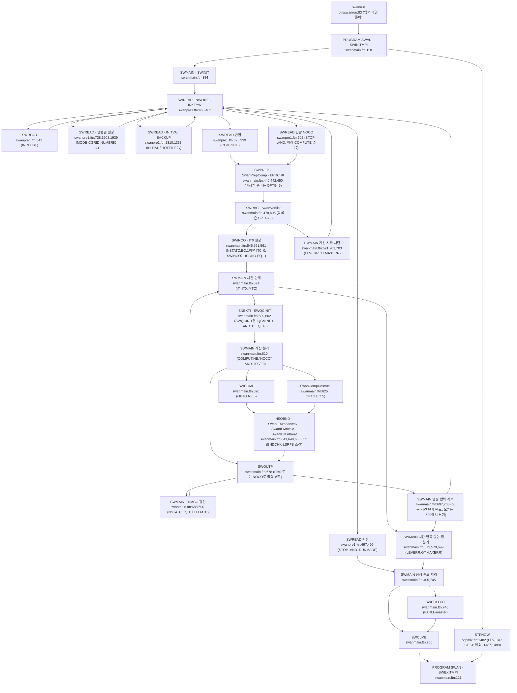
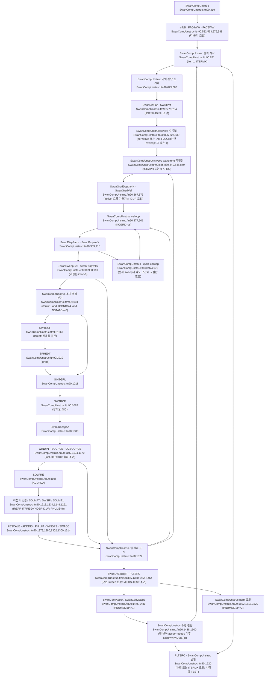

# SWAN 41.51 실행 호출 흐름

## 판독 기준과 요약

분류별 개수: A 1개, B 17개, C 6개, D 1개, E 1개, F 1개, H 2개, X 0개. 합계 29개(§8의 고유 행 ID 기준).

이 보고서는 소스와 문서를 대조한 AI 작성 기록이다. 코드 경로의 기준은 `models/SWAN/raw/source_code/swan/`이다. 아래의 `src/` 파일명은 이 디렉터리 안의 파일을 뜻한다. `switch.pl`, `bin/swanrun`, `misc/swan.edt`도 같은 기준을 쓴다. 웹 인용의 `website/`는 `models/SWAN/raw/manuals/website/`를 뜻한다.

코드는 `src/swanmain.ftn:965`의 `VERNUM = 41.51`을 선언한다. `src/swanmain.ftn:967`의 `CALL BUGFIX ('A')`와 `:968`의 `CALL BUGFIX ('B')`가 패치를 표시한다. 읽기 전용 `git log -5 --format='%h %ad %s' --date=short`에서 HEAD `43e9bbb`의 제목은 `Merge branch 'master' into 'main'`이다. `updated src (patch B)`의 커밋은 같은 날짜인 2026-07-13의 `0dabfa4`이다. 사용자 지시의 HEAD와 패치 제목은 이 두 커밋을 구별해서 읽는다.

판독 기록은 위치를 찾는 색인으로만 쓴다. 호출과 대입의 판정은 `nl -ba`로 연 원문에 근거한다. 표의 코드 인용은 원문 행의 실행문을 보존한다. 행 앞 들여쓰기는 생략한다. Fortran 고정 형식의 오른쪽 변경 이력 숫자는 실행문과 구별한다. 여러 행으로 이어진 문장은 시작 행과 필요한 연속 행을 함께 적는다.

계산 호출 깊이는 `SWCOMP`와 `SwanCompUnstruc`를 각각 깊이 0으로 센다. 두 루틴의 직접 호출은 깊이 1이다. 깊이 1 루틴의 직접 호출은 깊이 2이다. 깊이 3 이후는 루틴 이름과 정의 위치로 경계를 표시한다. MPI 통신과 병렬 실행 지원은 호출 위치와 조건까지 읽는다. 범용 라이브러리 내부는 계산 완료 조건에 넣지 않는다. 명령 파서의 모든 키워드 인수 판독까지 이 깊이를 확장하지 않는다.

`SWMAIN`은 명령 읽기 반복과 시간 단계 반복을 가진다. 근거는 `src/swanmain.ftn:394`의 `DO`, `:399`의 `CALL SWREAD (COMPUT)`, `:571`의 `DO 500 IT = IT0, MTC`이다. 비정상 계산은 `:545`의 `IT0 = 0`을 쓴다. 계산 호출의 바깥 조건은 `:610`의 `IF (COMPUT.NE.'NOCO' .AND. IT.GT.0) THEN`이다. 출력 호출 `:678`의 `CALL SWOUTP ( AC2   , SPCSIG, SPCDIR, COMPDA, XYTST ,`는 이 조건문 밖에 있다. 해석: 비정상 계산의 초기 시각은 입력·경계 갱신과 출력의 대상이다.


정렬 격자의 격자점 처리는 SWOMPU가 맡는다(§2.2.1). 비정렬 격자의 셀 처리는 SwanCompUnstruc 안에 있다(§2.3). 정렬 경로는 SOURCE·QCSOURCE 뒤에 ACTION으로 전파항을 조립한다. 비정렬 경로는 SwanTranspAc 뒤에 SOURCE·QCSOURCE를 호출한다. AC1은 조건부 시간 기억이다(§3.1). AC2는 같은 단계 안에서도 여러 루틴이 제자리에서 갱신한다. 문서·노트의 차이와 수정 문장은 §8에 모았다. T1-011의 판정 근거는 일반 STOPC의 호출 조건·단위·비정렬 구현 대조이다.

## 1 시작·명령 읽기 순서

### 1.1 전처리와 실행 진입

| 선택 | 살아나는 행과 원문 근거 | 실행 흐름에 미치는 범위 |
|---|---|---|
| 기본 `-unix` | `switch.pl:92` `if ($unx=~/TRUE/) {$newline=~s/^!UNIX//;}` | UNIX 행을 활성화한다. `:63`의 `$ext = ($file =~ m/ftn90/) ? "f90" : "f";`가 출력 확장자를 정한다. |
| 기본은 `!WFR` | `switch.pl:85` `if ($jac=~/TRUE/) {$newline=~s/^!JAC//;}`; `:86` `else              {$newline=~s/^!WFR//;}` | `-jac`이면 `!JAC`이 살아난다. 그 밖에는 `!WFR`이 살아난다. 두 경로를 동시에 활성 코드로 세지 않는다. |
| `-fixfront` | `switch.pl:87` `if ($ffro=~/TRUE/) {$newline=~s/^!FXFRO//;}`; `:88` `else               {$newline=~s/^!GRAPH//;}` | 고정 wavefront와 기본 graph 경로를 구별한다. |
| `-mpi`, `-metis` | `switch.pl:89` `if ($mpi=~/TRUE/) {$newline=~s/^!MPI//;}`; `:101` `if ($met=~/TRUE/) {$newline=~s/^!METIS//;}` | MPI 본체와 비정렬 격자 분할·교환 코드를 각각 활성화한다. |
| `-netcdf` | `switch.pl:102` `if ($ncf=~/TRUE/) {$newline=~s/^!NCF//;}`; `:103` `if ($ncf=~/FALSE/){$newline=~s/^!NNCF//;}` | NetCDF 경로와 비-NetCDF 경로를 구별한다. |
| 기본 범위에서 꺼지는 계측·결합 | `switch.pl:84` `if ($tim=~/TRUE/) {$newline=~s/^!TIMG//;}`; `:97` `if ($adc=~/TRUE/) {$newline=~s/^!ADC//;}` | `!TIMG`, `!ADC`는 기본 실행문이 아니다. `!$omp`는 이 치환 규칙의 표식이 아니다. |
| CMake 선택 | `src/CMakeLists.txt:5` `set( SWITCHES -unix )`; `:19` `list( APPEND SWITCHES -jac )`; `:36` `execute_process( COMMAND ${PERL_EXECUTABLE} ${CMAKE_SOURCE_DIR}/switch.pl ${SWITCHES} ${SRC}/*.ftn ${SRC}/*.ftn90 )` | `MPI OR JAC`은 `:9`에서 MPI 스위치를 추가한다. `:72`의 `if( OPENMP AND MPI )`와 `:73`의 오류가 두 병렬 방식의 동시 CMake 선택을 막는다. |

### 1.2 시작과 명령 읽기

순서는 호출 위치의 실행 순서이다. 분기 안의 순서는 해당 조건이 참일 때만 적용한다.

| 순서 | 호출 위치 파일:줄 원문 | 조건 | 피호출 정의 파일:줄 | 조건 스위치를 정하는 줄 |
|---|---|---|---|---|
| S01 | `bin/swanrun:83` `cp $input.swn INPUT` | `:81` `if [ -r $input.swn ]; then` | 셸 명령 | `:19` `-input) input=\`basename $2 .swn\`;;` |
| S02 | `bin/swanrun:86` `swan.exe`; `:93` `mpirun -np $npmpi -machinefile machinefile swan.exe`; `:95`, `:98` `swan.exe` | `:84` `if [ $npomp -gt 1 ]; then`; MPI 실행은 `:92` `if [ $npmpi -gt 1 ]; then` | `src/swanmain.ftn:29` `PROGRAM SWAN` | `bin/swanrun:20` `-omp)   npomp=$2;;`; `:21` `-mpi)   npmpi=$2;;`; `:85` `export OMP_NUM_THREADS=$npomp` |
| S03 | `src/swanmain.ftn:110` `CALL SWINITMPI` | 프로그램 진입 | `src/swanparll.ftn:33` | `src/swanparll.ftn:140` `!MPI!NCOH      CALL MPI_INIT ( IERR )`; `:188` `IF ( NPROC.GT.1 ) THEN`이 `PARLL`을 정한다. |
| S04 | `src/swanmain.ftn:115` `CALL SWMAIN` | `:111` `IF (STPNOW()) GOTO 999`를 통과 | `src/swanmain.ftn:128` | 오류 확인 함수 `src/ocpmix.ftn:1398` `LOGICAL FUNCTION STPNOW()` |
| S05 | `src/swanmain.ftn:384` `CALL SWINIT (INERR)` | `SWMAIN` 최초 1회 | `src/swanmain.ftn:773` | `:377` `LEVERR=0`; `:378` `MAXERR=1` |
| S06 | `src/swanmain.ftn:967` `CALL BUGFIX ('A')`; `:968` `CALL BUGFIX ('B')`; `:970` `CALL OCPINI ('swaninit', .TRUE.,INERR)` | `SWINIT` 안 | `BUGFIX`: `src/ocpmix.ftn:2349`; `OCPINI`: `src/ocpids.ftn:7` | `src/swanmain.ftn:971` `IF (INERR.GT.0) RETURN`; 초기값은 §2.1에 별도 기록한다. |
| S07 | `src/swanmain.ftn:399` `CALL SWREAD (COMPUT)` | `:394` `DO`의 매 회차 | `src/swanpre1.ftn:19` | 한 `COMPUTE`의 시간 단계 반복을 끝내면 `src/swanmain.ftn:703` `END DO`에서 이 호출로 돌아간다. |
| S08 | `src/swanpre1.ftn:465` `100  CALL NWLINE`; `:483` `CALL INKEYW ('REQ',' ')` | `SWREAD` 안의 명령 읽기 반복 | `src/ocpcre.ftn:111`, `:219` | 처리한 일반 명령은 예를 들어 `src/swanpre1.ftn:775` `GOTO 100`으로 돌아간다. EOF는 `:466` `IF (ELTYPE.EQ.'EOF') THEN`으로 처리한다. |
| S09 | `src/swanpre1.ftn:552` `CALL FOR (INCNUM(INCLEV), FILENM, 'OF', IOSTAT)` | `:543` `IF (KEYWIS ('INCL')) THEN` | `src/ocpmix.ftn:1591` | 포함 파일 EOF에서 `src/swanpre1.ftn:470` `INCLEV = INCLEV - 1`; 최상위 EOF는 `:472` `CALL MSGERR (4, ' unexpected end of command input')` |
| S10 | `src/swanpre1.ftn:1504`, `:1515` `CALL CGINIT(LOGCOM)` | 각각 정렬 격자의 규칙 격자·곡선 격자 준비 조건 | `src/swanpre1.ftn:4731` | `:1608` `IF (KEYWIS('CGRID') .OR. KEYWIS('GRID')) THEN`; `:1621` `OPTG  = 3`; `:1644` `OPTG  = 5`; `:1652` `OPTG = 1` |
| S11 | `src/swanpre1.ftn:1492` `CALL SwanReadGrid ( FILENM, LENFNM )`; `:1557` `CALL SwanCreateEdges`; `:1559` `CALL SwanGridTopology`; `:1563` `CALL SwanInitCompGrid (LOGCOM)` | `READ`의 비정렬 격자 경로. 위상·초기화는 `:1526`에서 시작하는 입력 준비 조건 안이다. | 각 동명 `src/*.ftn90:1` | `:1453` `IF (KEYWIS ('READ')) THEN`; `:1518` `ELSEIF (OPTG.EQ.5) THEN`; 분할은 `:1529` `!METIS            CALL SwanDecomposition (LOGCOM)` |
| S12 | `src/swanpre1.ftn:1310` `CALL INITVA( AC2, SPCSIG, SPCDIR, KGRPNT )`; `:1882` `CALL SWBOUN ( XGRDGL, YGRDGL, KGRPGL, XYTST, KGRBGL )` | 각각 `INITIAL`, 경계 명령 | `INITVA`: `src/swanpre1.ftn:6026`; `SWBOUN`: `src/swanpre2.ftn:2479` | `src/swanpre1.ftn:1309` `IF (KEYWIS ('INIT')) THEN`; 경계 스펙트럼은 계산 준비와 단계 갱신에서 소비한다. |
| S12a | `src/swanpre1.ftn:1333` `CALL BACKUP( AC2, SPCSIG, SPCDIR, KGRPNT, XCGRID, YCGRID )` | `src/swanpre1.ftn:1325` `IF (KEYWIS('REST') .OR. KEYWIS ('BACK') .OR. KEYWIS('HOTF')`와 `:1326` `&    .OR. KEYWIS('SAVE')) THEN`; 격자 준비 검사를 통과 | `src/swanpre1.ftn:6620` | 처리 뒤 `src/swanpre1.ftn:1336` `GO TO 100`으로 다음 명령을 읽는다. |
| S13 | `src/swanpre1.ftn:3687` `CALL SPROUT(FOUND, DEPTH, WLEVL)` | 앞의 명령 분기가 처리하지 않은 출력 요청 | `src/swanpre2.ftn:20` | `src/swanpre1.ftn:3683` `IF (KEYWRD .EQ. '    ') GOTO 100`; `:3693` `GOTO 100` |
| S14 | `src/swanpre1.ftn:939` `RETURN` | `:875` `IF (KEYWIS ('COMP')) THEN` | 복귀 대상 `SWMAIN`, `src/swanmain.ftn:399` | `src/swanpre1.ftn:876` `COMPUT = 'COMP'`; `:877` `RUNMADE = .TRUE.`; `:932`–`:935`가 `ITERMX`를 정한다. |
| S15 | `src/swanpre1.ftn:504` `RETURN` | `:497` `IF (KEYWIS ('STOP')) THEN` | 복귀 대상 `SWMAIN`, `src/swanmain.ftn:399` | `RUNMADE`이면 `src/swanpre1.ftn:499` `COMPUT = 'STOP'`; 그렇지 않으면 `:502` `COMPUT = 'NOCO'` |

### 1.3 계산 준비·시간 단계·종료

| 순서 | 호출 위치 파일:줄 원문 | 조건 | 피호출 정의 파일:줄 | 조건 스위치를 정하는 줄 |
|---|---|---|---|---|
| S16 | `src/swanmain.ftn:409` `CALL FOR (IUNIT, FILENM, 'UF', IOSTAT)` | `:405` `IF (COMPUT.EQ.'STOP') THEN` | `src/ocpmix.ftn:1591` | `src/swanmain.ftn:408` `FILENM = 'norm_end'`; `:411` `GOTO 900` |
| S17 | `src/swanmain.ftn:416` `IF ( ntf.GT.0 ) CALL SwanIEMinitig` | 두 번째 surfbeat 계산 준비 | `src/SwanIEM.ftn90:78` | `ntf` 조건을 원문 그대로 적용한다. |
| S18 | `src/swanmain.ftn:440` `CALL SWPREP ( BSPECS, BGRIDP, CROSS , XCGRID, YCGRID, KGRPNT,`; `:442` `IF (OPTG.EQ.5) CALL SwanPrepComp ( CROSS )` | `COMPUT`가 `STOP`이 아닐 때 | `src/swanmain.ftn:3543`; `src/SwanPrepComp.ftn90:1` | `SWREAD`의 `CGRID`가 `OPTG`를 정한다. `SWPREP`는 경계·장애물·sweep 설정을 준비한다. |
| S19 | `src/swanmain.ftn:450` `CALL ERRCHK` | 준비 뒤 | `src/swanmain.ftn:6226` | `:6354` `IF (NSTATC.EQ.1) THEN`; `:6355` `PROPSC = PROPSN`; `:6357` `PROPSC = PROPSS` |
| S20 | `src/swanmain.ftn:455` `IF ( IBRAG.NE.0 ) CALL SWBRBOT` | Bragg 선택 | `src/SwanBraggScat.ftn90:69` | `IBRAG` |
| S21 | `src/swanmain.ftn:478` `CALL SWRBC(COMPDA)` | `COMPDA` 할당 뒤 | `src/swanmain.ftn:4651` | `:463` `ALLOCATE(COMPDA(MCGRD,MCMVAR),STAT=ISTAT)`; `:464` `COMPDA = 0.` |
| S22 | `src/swanmain.ftn:488` `IF (IBRAG.EQ.1) CALL SWFBXY(COMPDA(1,JDP2), COMPDA(1,JMUDL2),`; `:495` `IF (OPTG.EQ.5) CALL SwanVertlist(COMPDA)` | 각각 Bragg 1, 비정렬 격자 | `src/SwanBraggScat.ftn90:561`; `src/SwanVertlist.ftn90:1` | `IBRAG`, `OPTG` |
| S23 | `src/swanmain.ftn:551` `CALL SWINCO ( AC2   , COMPDA, XCGRID, YCGRID,` | `:544` `IF (NSTATC.EQ.1) THEN` 안의 `:546` `IF (ICOND.EQ.1) THEN` | `src/swanmain.ftn:8864` | `MODE NONST`는 `src/swanpre1.ftn:746` `ICOND = 1`; 호출 뒤 `src/swanmain.ftn:557` `ICOND = 0` |
| S24 | `src/swanmain.ftn:566`, `:583` `CALL SWSYNC` | 시간 반복 직전·단계 시작 | `src/swanparll.ftn:329` | `src/swanmain.ftn:571` `DO 500 IT = IT0, MTC`; 정상은 `:561` `IT0 = 1`; 비정상은 `:545` `IT0 = 0` |
| S25 | `src/swanmain.ftn:589` `CALL SNEXTI ( BSPECS, BGRIDP, COMPDA, AC1   , AC2   ,` | 모든 시간 단계. `IT=0`도 포함한다. | `src/swanmain.ftn:6708` | 시간은 `TIMCO`이다. `AC1`, 경계, 입력장의 세부 선후는 §3에 적는다. |
| S26 | `src/swanmain.ftn:602` `&                                  CALL SWQCINIT ( BGRIDP, COMPDA )`; `:607` `CALL SWSYNC` | QC 초기화만 `:601` `IF ( IQCM.NE.0 .AND. IT.EQ.IT0 )` | `src/SwanQCM.ftn90:83`; `src/swanparll.ftn:329` | 경계 입사 스펙트럼을 읽은 뒤에 QC를 초기화한다. |
| S27 | `src/swanmain.ftn:620` `CALL SWCOMP( AC1   , AC2   , COMPDA, SPCDIR, SPCSIG,`; `:625` `CALL SwanCompUnstruc ( AC2   , AC1   , COMPDA,` | `:610` `IF (COMPUT.NE.'NOCO' .AND. IT.GT.0) THEN`; `:618` `IF (OPTG.NE.5) THEN`의 양쪽 분기 | `src/swancom1.ftn:43`; `src/SwanCompUnstruc.ftn90:1` | `COMPUTE` 정상은 `src/swanpre1.ftn:889` `RDTIM = 0.`; 비정상은 `:913` `RDTIM = 1./DT` |
| S28 | `src/swanmain.ftn:641` `CALL HSOBND ( AC2, SPCSIG, COMPDA(1,JHSIBC), KGRPNT )` | 계산 뒤 `:640` `IF ( BNDCHK ) THEN` | `src/swanser.ftn:4960` | `src/swanmain.ftn:634` `ICOND = 4`가 다음 계산의 초기 추정을 막는다. |
| S29 | `src/swanmain.ftn:648` `CALL SwanIEMmeanwav ( AC2, COMPDA(1,JHSIBC), SPCSIG,`; `:650` `CALL SwanIEMncalc`; `:652` `CALL SwanIEMsrfbeat ( COMPDA(1,JHS ), AC2,` | `:646` `IF ( LSRFB .AND. ntf.LT.0 ) THEN` | `src/SwanIEM.ftn90:324`, `:488`, `:679` | IEM 선택. 일반 정상·비정상 계산 뒤의 추가 경로이다. |
| S30 | `src/swanmain.ftn:672` `CALL SWSYNC`; `:678` `CALL SWOUTP ( AC2   , SPCSIG, SPCDIR, COMPDA, XYTST ,` | 계산 유무와 별개로 각 단계에서 호출 | `src/swanparll.ftn:329`; `src/swanout1.ftn:19` | 출력별 시각 선택은 `SWORDC`가 판정한다. §2.5 참조. |
| S31 | `src/swanmain.ftn:691` `CHTIME = DTTIWR(ITMOPT, TIMCO)` | `:688` `IF (NSTATC.EQ.1) THEN`과 `:689` `IF (IT.LT.MTC) THEN` | `src/ocpmix.ftn:454`의 DTTIWR | 바로 앞 `src/swanmain.ftn:690` `TIMCO = TIMCO + DT` 뒤에 변환한다. 마지막 단계 뒤에는 시간을 더하지 않는다. |
| S32 | `src/swanmain.ftn:728` `CALL SWSYNC`; `:740` `CALL SWCOLLECT ( BLKNDC, BLKND, .TRUE. )`; `:746` `CALL SWCOLOUT ( OURQT, BLKNDC )` | 종료 라벨 `900`. 수집은 `PARLL`; 정렬 격자에서 `SWCOLLECT`; master에서 `SWCOLOUT` | `src/swanparll.ftn:329`, `:3560`, `:3839` | `src/swanmain.ftn:730` `IF ( PARLL ) THEN`; `:739` `IF (OPTG.NE.5) THEN`; `:745` `IF ( IAMMASTER ) THEN` |
| S33 | `src/swanmain.ftn:766` `CALL SWCLME`; `:121` `CALL SWEXITMPI` | `SWMAIN`의 정상 정리 뒤, 또는 프로그램의 라벨 `999` | `src/swanmain.ftn:9159`; `src/swanparll.ftn:211` | `src/swanparll.ftn:313` `!MPI!NCOH            CALL MPI_ABORT ( MPI_COMM_WORLD, LEVERR, IERR )`는 `LEVERR.GE.4`; `:319`의 `MPI_FINALIZE`는 그 밖이다. |
| S34 | `bin/swanrun:114` `mv PRINT $input.prt`; `:121` `mv ERRPTS $input.erp`; `:132` `rm -f INPUT` | 실행 파일에서 돌아온 뒤. 파일 존재 조건을 적용한다. | 셸 명령 | MPI 출력은 `:100` `if [ $npmpi -gt 1 ]; then` 안에서 process별 이름으로 바꾼다. |

오류 종료는 정상 정리와 같지 않다. `src/swanmain.ftn:401`의 `IF (STPNOW()) RETURN` 같은 직접 복귀는 라벨 `900`의 파일 정리와 `SWCLME`를 지나지 않는다. `:521`의 `IF (LEVERR.GT.MAXERR) THEN`은 계산 시작을 막는다. `:573`의 같은 조건은 시간 반복을 끝낸다. `:699`의 `IF (LEVERR.GT.MAXERR) GOTO 900`은 계산 후 오류를 정리 경로로 보낸다.

## 2 계산 순서

### 2.1 계산을 정하는 입력과 상태

| 상태 | 생산하는 원문 | 소비 지점 |
|---|---|---|
| 모델 모드와 현재 계산 | `src/swanpre1.ftn:742` `NSTATM = 1`; `:743` `NSTATC = 1`; `:890` `NSTATC = 0`; `:905` `NSTATC = 1` | `NSTATM`은 실행 모드이다. `NSTATC`는 현재 `COMPUTE`의 정상·비정상을 정한다. `MODE NONST` 안에서도 `COMPUTE STAT`을 허용한다(`:879`). |
| 반복 상한 | `src/swanmain.ftn:1093` `MXITST = 50`; `:1094` `MXITNS = 1`; `src/swanpre1.ftn:933` `ITERMX = MXITST`; `:935` `ITERMX = MXITNS` | 두 계산 루틴의 반복 상한. `NUMERIC STOPC STAT/NONST`의 `:1952`, `:1959`가 값을 바꾼다. |
| 수렴 방식 | `src/swanpre1.ftn:1943` `PNUMS(21) = 1.`; `:1963` `PNUMS(21) = 0.` | 각각 `STOPC`의 곡률 기준과 `ACCUR`의 구 기준. `src/swanmain.ftn:1311` `PNUMS(21) = 1.`이 기본값이다. |
| 파고·주기 기준 | `src/swanpre1.ftn:1944` `CALL INREAL ('DABS'   , PNUMS(2) , 'UNC', 0.)`; `:1945` `CALL INREAL ('DREL'   , PNUMS(1) , 'UNC', 0.)`; `:1946` `CALL INREAL ('CURVAT' , PNUMS(15), 'UNC', 0.)`; `:1947` `CALL INREAL ('NPNTS'  , PNUMS(4) , 'UNC', 0.)` | `SACCUR`, `SWSTPC`, `SwanConvAccur`, `SwanConvStopc`. `DTABS`, `CURVT`도 `:1948`, `:1949`에서 읽는다. |
| 주파수 해법 | `src/swanpre1.ftn:2026` `PNUMS(8) = 1.`; `:2035` `PNUMS(8) = 2.`; `:2041` `PNUMS(8) = 3.` | `SIGIM`, `SIGEX`, `FIL`의 분기. 실제 해법 선택은 두 격자 표에 그대로 적는다. |
| 스펙트럼 갱신 | `src/swanpre1.ftn:771` `IF (KEYWIS ('NOUPDAT')) THEN`; `:772` `ACUPDA = .FALSE.` | 행렬 조립 뒤의 해법·제한기 실행을 막는다. |
| 비정렬 sweep 수 | `src/swanpre1.ftn:2201` `CALL ININTG ('NSWEEP'  , nsweep   , 'UNC', 0 )`; `src/swanmain.ftn:3757` `IF ( nsweep.EQ.-999 ) THEN` | 미지정 시 `:3762` `nsweep = 3`. `:3764`–`:3766`은 굴절·원천항 조건으로 4를 쓴다. `:3767`의 `IF ( IGEN == 4 .OR. IQCM /= 0 ) nsweep = 3`이 그 뒤에서 덮어쓴다. `:3770` `IF ( nsweep.EQ.1 .AND. .NOT.FULCIR ) nsweep = 3`. |

### 2.1.1 물리·진단 스위치의 입력 위치

아래 표는 R·P·U·Q 표가 공통으로 참조하는 스위치 생산 위치이다. 같은 명령에서 읽는 개별 계수까지 확장하지 않는다. 실제 호출 조건은 각 호출 표의 조건 열을 적용한다.

| 스위치 | 명령·생산 위치 파일:줄 원문 | 소비 경로 |
|---|---|---|
| LTRACE·ITEST | `swanpre1.ftn:581` `IF (KEYWIS ('TEST')) THEN`; `:582` `CALL ININTG ('ITEST' , ITEST , 'STA', 30)`; `:591` `CALL ININTG ('ITRACE', ITRACE, 'UNC',  0)`; `:593` `LTRACE =.TRUE.` | STRACE·SWPRSET·진단 출력 |
| IGEN·IWIND | `swanpre1.ftn:2808` `IF (KEYWIS('GEN1')) THEN`; `:2810` `IGEN = 1`; `:2843` `IF (KEYWIS('GEN2')) THEN`; `:2845` `IGEN = 2`; `:2904` `IF (KEYWIS('GEN3')) THEN`; `:2906` `IGEN = 3`. 바람 선택을 전달하는 원문은 `:2910` `IF (LWINDR .GT. 0) IWIND = LWINDM`이다. | P09·U14·Q07–Q15 |
| GEN3의 물리 선택 | JANS: `swanpre1.ftn:2908` `IF (KEYWIS('JANS')) THEN`, `:2909` `LWINDM = 4`. YAN: `:2931`, `:2933` `LWINDM = 5`. WESTH: `:2935`, `:2937` `LWINDM = 5`, `:2940` `IWCAP = 7`. BAB: `:2943`, `:2947` `LWINDM = 8`, `:2955` `IWCAP = 8`. KOM: `:3036`, `:3037` `LWINDM = 3`, `:3040` `IWCAP = 1`. | SOURCE의 바람·백파 분기 |
| IGEN=4·IQCM | `swanpre1.ftn:3082` `IF ( KEYWIS('GEN4') ) THEN`; `:3084` `IGEN  = 4`; `:3090` `IQCM  = 1`. 독립 선택: `:3589` `IF ( KEYWIS('SCAT') .OR. KEYWIS('QC') ) THEN`; `:3590` `CALL ININTG ('IQCM', IQCM, 'STA', 1 )`. | QC 초기화·QCSOURCE |
| IBOT·IMUD | `swanpre1.ftn:2544` `IF (KEYWIS ('FRIC')) THEN`; `:2545` `IBOT = 1`. FRIC 세부 선택은 `:2550`·`:2561`·`:2565`·`:2568`의 IBOT 대입이다. `:2586` `IF (KEYWIS ('MUD')) THEN`; `:2587` `IMUD = 1`. | Q01·Q02, 분산 계산의 KSCIP2 |
| IVEG·ITURBV | `swanpre1.ftn:2672` `IF (KEYWIS ('VEGE')) THEN`; `:2673` `CALL ININTG ('IVEG', IVEG, 'STA', 1)`. `:2740` `IF (KEYWIS ('TURB')) THEN`; `:2741` `ITURBV = 1`. | Q03·Q04 |
| IICE·ISURF | `swanpre1.ftn:2639` `IF (KEYWIS ('SICE')) THEN`; `:2640` `IICE = 3 ! default: IICE=3 indicates R19`; D15·M18·R21B는 `:2651`·`:2654`·`:2657`에서 4·5·6을 쓴다. 쇄파는 `:2376` `IF (KEYWIS ('BRE')) THEN`; 기본 CON은 `:2379` `ISURF = 1`이다. | Q05·Q06 |
| IQUAD·ITRIAD | `swanpre1.ftn:3286` `IF (KEYWIS ('QUAD')) THEN`; `:3294` `CALL ININTG ('IQUAD', IQUAD, 'UNC',  0)`. 삼중항은 `:3337` `IF ( KEYWIS ('TRI') .OR. KEYWIS ('NL3') ) THEN` 안의 `:3339` `ITRIAD = 5`에서 시작한다. LTA·DCTA·SPB·FTIM 선택은 `:3349`·`:3362`·`:3374`·`:3388`에서 값을 바꾼다. | FAC4WW·FAC3WW·Q20–Q35 |
| TCOLL·IBIPH | `swanpre1.ftn:3429` `IF (KEYWIS('NONC')) THEN`; `:3430` `TCOLL = .FALSE.`; `:3435` `IF (ITRIAD.NE.5) TCOLL = .TRUE.`. 이중위상은 `:3439` `IF (KEYWIS('BIPH')) THEN`에서 읽는다. `:3446` `ELSEIF (KEYWIS('WIT') .OR. KEYWIS('DEWIT')) THEN`; `:3447` `IBIPH = 3`. | SWDCTA/SWDNCTA·SWBIPM |
| IBRAG·IDIFFR | `swanpre1.ftn:3489` `IF (KEYWIS ('BRAG')) THEN`; `:3490` `CALL ININTG ('IBRAG' , IBRAG   , 'STA', 1 )`. `:2114` `IF (KEYWIS ('DIFFR')) THEN`; `:2115` `CALL ININTG ('IDIFFR', IDIFFR, 'STA', 1)`. | Bragg·DIFPAR·SwanDiffPar |
| ICUR·DYNDEP | 입력 격자의 `swanpre1.ftn:4302` `ELSE IF (KEYWIS ('CUR')) THEN`; `:4305` `ICUR = 1`. 준비 단계는 `swanmain.ftn:3752` `IF (IFLDYN(1).EQ.1 .OR. IFLDYN(7).EQ.1) DYNDEP = .TRUE.`를 적용한다. | 흐름·수심에 따른 전파와 해법 선택 |
| LSETUP | `swanpre1.ftn:2082` `IF (KEYWIS ('SETUP')) THEN`; `:2094` `LSETUP = 1`. 비정렬 예외는 `:2089` `IF (OPTG.EQ.5) THEN`; `:2091` `LSETUP = 0`이다. | 정렬 R13의 SETUPP |
| IREFR·ITFRE·BRESCL·OFFSRC | `swanpre1.ftn:3646` `IF (KEYWIS ('OFF')) THEN` 아래에서 REF는 `:3649` `IREFR = 0`, FSH는 `:3651` `ITFRE = 0`, RESCALE은 `:3665` `BRESCL = .FALSE.`, SOURCES는 `:3667` `OFFSRC = .TRUE.`로 처리한다. | 전파·직접 해법·재조정·비정렬 원천항 생략 |
| ROGERS·ARDHUIN·ZIEGER | `swanpre1.ftn:3115` `IF (KEYWIS('SSWELL')) THEN`; `:3120` `ROGERS = .TRUE.`; `:3124` `ARDHUIN = .TRUE.`; `:3127` `ZIEGER = .TRUE.`. 각 명령 키워드는 `:3119`의 ROG, `:3123`의 ARD, `:3126`의 ZIE이다. | Q17–Q19의 순서대로 분기 |
| LADDS | 출력량 판독의 `swanpre2.ftn:1423` `IF (IVTYPE.EQ.7  .OR. IVTYPE.EQ.9  .OR.`; `:1424` `&              IVTYPE.EQ.54 .OR. IVTYPE.EQ.55 .OR.`; `:1425` `&              IVTYPE.EQ.56 .OR. IVTYPE.EQ.57 .OR.`; `:1426` `&              IVTYPE.GE.60 ) LADDS = .TRUE.`. 다른 출력 요청 경로도 `:1790`–`:1793`에서 같은 조건을 쓴다. | ADDDIS의 실행 여부 |

### 2.2 정렬 격자: `SWCOMP`의 직접 호출

이 절의 기본 파일은 `src/swancom1.ftn`이다. 한 `SWCOMP` 호출은 현재 시각의 반복 계산을 수행한다. 시간은 `SWMAIN`이 증가시킨다. `!WFR`의 4회 sweep은 `:1698`의 `!WFR        DO 410 SWPDIR = 1, 4`에 근거한다.

| 순서 | 호출 위치 파일:줄 원문 | 조건 | 피호출 정의 파일:줄 | 조건 스위치를 정하는 줄 |
|---|---|---|---|---|
| R01 | `swancom1.ftn:941` `IF (LTRACE) CALL STRACE (IENT,'SWCOMP')`; `:943` `IF (IT .EQ. 1 .AND. ITEST.GE.1) CALL SWPRSET (SPCSIG,SPCDIR)` | 추적·첫 계산 단계의 설정 출력 | `ocpmix.ftn:1140`; `swancom1.ftn:3842` | `LTRACE`, `TEST`의 `ITEST` |
| R02 | `swancom1.ftn:959` `&   CALL FAC4WW (XIS   ,SNLC1 ,`; `:967` `IF (IT.EQ.1 .OR. DYNDEP) CALL FAC3WW ( COMPDA(1,JDP2), SPCSIG )` | 각각 `:958` `IF ( IQUAD.GE.1 )`; `:966` `IF ( ITRIAD.GT.0 ) THEN` | `swancom4.ftn:60`, `:3183` | `QUADRUPL/MDIA`, `TRIAD`; 현재 수심으로 계수를 준비한다. |
| R03 | `swancom1.ftn:1315` `CALL CFFT2I ( NCOZ, NCOZ, WSAVE, LENSAV, IERR )`; `:1357` `CALL CFFT2I ( MYD, MXD, WSAVD, LENSVD, IERR )` | QC 산란·QC 쇄파 작업 배열 준비 | `fftpack51.ftn90:2315` | `IQCM.GT.0`; `ISURF.GT.0 .AND. IGEN.EQ.4`. 라이브러리 내부는 판독 경계이다. |
| R04 | `swancom1.ftn:1429` `CALL SWMTLB(1,MCGRD,I1GRD,I2GRD)`; `:1431` `CALL SWMTLB(1,MYC,I1MYC,I2MYC)`; `:1438` `CALL INSAC (AC2               ,SPCSIG          ,COMPDA(1,JDP2)  ,` | 반복 전 | `swancom1.ftn:9452`, `:4906` | 작업 범위와 수렴 검사 시작값을 만든다. |
| R05 | `swancom1.ftn:1467` `CALL init_constants`; `:1479` `CALL xnl_init(SPCSIG  , SPCDIR(:,1)*180./PI , MSC , MDC ,` | `:1466` `IF (IQUAD.EQ.51.OR.IQUAD.EQ.52.OR.IQUAD.EQ.53) THEN` | `m_constants.ftn90:28`; `mod_xnl4v5.ftn90:459` | 정확한 4파 상호작용의 초기화 경로이다. |
| R06 | `swancom1.ftn:1487` `DO 450 ITER = 1, ITERMX` | 반복 시작. 호출문이 아닌 제어문이다. | `SWCOMP` 내부 | `:1545` `MEMNL4(IDC,ISC,IP)=0.` 등으로 반복별 기억 배열을 지운다. `:1453`의 `IF ( IWIND.GE.3 .AND. NSTATC.EQ.0 .AND. ICOND.NE.4 ) THEN`이 `PRECOR`를 정한다. |
| R07 | `swancom1.ftn:1676` `&     CALL DIFPAR( AC2   , SPCSIG, KGRPNT, COMPDA(1,JDP2),`; `:1681` `IF (IBIPH.EQ.3) CALL SWBIPM ( COMPDA(1,JBIPH ), COMPDA(1,JDP2),` | `:1675` `IF ( IDIFFR.GT.0 )`; De Wit 이중위상각 선택 | `swancom5.ftn:5466`; `swancom4.ftn:5697` | `DIFFRACTION`, `TRIAD`의 이중위상각 선택 |
| R08 | `swancom1.ftn:1964` `!WFR!MPI                    CALL SWRECVAC(AC2,IS-III*INCI,JJ,SWPDIR,KGRPNT)`; `:1968` `!WFR!MPI                    CALL SWRECVAC(AC2,JJ,IS-III*INCI,SWPDIR,KGRPNT)` | MPI wavefront의 행 처리 직전 | `swanparll.ftn:3232` | `-mpi`, `-jac` 미선택; `swancom1.ftn:1952`의 wavefront 소유 조건; `:1962` `IF ( MXCGL.GT.MYCGL ) THEN`의 양쪽 |
| R09 | `swancom1.ftn:2000` `CALL SWOMPU (SWPDIR,KSX              ,KSY              ,` | sweep 안의 각 격자점 | `swancom1.ftn:2485` | 기본은 `:1949`의 `DO 400 JDUM = JS+JWFRS, JE+JWFRE, INCJ`와 `:1974`의 `DO 390 II = IS, IE, INCI`. `-jac`은 `:1940`–`:1941`의 `IY`, `IX` 반복이다. |
| R10 | `swancom1.ftn:2058` `!WFR!MPI                    CALL SWSENDAC(AC2,IE-III*INCI,JJ,SWPDIR,KGRPNT)`; `:2062` `!WFR!MPI                    CALL SWSENDAC(AC2,JJ,IE-III*INCI,SWPDIR,KGRPNT)` | MPI wavefront의 행 처리 뒤 | `swanparll.ftn:3396` | `swancom1.ftn:2056` `IF ( MXCGL.GT.MYCGL ) THEN`의 양쪽. `LSTCP`는 `PROPSC`에 따라 `:998`, `:1001`, `:1004`에서 3·2·1이다. |
| R11 | `swancom1.ftn:2084` `!JAC                     CALL SWEXCHG( AC2LOC, 0, KGRPNT )`; `:2089` `!JAC               CALL SWSYNC`; `:2107` `!WFR!MPI                 CALL SWEXCHG( AC2LOC, KGRPNT )` | Jacobi는 `:2079` `IF ( ISWP.EQ.3 ) THEN`. wavefront는 4회 sweep 뒤이다. | `SWEXCHG`: `swanparll.ftn:2814`(!JAC), `:3044`(!WFR); `SWSYNC`: `:329` | `-jac`은 `:1708`–`:1715`의 `IBCOL`로 sweep 순서를 회전한다. |
| R12 | `swancom1.ftn:2181` `!MPI           CALL SWREDUCE(   ARR, 4, SWREAL, SWMAX )`; `:2183` `!MPI           CALL SWREDUCE(  IARR, 5, SWINT , SWSUM )`; `:2185` `!MPI           CALL SWREDUCE( MNISL, 1, SWINT , SWMIN )` | `:2133` `IF ( ITEST.GE.30 .OR. IDEBUG.EQ.1 ) THEN` | `swanparll.ftn:1048` | `-mpi`; 제한기·재조정·음의 에너지 통계 |
| R13 | `swancom1.ftn:2238` `CALL PLTSRC (SWTSDA(1,1,1,JPWNDS)  ,SWTSDA(1,1,1,JPWNDD)  ,`; `:2256` `&    CALL SETUPP ( KGRPNT, MSTPDA, SETPDA, AC2, COMPDA(1,JDP2),` | 각각 `NPTST.GT.0 .AND. NSTATM.EQ.0`; `:2255` `IF (LSETUP.GT.0)` | `swancom2.ftn:3345`; `swancom1.ftn:9947` | 반복 진단 출력 뒤에 setup을 갱신한다. |
| R14 | `swancom1.ftn:2271` `CALL SACCUR (COMPDA(1,JDP2),KGRPNT          ,`; `:2278` `CALL SWSTPC ( HSAC0         ,HSAC1           ,HSAC2 ,` | 각각 `:2270` `IF (PNUMS(21).EQ.0.) THEN`; `:2277` `ELSE IF (PNUMS(21).EQ.1.) THEN` | `swancom1.ftn:4436`, `:9562` | §2.1의 `NUMERIC` 선택 |
| R15 | `swancom1.ftn:2326` `!WFR!MPI           CALL SWEXCHG( COMPDA(1,J), KGRPNT )`; `:2327` `!JAC!MPI           CALL SWEXCHG( COMPDA(1,J), 0, KGRPNT )`; `:2335` `CALL SWCOLLECT ( disbk0, disbk1, .FALSE. )`; `:2336` `CALL SWBROADC  ( disbk0, MCGRDGL, SWREAL )` | COMPDA 전 성분 교환. QC 쇄파 저장·방송은 `:2333` `IF ( ISURF.GT.0 .AND. IGEN.EQ.4 ) THEN` | `SWEXCHG`: `swanparll.ftn:2814`(!JAC), `:3044`(!WFR); `SWCOLLECT`: `:3560`; `SWBROADC`: `:726` | `-mpi`와 `-jac` 선택; QC 쇄파는 다음 반복에서 읽을 값을 만든다. |
| R16 | `swancom1.ftn:2352` `IF ( (ITER.NE.1 .OR. PNUMS(21).EQ.0.) .AND.`; `:2353` `&                                      ACCUR.GE.PNUMS(4) ) GOTO 470` | 조기 종료. 그 밖에는 다음 반복 또는 `ITERMX` 종료 | `SWCOMP` 내부 | 곡률 기준은 첫 반복에서 종료하지 않는다. 구 기준은 첫 반복 종료를 허용한다. |
| R17 | `swancom1.ftn:2436` `CALL PLTSRC (SWTSDA(1,1,1,JPWNDS)  ,SWTSDA(1,1,1,JPWNDD)  ,` | 시간 단계의 계산이 끝난 뒤 `NPTST.GT.0 .AND. NSTATM.EQ.1` | `swancom2.ftn:3345` | 반복 진단과 단계 진단을 `NSTATM`으로 구별한다. |

`SWCOMP`의 할당 오류 호출도 직접 호출에 포함한다. `TXPBLA`의 호출 행은 `swancom1.ftn:1033`, `:1055`, `:1072`, `:1089`, `:1107`, `:1318`, `:1360`이다. 원문은 `CALL TXPBLA(CHARS(1),IF1,IL1)`이다. 정의는 `swanser.ftn:6418`이다. `MSGERR`의 대응 행은 `swancom1.ftn:1037`, `:1059`, `:1076`, `:1093`, `:1111`, `:1322`, `:1364`이다. 원문은 `CALL MSGERR ( 4, MSGSTR )`이다. 정의는 `ocpmix.ftn:1250`이다. 앞의 다섯 쌍은 해당 배열 할당의 `ISTAT.NE.0` 조건이다. 뒤의 두 쌍은 `CFFT2I`의 `IERR.NE.0` 조건이다. 호출 순서는 오류 문자열 구성 뒤 `TXPBLA`, 그다음 `MSGERR`이다.

### 2.2.1 정렬 격자점: `SWOMPU`의 직접 호출

아래 호출은 정렬 격자 계산의 깊이 2이다. `swancom1.ftn:3042`의 `KCGRD(1)  = KGRPNT(IX,IY)`가 현재 점을 정한다. `:3289`의 `IF (KCGRD(1).LE.1 .OR. COMPDA(KCGRD(1),JDP2).LE.DEPMIN) THEN`은 `AC2`와 `JHS`를 0으로 만든 뒤 복귀한다. `:3299`의 `IF (KCGRD(2) .LE. 1) RETURN`과 `:3300`의 `IF (.NOT.ONED .AND. (KCGRD(3).LE.1)) RETURN`도 아래 계산을 건너뛴다.

| 순서 | 호출 위치 파일:줄 원문 | 조건 | 피호출 정의 파일:줄 | 조건 스위치를 정하는 줄 |
|---|---|---|---|---|
| P01 | `swancom1.ftn:3038` `IF (LTRACE) CALL STRACE (IENT,'SWOMPU')` | 추적 선택 | `ocpmix.ftn:1140` | `LTRACE` |
| P02 | `swancom1.ftn:3320` `CALL SWAPAR ( COMPDA(1,JDP1), COMPDA(1,JMUDL1),`; `:3328` `CALL SPROXY (CAX1            ,` | `:3302` `IF (PROPSL.EQ.3 .AND. NSTATC.GT.0) THEN` | `swancom5.ftn:4627`, `:852` | S&L 비정상 계산은 직전 단계 수심·흐름을 사용한다. |
| P03 | `swancom1.ftn:3343` `CALL SWAPAR ( COMPDA(1,JDP2), COMPDA(1,JMUDL2),`; `:3351` `CALL SPROXY (CAX            ,`; `:3361` `CALL SWGEOM ( RDX, RDY, XCGRID, YCGRID, SWPDIR )`; `:3369` `CALL SWPSEL (SWPDIR                            ,IDCMIN        ,` | 위의 조기 복귀를 통과한 점 | `swancom5.ftn:4627`, `:852`, `:34`, `:229` | 현재 수심의 분산 계산, 지리 전파속도, 기하, sweep 방향 구간 순서이다. |
| P04 | `swancom1.ftn:3384` `CALL SPROSD (SPCSIG         ,KWAVE          ,CAS            ,`; `:3402` `CALL DSPHER (CAD                ,CAX            ,` | `SPROSD`는 점마다. `DSPHER`는 `:3397` `IF (KSPHER.GT.0 .AND. IREFR.NE.0) THEN` | `swancom5.ftn:1127`, `:1761` | 좌표계와 굴절 선택 |
| P05 | `swancom1.ftn:3423` `CALL WINDP1 (WIND10     ,THETAW     ,` | `:3409` `IF ( IDTOT.GT.0 ) THEN` 안의 `:3416` `IF ( IWIND .GE. 1 ) THEN` | `swancom3.ftn:549` | 이하 P06–P16은 공통으로 `IDTOT.GT.0`을 요구한다. |
| P06 | `swancom1.ftn:3466` `CALL SPREDT (SWPDIR           ,AC2               ,CAX       ,` | `LPREDT` | `swancom5.ftn:4306` | `swancom1.ftn:3460` `IF (ICOND.NE.4 .AND. ITER.EQ.1 .AND. NSTATC.EQ.0) THEN`. 최초에는 라벨 `333`의 장애물 처리를 먼저 한다. `:3542` `IF (LPREDT) GOTO 330`으로 돌아와 예측한다. |
| P07 | `swancom1.ftn:3477` `CALL SINTGRL  (SPCDIR  ,KWAVE   ,AC2     ,` | 예측 후 또는 일반 반복 | `swancom1.ftn:5517` | `:3491` `COMPDA(KCGRD(1),JHS) = HS`는 해법 호출 전에 저장한다. |
| P08 | `swancom1.ftn:3532` `CALL SWTRCF (COMPDA(1,JDP2),COMPDA(1,JWLV2),` | `:3499` `IF (NUMOBS .NE. 0) THEN`과 `:3527` `IF (LINK(1) .NE. 0 .OR. LINK(2) .NE. 0) THEN` | `swanser.ftn:2764` | 장애물 교차 `CROSS`로 `LINK`를 고른다. |
| P09 | `swancom1.ftn:3548` `CALL SOURCE (ITER   ,IX                  ,IY                  ,`; `:3590` `CALL QCSOURCE ( SWMATR(1,1,JMATR)         , SWMATR(1,1,JMATD) ,` | 각각 `:3547` `IF ( IGEN.NE.4 ) THEN`; `:3589` `IF ( IQCM.GT.0 .OR. IGEN.EQ.4 ) THEN` | `swancom1.ftn:6823`; `SwanQCM.ftn90:1165` | 같은 점의 행렬과 우변에 원천항을 조립한다. |
| P10 | `swancom1.ftn:3614` `CALL ACTION (IDCMIN      ,IDCMAX            ,SPCSIG            ,` | 원천항 조립 뒤 | `swancom1.ftn:5117` | 시간·지리·스펙트럼 전파항을 조립한다. |
| P11 | `swancom1.ftn:3644` `CALL SOLPRE(AC2                ,SWMATR(1,1,JAOLD)  ,` | `:3636` `IF (.NOT.ACUPDA) THEN`의 `GOTO 700`을 통과 | `swancom1.ftn:6032` | 현재 점의 해법 전 `AC2`를 `JAOLD`에 저장한다. |
| P12 | `swancom1.ftn:3671` `AC2(ID,IS,KCGRD(1)) = SWMATR(ID,IS,JMATR) / TEMP` | `:3656` `IF ( IREFR.EQ.0 .AND. ITFRE.EQ.0 ) THEN` | 직접 대입 | 굴절·주파수 이동이 모두 꺼지면 해법 루틴을 호출하지 않는다. |
| P13 | `swancom1.ftn:3693` `CALL SWSIP ( AC2, SWMATR(1,1,JMATD), SWMATR(1,1,JMATR),`; `:3709` `CALL SOLMT1  (IDCMIN             ,IDCMAX             ,` | `:3681` `ELSEIF ( (DYNDEP .OR. ICUR .EQ. 1) .AND.`; `:3682` `&           PNUMS(8).NE.0.                 ) THEN`. 그 안에서 각각 `INT(PNUMS(8)).EQ.1`, `INT(PNUMS(8)).EQ.2 .OR. INT(PNUMS(8)).EQ.3` | `swancom1.ftn:8329`, `:6499` | `NUMERIC SIGIM/SIGEX/FIL` |
| P14 | `swancom1.ftn:3726` `CALL SOLMAT (IDCMIN            ,IDCMAX             ,` | P12·P13의 그 밖 분기 | `swancom1.ftn:6256` | 방향 공간 삼중 대각 해법 |
| P15 | `swancom1.ftn:3754` `IF (BRESCL) CALL RESCALE(AC2, ISSTOP, IDCMIN, IDCMAX, NRSCAL)`; `:3762` `&     CALL ADDDIS (COMPDA(1,JDISS)    ,COMPDA(1,JLEAK)    ,` | 재조정은 `BRESCL`; 진단 적분은 `:3761` `IF ( LADDS )` | `swancom1.ftn:8146`; `swancom5.ftn:4838` | 해법 뒤, 파작용 제한기 앞이다. |
| P16 | `swancom1.ftn:3794` `CALL PHILIM (AC2, SWMATR(1,1,JAOLD),`; `:3801` `CALL HJLIM (AC2, SWMATR(1,1,JAOLD),`; `:3816` `&    CALL WINDP3 (ISSTOP, ALIMW, AC2, GROWW, IDCMIN, IDCMAX )` | 제한기는 `:3791` `IF (PNUMS(20).LT.100.) THEN`. `:3792` `IF (IWIND.NE.4 .OR. NSTATC.NE.1) THEN`이면 PHILIM, 그 밖이면 HJLIM. WINDP3는 `:3815` `IF ( IWIND .EQ. 1 .OR. IWIND .EQ. 2 )` | `swancom1.ftn:7857`, `:8004`; `swancom3.ftn:1353` | P11을 통과한 갱신 경로에서만 실행한다. |

### 2.3 비정렬 격자: `SwanCompUnstruc`의 직접 호출

이 표의 호출 파일은 `src/SwanCompUnstruc.ftn90`이다. 이 루틴은 격자점 처리를 별도 `SWOMPU`로 넘기지 않는다. 따라서 아래의 물리·해법 루틴은 깊이 1이다. 같은 루틴의 하위 호출은 §2.4의 깊이 2이다.

| 순서 | 호출 위치 파일:줄 원문 | 조건 | 피호출 정의 파일:줄 | 조건 스위치를 정하는 줄 |
|---|---|---|---|---|
| U01 | `SwanCompUnstruc.ftn90:319` `if (ltrace) call strace (ient,'SwanCompUnstruc')`; `:338` `if ( it == 1 .and. ITEST > 0 ) call SWPRSET (spcsig,spcdir)` | 추적·첫 단계 설정 출력 | `ocpmix.ftn:1140`; `swancom1.ftn:3842` | `LTRACE`, `ITEST` |
| U02 | `SwanCompUnstruc.ftn90:522` `call cfft2i ( ncoz, ncoz, wsave, lensav, ierror )`; `:563` `call cfft2i ( myd, mxd, wsavd, lensvd, ierror )` | QC 산란·QC 쇄파 준비 | `fftpack51.ftn90:2315` | `IQCM > 0`; `ISURF > 0 .and. IGEN == 4` |
| U03 | `SwanCompUnstruc.ftn90:579` `if ( IQUAD > 0 ) call FAC4WW ( xis, snlc1, dal1, dal2, dal3, spcsig, wwint, wwawg, wwswg )`; `:588` `if ( it == 1 .or. DYNDEP ) call FAC3WW ( compda(1,JDP2), spcsig )` | FAC3WW의 바깥 조건은 `ITRIAD > 0` | `swancom4.ftn:60`, `:3183` | 현재 수심의 원천항 계수 준비 |
| U04 | `SwanCompUnstruc.ftn90:671` `iterloop: do iter = 1, ITERMX` | 반복 제어문 | 루틴 내부 | `:651` `if ( compda(kvert,JDP2) > DEPMIN ) then`이 활성점을 정한다. `:663` `if ( IWIND > 2 .and. NSTATC == 0 .and. ICOND /= 4 ) then`이 `fguess`를 정한다. |
| U05 | `SwanCompUnstruc.ftn90:779` `if ( IDIFFR /= 0 ) call SwanDiffPar ( ac2, compda(1,JDP2), spcsig )`; `:784` `if ( IBIPH == 3 ) call SWBIPM ( compda(1,JBIPH), compda(1,JDP2), compda(1,JHSIBC) )` | 반복의 물리 기억 배열 초기화 뒤 | `SwanDiffPar.ftn90:1`; `swancom4.ftn:5697` | `:675`–`:710`의 초기화, `:790` `vert(kvert)%updated(jc) = 0` |
| U06 | `SwanCompUnstruc.ftn90:835` `sweeploop: do swpdir = 1, n`; `:839` `!GRAPH          frontloop: do ifront = 1, nfront(swpdir)`; `:840` `!FXFRO          frontloop: do ifront = 1, nfront` | sweep, wavefront, 꼭짓점의 중첩 반복 | 루틴 내부 | `:825` `if ( iter < itswp ) then`; `:827` `elseif ( .not.FULCIR ) then`; 두 조건이면 `n = nsweep`, 그 밖은 `:830` `n = 1`. `itswp=4`의 선언은 `:124`이다. |
| U07 | `SwanCompUnstruc.ftn90:867` `call SwanGradDepthorK ( compda(1,JDP2), compda(1,JMUDL2), spcsig, dhdx, dhdy, dkdx, dkdy, ivert )`; `:873` `call SwanGradVel ( compda(1,JDP2), compda(1,JVX2), compda(1,JVY2), duxdx, duxdy, duydx, duydy, ivert )` | `:851` `if ( vert(ivert)%active ) then`; 흐름 기울기는 `:871` `if ( ICUR /= 0 ) then` | 각 동명 `*.ftn90:1` | 기본 꼭짓점 목록은 `:848` `!GRAPH                ivert = flist(kvert,swpdir)`. `-fixfront`는 `:849`의 `vlist`이다. |
| U08 | `SwanCompUnstruc.ftn90:909` `call SwanDispParm ( kwave, cgo, dmw, compda(1,JDP2), compda(1,JMUDL2), spcsig )`; `:915` `call SwanPropvelX ( cax, cay, compda(1,JVX2), compda(1,JVY2), cgo, spcdir(1,2), spcdir(1,3) )` | `:877` `celloop: do jc = 1, vert(ivert)%noc` | 각 동명 `*.ftn90:1` | `:901` `KCGRD = vs`가 현재 꼭짓점과 상류 두 꼭짓점을 공유 stencil에 넣는다. |
| U09 | `SwanCompUnstruc.ftn90:980` `call SwanSweepSel ( idcmin, idcmax, anybin, iscmin, iscmax, &` | `:974` `if ( ( thmin < th1 .and. thmax < th1 ) .or. &`와 `:975` `( thmin > th2 .and. thmax > th2 )      ) cycle celloop`를 통과 | `SwanSweepSel.ftn90:1` | 현재 삼각형과 sweep 방향 구간의 교집합 |
| U10 | `SwanCompUnstruc.ftn90:991` `call SwanPropvelS ( cad             , cas           , compda(1,JVX2), compda(1,JVY2), &` | `:986` `if ( idtot > 0 ) then` | `SwanPropvelS.ftn90:1` | 이하 U11–U20도 이 조건 안이다. |
| U11 | `SwanCompUnstruc.ftn90:1010` `call SPREDT (swpnr , ac2   , cax  , cay  , idcmin, idcmax,        &`; `:1018` `call SINTGRL (spcdir          , kwave           , ac2  , compda(1,JDP2), qbloc , compda(1,JURSEL), &` | SPREDT는 `lpredt`; SINTGRL은 그 뒤 | `swancom5.ftn:4306`; `swancom1.ftn:5517` | `SwanCompUnstruc.ftn90:1004` `if ( iter == 1 .and. ICOND /= 4 .and. NSTATC == 0 ) then`. 최초에는 라벨 `20`에서 장애물을 먼저 처리한다. `:1075` `if (lpredt) goto 10`. |
| U12 | `SwanCompUnstruc.ftn90:1067` `call SWTRCF ( compda(1,JDP2), compda(1,JWLV2), compda(1,JHS)  , link, obredf    , ac2, reflso, dummy ,         &` | `:1036` `if ( NUMOBS > 0 ) then`; `:1065` `if ( link(1)/=0 .or. link(2)/=0 ) then` | `swanser.ftn:2764` | 장애물 교차 정보 |
| U13 | `SwanCompUnstruc.ftn90:1080` `call SwanTranspAc ( amat  , rhs   , leakcf, ac2   , ac1   , &` | 원천항보다 먼저 | `SwanTranspAc.ftn90:1` | 매 셀에서 행렬을 0으로 만든 후 전파항을 조립한다. |
| U14 | `SwanCompUnstruc.ftn90:1102` `if ( IWIND > 0 ) call WINDP1 ( wind10, thetaw, idwmin        , idwmax        , &`; `:1134` `call SOURCE ( iter                , IXCGRD(1)           , IYCGRD(1)           , swpnr               , &`; `:1170` `call QCSOURCE ( rhs                , amat(1,1,1)         , iter                , ac2                , &` | 공통 `:1090` `if ( .not.OFFSRC ) then`. SOURCE는 `:1133` `if ( IGEN /= 4 ) then`. QCSOURCE는 `:1169` `if ( IQCM > 0 .or. IGEN == 4 ) then` | `swancom3.ftn:549`; `swancom1.ftn:6823`; `SwanQCM.ftn90:1165` | `swpnr`는 `SwanCompUnstruc.ftn90:903`에서 0, `:904`의 `if ( all(mask=vert(ivert)%updated(:)==0) ) swpnr = 1`에서 1이다. |
| U15 | `SwanCompUnstruc.ftn90:1196` `call SOLPRE(ac2        , ac2old     , rhs        , amat(1,1,4), &` | `:1191` `if ( ACUPDA ) then` | `swancom1.ftn:6032` | 이하 U16–U20은 이 조건 안이다. |
| U16 | `SwanCompUnstruc.ftn90:1218` `ac2(id,is,ivert) = rhs(id,is) / rval2` | `:1203` `if ( IREFR == 0 .and. ITFRE == 0 ) then` | 직접 대입 | 시스템 해법 호출을 생략한다. |
| U17 | `SwanCompUnstruc.ftn90:1234` `call SOLMAT ( idcmin     , idcmax     , ac2        , rhs, &` | `:1228` `elseif ( .not.DYNDEP .and. ICUR == 0 .or. int(PNUMS(8)) == 0 ) then` | `swancom1.ftn:6256` | 원문의 AND·OR 우선순위를 보존한다. |
| U18 | `SwanCompUnstruc.ftn90:1248` `call SWSIP ( ac2        , amat(1,1,1)    , rhs            , amat(1,1,4), &`; `:1261` `call SOLMT1  ( idcmin     , idcmax     , ac2        , rhs    , &` | U16·U17 밖에서 각각 `:1242` `if ( int(PNUMS(8)) == 1 ) then`; `:1255` `elseif (int(PNUMS(8)) == 2 ) then` | `swancom1.ftn:8329`, `:6499` | 이 분기에는 PNUMS(8) 값 3에 대응하는 해법 호출이 없다. |
| U19 | `SwanCompUnstruc.ftn90:1273` `if ( BRESCL ) call RESCALE ( ac2, isstop, idcmin, idcmax, nrscal )`; `:1280` `call ADDDIS ( compda(1,JDISS), compda(1,JLEAK), ac2   , anybin , &`; `:1302` `if ( PNUMS(20) < 100. ) call PHILIM ( ac2, ac2old, cgo, kwave, spcsig, anybin, islmin, nflim, qbloc )` | ADDDIS는 `:1279` `if ( LADDS )                                                        &` | `swancom1.ftn:8146`; `swancom5.ftn:4838`; `swancom1.ftn:7857` | 재조정, 진단 적분, 제한기 순서이다. |
| U20 | `SwanCompUnstruc.ftn90:1309` `if ( IWIND == 1 .or. IWIND == 2 ) call WINDP3 ( isstop, alimw, ac2, groww, idcmin, idcmax )`; `:1314` `if ( PNUMS(21) == 2. ) call SWACC ( ac2, ac2old, acnrms, isstop, idcmin, idcmax )` | 조건은 원문과 같다. | `swancom3.ftn:1353`; `swanser.ftn:5583` | `:1322` `vert(ivert)%updated(jc) = icell`은 해당 셀 처리를 표시한다. |
| U21 | `SwanCompUnstruc.ftn90:1355` `!METIS                call SwanUvExchgR ( temp )` | 모든 sweep 뒤. `:1350` `if ( ACUPDA .and. PARLL ) then` | `SwanParallel.ftn90:1160` | `-metis`; `temp(:) = ac2(id,is,:)`를 교환한 뒤 `:1356`에서 AC2에 돌려 쓴다. |
| U22 | `SwanCompUnstruc.ftn90:1370` `call PLTSRC ( swtsda(1,1,1,JPWNDS), swtsda(1,1,1,JPWNDD), swtsda(1,1,1,JPWCAP), swtsda(1,1,1,JPBTFR), &` | `:1366` `if ( NPTST > 0 .and. NSTATM == 0 ) then` | `swancom2.ftn:3345` | TEST 원천항을 정상 모드의 매 반복 뒤 기록한다. |
| U23 | `SwanCompUnstruc.ftn90:1389` `call SWREDUCE( nwetp, 1, SWREAL, SWSUM )`; `:1396` `call SWREDUCE( npfr , 1, SWINT, SWSUM )`; `:1397` `call SWREDUCE( mxnfr, 1, SWINT, SWMAX )`; `:1414` `call SWREDUCE( nwetp, 1, SWREAL, SWSUM )`; `:1421` `call SWREDUCE( npfl , 1, SWINT, SWSUM )`; `:1422` `call SWREDUCE( mxnfl, 1, SWINT, SWMAX )`; `:1430` `call SWREDUCE( mnisl, 1, SWINT, SWMIN )`; `:1441` `call SWREDUCE( inocnv , 1, SWINT, SWSUM )` | `:1383`, `:1408`, `:1440` `if ( ITEST >= 30 .or. idebug == 1 ) then` | `swanparll.ftn:1048` | 재조정·제한기·SIP 미수렴의 진단 집계이다. |
| U24 | `SwanCompUnstruc.ftn90:1454` `!METIS             call SwanUvExchgR ( temp )`; `:1464` `!METIS          if ( PARLL ) call SwanUvExchgR ( disbk0 )` | 앞 호출은 `:1450` `if ( PARLL ) then`. 뒤 호출은 `:1462` `if ( ISURF > 0 .and. IGEN == 4 ) then` 안이다. | `SwanParallel.ftn90:1160` | `-metis`. 앞 호출은 COMPDA 열별 교환이다. `SwanCompUnstruc.ftn90:1463` `disbk0 = disbk1`은 직전 반복 QC 쇄파량을 보존한다. |
| U25 | `SwanCompUnstruc.ftn90:1475` `call SwanConvAccur ( accur, hscurr, tmcurr, compda(1,JDHS), compda(1,JDTM), xytst, spcsig, ac2 )`; `:1481` `call SwanConvStopc ( accur, hscurr, hsprev, hsdifc, tmcurr, tmprev, tmdifc, compda(1,JDHS), compda(1,JDTM), xytst, spcsig, ac2 )` | `:1469` `if ( PNUMS(21) <= 1. ) then`. `:1472` `if ( PNUMS(21) == 0. ) then`이면 앞 호출, 그 밖이면 뒤 호출 | 각 동명 `*.ftn90:1` | 첫 반복은 `:1488` `accur = -9999.`. `:1500` `if ( accur >= PNUMS(4) ) exit iterloop`. 따라서 첫 반복은 이 수렴 조건으로 종료하지 않는다. |
| U26 | `SwanCompUnstruc.ftn90:1518` `stopcr = PNUMS(1)*acnrms(2)*(1.-rhof)/rhof`; `:1529` `if ( acnrms(1) < stopcr ) exit iterloop` | `:1502` `elseif ( PNUMS(21) == 2. ) then` | 내부 계산 | 첫 반복은 `:1509` `stopcr = -9999.`. 명령의 STOPC·ACCUR 대입은 각각 1·0이다(`swanpre1.ftn:1943`, `:1963`). 이 표는 내부 값 2의 분기도 기록한다. |
| U27 | `SwanCompUnstruc.ftn90:1620` `call PLTSRC ( swtsda(1,1,1,JPWNDS), swtsda(1,1,1,JPWNDD), swtsda(1,1,1,JPWCAP), swtsda(1,1,1,JPBTFR), &` | 반복 종료 뒤. `:1616` `if ( NPTST > 0 .and. NSTATM == 1 ) then` | `swancom2.ftn:3345` | 비정상 모드의 매 시간 단계 원천항 기록이다. |

할당 실패 호출의 정의는 `ocpmix.ftn:1250`의 MSGERR이다. 아래 호출은 모두 `istat /= 0` 조건 안이다.

| 호출 위치와 원문 | 해당 배열을 선택하는 조건 |
|---|---|
| `SwanCompUnstruc.ftn90:368` `call msgerr ( 4, 'Allocation problem in SwanCompUnstruc: array memnl4 ' )` | `:365` `if ( IQUAD > 2 ) then` |
| `SwanCompUnstruc.ftn90:378` `call msgerr ( 4, 'Allocation problem in SwanCompUnstruc: array membrg ' )` | `:375` `if ( IBRAG == 3 ) then` |
| `SwanCompUnstruc.ftn90:388` `call msgerr ( 4, 'Allocation problem in SwanCompUnstruc: array memqcm ' )` | `:385` `if ( IQCM > 0 ) then` |
| `SwanCompUnstruc.ftn90:398` `call msgerr ( 4, 'Allocation problem in SwanCompUnstruc: array memqcb ' )` | `:395` `if ( ISURF > 0 .and. IGEN == 4 ) then` |
| `SwanCompUnstruc.ftn90:410` `call msgerr ( 4, 'Allocation problem in SwanCompUnstruc: array memsin ' )` | `:405` `if ( IWIND == 8 ) then` |

FFT 초기화 오류는 `SwanCompUnstruc.ftn90:525`, `:566`의 `call msgerr ( 4, trim(msgstr) )`이다. 조건은 `ierror /= 0`이다.

### 2.4 깊이 2 호출 목록

호출 목록 검산: §2.2의 SWCOMP에는 원문 CALL 위치 47개가 있다. §2.3의 SwanCompUnstruc에는 52개가 있다. §2.2.1의 SWOMPU에는 25개가 있다. 이 수는 표의 선택 전처리 경로를 합친 소스 위치 수이다. 한 실행의 실제 호출 횟수가 아니다. 함수형 호출은 §2.4.9에 별도로 기록한다.

§2.2.1은 `SWCOMP → SWOMPU → 피호출`을 모두 기록한다. 아래 표는 나머지 깊이 1 루틴의 직접 호출을 기록한다. 비정렬 경로에서는 `SOURCE`, `SINTGRL`, 해법 루틴도 깊이 1이므로 그 하위 호출을 포함한다. 같은 피호출의 서로 다른 호출 위치를 생략하지 않는다. 추적·오류 호출과 병렬 호출은 별도 표에 모은다. FFT 초기화는 깊이 2의 호출 위치까지 기록한다. 이후 라이브러리 내부와 병렬 통신 내부는 이 실행 흐름의 경계이다.
#### 2.4.1 계수·전파 준비

| 순서 | 호출 위치 파일:줄 원문 | 조건 | 피호출 정의 파일:줄 | 조건 스위치를 정하는 줄·역할 |
|---|---|---|---|---|
| V01 | `swancom4.ftn:3354` `CALL KSCIP1 (MSC, SPCSIG, DEPLOC, K, CG, ARR, ARR)`; `swancom4.ftn:3386` `CALL TCOEF (W0,WM,WM,WN0,WNM,WNM,DEPLOC,R,S)`; `swancom4.ftn:3418` `CALL TCOEF (W0,WM,WPM,WN0,WNM,WNPM,DEPLOC,R,S)` | `swancom4.ftn:3306`의 `ITRIAD.EQ.1 .OR. ITRIAD.EQ.11`; 각 점은 `DEPLOC.GT.DEPMIN` | `swanser.ftn:558`; `swancom4.ftn:2999` | LTA 계수 |
| V02 | `swancom4.ftn:3441` `CALL KSCIP1 (MSC, SPCSIG, DEPLOC, K, CG, ARR, ARR)`; `swancom4.ftn:3489` `CALL KSCIP1 (1, SIG3, DEPLOC, K3, ARR, ARR, ARR)`; `swancom4.ftn:3502` `CALL TCOEF(SIG1,SIG2, SIG3,K1,K2, K3,DEPLOC,R,S)`; `swancom4.ftn:3505` `CALL TCOEF(SIG2,SIG1,-SIG3,K2,K1,-K3,DEPLOC,R,S)`; `swancom4.ftn:3507` `CALL TCOEF(SIG3,SIG1,-SIG2,K3,K1,-K2,DEPLOC,R,S)`; `swancom4.ftn:3564` `CALL KSCIP1 (1, SIG3, DEPLOC, K3, ARR, ARR, ARR)`; `swancom4.ftn:3577` `CALL TCOEF(SIG3,SIG2, SIG1,K3,K2, K1,DEPLOC,R,S)`; `swancom4.ftn:3579` `CALL TCOEF(SIG2,SIG3,-SIG1,K2,K3,-K1,DEPLOC,R,S)`; `swancom4.ftn:3581` `CALL TCOEF(SIG1,SIG3,-SIG2,K1,K3,-K2,DEPLOC,R,S)` | `:3430`의 `ITRIAD.EQ.2 .OR. ITRIAD.EQ.3`; 각 계산은 젖은 점 | `swanser.ftn:558`; `swancom4.ftn:2999` | SPB·FTIM 계수 |
| V03 | `swancom4.ftn:3624` `CALL KSCIP1 (MSC, SPCSIG, DEPLOC, K, CG, ARR, ARR)` | `:3611`의 `ITRIAD.EQ.5`; `:3623`의 `DEPLOC.GT.DEPMIN` | `swanser.ftn:558` | 주파수 삼중항 계수 |
| V04 | `swancom5.ftn:5644` `CALL KSCIP1( MSC, SPCSIG, DEP2(IND), KLOC, CGLOC, N, ND )` | `swancom5.ftn:5642`의 `IF (DEP2(IND).GE.DEPMIN) THEN` | `swanser.ftn:558` | 회절 계산에 쓸 파수 |
| V05 | `SwanDiffPar.ftn90:184` `call KSCIP1 (MSC,spcsig,deploc,kloc,cgloc,n,nd)` | `SwanDiffPar.ftn90:180`의 건조점 건너뛰기를 통과 | `swanser.ftn:558` | 비정렬 회절 파수 |
| V06 | `swancom4.ftn:5802` `CALL KSCIP1(1, SIGMA, DEPLOC, KWAVE, ARR, ARR, ARR)` | `swancom4.ftn:5777`의 `LPAR.NE.0`; `:5781`의 `IF ( HSIBC(IND).GT.1.E-25 ) THEN`; `:5801`의 젖은 점 | `swanser.ftn:558` | 삼중항 이중위상 |
| V07 | `SwanDispParm.ftn90:97` `call KSCIP1 (MSC, spcsig, deploc, kwave(1,ic), cgo(1,ic), n, nd)` | `SwanDispParm.ftn90:95`의 `deploc > DEPMIN` | `swanser.ftn:558` | 현재 셀 꼭짓점 파수·군속도 |
| V08 | `SwanDispParm.ftn90:98` `if ( IMUD == 1 ) call KSCIP2 (MSC, spcsig, deploc, kwave(1,ic), cgo(1,ic), n, nd, dmw(1,ic), dm)` | 같은 젖은 점에서 `IMUD == 1` | `swanser.ftn:732` | 진흙층 분산 |
| V09 | `SwanGradDepthorK.ftn90:275` `call KSCIP1 (MSC, spcsig, dloc(1), kloc(1,1), arr, arr, arr)`; `SwanGradDepthorK.ftn90:276` `call KSCIP1 (MSC, spcsig, dloc(2), kloc(1,2), arr, arr, arr)`; `SwanGradDepthorK.ftn90:277` `call KSCIP1 (MSC, spcsig, dloc(3), kloc(1,3), arr, arr, arr)`; `SwanGradDepthorK.ftn90:322` `call KSCIP1 (MSC, spcsig, dloc(1), kloc(1,1), arr, arr, arr)`; `SwanGradDepthorK.ftn90:323` `call KSCIP1 (MSC, spcsig, dloc(2), kloc(1,2), arr, arr, arr)`; `SwanGradDepthorK.ftn90:324` `call KSCIP1 (MSC, spcsig, dloc(3), kloc(1,3), arr, arr, arr)` | `SwanGradDepthorK.ftn90:238`의 `IREFR /= 0` 및 `int(PNUMS(32)) == 1`; 젖은 셀 | `swanser.ftn:558` | 파수 기울기 |
| V10 | `SwanGradDepthorK.ftn90:291` `call KSCIP2 (MSC, spcsig, dloc(1), kloc(1,1), arr, arr, arr, arr, dm(1))`; `SwanGradDepthorK.ftn90:292` `call KSCIP2 (MSC, spcsig, dloc(2), kloc(1,2), arr, arr, arr, arr, dm(2))`; `SwanGradDepthorK.ftn90:293` `call KSCIP2 (MSC, spcsig, dloc(3), kloc(1,3), arr, arr, arr, arr, dm(3))`; `SwanGradDepthorK.ftn90:334` `call KSCIP2 (MSC, spcsig, dloc(1), kloc(1,1), arr, arr, arr, arr, dm(1))`; `SwanGradDepthorK.ftn90:335` `call KSCIP2 (MSC, spcsig, dloc(2), kloc(1,2), arr, arr, arr, arr, dm(2))`; `SwanGradDepthorK.ftn90:336` `call KSCIP2 (MSC, spcsig, dloc(3), kloc(1,3), arr, arr, arr, arr, dm(3))` | 위 조건과 `IMUD == 1` | `swanser.ftn:732` | 진흙층 파수 기울기 |
| V11 | `SwanTranspAc.ftn90:129` `call SwanTranspX ( amat   , rhs  , ac2   , ac1   , cax   , cay   , &` | 진입 때 `amat = 0.`·`rhs = 0.`(`SwanTranspAc.ftn90:117`, `:118`) 뒤 | `SwanTranspX.ftn90:1` | 지리 전파·시간항 |
| V12 | `SwanTranspAc.ftn90:135` `if ( WAVAGE > 0. ) call SwanGSECorr ( rhs, ac2, cgo, spcdir, idcmin, idcmax, isslow, isstop, trac0 )` | `SwanTranspAc.ftn90:135` 호출문의 `WAVAGE > 0.` | `SwanGSECorr.ftn90:1` | GSE 보정 |
| V13 | `SwanTranspAc.ftn90:143` `call STRSD ( DDIR       , idcmin     , idcmax     , cad    , &` | `:141` `if ( IREFR /= 0 ) then` | `swancom5.ftn:3776` | 방향 전파 |
| V14 | `SwanTranspAc.ftn90:160` `call STRSSI ( spcsig     , cas   , amat(1,1,2), amat(1,1,1), &` | `:154` `(DYNDEP .OR. ICUR /= 0) .and. ITFRE /= 0`; `:156` `int(PNUMS(8)) == 1` | `swancom5.ftn:3068` | 암시적 주파수 전파 |
| V15 | `SwanTranspAc.ftn90:169` `call STRSSB ( iddlow, iddtop, idcmin, idcmax, isstop, &` | 같은 바깥 조건; `:165` `int(PNUMS(8)) == 2` | `swancom5.ftn:3384` | 명시적 주파수 전파 |
#### 2.4.2 `SOURCE`의 직접 호출: 바람·소산·삼중항

최초 방향 조건의 원문은 `swancom1.ftn:7424`의 `IF ( SWPDIR .EQ. 1 .OR.`, `:7425`의 `(SWPDIR .EQ. 2 .AND. IX .EQ. 1) .OR.`, `:7426`의 `(SWPDIR .EQ. 3 .AND. IY .EQ. 1) .OR.`, `:7427`의 `(SWPDIR .EQ. 4 .AND. (IX.EQ.MXC .AND. IY.EQ.1)) )`이다. 정렬 격자는 SWPDIR를 전달한다. 비정렬 격자는 셀 방문 표시로 만든 swpnr를 전달한다(U14). `SOURCE`는 정렬 경로의 깊이 2이고 비정렬 경로의 깊이 1이다.

| 순서 | 호출 위치 파일:줄 원문 | 조건 | 피호출 정의 파일:줄 | 조건 스위치를 정하는 줄·역할 |
|---|---|---|---|---|
| Q01 | `swancom1.ftn:7338` `CALL SBOT (ABRBOT   ,DEP2     ,ECOS     ,ESIN     ,AC2      ,     41.04` | `swancom1.ftn:7334` `IF (IBOT .GE. 1) THEN` | `swancom2.ftn:27` | 바닥 마찰 |
| Q02 | `swancom1.ftn:7353` `CALL SMUD ( DEP2   ,IMATDA  ,` | `:7347` `IF ( IMUD.GE.1 ) THEN` | `swancom2.ftn:1185` | 진흙층 소산 |
| Q03 | `swancom1.ftn:7365` `CALL SVEG (DEP2   ,IMATDA   ,ETOT   ,SMEBRK    ,                 40.58 40.55` | `:7361` `IF ( IVEG.GE.1 ) THEN` | `swancom2.ftn:553` | 식생 소산 |
| Q04 | `swancom1.ftn:7377` `CALL STURBV (TURBV2  ,DEP2    ,IMATDA  ,                         40.35` | `:7373` `IF ( ITURBV.GE.1 ) THEN` | `swancom2.ftn:1040` | 난류 소산 |
| Q05 | `swancom1.ftn:7388` `CALL SICE   (IMATDA , IDCMIN  , IDCMAX , ISSTOP                  41.75` | `:7384` `IF ( IICE.GT.2 ) THEN` | `swancom2.ftn:1354` | 해빙 소산 |
| Q06 | `swancom1.ftn:7401` `CALL SSURF (ETOT    ,HM      ,QBLOC   ,SMEBRK  ,KTETA   ,       41.47` | `:7397` `IF (ISURF .GE. 1) THEN` | `swancom2.ftn:1779` | 수심 제한 쇄파 |
| Q07 | `swancom1.ftn:7418` `CALL SWIND0 (IDCMIN  ,IDCMAX  ,ISSTOP  ,` | `:7410` `IF ( IWIND .GE. 3`; `:7416` `IF (PWIND(31) .GT. 1.E-20) THEN`; `:7417` `IF ( IWIND.NE.8 ) THEN` | `swancom3.ftn:1526` | 선형 바람 입력 |
| Q08 | `swancom1.ftn:7428` `&          CALL SWIND0_NRL (SPCSIG  ,THETAW  ,ANYWND  ,` | 같은 바깥 조건에서 IWIND=8. `:7424`–`:7427`의 최초 방향 조건 | `SdsBabanin.ftn90:1382` | 선형 바람 입력을 MEMSINA에 저장 |
| Q09 | `swancom1.ftn:7435` `CALL FILSIN( MEMSINA, IDCMIN, IDCMAX, IMATRA, ANYWND,` | IWIND=8의 선형 입력 분기. 최초 방향 조건 밖이다. | `SdsBabanin.ftn90:1584` | MEMSINA를 현재 방향 범위 행렬에 반영 |
| Q10 | `swancom1.ftn:7443` `CALL WNDPAR (ISSTOP,IDWMIN,IDWMAX,IDCMIN,IDCMAX,                 32.06` | `:7441` `IF ( IWIND .EQ. 1 .OR. IWIND .EQ. 2 ) THEN` | `swancom3.ftn:30` | 1·2세대 바람 |
| Q11 | `swancom1.ftn:7454` `CALL SWIND3 (SPCSIG  ,THETAW  ,` | `:7450` `ELSE IF ( IWIND .EQ. 3 ) THEN` | `swancom3.ftn:1842` | Komen 바람 |
| Q12 | `swancom1.ftn:7464` `CALL SWIND4  (IDWMIN  ,IDWMAX  ,` | `:7460` `ELSE IF ( IWIND .EQ. 4 ) THEN` | `swancom3.ftn:2094` | Janssen 바람 |
| Q13 | `swancom1.ftn:7475` `CALL SWIND5 (SPCSIG  ,THETAW  ,ISSTOP  ,` | `:7471` `ELSE IF ( IWIND .EQ. 5 ) THEN` | `swancom3.ftn:2668` | Yan 바람 |
| Q14 | `swancom1.ftn:7489` `&     CALL SWIND_DBYB (SPCSIG  ,THETAW  ,KWAVE  ,MEMSINA ,` | `:7480`의 IWIND=8. `:7485`–`:7488`의 최초 방향 조건 | `SdsBabanin.ftn90:313` | 비선형 바람 입력을 MEMSINB에 저장 |
| Q15 | `swancom1.ftn:7496` `CALL FILSIN( MEMSINB, IDCMIN, IDCMAX, IMATRA, ANYWND,` | IWIND=8. 최초 방향 조건 밖이다. | `SdsBabanin.ftn90:1584` | MEMSINB를 현재 방향 범위 행렬에 반영 |
| Q16 | `swancom1.ftn:7506` `IF (IWCAP.LE.7) CALL SWCAP (SPCDIR  ,SPCSIG  ,KWAVE   ,AC2     ,    40.02`; `swancom1.ftn:7511` `IF (IWCAP.EQ.8) CALL SWCAP8 (SPCDIR  ,SPCSIG  ,KWAVE   ,AC2 ,` | `:7505` `IF (IWCAP.GE.1) THEN`; 두 내부 조건은 각 호출문에 있다. | `swancom2.ftn:2213`; `swancom2.ftn:2693` | 백파 소산 |
| Q17 | `swancom1.ftn:7521` `CALL SSWELL_ZIEGER (SPCSIG, KWAVE, AC2, CGO, ISSTOP` | `:7519` `IF (IWCAP.EQ.8) THEN`; `:7520` `IF (ZIEGER) THEN` | `SdsBabanin.ftn90:2065` | 너울 소산 |
| Q18 | `swancom1.ftn:7525` `CALL SSWELL_ROGERS (SPCSIG, KWAVE, IDCMIN, IDCMAX` | 같은 IWCAP=8 분기. `:7524` `ELSE IF (ROGERS) THEN` | `SdsBabanin.ftn90:1725` | 너울 소산 |
| Q19 | `swancom1.ftn:7530` `CALL SSWELL_ARDHUIN (SPCSIG, THETAW, KWAVE, IDCMIN,` | 같은 IWCAP=8 분기. `:7529` `ELSE IF (ARDHUIN) THEN` | `SdsBabanin.ftn90:1907` | 너울 소산 |
| Q20 | `swancom1.ftn:7556` `CALL SWLTA ( AC2   , DEP2  , CGO   , SPCSIG,                40.56` | `:7546` `IF (ITRIAD .GT. 0) THEN`; `:7552`의 `IF ( ICUR .EQ. 0 .OR. ITER .GT. 1 ) THEN`; `:7554`의 ITRIAD=1 또는 11 | `swancom4.ftn:3711` | 삼중항 LTA |
| Q21 | `swancom1.ftn:7562` `CALL SWFTIM ( AC2   , SPCSIG,` | 같은 바깥 조건. `:7560`의 ITRIAD=2 또는 3 | `swancom4.ftn:4931` | 삼중항 SPB·FTIM |
| Q22 | `swancom1.ftn:7570` `CALL SWDCTA ( AC2   , DEP2  , CGO   , SPCSIG,`; `swancom1.ftn:7576` `CALL SWDNCTA ( AC2   , DEP2  , CGO   , SPCSIG, SPCDIR,` | 같은 바깥 조건. `:7567`의 ITRIAD=5; `:7569` `IF ( TCOLL ) THEN`이면 앞 호출, 그 밖이면 뒤 호출 | `swancom4.ftn:4127`; `swancom4.ftn:4408` | 동일 방향·비동일 방향 삼중항 |
#### 2.4.3 `SOURCE`의 직접 호출: 사중항·Bragg

이 표의 사중항 호출은 모두 `swancom1.ftn:7592`의 Ursell 조건 안이다. Bragg 호출은 그 조건 밖이다.

| 순서 | 호출 위치 파일:줄 원문 | 조건 | 피호출 정의 파일:줄 | 조건 스위치를 정하는 줄·역할 |
|---|---|---|---|---|
| Q23 | `swancom1.ftn:7599` `CALL RANGE4 (WWINT ,IDDLOW,IDDTOP )                            40.00` | `swancom1.ftn:7592` `IF (URSELL(KCGRD(1)).LT.PTRIAD(3)) THEN`; `:7598` `IF ( IQUAD .GE. 1 ) THEN` | `swancom4.ftn:502` | 사중항 상호작용 방향 범위 |
| Q24 | `swancom1.ftn:7609` `CALL SWSNL1 (                  WWINT   ,WWAWG   ,WWSWG   ,      34.00` | 같은 Ursell 조건. `:7604` `IF (IQUAD .EQ. 1) THEN` | `swancom4.ftn:686` | 현재 sweep의 반암시적 DIA |
| Q25 | `swancom1.ftn:7623` `CALL SWSNL2 (                  IDDLOW  ,IDDTOP  ,WWINT   ,      34.00` | 같은 Ursell 조건. IQUAD=2 분기 | `swancom4.ftn:1184` | 현재 sweep의 명시적 DIA |
| Q26 | `swancom1.ftn:7643` `CALL SWSNL3 (                  WWINT   ,WWAWG   ,             40.17` | 같은 Ursell 조건. `:7630` `ELSE IF ( IQUAD .EQ. 3) THEN`; `:7637` `IF ( ITER .EQ. 1 ) THEN` | `swancom4.ftn:1586` | 첫 반복은 매 sweep에서 MEMNL4 재계산 |
| Q27 | `swancom1.ftn:7653` `CALL SWSNL3 (                  WWINT   ,WWAWG   ,             40.17` | IQUAD=3. `:7648`–`:7651`의 ITER>1 및 최초 방향 조건 | `swancom4.ftn:1586` | 이후 반복은 점의 최초 방향 방문 때 MEMNL4 생산 |
| Q28 | `swancom1.ftn:7663` `CALL FILNL3 (IDCMIN  ,IDCMAX  ,IMATRA  ,IMATDA  ,AC2     ,      40.23` | IQUAD=3. 위 두 반복 분기 뒤 | `swancom4.ftn:2670` | 현재 sweep 범위를 MEMNL4에서 소비 |
| Q29 | `swancom1.ftn:7676` `CALL FAC4WW (XIS   ,SNLC1 ,                                 40.41 40.17`; `swancom1.ftn:7680` `CALL RANGE4 (WWINT ,IDDLOW,IDDTOP )                         40.17`; `swancom1.ftn:7681` `CALL SWSNL4 (WWINT   ,WWAWG   ,                             40.17` | IQUAD=4. `:7670`–`:7673`의 ITER=1 또는 ITER>1 및 최초 방향 조건; `:7674` `DO IDIA=1,MDIA` | `swancom4.ftn:60`; `swancom4.ftn:502`; `swancom4.ftn:1977` | 다중 DIA 계수·범위·기억 배열 순서 |
| Q30 | `swancom1.ftn:7692` `CALL FILNL3 (IDCMIN  ,IDCMAX  ,IMATRA  ,IMATDA  ,AC2     ,      40.23` | IQUAD=4. IDIA 반복 뒤 | `swancom4.ftn:2670` | 기억 배열 소비 |
| Q31 | `swancom1.ftn:7709` `CALL SWSNL8 (WWINT   ,UE      ,SA1     ,SA2     ,SPCSIG  ,` | `:7695` `ELSE IF ( IQUAD .EQ. 8) THEN`; `:7703` `IF ( ITER .EQ. 1 ) THEN` | `swancom4.ftn:2382` | 첫 반복 매 sweep |
| Q32 | `swancom1.ftn:7718` `CALL SWSNL8 (WWINT   ,UE      ,SA1     ,SA2     ,SPCSIG  ,` | IQUAD=8. `:7713`–`:7716`의 ITER>1 및 최초 방향 조건 | `swancom4.ftn:2382` | 이후 반복의 최초 방향 |
| Q33 | `swancom1.ftn:7727` `CALL FILNL3 (IDCMIN  ,IDCMAX  ,IMATRA  ,IMATDA  ,AC2     ,` | IQUAD=8. 위 분기 뒤 | `swancom4.ftn:2670` | 기억 배열 소비 |
| Q34 | `swancom1.ftn:7749` `CALL SWINTFXNL(AC2,SPCSIG,SPCDIR,MDC,MSC,MCGRD,               40.41` | `:7730` `ELSEIF ((IQUAD.EQ.51).OR.(IQUAD.EQ.52).OR.(IQUAD.EQ.53)) THEN`; `:7737`–`:7743` | `swancom4.ftn:2805` | XNL. SWPDIR=3·4의 경계 예외에는 `.NOT.ONED`도 필요하다. |
| Q35 | `swancom1.ftn:7767` `CALL FILNL3 (IDCMIN  ,IDCMAX  ,IMATRA  ,IMATDA  ,AC2     ,      40.41` | IQUAD=51·52·53. 최초 방향 조건 밖 | `swancom4.ftn:2670` | XNL 결과의 현재 sweep 소비 |
| Q36 | `swancom1.ftn:7786` `CALL SWBRAGG1 ( IMATRA, AC2   , DEP2  , KWAVE , CGO   ,          41.80` | `:7780` `IF ( IBRAG.EQ.1 ) THEN` | `SwanBraggScat.ftn90:942` | Bragg 현재 sweep |
| Q37 | `swancom1.ftn:7796` `CALL SWFB( FBD, DEP2, KWAVE, ECOS, ESIN )`; `swancom1.ftn:7800` `CALL SWBRAGG2 ( IMATRA, AC2   , DEP2  , KWAVE , CGO   ,          41.80` | `:7790` `ELSE IF ( IBRAG.EQ.2 ) THEN` | `SwanBraggScat.ftn90:771`; `SwanBraggScat.ftn90:1094` | 바닥 스펙트럼 뒤 Bragg |
| Q38 | `swancom1.ftn:7815` `CALL SWFB( FBD, DEP2, KWAVE, ECOS, ESIN )`; `swancom1.ftn:7819` `CALL SWBRAGG3 ( MEMBRG, AC2   , DEP2, KWAVE, CGO   ,          41.80` | `:7804` `ELSE IF ( IBRAG.EQ.3 ) THEN`; `:7808`–`:7811`의 최초 방향 조건 | `SwanBraggScat.ftn90:771`; `SwanBraggScat.ftn90:1247` | 전 방향 MEMBRG 생산 |
| Q39 | `swancom1.ftn:7827` `CALL FILBRG ( IMATRA, IDCMIN, IDCMAX, ISSTOP,` | IBRAG=3. 최초 방향 조건 밖 | `SwanBraggScat.ftn90:1382` | 현재 sweep의 MEMBRG 소비 |
#### 2.4.4 적분·장애물·QC·TEST 출력

| 순서 | 호출 위치 파일:줄 원문 | 조건 | 피호출 정의 파일:줄 | 조건 스위치를 정하는 줄·역할 |
|---|---|---|---|---|
| V16 | `swancom3.ftn:1078` `CALL SURF_ROUGH_FAN (FPI, WIND10, UFRIC, CDRAG)` | `swancom3.ftn:1076`의 IDRAG=5 | `SdsBabanin.ftn90:2274` | 바람 항력의 해면 거칠기 |
| V17 | `swancom3.ftn:1082` `CALL SURF_ROUGH_ECMWF(WIND10, UFRIC, GENC0, SPCSIG,` | `:1080`의 IDRAG=6 | `SdsBabanin.ftn90:2419` | 바람 항력의 해면 거칠기 |
| V18 | `swancom1.ftn:5920` `CALL PEREXC ( DELL, DEP2, AC2, SIGPOW(:,1), RDX, RDY,       41.97`; `swancom1.ftn:5925` `CALL SWBIDW ( BIPH, AC2, SIGPOW(:,1), RDX, RDY, BOTLV,      41.97` | `swancom1.ftn:5902`–`:5909`의 ITRIAD>0 또는 ISURF=7 및 최초 방향 조건; 각각 `:5918` IBIPH=2, `:5923` IBIPH=3 | `swancom4.ftn:5313`; `swancom4.ftn:5448` | AC2에서 이중위상용 적분 |
| V19 | `swancom1.ftn:5944` `CALL BRKPAR (BRCOEF, SPCDIR(1,2), SPCDIR(1,3), AC2,` | `:5942` `IF ( ISURF.GT.0 ) THEN` | `swancom2.ftn:2913` | 쇄파 계수 |
| V20 | `swancom1.ftn:5999` `CALL FRABRE (HM, ETOT, QB(KCGRD(1)), KTETA)                    41.47` | `:5993` `IF ( ETOT .GT. 0. ) THEN`; `:5997`의 `ISURF.NE.4` | `swancom2.ftn:1586` | 쇄파 비율 |
| V21 | `swanser.ftn:3328` `CALL REFLECT(Ebig, REFLSO, X1, Y1, X2, Y2,               41.85`; `swanser.ftn:3335` `CALL REFLECT(AC2, REFLSO, X1, Y1, X2, Y2,                40.13` | `swanser.ftn:3315`의 LREFL>0; `:3326`의 LSRFB·ntf 조건으로 앞뒤 호출을 구별한다. | `swanser.ftn:3440` | 장애물 반사 |
| V22 | `swancom1.ftn:10236` `CALL KSCIP1 (1,SIG,DEPLOC,K,CG,N,ND)                      30.82` | `swancom1.ftn:10218` `IF (INDX.GT.1) THEN`; `:10219` `IF (DEP2(INDX).GT.DEPMIN) THEN` | `swanser.ftn:558` | 파수로 복사응력 적분 |
| V23 | `swancom1.ftn:10402` `CALL SETUP2D( SETUP2, XCGRID, YCGRID, SETPDA(1,1), SETPDA(1,2),  40.41` | `:10272` `IF ( ONED ) THEN`의 ELSE(`:10298`) | `swancom1.ftn:10501` | 2차원 setup |
| V24 | `SwanQCM.ftn90:1342` `call SSURF ( etot  , hm    , qb    , smebrk, kteta , kmespc, spcsig, ac2   ,  &` | `SwanQCM.ftn90:1310`의 `if ( IGEN /= 4 ) goto 10`을 통과; `:1337` `if ( ISURF > 0 ) then` | `swancom2.ftn:1779` | QC 이전의 준균질 쇄파 |
| V25 | `SwanQCM.ftn90:1363` `call SWQCSURF ( memqcb, ac2, dep2, cfd, wfd, wsavd, kwave, cgo, spcdir, spcsig )` | 위 조건; `:1349`–`:1352` 최초 방향 조건; `:1361` `if ( iter > 1 ) then` | `SwanQCM.ftn90:2367` | 직전 반복 disbk0을 사용하는 QC 쇄파 |
| V26 | `SwanQCM.ftn90:1388` `if ( IQCM == 1 ) call SWQCDFT ( sigft, cgft, dep2, kwave(1,1), cgo(1,1), cft, rft, sft, wft, wsave )`; `SwanQCM.ftn90:1389` `if ( ICUR == 1 ) call SWQCUFT ( uxft , uyft, dep2, ux2       , uy2     , cft, rft, sft, wft, wsave )` | `:1377` `if ( IQCM > 0 ) then`; `:1381`–`:1384` 최초 방향 조건; IQCM=1과 ICUR=1은 각 호출문에 있다. | `SwanQCM.ftn90:697`; `SwanQCM.ftn90:943` | 매질 변조 Fourier 변환 |
| V27 | `SwanQCM.ftn90:1396` `call SWQCWIG ( W, dwdx, dwdy, ac2, dep2, rdx, rdy, spcdir, spcsig )`; `SwanQCM.ftn90:1399` `call SwanGradWig ( W, dwdx, dwdy, ac2, dep2, spcdir, spcsig )` | 같은 IQCM·최초 방향 조건; `:1394` `if ( OPTG /= 5 ) then`으로 앞뒤 호출을 구별한다. | `SwanQCM.ftn90:1417`; `SwanQCM.ftn90:1656` | Wigner 분포·공간 기울기 |
| V28 | `SwanQCM.ftn90:1404` `call SWQCSCAT ( memqcm, W(1,1,1), dwdx, dwdy, sigft, cgft, uxft, uyft, dep2, kwave, cgo, spcdir, spcsig )` | 같은 IQCM·최초 방향 조건. Wigner 계산 뒤 | `SwanQCM.ftn90:2050` | QC 산란 기억 배열 생산 |
| V29 | `SwanQCM.ftn90:1413` `call FILQCM ( imatra, idcmin, idcmax, isstop, memqcm, memqcb, plqcs, plwbrk, redc0, dissc0 )` | 위 최초 방향 조건 밖에서 항상 실행 | `SwanQCM.ftn90:3187` | 현재 sweep의 QC 원천항을 RHS에 반영 |
| V30 | `swancom2.ftn:3759` `CALL WRSPEC (IFS2D, PLWNDD(1,1,IPTST))                        40.00`; `swancom2.ftn:3760` `CALL WRSPEC (IFS2D, PLWNDS(1,1,IPTST))`; `swancom2.ftn:3761` `CALL WRSPEC (IFS2D, PLWCAP(1,1,IPTST))`; `swancom2.ftn:3763` `&      CALL WRSPEC (IFS2D, PLSWEL(1,1,IPTST))`; `swancom2.ftn:3764` `CALL WRSPEC (IFS2D, PLBTFR(1,1,IPTST))`; `swancom2.ftn:3765` `CALL WRSPEC (IFS2D, PLVEGT(1,1,IPTST))                        40.55`; `swancom2.ftn:3766` `CALL WRSPEC (IFS2D, PLTURB(1,1,IPTST))                        40.35`; `swancom2.ftn:3767` `CALL WRSPEC (IFS2D, PLMUD (1,1,IPTST))                        40.59`; `swancom2.ftn:3768` `CALL WRSPEC (IFS2D, PLICE (1,1,IPTST))                        41.75`; `swancom2.ftn:3769` `CALL WRSPEC (IFS2D, PLWBRK(1,1,IPTST))`; `swancom2.ftn:3770` `CALL WRSPEC (IFS2D, PLTRI (1,1,IPTST))`; `swancom2.ftn:3771` `CALL WRSPEC (IFS2D, PLNL4S(1,1,IPTST))`; `swancom2.ftn:3772` `CALL WRSPEC (IFS2D, PLBRAG(1,1,IPTST))                        41.80`; `swancom2.ftn:3773` `CALL WRSPEC (IFS2D, PLQCS (1,1,IPTST))                        41.90` | `swancom2.ftn:3731` `IF (IFS2D.GT.0) THEN`; `:3732` `IF (DEP2(INDX).LE.0.) THEN`의 ELSE. `:3763`만 `:3762` `IF(JPSWEL.EQ.12)`도 필요하다. | `swanser.ftn:5448` | TEST S2D. 호출 순서대로 에너지·바람·백파·너울·바닥·식생·난류·진흙·얼음·쇄파·삼중항·사중항·Bragg·QC |
#### 2.4.5 XNL·FFT 초기화의 경계

| 순서 | 호출 위치 파일:줄 원문 | 조건 | 피호출 정의 파일:줄 | 조건 스위치를 정하는 줄·역할 |
|---|---|---|---|---|
| V31 | `mod_xnl4v5.ftn90:602` `call q_setversion ! set version number` | 진입 직후 | `mod_xnl4v5.ftn90:6095` | XNL 판 문자열 |
| V32 | `mod_xnl4v5.ftn90:710` `call z_fileio(tempfile,'DF',iufind,luq_err,iuerr)`; `mod_xnl4v5.ftn90:720` `call z_fileio(tempfile,'UF',iufind,luq_log,iuerr) ! logging`; `mod_xnl4v5.ftn90:722` `call z_fileio(tempfile,'UF',iufind,luq_prt,iuerr) ! general print file`; `mod_xnl4v5.ftn90:724` `call z_fileio(tempfile,'UF',iufind,luq_tst,iuerr) ! test output`; `mod_xnl4v5.ftn90:727` `call z_fileio(tempfile,'UF',iufind,luq_int,iuerr) ! logging for locus integration`; `mod_xnl4v5.ftn90:729` `call z_fileio(tempfile,'UF',iufind,luq_trf,iuerr) ! transformation test`; `mod_xnl4v5.ftn90:731` `call z_fileio(tempfile,'UF',iufind,luq_t13,iuerr) ! test output for integration of T13` | `mod_xnl4v5.ftn90:637`, `:642`, `:664`–`:681`의 입력 검사를 통과. `:710` 실패 때 `:714` `goto 9999` | `m_fileio.ftn90:72` | XNL 보조 파일 준비. |
| V33 | `mod_xnl4v5.ftn90:753` `call q_setconfig(iquad)`; `mod_xnl4v5.ftn90:761` `call q_chkconfig`; `mod_xnl4v5.ftn90:775` `call q_summary`; `mod_xnl4v5.ftn90:779` `call q_allocate` | 순서대로 실행. `:754`, `:762`의 `iq_err /=0`이면 뒤 호출로 진행하지 않는다. | `mod_xnl4v5.ftn90:5534`; `mod_xnl4v5.ftn90:1444`; `mod_xnl4v5.ftn90:6238`; `mod_xnl4v5.ftn90:1189` | 설정·검사·요약·할당 |
| V34 | `mod_xnl4v5.ftn90:798` `call q_init`; `mod_xnl4v5.ftn90:799` `call q_ctrgrid(2,igrid)` | `:784` `do idepth=1,ndepth`; `:794` `if(q_depth < q_mindepth) then`의 ELSE | `mod_xnl4v5.ftn90:3509`; `mod_xnl4v5.ftn90:2194` | 깊이별 XNL 계수 |
| V35 | `mod_xnl4v5.ftn90:823` `call z_fileio(tempfile,'DF',iufind,luq_int,iuerr)`; `mod_xnl4v5.ftn90:827` `call z_fileio(tempfile,'DF',iufind,luq_tst,iuerr)`; `mod_xnl4v5.ftn90:831` `call z_fileio(tempfile,'DF',iufind,luq_trf,iuerr)`; `mod_xnl4v5.ftn90:835` `call z_fileio(tempfile,'DF',iufind,luq_t13,iuerr)` | 각각 `:821` `if (iq_integ==0) then`; `:825` `if (iq_test ==0) then`; `:829` `if (iq_trf  ==0) then`; `:833` `if (iq_t13  ==0) then` | `m_fileio.ftn90:72` | 사용하지 않는 XNL 진단 파일 정리 |
| V36 | `fftpack51.ftn90:2402` `call cfftmi ( l, wsave(1), 2 * l + int ( log ( real ( l, kind = 8 ) ) &`; `fftpack51.ftn90:2411` `call cfftmi ( m, &` | `fftpack51.ftn90:2395`의 WSAVE 크기 검사 통과. 첫 CFFTMI 오류 때 두 번째 호출로 진행하지 않는다. | `fftpack51.ftn90:2695` | 2차원 FFT의 두 축 초기화 |
#### 2.4.6 병렬 경계

| 순서 | 호출 위치 파일:줄 원문 | 조건 | 피호출 정의 파일:줄 | 조건 스위치를 정하는 줄·역할 |
|---|---|---|---|---|
| M01 | `swancom5.ftn:5769` `!WFR         CALL SWEXCHG(EN,KGRPNT)                                          40.41`; `swancom5.ftn:5770` `!JAC         CALL SWEXCHG(EN,0,KGRPNT)                                        40.41` | 평활화 반복마다. `-jac`이면 !JAC 호출, 그 밖은 !WFR 호출 | `swanparll.ftn:2814` | SWEXCHG의 !WFR 정의는 `swanparll.ftn:3044`; !JAC 정의는 :2814 |
| M02 | `swancom5.ftn:5895` `!WFR      CALL SWEXCHG(DIFPARAM(:),KGRPNT)                                    40.41`; `swancom5.ftn:5896` `!JAC      CALL SWEXCHG(DIFPARAM(:),0,KGRPNT)                                  40.41` | DIFPARAM 계산 뒤. 같은 전처리 분기 | `swanparll.ftn:2814`(!JAC), `:3044`(!WFR) | MPI 여부는 SWEXCHG 내부 통신 조건 |
| M03 | `swancom4.ftn:5811` `CALL SWREDUCE( K , 1, SWINT , SWSUM )`; `swancom4.ftn:5812` `CALL SWREDUCE( KW, 1, SWREAL, SWSUM )` | `swancom4.ftn:5777`의 `LPAR.NE.0` | `swanparll.ftn:1048` | 개수·파수 전역 합 |
| M04 | `swancom1.ftn:4783` `CALL SWREDUCE( ARR, 2, SWREAL, SWSUM )                              40.30`; `swancom1.ftn:4784` `CALL SWREDUCE( NINDX, 1, SWINT, SWSUM )                             40.41`; `swancom1.ftn:4883` `CALL SWREDUCE ( IACCUR, 1, SWINT, SWSUM )                           40.30` | ACCUR 판정 중. OpenMP master 구간 | `swanparll.ftn:1048` | 평균값·분모·합격점 집계 |
| M05 | `swancom1.ftn:9924` `CALL SWREDUCE ( IARR, 2, SWINT, SWSUM )` | STOPC 판정 끝 | `swanparll.ftn:1048` | 젖은 점·합격점 집계 |
| M06 | `SwanConvAccur.ftn90:142` `call SWREDUCE(  nwetp, 1, SWREAL, SWSUM )`; `SwanConvAccur.ftn90:143` `call SWREDUCE( hsmean, 1, SWREAL, SWSUM )`; `SwanConvAccur.ftn90:144` `call SWREDUCE( tmmean, 1, SWREAL, SWSUM )`; `SwanConvAccur.ftn90:232` `call SWREDUCE( npacc, 1, SWREAL, SWSUM )` | 비정렬 ACCUR 판정 중 | `swanparll.ftn:1048` | 평균값을 먼저 모은 뒤 합격점을 집계 |
| M07 | `SwanConvStopc.ftn90:262` `call SWREDUCE(  nwetp, 1, SWREAL, SWSUM )`; `SwanConvStopc.ftn90:263` `call SWREDUCE(  npacc, 1, SWREAL, SWSUM )` | 비정렬 STOPC 판정 끝 | `swanparll.ftn:1048` | 젖은 점·합격점 집계 |

통신 루틴의 정의는 `SWRECVAC`(`swanparll.ftn:3232`), `SWSENDAC`(`:3396`), `SWSYNC`(`:329`), `SWBROADC`(`:726`), `SWREDUCE`(`:1048`), `SWCOLLECT`(`:3560`), `SwanUvExchgR`(`SwanParallel.ftn90:1160`)이다. 호출 위치·조건은 R·U·M 표에 있다. MPI 내부 통신 알고리즘은 확장하지 않는다. 정렬 OpenMP의 `SWMATR`는 `swancom1.ftn:1175` `!$OMP+PRIVATE(SWMATR, LSWMAT, ALIMW, GROWW, IDCMIN, IDCMAX)`에 들어 있다. 비정렬 OpenMP 병렬 영역은 `SwanCompUnstruc.ftn90:433`에서 시작한다.
#### 2.4.7 추적 호출과 하위 CALL이 없는 루틴

| 호출자 | 호출 위치 파일:줄 원문 | 조건 | 피호출 정의 |
|---|---|---|---|
| `SWANCONVACCUR` | `SwanConvAccur.ftn90:105` `if (ltrace) call strace (ient,'SwanConvAccur')` | 호출문의 LTRACE 조건 | `ocpmix.ftn:1140` |
| `SETUPP` | `swancom1.ftn:10206` `CALL STRACE (IENT, 'SETUPP')` | 진입 시 실행 | `ocpmix.ftn:1140` |
| `SWANPROPVELX` | `SwanPropvelX.ftn90:79` `if (ltrace) call strace (ient,'SwanPropvelX')` | 호출문의 LTRACE 조건 | `ocpmix.ftn:1140` |
| `RESCALE` | `swancom1.ftn:8282` `IF (LTRACE) CALL STRACE (IENT,'RESCALE')` | 호출문의 LTRACE 조건 | `ocpmix.ftn:1140` |
| `DIFPAR` | `swancom5.ftn:5614` `IF (LTRACE) CALL STRACE (IENT,'DIFPAR')` | 호출문의 LTRACE 조건 | `ocpmix.ftn:1140` |
| `SWACC` | `swanser.ftn:5677` `IF (LTRACE) CALL STRACE (IENT,'SWACC')` | 호출문의 LTRACE 조건 | `ocpmix.ftn:1140` |
| `SWANDIFFPAR` | `SwanDiffPar.ftn90:157` `if (ltrace) call strace (ient,'SwanDiffPar')` | 호출문의 LTRACE 조건 | `ocpmix.ftn:1140` |
| `QCSOURCE` | `SwanQCM.ftn90:1308` `if (ltrace) call strace (ient,'QCSOURCE')` | 호출문의 LTRACE 조건 | `ocpmix.ftn:1140` |
| `SACCUR` | `swancom1.ftn:4627` `IF (LTRACE) CALL STRACE (IENT,'SACCUR')` | 호출문의 LTRACE 조건 | `ocpmix.ftn:1140` |
| `SWTRCF` | `swanser.ftn:3057` `IF (LTRACE) CALL STRACE (IENT,'SWTRCF')` | 호출문의 LTRACE 조건 | `ocpmix.ftn:1140` |
| `SOLPRE` | `swancom1.ftn:6176` `IF (LTRACE) CALL STRACE (IENT,'SOLPRE')` | 호출문의 LTRACE 조건 | `ocpmix.ftn:1140` |
| `SWANPROPVELS` | `SwanPropvelS.ftn90:140` `if (ltrace) call strace (ient,'SwanPropvelS')` | 호출문의 LTRACE 조건 | `ocpmix.ftn:1140` |
| `SWANGRADDEPTHORK` | `SwanGradDepthorK.ftn90:111` `if (ltrace) call strace (ient,'SwanGradDepthorK')` | 호출문의 LTRACE 조건 | `ocpmix.ftn:1140` |
| `FAC3WW` | `swancom4.ftn:3302` `IF (LTRACE) CALL STRACE (IENT,'FAC3WW')` | 호출문의 LTRACE 조건 | `ocpmix.ftn:1140` |
| `SOURCE` | `swancom1.ftn:7287` `IF (LTRACE) CALL STRACE (IENT,'SOURCE')` | 호출문의 LTRACE 조건 | `ocpmix.ftn:1140` |
| `WINDP1` | `swancom3.ftn:784` `IF (LTRACE) CALL STRACE (IENT,'WINDP1')` | 호출문의 LTRACE 조건 | `ocpmix.ftn:1140` |
| `SOLMAT` | `swancom1.ftn:6412` `IF (LTRACE) CALL STRACE (IENT,'SOLMAT')` | 호출문의 LTRACE 조건 | `ocpmix.ftn:1140` |
| `SWANDISPPARM` | `SwanDispParm.ftn90:82` `if (ltrace) call strace (ient,'SwanDispParm')` | 호출문의 LTRACE 조건 | `ocpmix.ftn:1140` |
| `SWSTPC` | `swancom1.ftn:9739` `IF (LTRACE) CALL STRACE (IENT,'SWSTPC')` | 호출문의 LTRACE 조건 | `ocpmix.ftn:1140` |
| `SWANCONVSTOPC` | `SwanConvStopc.ftn90:123` `if (ltrace) call strace (ient,'SwanConvStopc')` | 호출문의 LTRACE 조건 | `ocpmix.ftn:1140` |
| `SOLMT1` | `swancom1.ftn:6670` `IF (LTRACE) CALL STRACE (IENT,'SOLMT1')` | 호출문의 LTRACE 조건 | `ocpmix.ftn:1140` |
| `SPREDT` | `swancom5.ftn:4506` `IF (LTRACE) CALL STRACE (IENT,'SPREDT')` | 호출문의 LTRACE 조건 | `ocpmix.ftn:1140` |
| `ADDDIS` | `swancom5.ftn:5023` `CALL STRACE (IENT, 'ADDDIS')` | 진입 시 실행 | `ocpmix.ftn:1140` |
| `SWPRSET` | `swancom1.ftn:3926` `IF (LTRACE) CALL STRACE (IENT,'SWPRSET')` | 호출문의 LTRACE 조건 | `ocpmix.ftn:1140` |
| `SINTGRL` | `swancom1.ftn:5779` `IF (LTRACE) CALL STRACE (IENT,'SINTGRL')` | 호출문의 LTRACE 조건 | `ocpmix.ftn:1140` |
| `SWSIP` | `swancom1.ftn:8523` `IF (LTRACE) CALL STRACE (IENT,'SWSIP')` | 호출문의 LTRACE 조건 | `ocpmix.ftn:1140` |
| `FAC4WW` | `swancom4.ftn:230` `IF (LTRACE) CALL STRACE (IENT,'FAC4WW')` | 호출문의 LTRACE 조건 | `ocpmix.ftn:1140` |
| `SWANSWEEPSEL` | `SwanSweepSel.ftn90:129` `if (ltrace) call strace (ient,'SwanSweepSel')` | 호출문의 LTRACE 조건 | `ocpmix.ftn:1140` |
| `SWANTRANSPAC` | `SwanTranspAc.ftn90:113` `if (ltrace) call strace (ient,'SwanTranspAc')` | 호출문의 LTRACE 조건 | `ocpmix.ftn:1140` |
| `PLTSRC` | `swancom2.ftn:3521` `IF (LTRACE) CALL STRACE (IENT,'PLTSRC')` | 호출문의 LTRACE 조건 | `ocpmix.ftn:1140` |
| `SWMTLB` | `swancom1.ftn:9547` `IF (LTRACE) CALL STRACE (IENT,'SWMTLB')` | 호출문의 LTRACE 조건 | `ocpmix.ftn:1140` |
| `WINDP3` | `swancom3.ftn:1492` `IF (LTRACE) CALL STRACE (IENT,'WINDP3')` | 호출문의 LTRACE 조건 | `ocpmix.ftn:1140` |
| `SWANGRADVEL` | `SwanGradVel.ftn90:109` `if (ltrace) call strace (ient,'SwanGradVel')` | 호출문의 LTRACE 조건 | `ocpmix.ftn:1140` |
| `INSAC` | `swancom1.ftn:5049` `IF (LTRACE) CALL STRACE (IENT,'INSAC')` | 호출문의 LTRACE 조건 | `ocpmix.ftn:1140` |
| `SWBIPM` | `swancom4.ftn:5770` `IF (LTRACE) CALL STRACE (IENT,'SWBIPM')` | 호출문의 LTRACE 조건 | `ocpmix.ftn:1140` |

`init_constants`(`m_constants.ftn90:28`), `PHILIM`(`swancom1.ftn:7857`), `TXPBLA`(`swanser.ftn:6418`), `STRACE`(`ocpmix.ftn:1140`), `MSGERR`(`ocpmix.ftn:1250`)에는 활성 직접 CALL이 없다. `SOLPRE`, `SOLMAT`, `SOLMT1`, `SWSIP`, `RESCALE`, `ADDDIS`, `SWACC`, `SWMTLB`, `INSAC`, `SWPRSET`, `FAC4WW`, `SPREDT`, `WINDP3`, `SwanPropvelX`, `SwanPropvelS`의 직접 CALL은 이 표의 STRACE뿐이다. 함수형 호출은 §2.4.9에 별도로 기록한다.
#### 2.4.8 오류 호출

| 순서 | 호출 위치 파일:줄 원문 | 조건 | 피호출 정의 파일:줄 | 조건 스위치를 정하는 줄·역할 |
|---|---|---|---|---|
| Z01 | `swancom1.ftn:10423` `CALL TXPBLA(CHARS(1),IF1,IL1)                      40.41`; `swancom1.ftn:10426` `CALL MSGERR ( 2, MSGSTR )                          40.41` | `swancom1.ftn:10408`의 LSETUP=1; 건조점에서 `:10421` `IF (ABS(SETUP2(INDX)).GT.1.E-7) THEN` | `swanser.ftn:6418`; `ocpmix.ftn:1250` | setup 경고 문자열 구성 뒤 보고 |
| Z02 | `swanser.ftn:3428` `CALL MSGERR(3,'Kt^2 + Kr^2 > 1 ')                                 40.13` | `swanser.ftn:3427` `IF (.NOT.REFLTST) THEN` | `ocpmix.ftn:1250` | 반사·투과 검사 |
| Z03 | `SwanGradDepthorK.ftn90:214` `call msgerr( 2, trim(msgstr) )`; `SwanGradDepthorK.ftn90:366` `call msgerr( 2, trim(msgstr) )` | 각각 `SwanGradDepthorK.ftn90:212`, `:364` `if ( .not. area > 0d0 ) then` | `ocpmix.ftn:1250` | 비양수 제어면적 |
| Z04 | `SwanGradVel.ftn90:223` `call msgerr( 2, trim(msgstr) )` | `SwanGradVel.ftn90:221` `if ( .not. area > 0d0 ) then` | `ocpmix.ftn:1250` | 비양수 제어면적 |
| Z05 | `swancom1.ftn:7320` `CALL MSGERR (3,'invalid IICE option')                            41.75` | `swancom1.ftn:7319`의 `ELSEIF ( IICE.GT.6 ) THEN` | `ocpmix.ftn:1250` | 해빙 분기 끝의 오류 호출문 |
| Z06 | `swancom1.ftn:7536` `CALL MSGERR(4,' Sswell must be defined! ')` | IWCAP=8이고 ZIEGER·ROGERS·ARDHUIN 분기를 모두 통과한 ELSE | `ocpmix.ftn:1250` | 너울 소산 선택 오류 |
| Z07 | `SwanSweepSel.ftn90:269` `call msgerr ( 4, 'inconsistency found in SwanSweepSel: no maximum direction bin ' )` | `SwanSweepSel.ftn90:266` `if ( iddlow /= 9999 ) then`; `:268` `if ( iddtop == -9999 ) then` | `ocpmix.ftn:1250` | 방향 상한 누락 |
| Z08 | `SwanSweepSel.ftn90:287` `call msgerr ( 4, 'inconsistency found in SwanSweepSel: no minimum direction bin ' )` | 앞 바깥 조건의 ELSE; `:286` `if ( iddtop /= -9999 ) then` | `ocpmix.ftn:1250` | 방향 하한 누락 |
| Z09 | `SwanSweepSel.ftn90:306` `call msgerr ( 4, 'inconsistency found in SwanSweepSel: no maximum frequency bin ' )` | `:303` `if ( isslow /= 9999 ) then`; `:305` `if ( isstop == -9999 ) then` | `ocpmix.ftn:1250` | 주파수 상한 누락 |
| Z10 | `SwanSweepSel.ftn90:324` `call msgerr ( 4, 'inconsistency found in SwanSweepSel: no minimum frequency bin ' )`; `SwanSweepSel.ftn90:331` `call msgerr ( 4, 'inconsistency found in SwanSweepSel: istot = 0 and idtot <> 0 ' )` | 앞 바깥 조건의 ELSE; 각각 `:323` `if ( isstop /= -9999 ) then`, `:330` `if ( idtot /= 0 ) then` | `ocpmix.ftn:1250` | 주파수 범위 불일치 |
| Z11 | `SwanSweepSel.ftn90:359` `call msgerr ( 4, 'inconsistency found in SwanSweepSel: minimum and maximum counters of frequencies not correct ' )` | `:356` `if ( lowbin ) then`; `:358` `if ( isclow < isslow .or. ischgh > isstop ) then` | `ocpmix.ftn:1250` | 주파수 범위 이탈 |
| Z12 | `mod_xnl4v5.ftn90:712` `call q_error('e','FILEIO','Problem in deleting error file *.ERR')`; `mod_xnl4v5.ftn90:795` `call q_error('w','DEPTH','Invalid depth')` | 각각 `mod_xnl4v5.ftn90:711` `if(iuerr/=0) then`, `:794` `if(q_depth < q_mindepth) then` | `mod_xnl4v5.ftn90:2829` | XNL 파일·수심 오류 |
| Z13 | `fftpack51.ftn90:2398` `call xerfft ('cfft2i', 4)`; `fftpack51.ftn90:2407` `call xerfft ('cfft2i',-5)`; `fftpack51.ftn90:2417` `call xerfft ('cfft2i',-5)` | 각각 `fftpack51.ftn90:2394`–`:2396` WSAVE 부족, `:2405` `if ( ier1 /= 0) then`, `:2415` `if (ier1 /= 0) then` | `fftpack51.ftn90:15029` | FFT 오류 경계 |
#### 2.4.9 함수형 직접 호출

Fortran의 `CALL` 문장 밖에서 실행하는 프로젝트 함수를 이 표에 포함한다. `SUM`, `SQRT`, `ALLOCATED`, `MAXVAL` 같은 언어 내장 함수는 호출 깊이에 세지 않는다. `NUMSTR`에는 하위 CALL이 없다. `STPNOW`는 `ocpmix.ftn:1480` `CALL  STRACE (IENT,'STPNOW')`를 호출한다. 피호출 정의는 `ocpmix.ftn:1140`이다.

| 호출자 | 호출 위치 파일:줄 원문 | 조건 | 피호출 정의 파일:줄 |
|---|---|---|---|
| `SETUPP` | `swancom1.ftn:10422` `CHARS(1) = INTSTR(INDX)` | Z01과 같은 건조점 setup 경고 | `swanser.ftn:6518` |
| `DIFPAR` | `swancom5.ftn:5771` `IF (STPNOW()) RETURN`; `swancom5.ftn:5897` `IF (STPNOW()) RETURN` | 교환 직후. 참이면 RETURN | `ocpmix.ftn:1398` |
| `DIFPAR` | `swancom5.ftn:5821` `IF (EQREAL(DXLOC,0.)) DXLOC = 0.01`; `swancom5.ftn:5822` `IF (EQREAL(DYLOC,0.)) DYLOC = 0.01`; `swancom5.ftn:5869` `IF (EQREAL(DXLOC,0.)) DXLOC = 0.01`; `swancom5.ftn:5870` `IF (EQREAL(DYLOC,0.)) DYLOC = 0.01`; `swancom5.ftn:5928` `IF (EQREAL(DXLOC,0.)) DXLOC=0.01`; `swancom5.ftn:5959` `IF (EQREAL(DYLOC,0.)) DYLOC=0.01` | 지리 미분의 0 간격 검사 | `ocpmix.ftn:1941` |
| `SWANDIFFPAR` | `SwanDiffPar.ftn90:192` `etot = SwanIntgratSpc(0.   , fmin, fmax, spcsig, ecs,            &`; `SwanDiffPar.ftn90:196` `ktot = SwanIntgratSpc(1.   , fmin, fmax, spcsig, ecs,            &`; `SwanDiffPar.ftn90:200` `ctot = SwanIntgratSpc(1.   , fmin, fmax, spcsig, ecs,            &` | `SwanDiffPar.ftn90:180` `if ( deploc <= DEPMIN ) cycle`를 통과한 점 | `SwanIntgratSpc.ftn90:1` |
| `QCSOURCE` | `SwanQCM.ftn90:1390` `if ( stpnow() ) return` | QC 매질 변환 뒤. 참이면 RETURN | `ocpmix.ftn:1398` |
| `SACCUR` | `swancom1.ftn:4785` `!MPI      IF (STPNOW()) RETURN`; `swancom1.ftn:4884` `!MPI      IF (STPNOW()) RETURN` | `-mpi`; 전역 집계 직후 | `ocpmix.ftn:1398` |
| `SACCUR` | `swancom1.ftn:4821` `IF (EQREAL(SACC1(INDX),1.E-20) .OR.`; `swancom1.ftn:4822` `&        EQREAL(SACC2(INDX),1.E-20) ) THEN` | 주파수 모멘트의 미정의 값 검사 | `ocpmix.ftn:1941` |
| `SWTRCF` | `swanser.ftn:3281` `IF (TCROSS(X1,X2,X3,X4,Y1,Y2,Y3,Y4,XONOBST)) GOTO 70` | 정렬 격자의 장애물 선분 반복 | `swanser.ftn:2553` |
| `SWTRCF` | `swanser.ftn:3305` `IF ( SwanCrossObstacle( XV, YV, XOBS, YOBS ) ) GOTO 70` | 비정렬 격자의 장애물 선분 반복 | `SwanCrossObstacle.ftn90:1` |
| `SWTRCF` | `swanser.ftn:3349` `IF ( EQREAL(X,0.) .AND. EQREAL(Y,0.) ) GOTO 90` | `swanser.ftn:3344` `IF ( IFIG.NE.0 ) THEN` 안에서 퇴화 장애물 검사 | `ocpmix.ftn:1941` |
| `SWTRCF` | `swanser.ftn:3377` `SSTH = PI * DEGCNV(DSS) / 180.` | 같은 IFIG 분기에서 입사 방향 변환 | `swanser.ftn:4645` |
| `SWTRCF` | `swanser.ftn:3384` `CTOT = GAMMAF(0.5*MS+1.)/(SQRT(PI)*GAMMAF(0.5*MS+0.5))` | 같은 IFIG 분기. `:3383` `IF (MS.LT.12.) THEN` | `swanser.ftn:5399` |
| `SWCOMP` | `swancom1.ftn:1032` `CHARS(1) = NUMSTR(ISTAT,RNAN,'(I6)')`; `swancom1.ftn:1054` `CHARS(1) = NUMSTR(ISTAT,RNAN,'(I6)')`; `swancom1.ftn:1071` `CHARS(1) = NUMSTR(ISTAT,RNAN,'(I6)')`; `swancom1.ftn:1088` `CHARS(1) = NUMSTR(ISTAT,RNAN,'(I6)')`; `swancom1.ftn:1106` `CHARS(1) = NUMSTR(ISTAT,RNAN,'(I6)')`; `swancom1.ftn:1317` `CHARS(1) = NUMSTR(IERR,RNAN,'(I6)')`; `swancom1.ftn:1359` `CHARS(1) = NUMSTR(IERR,RNAN,'(I6)')` | 할당·FFT 오류 문자열 구성 | `swanser.ftn:6606` |
| `SWCOMP` | `swancom1.ftn:1972` `!WFR!MPI              IF (STPNOW()) RETURN`; `swancom1.ftn:2035` `!MPI                IF (STPNOW()) RETURN`; `swancom1.ftn:2066` `!WFR!MPI              IF (STPNOW()) RETURN`; `swancom1.ftn:2085` `!JAC!MPI                     IF (STPNOW()) RETURN`; `swancom1.ftn:2090` `!JAC!MPI               IF (STPNOW()) RETURN`; `swancom1.ftn:2112` `!WFR!MPI           IF (STPNOW()) RETURN`; `swancom1.ftn:2182` `!MPI           IF (STPNOW()) RETURN`; `swancom1.ftn:2184` `!MPI           IF (STPNOW()) RETURN`; `swancom1.ftn:2186` `!MPI           IF (STPNOW()) RETURN`; `swancom1.ftn:2330` `!MPI        IF (STPNOW()) RETURN`; `swancom1.ftn:2337` `!MPI           IF (STPNOW()) RETURN` | 표시된 전처리 스위치가 살아 있는 통신·격자점 처리 뒤. 참이면 RETURN | `ocpmix.ftn:1398` |
| `SWSTPC` | `swancom1.ftn:9866` `IF (EQREAL(SACC1(INDX),1.E-20) .OR.`; `swancom1.ftn:9867` `&             EQREAL(SACC2(INDX),1.E-20) ) THEN` | 주파수 모멘트의 미정의 값 검사 | `ocpmix.ftn:1941` |
| `SWSTPC` | `swancom1.ftn:9925` `!MPI      IF (STPNOW()) RETURN` | `-mpi`; 전역 집계 직후 | `ocpmix.ftn:1398` |
| `SWBIPM` | `swancom4.ftn:5813` `IF ( STPNOW() ) RETURN` | 전역 집계 직후. 참이면 RETURN | `ocpmix.ftn:1398` |
#### 2.4.10 정렬 경로의 깊이 3 진입점

이 표는 SWOMPU 하위에서 시작하는 추가 깊이의 위치 색인이다. SOURCE·SINTGRL·WINDP1·해법 등의 호출은 비정렬 경로의 깊이 2이기도 하므로 앞 표에서 더 상세하게 기록했다. 이 깊이 아래의 물리·라이브러리 내부를 실행 흐름의 완료 조건으로 확대하지 않는다.

| 상위 루틴 | 하위 루틴 정의와 호출 위치 |
|---|---|
| ACTION | `SANDL` (`swancom5.ftn:2566`); `SORDUP` (`swancom5.ftn:2238`); `STRSXY` (`swancom5.ftn:1931`); `STRSSI` (`swancom5.ftn:3068`); `STRSSB` (`swancom5.ftn:3384`); `STRSD` (`swancom5.ftn:3776`); `SWFLXD` (`swancom5.ftn:5159`); 호출 `swancom1.ftn:5397`, `:5402`, `:5406`, `:5446`, `:5458`, `:5472`, `:5477` |
| SWAPAR | `KSCIP1` (`swanser.ftn:558`); `KSCIP2` (`swanser.ftn:732`); 호출 `swancom5.ftn:4812`, `:4816` |
| ACTION·SWAPAR | `STRACE` (`ocpmix.ftn:1140`); 호출 `swancom1.ftn:5365`, `swancom5.ftn:4793` |
| SWGEOM·SWPSEL·SPROXY·SPROSD·DSPHER | `STRACE` (`ocpmix.ftn:1140`); 호출 `swancom5.ftn:139`, `:519`, `:1055`, `:1402`, `:1909` |
| SWPSEL | `MSGERR` (`ocpmix.ftn:1250`); 호출 `swancom5.ftn:754` |

OpenMP 런타임 함수의 호출 위치도 경계로 남긴다. `OMP_GET_NUM_THREADS`는 `swancom1.ftn:1195`, `:9551`, `SwanCompUnstruc.ftn90:454`이다. `OMP_GET_THREAD_NUM`은 `swancom1.ftn:9552`, `SwanCompUnstruc.ftn90:459`이다. `OMP_IN_PARALLEL`은 `ocpmix.ftn:1488`이다. 이 호출은 OpenMP 조건부 줄 `!$`가 활성일 때만 실행한다. 런타임 라이브러리 정의는 분석 범위 밖이다.

### 2.5 출력 종류 분기

SWMAIN은 계산 종료 뒤 `swanmain.ftn:678` `CALL SWOUTP ( AC2   , SPCSIG, SPCDIR, COMPDA, XYTST ,`를 호출한다. IT=0의 초기장 출력도 이 경로를 지난다. SWOUTP는 각 요청의 시각을 별도로 검사한다. HOTFILE은 SWOUTP 분기가 아니다. SWREAD가 다음 명령을 읽을 때 BACKUP을 호출한다(S12a).

| 순서 | 호출 위치 파일:줄 원문 | 조건 | 피호출 정의 파일:줄 | 조건 스위치를 정하는 줄 |
|---|---|---|---|---|
| O01 | `swanout1.ftn:256` `CALL STRACE (IENT, 'SWOUTP')`; `:260` `IF (NPTST.GT.0) CALL AC2TST (XYTST, AC2 ,KGRPNT)` | 진입·TEST 점 존재 | `ocpmix.ftn:1140`; `swanser.ftn:1032` | TEST |
| O02 | `swanout1.ftn:298` `CALL SWORDC (CORQ%OQI, CORQ%OQR, CORQ%IVTYP, RTYPE,` | `:286` `DO 70 IRQ = 1, NREOQ` | `swanout1.ftn:527` | `:296` `RTYPE = CORQ%RQTYPE`. `:301` `IF (.NOT.LOGACT) THEN`이면 다음 요청으로 간다. |
| O03 | `swanout1.ftn:332` `CALL SWODDC (CUOPS%OPI, CUOPS%OPR, SNAME, STYPE, MIP, MXK,` | 활성 출력 요청의 점 집합을 찾은 뒤 | `swanout1.ftn:887` | FRAME·CURVE·POINTS·NGRID 등의 PSTYPE |
| O04 | `swanout1.ftn:357` `CALL SWOEXC (STYPE               ,` | VOQ·CROSS·IONOD 할당 뒤 | `swanout1.ftn:1148` | 좌표 및 격자 위치 |
| O05 | `swanout1.ftn:370` `CALL SwanComputeForce ( FORCE(1,1), FORCE(1,2), AC2,` | `:368` `IF (OQPROC(20) .AND. OPTG.EQ.5) THEN` | `SwanComputeForce.ftn90:1` | 비정렬 격자의 파랑 유발 힘 |
| O06 | `swanout1.ftn:380` `CALL SWOEXD (RTYPE, OQPROC, MIP, VOQ(1+2*MIP),` | 활성 요청마다 | `swanout1.ftn:1467` | COMPDA 진단량의 출력점 보간 |
| O07 | `swanout1.ftn:398` `CALL SWOEXA (OQPROC              ,BKC                 ,` | `:389` `IF (BKC .GT. 0) THEN` | `swanout1.ftn:3194` | SWORDC의 `:806`–`:819`가 요청량에 따라 BKC를 1 또는 2로 만든다. |
| O08 | `swanout1.ftn:411` `&      CALL SWOEXF (MIP                 ,VOQ(1+2*MIP)         ,` | O07 안. `:410` `IF (OQPROC(20) .AND. OPTG.NE.5)` | `swanout1.ftn:5148` | 정렬 격자의 파랑 유발 힘 |
| O09 | `swanout1.ftn:438` `CALL SWBLKV ( CORQ%OQI, CORQ%OQR, CORQ%IVTYP,` | `:436` `IF (RTYPE(1:3) .EQ. 'BLK') THEN`; `:437` `IF (RTYPE.EQ.'BLKV') THEN` | `swanout2.ftn:731` | VTK BLOCK |
| O10 | `swanout1.ftn:442` `CALL SWBLKP ( CORQ%OQI, CORQ%IVTYP, MXK, MYK, VOQR,` | BLK이고 BLKV가 아님. `:441` `ELSE IF (PARLL) THEN` | `swanout2.ftn:584` | 병렬 중간 출력. 마지막 결합은 SWCOLOUT |
| O11 | `swanout1.ftn:445` `CALL SWBLOK ( RTYPE, CORQ%OQI, CORQ%OQR, CORQ%IVTYP,` | BLK의 나머지 분기 | `swanout2.ftn:18` | 문자·MATLAB·선택 netCDF의 BLOCK writer |
| O12 | `swanout1.ftn:457` `!NCF             CALL SWBLKP ( CORQ%OQI, CORQ%IVTYP, MIP, 1, VOQR,` | `:454` `IF (RTYPE(1:3) .EQ. 'TAB') THEN`; `:455` `!NCF          IF (PARLL.AND.(RTYPE.EQ.'TABC')) THEN` | `swanout2.ftn:584` | `-netcdf`의 병렬 netCDF TABLE |
| O13 | `swanout1.ftn:460` `!NCF             CALL SWTABP ( RTYPE, CORQ%OQI, CORQ%OQR, CORQ%IVTYP, SNAME,`; `:461` `!NNCF          CALL SWTABP ( RTYPE, CORQ%OQI, CORQ%IVTYP, SNAME,` | 나머지 TABLE. 전처리로 인자 목록을 선택한다. | `swanout2.ftn:1171`(!NCF), `:1172`(!NNCF) | TABD·TABI·TABP·TABS·TABT·TABC의 표기는 `swanout2.ftn:1274`–`:1279`에 있다. |
| O14 | `swanout1.ftn:477` `CALL SWSPEC ( RTYPE, CORQ%OQI, CORQ%OQR, MIP, VOQR, VOQ(1),` | `:469` `IF (RTYPE(1:2) .EQ. 'SP') THEN`; `:470`–`:471` `.NOT.LSRFB` 또는 종류의 세 번째 글자가 L·B 모두 아님 | `swanout2.ftn:1719` | `swanout1.ftn:472` `IF (RTYPE(4:4).EQ.'C') THEN`은 2차원 스펙트럼용 AUX1 크기를 정한다. |
| O15 | `swanout1.ftn:501` `CALL SWSPEC ( RTYPE, CORQ%OQI, CORQ%OQR, MIP, VOQR, VOQ(1),` | O14의 안쪽 ELSE | `swanout2.ftn:1719` | Ebig에서 만든 EBLOC와 FREQS를 전달한다. `swanout1.ftn:504` `MSC = ITMP1`로 주파수 개수를 복원한다. |
| O16 | `swanmain.ftn:746` `CALL SWCOLOUT ( OURQT, BLKNDC )` | 정상 종료의 병렬·master 경로(S32) | `swanparll.ftn:3839` | 병렬 출력 결합 |

출력 시각의 조건은 MODE의 NSTATM을 사용한다. `swanout1.ftn:682` `IF (NSTATM.EQ.1) THEN` 안에서 `:695` `IF (ABS(DIF).LT.0.5*DT .AND. OUTR(2).LT.0.) THEN`이면 마지막 시각을 출력한다. `:698` `ELSE IF (OUTR(2).GT.0. .AND. TIMCO.GE.TNEXT) THEN`이면 주기 출력을 수행한다. `:699` `OUTR(1) = TNEXT + OUTR(2)`는 다음 요청 시각을 저장한다. 정상 모드는 `:707` `LOGACT = .TRUE.`를 사용한다.

netCDF 스펙트럼 경계는 `swanout2.ftn:1882` `!NCF         CALL swn_outnc_spec ( RTYPE, OQI, OQR, MIP, VOQR,`이다. 조건은 `:1877`–`:1880`의 파일명 확장자 검사와 NCF이다. VTK 경계는 `swanout2.ftn:957` `CALL SwanVTKPDataSets ( UPVT, PSTYPE, NVAR, IVTYP, MXE, MYE,`, `:972` `CALL SwanVTKWriteHeader ( UVTK, PSTYPE, NVAR, IVTYP,`, `:976` `CALL SwanVTKWriteData ( UVTK, PSTYPE, NVAR, IVTYP, VOQR, VOQ,`이다.

SWOUTP의 오류 호출은 `swanout1.ftn:263` `CALL MSGERR (1, 'no output requested')`, `:274` `CALL MSGERR ( 4, 'Allocation problem: array EBLOC' )`, `:315` `CALL MSGERR (3, 'Output requested for non-existing points')`이다. 각각 NREOQ=0, EBLOC 할당 실패, 점 집합 탐색 실패 때 실행한다. 오류 중단 함수는 `:385`, `:449`, `:464`, `:506`의 `IF (STPNOW()) RETURN`이다.
## 3 변수 생산·소비

배열의 차원 순서는 Fortran 선언 순서이다. `AC2`는 방향, 주파수, 격자점 순서이다. `COMPDA`는 격자점, 변수 열 순서이다. `JHS` 같은 J 인덱스는 열을 고른다. `KGRPNT`는 정렬 격자의 좌표 인덱스를 압축한 격자점 인덱스로 바꾼다.

### 3.1 격자·스펙트럼·입력장

| 변수·소유 위치 | 생산: 파일:줄 원문 | 소비: 파일:줄 원문 | 같은 단계 안 선후·값의 시점 |
|---|---|---|---|
| AC2; M_GENARR | `swmod2.ftn:1027` `REAL   , SAVE, ALLOCATABLE :: AC2(:,:,:)`; `swanpre1.ftn:4980` `IF(.NOT.ALLOCATED(AC2)) ALLOCATE(AC2(MDC,MSC,MCGRD),STAT=ISTAT)`; `:4989` `AC2 = 0.`. 직접 해법: `swancom1.ftn:3671` `AC2(ID,IS,KCGRD(1)) = SWMATR(ID,IS,JMATR) / TEMP`; `SwanCompUnstruc.ftn90:1218` `ac2(id,is,ivert) = rhs(id,is) / rval2` | SINTGRL: `swancom1.ftn:5801` `ETOT_DSIG(:)  = SUM(AC2(:,:,KCGRD(1)),DIM=1) * SIGPOW(:,2) *`. ADDDIS: `swancom5.ftn:5038` `ACT1 = AC2(IDC,ISC,KCGRD(1))` | 0 초기화 뒤 INITIAL·경계·초기 추정이 덮어 쓴다. 해법은 같은 AC2를 제자리 갱신한다. |
| SINTGRL의 AC2 축소 | `swancom1.ftn:5817` `AC2(:,:,KCGRD(1)) = MAX(0.,(EMAX/ETOT)*AC2(:,:,KCGRD(1)))` | 같은 루틴의 `:5839` `ACTOT_DSIG(:)       = SUM(AC2(:,:,KCGRD(1)),DIM=1) *`; 이후 SOURCE·ACTION 또는 SwanTranspAc가 읽는다. | 해법 전에 실행한다. 조건은 `:5815` `IF (ACUPDA .AND. ETOT .GT. EMAX .AND. ISURF .GE. 1`와 `:5816` `&    .AND. IQCM .EQ. 0) THEN`이다. |
| AC1; SWMAIN | `swanmain.ftn:6899` `AC1(IDD,ISS,IXY) = AC2(IDD,ISS,IXY)` | `swancom5.ftn:2181` `ACOLD = AC1(ID,IS,KCGRD(1))`; `SwanTranspX.ftn90:146` `acold = ac1(id,is,iv1)` | **직전 단계 값 사용(지연)**. SNEXTI는 경계 갱신 전에 복사한다. 복사 조건은 `:6892`–`:6895`의 NSTATC=1 및 ITERMX>1 또는 PROPSC=3이다. |
| AC1의 할당 조건 | `swanmain.ftn:500`–`:502`의 NSTATM=1·MXITNS>1 또는 PROPSC=3; `:518` `IF(.NOT.ALLOCATED(AC1)) ALLOCATE(AC1(0,0,0))` | STRSXY·SANDL·SwanTranspX | 정상 모드의 나머지 분기도 0 크기로 할당한다. 단순히 “정상이면 미할당”이라고 할 수 없다. |
| 한 반복 시간항의 ACOLD | `swancom5.ftn:2179` `ACOLD = AC2(ID,IS,KCGRD(1))`; `SwanTranspX.ftn90:144` `acold = ac2(id,is,iv1)` | `swancom5.ftn:2183` `IMATRA(ID,IS) = IMATRA(ID,IS) + FXY2 + ACOLD*RDTIM`; `SwanTranspX.ftn90:150` `rhs (id,is  ) = rhs (id,is  ) + acold*RDTIM` | ITERMX=1이면 시간항이 현재 AC2를 읽는다. 이 값은 직전 단계에서 출발한다. 같은 단계의 선행 수정도 반영된다. 선행 수정이 없는 bin은 **직전 단계 값 사용(지연)**이다. SINTGRL의 축소와 앞 sweep의 갱신은 아래 행을 참조한다. |
| KGRPNT; M_GENARR | `swanpre1.ftn:4907` `KGRPNT = 1`; `:4914` `KGRPNT(IX-MXF+1,IY-MYF+1) = MCGRDL` | `swancom1.ftn:3042`의 KCGRD(1) 설정; `swanmain.ftn:8783` `INDX = KGRPNT(IX,IY)` | 1은 제외점용 값이다. 계산 전 격자 초기화에서 만든 인덱스를 입력 보간·계산·출력이 함께 읽는다. |
| KCGRD·vs | 정렬: `swancom1.ftn:3042`의 KGRPNT 참조. 비정렬: `SwanCompUnstruc.ftn90:901` `KCGRD = vs` | `SwanTranspX.ftn90:106` `iv2 = vs(2)`; `:107` `iv3 = vs(3)`; SOURCE·SINTGRL의 KCGRD(1) | 현재 점 또는 셀마다 stencil을 바꾼다. 정렬 격자의 stencil 크기는 전파 해법과 경계 위치에 따라 달라진다(P01–P03). |
| SPCSIG·SIGPOW | `swanpre1.ftn:4689` `SPCSIG(1) = SLOW`; `:4691` `SPCSIG(IS) = SPCSIG(IS-1) * SFAC`; `:4697` `SIGPOW(:,2) = SPCSIG**2` | `swancom1.ftn:9802` `ACS2  = SPCSIG(IS)**2 * AC2(ID,IS,INDX)`; `swanout1.ftn:3491`의 Hs 적분 | SSFILL은 계산 전에 로그 주파수와 그 거듭제곱을 만든다. 물리·수렴·출력 적분이 이를 읽는다. |
| SPCDIR | `swanpre1.ftn:4706` `SPCDIR(ID,1) = SPDIR1 + FLOAT(ID-1)*DDIR`; `:4719` `SPCDIR(ID,2) = COS(SPCDIR(ID,1))` | `SwanCompUnstruc.ftn90:915`의 `spcdir(1,2), spcdir(1,3)`; `swancom1.ftn:10242`–`:10243`의 복사응력 방향 인자 | 방향·사인·코사인과 이들의 곱을 전파·응력·출력이 공유한다. 정규 격자 방향과 일치할 때의 미세 이동은 `swanpre1.ftn:4713` `SPCDIR(ID,1) = OLDDIR + 2.E-6`이다. |
| BSPECS·경계 AC2·JHSIBC | `swanmain.ftn:6916`의 RBFILE; `:6945`의 SINTRP가 `:6946`의 경계 AC2를 채운다. `:6960`에서 경계 Hs를 COMPDA에 저장한다. | `swancom4.ftn:5781` `IF ( HSIBC(IND).GT.1.E-25 ) THEN`; `:5788` `ET = ET + SPCSIG(IS) * AC2(ID,IS,IND)` | 시간 보간·공간 보간 뒤 해당 단계 경계가 계산에 들어간다. AC1 복사가 이 경계 갱신보다 앞선다. |
| COMPDA(:,JDP1/JDP2) | 초기: `swanmain.ftn:4904` `COMPDA(INDX,JDP2) = DEPW`. 갱신: `:7108` `COMPDA(INDX,JDP1) = COMPDA(INDX,JDP2)`; `:7111` `COMPDA(INDX,JDP2) = DEPW`. 비정렬 대응은 `:7132`, `:7135` | `swancom1.ftn:3320`의 SWAPAR는 JDP1을 읽는다. `:3343`의 SWAPAR는 JDP2를 읽는다. | SNEXTI가 계산 전에 수심을 갱신한다. JDP1은 **직전 단계 값 사용(지연)**이다. 이전 단계 전파속도 계산은 PROPSL=3 및 NSTATC>0일 때이다. |
| COMPDA의 바람·흐름·수위 열 | `swanmain.ftn:8722` `COMPDA(INDX,JX1)=COMPDA(INDX,JX2)`; `:8789` `COMPDA(INDX,JX3) = UU`; `:8835` `UU = W1 * COMPDA(INDX,JX2) + W3 * COMPDA(INDX,JX3)`; `:8837` `COMPDA(INDX,JX2) = UU` | SNEXTI의 FLFILE 호출: 바람 `:7024`, 수위 `:7093`, 흐름 `:7161`. SWOMPU의 WINDP1 `swancom1.ftn:3423`; 비정렬 SwanPropvelX `SwanCompUnstruc.ftn90:915` | JX1은 호출 직전의 JX2를 보존한다. JX3은 다음 입력 시각의 장이다. JX2는 현재 계산 시각의 보간값이다. 벡터는 `swanmain.ftn:8849` `COMPDA(INDX,JX2) = SIZE2*UU/VTOT`로 크기를 보정한다. |
| 상류 AC2 | 각 점의 해법이 먼저 처리한 점의 AC2를 쓴다. | `SwanTranspX.ftn90:130`–`:131`의 `ac2(id,is,iv2)`, `ac2(id,is,iv3)`; 정렬 STRSXY의 상류 AC2 | 현재 sweep에서 이미 갱신한 상류 값은 즉시 읽는다. 아직 갱신하지 않은 이웃·방향은 **직전 반복 값 사용** 또는 같은 반복의 앞 sweep 값 사용이다. 해석: AC2 전체에 단일 반복 시각을 붙일 수 없다. |
### 3.2 행렬·원천항·기억 배열

| 변수 | 생산: 파일:줄 원문 | 소비: 파일:줄 원문 | 같은 단계 안 선후·값의 시점 |
|---|---|---|---|
| SWMATR와 IMAT*의 연결 | `swancom1.ftn:973`–`:979`에서 JMATD·JMATR·JMATL·JMATU·JMAT5·JMAT6 등의 열을 지정한다. `:3548`의 SOURCE와 `:3614`의 ACTION에 그 절편을 전달한다. | `:3644`의 SOLPRE와 `:3693`·`:3709`·`:3726`의 해법이 같은 절편을 받는다. | 해석: IMATDA 등의 dummy 인자는 SWMATR 절편의 별칭이다. 호출마다 독립 사본을 만드는 선언이 아니다. |
| 정렬 IMATRA·IMATDA | `swancom1.ftn:7291` `IF (OPTG.NE.5) THEN`; `:7292` `IMATRA = 0.`; `:7293` `IMATDA = 0.` | 예: `swancom3.ftn:512` `IMATRA(ID,IS) = IMATRA(ID,IS) + SWIND_EXP`; `:513` `IMATDA(ID,IS) = IMATDA(ID,IS) + SWIND_IMP` | SOURCE가 초기화하고 활성 원천항이 누적한다. ACTION은 그 뒤 전파·시간항을 더한다. IGEN=4는 QCSOURCE의 초기화를 사용한다(`SwanQCM.ftn90:1314`). |
| 비정렬 amat·rhs | `SwanTranspAc.ftn90:117` `amat = 0.`; `:118` `rhs  = 0.`; `SwanTranspX.ftn90:135` `amat(id,is,1) = amat(id,is,1) + asum`; `:136` `rhs (id,is  ) = rhs (id,is  ) + rsum` | `SwanCompUnstruc.ftn90:1134`의 SOURCE, `:1170`의 QCSOURCE, `:1196`의 SOLPRE, U16–U18의 해법 | 매 셀에서 전파항을 먼저 만든다. SOURCE의 OPTG 분기는 이미 만든 전파항을 보존한다. OFFSRC이면 원천항 호출을 건너뛴다. |
| IMATLA·IMATUA·IMAT5L·IMAT6U | `swancom1.ftn:5371` `IMATLA(ID,IS) = 0.`부터 `:5374`까지 ACTION이 초기화한다. STRSD·STRSSI가 계수를 더한다. | `swancom1.ftn:6431` `IMATDA(ID,IS) = IMATDA(ID,IS) - TEMP * IMATUA(IDM1,IS)`; SWSIP 잔차의 `:8783`–`:8786` | 계수 조립 뒤 해법이 읽는다. SOLMAT은 소거 중 대각·RHS를 덮어 쓴다. |
| AC2OLD·JAOLD | `swancom1.ftn:6221` `AC2OLD(ID,IS) = AC2(ID,IS,KCGRD(1))` | PHILIM의 `:7982` `AC2(ID,IS,KCGRD(1)).GT.AC2OLD(ID,IS)+DAC2MX) THEN`; `:7983` `AC2(ID,IS,KCGRD(1))=AC2OLD(ID,IS)+DAC2MX` | SOLPRE가 점 해법 직전에 복사한다. 값의 시점은 **직전 국소 갱신 값**이다. AC1의 직전 시간 단계 값과 다르다. |
| DISSC0/1·GENC0/1·REDC0/1 | `swancom1.ftn:7298` `DISSC0(1:MDC,1:MSC,1:MDISP) = 0.`; `:7303` `GENC0(1:MDC,1:MSC,1:MGENR) = 0.`; `:7308` `REDC0(1:MDC,1:MSC,1:MREDS) = 0.`. 바로 다음 줄이 각 1 배열을 초기화한다. | ADDDIS의 `swancom5.ftn:5071` `ACONTR= SDSDD*(DISC0(IDC,ISC,II) + DISC1(IDC,ISC,II)*ACT1)`; `:5079`의 GENC0/1; `:5087`의 REDC0/1 | 각 물리 루틴이 현재 점의 계수를 쓴다. ADDDIS는 해법 뒤 AC2와 계수를 곱해 적분한다. DISC0/1은 전달받은 DISSC0/1의 dummy 이름이다. |
| TRAC0/1·LEAKC1 | `swancom1.ftn:5382` `LEAKC1(IDC,ISC) = 0.`; `:5388` `TRAC0(1:MDC,1:MSC,1:MTRNP) = 0.`; `:5389`의 TRAC1 초기화. STRSXY의 `swancom5.ftn:2186`·`:2187`에서 시간·지리 전파 계수를 쓴다. | `swancom5.ftn:5065`–`:5066`의 `LEAKC1(IDC,ISC) * AC2(IDC,ISC,KCGRD(1))`; `:5137`–`:5140`의 전파 진단 누적 | 시간·전파항 조립 뒤 ADDDIS가 읽는다. 진단 계산은 제한기보다 앞이다. |
| MEMNL4 | 반복 시작: `swancom1.ftn:1545` `MEMNL4(IDC,ISC,IP)=0.`; 비정렬 `SwanCompUnstruc.ftn90:675` `if ( IQUAD  > 2 ) memnl4(1:MDC,1:MSC,1:nverts) = 0.`. SWSNL3: `swancom4.ftn:1929` `MEMNL4(J,I,KCGRD(1)) = SFNL(I,J) / SIGPI` | FILNL3: `swancom4.ftn:2775` `IMATRA(ID,IS) = IMATRA(ID,IS) + MEMNL4(ID,IS,KCGRD(1))`; 음의 값은 `:2778`–`:2779`에서 현재 AC2로 나누어 대각에 넣는다. | Q26–Q35의 호출 조건을 따른다. 첫 반복 매 sweep 재계산 예외가 있다. 이후 sweep은 같은 반복 최초 방문에서 저장한 원천항을 읽는다. MEMNL4 자체를 직전 반복에서 그대로 가져오지 않는다. |
| MEMSINA·MEMSINB·MEMBRG·MEMQCM·MEMQCB | Q08·Q14·Q38·V28·V25의 생산 루틴. 비정렬 반복 시작 초기화는 `SwanCompUnstruc.ftn90:676`–`:680`이다. | FILSIN `swancom1.ftn:7435`, `:7496`; FILBRG `:7827`; FILQCM `SwanQCM.ftn90:1413` | 최초 방향 방문에서 생산한 전 방향 값을 뒤 sweep의 현재 범위에서 소비한다. QC 쇄파는 두 번째 반복부터 기억 배열을 만든다. |
| disbk0·disbk1 | `SwanQCM.ftn90:1356` `disbk1(KCGRD(1)) = disbk`; `SwanCompUnstruc.ftn90:1463` `disbk0 = disbk1` | SWQCSURF의 정렬 보간은 `SwanQCM.ftn90:2878`의 `wi1*wj1*disbk0(KGRPGL(ixg,iyg))`를 읽는다. 비정렬 보간은 `:2906` `call SwanInterpolatePoint( dpos(iyd,ixd), x, y, disbk0, 0. )`이다. | **직전 반복 값 사용**. 현재 반복의 disbk1을 반복 끝에 disbk0으로 넘긴다. 정렬 경로의 결합·방송은 `swancom1.ftn:2335`–`:2336`이다. |
| BPHTMP·COMPDA(:,JBIPH) | SINTGRL의 `swancom1.ftn:5930` `BPHTMP(KCGRD(1)) = MIN( 0.5*PI, MAX( -0.5*PI, BIPH ) )` | SWBIPM의 `swancom4.ftn:5884` `IF (INDL.GT.1) BETA = BETA + BPHTMP(INDL)`; `:5889` `BIPHAS(IND) = BETA / FLOAT(K)` | 정렬 IBIPH=3 경로는 **직전 반복 값 사용**이다. 반복 시작 SWBIPM은 앞 반복 SINTGRL의 BPHTMP를 평활화한다. 원문 주석 `swancom1.ftn:5932`는 `!                   start of next iteration (see routine SWCOMP)`라고 적는다. |
### 3.3 진단량·수렴 기억·출력 배열

| 변수 | 생산: 파일:줄 원문 | 소비: 파일:줄 원문 | 같은 단계 안 선후·값의 시점 |
|---|---|---|---|
| COMPDA(:,JHS) | `swancom1.ftn:3491` `COMPDA(KCGRD(1),JHS) = HS`; 비정렬 `SwanCompUnstruc.ftn90:1027`의 JHS 대입 | 장애물 호출 `swancom1.ftn:3533`의 `COMPDA(1,JHS)`; `swanout1.ftn:371`의 힘 계산 인자 | SINTGRL은 현재 점 해법 전에 AC2를 적분한다. 이 JHS는 해법 뒤 최종 Hs를 다시 적분한 배열이 아니다. 장애물은 현재점과 이웃점에 저장된 시점의 JHS를 읽는다. |
| COMPDA의 소산·생성·재분배·전파 열 | 비정렬 반복 시작 `SwanCompUnstruc.ftn90:688` `compda(1:nverts,JDISS) = 0.` 등. ADDDIS의 `swancom5.ftn:5126` `DISSXY(KCGRD(1)) = DISSXY(KCGRD(1)) + SUM(ADISSIP)`; `:5129`·`:5135`·`:5140` | SWOEXD의 `swanout1.ftn:1994` `CALL SWIPOL(COMPDA(1,JCOMPDA),OVEXCV(IVTYPE),XC,YC, MIP,`; `:1997`의 SwanInterpolateOutput | 반복 안 각 sweep의 진단량을 누적한다. 다음 반복 시작에서 다시 0으로 만든다. 출력은 마지막 반복에서 남긴 누적값을 보간한다. |
| 정렬 HSACC0/1/2·HSDIFC | `swancom1.ftn:9776` `HSACC0(INDX) = MAX( 1.E-20 , HSACC1(INDX) )`; `:9777`의 HSACC1 이동. `:9812` `HSACC2(INDX) = MAX ( 1.E-20 , 4.*SQRT(XMOM0) )` | `:9852` `HSABS = ABS ( HSACC2(INDX) - HSACC1(INDX) )`; `:9858` `HSDIFC(INDX) = 0.5*( HSACC2(INDX) - HSACC0(INDX) )`; `:9859`의 HSCURV | 모든 sweep 뒤 최종 AC2를 적분한다. HSACC1·HSACC0과 HSDIFO는 **직전 반복 값 사용**이며, 더 이전 반복의 기억도 포함한다. |
| 정렬 SACC0/1/2·TMDIFC | `swancom1.ftn:9813` `SACC2 (INDX) = MAX ( 1.E-20 , (XMOM1/XMOM0) )` | `:9854` `TMABS = ABS ( (PI2/SACC2(INDX)) - (PI2/SACC1(INDX)) )`; `:9855` `TMREL = TMABS / SACC2(INDX)`; `:9862`의 TMDIFC | SACC는 평균 각주파수이다. 주기는 PI2/SACC이다. **직전 반복 값 사용**. TMREL의 단위 차이는 T1-011에서 판정한다. |
| 비정렬 hscurr·hsprev·tmcurr·tmprev | `SwanConvStopc.ftn90:160` `hsprev(ivert) = max( 1.e-20, hscurr(ivert) )`; `:162`의 tmprev 이동; `:179` `hscurr(ivert) = max ( 1.e-20, 4.*sqrt(m0) )`; `:187` `tmcurr(ivert) = max ( 1.e-20, PI2*(m0/m1) )` | `:203`·`:209`의 차분 기억; `:224`–`:225`의 lconv | 모든 sweep 뒤 AC2를 적분한다. tmcurr는 주기 자체이다. hsprev·tmprev는 **직전 반복 값 사용**이다. |
| COMPDA(:,JDHS/JDTM)·ACCUR | `swancom1.ftn:9865` `DELHS(INDX) = HSABS`; `:9870` `DELTM(INDX) = TMABS`; `:9928`의 ACCUR. 비정렬 `SwanConvStopc.ftn90:197`·`:198` | SWCOMP의 `swancom1.ftn:2353` `&                                      ACCUR.GE.PNUMS(4) ) GOTO 470`; 비정렬 `SwanCompUnstruc.ftn90:1500` `if ( accur >= PNUMS(4) ) exit iterloop` | 새 스펙트럼에서 수렴량을 만든 뒤 종료를 판단한다. 출력 요청은 이 차분 진단량도 COMPDA에서 읽을 수 있다. |
| SACCUR의 HSMN2·SMN2 | `swancom1.ftn:4764` `HSMN2t = HSMN2t + HSACC2(INDX)`; `:4765` `SMN2t  =  SMN2t +  SACC2(INDX)`; 전역 합 뒤 `:4786` `HSMN2 = ARR(1) / REAL(NINDX)`; `:4787` `SMN2 = ARR(2) / REAL(NINDX)` | `:4814` `TMOVAL = ABS ( SACC2(INDX) - SACC1(INDX) ) / SMN2`; `:4819` `HSOVAL = ABS ( HSACC2(INDX) - HSACC1(INDX) ) / HSMN2`; `:4840`–`:4841`의 합격 판정 | 이번 반복의 최종 AC2에서 점별 값을 먼저 만든다. 그 뒤 공간 평균을 만든다. 분자의 차분에는 **직전 반복 값 사용**이 포함된다. |
| SwanConvAccur의 hsmean·tmmean | `SwanConvAccur.ftn90:133` `hsmean = hsmean + hscurr(ivert)`; `:134` `tmmean = tmmean + tmcurr(ivert)`; `:146` `hsmean = hsmean/nwetp`; `:147` `tmmean = tmmean/nwetp` | `:206` `hsoval = PNUMS(15) * hsmean`; `:209` `tmoval = PNUMS(16) * tmmean`; `:213` `if ( hsabs <= max(hsrel,hsoval) .and. tmabs <= max(tmrel,tmoval) ) npacc = npacc + 1.` | **직전 반복 값 사용**. 공간 평균을 먼저 만든다. 이번 반복의 hscurr·tmcurr 갱신은 `:185`, `:190`에서 그 뒤에 수행한다. 정렬 SACCUR와 공간 평균의 시점이 다르다. |
| QC의 PNUMS(2) | `SwanQCM.ftn90:350` `PNUMS(2) = PNUMS(2) * hsi` | `swancom1.ftn:9882` `LCONV = HSREL.LE.PNUMS(1) .OR. HSABS.LE.PNUMS(2)`; `SwanConvStopc.ftn90:231` `lconv = hsabs <= max(hsrel,PNUMS(2))` | SWQCINIT가 계산 첫 단계에 PNUMS(2)를 제자리에서 수정한다. QC의 절대 허용값은 입사파고의 배율을 적용한 뒤 STOPC에 들어간다. IQCM이 0이 아니면 Hs의 절대·상대 조건을 쓰며 곡률 조건을 쓰지 않는다. |
| OQPROC·VOQR·VOQ | `swanout1.ftn:749` `VOQR(IVTYPE) = NVOQP`; `:755` `OQPROC(IVTYPE) = .TRUE.`; `:338` `ALLOCATE(VOQ(MIP*NVOQP))`; `:339` `VOQ = 0.` | SWOEXC `:357`, SWOEXD `:380`, SWOEXA `:398`, 각 writer O09–O15 | 요청을 해석한 뒤 그 요청 전용 VOQ를 할당한다. VOQR는 출력량에서 VOQ 열로 가는 표이다. `:515` `DEALLOCATE(VOQ,CROSS,IONOD)`가 요청 끝에서 해제한다. |
| ACLOC | `swanout1.ftn:3439`의 SWOINA, `:3455`의 SwanInterpolateAc 또는 `:3459` `ACLOC(:,:) = AC2(:,:,IP)` | `:3491`–`:3493`의 에너지 적분; `:3565`–`:3566`의 주기 모멘트 | 계산을 마친 AC2를 출력 위치에서 보간하거나 직접 복사한다. 원천항 계산 중 JHS를 복사하는 경로가 아니다. |
| 출력 Hs·상대 Tm01·절대 Tm01 | `swanout1.ftn:3511` `VOQ(IP,VOQR(IVTYPE)) = 4.*SQRT(ETOT)`; `:3597` `TPER = 2.*PI * APTOT / EPTOT`; `:3598`의 VOQ 대입; 흐름이 있으면 `:4434` `TPER = 2.*PI * ETOT / EFTOT` | SWBLOK·SWTABP가 VOQ를 읽는다. SWSPEC은 AC2를 별도로 받는다(`swanout1.ftn:478`). | Hs는 IVTYPE=10이다. 상대 Tm01은 IVTYPE=28이다. 절대 Tm01은 IVTYPE=11이다. 출력 적분의 주파수 범위·꼬리 처리는 수렴 검사와 같다고 가정하지 않는다. |
| SWTSDA의 TEST 절편 | SOURCE 등의 PL* 인자가 원천항 값을 저장한다. 예: `swancom4.ftn:2773` `IF(TESTFL) PLNL4S(ID,IS,IPTST) = MEMNL4(ID,IS,KCGRD(1))` | PLTSRC의 `swancom2.ftn:3739` `SIGACT = SPCSIG(IS) * AC2(ID,IS,INDX)`; `:3752`의 PLNL4D 곱; WRSPEC `:3759` 이후 | PLTSRC는 저장한 계수를 마지막 AC2와 결합해 출력한다. PLTSRC의 에너지 변환은 TEST 절편을 덮어 쓴다. 다음 사용 전 초기화는 `:3779` 이후에 있다. |

해석: “이전 값”은 배열 이름만으로 판정하지 않는다. AC1은 시간 기억이다. AC2OLD는 국소 해법 기억이다. HSACC와 hsprev는 수렴 반복 기억이다. MEMNL4는 같은 반복의 앞 방향 방문에서 계산한 원천항 기억이다.
## 4 호출 흐름도

검증: 세 Mermaid 원문을 로컬 Mermaid와 jsdom으로 SVG 렌더링했다. 문자 폭은 근사 측정값을 썼다. 생성한 SVG는 메모리에서만 검사했다. 상자 수는 각각 29개, 30개, 28개이다. 자기 화살표는 0개이다. 모든 상자에 소스 위치가 있다.

상자는 실행 위치를 표시한다. 조건은 상자 안 괄호에 적는다. 조건부 호출은 조건이 거짓이면 그 호출을 건너뛴다. 화살표의 되돌림은 다음 명령·시간 단계·반복·sweep·격자점의 처리를 뜻한다.

### 4.1 시작·명령 읽기·출력·종료



STOP을 첫 COMPUTE 앞에서 만나면 SWREAD는 NOCO를 돌려준다. 이 경로는 계산 없이 준비·출력을 수행한 뒤 명령 반복으로 돌아간다. FOR 또는 EOF 처리와 조기 RETURN의 상세 조건은 S 표에 있다. 그림의 오류 화살표는 대표 경로이다. STPNOW 조기 RETURN은 SWMAIN의 정상 정리 구간을 건너뛸 수 있다.
### 4.2 정렬 격자 한 시간 단계

```mermaid
flowchart TD
  A["SWCOMP<br/>swancom1.ftn:941 (SNEXTI 뒤)"] --> B["FAC4WW · FAC3WW · INSAC · XNL_INIT<br/>swancom1.ftn:959,967,1438,1479 (각 물리 스위치)"]
  B --> C["SWCOMP 반복 시작<br/>swancom1.ftn:1487 (ITER=1..ITERMX)"]
  C --> D["SWCOMP 기억·진단 초기화<br/>swancom1.ftn:1497,1545"]
  D --> E["SWCOMP 초기 추정 스위치 변경·복원<br/>swancom1.ftn:1619,1637 (PRECOR; ITER=1 또는 2)"]
  E --> F["DIFPAR · SWBIPM<br/>swancom1.ftn:1676,1681 (IDIFFR·IBIPH 조건)"]
  F --> G["SWCOMP sweep 시작<br/>swancom1.ftn:1698,1699 (DO 410 SWPDIR = 1, 4; -jac: DO 410 ISWP = 0, 3)"]
  G --> H["SWRECVAC<br/>swancom1.ftn:1964,1968 (!WFR; 행·노드 조건)"]
  H --> I["SWOMPU<br/>swancom1.ftn:2000"]
  I --> J["SWOMPU stencil·건조점 검사<br/>swancom1.ftn:3042,3289 (건조점 AC2=0·RETURN)"]
  J --> K["SWAPAR · SPROXY · SWGEOM · SWPSEL<br/>swancom1.ftn:3343,3351,3361,3369"]
  K --> L["SPROSD · DSPHER<br/>swancom1.ftn:3384,3402 (DSPHER는 KSPHER.GT.0 .AND. IREFR.NE.0)"]
  L --> LA["SWOMPU 방향 범위 분기<br/>swancom1.ftn:3409 (IDTOT.GT.0)"]
  LA --> LB["WINDP1<br/>swancom1.ftn:3423 (IWIND.GE.1)"]
  LB --> M["SWOMPU 초기 추정 분기<br/>swancom1.ftn:3460 (ICOND.NE.4 .AND. ITER.EQ.1 .AND. NSTATC.EQ.0)"]
  M --> N["SWTRCF<br/>swancom1.ftn:3532 (LPREDT; 장애물 조건)"]
  N --> P["SPREDT<br/>swancom1.ftn:3466 (LPREDT)"]
  P --> Q["SINTGRL<br/>swancom1.ftn:3477"]
  M --> Q
  Q --> R["SWTRCF<br/>swancom1.ftn:3532 (장애물 조건)"]
  R --> S["SOURCE · QCSOURCE<br/>swancom1.ftn:3548,3590 (IGEN·IQCM 조건)"]
  S --> T["ACTION<br/>swancom1.ftn:3614"]
  T --> U["SOLPRE<br/>swancom1.ftn:3644 (ACUPDA)"]
  U --> V["직접 나눗셈 / SWSIP / SOLMT1 / SOLMAT<br/>swancom1.ftn:3671,3693,3709,3726 (IREFR·ITFRE·DYNDEP·ICUR·PNUMS(8))"]
  V --> W["RESCALE · ADDDIS · PHILIM/HJLIM · WINDP3<br/>swancom1.ftn:3754,3762,3794,3801,3816"]
  W --> X["SWCOMP 다음 격자점<br/>swancom1.ftn:2046"]
  J --> X
  LA --> X
  T --> X
  X --> I
  X --> Y["SWSENDAC · SWEXCHG · SWSYNC<br/>swancom1.ftn:2058,2062,2084,2089,2107 (SWSENDAC: !WFR!MPI 행 끝; !JAC 교환·동기화: ISWP.EQ.3; !WFR!MPI 교환: 네 sweep 뒤)"]
  Y --> H
  Y --> G
  Y --> Z["PLTSRC · SETUPP<br/>swancom1.ftn:2238,2256 (모든 sweep 완료; TEST·LSETUP 조건)"]
  Z --> AA["SACCUR / SWSTPC<br/>swancom1.ftn:2271,2278 (PNUMS(21))"]
  AA --> AB["SWCOMP 반복 종료 판단<br/>swancom1.ftn:2352,2353 ((ITER.NE.1 .OR. PNUMS(21).EQ.0.) .AND. ACCUR.GE.PNUMS(4))"]
  AB --> C
  AB --> AC["PLTSRC · SWCOMP 반환<br/>swancom1.ftn:2436,2480 (수렴 또는 ITERMX 도달; 비정상 TEST)"]
```



점·행·sweep의 반복 화살표는 각 DO 범위가 남아 있을 때만 따른다. X에서 I로 가는 화살표는 같은 행의 다음 점이다. Y에서 H로 가는 화살표는 다음 행이다. Y에서 G로 가는 화살표는 현재 sweep의 행을 모두 마친 뒤의 다음 sweep이다. NOUPDAT는 `swancom1.ftn:3636`에서 SOLPRE 이후 갱신을 건너뛴다. 건조점·빈 방향 범위의 반환도 다음 점으로 연결한다. 정렬 격자에서 이전 단계 SWAPAR·SPROXY를 추가하는 조건은 P02에 있다.

### 4.3 비정렬 격자 한 시간 단계



셀 반복을 마치면 다음 꼭짓점을 처리한다. 현재 sweep의 wavefront를 모두 마치면 다음 sweep을 처리한다. `SwanCompUnstruc.ftn90:974`–`:975`의 `cycle celloop`는 셀 처리를 건너뛴다. 그림의 셀 반복 경로에 이를 포함한다. 각 영역의 OpenMP barrier와 MPI 조건은 U 표에 있다.
## 5 문서 대조

대조한 원문은 `models/SWAN/raw/manuals/pdfs/swantech.pdf`와 `swanuse.pdf`이다. 두 파일의 PDF 1쪽 표지는 `SWAN Cycle III version 41.51`이다. 아래에서 PDF 쪽은 파일의 첫 쪽을 1로 센다. 인쇄 쪽은 본문에 인쇄된 쪽 번호이다. 쪽별 판독 기록과 Marker 초안은 위치를 찾는 데 사용했다. 판정에는 PDF 원문과 `nl -ba`로 연 소스를 사용했다. 식 (3.21), (3.22), (3.23), (3.26), (8.16)은 제공된 쪽 이미지도 직접 확인했다.

### 5.1 차이가 있는 문장

| 행 ID | 문서 쪽과 원문 | 코드 | 판정 | 이유 |
|---|---|---|---|---|
| T1-001 | swanuse PDF 33쪽·인쇄 25쪽: “all commands after COMPUTE are ignored by SWAN, except HOTFILE and STOP”. 같은 책 PDF 120쪽·인쇄 112쪽은 “In the case MODE NONSTATIONARY several commands COMPUTE can appear” 및 “unless a command INIT appears in between the two COMPUTE commands”라고 적는다. 웹 `website/online_doc/swanuse/node21.html:53–54`와 `node34.html:102–104`도 같은 두 설명을 싣는다. | `swanmain.ftn:394–399`, `:703`의 명령 반복은 `CALL SWREAD (COMPUT)`를 다시 호출한다. `swanpre1.ftn:939` `RETURN`은 COMPUTE 처리를 끝낸다. `:1309–1312`의 `IF (KEYWIS ('INIT')) THEN`, `CALL INITVA( AC2, SPCSIG, SPCDIR, KGRPNT )`, `GO TO 100`은 INITIAL을 처리한다. | B | COMPUTE를 마친 SWMAIN은 SWREAD를 다시 호출한다. 사용자 매뉴얼의 MODE NONSTATIONARY 다중 COMPUTE·중간 INIT 설명은 코드와 일치한다. 같은 매뉴얼의 COMPUTE 뒤 명령을 모두 무시한다는 문장은 이 동작과 충돌한다. [10-13 결론 검증 보완] |
| T1-002 | swantech PDF 92쪽·인쇄 84쪽은 “at least 99% of all wet grid points”라고 적는다. swanuse PDF 94쪽·인쇄 86쪽의 기본값은 “Default: [npnts] = 99.5 [−]”이다. `manual-notes/swan-tech-ch3-solution-iteration-limiter.md:143`은 이를 `npnts=99%`로 적었다. | `swanmain.ftn:1227` `PNUMS(4)  = 99.50`. GEN4 입력은 `swanpre1.ftn:3107` `PNUMS(4) = 99.`이다. `swanmain.ftn:6681–6688`은 `IF (IGEN.EQ.4) THEN` 안의 `IF (PNUMS(21).EQ.0.) THEN`에서 STOPC 전환과 함께 `PNUMS(4)  = 99.`를 설정한다. | B — 노트 오기 | 일반 STOPC의 기본 합격점 비율은 99.5%이다. GEN4 입력과 IGEN=4의 ACCUR 전환 경로는 99%를 설정한다. 기술 문서의 “at least 99%”만으로 현재 기본값을 99%라고 단정할 수 없다. B는 노트가 일반 기본값을 99%로 옮긴 오기에 한정한다. [10-13 결론 검증 정정] [10-13 결론 검증 보완] |
| T1-003 | swantech PDF 91쪽·인쇄 83쪽은 제안된 개선 기준에서 “Tm01 has been abandoned as a convergence measure and only Hm0”라고 적는다. swanuse PDF 93쪽·인쇄 85쪽의 본문 구문은 DTABS·CURVT를 생략한다. 그러나 같은 책 PDF 141쪽·인쇄 133쪽과 `website/online_doc/swanuse/node49.html:305`은 `[dtabs] [curvt]`를 싣는다. `website/modifications/modifications.htm:1351–1353`은 “the curvature of Tm01 can be included as an option”이라고 명시한다. | `swanpre1.ftn:1948` `CALL INREAL ('DTABS'  , PNUMS(3) , 'STA', 1000.)`; `:1949` `CALL INREAL ('CURVT'  , PNUMS(16), 'STA', 1000.)`. 정렬 `swancom1.ftn:9873–9878`은 `IF ( IQCM.EQ.0 ) THEN`에서 `( TMCURV.LE.PNUMS(16) .AND.`와 `&                     (TMREL.LE.PNUMS(1) .OR. TMABS.LE.PNUMS(3)) )`를 파고 조건에 AND로 연결한다. `:9861–9863`은 SACC의 곡률을 계산한다. 비정렬 `SwanConvStopc.ftn90:208–225`는 주기의 곡률을 계산한다. | C — 본문 설명 누락 | DTABS·CURVT의 구문과 주기 곡률 선택 기능은 부록·웹에 있다. C는 swantech §3.4와 swanuse NUMERIC 본문의 선택 조건 설명 누락에 한정한다. 일반 STOPC에는 기본값 1000.인 두 조건이 남아 있다. 입력값을 강화하면 종료를 제한할 수 있다. 정렬 CURVT는 평균 각주파수 곡률에 적용된다. 비정렬 CURVT는 주기 곡률에 적용된다. [10-13 결론 검증 정정] [10-13 결론 검증 보완] |
| T1-004 | swantech PDF 92쪽·인쇄 84쪽: “Condition (3.26) must be satisfied” 및 “the weaker criterion (3.22) is retained in addition to the stricter criterion (3.26)”. swanuse PDF 93쪽·인쇄 85쪽은 상대 변화와 곡률 조건 뒤에 “or the absolute change”를 적는다. | 일반 STOPC의 파고 부분식은 `swancom1.ftn:9874–9875` `LCONV = ( HSABS.LE.PNUMS(2) .OR.`와 `&                     (HSREL.LE.PNUMS(1).AND.HSCURV.LE.PNUMS(15)) )`이다. 뒤의 `:9876–9878`에는 T1-003의 조건이 AND로 연결된다. 비정렬 `SwanConvStopc.ftn90:224`도 `lconv = ( hsabs <= PNUMS(2) .or. (hsabs <= hsrel .and. hscurv <= curvah) ) .and. &`이다. | B | 일반 STOPC의 파고 조건은 절대 차이 충족 또는 상대 차이와 곡률의 동시 충족이다. 파고 곡률은 모든 합격점의 필수 조건이 아니다. 이 OR 구조는 swanuse와 일치한다. B는 swantech의 곡률 필수 설명에 한정한다. [10-13 결론 검증 보완] |
| T1-005 | swantech PDF 92쪽·인쇄 84쪽 이미지의 식 (3.26): $\frac{\lvert H_{m0}^{s}(i,j)-(H_{m0}^{s-1}(i,j)+H_{m0}^{s-2}(i,j))+H_{m0}^{s-3}(i,j)\rvert}{2H_{m0}^{s}(i,j)}<\varepsilon_{\mathrm C},\quad s=3,4,\cdots$. | `swancom1.ftn:9776–9777`은 HSACC0·HSACC1을 이전 반복값으로 옮긴다. `:9857` `HSDIFO       = HSDIFC(INDX)`; `:9858` `HSDIFC(INDX) = 0.5*( HSACC2(INDX) - HSACC0(INDX) )`; `:9859` `HSCURV       = ABS(HSDIFC(INDX) - HSDIFO)/HSACC2(INDX)`. | F | 현재 HSDIFC와 직전 HSDIFO의 차분을 전개하면 식 (3.26)의 좌변과 같다. 식의 반복 범위는 s=3,4,…이다. 이 F 판정은 좌변의 표기에 한정한다. 비교 경계는 T1-006을 따른다. 종료 논리는 T1-004를 따른다. [10-13 결론 검증 보완] |
| T1-006 | swanuse PDF 93쪽·인쇄 85쪽: “less than [drel]” 및 “more than fraction [npnts]%”. swantech PDF 92쪽·인쇄 84쪽 식 (3.26)의 비교 기호는 `<`이다. | `swancom1.ftn:9875`은 `HSREL.LE.PNUMS(1).AND.HSCURV.LE.PNUMS(15)`를 쓴다. `:9928` `ACCUR  = CEILING(REAL(IACCUR) * 10000. / REAL(WETGRD))/100.`. 종료 조건은 `:2352–2353` `IF ( (ITER.NE.1 .OR. PNUMS(21).EQ.0.) .AND.`와 `&                                      ACCUR.GE.PNUMS(4) ) GOTO 470`이다. 비정렬 `SwanConvStopc.ftn90:267`은 `if ( nwetp > 0. ) accur = ceiling(npacc*10000./nwetp)/100.`를 쓴다. `SwanCompUnstruc.ftn90:1487–1500`은 첫 반복을 제외하고 `if ( accur >= PNUMS(4) ) exit iterloop`를 검사한다. | B | STOPC의 개별 비교는 허용값과 같은 값도 허용한다. 이는 식 (3.26)의 엄격한 `<`와 다른 경계이다. 합격점 백분율은 0.01 퍼센트포인트 단위로 올려 npnts 이상인지 비교한다. 첫 반복에는 이 수렴 종료를 적용하지 않는다. B의 근거는 느슨한 산문만이 아니라 명시된 식의 비교 경계이다. [10-13 결론 검증 보완] |
| T1-007 | swanuse PDF 94쪽·인쇄 86쪽은 최대 반복 수를 설명하며 “The computation stops when this number is exceeded.” 및 “moves to the next time step when this number is exceeded.”라고 적는다. swantech PDF 90쪽·인쇄 82쪽은 반복 범위를 s=1부터 s=S까지로 쓰고 최대 횟수가 “is reached”일 때 종료한다고 적는다. | `swancom1.ftn:1487` `DO 450 ITER = 1, ITERMX`; `:2355` `450  CONTINUE`. `SwanCompUnstruc.ftn90:671` `iterloop: do iter = 1, ITERMX`; `:1533` `enddo iterloop`. `swanpre1.ftn:932–935`는 정상 계산에 MXITST, 비정상 계산에 MXITNS를 ITERMX로 대입한다. | F — 종료 시점 표현 | ITERMX가 양수이고 수렴 등으로 먼저 끝나지 않으면 반복 몸체는 ITERMX번 실행된다. 다음 반복이 상한을 넘는 시점에 루프를 끝낸다는 해석은 “exceeded”와 양립한다. 원문은 ITERMX+1번째 몸체를 실행한다고 적지 않는다. 따라서 문서 오기 B를 종료 시점 표현 차이 F로 고친다. [10-13 결론 검증 정정] [10-13 결론 검증 보완] |
| T1-008 | swantech PDF 96쪽·인쇄 88쪽: “the interactions are calculated in every iteration prior to the first sweep”. 웹 `website/online_doc/swantech/node45.html:52–62`도 첫 sweep 전 계산과 저장을 설명한다. | `swancom1.ftn:7630` `ELSE IF ( IQUAD .EQ. 3) THEN` 안의 `:7637` `IF ( ITER .EQ. 1 ) THEN`은 `:7643`에서 SWSNL3를 호출한다. `:7648–7651`의 다른 조건은 `ELSE IF ( ITER .GT. 1 .AND. ( SWPDIR .EQ. 1 .OR.`<br>`&        ( SWPDIR .EQ. 2 .AND. IX .EQ. 1) .OR.`<br>`&        ( SWPDIR .EQ. 3 .AND. IY .EQ. 1) .OR.`<br>`&        ( SWPDIR .EQ. 4 .AND. (IX.EQ.MXC .AND. IY.EQ.1)) )) THEN`이며 `:7653`에서 SWSNL3를 호출한다. `:7639–7641`은 첫 반복 매 sweep 계산을 안정성 조치로 설명한다. | B | 정렬 IQUAD=3은 격자점의 SOURCE 호출 안에서 전 방향 원천항을 계산해 MEMNL4에 저장한다. 첫 반복에서는 각 sweep의 SOURCE 방문마다 계산한다. 이후 반복에서는 인용한 SWPDIR·경계점 조건을 만족할 때 계산한다. 전 영역의 원천항을 첫 sweep 전에 선계산한다는 설명과 다르다. 코드의 `:7634–7635` 주석도 “prior to every iteration”이라고 적지만 실행문은 점별 호출이다. [10-13 결론 검증 정정] [10-13 결론 검증 보완] |
| T1-009 | swantech PDF 150쪽·인쇄 142쪽: “a fixed number of sweeps (not necessarily 4) is introduced”. PDF 151쪽·인쇄 143쪽: “In each iteration, a number of sweeps through the vertices is executed”. swanuse PDF 135쪽·인쇄 127쪽과 `website/online_doc/swanuse/node49.html:65`에는 `[nsweep]` 구문이 있다. `website/modifications/modifications.htm:1346–1347`은 “only a few sweeps per iteration or time step is needed”라고 적는다. | `SwanCompUnstruc.ftn90:124`의 `itswp = 4`; `:825–831`은 `if ( iter < itswp ) then`에서 `n = nsweep`, `elseif ( .not.FULCIR ) then`에서 `n = nsweep`, `else`에서 `n = 1`을 대입한다. | C — 감소 조건 누락 | 비정렬 격자는 첫 세 반복에서 nsweep을 쓴다. 네 번째 이후 반복은 전 방향 스펙트럼이면 한 sweep을 쓴다. 제한된 방향 구간이면 nsweep을 유지한다. C는 이 반복 번호·FULCIR에 따른 감소 조건의 설명 누락에 한정한다. nsweep의 존재나 일반적인 sweep 최적화가 문서 전체에 없다는 뜻은 아니다. [10-13 결론 검증 보완] |
| T1-010 | swantech PDF 90쪽·인쇄 82쪽: “in the absence of mean current there are no shifts in the frequency”. swanuse PDF 94–95쪽·인쇄 86–87쪽은 SIP 사용 조건을 “in the presence of currents or time varying depth”로 적는다. `website/online_doc/swanuse/node29.html:440–449`도 같은 조건을 명시한다. | 정렬 `swancom1.ftn:3656`은 먼저 `IF ( IREFR.EQ.0 .AND. ITFRE.EQ.0 ) THEN`의 직접 나눗셈을 선택한다. 이어서 `:3681–3682`의 `ELSEIF ( (DYNDEP .OR. ICUR .EQ. 1) .AND.`와 `&           PNUMS(8).NE.0.                 ) THEN`에서 주파수 해법을 선택한다. 나머지 `:3720–3726`에서 SOLMAT를 호출한다. 비정렬 `SwanCompUnstruc.ftn90:1228`은 `elseif ( .not.DYNDEP .and. ICUR == 0 .or. int(PNUMS(8)) == 0 ) then`에서 SOLMAT를 선택한다. | C — swantech 조건 생략 | 해법 선택은 흐름뿐 아니라 DYNDEP와 주파수 전파 설정도 따른다. 무흐름만으로 Thomas 분기를 단정할 수 없다. 시간 변동 수심 조건은 사용자 매뉴얼에 있다. C는 swantech §3.3의 무흐름 설명에서 이 조건이 생략된 범위에 한정한다. [10-13 결론 검증 정정] [10-13 결론 검증 보완] |
| T1-011 | swantech PDF 90쪽·인쇄 82쪽 식 (3.21): $T_{m01}=2\pi\frac{m_0}{m_1}$. 코드 주석 `swancom1.ftn:9646`은 `!     SACC2       mean wave frequency at iter`, `:9691`은 `!     TMREL :     relative value of Tm`이다. [git 판정 E](../compare/SWAN-git-verify-E.md)의 결론을 유지한다. `git log -G 'TMREL = TMABS' -- src/swancom1.ftn`은 최초 반입 `b2ae30e`(2022-08-10, `initial release`)만 반환한다. 식은 `b2ae30e:src/swancom1.ftn:9606`, `7ee8981:src/swancom1.ftn:9855`, 현재 `43e9bbb`에 있다. | `swanmain.ftn:618–621`의 정렬 분기는 SWCOMP를 호출한다. `swancom1.ftn:2277–2283`의 `ELSE IF (PNUMS(21).EQ.1.) THEN`은 SWSTPC를 호출한다. `:9813` `SACC2 (INDX) = MAX ( 1.E-20 , (XMOM1/XMOM0) )`; `:9854` `TMABS = ABS ( (PI2/SACC2(INDX)) - (PI2/SACC1(INDX)) )`; `:9855` `TMREL = TMABS / SACC2(INDX)`. `:9873` `IF ( IQCM.EQ.0 ) THEN` 안에서 `:9878`의 `(TMREL.LE.PNUMS(1) .OR. TMABS.LE.PNUMS(3))`를 읽는다. 해당 호출·대입·비교에는 선택 전처리 표식이 없다. 비정렬 `SwanConvStopc.ftn90:187`은 `tmcurr(ivert) = max ( 1.e-20, PI2*(m0/m1) )`, `:219`는 `tmrel  = PNUMS( 1) * tmcurr(ivert)`이다. | E — 근거 강함 | 정렬 STOPC의 TMREL은 주기 차이를 평균 각주파수로 나눈다. 이 값의 차원은 s²이며 무차원 상대오차가 아니다. 자체 주석과 비정렬 주기 기준 비교에 모두 모순된다. 일반 STOPC 경로의 강한 결함 후보이다. QC 분기는 이 값을 합격 조건에 쓰지 않는다. 기본 DTABS·CURVT=1000.은 주기 조건을 완화하지만 단위를 보정하지 않는다. 두 입력을 바꾸는 경로는 `swanpre1.ftn:1948–1949`에 있다. [10-13 결론 검증 보완] [10-13 git 이력 판정] |
| T1-012 | swantech PDF 150쪽·인쇄 142쪽: “three sweeps is a good compromise”. PDF 96쪽·인쇄 88쪽은 인접 두 사분면의 약 33° 구간을 추가 계산하는 DIA 방법의 계산시간을 “a factor of about 1.66”으로 설명한다. | `swanmain.ftn:3757–3768`은 `IF ( nsweep.EQ.-999 ) THEN`에서 `nsweep = 3`을 정하고 물리 설정별 예외를 적용한다. 이 대입은 성능 비율의 측정값이 아니다. | H | 세 sweep은 반복 수 감소와 계산 시간 증가 사이의 문서상 경험적 권고이다. 약 1.66배는 해당 DIA 방법의 계산 비용에 관한 문서 설명이다. 두 문장을 모든 설정의 고정 sweep 수나 실행 시간 보장으로 바꾸지 않는다. [10-13 결론 검증 보완] |
| T1-013 | swanuse PDF 121쪽·인쇄 113쪽: “For a nonstationary computation, a time step of at most 10 minutes is advised.” 이어지는 권고는 “For a sufficiently small time step (≤ 10 minutes), no more than 1 iteration per time step is recommended”이다. | `swanpre1.ftn:903` `CALL INITVD ('DELTC', DT, 'REQ', 0D0)`; `:1959` `CALL ININTG ('MXITNS' , MXITNS   , 'REQ', 0 )`; `:935` `ITERMX = MXITNS`. 비정렬·정렬 루프는 T1-007의 ITERMX를 쓴다. | H | 사용자 매뉴얼은 비정상 계산에 10분 이하 시간 간격을 권고한다. 시간 단계당 반복을 1회보다 많이 하지 말라는 권고는 충분히 작은 시간 간격(≤ 10 minutes)을 전제로 한다. 이 문장들은 DT 또는 MXITNS의 강제 상한이 아니다. [10-13 결론 검증 정정] [10-13 결론 검증 보완] |
| T1-014 | swantech PDF 150쪽·인쇄 142쪽: “All the vertices are ordered according to their distances to the origin of the grid in ascending order.” [git 판정 A](../compare/SWAN-git-verify-A.md)를 유지한다. `7ee8981`(2024-09-02, `initial release (v 41.51)`)의 `src/SwanCompUnstruc.ftn90:851`은 `ivert = vlist(kvert,swpdir)`이고 `:852`는 OpenMP의 `!$ ivert = tlist(kvert)`이다. `0dabfa4`(2026-07-13, `updated src (patch B)`)의 diff가 GRAPH·FXFRO 분기를 추가한다. | 현재 `SwanVertlist.ftn90:185`의 거리값은 `dist(j,swpdir) = vert(j)%attr(VERTX) * cos(sdir) + vert(j)%attr(VERTY) * sin(sdir)`이다. `:243`은 `!GRAPH       ! construct levels from a directed dependency graph`, `:371`은 `!GRAPH          flist(l,swpdir) = k`이다. `SwanCompUnstruc.ftn90:848`은 `!GRAPH                ivert = flist(kvert,swpdir)`, `:849`는 `!FXFRO                ivert = vlist(kvert,swpdir)`이다. `switch.pl:87–88`은 `if ($ffro=~/TRUE/) {$newline=~s/^!FXFRO//;}`와 `else               {$newline=~s/^!GRAPH//;}`로 선택한다. | A — patch B 판 차이 | 기본 patch B 빌드는 거리 정렬 결과에서 의존성 수준을 만든 flist를 순회한다. 거리값은 꼭짓점 좌표의 sweep 방향 투영이다. -fixfront 빌드는 vlist를 순회한다. 이 분기는 0dabfa4에서 추가되었다. [10-13 결론 검증 보완] [10-13 git 이력 판정] |
| T1-015 | swantech PDF 91쪽·인쇄 83쪽 식 (3.22)·(3.23)은 점별 상대 차이 또는 절대 차이이며 “are both satisfied in at least 98% of all wet grid points”라고 적는다. swanuse PDF 93쪽·인쇄 85쪽 본문 구문에는 ACCUR·DHOVAL·DTOVAL이 없다. 그러나 같은 책 PDF 141쪽·인쇄 133쪽과 `website/online_doc/swanuse/node49.html:307`에는 `ACCUR [drel] [dhoval] [dtoval] [npnts]`가 있다. | `swanpre1.ftn:1962–1966`은 `ELSE IF (KEYWIS ('ACCUR')) THEN`에서 DHOVAL·DTOVAL을 PNUMS(15)·PNUMS(16)으로 읽는다. `swancom1.ftn:4811–4812`의 TMREL은 SACC 차이를 이전 SACC로 나눈다. `:4814` `TMOVAL = ABS ( SACC2(INDX) - SACC1(INDX) ) / SMN2`; `:4819` `HSOVAL = ABS ( HSACC2(INDX) - HSACC1(INDX) ) / HSMN2`. `:4840–4841`은 `IF ( (TMREL .LE. PNUMS(1) .OR. TMOVAL .LE. PNUMS(16)) .AND.`와 `&         (HSREL .LE. PNUMS(1) .OR. HSOVAL .LE. PNUMS(15)) ) THEN`이다. 공간 평균은 `:4786–4787`에서 정한다. 비정렬 `SwanConvAccur.ftn90:198`, `:208–213`은 주기 차이를 주기 기준 허용값과 비교한다. | C — 본문 설명 누락 | NUMERIC ACCUR의 구문은 부록·웹에 있다. C는 swanuse NUMERIC 본문과 swantech의 구 기준 설명에 현행 DHOVAL·DTOVAL의 공간 평균 정규화가 빠진 범위에 한정한다. 식 (3.22)·(3.23)을 현재 ACCUR의 구현식으로 쓰지 않는다. 정렬 TMREL·TMOVAL은 평균 각주파수 차이이다. 비정렬 경로는 주기 차이이다. [10-13 결론 검증 정정] [10-13 결론 검증 보완] |

### 5.2 호출·자료 흐름이 일치하는 항목

| 문서 쪽과 원문 | 코드 | 판정 | 이유 |
|---|---|---|---|
| swanuse PDF 120쪽·인쇄 112쪽: “This command orders SWAN to start the computation(s).” | `swanpre1.ftn:876` `COMPUT = 'COMP'`; `:939` `RETURN`; `swanmain.ftn:620`의 SWCOMP 또는 `:625`의 SwanCompUnstruc | 일치 | COMPUTE는 파서에서 계산을 직접 수행하지 않는다. SWMAIN으로 계산 시작을 전달한다. |
| 같은 쪽: 비정상 MODE에서는 “either stationary” 또는 “nonstationary” | `swanpre1.ftn:890` `NSTATC = 0`; `:905` `NSTATC = 1` | 일치 | MODE의 NSTATM과 COMPUTE의 NSTATC가 별개이다. TEST 출력 주기는 NSTATM을 따른다. |
| swanuse PDF 120쪽·인쇄 112쪽: “after every iteration in the case of MODE STATIONARY, and after every time step in the case MODE NONSTATIONARY” | `swancom1.ftn:2238`·`:2436`의 PLTSRC; `SwanCompUnstruc.ftn90:1370`·`:1620`의 PLTSRC | 일치 | 정상 모드는 반복 끝에서 TEST 원천항을 쓴다. 비정상 모드는 시간 단계 끝에서 쓴다. 원천항 종류의 개수는 이 문장과 별개이다. |
| swanuse PDF 94쪽·인쇄 86쪽: “the absolute change in Hs from one iterate to another is less than [dabs] ×Hinc” 및 “Note that [curvat] is not used in the QC model.” | `SwanQCM.ftn90:350` `PNUMS(2) = PNUMS(2) * hsi`; `swancom1.ftn:9882` `LCONV = HSREL.LE.PNUMS(1) .OR. HSABS.LE.PNUMS(2)`; `SwanConvStopc.ftn90:231`의 max 조건 | 일치(입사파고 배율과 곡률 생략) | SWQCINIT가 종료 허용값에 입사파고 배율을 먼저 적용한다. 부등호의 경계 차이는 T1-006을 적용한다. |
| swanuse PDF 122쪽·인쇄 114쪽: “This command must be entered immediately after a COMPUTE command.” | `swanpre1.ftn:1333`의 BACKUP | 일치 | HOTFILE은 COMPUTE 후 다시 시작한 명령 읽기에서 처리한다. SWOUTP의 TABLE·BLOCK 분기가 아니다. |
| swantech PDF 87쪽·인쇄 79쪽: “The ordering of grid points is determined by the direction of wave propagation.” | `swancom1.ftn:2000`의 SWOMPU; `:3369`의 SWPSEL; `SwanTranspX.ftn90:130`–`:131`의 상류 AC2 읽기 | 일치 | 방향에 따른 점 순서와 국소 AC2 갱신을 적용한다. 직선 특성선에서 한 번에 해가 전파된다는 문서의 충분조건을 모든 입력의 반복 수로 일반화하지 않는다. |
| swantech PDF 90쪽·인쇄 82쪽: “an incomplete lower-upper decomposition method” 및 “Strongly Implicit Procedure (SIP)” | 정렬 `swancom1.ftn:3693`의 SWSIP; 비정렬 `SwanCompUnstruc.ftn90:1248`의 SWSIP; 정의 `swancom1.ftn:8329` | 일치(해당 해법 분기) | 주파수·방향 결합 조건에서 PNUMS(8)=1이 이 해법을 고른다. 모든 점이 항상 SWSIP를 호출하는 것은 아니다. |
| swantech PDF 88쪽·인쇄 80쪽: “starting from each of the four corners of the computational grid” | `swancom1.ftn:1698` `!WFR        DO 410 SWPDIR = 1, 4`; `:1699` `!JAC        DO 410 ISWP = 0, 3` | 일치 | 기본 정렬 경로는 네 sweep을 반복한다. -jac은 색별 방향 순서를 바꾼다. |
| swantech PDF 89쪽·인쇄 81쪽: “N obtained from the previous iteration level”을 음의 원천항 선형화에 사용 | `swancom4.ftn:2778` `IMATDA(ID,IS) = IMATDA(ID,IS) - MEMNL4(ID,IS,KCGRD(1)) /`; `:2779` `MAX(1.E-18,AC2(ID,IS,KCGRD(1)))` | 일치(국소 갱신 기준) | FILNL3는 풀기 전의 점 AC2로 음의 원천항을 나눈다. 전 영역의 AC2를 별도 이전 반복 배열로 복사하는 구현은 아니다. |
| swantech PDF 146쪽·인쇄 138쪽: “the wave action N is stored at the vertices”; PDF 146–147쪽·인쇄 138–139쪽: “takes advantage of the newly acquired vertex values during an iteration” | `SwanCompUnstruc.ftn90:901` `KCGRD = vs`; `SwanTranspX.ftn90:130`–`:131`의 상류 ac2 참조 | 일치 | 비정렬 격자의 현재점과 상류점은 꼭짓점 인덱스이다. 해법은 갱신한 상류 값을 즉시 읽는다. |
| swantech PDF 149쪽·인쇄 141쪽 식 (8.16): `N_1^{n-1}/Δt` 및 상류 두 꼭짓점 항 | `SwanTranspX.ftn90:128`의 asum; `:130`–`:131`의 rsum; `:149` `amat(id,is,1) = amat(id,is,1) + RDTIM`; `:150` `rhs (id,is  ) = rhs (id,is  ) + acold*RDTIM` | 일치(평면 좌표·장애물 투과율 1인 기초식) | rdx·rdy가 문서의 역기저 성분에 해당한다. 구면 위도 인자와 장애물 투과율은 코드의 추가 인자이다. 시간 기억의 저장 방법은 §3.1에 있다. |
| swantech PDF 151쪽·인쇄 143쪽: “the curvature-based stopping criteria as outlined in Section 3.4 will be applied” | `SwanCompUnstruc.ftn90:1481`의 SwanConvStopc | 일치(기본 분기) | PNUMS(21)=1이 기본이다. ACCUR·내부 norm 분기는 U25–U26에 별도로 있다. |

### 5.3 식과 반대 근거

T1-005의 식 변형은 다음과 같다. 여기서 H의 아래첨자 m0와 고정 격자점 (i,j)는 생략한다.

```text
현재 HSDIFC = (H^s - H^(s-2))/2
직전 HSDIFO = (H^(s-1) - H^(s-3))/2
ABS(HSDIFC-HSDIFO)/H^s
= |H^s - (H^(s-1)+H^(s-2)) + H^(s-3)|/(2H^s)
```

원문 식 (3.26)의 조건은 `< ε_C, s=3,4,...`이다. 코드의 부등호 차이는 T1-006이다. 실제 합격 논리는 T1-004이다. 식의 좌변이 같다는 판정을 종료 논리 전체의 일치로 확대하지 않는다.

T1-011의 반대 근거를 먼저 확인했다. `swanmain.ftn:1224` `PNUMS(3)  = 1000.`과 `:1293` `PNUMS(16) = 1000.`은 기본 주기 조건을 완화한다. `swanpre1.ftn:1948`·`:1949`는 이 값을 사용자 입력으로 바꿀 수 있다. 따라서 기본 계산에서 결함 후보의 영향이 작을 수 있다는 반대 근거는 있다. 이 기본값은 TMREL의 단위를 바꾸는 보정은 아니다.

TMREL을 종료 판정에 읽는 경로는 `swancom1.ftn:9873`의 `IF ( IQCM.EQ.0 ) THEN` 안이다. QC의 다른 분기는 이 값을 합격 조건에 쓰지 않는다. `SWSTPC`의 TMREL 생산·사용 구간에는 이 나눗셈의 의도 변경 주석이나 후속 단위 보정이 없다. 해당 대입과 소비에는 !JAC·!WFR·!MPI 전처리 분기가 없다. `swancom1.ftn:9646`의 `!     SACC2       mean wave frequency at iter`와 `:9691`의 `!     TMREL :     relative value of Tm`도 확인했다. 해석: SACC2는 s⁻¹이고 TMABS는 s이므로 현재 TMREL은 s²이다. 비정렬 경로는 주기 단위끼리 비교한다. 자기 주석·단위·다른 코드 경로가 함께 모순을 가리킨다. 이 때문에 근거 강도를 **강함**으로 둔다. 정렬 호출은 `swanmain.ftn:618–621`과 `swancom1.ftn:2277–2283`에서 이 판정에 도달한다. 이 결론은 코드의 호출 경로와 수식에 대한 정적 판정이다.

읽기 전용 git 조사에서 `git log -S 'TMREL = TMABS / SACC2' -- src/swancom1.ftn`는 `b2ae30e`(2022-08-10, initial release)까지 간다. `-S 'PNUMS(4)  = 99.50'`도 같은 최초 등록까지 간다. `-G 'HSABS.LE.PNUMS\(2\) .OR.'`는 `2980d1a`(2023-02-27, initial release (v 41.45))를 찾는다. `-S 'iter < itswp'`는 최초 등록까지 간다. 이 결과는 그 이전의 변경 시점을 증명하지 않는다. 이 항목들을 patch B에서 새로 바뀐 동작이라고 쓰지 않는다. T1-014만 patch B의 실제 추가 diff를 확인했다.
## 6 기존 노트 대조와 수정안

이 절의 노트 경로는 `models/SWAN/` 아래이다. 실행 순서·배열 수명·수렴·출력 경로에 해당하는 문장을 대조했다. 노트 파일은 수정하지 않았다. 오른쪽 문장은 후속 노트 수정에 쓸 제안이다.

| 행 ID | 노트 파일:줄 원문 | 판정 | 근거 코드 | 노트 수정안 |
|---|---|---|---|---|
| N1-001 | `source-analysis/swan-data-structures-implementation.md:32`의 ``only when nonstationary or S&L (`PROPSL=3`)`` 및 `:118`의 ``in stationary `AC1` is unallocated``. | B | `swanmain.ftn:500` `IF ( NSTATM.EQ.1 .AND. MXITNS.GT.1 .OR. PROPSC.EQ.3 ) THEN`; `:502`, `:505`의 전체 크기 할당; `:518` `IF(.NOT.ALLOCATED(AC1)) ALLOCATE(AC1(0,0,0))`. 시간 복사는 `:6892` `IF (NSTATC.EQ.1) THEN` 안의 `:6893–6895` `IF (ITERMX.GT.1`<br>`&       .OR. PROPSC.EQ.3`<br>`&                                 ) THEN`에서 `:6899` `AC1(IDD,ISS,IXY) = AC2(IDD,ISS,IXY)`로 수행한다. | AC1의 전체 크기 할당은 인용한 NSTATM·MXITNS·PROPSC 조건을 따른다. 나머지 경로의 최초 할당은 0 크기이다. 이미 할당된 AC1은 이 ELSE에서 해제하지 않는다. SNEXTI의 시간 복사는 별도의 NSTATC·ITERMX·PROPSC 조건을 따른다. 할당부 `:497–498`의 주석도 MXITNS 조건을 생략하므로 실행문과 구분한다. 노트의 PROPSL은 이 조건에서 PROPSC로 고친다. [10-13 결론 검증 보완] |
| N1-002 | `source-analysis/swan-data-structures-implementation.md:104`은 `Both also reset per-wet-point/per-bin during sweep setup`이라고 적으며 초기화 위치를 `:1545`, `:1586`으로 정확히 지목한다. 이 문장에는 매 sweep마다 초기화한다는 명시가 없다. | F — 시점 표현 | `swancom1.ftn:1487` `DO 450 ITER = 1, ITERMX`. `:1541`의 `IF ( IQUAD .GE. 3 ) THEN` 안에서 `:1545` `MEMNL4(IDC,ISC,IP)=0.`를 수행한다. `:1581`의 `IF ( IWIND .EQ. 8 ) THEN` 안에서 `:1586` `MEMSINB(IDC,ISC,IP)=0.`를 수행한다. 뒤의 sweep 반복은 `:1698` `!WFR        DO 410 SWPDIR = 1, 4` 또는 `:1699` `!JAC        DO 410 ISWP = 0, 3`이다. | 활성 MEMNL4와 MEMSINB의 전 배열 초기화는 수렴 반복마다 sweep 묶음 앞에서 수행한다. 노트의 “during sweep setup”을 sweep 묶음의 준비로 읽으면 구현과 일치한다. 이를 매 sweep마다라는 주장으로 확대했던 B 판정을 F로 고친다. 노트에는 초기화 시점을 수렴 반복 시작으로 명시한다. [10-13 결론 검증 정정] [10-13 결론 검증 보완] |
| N1-003 | source-analysis/swan-data-structures-implementation.md:69 ``This codebase doesn't use a literal `JCOMPDA` symbol``. | B — 출력 루틴은 JCOMPDA를 실제 열 선택 변수로 쓴다. | `swanout1.ftn:1987` `JCOMPDA=JDSXI ! give J-name here, JDSXI/JAICE2/JHICE2`; `:1994` `CALL SWIPOL(COMPDA(1,JCOMPDA),OVEXCV(IVTYPE),XC,YC, MIP,`. | JDP2 등의 인덱스는 COMPDA 열을 가리킨다. SWOEXD는 JCOMPDA 변수에 이 인덱스를 넣어 공통 출력 보간 코드를 실행한다. |
| N1-004 | source-analysis/swan-data-structures-implementation.md:113 `each thread/invocation gets its own routine-local copy`. | B — private인 실제 저장소의 절편을 인자로 전달한다. dummy 선언 자체가 사본 생성 근거가 아니다. | `swancom1.ftn:1175` `!$OMP+PRIVATE(SWMATR, LSWMAT, ALIMW, GROWW, IDCMIN, IDCMAX)`; `:3644` `CALL SOLPRE(AC2                ,SWMATR(1,1,JAOLD)  ,`. | 정렬 OpenMP 경로는 SWMATR를 PRIVATE으로 선언한다. 하위 루틴의 IMAT*는 이 작업 배열의 전달된 절편을 읽고 쓴다. |
| N1-005 | source-analysis/swan-time-stepping-implementation.md:68 ``This is the **only** place `AC1` is read during the matrix assembly path.``; :131 ``The **time-term in matrix** is the only place `AC1` enters during a time step``. | B — SANDL은 직전 단계 공간 전파 성분에도 AC1을 쓴다. 비정렬 시간항도 별도 위치이다. | `swancom5.ftn:2964` `+(0.25*RDX(1)) * (CAX1(ID,IS,2) * AC1(ID,IS,IND2)`; `:2965`의 AC1(ID,IS,IND5); `SwanTranspX.ftn90:146` `acold = ac1(id,is,iv1)`. | STRSXY의 시간항 외에 SANDL의 직전 단계 공간항과 SwanTranspX의 시간항도 AC1을 읽는다. |
| N1-006 | `source-analysis/swan-unstructured-time-step.md:112` `action density at current time level (vertex × MDC × MSC)`. | B | `SwanCompUnstruc.ftn90:112` `real, dimension(MDC,MSC,nverts), intent(inout) :: ac2`는 선언의 배열 차원을 명시한다. `:1218` `ac2(id,is,ivert) = rhs(id,is) / rval2`. `swmod2.ftn:1027`의 원 저장소 선언은 `REAL   , SAVE, ALLOCATABLE :: AC2(:,:,:)`이다. | 비정렬 AC2의 차원 순서는 (MDC,MSC,nverts)이다. 꼭짓점은 세 번째 첨자이다. 모듈의 rank 3 선언과 계산 루틴의 명시적 차원 선언을 함께 근거로 쓴다. [10-13 결론 검증 보완] |
| N1-007 | `source-analysis/swan-unstructured-time-step.md:84`은 `"fixed number of sweeps per iteration" (현행)`을 적는다. `:139`은 정확한 sweep 수를 미확정으로 둔다. 근원인 `SwanCompUnstruc.ftn90:59`의 이력 주석은 `!   41.68,   August 2015: introduction of a fixed number of sweeps per iteration`이다. | B — 노트·주석의 조건 생략 | `SwanCompUnstruc.ftn90:124`의 `itswp = 4`; `:825–831`의 `if ( iter < itswp ) then` 및 `elseif ( .not.FULCIR ) then`은 `n = nsweep`, 나머지는 `n = 1`이다. `swanmain.ftn:3757–3770`은 nsweep의 생략값과 예외를 정한다. | 첫 세 반복과 제한된 방향 구간은 nsweep을 쓴다. 전 방향 스펙트럼의 네 번째 이후 반복은 한 sweep을 쓴다. 노트가 옮긴 이력 주석과 `:823`의 고정 sweep 수 주석은 이 감소 조건을 생략한다. 코드 내부에서도 주석과 실행 조건을 구별해야 한다. nsweep의 생략값과 물리별 예외는 SWPREP를 따른다. [10-13 결론 검증 보완] |
| N1-008 | `source-analysis/swan-unstructured-time-step.md:147`은 SwanTranspX를 `` `SwanTranspAc`(spectral σ,θ transport)의 공간 대응 ``으로 설명한다. | B | `SwanTranspAc.ftn90:117–118`은 `amat = 0.` 및 `rhs  = 0.`을 수행한다. `:129`는 `call SwanTranspX ( amat   , rhs  , ac2   , ac1   , cax   , cay   , &`이다. `:143`, `:160`, `:169`에서 STRSD·STRSSI·STRSSB를 조건에 따라 호출한다. 하위 `SwanTranspX.ftn90:141–150`은 NSTATC와 ITERMX에 따라 시간항도 조립한다. | SwanTranspAc는 행렬과 우변을 초기화한다. 이후 SwanTranspX의 지리·시간항과 방향·주파수 전파항을 조립한다. SwanTranspX는 SwanTranspAc의 하위 루틴이다. [10-13 결론 검증 보완] |
| N1-009 | `manual-notes/swan-tech-ch3-solution-iteration-limiter.md:121` `Janssen(1989,1991a) wind 사용 시 원 Hersbach-Janssen(1999) limiter 적용`. `website/modifications/modifications.htm:1338–1339`은 “no use of the Hersbach and Janssen limiter in the case of stationary runs”라고 적는다. | C — 노트의 조건 누락 | 정렬 `swancom1.ftn:3791`의 활성 조건은 `IF (PNUMS(20).LT.100.) THEN`이다. 그 안의 `:3792` `IF (IWIND.NE.4 .OR. NSTATC.NE.1) THEN`은 PHILIM을, `:3799`의 ELSE와 `:3801`은 HJLIM을 선택한다. 비정렬 `SwanCompUnstruc.ftn90:1302`은 `if ( PNUMS(20) < 100. ) call PHILIM ( ac2, ac2old, cgo, kwave, spcsig, anybin, islmin, nflim, qbloc )`이다. | 정렬 격자는 제한기가 활성이고 IWIND=4이며 NSTATC=1일 때 HJLIM을 쓴다. 그 밖의 정렬 경로와 비정렬 경로는 활성 조건 아래에서 PHILIM을 쓴다. C는 노트가 격자·비정상·활성 조건을 빠뜨린 범위이다. 정상 계산 제외 조건은 웹 변경 기록에 이미 있다. [10-13 결론 검증 보완] |
| N1-010 | `manual-notes/swan-tech-ch3-solution-iteration-limiter.md:80`은 `(H_{m0}^{s-1}(i,j) + H_{m0}^{s-2}(i,j))/2 \cdots`를 분자에 넣는다. `:153`은 분자가 잘렸다고 적는다. swantech PDF 92쪽·인쇄 84쪽 이미지에는 완전한 식 (3.26)이 있다. | B | `swancom1.ftn:9857–9859`의 `HSDIFO       = HSDIFC(INDX)`, `HSDIFC(INDX) = 0.5*( HSACC2(INDX) - HSACC0(INDX) )`, `HSCURV       = ABS(HSDIFC(INDX) - HSDIFO)/HSACC2(INDX)`는 T1-005의 전개와 일치한다. | 식 (3.26)을 $\frac{\lvert H_{m0}^{s}(i,j)-(H_{m0}^{s-1}(i,j)+H_{m0}^{s-2}(i,j))+H_{m0}^{s-3}(i,j)\rvert}{2H_{m0}^{s}(i,j)}<\varepsilon_{\mathrm C},\quad s=3,4,\cdots$로 교체한다. 노트의 분자 내부 `/2`와 생략 부호는 원식을 재현하지 않는다. [10-13 결론 검증 보완] |
| N1-011 | `manual-notes/swan-tech-ch3-solution-iteration-limiter.md:142`은 `3.22-3.23 종래 stopping`을 `NUMERIC STOPC ... STAT mxitst`에 연결한다. swanuse PDF 141쪽·인쇄 133쪽과 `website/online_doc/swanuse/node49.html:305–307`은 STOPC·ACCUR를 별도 선택지로 싣는다. | B | `swanpre1.ftn:1943` `PNUMS(21) = 1.`; `:1962` `ELSE IF (KEYWIS ('ACCUR')) THEN`; `:1963` `PNUMS(21) = 0.`. `swancom1.ftn:2270–2283`은 이 값으로 SACCUR·SWSTPC를 선택한다. `SwanCompUnstruc.ftn90:1472–1481`은 SwanConvAccur·SwanConvStopc를 선택한다. `swanmain.ftn:6681–6685`은 `IF (IGEN.EQ.4) THEN` 안의 `IF (PNUMS(21).EQ.0.) THEN`에서 `PNUMS(21) = 1.`로 바꾼다. | STOPC는 SWSTPC 또는 SwanConvStopc를 선택한다. ACCUR는 SACCUR 또는 SwanConvAccur를 선택한다. IGEN=4에서 ERRCHK는 ACCUR를 STOPC로 바꾼다. 현재 ACCUR의 실제 수식은 T1-015를 따른다. 구 식 (3.22)·(3.23)을 현재 STOPC나 ACCUR의 완전한 구현식으로 적지 않는다. [10-13 결론 검증 보완] |
| N1-012 | `source-analysis/swan-output-writers-implementation.md:33`은 `RTYPE(1:3) == 'TAB'`의 피호출을 SWTABP로만 적는다. | C — 노트의 분기 누락 | `swanout1.ftn:454` `IF (RTYPE(1:3) .EQ. 'TAB') THEN` 안의 `:455`은 `!NCF          IF (PARLL.AND.(RTYPE.EQ.'TABC')) THEN`이다. `:457–458`은 `!NCF             CALL SWBLKP ( CORQ%OQI, CORQ%IVTYP, MIP, 1, VOQR,`와 `!NCF     &                     VOQ(1), IONOD )`이다. `:460–462`은 그 밖의 SWTABP 호출이다. `switch.pl:102–103`은 -netcdf 선택에 따라 !NCF 또는 !NNCF를 활성화한다. | 일반 TABLE은 SWTABP를 쓴다. -netcdf 빌드의 병렬 TABC는 SWBLKP에 중간 출력을 맡긴다. 코드 `:456`의 주석은 이 경로를 코어 사이 자료 전달용 중간 BLOCK 파일로 설명한다. C는 기존 노트의 분기표 누락에 한정한다. [10-13 결론 검증 보완] |
| N1-013 | `source-analysis/swan-time-stepping-implementation.md:138`의 `SET TIMINC` 및 `sets the *parsing* time format step`; `:140`의 `SET TIMEFORMAT`. [git 판정 D](../compare/SWAN-git-verify-D.md)의 결론을 유지한다. | D — 확정 | `rg -i -uuu 'TIMINC\|TIMEFORMAT' models/SWAN/raw/source_code`는 일치 0건·종료값 1이다. git 저장소 전체의 `git log --all -S TIMINC -- .`, `git log --all -S TIMEFORMAT -- .`, 대소문자 변형의 `-G` 검색도 각 0커밋이다. `2980d1a`(41.45)의 `src/swanpre1.ftn:901`, `7ee8981`(41.51)의 `:903`, `43e9bbb`의 `:903`은 모두 `CALL INITVD ('DELTC', DT, 'REQ', 0D0)`이다. 현재 SET 분기 `swanpre1.ftn:2169–2213`에도 두 명령이 없다. | SET TIMINC와 SET TIMEFORMAT은 SWAN 명령으로 안내하지 않는다. 계산 시간 간격은 COMPUTE NONSTAT의 DELTC 입력과 INITVD의 DT 설정으로 설명한다. D의 범위는 확인한 전체 소스와 로컬 git 이력이다. [10-13 결론 검증 보완] [10-13 git 이력 판정] |
| N1-014 | `source-analysis/swan-data-structures-implementation.md:111` `Solver routines explicitly zero all six arrays after use`는 `swancom1.ftn:9441–9446`을 근거로 든다. | B | `swancom1.ftn:8938`은 SWSOR 정의이며 `:9441–9446`은 IMATDA·IMATRA·IMATLA·IMATUA·IMAT5L·IMAT6U를 각각 0으로 둔다. 반면 SWSIP의 끝 `:8931–8932`는 `IMATDA = 0.` 및 `IMATRA = 0.`이다. 정렬 실제 호출은 `:3693` SWSIP, `:3709` SOLMT1, `:3726` SOLMAT 또는 `:3656–3678`의 직접 나눗셈이다. `SOURCE`의 `:7291–7294`와 `SwanTranspAc.ftn90:117–118`에서도 관련 행렬을 초기화한다. | SWSOR 끝의 여섯 배열 초기화를 모든 해법의 공통 후처리로 일반화하지 않는다. 실제 호출되는 SWSIP의 끝은 두 배열을 초기화한다. SOURCE의 정렬 분기와 SwanTranspAc의 행렬 준비도 각각 구별해서 설명한다. [10-13 결론 검증 보완] |

문서에서 물려받은 같은 차이는 중복 집계하지 않는다. `manual-notes/swan-tech-ch3-solution-iteration-limiter.md:67`의 “**$T_{m01}$ 폐기**”는 T1-003의 수정안을 쓴다. 같은 파일 `:143`의 `npnts=99%`는 T1-002의 수정안을 쓴다. `:81`의 “99% 이상”은 기술 문서의 하한 표현으로 구별한다. `:141`의 “무전류 Thomas”는 T1-010의 수정안을 쓴다. `manual-notes/swan-tech-ch8-unstructured-grid-scheme.md:97`의 “격자 원점 거리 오름차순”은 T1-014의 patch B 설명을 추가한다.

| 노트 파일:줄 원문 | 판정 | 근거 코드·유지할 설명 |
|---|---|---|
| `source-analysis/swan-time-stepping-implementation.md:33` `DO 500 IT = IT0, MTC` | 일치 | `swanmain.ftn:571` `DO 500 IT = IT0, MTC`. 시간 반복의 인덱스와 내부 수렴 반복을 구별한다. |
| `source-analysis/swan-main-boundary-init-sourcemap.md:22` “SINTRP 로 AC2 에 직접 기입” | 일치 | `swanmain.ftn:6945`의 SINTRP가 경계 AC2를 받는다. 생산 시점 설명을 유지한다. |
| `source-analysis/swan-time-stepping-implementation.md:100` `OUTR(2) > 0` 및 `TIMCO >= TNEXT` | 일치 | `swanout1.ftn:698` `ELSE IF (OUTR(2).GT.0. .AND. TIMCO.GE.TNEXT) THEN`. 계산 간격과 출력 간격의 구별을 유지한다. |
| `manual-notes/swan-command-numerics-output-reference.md:90` “여러 COMPUTE” 및 “INIT 없으면” | 일치 | `swanmain.ftn:394`의 명령 반복과 `:703`의 END DO. 이전 계산의 AC2를 다음 COMPUTE에서 이어 쓴다. |
| `manual-notes/swan-tech-ch8-unstructured-grid-scheme.md:90` 식 (8.16) | 일치(§5.2의 기초식 범위) | `SwanTranspX.ftn90:128`–`:150`과 PDF 149쪽 이미지를 대조했다. 식은 유지한다. |
| `models/SWAN/README.md:14` “직교/곡선/비구조(unstructured) 모두 지원” | 일치 | `swanpre1.ftn:1621`의 OPTG=3, `:1644`의 OPTG=5, `:1652`의 OPTG=1. README는 이 진입점 범위에서 유지할 수 있다. |

## 7

## 8 차이 결론

분류별 개수: A 1개, B 17개, C 6개, D 1개, E 1개, F 1개, H 2개, X 0개. 합계 29개(§8의 고유 행 ID 기준).

A는 문서와 코드의 판 차이이다. B는 문서 또는 기존 노트의 오기이다. C는 행에 명시한 문서·절 또는 노트의 설명 누락이다. D는 문서·노트에만 있는 항목이다. E는 코드 결함 후보이다. F는 같은 동작·식의 표기 또는 표현 차이이다. H는 코드 대조 대상이 아닌 권고·성능 주장이다. 같은 차이를 문서와 노트에서 다시 발견해도 한 행 ID로만 센다. 이 보고서의 결론에는 외부 원문 판정 대상 TN-089·QC-020·SS-537이 없다.

| 행 ID | 항목 | 결론 | 근거(원문 인용) | 노트에 쓸 결론 문장 |
|---|---|---|---|---|
| T1-001 | COMPUTE 뒤 명령 | B | swanuse PDF 33쪽·인쇄 25쪽: “all commands after COMPUTE are ignored by SWAN, except HOTFILE and STOP”. 같은 책 PDF 120쪽·인쇄 112쪽은 “In the case MODE NONSTATIONARY several commands COMPUTE can appear” 및 “unless a command INIT appears in between the two COMPUTE commands”라고 적는다. 웹 `website/online_doc/swanuse/node21.html:53–54`와 `node34.html:102–104`도 같은 두 설명을 싣는다. `swanmain.ftn:394–399`, `:703`의 명령 반복은 `CALL SWREAD (COMPUT)`를 다시 호출한다. `swanpre1.ftn:939` `RETURN`은 COMPUTE 처리를 끝낸다. `:1309–1312`의 `IF (KEYWIS ('INIT')) THEN`, `CALL INITVA( AC2, SPCSIG, SPCDIR, KGRPNT )`, `GO TO 100`은 INITIAL을 처리한다. | COMPUTE를 마친 SWMAIN은 SWREAD를 다시 호출한다. 사용자 매뉴얼의 MODE NONSTATIONARY 다중 COMPUTE·중간 INIT 설명은 코드와 일치한다. 같은 매뉴얼의 COMPUTE 뒤 명령을 모두 무시한다는 문장은 이 동작과 충돌한다. [10-13 결론 검증 보완] |
| T1-002 | STOPC 기본 합격점 비율 | B — 노트 오기 | swantech PDF 92쪽·인쇄 84쪽은 “at least 99% of all wet grid points”라고 적는다. swanuse PDF 94쪽·인쇄 86쪽의 기본값은 “Default: [npnts] = 99.5 [−]”이다. `manual-notes/swan-tech-ch3-solution-iteration-limiter.md:143`은 이를 `npnts=99%`로 적었다. `swanmain.ftn:1227` `PNUMS(4)  = 99.50`. GEN4 입력은 `swanpre1.ftn:3107` `PNUMS(4) = 99.`이다. `swanmain.ftn:6681–6688`은 `IF (IGEN.EQ.4) THEN` 안의 `IF (PNUMS(21).EQ.0.) THEN`에서 STOPC 전환과 함께 `PNUMS(4)  = 99.`를 설정한다. | 일반 STOPC의 기본 합격점 비율은 99.5%이다. GEN4 입력과 IGEN=4의 ACCUR 전환 경로는 99%를 설정한다. 기술 문서의 “at least 99%”만으로 현재 기본값을 99%라고 단정할 수 없다. B는 노트가 일반 기본값을 99%로 옮긴 오기에 한정한다. [10-13 결론 검증 정정] [10-13 결론 검증 보완] |
| T1-003 | STOPC의 주기 관련 선택 조건 | C — 본문 설명 누락 | swantech PDF 91쪽·인쇄 83쪽은 제안된 개선 기준에서 “Tm01 has been abandoned as a convergence measure and only Hm0”라고 적는다. swanuse PDF 93쪽·인쇄 85쪽의 본문 구문은 DTABS·CURVT를 생략한다. 그러나 같은 책 PDF 141쪽·인쇄 133쪽과 `website/online_doc/swanuse/node49.html:305`은 `[dtabs] [curvt]`를 싣는다. `website/modifications/modifications.htm:1351–1353`은 “the curvature of Tm01 can be included as an option”이라고 명시한다. `swanpre1.ftn:1948` `CALL INREAL ('DTABS'  , PNUMS(3) , 'STA', 1000.)`; `:1949` `CALL INREAL ('CURVT'  , PNUMS(16), 'STA', 1000.)`. 정렬 `swancom1.ftn:9873–9878`은 `IF ( IQCM.EQ.0 ) THEN`에서 `( TMCURV.LE.PNUMS(16) .AND.`와 `&                     (TMREL.LE.PNUMS(1) .OR. TMABS.LE.PNUMS(3)) )`를 파고 조건에 AND로 연결한다. `:9861–9863`은 SACC의 곡률을 계산한다. 비정렬 `SwanConvStopc.ftn90:208–225`는 주기의 곡률을 계산한다. | DTABS·CURVT의 구문과 주기 곡률 선택 기능은 부록·웹에 있다. C는 swantech §3.4와 swanuse NUMERIC 본문의 선택 조건 설명 누락에 한정한다. 일반 STOPC에는 기본값 1000.인 두 조건이 남아 있다. 입력값을 강화하면 종료를 제한할 수 있다. 정렬 CURVT는 평균 각주파수 곡률에 적용된다. 비정렬 CURVT는 주기 곡률에 적용된다. [10-13 결론 검증 정정] [10-13 결론 검증 보완] |
| T1-004 | 곡률 조건을 우회하는 절대 Hs 차이 | B | swantech PDF 92쪽·인쇄 84쪽: “Condition (3.26) must be satisfied” 및 “the weaker criterion (3.22) is retained in addition to the stricter criterion (3.26)”. swanuse PDF 93쪽·인쇄 85쪽은 상대 변화와 곡률 조건 뒤에 “or the absolute change”를 적는다. 일반 STOPC의 파고 부분식은 `swancom1.ftn:9874–9875` `LCONV = ( HSABS.LE.PNUMS(2) .OR.`와 `&                     (HSREL.LE.PNUMS(1).AND.HSCURV.LE.PNUMS(15)) )`이다. 뒤의 `:9876–9878`에는 T1-003의 조건이 AND로 연결된다. 비정렬 `SwanConvStopc.ftn90:224`도 `lconv = ( hsabs <= PNUMS(2) .or. (hsabs <= hsrel .and. hscurv <= curvah) ) .and. &`이다. | 일반 STOPC의 파고 조건은 절대 차이 충족 또는 상대 차이와 곡률의 동시 충족이다. 파고 곡률은 모든 합격점의 필수 조건이 아니다. 이 OR 구조는 swanuse와 일치한다. B는 swantech의 곡률 필수 설명에 한정한다. [10-13 결론 검증 보완] |
| T1-005 | Hs 곡률의 저장 변수 표기 | F | swantech PDF 92쪽·인쇄 84쪽 이미지의 식 (3.26): $\frac{\lvert H_{m0}^{s}(i,j)-(H_{m0}^{s-1}(i,j)+H_{m0}^{s-2}(i,j))+H_{m0}^{s-3}(i,j)\rvert}{2H_{m0}^{s}(i,j)}<\varepsilon_{\mathrm C},\quad s=3,4,\cdots$. `swancom1.ftn:9776–9777`은 HSACC0·HSACC1을 이전 반복값으로 옮긴다. `:9857` `HSDIFO       = HSDIFC(INDX)`; `:9858` `HSDIFC(INDX) = 0.5*( HSACC2(INDX) - HSACC0(INDX) )`; `:9859` `HSCURV       = ABS(HSDIFC(INDX) - HSDIFO)/HSACC2(INDX)`. | 현재 HSDIFC와 직전 HSDIFO의 차분을 전개하면 식 (3.26)의 좌변과 같다. 식의 반복 범위는 s=3,4,…이다. 이 F 판정은 좌변의 표기에 한정한다. 비교 경계는 T1-006을 따른다. 종료 논리는 T1-004를 따른다. [10-13 결론 검증 보완] |
| T1-006 | 정지 부등호·합격점 비율 경계 | B | swanuse PDF 93쪽·인쇄 85쪽: “less than [drel]” 및 “more than fraction [npnts]%”. swantech PDF 92쪽·인쇄 84쪽 식 (3.26)의 비교 기호는 `<`이다. `swancom1.ftn:9875`은 `HSREL.LE.PNUMS(1).AND.HSCURV.LE.PNUMS(15)`를 쓴다. `:9928` `ACCUR  = CEILING(REAL(IACCUR) * 10000. / REAL(WETGRD))/100.`. 종료 조건은 `:2352–2353` `IF ( (ITER.NE.1 .OR. PNUMS(21).EQ.0.) .AND.`와 `&                                      ACCUR.GE.PNUMS(4) ) GOTO 470`이다. 비정렬 `SwanConvStopc.ftn90:267`은 `if ( nwetp > 0. ) accur = ceiling(npacc*10000./nwetp)/100.`를 쓴다. `SwanCompUnstruc.ftn90:1487–1500`은 첫 반복을 제외하고 `if ( accur >= PNUMS(4) ) exit iterloop`를 검사한다. | STOPC의 개별 비교는 허용값과 같은 값도 허용한다. 이는 식 (3.26)의 엄격한 `<`와 다른 경계이다. 합격점 백분율은 0.01 퍼센트포인트 단위로 올려 npnts 이상인지 비교한다. 첫 반복에는 이 수렴 종료를 적용하지 않는다. B의 근거는 느슨한 산문만이 아니라 명시된 식의 비교 경계이다. [10-13 결론 검증 보완] |
| T1-007 | 최대 반복 수의 종료 시점 | F — 종료 시점 표현 | swanuse PDF 94쪽·인쇄 86쪽은 최대 반복 수를 설명하며 “The computation stops when this number is exceeded.” 및 “moves to the next time step when this number is exceeded.”라고 적는다. swantech PDF 90쪽·인쇄 82쪽은 반복 범위를 s=1부터 s=S까지로 쓰고 최대 횟수가 “is reached”일 때 종료한다고 적는다. `swancom1.ftn:1487` `DO 450 ITER = 1, ITERMX`; `:2355` `450  CONTINUE`. `SwanCompUnstruc.ftn90:671` `iterloop: do iter = 1, ITERMX`; `:1533` `enddo iterloop`. `swanpre1.ftn:932–935`는 정상 계산에 MXITST, 비정상 계산에 MXITNS를 ITERMX로 대입한다. | ITERMX가 양수이고 수렴 등으로 먼저 끝나지 않으면 반복 몸체는 ITERMX번 실행된다. 다음 반복이 상한을 넘는 시점에 루프를 끝낸다는 해석은 “exceeded”와 양립한다. 원문은 ITERMX+1번째 몸체를 실행한다고 적지 않는다. 따라서 문서 오기 B를 종료 시점 표현 차이 F로 고친다. [10-13 결론 검증 정정] [10-13 결론 검증 보완] |
| T1-008 | 정렬 전 방향 DIA의 생산 시점 | B | swantech PDF 96쪽·인쇄 88쪽: “the interactions are calculated in every iteration prior to the first sweep”. 웹 `website/online_doc/swantech/node45.html:52–62`도 첫 sweep 전 계산과 저장을 설명한다. `swancom1.ftn:7630` `ELSE IF ( IQUAD .EQ. 3) THEN` 안의 `:7637` `IF ( ITER .EQ. 1 ) THEN`은 `:7643`에서 SWSNL3를 호출한다. `:7648–7651`의 다른 조건은 `ELSE IF ( ITER .GT. 1 .AND. ( SWPDIR .EQ. 1 .OR.`<br>`&        ( SWPDIR .EQ. 2 .AND. IX .EQ. 1) .OR.`<br>`&        ( SWPDIR .EQ. 3 .AND. IY .EQ. 1) .OR.`<br>`&        ( SWPDIR .EQ. 4 .AND. (IX.EQ.MXC .AND. IY.EQ.1)) )) THEN`이며 `:7653`에서 SWSNL3를 호출한다. `:7639–7641`은 첫 반복 매 sweep 계산을 안정성 조치로 설명한다. | 정렬 IQUAD=3은 격자점의 SOURCE 호출 안에서 전 방향 원천항을 계산해 MEMNL4에 저장한다. 첫 반복에서는 각 sweep의 SOURCE 방문마다 계산한다. 이후 반복에서는 인용한 SWPDIR·경계점 조건을 만족할 때 계산한다. 전 영역의 원천항을 첫 sweep 전에 선계산한다는 설명과 다르다. 코드의 `:7634–7635` 주석도 “prior to every iteration”이라고 적지만 실행문은 점별 호출이다. [10-13 결론 검증 정정] [10-13 결론 검증 보완] |
| T1-009 | 비정렬 반복별 sweep 수 감소 | C — 감소 조건 누락 | swantech PDF 150쪽·인쇄 142쪽: “a fixed number of sweeps (not necessarily 4) is introduced”. PDF 151쪽·인쇄 143쪽: “In each iteration, a number of sweeps through the vertices is executed”. swanuse PDF 135쪽·인쇄 127쪽과 `website/online_doc/swanuse/node49.html:65`에는 `[nsweep]` 구문이 있다. `website/modifications/modifications.htm:1346–1347`은 “only a few sweeps per iteration or time step is needed”라고 적는다. `SwanCompUnstruc.ftn90:124`의 `itswp = 4`; `:825–831`은 `if ( iter < itswp ) then`에서 `n = nsweep`, `elseif ( .not.FULCIR ) then`에서 `n = nsweep`, `else`에서 `n = 1`을 대입한다. | 비정렬 격자는 첫 세 반복에서 nsweep을 쓴다. 네 번째 이후 반복은 전 방향 스펙트럼이면 한 sweep을 쓴다. 제한된 방향 구간이면 nsweep을 유지한다. C는 이 반복 번호·FULCIR에 따른 감소 조건의 설명 누락에 한정한다. nsweep의 존재나 일반적인 sweep 최적화가 문서 전체에 없다는 뜻은 아니다. [10-13 결론 검증 보완] |
| T1-010 | Thomas 선택의 시간 수심 조건 | C — swantech 조건 생략 | swantech PDF 90쪽·인쇄 82쪽: “in the absence of mean current there are no shifts in the frequency”. swanuse PDF 94–95쪽·인쇄 86–87쪽은 SIP 사용 조건을 “in the presence of currents or time varying depth”로 적는다. `website/online_doc/swanuse/node29.html:440–449`도 같은 조건을 명시한다. 정렬 `swancom1.ftn:3656`은 먼저 `IF ( IREFR.EQ.0 .AND. ITFRE.EQ.0 ) THEN`의 직접 나눗셈을 선택한다. 이어서 `:3681–3682`의 `ELSEIF ( (DYNDEP .OR. ICUR .EQ. 1) .AND.`와 `&           PNUMS(8).NE.0.                 ) THEN`에서 주파수 해법을 선택한다. 나머지 `:3720–3726`에서 SOLMAT를 호출한다. 비정렬 `SwanCompUnstruc.ftn90:1228`은 `elseif ( .not.DYNDEP .and. ICUR == 0 .or. int(PNUMS(8)) == 0 ) then`에서 SOLMAT를 선택한다. | 해법 선택은 흐름뿐 아니라 DYNDEP와 주파수 전파 설정도 따른다. 무흐름만으로 Thomas 분기를 단정할 수 없다. 시간 변동 수심 조건은 사용자 매뉴얼에 있다. C는 swantech §3.3의 무흐름 설명에서 이 조건이 생략된 범위에 한정한다. [10-13 결론 검증 정정] [10-13 결론 검증 보완] |
| T1-011 | 정렬 STOPC의 TMREL 정규화 | E — 근거 강함 | swantech PDF 90쪽·인쇄 82쪽 식 (3.21): $T_{m01}=2\pi\frac{m_0}{m_1}$. 코드 주석 `swancom1.ftn:9646`은 `!     SACC2       mean wave frequency at iter`, `:9691`은 `!     TMREL :     relative value of Tm`이다. [git 판정 E](../compare/SWAN-git-verify-E.md)의 결론을 유지한다. `git log -G 'TMREL = TMABS' -- src/swancom1.ftn`은 최초 반입 `b2ae30e`(2022-08-10, `initial release`)만 반환한다. 식은 `b2ae30e:src/swancom1.ftn:9606`, `7ee8981:src/swancom1.ftn:9855`, 현재 `43e9bbb`에 있다. `swanmain.ftn:618–621`의 정렬 분기는 SWCOMP를 호출한다. `swancom1.ftn:2277–2283`의 `ELSE IF (PNUMS(21).EQ.1.) THEN`은 SWSTPC를 호출한다. `:9813` `SACC2 (INDX) = MAX ( 1.E-20 , (XMOM1/XMOM0) )`; `:9854` `TMABS = ABS ( (PI2/SACC2(INDX)) - (PI2/SACC1(INDX)) )`; `:9855` `TMREL = TMABS / SACC2(INDX)`. `:9873` `IF ( IQCM.EQ.0 ) THEN` 안에서 `:9878`의 `(TMREL.LE.PNUMS(1) .OR. TMABS.LE.PNUMS(3))`를 읽는다. 해당 호출·대입·비교에는 선택 전처리 표식이 없다. 비정렬 `SwanConvStopc.ftn90:187`은 `tmcurr(ivert) = max ( 1.e-20, PI2*(m0/m1) )`, `:219`는 `tmrel  = PNUMS( 1) * tmcurr(ivert)`이다. | 정렬 STOPC의 TMREL은 주기 차이를 평균 각주파수로 나눈다. 이 값의 차원은 s²이며 무차원 상대오차가 아니다. 자체 주석과 비정렬 주기 기준 비교에 모두 모순된다. 일반 STOPC 경로의 강한 결함 후보이다. QC 분기는 이 값을 합격 조건에 쓰지 않는다. 기본 DTABS·CURVT=1000.은 주기 조건을 완화하지만 단위를 보정하지 않는다. 두 입력을 바꾸는 경로는 `swanpre1.ftn:1948–1949`에 있다. [10-13 결론 검증 보완] [10-13 git 이력 판정] |
| T1-012 | sweep 수·DIA 비용의 성능 설명 | H | swantech PDF 150쪽·인쇄 142쪽: “three sweeps is a good compromise”. PDF 96쪽·인쇄 88쪽은 인접 두 사분면의 약 33° 구간을 추가 계산하는 DIA 방법의 계산시간을 “a factor of about 1.66”으로 설명한다. `swanmain.ftn:3757–3768`은 `IF ( nsweep.EQ.-999 ) THEN`에서 `nsweep = 3`을 정하고 물리 설정별 예외를 적용한다. 이 대입은 성능 비율의 측정값이 아니다. | 세 sweep은 반복 수 감소와 계산 시간 증가 사이의 문서상 경험적 권고이다. 약 1.66배는 해당 DIA 방법의 계산 비용에 관한 문서 설명이다. 두 문장을 모든 설정의 고정 sweep 수나 실행 시간 보장으로 바꾸지 않는다. [10-13 결론 검증 보완] |
| T1-013 | 비정상 시간 간격·반복 권고 | H | swanuse PDF 121쪽·인쇄 113쪽: “For a nonstationary computation, a time step of at most 10 minutes is advised.” 이어지는 권고는 “For a sufficiently small time step (≤ 10 minutes), no more than 1 iteration per time step is recommended”이다. `swanpre1.ftn:903` `CALL INITVD ('DELTC', DT, 'REQ', 0D0)`; `:1959` `CALL ININTG ('MXITNS' , MXITNS   , 'REQ', 0 )`; `:935` `ITERMX = MXITNS`. 비정렬·정렬 루프는 T1-007의 ITERMX를 쓴다. | 사용자 매뉴얼은 비정상 계산에 10분 이하 시간 간격을 권고한다. 시간 단계당 반복을 1회보다 많이 하지 말라는 권고는 충분히 작은 시간 간격(≤ 10 minutes)을 전제로 한다. 이 문장들은 DT 또는 MXITNS의 강제 상한이 아니다. [10-13 결론 검증 정정] [10-13 결론 검증 보완] |
| T1-014 | 비정렬 기본 wavefront 정렬 | A — patch B 판 차이 | swantech PDF 150쪽·인쇄 142쪽: “All the vertices are ordered according to their distances to the origin of the grid in ascending order.” [git 판정 A](../compare/SWAN-git-verify-A.md)를 유지한다. `7ee8981`(2024-09-02, `initial release (v 41.51)`)의 `src/SwanCompUnstruc.ftn90:851`은 `ivert = vlist(kvert,swpdir)`이고 `:852`는 OpenMP의 `!$ ivert = tlist(kvert)`이다. `0dabfa4`(2026-07-13, `updated src (patch B)`)의 diff가 GRAPH·FXFRO 분기를 추가한다. 현재 `SwanVertlist.ftn90:185`의 거리값은 `dist(j,swpdir) = vert(j)%attr(VERTX) * cos(sdir) + vert(j)%attr(VERTY) * sin(sdir)`이다. `:243`은 `!GRAPH       ! construct levels from a directed dependency graph`, `:371`은 `!GRAPH          flist(l,swpdir) = k`이다. `SwanCompUnstruc.ftn90:848`은 `!GRAPH                ivert = flist(kvert,swpdir)`, `:849`는 `!FXFRO                ivert = vlist(kvert,swpdir)`이다. `switch.pl:87–88`은 `if ($ffro=~/TRUE/) {$newline=~s/^!FXFRO//;}`와 `else               {$newline=~s/^!GRAPH//;}`로 선택한다. | 기본 patch B 빌드는 거리 정렬 결과에서 의존성 수준을 만든 flist를 순회한다. 거리값은 꼭짓점 좌표의 sweep 방향 투영이다. -fixfront 빌드는 vlist를 순회한다. 이 분기는 0dabfa4에서 추가되었다. [10-13 결론 검증 보완] [10-13 git 이력 판정] |
| T1-015 | ACCUR의 공간 평균 조건 | C — 본문 설명 누락 | swantech PDF 91쪽·인쇄 83쪽 식 (3.22)·(3.23)은 점별 상대 차이 또는 절대 차이이며 “are both satisfied in at least 98% of all wet grid points”라고 적는다. swanuse PDF 93쪽·인쇄 85쪽 본문 구문에는 ACCUR·DHOVAL·DTOVAL이 없다. 그러나 같은 책 PDF 141쪽·인쇄 133쪽과 `website/online_doc/swanuse/node49.html:307`에는 `ACCUR [drel] [dhoval] [dtoval] [npnts]`가 있다. `swanpre1.ftn:1962–1966`은 `ELSE IF (KEYWIS ('ACCUR')) THEN`에서 DHOVAL·DTOVAL을 PNUMS(15)·PNUMS(16)으로 읽는다. `swancom1.ftn:4811–4812`의 TMREL은 SACC 차이를 이전 SACC로 나눈다. `:4814` `TMOVAL = ABS ( SACC2(INDX) - SACC1(INDX) ) / SMN2`; `:4819` `HSOVAL = ABS ( HSACC2(INDX) - HSACC1(INDX) ) / HSMN2`. `:4840–4841`은 `IF ( (TMREL .LE. PNUMS(1) .OR. TMOVAL .LE. PNUMS(16)) .AND.`와 `&         (HSREL .LE. PNUMS(1) .OR. HSOVAL .LE. PNUMS(15)) ) THEN`이다. 공간 평균은 `:4786–4787`에서 정한다. 비정렬 `SwanConvAccur.ftn90:198`, `:208–213`은 주기 차이를 주기 기준 허용값과 비교한다. | NUMERIC ACCUR의 구문은 부록·웹에 있다. C는 swanuse NUMERIC 본문과 swantech의 구 기준 설명에 현행 DHOVAL·DTOVAL의 공간 평균 정규화가 빠진 범위에 한정한다. 식 (3.22)·(3.23)을 현재 ACCUR의 구현식으로 쓰지 않는다. 정렬 TMREL·TMOVAL은 평균 각주파수 차이이다. 비정렬 경로는 주기 차이이다. [10-13 결론 검증 정정] [10-13 결론 검증 보완] |
| N1-001 | AC1 할당·복사 조건 | B | `source-analysis/swan-data-structures-implementation.md:32`의 ``only when nonstationary or S&L (`PROPSL=3`)`` 및 `:118`의 ``in stationary `AC1` is unallocated``. `swanmain.ftn:500` `IF ( NSTATM.EQ.1 .AND. MXITNS.GT.1 .OR. PROPSC.EQ.3 ) THEN`; `:502`, `:505`의 전체 크기 할당; `:518` `IF(.NOT.ALLOCATED(AC1)) ALLOCATE(AC1(0,0,0))`. 시간 복사는 `:6892` `IF (NSTATC.EQ.1) THEN` 안의 `:6893–6895` `IF (ITERMX.GT.1`<br>`&       .OR. PROPSC.EQ.3`<br>`&                                 ) THEN`에서 `:6899` `AC1(IDD,ISS,IXY) = AC2(IDD,ISS,IXY)`로 수행한다. | AC1의 전체 크기 할당은 인용한 NSTATM·MXITNS·PROPSC 조건을 따른다. 나머지 경로의 최초 할당은 0 크기이다. 이미 할당된 AC1은 이 ELSE에서 해제하지 않는다. SNEXTI의 시간 복사는 별도의 NSTATC·ITERMX·PROPSC 조건을 따른다. 할당부 `:497–498`의 주석도 MXITNS 조건을 생략하므로 실행문과 구분한다. 노트의 PROPSL은 이 조건에서 PROPSC로 고친다. [10-13 결론 검증 보완] |
| N1-002 | 기억 배열 초기화의 반복 수준 | F — 시점 표현 | `source-analysis/swan-data-structures-implementation.md:104`은 `Both also reset per-wet-point/per-bin during sweep setup`이라고 적으며 초기화 위치를 `:1545`, `:1586`으로 정확히 지목한다. 이 문장에는 매 sweep마다 초기화한다는 명시가 없다. `swancom1.ftn:1487` `DO 450 ITER = 1, ITERMX`. `:1541`의 `IF ( IQUAD .GE. 3 ) THEN` 안에서 `:1545` `MEMNL4(IDC,ISC,IP)=0.`를 수행한다. `:1581`의 `IF ( IWIND .EQ. 8 ) THEN` 안에서 `:1586` `MEMSINB(IDC,ISC,IP)=0.`를 수행한다. 뒤의 sweep 반복은 `:1698` `!WFR        DO 410 SWPDIR = 1, 4` 또는 `:1699` `!JAC        DO 410 ISWP = 0, 3`이다. | 활성 MEMNL4와 MEMSINB의 전 배열 초기화는 수렴 반복마다 sweep 묶음 앞에서 수행한다. 노트의 “during sweep setup”을 sweep 묶음의 준비로 읽으면 구현과 일치한다. 이를 매 sweep마다라는 주장으로 확대했던 B 판정을 F로 고친다. 노트에는 초기화 시점을 수렴 반복 시작으로 명시한다. [10-13 결론 검증 정정] [10-13 결론 검증 보완] |
| N1-003 | JCOMPDA의 존재 | B | source-analysis/swan-data-structures-implementation.md:69 ``This codebase doesn't use a literal `JCOMPDA` symbol``. `swanout1.ftn:1987` `JCOMPDA=JDSXI ! give J-name here, JDSXI/JAICE2/JHICE2`; `:1994` `CALL SWIPOL(COMPDA(1,JCOMPDA),OVEXCV(IVTYPE),XC,YC, MIP,`. | JDP2 등의 인덱스는 COMPDA 열을 가리킨다. SWOEXD는 JCOMPDA 변수에 이 인덱스를 넣어 공통 출력 보간 코드를 실행한다. |
| N1-004 | OpenMP 행렬 작업 배열의 소유 | B | source-analysis/swan-data-structures-implementation.md:113 `each thread/invocation gets its own routine-local copy`. `swancom1.ftn:1175` `!$OMP+PRIVATE(SWMATR, LSWMAT, ALIMW, GROWW, IDCMIN, IDCMAX)`; `:3644` `CALL SOLPRE(AC2                ,SWMATR(1,1,JAOLD)  ,`. | 정렬 OpenMP 경로는 SWMATR를 PRIVATE으로 선언한다. 하위 루틴의 IMAT*는 이 작업 배열의 전달된 절편을 읽고 쓴다. |
| N1-005 | AC1의 유일한 소비 위치라는 주장 | B | source-analysis/swan-time-stepping-implementation.md:68 ``This is the **only** place `AC1` is read during the matrix assembly path.``; :131 ``The **time-term in matrix** is the only place `AC1` enters during a time step``. `swancom5.ftn:2964` `+(0.25*RDX(1)) * (CAX1(ID,IS,2) * AC1(ID,IS,IND2)`; `:2965`의 AC1(ID,IS,IND5); `SwanTranspX.ftn90:146` `acold = ac1(id,is,iv1)`. | STRSXY의 시간항 외에 SANDL의 직전 단계 공간항과 SwanTranspX의 시간항도 AC1을 읽는다. |
| N1-006 | 비정렬 AC2 차원 순서 | B | `source-analysis/swan-unstructured-time-step.md:112` `action density at current time level (vertex × MDC × MSC)`. `SwanCompUnstruc.ftn90:112` `real, dimension(MDC,MSC,nverts), intent(inout) :: ac2`는 선언의 배열 차원을 명시한다. `:1218` `ac2(id,is,ivert) = rhs(id,is) / rval2`. `swmod2.ftn:1027`의 원 저장소 선언은 `REAL   , SAVE, ALLOCATABLE :: AC2(:,:,:)`이다. | 비정렬 AC2의 차원 순서는 (MDC,MSC,nverts)이다. 꼭짓점은 세 번째 첨자이다. 모듈의 rank 3 선언과 계산 루틴의 명시적 차원 선언을 함께 근거로 쓴다. [10-13 결론 검증 보완] |
| N1-007 | 비정렬 현행 sweep 수 | B — 노트·주석의 조건 생략 | `source-analysis/swan-unstructured-time-step.md:84`은 `"fixed number of sweeps per iteration" (현행)`을 적는다. `:139`은 정확한 sweep 수를 미확정으로 둔다. 근원인 `SwanCompUnstruc.ftn90:59`의 이력 주석은 `!   41.68,   August 2015: introduction of a fixed number of sweeps per iteration`이다. `SwanCompUnstruc.ftn90:124`의 `itswp = 4`; `:825–831`의 `if ( iter < itswp ) then` 및 `elseif ( .not.FULCIR ) then`은 `n = nsweep`, 나머지는 `n = 1`이다. `swanmain.ftn:3757–3770`은 nsweep의 생략값과 예외를 정한다. | 첫 세 반복과 제한된 방향 구간은 nsweep을 쓴다. 전 방향 스펙트럼의 네 번째 이후 반복은 한 sweep을 쓴다. 노트가 옮긴 이력 주석과 `:823`의 고정 sweep 수 주석은 이 감소 조건을 생략한다. 코드 내부에서도 주석과 실행 조건을 구별해야 한다. nsweep의 생략값과 물리별 예외는 SWPREP를 따른다. [10-13 결론 검증 보완] |
| N1-008 | SwanTranspAc의 역할 | B | `source-analysis/swan-unstructured-time-step.md:147`은 SwanTranspX를 `` `SwanTranspAc`(spectral σ,θ transport)의 공간 대응 ``으로 설명한다. `SwanTranspAc.ftn90:117–118`은 `amat = 0.` 및 `rhs  = 0.`을 수행한다. `:129`는 `call SwanTranspX ( amat   , rhs  , ac2   , ac1   , cax   , cay   , &`이다. `:143`, `:160`, `:169`에서 STRSD·STRSSI·STRSSB를 조건에 따라 호출한다. 하위 `SwanTranspX.ftn90:141–150`은 NSTATC와 ITERMX에 따라 시간항도 조립한다. | SwanTranspAc는 행렬과 우변을 초기화한다. 이후 SwanTranspX의 지리·시간항과 방향·주파수 전파항을 조립한다. SwanTranspX는 SwanTranspAc의 하위 루틴이다. [10-13 결론 검증 보완] |
| N1-009 | HJLIM 호출 조건 | C — 노트의 조건 누락 | `manual-notes/swan-tech-ch3-solution-iteration-limiter.md:121` `Janssen(1989,1991a) wind 사용 시 원 Hersbach-Janssen(1999) limiter 적용`. `website/modifications/modifications.htm:1338–1339`은 “no use of the Hersbach and Janssen limiter in the case of stationary runs”라고 적는다. 정렬 `swancom1.ftn:3791`의 활성 조건은 `IF (PNUMS(20).LT.100.) THEN`이다. 그 안의 `:3792` `IF (IWIND.NE.4 .OR. NSTATC.NE.1) THEN`은 PHILIM을, `:3799`의 ELSE와 `:3801`은 HJLIM을 선택한다. 비정렬 `SwanCompUnstruc.ftn90:1302`은 `if ( PNUMS(20) < 100. ) call PHILIM ( ac2, ac2old, cgo, kwave, spcsig, anybin, islmin, nflim, qbloc )`이다. | 정렬 격자는 제한기가 활성이고 IWIND=4이며 NSTATC=1일 때 HJLIM을 쓴다. 그 밖의 정렬 경로와 비정렬 경로는 활성 조건 아래에서 PHILIM을 쓴다. C는 노트가 격자·비정상·활성 조건을 빠뜨린 범위이다. 정상 계산 제외 조건은 웹 변경 기록에 이미 있다. [10-13 결론 검증 보완] |
| N1-010 | 노트의 불완전한 곡률 분자 | B | `manual-notes/swan-tech-ch3-solution-iteration-limiter.md:80`은 `(H_{m0}^{s-1}(i,j) + H_{m0}^{s-2}(i,j))/2 \cdots`를 분자에 넣는다. `:153`은 분자가 잘렸다고 적는다. swantech PDF 92쪽·인쇄 84쪽 이미지에는 완전한 식 (3.26)이 있다. `swancom1.ftn:9857–9859`의 `HSDIFO       = HSDIFC(INDX)`, `HSDIFC(INDX) = 0.5*( HSACC2(INDX) - HSACC0(INDX) )`, `HSCURV       = ABS(HSDIFC(INDX) - HSDIFO)/HSACC2(INDX)`는 T1-005의 전개와 일치한다. | 식 (3.26)을 $\frac{\lvert H_{m0}^{s}(i,j)-(H_{m0}^{s-1}(i,j)+H_{m0}^{s-2}(i,j))+H_{m0}^{s-3}(i,j)\rvert}{2H_{m0}^{s}(i,j)}<\varepsilon_{\mathrm C},\quad s=3,4,\cdots$로 교체한다. 노트의 분자 내부 `/2`와 생략 부호는 원식을 재현하지 않는다. [10-13 결론 검증 보완] |
| N1-011 | 구 수렴 기준의 명령 매핑 | B | `manual-notes/swan-tech-ch3-solution-iteration-limiter.md:142`은 `3.22-3.23 종래 stopping`을 `NUMERIC STOPC ... STAT mxitst`에 연결한다. swanuse PDF 141쪽·인쇄 133쪽과 `website/online_doc/swanuse/node49.html:305–307`은 STOPC·ACCUR를 별도 선택지로 싣는다. `swanpre1.ftn:1943` `PNUMS(21) = 1.`; `:1962` `ELSE IF (KEYWIS ('ACCUR')) THEN`; `:1963` `PNUMS(21) = 0.`. `swancom1.ftn:2270–2283`은 이 값으로 SACCUR·SWSTPC를 선택한다. `SwanCompUnstruc.ftn90:1472–1481`은 SwanConvAccur·SwanConvStopc를 선택한다. `swanmain.ftn:6681–6685`은 `IF (IGEN.EQ.4) THEN` 안의 `IF (PNUMS(21).EQ.0.) THEN`에서 `PNUMS(21) = 1.`로 바꾼다. | STOPC는 SWSTPC 또는 SwanConvStopc를 선택한다. ACCUR는 SACCUR 또는 SwanConvAccur를 선택한다. IGEN=4에서 ERRCHK는 ACCUR를 STOPC로 바꾼다. 현재 ACCUR의 실제 수식은 T1-015를 따른다. 구 식 (3.22)·(3.23)을 현재 STOPC나 ACCUR의 완전한 구현식으로 적지 않는다. [10-13 결론 검증 보완] |
| N1-012 | TABLE의 병렬 netCDF 경로 | C — 노트의 분기 누락 | `source-analysis/swan-output-writers-implementation.md:33`은 `RTYPE(1:3) == 'TAB'`의 피호출을 SWTABP로만 적는다. `swanout1.ftn:454` `IF (RTYPE(1:3) .EQ. 'TAB') THEN` 안의 `:455`은 `!NCF          IF (PARLL.AND.(RTYPE.EQ.'TABC')) THEN`이다. `:457–458`은 `!NCF             CALL SWBLKP ( CORQ%OQI, CORQ%IVTYP, MIP, 1, VOQR,`와 `!NCF     &                     VOQ(1), IONOD )`이다. `:460–462`은 그 밖의 SWTABP 호출이다. `switch.pl:102–103`은 -netcdf 선택에 따라 !NCF 또는 !NNCF를 활성화한다. | 일반 TABLE은 SWTABP를 쓴다. -netcdf 빌드의 병렬 TABC는 SWBLKP에 중간 출력을 맡긴다. 코드 `:456`의 주석은 이 경로를 코어 사이 자료 전달용 중간 BLOCK 파일로 설명한다. C는 기존 노트의 분기표 누락에 한정한다. [10-13 결론 검증 보완] |
| N1-013 | SET TIMINC·SET TIMEFORMAT | D — 확정 | `source-analysis/swan-time-stepping-implementation.md:138`의 `SET TIMINC` 및 `sets the *parsing* time format step`; `:140`의 `SET TIMEFORMAT`. [git 판정 D](../compare/SWAN-git-verify-D.md)의 결론을 유지한다. `rg -i -uuu 'TIMINC\|TIMEFORMAT' models/SWAN/raw/source_code`는 일치 0건·종료값 1이다. git 저장소 전체의 `git log --all -S TIMINC -- .`, `git log --all -S TIMEFORMAT -- .`, 대소문자 변형의 `-G` 검색도 각 0커밋이다. `2980d1a`(41.45)의 `src/swanpre1.ftn:901`, `7ee8981`(41.51)의 `:903`, `43e9bbb`의 `:903`은 모두 `CALL INITVD ('DELTC', DT, 'REQ', 0D0)`이다. 현재 SET 분기 `swanpre1.ftn:2169–2213`에도 두 명령이 없다. | SET TIMINC와 SET TIMEFORMAT은 SWAN 명령으로 안내하지 않는다. 계산 시간 간격은 COMPUTE NONSTAT의 DELTC 입력과 INITVD의 DT 설정으로 설명한다. D의 범위는 확인한 전체 소스와 로컬 git 이력이다. [10-13 결론 검증 보완] [10-13 git 이력 판정] |
| N1-014 | 해법의 공통 행렬 초기화라는 주장 | B | `source-analysis/swan-data-structures-implementation.md:111` `Solver routines explicitly zero all six arrays after use`는 `swancom1.ftn:9441–9446`을 근거로 든다. `swancom1.ftn:8938`은 SWSOR 정의이며 `:9441–9446`은 IMATDA·IMATRA·IMATLA·IMATUA·IMAT5L·IMAT6U를 각각 0으로 둔다. 반면 SWSIP의 끝 `:8931–8932`는 `IMATDA = 0.` 및 `IMATRA = 0.`이다. 정렬 실제 호출은 `:3693` SWSIP, `:3709` SOLMT1, `:3726` SOLMAT 또는 `:3656–3678`의 직접 나눗셈이다. `SOURCE`의 `:7291–7294`와 `SwanTranspAc.ftn90:117–118`에서도 관련 행렬을 초기화한다. | SWSOR 끝의 여섯 배열 초기화를 모든 해법의 공통 후처리로 일반화하지 않는다. 실제 호출되는 SWSIP의 끝은 두 배열을 초기화한다. SOURCE의 정렬 분기와 SwanTranspAc의 행렬 준비도 각각 구별해서 설명한다. [10-13 결론 검증 보완] |

N1-013의 전체 검색 명령은 `rg -i -uuu 'TIMINC|TIMEFORMAT' models/SWAN/raw/source_code`이다. 검색 결과는 0건이다. 검색 종료값은 1이다. 숨김·무시 파일까지 포함했다. 이 검색은 계산 간격을 설정하는 다른 정상 명령의 부재를 주장하지 않는다.

분류별 개수: A 1개, B 17개, C 6개, D 1개, E 1개, F 1개, H 2개, X 0개. 합계 29개(§8의 고유 행 ID 기준). 열지 못한 파일: 없음.

## 전수 검증 기록 (10-13)

§8의 고유 행 ID를 기준으로 29행을 검증했다. 대상은 T1-001부터 T1-015까지와 N1-001부터 N1-014까지이다. 각 행의 코드·매뉴얼·기존 노트 인용을 직접 열었다. 같은 ID의 본문 행과 결론 행을 함께 대조했다.

정정은 8행이다. §8의 [10-13 결론 검증 정정] 태그를 기준으로 세었다. 해당 ID는 T1-002, T1-003, T1-007, T1-008, T1-010, T1-013, T1-015, N1-002이다. T1-002는 기술 문서의 하한 표현과 노트의 기본값 오기를 구별했다. T1-003·T1-010·T1-015는 다른 문서의 설명을 반영하여 C의 범위를 좁혔다. T1-008은 이후 반복의 호출 조건을 원문 조건으로 명시했다. T1-013은 반복 수 권고의 시간 간격 조건을 복원했다. 나머지 두 행의 분류 변경은 아래 표에 적었다.

보완은 26행이다. §8의 [10-13 결론 검증 보완] 태그를 기준으로 세었다. 이 수에는 정정 8행이 포함된다. 정정 없이 인용만 보완한 행은 18행이다. N1-003·N1-004·N1-005는 원문 대조 후 기존 판정을 유지했다.

| 행 ID | 전 분류 | 후 분류 | 변경 이유 |
|---|---|---|---|
| T1-007 | B | F | 최대 반복 수를 “exceeded”할 때 종료한다는 표현은 상한 검사와 양립한다. ITERMX+1번째 반복 몸체를 실행한다는 뜻으로 단정하지 않는다. |
| N1-002 | B | F | “during sweep setup”은 sweep 묶음의 준비를 가리킬 수 있다. 원문에 없는 매 sweep마다라는 주장을 덧붙이지 않는다. |

C·B를 판정하기 전에 [네 매뉴얼의 전체 판독 기록](../read/SWAN/manuals/pdfs/)과 [웹 원문](../../../models/SWAN/raw/manuals/website/)을 `rg -i`로 검색했다. 주요 검색어는 DTABS, CURVT, DHOVAL, DTOVAL, NPNTS, NSWEEP, sweep, iteration, time varying depth, Hersbach, Janssen, AC1, AC2, MEMNL4, MEMSINB, JCOMPDA, SWMATR, SwanTranspAc, SWSOR, TABC, SWBLKP이다. swanuse 부록의 선택 구문과 웹 변경 기록의 주기 곡률·정상 계산 제한기 설명을 반영했다. 코드 내부 주석과 실행 조건의 차이는 T1-008·N1-001·N1-007에 적었다.

식·숫자가 판정을 좌우하는 쪽은 이미지로 대조했다. swantech PDF 90·91·92·96·150·151쪽과 swanuse PDF 93·94·121쪽의 식, 비교 기호, 반복 범위, 수량과 권고 조건을 확인했다. 식 (3.26)의 네 반복값과 `s=3,4,...` 조건을 보존했다.

[git 판정 A](../compare/SWAN-git-verify-A.md)의 T1-014, [git 판정 D](../compare/SWAN-git-verify-D.md)의 N1-013, [git 판정 E](../compare/SWAN-git-verify-E.md)의 T1-011을 원문 이력과 대조했다. 세 판정은 유지했다. 해당 본문·결론 행 끝에 [10-13 git 이력 판정]을 붙였다. T1-011은 호출 조건, 전처리 표식, 단위, 기본 허용값과 비정렬 비교식을 함께 확인했다.

[외부 원문 판정](../compare/SWAN-external-sources.md)의 TN-089·QC-020·SS-537은 이 보고서의 행 ID가 아니다. 해당 판정을 다른 행에 옮기지 않았다. [표본 검증](../compare/SWAN-conclusion-sample.md)의 이 보고서 표본은 N1-004·T1-004·N1-013이며 모두 OK이다. 표본 조정 태그를 붙일 지적 행은 없다.

§8의 모든 행은 A/B/C/D/E/F/H 중 하나로 판정했다. X·G 행은 없다. 대상 파일에는 사용자 홈 경로를 쓰는 절대 링크가 없다. 기존 분류별 개수 줄은 후속 재집계를 위해 그대로 두었다.

## 최종 집계 (10-13 Claude 재집계)

차이 결론 절의 최종 표에서 행마다 결론 열을 다시 셌다. 앞 절의 분류별 개수 줄은 결론 검증 전 값이다. 최종 값: 일치 0, A 1, B 15, C 6, D 1, E 1, F 3, H 2. 합계 29행. X·G 행은 0이다.
