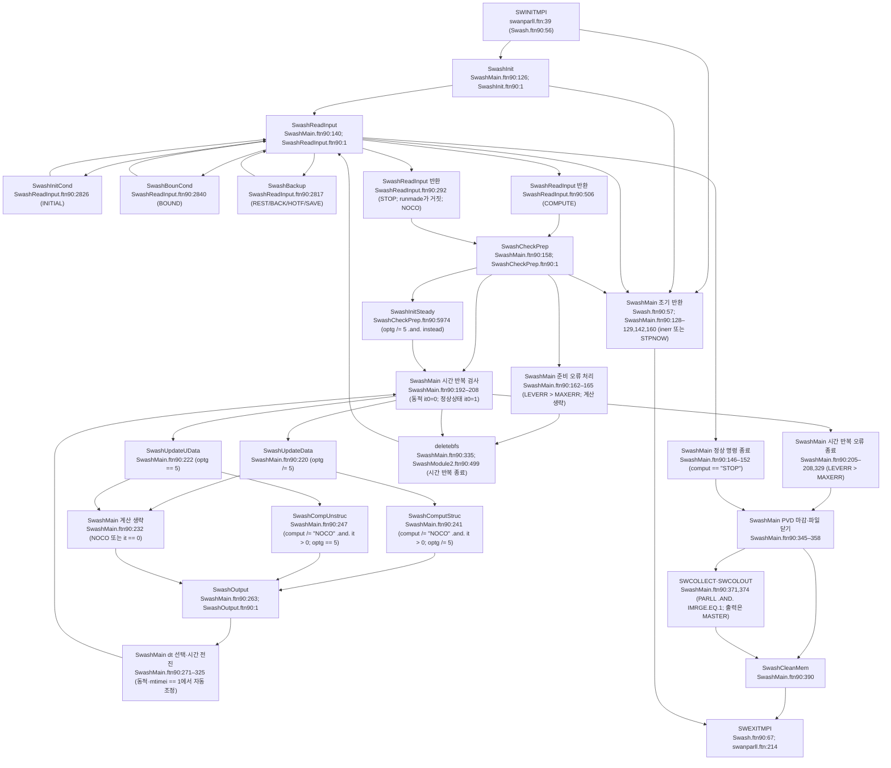
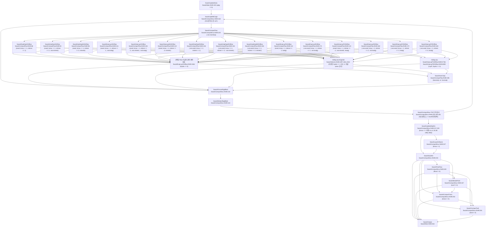
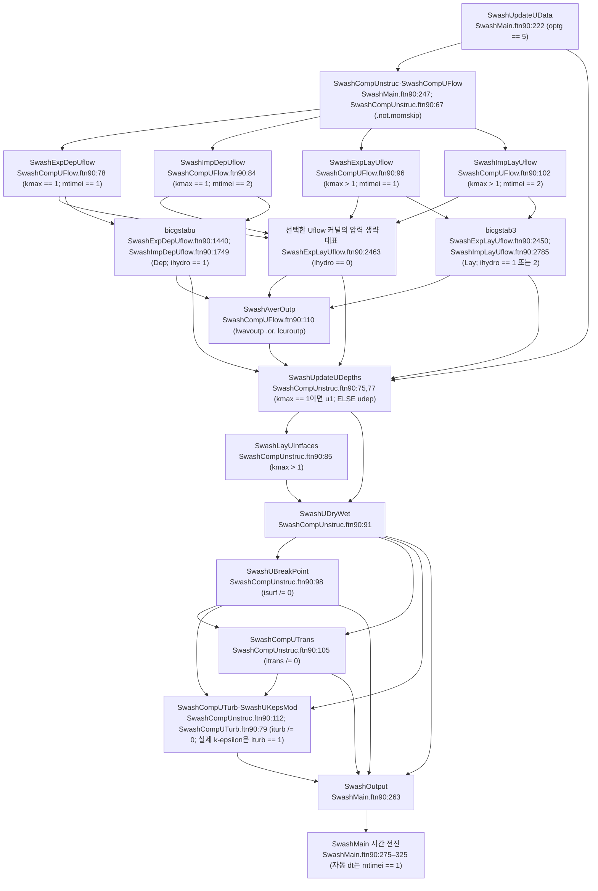

# SWASH 12.01 실행 한 번의 호출 흐름

## 판독 기준과 요약

이 보고서는 소스코드와 동봉 문서를 대조한 AI 분석이다.
이 보고서는 모델 실행 결과를 포함하지 않는다.
코드 경로의 기준 디렉터리는 `models/SWASH/raw/source_code/swash/`다.
본문의 `src/파일:줄`은 이 디렉터리를 기준으로 한다.
노트 경로의 기준 디렉터리는 저장소 루트다.
코드의 판 번호는 `src/SwashInit.ftn90:79`의 `VERNUM = 12.01`이다.
원자료는 `a486d5f`의 얕은 사본이다. 공개 저장소 사본 `../extract/SWASH/external/gl`의 `git log main`에서 센 전체 이력은 91커밋이다. 첫 커밋은 `744735e 2022-07-30 Initial commit`이다. 마지막 커밋은 `a486d5f 2026-05-26 Merge branch 'master' into 'main'`이다. [10-15 git 이력 판정]
문서 PDF의 마지막 변경은 `7949227 2026-05-06 release v12.01`이다. 그 뒤 소스 변경은 `608ffd7 2026-05-18 small bug fix`와 `9554c98 2026-05-26 updated src`의 두 커밋이다. 두 커밋의 `git show --stat`에 나온 변경 파일은 합계 5개다. 문서 기준 `7949227`과 코드 기준 `a486d5f`의 차이는 이 전체 이력으로 대조한다. 판정 근거는 [git 대조 AD](../compare/SWASH-git-verify-AD.md)와 [git 대조 E2](../compare/SWASH-git-verify-E2.md)다. [10-15 git 이력 판정]

`switch.pl:57`의 `if ($tim=~/TRUE/) {$newline=~s/^!TIMG//;}`는 `-timg`에서만 `!TIMG`를 제거한다.
`switch.pl:58`의 `if ($mpi=~/TRUE/) {$newline=~s/^!MPI//;}`는 `-mpi`에서만 `!MPI`를 제거한다.
`switch.pl:60`의 `if ($dos=~/TRUE/) {$newline=~s/^!DOS//;}`는 `-dos`에서만 `!DOS`를 제거한다.
`switch.pl:61`의 `if ($unx=~/TRUE/) {$newline=~s/^!UNIX//;}`는 `-unix`에서만 `!UNIX`를 제거한다.
`switch.pl:65`의 `if ($cvi=~/TRUE/) {$newline=~s/^!CVIS//;}`는 `-cvis`에서만 `!CVIS`를 제거한다.
`switch.pl:59,62–64,66–67`은 `!F95`, `!/Cray`, `!/SGI`, `!/impi`, `!MatL4`, `!MatL5`를 별도로 처리한다.
`switch.pl:54–68`에는 `!DIFF`, `!MUD`, `!TEST`, `!VEGE`를 제거하는 규칙이 없다.
이 네 표지의 행은 이 보고서에서 실행 호출로 세지 않는다.
일반 `!` 주석 안의 `call`도 실행 호출로 세지 않는다.
`!$OMP`는 OpenMP 지시문으로 구별한다.

문서 쪽 번호는 PDF 쪽 번호다.
문서의 인쇄 쪽 번호에 8을 더하면 이 보고서의 쪽 번호가 된다.
판독 기록은 위치 색인으로만 사용한다.
코드 판정은 `nl -ba`로 연 원문에 근거한다.
문서의 식·명령 문법·기본값 판정은 해당 쪽 이미지에 근거한다.
표에서 `항상`은 해당 루틴에 도달한 뒤의 조건이다.
상위 루틴의 조건은 하위 호출에도 적용한다.
`STPNOW()`와 `LEVERR > MAXERR`에 따른 조기 반환은 정상 계산 순서와 구별한다.
배열 표의 `직전 단계 값 사용(지연)`은 같은 시간 단계에서 아직 재계산하지 않은 값을 읽는다는 뜻이다.
배열 표의 `직전 반복 값 사용`은 같은 시간 단계의 FSI 또는 선형·비선형 반복에서 앞선 반복 값을 읽는다는 뜻이다.

확인: 주 프로그램은 `SWINITMPI`, `SwashMain`, `SWEXITMPI` 순서로 호출한다. 근거는 `src/Swash.ftn90:56`의 `call SWINITMPI`, `:61`의 `call SwashMain`, `:67`의 `call SWEXITMPI`다.
확인: `SwashMain`은 명령 반복문 안에 시간 반복문을 둔다. 근거는 `src/SwashMain.ftn90:135`의 `repeatloop: do`와 `:201`의 `timeloop: do`다.
확인: 동적 계산은 `it=0`에서 입력·경계를 갱신하고 출력한다. `src/SwashMain.ftn90:232`의 `if ( comput /= 'NOCO' .and. it > 0 ) then`은 이 단계의 유동 계산을 건너뛴다.
확인: 구조 격자는 FSI 반복 뒤에 수심·층 경계·마스크·수송·난류를 계산한다. 근거는 §2.1의 호출 순서다.
확인: 비구조 격자는 `SwashCompUnstruc`와 `SwashCompUFlow`를 사용한다. 근거는 `src/SwashMain.ftn90:247`의 `call SwashCompUnstruc`와 `src/SwashCompUnstruc.ftn90:67`의 `if ( .not.momskip ) call SwashCompUFlow`다.
확인: 시간 간격 조정은 출력 호출 뒤에 있다. 근거는 `src/SwashMain.ftn90:263`의 `call SwashOutput`과 `:275–303`의 시간 갱신 블록이다.

분류별 개수(10-15 결론 전수 검증 뒤 §8 차이 결론 행을 Claude가 다시 셈): 결론 행 22 · 일치 1 · A 0 · B 4 · C 11 · D 0 · E 1 · F 3 · H 2 · G 0 · X 0. §2 대조 표에서 일치로 끝난 행은 이 집계에 넣지 않는다.

호출 원장은 주 프로그램을 포함한 호출자 34개에서 잠재 CALL 문 1,179개를 기록한다.
이 수는 §1.4와 §2의 직접 호출 표를 만든 원문 추출 결과다.
이 수는 `!TIMG` 계측 호출을 포함한다.
수치 커널 하위 호출 원장은 커널 28개의 잠재 CALL 위치 907개를 기록한다.
준비·갱신·출력의 보조 루틴 원장은 파일 58개의 잠재 CALL 위치 650개를 기록한다.
이 수는 실제 실행에서 모든 분기를 한 번씩 실행한다는 뜻이 아니다.
주요 차이는 자동 dt 증가의 추가 조건 RF-001과 U 접미어의 노트 오기 RF-006이다.
비구조 백업·재시작의 배열 위치 불일치는 RF-016의 강한 코드 결함 후보로 구별했다.

## 1 시작·입력 읽기 순서

### 1.1 주 프로그램과 명령 반복문

| 순서 | 호출 위치 파일:줄 원문 | 조건(명령 옵션·스위치 포함) | 피호출 정의 파일:줄 |
|---|---|---|---|
| 1 | `src/Swash.ftn90:56` `call SWINITMPI` | 항상. 실제 MPI 코드는 `!MPI` 전처리에 따른다. | `src/swanparll.ftn`의 `SWINITMPI` 정의는 §2의 MPI 표 참조. |
| 2 | `src/Swash.ftn90:61` `call SwashMain` | `:57`의 `if (STPNOW()) goto 999`를 통과한다. | `src/SwashMain.ftn90:1` |
| 3 | `src/SwashMain.ftn90:126` `call SwashInit ( inerr )` | 최초 한 번. `inerr > 0` 또는 `STPNOW()`이면 반환한다. | `src/SwashInit.ftn90:1` |
| 4 | `src/SwashInit.ftn90:85` `call OCPINI ( 'swashinit', .true., inerr )` | 초기 입출력 환경을 설정한다. | `src/ocpids.ftn:7` |
| 5 | `src/SwashMain.ftn90:140` `call SwashReadInput ( comput )` | `repeatloop: do`마다 실행한다. | `src/SwashReadInput.ftn90:1` |
| 6 | `src/SwashReadInput.ftn90:257` `100 call NWLINE` | 새 명령 줄을 읽는다. `goto 100`은 다음 명령으로 돌아간다. | `src/ocpcre.ftn:111` |
| 7 | `src/SwashReadInput.ftn90:276` `call INKEYW ('REQ',' ')` | EOF 처리 뒤 명령 키워드를 읽는다. | `src/ocpcre.ftn:219` |
| 8 | `src/SwashReadInput.ftn90:314` `call FOR (incnum(inclev), FILENM, 'OF', iostat)` | `if ( KEYWIS ('INCL') ) then`. `INPUTF = incnum(inclev)` 뒤 `goto 100`으로 돌아간다. | `src/ocpmix.ftn:1603` |
| 9 | `src/SwashReadInput.ftn90:2826` `call SwashInitCond` | `if ( KEYWIS ('INIT') ) then`. 명령을 읽는 중 초기 조건을 처리한다. | `src/SwashInitCond.ftn90:1` |
| 10 | `src/SwashReadInput.ftn90:2840` `call SwashBounCond ( XGRDGL, YGRDGL, KGRPGL )` | `if ( KEYWIS ('BOU') ) then`. 임시로 전역 격자 크기를 사용한다. 호출 뒤 지역 격자 크기를 복원한다. | `src/SwashBounCond.ftn90:1` |
| 11 | `src/SwashReadInput.ftn90:2817` `call SwashBackup` | `if ( KEYWIS('REST') .or. KEYWIS ('BACK') .or. KEYWIS('HOTF') .or. KEYWIS('SAVE') ) then`. 격자·수심 읽기 검사에 통과해야 한다. | `src/SwashBackup.ftn90:1` |
| 12 | `src/SwashReadInput.ftn90:2876` `call SwashReqOutL ( found )` | 앞선 명령 분기에 해당하지 않으면 출력 위치 명령을 검사한다. | `src/SwashReqOutL.ftn90:1` |
| 13 | `src/SwashReadInput.ftn90:2882` `call SwashReqOutQ ( found )` | `found`가 거짓이면 출력 요청 명령을 검사한다. | `src/SwashReqOutQ.ftn90:1` |
| 14 | `src/SwashMain.ftn90:150` `call FOR (nds, FILENM, 'UF', iostat)` | `if ( comput == 'STOP' ) then`. `FILENM = 'norm_end'`로 정상 종료 파일을 쓴다. | `src/ocpmix.ftn:1603` |
| 15 | `src/SwashMain.ftn90:158` `call SwashCheckPrep` | `comput /= 'STOP'`. 오류 수준을 검사하기 전에 준비 루틴에 진입한다. | `src/SwashCheckPrep.ftn90:1` |
| 16 | `src/SwashMain.ftn90:183` `if ( ITEST > 0 ) call SwashPrintSettings` | `LEVERR <= MAXERR`. | `src/SwashPrintSettings.ftn90:1` |
| 17 | `src/SwashMain.ftn90:187` `call SWSYNC` | 준비를 마친 뒤. | §2의 MPI 표 참조. |
| 18 | `src/SwashMain.ftn90:335` `call delete ( fbfs )` | 한 COMPUTE의 시간 반복이 끝난 뒤. Fourier 연결 목록을 삭제한다. | generic `delete`의 `fbfs` 구현은 §1.4 참조. |
| 19 | `src/SwashMain.ftn90:371` `call SWCOLLECT ( blkndc, blknd )` | 정상 명령 반복 종료 뒤 `if ( PARLL .AND. IMRGE.EQ.1 ) then`. | §2의 MPI 표 참조. |
| 20 | `src/SwashMain.ftn90:374` `call SWCOLOUT ( blkndc )` | 같은 병합 블록의 `if ( INODE == MASTER ) then`. | §2의 출력 표 참조. |
| 21 | `src/SwashMain.ftn90:390` `call SwashCleanMem` | PVD 마감·열린 파일 닫기·병합·PRINTF 닫기를 마친 뒤. | `src/SwashCleanMem.ftn90:1` |
| 22 | `src/Swash.ftn90:67` `call SWEXITMPI` | `SwashMain` 반환 뒤. 초기 MPI 오류의 `goto 999`도 이 호출로 온다. | §2의 MPI 표 참조. |

### 1.2 COMPUTE·STOP의 제어값

`src/SwashReadInput.ftn90:450`의 `IF ( KEYWIS ('COMP') ) THEN`은 `:452`에서 `comput  = 'COMP'`를 설정한다.
같은 분기는 `:453`에서 `runmade = .true.`를 설정한다.
정상상태 계산 조건은 `:456`의 `if ( nstatm == 0 .or. KEYWIS('STAT') ) then`이다.
정상상태 계산은 `:462–467`에서 `tfinc  = tinic`, `timco  = tinic`, `dt     = 1.e10`, `rdtim  = 0.`, `nstatc = 0`, `mtc    = 1`을 설정한다.
동적 계산은 `:479`의 `call INITVD ('DELTC', dt, 'REQ', 0d0)`과 `:480`의 `call INCTIM (ITMOPT,'TENDC',tfinc,'REQ',0d0)`으로 시간 간격과 종료 시각을 읽는다.
동적 계산은 `:481`에서 `nstatc = 1`을 설정한다.
동적 계산은 `:490`에서 `rdtim = 1./dt`를 설정한다.
동적 계산은 `:494`에서 `timco = tinic`을 설정한다.
COMPUTE 분기는 `:506`의 `return`으로 `SwashMain`에 제어를 반환한다.
`src/SwashReadInput.ftn90:286`의 `if ( KEYWIS ('STOP') ) then`은 `runmade`가 참이면 `:289`의 `comput = 'STOP'`을 설정한다.
같은 STOP 분기는 `runmade`가 거짓이면 `:292`의 `comput = 'NOCO'`를 설정한다.
해석: STOP의 두 경로를 모두 즉시 정상 종료라고 요약하면 `NOCO` 경로를 빠뜨린다.

### 1.3 검사·준비와 초기 조건

`SwashInitCond`는 `SwashCheckPrep`의 하위 호출이 아니다.
`src/SwashReadInput.ftn90:2826`의 `call SwashInitCond`가 INITIAL 명령을 처리한다.
`src/SwashInitCond.ftn90:127`의 `if ( KEYWIS('ZERO') ) then`은 `:131–132`에서 `s1 = 0.`과 `u1 = 0.`을 쓴다.
`src/SwashInitCond.ftn90:141`의 `else if ( KEYWIS('STEA') ) then`은 `:146`에서 `instead = .true.`를 쓴다.
STEADY의 속도 계산은 검사·준비의 끝으로 지연된다.
`src/SwashInitCond.ftn90:148`의 `else if ( KEYWIS('HOTS') .or. KEYWIS('REST') ) then`은 기존 해 파일을 읽는다.
`src/SwashInitCond.ftn90:485`의 `s1 = wlev`와 `:487`의 `u1 = vx`는 CONSTANT 경로다.
비구조 격자 CONSTANT 경로는 `:507`의 `un = nx * vx + ny * vy`와 `:508`의 `u1(iface,:) = un`으로 법선 속도를 쓴다.

| 순서 | 호출 위치 파일:줄 원문 | 조건(명령 옵션·스위치 포함) | 피호출 정의 파일:줄 |
|---|---|---|---|
| 준비 1 | `src/SwashCheckPrep.ftn90:948` `call SPRCON ( xcgrid, ycgrid, kgrpnt )` | 앞선 입력 검사와 매개변수 보정을 마친 뒤 출력 영역을 검사한다. | `src/swanser.ftn:1720` |
| 준비 2 | `src/SwashCheckPrep.ftn90:984` `call SwashGeometrics` | `if ( .not.oned .and. optg /= 5 ) then`. 뒤에 기하량 교환·주기 경계 처리가 따른다. | `src/SwashGeometrics.ftn90:1` |
| 준비 3 | `src/SwashCheckPrep.ftn90:1548` `call SwashBCspectrum ( curbfs, curbfs%spparm )` | Fourier 경계 목록에서 내부 생성 스펙트럼을 준비하는 분기. 상세 조건은 §1.4 원장 참조. | `src/SwashBCspectrum.ftn90:1` |
| 준비 4 | `src/SwashCheckPrep.ftn90:2901` `call SwashUpdFlowFlds` / `:2903` `call SwashUpdUFlowFlds` | `optg /= 5` / ELSE. 공간 입력장을 유동 배열에 넣는다. | 각각 동명 `.ftn90:1` |
| 준비 5 | `src/SwashCheckPrep.ftn90:3135` `call SwashFlowDP` / `:3137` `call SwashFlowUDP` | `optg /= 5` / ELSE. | 각각 동명 `.ftn90:1` |
| 준비 6 | `src/SwashCheckPrep.ftn90:3143` `if ( optg /= 5 .and. iporos == 1 ) call SwashPorousStruc` | 구조 격자 다공성 구조물. | `src/SwashPorousStruc.ftn90:1` |
| 준비 7 | `src/SwashCheckPrep.ftn90:3148` `if ( optg /= 5 .and. ifloat /= 0 ) call SwashFloatObjects` | 구조 격자 부체. 매 시간 단계의 직접 호출이 아니다. | `src/SwashFloatObjects.ftn90:1` |
| 준비 8 | `src/SwashCheckPrep.ftn90:3895` `call SwashSpongeLayer ( tempxl, tempxr, tempyb, tempyt )` / `:3922` `call SwashUSpongLayer` | 구조 / 비구조 격자의 스펀지층을 준비한다. | 각각 동명 `.ftn90:1` |
| 준비 9 | `src/SwashCheckPrep.ftn90:3927` `if ( optg /= 5 .and. iamb /= 0 ) call SwashAmbCurrent` | 구조 격자 배경 흐름. | `src/SwashAmbCurrent.ftn90:1` |
| 준비 10 | `src/SwashCheckPrep.ftn90:4258` `call SwashInitBCtrans` / `:4260` `call SwashInitBCUtrans` | `itrans /= 0` 안의 구조 / 비구조 격자 분기. | 각각 동명 `.ftn90:1` |
| 준비 11 | `src/SwashCheckPrep.ftn90:5905` `call SwashUpdateDepths (   u1,   v1 )` / `:5907` `call SwashUpdateDepths ( udep, vdep )` | `optg /= 5` 안에서 `kmax == 1` / ELSE. | `src/SwashUpdateDepths.ftn90:1` |
| 준비 12 | `src/SwashCheckPrep.ftn90:5913` `call SwashUpdateUDepths ( u1(:,1) )` / `:5915` `call SwashUpdateUDepths ( udep )` | 비구조 격자에서 `kmax == 1` / ELSE. | `src/SwashUpdateUDepths.ftn90:1` |
| 준비 13 | `src/SwashCheckPrep.ftn90:5927` `call SwashLayerIntfaces` / `:5929` `call SwashLayUIntfaces` | `kmax > 1` 안의 구조 / 비구조 격자 분기. | 각각 동명 `.ftn90:1` |
| 준비 14 | `src/SwashCheckPrep.ftn90:5938` `call SwashDryWet` / `:5940` `call SwashUDryWet` | 구조 / 비구조 격자. | 각각 동명 `.ftn90:1` |
| 준비 15 | `src/SwashCheckPrep.ftn90:5948` `if ( optg /= 5 .and. ifloat /= 0 ) call SwashPresFlow` | 구조 격자 부체·압력 유동 마스크. | `src/SwashPresFlow.ftn90:1` |
| 준비 16 | `src/SwashCheckPrep.ftn90:5957` `call SwashBotFrict ( u1, v1 )` / `:5959` `call SwashUBotFrict ( u1 )` | `irough /= 0 .and. ( irough /= 4 .or. kmax == 1 )` 안의 구조 / 비구조 격자 분기. | 각각 동명 `.ftn90:1` |
| 준비 17 | `src/SwashCheckPrep.ftn90:5968` `call SwashForcesRigidBod` | 호출은 무조건이다. 내부 적용 조건은 §2.5 참조. | `src/SwashForcesRigidBod.ftn90:1` |
| 준비 18 | `src/SwashCheckPrep.ftn90:5974` `if ( optg /= 5 .and. instead ) call SwashInitSteady` | INITIAL STEADY가 남아 있는 구조 격자 경로. | `src/SwashInitSteady.ftn90:1` |

`src/SwashCheckPrep.ftn90:607`의 `if ( mtimei < 0 ) then`은 시간 적분의 기본값을 결정한다.
구조 격자는 `:609`의 `mtimei = 1`을 사용한다.
구조 격자의 mimetic 경로는 `:610`의 `if ( mimetic ) mtimei = 2`를 사용한다.
비구조 격자는 `:612`의 `mtimei = 2`를 사용한다.
부체 경로는 `:1117`의 `if ( mtimei /= 2 ) call msgerr (3, 'semi-implicit time integration is required in case of floating object or pressurized flow')`로 반암시적 적분을 요구한다.
부체 이동이 없는 경우 `:1442–1443`은 `pship(8) = 0.`과 `pship(9) = 1.`을 설정한다.
해석: 이 설정이 일반 구조 격자 계산에서 FSI 블록을 한 번만 실행하게 한다.

### 1.4 시작 경로의 직접 호출 원장

이 원장은 호출문을 소스 줄 순서로 적는다.
`Swash`와 `SwashMain`의 직접 호출을 먼저 적는다.
`SwashInit`, `SwashReadInput`, `SwashCheckPrep`, `SwashPrintSettings`, `SwashCleanMem` 표는 `SwashMain`에서 두 번째 호출 단계다.
`SwashInitCond`, `SwashInitSteady`, `SwashBounCond` 표는 사용자가 지정한 진입점을 추가 전개한 표다.
§2는 시간 단계의 첫 번째 호출 단계와 두 번째 호출 단계를 적는다.
`SwashComputFlow`, `SwashCompUFlow`, 수송·난류 선택 루틴의 분기는 별도 표로 모두 전개한다.
그 아래 수치 커널의 호출은 §2.8에서 이름과 위치를 적는다.
조건 열의 `:줄`은 해당 표의 호출자 파일을 기준으로 한다.
ELSE와 ELSE IF의 `선행 분기 제외`는 같은 IF 선택문에서 앞선 분기를 실행하지 않았다는 뜻이다.
DO 조건은 호출의 반복 범위를 나타낸다.
`TIMG 스위치` 행은 `-timg`에서만 실행한다.
계측·오류·추적 호출도 이 원장에 포함한다.
내장 루틴은 정의 파일 대신 `Fortran intrinsic`으로 표시한다.


#### Swash의 직접 호출 (3개 호출문)

| 순서 | 호출 위치 파일:줄 원문 | 조건(명령 옵션·스위치 포함) | 피호출 정의 파일:줄 |
|---|---|---|---|
| 1 | `src/Swash.ftn90:56` `call SWINITMPI` | 항상 | `src/swanparll.ftn:39` |
| 2 | `src/Swash.ftn90:61` `call SwashMain` | 항상 | `src/SwashMain.ftn90:1` |
| 3 | `src/Swash.ftn90:67` `call SWEXITMPI` | 항상 | `src/swanparll.ftn:214` |


#### SwashMain의 직접 호출 (40개 호출문)

| 순서 | 호출 위치 파일:줄 원문 | 조건(명령 옵션·스위치 포함) | 피호출 정의 파일:줄 |
|---|---|---|---|
| 1 | `src/SwashMain.ftn90:118` `!TIMG    call SWTSTA(1)` | TIMG 스위치 | `src/swanser.ftn:3941` |
| 2 | `src/SwashMain.ftn90:125` `!TIMG    call SWTSTA(2)` | TIMG 스위치 | `src/swanser.ftn:3941` |
| 3 | `src/SwashMain.ftn90:126` `call SwashInit ( inerr )` | 항상 | `src/SwashInit.ftn90:1` |
| 4 | `src/SwashMain.ftn90:127` `!TIMG    call SWTSTO(2)` | TIMG 스위치 | `src/swanser.ftn:4108` |
| 5 | `src/SwashMain.ftn90:139` `!TIMG       call SWTSTA(3)` | TIMG 스위치<br>:135 `repeatloop: do` | `src/swanser.ftn:3941` |
| 6 | `src/SwashMain.ftn90:140` `call SwashReadInput ( comput )` | :135 `repeatloop: do` | `src/SwashReadInput.ftn90:1` |
| 7 | `src/SwashMain.ftn90:141` `!TIMG       call SWTSTO(3)` | TIMG 스위치<br>:135 `repeatloop: do` | `src/swanser.ftn:4108` |
| 8 | `src/SwashMain.ftn90:150` `call FOR (nds, FILENM, 'UF', iostat)` | :135 `repeatloop: do`<br>:146 `if ( comput == 'STOP' ) then` | `src/ocpmix.ftn:1603` |
| 9 | `src/SwashMain.ftn90:157` `!TIMG       call SWTSTA(4)` | TIMG 스위치<br>:135 `repeatloop: do` | `src/swanser.ftn:3941` |
| 10 | `src/SwashMain.ftn90:158` `call SwashCheckPrep` | :135 `repeatloop: do` | `src/SwashCheckPrep.ftn90:1` |
| 11 | `src/SwashMain.ftn90:159` `!TIMG       call SWTSTO(4)` | TIMG 스위치<br>:135 `repeatloop: do` | `src/swanser.ftn:4108` |
| 12 | `src/SwashMain.ftn90:183` `if ( ITEST > 0 ) call SwashPrintSettings` | :135 `repeatloop: do`<br>:167 `else` (:162 IF의 선행 분기 제외)<br>`if ( ITEST > 0 )` | `src/SwashPrintSettings.ftn90:1` |
| 13 | `src/SwashMain.ftn90:187` `call SWSYNC` | :135 `repeatloop: do`<br>:167 `else` (:162 IF의 선행 분기 제외) | `src/swanparll.ftn:332` |
| 14 | `src/SwashMain.ftn90:213` `call SWSYNC` | :135 `repeatloop: do`<br>:167 `else` (:162 IF의 선행 분기 제외)<br>:201 `timeloop: do` | `src/swanparll.ftn:332` |
| 15 | `src/SwashMain.ftn90:218` `!TIMG             call SWTSTA(7)` | TIMG 스위치<br>:135 `repeatloop: do`<br>:167 `else` (:162 IF의 선행 분기 제외)<br>:201 `timeloop: do` | `src/swanser.ftn:3941` |
| 16 | `src/SwashMain.ftn90:220` `call SwashUpdateData ( it )` | :135 `repeatloop: do`<br>:167 `else` (:162 IF의 선행 분기 제외)<br>:201 `timeloop: do`<br>:219 `if ( optg /= 5 ) then` | `src/SwashUpdateData.ftn90:1` |
| 17 | `src/SwashMain.ftn90:222` `call SwashUpdateUData ( it )` | :135 `repeatloop: do`<br>:167 `else` (:162 IF의 선행 분기 제외)<br>:201 `timeloop: do`<br>:221 `else` (:219 IF의 선행 분기 제외) | `src/SwashUpdateUData.ftn90:1` |
| 18 | `src/SwashMain.ftn90:224` `!TIMG             call SWTSTO(7)` | TIMG 스위치<br>:135 `repeatloop: do`<br>:167 `else` (:162 IF의 선행 분기 제외)<br>:201 `timeloop: do` | `src/swanser.ftn:4108` |
| 19 | `src/SwashMain.ftn90:229` `call SWSYNC` | :135 `repeatloop: do`<br>:167 `else` (:162 IF의 선행 분기 제외)<br>:201 `timeloop: do` | `src/swanparll.ftn:332` |
| 20 | `src/SwashMain.ftn90:236` `!TIMG                call SWTSTA(8)` | TIMG 스위치<br>:135 `repeatloop: do`<br>:167 `else` (:162 IF의 선행 분기 제외)<br>:201 `timeloop: do`<br>:232 `if ( comput /= 'NOCO' .and. it > 0 ) then` | `src/swanser.ftn:3941` |
| 21 | `src/SwashMain.ftn90:241` `call SwashComputStruc` | :135 `repeatloop: do`<br>:167 `else` (:162 IF의 선행 분기 제외)<br>:201 `timeloop: do`<br>:232 `if ( comput /= 'NOCO' .and. it > 0 ) then`<br>:237 `if ( optg /= 5 ) then` | `src/SwashComputStruc.ftn90:1` |
| 22 | `src/SwashMain.ftn90:247` `call SwashCompUnstruc` | :135 `repeatloop: do`<br>:167 `else` (:162 IF의 선행 분기 제외)<br>:201 `timeloop: do`<br>:232 `if ( comput /= 'NOCO' .and. it > 0 ) then`<br>:243 `else` (:237 IF의 선행 분기 제외) | `src/SwashCompUnstruc.ftn90:1` |
| 23 | `src/SwashMain.ftn90:250` `!TIMG                call SWTSTO(8)` | TIMG 스위치<br>:135 `repeatloop: do`<br>:167 `else` (:162 IF의 선행 분기 제외)<br>:201 `timeloop: do`<br>:232 `if ( comput /= 'NOCO' .and. it > 0 ) then` | `src/swanser.ftn:4108` |
| 24 | `src/SwashMain.ftn90:257` `call SWSYNC` | :135 `repeatloop: do`<br>:167 `else` (:162 IF의 선행 분기 제외)<br>:201 `timeloop: do` | `src/swanparll.ftn:332` |
| 25 | `src/SwashMain.ftn90:262` `!TIMG             call SWTSTA(9)` | TIMG 스위치<br>:135 `repeatloop: do`<br>:167 `else` (:162 IF의 선행 분기 제외)<br>:201 `timeloop: do` | `src/swanser.ftn:3941` |
| 26 | `src/SwashMain.ftn90:263` `call SwashOutput` | :135 `repeatloop: do`<br>:167 `else` (:162 IF의 선행 분기 제외)<br>:201 `timeloop: do` | `src/SwashOutput.ftn90:1` |
| 27 | `src/SwashMain.ftn90:264` `!TIMG             call SWTSTO(9)` | TIMG 스위치<br>:135 `repeatloop: do`<br>:167 `else` (:162 IF의 선행 분기 제외)<br>:201 `timeloop: do` | `src/swanser.ftn:4108` |
| 28 | `src/SwashMain.ftn90:281` `call msgerr ( 1, trim(msgstr) )` | :135 `repeatloop: do`<br>:167 `else` (:162 IF의 선행 분기 제외)<br>:201 `timeloop: do`<br>:271 `if ( nstatc == 1 ) then`<br>:275 `if ( mtimei == 1 ) then`<br>:277 `if ( cflmax > pnums(3) ) then` | `src/ocpmix.ftn:1262` |
| 29 | `src/SwashMain.ftn90:293` `call msgerr ( 1, trim(msgstr) )` | :135 `repeatloop: do`<br>:167 `else` (:162 IF의 선행 분기 제외)<br>:201 `timeloop: do`<br>:271 `if ( nstatc == 1 ) then`<br>:275 `if ( mtimei == 1 ) then`<br>:285 `else if ( cflmax < pnums(2) ) then` (:277 IF의 선행 분기 제외)<br>:287 `if ( .not. istep < 20 ) then` | `src/ocpmix.ftn:1262` |
| 30 | `src/SwashMain.ftn90:311` `call TXPBLA(chars(1),if(1),il(1))` | :135 `repeatloop: do`<br>:167 `else` (:162 IF의 선행 분기 제외)<br>:201 `timeloop: do`<br>:271 `if ( nstatc == 1 ) then`<br>:305 `if ( .not. real(timco) > real(tfinc) ) then`<br>:307 `if (SCREEN /= PRINTF .and. INODE == MASTER ) then` | `src/swanser.ftn:4620` |
| 31 | `src/SwashMain.ftn90:313` `call TXPBLA(chars(2),if(2),il(2))` | :135 `repeatloop: do`<br>:167 `else` (:162 IF의 선행 분기 제외)<br>:201 `timeloop: do`<br>:271 `if ( nstatc == 1 ) then`<br>:305 `if ( .not. real(timco) > real(tfinc) ) then`<br>:307 `if (SCREEN /= PRINTF .and. INODE == MASTER ) then` | `src/swanser.ftn:4620` |
| 32 | `src/SwashMain.ftn90:335` `call delete ( fbfs )` | :135 `repeatloop: do` | `src/SwashModule2.ftn90:499` |
| 33 | `src/SwashMain.ftn90:341` `!TIMG    call SWTSTO(1)` | TIMG 스위치 | `src/swanser.ftn:4108` |
| 34 | `src/SwashMain.ftn90:362` `call SWSYNC` | 항상 | `src/swanparll.ftn:332` |
| 35 | `src/SwashMain.ftn90:363` `!TIMG    call SWTSTA(9)` | TIMG 스위치 | `src/swanser.ftn:3941` |
| 36 | `src/SwashMain.ftn90:371` `call SWCOLLECT ( blkndc, blknd )` | :364 `if ( PARLL .AND. IMRGE.EQ.1 ) then` | `src/swanparll.ftn:4748` |
| 37 | `src/SwashMain.ftn90:374` `call SWCOLOUT ( blkndc )` | :364 `if ( PARLL .AND. IMRGE.EQ.1 ) then`<br>:373 `if ( INODE == MASTER ) then` | `src/swanparll.ftn:4956` |
| 38 | `src/SwashMain.ftn90:378` `!TIMG    call SWTSTO(9)` | TIMG 스위치 | `src/swanser.ftn:4108` |
| 39 | `src/SwashMain.ftn90:380` `!TIMG    call SWPRTI` | TIMG 스위치 | `src/swanser.ftn:4267` |
| 40 | `src/SwashMain.ftn90:390` `call SwashCleanMem` | 항상 | `src/SwashCleanMem.ftn90:1` |


#### SwashInit의 직접 호출 (1개 호출문)

| 순서 | 호출 위치 파일:줄 원문 | 조건(명령 옵션·스위치 포함) | 피호출 정의 파일:줄 |
|---|---|---|---|
| 1 | `src/SwashInit.ftn90:85` `call OCPINI ( 'swashinit', .true., inerr )` | 항상 | `src/ocpids.ftn:7` |


#### SwashReadInput의 직접 호출 (401개 호출문)

| 순서 | 호출 위치 파일:줄 원문 | 조건(명령 옵션·스위치 포함) | 피호출 정의 파일:줄 |
|---|---|---|---|
| 1 | `src/SwashReadInput.ftn90:253` `call strace (ient,'SwashReadInput')` | 항상 | `src/ocpmix.ftn:1152` |
| 2 | `src/SwashReadInput.ftn90:257` `100 call NWLINE` | 항상 | `src/ocpcre.ftn:111` |
| 3 | `src/SwashReadInput.ftn90:267` `call msgerr (4, 'unexpected end of command input')` | :259 `if ( ELTYPE == 'EOF' ) then`<br>:266 `if ( inclev == 0 ) then` | `src/ocpmix.ftn:1262` |
| 4 | `src/SwashReadInput.ftn90:276` `call INKEYW ('REQ',' ')` | 항상 | `src/ocpcre.ftn:219` |
| 5 | `src/SwashReadInput.ftn90:307` `call INCSTR ('FILE' , FILENM , 'REQ', ' ')` | :304 `if ( KEYWIS ('INCL') ) then` | `src/ocpcre.ftn:843` |
| 6 | `src/SwashReadInput.ftn90:310` `call msgerr (4, 'too many INCLUDE levels')` | :304 `if ( KEYWIS ('INCL') ) then`<br>:309 `if ( inclev > mxincl ) then` | `src/ocpmix.ftn:1262` |
| 7 | `src/SwashReadInput.ftn90:314` `call FOR (incnum(inclev), FILENM, 'OF', iostat)` | :304 `if ( KEYWIS ('INCL') ) then` | `src/ocpmix.ftn:1603` |
| 8 | `src/SwashReadInput.ftn90:335` `call INCSTR ('NAME'  , PROJID, 'UNC', BLANK)` | :333 `if ( KEYWIS ('PROJ') ) then` | `src/ocpcre.ftn:843` |
| 9 | `src/SwashReadInput.ftn90:336` `call INCSTR ('NR'    , PROJNR, 'REQ', BLANK)` | :333 `if ( KEYWIS ('PROJ') ) then` | `src/ocpcre.ftn:843` |
| 10 | `src/SwashReadInput.ftn90:337` `call NWLINE` | :333 `if ( KEYWIS ('PROJ') ) then` | `src/ocpcre.ftn:111` |
| 11 | `src/SwashReadInput.ftn90:339` `call INCSTR ('TITLE1', PROJT1, 'UNC', ' ')` | :333 `if ( KEYWIS ('PROJ') ) then` | `src/ocpcre.ftn:843` |
| 12 | `src/SwashReadInput.ftn90:340` `call NWLINE` | :333 `if ( KEYWIS ('PROJ') ) then` | `src/ocpcre.ftn:111` |
| 13 | `src/SwashReadInput.ftn90:342` `call INCSTR ('TITLE2', PROJT2, 'UNC', ' ')` | :333 `if ( KEYWIS ('PROJ') ) then` | `src/ocpcre.ftn:843` |
| 14 | `src/SwashReadInput.ftn90:343` `call NWLINE` | :333 `if ( KEYWIS ('PROJ') ) then` | `src/ocpcre.ftn:111` |
| 15 | `src/SwashReadInput.ftn90:345` `call INCSTR ('TITLE3', PROJT3, 'UNC', ' ')` | :333 `if ( KEYWIS ('PROJ') ) then` | `src/ocpcre.ftn:843` |
| 16 | `src/SwashReadInput.ftn90:359` `call IGNORE ('OPT')` | :357 `if ( KEYWIS('OUTP') ) then` | `src/ocpcre.ftn:2517` |
| 17 | `src/SwashReadInput.ftn90:360` `call INCSTR ('COMMENT', out_comment, 'UNC', ' ')` | :357 `if ( KEYWIS('OUTP') ) then` | `src/ocpcre.ftn:843` |
| 18 | `src/SwashReadInput.ftn90:362` `call INKEYW ('STA', ' ')` | :357 `if ( KEYWIS('OUTP') ) then` | `src/ocpcre.ftn:219` |
| 19 | `src/SwashReadInput.ftn90:364` `call ININTG ('FIELD', fld_table, 'STA', 15)` | :357 `if ( KEYWIS('OUTP') ) then`<br>:363 `if ( KEYWIS('TAB') ) then` | `src/ocpcre.ftn:683` |
| 20 | `src/SwashReadInput.ftn90:365` `if ( fld_table > 16 ) call msgerr (2, '[field] is too large')` | :357 `if ( KEYWIS('OUTP') ) then`<br>:363 `if ( KEYWIS('TAB') ) then`<br>`if ( fld_table > 16 )` | `src/ocpmix.ftn:1262` |
| 21 | `src/SwashReadInput.ftn90:366` `if ( fld_table < 8  ) call msgerr (2, '[field] is too small')` | :357 `if ( KEYWIS('OUTP') ) then`<br>:363 `if ( KEYWIS('TAB') ) then`<br>`if ( fld_table < 8  )` | `src/ocpmix.ftn:1262` |
| 22 | `src/SwashReadInput.ftn90:369` `call INKEYW ('STA', ' ')` | :357 `if ( KEYWIS('OUTP') ) then`<br>:363 `if ( KEYWIS('TAB') ) then` | `src/ocpcre.ftn:219` |
| 23 | `src/SwashReadInput.ftn90:373` `call ININTG ('NDEC', dec_block, 'STA', 6)` | :357 `if ( KEYWIS('OUTP') ) then`<br>:372 `if ( KEYWIS('BLO') ) then` | `src/ocpcre.ftn:683` |
| 24 | `src/SwashReadInput.ftn90:374` `if ( dec_block > 9 ) call msgerr (2, '[ndec] is too large')` | :357 `if ( KEYWIS('OUTP') ) then`<br>:372 `if ( KEYWIS('BLO') ) then`<br>`if ( dec_block > 9 )` | `src/ocpmix.ftn:1262` |
| 25 | `src/SwashReadInput.ftn90:375` `call ININTG ('LEN', nlen, 'STA', 200)` | :357 `if ( KEYWIS('OUTP') ) then`<br>:372 `if ( KEYWIS('BLO') ) then` | `src/ocpcre.ftn:683` |
| 26 | `src/SwashReadInput.ftn90:376` `if ( nlen > 9999 ) call msgerr (2, '[len] is too large')` | :357 `if ( KEYWIS('OUTP') ) then`<br>:372 `if ( KEYWIS('BLO') ) then`<br>`if ( nlen > 9999 )` | `src/ocpmix.ftn:1262` |
| 27 | `src/SwashReadInput.ftn90:397` `call INKEYW ('STA',' ')` | :395 `if ( KEYWIS ('MODE') ) then` | `src/ocpcre.ftn:219` |
| 28 | `src/SwashReadInput.ftn90:400` `if ( nstatm == 0 ) call msgerr (2, 'mode NONST incorrect here')` | :395 `if ( KEYWIS ('MODE') ) then`<br>:398 `if ( KEYWIS('NONST') .or. KEYWIS ('DYN') ) then`<br>`if ( nstatm == 0 )` | `src/ocpmix.ftn:1262` |
| 29 | `src/SwashReadInput.ftn90:406` `if ( nstatm == 1 ) call msgerr (2, 'mode STA incorrect here')` | :395 `if ( KEYWIS ('MODE') ) then`<br>:404 `else if ( KEYWIS ('STA') ) then` (:398 IF의 선행 분기 제외)<br>`if ( nstatm == 1 )` | `src/ocpmix.ftn:1262` |
| 30 | `src/SwashReadInput.ftn90:408` `call INKEYW ('STA',' ')` | :395 `if ( KEYWIS ('MODE') ) then`<br>:404 `else if ( KEYWIS ('STA') ) then` (:398 IF의 선행 분기 제외) | `src/ocpcre.ftn:219` |
| 31 | `src/SwashReadInput.ftn90:412` `call INKEYW ('STA', ' ')` | :395 `if ( KEYWIS ('MODE') ) then` | `src/ocpcre.ftn:219` |
| 32 | `src/SwashReadInput.ftn90:423` `call INKEYW ('STA', ' ')` | :395 `if ( KEYWIS ('MODE') ) then` | `src/ocpcre.ftn:219` |
| 33 | `src/SwashReadInput.ftn90:430` `call INKEYW ('STA', ' ')` | :395 `if ( KEYWIS ('MODE') ) then` | `src/ocpcre.ftn:219` |
| 34 | `src/SwashReadInput.ftn90:455` `call INKEYW ('STA','  ')` | :450 `IF ( KEYWIS ('COMP') ) THEN` | `src/ocpcre.ftn:219` |
| 35 | `src/SwashReadInput.ftn90:457` `if ( nstatm > 0 ) call INCTIM (ITMOPT,'TIME',tinic,'REQ',0d0)` | :450 `IF ( KEYWIS ('COMP') ) THEN`<br>:456 `if ( nstatm == 0 .or. KEYWIS('STAT') ) then`<br>`if ( nstatm > 0 )` | `src/ocpcre.ftn:1037` |
| 36 | `src/SwashReadInput.ftn90:459` `call msgerr (2, '[time] before current time')` | :450 `IF ( KEYWIS ('COMP') ) THEN`<br>:456 `if ( nstatm == 0 .or. KEYWIS('STAT') ) then`<br>:458 `if ( tinic < timco ) then` | `src/ocpmix.ftn:1262` |
| 37 | `src/SwashReadInput.ftn90:469` `call IGNORE ('NONST')` | :450 `IF ( KEYWIS ('COMP') ) THEN`<br>:468 `else` (:456 IF의 선행 분기 제외) | `src/ocpcre.ftn:2517` |
| 38 | `src/SwashReadInput.ftn90:471` `call INCTIM (ITMOPT,'TBEGC',tinic,'REQ',0d0)` | :450 `IF ( KEYWIS ('COMP') ) THEN`<br>:468 `else` (:456 IF의 선행 분기 제외)<br>:470 `if ( timco < -0.9e10 ) then` | `src/ocpcre.ftn:1037` |
| 39 | `src/SwashReadInput.ftn90:473` `call INCTIM (ITMOPT,'TBEGC',tinic,'STA',timco)` | :450 `IF ( KEYWIS ('COMP') ) THEN`<br>:468 `else` (:456 IF의 선행 분기 제외)<br>:472 `else` (:470 IF의 선행 분기 제외) | `src/ocpcre.ftn:1037` |
| 40 | `src/SwashReadInput.ftn90:476` `call msgerr (2, 'start time [tbegc] before current time')` | :450 `IF ( KEYWIS ('COMP') ) THEN`<br>:468 `else` (:456 IF의 선행 분기 제외)<br>:475 `if ( tinic < timco-1.01*dt ) then` | `src/ocpmix.ftn:1262` |
| 41 | `src/SwashReadInput.ftn90:479` `call INITVD ('DELTC', dt, 'REQ', 0d0)` | :450 `IF ( KEYWIS ('COMP') ) THEN`<br>:468 `else` (:456 IF의 선행 분기 제외) | `src/ocpcre.ftn:1373` |
| 42 | `src/SwashReadInput.ftn90:480` `call INCTIM (ITMOPT,'TENDC',tfinc,'REQ',0d0)` | :450 `IF ( KEYWIS ('COMP') ) THEN`<br>:468 `else` (:456 IF의 선행 분기 제외) | `src/ocpcre.ftn:1037` |
| 43 | `src/SwashReadInput.ftn90:486` `if ( .not. diff > 0. ) call msgerr (3, 'start time [tbegc] greater or equal end time [tendc]')` | :450 `IF ( KEYWIS ('COMP') ) THEN`<br>:468 `else` (:456 IF의 선행 분기 제외)<br>`if ( .not. diff > 0. )` | `src/ocpmix.ftn:1262` |
| 44 | `src/SwashReadInput.ftn90:492–493` `if ( mod(tfinc-tinic,dt) > 0.01*dt .and. mod(tfinc-tinic,dt) < 0.99*dt ) &`<br>`call msgerr (1, '[deltc] is not a fraction of the simulation period')` | :450 `IF ( KEYWIS ('COMP') ) THEN`<br>:468 `else` (:456 IF의 선행 분기 제외)<br>`if ( mod(tfinc-tinic,dt) > 0.01*dt .and. mod(tfinc-tinic,dt) < 0.99*dt )` | `src/ocpmix.ftn:1262` |
| 45 | `src/SwashReadInput.ftn90:499` `if ( ncompt > 300 ) call msgerr (2, 'no more than 300 COMPUTE commands are allowed')` | :450 `IF ( KEYWIS ('COMP') ) THEN`<br>`if ( ncompt > 300 )` | `src/ocpmix.ftn:1262` |

| 46 | `src/SwashReadInput.ftn90:526` `call INREAL ('LEVEL',    swl,    'UNC', 0.)` | :524 `if ( KEYWIS ('SET') ) then` | `src/ocpcre.ftn:366` |
| 47 | `src/SwashReadInput.ftn90:527` `call INREAL ('NOR',      dnorth, 'UNC', 0.)` | :524 `if ( KEYWIS ('SET') ) then` | `src/ocpcre.ftn:366` |
| 48 | `src/SwashReadInput.ftn90:528` `call INREAL ('DEPMIN',   epsdry, 'UNC', 0.)` | :524 `if ( KEYWIS ('SET') ) then` | `src/ocpcre.ftn:366` |
| 49 | `src/SwashReadInput.ftn90:530` `call ININTG ('MAXMES',   maxmes, 'UNC', 0 )` | :524 `if ( KEYWIS ('SET') ) then` | `src/ocpcre.ftn:683` |
| 50 | `src/SwashReadInput.ftn90:531` `call ININTG ('MAXERR',   MAXERR, 'UNC', 0 )` | :524 `if ( KEYWIS ('SET') ) then` | `src/ocpcre.ftn:683` |
| 51 | `src/SwashReadInput.ftn90:532` `call ININTG ('SEED',     myseed, 'UNC', 0 )` | :524 `if ( KEYWIS ('SET') ) then` | `src/ocpcre.ftn:683` |
| 52 | `src/SwashReadInput.ftn90:533` `call INREAL ('GRAV',     grav,   'UNC', 0.)` | :524 `if ( KEYWIS ('SET') ) then` | `src/ocpcre.ftn:366` |
| 53 | `src/SwashReadInput.ftn90:534` `call INREAL ('RHOWAT',   rhow,   'UNC', 0.)` | :524 `if ( KEYWIS ('SET') ) then` | `src/ocpcre.ftn:366` |
| 54 | `src/SwashReadInput.ftn90:535` `call INREAL ('TEMP',     tempw,  'UNC', 0.)` | :524 `if ( KEYWIS ('SET') ) then` | `src/ocpcre.ftn:366` |
| 55 | `src/SwashReadInput.ftn90:536` `call INREAL ('SALINITY', salw,   'UNC', 0.)` | :524 `if ( KEYWIS ('SET') ) then` | `src/ocpcre.ftn:366` |
| 56 | `src/SwashReadInput.ftn90:537` `call INREAL ('DYNVIS',   dynvis, 'UNC', 0.)` | :524 `if ( KEYWIS ('SET') ) then` | `src/ocpcre.ftn:366` |
| 57 | `src/SwashReadInput.ftn90:538` `call INREAL ('RHOAIR',   rhoa,   'UNC', 0.)` | :524 `if ( KEYWIS ('SET') ) then` | `src/ocpcre.ftn:366` |
| 58 | `src/SwashReadInput.ftn90:539` `call INREAL ('RHOSED',   rhos,   'UNC', 0.)` | :524 `if ( KEYWIS ('SET') ) then` | `src/ocpcre.ftn:366` |
| 59 | `src/SwashReadInput.ftn90:540` `call INREAL ('CDCAP',    cdcap,  'UNC', 0.)` | :524 `if ( KEYWIS ('SET') ) then` | `src/ocpcre.ftn:366` |
| 60 | `src/SwashReadInput.ftn90:541` `call INREAL ('PRMEAN',   prmean, 'UNC', 0.)` | :524 `if ( KEYWIS ('SET') ) then` | `src/ocpcre.ftn:366` |
| 61 | `src/SwashReadInput.ftn90:542` `call INREAL ('BACKVISC', bvisc,  'UNC', 0.)` | :524 `if ( KEYWIS ('SET') ) then` | `src/ocpcre.ftn:366` |
| 62 | `src/SwashReadInput.ftn90:543` `call INREAL ('KAPPA',    vonkar, 'UNC', 0.)` | :524 `if ( KEYWIS ('SET') ) then` | `src/ocpcre.ftn:366` |
| 63 | `src/SwashReadInput.ftn90:544` `call INREAL ('LATITUDE', ylatc,  'UNC', 0.)` | :524 `if ( KEYWIS ('SET') ) then` | `src/ocpcre.ftn:366` |
| 64 | `src/SwashReadInput.ftn90:546` `call INKEYW ('STA',' ')` | :524 `if ( KEYWIS ('SET') ) then` | `src/ocpcre.ftn:219` |
| 65 | `src/SwashReadInput.ftn90:553` `call INREAL ('EPSHU', epshu, 'UNC', 0.)` | :524 `if ( KEYWIS ('SET') ) then` | `src/ocpcre.ftn:366` |
| 66 | `src/SwashReadInput.ftn90:556` `call INKEYW ('STA',' ')` | :524 `if ( KEYWIS ('SET') ) then` | `src/ocpcre.ftn:219` |
| 67 | `src/SwashReadInput.ftn90:561` `call ININTG ('PRINTF', PRINTF, 'UNC', 0)` | :524 `if ( KEYWIS ('SET') ) then` | `src/ocpcre.ftn:683` |
| 68 | `src/SwashReadInput.ftn90:562` `call ININTG ('PRTEST', PRTEST, 'UNC', 0)` | :524 `if ( KEYWIS ('SET') ) then` | `src/ocpcre.ftn:683` |
| 69 | `src/SwashReadInput.ftn90:564` `call ININTG ('OUTLEV', iamout, 'UNC', 0)` | :524 `if ( KEYWIS ('SET') ) then` | `src/ocpcre.ftn:683` |
| 70 | `src/SwashReadInput.ftn90:579` `call INKEYW ('STA',' ')` | :577 `if ( KEYWIS ('COORD') ) then` | `src/ocpcre.ftn:219` |
| 71 | `src/SwashReadInput.ftn90:584` `call INREAL ('REARTH', rearth, 'UNC', 0.)` | :577 `if ( KEYWIS ('COORD') ) then`<br>:582 `else if ( KEYWIS ('SPHE') ) then` (:580 IF의 선행 분기 제외) | `src/ocpcre.ftn:366` |
| 72 | `src/SwashReadInput.ftn90:603` `call INKEYW ('STA','CCM')` | :577 `if ( KEYWIS ('COORD') ) then`<br>:582 `else if ( KEYWIS ('SPHE') ) then` (:580 IF의 선행 분기 제외) | `src/ocpcre.ftn:219` |
| 73 | `src/SwashReadInput.ftn90:618` `call WRNKEY` | :577 `if ( KEYWIS ('COORD') ) then`<br>:617 `else` (:580 IF의 선행 분기 제외) | `src/ocpcre.ftn:2430` |
| 74 | `src/SwashReadInput.ftn90:645` `110   call svartp (ivtype)` | :639 `if ( KEYWIS('QUANT') ) then` | `src/swanser.ftn:2809` |
| 75 | `src/SwashReadInput.ftn90:654` `call INCSTR ('SHORT' , qovsnm, 'STA', ' ')` | :639 `if ( KEYWIS('QUANT') ) then`<br>:646 `if ( ivtype >= 1 .and. ivtype <= nmovar ) then` | `src/ocpcre.ftn:843` |
| 76 | `src/SwashReadInput.ftn90:655` `call INCSTR ('LONG'  , qovlnm, 'STA', ' ')` | :639 `if ( KEYWIS('QUANT') ) then`<br>:646 `if ( ivtype >= 1 .and. ivtype <= nmovar ) then` | `src/ocpcre.ftn:843` |
| 77 | `src/SwashReadInput.ftn90:656` `call INREAL ('LEXP'  , qr(1) , 'STA',  999. )` | :639 `if ( KEYWIS('QUANT') ) then`<br>:646 `if ( ivtype >= 1 .and. ivtype <= nmovar ) then` | `src/ocpcre.ftn:366` |
| 78 | `src/SwashReadInput.ftn90:657` `call INREAL ('HEXP'  , qr(2) , 'STA', -999. )` | :639 `if ( KEYWIS('QUANT') ) then`<br>:646 `if ( ivtype >= 1 .and. ivtype <= nmovar ) then` | `src/ocpcre.ftn:366` |
| 79 | `src/SwashReadInput.ftn90:658` `call INREAL ('EXCV'  , qr(3) , 'STA',  999. )` | :639 `if ( KEYWIS('QUANT') ) then`<br>:646 `if ( ivtype >= 1 .and. ivtype <= nmovar ) then` | `src/ocpcre.ftn:366` |
| 80 | `src/SwashReadInput.ftn90:659` `call INCTIM (ITMOPT  , 'REF' , rtmp, 'STA', -9.99d2)` | :639 `if ( KEYWIS('QUANT') ) then`<br>:646 `if ( ivtype >= 1 .and. ivtype <= nmovar ) then` | `src/ocpcre.ftn:1037` |
| 81 | `src/SwashReadInput.ftn90:661` `call ININTV ('DUR'   , qr(5) , 'STA', -999. )` | :639 `if ( KEYWIS('QUANT') ) then`<br>:646 `if ( ivtype >= 1 .and. ivtype <= nmovar ) then` | `src/ocpcre.ftn:1230` |
| 82 | `src/SwashReadInput.ftn90:662` `call INREAL ('DEPTH' , qr(6) , 'STA', -999. )` | :639 `if ( KEYWIS('QUANT') ) then`<br>:646 `if ( ivtype >= 1 .and. ivtype <= nmovar ) then` | `src/ocpcre.ftn:366` |
| 83 | `src/SwashReadInput.ftn90:663` `call INREAL ('DELRP' , qr(12), 'STA', -999. )` | :639 `if ( KEYWIS('QUANT') ) then`<br>:646 `if ( ivtype >= 1 .and. ivtype <= nmovar ) then` | `src/ocpcre.ftn:366` |
| 84 | `src/SwashReadInput.ftn90:664` `call INREAL ('XCOM'  , qr(8) , 'STA',    0. )` | :639 `if ( KEYWIS('QUANT') ) then`<br>:646 `if ( ivtype >= 1 .and. ivtype <= nmovar ) then` | `src/ocpcre.ftn:366` |
| 85 | `src/SwashReadInput.ftn90:665` `call INREAL ('YCOM'  , qr(9) , 'STA',    0. )` | :639 `if ( KEYWIS('QUANT') ) then`<br>:646 `if ( ivtype >= 1 .and. ivtype <= nmovar ) then` | `src/ocpcre.ftn:366` |
| 86 | `src/SwashReadInput.ftn90:666` `call INREAL ('ZCOM'  , qr(10), 'STA',    0. )` | :639 `if ( KEYWIS('QUANT') ) then`<br>:646 `if ( ivtype >= 1 .and. ivtype <= nmovar ) then` | `src/ocpcre.ftn:366` |
| 87 | `src/SwashReadInput.ftn90:667` `call INREAL ('ALPOBJ', qr(11), 'STA',    0. )` | :639 `if ( KEYWIS('QUANT') ) then`<br>:646 `if ( ivtype >= 1 .and. ivtype <= nmovar ) then` | `src/ocpcre.ftn:366` |
| 88 | `src/SwashReadInput.ftn90:668` `call INKEYW ('STA', ' ')` | :639 `if ( KEYWIS('QUANT') ) then`<br>:646 `if ( ivtype >= 1 .and. ivtype <= nmovar ) then` | `src/ocpcre.ftn:219` |
| 89 | `src/SwashReadInput.ftn90:680` `call msgerr (2, 'unknown output quantity ')` | :639 `if ( KEYWIS('QUANT') ) then`<br>:678 `else if ( ivtype /= 999 ) then` (:646 IF의 선행 분기 제외) | `src/ocpmix.ftn:1262` |
| 90 | `src/SwashReadInput.ftn90:695` `if ( nstatm == 0 ) call msgerr (2, 'time output asked in stationary mode')` | :639 `if ( KEYWIS('QUANT') ) then`<br>:684 `if ( nvar > 0 ) then`<br>:687 `do i = 1, nvar`<br>:694 `if ( ivtype == 40 .or. ivtype == 41 ) then`<br>`if ( nstatm == 0 )` | `src/ocpmix.ftn:1262` |

| 91 | `src/SwashReadInput.ftn90:701` `if ( nstatm == 0 ) call msgerr (2, 'wave output asked in stationary mode')` | :639 `if ( KEYWIS('QUANT') ) then`<br>:684 `if ( nvar > 0 ) then`<br>:687 `do i = 1, nvar`<br>:700 `if ( ivtype == 22 .or. ivtype == 23 .or. ivtype == 24 ) then`<br>`if ( nstatm == 0 )` | `src/ocpmix.ftn:1262` |
| 92 | `src/SwashReadInput.ftn90:705` `if ( nstatm == 0 ) call msgerr (2, 'time-averaged current asked in stationary mode')` | :639 `if ( KEYWIS('QUANT') ) then`<br>:684 `if ( nvar > 0 ) then`<br>:687 `do i = 1, nvar`<br>:704 `if ( ivtype >= 33 .and. ivtype <= 37 ) then`<br>`if ( nstatm == 0 )` | `src/ocpmix.ftn:1262` |
| 93 | `src/SwashReadInput.ftn90:709` `if ( nstatm == 0 ) call msgerr (2, 'time-averaged constituent asked in stationary mode')` | :639 `if ( KEYWIS('QUANT') ) then`<br>:684 `if ( nvar > 0 ) then`<br>:687 `do i = 1, nvar`<br>:708 `if ( ivtype == 42 .or. ivtype == 43 .or. ivtype == 44 ) then`<br>`if ( nstatm == 0 )` | `src/ocpmix.ftn:1262` |
| 94 | `src/SwashReadInput.ftn90:713` `if ( nstatm == 0 ) call msgerr (2, 'time-averaged turbulence quantities per layer asked in stationary mode')` | :639 `if ( KEYWIS('QUANT') ) then`<br>:684 `if ( nvar > 0 ) then`<br>:687 `do i = 1, nvar`<br>:712 `if ( ivtype == 57 .or. ivtype == 58 .or. ivtype == 59 ) then`<br>`if ( nstatm == 0 )` | `src/ocpmix.ftn:1262` |
| 95 | `src/SwashReadInput.ftn90:717` `if ( nstatm == 0 ) call msgerr (2, 'time-averaged current per layer asked in stationary mode')` | :639 `if ( KEYWIS('QUANT') ) then`<br>:684 `if ( nvar > 0 ) then`<br>:687 `do i = 1, nvar`<br>:716 `if ( ivtype >= 84 .and. ivtype <= 88 ) then`<br>`if ( nstatm == 0 )` | `src/ocpmix.ftn:1262` |
| 96 | `src/SwashReadInput.ftn90:721` `if ( nstatm == 0 ) call msgerr (2, 'time-averaged constituent per layer asked in stationary mode')` | :639 `if ( KEYWIS('QUANT') ) then`<br>:684 `if ( nvar > 0 ) then`<br>:687 `do i = 1, nvar`<br>:720 `if ( ivtype == 92 .or. ivtype == 93 .or. ivtype == 94 ) then`<br>`if ( nstatm == 0 )` | `src/ocpmix.ftn:1262` |
| 97 | `src/SwashReadInput.ftn90:745` `if ( bnaut .and. ovsvty(ivtype) == 2 ) call msgerr (1, 'option not allowed with Nautical convention')` | :639 `if ( KEYWIS('QUANT') ) then`<br>:684 `if ( nvar > 0 ) then`<br>:687 `do i = 1, nvar`<br>:739 `if ( ovsvty(ivtype) == 2 .or. ovsvty(ivtype) == 3 ) then`<br>:743 `if ( qr(7) /= -999. ) then`<br>`if ( bnaut .and. ovsvty(ivtype) == 2 )` | `src/ocpmix.ftn:1262` |
| 98 | `src/SwashReadInput.ftn90:779` `call INKEYW ('STA','MANN')` | :777 `if ( KEYWIS ('FRIC') ) then` | `src/ocpcre.ftn:219` |
| 99 | `src/SwashReadInput.ftn90:782` `call INREAL('CF',pbot(1),'STA',0.002)` | :777 `if ( KEYWIS ('FRIC') ) then`<br>:780 `if ( KEYWIS('CON') ) then` | `src/ocpcre.ftn:366` |
| 100 | `src/SwashReadInput.ftn90:785` `call INREAL('CF',pbot(1),'STA',65.)` | :777 `if ( KEYWIS ('FRIC') ) then`<br>:783 `else if ( KEYWIS('CHEZ') ) then` (:780 IF의 선행 분기 제외) | `src/ocpcre.ftn:366` |
| 101 | `src/SwashReadInput.ftn90:788` `call INREAL('CF',pbot(1),'STA',0.019)` | :777 `if ( KEYWIS ('FRIC') ) then`<br>:786 `else if ( KEYWIS('MANN') ) then` (:780 IF의 선행 분기 제외) | `src/ocpcre.ftn:366` |
| 102 | `src/SwashReadInput.ftn90:791` `call INKEYW ('STA', 'SMOOTH')` | :777 `if ( KEYWIS ('FRIC') ) then`<br>:789 `else if ( KEYWIS('LOG') ) then` (:780 IF의 선행 분기 제외) | `src/ocpcre.ftn:219` |
| 103 | `src/SwashReadInput.ftn90:793` `call INREAL ('H', pbot(2), 'UNC', 0.)` | :777 `if ( KEYWIS ('FRIC') ) then`<br>:789 `else if ( KEYWIS('LOG') ) then` (:780 IF의 선행 분기 제외)<br>:792 `if ( KEYWIS ('ROUGH') ) then` | `src/ocpcre.ftn:366` |
| 104 | `src/SwashReadInput.ftn90:795` `call IGNORE ('SMOOTH')` | :777 `if ( KEYWIS ('FRIC') ) then`<br>:789 `else if ( KEYWIS('LOG') ) then` (:780 IF의 선행 분기 제외)<br>:794 `else` (:792 IF의 선행 분기 제외) | `src/ocpcre.ftn:2517` |
| 105 | `src/SwashReadInput.ftn90:800` `call INREAL('H',pbot(1),'UNC', 0.)` | :777 `if ( KEYWIS ('FRIC') ) then`<br>:798 `else if ( KEYWIS('COLE') ) then` (:780 IF의 선행 분기 제외) | `src/ocpcre.ftn:366` |
| 106 | `src/SwashReadInput.ftn90:803` `call INREAL('K',pbot(1),'UNC', 0.)` | :777 `if ( KEYWIS ('FRIC') ) then`<br>:801 `else if ( KEYWIS('LIN') ) then` (:780 IF의 선행 분기 제외) | `src/ocpcre.ftn:366` |
| 107 | `src/SwashReadInput.ftn90:805` `call WRNKEY` | :777 `if ( KEYWIS ('FRIC') ) then`<br>:804 `else` (:780 IF의 선행 분기 제외) | `src/ocpcre.ftn:2430` |
| 108 | `src/SwashReadInput.ftn90:831` `call INREAL('VEL',u10 ,'UNC',0.)` | :830 `if ( KEYWIS ('WIND') ) then` | `src/ocpcre.ftn:366` |
| 109 | `src/SwashReadInput.ftn90:832` `call INREAL('DIR',wdip,'UNC',0.)` | :830 `if ( KEYWIS ('WIND') ) then` | `src/ocpcre.ftn:366` |
| 110 | `src/SwashReadInput.ftn90:834` `call INKEYW ('STA','CON')` | :830 `if ( KEYWIS ('WIND') ) then` | `src/ocpcre.ftn:219` |
| 111 | `src/SwashReadInput.ftn90:837` `call INREAL('CD',pwnd(1),'STA',0.002)` | :830 `if ( KEYWIS ('WIND') ) then`<br>:835 `if ( KEYWIS('CON') ) then` | `src/ocpcre.ftn:366` |
| 112 | `src/SwashReadInput.ftn90:840` `call INREAL('BETA'  ,pwnd(2),'STA',0.032)` | :830 `if ( KEYWIS ('WIND') ) then`<br>:838 `else if ( KEYWIS('CHARN') ) then` (:835 IF의 선행 분기 제외) | `src/ocpcre.ftn:366` |
| 113 | `src/SwashReadInput.ftn90:841` `call INREAL('HEIGHT',pwnd(3),'STA',10.)` | :830 `if ( KEYWIS ('WIND') ) then`<br>:838 `else if ( KEYWIS('CHARN') ) then` (:835 IF의 선행 분기 제외) | `src/ocpcre.ftn:366` |
| 114 | `src/SwashReadInput.ftn90:844` `call INREAL('A1'   ,pwnd(5),'UNC',0.)` | :830 `if ( KEYWIS ('WIND') ) then`<br>:842 `else if ( KEYWIS('LIN') ) then` (:835 IF의 선행 분기 제외) | `src/ocpcre.ftn:366` |
| 115 | `src/SwashReadInput.ftn90:845` `call INREAL('A2'   ,pwnd(6),'UNC',0.)` | :830 `if ( KEYWIS ('WIND') ) then`<br>:842 `else if ( KEYWIS('LIN') ) then` (:835 IF의 선행 분기 제외) | `src/ocpcre.ftn:366` |
| 116 | `src/SwashReadInput.ftn90:846` `call INREAL('B'    ,pwnd(7),'UNC',0.)` | :830 `if ( KEYWIS ('WIND') ) then`<br>:842 `else if ( KEYWIS('LIN') ) then` (:835 IF의 선행 분기 제외) | `src/ocpcre.ftn:366` |
| 117 | `src/SwashReadInput.ftn90:847` `call INREAL('WLOW' ,pwnd(8),'UNC',0.)` | :830 `if ( KEYWIS ('WIND') ) then`<br>:842 `else if ( KEYWIS('LIN') ) then` (:835 IF의 선행 분기 제외) | `src/ocpcre.ftn:366` |
| 118 | `src/SwashReadInput.ftn90:848` `call INREAL('WHIGH',pwnd(9),'UNC',0.)` | :830 `if ( KEYWIS ('WIND') ) then`<br>:842 `else if ( KEYWIS('LIN') ) then` (:835 IF의 선행 분기 제외) | `src/ocpcre.ftn:366` |
| 119 | `src/SwashReadInput.ftn90:880` `call WRNKEY` | :830 `if ( KEYWIS ('WIND') ) then`<br>:879 `else` (:835 IF의 선행 분기 제외) | `src/ocpcre.ftn:2430` |
| 120 | `src/SwashReadInput.ftn90:891` `call INKEYW ('STA',' ')` | :830 `if ( KEYWIS ('WIND') ) then` | `src/ocpcre.ftn:219` |
| 121 | `src/SwashReadInput.ftn90:894` `call INREAL('CREST',pwnd(10),'STA',0.4)` | :830 `if ( KEYWIS ('WIND') ) then`<br>:892 `if ( KEYWIS ('RELW') ) then` | `src/ocpcre.ftn:366` |
| 122 | `src/SwashReadInput.ftn90:897` `call INREAL('ALPHA',pwnd(4),'STA',1.)` | :830 `if ( KEYWIS ('WIND') ) then`<br>:895 `else if ( KEYWIS ('REL') ) then` (:892 IF의 선행 분기 제외) | `src/ocpcre.ftn:366` |
| 123 | `src/SwashReadInput.ftn90:916` `call INREAL ( 'ALPHA', psurf(1), 'STA',0.6)` | :909 `if ( KEYWIS ('BRE') ) then`<br>:914 `if ( isurf == 1 ) then` | `src/ocpcre.ftn:366` |
| 124 | `src/SwashReadInput.ftn90:917` `call INREAL ( 'BETA' , psurf(2), 'STA',-1.)` | :909 `if ( KEYWIS ('BRE') ) then`<br>:914 `if ( isurf == 1 ) then` | `src/ocpcre.ftn:366` |
| 125 | `src/SwashReadInput.ftn90:918` `call INREAL ( 'NUFAC', psurf(3), 'STA',1.0)` | :909 `if ( KEYWIS ('BRE') ) then`<br>:914 `if ( isurf == 1 ) then` | `src/ocpcre.ftn:366` |
| 126 | `src/SwashReadInput.ftn90:925` `call INREAL ( 'ALPHA', psurf(1), 'STA', 0.4 )` | :909 `if ( KEYWIS ('BRE') ) then`<br>:923 `else if ( isurf == 2 ) then` (:914 IF의 선행 분기 제외) | `src/ocpcre.ftn:366` |
| 127 | `src/SwashReadInput.ftn90:945` `call INREAL('U'  ,uamb,'UNC',0.)` | :943 `if ( KEYWIS ('AMB') ) then` | `src/ocpcre.ftn:366` |
| 128 | `src/SwashReadInput.ftn90:946` `call INREAL('V'  ,vamb,'UNC',0.)` | :943 `if ( KEYWIS ('AMB') ) then` | `src/ocpcre.ftn:366` |
| 129 | `src/SwashReadInput.ftn90:947` `call INREAL('eta',eamb,'UNC',0.)` | :943 `if ( KEYWIS ('AMB') ) then` | `src/ocpcre.ftn:366` |
| 130 | `src/SwashReadInput.ftn90:948` `call INKEYW ('STA','S')` | :943 `if ( KEYWIS ('AMB') ) then` | `src/ocpcre.ftn:219` |
| 131 | `src/SwashReadInput.ftn90:952` `call IGNORE ('S')` | :943 `if ( KEYWIS ('AMB') ) then`<br>:951 `else` (:949 IF의 선행 분기 제외) | `src/ocpcre.ftn:2517` |
| 132 | `src/SwashReadInput.ftn90:955` `call INREAL( 'THETA', pnums(71), 'STA', 1. )` | :943 `if ( KEYWIS ('AMB') ) then` | `src/ocpcre.ftn:366` |
| 133 | `src/SwashReadInput.ftn90:967` `call INREAL( 'SIZE'  , ppor(1), 'UNC', 0.    )` | :965 `if ( KEYWIS ('PORO') ) then` | `src/ocpcre.ftn:366` |
| 134 | `src/SwashReadInput.ftn90:968` `call INREAL( 'HEIGHT', ppor(2), 'STA', 99999.)` | :965 `if ( KEYWIS ('PORO') ) then` | `src/ocpcre.ftn:366` |
| 135 | `src/SwashReadInput.ftn90:969` `call INREAL( 'ALPHA0', ppor(3), 'STA', 200.  )` | :965 `if ( KEYWIS ('PORO') ) then` | `src/ocpcre.ftn:366` |

| 136 | `src/SwashReadInput.ftn90:970` `call INREAL( 'BETA0' , ppor(4), 'STA', 1.1   )` | :965 `if ( KEYWIS ('PORO') ) then` | `src/ocpcre.ftn:366` |
| 137 | `src/SwashReadInput.ftn90:971` `call INREAL( 'WPER'  , ppor(5), 'STA', -1.   )` | :965 `if ( KEYWIS ('PORO') ) then` | `src/ocpcre.ftn:366` |
| 138 | `src/SwashReadInput.ftn90:983` `call INKEYW ('REQ',' ')` | :981 `if ( KEYWIS ('SHIP') .or. KEYWIS ('VESS') .or. KEYWIS ('WEC') .or. KEYWIS ('FLOAT') .or. KEYWIS ('BODY') .or. KEYWIS ('PONT') .or. KEYWIS ('PFLOW') ) then` | `src/ocpcre.ftn:219` |
| 139 | `src/SwashReadInput.ftn90:1000` `call INKEYW ('STA', 'CH')` | :981 `if ( KEYWIS ('SHIP') .or. KEYWIS ('VESS') .or. KEYWIS ('WEC') .or. KEYWIS ('FLOAT') .or. KEYWIS ('BODY') .or. KEYWIS ('PONT') .or. KEYWIS ('PFLOW') ) then`<br>:984 `if ( KEYWIS('METH') .or. KEYWIS('SOLV') ) then` | `src/ocpcre.ftn:219` |
| 140 | `src/SwashReadInput.ftn90:1003` `call INREAL ('BETA' , pship(3), 'STA', 0.25)` | :981 `if ( KEYWIS ('SHIP') .or. KEYWIS ('VESS') .or. KEYWIS ('WEC') .or. KEYWIS ('FLOAT') .or. KEYWIS ('BODY') .or. KEYWIS ('PONT') .or. KEYWIS ('PFLOW') ) then`<br>:984 `if ( KEYWIS('METH') .or. KEYWIS('SOLV') ) then`<br>:1001 `if ( KEYWIS('NEW') ) then` | `src/ocpcre.ftn:366` |
| 141 | `src/SwashReadInput.ftn90:1004` `call INREAL ('GAMMA', pship(4), 'STA', 0.50)` | :981 `if ( KEYWIS ('SHIP') .or. KEYWIS ('VESS') .or. KEYWIS ('WEC') .or. KEYWIS ('FLOAT') .or. KEYWIS ('BODY') .or. KEYWIS ('PONT') .or. KEYWIS ('PFLOW') ) then`<br>:984 `if ( KEYWIS('METH') .or. KEYWIS('SOLV') ) then`<br>:1001 `if ( KEYWIS('NEW') ) then` | `src/ocpcre.ftn:366` |
| 142 | `src/SwashReadInput.ftn90:1007` `call INREAL ('RHO', pship(5), 'STA', 1.0)` | :981 `if ( KEYWIS ('SHIP') .or. KEYWIS ('VESS') .or. KEYWIS ('WEC') .or. KEYWIS ('FLOAT') .or. KEYWIS ('BODY') .or. KEYWIS ('PONT') .or. KEYWIS ('PFLOW') ) then`<br>:984 `if ( KEYWIS('METH') .or. KEYWIS('SOLV') ) then`<br>:1005 `else if ( KEYWIS('HHT') ) then` (:1001 IF의 선행 분기 제외) | `src/ocpcre.ftn:366` |
| 143 | `src/SwashReadInput.ftn90:1010` `call INREAL ('RHO', pship(5), 'STA', 1.0)` | :981 `if ( KEYWIS ('SHIP') .or. KEYWIS ('VESS') .or. KEYWIS ('WEC') .or. KEYWIS ('FLOAT') .or. KEYWIS ('BODY') .or. KEYWIS ('PONT') .or. KEYWIS ('PFLOW') ) then`<br>:984 `if ( KEYWIS('METH') .or. KEYWIS('SOLV') ) then`<br>:1008 `else if ( KEYWIS('WBZ') ) then` (:1001 IF의 선행 분기 제외) | `src/ocpcre.ftn:366` |
| 144 | `src/SwashReadInput.ftn90:1012` `call IGNORE ('CH')` | :981 `if ( KEYWIS ('SHIP') .or. KEYWIS ('VESS') .or. KEYWIS ('WEC') .or. KEYWIS ('FLOAT') .or. KEYWIS ('BODY') .or. KEYWIS ('PONT') .or. KEYWIS ('PFLOW') ) then`<br>:984 `if ( KEYWIS('METH') .or. KEYWIS('SOLV') ) then`<br>:1011 `else` (:1001 IF의 선행 분기 제외) | `src/ocpcre.ftn:2517` |
| 145 | `src/SwashReadInput.ftn90:1014` `call INREAL ('RHO', pship(5), 'STA', 1.0)` | :981 `if ( KEYWIS ('SHIP') .or. KEYWIS ('VESS') .or. KEYWIS ('WEC') .or. KEYWIS ('FLOAT') .or. KEYWIS ('BODY') .or. KEYWIS ('PONT') .or. KEYWIS ('PFLOW') ) then`<br>:984 `if ( KEYWIS('METH') .or. KEYWIS('SOLV') ) then`<br>:1011 `else` (:1001 IF의 선행 분기 제외) | `src/ocpcre.ftn:366` |
| 146 | `src/SwashReadInput.ftn90:1017` `call INKEYW ('STA','  ')` | :981 `if ( KEYWIS ('SHIP') .or. KEYWIS ('VESS') .or. KEYWIS ('WEC') .or. KEYWIS ('FLOAT') .or. KEYWIS ('BODY') .or. KEYWIS ('PONT') .or. KEYWIS ('PFLOW') ) then`<br>:984 `if ( KEYWIS('METH') .or. KEYWIS('SOLV') ) then` | `src/ocpcre.ftn:219` |
| 147 | `src/SwashReadInput.ftn90:1019` `call INREAL('TOL'    , pship(8) , 'STA', 0.0001)` | :981 `if ( KEYWIS ('SHIP') .or. KEYWIS ('VESS') .or. KEYWIS ('WEC') .or. KEYWIS ('FLOAT') .or. KEYWIS ('BODY') .or. KEYWIS ('PONT') .or. KEYWIS ('PFLOW') ) then`<br>:984 `if ( KEYWIS('METH') .or. KEYWIS('SOLV') ) then`<br>:1018 `if ( KEYWIS('COUP') ) then` | `src/ocpcre.ftn:366` |
| 148 | `src/SwashReadInput.ftn90:1020` `call ININTG('MAXITER', itmp1    , 'STA', 50)` | :981 `if ( KEYWIS ('SHIP') .or. KEYWIS ('VESS') .or. KEYWIS ('WEC') .or. KEYWIS ('FLOAT') .or. KEYWIS ('BODY') .or. KEYWIS ('PONT') .or. KEYWIS ('PFLOW') ) then`<br>:984 `if ( KEYWIS('METH') .or. KEYWIS('SOLV') ) then`<br>:1018 `if ( KEYWIS('COUP') ) then` | `src/ocpcre.ftn:683` |
| 149 | `src/SwashReadInput.ftn90:1021` `call INREAL('RELAX'  , pship(10), 'STA', 0.3)` | :981 `if ( KEYWIS ('SHIP') .or. KEYWIS ('VESS') .or. KEYWIS ('WEC') .or. KEYWIS ('FLOAT') .or. KEYWIS ('BODY') .or. KEYWIS ('PONT') .or. KEYWIS ('PFLOW') ) then`<br>:984 `if ( KEYWIS('METH') .or. KEYWIS('SOLV') ) then`<br>:1018 `if ( KEYWIS('COUP') ) then` | `src/ocpcre.ftn:366` |
| 150 | `src/SwashReadInput.ftn90:1025` `call INKEYW ('STA','  ')` | :981 `if ( KEYWIS ('SHIP') .or. KEYWIS ('VESS') .or. KEYWIS ('WEC') .or. KEYWIS ('FLOAT') .or. KEYWIS ('BODY') .or. KEYWIS ('PONT') .or. KEYWIS ('PFLOW') ) then`<br>:984 `if ( KEYWIS('METH') .or. KEYWIS('SOLV') ) then` | `src/ocpcre.ftn:219` |
| 151 | `src/SwashReadInput.ftn90:1027` `call INREAL ('THETA', pship(11), 'STA', 0.5)` | :981 `if ( KEYWIS ('SHIP') .or. KEYWIS ('VESS') .or. KEYWIS ('WEC') .or. KEYWIS ('FLOAT') .or. KEYWIS ('BODY') .or. KEYWIS ('PONT') .or. KEYWIS ('PFLOW') ) then`<br>:984 `if ( KEYWIS('METH') .or. KEYWIS('SOLV') ) then`<br>:1026 `if ( KEYWIS('KBC') ) then` | `src/ocpcre.ftn:366` |
| 152 | `src/SwashReadInput.ftn90:1054` `call ININTG ('L'   , labl, 'REQ', 0 )` | :981 `if ( KEYWIS ('SHIP') .or. KEYWIS ('VESS') .or. KEYWIS ('WEC') .or. KEYWIS ('FLOAT') .or. KEYWIS ('BODY') .or. KEYWIS ('PONT') .or. KEYWIS ('PFLOW') ) then`<br>:1030 `else if ( KEYWIS('DIM') ) then` (:984 IF의 선행 분기 제외) | `src/ocpcre.ftn:683` |
| 153 | `src/SwashReadInput.ftn90:1055` `call INREAL ('MASS', mass, 'REQ', 0.)` | :981 `if ( KEYWIS ('SHIP') .or. KEYWIS ('VESS') .or. KEYWIS ('WEC') .or. KEYWIS ('FLOAT') .or. KEYWIS ('BODY') .or. KEYWIS ('PONT') .or. KEYWIS ('PFLOW') ) then`<br>:1030 `else if ( KEYWIS('DIM') ) then` (:984 IF의 선행 분기 제외) | `src/ocpcre.ftn:366` |
| 154 | `src/SwashReadInput.ftn90:1056` `call INREAL ('IX'  , moix, 'REQ', 0.)` | :981 `if ( KEYWIS ('SHIP') .or. KEYWIS ('VESS') .or. KEYWIS ('WEC') .or. KEYWIS ('FLOAT') .or. KEYWIS ('BODY') .or. KEYWIS ('PONT') .or. KEYWIS ('PFLOW') ) then`<br>:1030 `else if ( KEYWIS('DIM') ) then` (:984 IF의 선행 분기 제외) | `src/ocpcre.ftn:366` |
| 155 | `src/SwashReadInput.ftn90:1057` `call INREAL ('IY'  , moiy, 'REQ', 0.)` | :981 `if ( KEYWIS ('SHIP') .or. KEYWIS ('VESS') .or. KEYWIS ('WEC') .or. KEYWIS ('FLOAT') .or. KEYWIS ('BODY') .or. KEYWIS ('PONT') .or. KEYWIS ('PFLOW') ) then`<br>:1030 `else if ( KEYWIS('DIM') ) then` (:984 IF의 선행 분기 제외) | `src/ocpcre.ftn:366` |
| 156 | `src/SwashReadInput.ftn90:1058` `call INREAL ('IZ'  , moiz, 'REQ', 0.)` | :981 `if ( KEYWIS ('SHIP') .or. KEYWIS ('VESS') .or. KEYWIS ('WEC') .or. KEYWIS ('FLOAT') .or. KEYWIS ('BODY') .or. KEYWIS ('PONT') .or. KEYWIS ('PFLOW') ) then`<br>:1030 `else if ( KEYWIS('DIM') ) then` (:984 IF의 선행 분기 제외) | `src/ocpcre.ftn:366` |
| 157 | `src/SwashReadInput.ftn90:1059` `call INREAL ('COGX', cgx , 'REQ', 0.)` | :981 `if ( KEYWIS ('SHIP') .or. KEYWIS ('VESS') .or. KEYWIS ('WEC') .or. KEYWIS ('FLOAT') .or. KEYWIS ('BODY') .or. KEYWIS ('PONT') .or. KEYWIS ('PFLOW') ) then`<br>:1030 `else if ( KEYWIS('DIM') ) then` (:984 IF의 선행 분기 제외) | `src/ocpcre.ftn:366` |
| 158 | `src/SwashReadInput.ftn90:1060` `call INREAL ('COGY', cgy , 'REQ', 0.)` | :981 `if ( KEYWIS ('SHIP') .or. KEYWIS ('VESS') .or. KEYWIS ('WEC') .or. KEYWIS ('FLOAT') .or. KEYWIS ('BODY') .or. KEYWIS ('PONT') .or. KEYWIS ('PFLOW') ) then`<br>:1030 `else if ( KEYWIS('DIM') ) then` (:984 IF의 선행 분기 제외) | `src/ocpcre.ftn:366` |
| 159 | `src/SwashReadInput.ftn90:1061` `call INREAL ('COGZ', cgz , 'REQ', 0.)` | :981 `if ( KEYWIS ('SHIP') .or. KEYWIS ('VESS') .or. KEYWIS ('WEC') .or. KEYWIS ('FLOAT') .or. KEYWIS ('BODY') .or. KEYWIS ('PONT') .or. KEYWIS ('PFLOW') ) then`<br>:1030 `else if ( KEYWIS('DIM') ) then` (:984 IF의 선행 분기 제외) | `src/ocpcre.ftn:366` |
| 160 | `src/SwashReadInput.ftn90:1071` `call INKEYW ('REQ', ' ')` | :981 `if ( KEYWIS ('SHIP') .or. KEYWIS ('VESS') .or. KEYWIS ('WEC') .or. KEYWIS ('FLOAT') .or. KEYWIS ('BODY') .or. KEYWIS ('PONT') .or. KEYWIS ('PFLOW') ) then`<br>:1030 `else if ( KEYWIS('DIM') ) then` (:984 IF의 선행 분기 제외) | `src/ocpcre.ftn:219` |
| 161 | `src/SwashReadInput.ftn90:1074` `call INKEYW ('STA', ' ')` | :981 `if ( KEYWIS ('SHIP') .or. KEYWIS ('VESS') .or. KEYWIS ('WEC') .or. KEYWIS ('FLOAT') .or. KEYWIS ('BODY') .or. KEYWIS ('PONT') .or. KEYWIS ('PFLOW') ) then`<br>:1030 `else if ( KEYWIS('DIM') ) then` (:984 IF의 선행 분기 제외)<br>:1072 `if ( KEYWIS('DOF') ) then` | `src/ocpcre.ftn:219` |
| 162 | `src/SwashReadInput.ftn90:1076` `call INKEYW ('STA', ' ')` | :981 `if ( KEYWIS ('SHIP') .or. KEYWIS ('VESS') .or. KEYWIS ('WEC') .or. KEYWIS ('FLOAT') .or. KEYWIS ('BODY') .or. KEYWIS ('PONT') .or. KEYWIS ('PFLOW') ) then`<br>:1030 `else if ( KEYWIS('DIM') ) then` (:984 IF의 선행 분기 제외)<br>:1072 `if ( KEYWIS('DOF') ) then` | `src/ocpcre.ftn:219` |
| 163 | `src/SwashReadInput.ftn90:1078` `call INKEYW ('STA', ' ')` | :981 `if ( KEYWIS ('SHIP') .or. KEYWIS ('VESS') .or. KEYWIS ('WEC') .or. KEYWIS ('FLOAT') .or. KEYWIS ('BODY') .or. KEYWIS ('PONT') .or. KEYWIS ('PFLOW') ) then`<br>:1030 `else if ( KEYWIS('DIM') ) then` (:984 IF의 선행 분기 제외)<br>:1072 `if ( KEYWIS('DOF') ) then` | `src/ocpcre.ftn:219` |
| 164 | `src/SwashReadInput.ftn90:1080` `call INKEYW ('STA', ' ')` | :981 `if ( KEYWIS ('SHIP') .or. KEYWIS ('VESS') .or. KEYWIS ('WEC') .or. KEYWIS ('FLOAT') .or. KEYWIS ('BODY') .or. KEYWIS ('PONT') .or. KEYWIS ('PFLOW') ) then`<br>:1030 `else if ( KEYWIS('DIM') ) then` (:984 IF의 선행 분기 제외)<br>:1072 `if ( KEYWIS('DOF') ) then` | `src/ocpcre.ftn:219` |
| 165 | `src/SwashReadInput.ftn90:1082` `call INKEYW ('STA', ' ')` | :981 `if ( KEYWIS ('SHIP') .or. KEYWIS ('VESS') .or. KEYWIS ('WEC') .or. KEYWIS ('FLOAT') .or. KEYWIS ('BODY') .or. KEYWIS ('PONT') .or. KEYWIS ('PFLOW') ) then`<br>:1030 `else if ( KEYWIS('DIM') ) then` (:984 IF의 선행 분기 제외)<br>:1072 `if ( KEYWIS('DOF') ) then` | `src/ocpcre.ftn:219` |
| 166 | `src/SwashReadInput.ftn90:1084` `call INKEYW ('STA', ' ')` | :981 `if ( KEYWIS ('SHIP') .or. KEYWIS ('VESS') .or. KEYWIS ('WEC') .or. KEYWIS ('FLOAT') .or. KEYWIS ('BODY') .or. KEYWIS ('PONT') .or. KEYWIS ('PFLOW') ) then`<br>:1030 `else if ( KEYWIS('DIM') ) then` (:984 IF의 선행 분기 제외)<br>:1072 `if ( KEYWIS('DOF') ) then` | `src/ocpcre.ftn:219` |
| 167 | `src/SwashReadInput.ftn90:1087` `call INKEYW ('STA', ' ')` | :981 `if ( KEYWIS ('SHIP') .or. KEYWIS ('VESS') .or. KEYWIS ('WEC') .or. KEYWIS ('FLOAT') .or. KEYWIS ('BODY') .or. KEYWIS ('PONT') .or. KEYWIS ('PFLOW') ) then`<br>:1030 `else if ( KEYWIS('DIM') ) then` (:984 IF의 선행 분기 제외)<br>:1072 `if ( KEYWIS('DOF') ) then` | `src/ocpcre.ftn:219` |
| 168 | `src/SwashReadInput.ftn90:1092` `call INKEYW ('REQ', '  ')` | :981 `if ( KEYWIS ('SHIP') .or. KEYWIS ('VESS') .or. KEYWIS ('WEC') .or. KEYWIS ('FLOAT') .or. KEYWIS ('BODY') .or. KEYWIS ('PONT') .or. KEYWIS ('PFLOW') ) then`<br>:1030 `else if ( KEYWIS('DIM') ) then` (:984 IF의 선행 분기 제외) | `src/ocpcre.ftn:219` |
| 169 | `src/SwashReadInput.ftn90:1106` `112         call INREAL ('K', bk, 'REP', -1.)` | :981 `if ( KEYWIS ('SHIP') .or. KEYWIS ('VESS') .or. KEYWIS ('WEC') .or. KEYWIS ('FLOAT') .or. KEYWIS ('BODY') .or. KEYWIS ('PONT') .or. KEYWIS ('PFLOW') ) then`<br>:1030 `else if ( KEYWIS('DIM') ) then` (:984 IF의 선행 분기 제외)<br>:1093 `if ( KEYWIS('MLI') ) then` | `src/ocpcre.ftn:366` |
| 170 | `src/SwashReadInput.ftn90:1108` `call INREAL ('B'   , bb, 'REQ', 0.)` | :981 `if ( KEYWIS ('SHIP') .or. KEYWIS ('VESS') .or. KEYWIS ('WEC') .or. KEYWIS ('FLOAT') .or. KEYWIS ('BODY') .or. KEYWIS ('PONT') .or. KEYWIS ('PFLOW') ) then`<br>:1030 `else if ( KEYWIS('DIM') ) then` (:984 IF의 선행 분기 제외)<br>:1093 `if ( KEYWIS('MLI') ) then`<br>:1107 `if ( bk /= -1. ) then` | `src/ocpcre.ftn:366` |
| 171 | `src/SwashReadInput.ftn90:1109` `call INREAL ('APBX', bx, 'REQ', 0.)` | :981 `if ( KEYWIS ('SHIP') .or. KEYWIS ('VESS') .or. KEYWIS ('WEC') .or. KEYWIS ('FLOAT') .or. KEYWIS ('BODY') .or. KEYWIS ('PONT') .or. KEYWIS ('PFLOW') ) then`<br>:1030 `else if ( KEYWIS('DIM') ) then` (:984 IF의 선행 분기 제외)<br>:1093 `if ( KEYWIS('MLI') ) then`<br>:1107 `if ( bk /= -1. ) then` | `src/ocpcre.ftn:366` |
| 172 | `src/SwashReadInput.ftn90:1110` `call INREAL ('APBY', by, 'REQ', 0.)` | :981 `if ( KEYWIS ('SHIP') .or. KEYWIS ('VESS') .or. KEYWIS ('WEC') .or. KEYWIS ('FLOAT') .or. KEYWIS ('BODY') .or. KEYWIS ('PONT') .or. KEYWIS ('PFLOW') ) then`<br>:1030 `else if ( KEYWIS('DIM') ) then` (:984 IF의 선행 분기 제외)<br>:1093 `if ( KEYWIS('MLI') ) then`<br>:1107 `if ( bk /= -1. ) then` | `src/ocpcre.ftn:366` |
| 173 | `src/SwashReadInput.ftn90:1111` `call INREAL ('APBZ', bz, 'REQ', 0.)` | :981 `if ( KEYWIS ('SHIP') .or. KEYWIS ('VESS') .or. KEYWIS ('WEC') .or. KEYWIS ('FLOAT') .or. KEYWIS ('BODY') .or. KEYWIS ('PONT') .or. KEYWIS ('PFLOW') ) then`<br>:1030 `else if ( KEYWIS('DIM') ) then` (:984 IF의 선행 분기 제외)<br>:1093 `if ( KEYWIS('MLI') ) then`<br>:1107 `if ( bk /= -1. ) then` | `src/ocpcre.ftn:366` |
| 174 | `src/SwashReadInput.ftn90:1112` `call INREAL ('APFX', fx, 'REQ', 0.)` | :981 `if ( KEYWIS ('SHIP') .or. KEYWIS ('VESS') .or. KEYWIS ('WEC') .or. KEYWIS ('FLOAT') .or. KEYWIS ('BODY') .or. KEYWIS ('PONT') .or. KEYWIS ('PFLOW') ) then`<br>:1030 `else if ( KEYWIS('DIM') ) then` (:984 IF의 선행 분기 제외)<br>:1093 `if ( KEYWIS('MLI') ) then`<br>:1107 `if ( bk /= -1. ) then` | `src/ocpcre.ftn:366` |
| 175 | `src/SwashReadInput.ftn90:1113` `call INREAL ('APFY', fy, 'REQ', 0.)` | :981 `if ( KEYWIS ('SHIP') .or. KEYWIS ('VESS') .or. KEYWIS ('WEC') .or. KEYWIS ('FLOAT') .or. KEYWIS ('BODY') .or. KEYWIS ('PONT') .or. KEYWIS ('PFLOW') ) then`<br>:1030 `else if ( KEYWIS('DIM') ) then` (:984 IF의 선행 분기 제외)<br>:1093 `if ( KEYWIS('MLI') ) then`<br>:1107 `if ( bk /= -1. ) then` | `src/ocpcre.ftn:366` |
| 176 | `src/SwashReadInput.ftn90:1114` `call INREAL ('APFZ', fz, 'REQ', 0.)` | :981 `if ( KEYWIS ('SHIP') .or. KEYWIS ('VESS') .or. KEYWIS ('WEC') .or. KEYWIS ('FLOAT') .or. KEYWIS ('BODY') .or. KEYWIS ('PONT') .or. KEYWIS ('PFLOW') ) then`<br>:1030 `else if ( KEYWIS('DIM') ) then` (:984 IF의 선행 분기 제외)<br>:1093 `if ( KEYWIS('MLI') ) then`<br>:1107 `if ( bk /= -1. ) then` | `src/ocpcre.ftn:366` |
| 177 | `src/SwashReadInput.ftn90:1115` `call INREAL ('ELEN', el, 'REQ', 0.)` | :981 `if ( KEYWIS ('SHIP') .or. KEYWIS ('VESS') .or. KEYWIS ('WEC') .or. KEYWIS ('FLOAT') .or. KEYWIS ('BODY') .or. KEYWIS ('PONT') .or. KEYWIS ('PFLOW') ) then`<br>:1030 `else if ( KEYWIS('DIM') ) then` (:984 IF의 선행 분기 제외)<br>:1093 `if ( KEYWIS('MLI') ) then`<br>:1107 `if ( bk /= -1. ) then` | `src/ocpcre.ftn:366` |
| 178 | `src/SwashReadInput.ftn90:1136` `if ( nmli == 0 ) call msgerr (2,'no mooring line parameters found')` | :981 `if ( KEYWIS ('SHIP') .or. KEYWIS ('VESS') .or. KEYWIS ('WEC') .or. KEYWIS ('FLOAT') .or. KEYWIS ('BODY') .or. KEYWIS ('PONT') .or. KEYWIS ('PFLOW') ) then`<br>:1030 `else if ( KEYWIS('DIM') ) then` (:984 IF의 선행 분기 제외)<br>:1093 `if ( KEYWIS('MLI') ) then`<br>`if ( nmli == 0 )` | `src/ocpmix.ftn:1262` |
| 179 | `src/SwashReadInput.ftn90:1155` `call INKEYW ('STA', ' ')` | :981 `if ( KEYWIS ('SHIP') .or. KEYWIS ('VESS') .or. KEYWIS ('WEC') .or. KEYWIS ('FLOAT') .or. KEYWIS ('BODY') .or. KEYWIS ('PONT') .or. KEYWIS ('PFLOW') ) then`<br>:1030 `else if ( KEYWIS('DIM') ) then` (:984 IF의 선행 분기 제외)<br>:1093 `if ( KEYWIS('MLI') ) then` | `src/ocpcre.ftn:219` |
| 180 | `src/SwashReadInput.ftn90:1165` `call INKEYW ('REQ', '  ')` | :981 `if ( KEYWIS ('SHIP') .or. KEYWIS ('VESS') .or. KEYWIS ('WEC') .or. KEYWIS ('FLOAT') .or. KEYWIS ('BODY') .or. KEYWIS ('PONT') .or. KEYWIS ('PFLOW') ) then`<br>:1030 `else if ( KEYWIS('DIM') ) then` (:984 IF의 선행 분기 제외) | `src/ocpcre.ftn:219` |

| 181 | `src/SwashReadInput.ftn90:1174` `113         call INREAL ('K', bk, 'REP', -1.)` | :981 `if ( KEYWIS ('SHIP') .or. KEYWIS ('VESS') .or. KEYWIS ('WEC') .or. KEYWIS ('FLOAT') .or. KEYWIS ('BODY') .or. KEYWIS ('PONT') .or. KEYWIS ('PFLOW') ) then`<br>:1030 `else if ( KEYWIS('DIM') ) then` (:984 IF의 선행 분기 제외)<br>:1166 `if ( KEYWIS('FEN') ) then` | `src/ocpcre.ftn:366` |
| 182 | `src/SwashReadInput.ftn90:1176` `call INREAL ('APFX', fx, 'REQ', 0.)` | :981 `if ( KEYWIS ('SHIP') .or. KEYWIS ('VESS') .or. KEYWIS ('WEC') .or. KEYWIS ('FLOAT') .or. KEYWIS ('BODY') .or. KEYWIS ('PONT') .or. KEYWIS ('PFLOW') ) then`<br>:1030 `else if ( KEYWIS('DIM') ) then` (:984 IF의 선행 분기 제외)<br>:1166 `if ( KEYWIS('FEN') ) then`<br>:1175 `if ( bk /= -1. ) then` | `src/ocpcre.ftn:366` |
| 183 | `src/SwashReadInput.ftn90:1177` `call INREAL ('APFY', fy, 'REQ', 0.)` | :981 `if ( KEYWIS ('SHIP') .or. KEYWIS ('VESS') .or. KEYWIS ('WEC') .or. KEYWIS ('FLOAT') .or. KEYWIS ('BODY') .or. KEYWIS ('PONT') .or. KEYWIS ('PFLOW') ) then`<br>:1030 `else if ( KEYWIS('DIM') ) then` (:984 IF의 선행 분기 제외)<br>:1166 `if ( KEYWIS('FEN') ) then`<br>:1175 `if ( bk /= -1. ) then` | `src/ocpcre.ftn:366` |
| 184 | `src/SwashReadInput.ftn90:1178` `call INREAL ('APFZ', fz, 'REQ', 0.)` | :981 `if ( KEYWIS ('SHIP') .or. KEYWIS ('VESS') .or. KEYWIS ('WEC') .or. KEYWIS ('FLOAT') .or. KEYWIS ('BODY') .or. KEYWIS ('PONT') .or. KEYWIS ('PFLOW') ) then`<br>:1030 `else if ( KEYWIS('DIM') ) then` (:984 IF의 선행 분기 제외)<br>:1166 `if ( KEYWIS('FEN') ) then`<br>:1175 `if ( bk /= -1. ) then` | `src/ocpcre.ftn:366` |
| 185 | `src/SwashReadInput.ftn90:1190` `if ( nfen == 0 ) call msgerr (2,'no fender parameters found')` | :981 `if ( KEYWIS ('SHIP') .or. KEYWIS ('VESS') .or. KEYWIS ('WEC') .or. KEYWIS ('FLOAT') .or. KEYWIS ('BODY') .or. KEYWIS ('PONT') .or. KEYWIS ('PFLOW') ) then`<br>:1030 `else if ( KEYWIS('DIM') ) then` (:984 IF의 선행 분기 제외)<br>:1166 `if ( KEYWIS('FEN') ) then`<br>`if ( nfen == 0 )` | `src/ocpmix.ftn:1262` |
| 186 | `src/SwashReadInput.ftn90:1226` `call INREAL ( 'ALPHA', pship(1), 'STA', 0. )` | :981 `if ( KEYWIS ('SHIP') .or. KEYWIS ('VESS') .or. KEYWIS ('WEC') .or. KEYWIS ('FLOAT') .or. KEYWIS ('BODY') .or. KEYWIS ('PONT') .or. KEYWIS ('PFLOW') ) then`<br>:1218 `else` (:984 IF의 선행 분기 제외) | `src/ocpcre.ftn:366` |
| 187 | `src/SwashReadInput.ftn90:1227` `call INREAL ( 'THETA', pship(2), 'STA', 1. )` | :981 `if ( KEYWIS ('SHIP') .or. KEYWIS ('VESS') .or. KEYWIS ('WEC') .or. KEYWIS ('FLOAT') .or. KEYWIS ('BODY') .or. KEYWIS ('PONT') .or. KEYWIS ('PFLOW') ) then`<br>:1218 `else` (:984 IF의 선행 분기 제외) | `src/ocpcre.ftn:366` |
| 188 | `src/SwashReadInput.ftn90:1254` `call INKEYW ('STA', 'H')` | :1253 `if ( KEYWIS ('VISC') ) then` | `src/ocpcre.ftn:219` |
| 189 | `src/SwashReadInput.ftn90:1256` `call INKEYW ('STA','KEPS')` | :1253 `if ( KEYWIS ('VISC') ) then`<br>:1255 `if ( KEYWIS('V') ) then` | `src/ocpcre.ftn:219` |
| 190 | `src/SwashReadInput.ftn90:1260` `call INREAL( 'CFK', pturb(2), 'STA', 0.07 )` | :1253 `if ( KEYWIS ('VISC') ) then`<br>:1255 `if ( KEYWIS('V') ) then`<br>:1257 `if ( KEYWIS('KEPS') ) then` | `src/ocpcre.ftn:366` |
| 191 | `src/SwashReadInput.ftn90:1261` `call INREAL( 'CFE', pturb(3), 'STA', 0.16 )` | :1253 `if ( KEYWIS ('VISC') ) then`<br>:1255 `if ( KEYWIS('V') ) then`<br>:1257 `if ( KEYWIS('KEPS') ) then` | `src/ocpcre.ftn:366` |
| 192 | `src/SwashReadInput.ftn90:1263` `call WRNKEY` | :1253 `if ( KEYWIS ('VISC') ) then`<br>:1255 `if ( KEYWIS('V') ) then`<br>:1262 `else` (:1257 IF의 선행 분기 제외) | `src/ocpcre.ftn:2430` |
| 193 | `src/SwashReadInput.ftn90:1266` `call INKEYW ('STA','KEPS')` | :1253 `if ( KEYWIS ('VISC') ) then`<br>:1265 `else if ( KEYWIS('FULL') ) then` (:1255 IF의 선행 분기 제외) | `src/ocpcre.ftn:219` |
| 194 | `src/SwashReadInput.ftn90:1269` `call INKEYW ('STA','LIN')` | :1253 `if ( KEYWIS ('VISC') ) then`<br>:1265 `else if ( KEYWIS('FULL') ) then` (:1255 IF의 선행 분기 제외)<br>:1267 `if ( KEYWIS('KEPS') ) then` | `src/ocpcre.ftn:219` |
| 195 | `src/SwashReadInput.ftn90:1275` `call WRNKEY` | :1253 `if ( KEYWIS ('VISC') ) then`<br>:1265 `else if ( KEYWIS('FULL') ) then` (:1255 IF의 선행 분기 제외)<br>:1267 `if ( KEYWIS('KEPS') ) then`<br>:1274 `else` (:1270 IF의 선행 분기 제외) | `src/ocpcre.ftn:2430` |
| 196 | `src/SwashReadInput.ftn90:1278` `call WRNKEY` | :1253 `if ( KEYWIS ('VISC') ) then`<br>:1265 `else if ( KEYWIS('FULL') ) then` (:1255 IF의 선행 분기 제외)<br>:1277 `else` (:1267 IF의 선행 분기 제외) | `src/ocpcre.ftn:2430` |
| 197 | `src/SwashReadInput.ftn90:1281` `call IGNORE ('H')` | :1253 `if ( KEYWIS ('VISC') ) then`<br>:1280 `else` (:1255 IF의 선행 분기 제외) | `src/ocpcre.ftn:2517` |
| 198 | `src/SwashReadInput.ftn90:1282` `call INKEYW ('STA','CON')` | :1253 `if ( KEYWIS ('VISC') ) then`<br>:1280 `else` (:1255 IF의 선행 분기 제외) | `src/ocpcre.ftn:219` |
| 199 | `src/SwashReadInput.ftn90:1285` `call INREAL('VISC',hvisc,'UNC',0.)` | :1253 `if ( KEYWIS ('VISC') ) then`<br>:1280 `else` (:1255 IF의 선행 분기 제외)<br>:1283 `if ( KEYWIS('CON') ) then` | `src/ocpcre.ftn:366` |
| 200 | `src/SwashReadInput.ftn90:1288` `call INREAL('CS',csmag,'STA',0.2)` | :1253 `if ( KEYWIS ('VISC') ) then`<br>:1280 `else` (:1255 IF의 선행 분기 제외)<br>:1286 `else if ( KEYWIS('SMAG') ) then` (:1283 IF의 선행 분기 제외) | `src/ocpcre.ftn:366` |
| 201 | `src/SwashReadInput.ftn90:1291` `call INREAL('LM',lmix,'UNC',0.)` | :1253 `if ( KEYWIS ('VISC') ) then`<br>:1280 `else` (:1255 IF의 선행 분기 제외)<br>:1289 `else if ( KEYWIS('MIX') ) then` (:1283 IF의 선행 분기 제외) | `src/ocpcre.ftn:366` |
| 202 | `src/SwashReadInput.ftn90:1293` `call WRNKEY` | :1253 `if ( KEYWIS ('VISC') ) then`<br>:1280 `else` (:1255 IF의 선행 분기 제외)<br>:1292 `else` (:1283 IF의 선행 분기 제외) | `src/ocpcre.ftn:2430` |
| 203 | `src/SwashReadInput.ftn90:1314` `115   call INREAL ('HEIGHT', hh, 'REP', -1.)` | :1305 `if ( KEYWIS ('VEGE') ) then` | `src/ocpcre.ftn:366` |
| 204 | `src/SwashReadInput.ftn90:1317` `call msgerr (2,'height is negative')` | :1305 `if ( KEYWIS ('VEGE') ) then`<br>:1315 `if ( hh /= -1. ) then`<br>:1316 `if ( hh < 0. ) then` | `src/ocpmix.ftn:1262` |
| 205 | `src/SwashReadInput.ftn90:1320` `call INREAL ('DIAMTR', dd, 'REQ', 0.)` | :1305 `if ( KEYWIS ('VEGE') ) then`<br>:1315 `if ( hh /= -1. ) then` | `src/ocpcre.ftn:366` |
| 206 | `src/SwashReadInput.ftn90:1322` `call msgerr (2,'stem diameter is negative')` | :1305 `if ( KEYWIS ('VEGE') ) then`<br>:1315 `if ( hh /= -1. ) then`<br>:1321 `if ( dd < 0. ) then` | `src/ocpmix.ftn:1262` |
| 207 | `src/SwashReadInput.ftn90:1325` `call ININTG ('NSTEMS', nn, 'REQ', 1 )` | :1305 `if ( KEYWIS ('VEGE') ) then`<br>:1315 `if ( hh /= -1. ) then` | `src/ocpcre.ftn:683` |
| 208 | `src/SwashReadInput.ftn90:1327` `call msgerr (2,'number of stems is negative or zero')` | :1305 `if ( KEYWIS ('VEGE') ) then`<br>:1315 `if ( hh /= -1. ) then`<br>:1326 `if ( nn <= 0 ) then` | `src/ocpmix.ftn:1262` |
| 209 | `src/SwashReadInput.ftn90:1330` `call INREAL ('DRAG', cc, 'REQ', 0.)` | :1305 `if ( KEYWIS ('VEGE') ) then`<br>:1315 `if ( hh /= -1. ) then` | `src/ocpcre.ftn:366` |
| 210 | `src/SwashReadInput.ftn90:1332` `call msgerr (2,'drag coefficient is negative')` | :1305 `if ( KEYWIS ('VEGE') ) then`<br>:1315 `if ( hh /= -1. ) then`<br>:1331 `if ( cc < 0. ) then` | `src/ocpmix.ftn:1262` |
| 211 | `src/SwashReadInput.ftn90:1348` `call INREAL ('CM', cvm, 'REQ', 0.)` | :1305 `if ( KEYWIS ('VEGE') ) then`<br>:1347 `if ( KEYWIS ('INER') .or. KEYWIS ('MASS') ) then` | `src/ocpcre.ftn:366` |
| 212 | `src/SwashReadInput.ftn90:1351` `call INKEYW ('STA', ' ')` | :1305 `if ( KEYWIS ('VEGE') ) then` | `src/ocpcre.ftn:219` |
| 213 | `src/SwashReadInput.ftn90:1354` `call INKEYW ('STA', ' ')` | :1305 `if ( KEYWIS ('VEGE') ) then` | `src/ocpcre.ftn:219` |
| 214 | `src/SwashReadInput.ftn90:1357` `if ( lmax == 0 ) call msgerr (2,'no vegetation parameters found')` | :1305 `if ( KEYWIS ('VEGE') ) then`<br>`if ( lmax == 0 )` | `src/ocpmix.ftn:1262` |
| 215 | `src/SwashReadInput.ftn90:1384` `call INREAL ('FPAR'  , pcor(1), 'UNC', 0. )` | :1382 `if ( KEYWIS ('CORI') ) then` | `src/ocpcre.ftn:366` |
| 216 | `src/SwashReadInput.ftn90:1385` `call INREAL ('EPSAB2', pcor(2), 'STA', 0.1)` | :1382 `if ( KEYWIS ('CORI') ) then` | `src/ocpcre.ftn:366` |
| 217 | `src/SwashReadInput.ftn90:1410` `call INREAL( 'DIFF' , hdiff  , 'UNC', 0. )` | :1406 `if ( KEYWIS ('TRANSP') .or. KEYWIS('CONST') ) then` | `src/ocpcre.ftn:366` |
| 218 | `src/SwashReadInput.ftn90:1411` `call ININTV( 'RETUR', tcret  , 'UNC', 0. )` | :1406 `if ( KEYWIS ('TRANSP') .or. KEYWIS('CONST') ) then` | `src/ocpcre.ftn:1230` |
| 219 | `src/SwashReadInput.ftn90:1413` `call INKEYW ('STA','NONC')` | :1406 `if ( KEYWIS ('TRANSP') .or. KEYWIS('CONST') ) then` | `src/ocpcre.ftn:219` |
| 220 | `src/SwashReadInput.ftn90:1416` `call INREAL( 'TAUCE', psed(10), 'REQ', 0.)` | :1406 `if ( KEYWIS ('TRANSP') .or. KEYWIS('CONST') ) then`<br>:1414 `if ( KEYWIS('COH') .or. KEYWIS('MUD') ) then` | `src/ocpcre.ftn:366` |
| 221 | `src/SwashReadInput.ftn90:1418` `call msgerr (2,'critical erosion shear stress is negative or zero')` | :1406 `if ( KEYWIS ('TRANSP') .or. KEYWIS('CONST') ) then`<br>:1414 `if ( KEYWIS('COH') .or. KEYWIS('MUD') ) then`<br>:1417 `if ( .not. psed(10) > 0. ) then` | `src/ocpmix.ftn:1262` |
| 222 | `src/SwashReadInput.ftn90:1420` `call INREAL( 'TAUCD', psed(11), 'REQ', 0.)` | :1406 `if ( KEYWIS ('TRANSP') .or. KEYWIS('CONST') ) then`<br>:1414 `if ( KEYWIS('COH') .or. KEYWIS('MUD') ) then` | `src/ocpcre.ftn:366` |
| 223 | `src/SwashReadInput.ftn90:1422` `call msgerr (2,'critical deposition shear stress is negative or zero')` | :1406 `if ( KEYWIS ('TRANSP') .or. KEYWIS('CONST') ) then`<br>:1414 `if ( KEYWIS('COH') .or. KEYWIS('MUD') ) then`<br>:1421 `if ( .not. psed(11) > 0. ) then` | `src/ocpmix.ftn:1262` |
| 224 | `src/SwashReadInput.ftn90:1424` `call INREAL( 'ERATE', psed(12), 'REQ', 0.)` | :1406 `if ( KEYWIS ('TRANSP') .or. KEYWIS('CONST') ) then`<br>:1414 `if ( KEYWIS('COH') .or. KEYWIS('MUD') ) then` | `src/ocpcre.ftn:366` |
| 225 | `src/SwashReadInput.ftn90:1426` `call msgerr (2,'entrainment rate is negative or zero')` | :1406 `if ( KEYWIS ('TRANSP') .or. KEYWIS('CONST') ) then`<br>:1414 `if ( KEYWIS('COH') .or. KEYWIS('MUD') ) then`<br>:1425 `if ( .not. psed(12) > 0. ) then` | `src/ocpmix.ftn:1262` |

| 226 | `src/SwashReadInput.ftn90:1431` `call IGNORE ('NONC')` | :1406 `if ( KEYWIS ('TRANSP') .or. KEYWIS('CONST') ) then`<br>:1429 `else` (:1414 IF의 선행 분기 제외) | `src/ocpcre.ftn:2517` |
| 227 | `src/SwashReadInput.ftn90:1432` `call INREAL( 'SIZE', psed(2), 'UNC', 0.)` | :1406 `if ( KEYWIS ('TRANSP') .or. KEYWIS('CONST') ) then`<br>:1429 `else` (:1414 IF의 선행 분기 제외) | `src/ocpcre.ftn:366` |
| 228 | `src/SwashReadInput.ftn90:1437` `call INREAL( 'FALL', psed(1), 'REQ', 0.)` | :1406 `if ( KEYWIS ('TRANSP') .or. KEYWIS('CONST') ) then`<br>:1436 `if ( psed(10) > 0. ) then` | `src/ocpcre.ftn:366` |
| 229 | `src/SwashReadInput.ftn90:1439` `call INREAL( 'FALL', psed(1), 'UNC', 0.)` | :1406 `if ( KEYWIS ('TRANSP') .or. KEYWIS('CONST') ) then`<br>:1438 `else` (:1436 IF의 선행 분기 제외) | `src/ocpcre.ftn:366` |
| 230 | `src/SwashReadInput.ftn90:1442` `call INREAL( 'SNUM', psed(3) , 'STA', 0.7)` | :1406 `if ( KEYWIS ('TRANSP') .or. KEYWIS('CONST') ) then` | `src/ocpcre.ftn:366` |
| 231 | `src/SwashReadInput.ftn90:1444` `call INREAL( 'AK'  , psed(13), 'UNC', 0. )` | :1406 `if ( KEYWIS ('TRANSP') .or. KEYWIS('CONST') ) then` | `src/ocpcre.ftn:366` |
| 232 | `src/SwashReadInput.ftn90:1446` `call INKEYW ('STA', ' ')` | :1406 `if ( KEYWIS ('TRANSP') .or. KEYWIS('CONST') ) then` | `src/ocpcre.ftn:219` |
| 233 | `src/SwashReadInput.ftn90:1448` `call INKEYW ('STA', 'Y')` | :1406 `if ( KEYWIS ('TRANSP') .or. KEYWIS('CONST') ) then`<br>:1447 `if ( KEYWIS ('DENS') .or. KEYWIS('MIXT') ) then` | `src/ocpcre.ftn:219` |
| 234 | `src/SwashReadInput.ftn90:1454` `call WRNKEY` | :1406 `if ( KEYWIS ('TRANSP') .or. KEYWIS('CONST') ) then`<br>:1447 `if ( KEYWIS ('DENS') .or. KEYWIS('MIXT') ) then`<br>:1453 `else` (:1449 IF의 선행 분기 제외) | `src/ocpcre.ftn:2430` |
| 235 | `src/SwashReadInput.ftn90:1458` `call INREAL( 'ALFA', psed(4), 'STA', 5.5    )` | :1406 `if ( KEYWIS ('TRANSP') .or. KEYWIS('CONST') ) then` | `src/ocpcre.ftn:366` |
| 236 | `src/SwashReadInput.ftn90:1459` `call INREAL( 'CRSN', psed(5), 'STA', 0.05   )` | :1406 `if ( KEYWIS ('TRANSP') .or. KEYWIS('CONST') ) then` | `src/ocpcre.ftn:366` |
| 237 | `src/SwashReadInput.ftn90:1460` `call INREAL( 'CP'  , psed(6), 'STA', 0.00033)` | :1406 `if ( KEYWIS ('TRANSP') .or. KEYWIS('CONST') ) then` | `src/ocpcre.ftn:366` |
| 238 | `src/SwashReadInput.ftn90:1461` `call INREAL( 'EK'  , psed(7), 'UNC', 0.     )` | :1406 `if ( KEYWIS ('TRANSP') .or. KEYWIS('CONST') ) then` | `src/ocpcre.ftn:366` |
| 239 | `src/SwashReadInput.ftn90:1463` `call INKEYW ('STA', ' ')` | :1406 `if ( KEYWIS ('TRANSP') .or. KEYWIS('CONST') ) then` | `src/ocpcre.ftn:219` |
| 240 | `src/SwashReadInput.ftn90:1465` `call INKEYW ('STA', 'N')` | :1406 `if ( KEYWIS ('TRANSP') .or. KEYWIS('CONST') ) then`<br>:1464 `if ( KEYWIS ('ANTIC') ) then` | `src/ocpcre.ftn:219` |
| 241 | `src/SwashReadInput.ftn90:1473` `call WRNKEY` | :1406 `if ( KEYWIS ('TRANSP') .or. KEYWIS('CONST') ) then`<br>:1464 `if ( KEYWIS ('ANTIC') ) then`<br>:1472 `else` (:1466 IF의 선행 분기 제외) | `src/ocpcre.ftn:2430` |
| 242 | `src/SwashReadInput.ftn90:1501` `call INKEYW ('STA','BOX')` | :1499 `if ( KEYWIS ('NONHYD') ) then` | `src/ocpcre.ftn:219` |
| 243 | `src/SwashReadInput.ftn90:1517` `call WRNKEY` | :1499 `if ( KEYWIS ('NONHYD') ) then`<br>:1516 `else` (:1502 IF의 선행 분기 제외) | `src/ocpcre.ftn:2430` |
| 244 | `src/SwashReadInput.ftn90:1522` `call INREAL ('THETA', pnums(5), 'STA', -1.)` | :1499 `if ( KEYWIS ('NONHYD') ) then` | `src/ocpcre.ftn:366` |
| 245 | `src/SwashReadInput.ftn90:1524` `call INKEYW ('STA','  ')` | :1499 `if ( KEYWIS ('NONHYD') ) then` | `src/ocpcre.ftn:219` |
| 246 | `src/SwashReadInput.ftn90:1528` `call ININTG ('PMAX', kpmax, 'RQI', kmax )` | :1499 `if ( KEYWIS ('NONHYD') ) then`<br>:1525 `if ( KEYWIS('SUBG') .or. KEYWIS('PD') ) then` | `src/ocpcre.ftn:683` |
| 247 | `src/SwashReadInput.ftn90:1534` `call INKEYW ('STA','  ')` | :1499 `if ( KEYWIS ('NONHYD') ) then` | `src/ocpcre.ftn:219` |
| 248 | `src/SwashReadInput.ftn90:1536` `call ININTG('QLAY', qlay, 'STA', 1 )` | :1499 `if ( KEYWIS ('NONHYD') ) then`<br>:1535 `if ( KEYWIS('RED') ) then` | `src/ocpcre.ftn:683` |
| 249 | `src/SwashReadInput.ftn90:1539` `call INKEYW ('STA','  ')` | :1499 `if ( KEYWIS ('NONHYD') ) then` | `src/ocpcre.ftn:219` |
| 250 | `src/SwashReadInput.ftn90:1541` `call INREAL('RHSACCUR' , pnums(22), 'STA', 0.01)` | :1499 `if ( KEYWIS ('NONHYD') ) then`<br>:1540 `if ( KEYWIS('SOLV') ) then` | `src/ocpcre.ftn:366` |
| 251 | `src/SwashReadInput.ftn90:1542` `call INREAL('INITACCUR', pnums(23), 'STA', 0.  )` | :1499 `if ( KEYWIS ('NONHYD') ) then`<br>:1540 `if ( KEYWIS('SOLV') ) then` | `src/ocpcre.ftn:366` |
| 252 | `src/SwashReadInput.ftn90:1543` `call ININTG('MAXITER'  , itmp1    , 'STA', 100 )` | :1499 `if ( KEYWIS ('NONHYD') ) then`<br>:1540 `if ( KEYWIS('SOLV') ) then` | `src/ocpcre.ftn:683` |
| 253 | `src/SwashReadInput.ftn90:1544` `call INREAL('RELAX'    , pnums(27), 'STA', -1. )` | :1499 `if ( KEYWIS ('NONHYD') ) then`<br>:1540 `if ( KEYWIS('SOLV') ) then` | `src/ocpcre.ftn:366` |
| 254 | `src/SwashReadInput.ftn90:1545` `call ININTG('PRECFQ'   , itmp2    , 'STA', 1   )` | :1499 `if ( KEYWIS ('NONHYD') ) then`<br>:1540 `if ( KEYWIS('SOLV') ) then` | `src/ocpcre.ftn:683` |
| 255 | `src/SwashReadInput.ftn90:1550` `call INKEYW ('STA','  ')` | :1499 `if ( KEYWIS ('NONHYD') ) then` | `src/ocpcre.ftn:219` |
| 256 | `src/SwashReadInput.ftn90:1552` `call INKEYW ('STA', '  ')` | :1499 `if ( KEYWIS ('NONHYD') ) then`<br>:1551 `if ( KEYWIS('PREC') ) then` | `src/ocpcre.ftn:219` |
| 257 | `src/SwashReadInput.ftn90:1565` `call INKEYW ('STA', ' ')` | :1499 `if ( KEYWIS ('NONHYD') ) then` | `src/ocpcre.ftn:219` |
| 258 | `src/SwashReadInput.ftn90:1569` `call INKEYW ('STA',' ')` | :1499 `if ( KEYWIS ('NONHYD') ) then`<br>:1566 `if (KEYWIS ('PROJ')) then` | `src/ocpcre.ftn:219` |
| 259 | `src/SwashReadInput.ftn90:1572` `call INREAL('TOL'    , pnums(58), 'STA', 0.0001)` | :1499 `if ( KEYWIS ('NONHYD') ) then`<br>:1566 `if (KEYWIS ('PROJ')) then` | `src/ocpcre.ftn:366` |
| 260 | `src/SwashReadInput.ftn90:1573` `call ININTG('MAXITER', itmp1    , 'STA', 50    )` | :1499 `if ( KEYWIS ('NONHYD') ) then`<br>:1566 `if (KEYWIS ('PROJ')) then` | `src/ocpcre.ftn:683` |
| 261 | `src/SwashReadInput.ftn90:1600` `call INKEYW ('REQ',' ')` | :1595 `if ( KEYWIS ('SPON') ) then`<br>:1596 `if ( optg /= 5 ) then` | `src/ocpcre.ftn:219` |
| 262 | `src/SwashReadInput.ftn90:1618` `call WRNKEY` | :1595 `if ( KEYWIS ('SPON') ) then`<br>:1596 `if ( optg /= 5 ) then`<br>:1617 `else` (:1601 IF의 선행 분기 제외) | `src/ocpcre.ftn:2430` |
| 263 | `src/SwashReadInput.ftn90:1620` `call INREAL('WIDTH',spwid,'REQ',0.)` | :1595 `if ( KEYWIS ('SPON') ) then`<br>:1596 `if ( optg /= 5 ) then` | `src/ocpcre.ftn:366` |
| 264 | `src/SwashReadInput.ftn90:1725` `if ( iside == 0 ) call msgerr (2, 'no sponge layer found')` | :1595 `if ( KEYWIS ('SPON') ) then`<br>:1596 `if ( optg /= 5 ) then`<br>`if ( iside == 0 )` | `src/ocpmix.ftn:1262` |
| 265 | `src/SwashReadInput.ftn90:1746` `125      call ININTG ('K', vm, 'REP', -1)` | :1595 `if ( KEYWIS ('SPON') ) then`<br>:1737 `else` (:1596 IF의 선행 분기 제외) | `src/ocpcre.ftn:683` |
| 266 | `src/SwashReadInput.ftn90:1748` `if ( vm == 0 ) call msgerr( 2, '[k] is not a valid boundary marker' )` | :1595 `if ( KEYWIS ('SPON') ) then`<br>:1737 `else` (:1596 IF의 선행 분기 제외)<br>:1747 `if ( vm /= -1 ) then`<br>`if ( vm == 0 )` | `src/ocpmix.ftn:1262` |
| 267 | `src/SwashReadInput.ftn90:1749` `call INREAL ('WIDTH', spwid, 'REQ', 0.)` | :1595 `if ( KEYWIS ('SPON') ) then`<br>:1737 `else` (:1596 IF의 선행 분기 제외)<br>:1747 `if ( vm /= -1 ) then` | `src/ocpcre.ftn:366` |
| 268 | `src/SwashReadInput.ftn90:1784` `call msgerr (3, 'command READ COOR or READ UNSTRUC must follow this command')` | :1782 `if ( KEYWIS ('VERT') ) then`<br>:1783 `if ( mcgrd > 1 .or. nverts > 0 ) then` | `src/ocpmix.ftn:1262` |
| 269 | `src/SwashReadInput.ftn90:1787` `call ININTG ('KMAX',kmax,'RQI',0)` | :1782 `if ( KEYWIS ('VERT') ) then` | `src/ocpcre.ftn:683` |
| 270 | `src/SwashReadInput.ftn90:1793` `120   call INREAL ('THICK',hh,'REP',-1.)` | :1782 `if ( KEYWIS ('VERT') ) then` | `src/ocpcre.ftn:366` |

| 271 | `src/SwashReadInput.ftn90:1796` `call msgerr (2,'layer thickness is negative or zero')` | :1782 `if ( KEYWIS ('VERT') ) then`<br>:1794 `if ( hh /= -1. ) then`<br>:1795 `if ( .not. hh > 0. ) then` | `src/ocpmix.ftn:1262` |
| 272 | `src/SwashReadInput.ftn90:1798` `call INKEYW ('STA', 'PERC')` | :1782 `if ( KEYWIS ('VERT') ) then`<br>:1794 `if ( hh /= -1. ) then` | `src/ocpcre.ftn:219` |
| 273 | `src/SwashReadInput.ftn90:1802` `call IGNORE ('PERC')` | :1782 `if ( KEYWIS ('VERT') ) then`<br>:1794 `if ( hh /= -1. ) then`<br>:1801 `else` (:1799 IF의 선행 분기 제외) | `src/ocpcre.ftn:2517` |
| 274 | `src/SwashReadInput.ftn90:1817` `call msgerr (1,'[kmax] is set to actual number of layers')` | :1782 `if ( KEYWIS ('VERT') ) then`<br>:1816 `if ( numlay > 0 .and. numlay /= kmax ) then` | `src/ocpmix.ftn:1262` |
| 275 | `src/SwashReadInput.ftn90:1861` `call INKEYW ('STA','METH')` | :1858 `if ( KEYWIS ('TIMEI') ) then` | `src/ocpcre.ftn:219` |
| 276 | `src/SwashReadInput.ftn90:1863` `call INKEYW ('STA', 'EXPL')` | :1858 `if ( KEYWIS ('TIMEI') ) then`<br>:1862 `if ( KEYWIS ('METH') ) then` | `src/ocpcre.ftn:219` |
| 277 | `src/SwashReadInput.ftn90:1866` `call INREAL ('THETAC', pnums(1), 'STA', 0.5)` | :1858 `if ( KEYWIS ('TIMEI') ) then`<br>:1862 `if ( KEYWIS ('METH') ) then`<br>:1864 `if ( KEYWIS('IMPL') ) then` | `src/ocpcre.ftn:366` |
| 278 | `src/SwashReadInput.ftn90:1867` `call INREAL ('THETAS', pnums(4), 'STA', 0.5)` | :1858 `if ( KEYWIS ('TIMEI') ) then`<br>:1862 `if ( KEYWIS ('METH') ) then`<br>:1864 `if ( KEYWIS('IMPL') ) then` | `src/ocpcre.ftn:366` |
| 279 | `src/SwashReadInput.ftn90:1869` `call INKEYW ('STA','  ')` | :1858 `if ( KEYWIS ('TIMEI') ) then`<br>:1862 `if ( KEYWIS ('METH') ) then`<br>:1864 `if ( KEYWIS('IMPL') ) then` | `src/ocpcre.ftn:219` |
| 280 | `src/SwashReadInput.ftn90:1871` `call INREAL('TOL'    , pnums(21), 'STA', -1.)` | :1858 `if ( KEYWIS ('TIMEI') ) then`<br>:1862 `if ( KEYWIS ('METH') ) then`<br>:1864 `if ( KEYWIS('IMPL') ) then`<br>:1870 `if ( KEYWIS('SOLV') ) then` | `src/ocpcre.ftn:366` |
| 281 | `src/SwashReadInput.ftn90:1872` `call ININTG('MAXITER', itmp1    , 'STA', 100)` | :1858 `if ( KEYWIS ('TIMEI') ) then`<br>:1862 `if ( KEYWIS ('METH') ) then`<br>:1864 `if ( KEYWIS('IMPL') ) then`<br>:1870 `if ( KEYWIS('SOLV') ) then` | `src/ocpcre.ftn:683` |
| 282 | `src/SwashReadInput.ftn90:1873` `call INREAL('WEIGHT' , pnums(26), 'STA', -1.)` | :1858 `if ( KEYWIS ('TIMEI') ) then`<br>:1862 `if ( KEYWIS ('METH') ) then`<br>:1864 `if ( KEYWIS('IMPL') ) then`<br>:1870 `if ( KEYWIS('SOLV') ) then` | `src/ocpcre.ftn:366` |
| 283 | `src/SwashReadInput.ftn90:1877` `call INKEYW ('STA',' ')` | :1858 `if ( KEYWIS ('TIMEI') ) then`<br>:1862 `if ( KEYWIS ('METH') ) then`<br>:1864 `if ( KEYWIS('IMPL') ) then` | `src/ocpcre.ftn:219` |
| 284 | `src/SwashReadInput.ftn90:1880` `call IGNORE ('EXPL')` | :1858 `if ( KEYWIS ('TIMEI') ) then`<br>:1862 `if ( KEYWIS ('METH') ) then`<br>:1879 `else` (:1864 IF의 선행 분기 제외) | `src/ocpcre.ftn:2517` |
| 285 | `src/SwashReadInput.ftn90:1882` `call INREAL ('CFLLOW', pnums(2), 'STA', 0.4)` | :1858 `if ( KEYWIS ('TIMEI') ) then`<br>:1862 `if ( KEYWIS ('METH') ) then`<br>:1879 `else` (:1864 IF의 선행 분기 제외) | `src/ocpcre.ftn:366` |
| 286 | `src/SwashReadInput.ftn90:1883` `call INREAL ('CFLHIG', pnums(3), 'STA', 0.8)` | :1858 `if ( KEYWIS ('TIMEI') ) then`<br>:1862 `if ( KEYWIS ('METH') ) then`<br>:1879 `else` (:1864 IF의 선행 분기 제외) | `src/ocpcre.ftn:366` |
| 287 | `src/SwashReadInput.ftn90:1885` `call INKEYW ('STA',' ')` | :1858 `if ( KEYWIS ('TIMEI') ) then`<br>:1862 `if ( KEYWIS ('METH') ) then`<br>:1879 `else` (:1864 IF의 선행 분기 제외) | `src/ocpcre.ftn:219` |
| 288 | `src/SwashReadInput.ftn90:1895` `call WRNKEY` | :1858 `if ( KEYWIS ('TIMEI') ) then`<br>:1894 `else` (:1862 IF의 선행 분기 제외) | `src/ocpcre.ftn:2430` |
| 289 | `src/SwashReadInput.ftn90:1898` `call INKEYW ('STA',' ')` | :1858 `if ( KEYWIS ('TIMEI') ) then` | `src/ocpcre.ftn:219` |
| 290 | `src/SwashReadInput.ftn90:1900` `call INREAL ('THETAU', pnums(31), 'STA', 0.5)` | :1858 `if ( KEYWIS ('TIMEI') ) then`<br>:1899 `if ( KEYWIS ('VERT') ) then` | `src/ocpcre.ftn:366` |
| 291 | `src/SwashReadInput.ftn90:1901` `call INREAL ('THETAW', pnums(32), 'STA', 0.5)` | :1858 `if ( KEYWIS ('TIMEI') ) then`<br>:1899 `if ( KEYWIS ('VERT') ) then` | `src/ocpcre.ftn:366` |
| 292 | `src/SwashReadInput.ftn90:1902` `call INREAL ('THETAT', pnums(33), 'STA', 0.5)` | :1858 `if ( KEYWIS ('TIMEI') ) then`<br>:1899 `if ( KEYWIS ('VERT') ) then` | `src/ocpcre.ftn:366` |
| 293 | `src/SwashReadInput.ftn90:1966` `call INKEYW ('STA',' ')` | :1959 `if ( KEYWIS ('DISCRET') ) then` | `src/ocpcre.ftn:219` |
| 294 | `src/SwashReadInput.ftn90:1968` `call INKEYW ('STA', 'UMOM')` | :1959 `if ( KEYWIS ('DISCRET') ) then`<br>:1967 `if ( KEYWIS ('UPW') .or. KEYWIS ('ADV') ) then` | `src/ocpcre.ftn:219` |
| 295 | `src/SwashReadInput.ftn90:1973` `call INKEYW ('STA', 'H')` | :1959 `if ( KEYWIS ('DISCRET') ) then`<br>:1967 `if ( KEYWIS ('UPW') .or. KEYWIS ('ADV') ) then`<br>:1969 `if ( KEYWIS('WMOM') ) then` | `src/ocpcre.ftn:219` |
| 296 | `src/SwashReadInput.ftn90:1977` `call IGNORE ('H')` | :1959 `if ( KEYWIS ('DISCRET') ) then`<br>:1967 `if ( KEYWIS ('UPW') .or. KEYWIS ('ADV') ) then`<br>:1969 `if ( KEYWIS('WMOM') ) then`<br>:1976 `else` (:1974 IF의 선행 분기 제외) | `src/ocpcre.ftn:2517` |
| 297 | `src/SwashReadInput.ftn90:1981` `call IGNORE ('UMOM')` | :1959 `if ( KEYWIS ('DISCRET') ) then`<br>:1967 `if ( KEYWIS ('UPW') .or. KEYWIS ('ADV') ) then`<br>:1980 `else` (:1969 IF의 선행 분기 제외) | `src/ocpcre.ftn:2517` |
| 298 | `src/SwashReadInput.ftn90:1983` `call INKEYW ('STA','    ')` | :1959 `if ( KEYWIS ('DISCRET') ) then`<br>:1967 `if ( KEYWIS ('UPW') .or. KEYWIS ('ADV') ) then`<br>:1980 `else` (:1969 IF의 선행 분기 제외) | `src/ocpcre.ftn:219` |
| 299 | `src/SwashReadInput.ftn90:1990` `call INKEYW ('STA', 'H')` | :1959 `if ( KEYWIS ('DISCRET') ) then`<br>:1967 `if ( KEYWIS ('UPW') .or. KEYWIS ('ADV') ) then`<br>:1980 `else` (:1969 IF의 선행 분기 제외) | `src/ocpcre.ftn:219` |
| 300 | `src/SwashReadInput.ftn90:1994` `call IGNORE ('H')` | :1959 `if ( KEYWIS ('DISCRET') ) then`<br>:1967 `if ( KEYWIS ('UPW') .or. KEYWIS ('ADV') ) then`<br>:1980 `else` (:1969 IF의 선행 분기 제외)<br>:1993 `else` (:1991 IF의 선행 분기 제외) | `src/ocpcre.ftn:2517` |
| 301 | `src/SwashReadInput.ftn90:2003` `call INKEYW ('STA', 'H')` | :1959 `if ( KEYWIS ('DISCRET') ) then`<br>:2001 `else if ( KEYWIS ('TRANSP') .or. KEYWIS('CONST') ) then` (:1967 IF의 선행 분기 제외) | `src/ocpcre.ftn:219` |
| 302 | `src/SwashReadInput.ftn90:2007` `call IGNORE ('H')` | :1959 `if ( KEYWIS ('DISCRET') ) then`<br>:2001 `else if ( KEYWIS ('TRANSP') .or. KEYWIS('CONST') ) then` (:1967 IF의 선행 분기 제외)<br>:2006 `else` (:2004 IF의 선행 분기 제외) | `src/ocpcre.ftn:2517` |
| 303 | `src/SwashReadInput.ftn90:2014` `call INKEYW ('STA', 'U')` | :1959 `if ( KEYWIS ('DISCRET') ) then`<br>:2013 `else if ( KEYWIS ('ACUR') .or. KEYWIS('BCUR') .or. KEYWIS('CCUR') ) then` (:1967 IF의 선행 분기 제외) | `src/ocpcre.ftn:219` |
| 304 | `src/SwashReadInput.ftn90:2018` `call IGNORE ('U')` | :1959 `if ( KEYWIS ('DISCRET') ) then`<br>:2013 `else if ( KEYWIS ('ACUR') .or. KEYWIS('BCUR') .or. KEYWIS('CCUR') ) then` (:1967 IF의 선행 분기 제외)<br>:2017 `else` (:2015 IF의 선행 분기 제외) | `src/ocpcre.ftn:2517` |
| 305 | `src/SwashReadInput.ftn90:2023` `call INKEYW ('STA',' ')` | :1959 `if ( KEYWIS ('DISCRET') ) then` | `src/ocpcre.ftn:219` |
| 306 | `src/SwashReadInput.ftn90:2064` `call INREAL ('KAPPA', kappa, 'REQ', 0.)` | :1959 `if ( KEYWIS ('DISCRET') ) then`<br>:2062 `else if ( KEYWIS('HIG') ) then` (:2024 IF의 선행 분기 제외) | `src/ocpcre.ftn:366` |
| 307 | `src/SwashReadInput.ftn90:2066` `call INKEYW ('STA', 'SWEB')` | :1959 `if ( KEYWIS ('DISCRET') ) then`<br>:2065 `else if ( KEYWIS('LIM') ) then` (:2024 IF의 선행 분기 제외) | `src/ocpcre.ftn:219` |
| 308 | `src/SwashReadInput.ftn90:2069` `call INREAL ('PHI', phieby, 'REQ', 0.)` | :1959 `if ( KEYWIS ('DISCRET') ) then`<br>:2065 `else if ( KEYWIS('LIM') ) then` (:2024 IF의 선행 분기 제외)<br>:2067 `if ( KEYWIS ('SWEB') ) then` | `src/ocpcre.ftn:366` |
| 309 | `src/SwashReadInput.ftn90:2072` `call INREAL ('KAPPA', kappa, 'REQ', 0.)` | :1959 `if ( KEYWIS ('DISCRET') ) then`<br>:2065 `else if ( KEYWIS('LIM') ) then` (:2024 IF의 선행 분기 제외)<br>:2070 `else if ( KEYWIS ('RKAP') ) then` (:2067 IF의 선행 분기 제외) | `src/ocpcre.ftn:366` |
| 310 | `src/SwashReadInput.ftn90:2075` `call INREAL ('KAPPA' , kappa , 'REQ', 0.)` | :1959 `if ( KEYWIS ('DISCRET') ) then`<br>:2065 `else if ( KEYWIS('LIM') ) then` (:2024 IF의 선행 분기 제외)<br>:2073 `else if ( KEYWIS ('PLKAP') ) then` (:2067 IF의 선행 분기 제외) | `src/ocpcre.ftn:366` |
| 311 | `src/SwashReadInput.ftn90:2076` `call INREAL ('MBOUND', mbound, 'REQ', 0.)` | :1959 `if ( KEYWIS ('DISCRET') ) then`<br>:2065 `else if ( KEYWIS('LIM') ) then` (:2024 IF의 선행 분기 제외)<br>:2073 `else if ( KEYWIS ('PLKAP') ) then` (:2067 IF의 선행 분기 제외) | `src/ocpcre.ftn:366` |
| 312 | `src/SwashReadInput.ftn90:2146` `call INKEYW ('STA','MEAN')` | :2144 `if ( KEYWIS ('DPS') .or. KEYWIS ('BOTC') ) then` | `src/ocpcre.ftn:219` |
| 313 | `src/SwashReadInput.ftn90:2156` `call WRNKEY` | :2144 `if ( KEYWIS ('DPS') .or. KEYWIS ('BOTC') ) then`<br>:2155 `else` (:2147 IF의 선행 분기 제외) | `src/ocpcre.ftn:2430` |
| 314 | `src/SwashReadInput.ftn90:2174` `call INKEYW ('STA', 'REG')` | :2171 `if ( KEYWIS('CGRID') .or. KEYWIS('GRID') ) then` | `src/ocpcre.ftn:219` |
| 315 | `src/SwashReadInput.ftn90:2190` `call IGNORE ('REG')` | :2171 `if ( KEYWIS('CGRID') .or. KEYWIS('GRID') ) then`<br>:2189 `else` (:2175 IF의 선행 분기 제외) | `src/ocpcre.ftn:2517` |

| 316 | `src/SwashReadInput.ftn90:2194` `call READXY ('XPC', 'YPC', xpc, ypc, 'STA', 0., 0.)` | :2171 `if ( KEYWIS('CGRID') .or. KEYWIS('GRID') ) then`<br>:2189 `else` (:2175 IF의 선행 분기 제외)<br>:2193 `if ( kspher == 0 ) then` | `src/swanser.ftn:45` |
| 317 | `src/SwashReadInput.ftn90:2195` `call INREAL ('ALPC',alpc,'UNC',0.)` | :2171 `if ( KEYWIS('CGRID') .or. KEYWIS('GRID') ) then`<br>:2189 `else` (:2175 IF의 선행 분기 제외)<br>:2193 `if ( kspher == 0 ) then` | `src/ocpcre.ftn:366` |
| 318 | `src/SwashReadInput.ftn90:2197` `call READXY ('XPC', 'YPC', xpc, ypc, 'REQ', 0., 0.)` | :2171 `if ( KEYWIS('CGRID') .or. KEYWIS('GRID') ) then`<br>:2189 `else` (:2175 IF의 선행 분기 제외)<br>:2196 `else` (:2193 IF의 선행 분기 제외) | `src/swanser.ftn:45` |
| 319 | `src/SwashReadInput.ftn90:2198` `call INREAL ('ALPC',alpc,'STA',0.)` | :2171 `if ( KEYWIS('CGRID') .or. KEYWIS('GRID') ) then`<br>:2189 `else` (:2175 IF의 선행 분기 제외)<br>:2196 `else` (:2193 IF의 선행 분기 제외) | `src/ocpcre.ftn:366` |
| 320 | `src/SwashReadInput.ftn90:2200` `call INREAL('XLENC',xclen,'RQI',0.)` | :2171 `if ( KEYWIS('CGRID') .or. KEYWIS('GRID') ) then`<br>:2189 `else` (:2175 IF의 선행 분기 제외) | `src/ocpcre.ftn:366` |
| 321 | `src/SwashReadInput.ftn90:2202` `call INREAL('YLENC',yclen,'STA',0.)` | :2171 `if ( KEYWIS('CGRID') .or. KEYWIS('GRID') ) then`<br>:2189 `else` (:2175 IF의 선행 분기 제외)<br>:2201 `if ( oned ) then` | `src/ocpcre.ftn:366` |
| 322 | `src/SwashReadInput.ftn90:2204` `call msgerr (1, '1D simulation: [ylenc] set to zero !')` | :2171 `if ( KEYWIS('CGRID') .or. KEYWIS('GRID') ) then`<br>:2189 `else` (:2175 IF의 선행 분기 제외)<br>:2201 `if ( oned ) then`<br>:2203 `if ( yclen /= 0 ) then` | `src/ocpmix.ftn:1262` |
| 323 | `src/SwashReadInput.ftn90:2208` `call INREAL('YLENC',yclen,'RQI',0.)` | :2171 `if ( KEYWIS('CGRID') .or. KEYWIS('GRID') ) then`<br>:2189 `else` (:2175 IF의 선행 분기 제외)<br>:2207 `else` (:2201 IF의 선행 분기 제외) | `src/ocpcre.ftn:366` |
| 324 | `src/SwashReadInput.ftn90:2224` `call ININTG ('MXC',mxs,'RQI',0)` | :2171 `if ( KEYWIS('CGRID') .or. KEYWIS('GRID') ) then` | `src/ocpcre.ftn:683` |
| 325 | `src/SwashReadInput.ftn90:2227` `call ININTG ('MYC',mys,'STA',0)` | :2171 `if ( KEYWIS('CGRID') .or. KEYWIS('GRID') ) then`<br>:2226 `if ( oned ) then` | `src/ocpcre.ftn:683` |
| 326 | `src/SwashReadInput.ftn90:2229` `call msgerr (1, '1D simulation: [myc] set to zero !')` | :2171 `if ( KEYWIS('CGRID') .or. KEYWIS('GRID') ) then`<br>:2226 `if ( oned ) then`<br>:2228 `if ( mys /= 0 ) then` | `src/ocpmix.ftn:1262` |
| 327 | `src/SwashReadInput.ftn90:2233` `call ININTG ('MYC',mys,'RQI',-1)` | :2171 `if ( KEYWIS('CGRID') .or. KEYWIS('GRID') ) then`<br>:2232 `else` (:2226 IF의 선행 분기 제외) | `src/ocpcre.ftn:683` |
| 328 | `src/SwashReadInput.ftn90:2236` `call INKEYW ('STA', ' ')` | :2171 `if ( KEYWIS('CGRID') .or. KEYWIS('GRID') ) then` | `src/ocpcre.ftn:219` |
| 329 | `src/SwashReadInput.ftn90:2238` `call INKEYW ('STA', 'X')` | :2171 `if ( KEYWIS('CGRID') .or. KEYWIS('GRID') ) then`<br>:2237 `if ( KEYWIS ('REP') .or. KEYWIS('PER') ) then` | `src/ocpcre.ftn:219` |
| 330 | `src/SwashReadInput.ftn90:2241` `call msgerr (1, '1D simulation: grid not repeated in y-direction !')` | :2171 `if ( KEYWIS('CGRID') .or. KEYWIS('GRID') ) then`<br>:2237 `if ( KEYWIS ('REP') .or. KEYWIS('PER') ) then`<br>:2239 `if ( KEYWIS ('Y') ) then`<br>:2240 `if ( oned ) then` | `src/ocpmix.ftn:1262` |
| 331 | `src/SwashReadInput.ftn90:2249` `call WRNKEY` | :2171 `if ( KEYWIS('CGRID') .or. KEYWIS('GRID') ) then`<br>:2237 `if ( KEYWIS ('REP') .or. KEYWIS('PER') ) then`<br>:2248 `else` (:2239 IF의 선행 분기 제외) | `src/ocpcre.ftn:2430` |
| 332 | `src/SwashReadInput.ftn90:2266` `call INKEYW ('STA', ' ')` | :2171 `if ( KEYWIS('CGRID') .or. KEYWIS('GRID') ) then`<br>:2265 `if ( optg == 3 ) then` | `src/ocpcre.ftn:219` |
| 333 | `src/SwashReadInput.ftn90:2268` `call INREAL ('EXCVAL', excfld(8), 'REQ', 0.)` | :2171 `if ( KEYWIS('CGRID') .or. KEYWIS('GRID') ) then`<br>:2265 `if ( optg == 3 ) then`<br>:2267 `if ( KEYWIS ('EXC') ) then` | `src/ocpcre.ftn:366` |
| 334 | `src/SwashReadInput.ftn90:2269` `call INREAL ('EXCVAL', excfld(9), 'STA', excfld(8))` | :2171 `if ( KEYWIS('CGRID') .or. KEYWIS('GRID') ) then`<br>:2265 `if ( optg == 3 ) then`<br>:2267 `if ( KEYWIS ('EXC') ) then` | `src/ocpcre.ftn:366` |
| 335 | `src/SwashReadInput.ftn90:2352` `call IGNORE ('GRID')` | :2350 `if ( KEYWIS('INP') ) then` | `src/ocpcre.ftn:2517` |
| 336 | `src/SwashReadInput.ftn90:2353` `call INKEYW ('STA', ' ')` | :2350 `if ( KEYWIS('INP') ) then` | `src/ocpcre.ftn:219` |
| 337 | `src/SwashReadInput.ftn90:2440` `call SwashInputGrid ( igrd, igr2, psname )` | :2350 `if ( KEYWIS('INP') ) then` | `src/SwashInputGrid.ftn90:1` |
| 338 | `src/SwashReadInput.ftn90:2468` `call msgerr (3, 'define computational grid before reading coordinates or input grids')` | :2463 `if ( KEYWIS('READ') ) then`<br>:2467 `if ( .not.logcom(2) ) then` | `src/ocpmix.ftn:1262` |
| 339 | `src/SwashReadInput.ftn90:2471` `call INKEYW ('REQ',' ')` | :2463 `if ( KEYWIS('READ') ) then` | `src/ocpcre.ftn:219` |
| 340 | `src/SwashReadInput.ftn90:2475` `call msgerr (3, 'define computational grid before reading unstructured grid')` | :2463 `if ( KEYWIS('READ') ) then`<br>:2472 `if ( KEYWIS('UNSTRUC') ) then`<br>:2474 `if ( optg /= 5 ) then` | `src/ocpmix.ftn:1262` |
| 341 | `src/SwashReadInput.ftn90:2478` `call msgerr (4, '1D simulation cannot be done with unstructured grid')` | :2463 `if ( KEYWIS('READ') ) then`<br>:2472 `if ( KEYWIS('UNSTRUC') ) then`<br>:2477 `if ( oned ) then` | `src/ocpmix.ftn:1262` |
| 342 | `src/SwashReadInput.ftn90:2482` `call msgerr (4, 'unstructured grid is not supported in parallel run')` | :2463 `if ( KEYWIS('READ') ) then`<br>:2472 `if ( KEYWIS('UNSTRUC') ) then`<br>:2481 `if ( parll ) then` | `src/ocpmix.ftn:1262` |
| 343 | `src/SwashReadInput.ftn90:2489` `call INKEYW ('STA', 'TRIA')` | :2463 `if ( KEYWIS('READ') ) then`<br>:2472 `if ( KEYWIS('UNSTRUC') ) then` | `src/ocpcre.ftn:219` |
| 344 | `src/SwashReadInput.ftn90:2500` `call INCSTR ('FNAME',FILENM,'REQ', ' ')` | :2463 `if ( KEYWIS('READ') ) then`<br>:2472 `if ( KEYWIS('UNSTRUC') ) then`<br>:2498 `else if ( KEYWIS('TRIA') ) then` (:2490 IF의 선행 분기 제외) | `src/ocpcre.ftn:843` |
| 345 | `src/SwashReadInput.ftn90:2503` `call INCSTR ('FNAME',FILENM,'REQ', ' ')` | :2463 `if ( KEYWIS('READ') ) then`<br>:2472 `if ( KEYWIS('UNSTRUC') ) then`<br>:2501 `else if ( KEYWIS('EASY') ) then` (:2490 IF의 선행 분기 제외) | `src/ocpcre.ftn:843` |
| 346 | `src/SwashReadInput.ftn90:2505` `call SwanReadGrid ( FILENM, LENFNM )` | :2463 `if ( KEYWIS('READ') ) then`<br>:2472 `if ( KEYWIS('UNSTRUC') ) then` | `src/SwanReadGrid.ftn90:1` |
| 347 | `src/SwashReadInput.ftn90:2510` `call SwashInputField ( logcom )` | :2463 `if ( KEYWIS('READ') ) then` | `src/SwashInputField.ftn90:1` |
| 348 | `src/SwashReadInput.ftn90:2518` `call SwashInitCompGrid ( logcom )` | :2463 `if ( KEYWIS('READ') ) then`<br>:2515 `if ( optg == 1 ) then`<br>:2517 `if ( logcom(3) .and. .not.logcom(6) ) then` | `src/SwashInitCompGrid.ftn90:1` |
| 349 | `src/SwashReadInput.ftn90:2524` `call msgerr (3, 'give CGRID command and read curvilinear coordinates before reading the bottom grid')` | :2463 `if ( KEYWIS('READ') ) then`<br>:2521 `else if ( optg == 3 ) then` (:2515 IF의 선행 분기 제외)<br>:2523 `if ( logcom(3) .and. .not.logcom(4) ) then` | `src/ocpmix.ftn:1262` |
| 350 | `src/SwashReadInput.ftn90:2526` `call SwashInitCompGrid ( logcom )` | :2463 `if ( KEYWIS('READ') ) then`<br>:2521 `else if ( optg == 3 ) then` (:2515 IF의 선행 분기 제외)<br>:2525 `else if ( logcom(2) .and. logcom(3) .and. logcom(4) .and. .not.logcom(6) ) then` (:2523 IF의 선행 분기 제외) | `src/SwashInitCompGrid.ftn90:1` |
| 351 | `src/SwashReadInput.ftn90:2532` `call msgerr (3, 'read unstructured grid by means of SMS/ADCIRC, Triangle or Easymesh')` | :2463 `if ( KEYWIS('READ') ) then`<br>:2529 `else if ( optg == 5 ) then` (:2515 IF의 선행 분기 제외)<br>:2531 `if ( .not.logcom(5) ) then` | `src/ocpmix.ftn:1262` |
| 352 | `src/SwashReadInput.ftn90:2533` `if ( logcom(4) ) call msgerr (3, 'instead of curvilinear coordinates')` | :2463 `if ( KEYWIS('READ') ) then`<br>:2529 `else if ( optg == 5 ) then` (:2515 IF의 선행 분기 제외)<br>:2531 `if ( .not.logcom(5) ) then`<br>`if ( logcom(4) )` | `src/ocpmix.ftn:1262` |
| 353 | `src/SwashReadInput.ftn90:2535` `call SwanCreateEdges` | :2463 `if ( KEYWIS('READ') ) then`<br>:2529 `else if ( optg == 5 ) then` (:2515 IF의 선행 분기 제외)<br>:2534 `else if ( logcom(5) .and. logcom(2) .and. .not.logcom(4) .and. .not.logcom(6) ) then` (:2531 IF의 선행 분기 제외) | `src/SwanCreateEdges.ftn90:1` |
| 354 | `src/SwashReadInput.ftn90:2537` `call SwanGridTopology` | :2463 `if ( KEYWIS('READ') ) then`<br>:2529 `else if ( optg == 5 ) then` (:2515 IF의 선행 분기 제외)<br>:2534 `else if ( logcom(5) .and. logcom(2) .and. .not.logcom(4) .and. .not.logcom(6) ) then` (:2531 IF의 선행 분기 제외) | `src/SwanGridTopology.ftn90:1` |
| 355 | `src/SwashReadInput.ftn90:2539` `call SwashInitCompUgrid ( logcom )` | :2463 `if ( KEYWIS('READ') ) then`<br>:2529 `else if ( optg == 5 ) then` (:2515 IF의 선행 분기 제외)<br>:2534 `else if ( logcom(5) .and. logcom(2) .and. .not.logcom(4) .and. .not.logcom(6) ) then` (:2531 IF의 선행 분기 제외) | `src/SwashInitCompUgrid.ftn90:1` |
| 356 | `src/SwashReadInput.ftn90:2627` `call random_seed(size=nseed)` | :2618 `if ( KEYWIS ('SOUR') .or. KEYWIS ('LINE') ) then`<br>:2625 `if ( lseed ) then` | `Fortran intrinsic` |
| 357 | `src/SwashReadInput.ftn90:2638` `call INKEYW ('STA', 'Y')` | :2618 `if ( KEYWIS ('SOUR') .or. KEYWIS ('LINE') ) then`<br>:2637 `if ( optg /= 5 ) then` | `src/ocpcre.ftn:219` |
| 358 | `src/SwashReadInput.ftn90:2641` `call msgerr (1, '1D simulation: source line not parallel to x-direction !')` | :2618 `if ( KEYWIS ('SOUR') .or. KEYWIS ('LINE') ) then`<br>:2637 `if ( optg /= 5 ) then`<br>:2639 `if ( KEYWIS ('X') ) then`<br>:2640 `if ( oned ) then` | `src/ocpmix.ftn:1262` |
| 359 | `src/SwashReadInput.ftn90:2647` `call IGNORE ('Y')` | :2618 `if ( KEYWIS ('SOUR') .or. KEYWIS ('LINE') ) then`<br>:2637 `if ( optg /= 5 ) then`<br>:2646 `else` (:2639 IF의 선행 분기 제외) | `src/ocpcre.ftn:2517` |
| 360 | `src/SwashReadInput.ftn90:2651` `call ININTG ('K', vm, 'REQ', 0)` | :2618 `if ( KEYWIS ('SOUR') .or. KEYWIS ('LINE') ) then`<br>:2650 `else` (:2637 IF의 선행 분기 제외) | `src/ocpcre.ftn:683` |

| 361 | `src/SwashReadInput.ftn90:2652` `if ( vm == 0 ) call msgerr( 2, '[k] is not a valid boundary marker' )` | :2618 `if ( KEYWIS ('SOUR') .or. KEYWIS ('LINE') ) then`<br>:2650 `else` (:2637 IF의 선행 분기 제외)<br>`if ( vm == 0 )` | `src/ocpmix.ftn:1262` |
| 362 | `src/SwashReadInput.ftn90:2656` `call INREAL( 'CENTRE', piwg(1), 'REQ', 0. )` | :2618 `if ( KEYWIS ('SOUR') .or. KEYWIS ('LINE') ) then` | `src/ocpcre.ftn:366` |
| 363 | `src/SwashReadInput.ftn90:2657` `call INREAL( 'WIDTH' , piwg(2), 'REQ', 0. )` | :2618 `if ( KEYWIS ('SOUR') .or. KEYWIS ('LINE') ) then` | `src/ocpcre.ftn:366` |
| 364 | `src/SwashReadInput.ftn90:2658` `call INREAL( 'DEPTH' , piwg(3), 'UNC', 0. )` | :2618 `if ( KEYWIS ('SOUR') .or. KEYWIS ('LINE') ) then` | `src/ocpcre.ftn:366` |
| 365 | `src/SwashReadInput.ftn90:2659` `call INREAL( 'DELTA' , piwg(4), 'STA', 0.5)` | :2618 `if ( KEYWIS ('SOUR') .or. KEYWIS ('LINE') ) then` | `src/ocpcre.ftn:366` |
| 366 | `src/SwashReadInput.ftn90:2661` `call INKEYW ('REQ',' ')` | :2618 `if ( KEYWIS ('SOUR') .or. KEYWIS ('LINE') ) then` | `src/ocpcre.ftn:219` |
| 367 | `src/SwashReadInput.ftn90:2665` `call INREAL ('H'  , height, 'REQ', 0.)` | :2618 `if ( KEYWIS ('SOUR') .or. KEYWIS ('LINE') ) then`<br>:2663 `if ( KEYWIS('REG') .or. KEYWIS('MONO') ) then` | `src/ocpcre.ftn:366` |
| 368 | `src/SwashReadInput.ftn90:2666` `if ( .not. height > 0. ) call msgerr (2, 'wave height is less or equal to zero')` | :2618 `if ( KEYWIS ('SOUR') .or. KEYWIS ('LINE') ) then`<br>:2663 `if ( KEYWIS('REG') .or. KEYWIS('MONO') ) then`<br>`if ( .not. height > 0. )` | `src/ocpmix.ftn:1262` |
| 369 | `src/SwashReadInput.ftn90:2667` `call INREAL ('PER', per, 'REQ', 0.)` | :2618 `if ( KEYWIS ('SOUR') .or. KEYWIS ('LINE') ) then`<br>:2663 `if ( KEYWIS('REG') .or. KEYWIS('MONO') ) then` | `src/ocpcre.ftn:366` |
| 370 | `src/SwashReadInput.ftn90:2668` `if ( .not. per > 0. ) call msgerr (2, 'wave period is less or equal to zero')` | :2618 `if ( KEYWIS ('SOUR') .or. KEYWIS ('LINE') ) then`<br>:2663 `if ( KEYWIS('REG') .or. KEYWIS('MONO') ) then`<br>`if ( .not. per > 0. )` | `src/ocpmix.ftn:1262` |
| 371 | `src/SwashReadInput.ftn90:2669` `call INREAL ('DIR', wdir, 'STA', -999.)` | :2618 `if ( KEYWIS ('SOUR') .or. KEYWIS ('LINE') ) then`<br>:2663 `if ( KEYWIS('REG') .or. KEYWIS('MONO') ) then` | `src/ocpcre.ftn:366` |
| 372 | `src/SwashReadInput.ftn90:2670` `if ( optg /= 1 .and. .not. wdir /= -999. ) call msgerr (2, 'incident wave direction at boundary is required')` | :2618 `if ( KEYWIS ('SOUR') .or. KEYWIS ('LINE') ) then`<br>:2663 `if ( KEYWIS('REG') .or. KEYWIS('MONO') ) then`<br>`if ( optg /= 1 .and. .not. wdir /= -999. )` | `src/ocpmix.ftn:1262` |
| 373 | `src/SwashReadInput.ftn90:2672` `call msgerr (1, 'incident wave angle normal to boundary in case of 1D computation')` | :2618 `if ( KEYWIS ('SOUR') .or. KEYWIS ('LINE') ) then`<br>:2663 `if ( KEYWIS('REG') .or. KEYWIS('MONO') ) then`<br>:2671 `if ( oned .and. wdir /= -999. ) then` | `src/ocpmix.ftn:1262` |
| 374 | `src/SwashReadInput.ftn90:2710` `call INREAL ('H'  , spparm(1), 'REQ', 0.)` | :2618 `if ( KEYWIS ('SOUR') .or. KEYWIS ('LINE') ) then`<br>:2708 `else if ( KEYWIS('SPECT') ) then` (:2663 IF의 선행 분기 제외) | `src/ocpcre.ftn:366` |
| 375 | `src/SwashReadInput.ftn90:2711` `if ( .not. spparm(1) > 0. ) call msgerr (2, 'wave height is less or equal to zero')` | :2618 `if ( KEYWIS ('SOUR') .or. KEYWIS ('LINE') ) then`<br>:2708 `else if ( KEYWIS('SPECT') ) then` (:2663 IF의 선행 분기 제외)<br>`if ( .not. spparm(1) > 0. )` | `src/ocpmix.ftn:1262` |
| 376 | `src/SwashReadInput.ftn90:2712` `call INREAL ('PER', spparm(2), 'REQ', 0.)` | :2618 `if ( KEYWIS ('SOUR') .or. KEYWIS ('LINE') ) then`<br>:2708 `else if ( KEYWIS('SPECT') ) then` (:2663 IF의 선행 분기 제외) | `src/ocpcre.ftn:366` |
| 377 | `src/SwashReadInput.ftn90:2713` `if ( .not. spparm(2) > 0. ) call msgerr (2, 'wave period is less or equal to zero')` | :2618 `if ( KEYWIS ('SOUR') .or. KEYWIS ('LINE') ) then`<br>:2708 `else if ( KEYWIS('SPECT') ) then` (:2663 IF의 선행 분기 제외)<br>`if ( .not. spparm(2) > 0. )` | `src/ocpmix.ftn:1262` |
| 378 | `src/SwashReadInput.ftn90:2714` `call INREAL ('DIR', wdir, 'STA', -999.)` | :2618 `if ( KEYWIS ('SOUR') .or. KEYWIS ('LINE') ) then`<br>:2708 `else if ( KEYWIS('SPECT') ) then` (:2663 IF의 선행 분기 제외) | `src/ocpcre.ftn:366` |
| 379 | `src/SwashReadInput.ftn90:2715` `if ( optg /= 1 .and. .not. wdir /= -999. ) call msgerr (2, 'incident wave direction at boundary is required')` | :2618 `if ( KEYWIS ('SOUR') .or. KEYWIS ('LINE') ) then`<br>:2708 `else if ( KEYWIS('SPECT') ) then` (:2663 IF의 선행 분기 제외)<br>`if ( optg /= 1 .and. .not. wdir /= -999. )` | `src/ocpmix.ftn:1262` |
| 380 | `src/SwashReadInput.ftn90:2717` `call msgerr (1, 'incident wave angle normal to boundary in case of 1D computation')` | :2618 `if ( KEYWIS ('SOUR') .or. KEYWIS ('LINE') ) then`<br>:2708 `else if ( KEYWIS('SPECT') ) then` (:2663 IF의 선행 분기 제외)<br>:2716 `if ( oned .and. wdir /= -999. ) then` | `src/ocpmix.ftn:1262` |
| 381 | `src/SwashReadInput.ftn90:2720` `call INREAL ('DD' , spparm(4), 'STA', 0.)` | :2618 `if ( KEYWIS ('SOUR') .or. KEYWIS ('LINE') ) then`<br>:2708 `else if ( KEYWIS('SPECT') ) then` (:2663 IF의 선행 분기 제외) | `src/ocpcre.ftn:366` |
| 382 | `src/SwashReadInput.ftn90:2722` `call msgerr (1, 'no multi-directional waves in case of 1D computation')` | :2618 `if ( KEYWIS ('SOUR') .or. KEYWIS ('LINE') ) then`<br>:2708 `else if ( KEYWIS('SPECT') ) then` (:2663 IF의 선행 분기 제외)<br>:2721 `if ( oned .and. spparm(4) /= 0. ) then` | `src/ocpmix.ftn:1262` |
| 383 | `src/SwashReadInput.ftn90:2726` `if ( spparm(4) < 0. .or. spparm(4) > 360. ) call msgerr (2, 'directional spreading is less than 0 or larger than 360 degrees')` | :2618 `if ( KEYWIS ('SOUR') .or. KEYWIS ('LINE') ) then`<br>:2708 `else if ( KEYWIS('SPECT') ) then` (:2663 IF의 선행 분기 제외)<br>:2725 `if ( spshape(3) == 1 ) then`<br>`if ( spparm(4) < 0. .or. spparm(4) > 360. )` | `src/ocpmix.ftn:1262` |
| 384 | `src/SwashReadInput.ftn90:2728` `if ( spparm(4) < 0. ) call msgerr (2, 'power of cosine is less than zero')` | :2618 `if ( KEYWIS ('SOUR') .or. KEYWIS ('LINE') ) then`<br>:2708 `else if ( KEYWIS('SPECT') ) then` (:2663 IF의 선행 분기 제외)<br>:2727 `else` (:2725 IF의 선행 분기 제외)<br>`if ( spparm(4) < 0. )` | `src/ocpmix.ftn:1262` |
| 385 | `src/SwashReadInput.ftn90:2730` `call ININTV ('CYCLE', spparm(5), 'STA', 1.e10)` | :2618 `if ( KEYWIS ('SOUR') .or. KEYWIS ('LINE') ) then`<br>:2708 `else if ( KEYWIS('SPECT') ) then` (:2663 IF의 선행 분기 제외) | `src/ocpcre.ftn:1230` |
| 386 | `src/SwashReadInput.ftn90:2731` `if ( .not. spparm(5) >  0. ) call msgerr (2, 'cyclic period of time record is less or equal to zero')` | :2618 `if ( KEYWIS ('SOUR') .or. KEYWIS ('LINE') ) then`<br>:2708 `else if ( KEYWIS('SPECT') ) then` (:2663 IF의 선행 분기 제외)<br>`if ( .not. spparm(5) >  0. )` | `src/ocpmix.ftn:1262` |
| 387 | `src/SwashReadInput.ftn90:2760` `call INKEYW ('STA',' ')` | :2618 `if ( KEYWIS ('SOUR') .or. KEYWIS ('LINE') ) then` | `src/ocpcre.ftn:219` |
| 388 | `src/SwashReadInput.ftn90:2763` `call ININTV ('PERIOD', tsmo, 'REQ', 0.)` | :2618 `if ( KEYWIS ('SOUR') .or. KEYWIS ('LINE') ) then`<br>:2761 `if ( KEYWIS('SMOO') .or. KEYWIS('RAMP') ) then` | `src/ocpcre.ftn:1230` |
| 389 | `src/SwashReadInput.ftn90:2781` `call ININTG ('ITEST',ITEST,'STA',30)` | :2780 `if ( KEYWIS ('TEST') ) then` | `src/ocpcre.ftn:683` |
| 390 | `src/SwashReadInput.ftn90:2788` `call ININTG ('ITRACE',itrace,'UNC',0)` | :2780 `if ( KEYWIS ('TEST') ) then` | `src/ocpcre.ftn:683` |
| 391 | `src/SwashReadInput.ftn90:2794` `call INKEYW ('STA', ' ')` | :2780 `if ( KEYWIS ('TEST') ) then` | `src/ocpcre.ftn:219` |
| 392 | `src/SwashReadInput.ftn90:2799` `call SwashReadTestpnts ( ipp*mptst, iarr )` | :2780 `if ( KEYWIS ('TEST') ) then`<br>:2795 `if ( KEYWIS('POI') ) then` | `src/SwashReadTestpnts.ftn90:1` |
| 393 | `src/SwashReadInput.ftn90:2803` `call SWCOPI ( iarr, xytst, ipp*nptsta )` | :2780 `if ( KEYWIS ('TEST') ) then`<br>:2795 `if ( KEYWIS('POI') ) then` | `src/swanser.ftn:4888` |
| 394 | `src/SwashReadInput.ftn90:2813` `call msgerr (2, 'command CGRID must precede this command')` | :2811 `if ( KEYWIS('REST') .or. KEYWIS ('BACK') .or. KEYWIS('HOTF') .or. KEYWIS('SAVE') ) then`<br>:2812 `if ( mxc <= 1 .and. optg /= 5 ) then` | `src/ocpmix.ftn:1262` |
| 395 | `src/SwashReadInput.ftn90:2815` `call msgerr(2, 'command READ BOT or READ UNSTRUC must precede this command')` | :2811 `if ( KEYWIS('REST') .or. KEYWIS ('BACK') .or. KEYWIS('HOTF') .or. KEYWIS('SAVE') ) then`<br>:2814 `else if ( mcgrd <= 1 .and. nverts <= 0 ) then` (:2812 IF의 선행 분기 제외) | `src/ocpmix.ftn:1262` |
| 396 | `src/SwashReadInput.ftn90:2817` `call SwashBackup` | :2811 `if ( KEYWIS('REST') .or. KEYWIS ('BACK') .or. KEYWIS('HOTF') .or. KEYWIS('SAVE') ) then`<br>:2816 `else` (:2812 IF의 선행 분기 제외) | `src/SwashBackup.ftn90:1` |
| 397 | `src/SwashReadInput.ftn90:2826` `call SwashInitCond` | :2825 `if ( KEYWIS ('INIT') ) then` | `src/SwashInitCond.ftn90:1` |
| 398 | `src/SwashReadInput.ftn90:2840` `call SwashBounCond ( XGRDGL, YGRDGL, KGRPGL )` | :2833 `if ( KEYWIS ('BOU') ) then` | `src/SwashBounCond.ftn90:1` |
| 399 | `src/SwashReadInput.ftn90:2876` `call SwashReqOutL ( found )` | 항상 | `src/SwashReqOutL.ftn90:1` |
| 400 | `src/SwashReadInput.ftn90:2882` `call SwashReqOutQ ( found )` | 항상 | `src/SwashReqOutQ.ftn90:1` |
| 401 | `src/SwashReadInput.ftn90:2887` `call WRNKEY` | :2885 `if ( .not.found ) then` | `src/ocpcre.ftn:2430` |


#### SwashCheckPrep의 직접 호출 (240개 호출문)

| 순서 | 호출 위치 파일:줄 원문 | 조건(명령 옵션·스위치 포함) | 피호출 정의 파일:줄 |
|---|---|---|---|
| 1 | `src/SwashCheckPrep.ftn90:178` `if (ltrace) call strace (ient,'SwashCheckPrep')` | `if (ltrace)` | `src/ocpmix.ftn:1152` |
| 2 | `src/SwashCheckPrep.ftn90:185` `if ( mxc <= 1   .and. optg /= 5   ) call msgerr (3, 'no valid computational grid; check command CGRID')` | `if ( mxc <= 1   .and. optg /= 5   )` | `src/ocpmix.ftn:1262` |
| 3 | `src/SwashCheckPrep.ftn90:186` `if ( mcgrd <= 1 .and. nverts <= 0 ) call msgerr (3, 'no valid computational grid; check command READ BOT or READ UNSTRU')` | `if ( mcgrd <= 1 .and. nverts <= 0 )` | `src/ocpmix.ftn:1262` |
| 4 | `src/SwashCheckPrep.ftn90:198` `if ( LORB .and. ( lreptx .or. lrepty ) ) call msgerr (3,'repeating grid not allowed in case of orthogonal recursive bisection')` | `if ( LORB .and. ( lreptx .or. lrepty ) )` | `src/ocpmix.ftn:1262` |
| 5 | `src/SwashCheckPrep.ftn90:205` `if ( oned ) call msgerr (3, 'repeating grid not allowed in 1D mode')` | :204 `if ( lreptx ) then`<br>`if ( oned )` | `src/ocpmix.ftn:1262` |
| 6 | `src/SwashCheckPrep.ftn90:206` `if ( optg == 5 ) call msgerr (3, 'unstructured grid cannot be REPeating')` | :204 `if ( lreptx ) then`<br>`if ( optg == 5 )` | `src/ocpmix.ftn:1262` |
| 7 | `src/SwashCheckPrep.ftn90:207` `if ( ( pnums(6) == 1. .and. pnums(16) == 1. .and. pnums(46) == 1. ) .and. mxc < 3 ) call msgerr (3, 'MXC must be larger or equal 1 for REPeating option')` | :204 `if ( lreptx ) then`<br>`if ( ( pnums(6) == 1. .and. pnums(16) == 1. .and. pnums(46) == 1. ) .and. mxc < 3 )` | `src/ocpmix.ftn:1262` |
| 8 | `src/SwashCheckPrep.ftn90:208` `if ( ( pnums(6) /= 1. .or.  pnums(16) /= 1. .or.  pnums(46) /= 1. ) .and. mxc < 4 ) call msgerr (3, 'MXC must be larger or equal 2 for REPeating option')` | :204 `if ( lreptx ) then`<br>`if ( ( pnums(6) /= 1. .or.  pnums(16) /= 1. .or.  pnums(46) /= 1. ) .and. mxc < 4 )` | `src/ocpmix.ftn:1262` |
| 9 | `src/SwashCheckPrep.ftn90:210` `if ( optg == 5 ) call msgerr (3, 'unstructured grid cannot be REPeating')` | :209 `else if ( lrepty ) then` (:204 IF의 선행 분기 제외)<br>`if ( optg == 5 )` | `src/ocpmix.ftn:1262` |
| 10 | `src/SwashCheckPrep.ftn90:211` `if ( ( pnums(6) == 1. .and. pnums(16) == 1. .and. pnums(46) == 1. ) .and. myc < 3 ) call msgerr (3, 'MYC must be larger or equal 1 for REPeating option')` | :209 `else if ( lrepty ) then` (:204 IF의 선행 분기 제외)<br>`if ( ( pnums(6) == 1. .and. pnums(16) == 1. .and. pnums(46) == 1. ) .and. myc < 3 )` | `src/ocpmix.ftn:1262` |
| 11 | `src/SwashCheckPrep.ftn90:212` `if ( ( pnums(6) /= 1. .or.  pnums(16) /= 1. .or.  pnums(46) /= 1. ) .and. myc < 4 ) call msgerr (3, 'MYC must be larger or equal 2 for REPeating option')` | :209 `else if ( lrepty ) then` (:204 IF의 선행 분기 제외)<br>`if ( ( pnums(6) /= 1. .or.  pnums(16) /= 1. .or.  pnums(46) /= 1. ) .and. myc < 4 )` | `src/ocpmix.ftn:1262` |
| 12 | `src/SwashCheckPrep.ftn90:217` `if ( LORB .and. .not.oned .and. kmax == 1 .and. ihydro /= 0 ) call msgerr (3, 'stripwise grid partitioning is required in case of 2DH depth-averaged, non-hydrostatic mode')` | `if ( LORB .and. .not.oned .and. kmax == 1 .and. ihydro /= 0 )` | `src/ocpmix.ftn:1262` |
| 13 | `src/SwashCheckPrep.ftn90:276` `if ( leds(1) == 0 ) call msgerr (3, 'bottom grid not defined')` | `if ( leds(1) == 0 )` | `src/ocpmix.ftn:1262` |
| 14 | `src/SwashCheckPrep.ftn90:277` `if ( leds(1) == 1 ) call msgerr (3, 'no bottom levels read')` | `if ( leds(1) == 1 )` | `src/ocpmix.ftn:1262` |
| 15 | `src/SwashCheckPrep.ftn90:280` `if ( leds(3) /= 2 ) call msgerr (3, 'VY not read, while VX has been read')` | :279 `if ( leds(2) == 2 ) then`<br>`if ( leds(3) /= 2 )` | `src/ocpmix.ftn:1262` |
| 16 | `src/SwashCheckPrep.ftn90:289` `if ( leds(6) /= 2 ) call msgerr (3, 'WY not read, while WX has been read')` | :288 `if ( leds(5) == 2 ) then`<br>`if ( leds(6) /= 2 )` | `src/ocpmix.ftn:1262` |
| 17 | `src/SwashCheckPrep.ftn90:298` `if ( leds(10) == 0 ) call msgerr (3, 'porosity grid not defined')` | :297 `if ( iporos == 1 ) then`<br>`if ( leds(10) == 0 )` | `src/ocpmix.ftn:1262` |
| 18 | `src/SwashCheckPrep.ftn90:299` `if ( leds(10) == 1 ) call msgerr (3, 'no porosity read')` | :297 `if ( iporos == 1 ) then`<br>`if ( leds(10) == 1 )` | `src/ocpmix.ftn:1262` |
| 19 | `src/SwashCheckPrep.ftn90:306` `if ( leds(18) /= 2 ) call msgerr (3, 'DRAFT not read, while LABEL has been read')` | :304 `if ( ifloat == 2 ) then`<br>:305 `if ( leds(19) == 2 ) then`<br>`if ( leds(18) /= 2 )` | `src/ocpmix.ftn:1262` |
| 20 | `src/SwashCheckPrep.ftn90:311` `if ( leds(21) /= 2 ) call msgerr (3, 'AVY not read, while AVX has been read')` | :310 `if ( leds(20) == 2 ) then`<br>`if ( leds(21) /= 2 )` | `src/ocpmix.ftn:1262` |
| 21 | `src/SwashCheckPrep.ftn90:312` `if ( ifllay(20) /= kpmax .and. ifllay(20) /= 1 ) call msgerr (3, 'input field of ambient current has incorrect number of layers')` | :310 `if ( leds(20) == 2 ) then`<br>`if ( ifllay(20) /= kpmax .and. ifllay(20) /= 1 )` | `src/ocpmix.ftn:1262` |
| 22 | `src/SwashCheckPrep.ftn90:321` `if ( leds(20) /= 2 ) call msgerr (3, 'ACURRENT not read, while MWL has been read')` | :320 `if ( leds(22) == 2 ) then`<br>`if ( leds(20) /= 2 )` | `src/ocpmix.ftn:1262` |
| 23 | `src/SwashCheckPrep.ftn90:331` `if ( svwp .and. .not.varwi ) call msgerr (3, 'space varying wind not read, while atmospheric pressure has been read')` | `if ( svwp .and. .not.varwi )` | `src/ocpmix.ftn:1262` |
| 24 | `src/SwashCheckPrep.ftn90:336` `call msgerr (1, 'space varying vegetation density has been read but will be ignored')` | :335 `if ( iveg == 0 .and. varnpl ) then` | `src/ocpmix.ftn:1262` |
| 25 | `src/SwashCheckPrep.ftn90:344` `call msgerr (1, 'instationary VX field has been read but will be ignored')` | :342 `if ( .not.momskip ) then`<br>:343 `if ( ifldyn(2) /= 0 ) then` | `src/ocpmix.ftn:1262` |
| 26 | `src/SwashCheckPrep.ftn90:348` `call msgerr (1, 'instationary VY field has been read but will be ignored')` | :342 `if ( .not.momskip ) then`<br>:347 `if ( ifldyn(3) /= 0 ) then` | `src/ocpmix.ftn:1262` |
| 27 | `src/SwashCheckPrep.ftn90:352` `call msgerr (1, 'instationary WLEV field has been read but will be ignored')` | :342 `if ( .not.momskip ) then`<br>:351 `if ( ifldyn(7) /= 0 ) then` | `src/ocpmix.ftn:1262` |
| 28 | `src/SwashCheckPrep.ftn90:360` `if ( itrans == 0 .or. ltrans /= lsed ) call msgerr (3, 'transport not specified, while momentum equations have been skipped')` | :359 `if ( momskip ) then`<br>`if ( itrans == 0 .or. ltrans /= lsed )` | `src/ocpmix.ftn:1262` |
| 29 | `src/SwashCheckPrep.ftn90:361` `if ( kmax > 1 ) call msgerr (3, 'layer-averaged mode not allowed when momentum equations are skipped')` | :359 `if ( momskip ) then`<br>`if ( kmax > 1 )` | `src/ocpmix.ftn:1262` |
| 30 | `src/SwashCheckPrep.ftn90:375` `call msgerr (1, 'no Coriolis force in case of 1D computation')` | :374 `if ( oned .and. coriolis ) then` | `src/ocpmix.ftn:1262` |
| 31 | `src/SwashCheckPrep.ftn90:380` `call msgerr (0, 'Coriolis force will not be included')` | :379 `if ( ( .not.pcor(1) /= 0. .or. .not.ylatc /= 0. ) .and. coriolis ) then` | `src/ocpmix.ftn:1262` |
| 32 | `src/SwashCheckPrep.ftn90:386` `call msgerr (1, 'space varying Coriolis parameter has been read but will be ignored')` | :384 `if ( coriolis ) then`<br>:385 `if ( kspher > 0 .and. leds(23) == 2 ) then` | `src/ocpmix.ftn:1262` |
| 33 | `src/SwashCheckPrep.ftn90:387` `call msgerr (1, 'since the grid is spherical, this parameter will be calculated from the local latitude coordinates')` | :384 `if ( coriolis ) then`<br>:385 `if ( kspher > 0 .and. leds(23) == 2 ) then` | `src/ocpmix.ftn:1262` |
| 34 | `src/SwashCheckPrep.ftn90:396` `call msgerr (1, 'ramp function should not be applied to boundary conditions in case of hot-starting')` | :394 `if ( lrampf .and. restrt ) then`<br>:395 `if ( iwvgen == 0 ) then` | `src/ocpmix.ftn:1262` |
| 35 | `src/SwashCheckPrep.ftn90:398` `call msgerr (1, 'ramp function should not be applied to internal-generated waves in case of hot-starting')` | :394 `if ( lrampf .and. restrt ) then`<br>:397 `else` (:395 IF의 선행 분기 제외) | `src/ocpmix.ftn:1262` |
| 36 | `src/SwashCheckPrep.ftn90:406` `call msgerr (1, 'flow velocities have been initialized, no steady flow condition')` | :405 `if ( instead .and. ( inituf .or. initvf ) ) then` | `src/ocpmix.ftn:1262` |
| 37 | `src/SwashCheckPrep.ftn90:409` `call msgerr (1, 'water level should be initialized in case of steady flow condition')` | :408 `else if ( instead .and. .not.initsf ) then` (:405 IF의 선행 분기 제외) | `src/ocpmix.ftn:1262` |
| 38 | `src/SwashCheckPrep.ftn90:414` `call msgerr (1, 'no steady flow condition in case of logarithmic wall-law')` | :413 `if ( instead .and. irough == 4 .and. kmax > 1 ) then` | `src/ocpmix.ftn:1262` |
| 39 | `src/SwashCheckPrep.ftn90:437` `call msgerr ( 3, trim(msgstr) )` | :434 `if ( abs(sumh - 1.0) > eps ) then` | `src/ocpmix.ftn:1262` |
| 40 | `src/SwashCheckPrep.ftn90:441` `if ( .not.bperc ) call msgerr (3, 'at least one layer with variable thickness is required')` | `if ( .not.bperc )` | `src/ocpmix.ftn:1262` |
| 41 | `src/SwashCheckPrep.ftn90:491` `if ( fixlay ) call msgerr (3,'only layers with variable thickness must be applied in case of subgrid approach')` | :489 `if ( lsubg ) then`<br>`if ( fixlay )` | `src/ocpmix.ftn:1262` |
| 42 | `src/SwashCheckPrep.ftn90:493` `if ( ifloat /= 0 ) call msgerr (3,'subgrid approach not allowed in case of floating objects')` | :489 `if ( lsubg ) then`<br>`if ( ifloat /= 0 )` | `src/ocpmix.ftn:1262` |
| 43 | `src/SwashCheckPrep.ftn90:495` `if ( optg == 5 ) call msgerr (3,'subgrid approach not supported in case of unstructured grids')` | :489 `if ( lsubg ) then`<br>`if ( optg == 5 )` | `src/ocpmix.ftn:1262` |
| 44 | `src/SwashCheckPrep.ftn90:511` `if ( k > kpmax ) call msgerr (3, 'Internal error: number of elements of array npu exceeds a maximum')` | :489 `if ( lsubg ) then`<br>:508 `do i = 1, kmax`<br>:510 `if ( .not. sumh < hlayp .or. i == kmax ) then`<br>`if ( k > kpmax )` | `src/ocpmix.ftn:1262` |
| 45 | `src/SwashCheckPrep.ftn90:537` `if ( nonequi .and. kpmax > 1 ) call msgerr (1,'pressure layers are not equally distributed over the water depth')` | :489 `if ( lsubg ) then`<br>`if ( nonequi .and. kpmax > 1 )` | `src/ocpmix.ftn:1262` |

| 46 | `src/SwashCheckPrep.ftn90:542` `call msgerr (4,'inconsistency found in number of velocity layers due to subgrid approach')` | :489 `if ( lsubg ) then`<br>:541 `if ( sum(npu) /= kmax ) then` | `src/ocpmix.ftn:1262` |
| 47 | `src/SwashCheckPrep.ftn90:563` `call msgerr (1, 'only the box scheme for vertical pressure gradient should be applied in depth-averaged mode')` | :562 `if ( ihydro == 2 .and. kmax == 1 ) then` | `src/ocpmix.ftn:1262` |
| 48 | `src/SwashCheckPrep.ftn90:572` `call msgerr (1, 'reduced pressure Poisson equation method not supported in case of standard layout')` | :571 `if ( qlay /= 0 .and. ihydro /= 1 ) then` | `src/ocpmix.ftn:1262` |
| 49 | `src/SwashCheckPrep.ftn90:577` `call msgerr (1, 'reduced pressure Poisson equation method not supported in case of floating objects')` | :576 `if ( qlay /= 0 .and. ifloat /= 0 ) then` | `src/ocpmix.ftn:1262` |
| 50 | `src/SwashCheckPrep.ftn90:582` `call msgerr (3, 'number of layers to reduce the pressure Poisson equation is too large')` | :581 `if ( qlay /= 0 .and. qlay > kpmax - 1 ) then` | `src/ocpmix.ftn:1262` |
| 51 | `src/SwashCheckPrep.ftn90:587` `if ( LORB .and. .not.oned .and. qlay /= 0 .and. qmax == 1 ) call msgerr (3, 'stripwise grid partitioning is required in case of reduced method with one pressure layer')` | `if ( LORB .and. .not.oned .and. qlay /= 0 .and. qmax == 1 )` | `src/ocpmix.ftn:1262` |
| 52 | `src/SwashCheckPrep.ftn90:652` `call msgerr (1, 'inclusion of non-hydrostatic pressure part in continuity equation is superfluous')` | :651 `if ( lpproj .and. mtimei /= 2 ) then` | `src/ocpmix.ftn:1262` |
| 53 | `src/SwashCheckPrep.ftn90:661` `call msgerr (1, '1D simulation: width of sponge layer in y-direction set to zero !')` | :660 `if ( oned .and. ( spwidb > 0. .or. spwidt > 0. ) ) then` | `src/ocpmix.ftn:1262` |
| 54 | `src/SwashCheckPrep.ftn90:667` `call msgerr (1, 'no sponge layer in x-direction in case of repeating grid')` | :666 `if ( lreptx .and. ( spwidl > 0. .or. spwidr > 0. ) ) then` | `src/ocpmix.ftn:1262` |
| 55 | `src/SwashCheckPrep.ftn90:671` `call msgerr (1, 'no sponge layer in y-direction in case of repeating grid')` | :670 `else if ( lrepty .and. ( spwidb > 0. .or. spwidt > 0. ) ) then` (:666 IF의 선행 분기 제외) | `src/ocpmix.ftn:1262` |
| 56 | `src/SwashCheckPrep.ftn90:691` `call msgerr (2, 'total width of sponge layers more than 90% of length of the computational domain in x-direction')` | :676 `if ( optg == 1 ) then`<br>:690 `if ( spwidl + spwidr > 0.9*xcl ) then` | `src/ocpmix.ftn:1262` |
| 57 | `src/SwashCheckPrep.ftn90:695` `call msgerr (2, 'total width of sponge layers more than 90% of length of the computational domain in y-direction')` | :676 `if ( optg == 1 ) then`<br>:694 `if ( spwidb + spwidt > 0.9*ycl ) then` | `src/ocpmix.ftn:1262` |
| 58 | `src/SwashCheckPrep.ftn90:701` `call msgerr (1, 'computation of wave-induced setup will not be correct due to the sponge layers')` | :700 `if ( lwavoutp .and. ( spwidl > 0. .or. spwidr > 0. .or. spwidb > 0. .or. spwidt > 0. ) ) then` | `src/ocpmix.ftn:1262` |
| 59 | `src/SwashCheckPrep.ftn90:707` `if ( nbgrpt > 0 ) call msgerr (3, 'concurrent specification of boundary conditions and internal wave generation is not allowed')` | :706 `if ( iwvgen /= 0 ) then`<br>`if ( nbgrpt > 0 )` | `src/ocpmix.ftn:1262` |
| 60 | `src/SwashCheckPrep.ftn90:712` `if ( mimetic .and. mtimei /= 2 ) call msgerr (3, 'semi-implicit time integration is required in case of mimetic discretizations')` | `if ( mimetic .and. mtimei /= 2 )` | `src/ocpmix.ftn:1262` |
| 61 | `src/SwashCheckPrep.ftn90:717` `call msgerr (1, 'no Smagorinsky model for computing eddy viscosity in case of 1D computation')` | :716 `if ( oned .and. ihvisc == 2 ) then` | `src/ocpmix.ftn:1262` |
| 62 | `src/SwashCheckPrep.ftn90:720` `call msgerr (1, 'no horizontal mixing in case of 3D turbulence')` | :719 `else if ( iturb > 1 .and. ihvisc /= 0 ) then` (:716 IF의 선행 분기 제외) | `src/ocpmix.ftn:1262` |
| 63 | `src/SwashCheckPrep.ftn90:727` `call msgerr (1, 'no vertical mixing in depth-averaged mode')` | :726 `if ( iturb /= 0 .and. kmax == 1 ) then` | `src/ocpmix.ftn:1262` |
| 64 | `src/SwashCheckPrep.ftn90:735` `call msgerr (3, 'roughness method must be given for the applied 3D turbulence model')` | :734 `if ( iturb /= 0 .and. irough == 0 ) then` | `src/ocpmix.ftn:1262` |
| 65 | `src/SwashCheckPrep.ftn90:737` `call msgerr (3, 'linear bottom friction not allowed in case of 3D turbulence model')` | :736 `else if ( iturb /= 0 .and. irough == 11 ) then` (:734 IF의 선행 분기 제외) | `src/ocpmix.ftn:1262` |
| 66 | `src/SwashCheckPrep.ftn90:739` `call msgerr (3, 'logarithmic wall-law must be applied in case of 3D turbulence')` | :738 `else if ( iturb > 1 .and. irough /= 4 ) then` (:734 IF의 선행 분기 제외) | `src/ocpmix.ftn:1262` |
| 67 | `src/SwashCheckPrep.ftn90:741` `call msgerr (3, 'k-eps turbulence model must be employed in case of logarithmic wall-law')` | :740 `else if ( irough == 4 .and. kmax > 1 .and. iturb == 0 ) then` (:734 IF의 선행 분기 제외) | `src/ocpmix.ftn:1262` |
| 68 | `src/SwashCheckPrep.ftn90:747` `call msgerr (3, 'non-hydrostatic mode (option STANDARD) must be switch on in case of 3D turbulence')` | :746 `if ( iturb > 1 .and. ihydro /= 2 ) then` | `src/ocpmix.ftn:1262` |
| 69 | `src/SwashCheckPrep.ftn90:753` `call msgerr (3,'3D turbulence model not supported in case of unstructured grids')` | :752 `if ( iturb > 1 .and. optg == 5 ) then` | `src/ocpmix.ftn:1262` |
| 70 | `src/SwashCheckPrep.ftn90:769` `if ( iveg /= 0 .and. lmax == 0 ) call msgerr (3,'input for vegetation is required')` | `if ( iveg /= 0 .and. lmax == 0 )` | `src/ocpmix.ftn:1262` |
| 71 | `src/SwashCheckPrep.ftn90:773` `call msgerr (1, 'incorrect added mass coefficient')` | :771 `if ( iveg /= 0 ) then`<br>:772 `if ( cvm < 0. ) then` | `src/ocpmix.ftn:1262` |
| 72 | `src/SwashCheckPrep.ftn90:777` `call msgerr (1, 'porous model should not be applied in case of vegetation porosity')` | :771 `if ( iveg /= 0 ) then`<br>:776 `if ( iveg == 2 .and. iporos /= 0 ) then` | `src/ocpmix.ftn:1262` |
| 73 | `src/SwashCheckPrep.ftn90:784` `if ( itrans /= 0 .and. ltrans == 0 ) call msgerr (3, 'at least one input grid for constituent must be given in case of transport')` | `if ( itrans /= 0 .and. ltrans == 0 )` | `src/ocpmix.ftn:1262` |
| 74 | `src/SwashCheckPrep.ftn90:790` `call msgerr (1, 'incorrect return time for salt intrusion')` | :788 `if ( lsal > 0 ) then`<br>:789 `if ( tcret < 0. ) then` | `src/ocpmix.ftn:1262` |
| 75 | `src/SwashCheckPrep.ftn90:799` `if ( icreep == 2 .and. ( lreptx .or. lrepty ) ) call msgerr (3,'repeating grid not allowed in case of Stelling and Van Kester method')` | `if ( icreep == 2 .and. ( lreptx .or. lrepty ) )` | `src/ocpmix.ftn:1262` |
| 76 | `src/SwashCheckPrep.ftn90:805` `call msgerr (1, 'no mass exchange of sediment in depth-averaged mode')` | :803 `if ( lsed > 0 ) then`<br>:804 `if ( kmax == 1 ) then` | `src/ocpmix.ftn:1262` |
| 77 | `src/SwashCheckPrep.ftn90:813` `call msgerr (1, 'no mass exchange of sediment for tracer')` | :803 `if ( lsed > 0 ) then`<br>:812 `if ( .not.lmixt ) then` | `src/ocpmix.ftn:1262` |
| 78 | `src/SwashCheckPrep.ftn90:826` `call msgerr (1, 'incorrect sediment settling velocity')` | :824 `if ( lsed > 0 ) then`<br>:825 `if ( psed(1) < 0. ) then` | `src/ocpmix.ftn:1262` |
| 79 | `src/SwashCheckPrep.ftn90:833` `call msgerr (1, 'incorrect median sediment diameter')` | :824 `if ( lsed > 0 ) then`<br>:832 `if ( psed(2) < 0. ) then` | `src/ocpmix.ftn:1262` |
| 80 | `src/SwashCheckPrep.ftn90:845` `call msgerr (3, 'vertical mixing (k-epsilon model) must be employed in case of sediment transport')` | :843 `if ( lsed > 0 .and. (psed(2) /= 0. .or. psed(10) /= 0. .or. lsal > 0 .or. ltemp > 0) .and. kmax > 1 .and. lmixt ) then`<br>:844 `if ( iturb /= 1 ) then` | `src/ocpmix.ftn:1262` |
| 81 | `src/SwashCheckPrep.ftn90:848` `call msgerr (3, 'logarithmic wall-law must be applied in case of sediment transport')` | :843 `if ( lsed > 0 .and. (psed(2) /= 0. .or. psed(10) /= 0. .or. lsal > 0 .or. ltemp > 0) .and. kmax > 1 .and. lmixt ) then`<br>:847 `if ( irough /= 4 ) then` | `src/ocpmix.ftn:1262` |
| 82 | `src/SwashCheckPrep.ftn90:851` `call msgerr (1, 'no steady flow condition in case of sediment transport')` | :843 `if ( lsed > 0 .and. (psed(2) /= 0. .or. psed(10) /= 0. .or. lsal > 0 .or. ltemp > 0) .and. kmax > 1 .and. lmixt ) then`<br>:850 `if ( instead ) then` | `src/ocpmix.ftn:1262` |
| 83 | `src/SwashCheckPrep.ftn90:866` `call msgerr (3, 'non-hydrostatic mode must be switch on in case of VARANS equations')` | :862 `if ( iporos == 1 .and. kmax > 1 ) then`<br>:865 `if ( ihydro /= 1 .and. ihydro /= 2 ) then` | `src/ocpmix.ftn:1262` |
| 84 | `src/SwashCheckPrep.ftn90:873` `if ( mtimei == 2 ) call msgerr (3, 'ambient current not supported in case of semi-implicit time integration')` | :872 `if ( iamb /= 0 ) then`<br>`if ( mtimei == 2 )` | `src/ocpmix.ftn:1262` |
| 85 | `src/SwashCheckPrep.ftn90:874` `if (   optg == 5 ) call msgerr (3, 'ambient current not supported in case of unstructured grids')` | :872 `if ( iamb /= 0 ) then`<br>`if (   optg == 5 )` | `src/ocpmix.ftn:1262` |
| 86 | `src/SwashCheckPrep.ftn90:876` `call msgerr (1, 'incorrect theta value for time integration of global continuity equation due to ambient current')` | :872 `if ( iamb /= 0 ) then`<br>:875 `if ( pnums(71) < 0.5 .or. pnums(71) > 1. ) then` | `src/ocpmix.ftn:1262` |
| 87 | `src/SwashCheckPrep.ftn90:948` `call SPRCON ( xcgrid, ycgrid, kgrpnt )` | 항상 | `src/swanser.ftn:1720` |
| 88 | `src/SwashCheckPrep.ftn90:952` `if ( lwavoutp .and. twavoutp < 0. ) call msgerr (2, 'parameter [dur] for setup or wave height is not specified')` | `if ( lwavoutp .and. twavoutp < 0. )` | `src/ocpmix.ftn:1262` |
| 89 | `src/SwashCheckPrep.ftn90:953` `if ( lcuroutp .and. tcuroutp < 0. ) call msgerr (2, 'parameter [dur] for time-averaged current is not specified')` | `if ( lcuroutp .and. tcuroutp < 0. )` | `src/ocpmix.ftn:1262` |
| 90 | `src/SwashCheckPrep.ftn90:954` `if ( ltraoutp .and. ttraoutp < 0. ) call msgerr (2, 'parameter [dur] for time-averaged constituents is not specified')` | `if ( ltraoutp .and. ttraoutp < 0. )` | `src/ocpmix.ftn:1262` |

| 91 | `src/SwashCheckPrep.ftn90:955` `if ( lturoutp .and. tturoutp < 0. ) call msgerr (2, 'parameter [dur] for time-averaged turbulence quantities is not specified')` | `if ( lturoutp .and. tturoutp < 0. )` | `src/ocpmix.ftn:1262` |
| 92 | `src/SwashCheckPrep.ftn90:972` `call msgerr ( 4, trim(msgstr) )` | :959 `if ( .not.oned .and. optg /= 5 ) then`<br>:970 `if ( istat /= 0 ) then` | `src/ocpmix.ftn:1262` |
| 93 | `src/SwashCheckPrep.ftn90:984` `call SwashGeometrics` | :959 `if ( .not.oned .and. optg /= 5 ) then` | `src/SwashGeometrics.ftn90:1` |
| 94 | `src/SwashCheckPrep.ftn90:986` `call SWEXCHG (   guu, kgrpnt, 1, 1 )` | :959 `if ( .not.oned .and. optg /= 5 ) then` | `src/swanparll.ftn:3560` |
| 95 | `src/SwashCheckPrep.ftn90:988` `call SWEXCHG (   guv, kgrpnt, 1, 1 )` | :959 `if ( .not.oned .and. optg /= 5 ) then` | `src/swanparll.ftn:3560` |
| 96 | `src/SwashCheckPrep.ftn90:990` `call SWEXCHG (   gvu, kgrpnt, 1, 1 )` | :959 `if ( .not.oned .and. optg /= 5 ) then` | `src/swanparll.ftn:3560` |
| 97 | `src/SwashCheckPrep.ftn90:992` `call SWEXCHG (   gvv, kgrpnt, 1, 1 )` | :959 `if ( .not.oned .and. optg /= 5 ) then` | `src/swanparll.ftn:3560` |
| 98 | `src/SwashCheckPrep.ftn90:994` `call SWEXCHG (  gsqs, kgrpnt, 1, 1 )` | :959 `if ( .not.oned .and. optg /= 5 ) then` | `src/swanparll.ftn:3560` |
| 99 | `src/SwashCheckPrep.ftn90:996` `call SWEXCHG ( gsqsu, kgrpnt, 1, 1 )` | :959 `if ( .not.oned .and. optg /= 5 ) then` | `src/swanparll.ftn:3560` |
| 100 | `src/SwashCheckPrep.ftn90:998` `call SWEXCHG ( gsqsv, kgrpnt, 1, 1 )` | :959 `if ( .not.oned .and. optg /= 5 ) then` | `src/swanparll.ftn:3560` |
| 101 | `src/SwashCheckPrep.ftn90:1003` `call periodic (   guu, kgrpnt, 1, 1 )` | :959 `if ( .not.oned .and. optg /= 5 ) then` | `src/SwashServices.ftn90:597` |
| 102 | `src/SwashCheckPrep.ftn90:1004` `call periodic (   guv, kgrpnt, 1, 1 )` | :959 `if ( .not.oned .and. optg /= 5 ) then` | `src/SwashServices.ftn90:597` |
| 103 | `src/SwashCheckPrep.ftn90:1005` `call periodic (   gvu, kgrpnt, 1, 1 )` | :959 `if ( .not.oned .and. optg /= 5 ) then` | `src/SwashServices.ftn90:597` |
| 104 | `src/SwashCheckPrep.ftn90:1006` `call periodic (   gvv, kgrpnt, 1, 1 )` | :959 `if ( .not.oned .and. optg /= 5 ) then` | `src/SwashServices.ftn90:597` |
| 105 | `src/SwashCheckPrep.ftn90:1007` `call periodic (  gsqs, kgrpnt, 1, 1 )` | :959 `if ( .not.oned .and. optg /= 5 ) then` | `src/SwashServices.ftn90:597` |
| 106 | `src/SwashCheckPrep.ftn90:1008` `call periodic ( gsqsu, kgrpnt, 1, 1 )` | :959 `if ( .not.oned .and. optg /= 5 ) then` | `src/SwashServices.ftn90:597` |
| 107 | `src/SwashCheckPrep.ftn90:1009` `call periodic ( gsqsv, kgrpnt, 1, 1 )` | :959 `if ( .not.oned .and. optg /= 5 ) then` | `src/SwashServices.ftn90:597` |
| 108 | `src/SwashCheckPrep.ftn90:1030` `call msgerr (1, 'wind velocity is taken relative to wave celerity')` | :1029 `if ( relwav .and. relwnd ) then` | `src/ocpmix.ftn:1262` |
| 109 | `src/SwashCheckPrep.ftn90:1037` `call msgerr (1, 'rescaling factor for wind velocity not applied')` | :1036 `if ( (.not.relwnd .or. relwav) .and. pwnd(4) /= 1. ) then` | `src/ocpmix.ftn:1262` |
| 110 | `src/SwashCheckPrep.ftn90:1040` `call msgerr (1, 'incorrect rescaling factor for wind velocity')` | :1039 `else if ( .not. ( pwnd(4) > 0. .and. pwnd(4) <= 1. ) ) then` (:1036 IF의 선행 분기 제외) | `src/ocpmix.ftn:1262` |
| 111 | `src/SwashCheckPrep.ftn90:1047` `call msgerr (1, 'incorrect ratio of forced crest height to maximum surface elevation')` | :1046 `if ( pwnd(10) < 0. .or. pwnd(10) > 1. ) then` | `src/ocpmix.ftn:1262` |
| 112 | `src/SwashCheckPrep.ftn90:1058` `call msgerr (1, 'incorrect threshold value for initiation of wave breaking')` | :1057 `if ( .not. psurf(1) > 0. ) then` | `src/ocpmix.ftn:1262` |
| 113 | `src/SwashCheckPrep.ftn90:1066` `call msgerr (1, 'incorrect threshold value for re-initiation of wave breaking in post-breaking area')` | :1065 `if ( isurf == 1 .and. .not. psurf(2) > 0. .and. psurf(2) /= -1. ) then` | `src/ocpmix.ftn:1262` |
| 114 | `src/SwashCheckPrep.ftn90:1117` `if ( mtimei /= 2 ) call msgerr (3, 'semi-implicit time integration is required in case of floating object or pressurized flow')` | :1113 `if ( ifloat /= 0 ) then`<br>`if ( mtimei /= 2 )` | `src/ocpmix.ftn:1262` |
| 115 | `src/SwashCheckPrep.ftn90:1120` `call msgerr (1, 'incorrect compressibility factor for flow beneath fixed floating object')` | :1113 `if ( ifloat /= 0 ) then`<br>:1119 `if ( pship(1) < 0. .or. pship(1) > 1. ) then` | `src/ocpmix.ftn:1262` |
| 116 | `src/SwashCheckPrep.ftn90:1125` `call msgerr (1, 'incorrect theta value for time integration beneath floating object')` | :1113 `if ( ifloat /= 0 ) then`<br>:1124 `if ( pship(2) < 0.5 .or. pship(2) > 1. ) then` | `src/ocpmix.ftn:1262` |
| 117 | `src/SwashCheckPrep.ftn90:1134` `call msgerr (3, 'specification of labels for rigid bodies as input grid is required')` | :1113 `if ( ifloat /= 0 ) then`<br>:1133 `if ( ifloat /= 2 .and. mbod > 1 ) then` | `src/ocpmix.ftn:1262` |
| 118 | `src/SwashCheckPrep.ftn90:1171` `call msgerr (2, 'incorrect width of source area')` | :1168 `if ( iwvgen /= 0 ) then`<br>:1170 `if ( .not. piwg(2) > 0. ) then` | `src/ocpmix.ftn:1262` |
| 119 | `src/SwashCheckPrep.ftn90:1174` `call msgerr (2, 'incorrect still water depth at source area')` | :1168 `if ( iwvgen /= 0 ) then`<br>:1173 `if ( .not. piwg(3) > 0. ) then` | `src/ocpmix.ftn:1262` |
| 120 | `src/SwashCheckPrep.ftn90:1177` `call msgerr (1, 'incorrect delta shape factor for internal wave generation')` | :1168 `if ( iwvgen /= 0 ) then`<br>:1176 `if ( .not. piwg(4) > 0. ) then` | `src/ocpmix.ftn:1262` |
| 121 | `src/SwashCheckPrep.ftn90:1186` `call msgerr (1, 'minimal depth for drying/wetting should not be negative or zero')` | :1185 `if ( .not. epsdry > 0. ) then` | `src/ocpmix.ftn:1262` |
| 122 | `src/SwashCheckPrep.ftn90:1189` `call msgerr (1, 'minimal depth for drying/wetting should not be larger than 1 cm')` | :1188 `else if ( epsdry > 0.01 ) then` (:1185 IF의 선행 분기 제외) | `src/ocpmix.ftn:1262` |
| 123 | `src/SwashCheckPrep.ftn90:1197` `call msgerr (1, 'depth for horizontal runup should be larger than zero')` | :1195 `if ( hrunp /= -999. ) then`<br>:1196 `if ( .not. hrunp > 0. ) then` | `src/ocpmix.ftn:1262` |
| 124 | `src/SwashCheckPrep.ftn90:1210` `call msgerr (1, 'threshold depth for wave runup should be larger than zero')` | :1208 `if ( delrp /= -999. ) then`<br>:1209 `if ( .not. delrp > 0. ) then` | `src/ocpmix.ftn:1262` |
| 125 | `src/SwashCheckPrep.ftn90:1226` `call msgerr (2, 'incorrect grain size')` | :1223 `if ( iporos == 1 ) then`<br>:1225 `if ( .not.vargs .and. .not. ppor(1) > 0. ) then` | `src/ocpmix.ftn:1262` |
| 126 | `src/SwashCheckPrep.ftn90:1230` `call msgerr (2, 'incorrect structure height')` | :1223 `if ( iporos == 1 ) then`<br>:1229 `if ( .not.varsh .and. .not. ppor(2) > 0. ) then` | `src/ocpmix.ftn:1262` |
| 127 | `src/SwashCheckPrep.ftn90:1233` `call msgerr (1, 'incorrect constant for laminar friction factor')` | :1223 `if ( iporos == 1 ) then`<br>:1232 `if ( ppor(3) < 0. ) then` | `src/ocpmix.ftn:1262` |
| 128 | `src/SwashCheckPrep.ftn90:1237` `call msgerr (1, 'incorrect constant for turbulent friction factor')` | :1223 `if ( iporos == 1 ) then`<br>:1236 `if ( ppor(4) < 0. ) then` | `src/ocpmix.ftn:1262` |
| 129 | `src/SwashCheckPrep.ftn90:1246` `call msgerr (1, 'incorrect lowest CFL number')` | :1245 `if ( .not. ( pnums(2) > 0. .and. pnums(2) < 1. ) ) then` | `src/ocpmix.ftn:1262` |
| 130 | `src/SwashCheckPrep.ftn90:1250` `call msgerr (1, 'incorrect highest CFL number')` | :1249 `if ( .not. ( pnums(3) > 0. .and. pnums(3) < 1. ) ) then` | `src/ocpmix.ftn:1262` |
| 131 | `src/SwashCheckPrep.ftn90:1254` `call msgerr (1, 'highest CFL number is always larger than lowest CFL number')` | :1253 `if ( pnums(3) < pnums(2) ) then` | `src/ocpmix.ftn:1262` |
| 132 | `src/SwashCheckPrep.ftn90:1266` `call msgerr (1, 'incorrect theta value for time integration of continuity equation')` | :1265 `if ( pnums(1) < 0.5 .or. pnums(1) > 1. ) then` | `src/ocpmix.ftn:1262` |
| 133 | `src/SwashCheckPrep.ftn90:1270` `call msgerr (1, 'incorrect theta value for time integration of water level gradient')` | :1269 `if ( pnums(4) < 0.5 .or. pnums(4) > 1. ) then` | `src/ocpmix.ftn:1262` |
| 134 | `src/SwashCheckPrep.ftn90:1274` `call msgerr (1, 'incorrect theta value for time integration of non-hydrostatic pressure gradient')` | :1273 `if ( pnums(5) > 0. .and. pnums(5) < 0.5 .or. pnums(5) > 1. ) then` | `src/ocpmix.ftn:1262` |
| 135 | `src/SwashCheckPrep.ftn90:1288` `call msgerr (1, 'incorrect theta value for time integration of vertical terms in u-momentum equation')` | :1287 `if ( pnums(31) < 0.5 .or. pnums(31) > 1. ) then` | `src/ocpmix.ftn:1262` |

| 136 | `src/SwashCheckPrep.ftn90:1292` `call msgerr (1, 'incorrect theta value for time integration of vertical terms in w-momentum equation')` | :1291 `if ( pnums(32) < 0.5 .or. pnums(32) > 1. ) then` | `src/ocpmix.ftn:1262` |
| 137 | `src/SwashCheckPrep.ftn90:1296` `call msgerr (1, 'incorrect theta value for time integration of vertical terms in transport equation')` | :1295 `if ( pnums(33) < 0.5 .or. pnums(33) > 1. ) then` | `src/ocpmix.ftn:1262` |
| 138 | `src/SwashCheckPrep.ftn90:1315` `call msgerr (1, 'incorrect termination criterion for the SIP or BiCGSTAB solver')` | :1314 `if ( pnums(22) < 0. ) then` | `src/ocpmix.ftn:1262` |
| 139 | `src/SwashCheckPrep.ftn90:1319` `call msgerr (1, 'incorrect termination criterion for the BiCGSTAB method')` | :1318 `if ( pnums(23) < 0. ) then` | `src/ocpmix.ftn:1262` |
| 140 | `src/SwashCheckPrep.ftn90:1326` `call msgerr (1, 'incorrect weight factor for the CG method')` | :1325 `if ( pnums(26) > 1. ) then` | `src/ocpmix.ftn:1262` |
| 141 | `src/SwashCheckPrep.ftn90:1337` `call msgerr (1, 'incorrect weight factor for the SIP or BiCGSTAB solver')` | :1336 `if ( pnums(27) > 1. ) then` | `src/ocpmix.ftn:1262` |
| 142 | `src/SwashCheckPrep.ftn90:1380` `call msgerr (1, 'incorrect beta for the Newmark scheme')` | :1378 `if ( mfoti == 1 ) then`<br>:1379 `if ( pship(3) < 0. .or. pship(3) > 0.5 ) then` | `src/ocpmix.ftn:1262` |
| 143 | `src/SwashCheckPrep.ftn90:1384` `call msgerr (1, 'incorrect gamma for the Newmark scheme')` | :1378 `if ( mfoti == 1 ) then`<br>:1383 `if ( pship(4) < 0. .or. pship(4) > 1. ) then` | `src/ocpmix.ftn:1262` |
| 144 | `src/SwashCheckPrep.ftn90:1390` `call msgerr (1, 'incorrect spectral radius for the generalized-alpha method')` | :1387 `else if ( mfoti > 1 ) then` (:1378 IF의 선행 분기 제외)<br>:1389 `if ( rhoinf < 0. .or. rhoinf > 1. ) then` | `src/ocpmix.ftn:1262` |
| 145 | `src/SwashCheckPrep.ftn90:1437` `call msgerr (1, 'incorrect under-relaxation value for FSI coupling')` | :1435 `if ( ifloat == 2 ) then`<br>:1436 `if ( pship(10) < 0. .or. pship(10) > 1. ) then` | `src/ocpmix.ftn:1262` |
| 146 | `src/SwashCheckPrep.ftn90:1450` `call msgerr (1, 'incorrect theta value for update kinematic boundary conditions')` | :1448 `if ( ifloat == 2 ) then`<br>:1449 `if ( pship(11) < 0. .or. pship(11) > 1. ) then` | `src/ocpmix.ftn:1262` |
| 147 | `src/SwashCheckPrep.ftn90:1524` `call msgerr ( 4, trim(msgstr) )` | :1468 `if ( nstatc == 1 ) then`<br>:1522 `if ( istat /= 0 ) then` | `src/ocpmix.ftn:1262` |
| 148 | `src/SwashCheckPrep.ftn90:1548` `call SwashBCspectrum ( curbfs, curbfs%spparm )` | :1544 `if ( alobnd ) then`<br>:1546 `do`<br>:1547 `if ( curbfs%nfreq == -1 ) then` | `src/SwashBCspectrum.ftn90:1` |
| 149 | `src/SwashCheckPrep.ftn90:1625` `if ( istok == 3 .and. lsubg ) call msgerr (3,'second order transfer functions not supported in case of subgrid approach')` | `if ( istok == 3 .and. lsubg )` | `src/ocpmix.ftn:1262` |
| 150 | `src/SwashCheckPrep.ftn90:1746` `call msgerr (4, 'boundary conditions must be given for each layer')` | :1745 `if ( mod(jlay,sumlay) /= 0 ) then` | `src/ocpmix.ftn:1262` |
| 151 | `src/SwashCheckPrep.ftn90:1759` `call msgerr (3, 'roughness method must be given for logarithmic velocity profile at open boundaries')` | :1757 `if ( logbnd ) then`<br>:1758 `if ( irough == 0 ) then` | `src/ocpmix.ftn:1262` |
| 152 | `src/SwashCheckPrep.ftn90:1762` `call msgerr (3, 'linear bottom friction not allowed in case of logarithmic velocity profile at open boundaries')` | :1757 `if ( logbnd ) then`<br>:1761 `else if ( irough == 11 ) then` (:1758 IF의 선행 분기 제외) | `src/ocpmix.ftn:1262` |
| 153 | `src/SwashCheckPrep.ftn90:1774` `call msgerr (3, 'outflow condition not supported in case of mimetic discretizations')` | :1769 `if ( mimetic ) then`<br>:1771 `do i = 1, nbgrpt`<br>:1773 `if ( bgridp(9*i-7) == 10 ) then` | `src/ocpmix.ftn:1262` |
| 154 | `src/SwashCheckPrep.ftn90:2241` `call msgerr ( 4, trim(msgstr) )` | :2239 `if ( istat /= 0 ) then` | `src/ocpmix.ftn:1262` |
| 155 | `src/SwashCheckPrep.ftn90:2901` `call SwashUpdFlowFlds` | :2900 `if ( optg /= 5 ) then` | `src/SwashUpdFlowFlds.ftn90:1` |
| 156 | `src/SwashCheckPrep.ftn90:2903` `call SwashUpdUFlowFlds` | :2902 `else` (:2900 IF의 선행 분기 제외) | `src/SwashUpdUFlowFlds.ftn90:1` |
| 157 | `src/SwashCheckPrep.ftn90:3060` `call msgerr ( 4, trim(msgstr) )` | :3058 `if ( istat /= 0 ) then` | `src/ocpmix.ftn:1262` |
| 158 | `src/SwashCheckPrep.ftn90:3135` `call SwashFlowDP` | :3134 `if ( optg /= 5 ) then` | `src/SwashFlowDP.ftn90:1` |
| 159 | `src/SwashCheckPrep.ftn90:3137` `call SwashFlowUDP` | :3136 `else` (:3134 IF의 선행 분기 제외) | `src/SwashFlowUDP.ftn90:1` |
| 160 | `src/SwashCheckPrep.ftn90:3143` `if ( optg /= 5 .and. iporos == 1 ) call SwashPorousStruc` | `if ( optg /= 5 .and. iporos == 1 )` | `src/SwashPorousStruc.ftn90:1` |
| 161 | `src/SwashCheckPrep.ftn90:3148` `if ( optg /= 5 .and. ifloat /= 0 ) call SwashFloatObjects` | `if ( optg /= 5 .and. ifloat /= 0 )` | `src/SwashFloatObjects.ftn90:1` |
| 162 | `src/SwashCheckPrep.ftn90:3203` `call periodic ( fcor(1,1), kgrpnt, 1, 1 )` | :3153 `if ( coriolis ) then`<br>:3167 `if ( leds(23) /= 2 ) then`<br>:3173 `else` (:3169 IF의 선행 분기 제외)<br>:3181 `else` (:3175 IF의 선행 분기 제외)<br>:3185 `if ( optg /= 5 ) then` | `src/SwashServices.ftn90:597` |
| 163 | `src/SwashCheckPrep.ftn90:3221` `call periodic ( fcor(1,2), kgrpnt, 1, 1 )` | :3153 `if ( coriolis ) then`<br>:3167 `if ( leds(23) /= 2 ) then`<br>:3173 `else` (:3169 IF의 선행 분기 제외)<br>:3181 `else` (:3175 IF의 선행 분기 제외)<br>:3185 `if ( optg /= 5 ) then` | `src/SwashServices.ftn90:597` |
| 164 | `src/SwashCheckPrep.ftn90:3267` `call periodic ( fcor(1,1), kgrpnt, 1, 1 )` | :3153 `if ( coriolis ) then`<br>:3249 `else` (:3167 IF의 선행 분기 제외)<br>:3251 `if ( optg /= 5 ) then` | `src/SwashServices.ftn90:597` |
| 165 | `src/SwashCheckPrep.ftn90:3283` `call periodic ( fcor(1,2), kgrpnt, 1, 1 )` | :3153 `if ( coriolis ) then`<br>:3249 `else` (:3167 IF의 선행 분기 제외)<br>:3251 `if ( optg /= 5 ) then` | `src/SwashServices.ftn90:597` |
| 166 | `src/SwashCheckPrep.ftn90:3687` `call msgerr ( 4, trim(msgstr) )` | :3685 `if ( istat /= 0 ) then` | `src/ocpmix.ftn:1262` |
| 167 | `src/SwashCheckPrep.ftn90:3895` `call SwashSpongeLayer ( tempxl, tempxr, tempyb, tempyt )` | :3884 `if ( optg /= 5 ) then` | `src/SwashSpongeLayer.ftn90:1` |
| 168 | `src/SwashCheckPrep.ftn90:3922` `call SwashUSpongLayer` | :3921 `else` (:3884 IF의 선행 분기 제외) | `src/SwashUSpongLayer.ftn90:1` |
| 169 | `src/SwashCheckPrep.ftn90:3927` `if ( optg /= 5 .and. iamb /= 0 ) call SwashAmbCurrent` | `if ( optg /= 5 .and. iamb /= 0 )` | `src/SwashAmbCurrent.ftn90:1` |
| 170 | `src/SwashCheckPrep.ftn90:4007` `call msgerr ( 4, trim(msgstr) )` | :4005 `if ( istat /= 0 ) then` | `src/ocpmix.ftn:1262` |
| 171 | `src/SwashCheckPrep.ftn90:4094` `call periodic ( zkum, kgrpnt, 0, kmax )` | :4011 `if ( kmax > 1 ) then`<br>:4048 `if ( optg /= 5 ) then`<br>:4078 `else` (:4050 IF의 선행 분기 제외) | `src/SwashServices.ftn90:597` |
| 172 | `src/SwashCheckPrep.ftn90:4110` `call periodic ( zkvm, kgrpnt, 0, kmax )` | :4011 `if ( kmax > 1 ) then`<br>:4048 `if ( optg /= 5 ) then`<br>:4078 `else` (:4050 IF의 선행 분기 제외) | `src/SwashServices.ftn90:597` |
| 173 | `src/SwashCheckPrep.ftn90:4128` `call periodic ( zku, kgrpnt, 0, kmax )` | :4011 `if ( kmax > 1 ) then`<br>:4048 `if ( optg /= 5 ) then`<br>:4078 `else` (:4050 IF의 선행 분기 제외)<br>:4112 `if ( .not.depcds ) then` | `src/SwashServices.ftn90:597` |
| 174 | `src/SwashCheckPrep.ftn90:4144` `call periodic ( zkv, kgrpnt, 0, kmax )` | :4011 `if ( kmax > 1 ) then`<br>:4048 `if ( optg /= 5 ) then`<br>:4078 `else` (:4050 IF의 선행 분기 제외)<br>:4112 `if ( .not.depcds ) then` | `src/SwashServices.ftn90:597` |
| 175 | `src/SwashCheckPrep.ftn90:4237` `call msgerr ( 4, trim(msgstr) )` | :4222 `if ( optg == 5 ) then`<br>:4235 `if ( istat /= 0 ) then` | `src/ocpmix.ftn:1262` |
| 176 | `src/SwashCheckPrep.ftn90:4258` `call SwashInitBCtrans` | :4256 `if ( itrans /= 0 ) then`<br>:4257 `if ( optg /= 5 ) then` | `src/SwashInitBCtrans.ftn90:1` |
| 177 | `src/SwashCheckPrep.ftn90:4260` `call SwashInitBCUtrans` | :4256 `if ( itrans /= 0 ) then`<br>:4259 `else` (:4257 IF의 선행 분기 제외) | `src/SwashInitBCUtrans.ftn90:1` |
| 178 | `src/SwashCheckPrep.ftn90:4441` `call msgerr ( 4, trim(msgstr) )` | :4266 `if ( ihydro /= 0 ) then`<br>:4439 `if ( istat /= 0 ) then` | `src/ocpmix.ftn:1262` |
| 179 | `src/SwashCheckPrep.ftn90:4563` `call msgerr ( 4, trim(msgstr) )` | :4550 `if ( kmax == 1 ) then`<br>:4552 `if ( mtimei == 2 .or. ihydro == 1 .or. mimetic ) then`<br>:4554 `if ( oned ) then`<br>:4561 `if ( istat /= 0 ) then` | `src/ocpmix.ftn:1262` |
| 180 | `src/SwashCheckPrep.ftn90:4579` `call msgerr ( 4, trim(msgstr) )` | :4550 `if ( kmax == 1 ) then`<br>:4552 `if ( mtimei == 2 .or. ihydro == 1 .or. mimetic ) then`<br>:4554 `if ( oned ) then`<br>:4572 `if ( NPROC > 2 ) then`<br>:4577 `if ( istat /= 0 ) then` | `src/ocpmix.ftn:1262` |

| 181 | `src/SwashCheckPrep.ftn90:4593` `call msgerr ( 4, trim(msgstr) )` | :4550 `if ( kmax == 1 ) then`<br>:4552 `if ( mtimei == 2 .or. ihydro == 1 .or. mimetic ) then`<br>:4554 `if ( oned ) then`<br>:4572 `if ( NPROC > 2 ) then`<br>:4586 `if ( inewt /= 0 ) then`<br>:4591 `if ( istat /= 0 ) then` | `src/ocpmix.ftn:1262` |
| 182 | `src/SwashCheckPrep.ftn90:4624` `call msgerr ( 4, trim(msgstr) )` | :4550 `if ( kmax == 1 ) then`<br>:4552 `if ( mtimei == 2 .or. ihydro == 1 .or. mimetic ) then`<br>:4554 `if ( oned ) then`<br>:4604 `if ( inewt /= 0 ) then`<br>:4622 `if ( istat /= 0 ) then` | `src/ocpmix.ftn:1262` |
| 183 | `src/SwashCheckPrep.ftn90:4660` `call msgerr ( 4, trim(msgstr) )` | :4550 `if ( kmax == 1 ) then`<br>:4552 `if ( mtimei == 2 .or. ihydro == 1 .or. mimetic ) then`<br>:4646 `else` (:4554 IF의 선행 분기 제외)<br>:4658 `if ( istat /= 0 ) then` | `src/ocpmix.ftn:1262` |
| 184 | `src/SwashCheckPrep.ftn90:4681` `call msgerr ( 4, trim(msgstr) )` | :4550 `if ( kmax == 1 ) then`<br>:4552 `if ( mtimei == 2 .or. ihydro == 1 .or. mimetic ) then`<br>:4646 `else` (:4554 IF의 선행 분기 제외)<br>:4668 `if ( mtimei == 2 ) then`<br>:4670 `if ( optg /= 5 ) then`<br>:4672 `if ( inewt == 0 ) then`<br>:4679 `if ( istat /= 0 ) then` | `src/ocpmix.ftn:1262` |
| 185 | `src/SwashCheckPrep.ftn90:4700` `call msgerr ( 4, trim(msgstr) )` | :4550 `if ( kmax == 1 ) then`<br>:4552 `if ( mtimei == 2 .or. ihydro == 1 .or. mimetic ) then`<br>:4646 `else` (:4554 IF의 선행 분기 제외)<br>:4668 `if ( mtimei == 2 ) then`<br>:4670 `if ( optg /= 5 ) then`<br>:4690 `else` (:4672 IF의 선행 분기 제외)<br>:4698 `if ( istat /= 0 ) then` | `src/ocpmix.ftn:1262` |
| 186 | `src/SwashCheckPrep.ftn90:4733` `call msgerr ( 4, trim(msgstr) )` | :4550 `if ( kmax == 1 ) then`<br>:4552 `if ( mtimei == 2 .or. ihydro == 1 .or. mimetic ) then`<br>:4646 `else` (:4554 IF의 선행 분기 제외)<br>:4668 `if ( mtimei == 2 ) then`<br>:4712 `else` (:4670 IF의 선행 분기 제외)<br>:4723 `if ( inewt == 0 ) then`<br>:4731 `if ( istat /= 0 ) then` | `src/ocpmix.ftn:1262` |
| 187 | `src/SwashCheckPrep.ftn90:4754` `call msgerr ( 4, trim(msgstr) )` | :4550 `if ( kmax == 1 ) then`<br>:4552 `if ( mtimei == 2 .or. ihydro == 1 .or. mimetic ) then`<br>:4646 `else` (:4554 IF의 선행 분기 제외)<br>:4668 `if ( mtimei == 2 ) then`<br>:4712 `else` (:4670 IF의 선행 분기 제외)<br>:4743 `else` (:4723 IF의 선행 분기 제외)<br>:4752 `if ( istat /= 0 ) then` | `src/ocpmix.ftn:1262` |
| 188 | `src/SwashCheckPrep.ftn90:4769` `call csrf ( ias, jas, irws, dis, 1, 3 )` | :4550 `if ( kmax == 1 ) then`<br>:4552 `if ( mtimei == 2 .or. ihydro == 1 .or. mimetic ) then`<br>:4646 `else` (:4554 IF의 선행 분기 제외)<br>:4668 `if ( mtimei == 2 ) then`<br>:4712 `else` (:4670 IF의 선행 분기 제외) | `src/SwashUServ.ftn90:2586` |
| 189 | `src/SwashCheckPrep.ftn90:4806` `call msgerr ( 4, trim(msgstr) )` | :4550 `if ( kmax == 1 ) then`<br>:4552 `if ( mtimei == 2 .or. ihydro == 1 .or. mimetic ) then`<br>:4646 `else` (:4554 IF의 선행 분기 제외)<br>:4775 `if ( inewt /= 0 ) then`<br>:4804 `if ( istat /= 0 ) then` | `src/ocpmix.ftn:1262` |
| 190 | `src/SwashCheckPrep.ftn90:4840` `call msgerr ( 4, trim(msgstr) )` | :4550 `if ( kmax == 1 ) then`<br>:4552 `if ( mtimei == 2 .or. ihydro == 1 .or. mimetic ) then`<br>:4646 `else` (:4554 IF의 선행 분기 제외)<br>:4832 `if ( optg /= 5 ) then`<br>:4834 `if ( ihydro == 1 .or. mimetic ) then`<br>:4838 `if ( istat /= 0 ) then` | `src/ocpmix.ftn:1262` |
| 191 | `src/SwashCheckPrep.ftn90:4891` `call msgerr ( 4, trim(msgstr) )` | :4550 `if ( kmax == 1 ) then`<br>:4552 `if ( mtimei == 2 .or. ihydro == 1 .or. mimetic ) then`<br>:4646 `else` (:4554 IF의 선행 분기 제외)<br>:4848 `else` (:4832 IF의 선행 분기 제외)<br>:4850 `if ( ihydro == 1 ) then`<br>:4889 `if ( istat /= 0 ) then` | `src/ocpmix.ftn:1262` |
| 192 | `src/SwashCheckPrep.ftn90:4897` `call csrf ( ia, ja, irw, di, 1, 3 )` | :4550 `if ( kmax == 1 ) then`<br>:4552 `if ( mtimei == 2 .or. ihydro == 1 .or. mimetic ) then`<br>:4646 `else` (:4554 IF의 선행 분기 제외)<br>:4848 `else` (:4832 IF의 선행 분기 제외)<br>:4850 `if ( ihydro == 1 ) then` | `src/SwashUServ.ftn90:2586` |
| 193 | `src/SwashCheckPrep.ftn90:5000` `call msgerr ( 4, trim(msgstr) )` | :4988 `else` (:4550 IF의 선행 분기 제외)<br>:4998 `if ( istat /= 0 ) then` | `src/ocpmix.ftn:1262` |
| 194 | `src/SwashCheckPrep.ftn90:5018` `call msgerr ( 4, trim(msgstr) )` | :4988 `else` (:4550 IF의 선행 분기 제외)<br>:5007 `if ( mtimei == 2 .or. ihydro == 3 .or. qmax == 1 ) then`<br>:5009 `if ( oned ) then`<br>:5016 `if ( istat /= 0 ) then` | `src/ocpmix.ftn:1262` |
| 195 | `src/SwashCheckPrep.ftn90:5034` `call msgerr ( 4, trim(msgstr) )` | :4988 `else` (:4550 IF의 선행 분기 제외)<br>:5007 `if ( mtimei == 2 .or. ihydro == 3 .or. qmax == 1 ) then`<br>:5009 `if ( oned ) then`<br>:5027 `if ( NPROC > 2 ) then`<br>:5032 `if ( istat /= 0 ) then` | `src/ocpmix.ftn:1262` |
| 196 | `src/SwashCheckPrep.ftn90:5048` `call msgerr ( 4, trim(msgstr) )` | :4988 `else` (:4550 IF의 선행 분기 제외)<br>:5007 `if ( mtimei == 2 .or. ihydro == 3 .or. qmax == 1 ) then`<br>:5009 `if ( oned ) then`<br>:5027 `if ( NPROC > 2 ) then`<br>:5041 `if ( inewt /= 0 ) then`<br>:5046 `if ( istat /= 0 ) then` | `src/ocpmix.ftn:1262` |
| 197 | `src/SwashCheckPrep.ftn90:5079` `call msgerr ( 4, trim(msgstr) )` | :4988 `else` (:4550 IF의 선행 분기 제외)<br>:5007 `if ( mtimei == 2 .or. ihydro == 3 .or. qmax == 1 ) then`<br>:5009 `if ( oned ) then`<br>:5059 `if ( inewt /= 0 ) then`<br>:5077 `if ( istat /= 0 ) then` | `src/ocpmix.ftn:1262` |
| 198 | `src/SwashCheckPrep.ftn90:5115` `call msgerr ( 4, trim(msgstr) )` | :4988 `else` (:4550 IF의 선행 분기 제외)<br>:5007 `if ( mtimei == 2 .or. ihydro == 3 .or. qmax == 1 ) then`<br>:5101 `else` (:5009 IF의 선행 분기 제외)<br>:5113 `if ( istat /= 0 ) then` | `src/ocpmix.ftn:1262` |
| 199 | `src/SwashCheckPrep.ftn90:5136` `call msgerr ( 4, trim(msgstr) )` | :4988 `else` (:4550 IF의 선행 분기 제외)<br>:5007 `if ( mtimei == 2 .or. ihydro == 3 .or. qmax == 1 ) then`<br>:5101 `else` (:5009 IF의 선행 분기 제외)<br>:5123 `if ( mtimei == 2 ) then`<br>:5125 `if ( optg /= 5 ) then`<br>:5127 `if ( inewt == 0 ) then`<br>:5134 `if ( istat /= 0 ) then` | `src/ocpmix.ftn:1262` |
| 200 | `src/SwashCheckPrep.ftn90:5155` `call msgerr ( 4, trim(msgstr) )` | :4988 `else` (:4550 IF의 선행 분기 제외)<br>:5007 `if ( mtimei == 2 .or. ihydro == 3 .or. qmax == 1 ) then`<br>:5101 `else` (:5009 IF의 선행 분기 제외)<br>:5123 `if ( mtimei == 2 ) then`<br>:5125 `if ( optg /= 5 ) then`<br>:5145 `else` (:5127 IF의 선행 분기 제외)<br>:5153 `if ( istat /= 0 ) then` | `src/ocpmix.ftn:1262` |
| 201 | `src/SwashCheckPrep.ftn90:5188` `call msgerr ( 4, trim(msgstr) )` | :4988 `else` (:4550 IF의 선행 분기 제외)<br>:5007 `if ( mtimei == 2 .or. ihydro == 3 .or. qmax == 1 ) then`<br>:5101 `else` (:5009 IF의 선행 분기 제외)<br>:5123 `if ( mtimei == 2 ) then`<br>:5167 `else` (:5125 IF의 선행 분기 제외)<br>:5178 `if ( inewt == 0 ) then`<br>:5186 `if ( istat /= 0 ) then` | `src/ocpmix.ftn:1262` |
| 202 | `src/SwashCheckPrep.ftn90:5209` `call msgerr ( 4, trim(msgstr) )` | :4988 `else` (:4550 IF의 선행 분기 제외)<br>:5007 `if ( mtimei == 2 .or. ihydro == 3 .or. qmax == 1 ) then`<br>:5101 `else` (:5009 IF의 선행 분기 제외)<br>:5123 `if ( mtimei == 2 ) then`<br>:5167 `else` (:5125 IF의 선행 분기 제외)<br>:5198 `else` (:5178 IF의 선행 분기 제외)<br>:5207 `if ( istat /= 0 ) then` | `src/ocpmix.ftn:1262` |
| 203 | `src/SwashCheckPrep.ftn90:5224` `call csrf ( ias, jas, irws, dis, 1, 3 )` | :4988 `else` (:4550 IF의 선행 분기 제외)<br>:5007 `if ( mtimei == 2 .or. ihydro == 3 .or. qmax == 1 ) then`<br>:5101 `else` (:5009 IF의 선행 분기 제외)<br>:5123 `if ( mtimei == 2 ) then`<br>:5167 `else` (:5125 IF의 선행 분기 제외) | `src/SwashUServ.ftn90:2586` |
| 204 | `src/SwashCheckPrep.ftn90:5261` `call msgerr ( 4, trim(msgstr) )` | :4988 `else` (:4550 IF의 선행 분기 제외)<br>:5007 `if ( mtimei == 2 .or. ihydro == 3 .or. qmax == 1 ) then`<br>:5101 `else` (:5009 IF의 선행 분기 제외)<br>:5230 `if ( inewt /= 0 ) then`<br>:5259 `if ( istat /= 0 ) then` | `src/ocpmix.ftn:1262` |
| 205 | `src/SwashCheckPrep.ftn90:5293` `call msgerr ( 4, trim(msgstr) )` | :4988 `else` (:4550 IF의 선행 분기 제외)<br>:5007 `if ( mtimei == 2 .or. ihydro == 3 .or. qmax == 1 ) then`<br>:5101 `else` (:5009 IF의 선행 분기 제외)<br>:5287 `if ( ihydro == 3 .or. qmax == 1 ) then`<br>:5291 `if ( istat /= 0 ) then` | `src/ocpmix.ftn:1262` |
| 206 | `src/SwashCheckPrep.ftn90:5458` `call msgerr ( 4, trim(msgstr) )` | :4988 `else` (:4550 IF의 선행 분기 제외)<br>:5371 `if ( ihydro == 1 .or. ihydro == 2 ) then`<br>:5456 `if ( istat /= 0 ) then` | `src/ocpmix.ftn:1262` |
| 207 | `src/SwashCheckPrep.ftn90:5519` `call csrf ( ia, ja, irw, di, qmax, nconct )` | :4988 `else` (:4550 IF의 선행 분기 제외)<br>:5371 `if ( ihydro == 1 .or. ihydro == 2 ) then`<br>:5504 `else` (:5492 IF의 선행 분기 제외) | `src/SwashUServ.ftn90:2586` |
| 208 | `src/SwashCheckPrep.ftn90:5564` `call msgerr ( 4, trim(msgstr) )` | :4988 `else` (:4550 IF의 선행 분기 제외)<br>:5552 `if ( itrans /= 0 ) then`<br>:5562 `if ( istat /= 0 ) then` | `src/ocpmix.ftn:1262` |
| 209 | `src/SwashCheckPrep.ftn90:5594` `call msgerr ( 4, trim(msgstr) )` | :4988 `else` (:4550 IF의 선행 분기 제외)<br>:5578 `if ( iturb /= 0 ) then`<br>:5592 `if ( istat /= 0 ) then` | `src/ocpmix.ftn:1262` |
| 210 | `src/SwashCheckPrep.ftn90:5621` `call msgerr ( 4, trim(msgstr) )` | :4988 `else` (:4550 IF의 선행 분기 제외)<br>:5609 `if ( mimetic ) then`<br>:5619 `if ( istat /= 0 ) then` | `src/ocpmix.ftn:1262` |
| 211 | `src/SwashCheckPrep.ftn90:5767` `call msgerr ( 4, trim(msgstr) )` | :5765 `if ( istat /= 0 ) then` | `src/ocpmix.ftn:1262` |
| 212 | `src/SwashCheckPrep.ftn90:5801` `call msgerr ( 4, trim(msgstr) )` | :5799 `if ( istat /= 0 ) then` | `src/ocpmix.ftn:1262` |
| 213 | `src/SwashCheckPrep.ftn90:5830` `call msgerr ( 4, trim(msgstr) )` | :5828 `if ( istat /= 0 ) then` | `src/ocpmix.ftn:1262` |
| 214 | `src/SwashCheckPrep.ftn90:5861` `call msgerr ( 4, trim(msgstr) )` | :5859 `if ( istat /= 0 ) then` | `src/ocpmix.ftn:1262` |
| 215 | `src/SwashCheckPrep.ftn90:5890` `call msgerr ( 4, trim(msgstr) )` | :5888 `if ( istat /= 0 ) then` | `src/ocpmix.ftn:1262` |
| 216 | `src/SwashCheckPrep.ftn90:5902` `!TIMG    call SWTSTA(52)` | TIMG 스위치 | `src/swanser.ftn:3941` |
| 217 | `src/SwashCheckPrep.ftn90:5905` `call SwashUpdateDepths (   u1,   v1 )` | :5903 `if ( optg /= 5 ) then`<br>:5904 `if ( kmax == 1 ) then` | `src/SwashUpdateDepths.ftn90:1` |
| 218 | `src/SwashCheckPrep.ftn90:5907` `call SwashUpdateDepths ( udep, vdep )` | :5903 `if ( optg /= 5 ) then`<br>:5906 `else` (:5904 IF의 선행 분기 제외) | `src/SwashUpdateDepths.ftn90:1` |
| 219 | `src/SwashCheckPrep.ftn90:5913` `call SwashUpdateUDepths ( u1(:,1) )` | :5911 `else` (:5903 IF의 선행 분기 제외)<br>:5912 `if ( kmax == 1 ) then` | `src/SwashUpdateUDepths.ftn90:1` |
| 220 | `src/SwashCheckPrep.ftn90:5915` `call SwashUpdateUDepths ( udep )` | :5911 `else` (:5903 IF의 선행 분기 제외)<br>:5914 `else` (:5912 IF의 선행 분기 제외) | `src/SwashUpdateUDepths.ftn90:1` |
| 221 | `src/SwashCheckPrep.ftn90:5919` `!TIMG    call SWTSTO(52)` | TIMG 스위치 | `src/swanser.ftn:4108` |
| 222 | `src/SwashCheckPrep.ftn90:5924` `!TIMG    call SWTSTA(53)` | TIMG 스위치 | `src/swanser.ftn:3941` |
| 223 | `src/SwashCheckPrep.ftn90:5927` `call SwashLayerIntfaces` | :5925 `if ( kmax > 1 ) then`<br>:5926 `if ( optg /= 5 ) then` | `src/SwashLayerIntfaces.ftn90:1` |
| 224 | `src/SwashCheckPrep.ftn90:5929` `call SwashLayUIntfaces` | :5925 `if ( kmax > 1 ) then`<br>:5928 `else` (:5926 IF의 선행 분기 제외) | `src/SwashLayUIntfaces.ftn90:1` |
| 225 | `src/SwashCheckPrep.ftn90:5932` `!TIMG    call SWTSTO(53)` | TIMG 스위치 | `src/swanser.ftn:4108` |

| 226 | `src/SwashCheckPrep.ftn90:5936` `!TIMG    call SWTSTA(54)` | TIMG 스위치 | `src/swanser.ftn:3941` |
| 227 | `src/SwashCheckPrep.ftn90:5938` `call SwashDryWet` | :5937 `if ( optg /= 5 ) then` | `src/SwashDryWet.ftn90:1` |
| 228 | `src/SwashCheckPrep.ftn90:5940` `call SwashUDryWet` | :5939 `else` (:5937 IF의 선행 분기 제외) | `src/SwashUDryWet.ftn90:1` |
| 229 | `src/SwashCheckPrep.ftn90:5942` `!TIMG    call SWTSTO(54)` | TIMG 스위치 | `src/swanser.ftn:4108` |
| 230 | `src/SwashCheckPrep.ftn90:5947` `!TIMG    call SWTSTA(54)` | TIMG 스위치 | `src/swanser.ftn:3941` |
| 231 | `src/SwashCheckPrep.ftn90:5948` `if ( optg /= 5 .and. ifloat /= 0 ) call SwashPresFlow` | `if ( optg /= 5 .and. ifloat /= 0 )` | `src/SwashPresFlow.ftn90:1` |
| 232 | `src/SwashCheckPrep.ftn90:5949` `!TIMG    call SWTSTO(54)` | TIMG 스위치 | `src/swanser.ftn:4108` |
| 233 | `src/SwashCheckPrep.ftn90:5954` `!TIMG    call SWTSTA(55)` | TIMG 스위치 | `src/swanser.ftn:3941` |
| 234 | `src/SwashCheckPrep.ftn90:5957` `call SwashBotFrict ( u1, v1 )` | :5955 `if ( irough /= 0 .and. ( irough /= 4 .or. kmax == 1 ) ) then`<br>:5956 `if ( optg /= 5 ) then` | `src/SwashBotFrict.ftn90:1` |
| 235 | `src/SwashCheckPrep.ftn90:5959` `call SwashUBotFrict ( u1 )` | :5955 `if ( irough /= 0 .and. ( irough /= 4 .or. kmax == 1 ) ) then`<br>:5958 `else` (:5956 IF의 선행 분기 제외) | `src/SwashUBotFrict.ftn90:1` |
| 236 | `src/SwashCheckPrep.ftn90:5962` `!TIMG    call SWTSTO(55)` | TIMG 스위치 | `src/swanser.ftn:4108` |
| 237 | `src/SwashCheckPrep.ftn90:5967` `!TIMG    call SWTSTA(62)` | TIMG 스위치 | `src/swanser.ftn:3941` |
| 238 | `src/SwashCheckPrep.ftn90:5968` `call SwashForcesRigidBod` | 항상 | `src/SwashForcesRigidBod.ftn90:1` |
| 239 | `src/SwashCheckPrep.ftn90:5969` `!TIMG    call SWTSTO(62)` | TIMG 스위치 | `src/swanser.ftn:4108` |
| 240 | `src/SwashCheckPrep.ftn90:5974` `if ( optg /= 5 .and. instead ) call SwashInitSteady` | `if ( optg /= 5 .and. instead )` | `src/SwashInitSteady.ftn90:1` |


#### SwashInitCond의 직접 호출 (28개 호출문)

| 순서 | 호출 위치 파일:줄 원문 | 조건(명령 옵션·스위치 포함) | 피호출 정의 파일:줄 |
|---|---|---|---|
| 1 | `src/SwashInitCond.ftn90:105` `call strace (ient,'SwashInitCond')` | 항상 | `src/ocpmix.ftn:1152` |
| 2 | `src/SwashInitCond.ftn90:125` `call INKEYW ('STA', 'CON')` | 항상 | `src/ocpcre.ftn:219` |
| 3 | `src/SwashInitCond.ftn90:152` `if ( mxc <= 1 .and. optg /= 5 ) call msgerr (2, 'command INIT should follow CGRID')` | :148 `else if ( KEYWIS('HOTS') .or. KEYWIS('REST') ) then` (:127 IF의 선행 분기 제외)<br>`if ( mxc <= 1 .and. optg /= 5 )` | `src/ocpmix.ftn:1262` |
| 4 | `src/SwashInitCond.ftn90:153` `if ( mcgrd <= 1 .and. nverts <= 0 ) call msgerr (2, 'command INIT should follow read BOT or read UNSTRUC')` | :148 `else if ( KEYWIS('HOTS') .or. KEYWIS('REST') ) then` (:127 IF의 선행 분기 제외)<br>`if ( mcgrd <= 1 .and. nverts <= 0 )` | `src/ocpmix.ftn:1262` |
| 5 | `src/SwashInitCond.ftn90:157` `call INKEYW ('STA', 'MULT')` | :148 `else if ( KEYWIS('HOTS') .or. KEYWIS('REST') ) then` (:127 IF의 선행 분기 제외) | `src/ocpcre.ftn:219` |
| 6 | `src/SwashInitCond.ftn90:162` `call IGNORE ('SING')` | :148 `else if ( KEYWIS('HOTS') .or. KEYWIS('REST') ) then` (:127 IF의 선행 분기 제외)<br>:158 `if ( KEYWIS ('SING') ) then` | `src/ocpcre.ftn:2517` |
| 7 | `src/SwashInitCond.ftn90:167` `call IGNORE ('MULT')` | :148 `else if ( KEYWIS('HOTS') .or. KEYWIS('REST') ) then` (:127 IF의 선행 분기 제외)<br>:163 `else` (:158 IF의 선행 분기 제외) | `src/ocpcre.ftn:2517` |
| 8 | `src/SwashInitCond.ftn90:171` `call INCSTR ('FNAME', FILENM, 'REQ', ' ')` | :148 `else if ( KEYWIS('HOTS') .or. KEYWIS('REST') ) then` (:127 IF의 선행 분기 제외) | `src/ocpcre.ftn:843` |
| 9 | `src/SwashInitCond.ftn90:179` `call FOR (nref, FILENM, 'OF', iostat)` | :148 `else if ( KEYWIS('HOTS') .or. KEYWIS('REST') ) then` (:127 IF의 선행 분기 제외) | `src/ocpmix.ftn:1603` |
| 10 | `src/SwashInitCond.ftn90:182` `if (rline(1:5) /= 'SWASH') call msgerr (3, FILENM//' is not a correct hotstart file')` | :148 `else if ( KEYWIS('HOTS') .or. KEYWIS('REST') ) then` (:127 IF의 선행 분기 제외)<br>`if (rline(1:5) /= 'SWASH')` | `src/ocpmix.ftn:1262` |
| 11 | `src/SwashInitCond.ftn90:189` `if ( nstatm == 0 ) call msgerr (1, 'time info in hotstart file ignored')` | :148 `else if ( KEYWIS('HOTS') .or. KEYWIS('REST') ) then` (:127 IF의 선행 분기 제외)<br>:185 `if ( EQCSTR(rline,'TIME') ) then`<br>`if ( nstatm == 0 )` | `src/ocpmix.ftn:1262` |
| 12 | `src/SwashInitCond.ftn90:192` `if ( nstatm == 1 ) call msgerr (1, 'no time info in hotstart file')` | :148 `else if ( KEYWIS('HOTS') .or. KEYWIS('REST') ) then` (:127 IF의 선행 분기 제외)<br>:190 `else` (:185 IF의 선행 분기 제외)<br>`if ( nstatm == 1 )` | `src/ocpmix.ftn:1262` |
| 13 | `src/SwashInitCond.ftn90:197` `call msgerr (2, 'grid on hotstart file differs from one in CGRID command')` | :148 `else if ( KEYWIS('HOTS') .or. KEYWIS('REST') ) then` (:127 IF의 선행 분기 제외)<br>:194 `if ( EQCSTR(rline,'LOCA') .or. EQCSTR(rline,'LONLAT') ) then`<br>:196 `if ( numpts /= npcur ) then` | `src/ocpmix.ftn:1262` |
| 14 | `src/SwashInitCond.ftn90:208` `if ( numlay /= kmax ) call msgerr (2, 'vertical grid on hotstart file differs from one in VERT command')` | :148 `else if ( KEYWIS('HOTS') .or. KEYWIS('REST') ) then` (:127 IF의 선행 분기 제외)<br>:206 `if ( EQCSTR(rline(1:2),'ZK') ) then`<br>`if ( numlay /= kmax )` | `src/ocpmix.ftn:1262` |
| 15 | `src/SwashInitCond.ftn90:216` `if ( kmax > 1 ) call msgerr (1, 'no vertical grid schematisation on hotstart file')` | :148 `else if ( KEYWIS('HOTS') .or. KEYWIS('REST') ) then` (:127 IF의 선행 분기 제외)<br>:214 `else` (:206 IF의 선행 분기 제외)<br>`if ( kmax > 1 )` | `src/ocpmix.ftn:1262` |
| 16 | `src/SwashInitCond.ftn90:220` `if ( numqua < 3 .or. numqua > 7 .or. numqua ==6 ) call msgerr (2,'number of quantities on hotstart file incorrect')` | :148 `else if ( KEYWIS('HOTS') .or. KEYWIS('REST') ) then` (:127 IF의 선행 분기 제외)<br>`if ( numqua < 3 .or. numqua > 7 .or. numqua ==6 )` | `src/ocpmix.ftn:1262` |
| 17 | `src/SwashInitCond.ftn90:223` `if ( numqua /= 3 ) call msgerr (2,'number of quantities on hotstart file incorrect')` | :148 `else if ( KEYWIS('HOTS') .or. KEYWIS('REST') ) then` (:127 IF의 선행 분기 제외)<br>:221 `if ( oned ) then`<br>:222 `if ( kmax == 1 ) then`<br>`if ( numqua /= 3 )` | `src/ocpmix.ftn:1262` |
| 18 | `src/SwashInitCond.ftn90:225` `if ( numqua /= 5 ) call msgerr (2,'number of quantities on hotstart file incorrect')` | :148 `else if ( KEYWIS('HOTS') .or. KEYWIS('REST') ) then` (:127 IF의 선행 분기 제외)<br>:221 `if ( oned ) then`<br>:224 `else` (:222 IF의 선행 분기 제외)<br>`if ( numqua /= 5 )` | `src/ocpmix.ftn:1262` |
| 19 | `src/SwashInitCond.ftn90:229` `if ( numqua /= 4 ) call msgerr (2,'number of quantities on hotstart file incorrect')` | :148 `else if ( KEYWIS('HOTS') .or. KEYWIS('REST') ) then` (:127 IF의 선행 분기 제외)<br>:227 `else` (:221 IF의 선행 분기 제외)<br>:228 `if ( kmax == 1 ) then`<br>`if ( numqua /= 4 )` | `src/ocpmix.ftn:1262` |
| 20 | `src/SwashInitCond.ftn90:231` `if ( numqua /= 7 ) call msgerr (2,'number of quantities on hotstart file incorrect')` | :148 `else if ( KEYWIS('HOTS') .or. KEYWIS('REST') ) then` (:127 IF의 선행 분기 제외)<br>:227 `else` (:221 IF의 선행 분기 제외)<br>:230 `else` (:228 IF의 선행 분기 제외)<br>`if ( numqua /= 7 )` | `src/ocpmix.ftn:1262` |
| 21 | `src/SwashInitCond.ftn90:246` `call DTRETI (rline(1:18), iiopt, timco)` | :148 `else if ( KEYWIS('HOTS') .or. KEYWIS('REST') ) then` (:127 IF의 선행 분기 제외)<br>:244 `if ( .not. iiopt < 0 ) then` | `src/ocpmix.ftn:367` |
| 22 | `src/SwashInitCond.ftn90:278` `call msgerr (2, 'valid flow variables for non-existing grid point')` | :148 `else if ( KEYWIS('HOTS') .or. KEYWIS('REST') ) then` (:127 IF의 선행 분기 제외)<br>:250 `if ( optg /= 5 ) then`<br>:254 `do i = 1, mxcur`<br>:262 `do j = 1, mycur`<br>:275 `if ( indx == 1 .and. ptnsubgrd ) then`<br>:277 `if ( rline(1:6) /= 'NODATA' ) then` | `src/ocpmix.ftn:1262` |
| 23 | `src/SwashInitCond.ftn90:478` `call IGNORE ('CON')` | :474 `else` (:127 IF의 선행 분기 제외) | `src/ocpcre.ftn:2517` |
| 24 | `src/SwashInitCond.ftn90:479` `call INREAL('WLEV',    wlev,   'STA',0.)` | :474 `else` (:127 IF의 선행 분기 제외) | `src/ocpcre.ftn:366` |
| 25 | `src/SwashInitCond.ftn90:480` `call INREAL('VX',      vx,     'STA',0.)` | :474 `else` (:127 IF의 선행 분기 제외) | `src/ocpcre.ftn:366` |
| 26 | `src/SwashInitCond.ftn90:481` `call INREAL('VY',      vy,     'STA',0.)` | :474 `else` (:127 IF의 선행 분기 제외) | `src/ocpcre.ftn:366` |
| 27 | `src/SwashInitCond.ftn90:482` `call INREAL('TKE',     tkeini, 'UNC',0.)` | :474 `else` (:127 IF의 선행 분기 제외) | `src/ocpcre.ftn:366` |
| 28 | `src/SwashInitCond.ftn90:483` `call INREAL('EPSILON', epsini, 'UNC',0.)` | :474 `else` (:127 IF의 선행 분기 제외) | `src/ocpcre.ftn:366` |


#### SwashInitSteady의 직접 호출 (6개 호출문)

| 순서 | 호출 위치 파일:줄 원문 | 조건(명령 옵션·스위치 포함) | 피호출 정의 파일:줄 |
|---|---|---|---|
| 1 | `src/SwashInitSteady.ftn90:90` `call strace (ient,'SwashInitSteady')` | 항상 | `src/ocpmix.ftn:1152` |
| 2 | `src/SwashInitSteady.ftn90:127` `call SWEXCHG ( u1(1,1), kgrpnt, 1, 1 )` | :92 `if ( oned ) then` | `src/swanparll.ftn:3560` |
| 3 | `src/SwashInitSteady.ftn90:213` `call SWEXCHG ( u1(1,1), kgrpnt, 1, 1 )` | :130 `else` (:92 IF의 선행 분기 제외) | `src/swanparll.ftn:3560` |
| 4 | `src/SwashInitSteady.ftn90:214` `call SWEXCHG ( v1(1,1), kgrpnt, 1, 1 )` | :130 `else` (:92 IF의 선행 분기 제외) | `src/swanparll.ftn:3560` |
| 5 | `src/SwashInitSteady.ftn90:219` `call periodic ( u1(1,1), kgrpnt, 1, 1 )` | :130 `else` (:92 IF의 선행 분기 제외) | `src/SwashServices.ftn90:597` |
| 6 | `src/SwashInitSteady.ftn90:220` `call periodic ( v1(1,1), kgrpnt, 1, 1 )` | :130 `else` (:92 IF의 선행 분기 제외) | `src/SwashServices.ftn90:597` |


#### SwashBounCond의 직접 호출 (181개 호출문)

| 순서 | 호출 위치 파일:줄 원문 | 조건(명령 옵션·스위치 포함) | 피호출 정의 파일:줄 |
|---|---|---|---|
| 1 | `src/SwashBounCond.ftn90:227` `call strace (ient,'SwashBounCond')` | 항상 | `src/ocpmix.ftn:1152` |
| 2 | `src/SwashBounCond.ftn90:237` `call random_seed(size=nseed)` | :235 `if ( lseed ) then` | `Fortran intrinsic` |
| 3 | `src/SwashBounCond.ftn90:251` `call SwanBpntlist` | :247 `if ( optg == 5 ) then` | `src/SwanBpntlist.ftn90:1` |
| 4 | `src/SwashBounCond.ftn90:255` `call INKEYW ('REQ',' ')` | 항상 | `src/ocpcre.ftn:219` |
| 5 | `src/SwashBounCond.ftn90:272` `call INKEYW ('STA', 'JON')` | :256 `if ( KEYWIS ('SHAP') ) then` | `src/ocpcre.ftn:219` |
| 6 | `src/SwashBounCond.ftn90:275` `call INREAL ('GAMMA', gamma, 'STA', 3.3)` | :256 `if ( KEYWIS ('SHAP') ) then`<br>:273 `if ( KEYWIS ('JON') ) then` | `src/ocpcre.ftn:366` |
| 7 | `src/SwashBounCond.ftn90:284` `call INKEYW ('STA', ' ')` | :256 `if ( KEYWIS ('SHAP') ) then` | `src/ocpcre.ftn:219` |
| 8 | `src/SwashBounCond.ftn90:288` `call IGNORE ('SIG')` | :256 `if ( KEYWIS ('SHAP') ) then`<br>:287 `else` (:285 IF의 선행 분기 제외) | `src/ocpcre.ftn:2517` |
| 9 | `src/SwashBounCond.ftn90:292` `call INKEYW ('STA', ' ')` | :256 `if ( KEYWIS ('SHAP') ) then` | `src/ocpcre.ftn:219` |
| 10 | `src/SwashBounCond.ftn90:296` `call IGNORE ('PEAK')` | :256 `if ( KEYWIS ('SHAP') ) then`<br>:295 `else` (:293 IF의 선행 분기 제외) | `src/ocpcre.ftn:2517` |
| 11 | `src/SwashBounCond.ftn90:299` `call IGNORE ('DSPR')` | :256 `if ( KEYWIS ('SHAP') ) then` | `src/ocpcre.ftn:2517` |
| 12 | `src/SwashBounCond.ftn90:300` `call INKEYW ('STA', 'POW')` | :256 `if ( KEYWIS ('SHAP') ) then` | `src/ocpcre.ftn:219` |
| 13 | `src/SwashBounCond.ftn90:304` `call IGNORE ('POW')` | :256 `if ( KEYWIS ('SHAP') ) then`<br>:303 `else` (:301 IF의 선행 분기 제외) | `src/ocpcre.ftn:2517` |
| 14 | `src/SwashBounCond.ftn90:354` `call msgerr (3, 'command CGRID must precede this command')` | :309 `else` (:256 IF의 선행 분기 제외)<br>:353 `if ( mxc <= 1 .and. optg /= 5 ) then` | `src/ocpmix.ftn:1262` |
| 15 | `src/SwashBounCond.ftn90:358` `call msgerr (3, 'command READ BOT or READ UNSTRUC must precede this command')` | :309 `else` (:256 IF의 선행 분기 제외)<br>:357 `if ( mcgrd <= 1 .and. nverts <= 0 ) then` | `src/ocpmix.ftn:1262` |
| 16 | `src/SwashBounCond.ftn90:376` `call INKEYW ('REQ',' ')` | :309 `else` (:256 IF의 선행 분기 제외) | `src/ocpcre.ftn:219` |
| 17 | `src/SwashBounCond.ftn90:381` `call INKEYW ('STA','XY')` | :309 `else` (:256 IF의 선행 분기 제외)<br>:377 `if ( KEYWIS ('SEG') ) then` | `src/ocpcre.ftn:219` |
| 18 | `src/SwashBounCond.ftn90:387` `call WRNKEY` | :309 `else` (:256 IF의 선행 분기 제외)<br>:377 `if ( KEYWIS ('SEG') ) then`<br>:386 `else` (:382 IF의 선행 분기 제외) | `src/ocpcre.ftn:2430` |
| 19 | `src/SwashBounCond.ftn90:398` `call READXY ('XP','YP', xp, yp, 'REP', -1.e10, -1.e10)` | :309 `else` (:256 IF의 선행 분기 제외)<br>:377 `if ( KEYWIS ('SEG') ) then`<br>:396 `do`<br>:397 `if (locgri) then` | `src/swanser.ftn:45` |
| 20 | `src/SwashBounCond.ftn90:404` `call CVMESH ( xp, yp, xc, yc, kgrpnt, xcgrid, ycgrid )` | :309 `else` (:256 IF의 선행 분기 제외)<br>:377 `if ( KEYWIS ('SEG') ) then`<br>:396 `do`<br>:397 `if (locgri) then`<br>:400 `if ( optg /= 5 ) then` | `src/swanser.ftn:522` |
| 21 | `src/SwashBounCond.ftn90:408` `call msgerr (2, 'invalid boundary point')` | :309 `else` (:256 IF의 선행 분기 제외)<br>:377 `if ( KEYWIS ('SEG') ) then`<br>:396 `do`<br>:397 `if (locgri) then`<br>:400 `if ( optg /= 5 ) then`<br>:407 `if ( .not.BOUNPT(ix2, iy2, kgrpnt) ) then` | `src/ocpmix.ftn:1262` |
| 22 | `src/SwashBounCond.ftn90:416` `call SwanFindPoint ( xp, yp, ix2 )` | :309 `else` (:256 IF의 선행 분기 제외)<br>:377 `if ( KEYWIS ('SEG') ) then`<br>:396 `do`<br>:397 `if (locgri) then`<br>:412 `else` (:400 IF의 선행 분기 제외) | `src/SwanFindPoint.ftn90:1` |
| 23 | `src/SwashBounCond.ftn90:419` `call msgerr( 2, trim(msgstr) )` | :309 `else` (:256 IF의 선행 분기 제외)<br>:377 `if ( KEYWIS ('SEG') ) then`<br>:396 `do`<br>:397 `if (locgri) then`<br>:412 `else` (:400 IF의 선행 분기 제외)<br>:417 `if ( ix2 < 0 ) then` | `src/ocpmix.ftn:1262` |
| 24 | `src/SwashBounCond.ftn90:423` `call msgerr( 2, trim(msgstr) )` | :309 `else` (:256 IF의 선행 분기 제외)<br>:377 `if ( KEYWIS ('SEG') ) then`<br>:396 `do`<br>:397 `if (locgri) then`<br>:412 `else` (:400 IF의 선행 분기 제외)<br>:421 `if ( vert(ix2)%atti(VMARKER) /= 1 ) then` | `src/ocpmix.ftn:1262` |
| 25 | `src/SwashBounCond.ftn90:428` `call ININTG ('I' , ix2, 'REP', -1)` | :309 `else` (:256 IF의 선행 분기 제외)<br>:377 `if ( KEYWIS ('SEG') ) then`<br>:396 `do`<br>:427 `else` (:397 IF의 선행 분기 제외) | `src/ocpcre.ftn:683` |
| 26 | `src/SwashBounCond.ftn90:432` `call ININTG ('J' , iy2, 'REQ', 1)` | :309 `else` (:256 IF의 선행 분기 제외)<br>:377 `if ( KEYWIS ('SEG') ) then`<br>:396 `do`<br>:427 `else` (:397 IF의 선행 분기 제외)<br>:430 `if ( optg /= 5 ) then` | `src/ocpcre.ftn:683` |
| 27 | `src/SwashBounCond.ftn90:438` `call msgerr( 2, trim(msgstr) )` | :309 `else` (:256 IF의 선행 분기 제외)<br>:377 `if ( KEYWIS ('SEG') ) then`<br>:396 `do`<br>:427 `else` (:397 IF의 선행 분기 제외)<br>:434 `else` (:430 IF의 선행 분기 제외)<br>:436 `if ( ix2 <= 0 .or. ix2 > nverts ) then` | `src/ocpmix.ftn:1262` |
| 28 | `src/SwashBounCond.ftn90:441` `call msgerr( 2, trim(msgstr) )` | :309 `else` (:256 IF의 선행 분기 제외)<br>:377 `if ( KEYWIS ('SEG') ) then`<br>:396 `do`<br>:427 `else` (:397 IF의 선행 분기 제외)<br>:434 `else` (:430 IF의 선행 분기 제외)<br>:439 `else if ( vert(ix2)%atti(VMARKER) /= 1 ) then` (:436 IF의 선행 분기 제외) | `src/ocpmix.ftn:1262` |
| 29 | `src/SwashBounCond.ftn90:460` `if ( (ix2 == ix1 .and. lreptx) .or. (iy2 == iy1 .and. lrepty) ) call msgerr (3, 'this boundary segment is part of the repeating grid')` | :309 `else` (:256 IF의 선행 분기 제외)<br>:377 `if ( KEYWIS ('SEG') ) then`<br>:396 `do`<br>:450 `if ( optg /= 5 ) then`<br>:454 `if ( ix2 > 0 .and. ix2 < mxc .and. iy2 > 0 .and. iy2 < myc ) then`<br>:458 `else` (:455 IF의 선행 분기 제외)<br>`if ( (ix2 == ix1 .and. lreptx) .or. (iy2 == iy1 .and. lrepty) )` | `src/ocpmix.ftn:1262` |
| 30 | `src/SwashBounCond.ftn90:485` `call msgerr (2, 'boundary point outside computational grid')` | :309 `else` (:256 IF의 선행 분기 제외)<br>:377 `if ( KEYWIS ('SEG') ) then`<br>:396 `do`<br>:450 `if ( optg /= 5 ) then`<br>:484 `else` (:454 IF의 선행 분기 제외) | `src/ocpmix.ftn:1262` |
| 31 | `src/SwashBounCond.ftn90:523` `call SwanFindPoint ( x3, y3, ix )` | :309 `else` (:256 IF의 선행 분기 제외)<br>:377 `if ( KEYWIS ('SEG') ) then`<br>:396 `do`<br>:490 `else` (:450 IF의 선행 분기 제외)<br>:499 `else` (:494 IF의 선행 분기 제외)<br>:520 `do i = 1, 4` | `src/SwanFindPoint.ftn90:1` |
| 32 | `src/SwashBounCond.ftn90:584` `100      if ( nbps == 0 ) call msgerr (1, 'no points on the boundaries found')` | :309 `else` (:256 IF의 선행 분기 제외)<br>:377 `if ( KEYWIS ('SEG') ) then`<br>`if ( nbps == 0 )` | `src/ocpmix.ftn:1262` |
| 33 | `src/SwashBounCond.ftn90:585` `if ( lfrst1 ) call msgerr (1, 'at least two points needed for a segment')` | :309 `else` (:256 IF의 선행 분기 제외)<br>:377 `if ( KEYWIS ('SEG') ) then`<br>`if ( lfrst1 )` | `src/ocpmix.ftn:1262` |
| 34 | `src/SwashBounCond.ftn90:591` `call IGNORE ('SIDE')` | :309 `else` (:256 IF의 선행 분기 제외)<br>:587 `else` (:377 IF의 선행 분기 제외) | `src/ocpcre.ftn:2517` |
| 35 | `src/SwashBounCond.ftn90:594` `call msgerr(2, 'keyword SIDE should not be used for curvilinear grid')` | :309 `else` (:256 IF의 선행 분기 제외)<br>:587 `else` (:377 IF의 선행 분기 제외)<br>:593 `if ( optg == 3 ) then` | `src/ocpmix.ftn:1262` |
| 36 | `src/SwashBounCond.ftn90:600` `call INKEYW ('REQ',' ')` | :309 `else` (:256 IF의 선행 분기 제외)<br>:587 `else` (:377 IF의 선행 분기 제외)<br>:599 `if ( optg /= 5 ) then` | `src/ocpcre.ftn:219` |
| 37 | `src/SwashBounCond.ftn90:618` `call WRNKEY` | :309 `else` (:256 IF의 선행 분기 제외)<br>:587 `else` (:377 IF의 선행 분기 제외)<br>:599 `if ( optg /= 5 ) then`<br>:617 `else` (:601 IF의 선행 분기 제외) | `src/ocpcre.ftn:2430` |
| 38 | `src/SwashBounCond.ftn90:621` `call ININTG ('K', vm, 'REQ', 0)` | :309 `else` (:256 IF의 선행 분기 제외)<br>:587 `else` (:377 IF의 선행 분기 제외)<br>:620 `else` (:599 IF의 선행 분기 제외) | `src/ocpcre.ftn:683` |
| 39 | `src/SwashBounCond.ftn90:626` `call INKEYW ('STA', 'CCW')` | :309 `else` (:256 IF의 선행 분기 제외)<br>:587 `else` (:377 IF의 선행 분기 제외) | `src/ocpcre.ftn:219` |
| 40 | `src/SwashBounCond.ftn90:630` `call IGNORE ('CCW')` | :309 `else` (:256 IF의 선행 분기 제외)<br>:587 `else` (:377 IF의 선행 분기 제외)<br>:629 `else` (:627 IF의 선행 분기 제외) | `src/ocpcre.ftn:2517` |
| 41 | `src/SwashBounCond.ftn90:742` `if ( iside == 0 ) call msgerr (2, 'no open boundary found')` | :309 `else` (:256 IF의 선행 분기 제외)<br>:587 `else` (:377 IF의 선행 분기 제외)<br>:636 `if ( optg /= 5 ) then`<br>`if ( iside == 0 )` | `src/ocpmix.ftn:1262` |
| 42 | `src/SwashBounCond.ftn90:784` `call msgerr (3, 'this boundary side is periodic in x-direction')` | :309 `else` (:256 IF의 선행 분기 제외)<br>:587 `else` (:377 IF의 선행 분기 제외)<br>:636 `if ( optg /= 5 ) then`<br>:783 `if ( ix2 == ix1 .and. lreptx ) then` | `src/ocpmix.ftn:1262` |
| 43 | `src/SwashBounCond.ftn90:786` `call msgerr (3, 'this boundary side is periodic in y-direction')` | :309 `else` (:256 IF의 선행 분기 제외)<br>:587 `else` (:377 IF의 선행 분기 제외)<br>:636 `if ( optg /= 5 ) then`<br>:785 `else if ( iy2 == iy1 .and. lrepty ) then` (:783 IF의 선행 분기 제외) | `src/ocpmix.ftn:1262` |
| 44 | `src/SwashBounCond.ftn90:875` `call INKEYW ('REQ',' ')` | :309 `else` (:256 IF의 선행 분기 제외) | `src/ocpcre.ftn:219` |
| 45 | `src/SwashBounCond.ftn90:877` `call INKEYW('STA', 'VEL')` | :309 `else` (:256 IF의 선행 분기 제외)<br>:876 `if ( KEYWIS('BTYP') ) then` | `src/ocpcre.ftn:219` |

| 46 | `src/SwashBounCond.ftn90:900` `call WRNKEY` | :309 `else` (:256 IF의 선행 분기 제외)<br>:876 `if ( KEYWIS('BTYP') ) then`<br>:899 `else` (:878 IF의 선행 분기 제외) | `src/ocpcre.ftn:2430` |
| 47 | `src/SwashBounCond.ftn90:908` `call INKEYW ('STA','LAY')` | :309 `else` (:256 IF의 선행 분기 제외) | `src/ocpcre.ftn:219` |
| 48 | `src/SwashBounCond.ftn90:911` `call ININTG ('K', blayk, 'STA', 0)` | :309 `else` (:256 IF의 선행 분기 제외)<br>:909 `if ( KEYWIS ('LAY') ) then`<br>:910 `if ( btype == 8 .or. btype == 10 ) then` | `src/ocpcre.ftn:683` |
| 49 | `src/SwashBounCond.ftn90:913` `call ININTG ('K', blayk, 'REQ', 0)` | :309 `else` (:256 IF의 선행 분기 제외)<br>:909 `if ( KEYWIS ('LAY') ) then`<br>:912 `else` (:910 IF의 선행 분기 제외) | `src/ocpcre.ftn:683` |
| 50 | `src/SwashBounCond.ftn90:916` `call msgerr (2, 'invalid layer number')` | :309 `else` (:256 IF의 선행 분기 제외)<br>:909 `if ( KEYWIS ('LAY') ) then`<br>:915 `if ( blayk < 0 .or. blayk > kmax ) then` | `src/ocpmix.ftn:1262` |
| 51 | `src/SwashBounCond.ftn90:923` `call msgerr (2, 'logarithmic distribution not allowed in depth-averaged mode')` | :309 `else` (:256 IF의 선행 분기 제외)<br>:921 `else if ( KEYWIS('LOG') ) then` (:909 IF의 선행 분기 제외)<br>:922 `if ( kmax == 1 ) then` | `src/ocpmix.ftn:1262` |
| 52 | `src/SwashBounCond.ftn90:932` `if ( blayk >   0 .and. btype /= 3 .and. btype /= 5                  ) call msgerr (3, 'specification of layer number not allowed for this boundary type')` | :309 `else` (:256 IF의 선행 분기 제외)<br>`if ( blayk >   0 .and. btype /= 3 .and. btype /= 5                  )` | `src/ocpmix.ftn:1262` |
| 53 | `src/SwashBounCond.ftn90:933` `if ( blayk == -1 .and. btype /= 3 .and. btype /= 7                  ) call msgerr (3, 'hyperbolic cosine distribution not allowed for this boundary type')` | :309 `else` (:256 IF의 선행 분기 제외)<br>`if ( blayk == -1 .and. btype /= 3 .and. btype /= 7                  )` | `src/ocpmix.ftn:1262` |
| 54 | `src/SwashBounCond.ftn90:934` `if ( blayk == -2 .and. btype /= 3 .and. btype /= 5 .and. btype /= 7 ) call msgerr (3, 'logarithmic distribution not allowed for this boundary type')` | :309 `else` (:256 IF의 선행 분기 제외)<br>`if ( blayk == -2 .and. btype /= 3 .and. btype /= 5 .and. btype /= 7 )` | `src/ocpmix.ftn:1262` |
| 55 | `src/SwashBounCond.ftn90:938` `call INKEYW ('STA',' ')` | :309 `else` (:256 IF의 선행 분기 제외) | `src/ocpcre.ftn:219` |
| 56 | `src/SwashBounCond.ftn90:941` `call ININTV ('PERIOD', tsmo, 'REQ', 0.)` | :309 `else` (:256 IF의 선행 분기 제외)<br>:939 `if ( KEYWIS('SMOO') .or. KEYWIS('RAMP') ) then` | `src/ocpcre.ftn:1230` |
| 57 | `src/SwashBounCond.ftn90:955` `call INKEYW ('STA',' ')` | :309 `else` (:256 IF의 선행 분기 제외) | `src/ocpcre.ftn:219` |
| 58 | `src/SwashBounCond.ftn90:970` `call msgerr (1, 'addition of bound waves not applied for this boundary type')` | :309 `else` (:256 IF의 선행 분기 제외)<br>:968 `if ( istok == 2 .or. ibound == 1 ) then`<br>:969 `if ( btype /= 3 .and. btype /= 7 ) then` | `src/ocpmix.ftn:1262` |
| 59 | `src/SwashBounCond.ftn90:975` `call msgerr (1, 'addition of bound waves not applied for this vertical distribution')` | :309 `else` (:256 IF의 선행 분기 제외)<br>:968 `if ( istok == 2 .or. ibound == 1 ) then`<br>:974 `if ( blayk /= -1 .and. blayk /= 0 ) then` | `src/ocpmix.ftn:1262` |
| 60 | `src/SwashBounCond.ftn90:985` `call INKEYW ('STA','UNIF')` | :309 `else` (:256 IF의 선행 분기 제외)<br>:984 `if ( btype == 8 .or. btype == 10 ) then` | `src/ocpcre.ftn:219` |
| 61 | `src/SwashBounCond.ftn90:987` `call INKEYW ('REQ',' ')` | :309 `else` (:256 IF의 선행 분기 제외)<br>:986 `else` (:984 IF의 선행 분기 제외) | `src/ocpcre.ftn:219` |
| 62 | `src/SwashBounCond.ftn90:991` `call INKEYW('STA', 'FOUR')` | :309 `else` (:256 IF의 선행 분기 제외)<br>:989 `if ( KEYWIS('UNIF') .or. KEYWIS('CON') ) then` | `src/ocpcre.ftn:219` |
| 63 | `src/SwashBounCond.ftn90:995` `call INREAL ('AZE', azero, 'STA', 0.)` | :309 `else` (:256 IF의 선행 분기 제외)<br>:989 `if ( KEYWIS('UNIF') .or. KEYWIS('CON') ) then`<br>:992 `if ( KEYWIS('FOUR') ) then`<br>:994 `if ( btype == 8 .or. btype == 10 ) then` | `src/ocpcre.ftn:366` |
| 64 | `src/SwashBounCond.ftn90:997` `call INREAL ('AZE', azero, 'REQ', 0.)` | :309 `else` (:256 IF의 선행 분기 제외)<br>:989 `if ( KEYWIS('UNIF') .or. KEYWIS('CON') ) then`<br>:992 `if ( KEYWIS('FOUR') ) then`<br>:996 `else` (:994 IF의 선행 분기 제외) | `src/ocpcre.ftn:366` |
| 65 | `src/SwashBounCond.ftn90:1010` `call INREAL ('AMP', ampl , 'REP', -1.e10)` | :309 `else` (:256 IF의 선행 분기 제외)<br>:989 `if ( KEYWIS('UNIF') .or. KEYWIS('CON') ) then`<br>:992 `if ( KEYWIS('FOUR') ) then`<br>:1009 `do` | `src/ocpcre.ftn:366` |
| 66 | `src/SwashBounCond.ftn90:1012` `call INREAL ('OME', omega, 'STA', 0.)` | :309 `else` (:256 IF의 선행 분기 제외)<br>:989 `if ( KEYWIS('UNIF') .or. KEYWIS('CON') ) then`<br>:992 `if ( KEYWIS('FOUR') ) then`<br>:1009 `do` | `src/ocpcre.ftn:366` |
| 67 | `src/SwashBounCond.ftn90:1013` `call INREAL ('PHA', phase, 'STA', 0.)` | :309 `else` (:256 IF의 선행 분기 제외)<br>:989 `if ( KEYWIS('UNIF') .or. KEYWIS('CON') ) then`<br>:992 `if ( KEYWIS('FOUR') ) then`<br>:1009 `do` | `src/ocpcre.ftn:366` |
| 68 | `src/SwashBounCond.ftn90:1102` `if ( btype /= 3 .and. btype /= 7 ) call msgerr (3, 'regular wave not allowed for this boundary type')` | :309 `else` (:256 IF의 선행 분기 제외)<br>:989 `if ( KEYWIS('UNIF') .or. KEYWIS('CON') ) then`<br>:1100 `else if ( KEYWIS('REG') .or. KEYWIS('MONO') ) then` (:992 IF의 선행 분기 제외)<br>`if ( btype /= 3 .and. btype /= 7 )` | `src/ocpmix.ftn:1262` |
| 69 | `src/SwashBounCond.ftn90:1106` `call msgerr (1, 'only vertical velocity profile derived from Stokes wave theory is allowed in case of regular wave')` | :309 `else` (:256 IF의 선행 분기 제외)<br>:989 `if ( KEYWIS('UNIF') .or. KEYWIS('CON') ) then`<br>:1100 `else if ( KEYWIS('REG') .or. KEYWIS('MONO') ) then` (:992 IF의 선행 분기 제외)<br>:1105 `if ( blayk /= -1 .and. blayk /= 0 ) then` | `src/ocpmix.ftn:1262` |
| 70 | `src/SwashBounCond.ftn90:1111` `call msgerr (1, 'addition of bound long wave correction not allowed for regular wave')` | :309 `else` (:256 IF의 선행 분기 제외)<br>:989 `if ( KEYWIS('UNIF') .or. KEYWIS('CON') ) then`<br>:1100 `else if ( KEYWIS('REG') .or. KEYWIS('MONO') ) then` (:992 IF의 선행 분기 제외)<br>:1110 `if ( ibound == 1 ) then` | `src/ocpmix.ftn:1262` |
| 71 | `src/SwashBounCond.ftn90:1115` `call INREAL ('H'  , height, 'REQ', 0.)` | :309 `else` (:256 IF의 선행 분기 제외)<br>:989 `if ( KEYWIS('UNIF') .or. KEYWIS('CON') ) then`<br>:1100 `else if ( KEYWIS('REG') .or. KEYWIS('MONO') ) then` (:992 IF의 선행 분기 제외) | `src/ocpcre.ftn:366` |
| 72 | `src/SwashBounCond.ftn90:1116` `if ( .not. height > 0. ) call msgerr (2, 'wave height is less or equal to zero')` | :309 `else` (:256 IF의 선행 분기 제외)<br>:989 `if ( KEYWIS('UNIF') .or. KEYWIS('CON') ) then`<br>:1100 `else if ( KEYWIS('REG') .or. KEYWIS('MONO') ) then` (:992 IF의 선행 분기 제외)<br>`if ( .not. height > 0. )` | `src/ocpmix.ftn:1262` |
| 73 | `src/SwashBounCond.ftn90:1117` `call INREAL ('PER', per, 'REQ', 0.)` | :309 `else` (:256 IF의 선행 분기 제외)<br>:989 `if ( KEYWIS('UNIF') .or. KEYWIS('CON') ) then`<br>:1100 `else if ( KEYWIS('REG') .or. KEYWIS('MONO') ) then` (:992 IF의 선행 분기 제외) | `src/ocpcre.ftn:366` |
| 74 | `src/SwashBounCond.ftn90:1118` `if ( .not. per > 0. ) call msgerr (2, 'wave period is less or equal to zero')` | :309 `else` (:256 IF의 선행 분기 제외)<br>:989 `if ( KEYWIS('UNIF') .or. KEYWIS('CON') ) then`<br>:1100 `else if ( KEYWIS('REG') .or. KEYWIS('MONO') ) then` (:992 IF의 선행 분기 제외)<br>`if ( .not. per > 0. )` | `src/ocpmix.ftn:1262` |
| 75 | `src/SwashBounCond.ftn90:1119` `call INREAL ('DIR', wdir, 'STA', -999.)` | :309 `else` (:256 IF의 선행 분기 제외)<br>:989 `if ( KEYWIS('UNIF') .or. KEYWIS('CON') ) then`<br>:1100 `else if ( KEYWIS('REG') .or. KEYWIS('MONO') ) then` (:992 IF의 선행 분기 제외) | `src/ocpcre.ftn:366` |
| 76 | `src/SwashBounCond.ftn90:1120` `if ( optg /= 1 .and. .not. wdir /= -999. ) call msgerr (2, 'incident wave direction at boundary is required')` | :309 `else` (:256 IF의 선행 분기 제외)<br>:989 `if ( KEYWIS('UNIF') .or. KEYWIS('CON') ) then`<br>:1100 `else if ( KEYWIS('REG') .or. KEYWIS('MONO') ) then` (:992 IF의 선행 분기 제외)<br>`if ( optg /= 1 .and. .not. wdir /= -999. )` | `src/ocpmix.ftn:1262` |
| 77 | `src/SwashBounCond.ftn90:1122` `call msgerr (1, 'incident wave angle normal to boundary in case of 1D computation')` | :309 `else` (:256 IF의 선행 분기 제외)<br>:989 `if ( KEYWIS('UNIF') .or. KEYWIS('CON') ) then`<br>:1100 `else if ( KEYWIS('REG') .or. KEYWIS('MONO') ) then` (:992 IF의 선행 분기 제외)<br>:1121 `if ( oned .and. wdir /= -999. ) then` | `src/ocpmix.ftn:1262` |
| 78 | `src/SwashBounCond.ftn90:1163` `if ( btype /= 3 .and. btype /= 7 ) call msgerr (3, 'bichromatic wave not allowed for this boundary type')` | :309 `else` (:256 IF의 선행 분기 제외)<br>:989 `if ( KEYWIS('UNIF') .or. KEYWIS('CON') ) then`<br>:1161 `else if ( KEYWIS('BICH') ) then` (:992 IF의 선행 분기 제외)<br>`if ( btype /= 3 .and. btype /= 7 )` | `src/ocpmix.ftn:1262` |
| 79 | `src/SwashBounCond.ftn90:1167` `call msgerr (1, 'only vertical velocity profile derived from Stokes wave theory is allowed in case of bichromatic wave')` | :309 `else` (:256 IF의 선행 분기 제외)<br>:989 `if ( KEYWIS('UNIF') .or. KEYWIS('CON') ) then`<br>:1161 `else if ( KEYWIS('BICH') ) then` (:992 IF의 선행 분기 제외)<br>:1166 `if ( blayk /= -1 .and. blayk /= 0 ) then` | `src/ocpmix.ftn:1262` |
| 80 | `src/SwashBounCond.ftn90:1173` `call INREAL ('H1'  , h1, 'REQ', 0.)` | :309 `else` (:256 IF의 선행 분기 제외)<br>:989 `if ( KEYWIS('UNIF') .or. KEYWIS('CON') ) then`<br>:1161 `else if ( KEYWIS('BICH') ) then` (:992 IF의 선행 분기 제외) | `src/ocpcre.ftn:366` |
| 81 | `src/SwashBounCond.ftn90:1174` `call INREAL ('H2'  , h2, 'REQ', 0.)` | :309 `else` (:256 IF의 선행 분기 제외)<br>:989 `if ( KEYWIS('UNIF') .or. KEYWIS('CON') ) then`<br>:1161 `else if ( KEYWIS('BICH') ) then` (:992 IF의 선행 분기 제외) | `src/ocpcre.ftn:366` |
| 82 | `src/SwashBounCond.ftn90:1175` `if ( .not. h1 > 0. .or. .not. h2 > 0. ) call msgerr (2, 'wave height is less or equal to zero')` | :309 `else` (:256 IF의 선행 분기 제외)<br>:989 `if ( KEYWIS('UNIF') .or. KEYWIS('CON') ) then`<br>:1161 `else if ( KEYWIS('BICH') ) then` (:992 IF의 선행 분기 제외)<br>`if ( .not. h1 > 0. .or. .not. h2 > 0. )` | `src/ocpmix.ftn:1262` |
| 83 | `src/SwashBounCond.ftn90:1176` `call INREAL ('PER1', t1, 'REQ', 0.)` | :309 `else` (:256 IF의 선행 분기 제외)<br>:989 `if ( KEYWIS('UNIF') .or. KEYWIS('CON') ) then`<br>:1161 `else if ( KEYWIS('BICH') ) then` (:992 IF의 선행 분기 제외) | `src/ocpcre.ftn:366` |
| 84 | `src/SwashBounCond.ftn90:1177` `call INREAL ('PER2', t2, 'REQ', 0.)` | :309 `else` (:256 IF의 선행 분기 제외)<br>:989 `if ( KEYWIS('UNIF') .or. KEYWIS('CON') ) then`<br>:1161 `else if ( KEYWIS('BICH') ) then` (:992 IF의 선행 분기 제외) | `src/ocpcre.ftn:366` |
| 85 | `src/SwashBounCond.ftn90:1178` `if ( .not. t1 > 0. .or. .not. t2 > 0. ) call msgerr (2, 'wave period is less or equal to zero')` | :309 `else` (:256 IF의 선행 분기 제외)<br>:989 `if ( KEYWIS('UNIF') .or. KEYWIS('CON') ) then`<br>:1161 `else if ( KEYWIS('BICH') ) then` (:992 IF의 선행 분기 제외)<br>`if ( .not. t1 > 0. .or. .not. t2 > 0. )` | `src/ocpmix.ftn:1262` |
| 86 | `src/SwashBounCond.ftn90:1179` `call INREAL ('DIR1', dir1, 'STA', -999.)` | :309 `else` (:256 IF의 선행 분기 제외)<br>:989 `if ( KEYWIS('UNIF') .or. KEYWIS('CON') ) then`<br>:1161 `else if ( KEYWIS('BICH') ) then` (:992 IF의 선행 분기 제외) | `src/ocpcre.ftn:366` |
| 87 | `src/SwashBounCond.ftn90:1181` `call msgerr (1, 'first incident wave angle normal to boundary in case of 1D computation')` | :309 `else` (:256 IF의 선행 분기 제외)<br>:989 `if ( KEYWIS('UNIF') .or. KEYWIS('CON') ) then`<br>:1161 `else if ( KEYWIS('BICH') ) then` (:992 IF의 선행 분기 제외)<br>:1180 `if ( oned .and. dir1 /= -999. ) then` | `src/ocpmix.ftn:1262` |
| 88 | `src/SwashBounCond.ftn90:1184` `call INREAL ('DIR2', dir2, 'STA', -999.)` | :309 `else` (:256 IF의 선행 분기 제외)<br>:989 `if ( KEYWIS('UNIF') .or. KEYWIS('CON') ) then`<br>:1161 `else if ( KEYWIS('BICH') ) then` (:992 IF의 선행 분기 제외) | `src/ocpcre.ftn:366` |
| 89 | `src/SwashBounCond.ftn90:1186` `call msgerr (1, 'second incident wave angle normal to boundary in case of 1D computation')` | :309 `else` (:256 IF의 선행 분기 제외)<br>:989 `if ( KEYWIS('UNIF') .or. KEYWIS('CON') ) then`<br>:1161 `else if ( KEYWIS('BICH') ) then` (:992 IF의 선행 분기 제외)<br>:1185 `if ( oned .and. dir2 /= -999. ) then` | `src/ocpmix.ftn:1262` |
| 90 | `src/SwashBounCond.ftn90:1236` `if ( btype /= 3 .and. btype /= 7 ) call msgerr (3, 'spectrum not allowed for this boundary type')` | :309 `else` (:256 IF의 선행 분기 제외)<br>:989 `if ( KEYWIS('UNIF') .or. KEYWIS('CON') ) then`<br>:1234 `else if ( KEYWIS('SPECT') ) then` (:992 IF의 선행 분기 제외)<br>`if ( btype /= 3 .and. btype /= 7 )` | `src/ocpmix.ftn:1262` |

| 91 | `src/SwashBounCond.ftn90:1240` `call msgerr (1, 'only vertical velocity profile derived from Stokes wave theory is allowed in case of spectrum')` | :309 `else` (:256 IF의 선행 분기 제외)<br>:989 `if ( KEYWIS('UNIF') .or. KEYWIS('CON') ) then`<br>:1234 `else if ( KEYWIS('SPECT') ) then` (:992 IF의 선행 분기 제외)<br>:1239 `if ( blayk /= -1 .and. blayk /= 0 ) then` | `src/ocpmix.ftn:1262` |
| 92 | `src/SwashBounCond.ftn90:1246` `call INREAL ('H'  , spparm(1), 'REQ', 0.)` | :309 `else` (:256 IF의 선행 분기 제외)<br>:989 `if ( KEYWIS('UNIF') .or. KEYWIS('CON') ) then`<br>:1234 `else if ( KEYWIS('SPECT') ) then` (:992 IF의 선행 분기 제외) | `src/ocpcre.ftn:366` |
| 93 | `src/SwashBounCond.ftn90:1247` `if ( .not. spparm(1) > 0. ) call msgerr (2, 'wave height is less or equal to zero')` | :309 `else` (:256 IF의 선행 분기 제외)<br>:989 `if ( KEYWIS('UNIF') .or. KEYWIS('CON') ) then`<br>:1234 `else if ( KEYWIS('SPECT') ) then` (:992 IF의 선행 분기 제외)<br>`if ( .not. spparm(1) > 0. )` | `src/ocpmix.ftn:1262` |
| 94 | `src/SwashBounCond.ftn90:1248` `call INREAL ('PER', spparm(2), 'REQ', 0.)` | :309 `else` (:256 IF의 선행 분기 제외)<br>:989 `if ( KEYWIS('UNIF') .or. KEYWIS('CON') ) then`<br>:1234 `else if ( KEYWIS('SPECT') ) then` (:992 IF의 선행 분기 제외) | `src/ocpcre.ftn:366` |
| 95 | `src/SwashBounCond.ftn90:1249` `if ( .not. spparm(2) > 0. ) call msgerr (2, 'wave period is less or equal to zero')` | :309 `else` (:256 IF의 선행 분기 제외)<br>:989 `if ( KEYWIS('UNIF') .or. KEYWIS('CON') ) then`<br>:1234 `else if ( KEYWIS('SPECT') ) then` (:992 IF의 선행 분기 제외)<br>`if ( .not. spparm(2) > 0. )` | `src/ocpmix.ftn:1262` |
| 96 | `src/SwashBounCond.ftn90:1250` `call INREAL ('DIR', wdir, 'STA', -999.)` | :309 `else` (:256 IF의 선행 분기 제외)<br>:989 `if ( KEYWIS('UNIF') .or. KEYWIS('CON') ) then`<br>:1234 `else if ( KEYWIS('SPECT') ) then` (:992 IF의 선행 분기 제외) | `src/ocpcre.ftn:366` |
| 97 | `src/SwashBounCond.ftn90:1251` `if ( optg /= 1 .and. .not. wdir /= -999. ) call msgerr (2, 'incident wave direction at boundary is required')` | :309 `else` (:256 IF의 선행 분기 제외)<br>:989 `if ( KEYWIS('UNIF') .or. KEYWIS('CON') ) then`<br>:1234 `else if ( KEYWIS('SPECT') ) then` (:992 IF의 선행 분기 제외)<br>`if ( optg /= 1 .and. .not. wdir /= -999. )` | `src/ocpmix.ftn:1262` |
| 98 | `src/SwashBounCond.ftn90:1253` `call msgerr (1, 'incident wave angle normal to boundary in case of 1D computation')` | :309 `else` (:256 IF의 선행 분기 제외)<br>:989 `if ( KEYWIS('UNIF') .or. KEYWIS('CON') ) then`<br>:1234 `else if ( KEYWIS('SPECT') ) then` (:992 IF의 선행 분기 제외)<br>:1252 `if ( oned .and. wdir /= -999. ) then` | `src/ocpmix.ftn:1262` |
| 99 | `src/SwashBounCond.ftn90:1256` `call INREAL ('DD' , spparm(4), 'STA', 0.)` | :309 `else` (:256 IF의 선행 분기 제외)<br>:989 `if ( KEYWIS('UNIF') .or. KEYWIS('CON') ) then`<br>:1234 `else if ( KEYWIS('SPECT') ) then` (:992 IF의 선행 분기 제외) | `src/ocpcre.ftn:366` |
| 100 | `src/SwashBounCond.ftn90:1258` `call msgerr (1, 'no multi-directional waves in case of 1D computation')` | :309 `else` (:256 IF의 선행 분기 제외)<br>:989 `if ( KEYWIS('UNIF') .or. KEYWIS('CON') ) then`<br>:1234 `else if ( KEYWIS('SPECT') ) then` (:992 IF의 선행 분기 제외)<br>:1257 `if ( oned .and. spparm(4) /= 0. ) then` | `src/ocpmix.ftn:1262` |
| 101 | `src/SwashBounCond.ftn90:1262` `if ( spparm(4) < 0. .or. spparm(4) > 360. ) call msgerr (2, 'directional spreading is less than 0 or larger than 360 degrees')` | :309 `else` (:256 IF의 선행 분기 제외)<br>:989 `if ( KEYWIS('UNIF') .or. KEYWIS('CON') ) then`<br>:1234 `else if ( KEYWIS('SPECT') ) then` (:992 IF의 선행 분기 제외)<br>:1261 `if ( spshape(3) == 1 ) then`<br>`if ( spparm(4) < 0. .or. spparm(4) > 360. )` | `src/ocpmix.ftn:1262` |
| 102 | `src/SwashBounCond.ftn90:1264` `if ( spparm(4) < 0. ) call msgerr (2, 'power of cosine is less than zero')` | :309 `else` (:256 IF의 선행 분기 제외)<br>:989 `if ( KEYWIS('UNIF') .or. KEYWIS('CON') ) then`<br>:1234 `else if ( KEYWIS('SPECT') ) then` (:992 IF의 선행 분기 제외)<br>:1263 `else` (:1261 IF의 선행 분기 제외)<br>`if ( spparm(4) < 0. )` | `src/ocpmix.ftn:1262` |
| 103 | `src/SwashBounCond.ftn90:1266` `call ININTV ('CYCLE', spparm(5), 'STA', 1.e10)` | :309 `else` (:256 IF의 선행 분기 제외)<br>:989 `if ( KEYWIS('UNIF') .or. KEYWIS('CON') ) then`<br>:1234 `else if ( KEYWIS('SPECT') ) then` (:992 IF의 선행 분기 제외) | `src/ocpcre.ftn:1230` |
| 104 | `src/SwashBounCond.ftn90:1267` `if ( .not. spparm(5) >  0. ) call msgerr (2, 'cyclic period of time record is less or equal to zero')` | :309 `else` (:256 IF의 선행 분기 제외)<br>:989 `if ( KEYWIS('UNIF') .or. KEYWIS('CON') ) then`<br>:1234 `else if ( KEYWIS('SPECT') ) then` (:992 IF의 선행 분기 제외)<br>`if ( .not. spparm(5) >  0. )` | `src/ocpmix.ftn:1262` |
| 105 | `src/SwashBounCond.ftn90:1296` `if ( blayk == -1 ) call msgerr (3, 'time series not allowed for hyperbolic cosine distribution')` | :309 `else` (:256 IF의 선행 분기 제외)<br>:989 `if ( KEYWIS('UNIF') .or. KEYWIS('CON') ) then`<br>:1294 `else if ( KEYWIS('FILE') .or. KEYWIS('SERI') ) then` (:992 IF의 선행 분기 제외)<br>`if ( blayk == -1 )` | `src/ocpmix.ftn:1262` |
| 106 | `src/SwashBounCond.ftn90:1298` `call INCSTR ('FNAME', FILENM, 'REQ', ' ')` | :309 `else` (:256 IF의 선행 분기 제외)<br>:989 `if ( KEYWIS('UNIF') .or. KEYWIS('CON') ) then`<br>:1294 `else if ( KEYWIS('FILE') .or. KEYWIS('SERI') ) then` (:992 IF의 선행 분기 제외) | `src/ocpcre.ftn:843` |
| 107 | `src/SwashBounCond.ftn90:1308` `call FOR (ndsd, FILENM, 'OF', 0)` | :309 `else` (:256 IF의 선행 분기 제외)<br>:989 `if ( KEYWIS('UNIF') .or. KEYWIS('CON') ) then`<br>:1294 `else if ( KEYWIS('FILE') .or. KEYWIS('SERI') ) then` (:992 IF의 선행 분기 제외) | `src/ocpmix.ftn:1603` |
| 108 | `src/SwashBounCond.ftn90:1311` `call INKEYW ('STA', ' ')` | :309 `else` (:256 IF의 선행 분기 제외)<br>:989 `if ( KEYWIS('UNIF') .or. KEYWIS('CON') ) then`<br>:1294 `else if ( KEYWIS('FILE') .or. KEYWIS('SERI') ) then` (:992 IF의 선행 분기 제외) | `src/ocpcre.ftn:219` |
| 109 | `src/SwashBounCond.ftn90:1313` `call ININTG ('ITMOPT', iiopt, 'STA', 0)` | :309 `else` (:256 IF의 선행 분기 제외)<br>:989 `if ( KEYWIS('UNIF') .or. KEYWIS('CON') ) then`<br>:1294 `else if ( KEYWIS('FILE') .or. KEYWIS('SERI') ) then` (:992 IF의 선행 분기 제외) | `src/ocpcre.ftn:683` |
| 110 | `src/SwashBounCond.ftn90:1315` `if ( nstatm == 0 ) call msgerr (3, 'time information not allowed in stationary mode')` | :309 `else` (:256 IF의 선행 분기 제외)<br>:989 `if ( KEYWIS('UNIF') .or. KEYWIS('CON') ) then`<br>:1294 `else if ( KEYWIS('FILE') .or. KEYWIS('SERI') ) then` (:992 IF의 선행 분기 제외)<br>`if ( nstatm == 0 )` | `src/ocpmix.ftn:1262` |
| 111 | `src/SwashBounCond.ftn90:1349` `if ( btype /= 3 .and. btype /= 7 ) call msgerr (3, 'spectrum not allowed for this boundary type')` | :309 `else` (:256 IF의 선행 분기 제외)<br>:989 `if ( KEYWIS('UNIF') .or. KEYWIS('CON') ) then`<br>:1347 `else if ( KEYWIS('SPECF') ) then` (:992 IF의 선행 분기 제외)<br>`if ( btype /= 3 .and. btype /= 7 )` | `src/ocpmix.ftn:1262` |
| 112 | `src/SwashBounCond.ftn90:1353` `call msgerr (1, 'only vertical velocity profile derived from Stokes wave theory is allowed in case of spectrum')` | :309 `else` (:256 IF의 선행 분기 제외)<br>:989 `if ( KEYWIS('UNIF') .or. KEYWIS('CON') ) then`<br>:1347 `else if ( KEYWIS('SPECF') ) then` (:992 IF의 선행 분기 제외)<br>:1352 `if ( blayk /= -1 .and. blayk /= 0 ) then` | `src/ocpmix.ftn:1262` |
| 113 | `src/SwashBounCond.ftn90:1359` `call INCSTR ('FNAME', FILENM, 'REQ', ' ')` | :309 `else` (:256 IF의 선행 분기 제외)<br>:989 `if ( KEYWIS('UNIF') .or. KEYWIS('CON') ) then`<br>:1347 `else if ( KEYWIS('SPECF') ) then` (:992 IF의 선행 분기 제외) | `src/ocpcre.ftn:843` |
| 114 | `src/SwashBounCond.ftn90:1361` `call INKEYW ('STA', ' ')` | :309 `else` (:256 IF의 선행 분기 제외)<br>:989 `if ( KEYWIS('UNIF') .or. KEYWIS('CON') ) then`<br>:1347 `else if ( KEYWIS('SPECF') ) then` (:992 IF의 선행 분기 제외) | `src/ocpcre.ftn:219` |
| 115 | `src/SwashBounCond.ftn90:1363` `call ININTV ('CYCLE', tcycl, 'STA', 1.e10)` | :309 `else` (:256 IF의 선행 분기 제외)<br>:989 `if ( KEYWIS('UNIF') .or. KEYWIS('CON') ) then`<br>:1347 `else if ( KEYWIS('SPECF') ) then` (:992 IF의 선행 분기 제외) | `src/ocpcre.ftn:1230` |
| 116 | `src/SwashBounCond.ftn90:1364` `if ( .not. tcycl >  0. ) call msgerr (2, 'cyclic period of time record is less or equal to zero')` | :309 `else` (:256 IF의 선행 분기 제외)<br>:989 `if ( KEYWIS('UNIF') .or. KEYWIS('CON') ) then`<br>:1347 `else if ( KEYWIS('SPECF') ) then` (:992 IF의 선행 분기 제외)<br>`if ( .not. tcycl >  0. )` | `src/ocpmix.ftn:1262` |
| 117 | `src/SwashBounCond.ftn90:1368` `call SwashBCspecfile ( FILENM, nbps, bpix, bpiy, xcgrid, ycgrid, kgrpnt, tcycl, .false., btype, blayk, tsmo )` | :309 `else` (:256 IF의 선행 분기 제외)<br>:989 `if ( KEYWIS('UNIF') .or. KEYWIS('CON') ) then`<br>:1347 `else if ( KEYWIS('SPECF') ) then` (:992 IF의 선행 분기 제외) | `src/SwashBCspecfile.ftn90:1` |
| 118 | `src/SwashBounCond.ftn90:1422` `call INKEYW('STA', 'FOUR')` | :309 `else` (:256 IF의 선행 분기 제외)<br>:1420 `else if ( KEYWIS('VAR') ) then` (:989 IF의 선행 분기 제외) | `src/ocpcre.ftn:219` |
| 119 | `src/SwashBounCond.ftn90:1442` `call msgerr (3, 'regular wave not allowed for this boundary type')` | :309 `else` (:256 IF의 선행 분기 제외)<br>:1420 `else if ( KEYWIS('VAR') ) then` (:989 IF의 선행 분기 제외)<br>:1439 `if ( bcimp == 2 .or. bcimp == 3 .or. bcimp == 4 .or. bcimp == 6 .or. bcimp == 7 ) then`<br>:1440 `if ( btype /= 3 .and. btype /= 7 ) then`<br>:1441 `if ( bcimp == 2 ) then` | `src/ocpmix.ftn:1262` |
| 120 | `src/SwashBounCond.ftn90:1444` `call msgerr (3, 'bichromatic wave not allowed for this boundary type')` | :309 `else` (:256 IF의 선행 분기 제외)<br>:1420 `else if ( KEYWIS('VAR') ) then` (:989 IF의 선행 분기 제외)<br>:1439 `if ( bcimp == 2 .or. bcimp == 3 .or. bcimp == 4 .or. bcimp == 6 .or. bcimp == 7 ) then`<br>:1440 `if ( btype /= 3 .and. btype /= 7 ) then`<br>:1443 `else if ( bcimp == 3 ) then` (:1441 IF의 선행 분기 제외) | `src/ocpmix.ftn:1262` |
| 121 | `src/SwashBounCond.ftn90:1446` `call msgerr (3, 'spectrum not allowed for this boundary type')` | :309 `else` (:256 IF의 선행 분기 제외)<br>:1420 `else if ( KEYWIS('VAR') ) then` (:989 IF의 선행 분기 제외)<br>:1439 `if ( bcimp == 2 .or. bcimp == 3 .or. bcimp == 4 .or. bcimp == 6 .or. bcimp == 7 ) then`<br>:1440 `if ( btype /= 3 .and. btype /= 7 ) then`<br>:1445 `else` (:1441 IF의 선행 분기 제외) | `src/ocpmix.ftn:1262` |
| 122 | `src/SwashBounCond.ftn90:1452` `call msgerr (1, 'only vertical velocity profile derived from Stokes wave theory is allowed in case of regular wave')` | :309 `else` (:256 IF의 선행 분기 제외)<br>:1420 `else if ( KEYWIS('VAR') ) then` (:989 IF의 선행 분기 제외)<br>:1439 `if ( bcimp == 2 .or. bcimp == 3 .or. bcimp == 4 .or. bcimp == 6 .or. bcimp == 7 ) then`<br>:1450 `if ( blayk /= -1 .and. blayk /= 0 ) then`<br>:1451 `if ( bcimp == 2 ) then` | `src/ocpmix.ftn:1262` |
| 123 | `src/SwashBounCond.ftn90:1454` `call msgerr (1, 'only vertical velocity profile derived from Stokes wave theory is allowed in case of bichromatic wave')` | :309 `else` (:256 IF의 선행 분기 제외)<br>:1420 `else if ( KEYWIS('VAR') ) then` (:989 IF의 선행 분기 제외)<br>:1439 `if ( bcimp == 2 .or. bcimp == 3 .or. bcimp == 4 .or. bcimp == 6 .or. bcimp == 7 ) then`<br>:1450 `if ( blayk /= -1 .and. blayk /= 0 ) then`<br>:1453 `else if ( bcimp == 3 ) then` (:1451 IF의 선행 분기 제외) | `src/ocpmix.ftn:1262` |
| 124 | `src/SwashBounCond.ftn90:1456` `call msgerr (1, 'only vertical velocity profile derived from Stokes wave theory is allowed in case of spectrum')` | :309 `else` (:256 IF의 선행 분기 제외)<br>:1420 `else if ( KEYWIS('VAR') ) then` (:989 IF의 선행 분기 제외)<br>:1439 `if ( bcimp == 2 .or. bcimp == 3 .or. bcimp == 4 .or. bcimp == 6 .or. bcimp == 7 ) then`<br>:1450 `if ( blayk /= -1 .and. blayk /= 0 ) then`<br>:1455 `else` (:1451 IF의 선행 분기 제외) | `src/ocpmix.ftn:1262` |
| 125 | `src/SwashBounCond.ftn90:1463` `if ( bcimp == 5 .and. blayk == -1 ) call msgerr (3, 'time series not allowed for hyperbolic cosine distribution')` | :309 `else` (:256 IF의 선행 분기 제외)<br>:1420 `else if ( KEYWIS('VAR') ) then` (:989 IF의 선행 분기 제외)<br>`if ( bcimp == 5 .and. blayk == -1 )` | `src/ocpmix.ftn:1262` |
| 126 | `src/SwashBounCond.ftn90:1480` `call INREAL('LEN', rlen2, 'REQ', 0.)` | :309 `else` (:256 IF의 선행 분기 제외)<br>:1420 `else if ( KEYWIS('VAR') ) then` (:989 IF의 선행 분기 제외)<br>:1465 `if ( bcimp /= 7 ) then`<br>:1478 `do`<br>:1479 `if ( lfrst1 ) then` | `src/ocpcre.ftn:366` |
| 127 | `src/SwashBounCond.ftn90:1483` `call INREAL('LEN', rlen2, 'STA', 1.e20)` | :309 `else` (:256 IF의 선행 분기 제외)<br>:1420 `else if ( KEYWIS('VAR') ) then` (:989 IF의 선행 분기 제외)<br>:1465 `if ( bcimp /= 7 ) then`<br>:1478 `do`<br>:1482 `else` (:1479 IF의 선행 분기 제외) | `src/ocpcre.ftn:366` |
| 128 | `src/SwashBounCond.ftn90:1489` `call msgerr (1, 'length of segment short, boundary values ignored')` | :309 `else` (:256 IF의 선행 분기 제외)<br>:1420 `else if ( KEYWIS('VAR') ) then` (:989 IF의 선행 분기 제외)<br>:1465 `if ( bcimp /= 7 ) then`<br>:1478 `do`<br>:1486 `if ( rlen2 < 0.9e20 ) then`<br>:1488 `if ( k > nbps ) then` | `src/ocpmix.ftn:1262` |
| 129 | `src/SwashBounCond.ftn90:1495` `call INREAL ('AZE', azero, 'REQ', 0.)` | :309 `else` (:256 IF의 선행 분기 제외)<br>:1420 `else if ( KEYWIS('VAR') ) then` (:989 IF의 선행 분기 제외)<br>:1465 `if ( bcimp /= 7 ) then`<br>:1478 `do`<br>:1486 `if ( rlen2 < 0.9e20 ) then`<br>:1493 `if ( bcimp == 1 ) then` | `src/ocpcre.ftn:366` |
| 130 | `src/SwashBounCond.ftn90:1505` `call INREAL ('AMP', ampl , 'REP', -1.e10)` | :309 `else` (:256 IF의 선행 분기 제외)<br>:1420 `else if ( KEYWIS('VAR') ) then` (:989 IF의 선행 분기 제외)<br>:1465 `if ( bcimp /= 7 ) then`<br>:1478 `do`<br>:1486 `if ( rlen2 < 0.9e20 ) then`<br>:1493 `if ( bcimp == 1 ) then`<br>:1504 `do` | `src/ocpcre.ftn:366` |
| 131 | `src/SwashBounCond.ftn90:1507` `call INREAL ('OME', omega, 'REQ', 0.)` | :309 `else` (:256 IF의 선행 분기 제외)<br>:1420 `else if ( KEYWIS('VAR') ) then` (:989 IF의 선행 분기 제외)<br>:1465 `if ( bcimp /= 7 ) then`<br>:1478 `do`<br>:1486 `if ( rlen2 < 0.9e20 ) then`<br>:1493 `if ( bcimp == 1 ) then`<br>:1504 `do` | `src/ocpcre.ftn:366` |
| 132 | `src/SwashBounCond.ftn90:1508` `call INREAL ('PHA', phase, 'REQ', 0.)` | :309 `else` (:256 IF의 선행 분기 제외)<br>:1420 `else if ( KEYWIS('VAR') ) then` (:989 IF의 선행 분기 제외)<br>:1465 `if ( bcimp /= 7 ) then`<br>:1478 `do`<br>:1486 `if ( rlen2 < 0.9e20 ) then`<br>:1493 `if ( bcimp == 1 ) then`<br>:1504 `do` | `src/ocpcre.ftn:366` |
| 133 | `src/SwashBounCond.ftn90:1595` `call msgerr (1, 'addition of bound long wave correction not allowed for regular wave')` | :309 `else` (:256 IF의 선행 분기 제외)<br>:1420 `else if ( KEYWIS('VAR') ) then` (:989 IF의 선행 분기 제외)<br>:1465 `if ( bcimp /= 7 ) then`<br>:1478 `do`<br>:1486 `if ( rlen2 < 0.9e20 ) then`<br>:1592 `else if ( bcimp == 2 ) then` (:1493 IF의 선행 분기 제외)<br>:1594 `if ( ibound == 1 ) then` | `src/ocpmix.ftn:1262` |
| 134 | `src/SwashBounCond.ftn90:1599` `call INREAL ('H'  , height, 'REQ', 0.)` | :309 `else` (:256 IF의 선행 분기 제외)<br>:1420 `else if ( KEYWIS('VAR') ) then` (:989 IF의 선행 분기 제외)<br>:1465 `if ( bcimp /= 7 ) then`<br>:1478 `do`<br>:1486 `if ( rlen2 < 0.9e20 ) then`<br>:1592 `else if ( bcimp == 2 ) then` (:1493 IF의 선행 분기 제외) | `src/ocpcre.ftn:366` |
| 135 | `src/SwashBounCond.ftn90:1600` `if ( .not. height > 0. ) call msgerr (2, 'wave height is less or equal to zero')` | :309 `else` (:256 IF의 선행 분기 제외)<br>:1420 `else if ( KEYWIS('VAR') ) then` (:989 IF의 선행 분기 제외)<br>:1465 `if ( bcimp /= 7 ) then`<br>:1478 `do`<br>:1486 `if ( rlen2 < 0.9e20 ) then`<br>:1592 `else if ( bcimp == 2 ) then` (:1493 IF의 선행 분기 제외)<br>`if ( .not. height > 0. )` | `src/ocpmix.ftn:1262` |

| 136 | `src/SwashBounCond.ftn90:1601` `call INREAL ('PER', per, 'REQ', 0.)` | :309 `else` (:256 IF의 선행 분기 제외)<br>:1420 `else if ( KEYWIS('VAR') ) then` (:989 IF의 선행 분기 제외)<br>:1465 `if ( bcimp /= 7 ) then`<br>:1478 `do`<br>:1486 `if ( rlen2 < 0.9e20 ) then`<br>:1592 `else if ( bcimp == 2 ) then` (:1493 IF의 선행 분기 제외) | `src/ocpcre.ftn:366` |
| 137 | `src/SwashBounCond.ftn90:1602` `if ( .not. per > 0. ) call msgerr (2, 'wave period is less or equal to zero')` | :309 `else` (:256 IF의 선행 분기 제외)<br>:1420 `else if ( KEYWIS('VAR') ) then` (:989 IF의 선행 분기 제외)<br>:1465 `if ( bcimp /= 7 ) then`<br>:1478 `do`<br>:1486 `if ( rlen2 < 0.9e20 ) then`<br>:1592 `else if ( bcimp == 2 ) then` (:1493 IF의 선행 분기 제외)<br>`if ( .not. per > 0. )` | `src/ocpmix.ftn:1262` |
| 138 | `src/SwashBounCond.ftn90:1603` `call INREAL ('DIR', wdir, 'STA', -999.)` | :309 `else` (:256 IF의 선행 분기 제외)<br>:1420 `else if ( KEYWIS('VAR') ) then` (:989 IF의 선행 분기 제외)<br>:1465 `if ( bcimp /= 7 ) then`<br>:1478 `do`<br>:1486 `if ( rlen2 < 0.9e20 ) then`<br>:1592 `else if ( bcimp == 2 ) then` (:1493 IF의 선행 분기 제외) | `src/ocpcre.ftn:366` |
| 139 | `src/SwashBounCond.ftn90:1604` `if ( optg /= 1 .and. .not. wdir /= -999. ) call msgerr (2, 'incident wave direction at boundary is required')` | :309 `else` (:256 IF의 선행 분기 제외)<br>:1420 `else if ( KEYWIS('VAR') ) then` (:989 IF의 선행 분기 제외)<br>:1465 `if ( bcimp /= 7 ) then`<br>:1478 `do`<br>:1486 `if ( rlen2 < 0.9e20 ) then`<br>:1592 `else if ( bcimp == 2 ) then` (:1493 IF의 선행 분기 제외)<br>`if ( optg /= 1 .and. .not. wdir /= -999. )` | `src/ocpmix.ftn:1262` |
| 140 | `src/SwashBounCond.ftn90:1606` `call msgerr (1, 'incident wave angle normal to boundary in case of 1D computation')` | :309 `else` (:256 IF의 선행 분기 제외)<br>:1420 `else if ( KEYWIS('VAR') ) then` (:989 IF의 선행 분기 제외)<br>:1465 `if ( bcimp /= 7 ) then`<br>:1478 `do`<br>:1486 `if ( rlen2 < 0.9e20 ) then`<br>:1592 `else if ( bcimp == 2 ) then` (:1493 IF의 선행 분기 제외)<br>:1605 `if ( oned .and. wdir /= -999. ) then` | `src/ocpmix.ftn:1262` |
| 141 | `src/SwashBounCond.ftn90:1647` `call INREAL ('H1'  , h1, 'REQ', 0.)` | :309 `else` (:256 IF의 선행 분기 제외)<br>:1420 `else if ( KEYWIS('VAR') ) then` (:989 IF의 선행 분기 제외)<br>:1465 `if ( bcimp /= 7 ) then`<br>:1478 `do`<br>:1486 `if ( rlen2 < 0.9e20 ) then`<br>:1645 `else if ( bcimp == 3 ) then` (:1493 IF의 선행 분기 제외) | `src/ocpcre.ftn:366` |
| 142 | `src/SwashBounCond.ftn90:1648` `call INREAL ('H2'  , h2, 'REQ', 0.)` | :309 `else` (:256 IF의 선행 분기 제외)<br>:1420 `else if ( KEYWIS('VAR') ) then` (:989 IF의 선행 분기 제외)<br>:1465 `if ( bcimp /= 7 ) then`<br>:1478 `do`<br>:1486 `if ( rlen2 < 0.9e20 ) then`<br>:1645 `else if ( bcimp == 3 ) then` (:1493 IF의 선행 분기 제외) | `src/ocpcre.ftn:366` |
| 143 | `src/SwashBounCond.ftn90:1649` `if ( .not. h1 > 0. .or.  .not. h2 > 0. ) call msgerr (2, 'wave height is less or equal to zero')` | :309 `else` (:256 IF의 선행 분기 제외)<br>:1420 `else if ( KEYWIS('VAR') ) then` (:989 IF의 선행 분기 제외)<br>:1465 `if ( bcimp /= 7 ) then`<br>:1478 `do`<br>:1486 `if ( rlen2 < 0.9e20 ) then`<br>:1645 `else if ( bcimp == 3 ) then` (:1493 IF의 선행 분기 제외)<br>`if ( .not. h1 > 0. .or.  .not. h2 > 0. )` | `src/ocpmix.ftn:1262` |
| 144 | `src/SwashBounCond.ftn90:1650` `call INREAL ('PER1', t1, 'REQ', 0.)` | :309 `else` (:256 IF의 선행 분기 제외)<br>:1420 `else if ( KEYWIS('VAR') ) then` (:989 IF의 선행 분기 제외)<br>:1465 `if ( bcimp /= 7 ) then`<br>:1478 `do`<br>:1486 `if ( rlen2 < 0.9e20 ) then`<br>:1645 `else if ( bcimp == 3 ) then` (:1493 IF의 선행 분기 제외) | `src/ocpcre.ftn:366` |
| 145 | `src/SwashBounCond.ftn90:1651` `call INREAL ('PER2', t2, 'REQ', 0.)` | :309 `else` (:256 IF의 선행 분기 제외)<br>:1420 `else if ( KEYWIS('VAR') ) then` (:989 IF의 선행 분기 제외)<br>:1465 `if ( bcimp /= 7 ) then`<br>:1478 `do`<br>:1486 `if ( rlen2 < 0.9e20 ) then`<br>:1645 `else if ( bcimp == 3 ) then` (:1493 IF의 선행 분기 제외) | `src/ocpcre.ftn:366` |
| 146 | `src/SwashBounCond.ftn90:1652` `if ( .not. t1 > 0. .or.  .not. t2 > 0. ) call msgerr (2, 'wave period is less or equal to zero')` | :309 `else` (:256 IF의 선행 분기 제외)<br>:1420 `else if ( KEYWIS('VAR') ) then` (:989 IF의 선행 분기 제외)<br>:1465 `if ( bcimp /= 7 ) then`<br>:1478 `do`<br>:1486 `if ( rlen2 < 0.9e20 ) then`<br>:1645 `else if ( bcimp == 3 ) then` (:1493 IF의 선행 분기 제외)<br>`if ( .not. t1 > 0. .or.  .not. t2 > 0. )` | `src/ocpmix.ftn:1262` |
| 147 | `src/SwashBounCond.ftn90:1653` `call INREAL ('DIR1', dir1, 'STA', -999.)` | :309 `else` (:256 IF의 선행 분기 제외)<br>:1420 `else if ( KEYWIS('VAR') ) then` (:989 IF의 선행 분기 제외)<br>:1465 `if ( bcimp /= 7 ) then`<br>:1478 `do`<br>:1486 `if ( rlen2 < 0.9e20 ) then`<br>:1645 `else if ( bcimp == 3 ) then` (:1493 IF의 선행 분기 제외) | `src/ocpcre.ftn:366` |
| 148 | `src/SwashBounCond.ftn90:1655` `call msgerr (1, 'first incident wave angle normal to boundary in case of 1D computation')` | :309 `else` (:256 IF의 선행 분기 제외)<br>:1420 `else if ( KEYWIS('VAR') ) then` (:989 IF의 선행 분기 제외)<br>:1465 `if ( bcimp /= 7 ) then`<br>:1478 `do`<br>:1486 `if ( rlen2 < 0.9e20 ) then`<br>:1645 `else if ( bcimp == 3 ) then` (:1493 IF의 선행 분기 제외)<br>:1654 `if ( oned .and. dir1 /= -999. ) then` | `src/ocpmix.ftn:1262` |
| 149 | `src/SwashBounCond.ftn90:1658` `call INREAL ('DIR2', dir2, 'STA', -999.)` | :309 `else` (:256 IF의 선행 분기 제외)<br>:1420 `else if ( KEYWIS('VAR') ) then` (:989 IF의 선행 분기 제외)<br>:1465 `if ( bcimp /= 7 ) then`<br>:1478 `do`<br>:1486 `if ( rlen2 < 0.9e20 ) then`<br>:1645 `else if ( bcimp == 3 ) then` (:1493 IF의 선행 분기 제외) | `src/ocpcre.ftn:366` |
| 150 | `src/SwashBounCond.ftn90:1660` `call msgerr (1, 'second incident wave angle normal to boundary in case of 1D computation')` | :309 `else` (:256 IF의 선행 분기 제외)<br>:1420 `else if ( KEYWIS('VAR') ) then` (:989 IF의 선행 분기 제외)<br>:1465 `if ( bcimp /= 7 ) then`<br>:1478 `do`<br>:1486 `if ( rlen2 < 0.9e20 ) then`<br>:1645 `else if ( bcimp == 3 ) then` (:1493 IF의 선행 분기 제외)<br>:1659 `if ( oned .and. dir2 /= -999. ) then` | `src/ocpmix.ftn:1262` |
| 151 | `src/SwashBounCond.ftn90:1710` `call INREAL ('H'  , spparm(1), 'REQ', 0.)` | :309 `else` (:256 IF의 선행 분기 제외)<br>:1420 `else if ( KEYWIS('VAR') ) then` (:989 IF의 선행 분기 제외)<br>:1465 `if ( bcimp /= 7 ) then`<br>:1478 `do`<br>:1486 `if ( rlen2 < 0.9e20 ) then`<br>:1708 `else if ( bcimp == 4 ) then` (:1493 IF의 선행 분기 제외) | `src/ocpcre.ftn:366` |
| 152 | `src/SwashBounCond.ftn90:1711` `if ( .not. spparm(1) > 0. ) call msgerr (2, 'wave height is less or equal to zero')` | :309 `else` (:256 IF의 선행 분기 제외)<br>:1420 `else if ( KEYWIS('VAR') ) then` (:989 IF의 선행 분기 제외)<br>:1465 `if ( bcimp /= 7 ) then`<br>:1478 `do`<br>:1486 `if ( rlen2 < 0.9e20 ) then`<br>:1708 `else if ( bcimp == 4 ) then` (:1493 IF의 선행 분기 제외)<br>`if ( .not. spparm(1) > 0. )` | `src/ocpmix.ftn:1262` |
| 153 | `src/SwashBounCond.ftn90:1712` `call INREAL ('PER', spparm(2), 'REQ', 0.)` | :309 `else` (:256 IF의 선행 분기 제외)<br>:1420 `else if ( KEYWIS('VAR') ) then` (:989 IF의 선행 분기 제외)<br>:1465 `if ( bcimp /= 7 ) then`<br>:1478 `do`<br>:1486 `if ( rlen2 < 0.9e20 ) then`<br>:1708 `else if ( bcimp == 4 ) then` (:1493 IF의 선행 분기 제외) | `src/ocpcre.ftn:366` |
| 154 | `src/SwashBounCond.ftn90:1713` `if ( .not. spparm(2) > 0. ) call msgerr (2, 'wave period is less or equal to zero')` | :309 `else` (:256 IF의 선행 분기 제외)<br>:1420 `else if ( KEYWIS('VAR') ) then` (:989 IF의 선행 분기 제외)<br>:1465 `if ( bcimp /= 7 ) then`<br>:1478 `do`<br>:1486 `if ( rlen2 < 0.9e20 ) then`<br>:1708 `else if ( bcimp == 4 ) then` (:1493 IF의 선행 분기 제외)<br>`if ( .not. spparm(2) > 0. )` | `src/ocpmix.ftn:1262` |
| 155 | `src/SwashBounCond.ftn90:1714` `call INREAL ('DIR', wdir, 'STA', -999.)` | :309 `else` (:256 IF의 선행 분기 제외)<br>:1420 `else if ( KEYWIS('VAR') ) then` (:989 IF의 선행 분기 제외)<br>:1465 `if ( bcimp /= 7 ) then`<br>:1478 `do`<br>:1486 `if ( rlen2 < 0.9e20 ) then`<br>:1708 `else if ( bcimp == 4 ) then` (:1493 IF의 선행 분기 제외) | `src/ocpcre.ftn:366` |
| 156 | `src/SwashBounCond.ftn90:1715` `if ( optg /= 1 .and. .not. wdir /= -999. ) call msgerr (2, 'incident wave direction at boundary is required')` | :309 `else` (:256 IF의 선행 분기 제외)<br>:1420 `else if ( KEYWIS('VAR') ) then` (:989 IF의 선행 분기 제외)<br>:1465 `if ( bcimp /= 7 ) then`<br>:1478 `do`<br>:1486 `if ( rlen2 < 0.9e20 ) then`<br>:1708 `else if ( bcimp == 4 ) then` (:1493 IF의 선행 분기 제외)<br>`if ( optg /= 1 .and. .not. wdir /= -999. )` | `src/ocpmix.ftn:1262` |
| 157 | `src/SwashBounCond.ftn90:1717` `call msgerr (1, 'incident wave angle normal to boundary in case of 1D computation')` | :309 `else` (:256 IF의 선행 분기 제외)<br>:1420 `else if ( KEYWIS('VAR') ) then` (:989 IF의 선행 분기 제외)<br>:1465 `if ( bcimp /= 7 ) then`<br>:1478 `do`<br>:1486 `if ( rlen2 < 0.9e20 ) then`<br>:1708 `else if ( bcimp == 4 ) then` (:1493 IF의 선행 분기 제외)<br>:1716 `if ( oned .and. wdir /= -999. ) then` | `src/ocpmix.ftn:1262` |
| 158 | `src/SwashBounCond.ftn90:1720` `call INREAL ('DD' , spparm(4), 'STA', 0.)` | :309 `else` (:256 IF의 선행 분기 제외)<br>:1420 `else if ( KEYWIS('VAR') ) then` (:989 IF의 선행 분기 제외)<br>:1465 `if ( bcimp /= 7 ) then`<br>:1478 `do`<br>:1486 `if ( rlen2 < 0.9e20 ) then`<br>:1708 `else if ( bcimp == 4 ) then` (:1493 IF의 선행 분기 제외) | `src/ocpcre.ftn:366` |
| 159 | `src/SwashBounCond.ftn90:1722` `call msgerr (1, 'no multi-directional waves in case of 1D computation')` | :309 `else` (:256 IF의 선행 분기 제외)<br>:1420 `else if ( KEYWIS('VAR') ) then` (:989 IF의 선행 분기 제외)<br>:1465 `if ( bcimp /= 7 ) then`<br>:1478 `do`<br>:1486 `if ( rlen2 < 0.9e20 ) then`<br>:1708 `else if ( bcimp == 4 ) then` (:1493 IF의 선행 분기 제외)<br>:1721 `if ( oned .and. spparm(4) /= 0. ) then` | `src/ocpmix.ftn:1262` |
| 160 | `src/SwashBounCond.ftn90:1726` `if ( spparm(4) < 0. .or. spparm(4) > 360. ) call msgerr (2, 'directional spreading is less than 0 or larger than 360 degrees')` | :309 `else` (:256 IF의 선행 분기 제외)<br>:1420 `else if ( KEYWIS('VAR') ) then` (:989 IF의 선행 분기 제외)<br>:1465 `if ( bcimp /= 7 ) then`<br>:1478 `do`<br>:1486 `if ( rlen2 < 0.9e20 ) then`<br>:1708 `else if ( bcimp == 4 ) then` (:1493 IF의 선행 분기 제외)<br>:1725 `if ( spshape(3) == 1 ) then`<br>`if ( spparm(4) < 0. .or. spparm(4) > 360. )` | `src/ocpmix.ftn:1262` |
| 161 | `src/SwashBounCond.ftn90:1728` `if ( spparm(4) < 0. ) call msgerr (2, 'power of cosine is less than zero')` | :309 `else` (:256 IF의 선행 분기 제외)<br>:1420 `else if ( KEYWIS('VAR') ) then` (:989 IF의 선행 분기 제외)<br>:1465 `if ( bcimp /= 7 ) then`<br>:1478 `do`<br>:1486 `if ( rlen2 < 0.9e20 ) then`<br>:1708 `else if ( bcimp == 4 ) then` (:1493 IF의 선행 분기 제외)<br>:1727 `else` (:1725 IF의 선행 분기 제외)<br>`if ( spparm(4) < 0. )` | `src/ocpmix.ftn:1262` |
| 162 | `src/SwashBounCond.ftn90:1730` `call ININTV ('CYCLE', spparm(5), 'STA', 1.e10)` | :309 `else` (:256 IF의 선행 분기 제외)<br>:1420 `else if ( KEYWIS('VAR') ) then` (:989 IF의 선행 분기 제외)<br>:1465 `if ( bcimp /= 7 ) then`<br>:1478 `do`<br>:1486 `if ( rlen2 < 0.9e20 ) then`<br>:1708 `else if ( bcimp == 4 ) then` (:1493 IF의 선행 분기 제외) | `src/ocpcre.ftn:1230` |
| 163 | `src/SwashBounCond.ftn90:1731` `if ( .not. spparm(5) >  0. ) call msgerr (2, 'cyclic period of time record is less or equal to zero')` | :309 `else` (:256 IF의 선행 분기 제외)<br>:1420 `else if ( KEYWIS('VAR') ) then` (:989 IF의 선행 분기 제외)<br>:1465 `if ( bcimp /= 7 ) then`<br>:1478 `do`<br>:1486 `if ( rlen2 < 0.9e20 ) then`<br>:1708 `else if ( bcimp == 4 ) then` (:1493 IF의 선행 분기 제외)<br>`if ( .not. spparm(5) >  0. )` | `src/ocpmix.ftn:1262` |
| 164 | `src/SwashBounCond.ftn90:1761` `call INCSTR ('FNAME', FILENM, 'REQ', ' ')` | :309 `else` (:256 IF의 선행 분기 제외)<br>:1420 `else if ( KEYWIS('VAR') ) then` (:989 IF의 선행 분기 제외)<br>:1465 `if ( bcimp /= 7 ) then`<br>:1478 `do`<br>:1486 `if ( rlen2 < 0.9e20 ) then`<br>:1758 `else if ( bcimp == 5 ) then` (:1493 IF의 선행 분기 제외)<br>:1760 `if ( lfrst2 ) then` | `src/ocpcre.ftn:843` |
| 165 | `src/SwashBounCond.ftn90:1764` `call INCSTR ('FNAME', FILENM, 'STA', ' ')` | :309 `else` (:256 IF의 선행 분기 제외)<br>:1420 `else if ( KEYWIS('VAR') ) then` (:989 IF의 선행 분기 제외)<br>:1465 `if ( bcimp /= 7 ) then`<br>:1478 `do`<br>:1486 `if ( rlen2 < 0.9e20 ) then`<br>:1758 `else if ( bcimp == 5 ) then` (:1493 IF의 선행 분기 제외)<br>:1763 `else` (:1760 IF의 선행 분기 제외) | `src/ocpcre.ftn:843` |
| 166 | `src/SwashBounCond.ftn90:1777` `call FOR (ndsd, FILENM, 'OF', 0)` | :309 `else` (:256 IF의 선행 분기 제외)<br>:1420 `else if ( KEYWIS('VAR') ) then` (:989 IF의 선행 분기 제외)<br>:1465 `if ( bcimp /= 7 ) then`<br>:1478 `do`<br>:1486 `if ( rlen2 < 0.9e20 ) then`<br>:1758 `else if ( bcimp == 5 ) then` (:1493 IF의 선행 분기 제외)<br>:1767 `if ( FILENM /= '    ' ) then` | `src/ocpmix.ftn:1603` |
| 167 | `src/SwashBounCond.ftn90:1780` `call INKEYW ('STA', ' ')` | :309 `else` (:256 IF의 선행 분기 제외)<br>:1420 `else if ( KEYWIS('VAR') ) then` (:989 IF의 선행 분기 제외)<br>:1465 `if ( bcimp /= 7 ) then`<br>:1478 `do`<br>:1486 `if ( rlen2 < 0.9e20 ) then`<br>:1758 `else if ( bcimp == 5 ) then` (:1493 IF의 선행 분기 제외)<br>:1767 `if ( FILENM /= '    ' ) then` | `src/ocpcre.ftn:219` |
| 168 | `src/SwashBounCond.ftn90:1782` `call ININTG ('ITMOPT', iiopt, 'STA', 0)` | :309 `else` (:256 IF의 선행 분기 제외)<br>:1420 `else if ( KEYWIS('VAR') ) then` (:989 IF의 선행 분기 제외)<br>:1465 `if ( bcimp /= 7 ) then`<br>:1478 `do`<br>:1486 `if ( rlen2 < 0.9e20 ) then`<br>:1758 `else if ( bcimp == 5 ) then` (:1493 IF의 선행 분기 제외)<br>:1767 `if ( FILENM /= '    ' ) then` | `src/ocpcre.ftn:683` |
| 169 | `src/SwashBounCond.ftn90:1784` `if ( nstatm == 0 ) call msgerr (3, 'time information not allowed in stationary mode')` | :309 `else` (:256 IF의 선행 분기 제외)<br>:1420 `else if ( KEYWIS('VAR') ) then` (:989 IF의 선행 분기 제외)<br>:1465 `if ( bcimp /= 7 ) then`<br>:1478 `do`<br>:1486 `if ( rlen2 < 0.9e20 ) then`<br>:1758 `else if ( bcimp == 5 ) then` (:1493 IF의 선행 분기 제외)<br>:1767 `if ( FILENM /= '    ' ) then`<br>`if ( nstatm == 0 )` | `src/ocpmix.ftn:1262` |
| 170 | `src/SwashBounCond.ftn90:1820` `call INCSTR ('FNAME', FILENM, 'REQ', ' ')` | :309 `else` (:256 IF의 선행 분기 제외)<br>:1420 `else if ( KEYWIS('VAR') ) then` (:989 IF의 선행 분기 제외)<br>:1465 `if ( bcimp /= 7 ) then`<br>:1478 `do`<br>:1486 `if ( rlen2 < 0.9e20 ) then`<br>:1817 `else if ( bcimp == 6 ) then` (:1493 IF의 선행 분기 제외)<br>:1819 `if ( lfrst3 ) then` | `src/ocpcre.ftn:843` |
| 171 | `src/SwashBounCond.ftn90:1823` `call INCSTR ('FNAME', FILENM, 'STA', ' ')` | :309 `else` (:256 IF의 선행 분기 제외)<br>:1420 `else if ( KEYWIS('VAR') ) then` (:989 IF의 선행 분기 제외)<br>:1465 `if ( bcimp /= 7 ) then`<br>:1478 `do`<br>:1486 `if ( rlen2 < 0.9e20 ) then`<br>:1817 `else if ( bcimp == 6 ) then` (:1493 IF의 선행 분기 제외)<br>:1822 `else` (:1819 IF의 선행 분기 제외) | `src/ocpcre.ftn:843` |
| 172 | `src/SwashBounCond.ftn90:1828` `call INKEYW ('STA', ' ')` | :309 `else` (:256 IF의 선행 분기 제외)<br>:1420 `else if ( KEYWIS('VAR') ) then` (:989 IF의 선행 분기 제외)<br>:1465 `if ( bcimp /= 7 ) then`<br>:1478 `do`<br>:1486 `if ( rlen2 < 0.9e20 ) then`<br>:1817 `else if ( bcimp == 6 ) then` (:1493 IF의 선행 분기 제외)<br>:1826 `if ( FILENM /= '    ' ) then` | `src/ocpcre.ftn:219` |
| 173 | `src/SwashBounCond.ftn90:1830` `call ININTV ('CYCLE', tcycl, 'STA', 1.e10)` | :309 `else` (:256 IF의 선행 분기 제외)<br>:1420 `else if ( KEYWIS('VAR') ) then` (:989 IF의 선행 분기 제외)<br>:1465 `if ( bcimp /= 7 ) then`<br>:1478 `do`<br>:1486 `if ( rlen2 < 0.9e20 ) then`<br>:1817 `else if ( bcimp == 6 ) then` (:1493 IF의 선행 분기 제외)<br>:1826 `if ( FILENM /= '    ' ) then` | `src/ocpcre.ftn:1230` |
| 174 | `src/SwashBounCond.ftn90:1831` `if ( .not. tcycl >  0. ) call msgerr (2, 'cyclic period of time record is less or equal to zero')` | :309 `else` (:256 IF의 선행 분기 제외)<br>:1420 `else if ( KEYWIS('VAR') ) then` (:989 IF의 선행 분기 제외)<br>:1465 `if ( bcimp /= 7 ) then`<br>:1478 `do`<br>:1486 `if ( rlen2 < 0.9e20 ) then`<br>:1817 `else if ( bcimp == 6 ) then` (:1493 IF의 선행 분기 제외)<br>:1826 `if ( FILENM /= '    ' ) then`<br>`if ( .not. tcycl >  0. )` | `src/ocpmix.ftn:1262` |
| 175 | `src/SwashBounCond.ftn90:1833` `call SwashBCspecfile ( FILENM, nbps, bpix, bpiy, xcgrid, ycgrid, kgrpnt, tcycl, .false., btype, blayk, tsmo )` | :309 `else` (:256 IF의 선행 분기 제외)<br>:1420 `else if ( KEYWIS('VAR') ) then` (:989 IF의 선행 분기 제외)<br>:1465 `if ( bcimp /= 7 ) then`<br>:1478 `do`<br>:1486 `if ( rlen2 < 0.9e20 ) then`<br>:1817 `else if ( bcimp == 6 ) then` (:1493 IF의 선행 분기 제외)<br>:1826 `if ( FILENM /= '    ' ) then` | `src/SwashBCspecfile.ftn90:1` |
| 176 | `src/SwashBounCond.ftn90:1921` `call INCSTR ('FNAME', FILENM, 'REQ', ' ')` | :309 `else` (:256 IF의 선행 분기 제외)<br>:1420 `else if ( KEYWIS('VAR') ) then` (:989 IF의 선행 분기 제외)<br>:1919 `else` (:1465 IF의 선행 분기 제외) | `src/ocpcre.ftn:843` |
| 177 | `src/SwashBounCond.ftn90:1923` `call INKEYW ('STA', ' ')` | :309 `else` (:256 IF의 선행 분기 제외)<br>:1420 `else if ( KEYWIS('VAR') ) then` (:989 IF의 선행 분기 제외)<br>:1919 `else` (:1465 IF의 선행 분기 제외) | `src/ocpcre.ftn:219` |
| 178 | `src/SwashBounCond.ftn90:1925` `call ININTV ('CYCLE', tcycl, 'STA', 1.e10)` | :309 `else` (:256 IF의 선행 분기 제외)<br>:1420 `else if ( KEYWIS('VAR') ) then` (:989 IF의 선행 분기 제외)<br>:1919 `else` (:1465 IF의 선행 분기 제외) | `src/ocpcre.ftn:1230` |
| 179 | `src/SwashBounCond.ftn90:1926` `if ( .not. tcycl >  0. ) call msgerr (2, 'cyclic period of time record is less or equal to zero')` | :309 `else` (:256 IF의 선행 분기 제외)<br>:1420 `else if ( KEYWIS('VAR') ) then` (:989 IF의 선행 분기 제외)<br>:1919 `else` (:1465 IF의 선행 분기 제외)<br>`if ( .not. tcycl >  0. )` | `src/ocpmix.ftn:1262` |
| 180 | `src/SwashBounCond.ftn90:1957` `call SwashBCspecfile ( FILENM, nbps, bpix, bpiy, xcgrid, ycgrid, kgrpnt, tcycl, .true., btype, blayk, tsmo )` | :309 `else` (:256 IF의 선행 분기 제외)<br>:1420 `else if ( KEYWIS('VAR') ) then` (:989 IF의 선행 분기 제외)<br>:1919 `else` (:1465 IF의 선행 분기 제외) | `src/SwashBCspecfile.ftn90:1` |

| 181 | `src/SwashBounCond.ftn90:1965` `call WRNKEY` | :309 `else` (:256 IF의 선행 분기 제외)<br>:1964 `else` (:989 IF의 선행 분기 제외) | `src/ocpcre.ftn:2430` |


#### SwashPrintSettings의 직접 호출 (1개 호출문)

| 순서 | 호출 위치 파일:줄 원문 | 조건(명령 옵션·스위치 포함) | 피호출 정의 파일:줄 |
|---|---|---|---|
| 1 | `src/SwashPrintSettings.ftn90:63` `if (ltrace) call strace (ient,'SwashPrintSettings')` | `if (ltrace)` | `src/ocpmix.ftn:1152` |


#### SwashCleanMem의 직접 호출 (5개 호출문)

| 순서 | 호출 위치 파일:줄 원문 | 조건(명령 옵션·스위치 포함) | 피호출 정의 파일:줄 |
|---|---|---|---|
| 1 | `src/SwashCleanMem.ftn90:549` `call delete ( fops )` | 항상 | `src/SwashModule2.ftn90:240` |
| 2 | `src/SwashCleanMem.ftn90:552` `call delete ( forq )` | 항상 | `src/SwashModule2.ftn90:270` |
| 3 | `src/SwashCleanMem.ftn90:554` `call delete ( fbndfil )` | 항상 | `src/SwashModule2.ftn90:481` |
| 4 | `src/SwashCleanMem.ftn90:556` `call delete ( fbfs )` | 항상 | `src/SwashModule2.ftn90:499` |
| 5 | `src/SwashCleanMem.ftn90:559` `call delete ( fbgp )` | 항상 | `src/SwashModule2.ftn90:542` |

### 1.5 빌드 스위치와 실행 스크립트의 진입점

이 절은 파일을 읽어 실행 진입점을 확인한 기록이다.
이 작업은 빌드 스크립트와 실행 스크립트를 실행하지 않았다.
`src/`의 실제 원본 파일 수는 Python `Path.glob('*.ftn')`와 `Path.glob('*.ftn90')`의 합집합에서 160개다.
이 합집합은 `.ftn` 8개와 `.ftn90` 152개로 구성된다.
`src/srclist.cmake`는 162줄이다.
그 파일의 `:2–161`에는 원본에 대응하는 소스 항목 160개가 있다.
이 보고서는 원본 수 집계에 160을 사용한다.

| 순서 | 호출·명령 위치 파일:줄 원문 | 조건(명령 옵션·스위치 포함) | 연결 대상 |
|---|---|---|---|
| B1 | `Makefile:14` `CMAKE_FLAGS += -DMPI=$(mpi)` | `:13`의 `ifneq ($(mpi),)` | CMake MPI 옵션. |
| B2 | `CMakeLists.txt:20` `set( VERSION 12.01 )` | 항상. | 코드 판 번호와 일치한다. |
| B3 | `CMakeLists.txt:40` `option( MPI "" OFF )` | 기본 MPI 비활성. | `src/CMakeLists.txt:9`의 `if( MPI )`. |
| B4 | `src/CMakeLists.txt:3` `set( SWITCHES -dos -cvis )` | WIN32. | `switch.pl`. |
| B5 | `src/CMakeLists.txt:5` `set( SWITCHES -unix )` | UNIX. | `switch.pl`. |
| B6 | `src/CMakeLists.txt:11` `list( APPEND SWITCHES -mpi )` / `:13` `list( APPEND SWITCHES -impi -mpi )` | MPI 활성 상태에서 GNU / ELSE. | `switch.pl`의 MPI·Intel MPI 행 활성화. |
| B7 | `src/CMakeLists.txt:19` `execute_process( COMMAND ${PERL_EXECUTABLE} ${CMAKE_SOURCE_DIR}/switch.pl ${SWITCHES} ${SRC}/*.ftn ${SRC}/*.ftn90 )` | `if( PERL_FOUND )`. | 원본 `.ftn`·`.ftn90`에서 컴파일용 소스를 생성한다. |
| R1 | `bin/swashrun:19` ```-input) input=`basename $2 .sws`;;``` | `-input` 인자. | 입력 파일 이름. |
| R2 | `bin/swashrun:83` `cp $input.sws INPUT` | `:81`의 `if [ -r $input.sws ]; then`. | OCP 입력 파일. |
| R3 | `bin/swashrun:85–86` `export OMP_NUM_THREADS=$npomp`, `swash.exe` | `:84`의 `if [ $npomp -gt 1 ]; then`. | `src/Swash.ftn90:1`의 `program Swash`. |
| R4 | `bin/swashrun:93` `mpirun -np $npmpi -machinefile machinefile swash.exe` | MPI 분기 안에서 `:92`의 `if [ $npmpi -gt 1 ]; then`. | 같은 주 프로그램. |
| R5 | `bin/swashrun:95` `swash.exe` / `:98` `swash.exe` | MPI 분기의 단일 프로세스 / 다른 직렬 분기. | 같은 주 프로그램. |
| R6 | `bin/swashrun.bat:32` `copy %inputfile%.sws INPUT >> nul` | 입력 파일 존재 검사 뒤. | OCP 입력 파일. |
| R7 | `bin/swashrun.bat:35` `swash.exe` / `:39` `mpiexec -n %nprocs% swash.exe` | 프로세스 수 1 / 병렬 분기. | 같은 주 프로그램. |
| R8 | `misc/machinefile:8` `localhost` | 기본 예시 파일. | MPI 실행 호스트 목록. |
| R9 | `misc/swash.edt:275`의 TIMEI 명령 도식과 `:339`의 COMPute 명령 도식 | 편집 보조 파일의 주석이다. | 실행되는 Fortran 호출이 아니다. |
| R10 | `README.md:245` `*Note: in the current version (v 12.01), the use of unstructured mesh is not supported in parallel mode.*` | 실행 모드 설명. | `src/SwashReadInput.ftn90:2481–2483`의 차단과 일치한다. |

## 2 계산 순서

### 2.1 구조 격자 한 시간 단계

시간 단계의 바깥 순서는 `src/SwashMain.ftn90:213`의 `call SWSYNC`, `:220`의 `call SwashUpdateData ( it )`, `:229`의 `call SWSYNC`, `:241`의 `call SwashComputStruc`, `:257`의 `call SWSYNC`, `:263`의 `call SwashOutput`이다.
`SwashComputStruc`의 상위 조건은 `:232`의 `if ( comput /= 'NOCO' .and. it > 0 ) then`과 `:237`의 `if ( optg /= 5 ) then`이다.

| 순서 | 호출 위치 파일:줄 원문 | 조건(명령 옵션·스위치 포함) | 피호출 정의 파일:줄 |
|---|---|---|---|
| S1 | `src/SwashComputStruc.ftn90:118` `call SwashUpdKBCrigb` | `:107`의 `10 if ( ( resm(1) > epslin(1) .or. resm(2) > epslin(2) ) .and. j < maxit ) then` 안. | `src/SwashUpdKBCrigb.ftn90:1` |
| S2 | `src/SwashComputStruc.ftn90:125` `if ( .not.momskip ) call SwashComputFlow` | 같은 FSI 반복 안. | `src/SwashComputFlow.ftn90:1` |
| S3 | `src/SwashComputStruc.ftn90:132` `call SwashForcesRigidBod` | 같은 FSI 반복 안. | `src/SwashForcesRigidBod.ftn90:1` |
| S4 | `src/SwashComputStruc.ftn90:144` `call SwashMotionRigidBod` | 같은 FSI 반복 안. `:138–139`에서 `xfoti = xfot1`, `xfori = xfor1`을 먼저 저장한다. | `src/SwashMotionRigidBod.ftn90:1` |
| S5 | `src/SwashComputStruc.ftn90:217` `call SwashUpdateDepths (   u1,   v1 )` | FSI 종료 뒤 `if ( kmax == 1 ) then`. | `src/SwashUpdateDepths.ftn90:1` |
| S5 대안 | `src/SwashComputStruc.ftn90:219` `call SwashUpdateDepths ( udep, vdep )` | 위 조건의 ELSE. | `src/SwashUpdateDepths.ftn90:1` |
| S6 | `src/SwashComputStruc.ftn90:227` `if ( kmax > 1 ) call SwashLayerIntfaces` | 층 모델. | `src/SwashLayerIntfaces.ftn90:1` |
| S7 | `src/SwashComputStruc.ftn90:233` `call SwashDryWet` | 항상. | `src/SwashDryWet.ftn90:1` |
| S8 | `src/SwashComputStruc.ftn90:240` `if ( ifloat /= 0 ) call SwashPresFlow` | 부체·압력 유동. | `src/SwashPresFlow.ftn90:1` |
| S9 | `src/SwashComputStruc.ftn90:247` `if ( isurf /= 0 ) call SwashBreakPoint` | 쇄파 마스크. | `src/SwashBreakPoint.ftn90:1` |
| S10 | `src/SwashComputStruc.ftn90:254` `if ( itrans /= 0 ) call SwashComputTrans` | 수송 활성. | `src/SwashComputTrans.ftn90:1` |
| S11 | `src/SwashComputStruc.ftn90:261` `if ( iturb /= 0 ) call SwashComputTurb` | 난류 활성. | `src/SwashComputTurb.ftn90:1` |

`src/SwashComputStruc.ftn90:181`의 `goto 10`은 S1–S4를 반복한다.
`src/SwashComputStruc.ftn90:153`의 `res = abs(xfot1(m,n) - xfoti(m,n))`은 병진 변위 오차를 읽는다.
`src/SwashComputStruc.ftn90:160`의 `res = abs(xfor1(m,n) - xfori(m,n))`은 회전 변위 오차를 읽는다.
해석: FSI 반복 안에서는 수송과 난류를 반복하지 않는다.

### 2.2 비구조 격자 한 시간 단계

| 순서 | 호출 위치 파일:줄 원문 | 조건(명령 옵션·스위치 포함) | 피호출 정의 파일:줄 |
|---|---|---|---|
| U0 | `src/SwashMain.ftn90:222` `call SwashUpdateUData ( it )` | `optg == 5`. 계산 전 입력·경계를 갱신한다. | `src/SwashUpdateUData.ftn90:1` |
| U1 | `src/SwashMain.ftn90:247` `call SwashCompUnstruc` | `comput /= 'NOCO' .and. it > 0` 안의 비구조 격자 분기. | `src/SwashCompUnstruc.ftn90:1` |
| U2 | `src/SwashCompUnstruc.ftn90:67` `if ( .not.momskip ) call SwashCompUFlow` | 유동 계산 생략을 요청하지 않은 경우. | `src/SwashCompUFlow.ftn90:1` |
| U3 | `src/SwashCompUnstruc.ftn90:75` `call SwashUpdateUDepths ( u1 )` | `if ( kmax == 1 ) then`. | `src/SwashUpdateUDepths.ftn90:1` |
| U3 대안 | `src/SwashCompUnstruc.ftn90:77` `call SwashUpdateUDepths ( udep )` | 위 조건의 ELSE. | `src/SwashUpdateUDepths.ftn90:1` |
| U4 | `src/SwashCompUnstruc.ftn90:85` `if ( kmax > 1 ) call SwashLayUIntfaces` | 층 모델. | `src/SwashLayUIntfaces.ftn90:1` |
| U5 | `src/SwashCompUnstruc.ftn90:91` `call SwashUDryWet` | 항상. | `src/SwashUDryWet.ftn90:1` |
| U6 | `src/SwashCompUnstruc.ftn90:98` `if ( isurf /= 0 ) call SwashUBreakPoint` | 쇄파 마스크. | `src/SwashUBreakPoint.ftn90:1` |
| U7 | `src/SwashCompUnstruc.ftn90:105` `if ( itrans /= 0 ) call SwashCompUTrans` | 수송 활성. | `src/SwashCompUTrans.ftn90:1` |
| U8 | `src/SwashCompUnstruc.ftn90:112` `if ( iturb /= 0 ) call SwashCompUTurb` | 난류 활성. | `src/SwashCompUTurb.ftn90:1` |

비구조 격자 경로에는 FSI 반복 호출이 없다.
`src/SwashReadInput.ftn90:2481–2483`의 `if ( parll ) then`, `call msgerr (4, 'unstructured grid is not supported in parallel run')`, `return`은 비구조 격자 MPI 실행을 차단한다.
해석: `Uflow`의 `U`는 비구조 격자를 가리킨다.

### 2.3 유동 선택과 비정수압 분기

`Dep` 분기 조건은 `kmax == 1`이다.
`Lay` 분기 조건은 이 조건의 ELSE다.
`Exp` 분기 조건은 `mtimei == 1`이다.
`Imp` 분기 조건은 `mtimei == 2`다.
`Imp`는 수위 기울기와 전역 연속방정식을 반암시적으로 처리한다.
이 의미의 원문은 `src/SwashComputFlow.ftn90:44–47`의 `!   Time integration is based on a semi-implicit approach that is unconditionally stable`, `!   with respect to gravity waves, bottom shear stresses and vertical eddy viscosity terms`, `!   Alternatively, water level gradients and the depth-integrated continuity equation are`, `!   treated explicitly using the leap-frog technique`다.
비정수압 압력의 활성 여부는 이 Exp/Imp 선택과 별개다.
`src/SwashReadInput.ftn90:1504`의 `ihydro = 1`은 BOX 계열을 선택한다.
`src/SwashReadInput.ftn90:1508`의 `ihydro = 2`는 STANDARD 계열을 선택한다.
`src/SwashReadInput.ftn90:1512–1514`의 `ihydro = 3`, `lsubg  = .true.`, `kpmax  = 1`은 깊이 평균 압력 경로를 선택한다.
`src/SwashReadInput.ftn90:1527–1530`의 `lsubg = .true.`, `call ININTG ('PMAX', kpmax, 'RQI', kmax )`, `if ( kpmax == 1 ) ihydro = 3`은 SUBGRID 경로를 선택한다.
`P` 루틴은 `lsubg`가 참인 층 모델의 압력 격자 분기를 가리킨다.
`M` 루틴은 `mimetic`가 참인 분기를 가리킨다.
구조 격자 1DH 층 반암시적 선택은 `mimetic`, `lsubg`, 일반 층 모델 순으로 우선한다.
구조 격자 2DH 층 반암시적 선택은 `lsubg`만으로 분기한다.
비구조 격자 선택 루틴에는 `P`·`M` 호출 분기가 없다.
각 선택의 호출문과 조건은 바로 아래 두 표에 있다.

비정수압 압력 보정은 유동 수치 커널 안에서 수행한다.
`SwashUpdPress`와 `SwashUpdUPress`는 대기압 갱신 루틴이다.
이 두 루틴을 비정수압 투영 단계로 해석하지 않는다.
압력 풀이의 하위 호출 위치는 §2.8의 커널 원장에 있다.

| 경로 | 압력 풀이 조건과 호출 원문 | 압력 갱신 원문 | 순서 판정 |
|---|---|---|---|
| 1DH 깊이 평균 명시적 | `src/SwashExpDep1DHflow.ftn90:1265` `call tridiag ( a, b, c, d, dq, kgrpnt )`. `ihydro == 1` 분기 안이다. | `:1277–1282`의 `if ( ihydro == 1 ) then`, `if ( iproj == 1 ) then`, `q = q + dq`, `else if ( iproj == 2 ) then`, `q = dq`, `endif`. | 중간 속도 계산 뒤 압력을 풀고 속도를 보정한다. `:1300`은 `u1(nm) = u1(nm) - dt*theta*( gmat(nm,1) * dq(nm) + gmat(nm,2) * dq(nmu) )`다. |
| 1DH 일반 층 명시적 | `src/SwashExpLay1DHflow.ftn90:2409` `if ( qmax == 1 ) then` 뒤 `:2411`의 `call tridiag ( amatp(1,1,2), amatp(1,1,1), amatp(1,1,3), rhsp(1,1), dq(1,1), kgrpnt )`. ELSE는 `:2443`의 `call bicgstab ( amatp(1:mcgrd,1:qmax,1:nconct), rhsp(1:mcgrd,1:qmax), dq(1:mcgrd,1:qmax) )`다. | `:2464–2470`의 `if ( ihydro == 1 .or. ihydro == 2 ) then`, `if ( iproj == 1 ) then`, `q = q + dq`, `else if ( iproj == 2 ) then`, `q = dq`, `endif`. | `lprecon`가 참이면 `icond`에 따라 `iluds`, `iludr`, `ilu`를 먼저 호출한다. |
| 1DH P 층 반암시적 | `src/SwashImpLayP1DHflow.ftn90:2655`의 `call tridiag ( amatp(1,1,2), amatp(1,1,1), amatp(1,1,3), rhsp(1,1), dq(1,1), kgrpnt )`와 `:2687`의 `call bicgstab ( amatp(1:mcgrd,1:qmax,1:nconct), rhsp(1:mcgrd,1:qmax), dq(1:mcgrd,1:qmax) )`는 압력 층 경로다. `:2704`의 `else if ( ihydro == 3 ) then`은 `:2738`의 `call tridiag ( a, b, c, d, dq0, kgrpnt )`를 사용한다. | `:2750`의 `if ( ihydro == 1 .or. ihydro == 2 ) then` 뒤 `:2752`의 `! first interpolate pressure correction from coarse to fine grid`가 이어진다. | 수위계 풀이와 비정수압계 풀이는 다른 호출이다. P 경로는 거친 압력 격자의 보정을 세밀한 속도 격자로 옮긴다. |
| 2DH 계열 | 깊이 평균 압력은 `sip`를 사용한다. 일반 층·P 층의 `qmax == 1` 압력도 `sip`를 사용한다. 다층 압력은 `bicgstab`를 사용한다. 각 호출의 실제 위치는 §2.8 커널 원장에 있다. | 각 커널의 `q` 생산·소비는 §3에 있다. | 반암시적 수위 풀이의 `pcg`·`newton2D`와 압력 풀이를 구별한다. |
| 비구조 깊이 평균 명시적 | `src/SwashExpDepUflow.ftn90:1440` `call bicgstabu ( amat, rhs, dq )`. | `:1447–1452`의 `if ( ihydro == 1 ) then`, `if ( iproj == 1 ) then`, `q = q + dq`, `else if ( iproj == 2 ) then`, `q = dq`, `endif`. | `:1470`의 `u1(iface) = u1(iface) - dt*theta*( gmat(iface,1) * dq(icelll) + gmat(iface,2) * dq(icellr) ) / hum(iface)`가 압력 보정을 소비한다. |


#### SwashComputFlow의 직접 호출

| 순서 | 호출 위치 파일:줄 원문 | 조건(명령 옵션·스위치 포함) | 피호출 정의 파일:줄 |
|---|---|---|---|
| 1 | `src/SwashComputFlow.ftn90:70` `if (ltrace) call strace (ient,'SwashComputFlow')` | `if (ltrace)` | `src/ocpmix.ftn:1152` |
| 2 | `src/SwashComputFlow.ftn90:86` `call SwashExpDep1DHflow ( u1(1,1), u0(1,1), ua(1,1), up(1,1), qx(1,1), qm(1,1), q(1,1), dq(1,1), gmatu(1,1,1), rho(1,1), ibl(1), ibr(1), kgrpnt(1,1) )` | :74 `if ( oned ) then`<br>:78 `if ( kmax == 1 ) then`<br>:82 `if ( mtimei == 1 ) then` | `src/SwashExpDep1DHflow.ftn90:1` |
| 3 | `src/SwashComputFlow.ftn90:94` `call SwashImpDep1DHflow ( u1(1,1), u0(1,1), ua(1,1), up(1,1), qx(1,1), qm(1,1), q(1,1), dq(1,1), gmatu(1,1,1), rho(1,1), ui(1,1), dqgrd(1,1), ibl(1), ibr(1), kgrpnt(1,1) )` | :74 `if ( oned ) then`<br>:78 `if ( kmax == 1 ) then`<br>:89 `else if ( mtimei == 2 ) then` (:82 IF의 선행 분기 제외)<br>:93 `if ( .not.mimetic ) then` | `src/SwashImpDep1DHflow.ftn90:1` |
| 4 | `src/SwashComputFlow.ftn90:96` `call SwashImpDepM1DHflow ( u1(1,1), u0(1,1), qx(1,1), qm(1,1), q(1,1), dq(1,1), gmatu(1,1,1), rho(1,1), ui(1,1), dqgrd(1,1), ibl(1), ibr(1), kgrpnt(1,1) )` | :74 `if ( oned ) then`<br>:78 `if ( kmax == 1 ) then`<br>:89 `else if ( mtimei == 2 ) then` (:82 IF의 선행 분기 제외)<br>:95 `else` (:93 IF의 선행 분기 제외) | `src/SwashImpDepM1DHflow.ftn90:1` |
| 5 | `src/SwashComputFlow.ftn90:111` `call SwashExpLay1DHflow  ( ibl(1), ibr(1), kgrpnt(1,1) )` | :74 `if ( oned ) then`<br>:102 `else` (:78 IF의 선행 분기 제외)<br>:106 `if ( mtimei == 1 ) then`<br>:110 `if ( .not.lsubg ) then` | `src/SwashExpLay1DHflow.ftn90:1` |
| 6 | `src/SwashComputFlow.ftn90:113` `call SwashExpLayP1DHflow ( ibl(1), ibr(1), kgrpnt(1,1) )` | :74 `if ( oned ) then`<br>:102 `else` (:78 IF의 선행 분기 제외)<br>:106 `if ( mtimei == 1 ) then`<br>:112 `else` (:110 IF의 선행 분기 제외) | `src/SwashExpLayP1DHflow.ftn90:1` |
| 7 | `src/SwashComputFlow.ftn90:122` `call SwashImpLayM1DHflow ( ibl(1), ibr(1), kgrpnt(1,1) )` | :74 `if ( oned ) then`<br>:102 `else` (:78 IF의 선행 분기 제외)<br>:117 `else if ( mtimei == 2 ) then` (:106 IF의 선행 분기 제외)<br>:121 `if ( mimetic ) then` | `src/SwashImpLayM1DHflow.ftn90:1` |
| 8 | `src/SwashComputFlow.ftn90:124` `call SwashImpLayP1DHflow ( ibl(1), ibr(1), kgrpnt(1,1) )` | :74 `if ( oned ) then`<br>:102 `else` (:78 IF의 선행 분기 제외)<br>:117 `else if ( mtimei == 2 ) then` (:106 IF의 선행 분기 제외)<br>:123 `else if ( lsubg ) then` (:121 IF의 선행 분기 제외) | `src/SwashImpLayP1DHflow.ftn90:1` |
| 9 | `src/SwashComputFlow.ftn90:126` `call SwashImpLay1DHflow ( ibl(1), ibr(1), kgrpnt(1,1) )` | :74 `if ( oned ) then`<br>:102 `else` (:78 IF의 선행 분기 제외)<br>:117 `else if ( mtimei == 2 ) then` (:106 IF의 선행 분기 제외)<br>:125 `else` (:121 IF의 선행 분기 제외) | `src/SwashImpLay1DHflow.ftn90:1` |
| 10 | `src/SwashComputFlow.ftn90:146` `call SwashExpDep2DHflow ( u1(1,1), u0(1,1), ua(1,1), ua2(1,1), up(1,1), qx(1,1), qxm(1,1), v1(1,1), v0(1,1), qy(1,1), qym(1,1), q(1,1), dq(1,1), gmatu(1,1,1), gmatv(1,1,1), rho(1,1) )` | :134 `else` (:74 IF의 선행 분기 제외)<br>:138 `if ( kmax == 1 ) then`<br>:142 `if ( mtimei == 1 ) then` | `src/SwashExpDep2DHflow.ftn90:1` |
| 11 | `src/SwashComputFlow.ftn90:154` `call SwashImpDep2DHflow ( u1(1,1), u0(1,1), ua(1,1), ua2(1,1), up(1,1), qx(1,1), qxm(1,1), v1(1,1), v0(1,1), qy(1,1), qym(1,1), q(1,1), dq(1,1), gmatu(1,1,1), gmatv(1,1,1), rho(1,1), ui(1,1), dqgrdu(1,1), vi(1,1), dqgrdv(1,1) )` | :134 `else` (:74 IF의 선행 분기 제외)<br>:138 `if ( kmax == 1 ) then`<br>:149 `else if ( mtimei == 2 ) then` (:142 IF의 선행 분기 제외)<br>:153 `if ( .not.mimetic ) then` | `src/SwashImpDep2DHflow.ftn90:1` |
| 12 | `src/SwashComputFlow.ftn90:156` `call SwashImpDepM2DHflow ( u1(1,1), u0(1,1), qx(1,1), qxm(1,1), v1(1,1), v0(1,1), qy(1,1), qym(1,1), q(1,1), dq(1,1), gmatu(1,1,1), gmatv(1,1,1), rho(1,1), ui(1,1), dqgrdu(1,1), vi(1,1), dqgrdv(1,1) )` | :134 `else` (:74 IF의 선행 분기 제외)<br>:138 `if ( kmax == 1 ) then`<br>:149 `else if ( mtimei == 2 ) then` (:142 IF의 선행 분기 제외)<br>:155 `else` (:153 IF의 선행 분기 제외) | `src/SwashImpDepM2DHflow.ftn90:1` |
| 13 | `src/SwashComputFlow.ftn90:171` `call SwashExpLay2DHflow` | :134 `else` (:74 IF의 선행 분기 제외)<br>:162 `else` (:138 IF의 선행 분기 제외)<br>:166 `if ( mtimei == 1 ) then`<br>:170 `if ( .not.lsubg ) then` | `src/SwashExpLay2DHflow.ftn90:1` |
| 14 | `src/SwashComputFlow.ftn90:173` `call SwashExpLayP2DHflow` | :134 `else` (:74 IF의 선행 분기 제외)<br>:162 `else` (:138 IF의 선행 분기 제외)<br>:166 `if ( mtimei == 1 ) then`<br>:172 `else` (:170 IF의 선행 분기 제외) | `src/SwashExpLayP2DHflow.ftn90:1` |
| 15 | `src/SwashComputFlow.ftn90:182` `call SwashImpLay2DHflow` | :134 `else` (:74 IF의 선행 분기 제외)<br>:162 `else` (:138 IF의 선행 분기 제외)<br>:177 `else if ( mtimei == 2 ) then` (:166 IF의 선행 분기 제외)<br>:181 `if ( .not.lsubg ) then` | `src/SwashImpLay2DHflow.ftn90:1` |
| 16 | `src/SwashComputFlow.ftn90:184` `call SwashImpLayP2DHflow` | :134 `else` (:74 IF의 선행 분기 제외)<br>:162 `else` (:138 IF의 선행 분기 제외)<br>:177 `else if ( mtimei == 2 ) then` (:166 IF의 선행 분기 제외)<br>:183 `else` (:181 IF의 선행 분기 제외) | `src/SwashImpLayP2DHflow.ftn90:1` |
| 17 | `src/SwashComputFlow.ftn90:196` `if ( lwavoutp .or. lcuroutp ) call SwashAverOutp ( 1 )` | `if ( lwavoutp .or. lcuroutp )` | `src/SwashAverOutp.ftn90:1` |


#### SwashCompUFlow의 직접 호출

| 순서 | 호출 위치 파일:줄 원문 | 조건(명령 옵션·스위치 포함) | 피호출 정의 파일:줄 |
|---|---|---|---|
| 1 | `src/SwashCompUFlow.ftn90:68` `if (ltrace) call strace (ient,'SwashCompUFlow')` | `if (ltrace)` | `src/ocpmix.ftn:1152` |
| 2 | `src/SwashCompUFlow.ftn90:78` `call SwashExpDepUflow ( u1(1,1), u0(1,1), uvc(1,1,1), qn(1,1), quf(1,1,1), q(1,1), dq(1,1), gmatu(1,1,1), rho(1,1) )` | :70 `if ( kmax == 1 ) then`<br>:74 `if ( mtimei == 1 ) then` | `src/SwashExpDepUflow.ftn90:1` |
| 3 | `src/SwashCompUFlow.ftn90:84` `call SwashImpDepUflow ( u1(1,1), u0(1,1), uvc(1,1,1), qn(1,1), quf(1,1,1), q(1,1), dq(1,1), gmatu(1,1,1), rho(1,1) )` | :70 `if ( kmax == 1 ) then`<br>:80 `else if ( mtimei == 2 ) then` (:74 IF의 선행 분기 제외) | `src/SwashImpDepUflow.ftn90:1` |
| 4 | `src/SwashCompUFlow.ftn90:96` `call SwashExpLayUflow` | :88 `else` (:70 IF의 선행 분기 제외)<br>:92 `if ( mtimei == 1 ) then` | `src/SwashExpLayUflow.ftn90:1` |
| 5 | `src/SwashCompUFlow.ftn90:102` `call SwashImpLayUflow` | :88 `else` (:70 IF의 선행 분기 제외)<br>:98 `else if ( mtimei == 2 ) then` (:92 IF의 선행 분기 제외) | `src/SwashImpLayUflow.ftn90:1` |
| 6 | `src/SwashCompUFlow.ftn90:110` `if ( lwavoutp .or. lcuroutp ) call SwashAverOutp ( 1 )` | `if ( lwavoutp .or. lcuroutp )` | `src/SwashAverOutp.ftn90:1` |


### 2.4 입력·경계·파생장 갱신

`SwashUpdateData`는 동적 계산에서 기존 상태를 먼저 저장한다.
`src/SwashUpdateData.ftn90:224–226`은 `s0 = s1`, `u0 = u1`, `if ( .not.oned ) v0 = v1`이다.
같은 루틴의 `:248–250`은 `hso = hs`, `if ( kmax > 1    ) hkso = hks`, `if ( icreep /= 0 ) zkso = zks`다.
그 뒤 경계값·입력장·파생량을 갱신한다.
아래 원장의 순서가 이 선후 관계를 보존한다.
`src/SwashUpdateData.ftn90:340`의 `call SWBROADC ( bndval, 2*nbval, SWREAL )`는 MASTER가 읽은 경계 시계열을 배포한다.
`src/SwashUpdateData.ftn90:2205–2207`의 `call SWEXCHG ( s1, kgrpnt, 1, 1    )`, `call SWEXCHG ( u1, kgrpnt, 1, kmax )`, `if ( .not.oned ) call SWEXCHG ( v1, kgrpnt, 1, kmax )`는 경계 대입 뒤에 있다.
`src/SwashUpdateData.ftn90:2524`의 `call SwashUpdFlowFlds`는 공간 입력장을 유동 배열에 반영한다.
`src/SwashUpdateData.ftn90:2547–2549`의 `if ( it == 0 ) then`, `itmp       = ifldyn(13)`, `ifldyn(13) = 1`은 첫 단계의 대기압 초기화를 강제한다.
`src/SwashUpdateData.ftn90:2553`의 `if ( it == 0 ) ifldyn(13) = itmp`는 그 표지를 복원한다.
비구조 격자의 같은 처리는 `src/SwashUpdateUData.ftn90:1354–1360`에 있다.


#### SwashUpdateData의 직접 호출

| 순서 | 호출 위치 파일:줄 원문 | 조건(명령 옵션·스위치 포함) | 피호출 정의 파일:줄 |
|---|---|---|---|
| 1 | `src/SwashUpdateData.ftn90:201` `if (ltrace) call strace (ient,'SwashUpdateData')` | `if (ltrace)` | `src/ocpmix.ftn:1152` |
| 2 | `src/SwashUpdateData.ftn90:328` `call SwashReadBndval ( curbfl%bfiled, curbfl%bctime, curbfl%bcloc, bndval )` | :289 `if ( INODE == MASTER ) then`<br>:324 `do i = 1, nbfils` | `src/SwashReadBndval.ftn90:1` |
| 3 | `src/SwashUpdateData.ftn90:340` `call SWBROADC ( bndval, 2*nbval, SWREAL )` | 항상 | `src/swanparll.ftn:999` |
| 4 | `src/SwashUpdateData.ftn90:742` `if ( it == 0 ) call SwashBCshortwave ( curbfs, nfreq, xp, yp, i, swd, wdir, rsgn, vdir, shape )` | :345 `if ( nbgrpt > 0 ) then`<br>:351 `do i = 1, nbgrpt`<br>:599 `else if ( btype == 3 ) then` (:575 IF의 선행 분기 제외)<br>:639 `else if ( klay == -1 ) then` (:603 IF의 선행 분기 제외)<br>:656 `if ( dep > 0. .and. .not.lspon ) then`<br>:662 `do`<br>`if ( it == 0 )` | `src/SwashBCshortwave.ftn90:1` |
| 5 | `src/SwashUpdateData.ftn90:746` `if ( ibnd == 1 .and. it == 0 ) call SwashBCboundwave ( curbfs, nfreq, xp, yp, i, swd, wdir, rsgn, vdir, shape )` | :345 `if ( nbgrpt > 0 ) then`<br>:351 `do i = 1, nbgrpt`<br>:599 `else if ( btype == 3 ) then` (:575 IF의 선행 분기 제외)<br>:639 `else if ( klay == -1 ) then` (:603 IF의 선행 분기 제외)<br>:656 `if ( dep > 0. .and. .not.lspon ) then`<br>:662 `do`<br>`if ( ibnd == 1 .and. it == 0 )` | `src/SwashBCboundwave.ftn90:1` |
| 6 | `src/SwashUpdateData.ftn90:750` `if ( istok /= 0 .and. it == 0 ) call SwashBCStokeswave ( curbfs, nfreq, i, swd, istok )` | :345 `if ( nbgrpt > 0 ) then`<br>:351 `do i = 1, nbgrpt`<br>:599 `else if ( btype == 3 ) then` (:575 IF의 선행 분기 제외)<br>:639 `else if ( klay == -1 ) then` (:603 IF의 선행 분기 제외)<br>:656 `if ( dep > 0. .and. .not.lspon ) then`<br>:662 `do`<br>`if ( istok /= 0 .and. it == 0 )` | `src/SwashBCStokeswave.ftn90:1` |
| 7 | `src/SwashUpdateData.ftn90:754` `if ( istok == 3 .and. it == 0 ) call SwashBCtransferfnc ( curbfs, nfreq, xp, yp, i, swd, wdir, rsgn, vdir, shape )` | :345 `if ( nbgrpt > 0 ) then`<br>:351 `do i = 1, nbgrpt`<br>:599 `else if ( btype == 3 ) then` (:575 IF의 선행 분기 제외)<br>:639 `else if ( klay == -1 ) then` (:603 IF의 선행 분기 제외)<br>:656 `if ( dep > 0. .and. .not.lspon ) then`<br>:662 `do`<br>`if ( istok == 3 .and. it == 0 )` | `src/SwashBCtransferfnc.ftn90:1` |
| 8 | `src/SwashUpdateData.ftn90:1534` `if ( it == 0 ) call SwashBCshortwave ( curbfs, nfreq, xp, yp, i, swd, wdir, rsgn, vdir, shape )` | :345 `if ( nbgrpt > 0 ) then`<br>:351 `do i = 1, nbgrpt`<br>:1389 `else if ( btype == 7 ) then` (:575 IF의 선행 분기 제외)<br>:1431 `else if ( klay == -1 ) then` (:1393 IF의 선행 분기 제외)<br>:1448 `if ( dep > 0. .and. .not.lspon ) then`<br>:1454 `do`<br>`if ( it == 0 )` | `src/SwashBCshortwave.ftn90:1` |
| 9 | `src/SwashUpdateData.ftn90:1538` `if ( ibnd == 1 .and. it == 0 ) call SwashBCboundwave ( curbfs, nfreq, xp, yp, i, swd, wdir, rsgn, vdir, shape )` | :345 `if ( nbgrpt > 0 ) then`<br>:351 `do i = 1, nbgrpt`<br>:1389 `else if ( btype == 7 ) then` (:575 IF의 선행 분기 제외)<br>:1431 `else if ( klay == -1 ) then` (:1393 IF의 선행 분기 제외)<br>:1448 `if ( dep > 0. .and. .not.lspon ) then`<br>:1454 `do`<br>`if ( ibnd == 1 .and. it == 0 )` | `src/SwashBCboundwave.ftn90:1` |
| 10 | `src/SwashUpdateData.ftn90:1542` `if ( istok /= 0 .and. it == 0 ) call SwashBCStokeswave ( curbfs, nfreq, i, swd, istok )` | :345 `if ( nbgrpt > 0 ) then`<br>:351 `do i = 1, nbgrpt`<br>:1389 `else if ( btype == 7 ) then` (:575 IF의 선행 분기 제외)<br>:1431 `else if ( klay == -1 ) then` (:1393 IF의 선행 분기 제외)<br>:1448 `if ( dep > 0. .and. .not.lspon ) then`<br>:1454 `do`<br>`if ( istok /= 0 .and. it == 0 )` | `src/SwashBCStokeswave.ftn90:1` |
| 11 | `src/SwashUpdateData.ftn90:1546` `if ( istok == 3 .and. it == 0 ) call SwashBCtransferfnc ( curbfs, nfreq, xp, yp, i, swd, wdir, rsgn, vdir, shape )` | :345 `if ( nbgrpt > 0 ) then`<br>:351 `do i = 1, nbgrpt`<br>:1389 `else if ( btype == 7 ) then` (:575 IF의 선행 분기 제외)<br>:1431 `else if ( klay == -1 ) then` (:1393 IF의 선행 분기 제외)<br>:1448 `if ( dep > 0. .and. .not.lspon ) then`<br>:1454 `do`<br>`if ( istok == 3 .and. it == 0 )` | `src/SwashBCtransferfnc.ftn90:1` |
| 12 | `src/SwashUpdateData.ftn90:2144` `call msgerr (2, trim(msgstr) )` | :345 `if ( nbgrpt > 0 ) then`<br>:351 `do i = 1, nbgrpt`<br>:2141 `else` (:575 IF의 선행 분기 제외) | `src/ocpmix.ftn:1262` |
| 13 | `src/SwashUpdateData.ftn90:2205` `call SWEXCHG ( s1, kgrpnt, 1, 1    )` | 항상 | `src/swanparll.ftn:3560` |
| 14 | `src/SwashUpdateData.ftn90:2206` `call SWEXCHG ( u1, kgrpnt, 1, kmax )` | 항상 | `src/swanparll.ftn:3560` |
| 15 | `src/SwashUpdateData.ftn90:2207` `if ( .not.oned ) call SWEXCHG ( v1, kgrpnt, 1, kmax )` | `if ( .not.oned )` | `src/swanparll.ftn:3560` |
| 16 | `src/SwashUpdateData.ftn90:2212` `call periodic ( s1, kgrpnt, 1, 1    )` | 항상 | `src/SwashServices.ftn90:597` |
| 17 | `src/SwashUpdateData.ftn90:2213` `call periodic ( u1, kgrpnt, 1, kmax )` | 항상 | `src/SwashServices.ftn90:597` |
| 18 | `src/SwashUpdateData.ftn90:2214` `if ( .not.oned ) call periodic ( v1, kgrpnt, 1, kmax )` | `if ( .not.oned )` | `src/SwashServices.ftn90:597` |
| 19 | `src/SwashUpdateData.ftn90:2251` `if ( it == 0 ) call SwashIntWavgen ( curbfs, nfreq, wdir, shape )` | :2218 `if ( iwvgen /= 0 ) then`<br>:2221 `do`<br>`if ( it == 0 )` | `src/SwashIntWavgen.ftn90:1` |
| 20 | `src/SwashUpdateData.ftn90:2490` `call SwashUpdateFld ( 2, 3, uxb   , uyb   , cosvc, sinvc, uxf   , uyf   , xcgrid, ycgrid, kgrpnt )` | :2489 `if ( ifldyn(2) == 1 ) then` | `src/SwashUpdateFld.ftn90:1` |
| 21 | `src/SwashUpdateData.ftn90:2497` `call SwashUpdateFld ( 4, 0, fric  , (/0./),    1.,    0., fricf , (/0./), xcgrid, ycgrid, kgrpnt )` | :2496 `if ( ifldyn(4) == 1 ) then` | `src/SwashUpdateFld.ftn90:1` |
| 22 | `src/SwashUpdateData.ftn90:2504` `call SwashUpdateFld ( 5, 6, wxi   , wyi   , coswc, sinwc, wxf   , wyf   , xcgrid, ycgrid, kgrpnt )` | :2503 `if ( ifldyn(5) == 1 ) then` | `src/SwashUpdateFld.ftn90:1` |
| 23 | `src/SwashUpdateData.ftn90:2511` `call SwashUpdateFld ( 7, 0, wlevl , (/0./),    1.,    0., wlevf , (/0./), xcgrid, ycgrid, kgrpnt )` | :2510 `if ( ifldyn(7) == 1 ) then` | `src/SwashUpdateFld.ftn90:1` |
| 24 | `src/SwashUpdateData.ftn90:2518` `call SwashUpdateFld (13, 0, pres  , (/0./),    1.,    0., presf , (/0./), xcgrid, ycgrid, kgrpnt )` | :2517 `if ( ifldyn(13) == 1 ) then` | `src/SwashUpdateFld.ftn90:1` |
| 25 | `src/SwashUpdateData.ftn90:2524` `call SwashUpdFlowFlds` | 항상 | `src/SwashUpdFlowFlds.ftn90:1` |
| 26 | `src/SwashUpdateData.ftn90:2529` `!TIMG    call SWTSTA(55)` | TIMG 스위치 | `src/swanser.ftn:3941` |
| 27 | `src/SwashUpdateData.ftn90:2531` `call SwashLogLaw` | :2530 `if ( irough == 4 .and. kmax > 1 ) then` | `src/SwashLogLaw.ftn90:1` |
| 28 | `src/SwashUpdateData.ftn90:2533` `call SwashBotFrict ( u0, v0 )` | :2532 `else if ( it > 0 .and. (ifldyn(4) == 1 .or. irough == 3 .or. irough == 4) ) then` (:2530 IF의 선행 분기 제외) | `src/SwashBotFrict.ftn90:1` |
| 29 | `src/SwashUpdateData.ftn90:2535` `!TIMG    call SWTSTO(55)` | TIMG 스위치 | `src/swanser.ftn:4108` |
| 30 | `src/SwashUpdateData.ftn90:2540` `!TIMG    call SWTSTA(56)` | TIMG 스위치 | `src/swanser.ftn:3941` |
| 31 | `src/SwashUpdateData.ftn90:2541` `if ( iwind /= 0 .and. (it == 0 .or. ifldyn(5) == 1 .or. relwnd .or. relwav) ) call SwashWindStress` | `if ( iwind /= 0 .and. (it == 0 .or. ifldyn(5) == 1 .or. relwnd .or. relwav) )` | `src/SwashWindStress.ftn90:1` |
| 32 | `src/SwashUpdateData.ftn90:2542` `!TIMG    call SWTSTO(56)` | TIMG 스위치 | `src/swanser.ftn:4108` |
| 33 | `src/SwashUpdateData.ftn90:2551` `if ( svwp .and. (ifldyn(13) == 1 .or. prmean > 0.) ) call SwashUpdPress` | `if ( svwp .and. (ifldyn(13) == 1 .or. prmean > 0.) )` | `src/SwashUpdPress.ftn90:1` |
| 34 | `src/SwashUpdateData.ftn90:2557` `!TIMG    call SWTSTA(57)` | TIMG 스위치 | `src/swanser.ftn:3941` |
| 35 | `src/SwashUpdateData.ftn90:2560` `call SwashHorzVisc (   u0,   v0 )` | :2558 `if ( ihvisc > 1 ) then`<br>:2559 `if ( kmax == 1 ) then` | `src/SwashHorzVisc.ftn90:1` |


| 36 | `src/SwashUpdateData.ftn90:2562` `call SwashHorzVisc ( udep, vdep )` | :2558 `if ( ihvisc > 1 ) then`<br>:2561 `else` (:2559 IF의 선행 분기 제외) | `src/SwashHorzVisc.ftn90:1` |
| 37 | `src/SwashUpdateData.ftn90:2566` `!TIMG    call SWTSTO(57)` | TIMG 스위치 | `src/swanser.ftn:4108` |
| 38 | `src/SwashUpdateData.ftn90:2570` `!TIMG    call SWTSTA(58)` | TIMG 스위치 | `src/swanser.ftn:3941` |
| 39 | `src/SwashUpdateData.ftn90:2571` `if ( iturb /= 0 ) call SwashVertVisc` | `if ( iturb /= 0 )` | `src/SwashVertVisc.ftn90:1` |
| 40 | `src/SwashUpdateData.ftn90:2572` `!TIMG    call SWTSTO(58)` | TIMG 스위치 | `src/swanser.ftn:4108` |
| 41 | `src/SwashUpdateData.ftn90:2576` `if ( iturb > 1 ) call SwashReynoldsStress` | `if ( iturb > 1 )` | `src/SwashReynoldsStress.ftn90:1` |
| 42 | `src/SwashUpdateData.ftn90:2582` `call SwashPorFricDep` | :2580 `if ( iporos /= 0 ) then`<br>:2581 `if ( kmax == 1 ) then` | `src/SwashPorFricDep.ftn90:1` |
| 43 | `src/SwashUpdateData.ftn90:2584` `call SwashPorFricLay` | :2580 `if ( iporos /= 0 ) then`<br>:2583 `else` (:2581 IF의 선행 분기 제외) | `src/SwashPorFricLay.ftn90:1` |
| 44 | `src/SwashUpdateData.ftn90:2590` `if ( iveg /= 0 ) call SwashVeget` | `if ( iveg /= 0 )` | `src/SwashVeget.ftn90:1` |
| 45 | `src/SwashUpdateData.ftn90:2594` `if ( idens /= 0 ) call SwashDensity` | `if ( idens /= 0 )` | `src/SwashDensity.ftn90:1` |


#### SwashUpdateUData의 직접 호출

| 순서 | 호출 위치 파일:줄 원문 | 조건(명령 옵션·스위치 포함) | 피호출 정의 파일:줄 |
|---|---|---|---|
| 1 | `src/SwashUpdateUData.ftn90:191` `if (ltrace) call strace (ient,'SwashUpdateUData')` | `if (ltrace)` | `src/ocpmix.ftn:1152` |
| 2 | `src/SwashUpdateUData.ftn90:292` `call SwashReadBndval ( curbfl%bfiled, curbfl%bctime, curbfl%bcloc, bndval )` | :288 `do i = 1, nbfils` | `src/SwashReadBndval.ftn90:1` |
| 3 | `src/SwashUpdateUData.ftn90:497` `if ( it == 0 ) call SwashBCshortwave ( curbfs, nfreq, xp, yp, i, swd, wdir, rsgn, vdir, shape )` | :302 `if ( nbgrpt > 1 ) then`<br>:306 `do i = 1, nbgrpt-1`<br>:441 `else if ( btype == 3 ) then` (:421 IF의 선행 분기 제외)<br>:464 `else if ( klay == -1 ) then` (:445 IF의 선행 분기 제외)<br>:472 `if ( dep > 0. ) then`<br>:478 `do`<br>`if ( it == 0 )` | `src/SwashBCshortwave.ftn90:1` |
| 4 | `src/SwashUpdateUData.ftn90:501` `if ( ibnd == 1 .and. it == 0 ) call SwashBCboundwave ( curbfs, nfreq, xp, yp, i, swd, wdir, rsgn, vdir, shape )` | :302 `if ( nbgrpt > 1 ) then`<br>:306 `do i = 1, nbgrpt-1`<br>:441 `else if ( btype == 3 ) then` (:421 IF의 선행 분기 제외)<br>:464 `else if ( klay == -1 ) then` (:445 IF의 선행 분기 제외)<br>:472 `if ( dep > 0. ) then`<br>:478 `do`<br>`if ( ibnd == 1 .and. it == 0 )` | `src/SwashBCboundwave.ftn90:1` |
| 5 | `src/SwashUpdateUData.ftn90:505` `if ( istok /= 0 .and. it == 0 ) call SwashBCStokeswave ( curbfs, nfreq, i, swd, istok )` | :302 `if ( nbgrpt > 1 ) then`<br>:306 `do i = 1, nbgrpt-1`<br>:441 `else if ( btype == 3 ) then` (:421 IF의 선행 분기 제외)<br>:464 `else if ( klay == -1 ) then` (:445 IF의 선행 분기 제외)<br>:472 `if ( dep > 0. ) then`<br>:478 `do`<br>`if ( istok /= 0 .and. it == 0 )` | `src/SwashBCStokeswave.ftn90:1` |
| 6 | `src/SwashUpdateUData.ftn90:509` `if ( istok == 3 .and. it == 0 ) call SwashBCtransferfnc ( curbfs, nfreq, xp, yp, i, swd, wdir, rsgn, vdir, shape )` | :302 `if ( nbgrpt > 1 ) then`<br>:306 `do i = 1, nbgrpt-1`<br>:441 `else if ( btype == 3 ) then` (:421 IF의 선행 분기 제외)<br>:464 `else if ( klay == -1 ) then` (:445 IF의 선행 분기 제외)<br>:472 `if ( dep > 0. ) then`<br>:478 `do`<br>`if ( istok == 3 .and. it == 0 )` | `src/SwashBCtransferfnc.ftn90:1` |
| 7 | `src/SwashUpdateUData.ftn90:858` `if ( it == 0 ) call SwashBCshortwave ( curbfs, nfreq, xp, yp, i, swd, wdir, rsgn, vdir, shape )` | :302 `if ( nbgrpt > 1 ) then`<br>:306 `do i = 1, nbgrpt-1`<br>:801 `else if ( btype == 7 ) then` (:421 IF의 선행 분기 제외)<br>:825 `else if ( klay == -1 ) then` (:805 IF의 선행 분기 제외)<br>:833 `if ( dep > 0. ) then`<br>:839 `do`<br>`if ( it == 0 )` | `src/SwashBCshortwave.ftn90:1` |
| 8 | `src/SwashUpdateUData.ftn90:862` `if ( ibnd == 1 .and. it == 0 ) call SwashBCboundwave ( curbfs, nfreq, xp, yp, i, swd, wdir, rsgn, vdir, shape )` | :302 `if ( nbgrpt > 1 ) then`<br>:306 `do i = 1, nbgrpt-1`<br>:801 `else if ( btype == 7 ) then` (:421 IF의 선행 분기 제외)<br>:825 `else if ( klay == -1 ) then` (:805 IF의 선행 분기 제외)<br>:833 `if ( dep > 0. ) then`<br>:839 `do`<br>`if ( ibnd == 1 .and. it == 0 )` | `src/SwashBCboundwave.ftn90:1` |
| 9 | `src/SwashUpdateUData.ftn90:866` `if ( istok /= 0 .and. it == 0 ) call SwashBCStokeswave ( curbfs, nfreq, i, swd, istok )` | :302 `if ( nbgrpt > 1 ) then`<br>:306 `do i = 1, nbgrpt-1`<br>:801 `else if ( btype == 7 ) then` (:421 IF의 선행 분기 제외)<br>:825 `else if ( klay == -1 ) then` (:805 IF의 선행 분기 제외)<br>:833 `if ( dep > 0. ) then`<br>:839 `do`<br>`if ( istok /= 0 .and. it == 0 )` | `src/SwashBCStokeswave.ftn90:1` |
| 10 | `src/SwashUpdateUData.ftn90:870` `if ( istok == 3 .and. it == 0 ) call SwashBCtransferfnc ( curbfs, nfreq, xp, yp, i, swd, wdir, rsgn, vdir, shape )` | :302 `if ( nbgrpt > 1 ) then`<br>:306 `do i = 1, nbgrpt-1`<br>:801 `else if ( btype == 7 ) then` (:421 IF의 선행 분기 제외)<br>:825 `else if ( klay == -1 ) then` (:805 IF의 선행 분기 제외)<br>:833 `if ( dep > 0. ) then`<br>:839 `do`<br>`if ( istok == 3 .and. it == 0 )` | `src/SwashBCtransferfnc.ftn90:1` |
| 11 | `src/SwashUpdateUData.ftn90:1130` `call msgerr (2, trim(msgstr) )` | :302 `if ( nbgrpt > 1 ) then`<br>:306 `do i = 1, nbgrpt-1`<br>:1127 `else` (:421 IF의 선행 분기 제외) | `src/ocpmix.ftn:1262` |
| 12 | `src/SwashUpdateUData.ftn90:1177` `if ( it == 0 ) call SwashIntWavgen ( curbfs, nfreq, wdir, shape )` | :1153 `if ( iwvgen /= 0 ) then`<br>:1156 `do`<br>`if ( it == 0 )` | `src/SwashIntWavgen.ftn90:1` |
| 13 | `src/SwashUpdateUData.ftn90:1297` `call SwashUpdateFld ( 2, 3, uxb   , uyb   , cosvc, sinvc, uxf   , uyf   , xcgrid, ycgrid, kgrpnt )` | :1296 `if ( ifldyn(2) == 1 ) then` | `src/SwashUpdateFld.ftn90:1` |
| 14 | `src/SwashUpdateUData.ftn90:1304` `call SwashUpdateFld ( 4, 0, fric  , (/0./),    1.,    0., fricf , (/0./), xcgrid, ycgrid, kgrpnt )` | :1303 `if ( ifldyn(4) == 1 ) then` | `src/SwashUpdateFld.ftn90:1` |
| 15 | `src/SwashUpdateUData.ftn90:1311` `call SwashUpdateFld ( 5, 6, wxi   , wyi   , coswc, sinwc, wxf   , wyf   , xcgrid, ycgrid, kgrpnt )` | :1310 `if ( ifldyn(5) == 1 ) then` | `src/SwashUpdateFld.ftn90:1` |
| 16 | `src/SwashUpdateUData.ftn90:1318` `call SwashUpdateFld ( 7, 0, wlevl , (/0./),    1.,    0., wlevf , (/0./), xcgrid, ycgrid, kgrpnt )` | :1317 `if ( ifldyn(7) == 1 ) then` | `src/SwashUpdateFld.ftn90:1` |
| 17 | `src/SwashUpdateUData.ftn90:1325` `call SwashUpdateFld (13, 0, pres  , (/0./),    1.,    0., presf , (/0./), xcgrid, ycgrid, kgrpnt )` | :1324 `if ( ifldyn(13) == 1 ) then` | `src/SwashUpdateFld.ftn90:1` |
| 18 | `src/SwashUpdateUData.ftn90:1331` `call SwashUpdUFlowFlds` | 항상 | `src/SwashUpdUFlowFlds.ftn90:1` |
| 19 | `src/SwashUpdateUData.ftn90:1336` `!TIMG    call SWTSTA(55)` | TIMG 스위치 | `src/swanser.ftn:3941` |
| 20 | `src/SwashUpdateUData.ftn90:1338` `call SwashULogLaw` | :1337 `if ( irough == 4 .and. kmax > 1 ) then` | `src/SwashULogLaw.ftn90:1` |
| 21 | `src/SwashUpdateUData.ftn90:1340` `call SwashUBotFrict ( u0 )` | :1339 `else if ( it > 0 .and. (ifldyn(4) == 1 .or. irough == 3 .or. irough == 4) ) then` (:1337 IF의 선행 분기 제외) | `src/SwashUBotFrict.ftn90:1` |
| 22 | `src/SwashUpdateUData.ftn90:1342` `!TIMG    call SWTSTO(55)` | TIMG 스위치 | `src/swanser.ftn:4108` |
| 23 | `src/SwashUpdateUData.ftn90:1347` `!TIMG    call SWTSTA(56)` | TIMG 스위치 | `src/swanser.ftn:3941` |
| 24 | `src/SwashUpdateUData.ftn90:1348` `if ( iwind /= 0 .and. (it == 0 .or. ifldyn(5) == 1 .or. relwnd .or. relwav) ) call SwashUWindStress` | `if ( iwind /= 0 .and. (it == 0 .or. ifldyn(5) == 1 .or. relwnd .or. relwav) )` | `src/SwashUWindStress.ftn90:1` |
| 25 | `src/SwashUpdateUData.ftn90:1349` `!TIMG    call SWTSTO(56)` | TIMG 스위치 | `src/swanser.ftn:4108` |
| 26 | `src/SwashUpdateUData.ftn90:1358` `if ( svwp .and. (ifldyn(13) == 1 .or. prmean > 0.) ) call SwashUpdUPress` | `if ( svwp .and. (ifldyn(13) == 1 .or. prmean > 0.) )` | `src/SwashUpdUPress.ftn90:1` |
| 27 | `src/SwashUpdateUData.ftn90:1364` `!TIMG    call SWTSTA(57)` | TIMG 스위치 | `src/swanser.ftn:3941` |
| 28 | `src/SwashUpdateUData.ftn90:1367` `call SwashUHorzVisc (   u0 )` | :1365 `if ( ihvisc /= 0 ) then`<br>:1366 `if ( kmax == 1 ) then` | `src/SwashUHorzVisc.ftn90:1` |
| 29 | `src/SwashUpdateUData.ftn90:1369` `call SwashUHorzVisc ( udep )` | :1365 `if ( ihvisc /= 0 ) then`<br>:1368 `else` (:1366 IF의 선행 분기 제외) | `src/SwashUHorzVisc.ftn90:1` |
| 30 | `src/SwashUpdateUData.ftn90:1372` `!TIMG    call SWTSTO(57)` | TIMG 스위치 | `src/swanser.ftn:4108` |
| 31 | `src/SwashUpdateUData.ftn90:1377` `!TIMG    call SWTSTA(58)` | TIMG 스위치 | `src/swanser.ftn:3941` |
| 32 | `src/SwashUpdateUData.ftn90:1378` `if ( iturb /= 0 ) call SwashVertVisc` | `if ( iturb /= 0 )` | `src/SwashVertVisc.ftn90:1` |
| 33 | `src/SwashUpdateUData.ftn90:1379` `!TIMG    call SWTSTO(58)` | TIMG 스위치 | `src/swanser.ftn:4108` |
| 34 | `src/SwashUpdateUData.ftn90:1383` `if ( idens /= 0 ) call SwashDensity` | `if ( idens /= 0 )` | `src/SwashDensity.ftn90:1` |


### 2.5 수송·난류·구조물

수송 선택 루틴은 유동의 `mtimei`와 별도로 `Exp...trans`를 호출한다.
층 수송의 연직 처리를 모두 명시적이라고 해석하지 않는다.
난류계수 생산 루틴 `SwashVertVisc`는 계산 전 갱신 경로에 있다.
난류 상태 생산 루틴 `SwashComputTurb`·`SwashCompUTurb`는 유동·수송 뒤에 있다.
해석: 유동 계산은 직전 단계의 난류 상태에서 계산한 점성계수를 사용한다.
`src/SwashCompUTurb.ftn90:75`의 `if ( iturb == 1 ) then`만 `:79`의 `call SwashUKepsMod`에 도달한다.
구조 격자 난류 선택 루틴의 대응 조건은 `iturb /= 0`이다.

`SwashComputStruc`는 구조 격자의 전체 계산 단계를 묶는 루틴이다.
이 루틴 이름의 `Struc`만으로 구조물 전용 계산이라고 해석하지 않는다.
`SwashFloatObjects`는 검사·준비에서 부체의 흘수·기하·적분량을 준비한다.
매 시간 단계의 이동 부체 처리는 `SwashUpdKBCrigb`, `SwashForcesRigidBod`, `SwashMotionRigidBod`가 맡는다.
각 루틴 내부의 적용 조건과 하위 호출은 §2.8 원장에 있다.


#### SwashComputTrans의 직접 호출

| 순서 | 호출 위치 파일:줄 원문 | 조건(명령 옵션·스위치 포함) | 피호출 정의 파일:줄 |
|---|---|---|---|
| 1 | `src/SwashComputTrans.ftn90:63` `if (ltrace) call strace (ient,'SwashComputTrans')` | `if (ltrace)` | `src/ocpmix.ftn:1152` |
| 2 | `src/SwashComputTrans.ftn90:75` `call SwashExpDep1DHtrans ( rp(1,1,1), rpo(1,1), u1(1,1), qx(1,1), flux(1,1,1), ibl(1), ibr(1), kgrpnt(1,1) )` | :67 `if ( oned ) then`<br>:71 `if ( kmax == 1 ) then` | `src/SwashExpDep1DHtrans.ftn90:1` |
| 3 | `src/SwashComputTrans.ftn90:82` `call SwashExpLay1DHtrans ( ibl(1), ibr(1), kgrpnt(1,1) )` | :67 `if ( oned ) then`<br>:78 `else` (:71 IF의 선행 분기 제외) | `src/SwashExpLay1DHtrans.ftn90:1` |
| 4 | `src/SwashComputTrans.ftn90:95` `call SwashExpDep2DHtrans ( rp(1,1,1), rpo(1,1), u1(1,1), qx(1,1), v1(1,1), qy(1,1), flux(1,1,1) )` | :87 `else` (:67 IF의 선행 분기 제외)<br>:91 `if ( kmax == 1 ) then` | `src/SwashExpDep2DHtrans.ftn90:1` |
| 5 | `src/SwashComputTrans.ftn90:102` `call SwashExpLay2DHtrans` | :87 `else` (:67 IF의 선행 분기 제외)<br>:98 `else` (:91 IF의 선행 분기 제외) | `src/SwashExpLay2DHtrans.ftn90:1` |
| 6 | `src/SwashComputTrans.ftn90:111` `if ( ltraoutp ) call SwashAverOutp ( 2 )` | `if ( ltraoutp )` | `src/SwashAverOutp.ftn90:1` |


#### SwashCompUTrans의 직접 호출

| 순서 | 호출 위치 파일:줄 원문 | 조건(명령 옵션·스위치 포함) | 피호출 정의 파일:줄 |
|---|---|---|---|
| 1 | `src/SwashCompUTrans.ftn90:62` `if (ltrace) call strace (ient,'SwashCompUTrans')` | `if (ltrace)` | `src/ocpmix.ftn:1152` |
| 2 | `src/SwashCompUTrans.ftn90:70` `call SwashExpDepUtrans ( rp(1,1,1), rpo(1,1), rp1(1,1), rp0(1,1), rpi(1,1,0), u1(1,1), qn(1,1), fluxt(1,1) )` | :66 `if ( kmax == 1 ) then` | `src/SwashExpDepUtrans.ftn90:1` |
| 3 | `src/SwashCompUTrans.ftn90:77` `call SwashExpLayUtrans` | :73 `else` (:66 IF의 선행 분기 제외) | `src/SwashExpLayUtrans.ftn90:1` |
| 4 | `src/SwashCompUTrans.ftn90:84` `if ( ltraoutp ) call SwashAverOutp ( 2 )` | `if ( ltraoutp )` | `src/SwashAverOutp.ftn90:1` |


#### SwashComputTurb의 직접 호출

| 순서 | 호출 위치 파일:줄 원문 | 조건(명령 옵션·스위치 포함) | 피호출 정의 파일:줄 |
|---|---|---|---|
| 1 | `src/SwashComputTurb.ftn90:72` `if (ltrace) call strace (ient,'SwashComputTurb')` | `if (ltrace)` | `src/ocpmix.ftn:1152` |
| 2 | `src/SwashComputTurb.ftn90:84` `call SwashKepsMod1DH ( kgrpnt(1,1) )` | :76 `if ( oned ) then`<br>:80 `if ( iturb /= 0 ) then` | `src/SwashKepsMod1DH.ftn90:1` |
| 3 | `src/SwashComputTurb.ftn90:97` `call SwashKepsMod2DH` | :89 `else` (:76 IF의 선행 분기 제외)<br>:93 `if ( iturb /= 0 ) then` | `src/SwashKepsMod2DH.ftn90:1` |
| 4 | `src/SwashComputTurb.ftn90:106` `if ( lturoutp ) call SwashAverOutp ( 3 )` | `if ( lturoutp )` | `src/SwashAverOutp.ftn90:1` |


#### SwashCompUTurb의 직접 호출

| 순서 | 호출 위치 파일:줄 원문 | 조건(명령 옵션·스위치 포함) | 피호출 정의 파일:줄 |
|---|---|---|---|
| 1 | `src/SwashCompUTurb.ftn90:71` `if (ltrace) call strace (ient,'SwashCompUTurb')` | `if (ltrace)` | `src/ocpmix.ftn:1152` |
| 2 | `src/SwashCompUTurb.ftn90:79` `call SwashUKepsMod` | :75 `if ( iturb == 1 ) then` | `src/SwashUKepsMod.ftn90:1` |
| 3 | `src/SwashCompUTurb.ftn90:86` `if ( lturoutp ) call SwashAverOutp ( 3 )` | `if ( lturoutp )` | `src/SwashAverOutp.ftn90:1` |


### 2.6 시간 간격 자동 조정

| 순서 | 위치 파일:줄 원문 | 조건 | 소비 위치·결과 |
|---|---|---|---|
| T1 | `src/SwashInit.ftn90:406–407` `pnums( 2) = 0.4`, `pnums( 3) = 0.8` | 초기값. | CFL 하한·상한을 설정한다. |
| T2 | `src/SwashReadInput.ftn90:1882–1883` `call INREAL ('CFLLOW', pnums(2), 'STA', 0.4)`, `call INREAL ('CFLHIG', pnums(3), 'STA', 0.8)` | TIMEI METH EXPL 경로. | 사용자가 하한·상한을 바꿀 수 있다. |
| T3 | `src/SwashCheckPrep.ftn90:1261` `cflmax = 0.5 * (pnums(2) + pnums(3))` | 준비 시. | 유동 계산을 하지 않는 `it=0`에서도 초기 CFL 값을 갖는다. |
| T4 | `src/SwashExpDep1DHflow.ftn90:1663` `cfl = rdx * dt * ( sqrt(grav*dep) + abs(u1(nm)) )` | 구조 1DH 명시적 깊이 평균. | `:1664`의 `if ( cfl > cflmax ) cflmax = cfl`. |
| T5 | `src/SwashExpDep1DHflow.ftn90:1670` `call SWREDUCE ( cflmax, 1, SWREAL, SWMAX )` | 구조 1DH 명시적 깊이 평균. | 서브도메인의 최댓값을 합친다. |
| T6 | `src/SwashExpDep2DHflow.ftn90:4967` `cfl = dt * ( sqrt(grav*dep) + utot ) * sqrt(1./(dxl*dxl) + 1./(dyl*dyl))` | 구조 2DH 명시적 깊이 평균. | `:4977`의 `call SWREDUCE ( cflmax, 1, SWREAL, SWMAX )` 뒤 Main이 읽는다. |
| T7 | `src/SwashExpLay1DHflow.ftn90:3099` `cfl = rdx * dt * ( sqrt(grav*dep) + maxval(abs(u1(nm,:))) )` | 구조 1DH 명시적 층 모델. | 층 속도의 최댓값을 사용한다. |
| T8 | `src/SwashExpDepUflow.ftn90:1800` `cfl = rdx * dt * ( sqrt(grav*dep) + abs(u1(iface)) )` | 비구조 명시적 깊이 평균. | `:1801`의 `if ( cfl > cflmax ) cflmax = cfl`. `:1796`의 `if ( wetu(iface) == 1 ) then`과 `:1798`의 `if ( face(iface)%atti(FMARKER) == 0 ) then` 안이다. |
| T9 | `src/SwashMain.ftn90:263` `call SwashOutput` | 시간 단계 출력. | 이 호출 뒤에 dt를 조정한다. |
| T10 | `src/SwashMain.ftn90:275` `if ( mtimei == 1 ) then` | 바깥 조건은 `:271`의 `if ( nstatc == 1 ) then`. | 정상상태·반암시적 경로는 이 자동 조정을 사용하지 않는다. |
| T11 | `src/SwashMain.ftn90:277–279` `if ( cflmax > pnums(3) ) then`, `dt = 0.5*dt` | 상한 초과. | `:283`의 `istep = 0`. `:281`의 `call msgerr ( 1, trim(msgstr) )`가 새 dt를 기록한다. |
| T12 | `src/SwashMain.ftn90:285–291` `else if ( cflmax < pnums(2) ) then`, `if ( .not. istep < 20 ) then`, `dt = 2.0*dt` | 하한 미만이고 유지 단계 수가 20 이상. | `:295`의 `istep = 0`. `:293`의 `call msgerr ( 1, trim(msgstr) )`가 새 dt를 기록한다. |
| T13 | `src/SwashMain.ftn90:303` `timco = timco + dt` | 조정 블록 뒤. | 다음 시간 반복의 목표 시각을 설정한다. |
| T14 | `src/SwashMain.ftn90:324–325` `it    = it    + 1`, `istep = istep + 1` | 매 시간 반복 끝. | 다음 반복의 단계 수와 유지 단계 수를 설정한다. |

해석: 현재 해를 계산한 뒤 선택한 새 dt는 다음 반복의 계산 간격이다.
해석: `it=0`의 출력 시각은 `tinic`이다.
해석: 첫 계산 반복의 목표 시각은 `tinic + dt`다.
자동 간격 조정은 이미 계산한 단계를 되돌려 다시 풀지 않는다.
이 순서의 근거는 `src/SwashMain.ftn90:232–325`다.
반암시적 경로도 유동 CFL을 진단할 수 있다.
`src/SwashImpDep1DHflow.ftn90:1709`는 `cfl = rdx * dt * abs(u1(nm))`다.
같은 루틴의 `:1720`은 `if ( .not. cflmax < 1. .and. INODE == MASTER ) then`이다.
같은 루틴의 `:1722`는 `call msgerr ( 1, 'CFL condition is violated!')`다.
이 경고는 Main의 자동 dt 조정과 별개다.

### 2.7 출력·백업

`src/SwashOutput.ftn90:114–116`의 `if ( nreoq == 0 ) then`, `call msgerr (1, 'no output requested')`, `return`은 출력 요청이 없는 경로다.
출력 요청이 있으면 `SwashDecOutQ`가 해당 요청의 출력 시각을 검사한다.
`src/SwashDecOutQ.ftn90:127`의 `if ( abs(dif) < 0.99*dt .and. outr(2) < 0. ) then`은 계산 끝에서만 출력하는 요청을 처리한다.
같은 루틴의 `:130`의 `else if ( outr(2) > 0. .and. .not. real(timco) < real(tnext) ) then`은 주기 출력 요청을 처리한다.
출력 시각이 아니면 `:134–135`의 `logact = .false.`와 `return`을 실행한다.
`SwashOutput`은 `:134–136`에서 해당 요청을 건너뛴다.

| 순서 | 호출 위치 파일:줄 원문 | 조건(명령 옵션·스위치 포함) | 피호출 정의 파일:줄 |
|---|---|---|---|
| O1 | `src/SwashOutput.ftn90:197` `call SwashQuanOutp ( rtype, oqproc, mip, nvoqp, nvoqk, voq(1+2*mip), voq(1+3*mip), voqr, voq, voqk, ionod )` | `if ( psname(1:7) /= 'ELEMESH' ) then`. 출력점의 물리량을 계산한다. | `src/SwashQuanOutp.ftn90:1` |
| O2 | `src/SwashOutput.ftn90:203` `call SwashElemOutp ( oqproc, mip, nvoqp, nvoqk, voqr, voq, voqk )` | 위 조건의 ELSE. 요소 출력량을 계산한다. | `src/SwashElemOutp.ftn90:1` |
| O3 | `src/SwashOutput.ftn90:213` `if ( ifloat /= 0 ) call SwashFlobjOutp ( oqproc, nvoqp, voqr, voq )` | `psname(1:6) == 'NOGRID'` 안. 부체 하중·운동 시계열을 계산한다. | `src/SwashFlobjOutp.ftn90:1` |
| O4 | `src/SwashOutput.ftn90:217` `if ( oqproc(115) ) call SwashRunupHeight ( oqproc, nvoqp, voqr, voq )` | 같은 NOGRID 블록. 처오름 높이를 계산한다. | `src/SwashRunupHeight.ftn90:1` |
| O5 | `src/SwashOutput.ftn90:233` `call SWBLKV ( corq%oqi, corq%oqr, corq%ivtyp, mxk, myk, voqr, voq, voqk, pstype, psname, ionod )` | `rtype(1:3) == 'BLK'` 안의 `if (rtype == 'BLKV' ) then`. VTK 계열 출력. | `src/swanout2.ftn:918` |
| O6 | `src/SwashOutput.ftn90:235` `call SWBLKP ( corq%oqi, corq%ivtyp, mxk, myk, voqr, voq, voqk, ionod )` | BLKV가 아니고 `else if ( PARLL .AND. IMRGE.EQ.1 ) then`. 병렬 BLOCK의 임시 출력을 쓴다. | `src/swanout2.ftn:732` |
| O7 | `src/SwashOutput.ftn90:237` `call SWBLOK ( rtype, corq%oqi, corq%ivtyp, corq%fac, psname, mxk, myk, i, voqr, voq, voqk )` | 위 BLOCK 선택의 ELSE. | `src/swanout2.ftn:13` |
| O8 | `src/SwashOutput.ftn90:245` `call SWTABP ( rtype, corq%oqi, corq%ivtyp, psname, mip, voqr, voq, voqk, ionod )` | `else if ( rtype(1:3) == 'TAB' ) then`. TABLE 출력. | `src/swanout2.ftn:1171` |

`SwashBackup`은 `SwashOutput`의 하위 호출이 아니다.
`src/SwashReadInput.ftn90:2817`의 `call SwashBackup`이 백업 명령을 처리한다.
`src/SwashBackup.ftn90:99`의 `call FOR (nref, FILENM, 'UF', iostat)`가 파일을 연다.
같은 루틴의 `:93–95`는 병렬 실행에서 파일명에 노드 번호를 붙인다.
백업은 수위·깊이 평균 속도·층 속도를 기록한다.
구조 격자 기록 위치는 `src/SwashBackup.ftn90:230–287`이다.
비구조 격자 기록 위치는 `src/SwashBackup.ftn90:300–369`다.
비구조 백업·재시작의 배열 위치 문제는 RF-016으로 분류한다.


#### SwashOutput의 직접 호출

| 순서 | 호출 위치 파일:줄 원문 | 조건(명령 옵션·스위치 포함) | 피호출 정의 파일:줄 |
|---|---|---|---|
| 1 | `src/SwashOutput.ftn90:110` `if (ltrace) call strace (ient,'SwashOutput')` | `if (ltrace)` | `src/ocpmix.ftn:1152` |
| 2 | `src/SwashOutput.ftn90:115` `call msgerr (1, 'no output requested')` | :114 `if ( nreoq == 0 ) then` | `src/ocpmix.ftn:1262` |
| 3 | `src/SwashOutput.ftn90:133` `call SwashDecOutQ ( corq%oqi, corq%oqr, corq%ivtyp, rtype, psname, nvar, nvoqp, nvoqk, oqproc, voqr, ourqt(i), logact )` | :123 `reqloop: do i = 1, nreoq` | `src/SwashDecOutQ.ftn90:1` |
| 4 | `src/SwashOutput.ftn90:147` `call msgerr (3, 'output requested for non-existing points')` | :123 `reqloop: do i = 1, nreoq`<br>:144 `do`<br>:146 `if ( .not.associated(cuops%nextops) ) then` | `src/ocpmix.ftn:1262` |
| 5 | `src/SwashOutput.ftn90:161` `call SwashDecOutL ( cuops%opi, cuops%opr, psname, pstype, mip, mxk, myk )` | :123 `reqloop: do i = 1, nreoq` | `src/SwashDecOutL.ftn90:1` |
| 6 | `src/SwashOutput.ftn90:189` `call SwashCoorOutp ( pstype, cuops%opi, cuops%opr, cuops%xp, cuops%yp, mip, voq(1), voq(1+mip), voq(1+2*mip), voq(1+3*mip), kgrpnt, xcgrid, ycgrid )` | :123 `reqloop: do i = 1, nreoq` | `src/SwashCoorOutp.ftn90:1` |
| 7 | `src/SwashOutput.ftn90:197` `call SwashQuanOutp ( rtype, oqproc, mip, nvoqp, nvoqk, voq(1+2*mip), voq(1+3*mip), voqr, voq, voqk, ionod )` | :123 `reqloop: do i = 1, nreoq`<br>:193 `if ( psname(1:7) /= 'ELEMESH' ) then` | `src/SwashQuanOutp.ftn90:1` |
| 8 | `src/SwashOutput.ftn90:203` `call SwashElemOutp ( oqproc, mip, nvoqp, nvoqk, voqr, voq, voqk )` | :123 `reqloop: do i = 1, nreoq`<br>:199 `else` (:193 IF의 선행 분기 제외) | `src/SwashElemOutp.ftn90:1` |
| 9 | `src/SwashOutput.ftn90:213` `if ( ifloat /= 0 ) call SwashFlobjOutp ( oqproc, nvoqp, voqr, voq )` | :123 `reqloop: do i = 1, nreoq`<br>:209 `if ( psname(1:6) == 'NOGRID' ) then`<br>`if ( ifloat /= 0 )` | `src/SwashFlobjOutp.ftn90:1` |
| 10 | `src/SwashOutput.ftn90:217` `if ( oqproc(115) ) call SwashRunupHeight ( oqproc, nvoqp, voqr, voq )` | :123 `reqloop: do i = 1, nreoq`<br>:209 `if ( psname(1:6) == 'NOGRID' ) then`<br>`if ( oqproc(115) )` | `src/SwashRunupHeight.ftn90:1` |
| 11 | `src/SwashOutput.ftn90:233` `call SWBLKV ( corq%oqi, corq%oqr, corq%ivtyp, mxk, myk, voqr, voq, voqk, pstype, psname, ionod )` | :123 `reqloop: do i = 1, nreoq`<br>:228 `if ( rtype(1:3) == 'BLK' ) then`<br>:232 `if (rtype == 'BLKV' ) then` | `src/swanout2.ftn:918` |
| 12 | `src/SwashOutput.ftn90:235` `call SWBLKP ( corq%oqi, corq%ivtyp, mxk, myk, voqr, voq, voqk, ionod )` | :123 `reqloop: do i = 1, nreoq`<br>:228 `if ( rtype(1:3) == 'BLK' ) then`<br>:234 `else if ( PARLL .AND. IMRGE.EQ.1 ) then` (:232 IF의 선행 분기 제외) | `src/swanout2.ftn:732` |
| 13 | `src/SwashOutput.ftn90:237` `call SWBLOK ( rtype, corq%oqi, corq%ivtyp, corq%fac, psname, mxk, myk, i, voqr, voq, voqk )` | :123 `reqloop: do i = 1, nreoq`<br>:228 `if ( rtype(1:3) == 'BLK' ) then`<br>:236 `else` (:232 IF의 선행 분기 제외) | `src/swanout2.ftn:13` |
| 14 | `src/SwashOutput.ftn90:245` `call SWTABP ( rtype, corq%oqi, corq%ivtyp, psname, mip, voqr, voq, voqk, ionod )` | :123 `reqloop: do i = 1, nreoq`<br>:241 `else if ( rtype(1:3) == 'TAB' ) then` (:228 IF의 선행 분기 제외) | `src/swanout2.ftn:1171` |


#### SwashBackup의 직접 호출

| 순서 | 호출 위치 파일:줄 원문 | 조건(명령 옵션·스위치 포함) | 피호출 정의 파일:줄 |
|---|---|---|---|
| 1 | `src/SwashBackup.ftn90:83` `if (ltrace) call strace (ient,'SwashBackup')` | `if (ltrace)` | `src/ocpmix.ftn:1152` |
| 2 | `src/SwashBackup.ftn90:91` `call INCSTR ('FNAME', FILENM, 'REQ', ' ')` | 항상 | `src/ocpcre.ftn:843` |
| 3 | `src/SwashBackup.ftn90:99` `call FOR (nref, FILENM, 'UF', iostat)` | 항상 | `src/ocpmix.ftn:1603` |


### 2.8 MPI·계측과 하위 호출 원장

#### 출력 파일 종류의 추가 분기

| 출력 루틴·위치 원문 | 조건 | 출력 종류·하위 호출 |
|---|---|---|
| `src/swanout2.ftn:150–158` `IF (RTYPE .EQ. 'BLKP') THEN`, `IPD   = 1`, `ELSE IF (RTYPE .EQ. 'BLKD') THEN`, `IPD = 2`, ELSE의 `IPD = 3` | `SWBLOK` 안. | `:151`은 `!       printer type output with header`다. `:155`는 `!       output to datafile without header`다. |
| `src/swanout2.ftn:163–164` `MATLAB = INDEX( FILENM, '.MAT' ).NE.0 .OR.`<br>`     &         INDEX (FILENM, '.mat' ).NE.0                               40.41 40.30` | 출력 파일명에 `.MAT` 또는 `.mat`가 있다. | `SWRMAT`을 호출한다. 정의는 `!MatL4`의 `src/swanout2.ftn:1662` 또는 기본 `!MatL5`의 `:1957`이다. |
| `src/swanout2.ftn:326–327` `CALL SBLKPT(IPD, NREF, DFAC, PSNAME, OVUNIT(IVTYPE),`<br>`     &          MXK, MYK, IDLA, OVLNAM(IVTYPE), VOQ(1,VOQR(IVTYPE)))` | MATLAB이 아닌 스칼라 출력의 깊이 평균 분기. | `SBLKPT`, `src/swanout2.ftn:508`. 층별·벡터별 분기는 같은 루틴에 인자를 달리 넘긴다. |
| `src/swanout2.ftn:1044` `IF (PSTYPE.EQ.'F' .OR. PSTYPE.EQ.'H') THEN` | VTK 출력 격자가 구조 격자다. | `:1047`의 `.vts`와 병렬 `:1048`의 `.pvts`를 사용한다. 대문자 확장자 대응도 있다. |
| `src/swanout2.ftn:1053` `ELSEIF (PSTYPE.EQ.'U') THEN` | VTK 출력 격자가 비구조 격자다. | `:1056`의 `.vtu`와 병렬 파일명 분기의 `:1057`의 `.pvtu`를 사용한다. 비구조 모델의 MPI 실행은 입력 단계에서 차단된다는 조건을 함께 적용한다. |
| `src/swanout2.ftn:1136` `IF (PARLL.AND.INODE.EQ.MASTER) THEN` | 병렬 VTK의 MASTER. | `:1145–1146`의 `CALL SwashVTKPDataSets ( UPVT, PSTYPE, NVAR, IVTYP, MXE, MYE,`<br>`     &                            FILENM, UPVD, PSNAME, IARRC )`. 정의는 `src/SwashVTKPDataSets.ftn90:1`이다. |

`SWBLOK`의 하위 호출 위치는 `STRACE`가 `src/swanout2.ftn:146`, `TABHED`가 `:153`, `FOR`가 `:167`, `TXPBLA`가 `:187`이다.
`SWRMAT`의 호출 위치는 `src/swanout2.ftn:273,281,290,298,308,319,352,360,369,378,388,399,407,415,424,433,443,454`다.
`SBLKPT`의 호출 위치는 `src/swanout2.ftn:326,331,339,461,464,470,475,484,489`다.
`SWBLKP`의 하위 호출 위치는 `STRACE`가 `src/swanout2.ftn:840`, `FOR`가 `:846`이다.
`SWTABP`의 하위 호출 위치는 `STRACE`가 `src/swanout2.ftn:1368`, `FOR`가 `:1380`이다.
`SWBLKV`의 하위 호출 위치는 `STRACE`가 `src/swanout2.ftn:1006`, `SWBROADC`가 `:1016,1017`, `TXPBLA`가 `:1033,1086`, `SWGATHER`가 `:1127`, `FOR`가 `:1140,1152`, `SwashVTKPDataSets`가 `:1145`, `SwashVTKWriteHeader`가 `:1160`, `SwashVTKWriteData`가 `:1164`다.
`SwashVTKWriteHeader`와 `SwashVTKWriteData`의 정의는 각각 동명 `.ftn90:1`이다.

이 절은 MPI 라이브러리 내부를 분석하지 않는다.
이 절은 SWASH가 호출하는 래퍼의 경계와 전처리 조건을 확인한다.
`SWEXCHG` 호출문 자체는 `!MPI`로 막혀 있지 않다.
`SWEXCHG` 내부의 MPI 라이브러리 호출문은 `!MPI`로 막혀 있다.
`periodic`과 `periodici`는 반복 격자 경계 처리 루틴이다.
이 두 루틴을 MPI 교환과 같은 호출로 세지 않는다.

| 래퍼·호출 위치 | 호출 조건과 원문 |
|---|---|
| `SWINITMPI`, `src/swanparll.ftn:39`; 호출자 `src/Swash.ftn90:56` | `:146` `!MPI      CALL MPI_INIT ( IERR )`. `-mpi`에서만 활성이다. `:163`의 `!MPI      CALL MPI_COMM_RANK ( MPI_COMM_WORLD, INODE, IERR )`와 `:179`의 `!MPI      CALL MPI_COMM_SIZE ( MPI_COMM_WORLD, NPROC, IERR )`가 뒤따른다. |
| `SWEXITMPI`, `src/swanparll.ftn:214`; 호출자 `src/Swash.ftn90:67` | `:307` `!MPI      CALL MPI_INITIALIZED ( PARALMPI, IERR )`. `PARALMPI`가 참이면 `:310` `!MPI         CALL MPI_BARRIER ( MPI_COMM_WORLD, IERR )`. `LEVERR.GE.4`이면 `:316` `!MPI            CALL MPI_ABORT ( MPI_COMM_WORLD, LEVERR, IERR )`. ELSE는 `:322` `!MPI            CALL MPI_FINALIZE ( IERR )`. 모든 행은 `-mpi` 조건이다. |
| `SWSYNC`, `src/swanparll.ftn:332`; Main 호출 위치 `:187,213,229,257,362` | `src/swanparll.ftn:440` `!MPI      CALL MPI_BARRIER ( MPI_COMM_WORLD, IERR )`. `-mpi`에서만 활성이다. |
| `SWBROADC`, `src/swanparll.ftn:999`; 경계값 호출자 `src/SwashUpdateData.ftn90:340` | `src/swanparll.ftn:1112` `IF (.NOT.PARLL) RETURN` 뒤 `:1115–1116` `!MPI      CALL MPI_BCAST ( IPTR, ILEN, ITYPE, MASTER-1,`<br>`!MPI     &                 MPI_COMM_WORLD, IERR )`. `PARLL`과 `-mpi` 조건이다. |
| `SWREDUCE`, `src/swanparll.ftn:1640`; 실수 구현의 MPI 호출 `:2007–2008` | `!MPI      CALL MPI_ALLREDUCE ( ARR, TEMP, ILEN, SWREAL,`<br>`!MPI     &                     ITYPRD, MPI_COMM_WORLD, IERR )`. 실수 자료형 경로와 `-mpi` 조건이다. |
| `SWEXCHG`, `src/swanparll.ftn:3560`; 갱신 경로 호출 `src/SwashUpdateData.ftn90:2205–2207` | `src/swanparll.ftn:3713` `IF (.NOT.PARLL) RETURN`. `:3736–3737` `!MPI            CALL MPI_IRECV ( RBUF(1,INB), NOVLU, SWREAL, IDOM-1, ITAG,`<br>`!MPI     &                       MPI_COMM_WORLD, RRQST(INB), IERR )`. `:3758–3759` `!MPI            CALL MPI_ISEND ( SBUF(1,INB), NOVLU, SWREAL, IDOM-1, ITAG,`<br>`!MPI     &                       MPI_COMM_WORLD, SRQST(INB), IERR )`. 층·이웃 서브도메인 반복 안이며 `-mpi` 조건이다. |
| 같은 교환의 완료 대기 | `src/swanparll.ftn:3776` `!MPI         CALL MPI_WAITALL(NNEIGH, RRQST, MPI_STATUSES_IGNORE, IERR)`. `:3809` `!MPI         CALL MPI_WAITALL(NNEIGH, SRQST, MPI_STATUSES_IGNORE, IERR)`. `PARLL`과 `-mpi` 조건이다. |
| 정수 교환 `SWEXCHGI`, `src/swanparll.ftn:3830` | 젖음·압력 마스크의 호출 위치는 아래 원장에 있다. 실통신은 `-mpi`에서만 활성이다. |
| 이중 정밀도 교환 `SWEXCHGD`, `src/swanparll.ftn:4096` | 선형계 보조 경로의 래퍼다. 실통신은 `-mpi`에서만 활성이다. |
| `SWCOLLECT`, `src/swanparll.ftn:4748`; `SWCOLOUT`, `:4956` | `src/SwashMain.ftn90:364`의 `if ( PARLL .AND. IMRGE.EQ.1 ) then` 안에서 `:371`과 MASTER의 `:374`가 호출한다. |
| 계측 `SWTSTA`, `SWTSTO`, `SWPRTI` | 아래 원장의 `!TIMG` 호출 위치에서만 실행한다. 이 빌드의 기본 CMake 스위치 목록에는 `-timg`가 없다. |

제어 함수의 정의는 `STPNOW`가 `src/ocpmix.ftn:1410`, `DTTIWR`가 `src/ocpmix.ftn:459`, `INTSTR`가 `src/swanser.ftn:4720`, `KEYWIS`가 `src/ocpcre.ftn:2318`이다.
실수 비교 함수 `EQREAL`의 정의는 `src/ocpmix.ftn:1943`이다.
플럭스 제한 함수 `fluxlim`의 정의는 `src/SwashServices.ftn90:307`이다.
이 함수들은 `CALL` 문 원장의 호출 수에 포함하지 않는다.


#### SwashComputStruc의 직접 호출 원장

| 순서 | 호출 위치 파일:줄 원문 | 조건(명령 옵션·스위치 포함) | 피호출 정의 파일:줄 |
|---|---|---|---|
| 1 | `src/SwashComputStruc.ftn90:88` `if (ltrace) call strace (ient,'SwashComputStruc')` | `if (ltrace)` | `src/ocpmix.ftn:1152` |
| 2 | `src/SwashComputStruc.ftn90:117` `!TIMG       call SWTSTA(61)` | TIMG 스위치<br>:107 `if ( ( resm(1) > epslin(1) .or. resm(2) > epslin(2) ) .and. j < maxit ) then` | `src/swanser.ftn:3941` |
| 3 | `src/SwashComputStruc.ftn90:118` `call SwashUpdKBCrigb` | :107 `if ( ( resm(1) > epslin(1) .or. resm(2) > epslin(2) ) .and. j < maxit ) then` | `src/SwashUpdKBCrigb.ftn90:1` |
| 4 | `src/SwashComputStruc.ftn90:119` `!TIMG       call SWTSTO(61)` | TIMG 스위치<br>:107 `if ( ( resm(1) > epslin(1) .or. resm(2) > epslin(2) ) .and. j < maxit ) then` | `src/swanser.ftn:4108` |
| 5 | `src/SwashComputStruc.ftn90:124` `!TIMG       call SWTSTA(51)` | TIMG 스위치<br>:107 `if ( ( resm(1) > epslin(1) .or. resm(2) > epslin(2) ) .and. j < maxit ) then` | `src/swanser.ftn:3941` |
| 6 | `src/SwashComputStruc.ftn90:125` `if ( .not.momskip ) call SwashComputFlow` | :107 `if ( ( resm(1) > epslin(1) .or. resm(2) > epslin(2) ) .and. j < maxit ) then`<br>`if ( .not.momskip )` | `src/SwashComputFlow.ftn90:1` |
| 7 | `src/SwashComputStruc.ftn90:126` `!TIMG       call SWTSTO(51)` | TIMG 스위치<br>:107 `if ( ( resm(1) > epslin(1) .or. resm(2) > epslin(2) ) .and. j < maxit ) then` | `src/swanser.ftn:4108` |
| 8 | `src/SwashComputStruc.ftn90:131` `!TIMG       call SWTSTA(62)` | TIMG 스위치<br>:107 `if ( ( resm(1) > epslin(1) .or. resm(2) > epslin(2) ) .and. j < maxit ) then` | `src/swanser.ftn:3941` |
| 9 | `src/SwashComputStruc.ftn90:132` `call SwashForcesRigidBod` | :107 `if ( ( resm(1) > epslin(1) .or. resm(2) > epslin(2) ) .and. j < maxit ) then` | `src/SwashForcesRigidBod.ftn90:1` |
| 10 | `src/SwashComputStruc.ftn90:133` `!TIMG       call SWTSTO(62)` | TIMG 스위치<br>:107 `if ( ( resm(1) > epslin(1) .or. resm(2) > epslin(2) ) .and. j < maxit ) then` | `src/swanser.ftn:4108` |
| 11 | `src/SwashComputStruc.ftn90:143` `!TIMG       call SWTSTA(63)` | TIMG 스위치<br>:107 `if ( ( resm(1) > epslin(1) .or. resm(2) > epslin(2) ) .and. j < maxit ) then` | `src/swanser.ftn:3941` |
| 12 | `src/SwashComputStruc.ftn90:144` `call SwashMotionRigidBod` | :107 `if ( ( resm(1) > epslin(1) .or. resm(2) > epslin(2) ) .and. j < maxit ) then` | `src/SwashMotionRigidBod.ftn90:1` |
| 13 | `src/SwashComputStruc.ftn90:145` `!TIMG       call SWTSTO(63)` | TIMG 스위치<br>:107 `if ( ( resm(1) > epslin(1) .or. resm(2) > epslin(2) ) .and. j < maxit ) then` | `src/swanser.ftn:4108` |
| 14 | `src/SwashComputStruc.ftn90:215` `!TIMG    call SWTSTA(52)` | TIMG 스위치 | `src/swanser.ftn:3941` |
| 15 | `src/SwashComputStruc.ftn90:217` `call SwashUpdateDepths (   u1,   v1 )` | :216 `if ( kmax == 1 ) then` | `src/SwashUpdateDepths.ftn90:1` |
| 16 | `src/SwashComputStruc.ftn90:219` `call SwashUpdateDepths ( udep, vdep )` | :218 `else` (:216 IF의 선행 분기 제외) | `src/SwashUpdateDepths.ftn90:1` |
| 17 | `src/SwashComputStruc.ftn90:221` `!TIMG    call SWTSTO(52)` | TIMG 스위치 | `src/swanser.ftn:4108` |
| 18 | `src/SwashComputStruc.ftn90:226` `!TIMG    call SWTSTA(53)` | TIMG 스위치 | `src/swanser.ftn:3941` |
| 19 | `src/SwashComputStruc.ftn90:227` `if ( kmax > 1 ) call SwashLayerIntfaces` | `if ( kmax > 1 )` | `src/SwashLayerIntfaces.ftn90:1` |
| 20 | `src/SwashComputStruc.ftn90:228` `!TIMG    call SWTSTO(53)` | TIMG 스위치 | `src/swanser.ftn:4108` |
| 21 | `src/SwashComputStruc.ftn90:232` `!TIMG    call SWTSTA(54)` | TIMG 스위치 | `src/swanser.ftn:3941` |
| 22 | `src/SwashComputStruc.ftn90:233` `call SwashDryWet` | 항상 | `src/SwashDryWet.ftn90:1` |
| 23 | `src/SwashComputStruc.ftn90:234` `!TIMG    call SWTSTO(54)` | TIMG 스위치 | `src/swanser.ftn:4108` |
| 24 | `src/SwashComputStruc.ftn90:239` `!TIMG    call SWTSTA(54)` | TIMG 스위치 | `src/swanser.ftn:3941` |
| 25 | `src/SwashComputStruc.ftn90:240` `if ( ifloat /= 0 ) call SwashPresFlow` | `if ( ifloat /= 0 )` | `src/SwashPresFlow.ftn90:1` |
| 26 | `src/SwashComputStruc.ftn90:241` `!TIMG    call SWTSTO(54)` | TIMG 스위치 | `src/swanser.ftn:4108` |
| 27 | `src/SwashComputStruc.ftn90:246` `!TIMG    call SWTSTA(54)` | TIMG 스위치 | `src/swanser.ftn:3941` |
| 28 | `src/SwashComputStruc.ftn90:247` `if ( isurf /= 0 ) call SwashBreakPoint` | `if ( isurf /= 0 )` | `src/SwashBreakPoint.ftn90:1` |
| 29 | `src/SwashComputStruc.ftn90:248` `!TIMG    call SWTSTO(54)` | TIMG 스위치 | `src/swanser.ftn:4108` |
| 30 | `src/SwashComputStruc.ftn90:253` `!TIMG    call SWTSTA(101)` | TIMG 스위치 | `src/swanser.ftn:3941` |
| 31 | `src/SwashComputStruc.ftn90:254` `if ( itrans /= 0 ) call SwashComputTrans` | `if ( itrans /= 0 )` | `src/SwashComputTrans.ftn90:1` |
| 32 | `src/SwashComputStruc.ftn90:255` `!TIMG    call SWTSTO(101)` | TIMG 스위치 | `src/swanser.ftn:4108` |
| 33 | `src/SwashComputStruc.ftn90:260` `!TIMG    call SWTSTA(102)` | TIMG 스위치 | `src/swanser.ftn:3941` |
| 34 | `src/SwashComputStruc.ftn90:261` `if ( iturb /= 0 ) call SwashComputTurb` | `if ( iturb /= 0 )` | `src/SwashComputTurb.ftn90:1` |
| 35 | `src/SwashComputStruc.ftn90:262` `!TIMG    call SWTSTO(102)` | TIMG 스위치 | `src/swanser.ftn:4108` |


#### SwashCompUnstruc의 직접 호출 원장

| 순서 | 호출 위치 파일:줄 원문 | 조건(명령 옵션·스위치 포함) | 피호출 정의 파일:줄 |
|---|---|---|---|
| 1 | `src/SwashCompUnstruc.ftn90:62` `if (ltrace) call strace (ient,'SwashCompUnstruc')` | `if (ltrace)` | `src/ocpmix.ftn:1152` |
| 2 | `src/SwashCompUnstruc.ftn90:66` `!TIMG    call SWTSTA(51)` | TIMG 스위치 | `src/swanser.ftn:3941` |
| 3 | `src/SwashCompUnstruc.ftn90:67` `if ( .not.momskip ) call SwashCompUFlow` | `if ( .not.momskip )` | `src/SwashCompUFlow.ftn90:1` |
| 4 | `src/SwashCompUnstruc.ftn90:68` `!TIMG    call SWTSTO(51)` | TIMG 스위치 | `src/swanser.ftn:4108` |
| 5 | `src/SwashCompUnstruc.ftn90:73` `!TIMG    call SWTSTA(52)` | TIMG 스위치 | `src/swanser.ftn:3941` |
| 6 | `src/SwashCompUnstruc.ftn90:75` `call SwashUpdateUDepths ( u1 )` | :74 `if ( kmax == 1 ) then` | `src/SwashUpdateUDepths.ftn90:1` |
| 7 | `src/SwashCompUnstruc.ftn90:77` `call SwashUpdateUDepths ( udep )` | :76 `else` (:74 IF의 선행 분기 제외) | `src/SwashUpdateUDepths.ftn90:1` |
| 8 | `src/SwashCompUnstruc.ftn90:79` `!TIMG    call SWTSTO(52)` | TIMG 스위치 | `src/swanser.ftn:4108` |
| 9 | `src/SwashCompUnstruc.ftn90:84` `!TIMG    call SWTSTA(53)` | TIMG 스위치 | `src/swanser.ftn:3941` |
| 10 | `src/SwashCompUnstruc.ftn90:85` `if ( kmax > 1 ) call SwashLayUIntfaces` | `if ( kmax > 1 )` | `src/SwashLayUIntfaces.ftn90:1` |
| 11 | `src/SwashCompUnstruc.ftn90:86` `!TIMG    call SWTSTO(53)` | TIMG 스위치 | `src/swanser.ftn:4108` |
| 12 | `src/SwashCompUnstruc.ftn90:90` `!TIMG    call SWTSTA(54)` | TIMG 스위치 | `src/swanser.ftn:3941` |
| 13 | `src/SwashCompUnstruc.ftn90:91` `call SwashUDryWet` | 항상 | `src/SwashUDryWet.ftn90:1` |
| 14 | `src/SwashCompUnstruc.ftn90:92` `!TIMG    call SWTSTO(54)` | TIMG 스위치 | `src/swanser.ftn:4108` |
| 15 | `src/SwashCompUnstruc.ftn90:97` `!TIMG    call SWTSTA(54)` | TIMG 스위치 | `src/swanser.ftn:3941` |
| 16 | `src/SwashCompUnstruc.ftn90:98` `if ( isurf /= 0 ) call SwashUBreakPoint` | `if ( isurf /= 0 )` | `src/SwashUBreakPoint.ftn90:1` |
| 17 | `src/SwashCompUnstruc.ftn90:99` `!TIMG    call SWTSTO(54)` | TIMG 스위치 | `src/swanser.ftn:4108` |
| 18 | `src/SwashCompUnstruc.ftn90:104` `!TIMG    call SWTSTA(101)` | TIMG 스위치 | `src/swanser.ftn:3941` |
| 19 | `src/SwashCompUnstruc.ftn90:105` `if ( itrans /= 0 ) call SwashCompUTrans` | `if ( itrans /= 0 )` | `src/SwashCompUTrans.ftn90:1` |
| 20 | `src/SwashCompUnstruc.ftn90:106` `!TIMG    call SWTSTO(101)` | TIMG 스위치 | `src/swanser.ftn:4108` |
| 21 | `src/SwashCompUnstruc.ftn90:111` `!TIMG    call SWTSTA(102)` | TIMG 스위치 | `src/swanser.ftn:3941` |
| 22 | `src/SwashCompUnstruc.ftn90:112` `if ( iturb /= 0 ) call SwashCompUTurb` | `if ( iturb /= 0 )` | `src/SwashCompUTurb.ftn90:1` |
| 23 | `src/SwashCompUnstruc.ftn90:113` `!TIMG    call SWTSTO(102)` | TIMG 스위치 | `src/swanser.ftn:4108` |


#### SwashUpdateDepths의 직접 호출 원장

| 순서 | 호출 위치 파일:줄 원문 | 조건(명령 옵션·스위치 포함) | 피호출 정의 파일:줄 |
|---|---|---|---|
| 1 | `src/SwashUpdateDepths.ftn90:101` `if (ltrace) call strace (ient,'SwashUpdateDepths')` | `if (ltrace)` | `src/ocpmix.ftn:1152` |
| 2 | `src/SwashUpdateDepths.ftn90:120` `call msgerr (1, trim(msgstr) )` | :103 `if ( oned ) then`<br>:109 `do m = mf, mlu`<br>:115 `if ( hs(nm) < 0. .and. inewt == 0 ) then`<br>:117 `if ( hs(nm) < -epsdry ) then` | `src/ocpmix.ftn:1262` |
| 3 | `src/SwashUpdateDepths.ftn90:146` `call SWEXCHG ( hs, kgrpnt, 1, 1 )` | :103 `if ( oned ) then` | `src/swanparll.ftn:3560` |
| 4 | `src/SwashUpdateDepths.ftn90:160` `call SWREDUCE ( rtmp, 2, SWREAL, SWMAX )` | :103 `if ( oned ) then`<br>:151 `if ( inewt == 0 ) then` | `src/swanparll.ftn:1640` |
| 5 | `src/SwashUpdateDepths.ftn90:171` `call msgerr (1, trim(msgstr) )` | :103 `if ( oned ) then`<br>:151 `if ( inewt == 0 ) then`<br>:169 `if ( adapted ) then` | `src/ocpmix.ftn:1262` |
| 6 | `src/SwashUpdateDepths.ftn90:178` `call msgerr ( 4, 'INSTABLE: water level is too far below the bottom level!' )` | :103 `if ( oned ) then`<br>:151 `if ( inewt == 0 ) then`<br>:176 `if ( epsdry > 0.01 ) then` | `src/ocpmix.ftn:1262` |
| 7 | `src/SwashUpdateDepths.ftn90:179` `call msgerr ( 0, '          Please reduce the time step!' )` | :103 `if ( oned ) then`<br>:151 `if ( inewt == 0 ) then`<br>:176 `if ( epsdry > 0.01 ) then` | `src/ocpmix.ftn:1262` |
| 8 | `src/SwashUpdateDepths.ftn90:207` `call SWEXCHG ( hum, kgrpnt, 1, 1 )` | :103 `if ( oned ) then` | `src/swanparll.ftn:3560` |
| 9 | `src/SwashUpdateDepths.ftn90:337` `call SWEXCHG ( hu, kgrpnt, 1, 1 )` | :103 `if ( oned ) then` | `src/swanparll.ftn:3560` |
| 10 | `src/SwashUpdateDepths.ftn90:358` `call msgerr (1, trim(msgstr) )` | :340 `else` (:103 IF의 선행 분기 제외)<br>:346 `do n = nf, nlu`<br>:347 `do m = mf, mlu`<br>:353 `if ( hs(nm) < 0. .and. nm /= 1 .and. inewt == 0 ) then`<br>:355 `if ( hs(nm) < -epsdry ) then` | `src/ocpmix.ftn:1262` |
| 11 | `src/SwashUpdateDepths.ftn90:389` `call SWEXCHG ( hs, kgrpnt, 1, 1 )` | :340 `else` (:103 IF의 선행 분기 제외) | `src/swanparll.ftn:3560` |
| 12 | `src/SwashUpdateDepths.ftn90:403` `call SWREDUCE ( rtmp, 2, SWREAL, SWMAX )` | :340 `else` (:103 IF의 선행 분기 제외)<br>:394 `if ( inewt == 0 ) then` | `src/swanparll.ftn:1640` |
| 13 | `src/SwashUpdateDepths.ftn90:414` `call msgerr (1, trim(msgstr) )` | :340 `else` (:103 IF의 선행 분기 제외)<br>:394 `if ( inewt == 0 ) then`<br>:412 `if ( adapted ) then` | `src/ocpmix.ftn:1262` |
| 14 | `src/SwashUpdateDepths.ftn90:421` `call msgerr ( 4, 'INSTABLE: water level is too far below the bottom level!' )` | :340 `else` (:103 IF의 선행 분기 제외)<br>:394 `if ( inewt == 0 ) then`<br>:419 `if ( epsdry > 0.01 ) then` | `src/ocpmix.ftn:1262` |
| 15 | `src/SwashUpdateDepths.ftn90:422` `call msgerr ( 0, '          Please reduce the time step!' )` | :340 `else` (:103 IF의 선행 분기 제외)<br>:394 `if ( inewt == 0 ) then`<br>:419 `if ( epsdry > 0.01 ) then` | `src/ocpmix.ftn:1262` |
| 16 | `src/SwashUpdateDepths.ftn90:458` `call SWEXCHG ( hum, kgrpnt, 1, 1 )` | :340 `else` (:103 IF의 선행 분기 제외) | `src/swanparll.ftn:3560` |
| 17 | `src/SwashUpdateDepths.ftn90:463` `call periodic ( hum, kgrpnt, 1, 1 )` | :340 `else` (:103 IF의 선행 분기 제외) | `src/SwashServices.ftn90:597` |
| 18 | `src/SwashUpdateDepths.ftn90:494` `call SWEXCHG ( hvm, kgrpnt, 1, 1 )` | :340 `else` (:103 IF의 선행 분기 제외) | `src/swanparll.ftn:3560` |
| 19 | `src/SwashUpdateDepths.ftn90:499` `call periodic ( hvm, kgrpnt, 1, 1 )` | :340 `else` (:103 IF의 선행 분기 제외) | `src/SwashServices.ftn90:597` |
| 20 | `src/SwashUpdateDepths.ftn90:569` `call periodic ( hu, kgrpnt, 1, 1 )` | :340 `else` (:103 IF의 선행 분기 제외)<br>:507 `if ( .not.depcds ) then` | `src/SwashServices.ftn90:597` |
| 21 | `src/SwashUpdateDepths.ftn90:641` `call periodic ( hv, kgrpnt, 1, 1 )` | :340 `else` (:103 IF의 선행 분기 제외)<br>:579 `if ( .not.depcds ) then` | `src/SwashServices.ftn90:597` |
| 22 | `src/SwashUpdateDepths.ftn90:720` `call periodic ( hu, kgrpnt, 1, 1 )` | :340 `else` (:103 IF의 선행 분기 제외)<br>:651 `if ( corrdep ) then` | `src/SwashServices.ftn90:597` |
| 23 | `src/SwashUpdateDepths.ftn90:784` `call periodic ( hv, kgrpnt, 1, 1 )` | :340 `else` (:103 IF의 선행 분기 제외)<br>:651 `if ( corrdep ) then` | `src/SwashServices.ftn90:597` |
| 24 | `src/SwashUpdateDepths.ftn90:795` `call SWEXCHG ( hu, kgrpnt, 1, 1 )` | :340 `else` (:103 IF의 선행 분기 제외) | `src/swanparll.ftn:3560` |
| 25 | `src/SwashUpdateDepths.ftn90:797` `call SWEXCHG ( hv, kgrpnt, 1, 1 )` | :340 `else` (:103 IF의 선행 분기 제외) | `src/swanparll.ftn:3560` |


#### SwashUpdateUDepths의 직접 호출 원장

| 순서 | 호출 위치 파일:줄 원문 | 조건(명령 옵션·스위치 포함) | 피호출 정의 파일:줄 |
|---|---|---|---|
| 1 | `src/SwashUpdateUDepths.ftn90:99` `if (ltrace) call strace (ient,'SwashUpdateUDepths')` | `if (ltrace)` | `src/ocpmix.ftn:1152` |
| 2 | `src/SwashUpdateUDepths.ftn90:120` `call msgerr (1, trim(msgstr) )` | :111 `do icell = 1, ncells`<br>:115 `if ( hs(icell) < 0. .and. inewt == 0 ) then`<br>:117 `if ( hs(icell) < -epsdry ) then` | `src/ocpmix.ftn:1262` |
| 3 | `src/SwashUpdateUDepths.ftn90:146` `call msgerr (1, trim(msgstr) )` | :142 `if ( inewt == 0 ) then`<br>:144 `if ( adapted ) then` | `src/ocpmix.ftn:1262` |
| 4 | `src/SwashUpdateUDepths.ftn90:153` `call msgerr ( 4, 'INSTABLE: water level is too far below the bottom level!' )` | :142 `if ( inewt == 0 ) then`<br>:151 `if ( epsdry > 0.01 ) then` | `src/ocpmix.ftn:1262` |
| 5 | `src/SwashUpdateUDepths.ftn90:154` `call msgerr ( 0, '          Please reduce the time step!' )` | :142 `if ( inewt == 0 ) then`<br>:151 `if ( epsdry > 0.01 ) then` | `src/ocpmix.ftn:1262` |


#### SwashLayerIntfaces의 직접 호출 원장

| 순서 | 호출 위치 파일:줄 원문 | 조건(명령 옵션·스위치 포함) | 피호출 정의 파일:줄 |
|---|---|---|---|
| 1 | `src/SwashLayerIntfaces.ftn90:72` `if (ltrace) call strace (ient,'SwashLayerIntfaces')` | `if (ltrace)` | `src/ocpmix.ftn:1152` |
| 2 | `src/SwashLayerIntfaces.ftn90:78` `call sigmacoor( zks, hs, mcgrd )` | 항상 | `src/SwashServices.ftn90:454` |
| 3 | `src/SwashLayerIntfaces.ftn90:95` `call sigmacoor( zkum, humn, mcgrd )` | 항상 | `src/SwashServices.ftn90:454` |
| 4 | `src/SwashLayerIntfaces.ftn90:112` `call sigmacoor( zku , hu , mcgrd )` | 항상 | `src/SwashServices.ftn90:454` |
| 5 | `src/SwashLayerIntfaces.ftn90:113` `call sigmacoor( zkum, hum, mcgrd )` | 항상 | `src/SwashServices.ftn90:454` |
| 6 | `src/SwashLayerIntfaces.ftn90:130` `call sigmacoor( zkvm, hvmn, mcgrd )` | :126 `if ( .not.oned ) then` | `src/SwashServices.ftn90:454` |
| 7 | `src/SwashLayerIntfaces.ftn90:141` `call sigmacoor( zkv , hv , mcgrd )` | :126 `if ( .not.oned ) then` | `src/SwashServices.ftn90:454` |
| 8 | `src/SwashLayerIntfaces.ftn90:142` `call sigmacoor( zkvm, hvm, mcgrd )` | :126 `if ( .not.oned ) then` | `src/SwashServices.ftn90:454` |


#### SwashLayUIntfaces의 직접 호출 원장

| 순서 | 호출 위치 파일:줄 원문 | 조건(명령 옵션·스위치 포함) | 피호출 정의 파일:줄 |
|---|---|---|---|
| 1 | `src/SwashLayUIntfaces.ftn90:68` `if (ltrace) call strace (ient,'SwashLayUIntfaces')` | `if (ltrace)` | `src/ocpmix.ftn:1152` |
| 2 | `src/SwashLayUIntfaces.ftn90:74` `call sigmacoor( zks, hs, ncells )` | 항상 | `src/SwashServices.ftn90:454` |
| 3 | `src/SwashLayUIntfaces.ftn90:91` `call sigmacoor( zkum, humn, nfaces )` | 항상 | `src/SwashServices.ftn90:454` |
| 4 | `src/SwashLayUIntfaces.ftn90:108` `call sigmacoor( zku , hu , nfaces )` | 항상 | `src/SwashServices.ftn90:454` |
| 5 | `src/SwashLayUIntfaces.ftn90:109` `call sigmacoor( zkum, hum, nfaces )` | 항상 | `src/SwashServices.ftn90:454` |


#### SwashUpdFlowFlds의 직접 호출 원장

| 순서 | 호출 위치 파일:줄 원문 | 조건(명령 옵션·스위치 포함) | 피호출 정의 파일:줄 |
|---|---|---|---|
| 1 | `src/SwashUpdFlowFlds.ftn90:73` `if (ltrace) call strace (ient,'SwashUpdFlowFlds')` | `if (ltrace)` | `src/ocpmix.ftn:1152` |
| 2 | `src/SwashUpdFlowFlds.ftn90:130` `call SWEXCHG ( s1, kgrpnt, 1, 1 )` | :75 `if ( initsf .or. ifldyn(7) == 1 ) then` | `src/swanparll.ftn:3560` |
| 3 | `src/SwashUpdFlowFlds.ftn90:135` `call periodic ( s1, kgrpnt, 1, 1 )` | :75 `if ( initsf .or. ifldyn(7) == 1 ) then` | `src/SwashServices.ftn90:597` |
| 4 | `src/SwashUpdFlowFlds.ftn90:208` `call SWEXCHG ( u1(1,1), kgrpnt, 1, 1 )` | :141 `if ( inituf .or. ifldyn(2) == 1 ) then` | `src/swanparll.ftn:3560` |
| 5 | `src/SwashUpdFlowFlds.ftn90:213` `call periodic ( u1(1,1), kgrpnt, 1, 1 )` | :141 `if ( inituf .or. ifldyn(2) == 1 ) then` | `src/SwashServices.ftn90:597` |
| 6 | `src/SwashUpdFlowFlds.ftn90:282` `call SWEXCHG ( v1(1,1), kgrpnt, 1, 1 )` | :233 `if ( .not.oned .and. (initvf .or. ifldyn(3) == 1) ) then` | `src/swanparll.ftn:3560` |
| 7 | `src/SwashUpdFlowFlds.ftn90:287` `call periodic ( v1(1,1), kgrpnt, 1, 1 )` | :233 `if ( .not.oned .and. (initvf .or. ifldyn(3) == 1) ) then` | `src/SwashServices.ftn90:597` |


#### SwashUpdUFlowFlds의 직접 호출 원장

| 순서 | 호출 위치 파일:줄 원문 | 조건(명령 옵션·스위치 포함) | 피호출 정의 파일:줄 |
|---|---|---|---|
| 1 | `src/SwashUpdUFlowFlds.ftn90:74` `if (ltrace) call strace (ient,'SwashUpdUFlowFlds')` | `if (ltrace)` | `src/ocpmix.ftn:1152` |


#### SwashUpdPress의 직접 호출 원장

| 순서 | 호출 위치 파일:줄 원문 | 조건(명령 옵션·스위치 포함) | 피호출 정의 파일:줄 |
|---|---|---|---|
| 1 | `src/SwashUpdPress.ftn90:82` `if (ltrace) call strace (ient,'SwashUpdPress')` | `if (ltrace)` | `src/ocpmix.ftn:1152` |
| 2 | `src/SwashUpdPress.ftn90:105` `call SWEXCHG ( patm, kgrpnt, 1, 1 )` | :84 `if ( ifldyn(13) == 1 ) then`<br>:88 `if ( oned ) then` | `src/swanparll.ftn:3560` |
| 3 | `src/SwashUpdPress.ftn90:152` `call SWEXCHG ( patm, kgrpnt, 1, 1 )` | :84 `if ( ifldyn(13) == 1 ) then`<br>:118 `else` (:88 IF의 선행 분기 제외) | `src/swanparll.ftn:3560` |
| 4 | `src/SwashUpdPress.ftn90:182` `call periodic ( patm, kgrpnt, 1, 1 )` | :84 `if ( ifldyn(13) == 1 ) then`<br>:118 `else` (:88 IF의 선행 분기 제외)<br>:180 `else` (:157 IF의 선행 분기 제외) | `src/SwashServices.ftn90:597` |
| 5 | `src/SwashUpdPress.ftn90:211` `call periodic ( patm, kgrpnt, 1, 1 )` | :84 `if ( ifldyn(13) == 1 ) then`<br>:118 `else` (:88 IF의 선행 분기 제외)<br>:209 `else` (:186 IF의 선행 분기 제외) | `src/SwashServices.ftn90:597` |


#### SwashUpdUPress의 직접 호출 원장

| 순서 | 호출 위치 파일:줄 원문 | 조건(명령 옵션·스위치 포함) | 피호출 정의 파일:줄 |
|---|---|---|---|
| 1 | `src/SwashUpdUPress.ftn90:74` `if (ltrace) call strace (ient,'SwashUpdUPress')` | `if (ltrace)` | `src/ocpmix.ftn:1152` |


#### SwashFloatObjects의 직접 호출 원장

| 순서 | 호출 위치 파일:줄 원문 | 조건(명령 옵션·스위치 포함) | 피호출 정의 파일:줄 |
|---|---|---|---|
| 1 | `src/SwashFloatObjects.ftn90:107` `if (ltrace) call strace (ient,'SwashFloatObjects')` | `if (ltrace)` | `src/ocpmix.ftn:1152` |
| 2 | `src/SwashFloatObjects.ftn90:220` `call SWEXCHG ( flos, kgrpnt, 1, 1 )` | 항상 | `src/swanparll.ftn:3560` |
| 3 | `src/SwashFloatObjects.ftn90:225` `call periodic ( flos, kgrpnt, 1, 1 )` | 항상 | `src/SwashServices.ftn90:597` |
| 4 | `src/SwashFloatObjects.ftn90:246` `call SWEXCHG ( flou, kgrpnt, 1, 1 )` | :229 `if ( oned ) then` | `src/swanparll.ftn:3560` |
| 5 | `src/SwashFloatObjects.ftn90:296` `call SWEXCHG ( flou, kgrpnt, 1, 1 )` | :249 `else` (:229 IF의 선행 분기 제외) | `src/swanparll.ftn:3560` |
| 6 | `src/SwashFloatObjects.ftn90:298` `call SWEXCHG ( flov, kgrpnt, 1, 1 )` | :249 `else` (:229 IF의 선행 분기 제외) | `src/swanparll.ftn:3560` |
| 7 | `src/SwashFloatObjects.ftn90:303` `call periodic ( flou, kgrpnt, 1, 1 )` | :249 `else` (:229 IF의 선행 분기 제외) | `src/SwashServices.ftn90:597` |
| 8 | `src/SwashFloatObjects.ftn90:304` `call periodic ( flov, kgrpnt, 1, 1 )` | :249 `else` (:229 IF의 선행 분기 제외) | `src/SwashServices.ftn90:597` |
| 9 | `src/SwashFloatObjects.ftn90:310` `if ( any( dps < flos ) ) call msgerr (3, 'depth beneath floating object is negative; check input grid of FLOAT')` | `if ( any( dps < flos ) )` | `src/ocpmix.ftn:1262` |
| 10 | `src/SwashFloatObjects.ftn90:326` `call SWEXCHG ( lfbs, kgrpnt, 1, 1 )` | 항상 | `src/swanparll.ftn:3560` |
| 11 | `src/SwashFloatObjects.ftn90:331` `call periodic ( lfbs, kgrpnt, 1, 1 )` | 항상 | `src/SwashServices.ftn90:597` |
| 12 | `src/SwashFloatObjects.ftn90:441` `call SWREDUCE ( barea, mbod, SWREAL, SWSUM )` | :335 `if ( ifloat == 2 ) then` | `src/swanparll.ftn:1640` |
| 13 | `src/SwashFloatObjects.ftn90:442` `call SWREDUCE ( bvol , mbod, SWREAL, SWSUM )` | :335 `if ( ifloat == 2 ) then` | `src/swanparll.ftn:1640` |
| 14 | `src/SwashFloatObjects.ftn90:443` `call SWREDUCE ( bmoax, mbod, SWREAL, SWSUM )` | :335 `if ( ifloat == 2 ) then` | `src/swanparll.ftn:1640` |
| 15 | `src/SwashFloatObjects.ftn90:444` `call SWREDUCE ( bmoay, mbod, SWREAL, SWSUM )` | :335 `if ( ifloat == 2 ) then` | `src/swanparll.ftn:1640` |
| 16 | `src/SwashFloatObjects.ftn90:445` `call SWREDUCE ( bcob , mbod, SWREAL, SWSUM )` | :335 `if ( ifloat == 2 ) then` | `src/swanparll.ftn:1640` |


#### SwashUpdKBCrigb의 직접 호출 원장

| 순서 | 호출 위치 파일:줄 원문 | 조건(명령 옵션·스위치 포함) | 피호출 정의 파일:줄 |
|---|---|---|---|
| 1 | `src/SwashUpdKBCrigb.ftn90:84` `if (ltrace) call strace (ient,'SwashUpdKBCrigb')` | `if (ltrace)` | `src/ocpmix.ftn:1152` |


#### SwashForcesRigidBod의 직접 호출 원장

| 순서 | 호출 위치 파일:줄 원문 | 조건(명령 옵션·스위치 포함) | 피호출 정의 파일:줄 |
|---|---|---|---|
| 1 | `src/SwashForcesRigidBod.ftn90:89` `if (ltrace) call strace (ient,'SwashForcesRigidBod')` | `if (ltrace)` | `src/ocpmix.ftn:1152` |
| 2 | `src/SwashForcesRigidBod.ftn90:97` `call SwashHydroLoads ( mbod, fhyd1(1,1), fhyd1(1,2), fhyd1(1,3), thyd1(1,1), thyd1(1,2), thyd1(1,3) )` | 항상 | `src/SwashHydroLoads.ftn90:1` |
| 3 | `src/SwashForcesRigidBod.ftn90:115` `call rotatep ( vec, vecr, xfor1(m,1), xfor1(m,2), xfor1(m,3) )` | :101 `do m = 1, mbod`<br>:105 `do l = 1, nmlb(m)` | `src/SwashForcesRigidBod.ftn90:296` |
| 4 | `src/SwashForcesRigidBod.ftn90:169` `call rotatep ( vec, vecr, -xfor1(m,1), -xfor1(m,2), -xfor1(m,3) )` | :101 `do m = 1, mbod`<br>:159 `do l = 1, nfeb(m)` | `src/SwashForcesRigidBod.ftn90:296` |


#### SwashMotionRigidBod의 직접 호출 원장

| 순서 | 호출 위치 파일:줄 원문 | 조건(명령 옵션·스위치 포함) | 피호출 정의 파일:줄 |
|---|---|---|---|
| 1 | `src/SwashMotionRigidBod.ftn90:80` `if (ltrace) call strace (ient,'SwashMotionRigidBod')` | `if (ltrace)` | `src/ocpmix.ftn:1152` |


#### 세 번째 호출 단계의 수치 커널 하위 호출

다음 표는 같은 피호출 이름의 호출 위치를 한 행에 모은다.
줄 번호의 순서는 소스 순서다.
계측 호출도 표에 포함한다.
`SWTSTA`, `SWTSTO` 호출은 `!TIMG` 행이다.
MPI 교환의 조건은 뒤의 MPI 원장에 별도로 적는다.

| 호출자 | 피호출 이름 | 호출 위치 | 피호출 정의 |
|---|---|---|---|
| `SwashExpDep1DHflow` | `strace` | `src/SwashExpDep1DHflow.ftn90:163` | `src/ocpmix.ftn:1152` |
| `SwashExpDep1DHflow` | `SWEXCHG` | `src/SwashExpDep1DHflow.ftn90:737,845,912,980,1270,1399,1432,1495,1566,1676,1677` | `src/swanparll.ftn:3560` |
| `SwashExpDep1DHflow` | `tridiag` | `src/SwashExpDep1DHflow.ftn90:1265` | `src/SwashSolvers.ftn90:4297` |
| `SwashExpDep1DHflow` | `SwashUpdDepu` | `src/SwashExpDep1DHflow.ftn90:1414` | `src/SwashUpdDepu.ftn90:1` |
| `SwashExpDep1DHflow` | `SWREDUCE` | `src/SwashExpDep1DHflow.ftn90:1602,1642,1643,1670,1691,1730` | `src/swanparll.ftn:1640` |
| `SwashExpDep1DHtrans` | `strace` | `src/SwashExpDep1DHtrans.ftn90:136` | `src/ocpmix.ftn:1152` |
| `SwashExpDep1DHtrans` | `SWEXCHG` | `src/SwashExpDep1DHtrans.ftn90:372,478` | `src/swanparll.ftn:3560` |
| `SwashExpDep1DHtrans` | `SWREDUCE` | `src/SwashExpDep1DHtrans.ftn90:499` | `src/swanparll.ftn:1640` |
| `SwashExpDep1DHtrans` | `msgerr` | `src/SwashExpDep1DHtrans.ftn90:517,521,522` | `src/ocpmix.ftn:1262` |
| `SwashExpDep2DHflow` | `strace` | `src/SwashExpDep2DHflow.ftn90:208` | `src/ocpmix.ftn:1152` |
| `SwashExpDep2DHflow` | `periodic` | `src/SwashExpDep2DHflow.ftn90:266,285,322,424,1044,1169,1379,1437,1438,1616,1664,1777,1823,1937,2089,2126,2758,2881,3019,3135,3136,3252,3348,3413,3506,3573,4205,4225,4274,4319,4434,4617,4773,4994,4995,4996` | `src/SwashServices.ftn90:597` |
| `SwashExpDep2DHflow` | `SWEXCHG` | `src/SwashExpDep2DHflow.ftn90:1374,1609,1772,1932,3014,3245,3408,3568,4097,4429,4522,4612,4768,4983,4984,4985` | `src/swanparll.ftn:3560` |
| `SwashExpDep2DHflow` | `sip` | `src/SwashExpDep2DHflow.ftn90:4092` | `src/SwashSolvers.ftn90:1811` |
| `SwashExpDep2DHflow` | `SwashUpdDepu` | `src/SwashExpDep2DHflow.ftn90:4502` | `src/SwashUpdDepu.ftn90:1` |
| `SwashExpDep2DHflow` | `SWREDUCE` | `src/SwashExpDep2DHflow.ftn90:4874,4929,4930,4977,5016,5071,5120,5175` | `src/swanparll.ftn:1640` |
| `SwashExpDep2DHtrans` | `strace` | `src/SwashExpDep2DHtrans.ftn90:146` | `src/ocpmix.ftn:1152` |
| `SwashExpDep2DHtrans` | `periodic` | `src/SwashExpDep2DHtrans.ftn90:481,561,666,734,798,913` | `src/SwashServices.ftn90:597` |
| `SwashExpDep2DHtrans` | `SWEXCHG` | `src/SwashExpDep2DHtrans.ftn90:661,906` | `src/swanparll.ftn:3560` |
| `SwashExpDep2DHtrans` | `SWREDUCE` | `src/SwashExpDep2DHtrans.ftn90:933` | `src/swanparll.ftn:1640` |
| `SwashExpDep2DHtrans` | `msgerr` | `src/SwashExpDep2DHtrans.ftn90:951,955,956` | `src/ocpmix.ftn:1262` |
| `SwashExpDepUflow` | `strace` | `src/SwashExpDepUflow.ftn90:177` | `src/ocpmix.ftn:1152` |
| `SwashExpDepUflow` | `perot` | `src/SwashExpDepUflow.ftn90:226,1068,1486` | `src/SwashUServ.ftn90:17` |
| `SwashExpDepUflow` | `bicgstabu` | `src/SwashExpDepUflow.ftn90:1440` | `src/SwashUServ.ftn90:1211` |
| `SwashExpDepUflow` | `SwashUpdUDepu` | `src/SwashExpDepUflow.ftn90:1667` | `src/SwashUpdUDepu.ftn90:1` |
| `SwashExpDepUtrans` | `strace` | `src/SwashExpDepUtrans.ftn90:162` | `src/ocpmix.ftn:1152` |
| `SwashExpDepUtrans` | `msgerr` | `src/SwashExpDepUtrans.ftn90:278,279,756,760,761` | `src/ocpmix.ftn:1262` |
| `SwashExpLay1DHflow` | `strace` | `src/SwashExpLay1DHflow.ftn90:177` | `src/ocpmix.ftn:1152` |
| `SwashExpLay1DHflow` | `SWEXCHG` | `src/SwashExpLay1DHflow.ftn90:1249,1362,1437,1513,2451,2683,2729,2792,2863,3112,3113,3116` | `src/swanparll.ftn:3560` |
| `SwashExpLay1DHflow` | `tridiag` | `src/SwashExpLay1DHflow.ftn90:2411` | `src/SwashSolvers.ftn90:4297` |
| `SwashExpLay1DHflow` | `SWTSTA` | `src/SwashExpLay1DHflow.ftn90:2418,2442` | `src/swanser.ftn:3941` |
| `SwashExpLay1DHflow` | `iluds` | `src/SwashExpLay1DHflow.ftn90:2423` | `src/SwashSolvers.ftn90:3050` |
| `SwashExpLay1DHflow` | `iludr` | `src/SwashExpLay1DHflow.ftn90:2429` | `src/SwashSolvers.ftn90:2694` |
| `SwashExpLay1DHflow` | `ilu` | `src/SwashExpLay1DHflow.ftn90:2435` | `src/SwashSolvers.ftn90:2258` |
| `SwashExpLay1DHflow` | `SWTSTO` | `src/SwashExpLay1DHflow.ftn90:2438,2444` | `src/swanser.ftn:4108` |
| `SwashExpLay1DHflow` | `bicgstab` | `src/SwashExpLay1DHflow.ftn90:2443` | `src/SwashSolvers.ftn90:3312` |
| `SwashExpLay1DHflow` | `SwashUpdDepu` | `src/SwashExpLay1DHflow.ftn90:2700` | `src/SwashUpdDepu.ftn90:1` |
| `SwashExpLay1DHflow` | `sigmacoor` | `src/SwashExpLay1DHflow.ftn90:2705,2970` | `src/SwashServices.ftn90:454` |
| `SwashExpLay1DHflow` | `SWREDUCE` | `src/SwashExpLay1DHflow.ftn90:2916,2956,2957,3106,3128,3167` | `src/swanparll.ftn:1640` |
| `SwashExpLay1DHflow` | `msgerr` | `src/SwashExpLay1DHflow.ftn90:3019,3067` | `src/ocpmix.ftn:1262` |
| `SwashExpLay1DHtrans` | `strace` | `src/SwashExpLay1DHtrans.ftn90:140` | `src/ocpmix.ftn:1152` |
| `SwashExpLay1DHtrans` | `SwashHDiffZplane1DH` | `src/SwashExpLay1DHtrans.ftn90:419` | `src/SwashHDiffZplane1DH.ftn90:1` |
| `SwashExpLay1DHtrans` | `SwashAntiCreep1DH` | `src/SwashExpLay1DHtrans.ftn90:677` | `src/SwashAntiCreep1DH.ftn90:1` |
| `SwashExpLay1DHtrans` | `SWEXCHG` | `src/SwashExpLay1DHtrans.ftn90:709,809` | `src/swanparll.ftn:3560` |
| `SwashExpLay1DHtrans` | `SWREDUCE` | `src/SwashExpLay1DHtrans.ftn90:834` | `src/swanparll.ftn:1640` |
| `SwashExpLay1DHtrans` | `msgerr` | `src/SwashExpLay1DHtrans.ftn90:852,856,857` | `src/ocpmix.ftn:1262` |


| `SwashExpLay2DHflow` | `strace` | `src/SwashExpLay2DHflow.ftn90:206` | `src/ocpmix.ftn:1152` |
| `SwashExpLay2DHflow` | `SWEXCHGI` | `src/SwashExpLay2DHflow.ftn90:311,2672` | `src/swanparll.ftn:3830` |
| `SwashExpLay2DHflow` | `periodici` | `src/SwashExpLay2DHflow.ftn90:316,2677` | `src/SwashServices.ftn90:860` |
| `SwashExpLay2DHflow` | `periodic` | `src/SwashExpLay2DHflow.ftn90:359,382,423,524,1579,1720,2007,2069,2070,2259,2311,2436,2486,2612,2849,2890,3981,4120,4328,4455,4456,4580,4684,4757,4858,4933,6416,6436,6487,6532,6727,6930,7086,7525,7526,7527,7530` | `src/SwashServices.ftn90:597` |
| `SwashExpLay2DHflow` | `SWEXCHG` | `src/SwashExpLay2DHflow.ftn90:2002,2252,2431,2607,4323,4573,4752,4928,6245,6722,6835,6925,7081,7513,7514,7515,7518` | `src/swanparll.ftn:3560` |
| `SwashExpLay2DHflow` | `sip` | `src/SwashExpLay2DHflow.ftn90:6205` | `src/SwashSolvers.ftn90:1811` |
| `SwashExpLay2DHflow` | `SWTSTA` | `src/SwashExpLay2DHflow.ftn90:6212,6236` | `src/swanser.ftn:3941` |
| `SwashExpLay2DHflow` | `iluds` | `src/SwashExpLay2DHflow.ftn90:6217` | `src/SwashSolvers.ftn90:3050` |
| `SwashExpLay2DHflow` | `iludr` | `src/SwashExpLay2DHflow.ftn90:6223` | `src/SwashSolvers.ftn90:2694` |
| `SwashExpLay2DHflow` | `ilu` | `src/SwashExpLay2DHflow.ftn90:6229` | `src/SwashSolvers.ftn90:2258` |
| `SwashExpLay2DHflow` | `SWTSTO` | `src/SwashExpLay2DHflow.ftn90:6232,6238` | `src/swanser.ftn:4108` |
| `SwashExpLay2DHflow` | `bicgstab` | `src/SwashExpLay2DHflow.ftn90:6237` | `src/SwashSolvers.ftn90:3312` |
| `SwashExpLay2DHflow` | `SwashUpdDepu` | `src/SwashExpLay2DHflow.ftn90:6797` | `src/SwashUpdDepu.ftn90:1` |
| `SwashExpLay2DHflow` | `sigmacoor` | `src/SwashExpLay2DHflow.ftn90:6802,6809,7266` | `src/SwashServices.ftn90:454` |
| `SwashExpLay2DHflow` | `SWREDUCE` | `src/SwashExpLay2DHflow.ftn90:7197,7252,7253,7507,7548,7603,7652,7707` | `src/swanparll.ftn:1640` |
| `SwashExpLay2DHflow` | `msgerr` | `src/SwashExpLay2DHflow.ftn90:7349,7422` | `src/ocpmix.ftn:1262` |
| `SwashExpLay2DHtrans` | `strace` | `src/SwashExpLay2DHtrans.ftn90:145` | `src/ocpmix.ftn:1152` |
| `SwashExpLay2DHtrans` | `periodic` | `src/SwashExpLay2DHtrans.ftn90:551,643,994,1066,1134` | `src/SwashServices.ftn90:597` |
| `SwashExpLay2DHtrans` | `SwashHDiffZplane2DH` | `src/SwashExpLay2DHtrans.ftn90:685` | `src/SwashHDiffZplane2DH.ftn90:1` |
| `SwashExpLay2DHtrans` | `SwashAntiCreep2DH` | `src/SwashExpLay2DHtrans.ftn90:951` | `src/SwashAntiCreep2DH.ftn90:1` |
| `SwashExpLay2DHtrans` | `SWEXCHG` | `src/SwashExpLay2DHtrans.ftn90:989,1194` | `src/swanparll.ftn:3560` |
| `SwashExpLay2DHtrans` | `SWREDUCE` | `src/SwashExpLay2DHtrans.ftn90:1221` | `src/swanparll.ftn:1640` |
| `SwashExpLay2DHtrans` | `msgerr` | `src/SwashExpLay2DHtrans.ftn90:1239,1243,1244` | `src/ocpmix.ftn:1262` |
| `SwashExpLayP1DHflow` | `strace` | `src/SwashExpLayP1DHflow.ftn90:195` | `src/ocpmix.ftn:1152` |
| `SwashExpLayP1DHflow` | `SWEXCHG` | `src/SwashExpLayP1DHflow.ftn90:1468,1581,1656,1732,2941,2989,3415,3471,3534,3605,3968,3971,3973,3974,3976,3980,3981,3984` | `src/swanparll.ftn:3560` |
| `SwashExpLayP1DHflow` | `tridiag` | `src/SwashExpLayP1DHflow.ftn90:2901,2984` | `src/SwashSolvers.ftn90:4297` |
| `SwashExpLayP1DHflow` | `SWTSTA` | `src/SwashExpLayP1DHflow.ftn90:2908,2932` | `src/swanser.ftn:3941` |
| `SwashExpLayP1DHflow` | `iluds` | `src/SwashExpLayP1DHflow.ftn90:2913` | `src/SwashSolvers.ftn90:3050` |
| `SwashExpLayP1DHflow` | `iludr` | `src/SwashExpLayP1DHflow.ftn90:2919` | `src/SwashSolvers.ftn90:2694` |
| `SwashExpLayP1DHflow` | `ilu` | `src/SwashExpLayP1DHflow.ftn90:2925` | `src/SwashSolvers.ftn90:2258` |
| `SwashExpLayP1DHflow` | `SWTSTO` | `src/SwashExpLayP1DHflow.ftn90:2928,2934` | `src/swanser.ftn:4108` |
| `SwashExpLayP1DHflow` | `bicgstab` | `src/SwashExpLayP1DHflow.ftn90:2933` | `src/SwashSolvers.ftn90:3312` |
| `SwashExpLayP1DHflow` | `SwashUpdDepu` | `src/SwashExpLayP1DHflow.ftn90:3432` | `src/SwashUpdDepu.ftn90:1` |
| `SwashExpLayP1DHflow` | `sigmacoor` | `src/SwashExpLayP1DHflow.ftn90:3437,3725` | `src/SwashServices.ftn90:454` |
| `SwashExpLayP1DHflow` | `SWREDUCE` | `src/SwashExpLayP1DHflow.ftn90:3671,3711,3712,3964,3996,4035` | `src/swanparll.ftn:1640` |
| `SwashExpLayP1DHflow` | `msgerr` | `src/SwashExpLayP1DHflow.ftn90:3779,3934` | `src/ocpmix.ftn:1262` |
| `SwashExpLayP2DHflow` | `strace` | `src/SwashExpLayP2DHflow.ftn90:226` | `src/ocpmix.ftn:1152` |
| `SwashExpLayP2DHflow` | `SWEXCHGI` | `src/SwashExpLayP2DHflow.ftn90:331,2915` | `src/swanparll.ftn:3830` |
| `SwashExpLayP2DHflow` | `periodici` | `src/SwashExpLayP2DHflow.ftn90:336,2920` | `src/SwashServices.ftn90:860` |
| `SwashExpLayP2DHflow` | `periodic` | `src/SwashExpLayP2DHflow.ftn90:379,402,443,539,1822,1963,2250,2312,2313,2502,2554,2679,2729,2855,3087,3128,4447,4586,4794,4921,4922,5046,5150,5223,5324,5399,7753,7773,7795,7815,7866,7911,8111,8334,8490,9148,9149,9152,9153,9155,9156,9158,9162,9163,9164,9167` | `src/SwashServices.ftn90:597` |
| `SwashExpLayP2DHflow` | `SWEXCHG` | `src/SwashExpLayP2DHflow.ftn90:2245,2495,2674,2850,4789,5039,5218,5394,7235,7316,8106,8239,8329,8485,9124,9125,9128,9129,9131,9132,9134,9138,9139,9140,9143` | `src/swanparll.ftn:3560` |
| `SwashExpLayP2DHflow` | `sip` | `src/SwashExpLayP2DHflow.ftn90:7195,7311` | `src/SwashSolvers.ftn90:1811` |
| `SwashExpLayP2DHflow` | `SWTSTA` | `src/SwashExpLayP2DHflow.ftn90:7202,7226` | `src/swanser.ftn:3941` |
| `SwashExpLayP2DHflow` | `iluds` | `src/SwashExpLayP2DHflow.ftn90:7207` | `src/SwashSolvers.ftn90:3050` |
| `SwashExpLayP2DHflow` | `iludr` | `src/SwashExpLayP2DHflow.ftn90:7213` | `src/SwashSolvers.ftn90:2694` |


| `SwashExpLayP2DHflow` | `ilu` | `src/SwashExpLayP2DHflow.ftn90:7219` | `src/SwashSolvers.ftn90:2258` |
| `SwashExpLayP2DHflow` | `SWTSTO` | `src/SwashExpLayP2DHflow.ftn90:7222,7228` | `src/swanser.ftn:4108` |
| `SwashExpLayP2DHflow` | `bicgstab` | `src/SwashExpLayP2DHflow.ftn90:7227` | `src/SwashSolvers.ftn90:3312` |
| `SwashExpLayP2DHflow` | `SwashUpdDepu` | `src/SwashExpLayP2DHflow.ftn90:8181` | `src/SwashUpdDepu.ftn90:1` |
| `SwashExpLayP2DHflow` | `sigmacoor` | `src/SwashExpLayP2DHflow.ftn90:8186,8203,8695` | `src/SwashServices.ftn90:454` |
| `SwashExpLayP2DHflow` | `SWREDUCE` | `src/SwashExpLayP2DHflow.ftn90:8626,8681,8682,9120,9185,9240,9289,9344` | `src/swanparll.ftn:1640` |
| `SwashExpLayP2DHflow` | `msgerr` | `src/SwashExpLayP2DHflow.ftn90:8774,9065` | `src/ocpmix.ftn:1262` |
| `SwashExpLayUflow` | `strace` | `src/SwashExpLayUflow.ftn90:195` | `src/ocpmix.ftn:1152` |
| `SwashExpLayUflow` | `perot` | `src/SwashExpLayUflow.ftn90:291,295,1615,2546,2979` | `src/SwashUServ.ftn90:17` |
| `SwashExpLayUflow` | `bicgstab3` | `src/SwashExpLayUflow.ftn90:2450` | `src/SwashUServ.ftn90:1707` |
| `SwashExpLayUflow` | `SwashUpdUDepu` | `src/SwashExpLayUflow.ftn90:2770` | `src/SwashUpdUDepu.ftn90:1` |
| `SwashExpLayUflow` | `sigmacoor` | `src/SwashExpLayUflow.ftn90:2775,2897` | `src/SwashServices.ftn90:454` |
| `SwashExpLayUflow` | `msgerr` | `src/SwashExpLayUflow.ftn90:2969,3079` | `src/ocpmix.ftn:1262` |
| `SwashExpLayUtrans` | `strace` | `src/SwashExpLayUtrans.ftn90:158` | `src/ocpmix.ftn:1152` |
| `SwashExpLayUtrans` | `msgerr` | `src/SwashExpLayUtrans.ftn90:289,290,1120,1124,1125` | `src/ocpmix.ftn:1262` |
| `SwashImpDep1DHflow` | `strace` | `src/SwashImpDep1DHflow.ftn90:171` | `src/ocpmix.ftn:1152` |
| `SwashImpDep1DHflow` | `SWEXCHG` | `src/SwashImpDep1DHflow.ftn90:195,208,708,816,1072,1137,1430,1618,1619` | `src/swanparll.ftn:3560` |
| `SwashImpDep1DHflow` | `SWREDUCE` | `src/SwashImpDep1DHflow.ftn90:828,1090,1188,1566,1606,1607,1633,1672,1716` | `src/swanparll.ftn:1640` |
| `SwashImpDep1DHflow` | `tridiag` | `src/SwashImpDep1DHflow.ftn90:954,1425` | `src/SwashSolvers.ftn90:4297` |
| `SwashImpDep1DHflow` | `newton1D` | `src/SwashImpDep1DHflow.ftn90:1065` | `src/SwashSolvers.ftn90:5283` |
| `SwashImpDep1DHflow` | `msgerr` | `src/SwashImpDep1DHflow.ftn90:1194,1195,1722,1723` | `src/ocpmix.ftn:1262` |
| `SwashImpDep2DHflow` | `strace` | `src/SwashImpDep2DHflow.ftn90:219` | `src/ocpmix.ftn:1152` |
| `SwashImpDep2DHflow` | `SWEXCHG` | `src/SwashImpDep2DHflow.ftn90:237,247,265,1202,1437,2285,2514,2951,3064,3067,3588,4004,4005,4006` | `src/swanparll.ftn:3560` |
| `SwashImpDep2DHflow` | `periodic` | `src/SwashImpDep2DHflow.ftn90:270,271,272,329,348,385,482,1207,1265,1266,1444,1589,1626,2290,2404,2405,2521,2956,3072,3073,3779,3824,3872,3892,4015,4016,4017` | `src/SwashServices.ftn90:597` |
| `SwashImpDep2DHflow` | `SWREDUCE` | `src/SwashImpDep2DHflow.ftn90:2531,2976,3137,3937,3992,3993,4037,4092,4141,4196,4269` | `src/swanparll.ftn:1640` |
| `SwashImpDep2DHflow` | `pcg` | `src/SwashImpDep2DHflow.ftn90:2742` | `src/SwashSolvers.ftn90:937` |
| `SwashImpDep2DHflow` | `newton2D` | `src/SwashImpDep2DHflow.ftn90:2940` | `src/SwashSolvers.ftn90:5491` |
| `SwashImpDep2DHflow` | `msgerr` | `src/SwashImpDep2DHflow.ftn90:3143,3144,4275,4276` | `src/ocpmix.ftn:1262` |
| `SwashImpDep2DHflow` | `sip` | `src/SwashImpDep2DHflow.ftn90:3583` | `src/SwashSolvers.ftn90:1811` |
| `SwashImpDepM1DHflow` | `strace` | `src/SwashImpDepM1DHflow.ftn90:168` | `src/ocpmix.ftn:1152` |
| `SwashImpDepM1DHflow` | `SWEXCHG` | `src/SwashImpDepM1DHflow.ftn90:192,205,607,829,874,1101,1289,1290` | `src/swanparll.ftn:3560` |
| `SwashImpDepM1DHflow` | `tridiag` | `src/SwashImpDepM1DHflow.ftn90:602,727,1096` | `src/SwashSolvers.ftn90:4297` |
| `SwashImpDepM1DHflow` | `SWREDUCE` | `src/SwashImpDepM1DHflow.ftn90:617,847,925,1237,1277,1278,1304,1343,1387` | `src/swanparll.ftn:1640` |
| `SwashImpDepM1DHflow` | `newton1D` | `src/SwashImpDepM1DHflow.ftn90:822` | `src/SwashSolvers.ftn90:5283` |
| `SwashImpDepM1DHflow` | `msgerr` | `src/SwashImpDepM1DHflow.ftn90:931,932,1393,1394` | `src/ocpmix.ftn:1262` |
| `SwashImpDepM2DHflow` | `strace` | `src/SwashImpDepM2DHflow.ftn90:205` | `src/ocpmix.ftn:1152` |
| `SwashImpDepM2DHflow` | `SWEXCHG` | `src/SwashImpDepM2DHflow.ftn90:223,233,251,749,1199,1534,1607,1610,1996,2412,2413,2414` | `src/swanparll.ftn:3560` |
| `SwashImpDepM2DHflow` | `periodic` | `src/SwashImpDepM2DHflow.ftn90:256,257,258,276,295,311,754,795,1204,1539,1615,1616,2187,2232,2280,2300,2423,2424,2425` | `src/SwashServices.ftn90:597` |
| `SwashImpDepM2DHflow` | `sip` | `src/SwashImpDepM2DHflow.ftn90:744,1194,1991` | `src/SwashSolvers.ftn90:1811` |
| `SwashImpDepM2DHflow` | `SWREDUCE` | `src/SwashImpDepM2DHflow.ftn90:1214,1559,1680,2345,2400,2401,2445,2500,2549,2604,2677` | `src/swanparll.ftn:1640` |
| `SwashImpDepM2DHflow` | `pcg` | `src/SwashImpDepM2DHflow.ftn90:1375` | `src/SwashSolvers.ftn90:937` |
| `SwashImpDepM2DHflow` | `newton2D` | `src/SwashImpDepM2DHflow.ftn90:1523` | `src/SwashSolvers.ftn90:5491` |
| `SwashImpDepM2DHflow` | `msgerr` | `src/SwashImpDepM2DHflow.ftn90:1686,1687,2683,2684` | `src/ocpmix.ftn:1262` |
| `SwashImpDepUflow` | `strace` | `src/SwashImpDepUflow.ftn90:180` | `src/ocpmix.ftn:1152` |
| `SwashImpDepUflow` | `perot` | `src/SwashImpDepUflow.ftn90:306,1377,1795` | `src/SwashUServ.ftn90:17` |


| `SwashImpDepUflow` | `pcgu` | `src/SwashImpDepUflow.ftn90:1140` | `src/SwashUServ.ftn90:299` |
| `SwashImpDepUflow` | `msgerr` | `src/SwashImpDepUflow.ftn90:1212,1213,1358,1359,2006,2007` | `src/ocpmix.ftn:1262` |
| `SwashImpDepUflow` | `newtonU` | `src/SwashImpDepUflow.ftn90:1233` | `src/SwashUServ.ftn90:2324` |
| `SwashImpDepUflow` | `bicgstabu` | `src/SwashImpDepUflow.ftn90:1749` | `src/SwashUServ.ftn90:1211` |
| `SwashImpLay1DHflow` | `strace` | `src/SwashImpLay1DHflow.ftn90:186` | `src/ocpmix.ftn:1152` |
| `SwashImpLay1DHflow` | `SWEXCHG` | `src/SwashImpLay1DHflow.ftn90:212,225,1323,1436,1738,1807,2784,3211,3212,3215` | `src/swanparll.ftn:3560` |
| `SwashImpLay1DHflow` | `SWREDUCE` | `src/SwashImpLay1DHflow.ftn90:1448,1756,1864,3029,3069,3070,3227,3266,3314` | `src/swanparll.ftn:1640` |
| `SwashImpLay1DHflow` | `tridiag` | `src/SwashImpLay1DHflow.ftn90:1597,2744` | `src/SwashSolvers.ftn90:4297` |
| `SwashImpLay1DHflow` | `newton1D` | `src/SwashImpLay1DHflow.ftn90:1731` | `src/SwashSolvers.ftn90:5283` |
| `SwashImpLay1DHflow` | `msgerr` | `src/SwashImpLay1DHflow.ftn90:1870,1871,3138,3188,3320,3321` | `src/ocpmix.ftn:1262` |
| `SwashImpLay1DHflow` | `SWTSTA` | `src/SwashImpLay1DHflow.ftn90:2751,2775` | `src/swanser.ftn:3941` |
| `SwashImpLay1DHflow` | `iluds` | `src/SwashImpLay1DHflow.ftn90:2756` | `src/SwashSolvers.ftn90:3050` |
| `SwashImpLay1DHflow` | `iludr` | `src/SwashImpLay1DHflow.ftn90:2762` | `src/SwashSolvers.ftn90:2694` |
| `SwashImpLay1DHflow` | `ilu` | `src/SwashImpLay1DHflow.ftn90:2768` | `src/SwashSolvers.ftn90:2258` |
| `SwashImpLay1DHflow` | `SWTSTO` | `src/SwashImpLay1DHflow.ftn90:2771,2777` | `src/swanser.ftn:4108` |
| `SwashImpLay1DHflow` | `bicgstab` | `src/SwashImpLay1DHflow.ftn90:2776` | `src/SwashSolvers.ftn90:3312` |
| `SwashImpLay1DHflow` | `sigmacoor` | `src/SwashImpLay1DHflow.ftn90:3087` | `src/SwashServices.ftn90:454` |
| `SwashImpLay2DHflow` | `strace` | `src/SwashImpLay2DHflow.ftn90:211` | `src/ocpmix.ftn:1152` |
| `SwashImpLay2DHflow` | `SWEXCHG` | `src/SwashImpLay2DHflow.ftn90:231,241,259,1911,2161,3729,3979,4507,4582,4585,5942,6717,6718,6719,6722` | `src/swanparll.ftn:3560` |
| `SwashImpLay2DHflow` | `periodic` | `src/SwashImpLay2DHflow.ftn90:264,265,266,416,439,480,576,1916,1978,1979,2168,2398,2439,3734,3861,3862,3986,4512,4590,4591,6210,6255,6359,6379,6729,6730,6731,6734` | `src/SwashServices.ftn90:597` |
| `SwashImpLay2DHflow` | `SWEXCHGI` | `src/SwashImpLay2DHflow.ftn90:368,2226` | `src/swanparll.ftn:3830` |
| `SwashImpLay2DHflow` | `periodici` | `src/SwashImpLay2DHflow.ftn90:373,2231` | `src/SwashServices.ftn90:860` |
| `SwashImpLay2DHflow` | `SWREDUCE` | `src/SwashImpLay2DHflow.ftn90:3996,4532,4667,6439,6494,6495,6752,6807,6856,6911,6988` | `src/swanparll.ftn:1640` |
| `SwashImpLay2DHflow` | `pcg` | `src/SwashImpLay2DHflow.ftn90:4252` | `src/SwashSolvers.ftn90:937` |
| `SwashImpLay2DHflow` | `newton2D` | `src/SwashImpLay2DHflow.ftn90:4496` | `src/SwashSolvers.ftn90:5491` |
| `SwashImpLay2DHflow` | `msgerr` | `src/SwashImpLay2DHflow.ftn90:4673,4674,6597,6672,6994,6995` | `src/ocpmix.ftn:1262` |
| `SwashImpLay2DHflow` | `sip` | `src/SwashImpLay2DHflow.ftn90:5902` | `src/SwashSolvers.ftn90:1811` |
| `SwashImpLay2DHflow` | `SWTSTA` | `src/SwashImpLay2DHflow.ftn90:5909,5933` | `src/swanser.ftn:3941` |
| `SwashImpLay2DHflow` | `iluds` | `src/SwashImpLay2DHflow.ftn90:5914` | `src/SwashSolvers.ftn90:3050` |
| `SwashImpLay2DHflow` | `iludr` | `src/SwashImpLay2DHflow.ftn90:5920` | `src/SwashSolvers.ftn90:2694` |
| `SwashImpLay2DHflow` | `ilu` | `src/SwashImpLay2DHflow.ftn90:5926` | `src/SwashSolvers.ftn90:2258` |
| `SwashImpLay2DHflow` | `SWTSTO` | `src/SwashImpLay2DHflow.ftn90:5929,5935` | `src/swanser.ftn:4108` |
| `SwashImpLay2DHflow` | `bicgstab` | `src/SwashImpLay2DHflow.ftn90:5934` | `src/SwashSolvers.ftn90:3312` |
| `SwashImpLay2DHflow` | `sigmacoor` | `src/SwashImpLay2DHflow.ftn90:6512` | `src/SwashServices.ftn90:454` |
| `SwashImpLayM1DHflow` | `strace` | `src/SwashImpLayM1DHflow.ftn90:186` | `src/ocpmix.ftn:1152` |
| `SwashImpLayM1DHflow` | `SWEXCHG` | `src/SwashImpLayM1DHflow.ftn90:212,225,1284,1372,1416,1684,1736,2588,3015,3016,3019` | `src/swanparll.ftn:3560` |
| `SwashImpLayM1DHflow` | `SWREDUCE` | `src/SwashImpLayM1DHflow.ftn90:1173,1376,1426,1702,1793,2833,2873,2874,3031,3070,3118` | `src/swanparll.ftn:1640` |
| `SwashImpLayM1DHflow` | `msgerr` | `src/SwashImpLayM1DHflow.ftn90:1390,1799,1800,2942,2992,3124,3125` | `src/ocpmix.ftn:1262` |
| `SwashImpLayM1DHflow` | `tridiag` | `src/SwashImpLayM1DHflow.ftn90:1559,2548` | `src/SwashSolvers.ftn90:4297` |
| `SwashImpLayM1DHflow` | `newton1D` | `src/SwashImpLayM1DHflow.ftn90:1677` | `src/SwashSolvers.ftn90:5283` |
| `SwashImpLayM1DHflow` | `SWTSTA` | `src/SwashImpLayM1DHflow.ftn90:2555,2579` | `src/swanser.ftn:3941` |
| `SwashImpLayM1DHflow` | `iluds` | `src/SwashImpLayM1DHflow.ftn90:2560` | `src/SwashSolvers.ftn90:3050` |
| `SwashImpLayM1DHflow` | `iludr` | `src/SwashImpLayM1DHflow.ftn90:2566` | `src/SwashSolvers.ftn90:2694` |
| `SwashImpLayM1DHflow` | `ilu` | `src/SwashImpLayM1DHflow.ftn90:2572` | `src/SwashSolvers.ftn90:2258` |
| `SwashImpLayM1DHflow` | `SWTSTO` | `src/SwashImpLayM1DHflow.ftn90:2575,2581` | `src/swanser.ftn:4108` |


| `SwashImpLayM1DHflow` | `bicgstab` | `src/SwashImpLayM1DHflow.ftn90:2580` | `src/SwashSolvers.ftn90:3312` |
| `SwashImpLayM1DHflow` | `sigmacoor` | `src/SwashImpLayM1DHflow.ftn90:2891` | `src/SwashServices.ftn90:454` |
| `SwashImpLayP1DHflow` | `strace` | `src/SwashImpLayP1DHflow.ftn90:192` | `src/ocpmix.ftn:1152` |
| `SwashImpLayP1DHflow` | `SWEXCHG` | `src/SwashImpLayP1DHflow.ftn90:1359,1472,1563,1609,2695,2743,3433,3436,3438,3439,3441,3445,3446,3449` | `src/swanparll.ftn:3560` |
| `SwashImpLayP1DHflow` | `tridiag` | `src/SwashImpLayP1DHflow.ftn90:1558,2655,2738` | `src/SwashSolvers.ftn90:4297` |
| `SwashImpLayP1DHflow` | `SWREDUCE` | `src/SwashImpLayP1DHflow.ftn90:1666,3152,3192,3193,3461,3500,3548` | `src/swanparll.ftn:1640` |
| `SwashImpLayP1DHflow` | `msgerr` | `src/SwashImpLayP1DHflow.ftn90:1672,1673,3262,3421,3554,3555` | `src/ocpmix.ftn:1262` |
| `SwashImpLayP1DHflow` | `SWTSTA` | `src/SwashImpLayP1DHflow.ftn90:2662,2686` | `src/swanser.ftn:3941` |
| `SwashImpLayP1DHflow` | `iluds` | `src/SwashImpLayP1DHflow.ftn90:2667` | `src/SwashSolvers.ftn90:3050` |
| `SwashImpLayP1DHflow` | `iludr` | `src/SwashImpLayP1DHflow.ftn90:2673` | `src/SwashSolvers.ftn90:2694` |
| `SwashImpLayP1DHflow` | `ilu` | `src/SwashImpLayP1DHflow.ftn90:2679` | `src/SwashSolvers.ftn90:2258` |
| `SwashImpLayP1DHflow` | `SWTSTO` | `src/SwashImpLayP1DHflow.ftn90:2682,2688` | `src/swanser.ftn:4108` |
| `SwashImpLayP1DHflow` | `bicgstab` | `src/SwashImpLayP1DHflow.ftn90:2687` | `src/SwashSolvers.ftn90:3312` |
| `SwashImpLayP1DHflow` | `sigmacoor` | `src/SwashImpLayP1DHflow.ftn90:3206` | `src/SwashServices.ftn90:454` |
| `SwashImpLayP2DHflow` | `strace` | `src/SwashImpLayP2DHflow.ftn90:216` | `src/ocpmix.ftn:1152` |
| `SwashImpLayP2DHflow` | `SWEXCHGI` | `src/SwashImpLayP2DHflow.ftn90:322,2264` | `src/swanparll.ftn:3830` |
| `SwashImpLayP2DHflow` | `periodici` | `src/SwashImpLayP2DHflow.ftn90:327,2269` | `src/SwashServices.ftn90:860` |
| `SwashImpLayP2DHflow` | `periodic` | `src/SwashImpLayP2DHflow.ftn90:370,393,434,530,1954,2016,2017,2206,2436,2477,3856,3983,3984,4108,4281,4333,4334,6472,6517,6625,6645,6667,6687,7251,7252,7255,7256,7258,7259,7261,7265,7266,7267,7270` | `src/SwashServices.ftn90:597` |
| `SwashImpLayP2DHflow` | `SWEXCHG` | `src/SwashImpLayP2DHflow.ftn90:1949,2199,3851,4101,4276,4325,4328,5933,6014,7227,7228,7231,7232,7234,7235,7237,7241,7242,7243,7246` | `src/swanparll.ftn:3560` |
| `SwashImpLayP2DHflow` | `pcg` | `src/SwashImpLayP2DHflow.ftn90:4267` | `src/SwashSolvers.ftn90:937` |
| `SwashImpLayP2DHflow` | `SWREDUCE` | `src/SwashImpLayP2DHflow.ftn90:4410,6769,6824,6825,7288,7343,7392,7447,7524` | `src/swanparll.ftn:1640` |
| `SwashImpLayP2DHflow` | `msgerr` | `src/SwashImpLayP2DHflow.ftn90:4416,4417,6919,7214,7530,7531` | `src/ocpmix.ftn:1262` |
| `SwashImpLayP2DHflow` | `sip` | `src/SwashImpLayP2DHflow.ftn90:5893,6009` | `src/SwashSolvers.ftn90:1811` |
| `SwashImpLayP2DHflow` | `SWTSTA` | `src/SwashImpLayP2DHflow.ftn90:5900,5924` | `src/swanser.ftn:3941` |
| `SwashImpLayP2DHflow` | `iluds` | `src/SwashImpLayP2DHflow.ftn90:5905` | `src/SwashSolvers.ftn90:3050` |
| `SwashImpLayP2DHflow` | `iludr` | `src/SwashImpLayP2DHflow.ftn90:5911` | `src/SwashSolvers.ftn90:2694` |
| `SwashImpLayP2DHflow` | `ilu` | `src/SwashImpLayP2DHflow.ftn90:5917` | `src/SwashSolvers.ftn90:2258` |
| `SwashImpLayP2DHflow` | `SWTSTO` | `src/SwashImpLayP2DHflow.ftn90:5920,5926` | `src/swanser.ftn:4108` |
| `SwashImpLayP2DHflow` | `bicgstab` | `src/SwashImpLayP2DHflow.ftn90:5925` | `src/SwashSolvers.ftn90:3312` |
| `SwashImpLayP2DHflow` | `sigmacoor` | `src/SwashImpLayP2DHflow.ftn90:6838` | `src/SwashServices.ftn90:454` |
| `SwashImpLayUflow` | `strace` | `src/SwashImpLayUflow.ftn90:197` | `src/ocpmix.ftn:1152` |
| `SwashImpLayUflow` | `perot` | `src/SwashImpLayUflow.ftn90:295,299,1954,2881,3150` | `src/SwashUServ.ftn90:17` |
| `SwashImpLayUflow` | `pcgu` | `src/SwashImpLayUflow.ftn90:1683` | `src/SwashUServ.ftn90:299` |
| `SwashImpLayUflow` | `msgerr` | `src/SwashImpLayUflow.ftn90:1763,1764,1924,1925,3140,3250,3327,3328` | `src/ocpmix.ftn:1262` |
| `SwashImpLayUflow` | `newtonU` | `src/SwashImpLayUflow.ftn90:1784` | `src/SwashUServ.ftn90:2324` |
| `SwashImpLayUflow` | `bicgstab3` | `src/SwashImpLayUflow.ftn90:2785` | `src/SwashUServ.ftn90:1707` |
| `SwashImpLayUflow` | `sigmacoor` | `src/SwashImpLayUflow.ftn90:3068` | `src/SwashServices.ftn90:454` |
| `SwashKepsMod1DH` | `strace` | `src/SwashKepsMod1DH.ftn90:158` | `src/ocpmix.ftn:1152` |
| `SwashKepsMod1DH` | `SWREDUCE` | `src/SwashKepsMod1DH.ftn90:283,360` | `src/swanparll.ftn:1640` |
| `SwashKepsMod1DH` | `SWEXCHG` | `src/SwashKepsMod1DH.ftn90:370,916,917` | `src/swanparll.ftn:3560` |
| `SwashKepsMod2DH` | `strace` | `src/SwashKepsMod2DH.ftn90:170` | `src/ocpmix.ftn:1152` |
| `SwashKepsMod2DH` | `SWREDUCE` | `src/SwashKepsMod2DH.ftn90:357,550` | `src/swanparll.ftn:1640` |
| `SwashKepsMod2DH` | `SWEXCHG` | `src/SwashKepsMod2DH.ftn90:560,1203,1204` | `src/swanparll.ftn:3560` |
| `SwashKepsMod2DH` | `periodic` | `src/SwashKepsMod2DH.ftn90:565,1209,1210` | `src/SwashServices.ftn90:597` |
| `SwashUKepsMod` | `strace` | `src/SwashUKepsMod.ftn90:120` | `src/ocpmix.ftn:1152` |


| `SwashUKepsMod` | `perot` | `src/SwashUKepsMod.ftn90:229,233` | `src/SwashUServ.ftn90:17` |


#### 수치 커널의 MPI 교환 호출 위치와 조건

이 표는 §2.8의 세 번째 호출 단계에서 MPI 래퍼를 호출하는 위치만 전개한다.
조건 열의 줄 번호는 호출자 파일을 기준으로 한다.
`SWEXCHG`의 실통신은 `PARLL`이 참이고 `!MPI` 행이 활성일 때만 가능하다.
`src/swanparll.ftn:3713`의 `IF (.NOT.PARLL) RETURN`은 직렬 실행에서 교환을 생략한다.
비구조 격자는 입력 파서의 병렬 실행 금지 조건을 먼저 적용한다.

| 호출 위치 파일:줄 원문 | 호출자 안의 조건 |
|---|---|
| `src/SwashExpDep1DHflow.ftn90:737` `call SWEXCHG ( u1, kgrpnt, 1, 1 )` | 항상 |
| `src/SwashExpDep1DHflow.ftn90:845` `call SWEXCHG ( u1, kgrpnt, 1, 1 )` | :843 `if ( propsc /= 1 ) then` |
| `src/SwashExpDep1DHflow.ftn90:912` `call SWEXCHG ( u1, kgrpnt, 1, 1 )` | :854 `if ( iamb == 1 .and. propsc /= 1 ) then` |
| `src/SwashExpDep1DHflow.ftn90:980` `call SWEXCHG ( u1, kgrpnt, 1, 1 )` | :915 `else if ( iamb == 2 .and. propsc /= 1 ) then` (:854 IF의 선행 분기 제외) |
| `src/SwashExpDep1DHflow.ftn90:1270` `call SWEXCHG ( dq, kgrpnt, 1, 1 )` | :1231 `if ( ihydro == 1 ) then` |
| `src/SwashExpDep1DHflow.ftn90:1399` `call SWEXCHG ( s1, kgrpnt, 1, 1 )` | :1344 `do j = jhk, 3` |
| `src/SwashExpDep1DHflow.ftn90:1432` `call SWEXCHG ( s1, kgrpnt, 1, 1 )` | :1420 `if ( iwvgen /= 0 ) then` |
| `src/SwashExpDep1DHflow.ftn90:1495` `call SWEXCHG ( s1, kgrpnt, 1, 1 )` | :1439 `if ( iamb == 1 ) then`<br>:1445 `do j = 1, 2` |
| `src/SwashExpDep1DHflow.ftn90:1566` `call SWEXCHG ( s1, kgrpnt, 1, 1 )` | :1510 `else if ( iamb == 2 ) then` (:1439 IF의 선행 분기 제외)<br>:1516 `do j = 1, 2` |
| `src/SwashExpDep1DHflow.ftn90:1602` `call SWREDUCE ( moutf, 1, SWREAL, SWSUM )` | :1585 `if ( ITEST >= 30 .and. ihydro == 1 ) then` |
| `src/SwashExpDep1DHflow.ftn90:1642` `call SWREDUCE ( vol, 1, SWREAL, SWSUM )` | :1611 `if ( ITEST >= 30 ) then` |
| `src/SwashExpDep1DHflow.ftn90:1643` `call SWREDUCE (ener, 1, SWREAL, SWSUM )` | :1611 `if ( ITEST >= 30 ) then` |
| `src/SwashExpDep1DHflow.ftn90:1670` `call SWREDUCE ( cflmax, 1, SWREAL, SWMAX )` | 항상 |
| `src/SwashExpDep1DHflow.ftn90:1676` `call SWEXCHG ( u1, kgrpnt, 1, 1 )` | :1674 `if ( ihydro == 1 ) then` |
| `src/SwashExpDep1DHflow.ftn90:1677` `if ( horwinc ) call SWEXCHG ( w1top, kgrpnt, 1, 1 )` | :1674 `if ( ihydro == 1 ) then`<br>`if ( horwinc )` |
| `src/SwashExpDep1DHflow.ftn90:1691` `call SWREDUCE ( tbndx, 2, SWREAL, SWSUM )` | :1684 `if ( spwidl > 0. ) then` |
| `src/SwashExpDep1DHflow.ftn90:1730` `call SWREDUCE ( tbndx, 2, SWREAL, SWSUM )` | :1723 `if ( spwidr > 0. ) then` |
| `src/SwashExpDep1DHtrans.ftn90:372` `call SWEXCHG ( rp(1,l), kgrpnt, 1, 1 )` | :153 `do l = 1, ltrans` |
| `src/SwashExpDep1DHtrans.ftn90:478` `call SWEXCHG ( rp(1,l), kgrpnt, 1, 1 )` | :153 `do l = 1, ltrans`<br>:476 `if ( propsc /= 1 ) then` |
| `src/SwashExpDep1DHtrans.ftn90:499` `call SWREDUCE ( mass, 1, SWREAL, SWSUM )` | :153 `do l = 1, ltrans`<br>:485 `if ( ITEST >= 30 ) then` |
| `src/SwashExpDep2DHflow.ftn90:1374` `call SWEXCHG ( u1, kgrpnt, 1, 1 )` | 항상 |
| `src/SwashExpDep2DHflow.ftn90:1609` `call SWEXCHG ( u1, kgrpnt, 1, 1 )` | :1607 `if ( propsc /= 1 ) then` |
| `src/SwashExpDep2DHflow.ftn90:1772` `call SWEXCHG ( u1, kgrpnt, 1, 1 )` | :1622 `if ( iamb == 1 .and. propsc /= 1 ) then` |
| `src/SwashExpDep2DHflow.ftn90:1932` `call SWEXCHG ( u1, kgrpnt, 1, 1 )` | :1779 `else if ( iamb == 2 .and. propsc /= 1 ) then` (:1622 IF의 선행 분기 제외) |
| `src/SwashExpDep2DHflow.ftn90:3014` `call SWEXCHG ( v1, kgrpnt, 1, 1 )` | 항상 |
| `src/SwashExpDep2DHflow.ftn90:3245` `call SWEXCHG ( v1, kgrpnt, 1, 1 )` | :3243 `if ( propsc /= 1 ) then` |
| `src/SwashExpDep2DHflow.ftn90:3408` `call SWEXCHG ( v1, kgrpnt, 1, 1 )` | :3258 `if ( iamb == 1 .and. propsc /= 1 ) then` |
| `src/SwashExpDep2DHflow.ftn90:3568` `call SWEXCHG ( v1, kgrpnt, 1, 1 )` | :3415 `else if ( iamb == 2 .and. propsc /= 1 ) then` (:3258 IF의 선행 분기 제외) |
| `src/SwashExpDep2DHflow.ftn90:4097` `call SWEXCHG ( dq, kgrpnt, 1, 1 )` | :4025 `if ( ihydro == 1 ) then` |
| `src/SwashExpDep2DHflow.ftn90:4429` `call SWEXCHG ( s1, kgrpnt, 1, 1 )` | :4334 `do j = jhk, 3` |
| `src/SwashExpDep2DHflow.ftn90:4522` `call SWEXCHG ( s1, kgrpnt, 1, 1 )` | :4508 `if ( iwvgen /= 0 ) then` |
| `src/SwashExpDep2DHflow.ftn90:4612` `call SWEXCHG ( s1, kgrpnt, 1, 1 )` | :4529 `if ( iamb == 1 ) then`<br>:4535 `do j = 1, 2` |
| `src/SwashExpDep2DHflow.ftn90:4768` `call SWEXCHG ( s1, kgrpnt, 1, 1 )` | :4685 `else if ( iamb == 2 ) then` (:4529 IF의 선행 분기 제외)<br>:4691 `do j = 1, 2` |
| `src/SwashExpDep2DHflow.ftn90:4874` `call SWREDUCE ( moutf, 1, SWREAL, SWSUM )` | :4845 `if ( ITEST >= 30 .and. ihydro == 1 ) then` |
| `src/SwashExpDep2DHflow.ftn90:4929` `call SWREDUCE ( vol, 1, SWREAL, SWSUM )` | :4883 `if ( ITEST >= 30 ) then` |


| `src/SwashExpDep2DHflow.ftn90:4930` `call SWREDUCE (ener, 1, SWREAL, SWSUM )` | :4883 `if ( ITEST >= 30 ) then` |
| `src/SwashExpDep2DHflow.ftn90:4977` `call SWREDUCE ( cflmax, 1, SWREAL, SWMAX )` | 항상 |
| `src/SwashExpDep2DHflow.ftn90:4983` `call SWEXCHG ( u1, kgrpnt, 1, 1 )` | :4981 `if ( ihydro == 1 ) then` |
| `src/SwashExpDep2DHflow.ftn90:4984` `call SWEXCHG ( v1, kgrpnt, 1, 1 )` | :4981 `if ( ihydro == 1 ) then` |
| `src/SwashExpDep2DHflow.ftn90:4985` `if ( horwinc ) call SWEXCHG ( w1top, kgrpnt, 1, 1 )` | :4981 `if ( ihydro == 1 ) then`<br>`if ( horwinc )` |
| `src/SwashExpDep2DHflow.ftn90:5016` `call SWREDUCE ( tbndx, 3*myc, SWREAL, SWSUM )` | :5002 `if ( spwidl > 0. ) then`<br>:5015 `if ( kpart == 4 ) then` |
| `src/SwashExpDep2DHflow.ftn90:5071` `call SWREDUCE ( tbndx, 3*myc, SWREAL, SWSUM )` | :5058 `if ( spwidr > 0. ) then`<br>:5070 `if ( kpart == 4 ) then` |
| `src/SwashExpDep2DHflow.ftn90:5120` `call SWREDUCE ( tbndy, 3*mxc, SWREAL, SWSUM )` | :5106 `if ( spwidb > 0. ) then`<br>:5119 `if ( kpart == 3 ) then` |
| `src/SwashExpDep2DHflow.ftn90:5175` `call SWREDUCE ( tbndy, 3*mxc, SWREAL, SWSUM )` | :5162 `if ( spwidt > 0. ) then`<br>:5174 `if ( kpart == 3 ) then` |
| `src/SwashExpDep2DHtrans.ftn90:661` `call SWEXCHG ( rp(1,l), kgrpnt, 1, 1 )` | :157 `do l = 1, ltrans` |
| `src/SwashExpDep2DHtrans.ftn90:906` `call SWEXCHG ( rp(1,l), kgrpnt, 1, 1 )` | :157 `do l = 1, ltrans`<br>:904 `if ( propsc /= 1 ) then` |
| `src/SwashExpDep2DHtrans.ftn90:933` `call SWREDUCE ( mass, 1, SWREAL, SWSUM )` | :157 `do l = 1, ltrans`<br>:917 `if ( ITEST >= 30 ) then` |
| `src/SwashExpLay1DHflow.ftn90:1249` `call SWEXCHG ( u1, kgrpnt, 1, kmax )` | 항상 |
| `src/SwashExpLay1DHflow.ftn90:1362` `call SWEXCHG ( u1, kgrpnt, 1, kmax )` | :1360 `if ( propsc /= 1 ) then` |
| `src/SwashExpLay1DHflow.ftn90:1437` `call SWEXCHG ( u1, kgrpnt, 1, kmax )` | :1371 `if ( iamb == 1 .and. propsc /= 1 ) then` |
| `src/SwashExpLay1DHflow.ftn90:1513` `call SWEXCHG ( u1, kgrpnt, 1, kmax )` | :1440 `else if ( iamb == 2 .and. propsc /= 1 ) then` (:1371 IF의 선행 분기 제외) |
| `src/SwashExpLay1DHflow.ftn90:2451` `call SWEXCHG ( dq(1:mcgrd,1:qmax), kgrpnt, 1, qmax )` | :2248 `if ( ihydro == 1 .or. ihydro == 2 ) then` |
| `src/SwashExpLay1DHflow.ftn90:2683` `call SWEXCHG ( s1, kgrpnt, 1, 1 )` | :2581 `do j = jhk, 3` |
| `src/SwashExpLay1DHflow.ftn90:2729` `call SWEXCHG ( s1, kgrpnt, 1, 1 )` | :2717 `if ( iwvgen /= 0 ) then` |
| `src/SwashExpLay1DHflow.ftn90:2792` `call SWEXCHG ( s1, kgrpnt, 1, 1 )` | :2736 `if ( iamb == 1 ) then`<br>:2742 `do j = 1, 2` |
| `src/SwashExpLay1DHflow.ftn90:2863` `call SWEXCHG ( s1, kgrpnt, 1, 1 )` | :2807 `else if ( iamb == 2 ) then` (:2736 IF의 선행 분기 제외)<br>:2813 `do j = 1, 2` |
| `src/SwashExpLay1DHflow.ftn90:2916` `call SWREDUCE ( moutf, 1, SWREAL, SWSUM )` | :2882 `if ( ITEST >= 30 ) then` |
| `src/SwashExpLay1DHflow.ftn90:2956` `call SWREDUCE ( vol, 1, SWREAL, SWSUM )` | :2925 `if ( ITEST >= 30 ) then` |
| `src/SwashExpLay1DHflow.ftn90:2957` `call SWREDUCE (ener, 1, SWREAL, SWSUM )` | :2925 `if ( ITEST >= 30 ) then` |
| `src/SwashExpLay1DHflow.ftn90:3106` `call SWREDUCE ( cflmax, 1, SWREAL, SWMAX )` | 항상 |
| `src/SwashExpLay1DHflow.ftn90:3112` `call SWEXCHG ( u1, kgrpnt, 1, kmax )` | :3110 `if ( ihydro == 1 .or. ihydro == 2 ) then` |
| `src/SwashExpLay1DHflow.ftn90:3113` `if ( horwinc ) call SWEXCHG ( w1, kgrpnt, 0, kmax )` | :3110 `if ( ihydro == 1 .or. ihydro == 2 ) then`<br>`if ( horwinc )` |
| `src/SwashExpLay1DHflow.ftn90:3116` `call SWEXCHG ( wom, kgrpnt, 0, kmax )` | 항상 |
| `src/SwashExpLay1DHflow.ftn90:3128` `call SWREDUCE ( tbndx, kmax+1, SWREAL, SWSUM )` | :3121 `if ( spwidl > 0. ) then` |
| `src/SwashExpLay1DHflow.ftn90:3167` `call SWREDUCE ( tbndx, kmax+1, SWREAL, SWSUM )` | :3160 `if ( spwidr > 0. ) then` |
| `src/SwashExpLay1DHtrans.ftn90:709` `call SWEXCHG ( rp(1,1,l), kgrpnt, 1, kmax )` | :155 `do l = 1, ltrans` |
| `src/SwashExpLay1DHtrans.ftn90:809` `call SWEXCHG ( rp(1,1,l), kgrpnt, 1, kmax )` | :155 `do l = 1, ltrans`<br>:807 `if ( propsc /= 1 ) then` |
| `src/SwashExpLay1DHtrans.ftn90:834` `call SWREDUCE ( mass, 1, SWREAL, SWSUM )` | :155 `do l = 1, ltrans`<br>:816 `if ( ITEST >= 30 ) then` |
| `src/SwashExpLay2DHflow.ftn90:311` `call SWEXCHGI ( uwetp, kgrpnt, 1, 1 )` | 항상 |
| `src/SwashExpLay2DHflow.ftn90:2002` `call SWEXCHG ( u1, kgrpnt, 1, kmax )` | 항상 |


| `src/SwashExpLay2DHflow.ftn90:2252` `call SWEXCHG ( u1, kgrpnt, 1, kmax )` | :2250 `if ( propsc /= 1 ) then` |
| `src/SwashExpLay2DHflow.ftn90:2431` `call SWEXCHG ( u1, kgrpnt, 1, kmax )` | :2265 `if ( iamb == 1 .and. propsc /= 1 ) then` |
| `src/SwashExpLay2DHflow.ftn90:2607` `call SWEXCHG ( u1, kgrpnt, 1, kmax )` | :2438 `else if ( iamb == 2 .and. propsc /= 1 ) then` (:2265 IF의 선행 분기 제외) |
| `src/SwashExpLay2DHflow.ftn90:2672` `call SWEXCHGI ( vwetp, kgrpnt, 1, 1 )` | 항상 |
| `src/SwashExpLay2DHflow.ftn90:4323` `call SWEXCHG ( v1, kgrpnt, 1, kmax )` | 항상 |
| `src/SwashExpLay2DHflow.ftn90:4573` `call SWEXCHG ( v1, kgrpnt, 1, kmax )` | :4571 `if ( propsc /= 1 ) then` |
| `src/SwashExpLay2DHflow.ftn90:4752` `call SWEXCHG ( v1, kgrpnt, 1, kmax )` | :4586 `if ( iamb == 1 .and. propsc /= 1 ) then` |
| `src/SwashExpLay2DHflow.ftn90:4928` `call SWEXCHG ( v1, kgrpnt, 1, kmax )` | :4759 `else if ( iamb == 2 .and. propsc /= 1 ) then` (:4586 IF의 선행 분기 제외) |
| `src/SwashExpLay2DHflow.ftn90:6245` `call SWEXCHG ( dq(1:mcgrd,1:qmax), kgrpnt, 1, qmax )` | :5977 `if ( ihydro == 1 .or. ihydro == 2 ) then` |
| `src/SwashExpLay2DHflow.ftn90:6722` `call SWEXCHG ( s1, kgrpnt, 1, 1 )` | :6552 `do j = jhk, 3` |
| `src/SwashExpLay2DHflow.ftn90:6835` `call SWEXCHG ( s1, kgrpnt, 1, 1 )` | :6821 `if ( iwvgen /= 0 ) then` |
| `src/SwashExpLay2DHflow.ftn90:6925` `call SWEXCHG ( s1, kgrpnt, 1, 1 )` | :6842 `if ( iamb == 1 ) then`<br>:6848 `do j = 1, 2` |
| `src/SwashExpLay2DHflow.ftn90:7081` `call SWEXCHG ( s1, kgrpnt, 1, 1 )` | :6998 `else if ( iamb == 2 ) then` (:6842 IF의 선행 분기 제외)<br>:7004 `do j = 1, 2` |
| `src/SwashExpLay2DHflow.ftn90:7197` `call SWREDUCE ( moutf, 1, SWREAL, SWSUM )` | :7158 `if ( ITEST >= 30 ) then` |
| `src/SwashExpLay2DHflow.ftn90:7252` `call SWREDUCE ( vol, 1, SWREAL, SWSUM )` | :7206 `if ( ITEST >= 30 ) then` |
| `src/SwashExpLay2DHflow.ftn90:7253` `call SWREDUCE (ener, 1, SWREAL, SWSUM )` | :7206 `if ( ITEST >= 30 ) then` |
| `src/SwashExpLay2DHflow.ftn90:7507` `call SWREDUCE ( cflmax, 1, SWREAL, SWMAX )` | 항상 |
| `src/SwashExpLay2DHflow.ftn90:7513` `call SWEXCHG ( u1, kgrpnt, 1, kmax )` | :7511 `if ( ihydro == 1 .or. ihydro == 2 ) then` |
| `src/SwashExpLay2DHflow.ftn90:7514` `call SWEXCHG ( v1, kgrpnt, 1, kmax )` | :7511 `if ( ihydro == 1 .or. ihydro == 2 ) then` |
| `src/SwashExpLay2DHflow.ftn90:7515` `if ( horwinc ) call SWEXCHG ( w1, kgrpnt, 0, kmax )` | :7511 `if ( ihydro == 1 .or. ihydro == 2 ) then`<br>`if ( horwinc )` |
| `src/SwashExpLay2DHflow.ftn90:7518` `call SWEXCHG ( wom, kgrpnt, 0, kmax )` | 항상 |
| `src/SwashExpLay2DHflow.ftn90:7548` `call SWREDUCE ( tbndx, (2*kmax+1)*myc, SWREAL, SWSUM )` | :7534 `if ( spwidl > 0. ) then`<br>:7547 `if ( kpart == 4 ) then` |
| `src/SwashExpLay2DHflow.ftn90:7603` `call SWREDUCE ( tbndx, (2*kmax+1)*myc, SWREAL, SWSUM )` | :7590 `if ( spwidr > 0. ) then`<br>:7602 `if ( kpart == 4 ) then` |
| `src/SwashExpLay2DHflow.ftn90:7652` `call SWREDUCE ( tbndy, (2*kmax+1)*mxc, SWREAL, SWSUM )` | :7638 `if ( spwidb > 0. ) then`<br>:7651 `if ( kpart == 3 ) then` |
| `src/SwashExpLay2DHflow.ftn90:7707` `call SWREDUCE ( tbndy, (2*kmax+1)*mxc, SWREAL, SWSUM )` | :7694 `if ( spwidt > 0. ) then`<br>:7706 `if ( kpart == 3 ) then` |
| `src/SwashExpLay2DHtrans.ftn90:989` `call SWEXCHG ( rp(1,1,l), kgrpnt, 1, kmax )` | :151 `do l = 1, ltrans` |
| `src/SwashExpLay2DHtrans.ftn90:1194` `call SWEXCHG ( rp(1,1,l), kgrpnt, 1, kmax )` | :151 `do l = 1, ltrans`<br>:1192 `if ( propsc /= 1 ) then` |
| `src/SwashExpLay2DHtrans.ftn90:1221` `call SWREDUCE ( mass, 1, SWREAL, SWSUM )` | :151 `do l = 1, ltrans`<br>:1201 `if ( ITEST >= 30 ) then` |
| `src/SwashExpLayP1DHflow.ftn90:1468` `call SWEXCHG ( u1, kgrpnt, 1, kmax )` | 항상 |
| `src/SwashExpLayP1DHflow.ftn90:1581` `call SWEXCHG ( u1, kgrpnt, 1, kmax )` | :1579 `if ( propsc /= 1 ) then` |
| `src/SwashExpLayP1DHflow.ftn90:1656` `call SWEXCHG ( u1, kgrpnt, 1, kmax )` | :1590 `if ( iamb == 1 .and. propsc /= 1 ) then` |
| `src/SwashExpLayP1DHflow.ftn90:1732` `call SWEXCHG ( u1, kgrpnt, 1, kmax )` | :1659 `else if ( iamb == 2 .and. propsc /= 1 ) then` (:1590 IF의 선행 분기 제외) |
| `src/SwashExpLayP1DHflow.ftn90:2941` `call SWEXCHG ( dq(1:mcgrd,1:qmax), kgrpnt, 1, qmax )` | :2735 `if ( ihydro == 1 .or. ihydro == 2 ) then` |
| `src/SwashExpLayP1DHflow.ftn90:2989` `call SWEXCHG ( dq0, kgrpnt, 1, 1 )` | :2950 `else if ( ihydro == 3 ) then` (:2735 IF의 선행 분기 제외) |
| `src/SwashExpLayP1DHflow.ftn90:3415` `call SWEXCHG ( s1, kgrpnt, 1, 1 )` | :3316 `do j = jhk, 3` |


| `src/SwashExpLayP1DHflow.ftn90:3471` `call SWEXCHG ( s1, kgrpnt, 1, 1 )` | :3459 `if ( iwvgen /= 0 ) then` |
| `src/SwashExpLayP1DHflow.ftn90:3534` `call SWEXCHG ( s1, kgrpnt, 1, 1 )` | :3478 `if ( iamb == 1 ) then`<br>:3484 `do j = 1, 2` |
| `src/SwashExpLayP1DHflow.ftn90:3605` `call SWEXCHG ( s1, kgrpnt, 1, 1 )` | :3549 `else if ( iamb == 2 ) then` (:3478 IF의 선행 분기 제외)<br>:3555 `do j = 1, 2` |
| `src/SwashExpLayP1DHflow.ftn90:3671` `call SWREDUCE ( moutf, 1, SWREAL, SWSUM )` | :3624 `if ( ITEST >= 30 ) then` |
| `src/SwashExpLayP1DHflow.ftn90:3711` `call SWREDUCE ( vol, 1, SWREAL, SWSUM )` | :3680 `if ( ITEST >= 30 ) then` |
| `src/SwashExpLayP1DHflow.ftn90:3712` `call SWREDUCE (ener, 1, SWREAL, SWSUM )` | :3680 `if ( ITEST >= 30 ) then` |
| `src/SwashExpLayP1DHflow.ftn90:3964` `call SWREDUCE ( cflmax, 1, SWREAL, SWMAX )` | 항상 |
| `src/SwashExpLayP1DHflow.ftn90:3968` `call SWEXCHG ( u1, kgrpnt, 1, kmax )` | 항상 |
| `src/SwashExpLayP1DHflow.ftn90:3971` `call SWEXCHG ( u1p, kgrpnt, 1, kpmax )` | :3969 `if ( ihydro == 1 .or. ihydro == 2 ) then` |
| `src/SwashExpLayP1DHflow.ftn90:3973` `call SWEXCHG ( w1 , kgrpnt, 0, kmax  )` | :3969 `if ( ihydro == 1 .or. ihydro == 2 ) then`<br>:3972 `if ( horwinc ) then` |
| `src/SwashExpLayP1DHflow.ftn90:3974` `call SWEXCHG ( w1p, kgrpnt, 0, kpmax )` | :3969 `if ( ihydro == 1 .or. ihydro == 2 ) then`<br>:3972 `if ( horwinc ) then` |
| `src/SwashExpLayP1DHflow.ftn90:3976` `call SWEXCHG ( womp, kgrpnt, 0, kpmax )` | :3969 `if ( ihydro == 1 .or. ihydro == 2 ) then` |
| `src/SwashExpLayP1DHflow.ftn90:3980` `call SWEXCHG ( udep, kgrpnt, 1, 1 )` | :3978 `else if ( ihydro == 3 ) then` (:3969 IF의 선행 분기 제외) |
| `src/SwashExpLayP1DHflow.ftn90:3981` `if ( horwinc ) call SWEXCHG ( w1top, kgrpnt, 1, 1 )` | :3978 `else if ( ihydro == 3 ) then` (:3969 IF의 선행 분기 제외)<br>`if ( horwinc )` |
| `src/SwashExpLayP1DHflow.ftn90:3984` `call SWEXCHG ( wom, kgrpnt, 0, kmax )` | 항상 |
| `src/SwashExpLayP1DHflow.ftn90:3996` `call SWREDUCE ( tbndx, kmax+1, SWREAL, SWSUM )` | :3989 `if ( spwidl > 0. ) then` |
| `src/SwashExpLayP1DHflow.ftn90:4035` `call SWREDUCE ( tbndx, kmax+1, SWREAL, SWSUM )` | :4028 `if ( spwidr > 0. ) then` |
| `src/SwashExpLayP2DHflow.ftn90:331` `call SWEXCHGI ( uwetp, kgrpnt, 1, 1 )` | 항상 |
| `src/SwashExpLayP2DHflow.ftn90:2245` `call SWEXCHG ( u1, kgrpnt, 1, kmax )` | 항상 |
| `src/SwashExpLayP2DHflow.ftn90:2495` `call SWEXCHG ( u1, kgrpnt, 1, kmax )` | :2493 `if ( propsc /= 1 ) then` |
| `src/SwashExpLayP2DHflow.ftn90:2674` `call SWEXCHG ( u1, kgrpnt, 1, kmax )` | :2508 `if ( iamb == 1 .and. propsc /= 1 ) then` |
| `src/SwashExpLayP2DHflow.ftn90:2850` `call SWEXCHG ( u1, kgrpnt, 1, kmax )` | :2681 `else if ( iamb == 2 .and. propsc /= 1 ) then` (:2508 IF의 선행 분기 제외) |
| `src/SwashExpLayP2DHflow.ftn90:2915` `call SWEXCHGI ( vwetp, kgrpnt, 1, 1 )` | 항상 |
| `src/SwashExpLayP2DHflow.ftn90:4789` `call SWEXCHG ( v1, kgrpnt, 1, kmax )` | 항상 |
| `src/SwashExpLayP2DHflow.ftn90:5039` `call SWEXCHG ( v1, kgrpnt, 1, kmax )` | :5037 `if ( propsc /= 1 ) then` |
| `src/SwashExpLayP2DHflow.ftn90:5218` `call SWEXCHG ( v1, kgrpnt, 1, kmax )` | :5052 `if ( iamb == 1 .and. propsc /= 1 ) then` |
| `src/SwashExpLayP2DHflow.ftn90:5394` `call SWEXCHG ( v1, kgrpnt, 1, kmax )` | :5225 `else if ( iamb == 2 .and. propsc /= 1 ) then` (:5052 IF의 선행 분기 제외) |
| `src/SwashExpLayP2DHflow.ftn90:7235` `call SWEXCHG ( dq(1:mcgrd,1:qmax), kgrpnt, 1, qmax )` | :6964 `if ( ihydro == 1 .or. ihydro == 2 ) then` |
| `src/SwashExpLayP2DHflow.ftn90:7316` `call SWEXCHG ( dq0, kgrpnt, 1, 1 )` | :7244 `else if ( ihydro == 3 ) then` (:6964 IF의 선행 분기 제외) |
| `src/SwashExpLayP2DHflow.ftn90:8106` `call SWEXCHG ( s1, kgrpnt, 1, 1 )` | :7931 `do j = jhk, 3` |
| `src/SwashExpLayP2DHflow.ftn90:8239` `call SWEXCHG ( s1, kgrpnt, 1, 1 )` | :8225 `if ( iwvgen /= 0 ) then` |
| `src/SwashExpLayP2DHflow.ftn90:8329` `call SWEXCHG ( s1, kgrpnt, 1, 1 )` | :8246 `if ( iamb == 1 ) then`<br>:8252 `do j = 1, 2` |
| `src/SwashExpLayP2DHflow.ftn90:8485` `call SWEXCHG ( s1, kgrpnt, 1, 1 )` | :8402 `else if ( iamb == 2 ) then` (:8246 IF의 선행 분기 제외)<br>:8408 `do j = 1, 2` |
| `src/SwashExpLayP2DHflow.ftn90:8626` `call SWREDUCE ( moutf, 1, SWREAL, SWSUM )` | :8562 `if ( ITEST >= 30 ) then` |
| `src/SwashExpLayP2DHflow.ftn90:8681` `call SWREDUCE ( vol, 1, SWREAL, SWSUM )` | :8635 `if ( ITEST >= 30 ) then` |


| `src/SwashExpLayP2DHflow.ftn90:8682` `call SWREDUCE (ener, 1, SWREAL, SWSUM )` | :8635 `if ( ITEST >= 30 ) then` |
| `src/SwashExpLayP2DHflow.ftn90:9120` `call SWREDUCE ( cflmax, 1, SWREAL, SWMAX )` | 항상 |
| `src/SwashExpLayP2DHflow.ftn90:9124` `call SWEXCHG ( u1, kgrpnt, 1, kmax )` | 항상 |
| `src/SwashExpLayP2DHflow.ftn90:9125` `call SWEXCHG ( v1, kgrpnt, 1, kmax )` | 항상 |
| `src/SwashExpLayP2DHflow.ftn90:9128` `call SWEXCHG ( u1p, kgrpnt, 1, kpmax )` | :9126 `if ( ihydro == 1 .or. ihydro == 2 ) then` |
| `src/SwashExpLayP2DHflow.ftn90:9129` `call SWEXCHG ( v1p, kgrpnt, 1, kpmax )` | :9126 `if ( ihydro == 1 .or. ihydro == 2 ) then` |
| `src/SwashExpLayP2DHflow.ftn90:9131` `call SWEXCHG ( w1 , kgrpnt, 0, kmax  )` | :9126 `if ( ihydro == 1 .or. ihydro == 2 ) then`<br>:9130 `if ( horwinc ) then` |
| `src/SwashExpLayP2DHflow.ftn90:9132` `call SWEXCHG ( w1p, kgrpnt, 0, kpmax )` | :9126 `if ( ihydro == 1 .or. ihydro == 2 ) then`<br>:9130 `if ( horwinc ) then` |
| `src/SwashExpLayP2DHflow.ftn90:9134` `call SWEXCHG ( womp, kgrpnt, 0, kpmax )` | :9126 `if ( ihydro == 1 .or. ihydro == 2 ) then` |
| `src/SwashExpLayP2DHflow.ftn90:9138` `call SWEXCHG ( udep, kgrpnt, 1, 1 )` | :9136 `else if ( ihydro == 3 ) then` (:9126 IF의 선행 분기 제외) |
| `src/SwashExpLayP2DHflow.ftn90:9139` `call SWEXCHG ( vdep, kgrpnt, 1, 1 )` | :9136 `else if ( ihydro == 3 ) then` (:9126 IF의 선행 분기 제외) |
| `src/SwashExpLayP2DHflow.ftn90:9140` `if ( horwinc ) call SWEXCHG ( w1top, kgrpnt, 1, 1 )` | :9136 `else if ( ihydro == 3 ) then` (:9126 IF의 선행 분기 제외)<br>`if ( horwinc )` |
| `src/SwashExpLayP2DHflow.ftn90:9143` `call SWEXCHG ( wom, kgrpnt, 0, kmax )` | 항상 |
| `src/SwashExpLayP2DHflow.ftn90:9185` `call SWREDUCE ( tbndx, (2*kmax+1)*myc, SWREAL, SWSUM )` | :9171 `if ( spwidl > 0. ) then`<br>:9184 `if ( kpart == 4 ) then` |
| `src/SwashExpLayP2DHflow.ftn90:9240` `call SWREDUCE ( tbndx, (2*kmax+1)*myc, SWREAL, SWSUM )` | :9227 `if ( spwidr > 0. ) then`<br>:9239 `if ( kpart == 4 ) then` |
| `src/SwashExpLayP2DHflow.ftn90:9289` `call SWREDUCE ( tbndy, (2*kmax+1)*mxc, SWREAL, SWSUM )` | :9275 `if ( spwidb > 0. ) then`<br>:9288 `if ( kpart == 3 ) then` |
| `src/SwashExpLayP2DHflow.ftn90:9344` `call SWREDUCE ( tbndy, (2*kmax+1)*mxc, SWREAL, SWSUM )` | :9331 `if ( spwidt > 0. ) then`<br>:9343 `if ( kpart == 3 ) then` |
| `src/SwashImpDep1DHflow.ftn90:195` `call SWEXCHG ( teta, kgrpnt, 1, 1 )` | :188 `if ( ifloat /= 0 ) then` |
| `src/SwashImpDep1DHflow.ftn90:208` `call SWEXCHG ( teta2, kgrpnt, 1, 1 )` | :188 `if ( ifloat /= 0 ) then` |
| `src/SwashImpDep1DHflow.ftn90:708` `call SWEXCHG ( u1, kgrpnt, 1, 1 )` | 항상 |
| `src/SwashImpDep1DHflow.ftn90:816` `call SWEXCHG ( u1, kgrpnt, 1, 1 )` | :814 `if ( propsc /= 1 ) then` |
| `src/SwashImpDep1DHflow.ftn90:828` `call SWREDUCE ( epslin, 1, SWREAL, SWMAX )` | 항상 |
| `src/SwashImpDep1DHflow.ftn90:1072` `call SWEXCHG ( ds, kgrpnt, 1, 1 )` | :838 `if ( resm > epslin .and. j < maxit ) then` |
| `src/SwashImpDep1DHflow.ftn90:1090` `call SWREDUCE ( resm, 1, SWREAL, SWMAX )` | :838 `if ( resm > epslin .and. j < maxit ) then` |
| `src/SwashImpDep1DHflow.ftn90:1137` `call SWEXCHG ( u1, kgrpnt, 1, 1 )` | :838 `if ( resm > epslin .and. j < maxit ) then` |
| `src/SwashImpDep1DHflow.ftn90:1188` `call SWREDUCE ( cflmax, 1, SWREAL, SWMAX )` | :838 `if ( resm > epslin .and. j < maxit ) then`<br>:1152 `if ( inewt == 0 ) then` |
| `src/SwashImpDep1DHflow.ftn90:1430` `call SWEXCHG ( dq, kgrpnt, 1, 1 )` | :838 `if ( resm > epslin .and. j < maxit ) then`<br>:1377 `if ( ihydro == 1 ) then` |
| `src/SwashImpDep1DHflow.ftn90:1566` `call SWREDUCE ( moutf, 1, SWREAL, SWSUM )` | :1549 `if ( ITEST >= 30 .and. ihydro == 1 ) then` |
| `src/SwashImpDep1DHflow.ftn90:1606` `call SWREDUCE ( vol, 1, SWREAL, SWSUM )` | :1575 `if ( ITEST >= 30 ) then` |
| `src/SwashImpDep1DHflow.ftn90:1607` `call SWREDUCE (ener, 1, SWREAL, SWSUM )` | :1575 `if ( ITEST >= 30 ) then` |
| `src/SwashImpDep1DHflow.ftn90:1618` `call SWEXCHG ( u1, kgrpnt, 1, 1 )` | :1616 `if ( ihydro == 1 ) then` |
| `src/SwashImpDep1DHflow.ftn90:1619` `if ( horwinc ) call SWEXCHG ( w1top, kgrpnt, 1, 1 )` | :1616 `if ( ihydro == 1 ) then`<br>`if ( horwinc )` |
| `src/SwashImpDep1DHflow.ftn90:1633` `call SWREDUCE ( tbndx, 2, SWREAL, SWSUM )` | :1626 `if ( spwidl > 0. ) then` |
| `src/SwashImpDep1DHflow.ftn90:1672` `call SWREDUCE ( tbndx, 2, SWREAL, SWSUM )` | :1665 `if ( spwidr > 0. ) then` |
| `src/SwashImpDep1DHflow.ftn90:1716` `call SWREDUCE ( cflmax, 1, SWREAL, SWMAX )` | 항상 |


| `src/SwashImpDep2DHflow.ftn90:237` `call SWEXCHG ( tetau, kgrpnt, 1, 1 )` | :228 `if ( ifloat /= 0 ) then` |
| `src/SwashImpDep2DHflow.ftn90:247` `call SWEXCHG ( tetav, kgrpnt, 1, 1 )` | :228 `if ( ifloat /= 0 ) then` |
| `src/SwashImpDep2DHflow.ftn90:265` `call SWEXCHG ( teta2, kgrpnt, 1, 1 )` | :228 `if ( ifloat /= 0 ) then` |
| `src/SwashImpDep2DHflow.ftn90:1202` `call SWEXCHG ( u1, kgrpnt, 1, 1 )` | 항상 |
| `src/SwashImpDep2DHflow.ftn90:1437` `call SWEXCHG ( u1, kgrpnt, 1, 1 )` | :1435 `if ( propsc /= 1 ) then` |
| `src/SwashImpDep2DHflow.ftn90:2285` `call SWEXCHG ( v1, kgrpnt, 1, 1 )` | 항상 |
| `src/SwashImpDep2DHflow.ftn90:2514` `call SWEXCHG ( v1, kgrpnt, 1, 1 )` | :2512 `if ( propsc /= 1 ) then` |
| `src/SwashImpDep2DHflow.ftn90:2531` `call SWREDUCE ( epslin, 1, SWREAL, SWMAX )` | 항상 |
| `src/SwashImpDep2DHflow.ftn90:2951` `call SWEXCHG ( ds, kgrpnt, 1, 1 )` | :2541 `if ( resm > epslin .and. j < maxit ) then` |
| `src/SwashImpDep2DHflow.ftn90:2976` `call SWREDUCE ( resm, 1, SWREAL, SWMAX )` | :2541 `if ( resm > epslin .and. j < maxit ) then` |
| `src/SwashImpDep2DHflow.ftn90:3064` `call SWEXCHG ( u1, kgrpnt, 1, 1 )` | :2541 `if ( resm > epslin .and. j < maxit ) then` |
| `src/SwashImpDep2DHflow.ftn90:3067` `call SWEXCHG ( v1, kgrpnt, 1, 1 )` | :2541 `if ( resm > epslin .and. j < maxit ) then` |
| `src/SwashImpDep2DHflow.ftn90:3137` `call SWREDUCE ( cflmax, 1, SWREAL, SWMAX )` | :2541 `if ( resm > epslin .and. j < maxit ) then`<br>:3089 `if ( inewt == 0 ) then` |
| `src/SwashImpDep2DHflow.ftn90:3588` `call SWEXCHG ( dq, kgrpnt, 1, 1 )` | :2541 `if ( resm > epslin .and. j < maxit ) then`<br>:3488 `if ( ihydro == 1 ) then` |
| `src/SwashImpDep2DHflow.ftn90:3937` `call SWREDUCE ( moutf, 1, SWREAL, SWSUM )` | :3908 `if ( ITEST >= 30 .and. ihydro == 1 ) then` |
| `src/SwashImpDep2DHflow.ftn90:3992` `call SWREDUCE ( vol, 1, SWREAL, SWSUM )` | :3946 `if ( ITEST >= 30 ) then` |
| `src/SwashImpDep2DHflow.ftn90:3993` `call SWREDUCE (ener, 1, SWREAL, SWSUM )` | :3946 `if ( ITEST >= 30 ) then` |
| `src/SwashImpDep2DHflow.ftn90:4004` `call SWEXCHG ( u1, kgrpnt, 1, 1 )` | :4002 `if ( ihydro == 1 ) then` |
| `src/SwashImpDep2DHflow.ftn90:4005` `call SWEXCHG ( v1, kgrpnt, 1, 1 )` | :4002 `if ( ihydro == 1 ) then` |
| `src/SwashImpDep2DHflow.ftn90:4006` `if ( horwinc ) call SWEXCHG ( w1top, kgrpnt, 1, 1 )` | :4002 `if ( ihydro == 1 ) then`<br>`if ( horwinc )` |
| `src/SwashImpDep2DHflow.ftn90:4037` `call SWREDUCE ( tbndx, 3*myc, SWREAL, SWSUM )` | :4023 `if ( spwidl > 0. ) then`<br>:4036 `if ( kpart == 4 ) then` |
| `src/SwashImpDep2DHflow.ftn90:4092` `call SWREDUCE ( tbndx, 3*myc, SWREAL, SWSUM )` | :4079 `if ( spwidr > 0. ) then`<br>:4091 `if ( kpart == 4 ) then` |
| `src/SwashImpDep2DHflow.ftn90:4141` `call SWREDUCE ( tbndy, 3*mxc, SWREAL, SWSUM )` | :4127 `if ( spwidb > 0. ) then`<br>:4140 `if ( kpart == 3 ) then` |
| `src/SwashImpDep2DHflow.ftn90:4196` `call SWREDUCE ( tbndy, 3*mxc, SWREAL, SWSUM )` | :4183 `if ( spwidt > 0. ) then`<br>:4195 `if ( kpart == 3 ) then` |
| `src/SwashImpDep2DHflow.ftn90:4269` `call SWREDUCE ( cflmax, 1, SWREAL, SWMAX )` | 항상 |
| `src/SwashImpDepM1DHflow.ftn90:192` `call SWEXCHG ( teta, kgrpnt, 1, 1 )` | :185 `if ( ifloat /= 0 ) then` |
| `src/SwashImpDepM1DHflow.ftn90:205` `call SWEXCHG ( teta2, kgrpnt, 1, 1 )` | :185 `if ( ifloat /= 0 ) then` |
| `src/SwashImpDepM1DHflow.ftn90:607` `call SWEXCHG ( u1, kgrpnt, 1, 1 )` | 항상 |
| `src/SwashImpDepM1DHflow.ftn90:617` `call SWREDUCE ( epslin, 1, SWREAL, SWMAX )` | 항상 |
| `src/SwashImpDepM1DHflow.ftn90:829` `call SWEXCHG ( ds, kgrpnt, 1, 1 )` | :627 `if ( resm > epslin .and. j < maxit ) then` |
| `src/SwashImpDepM1DHflow.ftn90:847` `call SWREDUCE ( resm, 1, SWREAL, SWMAX )` | :627 `if ( resm > epslin .and. j < maxit ) then` |
| `src/SwashImpDepM1DHflow.ftn90:874` `call SWEXCHG ( u1, kgrpnt, 1, 1 )` | :627 `if ( resm > epslin .and. j < maxit ) then` |
| `src/SwashImpDepM1DHflow.ftn90:925` `call SWREDUCE ( cflmax, 1, SWREAL, SWMAX )` | :627 `if ( resm > epslin .and. j < maxit ) then`<br>:889 `if ( inewt == 0 ) then` |
| `src/SwashImpDepM1DHflow.ftn90:1101` `call SWEXCHG ( dq, kgrpnt, 1, 1 )` | :627 `if ( resm > epslin .and. j < maxit ) then`<br>:1048 `if ( ihydro == 1 ) then` |
| `src/SwashImpDepM1DHflow.ftn90:1237` `call SWREDUCE ( moutf, 1, SWREAL, SWSUM )` | :1220 `if ( ITEST >= 30 .and. ihydro == 1 ) then` |


| `src/SwashImpDepM1DHflow.ftn90:1277` `call SWREDUCE ( vol, 1, SWREAL, SWSUM )` | :1246 `if ( ITEST >= 30 ) then` |
| `src/SwashImpDepM1DHflow.ftn90:1278` `call SWREDUCE (ener, 1, SWREAL, SWSUM )` | :1246 `if ( ITEST >= 30 ) then` |
| `src/SwashImpDepM1DHflow.ftn90:1289` `call SWEXCHG ( u1, kgrpnt, 1, 1 )` | :1287 `if ( ihydro == 1 ) then` |
| `src/SwashImpDepM1DHflow.ftn90:1290` `if ( horwinc ) call SWEXCHG ( w1top, kgrpnt, 1, 1 )` | :1287 `if ( ihydro == 1 ) then`<br>`if ( horwinc )` |
| `src/SwashImpDepM1DHflow.ftn90:1304` `call SWREDUCE ( tbndx, 2, SWREAL, SWSUM )` | :1297 `if ( spwidl > 0. ) then` |
| `src/SwashImpDepM1DHflow.ftn90:1343` `call SWREDUCE ( tbndx, 2, SWREAL, SWSUM )` | :1336 `if ( spwidr > 0. ) then` |
| `src/SwashImpDepM1DHflow.ftn90:1387` `call SWREDUCE ( cflmax, 1, SWREAL, SWMAX )` | 항상 |
| `src/SwashImpDepM2DHflow.ftn90:223` `call SWEXCHG ( tetau, kgrpnt, 1, 1 )` | :214 `if ( ifloat /= 0 ) then` |
| `src/SwashImpDepM2DHflow.ftn90:233` `call SWEXCHG ( tetav, kgrpnt, 1, 1 )` | :214 `if ( ifloat /= 0 ) then` |
| `src/SwashImpDepM2DHflow.ftn90:251` `call SWEXCHG ( teta2, kgrpnt, 1, 1 )` | :214 `if ( ifloat /= 0 ) then` |
| `src/SwashImpDepM2DHflow.ftn90:749` `call SWEXCHG ( u1, kgrpnt, 1, 1 )` | 항상 |
| `src/SwashImpDepM2DHflow.ftn90:1199` `call SWEXCHG ( v1, kgrpnt, 1, 1 )` | 항상 |
| `src/SwashImpDepM2DHflow.ftn90:1214` `call SWREDUCE ( epslin, 1, SWREAL, SWMAX )` | 항상 |
| `src/SwashImpDepM2DHflow.ftn90:1534` `call SWEXCHG ( ds, kgrpnt, 1, 1 )` | :1224 `if ( resm > epslin .and. j < maxit ) then` |
| `src/SwashImpDepM2DHflow.ftn90:1559` `call SWREDUCE ( resm, 1, SWREAL, SWMAX )` | :1224 `if ( resm > epslin .and. j < maxit ) then` |
| `src/SwashImpDepM2DHflow.ftn90:1607` `call SWEXCHG ( u1, kgrpnt, 1, 1 )` | :1224 `if ( resm > epslin .and. j < maxit ) then` |
| `src/SwashImpDepM2DHflow.ftn90:1610` `call SWEXCHG ( v1, kgrpnt, 1, 1 )` | :1224 `if ( resm > epslin .and. j < maxit ) then` |
| `src/SwashImpDepM2DHflow.ftn90:1680` `call SWREDUCE ( cflmax, 1, SWREAL, SWMAX )` | :1224 `if ( resm > epslin .and. j < maxit ) then`<br>:1632 `if ( inewt == 0 ) then` |
| `src/SwashImpDepM2DHflow.ftn90:1996` `call SWEXCHG ( dq, kgrpnt, 1, 1 )` | :1224 `if ( resm > epslin .and. j < maxit ) then`<br>:1896 `if ( ihydro == 1 ) then` |
| `src/SwashImpDepM2DHflow.ftn90:2345` `call SWREDUCE ( moutf, 1, SWREAL, SWSUM )` | :2316 `if ( ITEST >= 30 .and. ihydro == 1 ) then` |
| `src/SwashImpDepM2DHflow.ftn90:2400` `call SWREDUCE ( vol, 1, SWREAL, SWSUM )` | :2354 `if ( ITEST >= 30 ) then` |
| `src/SwashImpDepM2DHflow.ftn90:2401` `call SWREDUCE (ener, 1, SWREAL, SWSUM )` | :2354 `if ( ITEST >= 30 ) then` |
| `src/SwashImpDepM2DHflow.ftn90:2412` `call SWEXCHG ( u1, kgrpnt, 1, 1 )` | :2410 `if ( ihydro == 1 ) then` |
| `src/SwashImpDepM2DHflow.ftn90:2413` `call SWEXCHG ( v1, kgrpnt, 1, 1 )` | :2410 `if ( ihydro == 1 ) then` |
| `src/SwashImpDepM2DHflow.ftn90:2414` `if ( horwinc ) call SWEXCHG ( w1top, kgrpnt, 1, 1 )` | :2410 `if ( ihydro == 1 ) then`<br>`if ( horwinc )` |
| `src/SwashImpDepM2DHflow.ftn90:2445` `call SWREDUCE ( tbndx, 3*myc, SWREAL, SWSUM )` | :2431 `if ( spwidl > 0. ) then`<br>:2444 `if ( kpart == 4 ) then` |
| `src/SwashImpDepM2DHflow.ftn90:2500` `call SWREDUCE ( tbndx, 3*myc, SWREAL, SWSUM )` | :2487 `if ( spwidr > 0. ) then`<br>:2499 `if ( kpart == 4 ) then` |
| `src/SwashImpDepM2DHflow.ftn90:2549` `call SWREDUCE ( tbndy, 3*mxc, SWREAL, SWSUM )` | :2535 `if ( spwidb > 0. ) then`<br>:2548 `if ( kpart == 3 ) then` |
| `src/SwashImpDepM2DHflow.ftn90:2604` `call SWREDUCE ( tbndy, 3*mxc, SWREAL, SWSUM )` | :2591 `if ( spwidt > 0. ) then`<br>:2603 `if ( kpart == 3 ) then` |
| `src/SwashImpDepM2DHflow.ftn90:2677` `call SWREDUCE ( cflmax, 1, SWREAL, SWMAX )` | 항상 |
| `src/SwashImpLay1DHflow.ftn90:212` `call SWEXCHG ( teta, kgrpnt, 1, 1 )` | :205 `if ( ifloat /= 0 ) then` |
| `src/SwashImpLay1DHflow.ftn90:225` `call SWEXCHG ( teta2, kgrpnt, 1, 1 )` | :205 `if ( ifloat /= 0 ) then` |
| `src/SwashImpLay1DHflow.ftn90:1323` `call SWEXCHG ( u1, kgrpnt, 1, kmax )` | 항상 |
| `src/SwashImpLay1DHflow.ftn90:1436` `call SWEXCHG ( u1, kgrpnt, 1, kmax )` | :1434 `if ( propsc /= 1 ) then` |
| `src/SwashImpLay1DHflow.ftn90:1448` `call SWREDUCE ( epslin, 1, SWREAL, SWMAX )` | 항상 |


| `src/SwashImpLay1DHflow.ftn90:1738` `call SWEXCHG ( ds, kgrpnt, 1, 1 )` | :1458 `if ( resm > epslin .and. jj < maxit ) then` |
| `src/SwashImpLay1DHflow.ftn90:1756` `call SWREDUCE ( resm, 1, SWREAL, SWMAX )` | :1458 `if ( resm > epslin .and. jj < maxit ) then` |
| `src/SwashImpLay1DHflow.ftn90:1807` `call SWEXCHG ( u1, kgrpnt, 1, kmax )` | :1458 `if ( resm > epslin .and. jj < maxit ) then` |
| `src/SwashImpLay1DHflow.ftn90:1864` `call SWREDUCE ( cflmax, 1, SWREAL, SWMAX )` | :1458 `if ( resm > epslin .and. jj < maxit ) then`<br>:1822 `if ( inewt == 0 ) then` |
| `src/SwashImpLay1DHflow.ftn90:2784` `call SWEXCHG ( dq(1:mcgrd,1:qmax), kgrpnt, 1, qmax )` | :1458 `if ( resm > epslin .and. jj < maxit ) then`<br>:2568 `if ( ihydro == 1 .or. ihydro == 2 ) then` |
| `src/SwashImpLay1DHflow.ftn90:3029` `call SWREDUCE ( moutf, 1, SWREAL, SWSUM )` | :2992 `if ( ITEST >= 30 ) then` |
| `src/SwashImpLay1DHflow.ftn90:3069` `call SWREDUCE ( vol, 1, SWREAL, SWSUM )` | :3038 `if ( ITEST >= 30 ) then` |
| `src/SwashImpLay1DHflow.ftn90:3070` `call SWREDUCE (ener, 1, SWREAL, SWSUM )` | :3038 `if ( ITEST >= 30 ) then` |
| `src/SwashImpLay1DHflow.ftn90:3211` `call SWEXCHG ( u1, kgrpnt, 1, kmax )` | :3209 `if ( ihydro == 1 .or. ihydro == 2 ) then` |
| `src/SwashImpLay1DHflow.ftn90:3212` `if ( horwinc ) call SWEXCHG ( w1, kgrpnt, 0, kmax )` | :3209 `if ( ihydro == 1 .or. ihydro == 2 ) then`<br>`if ( horwinc )` |
| `src/SwashImpLay1DHflow.ftn90:3215` `call SWEXCHG ( wom, kgrpnt, 0, kmax )` | 항상 |
| `src/SwashImpLay1DHflow.ftn90:3227` `call SWREDUCE ( tbndx, kmax+1, SWREAL, SWSUM )` | :3220 `if ( spwidl > 0. ) then` |
| `src/SwashImpLay1DHflow.ftn90:3266` `call SWREDUCE ( tbndx, kmax+1, SWREAL, SWSUM )` | :3259 `if ( spwidr > 0. ) then` |
| `src/SwashImpLay1DHflow.ftn90:3314` `call SWREDUCE ( cflmax, 1, SWREAL, SWMAX )` | 항상 |
| `src/SwashImpLay2DHflow.ftn90:231` `call SWEXCHG ( tetau, kgrpnt, 1, 1 )` | :222 `if ( ifloat /= 0 ) then` |
| `src/SwashImpLay2DHflow.ftn90:241` `call SWEXCHG ( tetav, kgrpnt, 1, 1 )` | :222 `if ( ifloat /= 0 ) then` |
| `src/SwashImpLay2DHflow.ftn90:259` `call SWEXCHG ( teta2, kgrpnt, 1, 1 )` | :222 `if ( ifloat /= 0 ) then` |
| `src/SwashImpLay2DHflow.ftn90:368` `call SWEXCHGI ( uwetp, kgrpnt, 1, 1 )` | 항상 |
| `src/SwashImpLay2DHflow.ftn90:1911` `call SWEXCHG ( u1, kgrpnt, 1, kmax )` | 항상 |
| `src/SwashImpLay2DHflow.ftn90:2161` `call SWEXCHG ( u1, kgrpnt, 1, kmax )` | :2159 `if ( propsc /= 1 ) then` |
| `src/SwashImpLay2DHflow.ftn90:2226` `call SWEXCHGI ( vwetp, kgrpnt, 1, 1 )` | 항상 |
| `src/SwashImpLay2DHflow.ftn90:3729` `call SWEXCHG ( v1, kgrpnt, 1, kmax )` | 항상 |
| `src/SwashImpLay2DHflow.ftn90:3979` `call SWEXCHG ( v1, kgrpnt, 1, kmax )` | :3977 `if ( propsc /= 1 ) then` |
| `src/SwashImpLay2DHflow.ftn90:3996` `call SWREDUCE ( epslin, 1, SWREAL, SWMAX )` | 항상 |
| `src/SwashImpLay2DHflow.ftn90:4507` `call SWEXCHG ( ds, kgrpnt, 1, 1 )` | :4006 `if ( resm > epslin .and. jj < maxit ) then` |
| `src/SwashImpLay2DHflow.ftn90:4532` `call SWREDUCE ( resm, 1, SWREAL, SWMAX )` | :4006 `if ( resm > epslin .and. jj < maxit ) then` |
| `src/SwashImpLay2DHflow.ftn90:4582` `call SWEXCHG ( u1, kgrpnt, 1, kmax )` | :4006 `if ( resm > epslin .and. jj < maxit ) then` |
| `src/SwashImpLay2DHflow.ftn90:4585` `call SWEXCHG ( v1, kgrpnt, 1, kmax )` | :4006 `if ( resm > epslin .and. jj < maxit ) then` |
| `src/SwashImpLay2DHflow.ftn90:4667` `call SWREDUCE ( cflmax, 1, SWREAL, SWMAX )` | :4006 `if ( resm > epslin .and. jj < maxit ) then`<br>:4607 `if ( inewt == 0 ) then` |
| `src/SwashImpLay2DHflow.ftn90:5942` `call SWEXCHG ( dq(1:mcgrd,1:qmax), kgrpnt, 1, qmax )` | :4006 `if ( resm > epslin .and. jj < maxit ) then`<br>:5656 `if ( ihydro == 1 .or. ihydro == 2 ) then` |
| `src/SwashImpLay2DHflow.ftn90:6439` `call SWREDUCE ( moutf, 1, SWREAL, SWSUM )` | :6397 `if ( ITEST >= 30 ) then` |
| `src/SwashImpLay2DHflow.ftn90:6494` `call SWREDUCE ( vol, 1, SWREAL, SWSUM )` | :6448 `if ( ITEST >= 30 ) then` |
| `src/SwashImpLay2DHflow.ftn90:6495` `call SWREDUCE (ener, 1, SWREAL, SWSUM )` | :6448 `if ( ITEST >= 30 ) then` |
| `src/SwashImpLay2DHflow.ftn90:6717` `call SWEXCHG ( u1, kgrpnt, 1, kmax )` | :6715 `if ( ihydro == 1 .or. ihydro == 2 ) then` |
| `src/SwashImpLay2DHflow.ftn90:6718` `call SWEXCHG ( v1, kgrpnt, 1, kmax )` | :6715 `if ( ihydro == 1 .or. ihydro == 2 ) then` |


| `src/SwashImpLay2DHflow.ftn90:6719` `if ( horwinc ) call SWEXCHG ( w1, kgrpnt, 0, kmax )` | :6715 `if ( ihydro == 1 .or. ihydro == 2 ) then`<br>`if ( horwinc )` |
| `src/SwashImpLay2DHflow.ftn90:6722` `call SWEXCHG ( wom, kgrpnt, 0, kmax )` | 항상 |
| `src/SwashImpLay2DHflow.ftn90:6752` `call SWREDUCE ( tbndx, (2*kmax+1)*myc, SWREAL, SWSUM )` | :6738 `if ( spwidl > 0. ) then`<br>:6751 `if ( kpart == 4 ) then` |
| `src/SwashImpLay2DHflow.ftn90:6807` `call SWREDUCE ( tbndx, (2*kmax+1)*myc, SWREAL, SWSUM )` | :6794 `if ( spwidr > 0. ) then`<br>:6806 `if ( kpart == 4 ) then` |
| `src/SwashImpLay2DHflow.ftn90:6856` `call SWREDUCE ( tbndy, (2*kmax+1)*mxc, SWREAL, SWSUM )` | :6842 `if ( spwidb > 0. ) then`<br>:6855 `if ( kpart == 3 ) then` |
| `src/SwashImpLay2DHflow.ftn90:6911` `call SWREDUCE ( tbndy, (2*kmax+1)*mxc, SWREAL, SWSUM )` | :6898 `if ( spwidt > 0. ) then`<br>:6910 `if ( kpart == 3 ) then` |
| `src/SwashImpLay2DHflow.ftn90:6988` `call SWREDUCE ( cflmax, 1, SWREAL, SWMAX )` | 항상 |
| `src/SwashImpLayM1DHflow.ftn90:212` `call SWEXCHG ( teta, kgrpnt, 1, 1 )` | :205 `if ( ifloat /= 0 ) then` |
| `src/SwashImpLayM1DHflow.ftn90:225` `call SWEXCHG ( teta2, kgrpnt, 1, 1 )` | :205 `if ( ifloat /= 0 ) then` |
| `src/SwashImpLayM1DHflow.ftn90:1173` `call SWREDUCE ( epslin, 1, SWREAL, SWMAX )` | 항상 |
| `src/SwashImpLayM1DHflow.ftn90:1284` `call SWEXCHG ( u1, kgrpnt, 1, kmax )` | :1191 `if ( resm > epslin .and. jj < maxit ) then` |
| `src/SwashImpLayM1DHflow.ftn90:1372` `call SWEXCHG ( u1, kgrpnt, 1, kmax )` | :1191 `if ( resm > epslin .and. jj < maxit ) then` |
| `src/SwashImpLayM1DHflow.ftn90:1376` `call SWREDUCE ( resm, 1, SWREAL, SWMAX )` | :1191 `if ( resm > epslin .and. jj < maxit ) then` |
| `src/SwashImpLayM1DHflow.ftn90:1416` `call SWEXCHG ( u1, kgrpnt, 1, kmax )` | 항상 |
| `src/SwashImpLayM1DHflow.ftn90:1426` `call SWREDUCE ( epslin, 1, SWREAL, SWMAX )` | 항상 |
| `src/SwashImpLayM1DHflow.ftn90:1684` `call SWEXCHG ( ds, kgrpnt, 1, 1 )` | :1436 `if ( resm > epslin .and. jj < maxit ) then` |
| `src/SwashImpLayM1DHflow.ftn90:1702` `call SWREDUCE ( resm, 1, SWREAL, SWMAX )` | :1436 `if ( resm > epslin .and. jj < maxit ) then` |
| `src/SwashImpLayM1DHflow.ftn90:1736` `call SWEXCHG ( u1, kgrpnt, 1, kmax )` | :1436 `if ( resm > epslin .and. jj < maxit ) then` |
| `src/SwashImpLayM1DHflow.ftn90:1793` `call SWREDUCE ( cflmax, 1, SWREAL, SWMAX )` | :1436 `if ( resm > epslin .and. jj < maxit ) then`<br>:1751 `if ( inewt == 0 ) then` |
| `src/SwashImpLayM1DHflow.ftn90:2588` `call SWEXCHG ( dq(1:mcgrd,1:qmax), kgrpnt, 1, qmax )` | :1436 `if ( resm > epslin .and. jj < maxit ) then`<br>:2372 `if ( ihydro == 1 .or. ihydro == 2 ) then` |
| `src/SwashImpLayM1DHflow.ftn90:2833` `call SWREDUCE ( moutf, 1, SWREAL, SWSUM )` | :2796 `if ( ITEST >= 30 ) then` |
| `src/SwashImpLayM1DHflow.ftn90:2873` `call SWREDUCE ( vol, 1, SWREAL, SWSUM )` | :2842 `if ( ITEST >= 30 ) then` |
| `src/SwashImpLayM1DHflow.ftn90:2874` `call SWREDUCE (ener, 1, SWREAL, SWSUM )` | :2842 `if ( ITEST >= 30 ) then` |
| `src/SwashImpLayM1DHflow.ftn90:3015` `call SWEXCHG ( u1, kgrpnt, 1, kmax )` | :3013 `if ( ihydro == 1 .or. ihydro == 2 ) then` |
| `src/SwashImpLayM1DHflow.ftn90:3016` `if ( horwinc ) call SWEXCHG ( w1, kgrpnt, 0, kmax )` | :3013 `if ( ihydro == 1 .or. ihydro == 2 ) then`<br>`if ( horwinc )` |
| `src/SwashImpLayM1DHflow.ftn90:3019` `call SWEXCHG ( wom, kgrpnt, 0, kmax )` | 항상 |
| `src/SwashImpLayM1DHflow.ftn90:3031` `call SWREDUCE ( tbndx, kmax+1, SWREAL, SWSUM )` | :3024 `if ( spwidl > 0. ) then` |
| `src/SwashImpLayM1DHflow.ftn90:3070` `call SWREDUCE ( tbndx, kmax+1, SWREAL, SWSUM )` | :3063 `if ( spwidr > 0. ) then` |
| `src/SwashImpLayM1DHflow.ftn90:3118` `call SWREDUCE ( cflmax, 1, SWREAL, SWMAX )` | 항상 |
| `src/SwashImpLayP1DHflow.ftn90:1359` `call SWEXCHG ( u1, kgrpnt, 1, kmax )` | 항상 |
| `src/SwashImpLayP1DHflow.ftn90:1472` `call SWEXCHG ( u1, kgrpnt, 1, kmax )` | :1470 `if ( propsc /= 1 ) then` |
| `src/SwashImpLayP1DHflow.ftn90:1563` `call SWEXCHG ( ds, kgrpnt, 1, 1 )` | 항상 |
| `src/SwashImpLayP1DHflow.ftn90:1609` `call SWEXCHG ( u1, kgrpnt, 1, kmax )` | 항상 |
| `src/SwashImpLayP1DHflow.ftn90:1666` `call SWREDUCE ( cflmax, 1, SWREAL, SWMAX )` | :1624 `if ( inewt == 0 ) then` |
| `src/SwashImpLayP1DHflow.ftn90:2695` `call SWEXCHG ( dq(1:mcgrd,1:qmax), kgrpnt, 1, qmax )` | :2489 `if ( ihydro == 1 .or. ihydro == 2 ) then` |


| `src/SwashImpLayP1DHflow.ftn90:2743` `call SWEXCHG ( dq0, kgrpnt, 1, 1 )` | :2704 `else if ( ihydro == 3 ) then` (:2489 IF의 선행 분기 제외) |
| `src/SwashImpLayP1DHflow.ftn90:3152` `call SWREDUCE ( moutf, 1, SWREAL, SWSUM )` | :3105 `if ( ITEST >= 30 ) then` |
| `src/SwashImpLayP1DHflow.ftn90:3192` `call SWREDUCE ( vol, 1, SWREAL, SWSUM )` | :3161 `if ( ITEST >= 30 ) then` |
| `src/SwashImpLayP1DHflow.ftn90:3193` `call SWREDUCE (ener, 1, SWREAL, SWSUM )` | :3161 `if ( ITEST >= 30 ) then` |
| `src/SwashImpLayP1DHflow.ftn90:3433` `call SWEXCHG ( u1, kgrpnt, 1, kmax )` | 항상 |
| `src/SwashImpLayP1DHflow.ftn90:3436` `call SWEXCHG ( u1p, kgrpnt, 1, kpmax )` | :3434 `if ( ihydro == 1 .or. ihydro == 2 ) then` |
| `src/SwashImpLayP1DHflow.ftn90:3438` `call SWEXCHG ( w1 , kgrpnt, 0, kmax  )` | :3434 `if ( ihydro == 1 .or. ihydro == 2 ) then`<br>:3437 `if ( horwinc ) then` |
| `src/SwashImpLayP1DHflow.ftn90:3439` `call SWEXCHG ( w1p, kgrpnt, 0, kpmax )` | :3434 `if ( ihydro == 1 .or. ihydro == 2 ) then`<br>:3437 `if ( horwinc ) then` |
| `src/SwashImpLayP1DHflow.ftn90:3441` `call SWEXCHG ( womp, kgrpnt, 0, kpmax )` | :3434 `if ( ihydro == 1 .or. ihydro == 2 ) then` |
| `src/SwashImpLayP1DHflow.ftn90:3445` `call SWEXCHG ( udep, kgrpnt, 1, 1 )` | :3443 `else if ( ihydro == 3 ) then` (:3434 IF의 선행 분기 제외) |
| `src/SwashImpLayP1DHflow.ftn90:3446` `if ( horwinc ) call SWEXCHG ( w1top, kgrpnt, 1, 1 )` | :3443 `else if ( ihydro == 3 ) then` (:3434 IF의 선행 분기 제외)<br>`if ( horwinc )` |
| `src/SwashImpLayP1DHflow.ftn90:3449` `call SWEXCHG ( wom, kgrpnt, 0, kmax )` | 항상 |
| `src/SwashImpLayP1DHflow.ftn90:3461` `call SWREDUCE ( tbndx, kmax+1, SWREAL, SWSUM )` | :3454 `if ( spwidl > 0. ) then` |
| `src/SwashImpLayP1DHflow.ftn90:3500` `call SWREDUCE ( tbndx, kmax+1, SWREAL, SWSUM )` | :3493 `if ( spwidr > 0. ) then` |
| `src/SwashImpLayP1DHflow.ftn90:3548` `call SWREDUCE ( cflmax, 1, SWREAL, SWMAX )` | 항상 |
| `src/SwashImpLayP2DHflow.ftn90:322` `call SWEXCHGI ( uwetp, kgrpnt, 1, 1 )` | 항상 |
| `src/SwashImpLayP2DHflow.ftn90:1949` `call SWEXCHG ( u1, kgrpnt, 1, kmax )` | 항상 |
| `src/SwashImpLayP2DHflow.ftn90:2199` `call SWEXCHG ( u1, kgrpnt, 1, kmax )` | :2197 `if ( propsc /= 1 ) then` |
| `src/SwashImpLayP2DHflow.ftn90:2264` `call SWEXCHGI ( vwetp, kgrpnt, 1, 1 )` | 항상 |
| `src/SwashImpLayP2DHflow.ftn90:3851` `call SWEXCHG ( v1, kgrpnt, 1, kmax )` | 항상 |
| `src/SwashImpLayP2DHflow.ftn90:4101` `call SWEXCHG ( v1, kgrpnt, 1, kmax )` | :4099 `if ( propsc /= 1 ) then` |
| `src/SwashImpLayP2DHflow.ftn90:4276` `call SWEXCHG ( ds, kgrpnt, 1, 1 )` | 항상 |
| `src/SwashImpLayP2DHflow.ftn90:4325` `call SWEXCHG ( u1, kgrpnt, 1, kmax )` | 항상 |
| `src/SwashImpLayP2DHflow.ftn90:4328` `call SWEXCHG ( v1, kgrpnt, 1, kmax )` | 항상 |
| `src/SwashImpLayP2DHflow.ftn90:4410` `call SWREDUCE ( cflmax, 1, SWREAL, SWMAX )` | :4350 `if ( inewt == 0 ) then` |
| `src/SwashImpLayP2DHflow.ftn90:5933` `call SWEXCHG ( dq(1:mcgrd,1:qmax), kgrpnt, 1, qmax )` | :5662 `if ( ihydro == 1 .or. ihydro == 2 ) then` |
| `src/SwashImpLayP2DHflow.ftn90:6014` `call SWEXCHG ( dq0, kgrpnt, 1, 1 )` | :5942 `else if ( ihydro == 3 ) then` (:5662 IF의 선행 분기 제외) |
| `src/SwashImpLayP2DHflow.ftn90:6769` `call SWREDUCE ( moutf, 1, SWREAL, SWSUM )` | :6705 `if ( ITEST >= 30 ) then` |
| `src/SwashImpLayP2DHflow.ftn90:6824` `call SWREDUCE ( vol, 1, SWREAL, SWSUM )` | :6778 `if ( ITEST >= 30 ) then` |
| `src/SwashImpLayP2DHflow.ftn90:6825` `call SWREDUCE (ener, 1, SWREAL, SWSUM )` | :6778 `if ( ITEST >= 30 ) then` |
| `src/SwashImpLayP2DHflow.ftn90:7227` `call SWEXCHG ( u1, kgrpnt, 1, kmax )` | 항상 |
| `src/SwashImpLayP2DHflow.ftn90:7228` `call SWEXCHG ( v1, kgrpnt, 1, kmax )` | 항상 |
| `src/SwashImpLayP2DHflow.ftn90:7231` `call SWEXCHG ( u1p, kgrpnt, 1, kpmax )` | :7229 `if ( ihydro == 1 .or. ihydro == 2 ) then` |
| `src/SwashImpLayP2DHflow.ftn90:7232` `call SWEXCHG ( v1p, kgrpnt, 1, kpmax )` | :7229 `if ( ihydro == 1 .or. ihydro == 2 ) then` |
| `src/SwashImpLayP2DHflow.ftn90:7234` `call SWEXCHG ( w1 , kgrpnt, 0, kmax  )` | :7229 `if ( ihydro == 1 .or. ihydro == 2 ) then`<br>:7233 `if ( horwinc ) then` |


| `src/SwashImpLayP2DHflow.ftn90:7235` `call SWEXCHG ( w1p, kgrpnt, 0, kpmax )` | :7229 `if ( ihydro == 1 .or. ihydro == 2 ) then`<br>:7233 `if ( horwinc ) then` |
| `src/SwashImpLayP2DHflow.ftn90:7237` `call SWEXCHG ( womp, kgrpnt, 0, kpmax )` | :7229 `if ( ihydro == 1 .or. ihydro == 2 ) then` |
| `src/SwashImpLayP2DHflow.ftn90:7241` `call SWEXCHG ( udep, kgrpnt, 1, 1 )` | :7239 `else if ( ihydro == 3 ) then` (:7229 IF의 선행 분기 제외) |
| `src/SwashImpLayP2DHflow.ftn90:7242` `call SWEXCHG ( vdep, kgrpnt, 1, 1 )` | :7239 `else if ( ihydro == 3 ) then` (:7229 IF의 선행 분기 제외) |
| `src/SwashImpLayP2DHflow.ftn90:7243` `if ( horwinc ) call SWEXCHG ( w1top, kgrpnt, 1, 1 )` | :7239 `else if ( ihydro == 3 ) then` (:7229 IF의 선행 분기 제외)<br>`if ( horwinc )` |
| `src/SwashImpLayP2DHflow.ftn90:7246` `call SWEXCHG ( wom, kgrpnt, 0, kmax )` | 항상 |
| `src/SwashImpLayP2DHflow.ftn90:7288` `call SWREDUCE ( tbndx, (2*kmax+1)*myc, SWREAL, SWSUM )` | :7274 `if ( spwidl > 0. ) then`<br>:7287 `if ( kpart == 4 ) then` |
| `src/SwashImpLayP2DHflow.ftn90:7343` `call SWREDUCE ( tbndx, (2*kmax+1)*myc, SWREAL, SWSUM )` | :7330 `if ( spwidr > 0. ) then`<br>:7342 `if ( kpart == 4 ) then` |
| `src/SwashImpLayP2DHflow.ftn90:7392` `call SWREDUCE ( tbndy, (2*kmax+1)*mxc, SWREAL, SWSUM )` | :7378 `if ( spwidb > 0. ) then`<br>:7391 `if ( kpart == 3 ) then` |
| `src/SwashImpLayP2DHflow.ftn90:7447` `call SWREDUCE ( tbndy, (2*kmax+1)*mxc, SWREAL, SWSUM )` | :7434 `if ( spwidt > 0. ) then`<br>:7446 `if ( kpart == 3 ) then` |
| `src/SwashImpLayP2DHflow.ftn90:7524` `call SWREDUCE ( cflmax, 1, SWREAL, SWMAX )` | 항상 |
| `src/SwashKepsMod1DH.ftn90:283` `call SWREDUCE ( epslin, 1, SWREAL, SWMAX )` | :255 `do l = 1, ltur` |
| `src/SwashKepsMod1DH.ftn90:360` `call SWREDUCE ( resm, 1, SWREAL, SWMAX )` | :255 `do l = 1, ltur`<br>:288 `if ( resm > epslin .and. j < maxit ) then` |
| `src/SwashKepsMod1DH.ftn90:370` `call SWEXCHG ( rtur(1,0,l), kgrpnt, 0, kmax )` | :255 `do l = 1, ltur`<br>:288 `if ( resm > epslin .and. j < maxit ) then` |
| `src/SwashKepsMod1DH.ftn90:916` `call SWEXCHG ( rtur(1,0,1), kgrpnt, 0, kmax )` | 항상 |
| `src/SwashKepsMod1DH.ftn90:917` `call SWEXCHG ( rtur(1,0,2), kgrpnt, 0, kmax )` | 항상 |
| `src/SwashKepsMod2DH.ftn90:357` `call SWREDUCE ( epslin, 1, SWREAL, SWMAX )` | :327 `do l = 1, ltur` |
| `src/SwashKepsMod2DH.ftn90:550` `call SWREDUCE ( resm, 1, SWREAL, SWMAX )` | :327 `do l = 1, ltur`<br>:362 `if ( resm > epslin .and. j < maxit ) then` |
| `src/SwashKepsMod2DH.ftn90:560` `call SWEXCHG ( rtur(1,0,l), kgrpnt, 0, kmax )` | :327 `do l = 1, ltur`<br>:362 `if ( resm > epslin .and. j < maxit ) then` |
| `src/SwashKepsMod2DH.ftn90:1203` `call SWEXCHG ( rtur(1,0,1), kgrpnt, 0, kmax )` | 항상 |
| `src/SwashKepsMod2DH.ftn90:1204` `call SWEXCHG ( rtur(1,0,2), kgrpnt, 0, kmax )` | 항상 |


#### 준비·갱신·출력의 세 번째 호출 단계

이 표는 위의 직접 호출 표에서 정의로 연결한 SWASH·SWAN 보조 루틴의 하위 호출 위치를 적는다.
범용 입출력 파서와 MPI 라이브러리의 내부 호출 그래프로 범위를 확장하지 않는다.
피호출 이름이 반복되면 해당 호출 위치를 한 묶음으로 적는다.

| 보조 루틴 파일 | 피호출 이름·호출 위치·정의 위치 |
|---|---|
| `src/SwashInputGrid.ftn90` | `strace` `src/SwashInputGrid.ftn90:79` → `src/ocpmix.ftn:1152`<br>`INKEYW` `src/SwashInputGrid.ftn90:149,169,253,263,293` → `src/ocpcre.ftn:219`<br>`msgerr` `src/SwashInputGrid.ftn90:153,158,163,186,191,196,239,255,265,267,287,295,297,302,306` → `src/ocpmix.ftn:1262`<br>`IGNORE` `src/SwashInputGrid.ftn90:211` → `src/ocpcre.ftn:2517`<br>`READXY` `src/SwashInputGrid.ftn90:216,219` → `src/swanser.ftn:45`<br>`INREAL` `src/SwashInputGrid.ftn90:217,220,248,249,256` → `src/ocpcre.ftn:366`<br>`ININTG` `src/SwashInputGrid.ftn90:235,237,243,299` → `src/ocpcre.ftn:683`<br>`INCTIM` `src/SwashInputGrid.ftn90:274,276` → `src/ocpcre.ftn:1037`<br>`INITVD` `src/SwashInputGrid.ftn90:275` → `src/ocpcre.ftn:1373` |
| `src/SwanReadGrid.ftn90` | `strace` `src/SwanReadGrid.ftn90:68` → `src/ocpmix.ftn:1152`<br>`SwanReadADCGrid` `src/SwanReadGrid.ftn90:74` → `src/SwanReadADCGrid.ftn90:1`<br>`SwanReadTriangleGrid` `src/SwanReadGrid.ftn90:80` → `src/SwanReadTriangleGrid.ftn90:1`<br>`SwanReadEasymeshGrid` `src/SwanReadGrid.ftn90:86` → `src/SwanReadEasymeshGrid.ftn90:1`<br>`msgerr` `src/SwanReadGrid.ftn90:90` → `src/ocpmix.ftn:1262` |
| `src/SwashInputField.ftn90` | `strace` `src/SwashInputField.ftn90:95` → `src/ocpmix.ftn:1152`<br>`INKEYW` `src/SwashInputField.ftn90:111` → `src/ocpcre.ftn:219`<br>`WRNKEY` `src/SwashInputField.ftn90:183` → `src/ocpcre.ftn:2430`<br>`INREAL` `src/SwashInputField.ftn90:188` → `src/ocpcre.ftn:366`<br>`msgerr` `src/SwashInputField.ftn90:190,222,227,430,444` → `src/ocpmix.ftn:1262`<br>`REPARM` `src/SwashInputField.ftn90:201` → `src/ocpmix.ftn:548`<br>`INAR2D` `src/SwashInputField.ftn90:240,357` → `src/ocpmix.ftn:784`<br>`SWCOPR` `src/SwashInputField.ftn90:249,254,259,264,269,284,289,294,299,304,309,314,319,324,329,334,339,344,366,371,386` → `src/swanser.ftn:5001`<br>`FOR` `src/SwashInputField.ftn90:399,403` → `src/ocpmix.ftn:1603` |
| `src/SwashInitCompGrid.ftn90` | `strace` `src/SwashInitCompGrid.ftn90:90` → `src/ocpmix.ftn:1152`<br>`msgerr` `src/SwashInitCompGrid.ftn90:103,110,188,242,256,337,359` → `src/ocpmix.ftn:1262`<br>`CVCHEK` `src/SwashInitCompGrid.ftn90:204` → `src/swanser.ftn:294`<br>`SWTSTA` `src/SwashInitCompGrid.ftn90:239,269` → `src/swanser.ftn:3941`<br>`SWDECOMP` `src/SwashInitCompGrid.ftn90:265` → `src/swanparll.ftn:3393`<br>`SWTSTO` `src/SwashInitCompGrid.ftn90:266,319` → `src/swanser.ftn:4108` |
| `src/SwanCreateEdges.ftn90` | `strace` `src/SwanCreateEdges.ftn90:81` → `src/ocpmix.ftn:1152`<br>`msgerr` `src/SwanCreateEdges.ftn90:90,165,171,179` → `src/ocpmix.ftn:1262` |
| `src/SwanGridTopology.ftn90` | `strace` `src/SwanGridTopology.ftn90:66` → `src/ocpmix.ftn:1152`<br>`msgerr` `src/SwanGridTopology.ftn90:74` → `src/ocpmix.ftn:1262`<br>`SwanGridVert` `src/SwanGridTopology.ftn90:80` → `src/SwanGridVert.ftn90:1`<br>`SwanGridCell` `src/SwanGridTopology.ftn90:84` → `src/SwanGridCell.ftn90:1`<br>`SwanGridFace` `src/SwanGridTopology.ftn90:88` → `src/SwanGridFace.ftn90:1`<br>`SwashBndTopology` `src/SwanGridTopology.ftn90:92` → `src/SwashBndTopology.ftn90:1`<br>`SwashPrintGridInfo` `src/SwanGridTopology.ftn90:96` → `src/SwashPrintGridInfo.ftn90:1` |
| `src/SwashInitCompUgrid.ftn90` | `strace` `src/SwashInitCompUgrid.ftn90:79` → `src/ocpmix.ftn:1152`<br>`SwashCheckGrid` `src/SwashInitCompUgrid.ftn90:98` → `src/SwashCheckGrid.ftn90:1`<br>`msgerr` `src/SwashInitCompUgrid.ftn90:125,137` → `src/ocpmix.ftn:1262` |
| `src/SwashReadTestpnts.ftn90` | `strace` `src/SwashReadTestpnts.ftn90:89` → `src/ocpmix.ftn:1152`<br>`INKEYW` `src/SwashReadTestpnts.ftn90:97` → `src/ocpcre.ftn:219`<br>`WRNKEY` `src/SwashReadTestpnts.ftn90:104` → `src/ocpcre.ftn:2430`<br>`msgerr` `src/SwashReadTestpnts.ftn90:107,177,180` → `src/ocpmix.ftn:1262`<br>`READXY` `src/SwashReadTestpnts.ftn90:112` → `src/swanser.ftn:45`<br>`CVMESH` `src/SwashReadTestpnts.ftn90:117` → `src/swanser.ftn:522`<br>`SwanFindPoint` `src/SwashReadTestpnts.ftn90:129` → `src/SwanFindPoint.ftn90:1`<br>`ININTG` `src/SwashReadTestpnts.ftn90:144,146` → `src/ocpcre.ftn:683`<br>`INCSTR` `src/SwashReadTestpnts.ftn90:216` → `src/ocpcre.ftn:843`<br>`FOR` `src/SwashReadTestpnts.ftn90:223` → `src/ocpmix.ftn:1603` |
| `src/SwashReqOutL.ftn90` | `strace` `src/SwashReqOutL.ftn90:124` → `src/ocpmix.ftn:1152`<br>`INCSTR` `src/SwashReqOutL.ftn90:135,186,262,341,352,427,520,523` → `src/ocpcre.ftn:843`<br>`msgerr` `src/SwashReqOutL.ftn90:136,142,182,187,196,197,198,199,263,284,318,342,368,396,420,423,428,452,489,513,516,521,524,537,543,581` → `src/ocpmix.ftn:1262`<br>`READXY` `src/SwashReqOutL.ftn90:138,272,289,372,438,439,459,460` → `src/swanser.ftn:45`<br>`INREAL` `src/SwashReqOutL.ftn90:141,143,144,532` → `src/ocpcre.ftn:366`<br>`ININTG` `src/SwashReqOutL.ftn90:152,153,191,192,193,194,281,449` → `src/ocpcre.ftn:683`<br>`INKEYW` `src/SwashReqOutL.ftn90:189,347,525` → `src/ocpcre.ftn:219`<br>`IGNORE` `src/SwashReqOutL.ftn90:190,529` → `src/ocpcre.ftn:2517`<br>`NWLINE` `src/SwashReqOutL.ftn90:270,436` → `src/ocpcre.ftn:111`<br>`FOR` `src/SwashReqOutL.ftn90:353` → `src/ocpmix.ftn:1603`<br>`REFIXY` `src/SwashReqOutL.ftn90:365` → `src/swanser.ftn:174` |
| `src/SwashReqOutQ.ftn90` | `strace` `src/SwashReqOutQ.ftn90:106` → `src/ocpmix.ftn:1152`<br>`SWNMPS` `src/SwashReqOutQ.ftn90:125,369` → `src/swanser.ftn:2690`<br>`msgerr` `src/SwashReqOutQ.ftn90:128,132,140,155,180,204,207,210,213,216,249,262,327,376,424,428,431,434,437,440,443,460,478,490` → `src/ocpmix.ftn:1262`<br>`INKEYW` `src/SwashReqOutQ.ftn90:144,176,179,378,458` → `src/ocpcre.ftn:219`<br>`INCSTR` `src/SwashReqOutQ.ftn90:146,151,394` → `src/ocpcre.ftn:843`<br>`IGNORE` `src/SwashReqOutQ.ftn90:150,388` → `src/ocpcre.ftn:2517`<br>`ININTG` `src/SwashReqOutQ.ftn90:178` → `src/ocpcre.ftn:683`<br>`svartp` `src/SwashReqOutQ.ftn90:199,420` → `src/swanser.ftn:2809`<br>`INREAL` `src/SwashReqOutQ.ftn90:202` → `src/ocpcre.ftn:366`<br>`INCTIM` `src/SwashReqOutQ.ftn90:251,480` → `src/ocpcre.ftn:1037`<br>`INITVD` `src/SwashReqOutQ.ftn90:252,481` → `src/ocpcre.ftn:1373`<br>`FOR` `src/SwashReqOutQ.ftn90:286` → `src/ocpmix.ftn:1603`<br>`MKPATH` `src/SwashReqOutQ.ftn90:309,322` → `src/swanser.ftn:5516` |
| `src/SwashGeometrics.ftn90` | `strace` `src/SwashGeometrics.ftn90:74` → `src/ocpmix.ftn:1152` |
| `src/SwashBCspectrum.ftn90` | `strace` `src/SwashBCspectrum.ftn90:130` → `src/ocpmix.ftn:1152`<br>`jonswap` `src/SwashBCspectrum.ftn90:184` → `src/SwashServices.ftn90:198`<br>`msgerr` `src/SwashBCspectrum.ftn90:186,213,225,229` → `src/ocpmix.ftn:1262`<br>`random_seed` `src/SwashBCspectrum.ftn90:253,337` → `Fortran intrinsic`<br>`random_number` `src/SwashBCspectrum.ftn90:255,339` → `Fortran intrinsic`<br>`SWBROADC` `src/SwashBCspectrum.ftn90:262,343` → `src/swanparll.ftn:999` |
| `src/SwashFlowDP.ftn90` | `strace` `src/SwashFlowDP.ftn90:83` → `src/ocpmix.ftn:1152`<br>`SWEXCHG` `src/SwashFlowDP.ftn90:218,219,246,296,298` → `src/swanparll.ftn:3560`<br>`periodic` `src/SwashFlowDP.ftn90:224,225,303,304` → `src/SwashServices.ftn90:597` |
| `src/SwashFlowUDP.ftn90` | `strace` `src/SwashFlowUDP.ftn90:74` → `src/ocpmix.ftn:1152`<br>`msgerr` `src/SwashFlowUDP.ftn90:168` → `src/ocpmix.ftn:1262` |
| `src/SwashPorousStruc.ftn90` | `strace` `src/SwashPorousStruc.ftn90:95` → `src/ocpmix.ftn:1152`<br>`SWEXCHG` `src/SwashPorousStruc.ftn90:198,199,200,310,311,312` → `src/swanparll.ftn:3560`<br>`periodic` `src/SwashPorousStruc.ftn90:205,206,207,317,318,319,544,545,546,547,548,549,550,551,552` → `src/SwashServices.ftn90:597` |


| `src/SwashSpongeLayer.ftn90` | `strace` `src/SwashSpongeLayer.ftn90:92` → `src/ocpmix.ftn:1152` |
| `src/SwashUSpongLayer.ftn90` | `strace` `src/SwashUSpongLayer.ftn90:99` → `src/ocpmix.ftn:1152` |
| `src/SwashAmbCurrent.ftn90` | `strace` `src/SwashAmbCurrent.ftn90:79` → `src/ocpmix.ftn:1152`<br>`SWEXCHG` `src/SwashAmbCurrent.ftn90:120,502,504,540,654,656` → `src/swanparll.ftn:3560`<br>`periodic` `src/SwashAmbCurrent.ftn90:509,510,661,662` → `src/SwashServices.ftn90:597` |
| `src/SwashInitBCtrans.ftn90` | `strace` `src/SwashInitBCtrans.ftn90:83` → `src/ocpmix.ftn:1152`<br>`SWEXCHG` `src/SwashInitBCtrans.ftn90:106,157,255,306,404,455` → `src/swanparll.ftn:3560`<br>`periodic` `src/SwashInitBCtrans.ftn90:192,226,341,375,490,524` → `src/SwashServices.ftn90:597` |
| `src/SwashInitBCUtrans.ftn90` | `strace` `src/SwashInitBCUtrans.ftn90:73` → `src/ocpmix.ftn:1152` |
| `src/SwashDryWet.ftn90` | `strace` `src/SwashDryWet.ftn90:75` → `src/ocpmix.ftn:1152`<br>`SWEXCHGI` `src/SwashDryWet.ftn90:99,151,184,228` → `src/swanparll.ftn:3830`<br>`periodici` `src/SwashDryWet.ftn90:156,189,222` → `src/SwashServices.ftn90:860` |
| `src/SwashUDryWet.ftn90` | `strace` `src/SwashUDryWet.ftn90:73` → `src/ocpmix.ftn:1152` |
| `src/SwashPresFlow.ftn90` | `strace` `src/SwashPresFlow.ftn90:70` → `src/ocpmix.ftn:1152`<br>`SWEXCHGI` `src/SwashPresFlow.ftn90:94,120,151,187,223` → `src/swanparll.ftn:3830`<br>`periodici` `src/SwashPresFlow.ftn90:156,192,228` → `src/SwashServices.ftn90:860` |
| `src/SwashBotFrict.ftn90` | `strace` `src/SwashBotFrict.ftn90:98` → `src/ocpmix.ftn:1152`<br>`msgerr` `src/SwashBotFrict.ftn90:244,301,362,634,693,754,813,917` → `src/ocpmix.ftn:1262`<br>`periodic` `src/SwashBotFrict.ftn90:924,925` → `src/SwashServices.ftn90:597` |
| `src/SwashUBotFrict.ftn90` | `strace` `src/SwashUBotFrict.ftn90:102` → `src/ocpmix.ftn:1152`<br>`perot` `src/SwashUBotFrict.ftn90:213` → `src/SwashUServ.ftn90:17`<br>`msgerr` `src/SwashUBotFrict.ftn90:257,314,377` → `src/ocpmix.ftn:1262` |
| `src/SwanBpntlist.ftn90` | `strace` `src/SwanBpntlist.ftn90:135` → `src/ocpmix.ftn:1152`<br>`msgerr` `src/SwanBpntlist.ftn90:320,340,367,379` → `src/ocpmix.ftn:1262` |
| `src/SwanFindPoint.ftn90` | `strace` `src/SwanFindPoint.ftn90:91` → `src/ocpmix.ftn:1152` |
| `src/SwashBCspecfile.ftn90` | `strace` `src/SwashBCspecfile.ftn90:178` → `src/ocpmix.ftn:1152`<br>`FOR` `src/SwashBCspecfile.ftn90:184` → `src/ocpmix.ftn:1603`<br>`msgerr` `src/SwashBCspecfile.ftn90:194,205,224,290,303,305,312,313,329,336,355,376,378,398,406,420,432,444,452,522,533,879,910,925,927,929` → `src/ocpmix.ftn:1262`<br>`random_seed` `src/SwashBCspecfile.ftn90:247,736,754` → `Fortran intrinsic`<br>`random_number` `src/SwashBCspecfile.ftn90:249,738,756` → `Fortran intrinsic`<br>`SWBROADC` `src/SwashBCspecfile.ftn90:256,742,760` → `src/swanparll.ftn:999`<br>`REFIXY` `src/SwashBCspecfile.ftn90:318` → `src/swanser.ftn:174`<br>`CHGBAS` `src/SwashBCspecfile.ftn90:689` → `src/swanser.ftn:3331` |
| `src/SwashReadBndval.ftn90` | `strace` `src/SwashReadBndval.ftn90:89` → `src/ocpmix.ftn:1152`<br>`LSPLIT` `src/SwashReadBndval.ftn90:155` → `src/ocpmix.ftn:2121`<br>`DTRETI` `src/SwashReadBndval.ftn90:156` → `src/ocpmix.ftn:367`<br>`msgerr` `src/SwashReadBndval.ftn90:211,256,258,261` → `src/ocpmix.ftn:1262` |
| `src/SwashBCshortwave.ftn90` | `strace` `src/SwashBCshortwave.ftn90:101` → `src/ocpmix.ftn:1152`<br>`disprel` `src/SwashBCshortwave.ftn90:150` → `src/SwashServices.ftn90:13`<br>`msgerr` `src/SwashBCshortwave.ftn90:231,246` → `src/ocpmix.ftn:1262` |


| `src/SwashBCboundwave.ftn90` | `strace` `src/SwashBCboundwave.ftn90:127` → `src/ocpmix.ftn:1152`<br>`disprel` `src/SwashBCboundwave.ftn90:164,233` → `src/SwashServices.ftn90:13` |
| `src/SwashBCStokeswave.ftn90` | `strace` `src/SwashBCStokeswave.ftn90:89` → `src/ocpmix.ftn:1152` |
| `src/SwashBCtransferfnc.ftn90` | `strace` `src/SwashBCtransferfnc.ftn90:128,497,576,655,735,815,900,986,1090,1195,1302,1409,1524,1639,1805,1961,2123,2286,2451,2613,2781,2944,3175,3405,3641,3871,4099,4328,4553` → `src/ocpmix.ftn:1152`<br>`disprel` `src/SwashBCtransferfnc.ftn90:163,230` → `src/SwashServices.ftn90:13` |
| `src/SwashIntWavgen.ftn90` | `strace` `src/SwashIntWavgen.ftn90:97` → `src/ocpmix.ftn:1152`<br>`disprel` `src/SwashIntWavgen.ftn90:138` → `src/SwashServices.ftn90:13`<br>`msgerr` `src/SwashIntWavgen.ftn90:250,265` → `src/ocpmix.ftn:1262` |
| `src/SwashUpdateFld.ftn90` | `strace` `src/SwashUpdateFld.ftn90:104` → `src/ocpmix.ftn:1152`<br>`INAR2D` `src/SwashUpdateFld.ftn90:128,155` → `src/ocpmix.ftn:784`<br>`SWBROADC` `src/SwashUpdateFld.ftn90:135,142,161` → `src/swanparll.ftn:999`<br>`msgerr` `src/SwashUpdateFld.ftn90:146` → `src/ocpmix.ftn:1262` |
| `src/SwashLogLaw.ftn90` | `strace` `src/SwashLogLaw.ftn90:170` → `src/ocpmix.ftn:1152`<br>`SWEXCHG` `src/SwashLogLaw.ftn90:322,324,511,513` → `src/swanparll.ftn:3560`<br>`periodic` `src/SwashLogLaw.ftn90:545,546,577,578` → `src/SwashServices.ftn90:597` |
| `src/SwashWindStress.ftn90` | `strace` `src/SwashWindStress.ftn90:128` → `src/ocpmix.ftn:1152`<br>`periodic` `src/SwashWindStress.ftn90:371,372,948,949` → `src/SwashServices.ftn90:597`<br>`msgerr` `src/SwashWindStress.ftn90:440,517,660,725,941` → `src/ocpmix.ftn:1262` |
| `src/SwashHorzVisc.ftn90` | `strace` `src/SwashHorzVisc.ftn90:112` → `src/ocpmix.ftn:1152`<br>`SWEXCHG` `src/SwashHorzVisc.ftn90:158,263` → `src/swanparll.ftn:3560`<br>`periodic` `src/SwashHorzVisc.ftn90:293,322` → `src/SwashServices.ftn90:597`<br>`msgerr` `src/SwashHorzVisc.ftn90:336` → `src/ocpmix.ftn:1262` |
| `src/SwashVertVisc.ftn90` | `strace` `src/SwashVertVisc.ftn90:70` → `src/ocpmix.ftn:1152` |
| `src/SwashReynoldsStress.ftn90` | `strace` `src/SwashReynoldsStress.ftn90:155` → `src/ocpmix.ftn:1152` |
| `src/SwashPorFricDep.ftn90` | `strace` `src/SwashPorFricDep.ftn90:77` → `src/ocpmix.ftn:1152` |
| `src/SwashPorFricLay.ftn90` | `strace` `src/SwashPorFricLay.ftn90:80` → `src/ocpmix.ftn:1152` |
| `src/SwashVeget.ftn90` | `strace` `src/SwashVeget.ftn90:120` → `src/ocpmix.ftn:1152`<br>`SWEXCHG` `src/SwashVeget.ftn90:737,738,740,741` → `src/swanparll.ftn:3560`<br>`periodic` `src/SwashVeget.ftn90:747,748,750,751` → `src/SwashServices.ftn90:597` |
| `src/SwashDensity.ftn90` | `strace` `src/SwashDensity.ftn90:82` → `src/ocpmix.ftn:1152` |
| `src/SwashULogLaw.ftn90` | `strace` `src/SwashULogLaw.ftn90:145` → `src/ocpmix.ftn:1152`<br>`perot` `src/SwashULogLaw.ftn90:265` → `src/SwashUServ.ftn90:17` |


| `src/SwashUWindStress.ftn90` | `strace` `src/SwashUWindStress.ftn90:127` → `src/ocpmix.ftn:1152`<br>`perot` `src/SwashUWindStress.ftn90:217` → `src/SwashUServ.ftn90:17`<br>`msgerr` `src/SwashUWindStress.ftn90:315,426` → `src/ocpmix.ftn:1262` |
| `src/SwashUHorzVisc.ftn90` | `strace` `src/SwashUHorzVisc.ftn90:111` → `src/ocpmix.ftn:1152`<br>`perot` `src/SwashUHorzVisc.ftn90:123` → `src/SwashUServ.ftn90:17`<br>`msgerr` `src/SwashUHorzVisc.ftn90:195,375` → `src/ocpmix.ftn:1262` |
| `src/SwashBreakPoint.ftn90` | `strace` `src/SwashBreakPoint.ftn90:93` → `src/ocpmix.ftn:1152`<br>`SWEXCHGI` `src/SwashBreakPoint.ftn90:229` → `src/swanparll.ftn:3830`<br>`periodici` `src/SwashBreakPoint.ftn90:234` → `src/SwashServices.ftn90:860` |
| `src/SwashUBreakPoint.ftn90` | `strace` `src/SwashUBreakPoint.ftn90:87` → `src/ocpmix.ftn:1152` |
| `src/SwashAverOutp.ftn90` | `strace` `src/SwashAverOutp.ftn90:81` → `src/ocpmix.ftn:1152` |
| `src/SwashDecOutQ.ftn90` | `strace` `src/SwashDecOutQ.ftn90:109` → `src/ocpmix.ftn:1152`<br>`msgerr` `src/SwashDecOutQ.ftn90:176,334` → `src/ocpmix.ftn:1262` |
| `src/SwashDecOutL.ftn90` | `strace` `src/SwashDecOutL.ftn90:82` → `src/ocpmix.ftn:1152` |
| `src/SwashCoorOutp.ftn90` | `strace` `src/SwashCoorOutp.ftn90:112` → `src/ocpmix.ftn:1152`<br>`EVALF` `src/SwashCoorOutp.ftn90:231` → `src/swanser.ftn:1288`<br>`CVMESH` `src/SwashCoorOutp.ftn90:312` → `src/swanser.ftn:522` |
| `src/SwashQuanOutp.ftn90` | `strace` `src/SwashQuanOutp.ftn90:176` → `src/ocpmix.ftn:1152`<br>`periodic` `src/SwashQuanOutp.ftn90:530,547` → `src/SwashServices.ftn90:597`<br>`perot` `src/SwashQuanOutp.ftn90:557,1806,2030,2126,2162,2198` → `src/SwashUServ.ftn90:17`<br>`sigmacoor` `src/SwashQuanOutp.ftn90:2239` → `src/SwashServices.ftn90:454`<br>`SwanFindPoint` `src/SwashQuanOutp.ftn90:2342` → `src/SwanFindPoint.ftn90:1`<br>`SWIPOL` `src/SwashQuanOutp.ftn90:2379,2392,2409,2421,2422,2475,2481,2492,2505,2517,2518,2571,2577,2587,2597,2607,2620,2640,2657,2667,2677,2693,2694,2766,2791,2792,2823,2824,2877,2883,2893,2903,2913,2923,2936,2957,2978,2992,3007,3025,3042,3057,3075,3092,3109,3132,3133,3197,3206,3220,3221,3285,3294,3307,3324,3340,3341,3405,3414,3429,3453,3477,3498,3512,3526` → `src/swanser.ftn:3077`<br>`SwanInterpolateOutput` `src/SwashQuanOutp.ftn90:2381,2399,2411,2424,2425,2494,2507,2520,2521,2589,2599,2609,2627,2647,2659,2669,2679,2701,2702,2773,2794,2795,2826,2827,2895,2905,2915,2925,2943,2966,2982,2996,3011,3029,3046,3061,3079,3096,3118,3137,3138,3225,3226,3311,3328,3345,3346,3438,3462,3486,3502,3516,3530` → `src/SwanInterpolateOutput.ftn90:1` |
| `src/SwashElemOutp.ftn90` | `strace` `src/SwashElemOutp.ftn90:88` → `src/ocpmix.ftn:1152`<br>`chkdiv` `src/SwashElemOutp.ftn90:90` → `src/SwashUServ.ftn90:163`<br>`perot` `src/SwashElemOutp.ftn90:156,358,469,625` → `src/SwashUServ.ftn90:17` |
| `src/SwashFlobjOutp.ftn90` | `strace` `src/SwashFlobjOutp.ftn90:81` → `src/ocpmix.ftn:1152`<br>`SwashHydroLoads` `src/SwashFlobjOutp.ftn90:114` → `src/SwashHydroLoads.ftn90:1` |
| `src/SwashRunupHeight.ftn90` | `strace` `src/SwashRunupHeight.ftn90:86` → `src/ocpmix.ftn:1152`<br>`msgerr` `src/SwashRunupHeight.ftn90:97` → `src/ocpmix.ftn:1262`<br>`SWREDUCE` `src/SwashRunupHeight.ftn90:123,142` → `src/swanparll.ftn:1640` |
| `src/SwashHydroLoads.ftn90` | `strace` `src/SwashHydroLoads.ftn90:131` → `src/ocpmix.ftn:1152`<br>`SWREDUCE` `src/SwashHydroLoads.ftn90:1468,1469,1470,1474,1475,1476` → `src/swanparll.ftn:1640` |


#### 보조 루틴의 MPI 교환 조건

| 호출 위치 파일:줄 원문 | 호출자 안의 조건 |
|---|---|
| `src/SwashBCspectrum.ftn90:262` `call SWBROADC ( tarr, nfreq, SWREAL )` | :243 `if ( nfreq > 0 ) then` |
| `src/SwashBCspectrum.ftn90:343` `call SWBROADC ( tarr, nfreq, SWREAL )` | :282 `if ( spparm(4) /= 0. ) then` |
| `src/SwashFlowDP.ftn90:218` `call SWEXCHG ( dps, kgrpnt, 1, 1 )` | 항상 |
| `src/SwashFlowDP.ftn90:219` `call SWEXCHG (  s1, kgrpnt, 1, 1 )` | 항상 |
| `src/SwashFlowDP.ftn90:246` `call SWEXCHG ( dpu, kgrpnt, 1, 1 )` | :229 `if ( oned ) then` |
| `src/SwashFlowDP.ftn90:296` `call SWEXCHG ( dpu, kgrpnt, 1, 1 )` | :249 `else` (:229 IF의 선행 분기 제외) |
| `src/SwashFlowDP.ftn90:298` `call SWEXCHG ( dpv, kgrpnt, 1, 1 )` | :249 `else` (:229 IF의 선행 분기 제외) |
| `src/SwashPorousStruc.ftn90:198` `call SWEXCHG ( npors, kgrpnt, 1, 1 )` | 항상 |
| `src/SwashPorousStruc.ftn90:199` `call SWEXCHG ( nporu, kgrpnt, 1, 1 )` | 항상 |
| `src/SwashPorousStruc.ftn90:200` `if ( .not.oned ) call SWEXCHG ( nporv, kgrpnt, 1, 1 )` | `if ( .not.oned )` |
| `src/SwashPorousStruc.ftn90:310` `call SWEXCHG ( hpors, kgrpnt, 1, 1 )` | 항상 |
| `src/SwashPorousStruc.ftn90:311` `call SWEXCHG ( hporu, kgrpnt, 1, 1 )` | 항상 |
| `src/SwashPorousStruc.ftn90:312` `if ( .not.oned ) call SWEXCHG ( hporv, kgrpnt, 1, 1 )` | `if ( .not.oned )` |
| `src/SwashAmbCurrent.ftn90:120` `call SWEXCHG ( Ubck, kgrpnt, 1, kpmax )` | :81 `if ( iamb == 1 ) then`<br>:85 `if ( oned ) then` |
| `src/SwashAmbCurrent.ftn90:502` `call SWEXCHG ( Ubck, kgrpnt, 1, kpmax )` | :81 `if ( iamb == 1 ) then`<br>:123 `else` (:85 IF의 선행 분기 제외) |
| `src/SwashAmbCurrent.ftn90:504` `call SWEXCHG ( Vbck, kgrpnt, 1, kpmax )` | :81 `if ( iamb == 1 ) then`<br>:123 `else` (:85 IF의 선행 분기 제외) |
| `src/SwashAmbCurrent.ftn90:540` `call SWEXCHG ( Ubck, kgrpnt, 1, kpmax )` | :514 `else if ( iamb == 2 ) then` (:81 IF의 선행 분기 제외)<br>:518 `if ( oned ) then` |
| `src/SwashAmbCurrent.ftn90:654` `call SWEXCHG ( Ubck, kgrpnt, 1, kpmax )` | :514 `else if ( iamb == 2 ) then` (:81 IF의 선행 분기 제외)<br>:543 `else` (:518 IF의 선행 분기 제외) |
| `src/SwashAmbCurrent.ftn90:656` `call SWEXCHG ( Vbck, kgrpnt, 1, kpmax )` | :514 `else if ( iamb == 2 ) then` (:81 IF의 선행 분기 제외)<br>:543 `else` (:518 IF의 선행 분기 제외) |
| `src/SwashInitBCtrans.ftn90:106` `call SWEXCHG ( rp(1,1,lsal), kgrpnt, 1, kmax )` | :85 `if ( lsal > 0 ) then`<br>:89 `if ( oned ) then` |
| `src/SwashInitBCtrans.ftn90:157` `call SWEXCHG ( rp(1,1,lsal), kgrpnt, 1, kmax )` | :85 `if ( lsal > 0 ) then`<br>:125 `else` (:89 IF의 선행 분기 제외) |
| `src/SwashInitBCtrans.ftn90:255` `call SWEXCHG ( rp(1,1,ltemp), kgrpnt, 1, kmax )` | :234 `if ( ltemp > 0 ) then`<br>:238 `if ( oned ) then` |
| `src/SwashInitBCtrans.ftn90:306` `call SWEXCHG ( rp(1,1,ltemp), kgrpnt, 1, kmax )` | :234 `if ( ltemp > 0 ) then`<br>:274 `else` (:238 IF의 선행 분기 제외) |
| `src/SwashInitBCtrans.ftn90:404` `call SWEXCHG ( rp(1,1,lsed), kgrpnt, 1, kmax )` | :383 `if ( lsed > 0 ) then`<br>:387 `if ( oned ) then` |
| `src/SwashInitBCtrans.ftn90:455` `call SWEXCHG ( rp(1,1,lsed), kgrpnt, 1, kmax )` | :383 `if ( lsed > 0 ) then`<br>:423 `else` (:387 IF의 선행 분기 제외) |
| `src/SwashDryWet.ftn90:99` `call SWEXCHGI ( wetu, kgrpnt, 1, 1 )` | :77 `if ( oned ) then` |
| `src/SwashDryWet.ftn90:151` `call SWEXCHGI ( wetu, kgrpnt, 1, 1 )` | :123 `else` (:77 IF의 선행 분기 제외) |
| `src/SwashDryWet.ftn90:184` `call SWEXCHGI ( wetv, kgrpnt, 1, 1 )` | :123 `else` (:77 IF의 선행 분기 제외) |
| `src/SwashDryWet.ftn90:228` `call SWEXCHGI ( wets, kgrpnt, 1, 1 )` | 항상 |
| `src/SwashPresFlow.ftn90:94` `call SWEXCHGI ( presp, kgrpnt, 1, 1 )` | :72 `if ( oned ) then` |


| `src/SwashPresFlow.ftn90:120` `call SWEXCHGI ( presu, kgrpnt, 1, 1 )` | :72 `if ( oned ) then` |
| `src/SwashPresFlow.ftn90:151` `call SWEXCHGI ( presp, kgrpnt, 1, 1 )` | :123 `else` (:72 IF의 선행 분기 제외) |
| `src/SwashPresFlow.ftn90:187` `call SWEXCHGI ( presu, kgrpnt, 1, 1 )` | :123 `else` (:72 IF의 선행 분기 제외) |
| `src/SwashPresFlow.ftn90:223` `call SWEXCHGI ( presv, kgrpnt, 1, 1 )` | :123 `else` (:72 IF의 선행 분기 제외) |
| `src/SwashBCspecfile.ftn90:256` `call SWBROADC ( tarr, nfreq, SWREAL )` | :190 `if ( EQCSTR(hedlin,'SPEC1D') ) then`<br>:236 `if ( nfreq > 0 ) then` |
| `src/SwashBCspecfile.ftn90:742` `call SWBROADC ( tarr, nfreq, SWREAL )` | :281 `else if ( EQCSTR(hedlin,'SWAN') ) then` (:190 IF의 선행 분기 제외)<br>:511 `bsploop: do k = 1, nbloc`<br>:725 `if ( nfreq > 0 ) then` |
| `src/SwashBCspecfile.ftn90:760` `call SWBROADC ( tarr, nfreq, SWREAL )` | :281 `else if ( EQCSTR(hedlin,'SWAN') ) then` (:190 IF의 선행 분기 제외)<br>:511 `bsploop: do k = 1, nbloc`<br>:725 `if ( nfreq > 0 ) then` |
| `src/SwashUpdateFld.ftn90:135` `call SWBROADC( iflidl(igr1), 1, SWINT )` | :126 `if ( iflnds(igr1) > 0 ) then` |
| `src/SwashUpdateFld.ftn90:142` `call SWBROADC( arrx, mxg(igr1)*myg(igr1), SWREAL )` | :126 `if ( iflnds(igr1) > 0 ) then`<br>:141 `else` (:136 IF의 선행 분기 제외) |
| `src/SwashUpdateFld.ftn90:161` `call SWBROADC( arry, mxg(igr2)*myg(igr2), SWREAL )` | :151 `if ( igr2 > 0 ) then`<br>:153 `if ( iflnds(igr2) > 0 ) then` |
| `src/SwashLogLaw.ftn90:322` `call SWEXCHG ( logfrc(1,1), kgrpnt, 1, 1 )` | :172 `if ( oned ) then` |
| `src/SwashLogLaw.ftn90:324` `call SWEXCHG ( logfrc(1,2), kgrpnt, 1, 1 )` | :172 `if ( oned ) then` |
| `src/SwashLogLaw.ftn90:511` `call SWEXCHG ( logfrc(1,1), kgrpnt, 1, 1 )` | :343 `else` (:172 IF의 선행 분기 제외) |
| `src/SwashLogLaw.ftn90:513` `call SWEXCHG ( logfrc(1,2), kgrpnt, 1, 1 )` | :343 `else` (:172 IF의 선행 분기 제외) |
| `src/SwashHorzVisc.ftn90:158` `call SWEXCHG ( vnu2d, kgrpnt, 1, 1 )` | :116 `if ( oned .and. (ihvisc == 3 .or. ihvisc == 4) ) then` |
| `src/SwashHorzVisc.ftn90:263` `call SWEXCHG ( vnu2d, kgrpnt, 1, 1 )` | :171 `else if ( ihvisc > 1 ) then` (:116 IF의 선행 분기 제외) |
| `src/SwashVeget.ftn90:737` `call SWEXCHG ( cvegu(1,1,1), kgrpnt, 1, kmax )` | 항상 |
| `src/SwashVeget.ftn90:738` `call SWEXCHG ( cvegu(1,1,2), kgrpnt, 1, kmax )` | 항상 |
| `src/SwashVeget.ftn90:740` `call SWEXCHG ( cvegv(1,1,1), kgrpnt, 1, kmax )` | :739 `if ( .not.oned ) then` |
| `src/SwashVeget.ftn90:741` `call SWEXCHG ( cvegv(1,1,2), kgrpnt, 1, kmax )` | :739 `if ( .not.oned ) then` |
| `src/SwashBreakPoint.ftn90:229` `call SWEXCHGI ( brks, kgrpnt, 1, 1 )` | 항상 |
| `src/SwashRunupHeight.ftn90:123` `call SWREDUCE ( m, 1, SWINT, SWMAX )` | :90 `if ( oned ) then` |
| `src/SwashRunupHeight.ftn90:142` `call SWREDUCE ( rh, 1, SWREAL, SWMAX )` | :90 `if ( oned ) then` |
| `src/SwashHydroLoads.ftn90:1468` `call SWREDUCE ( forx , nflob, SWREAL, SWSUM )` | 항상 |
| `src/SwashHydroLoads.ftn90:1469` `call SWREDUCE ( forz , nflob, SWREAL, SWSUM )` | 항상 |
| `src/SwashHydroLoads.ftn90:1470` `call SWREDUCE ( momy , nflob, SWREAL, SWSUM )` | 항상 |
| `src/SwashHydroLoads.ftn90:1474` `call SWREDUCE ( fory , nflob, SWREAL, SWSUM )` | :1472 `if ( .not.oned ) then` |
| `src/SwashHydroLoads.ftn90:1475` `call SWREDUCE ( momx , nflob, SWREAL, SWSUM )` | :1472 `if ( .not.oned ) then` |
| `src/SwashHydroLoads.ftn90:1476` `call SWREDUCE ( momz , nflob, SWREAL, SWSUM )` | :1472 `if ( .not.oned ) then` |


## 3 변수 생산·소비

### 3.1 배열의 실제 이름과 저장 위치

이 절은 배열을 생산하는 단계와 소비하는 단계를 연결한다.
각 식의 좌변은 쓰기다.
각 식의 우변은 읽기다.
하위 표는 분기별 연결을 입증하는 대입문을 적는다.
하위 표는 같은 배열의 모든 인덱스 참조를 다시 나열하는 색인이 아니다.
CALL의 출력 인자로 생산되는 값은 별도로 표시한다.

| 배열 | 코드의 정의 원문 | 위치 의미 |
|---|---|---|
| `u0`, `u1` | `src/SwashFlowdata.ftn90:323` `real  , dimension(:,:)    , save, allocatable :: u0           ! u-velocity at previous time level` / `:325` `real  , dimension(:,:)    , save, allocatable :: u1           ! u-velocity at current time level` | 구조 격자는 u점이다. 비구조 격자는 면의 법선 성분이다. |
| `v0`, `v1` | `src/SwashFlowdata.ftn90:335` `real  , dimension(:,:)    , save, allocatable :: v0           ! v-velocity at previous time level` / `:337` `real  , dimension(:,:)    , save, allocatable :: v1           ! v-velocity at current time level` | 구조 격자 2DH의 v점이다. |
| `s0`, `s1` | `src/SwashFlowdata.ftn90:307` `real  , dimension(:)      , save, allocatable :: s0           ! water level at previous time level` / `:308` `real  , dimension(:)      , save, allocatable :: s1           ! water level at current time level` | 구조 격자는 수위점이다. 비구조 격자는 셀이다. |
| `hu`, `hv`, `hum` | `src/SwashFlowdata.ftn90:245` `real  , dimension(:)      , save, allocatable :: hu           ! water depth in u-point based on upwinding` / `:246` `real  , dimension(:)      , save, allocatable :: hum          ! water depth in u-point based on averaging` / `:249` `real  , dimension(:)      , save, allocatable :: hv           ! water depth in v-point based on upwinding` | 상류 수심과 평균 수심을 구별한다. |
| `qm`, `qx`, `qy`, `qxm`, `qym` | `src/SwashFlowdata.ftn90:276` `real  , dimension(:,:)    , save, allocatable :: qm           ! mass flux in wl-point based on averaging (1DH)` / `:280` `real  , dimension(:,:)    , save, allocatable :: qx           ! mass flux per width in x-direction` / `:282` `real  , dimension(:,:)    , save, allocatable :: qy           ! mass flux per width in y-direction` | `qm`은 1DH 평균 질량 플럭스다. 2DH 대응 배열은 `qxm`, `qym`이다. |
| `qn`, `quf`, `uvc` | `src/SwashFlowdata.ftn90:277` `real  , dimension(:,:)    , save, allocatable :: qn           ! mass flux at triangular face (unstructured grids)` / `:278` `real  , dimension(:,:,:)  , save, allocatable :: quf          ! mass flux at cell face in flow direction (unstructured grids)` / `:334` `real  , dimension(:,:,:)  , save, allocatable :: uvc          ! velocity components in cell circumcenter` | 비구조 격자는 `v1` 대신 `u1`의 면 법선 성분에서 `uvc`를 재구성한다. |
| `q`, `dq`, `qv`, `dqv`, `qbot`, `dq0` | `src/SwashFlowdata.ftn90:273` `real  , dimension(:,:)    , save, allocatable :: q            ! non-hydrostatic pressure` / `:201` `real  , dimension(:,:)    , save, allocatable :: dq           ! non-hydrostatic pressure correction` / `:279` `real  , dimension(:,:)    , save, allocatable :: qv           ! non-hydrostatic pressure on fine (velocity) grid` | P 경로는 압력 격자의 `q,dq`와 속도 격자의 `qv,dqv`를 구별한다. 깊이 평균 압력의 바닥값은 `qbot,dq0`를 사용한다. |
| `w0`, `w1` | `src/SwashFlowdata.ftn90:345` `real  , dimension(:,:)    , save, allocatable :: w0           ! w-velocity at previous time level` / `:349` `real  , dimension(:,:)    , save, allocatable :: w1           ! w-velocity at current time level` | 깊이 평균 경로는 `w0bot,w1bot,w0top,w1top`을 사용한다. |
| `flux`, `fluxt` | `src/SwashFlowdata.ftn90:214` `real  , dimension(:,:,:)  , save, allocatable :: flux         ! total flux at cell-faces for transport constituent` / `:215` `real  , dimension(:,:)    , save, allocatable :: fluxt        ! total flux at unstructured mesh faces for transport constituent` | 수송 성분 플럭스다. 비정수압 `q`와 다르다. |
| `dps`, `hks`, `hksnew`, `hkso` | `src/SwashFlowdata.ftn90:198` `real  , dimension(:)      , save, allocatable :: dps          ! bottom depth in wl-point` / `:226` `real  , dimension(:,:)    , save, allocatable :: hks          ! layer thicknesses in wl-point` / `:228` `real  , dimension(:,:)    , save, allocatable :: hksnew       ! layer thicknesses in wl-point at new time level` / `:229` `real  , dimension(:,:)    , save, allocatable :: hkso         ! layer thicknesses in wl-point at old time level` | 바닥 수심과 물기둥의 층 두께를 구별한다. |

`src/SwashInitCompUgrid.ftn90:119`의 `if ( .not.allocated(s1) ) allocate(s1(ncells), stat = istat)`는 비구조 수위를 셀 수로 할당한다.
같은 파일의 `:121`의 `if ( .not.allocated(u1) ) allocate (u1(nfaces,kmax), stat = istat)`는 비구조 속도를 면 수로 할당한다.
`src/SwashUServ.ftn90:148–149`의 `uvc(icell,k,1) = uvc(icell,k,1) + rsgn * lf * ( xf - xc ) * u(iface,k)`와 `uvc(icell,k,2) = uvc(icell,k,2) + rsgn * lf * ( yf - yc ) * u(iface,k)`는 면 법선 속도를 읽는다.
같은 파일의 `:157`의 `uvc(icell,:,:) = uvc(icell,:,:) / area`가 셀 속도 재구성을 마친다.

### 3.2 시간 단계 사이의 생산·소비

| 배열·조건 | 쓰는 줄 원문 | 읽는 줄 원문 | 같은 단계의 선후·지연 |
|---|---|---|---|
| `s0,u0,v0` (`nstatc == 1`) | `src/SwashUpdateData.ftn90:224–226` `s0 = s1`, `u0 = u1`, `if ( .not.oned ) v0 = v1` | `src/SwashExpDep1DHflow.ftn90:707` `zgrad = grav * rdx * (s0(nmu) - s0(nm))`; `:725`의 속도 식은 §3.4에 있다. | 경계·입력장을 새로 대입하기 전에 기존 `s1,u1,v1`을 저장한다. 유동은 직전 단계 값 사용(지연). |
| 비구조 `s0,u0` | `src/SwashUpdateUData.ftn90:219–220` `s0 = s1`, `u0 = u1` | `src/SwashExpDepUflow.ftn90:218` `quf(icell,jf) = rsgn * lf * hu(iface) * u0(iface)` | 입력·경계 갱신 앞의 저장이다. 직전 단계 값 사용(지연). |
| `w0` 및 top/bot 배열 | `src/SwashUpdateData.ftn90:232–237` `w0bot = w1bot`, `w0top = w1top`, ELSE의 `w0 = w1` | 각 유동 커널의 세로 속도 생산식은 §3.4에 있다. | `ihydro /= 0` 안에서 깊이 평균·`ihydro == 3` / 다른 층 모델을 나눈다. 직전 단계 값 사용(지연). |
| 비구조 `w0` | `src/SwashUpdateUData.ftn90:226–231` `w0bot = w1bot`, `w0top = w1top`, ELSE의 `w0 = w1` | 비구조 유동 커널은 §3.4 참조. | 같은 저장 순서다. 직전 단계 값 사용(지연). |
| `hso,hkso` | `src/SwashUpdateData.ftn90:248–249` `hso = hs`, `if ( kmax > 1    ) hkso = hks` | `src/SwashExpDep1DHtrans.ftn90:343` `rp(nm,l) = hso(nm) * rpo(nm) - dt * rdx * flux(nm)` | 수송은 새 수심과 보존형 시간차분을 구성할 때 직전 단계 수심을 함께 읽는다. |
| 비구조 `hso,hkso,bcso,bcrpo` | `src/SwashUpdateUData.ftn90:237–240` `hso   = hs`, `bcso  = bcs`, `if ( kmax   > 1 ) hkso = hks`, `if ( ltrans > 0 ) bcrpo = bcrp` | `src/SwashExpLayUtrans.ftn90:671` `dhk = rnsb * ( hks(icell,k) - hkso(icell,k) )` | 수심·경계의 직전 단계 값 사용(지연). |
| 입력장 버퍼 `arrfx` | `src/SwashUpdateFld.ftn90:106` `arrfx(:,1) = arrfx(:,2)`; `:237` `uu = wf1 * arrfx(i,1) + wf3 * arrfx(i,3)`; `:239` `arrfx(i,2) = uu` | `src/SwashUpdFlowFlds.ftn90:90` `s1(nm) = 0.5 * ( wlevf(nm,2) + wlevf(nmd,2) )`; `:153` `u1(nm,1) = uxf(nm,2)` | 시간 보간을 마친 뒤 유동 배열에 반영한다. |
| 비구조 공간 입력장 | `src/SwashUpdUFlowFlds.ftn90:93` `s1(icell) = ( wlevf(v(1),2) + wlevf(v(2),2) + wlevf(v(3),2) )/ 3.`; `:116` `u1(iface,1) = nx * ux + ny * uy` | 이후 `SwashCompUFlow`가 같은 `s1,u1` 배열을 사용한다. | 수위는 셀에 넣는다. 속도는 면 법선 성분으로 넣는다. |
| 대기압 `patm`와 구조 경계 `s1` | `src/SwashUpdPress.ftn90:99` `patm(nm) = 0.5 * ( presf(nm,2) + presf(nmd,2) )` | `:225` `if ( ibl(1) == 2 ) s1(nmf ) = s1(nmf ) + ( prmean - patm(nmf ) ) / (rhow*grav)` | 대기압 생산 뒤 경계 수위를 보정한다. 비정수압 `q`를 갱신하지 않는다. |
| 비구조 `patm,bcs` | `src/SwashUpdUPress.ftn90:93` `patm(icell) = ( presf(v(1),2) + presf(v(2),2) + presf(v(3),2) )/ 3.` | `:110` `if ( btype == 2 ) bcs(iface) = bcs(iface) + ( prmean - patm(icell) ) / (rhow*grav)` | 대기압 생산 뒤 면 경계 수위를 보정한다. |
| `vnu3d` | `src/SwashVertVisc.ftn90:72` `vnu3d(:,:) = cmu * rtur(:,:,1) * rtur(:,:,1) / ( rtur(:,:,2) + eps )` | `src/SwashExpLay1DHflow.ftn90:1182` `ctrkt = ( vnu3d(nm,k-1) + vnu3d(nmu,k-1) ) / ( hkum(nm,k)*( hkum(nm,kd) + hkum(nm,k ) ) )` | 갱신 루틴이 난류 상태를 읽어 점성계수를 만든 뒤 유동이 읽는다. `rtur`는 직전 단계 값 사용(지연). |
| `rtur` | `src/SwashKepsMod1DH.ftn90:321` `rtur(nm,k,l) = rturi` | 다음 단계의 `src/SwashVertVisc.ftn90:72` 식. 현재 난류의 속도 읽기는 `src/SwashKepsMod1DH.ftn90:211` `u = 0.25 * ( u1(nm,k) + u1(nmd,k) + u1(nm,ku) + u1(nmd,ku) )`다. | 유동 뒤에 난류를 푼다. 새 난류 상태의 점성계수 반영은 다음 단계다. |
| 이동 부체의 상태 | `src/SwashUpdateData.ftn90:256–261` `xfot0 = xfot1`, `xfor0 = xfor1`, `vfot0 = vfot1`, `vfor0 = vfor1`, `afot0 = afot1`, `afor0 = afor1` | `src/SwashMotionRigidBod.ftn90:119` `xfot1(m,n) = xfot0(m,n) + dt * ( vfot0(m,n) + dt * ( beta * afot1(m,n) + (0.5-beta) * afot0(m,n) ) )` | 시간 단계 시작에만 0 배열을 저장한다. FSI 재진입에서 다시 저장하지 않는다. |
| FSI 완화의 가속도 | `src/SwashMotionRigidBod.ftn90:105` `accu = afot1(m,n)` | `:113` `afot1(m,n) = alfa * afot1(m,n) + (1.-alfa) * accu` | 직전 반복 값 사용. |

### 3.3 수심·층 두께·질량 플럭스

| 배열·조건 | 쓰는 줄 원문 | 읽는 줄 원문 | 같은 단계의 선후·지연 |
|---|---|---|---|
| 구조 `dps` | `src/SwashFlowDP.ftn90:101` `dps(nm) = 0.5 * ( depf(nm) + depf(nmd) )` / 2DH `:154` `dps(nm) = 0.25 * ( depf(nm) + depf(nmd) + depf(ndm) + depf(ndmd) )` | `src/SwashUpdateDepths.ftn90:113` `hs(nm) = s1(nm) + dps(nm)` | MEAN 경로의 바닥 수심은 준비 단계에서 만든다. 시간 단계의 `hs`는 새 `s1`을 읽는다. |
| 비구조 `dps` | `src/SwashFlowUDP.ftn90:137` `dps(icell) = ( depf(v(1)) + depf(v(2)) + depf(v(3)) )/ 3.` | `src/SwashUpdateUDepths.ftn90:113` `hs(icell) = s1(icell) + dps(icell)` | 같은 선후 관계다. |
| `dpu` | `src/SwashFlowDP.ftn90:240` `dpu(nm) = min( dps(nm), dps(nmu) )` | `src/SwashUpdateDepths.ftn90`의 상류 수심 계산과 유동 커널의 경사·압력 식이 읽는다. 구체적 유동 읽기는 §3.4의 커널 식에 있다. | 바닥의 최소값과 수면의 상류값을 구별한다. |
| `hs`와 부체 | `src/SwashUpdateDepths.ftn90:136` `if ( ifloat /= 0 ) hs(nm) = min( dps(nm)-flos(nm), hs(nm) )` | `src/SwashLayerIntfaces.ftn90:76` `zks(:,0) = -dps(:) + hs(:)` | 부체 아래 수심을 제한한 뒤 층 경계를 만든다. |
| `hum,humo,humn` | `src/SwashUpdateDepths.ftn90:192` `humo = hum`; `:201` `hum(nm) = 0.5 * ( hs(nm) + hs(nmu) )`; `:212` `humn = 1.5*hum - 0.5*humo` | 다음 유동의 `src/SwashExpDep1DHflow.ftn90:279` `fac1 = qm(nmu) / humn(nm)` | 유동 뒤에 수심을 갱신한다. 다음 유동의 첫 읽기는 직전 단계 값 사용(지연). `humn`은 시간 외삽값이다. |
| 비구조 `hum,humn` | `src/SwashUpdateUDepths.ftn90:167` `humo = hum`; `:192` `hum(iface) = h`; `:198` `humn = 1.5*hum - 0.5*humo` | `src/SwashExpDepUflow.ftn90:1038` `contrib = advec(iface) / humn(iface) + ( zgrad + pgrad(iface) + qgrad(iface) - windu(iface) - visc(iface) + corf(iface) ) / hum(iface)` | 평균과 외삽을 구별한다. 유동은 직전 단계 값 사용(지연). |
| `hu,hv`의 유동 중 보정 | `src/SwashExpDep1DHflow.ftn90:1414` `if ( j <= 2 ) call SwashUpdDepu ( u1 )`; 2DH `src/SwashExpDep2DHflow.ftn90:4502` `if ( j <= 2 ) call SwashUpdDepu ( u1, v1 )` | 같은 수위 반복의 다음 `qx,qy` 계산. | 명시적 수위의 RK3·Hancock 중간 단계는 상류 수심을 다시 계산한다. 이 보정 뒤의 읽기는 같은 단계의 직전 반복 값 사용이다. |
| 비구조 `hu`의 유동 중 보정 | `src/SwashExpDepUflow.ftn90:1667` `if ( j <= 2 ) call SwashUpdUDepu ( u1 )` | 다음 수위 부분 단계의 `:1598` `qn(iface) = lf * hu(iface) * u1(iface)` | 같은 단계의 직전 반복 값 사용. |
| `hks` | `src/SwashLayerIntfaces.ftn90:84` `hks(:,k) = zks(:,k-1) - zks(:,k)` | 같은 단계 수송의 `src/SwashExpLay1DHtrans.ftn90:508` `fac = hks(nm,k-1) + hks(nm,k)` | 유동 뒤 수심과 층 경계를 갱신한 뒤 수송이 새 층 두께를 읽는다. |
| `hku,hkum,hkumn` | `src/SwashLayerIntfaces.ftn90:101` `hkumn(:,k) = zkum(:,k-1) - zkum(:,k)`; `:119–120` `hku (:,k) = zku (:,k-1) - zku (:,k)`, `hkum(:,k) = zkum(:,k-1) - zkum(:,k)` | 유동 커널의 `qx = hku*u0` 및 연직 운동량계. 구체적 읽기는 §3.4 참조. | 다음 유동의 첫 읽기는 직전 단계 값 사용(지연). 유동 내부 부분 단계가 `hku`를 재생산하면 그 뒤 읽기는 직전 반복 값 사용이다. |
| `hkv,hkvm` | `src/SwashLayerIntfaces.ftn90:146–147` `hkv (:,k) = zkv (:,k-1) - zkv (:,k)`, `hkvm(:,k) = zkvm(:,k-1) - zkvm(:,k)` | 2DH 커널의 `qy`·v 운동량계. | 위의 v점 대응이다. |
| `hksnew,wom` | `src/SwashExpLay1DHflow.ftn90:2974` `hksnew(:,k) = zksnew(:,k-1) - zksnew(:,k)` | `:2995` `wom(nm,k) = wom(nm,k+1) - rdx * ( hku(nm,k+1)*u1(nm,k+1) - hku(nmd,k+1)*u1(nmd,k+1) ) - ( hksnew(nm,k+1) - hks(nm,k+1) ) / dt` | 유동 커널은 바깥의 `SwashLayerIntfaces` 호출 전에 새 층 두께를 별도로 계산한다. 이 행은 `ihydro == 0` 분기다. |
| `qm` | `src/SwashExpDep1DHflow.ftn90:205` `qx(nm) = hu(nm)*u0(nm)` 뒤 `:218` `qm(nm) = 0.5 * ( qx(nm) + qx(nmd) )` | `:237` `fac = qm(nm)` | 기존 속도로 질량 플럭스를 만든 뒤 운동량 이류가 읽는다. 직전 단계 속도 사용(지연). |
| 수위용 새 `qx` | `src/SwashExpDep1DHflow.ftn90:1368` `qx(nm) = hu(nm)*u1(nm)` | `:1393` `s1(nm) = s0(nm) - fh * dt * rdx * ( qx(nm) - qx(nmd) )` | 압력으로 보정한 새 속도를 수위식이 읽는다. |
| 반암시적 비구조 `qn` | `src/SwashImpDepUflow.ftn90:1861` `qn(iface) = lf * hu(iface) * uf`; 층 모델 `src/SwashImpLayUflow.ftn90:2942` `qn(iface,k) = lf * hku(iface,k) * u` | `SwashCompUTrans`가 같은 `qn`을 넘긴다. `src/SwashCompUTrans.ftn90:70`의 호출 원문은 §2.5에 있다. | 반암시적 경로의 시간 가중 속도 `uf,u`와 명시적 경로의 `u1`을 구별한다. |

다음 표의 각 원문 주석은 `top layer only`라고 적는다.
각 대응 식은 두 번째 첨자 1에 바람 응력을 더한다.
해석: 이 열한 층 유동 파일에서 `k=1`은 최상층이다.
`src/SwashExpLay1DHflow.ftn90:926`의 `! compute bottom friction (bottom layer only), if appropriate`와 `:941`의 `amatu(nm,kmax,1) = amatu(nm,kmax,1) + 0.5 * ( logfrc(nm,1) + logfrc(nmu,1) ) / hkum(nm,kmax)`는 `kmax`가 최하층임을 확인한다.
`src/SwashLayerIntfaces.ftn90:76`과 `:84`는 수면 경계 0과 첫 층 1의 순서를 확인한다.
비구조 대응은 `src/SwashLayUIntfaces.ftn90:72`의 `zks(:,0) = -dps(:) + hs(:)`와 `:80`의 `hks(:,k) = zks(:,k-1) - zks(:,k)`다.

| 파일 | 최상층 주석 원문 위치 | 대응 쓰기 원문 |
|---|---|---|
| `SwashExpLay1DHflow.ftn90` | `:890` `! compute explicit part of wind stress term at internal u-point (top layer only), if appropriate` | `:900` `rhsu(nm,1) = rhsu(nm,1) + windu(nm)/max(1.e-3,hkum(nm,1))` |
| `SwashExpLay2DHflow.ftn90` | `:1366` 같은 원문 주석. | `:1377` `rhsu(nm,1) = rhsu(nm,1) + windu(nm)/max(1.e-3,hkum(nm,1))` |
| `SwashExpLayP1DHflow.ftn90` | `:1109` 같은 원문 주석. | `:1119` `rhsu(nm,1) = rhsu(nm,1) + windu(nm)/max(1.e-3,hkum(nm,1))` |
| `SwashExpLayP2DHflow.ftn90` | `:1609` 같은 원문 주석. | `:1620` `rhsu(nm,1) = rhsu(nm,1) + windu(nm)/max(1.e-3,hkum(nm,1))` |
| `SwashImpLay1DHflow.ftn90` | `:1071` 같은 원문 주석. | `:1081` `rhsu(nm,1) = rhsu(nm,1) + windu(nm)/max(1.e-3,hkum(nm,1))` |
| `SwashImpLay2DHflow.ftn90` | `:1562` 같은 원문 주석. | `:1573` `rhsu(nm,1) = rhsu(nm,1) + windu(nm)/max(1.e-3,hkum(nm,1))` |
| `SwashImpLayM1DHflow.ftn90` | `:998` 같은 원문 주석. | `:1008` `rhsu(nm,1) = rhsu(nm,1) + windu(nm)/max(1.e-3,hkum(nm,1))` |
| `SwashImpLayP1DHflow.ftn90` | `:1107` 같은 원문 주석. | `:1117` `rhsu(nm,1) = rhsu(nm,1) + windu(nm)/max(1.e-3,hkum(nm,1))` |
| `SwashImpLayP2DHflow.ftn90` | `:1600` 같은 원문 주석. | `:1611` `rhsu(nm,1) = rhsu(nm,1) + windu(nm)/max(1.e-3,hkum(nm,1))` |
| `SwashExpLayUflow.ftn90` | `:1060` `! compute explicit part of wind stress term (top layer only), if appropriate` | `:1068` `rhsu(iface,1) = rhsu(iface,1) + windu(iface) / hkum(iface,1)` |
| `SwashImpLayUflow.ftn90` | `:1060` `! compute explicit part of wind stress term (top layer only), if appropriate` | `:1068` `rhsu(iface,1) = rhsu(iface,1) + windu(iface) / hkum(iface,1)` |

### 3.4 유동 커널별 상태 생산·소비

다음 표는 §2.3의 열아홉 유동 커널을 모두 다룬다.
`q` 읽기와 쓰기의 줄 순서를 시간 순서로 거꾸로 해석하지 않는다.
기존 `q`를 운동량 우변에 넣는 분기는 압력 갱신보다 먼저 `q`를 읽는다.
그 읽기는 첫 FSI 진입에서는 직전 단계 값 사용(지연)이다.
그 읽기는 같은 시간 단계의 FSI 재진입에서는 직전 반복 값 사용이다.
반암시적 투영 반복 안의 기존 압력 읽기에도 해당 반복의 원문 조건을 적용한다.
수위계의 `ds`와 비정수압계의 `dq`는 다른 해다.
`M` 깊이 평균 경로는 호출 인자 `u1,v1`에 선형계 해를 쓴다.
`src/SwashImpDepM1DHflow.ftn90:602`의 `call tridiag ( a, b, c, d, u1, kgrpnt )`와 `src/SwashImpDepM2DHflow.ftn90:744`의 `call sip( amat, rhs, u1 )` 및 `:1194`의 `call sip( amat, rhs, v1 )`가 그 생산 위치다.
`tridiag`의 실제 쓰기는 `src/SwashSolvers.ftn90:4477`의 `x(nm) = ( d(nm)-c(nm)*x(nmu) ) / b(nm)`에 있다.


#### SwashExpDep1DHflow.ftn90의 생산·소비

| 배열 | 쓰는 줄 원문 | 읽는 줄 원문 | 선후·조건 |
|---|---|---|---|
| `u1` | `src/SwashExpDep1DHflow.ftn90:725` `u1(nm) = ( (1.+cvegu(nm,1,2) +cpomu(nm,1)) * u0(nm) - dt * contrib ) / denom` | `src/SwashExpDep1DHflow.ftn90:1300` `u1(nm) = u1(nm) - dt*theta*( gmat(nm,1) * dq(nm) + gmat(nm,2) * dq(nmu) )` | 예측·연직계 풀이 뒤 비정수압 압력 보정을 적용한다. 조건은 해당 수치 커널의 압력 분기를 따른다. |
| `s1` | `src/SwashExpDep1DHflow.ftn90:1393` `s1(nm) = s0(nm) - fh * dt * rdx * ( qx(nm) - qx(nmd) )` | `src/SwashUpdateDepths.ftn90:113` `hs(nm) = s1(nm) + dps(nm)` | 수위 계산 뒤 바깥 단계의 수심 갱신이 읽는다. |
| `q` 또는 P 경로의 `qv,qbot` | `src/SwashExpDep1DHflow.ftn90:1279` `q = q + dq` | `src/SwashExpDep1DHflow.ftn90:381` `qgrad(nm) = gmat(nm,1) * q(nm) + gmat(nm,2) * q(nmu)` | 읽기 위치가 쓰기 위치보다 앞선다. 기존 압력을 넣는 분기는 직전 단계 값 사용(지연) 또는 직전 반복 값 사용이다. `iproj == 2`의 대체 쓰기는 §2.3 참조. |
| `qm` 또는 `qxm,qym` | `src/SwashExpDep1DHflow.ftn90:218` `qm(nm) = 0.5 * ( qx(nm) + qx(nmd) )` | `src/SwashExpDep1DHflow.ftn90:237` `fac = qm(nm)` | 기존 속도의 질량 플럭스를 평균한 뒤 이류항이 읽는다. |
| `w1top,w1bot` | `src/SwashExpDep1DHflow.ftn90:1005` `w1top(nm) = w0top(nm) + w0bot(nm) - w1bot(nm) + 2.*dt*fac*q(nm)/hs(nm)` | `src/SwashUpdateData.ftn90:233` `w0top = w1top` | 이 행은 깊이 평균 세로 속도의 생산 예다. 다음 단계는 직전 단계 값 사용(지연)이다. |


#### SwashExpDep2DHflow.ftn90의 생산·소비

| 배열 | 쓰는 줄 원문 | 읽는 줄 원문 | 선후·조건 |
|---|---|---|---|
| `u1` | `src/SwashExpDep2DHflow.ftn90:1360` `u1(nm) = ( (1.+cvegu(nm,1,2)+cpomu(nm,1)) * u0(nm) - dt * contrib ) / denom` | `src/SwashExpDep2DHflow.ftn90:4128` `u1(nm) = u1(nm) - dt*theta*( gmatu(nm,1) * dq(nm) + gmatu(nm,2) * dq(nmu) )` | 예측·연직계 풀이 뒤 비정수압 압력 보정을 적용한다. 조건은 해당 수치 커널의 압력 분기를 따른다. |
| `v1` | `src/SwashExpDep2DHflow.ftn90:3000` `v1(nm) = ( (1.+cvegv(nm,1,2)+cpomv(nm,1)) * v0(nm) - dt * contrib ) / denom` | `src/SwashExpDep2DHflow.ftn90:4147` `v1(nm) = v1(nm) - dt*theta*( gmatv(nm,1) * dq(nm) + gmatv(nm,2) * dq(num) )` | 구조 2DH의 v 속도 생산·보정이다. |
| `s1` | `src/SwashExpDep2DHflow.ftn90:4418` `s1(nm) = s0(nm) - fh * dt * ( qx(nm) - qx(nmd) + qy(nm) - qy(ndm) ) / gsqs(nm)` | `src/SwashUpdateDepths.ftn90:351` `hs(nm) = s1(nm) + dps(nm)` | 수위 계산 뒤 바깥 단계의 수심 갱신이 읽는다. |
| `q` 또는 P 경로의 `qv,qbot` | `src/SwashExpDep2DHflow.ftn90:4106` `q = q + dq` | `src/SwashExpDep2DHflow.ftn90:653` `qgrad(nm) = gmatu(nm,1) * q(nm) + gmatu(nm,2) * q(nmu)` | 읽기 위치가 쓰기 위치보다 앞선다. 기존 압력을 넣는 분기는 직전 단계 값 사용(지연) 또는 직전 반복 값 사용이다. `iproj == 2`의 대체 쓰기는 §2.3 참조. |
| `qm` 또는 `qxm,qym` | `src/SwashExpDep2DHflow.ftn90:278` `qxm(nm) = 0.5 * ( qx(nm) + qx(nmd) )` | `src/SwashExpDep2DHflow.ftn90:303` `fac = qxm(nm)` | 기존 속도의 질량 플럭스를 평균한 뒤 이류항이 읽는다. |
| `w1top,w1bot` | `src/SwashExpDep2DHflow.ftn90:3608` `w1top(nm) = w0top(nm) + w0bot(nm) - w1bot(nm) + 2.*dt*fac*q(nm)/hs(nm)` | `src/SwashUpdateData.ftn90:233` `w0top = w1top` | 이 행은 깊이 평균 세로 속도의 생산 예다. 다음 단계는 직전 단계 값 사용(지연)이다. |


#### SwashExpDepUflow.ftn90의 생산·소비

| 배열 | 쓰는 줄 원문 | 읽는 줄 원문 | 선후·조건 |
|---|---|---|---|
| `u1` | `src/SwashExpDepUflow.ftn90:1001` `u1(iface) = ( u0(iface) - dt * contrib ) / denom` | `src/SwashExpDepUflow.ftn90:1470` `u1(iface) = u1(iface) - dt*theta*( gmat(iface,1) * dq(icelll) + gmat(iface,2) * dq(icellr) ) / hum(iface)` | 예측·연직계 풀이 뒤 비정수압 압력 보정을 적용한다. 조건은 해당 수치 커널의 압력 분기를 따른다. |
| `s1` | `src/SwashExpDepUflow.ftn90:1610` `s1(icell) = s0(icell) - fh * dt * qf / area` | `src/SwashUpdateUDepths.ftn90:113` `hs(icell) = s1(icell) + dps(icell)` | 수위 계산 뒤 바깥 단계의 수심 갱신이 읽는다. |
| `q` 또는 P 경로의 `qv,qbot` | `src/SwashExpDepUflow.ftn90:1449` `q = q + dq` | `src/SwashExpDepUflow.ftn90:556` `qgrad(iface) = gmat(iface,1) * q(icelll) + gmat(iface,2) * q(icellr)` | 읽기 위치가 쓰기 위치보다 앞선다. 기존 압력을 넣는 분기는 직전 단계 값 사용(지연) 또는 직전 반복 값 사용이다. `iproj == 2`의 대체 쓰기는 §2.3 참조. |
| `w1top,w1bot` | `src/SwashExpDepUflow.ftn90:1114` `w1top(icell) = w0top(icell) + w0bot(icell) - w1bot(icell) + 2.*dt*fac*q(icell)/hs(icell)` | `src/SwashUpdateUData.ftn90:227` `w0top = w1top` | 이 행은 깊이 평균 세로 속도의 생산 예다. 다음 단계는 직전 단계 값 사용(지연)이다. |


#### SwashExpLay1DHflow.ftn90의 생산·소비

| 배열 | 쓰는 줄 원문 | 읽는 줄 원문 | 선후·조건 |
|---|---|---|---|
| `u1` | `src/SwashExpLay1DHflow.ftn90:1237` `u1(nm,k) = ( u1(nm,k) - (1.-thetau) * u0(nm,k) ) / thetau` | `src/SwashExpLay1DHflow.ftn90:2494–2495` `u1(nm,k) = u1(nm,k) - dt*theta*( gmatu(nm,k,1)*dq(nm ,kd) + gmatu(nm,k,2)*dq(nm,k ) + gmatu(nm,k,3)*dq(nmu,kd) + &`<br>`gmatu(nm,k,4)*dq(nmu,k ) + gmatu(nm,k,5)*dq(nm,ku) + gmatu(nm,k,6)*dq(nmu,ku) )` | 예측·연직계 풀이 뒤 비정수압 압력 보정을 적용한다. 조건은 해당 수치 커널의 압력 분기를 따른다. |
| `s1` | `src/SwashExpLay1DHflow.ftn90:2662` `s1(nm) = s0(nm) - fh * dt * rdx * ( work(nm,1) - work(nmd,1) )` | `src/SwashUpdateDepths.ftn90:113` `hs(nm) = s1(nm) + dps(nm)` | 수위 계산 뒤 바깥 단계의 수심 갱신이 읽는다. |
| `q` 또는 P 경로의 `qv,qbot` | `src/SwashExpLay1DHflow.ftn90:2467` `q = q + dq` | `src/SwashExpLay1DHflow.ftn90:701–702` `rhsu(nm,k) = rhsu(nm,k) - gmatu(nm,k,1)*q(nm ,kd) - gmatu(nm,k,2)*q(nm,k ) - gmatu(nm,k,3)*q(nmu,kd)  &`<br>`- gmatu(nm,k,4)*q(nmu,k ) - gmatu(nm,k,5)*q(nm,ku) - gmatu(nm,k,6)*q(nmu,ku)` | 읽기 위치가 쓰기 위치보다 앞선다. 기존 압력을 넣는 분기는 직전 단계 값 사용(지연) 또는 직전 반복 값 사용이다. `iproj == 2`의 대체 쓰기는 §2.3 참조. |
| `qm` 또는 `qxm,qym` | `src/SwashExpLay1DHflow.ftn90:300` `qm(nm,k) = 0.5 * ( qx(nm,k) + qx(nmd,k) )` | `src/SwashExpLay1DHflow.ftn90:323` `fac = qm(nm,k)` | 기존 속도의 질량 플럭스를 평균한 뒤 이류항이 읽는다. |
| 층 `w1` | `src/SwashExpLay1DHflow.ftn90:2215` `w1(nm,kmax) = rhsw(nm,kmax)` | `src/SwashUpdateData.ftn90:237` `w0 = w1` | 연직계 풀이가 생산한다. 다음 단계 저장 뒤의 `w0` 읽기는 직전 단계 값 사용(지연)이다. |
| `hksnew` | `src/SwashExpLay1DHflow.ftn90:2974` `hksnew(:,k) = zksnew(:,k-1) - zksnew(:,k)` | `src/SwashExpLay1DHflow.ftn90:2995` `wom(nm,k) = wom(nm,k+1) - rdx * ( hku(nm,k+1)*u1(nm,k+1) - hku(nmd,k+1)*u1(nmd,k+1) ) - ( hksnew(nm,k+1) - hks(nm,k+1) ) / dt` | 유동 내부에서 새 층 두께를 만든 뒤 상대 연직 속도 식이 읽는다. 바깥의 `hks` 재생산과 구별한다. |


#### SwashExpLay2DHflow.ftn90의 생산·소비

| 배열 | 쓰는 줄 원문 | 읽는 줄 원문 | 선후·조건 |
|---|---|---|---|
| `u1` | `src/SwashExpLay2DHflow.ftn90:1989` `u1(nm,k) = ( u1(nm,k) - (1.-thetau) * u0(nm,k) ) / thetau` | `src/SwashExpLay2DHflow.ftn90:6289–6290` `u1(nm,k) = u1(nm,k) - dt*theta*( gmatu(nm,k,1)*dq(nm ,kd) + gmatu(nm,k,2)*dq(nm,k ) + gmatu(nm,k,3)*dq(nmu,kd) + &`<br>`gmatu(nm,k,4)*dq(nmu,k ) + gmatu(nm,k,5)*dq(nm,ku) + gmatu(nm,k,6)*dq(nmu,ku) )` | 예측·연직계 풀이 뒤 비정수압 압력 보정을 적용한다. 조건은 해당 수치 커널의 압력 분기를 따른다. |
| `v1` | `src/SwashExpLay2DHflow.ftn90:4310` `v1(nm,k) = ( v1(nm,k) - (1.-thetau) * v0(nm,k) ) / thetau` | `src/SwashExpLay2DHflow.ftn90:6316–6317` `v1(nm,k) = v1(nm,k) - dt*theta*( gmatv(nm,k,1)*dq(nm ,kd) + gmatv(nm,k,2)*dq(nm,k ) + gmatv(nm,k,3)*dq(num,kd) + &`<br>`gmatv(nm,k,4)*dq(num,k ) + gmatv(nm,k,5)*dq(nm,ku) + gmatv(nm,k,6)*dq(num,ku) )` | 구조 2DH의 v 속도 생산·보정이다. |
| `s1` | `src/SwashExpLay2DHflow.ftn90:6692` `s1(nm) = s0(nm) - fh * dt * ( work(nm,1) - work(nmd,1) + work(nm,2) - work(ndm,2) ) / gsqs(nm)` | `src/SwashUpdateDepths.ftn90:351` `hs(nm) = s1(nm) + dps(nm)` | 수위 계산 뒤 바깥 단계의 수심 갱신이 읽는다. |
| `q` 또는 P 경로의 `qv,qbot` | `src/SwashExpLay2DHflow.ftn90:6261` `q = q + dq` | `src/SwashExpLay2DHflow.ftn90:1031–1032` `rhsu(nm,k) = rhsu(nm,k) - gmatu(nm,k,1)*q(nm ,kd) - gmatu(nm,k,2)*q(nm,k ) - gmatu(nm,k,3)*q(nmu,kd)  &`<br>`- gmatu(nm,k,4)*q(nmu,k ) - gmatu(nm,k,5)*q(nm,ku) - gmatu(nm,k,6)*q(nmu,ku)` | 읽기 위치가 쓰기 위치보다 앞선다. 기존 압력을 넣는 분기는 직전 단계 값 사용(지연) 또는 직전 반복 값 사용이다. `iproj == 2`의 대체 쓰기는 §2.3 참조. |
| `qm` 또는 `qxm,qym` | `src/SwashExpLay2DHflow.ftn90:373` `qxm(nm,k) = 0.5 * ( qx(nm,k) + qx(nmd,k) )` | `src/SwashExpLay2DHflow.ftn90:402` `fac = qxm(nm,k)` | 기존 속도의 질량 플럭스를 평균한 뒤 이류항이 읽는다. |
| 층 `w1` | `src/SwashExpLay2DHflow.ftn90:5941` `w1(nm,kmax) = rhsw(nm,kmax)` | `src/SwashUpdateData.ftn90:237` `w0 = w1` | 연직계 풀이가 생산한다. 다음 단계 저장 뒤의 `w0` 읽기는 직전 단계 값 사용(지연)이다. |
| `hksnew` | `src/SwashExpLay2DHflow.ftn90:7270` `hksnew(:,k) = zksnew(:,k-1) - zksnew(:,k)` | `src/SwashExpLay2DHflow.ftn90:7300–7302` `wom(nm,k) = wom(nm,k+1) - ( hku(nm,k+1)*guu(nm)*u1(nm,k+1) - hku(nmd,k+1)*guu(nmd)*u1(nmd,k+1) +  &`<br>`hkv(nm,k+1)*gvv(nm)*v1(nm,k+1) - hkv(ndm,k+1)*gvv(ndm)*v1(ndm,k+1) ) / gsqs(nm)  &`<br>`- ( hksnew(nm,k+1) - hks(nm,k+1) ) / dt` | 유동 내부에서 새 층 두께를 만든 뒤 상대 연직 속도 식이 읽는다. 바깥의 `hks` 재생산과 구별한다. |


#### SwashExpLayP1DHflow.ftn90의 생산·소비

| 배열 | 쓰는 줄 원문 | 읽는 줄 원문 | 선후·조건 |
|---|---|---|---|
| `u1` | `src/SwashExpLayP1DHflow.ftn90:1456` `u1(nm,k) = ( u1(nm,k) - (1.-thetau) * u0(nm,k) ) / thetau` | `src/SwashExpLayP1DHflow.ftn90:3153–3154` `u1(nm,k) = u1(nm,k) - dt*theta*( gmatuv(nm,k,1)*dqv(nm ,kd) + gmatuv(nm,k,2)*dqv(nm,k ) + gmatuv(nm,k,3)*dqv(nmu,kd) + &`<br>`gmatuv(nm,k,4)*dqv(nmu,k ) + gmatuv(nm,k,5)*dqv(nm,ku) + gmatuv(nm,k,6)*dqv(nmu,ku) )` | 예측·연직계 풀이 뒤 비정수압 압력 보정을 적용한다. 조건은 해당 수치 커널의 압력 분기를 따른다. |
| `s1` | `src/SwashExpLayP1DHflow.ftn90:3409` `s1(nm) = s0(nm) - fh * dt * rdx * ( work(nm,1) - work(nmd,1) )` | `src/SwashUpdateDepths.ftn90:113` `hs(nm) = s1(nm) + dps(nm)` | 수위 계산 뒤 바깥 단계의 수심 갱신이 읽는다. |
| `q` 또는 P 경로의 `qv,qbot` | `src/SwashExpLayP1DHflow.ftn90:3096` `q  = q  + dq` | `src/SwashExpLayP1DHflow.ftn90:922–923` `rhsu(nm,k) = rhsu(nm,k) - gmatuv(nm,k,1)*qv(nm ,kd) - gmatuv(nm,k,2)*qv(nm,k ) - gmatuv(nm,k,3)*qv(nmu,kd)  &`<br>`- gmatuv(nm,k,4)*qv(nmu,k ) - gmatuv(nm,k,5)*qv(nm,ku) - gmatuv(nm,k,6)*qv(nmu,ku)` | 읽기 위치가 쓰기 위치보다 앞선다. 기존 압력을 넣는 분기는 직전 단계 값 사용(지연) 또는 직전 반복 값 사용이다. `iproj == 2`의 대체 쓰기는 §2.3 참조. |
| `qm` 또는 `qxm,qym` | `src/SwashExpLayP1DHflow.ftn90:318` `qm(nm,k) = 0.5 * ( qx(nm,k) + qx(nmd,k) )` | `src/SwashExpLayP1DHflow.ftn90:341` `fac = qm(nm,k)` | 기존 속도의 질량 플럭스를 평균한 뒤 이류항이 읽는다. |
| 층 `w1` | `src/SwashExpLayP1DHflow.ftn90:3853` `w1(nm,0) = w1p(nm,0)` | `src/SwashUpdateData.ftn90:237` `w0 = w1` | 연직계 풀이가 생산한다. 다음 단계 저장 뒤의 `w0` 읽기는 직전 단계 값 사용(지연)이다. |
| `hksnew` | `src/SwashExpLayP1DHflow.ftn90:3729` `hksnew(:,k) = zksnew(:,k-1) - zksnew(:,k)` | `src/SwashExpLayP1DHflow.ftn90:3770` `hkpsn = sum(hksnew(nm,max(1,kup(k)):kup(k+1)))` | 유동 내부에서 새 층 두께를 만든 뒤 상대 연직 속도 식이 읽는다. 바깥의 `hks` 재생산과 구별한다. |


#### SwashExpLayP2DHflow.ftn90의 생산·소비

| 배열 | 쓰는 줄 원문 | 읽는 줄 원문 | 선후·조건 |
|---|---|---|---|
| `u1` | `src/SwashExpLayP2DHflow.ftn90:2232` `u1(nm,k) = ( u1(nm,k) - (1.-thetau) * u0(nm,k) ) / thetau` | `src/SwashExpLayP2DHflow.ftn90:7487–7488` `u1(nm,k) = u1(nm,k) - dt*theta*( gmatuv(nm,k,1)*dqv(nm ,kd) + gmatuv(nm,k,2)*dqv(nm,k ) + gmatuv(nm,k,3)*dqv(nmu,kd) + &`<br>`gmatuv(nm,k,4)*dqv(nmu,k ) + gmatuv(nm,k,5)*dqv(nm,ku) + gmatuv(nm,k,6)*dqv(nmu,ku) )` | 예측·연직계 풀이 뒤 비정수압 압력 보정을 적용한다. 조건은 해당 수치 커널의 압력 분기를 따른다. |
| `v1` | `src/SwashExpLayP2DHflow.ftn90:4776` `v1(nm,k) = ( v1(nm,k) - (1.-thetau) * v0(nm,k) ) / thetau` | `src/SwashExpLayP2DHflow.ftn90:7514–7515` `v1(nm,k) = v1(nm,k) - dt*theta*( gmatvv(nm,k,1)*dqv(nm ,kd) + gmatvv(nm,k,2)*dqv(nm,k ) + gmatvv(nm,k,3)*dqv(num,kd) + &`<br>`gmatvv(nm,k,4)*dqv(num,k ) + gmatvv(nm,k,5)*dqv(nm,ku) + gmatvv(nm,k,6)*dqv(num,ku) )` | 구조 2DH의 v 속도 생산·보정이다. |
| `s1` | `src/SwashExpLayP2DHflow.ftn90:8095` `s1(nm) = s0(nm) - fh * dt * ( work(nm,1) - work(nmd,1) + work(nm,2) - work(ndm,2) ) / gsqs(nm)` | `src/SwashUpdateDepths.ftn90:351` `hs(nm) = s1(nm) + dps(nm)` | 수위 계산 뒤 바깥 단계의 수심 갱신이 읽는다. |
| `q` 또는 P 경로의 `qv,qbot` | `src/SwashExpLayP2DHflow.ftn90:7427` `q  = q  + dq` | `src/SwashExpLayP2DHflow.ftn90:1276–1277` `rhsu(nm,k) = rhsu(nm,k) - gmatuv(nm,k,1)*qv(nm ,kd) - gmatuv(nm,k,2)*qv(nm,k ) - gmatuv(nm,k,3)*qv(nmu,kd)  &`<br>`- gmatuv(nm,k,4)*qv(nmu,k ) - gmatuv(nm,k,5)*qv(nm,ku) - gmatuv(nm,k,6)*qv(nmu,ku)` | 읽기 위치가 쓰기 위치보다 앞선다. 기존 압력을 넣는 분기는 직전 단계 값 사용(지연) 또는 직전 반복 값 사용이다. `iproj == 2`의 대체 쓰기는 §2.3 참조. |
| `qm` 또는 `qxm,qym` | `src/SwashExpLayP2DHflow.ftn90:393` `qxm(nm,k) = 0.5 * ( qx(nm,k) + qx(nmd,k) )` | `src/SwashExpLayP2DHflow.ftn90:422` `fac = qxm(nm,k)` | 기존 속도의 질량 플럭스를 평균한 뒤 이류항이 읽는다. |
| 층 `w1` | `src/SwashExpLayP2DHflow.ftn90:8922` `w1(nm,0) = w1p(nm,0)` | `src/SwashUpdateData.ftn90:237` `w0 = w1` | 연직계 풀이가 생산한다. 다음 단계 저장 뒤의 `w0` 읽기는 직전 단계 값 사용(지연)이다. |
| `hksnew` | `src/SwashExpLayP2DHflow.ftn90:8699` `hksnew(:,k) = zksnew(:,k-1) - zksnew(:,k)` | `src/SwashExpLayP2DHflow.ftn90:8763` `hkpsn = sum(hksnew(nm,max(1,kup(k)):kup(k+1)))` | 유동 내부에서 새 층 두께를 만든 뒤 상대 연직 속도 식이 읽는다. 바깥의 `hks` 재생산과 구별한다. |


#### SwashExpLayUflow.ftn90의 생산·소비

| 배열 | 쓰는 줄 원문 | 읽는 줄 원문 | 선후·조건 |
|---|---|---|---|
| `u1` | `src/SwashExpLayUflow.ftn90:1580` `u1(iface,k) = ( u1(iface,k) - (1.-thetau) * u0(iface,k) ) / thetau` | `src/SwashExpLayUflow.ftn90:2493–2494` `u1(iface,k) = u1(iface,k) - dt*theta * ( gmatu(iface,k,1)*dq(icelll,kd) + gmatu(iface,k,2)*dq(icelll,k ) + gmatu(iface,k,3)*dq(icellr,kd)  &`<br>`+ gmatu(iface,k,4)*dq(icellr,k ) + gmatu(iface,k,5)*dq(icelll,ku) + gmatu(iface,k,6)*dq(icellr,ku) )` | 예측·연직계 풀이 뒤 비정수압 압력 보정을 적용한다. 조건은 해당 수치 커널의 압력 분기를 따른다. |
| `s1` | `src/SwashExpLayUflow.ftn90:2713` `s1(icell) = s0(icell) - fh * dt * qf / area` | `src/SwashUpdateUDepths.ftn90:113` `hs(icell) = s1(icell) + dps(icell)` | 수위 계산 뒤 바깥 단계의 수심 갱신이 읽는다. |
| `q` 또는 P 경로의 `qv,qbot` | `src/SwashExpLayUflow.ftn90:2466` `q = q + dq` | `src/SwashExpLayUflow.ftn90:824–825` `rhsu(iface,k) = rhsu(iface,k) - gmatu(iface,k,1)*q(icelll,kd) - gmatu(iface,k,2)*q(icelll,k ) - gmatu(iface,k,3)*q(icellr,kd)  &`<br>`- gmatu(iface,k,4)*q(icellr,k ) - gmatu(iface,k,5)*q(icelll,ku) - gmatu(iface,k,6)*q(icellr,ku)` | 읽기 위치가 쓰기 위치보다 앞선다. 기존 압력을 넣는 분기는 직전 단계 값 사용(지연) 또는 직전 반복 값 사용이다. `iproj == 2`의 대체 쓰기는 §2.3 참조. |
| 층 `w1` | `src/SwashExpLayUflow.ftn90:1627` `w1(icell,kmax) = 0.` | `src/SwashUpdateUData.ftn90:231` `w0 = w1` | 연직계 풀이가 생산한다. 다음 단계 저장 뒤의 `w0` 읽기는 직전 단계 값 사용(지연)이다. |
| `hksnew` | `src/SwashExpLayUflow.ftn90:2901` `hksnew(:,k) = zksnew(:,k-1) - zksnew(:,k)` | `src/SwashExpLayUflow.ftn90:2950` `wom(icell,k) = wom(icell,k+1) - qf / area - ( hksnew(icell,k+1) - hks(icell,k+1) ) / dt` | 유동 내부에서 새 층 두께를 만든 뒤 상대 연직 속도 식이 읽는다. 바깥의 `hks` 재생산과 구별한다. |


#### SwashImpDep1DHflow.ftn90의 생산·소비

| 배열 | 쓰는 줄 원문 | 읽는 줄 원문 | 선후·조건 |
|---|---|---|---|
| `u1` | `src/SwashImpDep1DHflow.ftn90:696` `u1(nm) = ( (1.+cvegu(nm,1,2)+cpomu(nm,1)) * u0(nm) - dt * contrib ) / denom` | `src/SwashImpDep1DHflow.ftn90:1490` `u1(nm) = u1(nm) - dt*theta3*( gmat(nm,1) * dq(nm) + gmat(nm,2) * dq(nmu) )` | 예측·연직계 풀이 뒤 비정수압 압력 보정을 적용한다. 조건은 해당 수치 커널의 압력 분기를 따른다. |
| `s1` | `src/SwashImpDep1DHflow.ftn90:1146` `s1(nm) = s0(nm) + ds(nm)` | `src/SwashUpdateDepths.ftn90:113` `hs(nm) = s1(nm) + dps(nm)` | 수위 계산 뒤 바깥 단계의 수심 갱신이 읽는다. |
| `q` 또는 P 경로의 `qv,qbot` | `src/SwashImpDep1DHflow.ftn90:1469` `q = q + dq` | `src/SwashImpDep1DHflow.ftn90:443` `qgrad(nm) = gmat(nm,1) * q(nm) + gmat(nm,2) * q(nmu)` | 읽기 위치가 쓰기 위치보다 앞선다. 기존 압력을 넣는 분기는 직전 단계 값 사용(지연) 또는 직전 반복 값 사용이다. `iproj == 2`의 대체 쓰기는 §2.3 참조. |
| `qm` 또는 `qxm,qym` | `src/SwashImpDep1DHflow.ftn90:254` `qm(nm) = 0.5 * ( qx(nm) + qx(nmd) )` | `src/SwashImpDep1DHflow.ftn90:273` `fac = qm(nm)` | 기존 속도의 질량 플럭스를 평균한 뒤 이류항이 읽는다. |
| `w1top,w1bot` | `src/SwashImpDep1DHflow.ftn90:1236` `w1top(nm) = w0top(nm) + w0bot(nm) - w1bot(nm) + 2.*dt*fac*q(nm)/hs(nm)` | `src/SwashUpdateData.ftn90:233` `w0top = w1top` | 이 행은 깊이 평균 세로 속도의 생산 예다. 다음 단계는 직전 단계 값 사용(지연)이다. |


#### SwashImpDep2DHflow.ftn90의 생산·소비

| 배열 | 쓰는 줄 원문 | 읽는 줄 원문 | 선후·조건 |
|---|---|---|---|
| `u1` | `src/SwashImpDep2DHflow.ftn90:1188` `u1(nm) = ( (1.+cvegu(nm,1,2)+cpomu(nm,1)) * u0(nm) - dt * contrib ) / denom` | `src/SwashImpDep2DHflow.ftn90:3673` `u1(nm) = u1(nm) - dt*theta3*( gmatu(nm,1) * dq(nm) + gmatu(nm,2) * dq(nmu) )` | 예측·연직계 풀이 뒤 비정수압 압력 보정을 적용한다. 조건은 해당 수치 커널의 압력 분기를 따른다. |
| `v1` | `src/SwashImpDep2DHflow.ftn90:2271` `v1(nm) = ( (1.+cvegv(nm,1,2)+cpomv(nm,1)) * v0(nm) - dt * contrib ) / denom` | `src/SwashImpDep2DHflow.ftn90:3692` `v1(nm) = v1(nm) - dt*theta3*( gmatv(nm,1) * dq(nm) + gmatv(nm,2) * dq(num) )` | 구조 2DH의 v 속도 생산·보정이다. |
| `s1` | `src/SwashImpDep2DHflow.ftn90:3082` `s1(nm) = s0(nm) + ds(nm)` | `src/SwashUpdateDepths.ftn90:351` `hs(nm) = s1(nm) + dps(nm)` | 수위 계산 뒤 바깥 단계의 수심 갱신이 읽는다. |
| `q` 또는 P 경로의 `qv,qbot` | `src/SwashImpDep2DHflow.ftn90:3651` `q = q + dq` | `src/SwashImpDep2DHflow.ftn90:737` `qgrad(nm) = gmatu(nm,1) * q(nm) + gmatu(nm,2) * q(nmu)` | 읽기 위치가 쓰기 위치보다 앞선다. 기존 압력을 넣는 분기는 직전 단계 값 사용(지연) 또는 직전 반복 값 사용이다. `iproj == 2`의 대체 쓰기는 §2.3 참조. |
| `qm` 또는 `qxm,qym` | `src/SwashImpDep2DHflow.ftn90:341` `qxm(nm) = 0.5 * ( qx(nm) + qx(nmd) )` | `src/SwashImpDep2DHflow.ftn90:366` `fac = qxm(nm)` | 기존 속도의 질량 플럭스를 평균한 뒤 이류항이 읽는다. |
| `w1top,w1bot` | `src/SwashImpDep2DHflow.ftn90:3250` `w1top(nm) = w0top(nm) + w0bot(nm) - w1bot(nm) + 2.*dt*fac*q(nm)/hs(nm)` | `src/SwashUpdateData.ftn90:233` `w0top = w1top` | 이 행은 깊이 평균 세로 속도의 생산 예다. 다음 단계는 직전 단계 값 사용(지연)이다. |


#### SwashImpDepM1DHflow.ftn90의 생산·소비

| 배열 | 쓰는 줄 원문 | 읽는 줄 원문 | 선후·조건 |
|---|---|---|---|
| `u1` | `src/SwashImpDepM1DHflow.ftn90:1161` `u1(nm) = u1(nm) - dt*theta3*( gmat(nm,1) * dq(nm) + gmat(nm,2) * dq(nmu) )` | `src/SwashImpDepM1DHflow.ftn90:1161` `u1(nm) = u1(nm) - dt*theta3*( gmat(nm,1) * dq(nm) + gmat(nm,2) * dq(nmu) )` | 예측·연직계 풀이 뒤 비정수압 압력 보정을 적용한다. 조건은 해당 수치 커널의 압력 분기를 따른다. |
| `s1` | `src/SwashImpDepM1DHflow.ftn90:883` `s1(nm) = s0(nm) + ds(nm)` | `src/SwashUpdateDepths.ftn90:113` `hs(nm) = s1(nm) + dps(nm)` | 수위 계산 뒤 바깥 단계의 수심 갱신이 읽는다. |
| `q` 또는 P 경로의 `qv,qbot` | `src/SwashImpDepM1DHflow.ftn90:1140` `q = q + dq` | `src/SwashImpDepM1DHflow.ftn90:320` `qgrad(nm) = gmat(nm,1) * q(nm) + gmat(nm,2) * q(nmu)` | 읽기 위치가 쓰기 위치보다 앞선다. 기존 압력을 넣는 분기는 직전 단계 값 사용(지연) 또는 직전 반복 값 사용이다. `iproj == 2`의 대체 쓰기는 §2.3 참조. |
| `qm` 또는 `qxm,qym` | `src/SwashImpDepM1DHflow.ftn90:229` `qm(nm) = 0.5 * ( qx(nm) + qx(nmd) )` | `src/SwashImpDepM1DHflow.ftn90:458` `fac1 = 0.25 * dt * rdx * qm(nmu) / humn(nm)` | 기존 속도의 질량 플럭스를 평균한 뒤 이류항이 읽는다. |
| `w1top,w1bot` | `src/SwashImpDepM1DHflow.ftn90:968` `w1top(nm) = w0top(nm) + w0bot(nm) - w1bot(nm) + 2.*dt*fac*q(nm)/hs(nm)` | `src/SwashUpdateData.ftn90:233` `w0top = w1top` | 이 행은 깊이 평균 세로 속도의 생산 예다. 다음 단계는 직전 단계 값 사용(지연)이다. |


#### SwashImpDepM2DHflow.ftn90의 생산·소비

| 배열 | 쓰는 줄 원문 | 읽는 줄 원문 | 선후·조건 |
|---|---|---|---|
| `u1` | `src/SwashImpDepM2DHflow.ftn90:2081` `u1(nm) = u1(nm) - dt*theta3*( gmatu(nm,1) * dq(nm) + gmatu(nm,2) * dq(nmu) )` | `src/SwashImpDepM2DHflow.ftn90:2081` `u1(nm) = u1(nm) - dt*theta3*( gmatu(nm,1) * dq(nm) + gmatu(nm,2) * dq(nmu) )` | 예측·연직계 풀이 뒤 비정수압 압력 보정을 적용한다. 조건은 해당 수치 커널의 압력 분기를 따른다. |
| `v1` | `src/SwashImpDepM2DHflow.ftn90:2100` `v1(nm) = v1(nm) - dt*theta3*( gmatv(nm,1) * dq(nm) + gmatv(nm,2) * dq(num) )` | `src/SwashImpDepM2DHflow.ftn90:2100` `v1(nm) = v1(nm) - dt*theta3*( gmatv(nm,1) * dq(nm) + gmatv(nm,2) * dq(num) )` | 구조 2DH의 v 속도 생산·보정이다. |
| `s1` | `src/SwashImpDepM2DHflow.ftn90:1625` `s1(nm) = s0(nm) + ds(nm)` | `src/SwashUpdateDepths.ftn90:351` `hs(nm) = s1(nm) + dps(nm)` | 수위 계산 뒤 바깥 단계의 수심 갱신이 읽는다. |
| `q` 또는 P 경로의 `qv,qbot` | `src/SwashImpDepM2DHflow.ftn90:2059` `q = q + dq` | `src/SwashImpDepM2DHflow.ftn90:430` `qgrad(nm) = gmatu(nm,1) * q(nm) + gmatu(nm,2) * q(nmu)` | 읽기 위치가 쓰기 위치보다 앞선다. 기존 압력을 넣는 분기는 직전 단계 값 사용(지연) 또는 직전 반복 값 사용이다. `iproj == 2`의 대체 쓰기는 §2.3 참조. |
| `qm` 또는 `qxm,qym` | `src/SwashImpDepM2DHflow.ftn90:288` `qxm(nm) = 0.5 * ( qx(nm) + qx(nmd) )` | `src/SwashImpDepM2DHflow.ftn90:605` `fac1 = 0.25 * dt * qxm(nmu) / ( gvu(nm) * humn(nm) )` | 기존 속도의 질량 플럭스를 평균한 뒤 이류항이 읽는다. |
| `w1top,w1bot` | `src/SwashImpDepM2DHflow.ftn90:1763` `w1top(nm) = w0top(nm) + w0bot(nm) - w1bot(nm) + 2.*dt*fac*q(nm)/hs(nm)` | `src/SwashUpdateData.ftn90:233` `w0top = w1top` | 이 행은 깊이 평균 세로 속도의 생산 예다. 다음 단계는 직전 단계 값 사용(지연)이다. |


#### SwashImpDepUflow.ftn90의 생산·소비

| 배열 | 쓰는 줄 원문 | 읽는 줄 원문 | 선후·조건 |
|---|---|---|---|
| `u1` | `src/SwashImpDepUflow.ftn90:1002` `u1(iface) = ( u0(iface) - dt * contrib ) / denom` | `src/SwashImpDepUflow.ftn90:1779` `u1(iface) = u1(iface) - dt*theta3*( gmat(iface,1) * dq(icelll) + gmat(iface,2) * dq(icellr) ) / hum(iface)` | 예측·연직계 풀이 뒤 비정수압 압력 보정을 적용한다. 조건은 해당 수치 커널의 압력 분기를 따른다. |
| `s1` | `src/SwashImpDepUflow.ftn90:1295` `s1 = s0 + ds` | `src/SwashUpdateUDepths.ftn90:113` `hs(icell) = s1(icell) + dps(icell)` | 수위 계산 뒤 바깥 단계의 수심 갱신이 읽는다. |
| `q` 또는 P 경로의 `qv,qbot` | `src/SwashImpDepUflow.ftn90:1758` `q = q + dq` | `src/SwashImpDepUflow.ftn90:282` `qgrad(iface) = gmat(iface,1) * q(icelll) + gmat(iface,2) * q(icellr)` | 읽기 위치가 쓰기 위치보다 앞선다. 기존 압력을 넣는 분기는 직전 단계 값 사용(지연) 또는 직전 반복 값 사용이다. `iproj == 2`의 대체 쓰기는 §2.3 참조. |
| `w1top,w1bot` | `src/SwashImpDepUflow.ftn90:1423` `w1top(icell) = w0top(icell) + w0bot(icell) - w1bot(icell) + 2.*dt*fac*q(icell)/hs(icell)` | `src/SwashUpdateUData.ftn90:227` `w0top = w1top` | 이 행은 깊이 평균 세로 속도의 생산 예다. 다음 단계는 직전 단계 값 사용(지연)이다. |


#### SwashImpLay1DHflow.ftn90의 생산·소비

| 배열 | 쓰는 줄 원문 | 읽는 줄 원문 | 선후·조건 |
|---|---|---|---|
| `u1` | `src/SwashImpLay1DHflow.ftn90:1311` `u1(nm,k) = ( u1(nm,k) - (1.-thetau) * u0(nm,k) ) / thetau` | `src/SwashImpLay1DHflow.ftn90:2865–2866` `u1(nm,k) = u1(nm,k) - dt*theta3*( gmatu(nm,k,1)*dq(nm ,kd) + gmatu(nm,k,2)*dq(nm,k ) + gmatu(nm,k,3)*dq(nmu,kd) + &`<br>`gmatu(nm,k,4)*dq(nmu,k ) + gmatu(nm,k,5)*dq(nm,ku) + gmatu(nm,k,6)*dq(nmu,ku) )` | 예측·연직계 풀이 뒤 비정수압 압력 보정을 적용한다. 조건은 해당 수치 커널의 압력 분기를 따른다. |
| `s1` | `src/SwashImpLay1DHflow.ftn90:1816` `s1(nm) = s0(nm) + ds(nm)` | `src/SwashUpdateDepths.ftn90:113` `hs(nm) = s1(nm) + dps(nm)` | 수위 계산 뒤 바깥 단계의 수심 갱신이 읽는다. |
| `q` 또는 P 경로의 `qv,qbot` | `src/SwashImpLay1DHflow.ftn90:2838` `q = q + dq` | `src/SwashImpLay1DHflow.ftn90:882–883` `rhsu(nm,k) = rhsu(nm,k) - gmatu(nm,k,1)*q(nm ,kd) - gmatu(nm,k,2)*q(nm,k ) - gmatu(nm,k,3)*q(nmu,kd)  &`<br>`- gmatu(nm,k,4)*q(nmu,k ) - gmatu(nm,k,5)*q(nm,ku) - gmatu(nm,k,6)*q(nmu,ku)` | 읽기 위치가 쓰기 위치보다 앞선다. 기존 압력을 넣는 분기는 직전 단계 값 사용(지연) 또는 직전 반복 값 사용이다. `iproj == 2`의 대체 쓰기는 §2.3 참조. |
| `qm` 또는 `qxm,qym` | `src/SwashImpLay1DHflow.ftn90:337` `qm(nm,k) = 0.5 * ( qx(nm,k) + qx(nmd,k) )` | `src/SwashImpLay1DHflow.ftn90:360` `fac = qm(nm,k)` | 기존 속도의 질량 플럭스를 평균한 뒤 이류항이 읽는다. |
| 층 `w1` | `src/SwashImpLay1DHflow.ftn90:2523` `w1(nm,kmax) = rhsw(nm,kmax)` | `src/SwashUpdateData.ftn90:237` `w0 = w1` | 연직계 풀이가 생산한다. 다음 단계 저장 뒤의 `w0` 읽기는 직전 단계 값 사용(지연)이다. |
| `hksnew` | `src/SwashImpLay1DHflow.ftn90:3091` `hksnew(:,k) = zksnew(:,k-1) - zksnew(:,k)` | `src/SwashImpLay1DHflow.ftn90:3112–3114` `wom(nm,k) = wom(nm,k+1) - rdx * (      teta(nm)*hku(nm,k+1)*u1(nm,k+1) -      teta(nmd)*hku(nmd,k+1)*u1(nmd,k+1) )  &`<br>`- rdx * ( (1.-teta(nm))*hku(nm,k+1)*u0(nm,k+1) - (1.-teta(nmd))*hku(nmd,k+1)*u0(nmd,k+1) )  &`<br>`- ( hksnew(nm,k+1) - hks(nm,k+1) ) / dt` | 유동 내부에서 새 층 두께를 만든 뒤 상대 연직 속도 식이 읽는다. 바깥의 `hks` 재생산과 구별한다. |


#### SwashImpLay2DHflow.ftn90의 생산·소비

| 배열 | 쓰는 줄 원문 | 읽는 줄 원문 | 선후·조건 |
|---|---|---|---|
| `u1` | `src/SwashImpLay2DHflow.ftn90:1898` `u1(nm,k) = ( u1(nm,k) - (1.-thetau) * u0(nm,k) ) / thetau` | `src/SwashImpLay2DHflow.ftn90:6049–6050` `u1(nm,k) = u1(nm,k) - dt*theta3*( gmatu(nm,k,1)*dq(nm ,kd) + gmatu(nm,k,2)*dq(nm,k ) + gmatu(nm,k,3)*dq(nmu,kd) + &`<br>`gmatu(nm,k,4)*dq(nmu,k ) + gmatu(nm,k,5)*dq(nm,ku) + gmatu(nm,k,6)*dq(nmu,ku) )` | 예측·연직계 풀이 뒤 비정수압 압력 보정을 적용한다. 조건은 해당 수치 커널의 압력 분기를 따른다. |
| `v1` | `src/SwashImpLay2DHflow.ftn90:3716` `v1(nm,k) = ( v1(nm,k) - (1.-thetau) * v0(nm,k) ) / thetau` | `src/SwashImpLay2DHflow.ftn90:6076–6077` `v1(nm,k) = v1(nm,k) - dt*theta3*( gmatv(nm,k,1)*dq(nm ,kd) + gmatv(nm,k,2)*dq(nm,k ) + gmatv(nm,k,3)*dq(num,kd) + &`<br>`gmatv(nm,k,4)*dq(num,k ) + gmatv(nm,k,5)*dq(nm,ku) + gmatv(nm,k,6)*dq(num,ku) )` | 구조 2DH의 v 속도 생산·보정이다. |
| `s1` | `src/SwashImpLay2DHflow.ftn90:4600` `s1(nm) = s0(nm) + ds(nm)` | `src/SwashUpdateDepths.ftn90:351` `hs(nm) = s1(nm) + dps(nm)` | 수위 계산 뒤 바깥 단계의 수심 갱신이 읽는다. |
| `q` 또는 P 경로의 `qv,qbot` | `src/SwashImpLay2DHflow.ftn90:6021` `q = q + dq` | `src/SwashImpLay2DHflow.ftn90:1227–1228` `rhsu(nm,k) = rhsu(nm,k) - gmatu(nm,k,1)*q(nm ,kd) - gmatu(nm,k,2)*q(nm,k ) - gmatu(nm,k,3)*q(nmu,kd)  &`<br>`- gmatu(nm,k,4)*q(nmu,k ) - gmatu(nm,k,5)*q(nm,ku) - gmatu(nm,k,6)*q(nmu,ku)` | 읽기 위치가 쓰기 위치보다 앞선다. 기존 압력을 넣는 분기는 직전 단계 값 사용(지연) 또는 직전 반복 값 사용이다. `iproj == 2`의 대체 쓰기는 §2.3 참조. |
| `qm` 또는 `qxm,qym` | `src/SwashImpLay2DHflow.ftn90:430` `qxm(nm,k) = 0.5 * ( qx(nm,k) + qx(nmd,k) )` | `src/SwashImpLay2DHflow.ftn90:459` `fac = qxm(nm,k)` | 기존 속도의 질량 플럭스를 평균한 뒤 이류항이 읽는다. |
| 층 `w1` | `src/SwashImpLay2DHflow.ftn90:5606` `w1(nm,kmax) = rhsw(nm,kmax)` | `src/SwashUpdateData.ftn90:237` `w0 = w1` | 연직계 풀이가 생산한다. 다음 단계 저장 뒤의 `w0` 읽기는 직전 단계 값 사용(지연)이다. |
| `hksnew` | `src/SwashImpLay2DHflow.ftn90:6516` `hksnew(:,k) = zksnew(:,k-1) - zksnew(:,k)` | `src/SwashImpLay2DHflow.ftn90:6546–6550` `wom(nm,k) = wom(nm,k+1) - (      tetau(nm)*hku(nm,k+1)*guu(nm)*u1(nm,k+1) -      tetau(nmd)*hku(nmd,k+1)*guu(nmd)*u1(nmd,k+1) +  &`<br>`tetav(nm)*hkv(nm,k+1)*gvv(nm)*v1(nm,k+1) -      tetav(ndm)*hkv(ndm,k+1)*gvv(ndm)*v1(ndm,k+1) ) / gsqs(nm)  &`<br>`- ( (1.-tetau(nm))*hku(nm,k+1)*guu(nm)*u0(nm,k+1) - (1.-tetau(nmd))*hku(nmd,k+1)*guu(nmd)*u0(nmd,k+1) +  &`<br>`(1.-tetav(nm))*hkv(nm,k+1)*gvv(nm)*v0(nm,k+1) - (1.-tetav(ndm))*hkv(ndm,k+1)*gvv(ndm)*v0(ndm,k+1) ) / gsqs(nm)  &`<br>`- ( hksnew(nm,k+1) - hks(nm,k+1) ) / dt` | 유동 내부에서 새 층 두께를 만든 뒤 상대 연직 속도 식이 읽는다. 바깥의 `hks` 재생산과 구별한다. |


#### SwashImpLayM1DHflow.ftn90의 생산·소비

| 배열 | 쓰는 줄 원문 | 읽는 줄 원문 | 선후·조건 |
|---|---|---|---|
| `u1` | `src/SwashImpLayM1DHflow.ftn90:1185` `u1(nm,:) = u0(nm,:)` | `src/SwashImpLayM1DHflow.ftn90:2669–2670` `u1(nm,k) = u1(nm,k) - dt*theta3*( gmatu(nm,k,1)*dq(nm ,kd) + gmatu(nm,k,2)*dq(nm,k ) + gmatu(nm,k,3)*dq(nmu,kd) + &`<br>`gmatu(nm,k,4)*dq(nmu,k ) + gmatu(nm,k,5)*dq(nm,ku) + gmatu(nm,k,6)*dq(nmu,ku) )` | 예측·연직계 풀이 뒤 비정수압 압력 보정을 적용한다. 조건은 해당 수치 커널의 압력 분기를 따른다. |
| `s1` | `src/SwashImpLayM1DHflow.ftn90:1745` `s1(nm) = s0(nm) + ds(nm)` | `src/SwashUpdateDepths.ftn90:113` `hs(nm) = s1(nm) + dps(nm)` | 수위 계산 뒤 바깥 단계의 수심 갱신이 읽는다. |
| `q` 또는 P 경로의 `qv,qbot` | `src/SwashImpLayM1DHflow.ftn90:2642` `q = q + dq` | `src/SwashImpLayM1DHflow.ftn90:779–780` `rhsu(nm,k) = rhsu(nm,k) - gmatu(nm,k,1)*q(nm ,kd) - gmatu(nm,k,2)*q(nm,k ) - gmatu(nm,k,3)*q(nmu,kd)  &`<br>`- gmatu(nm,k,4)*q(nmu,k ) - gmatu(nm,k,5)*q(nm,ku) - gmatu(nm,k,6)*q(nmu,ku)` | 읽기 위치가 쓰기 위치보다 앞선다. 기존 압력을 넣는 분기는 직전 단계 값 사용(지연) 또는 직전 반복 값 사용이다. `iproj == 2`의 대체 쓰기는 §2.3 참조. |
| `qm` 또는 `qxm,qym` | `src/SwashImpLayM1DHflow.ftn90:301` `qm(nm,k) = 0.5 * ( qx(nm,k) + qx(nmd,k) )` | `src/SwashImpLayM1DHflow.ftn90:320` `fac1 = 0.5 * rdx * qm(nmu,k) / hkumn(nm,k)` | 기존 속도의 질량 플럭스를 평균한 뒤 이류항이 읽는다. |
| 층 `w1` | `src/SwashImpLayM1DHflow.ftn90:2327` `w1(nm,kmax) = rhsw(nm,kmax)` | `src/SwashUpdateData.ftn90:237` `w0 = w1` | 연직계 풀이가 생산한다. 다음 단계 저장 뒤의 `w0` 읽기는 직전 단계 값 사용(지연)이다. |
| `hksnew` | `src/SwashImpLayM1DHflow.ftn90:2895` `hksnew(:,k) = zksnew(:,k-1) - zksnew(:,k)` | `src/SwashImpLayM1DHflow.ftn90:2916–2918` `wom(nm,k) = wom(nm,k+1) - rdx * (      teta(nm)*hku(nm,k+1)*u1(nm,k+1) -      teta(nmd)*hku(nmd,k+1)*u1(nmd,k+1) )  &`<br>`- rdx * ( (1.-teta(nm))*hku(nm,k+1)*u0(nm,k+1) - (1.-teta(nmd))*hku(nmd,k+1)*u0(nmd,k+1) )  &`<br>`- ( hksnew(nm,k+1) - hks(nm,k+1) ) / dt` | 유동 내부에서 새 층 두께를 만든 뒤 상대 연직 속도 식이 읽는다. 바깥의 `hks` 재생산과 구별한다. |


#### SwashImpLayP1DHflow.ftn90의 생산·소비

| 배열 | 쓰는 줄 원문 | 읽는 줄 원문 | 선후·조건 |
|---|---|---|---|
| `u1` | `src/SwashImpLayP1DHflow.ftn90:1347` `u1(nm,k) = ( u1(nm,k) - (1.-thetau) * u0(nm,k) ) / thetau` | `src/SwashImpLayP1DHflow.ftn90:2907–2908` `u1(nm,k) = u1(nm,k) - dt*theta3*( gmatuv(nm,k,1)*dqv(nm ,kd) + gmatuv(nm,k,2)*dqv(nm,k ) + gmatuv(nm,k,3)*dqv(nmu,kd) + &`<br>`gmatuv(nm,k,4)*dqv(nmu,k ) + gmatuv(nm,k,5)*dqv(nm,ku) + gmatuv(nm,k,6)*dqv(nmu,ku) )` | 예측·연직계 풀이 뒤 비정수압 압력 보정을 적용한다. 조건은 해당 수치 커널의 압력 분기를 따른다. |
| `s1` | `src/SwashImpLayP1DHflow.ftn90:1618` `s1(nm) = s0(nm) + ds(nm)` | `src/SwashUpdateDepths.ftn90:113` `hs(nm) = s1(nm) + dps(nm)` | 수위 계산 뒤 바깥 단계의 수심 갱신이 읽는다. |
| `q` 또는 P 경로의 `qv,qbot` | `src/SwashImpLayP1DHflow.ftn90:2850` `q  = q  + dq` | `src/SwashImpLayP1DHflow.ftn90:920–921` `rhsu(nm,k) = rhsu(nm,k) - gmatuv(nm,k,1)*qv(nm ,kd) - gmatuv(nm,k,2)*qv(nm,k ) - gmatuv(nm,k,3)*qv(nmu,kd)  &`<br>`- gmatuv(nm,k,4)*qv(nmu,k ) - gmatuv(nm,k,5)*qv(nm,ku) - gmatuv(nm,k,6)*qv(nmu,ku)` | 읽기 위치가 쓰기 위치보다 앞선다. 기존 압력을 넣는 분기는 직전 단계 값 사용(지연) 또는 직전 반복 값 사용이다. `iproj == 2`의 대체 쓰기는 §2.3 참조. |
| `qm` 또는 `qxm,qym` | `src/SwashImpLayP1DHflow.ftn90:316` `qm(nm,k) = 0.5 * ( qx(nm,k) + qx(nmd,k) )` | `src/SwashImpLayP1DHflow.ftn90:339` `fac = qm(nm,k)` | 기존 속도의 질량 플럭스를 평균한 뒤 이류항이 읽는다. |
| 층 `w1` | `src/SwashImpLayP1DHflow.ftn90:3338` `w1(nm,0) = w1p(nm,0)` | `src/SwashUpdateData.ftn90:237` `w0 = w1` | 연직계 풀이가 생산한다. 다음 단계 저장 뒤의 `w0` 읽기는 직전 단계 값 사용(지연)이다. |
| `hksnew` | `src/SwashImpLayP1DHflow.ftn90:3210` `hksnew(:,k) = zksnew(:,k-1) - zksnew(:,k)` | `src/SwashImpLayP1DHflow.ftn90:3251` `hkpsn = sum(hksnew(nm,max(1,kup(k)):kup(k+1)))` | 유동 내부에서 새 층 두께를 만든 뒤 상대 연직 속도 식이 읽는다. 바깥의 `hks` 재생산과 구별한다. |


#### SwashImpLayP2DHflow.ftn90의 생산·소비

| 배열 | 쓰는 줄 원문 | 읽는 줄 원문 | 선후·조건 |
|---|---|---|---|
| `u1` | `src/SwashImpLayP2DHflow.ftn90:1936` `u1(nm,k) = ( u1(nm,k) - (1.-thetau) * u0(nm,k) ) / thetau` | `src/SwashImpLayP2DHflow.ftn90:6185–6186` `u1(nm,k) = u1(nm,k) - dt*theta3*( gmatuv(nm,k,1)*dqv(nm ,kd) + gmatuv(nm,k,2)*dqv(nm,k ) + gmatuv(nm,k,3)*dqv(nmu,kd) + &`<br>`gmatuv(nm,k,4)*dqv(nmu,k ) + gmatuv(nm,k,5)*dqv(nm,ku) + gmatuv(nm,k,6)*dqv(nmu,ku) )` | 예측·연직계 풀이 뒤 비정수압 압력 보정을 적용한다. 조건은 해당 수치 커널의 압력 분기를 따른다. |
| `v1` | `src/SwashImpLayP2DHflow.ftn90:3838` `v1(nm,k) = ( v1(nm,k) - (1.-thetau) * v0(nm,k) ) / thetau` | `src/SwashImpLayP2DHflow.ftn90:6212–6213` `v1(nm,k) = v1(nm,k) - dt*theta3*( gmatvv(nm,k,1)*dqv(nm ,kd) + gmatvv(nm,k,2)*dqv(nm,k ) + gmatvv(nm,k,3)*dqv(num,kd) + &`<br>`gmatvv(nm,k,4)*dqv(num,k ) + gmatvv(nm,k,5)*dqv(nm,ku) + gmatvv(nm,k,6)*dqv(num,ku) )` | 구조 2DH의 v 속도 생산·보정이다. |
| `s1` | `src/SwashImpLayP2DHflow.ftn90:4343` `s1(nm) = s0(nm) + ds(nm)` | `src/SwashUpdateDepths.ftn90:351` `hs(nm) = s1(nm) + dps(nm)` | 수위 계산 뒤 바깥 단계의 수심 갱신이 읽는다. |
| `q` 또는 P 경로의 `qv,qbot` | `src/SwashImpLayP2DHflow.ftn90:6125` `q  = q  + dq` | `src/SwashImpLayP2DHflow.ftn90:1267–1268` `rhsu(nm,k) = rhsu(nm,k) - gmatuv(nm,k,1)*qv(nm ,kd) - gmatuv(nm,k,2)*qv(nm,k ) - gmatuv(nm,k,3)*qv(nmu,kd)  &`<br>`- gmatuv(nm,k,4)*qv(nmu,k ) - gmatuv(nm,k,5)*qv(nm,ku) - gmatuv(nm,k,6)*qv(nmu,ku)` | 읽기 위치가 쓰기 위치보다 앞선다. 기존 압력을 넣는 분기는 직전 단계 값 사용(지연) 또는 직전 반복 값 사용이다. `iproj == 2`의 대체 쓰기는 §2.3 참조. |
| `qm` 또는 `qxm,qym` | `src/SwashImpLayP2DHflow.ftn90:384` `qxm(nm,k) = 0.5 * ( qx(nm,k) + qx(nmd,k) )` | `src/SwashImpLayP2DHflow.ftn90:413` `fac = qxm(nm,k)` | 기존 속도의 질량 플럭스를 평균한 뒤 이류항이 읽는다. |
| 층 `w1` | `src/SwashImpLayP2DHflow.ftn90:7069` `w1(nm,0) = w1p(nm,0)` | `src/SwashUpdateData.ftn90:237` `w0 = w1` | 연직계 풀이가 생산한다. 다음 단계 저장 뒤의 `w0` 읽기는 직전 단계 값 사용(지연)이다. |
| `hksnew` | `src/SwashImpLayP2DHflow.ftn90:6842` `hksnew(:,k) = zksnew(:,k-1) - zksnew(:,k)` | `src/SwashImpLayP2DHflow.ftn90:6906` `hkpsn = sum(hksnew(nm,max(1,kup(k)):kup(k+1)))` | 유동 내부에서 새 층 두께를 만든 뒤 상대 연직 속도 식이 읽는다. 바깥의 `hks` 재생산과 구별한다. |


#### SwashImpLayUflow.ftn90의 생산·소비

| 배열 | 쓰는 줄 원문 | 읽는 줄 원문 | 선후·조건 |
|---|---|---|---|
| `u1` | `src/SwashImpLayUflow.ftn90:1580` `u1(iface,k) = ( u1(iface,k) - (1.-thetau) * u0(iface,k) ) / thetau` | `src/SwashImpLayUflow.ftn90:2828–2829` `u1(iface,k) = u1(iface,k) - dt*theta3 * ( gmatu(iface,k,1)*dq(icelll,kd) + gmatu(iface,k,2)*dq(icelll,k ) + gmatu(iface,k,3)*dq(icellr,kd)  &`<br>`+ gmatu(iface,k,4)*dq(icellr,k ) + gmatu(iface,k,5)*dq(icelll,ku) + gmatu(iface,k,6)*dq(icellr,ku) )` | 예측·연직계 풀이 뒤 비정수압 압력 보정을 적용한다. 조건은 해당 수치 커널의 압력 분기를 따른다. |
| `s1` | `src/SwashImpLayUflow.ftn90:1854` `s1 = s0 + ds` | `src/SwashUpdateUDepths.ftn90:113` `hs(icell) = s1(icell) + dps(icell)` | 수위 계산 뒤 바깥 단계의 수심 갱신이 읽는다. |
| `q` 또는 P 경로의 `qv,qbot` | `src/SwashImpLayUflow.ftn90:2801` `q = q + dq` | `src/SwashImpLayUflow.ftn90:824–825` `rhsu(iface,k) = rhsu(iface,k) - gmatu(iface,k,1)*q(icelll,kd) - gmatu(iface,k,2)*q(icelll,k ) - gmatu(iface,k,3)*q(icellr,kd)  &`<br>`- gmatu(iface,k,4)*q(icellr,k ) - gmatu(iface,k,5)*q(icelll,ku) - gmatu(iface,k,6)*q(icellr,ku)` | 읽기 위치가 쓰기 위치보다 앞선다. 기존 압력을 넣는 분기는 직전 단계 값 사용(지연) 또는 직전 반복 값 사용이다. `iproj == 2`의 대체 쓰기는 §2.3 참조. |
| 층 `w1` | `src/SwashImpLayUflow.ftn90:1966` `w1(icell,kmax) = 0.` | `src/SwashUpdateUData.ftn90:231` `w0 = w1` | 연직계 풀이가 생산한다. 다음 단계 저장 뒤의 `w0` 읽기는 직전 단계 값 사용(지연)이다. |
| `hksnew` | `src/SwashImpLayUflow.ftn90:3072` `hksnew(:,k) = zksnew(:,k-1) - zksnew(:,k)` | `src/SwashImpLayUflow.ftn90:3121` `wom(icell,k) = wom(icell,k+1) - qf / area - ( hksnew(icell,k+1) - hks(icell,k+1) ) / dt` | 유동 내부에서 새 층 두께를 만든 뒤 상대 연직 속도 식이 읽는다. 바깥의 `hks` 재생산과 구별한다. |


### 3.5 수송 성분 플럭스의 생산·소비

| 배열·경로 | 쓰는 줄 원문 | 읽는 줄 원문 | 선후·조건 |
|---|---|---|---|
| 1DH 깊이 평균 `flux,rpo,rp` | `src/SwashExpDep1DHtrans.ftn90:167` `rpo(:) = rp(:,l)`; `:287` `flux(nm) = qx(nm) * rpo(nm)` | `:343` `rp(nm,l) = hso(nm) * rpo(nm) - dt * rdx * flux(nm)`; `:360` `rp(nm,l) = rp(nm,l) + dt * rdx * flux(nmd)` | 이전 농도를 저장한 뒤 새 유동 플럭스를 곱한다. `qx(nm) > 0.` 경로의 상류 농도는 `rpo(nm)`다. |
| 2DH 깊이 평균 `flux` | `src/SwashExpDep2DHtrans.ftn90:194` `flux(nmf,1) = qx(nmf) * rpo(nmf)` | `:885` `rp(nm,l) = rp(nm,l) + dt * flux(ndm,2) / gsqs(nm)` | x·y 방향 플럭스를 구별한다. 제시한 생산식은 왼쪽 경계의 x 플럭스다. |
| 1DH 층 `flux` | `src/SwashExpLay1DHtrans.ftn90:169` `rpo(:,:) = rp(:,:,l)`; `:228` `flux(nmf,k,1) = qx(nmf,k) * rpo(nmf,k)` | `:791` `rp(nm,k,l) = hks(nm,k) * rp(nm,k,l) - dt * rdx * ( flux(nm,k,1) - flux(nmd,k,1) )` | 플럭스를 생산한 뒤 수평 수송 부분 단계가 소비한다. 층별 `hks`는 바깥 수심·층 갱신을 거친 값이다. |
| 2DH 층 `flux` | `src/SwashExpLay2DHtrans.ftn90:165` `rpo(:,:) = rp(:,:,l)`; `:238` `flux(nmf,k,1) = qx(nmf,k) * rpo(nmf,k)` | `:1171` `rp(nm,k,l) = hks(nm,k) * rp(nm,k,l) - dt * ( flux(nm,k,1) - flux(nmd,k,1) + flux(nm,k,2) - flux(ndm,k,2) ) / gsqs(nm)` | 방향 1·2의 차분을 모두 소비한다. |
| 비구조 깊이 평균 `fluxt` | `src/SwashExpDepUtrans.ftn90:303` `rpo(:) = rp(:,l)`; `:349` `fluxt(iface) = qf * rpo(icell)` | `:652` `contrib = contrib + rsgn * fluxt(iface)`; 최종 저장은 `:714`의 `rp(icell,l) = rp1(icell)`다. | 면 방향 부호로 플럭스를 더한다. 지역 시간 부분 단계의 `rp0,rp1,rpi`를 최종 `rp`와 구별한다. |
| 비구조 층 `fluxt` | `src/SwashExpLayUtrans.ftn90:314` `rpo(:,:) = rp(:,:,l)`; `:377` `fluxt(iface,k) = qf * rpo(icell,k)` | `:719` `contrib = contrib + rsgn * fluxt(iface,k)`; 최종 저장은 `:1072`의 `rp(icell,k,l) = rp1(icell,k)`다. | 면·층별 플럭스를 소비한다. |
| 유동 생략 시 `qx` | `src/SwashExpDep1DHtrans.ftn90:149` `if ( momskip ) qx = hu * u1` | 같은 루틴 `:287`의 `flux(nm) = qx(nm) * rpo(nm)` | `momskip`이면 수송이 질량 플럭스를 다시 생산한다. 유동 호출 생략을 곧 수송 불가로 해석하지 않는다. |

### 3.6 출력으로 넘어가는 배열 소비 위치

| 배열 | 앞선 생산 단계 | 출력 루틴의 읽는 줄 원문 | 선후 |
|---|---|---|---|
| `s1` | §3.4의 유동 수위 갱신. | `src/SwashQuanOutp.ftn90:725` `oparr(indx,2) = 0.5 * ( s1(indx) + s1(indxr) )`; 요소 출력은 `src/SwashElemOutp.ftn90:102` `if ( oqproc(6) ) voq(:,voqr(6)) = s1(:)` | 유동·수심·수송·난류 계산 뒤 출력이 읽는다. |
| `u1,v1` | §3.4의 속도 예측·압력 보정. | `src/SwashQuanOutp.ftn90:236` `oparr(indx,3) = u1(indx,1)`; `:327` `oparr(indx,4) = v1(indx,1)` | 출력 분기가 깊이 평균·층 값을 구별한다. |
| 비구조 `u1` | 비구조 유동의 면 법선 속도. | `src/SwashElemOutp.ftn90:130` `uwrk(:) = u1(:,1)` | 이 분기의 재구성·요소 출력은 §2.8의 하위 호출 목록과 연결된다. |
| `w1` | §3.4의 세로 속도 풀이·압력 보정. | `src/SwashQuanOutp.ftn90:803` `oparrk(indx,0:kmax,12) = 0.5 * ( w1(indx,0:kmax) + w1(indxr,0:kmax) )`; `src/SwashElemOutp.ftn90:452` `voqk(:,k,voqr(52)) = w1(:,k)` | 층 경계의 세로 속도를 읽는다. |
| `q` | §3.4의 비정수압 압력 갱신. | `src/SwashQuanOutp.ftn90:746` `oparr(indx,13) = 0.5 * ( q(indx,1) + q(indxr,1) )`; `src/SwashElemOutp.ftn90:108` `voq(:,voqr(12)) = q(:,kmax)` | 선택한 출력량과 압력 배치의 조건 안에서 읽는다. |
| `dps,hks` | 준비 단계의 바닥 수심과 매 단계의 층 경계 갱신. | `src/SwashElemOutp.ftn90:98` `if ( oqproc(5) ) voq(:,voqr(5)) = dps(:)`; `:439` `voqk(:,k,voqr(71)) = hks(:,k)` | 원본 바닥 수심과 새 층 두께를 각각 읽는다. |

## 4 흐름도

그림의 노드 수는 전체 흐름 27개, 구조 격자 흐름 33개, 비구조 격자 흐름 18개다.
이 수는 각 Mermaid 블록의 상자 선언을 세었다.
세 그림에는 자기 화살표가 없다.
각 상자 문자열은 큰따옴표로 감쌌다.
문자열 안의 큰따옴표는 `#quot;`로 적었다.

### 4.1 시작부터 종료까지



`SWSYNC`의 삽입 위치는 §1.4와 §2.8에 있다.
그림은 각 호출 뒤의 반복적인 `STPNOW()` 검사를 조기 반환 상자에 모았다.
`LEVERR > MAXERR`의 시간 반복 탈출은 `src/SwashMain.ftn90:205–208`에 있다.
그 오류 탈출은 `:329`에서 명령 반복도 종료한다.

### 4.2 구조 격자 한 시간 단계

유동 커널 상자는 선택한 커널의 진입을 나타낸다.
압력 상자는 그 커널 내부의 공통 분기를 나타낸다.
압력 상자의 정의 위치는 선형 솔버의 위치다.
실제 커널 안의 호출 위치와 추가 조건은 §2.8에 있다.



조건부 루틴 상자를 지나지 않는 간선은 그 조건이 거짓일 때의 생략 경로다.
`S1`에서 `FO`로 가는 간선은 `momskip` 경로다.
FSI 오차 검사에서 수심 갱신으로 가는 간선은 수렴 또는 최대 반복 수 도달 경로다.

### 4.3 비구조 격자 한 시간 단계



`U0`에서 수심 갱신으로 가는 간선은 `momskip` 경로다.
이 그림에는 FSI·부체·`P`·`M` 선택 상자가 없다.
이 그림의 경로를 MPI로 실행하려 하면 입력 파서가 먼저 중지한다.

## 5 문서 대조

### 5.1 판·쪽·대조 범위

`swashuse.pdf p.1`과 `swashtech.pdf p.1`은 모두 `SWASH version 12.01`이라고 적는다.
두 문서의 저작권 표기는 p.3의 `Copyright (c) 2010-2026 Delft University of Technology.`다.
코드는 `src/SwashInit.ftn90:79`의 `VERNUM = 12.01`이다.
`9554c98`은 STEADY 호출 뒤의 압력 격자 속도 초기화 조건을 바꿨다. `7949227`과 `a486d5f`의 `src/SwashCheckPrep.ftn90:5974`는 모두 `if ( optg /= 5 .and. instead ) call SwashInitSteady`다. RF-011의 호출 위치는 바뀌지 않았으므로 C를 유지한다. [10-15 git 이력 판정]
A 여부는 해당 문장의 과거 코드 대응과 실제 변경 커밋으로 확정한다. RF-012·RF-013·RF-014·RF-015·RF-018·RF-019의 대상 구간은 `608ffd7`·`9554c98`의 변경 구간과 겹치지 않는다. [10-15 git 이력 판정]
아래 표는 각 차이를 다른 분류로 확정한다.

쪽 이미지로 직접 확인한 문서는 `swashuse.pdf p.32,55,98–101,123–124,135–136,161`과 `swashtech.pdf p.97–98,111`이다.
텍스트 추출로 추가 확인한 문서는 `swashuse.pdf p.1–3,13,55`와 `swashtech.pdf p.1–3,7–8,112`다.
본문의 쪽 번호는 모두 PDF 쪽 번호다.
기존 노트의 인쇄 쪽 번호는 RF-005의 변환으로 해석한다.

### 5.2 사용자 설명서

| 문서 PDF p.N과 원문 | 코드 | 판정 | 이유 |
|---|---|---|---|
| `swashuse.pdf p.32` `In block (j) : STOP after COMPUTE` | `src/SwashReadInput.ftn90:450–453` `IF ( KEYWIS ('COMP') ) THEN`, `comput  = 'COMP'`, `runmade = .true.`; `:288–289` `if ( runmade ) then`, `comput = 'STOP'`. | 일치. | COMPUTE 뒤 STOP을 읽은 정상 경로가 명령 반복을 종료한다. |
| `swashuse.pdf p.123` `This command orders SWASH to start the computation.` | `src/SwashReadInput.ftn90:506` `return`; `src/SwashMain.ftn90:158` `call SwashCheckPrep`; `:241` `call SwashComputStruc` / `:247` `call SwashCompUnstruc`. | 일치. | COMPUTE는 파서에서 즉시 수치 커널을 호출하지 않는다. 주 루틴으로 반환한 뒤 검사·준비와 계산을 시작한다. |
| `swashuse.pdf p.123`의 도식 `COMPute [tbegc] [deltc]`와 시간 단위 `Sec`, `MIn`, `HR`, `DAy`, `[tendc]`. | `src/SwashReadInput.ftn90:471,473`의 시작 시각 읽기; `:479` `call INITVD ('DELTC', dt, 'REQ', 0d0)`; `:480` `call INCTIM (ITMOPT,'TENDC',tfinc,'REQ',0d0)`. | 일치. | 동적 COMPUTE의 시작 시각·시간 간격·종료 시각 읽기와 연결된다. |
| `swashuse.pdf p.123–124` `the wave state at the end of one computation is used as initial state for the next one, unless a command INIT appears in between the two COMPUTE commands.` | `src/SwashMain.ftn90:135` `repeatloop: do`; `:140` `call SwashReadInput ( comput )`; `src/SwashReadInput.ftn90:2826` `call SwashInitCond`. | 일치. | 명령 반복이 다음 COMPUTE를 읽는다. 중간 INITIAL은 해 배열을 새로 쓸 수 있다. |
| `swashuse.pdf p.124` `This required command marks the end of the commands in the command file.` 및 `any information in the input file beyond this command is ignored.` | `src/SwashMain.ftn90:146–152`의 STOP 분기는 `norm_end`를 쓴 뒤 `exit repeatloop`를 실행한다. | 일치. | 앞 행의 정상 COMPUTE 후 STOP 경로에 해당한다. COMPUTE 전 STOP의 `NOCO` 예외는 §1.2에 구별했다. |
| `swashuse.pdf p.99` `The time step is halved when this number becomes larger than a preset constant [cflhig] < 1` | `src/SwashMain.ftn90:277` `if ( cflmax > pnums(3) ) then`; `:279` `dt = 0.5*dt`. | 일치. | 동적 명시적 경로의 상한 초과 시 반감과 일치한다. |
| `swashuse.pdf p.99` `the time step is doubled when this number is smaller than another constant [cfllow]` | `src/SwashMain.ftn90:271,275`의 조건은 `if ( nstatc == 1 ) then`, `if ( mtimei == 1 ) then`이다. `:285` `else if ( cflmax < pnums(2) ) then`; `:287` `if ( .not. istep < 20 ) then`; `:291` `dt = 2.0*dt`. | RF-001 C. | 동적·명시적 계산의 dt 증가에는 유지 카운터 조건도 있다. p.136과 기술 문서 p.98에도 이 조건은 없다. [10-15 결론 검증 보완] |
| `swashuse.pdf p.99,136` `The actual maximum of the Courant number over all wet grid points is determined.` | 구조 2DH `src/SwashExpDep2DHflow.ftn90:4956`은 `if ( nm > 1 ) then`이다. 구조 1DH `src/SwashExpDep1DHflow.ftn90:1654–1664`도 젖음 마스크를 검사하지 않는다. 비구조 `src/SwashExpDepUflow.ftn90:1796,1798`은 `if ( wetu(iface) == 1 ) then`, `if ( face(iface)%atti(FMARKER) == 0 ) then`을 함께 검사한다. | RF-021 B. | 구조 2DH의 순회는 영구 제외점 이외의 점을 평가한다. 비구조 깊이 평균 경로는 젖은 내부 면만 평가한다. `8756667`의 ExpDep2DHflow :3126부터 구조 2DH 조건은 같다. 문서판 이후의 변경이 아니므로 B를 유지한다. [10-15 결론 검증 정정] [10-15 결론 검증 보완] [10-15 git 이력 판정] |
| `swashuse.pdf p.100` `EXPLICIT` 아래 `This is the default for structured grids.` | `src/SwashReadInput.ftn90:2010–2011`의 MIME 선택은 `mimetic = .true.`로 설정한다. `src/SwashCheckPrep.ftn90:607–610`은 `mtimei < 0`인 구조 격자에서 `mtimei = 1` 뒤 `if ( mimetic ) mtimei = 2`를 실행한다. `:712`는 mimetic의 반암시적 적분 요구를 검사한다. | RF-014 C. | p.160에는 MIMEtic 키워드가 있다. p.100은 방법 미지정 시의 mimetic 기본 적분 예외를 설명하지 않는다. `608ffd7`·`9554c98`은 이 구간을 바꾸지 않았다. [10-15 결론 검증 보완] [10-15 git 이력 판정] |
| `swashuse.pdf p.100` `IMPLICIT` 아래 `This is the default for unstructured meshes.` | `src/SwashInit.ftn90:392` `mtimei     = -1`; `src/SwashCheckPrep.ftn90:607–612`의 미지정·비구조 분기 `mtimei = 2`. | 일치. | 시간 적분을 미지정한 비구조 격자의 기본값이다. |
| `swashuse.pdf p.100` `Default: [cfllow] = 0.4`, `Default: [cflhig] = 0.8` | `src/SwashInit.ftn90:406–407` `pnums( 2) = 0.4`, `pnums( 3) = 0.8`; `src/SwashReadInput.ftn90:1882–1883`의 기본 인자. | 일치. | p.136의 “Usually” 값과 기본값을 혼동하지 않는다. |
| `swashuse.pdf p.99` `the gradient of the water level in the momentum equations and the velocity divergence in the (global) continuity equation are discretized implicitly by means of the θ−method` | `src/SwashReadInput.ftn90:1865–1867` `mtimei = 2`, `call INREAL ('THETAC', pnums(1), 'STA', 0.5)`, `call INREAL ('THETAS', pnums(4), 'STA', 0.5)`; 수위계 호출은 `src/SwashImpDep1DHflow.ftn90:954`의 `call tridiag ( a, b, c, d, ds, kgrpnt )`. | 일치. | 이 θ 선택은 비정수압 압력 보정의 `pnums(5)`와 다르다. |
| `swashuse.pdf p.100` `Default: [thetac] = 0.5`, `Default: [thetas] = 0.5` | 입력은 `src/SwashReadInput.ftn90:1866–1867`이다. `src/SwashCheckPrep.ftn90:1300`의 바깥 조건은 아래에 원문으로 적었다. `:1301–1302`는 `if ( .not. pnums(1) /= 0.5 ) pnums(1) = 0.51`, `if ( .not. pnums(4) /= 0.5 ) pnums(4) = 0.51`이다. | RF-018 C. | 초기·입력 기본값은 일치한다. 두 매뉴얼은 특정 마찰·mimetic·내부조파 조건에서 0.5만 0.51로 보정하는 동작을 설명하지 않는다. 실제 소비는 `src/SwashImpDepUflow.ftn90:188–189`에 있다. `608ffd7`·`9554c98`은 이 구간을 바꾸지 않았다. [10-15 결론 검증 보완] [10-15 git 이력 판정] |
| `swashuse.pdf p.100` `Default: [tol] = 0.01` 및 `in case of Newton iteration, the default is [tol] = 0.001` | `src/SwashCheckPrep.ftn90:1307–1312`의 미지정 허용오차 분기는 `inewt == 0`에서 `pnums(21) = 0.01`, ELSE에서 `pnums(21) = 0.001`이다. | 일치. | 선형 수위계와 Newton 수위계의 기본 허용오차를 구별한다. |
| `swashuse.pdf p.101` `Default: [weight] = 0.9` 및 `in case of an unstructured mesh, the default is [weight] = 0.` | `src/SwashCheckPrep.ftn90:1329–1334`의 미지정 가중치 분기는 구조에서 `pnums(26) = 0.9`, 비구조에서 `pnums(26) = 0.`이다. | 일치. | PCG 전처리 가중치의 격자 분기다. |
| `swashuse.pdf p.101` `NEWTON` 아래 `This is the default for unstructured meshes.` | 미지정 값은 `src/SwashCheckPrep.ftn90:618–623`에서 결정한다. TIMEI 명령은 `src/SwashReadInput.ftn90:1860`의 `inewt  = 0`을 실행한다. IMPL 안의 NEWT 선택은 `:1878` `if ( KEYWIS ('NEWT') ) inewt = 1`이다. 실제 비구조 수위계는 `src/SwashImpDepUflow.ftn90:1063,1140,1233`에서 pcgu와 newtonU로 나뉜다. | RF-019 C. | TIMEI 생략과 TIMEI METH IMPL에서 NEWTON만 생략한 경우의 기본값은 다르다. 두 매뉴얼은 이 차이를 설명하지 않는다. `608ffd7`·`9554c98`은 이 구간을 바꾸지 않았다. [10-15 결론 검증 보완] [10-15 git 이력 판정] |
| `swashuse.pdf p.100` `In this case explicit methods cannot be employed.` 및 `the semi-implicit approach must be applied` | `src/SwashCheckPrep.ftn90:1117` `if ( mtimei /= 2 ) call msgerr (3, 'semi-implicit time integration is required in case of floating object or pressurized flow')`. | 일치. | 부체·압력 유동의 반암시적 요구를 검사한다. |
| `swashuse.pdf p.100` `In the multi-layered mode, the vertical advective and viscosity terms in the momentum and transport equations are discretized implicitly by means of the θ−method.` | 연직 운동량 매개변수는 `src/SwashReadInput.ftn90:1900–1902`의 `call INREAL ('THETAU', pnums(31), 'STA', 0.5)`, `call INREAL ('THETAW', pnums(32), 'STA', 0.5)`, `call INREAL ('THETAT', pnums(33), 'STA', 0.5)`다. 층 운동량·수송의 역대입은 §3.4·§3.5 참조. | 일치. | Exp라는 루틴 이름이 연직 항까지 모두 명시적이라는 뜻은 아니다. |
| `swashuse.pdf p.101`의 세 줄 `Default: [thetau] = 0.5`, `Default: [thetaw] = 0.5`, `Default: [thetat] = 0.5` | `src/SwashInit.ftn90:416–418` `pnums(31) = 0.5`, `pnums(32) = 0.5`, `pnums(33) = 0.5`. | 일치. | 연직 θ 기본값과 일치한다. |
| `swashuse.pdf p.98`의 TIMEI 도식은 `EXPL [cfllow] [cflhig]`만 제시한다. p.161과 `misc/swash.edt:273`은 `(HANCock\|EULer)`를 적는다. | `src/SwashReadInput.ftn90:1886–1891`은 EUL에서 `jhk = 3`, HANC에서 `jhk = 2`, RK3에서 `jhk = 1`을 설정한다. `src/SwashInit.ftn90:393`은 `jhk        =  1     ! RK3`다. `src/SwashExpDep2DHflow.ftn90:4334`는 `do j = jhk, 3`이다. `src/SwashCheckPrep.ftn90:1457–1459`는 `if ( linswe ) then`, `jhk      = 3`이다. | RF-015 C. | 주 설명 p.98–101은 수위 부분 단계 선택을 설명하지 않는다. 부록에는 Hancock·Euler가 있으므로 전체 누락으로 보지 않는다. RK3·초기값·선형화 선택 시 Euler 보정은 부록에도 없다. `608ffd7`·`9554c98`은 이 구간을 바꾸지 않았다. [10-15 결론 검증 정정] [10-15 결론 검증 보완] [10-15 git 이력 판정] |
| `swashuse.pdf p.55,156`과 `misc/swash.edt:55–59`의 INITIAL 대안은 `CONstant`, `ZERO`, `STEAdy`다. | `src/SwashInitCond.ftn90:148` `else if ( KEYWIS('HOTS') .or. KEYWIS('REST') ) then`; 백업 명령 선택과 호출은 `src/SwashReadInput.ftn90:2811–2817`이다. | RF-013 C. | 두 매뉴얼 전체·README.md·misc/swash.edt에도 hotstart·backup 명령 설명은 없다. 이 경로는 문서 기준 `7949227`에도 있다. `608ffd7`·`9554c98`은 이 입력 구간을 바꾸지 않았다. RF-016은 비구조 경로의 결함 후보를 별도로 다룬다. [10-15 결론 검증 보완] [10-15 git 이력 판정] |
| `swashuse.pdf p.13` `by a factor of five to ten, compared to the leapfrog scheme` 및 `may thus be beneficial to large-scale applications` | 방법 선택의 코드 대응은 RF-007에 구별한다. 이 행은 시간 간격 확대 배수라는 적용 효과 주장만 다룬다. | RF-003 H. | 5–10배는 입력 기본값이나 코드의 dt 배증 계수가 아니다. 호출 분기의 존재만으로 판정할 구현 차이에 해당하지 않는다. [10-15 결론 검증 보완] |
| `swashuse.pdf p.136` `Usually, Crmin is set to 0.2` 및 조건부 권고 `a Courant number of 0.5 is advised.` | 문서 p.100의 기본값 0.4·0.8은 `src/SwashInit.ftn90:406–407`과 `src/SwashReadInput.ftn90:1882–1883`의 입력 기본 인자와 같다. | RF-004 일치. | 통상값·권고값과 기본값을 구별하면 모순이 없다. 기본값의 코드 대응을 확인했으므로 H에서 일치로 바꾼다. [10-15 결론 검증 정정] [10-15 결론 검증 보완] |

### 5.3 과학·기술 문서 6장·9장

기본값 보정 RF-018의 바깥 조건 원문은 `src/SwashCheckPrep.ftn90:1300`의 `if ( (irough == 0 .or. .not. pbot(1) /= 0.) .and. irough /= 4 .and. .not.mimetic .and. iwvgen == 0 ) then`이다.
이 조건 안에서 `pnums(1)`과 `pnums(4)`가 정확히 0.5일 때만 각각 0.51로 바뀐다.

`swashtech.pdf p.97`은 `For the time integration the explicit leapfrog scheme of [31] is employed.`라고 적는다.
같은 쪽은 `The normal velocity component`의 시간 준위를 $(n+1/2)\Delta t$로 적는다.
같은 쪽은 수면 높이의 시간 준위를 $(n+1)\Delta t$로 적는다.
이 장의 원문은 비점성 천수방정식의 풀이 절차로 범위를 한정한다.
그 문장은 `swashtech.pdf p.97`의 `the full discretization of the inviscid shallow water equations for arbitrary polygonal meshes`다.
해석: 이 문장을 반암시적·수송·난류·FSI 전체 경로의 배제 선언으로 읽지 않는다.

`swashtech.pdf p.98`의 운동량 식 (6.2)는 다음과 같다.

\[
l_{\tilde e}\frac{\tilde h_f^n u_f^{n+1/2}-\tilde h_f^{n-1}u_f^{n-1/2}}{\Delta t}
+\frac{1}{A_{c_{\mathrm l}}}(\mathbf{x}_f-\mathbf{x}_{c_{\mathrm l}})\cdot
\sum_{k\in\partial c_{\mathrm l}}s_k\hat h_k^n u_k^{n-1/2}S_k\mathbf{u}_{c_{\mathrm l},k}
+g\overline h_f^n(\zeta_{c_{\mathrm r}}^n-\zeta_{c_{\mathrm l}}^n)=0
\tag{6.2}
\]

`swashtech.pdf p.98`의 연속방정식 (6.3)은 다음과 같다.

\[
A_c\frac{\zeta_c^{n+1}-\zeta_c^n}{\Delta t}
+\sum_f s_f\hat h_f^n u_f^{n+1/2}S_f=0
\tag{6.3}
\]

같은 쪽의 CFL 식은 다음과 같다.

\[
C_f=\frac{\Delta t\left(\sqrt{g\tilde h_f^{n+1}}+\left|u_f^{n+1/2}\right|\right)}{l_{\tilde e}}<1
\]

| 문서 PDF p.N과 원문 | 코드 | 판정 | 이유 |
|---|---|---|---|
| `swashtech.pdf p.98` `We first solve the momentum equation.` | `src/SwashExpDepUflow.ftn90:1044` `u1(iface) = ( u0(iface) - dt * contrib ) / denom`. | 일치. | 명시적 비구조 경로의 속도 계산이 수위 계산보다 먼저 있다. |
| `swashtech.pdf p.98` `Next, the scheme for the continuity equation that we arrive at is given by`와 식 (6.3). | `src/SwashExpDepUflow.ftn90:1598` `qn(iface) = lf * hu(iface) * u1(iface)`; `:1600` `qf = qf + rsgn * qn(iface)`; `:1610` `s1(icell) = s0(icell) - fh * dt * qf / area`. | 일치. | 새 속도의 면 플럭스를 합한 뒤 수위를 전진한다. `fh` 부분 단계와 내부 소스·스펀지 보정은 별도 코드 경로다. |
| `swashtech.pdf p.98` `For stability reasons, however, Δt is changed after each time step according to a CFL condition based on the wave celerity.` | 유동 끝의 CFL 계산은 `src/SwashExpDepUflow.ftn90:1769–1807`이다. `src/SwashMain.ftn90:271–303`은 동적·명시적 계산에서 조건부로 dt를 조정한다. | RF-001 C. | 계산 뒤 간격을 선택하는 순서는 맞는다. “매 단계 변경”은 매 단계 검사와 조건부 변경을 구별해야 한다. 증가는 `:287`의 `if ( .not. istep < 20 ) then`을 추가로 요구한다. 사용자 설명서 p.99,136에도 이 유지 조건은 없다. [10-15 결론 검증 보완] |
| `swashtech.pdf p.97` `To avoid to solve the system given by Eq. (??) due to the non-diagonal matrix` 및 질량 집중 설명·식 (6.1). | 같은 쪽은 쌍대 모서리 접선과 면 법선이 거의 같은 방향이라는 가정 아래 질량 집중 근사를 유도한다. | RF-020 H. | 이 행은 수학적 유도·근사 정확도 주장을 다룬다. 호출 순서의 구현 차이가 아니므로 H를 유지한다. 인쇄된 `Eq. (??)`를 임의의 식 번호로 복원하지 않는다. [10-15 결론 검증 보완] |
| `swashtech.pdf p.111` `This chapter is under preparation.` | 실제 전체 순서는 `src/SwashMain.ftn90:126–390`, `src/SwashComputStruc.ftn90:118–261`, `src/SwashCompUnstruc.ftn90:67–112`에 있다. | RF-002 C. | 누락 판정은 기술 문서 9장의 전체 계산 순서에 한정한다. 기술 문서 p.98에는 운동량·연속방정식의 풀이 순서가 있다. 사용자 설명서 p.123–124에는 COMPUTE·INITIAL·STOP의 명령 순서가 있다. 수송·난류를 포함한 호출 순서는 드라이버 코드에 근거한다. [10-15 결론 검증 보완] |

`swashuse.pdf p.136`의 2DH CFL 식은 다음과 같다.

\[
\mathrm{Cr}=\Delta t\left(\sqrt{gd}+\sqrt{u^2+v^2}\right)
\sqrt{\frac{1}{\Delta x^2}+\frac{1}{\Delta y^2}}\leq1
\]

`src/SwashExpDep2DHflow.ftn90:4958`의 `dep = s1(nm) + dps(nm)`는 이 식의 물 수심에 대응한다.
`:4960–4962`의 `u    = 0.5 * ( u1(nm) + u1(nmd) )`, `v    = 0.5 * ( v1(nm) + v1(ndm) )`, `utot = sqrt( u*u + v*v )`는 중심 속도 크기를 만든다.
`:4964–4965`의 `dxl = 0.5 * ( gvv(nm) + gvv(ndm) )`, `dyl = 0.5 * ( guu(nm) + guu(nmd) )`는 국소 격자 폭을 만든다.
`:4967`의 `cfl = dt * ( sqrt(grav*dep) + utot ) * sqrt(1./(dxl*dxl) + 1./(dyl*dyl))`는 위 식과 같은 형태다.
RF-017은 이 대응을 F 표기 차이로 분류한다.
비구조 CFL은 `src/SwashExpDepUflow.ftn90:1773`의 `rdx  = face(iface)%attr(FACEDISTG)`를 사용한다.
이 대응은 기술 문서의 면 기준 CFL과 구조 격자의 2DH CFL을 같은 수평 격자 식으로 섞지 않는다.

### 5.4 비구조 백업·재시작의 반대 근거 확인

RF-016의 판정 전에 우회 처리·의도 변경·전처리 조건을 검색했다.
검색 범위는 `models/SWASH/raw/source_code/swash/` 전체다.
검색 명령은 `rg -n -i '(hotstart|hotfile|backup|restrt).*(unstruct|optg|mesh)|(unstruct|optg|mesh).*(hotstart|hotfile|backup|restrt)' models/SWASH/raw/source_code/swash`다.
이 검색은 재시작 전용 셀·면 변환 또는 비구조 백업 금지 조건을 찾지 못했다.
추가 검색어는 `SwashBackup`, `singlehot`, `nverts`, `ncells`, `nfaces`, `read.*v1`, `write.*v1`, `allocate.*v1`다.
`singlehot`의 전역·지역 격자 처리는 구조 격자 분기의 인덱스 변환이다.
비구조 격자 분기는 `nverts` 순회를 그대로 사용한다.
백업·재시작의 문제 행에는 `!MPI`, `!DIFF`, `!TEST` 같은 비활성 표지가 없다.

| 서로 독립인 근거 | 원문 | 모순 |
|---|---|---|
| 실제 할당 | `src/SwashInitCompUgrid.ftn90:119` `if ( .not.allocated(s1) ) allocate(s1(ncells), stat = istat)`; `:121` `if ( .not.allocated(u1) ) allocate (u1(nfaces,kmax), stat = istat)` | 비구조 수위는 셀 배열이다. 비구조 속도는 면 배열이다. |
| 실제 정상 갱신 | `src/SwashUpdUFlowFlds.ftn90:93` `s1(icell) = ( wlevf(v(1),2) + wlevf(v(2),2) + wlevf(v(3),2) )/ 3.`; `:116` `u1(iface,1) = nx * ux + ny * uy` | 정상 유동 경로가 셀·면 위치를 구별한다. |
| 백업 순회·쓰기 | `src/SwashBackup.ftn90:300` `do i = 1, nverts`; `:310` `write (nref, 210) s1(i)`; `:316` `write (nref, 210) u1(i,1)`; `:345` `write (nref, 210) v1(i,1)` | 정점 인덱스로 셀 수위와 면 법선 속도를 같은 기록에 쓴다. 비구조 정상 경로의 저장 위치와 맞지 않는다. |
| 재시작 순회·읽기 | `src/SwashInitCond.ftn90:392` `do i = 1, nverts`; `:399` `read (nref, *) s1(i)`; `:404` `read (nref, *) u1(i,1)`; `:438` `read (nref, *) v1(i,1)` | 정점 수만 읽는 경로는 셀·면 상태를 일반 삼각망에서 모두 복원하지 못한다. |

결론: RF-016은 E 코드 결함 후보이며 근거 강도는 강함이다. 최초 공개 소스 `8756667`의 Backup :300·InitCond :381과 초기 할당 :119,121에 이미 같은 불일치가 있다. 11.01 배포본·문서 기준 `7949227`·코드 기준 `a486d5f`의 순회도 같다. `f7ebbca`는 소스 재등록 이력이다. `608ffd7`·`9554c98`은 이 파일들을 수정하지 않았다. [10-15 결론 검증 보완] [10-15 git 이력 판정]
해석: 정점 수·셀 수·면 수가 다른 일반 격자에서는 일부 상태를 빠뜨리거나 배열 범위를 벗어날 수 있다.
도달 조건: `src/SwashReadInput.ftn90:2812,2814`의 `if ( mxc <= 1 .and. optg /= 5 ) then`, `else if ( mcgrd <= 1 .and. nverts <= 0 ) then`은 정점이 있는 비구조 격자의 백업을 허용한다. `src/SwashInitCond.ftn90:170`의 `if ( optg == 5 ) npcur = nverts`는 재시작에서도 같은 격자를 허용한다. 단층 u1 입출력의 조건은 Backup :314와 InitCond :403의 `if ( kmax == 1 ) then`이다. 이 정적 결함 판정은 배열 할당·실제 접근·도달 조건에 근거한다. [10-15 결론 검증 보완]
이 작업은 원본 코드를 수정하지 않았다.

## 6 기존 노트 대조와 수정안

이 절은 실행 흐름과 배열 사용을 설명하는 기존 노트의 해당 주장을 대조한다.
이 절은 기존 노트를 수정하지 않는다.
아래 수정안은 노트에 반영할 문장이다.

### 6.1 기존 노트 대조

| 노트 파일:줄과 원문 | 판정 | 근거 코드 |
|---|---|---|
| `models/SWASH/source-analysis/swash-timestepping-update-driver.md:40` `` `repeatloop`(명령 단위) 안에 `timeloop`(시간 적분 단위) 중첩 — SwashMain.ftn90:135,201. `` | 일치. | `src/SwashMain.ftn90:135` `repeatloop: do`; `:201` `timeloop: do`. |
| 같은 노트 `:54` `` `it0=0` 의미: 동적 계산은 `it=0`(=초기 BC 적용·출력만, compute는 `it>0` 조건 :232로 skip)부터 시작. `` | 일치. | `src/SwashMain.ftn90:193` `it0   = 0`; `:232` `if ( comput /= 'NOCO' .and. it > 0 ) then`. |
| 같은 노트 `:60` `` - `cflmax < pnums(2)` → 지난 20 스텝 동안 dt가 일정했을 때(`.not. istep < 20`)만 `dt = 2.0*dt` (doubling) — :285-297. `` | 일치. | `src/SwashMain.ftn90:287` `if ( .not. istep < 20 ) then`; `:291` `dt = 2.0*dt`. |
| 같은 노트 `:74–84`의 순서 표에서 `SwashUpdKBCrigb`, `SwashComputFlow`, `SwashForcesRigidBod`, `SwashMotionRigidBod`, `SwashUpdateDepths`, `SwashLayerIntfaces`, `SwashDryWet`, `SwashPresFlow`, `SwashBreakPoint`, `SwashComputTrans`, `SwashComputTurb`. | 일치. | `src/SwashComputStruc.ftn90:118–261`의 직접 호출 순서와 같다. 원문 호출은 §2.1에 있다. |
| 같은 노트 `:86` `스텝 1-4는 **FSI(fluid-structure interaction) iteration loop**` | 일치. | `src/SwashComputStruc.ftn90:107`의 반복 조건과 `:181`의 `goto 10`. 수송·난류는 반복 밖에 있다. |
| 같은 노트 `:94–100`의 비구조 순서 표. 원문의 첫 호출은 `` **`SwashCompUFlow`** ``이고 마지막 호출은 `` `SwashCompUTurb` ``다. | 일치. | `src/SwashCompUnstruc.ftn90:67–112`. |
| 같은 노트 `:126` `` - `s0 = s1`, `u0 = u1`, (2D) `v0 = v1` — :224-226. (`relwav`이면 `so = s0` 먼저 — :223.) `` | 일치. | `src/SwashUpdateData.ftn90:223–226`의 동일 대입문. |
| 같은 노트 `:144` `` 8. 마찰 `SwashLogLaw`/`SwashBotFrict`, 바람응력 `SwashWindStress`, 대기압 `SwashUpdPress`, 수평/수직 점성, Reynolds 응력, 포러스/식생/밀도 — :2531-2594. `` | RF-010 C. | 누락은 이 노트의 수직 점성계수 시차 설명이다. `src/SwashUpdateData.ftn90:2571`의 `if ( iturb /= 0 ) call SwashVertVisc`가 `src/SwashVertVisc.ftn90:72`의 `vnu3d(:,:) = cmu * rtur(:,:,1) * rtur(:,:,1) / ( rtur(:,:,2) + eps )`를 수행한다. 새 난류 계산은 `src/SwashComputStruc.ftn90:261`이다. 난류 모델이 활성화된 구조 격자는 첫 단계에 초기 rtur를 사용한다. 이후 단계는 직전 단계의 rtur를 사용한다. [10-15 결론 검증 정정] [10-15 결론 검증 보완] |
| `models/SWASH/source-analysis/swash-architecture-source-map.md:18` `` > SWASH v12.01 `src/`(152 Fortran)의 골격. main → compute dispatch → flow solver 계층 + SWAN 공유 인프라. 경로: `raw/source_code/swash/src/`. `` | RF-009 F. | 실제 소스 원본은 `.ftn90` 152개와 `.ftn` 8개다. `152 + 8 = 160`으로 집계 대상을 명시하면 같은 소스 집합을 설명할 수 있다. |
| 같은 아키텍처 노트 `:32` `` - `SwashMain` → 초기화(`SwashInit` 1728줄)·입력(`SwashReadInput` 2902줄)·시간루프(`SwashComputFlow`)·출력(`SwashQuanOutp`). `` | RF-008 C. | `src/SwashMain.ftn90:241,247`은 `SwashComputStruc`, `SwashCompUnstruc`를 호출한다. `:263`은 `SwashOutput`을 호출한다. 중간 호출 단계를 추가한다. |
| 같은 아키텍처 노트 `:32`의 ``초기화(`SwashInit` 1728줄)·입력(`SwashReadInput` 2902줄)`` | RF-011 C. | `src/SwashReadInput.ftn90:2826`의 `call SwashInitCond`는 INITIAL을 읽는다. 구조 격자의 STEADY 계산은 `src/SwashCheckPrep.ftn90:5974`의 `if ( optg /= 5 .and. instead ) call SwashInitSteady`다. 이 호출은 `7949227`과 `a486d5f`에서 같다. `9554c98`은 뒤의 `:5979` 조건을 `if ( lsubg .and. ihydro /= 3 ) then`으로 바꿨다. 사용자 설명서 p.55에는 STEADY 기능 설명이 있다. C는 이 노트의 파싱·계산 위치 구별 누락이다. [10-15 결론 검증 정정] [10-15 결론 검증 보완] [10-15 git 이력 판정] |
| 같은 아키텍처 노트 `:40` `` \| **Exp / Imp** \| explicit / **implicit** 시간적분 (비정수압 압력) \| `` | RF-007 B. | `src/SwashComputFlow.ftn90:44–47`은 수위 기울기·수심 적분 연속방정식의 시간 적분을 구별한다. 사용자 설명서 p.99도 이 θ 방법을 설명한다. `src/SwashReadInput.ftn90:1864–1865`의 IMPL 선택은 mtimei에 대입한다. `:1499–1513`의 NONHYD 선택은 별도 변수 ihydro에 대입한다. RF-003의 성능 배수 주장과 구별한다. [10-15 결론 검증 보완] |
| 같은 아키텍처 노트 `:44` `` \| **1DH / 2DH / U** \| 1D-수평 / 2D-수평 / U(연직 단면) \| `` | RF-006 B. | `src/SwashCompUFlow.ftn90:40`은 `!   Computes water level and flow velocities by means of solving the shallow water equations on triangular mesh`다. `src/SwashInitCompUgrid.ftn90:119,121`은 셀·면 배열을 할당한다. |
| `models/SWASH/source-analysis/swash-timestepping-update-driver.md:51`의 출력 행 `` \| 출력 \| `SwashOutput` \| :263 \| ``과 `:66`의 종료·정리 설명. | RF-012 C. | 이 위치·설명은 맞는다. 백업은 `src/SwashReadInput.ftn90:2811–2817`의 별도 명령 경로에서 호출한다. C는 이 노트의 백업 진입점 누락이다. `608ffd7`·`9554c98`은 이 호출 구간을 바꾸지 않았다. RF-013의 명령 문서 누락과 RF-016의 비구조 결함 후보를 함께 참조한다. [10-15 결론 검증 보완] [10-15 git 이력 판정] |
| `models/SWASH/manual-notes/swash-user-manual.md:209`의 `자동 시간스텝: Courant >` 부분과 ``기본 `[cfllow]=0.4` `` 부분. | RF-001 C. | 동적·명시적 계산에서 dt 증가를 결정하는 `src/SwashMain.ftn90:285,287`의 `else if ( cflmax < pnums(2) ) then`과 `if ( .not. istep < 20 ) then`을 함께 적는다. 문서 p.100과 코드의 기본값 일치는 RF-004에 구별한다. [10-15 결론 검증 보완] |
| 같은 사용자 설명서 노트 `:207` `### TIME INTEGRATION (§4.5.5, p.90-93)` 및 `:225`의 `§4.7, p.115-116`. | RF-005 F. | 인쇄 p.90–93은 PDF p.98–101이다. 인쇄 p.115–116은 PDF p.123–124다. 변환은 `PDF 쪽 = 인쇄 쪽 + 8`이다. |
| `models/SWASH/manual-notes/swash-tech-documentation-overview.md:43` `` \| 9 \| Numerical approaches \| 103 \| ⚠ "under preparation" \| `` | 일치. 쪽 표기는 RF-005 F. | `swashtech.pdf p.111`의 `This chapter is under preparation.`와 일치한다. 인쇄 p.103에 8을 더한다. |
| `models/SWASH/source-analysis/swash-explicit-depthavg-flow.md:262`의 `` `cflmax`는 module 변수로 노출(파일 내 정의 없음, `SwashTimecomm` 추정 — ⚠ 미확인, 본 파일에서는 대입만 함). `` | RF-022 B. | `src/SwashModule1.ftn90:250`의 `module SwashCommdata3`와 `:651`의 `real                                       :: cflmax      ! maximum CFL value found in flow computation`가 실제 선언 위치다. 최초 소스 `8756667`의 같은 파일 :248,613도 같은 선언이다. SwashTimecomm에서 옮긴 공개 이력이 없으므로 노트의 추정을 B로 유지한다. [10-15 결론 검증 보완] [10-15 git 이력 판정] |

### 6.2 노트 수정안

| 반영 대상 | 노트에 넣을 문장 | 근거 |
|---|---|---|
| 아키텍처 노트의 진입점 | `SwashMain`은 구조 격자에서 `SwashComputStruc`를 호출한다. `SwashComputStruc`는 `SwashComputFlow`를 호출한다. 비구조 격자의 대응 루틴은 `SwashCompUnstruc`와 `SwashCompUFlow`다. `SwashMain`의 출력 진입점은 `SwashOutput`이다. | `src/SwashMain.ftn90:241,247,263`; `src/SwashComputStruc.ftn90:125`; `src/SwashCompUnstruc.ftn90:67`. |
| 아키텍처 노트의 접미어 | `U`는 비구조 삼각 격자를 뜻한다. `Exp`와 `Imp`는 수위 기울기·전역 연속방정식의 명시적·반암시적 시간 적분을 구별한다. `ihydro`는 비정수압 압력 분기를 별도로 선택한다. | `src/SwashCompUFlow.ftn90:40`; `src/SwashComputFlow.ftn90:44–47`; `src/SwashReadInput.ftn90:1504–1514`. |
| 아키텍처 노트의 원본 수 | `src/`에는 `.ftn90` 원본 152개와 `.ftn` 원본 8개가 있다. 원본 수의 합계는 160개다. | §1.5의 원본 목록 집계. |
| 초기 조건 설명 | INITIAL 명령은 입력을 읽는 중 `SwashInitCond`에서 해 배열을 설정한다. INITIAL STEADY는 `instead`를 설정한다. 구조 격자의 `SwashInitSteady`는 검사·준비의 마지막 부분에서 속도를 계산한다. | `src/SwashReadInput.ftn90:2826`; `src/SwashInitCond.ftn90:146`; `src/SwashCheckPrep.ftn90:5974`. |
| 드라이버의 시간 값 | 동적 계산은 입력·경계 갱신 앞에서 `s1,u1,v1,w1`을 0 배열에 저장한다. 유동 계산은 저장한 직전 단계 값을 읽는다. FSI 재진입은 이 저장을 반복하지 않는다. | `src/SwashUpdateData.ftn90:221–250`; `src/SwashComputStruc.ftn90:107–181`. |
| 드라이버의 난류 연결 | `SwashVertVisc`는 유동 계산 전에 직전 단계의 `rtur`에서 `vnu3d`를 만든다. 새 `rtur`는 유동·수송 뒤의 난류 계산에서 생산된다. 새 난류 상태의 점성계수 반영은 다음 시간 단계다. | `src/SwashUpdateData.ftn90:2571`; `src/SwashVertVisc.ftn90:72`; `src/SwashComputStruc.ftn90:254,261`. |
| 드라이버의 백업 | 백업 명령은 `SwashReadInput`이 `SwashBackup`으로 보낸다. `SwashOutput`의 시간 단계 출력과 호출 위치가 다르다. 비구조 백업·재시작 경로는 RF-016의 결함 후보를 함께 표시한다. | `src/SwashReadInput.ftn90:2811–2817`; `src/SwashMain.ftn90:263`. |
| 매뉴얼 요약의 dt | 명시적 동적 계산은 CFL 상한 초과 시 dt를 반감한다. CFL 하한 미만이면 dt 증가를 검사한다. dt 증가는 간격 유지 단계 수가 20 이상일 때만 허용한다. 출력 호출 뒤 새 dt를 선택한다. | `src/SwashMain.ftn90:263,275–303`. |
| 매뉴얼 요약의 기본값 | 구조 격자의 mimetic 경로는 반암시적 적분을 기본으로 선택한다. TIMEI를 명시하면 `inewt`를 0으로 설정한 뒤 NEWTON 키워드를 검사한다. 특정 무마찰 조건은 0.5인 `thetac,thetas`를 0.51로 보정한다. | `src/SwashCheckPrep.ftn90:607–612,1300–1302`; `src/SwashReadInput.ftn90:1860,1878`. |
| 명시적 깊이 평균 노트 | `cflmax`는 `SwashCommdata3`의 모듈 변수다. 선언 위치는 `src/SwashModule1.ftn90:651`이다. | `src/SwashModule1.ftn90:250,651`. |

## 8 차이 결론

분류별 개수(10-15 결론 전수 검증 뒤 §8 차이 결론 행을 Claude가 다시 셈): 결론 행 22 · 일치 1 · A 0 · B 4 · C 11 · D 0 · E 1 · F 3 · H 2 · G 0 · X 0. §2 대조 표에서 일치로 끝난 행은 이 집계에 넣지 않는다.

이 표는 차이 후보로 뽑은 행을 기록한다. 재검증으로 일치한 행도 행 ID를 보존한다.
같은 차이가 여러 문서·노트에 나타나면 하나의 행 ID로 묶는다.
E의 강도는 정적 근거의 강도다.
E의 강도는 실행 재현 수준을 뜻하지 않는다.

| 행 ID | 항목 | 결론 | 근거(원문 인용) | 노트에 쓸 결론 문장 |
|---|---|---|---|---|
| RF-001 | CFL 하한 아래에서 dt를 증가하는 조건 | C 문서 누락 | `swashuse.pdf p.99` `the time step is doubled when this number is smaller than another constant [cfllow]`. p.136도 같은 하한 조건을 적는다. `swashtech.pdf p.98`은 단계 뒤 CFL 조정을 설명한다. `src/SwashMain.ftn90:271,275`의 바깥 조건은 `if ( nstatc == 1 ) then`, `if ( mtimei == 1 ) then`이다. `:285` `else if ( cflmax < pnums(2) ) then`; `:287` `if ( .not. istep < 20 ) then`; `:291` `dt = 2.0*dt`; `:325` `istep = istep + 1`. | 동적·명시적 계산에서 CFL 하한 미만은 dt 증가의 필요조건이다. 코드는 간격 유지 카운터가 20 이상일 때만 dt를 두 배로 늘린다. 두 매뉴얼은 이 유지 카운터 조건을 적지 않는다. [10-15 결론 검증 보완] |
| RF-002 | 기술 문서 9장의 계산 순서 | C 문서 누락 | `swashtech.pdf p.111` `This chapter is under preparation.`. 같은 문서 p.98은 `We first solve the momentum equation.` 뒤 연속방정식 풀이를 설명한다. `swashuse.pdf p.123–124`는 COMPUTE·INITIAL·STOP의 명령 순서를 설명한다. `src/SwashComputStruc.ftn90:254` `if ( itrans /= 0 ) call SwashComputTrans`; `:261` `if ( iturb /= 0 ) call SwashComputTurb`. | 누락 판정은 기술 문서 9장의 전체 계산 순서에 한정한다. 기술 문서 6장의 비점성 천수방정식 풀이와 사용자 설명서의 명령 순서 설명은 존재한다. 수송·난류를 포함한 실제 호출 순서는 드라이버 코드에 근거한다. [10-15 결론 검증 보완] |
| RF-003 | 반암시적 적분의 시간 간격 확대 배수 | H 코드 대조 대상 아님 | `swashuse.pdf p.13` `by a factor of five to ten, compared to the leapfrog scheme` 및 `may thus be beneficial to large-scale applications such as tidal flow, and wind and density driven circulation`. 적분 방법의 코드 대응은 RF-007에 구별한다. | 5–10배는 반암시적 적분의 안정성과 적용 효과에 관한 문서 주장이다. 이 배수는 입력 기본값이나 코드의 dt 배증 계수가 아니다. 호출 분기의 존재만으로 판정할 구현 차이에 해당하지 않는다. [10-15 결론 검증 보완] |
| RF-004 | 통상·권고 CFL 값과 기본값 | 일치 | `swashuse.pdf p.136` `Usually, Crmin is set to 0.2`; 높은 비선형 파랑 또는 급경사 구조물과의 상호작용에는 `a Courant number of 0.5 is advised.`. 같은 문서 p.100은 `Default: [cfllow] = 0.4`, `Default: [cflhig] = 0.8`이다. `src/SwashInit.ftn90:406–407`은 `pnums( 2) = 0.4`, `pnums( 3) = 0.8`이다. `src/SwashReadInput.ftn90:1882–1883`은 `call INREAL ('CFLLOW', pnums(2), 'STA', 0.4)`, `call INREAL ('CFLHIG', pnums(3), 'STA', 0.8)`이다. | 통상값·조건부 권고값과 입력 기본값은 서로 다른 설명이다. CFL 하한·상한의 입력 기본값 0.4·0.8은 문서와 코드가 일치한다. 기본값을 실제 코드와 대조했으므로 H 대신 일치로 분류한다. [10-15 결론 검증 정정] [10-15 결론 검증 보완] |
| RF-005 | 기존 노트의 인쇄 쪽 표기 | F 표기 차이 | `models/SWASH/manual-notes/swash-user-manual.md:207` `### TIME INTEGRATION (§4.5.5, p.90-93)`. 실제 PDF p.98–101의 인쇄 번호는 90–93이다. `90 + 8 = 98`이고 `93 + 8 = 101`이다. | 이 보고서는 PDF 쪽 번호를 쓴다. 기존 노트의 해당 인쇄 쪽 번호에 8을 더해 원문을 찾는다. |
| RF-006 | 아키텍처 노트의 U 의미 | B 문서 오기 | `models/SWASH/source-analysis/swash-architecture-source-map.md:44`의 `U(연직 단면)`. `src/SwashCompUFlow.ftn90:40` `!   Computes water level and flow velocities by means of solving the shallow water equations on triangular mesh`. | U는 비구조 삼각 격자를 뜻한다. |
| RF-007 | Exp/Imp를 비정수압 압력의 적분 구별로 표기 | B 문서 오기 | `models/SWASH/source-analysis/swash-architecture-source-map.md:40`의 `시간적분 (비정수압 압력)`. `src/SwashComputFlow.ftn90:46–47` `!   Alternatively, water level gradients and the depth-integrated continuity equation are`, `!   treated explicitly using the leap-frog technique`. `swashuse.pdf p.99`는 수위 기울기와 전역 연속방정식의 속도 발산을 θ 방법으로 적분한다고 설명한다. 적분 선택은 `src/SwashReadInput.ftn90:1864–1865`의 `if ( KEYWIS('IMPL') ) then`, `mtimei = 2`이다. 비정수압 선택은 `:1499–1513`의 NONHYD 분기에서 `ihydro`에 대입한다. | 아키텍처 노트의 괄호 설명이 잘못되었다. Exp/Imp는 수위 기울기·수심 적분 연속방정식의 명시적·반암시적 적분을 구별한다. 비정수압 활성은 별도 변수 ihydro로 구별한다. RF-003의 적용 배수 주장과도 구별한다. [10-15 결론 검증 보완] |
| RF-008 | 아키텍처 노트의 중간 드라이버 생략 | C 문서 누락 | 같은 아키텍처 노트 `:32`의 ``시간루프(`SwashComputFlow`)·출력(`SwashQuanOutp`)``. `src/SwashMain.ftn90:241` `call SwashComputStruc`; `:247` `call SwashCompUnstruc`; `:263` `call SwashOutput`. | Main의 직접 계산 진입점은 ComputStruc·CompUnstruc다. 출력 진입점은 SwashOutput이다. |
| RF-009 | 아키텍처 노트의 소스 수 집계 대상 | F 표기 차이 | 같은 아키텍처 노트 `:18`의 `` `src/`(152 Fortran) ``. 실제 확장자 집계는 `.ftn90` 152개와 `.ftn` 8개다. `152 + 8 = 160`. | 152는 ftn90 원본 수다. 고정 형식 ftn 원본 8개를 포함하면 합계 160개다. |
| RF-010 | 드라이버 노트의 점성계수·난류 상태 시차 | C 문서 누락 | `models/SWASH/source-analysis/swash-timestepping-update-driver.md:144`는 `수평/수직 점성` 호출을 적는다. `src/SwashReadInput.ftn90:1253–1273`의 VISC 명령은 `iturb`를 1·2·3으로 설정한다. `src/SwashUpdateData.ftn90:2571` `if ( iturb /= 0 ) call SwashVertVisc`; `src/SwashVertVisc.ftn90:72` `vnu3d(:,:) = cmu * rtur(:,:,1) * rtur(:,:,1) / ( rtur(:,:,2) + eps )`. 이후 `src/SwashComputStruc.ftn90:125`의 유동 계산과 `:261` `if ( iturb /= 0 ) call SwashComputTurb`가 이어진다. | 구조 격자에서 난류 모델이 활성화되면 유동은 이번 단계의 난류 계산보다 앞서 rtur로 만든 수직 점성계수를 사용한다. 첫 계산 단계에는 초기 난류 상태를 사용한다. 이후에는 직전 단계에서 계산한 난류 상태를 사용한다. 새 난류 상태는 다음 단계의 점성계수 갱신에 반영된다. 누락 판정은 드라이버 노트 :144의 시차 설명에 한정한다. [10-15 결론 검증 정정] [10-15 결론 검증 보완] |
| RF-011 | 초기 조건 파싱과 STEADY 계산 위치 | C 문서 누락 | `models/SWASH/source-analysis/swash-architecture-source-map.md:32`의 초기화·입력 요약. `swashuse.pdf p.55`는 STEADY의 Chezy 공식 사용을 설명한다. `src/SwashReadInput.ftn90:2825–2826` `if ( KEYWIS ('INIT') ) then`, `call SwashInitCond`; `src/SwashInitCond.ftn90:141,146` `else if ( KEYWIS('STEA') ) then`, `instead = .true.`. `7949227`과 `a486d5f`의 `src/SwashCheckPrep.ftn90:5974`는 모두 `if ( optg /= 5 .and. instead ) call SwashInitSteady`다. `9554c98 2026-05-26 updated src`는 뒤의 `:5979`를 `if ( lsubg ) then`에서 `if ( lsubg .and. ihydro /= 3 ) then`으로 바꿨다. | INITIAL은 명령 읽기 중 처리한다. 구조 격자의 STEADY 속도 계산은 검사·준비의 끝에서 호출한다. HEAD는 그 뒤 ihydro=3의 압력 격자 속도 초기화를 건너뛴다. STEADY 호출 위치는 문서판 이후 바뀌지 않았다. C는 아키텍처 노트의 파싱·계산 위치 구별 누락이다. [10-15 결론 검증 정정] [10-15 결론 검증 보완] [10-15 git 이력 판정] |
| RF-012 | 드라이버 노트의 백업 진입점 | C 문서 누락 | `models/SWASH/source-analysis/swash-timestepping-update-driver.md:51`의 `SwashOutput` 출력 행. `src/SwashReadInput.ftn90:2811` `if ( KEYWIS('REST') .or. KEYWIS ('BACK') .or. KEYWIS('HOTF') .or. KEYWIS('SAVE') ) then`; `:2817` `call SwashBackup`. 시간 단계 출력은 `src/SwashMain.ftn90:263` `call SwashOutput`이다. `7949227` 뒤의 `608ffd7`·`9554c98`은 이 호출 구간을 바꾸지 않았다. | 백업은 명령 읽기 경로에서 호출한다. 드라이버 노트 :51의 시간 단계 출력 행에는 별도 백업 진입점이 빠져 있다. 백업을 SwashOutput의 하위 호출로 묶지 않는다. RF-013의 명령 문서 누락과 RF-016의 비구조 결함 후보를 함께 참조한다. [10-15 결론 검증 보완] [10-15 git 이력 판정] |
| RF-013 | hotstart·backup 명령 | C 문서 누락 | `swashuse.pdf p.55,156`과 `misc/swash.edt:55–59`의 INITIAL 대안은 `CONstant`, `ZERO`, `STEAdy`다. `src/SwashInitCond.ftn90:148` `else if ( KEYWIS('HOTS') .or. KEYWIS('REST') ) then`; `src/SwashReadInput.ftn90:2811` `if ( KEYWIS('REST') .or. KEYWIS ('BACK') .or. KEYWIS('HOTF') .or. KEYWIS('SAVE') ) then`; `:2817` `call SwashBackup`. 두 매뉴얼 전체 판독 기록·추출 텍스트·README.md·misc/swash.edt의 hotstart·hotfile·backup·restart 검색에는 명령 설명이 없다. `608ffd7`·`9554c98`은 이 입력 구간을 바꾸지 않았다. | 문서 기준 7949227의 코드에도 hotstart·backup 경로가 있다. 사용자 설명서의 INITIAL 도식과 전체 명령 설명에는 이 경로가 빠져 있다. 기술 문서와 README.md에도 이를 보충하는 명령 설명이 없다. 비구조 경로의 결함 후보는 RF-016이다. [10-15 결론 검증 보완] [10-15 git 이력 판정] |
| RF-014 | 구조 격자 기본 적분의 mimetic 예외 | C 문서 누락 | `swashuse.pdf p.100` EXPLICIT의 `This is the default for structured grids.`. p.160과 `misc/swash.edt:231`은 `MIMEtic` 키워드를 적는다. `src/SwashReadInput.ftn90:2010–2011` `else if ( KEYWIS ('MIME') ) then`, `mimetic = .true.`. `src/SwashCheckPrep.ftn90:607–610`은 `if ( mtimei < 0 ) then`, `if ( optg /= 5 ) then`, `mtimei = 1`, `if ( mimetic ) mtimei = 2`다. `:712`는 `if ( mimetic .and. mtimei /= 2 ) call msgerr (3, 'semi-implicit time integration is required in case of mimetic discretizations')`이다. `608ffd7`·`9554c98`은 이 구간을 바꾸지 않았다. | 적분 방법 미지정 시 구조 격자의 일반 기본값은 명시적이다. DISCRET MIME가 활성화된 구조 격자의 기본값은 반암시적이다. p.100의 기본값 설명은 이 예외를 적지 않는다. 부록의 MIMEtic 키워드 표시는 기본 적분 예외의 설명이 아니다. [10-15 결론 검증 보완] [10-15 git 이력 판정] |
| RF-015 | 수위 부분 단계 RK3·Hancock·Euler 선택 | C 문서 누락 | `swashuse.pdf p.98` 도식은 `EXPL [cfllow] [cflhig]`를 적는다. p.161과 `misc/swash.edt:273`은 `(HANCock\|EULer)`를 적는다. `src/SwashReadInput.ftn90:1886–1891`은 `if ( KEYWIS ('EUL') ) then`, `jhk = 3`; `else if ( KEYWIS ('HANC') ) then`, `jhk = 2`; `else if ( KEYWIS ('RK3') ) then`, `jhk = 1`이다. `src/SwashInit.ftn90:393` `jhk        =  1     ! RK3`. `src/SwashExpDep2DHflow.ftn90:4334` `do j = jhk, 3`. `src/SwashReadInput.ftn90:431–432`의 LIN 선택은 `linswe = .true.`로 설정한다. `src/SwashCheckPrep.ftn90:1457–1459` `if ( linswe ) then`, `jhk      = 3`. `608ffd7`·`9554c98`은 이 구간을 바꾸지 않았다. | TIMEI EXPL은 수위 부분 단계의 RK3·Hancock·Euler를 선택한다. 초기 jhk는 RK3에 해당한다. 선형화 천수방정식 선택 시 준비 단계가 jhk를 Euler로 바꾼다. C는 주 설명 p.98–101의 부분 단계 설명과 부록 p.161에도 없는 RK3·초기값·선형화 보정 설명에 한정한다. Hancock·Euler 키워드는 부록에 존재한다. [10-15 결론 검증 정정] [10-15 결론 검증 보완] [10-15 git 이력 판정] |
| RF-016 | 비구조 백업·재시작의 정점 순회 | E 코드 결함 후보. 강함. | §5.4의 할당·정상 갱신·입출력 대조에 근거한다. `src/SwashInitCompUgrid.ftn90:119,121`은 `s1(ncells)`, `u1(nfaces,kmax)`를 할당한다. `src/SwashBackup.ftn90:300` `do i = 1, nverts`; `:310` `write (nref, 210) s1(i)`; `:316` `write (nref, 210) u1(i,1)`. `src/SwashInitCond.ftn90:392,399,404`는 같은 정점 순회로 두 배열을 읽는다. `src/SwashReadInput.ftn90:2812` `if ( mxc <= 1 .and. optg /= 5 ) then`; `:2814` `else if ( mcgrd <= 1 .and. nverts <= 0 ) then`은 정점이 있는 비구조 격자의 백업을 허용한다. 재시작은 `src/SwashInitCond.ftn90:170` `if ( optg == 5 ) npcur = nverts`이다. 문제 순회에는 비활성 전처리 표지가 없다. 최초 소스 `8756667 2022-09-03 initial release`의 Backup :300·InitCond :381과 초기 할당 :119,121부터 같은 불일치가 있다. `f7ebbca 2024-08-02`의 blame은 소스 재등록 이력이다. 11.01 배포본·문서 기준 `7949227`·현재 `a486d5f`에도 같은 순회가 남아 있다. `608ffd7`·`9554c98`은 이 파일들을 수정하지 않았다. | 비구조 백업·재시작은 정점 수로 셀 수위와 면 속도 배열을 순회한다. 일반 삼각망에서는 상태 일부를 빠뜨리거나 배열 범위를 벗어날 수 있다. 단층 u1 입출력은 `kmax == 1` 분기에서 수행한다. 같은 불일치가 최초 공개 소스부터 남아 있으므로 문서판 이후의 변경으로 설명할 수 없다. [10-15 결론 검증 보완] [10-15 git 이력 판정] |
| RF-017 | 2DH CFL 수식의 변수명 | F 표기 차이 | `swashuse.pdf p.136` 식은 §5.3에 인쇄 그대로 옮겼다. `src/SwashExpDep2DHflow.ftn90:4962` `utot = sqrt( u*u + v*v )`; `:4967` `cfl = dt * ( sqrt(grav*dep) + utot ) * sqrt(1./(dxl*dxl) + 1./(dyl*dyl))`. | 국소 격자 폭·중심 속도를 대입하면 설명서 2DH CFL 식과 코드 식이 일치한다. |
| RF-018 | 0.5인 연속·수위 기울기 θ의 0.51 보정 | C 문서 누락 | `swashuse.pdf p.100` `Default: [thetac] = 0.5`, `Default: [thetas] = 0.5`. `src/SwashReadInput.ftn90:1864–1867`의 IMPL 분기는 두 값을 기본 0.5로 읽는다. `src/SwashCheckPrep.ftn90:1300` `if ( (irough == 0 .or. .not. pbot(1) /= 0.) .and. irough /= 4 .and. .not.mimetic .and. iwvgen == 0 ) then`; `:1301–1302` `if ( .not. pnums(1) /= 0.5 ) pnums(1) = 0.51`, `if ( .not. pnums(4) /= 0.5 ) pnums(4) = 0.51`. 실제 반암시적 소비 예는 `src/SwashImpDepUflow.ftn90:188–189`의 `theta  = pnums(1)`, `theta2 = pnums(4)`다. `608ffd7`·`9554c98`은 이 구간을 바꾸지 않았다. | 초기·입력 기본값 0.5는 문서와 일치한다. 인용한 마찰·mimetic·내부조파 조건을 만족할 때 준비 단계는 정확히 0.5인 두 θ만 0.51로 바꾼다. 두 매뉴얼은 이 조건부 보정을 설명하지 않는다. 문서판 이후의 변경에 따른 차이가 아니다. [10-15 결론 검증 보완] [10-15 git 이력 판정] |
| RF-019 | TIMEI 명령이 비구조 Newton 기본값에 미치는 영향 | C 문서 누락 | `swashuse.pdf p.101` NEWTON의 `This is the default for unstructured meshes.`. `src/SwashInit.ftn90:463` `inewt     = -1`; `src/SwashCheckPrep.ftn90:618–623`은 음수 표지에 격자 기본값을 적용한다. `src/SwashReadInput.ftn90:1858–1860` `if ( KEYWIS ('TIMEI') ) then`, `mtimei = 1`, `inewt  = 0`; IMPL 분기의 `:1878` `if ( KEYWIS ('NEWT') ) inewt = 1`. `src/SwashCheckPrep.ftn90:626` `if ( inewt /= 0 .and. mtimei /= 2 ) inewt = 0`. `src/SwashImpDepUflow.ftn90:1063` `if ( inewt == 0 ) then`의 풀이 호출은 `:1140` `call pcgu( amat, rhs, ds )`이다. ELSE 분기는 `:1233` `call newtonU ( amatn, rhsn, ds )`를 호출한다. `608ffd7`·`9554c98`은 이 구간을 바꾸지 않았다. | 비구조 격자에서 TIMEI를 생략하면 준비 단계가 Newton을 기본으로 선택한다. TIMEI METH IMPL을 명시하고 NEWTON을 생략하면 표지는 0으로 남는다. NEWTON을 읽으면 표지는 1이 된다. 사용자 설명서의 기본값 문장은 이 명령 유무의 차이를 설명하지 않는다. 문서판 이후의 변경에 따른 차이가 아니다. [10-15 결론 검증 보완] [10-15 git 이력 판정] |
| RF-020 | 6장의 질량 집중 유도·근사 정확도 | H 코드 대조 대상 아님 | `swashtech.pdf p.97`의 `lumping this mass matrix into a diagonal matrix`와 `Eq. (??)` 참조. 같은 쪽은 `We assume that the dual edge tangential and unique face normal point in approximately the same direction`이라고 적은 뒤 식 (6.1)의 근사를 유도한다. | 이 행의 대상은 기하 가정에 따른 질량 집중의 수학적 유도와 근사 정확도 주장이다. 호출 순서의 구현 차이로 분류할 문장이 아니므로 H를 유지한다. 인쇄된 미완성 식 참조는 `Eq. (??)`로 보존한다. [10-15 결론 검증 보완] |
| RF-021 | CFL 최댓값을 구하는 점의 집합 | B 문서 오기 | `swashuse.pdf p.99,136`의 `over all wet grid points`. 구조 2DH `src/SwashExpDep2DHflow.ftn90:4956`은 `if ( nm > 1 ) then`이다. 구조 1DH `src/SwashExpDep1DHflow.ftn90:1654–1664`도 젖음 마스크를 검사하지 않는다. 비구조 깊이 평균 경로 `src/SwashExpDepUflow.ftn90:1796,1798`은 `if ( wetu(iface) == 1 ) then`과 `if ( face(iface)%atti(FMARKER) == 0 ) then`을 함께 요구한다. 최초 소스 `8756667 2022-09-03 initial release`의 ExpDep2DHflow :3126에도 `if ( nm > 1 ) then`이 있다. 같은 커밋의 사용자 설명서 p.86과 문서 기준 `7949227`의 p.99는 같은 젖은 점 문장을 쓴다. `git log --all -G`의 해당 조건 이력에는 최초 도입과 소스 삭제·재등록만 있다. | 구조 2DH의 이 순회는 영구 제외점 이외의 점을 평가한다. 구조 1DH의 이 순회도 젖음 마스크로 제한하지 않는다. 비구조 깊이 평균 경로는 젖은 내부 면만 평가한다. 문서의 평가 집합 설명을 이 경로별 조건으로 구별한다. 구조 2DH 조건은 최초 공개 소스부터 같으므로 B를 판 차이 A로 바꾸지 않는다. [10-15 결론 검증 정정] [10-15 결론 검증 보완] [10-15 git 이력 판정] |
| RF-022 | 명시적 깊이 평균 노트의 cflmax 선언 모듈 추정 | B 문서 오기 | `models/SWASH/source-analysis/swash-explicit-depthavg-flow.md:262`의 `SwashTimecomm` 추정. `src/SwashModule1.ftn90:250` `module SwashCommdata3`; `:651` `real                                       :: cflmax      ! maximum CFL value found in flow computation`. 최초 소스 `8756667 2022-09-03 initial release`의 같은 파일 :248,613에도 같은 모듈·선언이 있다. `git log --all -Gcflmax -- src/SwashModule1.ftn90`에는 최초 도입과 소스 삭제·재등록 이력만 있다. | cflmax는 SwashCommdata3의 모듈 변수다. 현재 선언 위치는 SwashModule1.ftn90:651이다. 최초 공개 소스부터 같은 모듈에 있으므로 SwashTimecomm 추정은 판 차이로 설명할 수 없는 기존 노트의 오기다. [10-15 결론 검증 보완] [10-15 git 이력 판정] |

이 보고서의 차이 판정은 문서 원문·코드의 호출 조건·배열 접근·공개 git 이력을 대조한 정적 분석이다.
이 보고서는 원본 코드와 기존 노트를 수정하지 않았다.
이 보고서는 지정한 호출 단계와 문서·노트 대조에서 작업을 끝낸다.

확인 기록: 직접 호출 원장의 1,179개 기대 위치가 보고서에 모두 있다.
확인 기록: 번호가 있는 호출 표의 인용 1,201행을 원문 줄과 비교했다.
이 비교에는 요약 표의 중복 인용 22행이 포함된다.
줄 원문·연속행 비교의 불일치는 0개다.
확인 기록: 표의 열 수와 코드 블록 닫힘을 검사했다.
확인 기록: 세 Mermaid 블록의 노드·간선을 추출해 메모리에서 PNG로 그린 뒤 연결을 눈으로 확인했다.
이 PNG 확인은 한국어 조건 문장의 렌더 검사가 아니다.
이 환경에는 Mermaid 렌더러가 없어 Mermaid 엔진의 최종 배치는 확인하지 않았다.
PNG 확인은 파일을 추가로 저장하지 않았다.

열지 못한 파일: 없음. 분류별 개수(10-15 결론 전수 검증 뒤 §8 차이 결론 행을 Claude가 다시 셈): 결론 행 22 · 일치 1 · A 0 · B 4 · C 11 · D 0 · E 1 · F 3 · H 2 · G 0 · X 0. §2 대조 표에서 일치로 끝난 행은 이 집계에 넣지 않는다.

## 전수 검증 기록 (10-15, RF-001–RF-022)

검증 행 수는 §8의 RF-001–RF-022에서 센 22개다. 이 범위에는 소문자 접미어가 붙은 행이 없다.
정정 수는 `[10-15 결론 검증 정정]`이 붙은 5개 행이다: RF-004, RF-010, RF-011, RF-015, RF-021.
보완 수는 `[10-15 결론 검증 보완]`이 붙은 17개 행이다: RF-001, RF-002, RF-003, RF-004, RF-007, RF-010, RF-011, RF-012, RF-013, RF-014, RF-015, RF-016, RF-018, RF-019, RF-020, RF-021, RF-022.
정정과 보완은 태그별로 집계했다. 정정한 5개 행은 보완 집계에도 포함된다.

분류 변경 목록은 1개 행이다.

- RF-004: H → 일치. 사용자 설명서 p.100의 기본값 0.4·0.8은 초기화와 입력 코드의 기본값과 같다. p.136의 통상값·조건부 권고값은 별도로 구별했다.

RF-010은 난류 활성 조건과 첫 단계의 초기 상태를 명시했다. RF-011은 STEADY 계산의 구조 격자 조건을 명시했다. RF-015는 선형화 선택 시 Euler로 바꾸는 조건을 추가했다. RF-021은 구조 격자의 순회 범위와 비구조 경로의 젖은 내부 면 조건을 구별했다.
RF-005·RF-006·RF-008·RF-009·RF-017은 원문 대조 후 기존 결론을 유지했다. RF-003의 적용 배수 주장과 RF-020의 수학적 유도는 구현 차이와 구별하여 H를 유지했다.

코드 인용은 줄 번호를 붙인 원문으로 대조했다. 문서 인용은 두 매뉴얼의 전체 판독 기록 검색과 해당 쪽 추출 텍스트로 대조했다. 수치·식·명령 도식은 사용자 설명서 PDF p.13,55,98–101,123–124,136,161과 기술 문서 PDF p.97–98,111의 이미지로 확인했다. 문서 누락 판정 전 README.md와 misc/swash.edt도 검색했다.
RF-016은 입력 명령의 도달 조건과 배열 할당·접근 및 switch.pl의 전처리 규칙을 대조했다. 최초 공개 소스·11.01 배포본·7949227·a486d5f의 근거는 E·강함 판정을 지지한다.
git 판정 태그를 반영한 행은 §8에서 센 10개다: RF-011, RF-012, RF-013, RF-014, RF-015, RF-016, RF-018, RF-019, RF-021, RF-022. 공개 main의 91커밋과 문서 기준 이후 두 소스 변경 커밋은 읽기 전용 git log/show/blame으로 확인했다.
§5–6의 같은 행 ID와 §8의 분류는 일치한다. 대상 행에 X·G는 없다. 대상 파일에 사용자 홈 디렉터리의 절대 경로 링크는 없다. 기존 분류별 개수 줄은 최종 재집계를 위해 유지했다.
