# ShorelineS 한 시간 단계의 소스 호출·상태 전달 추적

## 판독 기준과 요약

이 보고서는 AI가 원문을 대조하여 작성한 분석이다. 백틱 안의 코드와 문서 인용은 원문이다. `해석:`으로 시작하는 문장은 호출 순서에서 도출한 판단이다.

저장소 기준 경로는 [저장소 루트](../../../)이다. 코드의 짧은 파일명은 [functions/](../../../models/ShorelineS/raw/source_code/shorelines/functions/) 아래를 가리킨다. `compiled/`는 같은 사본의 배포 디렉터리를 가리킨다. 노트의 짧은 경로는 [models/ShorelineS/](../../../models/ShorelineS/) 아래를 가리킨다. 코드 줄 번호는 ISO-8859-1로 해독한 원문에 `nl -ba`를 적용한 번호이다. CRLF의 줄 끝만 제거했다. 판독 기록과 Marker 초안은 원문 위치를 찾는 색인으로 사용했다.

매뉴얼은 `doc/ShorelineS_manual_v1.0.pdf`의 v1.0이다. 매뉴얼의 날짜는 PDF 2쪽의 `15 October 2024`이다. 매뉴얼의 본문 쪽은 `N of 66`으로 인쇄되어 있다. FAQ는 `doc/ShorelineS - frequently asked questions.pdf`이다. FAQ의 날짜는 PDF 1쪽의 `1 October 2023`이다. FAQ에는 인쇄 쪽 번호가 없다. 2020 논문은 `doc/FMarS2020_Roelvink_etal.pdf`이다. 2018 논문은 `doc/ICEC2018_Paper_Roelvink_final_14-8.pdf`이다. 문서 우선순위는 매뉴얼 v1.0, FAQ, 2020 논문, 2018 논문이다. PDF 쪽 번호는 파일 첫 쪽을 1로 센 번호이다.

코드 판은 raw에 동봉된 GitHub 사본이다. 원본 `README.md:2`는 `ShorelineS free-form coastline simulation program`이라고 적는다. 원본 `README.md:4`는 `Matlab code separated in functions that should be generic and should not change from case to case, and scripts, which contain the case-specific info.`라고 적는다. 진입점, 기본값 파일, 실행 래퍼, 두 README의 `version|revision|release` 검색은 모델의 숫자 판 번호를 찾지 못했다. ShorelineS.m:41 `%   version 2.1 of the License, or (at your option) any later version.`의 2.1은 LGPL 판 번호이다. `compiled/README.md:14`의 `./launchShorelineS.sh /opt/matlabruntime/R2025b/ 'input.txt'`는 Runtime 판을 지정한다. 이 표기는 모델 판 번호를 정하지 않는다.
원본 저장소 HEAD는 `f3ec8638ddb53eb93fc2a77fa472bcb11b2cf940`이다. 원본 저장소의 `git status --short` 출력은 비어 있다. 작업 트리 변경은 없다. `git diff --stat 7bf4481 HEAD`의 변경 파일은 `doc/ShorelineS_manual_v1.0.pdf` 하나이다. `ShorelineS.m`의 SHA-256은 `a3aadfaf158200e24da4ec714945c02a6e571c4739c8ce79bf0b8589435f58da`이다.

분류별 개수: A 1, B 11, C 20, D 1, E 6, F 3, H 1. 합계 43행. 집계 기준은 §8 차이 결론 표의 고유 행 ID이다.

이 보고서는 초기화 호출, 시간 루프의 직접 호출, 직접 호출의 피호출 함수까지 대조한다. 호출 깊이 1은 `ShorelineS.m`의 모델 함수 호출이다. 호출 깊이 2는 그 함수의 직접 모델 함수 호출이다. 함수 정의가 raw에 없는 외부 호출도 표에 남겼다. 메인의 내장 직접 호출은 별도 표에 모두 남겼다. 행렬·구조체 필드의 인덱싱은 함수 호출로 세지 않았다. 그림·영상·저장 함수는 호출 위치와 조건만 기록했다. 3단계 이하의 모델 함수는 이름과 줄 위치만 기록했다.

매뉴얼 PDF 60쪽의 Figure A-3, PDF 14쪽의 식 (5)–(7), PDF 11쪽의 식 (1)–(2), PDF 13쪽의 식 (4), 2020 논문 PDF 5쪽의 Figure 2를 지정된 쪽 이미지에서 직접 확인했다. 매뉴얼의 다른 관련 서술과 FAQ·두 논문의 관련 서술은 원본 PDF에서 `pdftotext -layout`으로 다시 읽었다.

해석: 한 시간 단계는 모든 구간의 수송 계산을 먼저 끝낸다. 해석: 모델은 그 뒤에 공통 시간 간격을 정한다. 해석: 모델은 별도의 구간 반복에서 해안선을 이동시킨다. 해석: 모델은 그 뒤에 월류, 수로 이동, 돌제 재연결, 자기 교차 처리, 구간 병합을 수행한다. 해석: 사구 강제력과 사구 침식 계산은 최종 시간 간격을 정하기 전에 기존 시간 구간을 읽는다. §3은 이 읽기를 `직전 단계 값 사용(지연)`으로 표시한다. §5와 §8은 매뉴얼의 2020년 계통 흐름도와 현재 코드의 차이를 분류한다.

사용자 요청의 앞부분은 마지막 결론 절을 `## 5 차이 결론`으로 지정했다. 마지막 할 일은 이 절을 `## 8 차이 결론`으로 지정했다. 이 보고서는 마지막 지정에 따라 1–8 순서를 사용한다.

## 1 초기화 순서

초기화의 메인 호출에는 조건 분기가 없다. 각 준비 함수는 입력 스위치를 내부에서 확인한다. 아래 표의 조건 열은 이 내부 분기를 뜻한다. 스위치의 최종 입력값은 기본값 설정 뒤에 S0가 덮어쓴다.
initialize_defaultvalues.m:331 `fieldnms=get_fields(S0);`<br>initialize_defaultvalues.m:334 `if ~isempty(findstr(fieldnms{ii},'_')) \|\| sum(lower(fieldnms{ii})~=fieldnms{ii})~=0`<br>initialize_defaultvalues.m:346 `S.(fieldnms{ii}) = S0.(fieldnms{ii});`

| 순서 | 호출 위치 파일:줄 원문 | 조건 | 피호출 정의 파일:줄 | 조건 스위치를 정하는 줄 |
|---|---|---|---|---|
| I01 | ShorelineS.m:55 `[S]       = initialize_defaultvalues(S0);` | 항상. 입력 키워드의 밑줄 제거와 소문자 변환을 적용한다. | initialize_defaultvalues.m:1 `function [S]=initialize_defaultvalues(S0)` | initialize_defaultvalues.m:334 `if ~isempty(findstr(fieldnms{ii},'_')) \|\| sum(lower(fieldnms{ii})~=fieldnms{ii})~=0`<br>initialize_defaultvalues.m:346 `S.(fieldnms{ii}) = S0.(fieldnms{ii});` |
| I02 | ShorelineS.m:56 `[S]       = initialize_randomgenerator(S);` | Octave와 MATLAB을 구분한다. `S.randomseed>=0`이면 지정 seed를 사용한다. | initialize_randomgenerator.m:1 `function [S]=initialize_randomgenerator(S)` | initialize_randomgenerator.m:40 `if (isoctave)`<br>initialize_randomgenerator.m:41 `if S.randomseed>=0`<br>initialize_randomgenerator.m:49 `if S.randomseed>=0` |
| I03 | ShorelineS.m:57 `[TIME]    = initialize_time(S);` | 항상. `S.timenum0`와 `S.tend`를 지정하면 해당 값을 사용한다. | initialize_time.m:1 `function [TIME]=initialize_time(S)` | initialize_time.m:59 `TIME.dt=S.dt;                                                              % timestep [years]`<br>initialize_time.m:63 `TIME.tc=S.tc;                                                              % switch for using adaptive time step`<br>initialize_time.m:69 `if ~isfield(S,'timenum0')`<br>initialize_time.m:83 `if ~isfield(S,'tend')` |
| I04 | ShorelineS.m:58 `[COAST]   = prepare_coastline(S);` | 파일, 좌표 입력, 대화형 입력 중 해당 분기를 사용한다. | prepare_coastline.m:1 `function [COAST]=prepare_coastline(S)` | prepare_coastline.m:98 `if ~isempty(S.ldbcoastline)`<br>prepare_coastline.m:113 `elseif ~isempty(S.xmc)`<br>prepare_coastline.m:152 `if S.gisconvention`<br>prepare_coastline.m:79 `COAST.griddingmethod=S.griddingmethod;` |
| I05 | ShorelineS.m:59 `[DUNE]    = prepare_dunes(S,COAST);` | 구조체는 항상 만든다. 사구 자료는 `DUNE.used`일 때 읽는다. | prepare_dunes.m:1 `function [DUNE]=prepare_dunes(S,COAST)` | prepare_dunes.m:75 `DUNE.used=S.dune;`<br>prepare_dunes.m:110 `DUNE.dt=S.dtdune;`<br>prepare_dunes.m:115 `if DUNE.used` |
| I06 | ShorelineS.m:60 `[CC]      = prepare_climatechange(S,TIME);` | 해면상승률, 파고 변화, 파향 변화의 상수·시계열 분기를 각각 준비한다. | prepare_climatechange.m:1 `function [CC]=prepare_climatechange(S,TIME)` | prepare_climatechange.m:62 `if isscalar(S.ccslr)`<br>prepare_climatechange.m:93 `if isscalar(S.cchs)`<br>prepare_climatechange.m:123 `if isscalar(S.ccdir)` |
| I07 | ShorelineS.m:61 `[WAVE]    = prepare_waveconditions(S,TIME);` | WVC 파일이 있으면 입력 판독과 고정 시간 간격 집약을 호출한다. 다른 분기는 정적 조건을 저장한다. | prepare_waveconditions.m:1 `function [WAVE]=prepare_waveconditions(S,TIME)` | prepare_waveconditions.m:73 `WAVE.wvcfile=S.wvcfile;`<br>prepare_waveconditions.m:103 `if ~isempty(WAVE.wvcfile)`<br>prepare_waveconditions.m:110 `[WVC]=get_aggregatedtimeseries(WVC,TIME);` |
| I08 | ShorelineS.m:62 `[RUNUP]   = prepare_runupconditions(S,TIME);` | 사구 또는 구조물 투과를 켰을 때 수위 자료를 준비한다. 사구를 켰을 때 별도 파랑 자료도 준비한다. | prepare_runupconditions.m:1 `function [RUNUP]=prepare_runupconditions(S,TIME)` | prepare_runupconditions.m:72 `if S.dune \|\| S.transmission==1`<br>prepare_runupconditions.m:112 `if S.dune` |
| I09 | ShorelineS.m:63 `[WIND]    = prepare_windconditions(S,TIME);` | 사구 또는 mud를 켰을 때 바람 자료를 준비한다. | prepare_windconditions.m:1 `function [WIND]=prepare_windconditions(S,TIME)` | prepare_windconditions.m:64 `WIND.dune    = S.dune;`<br>prepare_windconditions.m:65 `WIND.mud     = S.mud;`<br>prepare_windconditions.m:70 `if S.dune \|\| S.mud` |
| I10 | ShorelineS.m:64 `[TIDE]    = prepare_tide(S);` | 조석 파일이 있을 때 조석 성분과 횡단면을 준비한다. 다른 분기는 `TIDE=[]`를 쓴다. | prepare_tide.m:1 `function [TIDE]=prepare_tide(S)` | prepare_tide.m:56 `if isfield(S,'tidefile') & ~isempty(S.tidefile)`<br>prepare_tide.m:80 `TIDE=[];` |
| I11 | ShorelineS.m:65 `[STRUC]   = prepare_structures(S,COAST);` | 경질 구조물, 투과 구조물, 투수 구조물, 호안을 각각 준비한다. 구조물·호안·공급 제한 자료가 모두 없으면 회절을 끈다. | prepare_structures.m:1 `function [STRUC]=prepare_structures(S,COAST)` | prepare_structures.m:132 `if S.struct \|\| ~isempty(S.ldbstructures)`<br>prepare_structures.m:171 `if STRUC.transmission == 1`<br>prepare_structures.m:238 `if S.perm`<br>prepare_structures.m:272 `if S.revet`<br>prepare_structures.m:310 `if isempty(STRUC.xhard) && isempty(STRUC.xrevet) && isempty(S.xsedlim) && isempty(S.ldbsedlim)`<br>prepare_structures.m:311 `STRUC.diffraction=0;` |
| I12 | ShorelineS.m:66 `[NOUR]    = prepare_nourishment(S,COAST,STRUC);` | 0이 아닌 양빈 스위치일 때 자료를 준비한다. | prepare_nourishment.m:1 `function [NOUR] = prepare_nourishment(S,COAST,STRUC)` | prepare_nourishment.m:76 `NOUR.nourish=S.nourish;`<br>prepare_nourishment.m:91 `if ~isempty(NOUR.nourish) && NOUR.nourish ~= 0` |
| I13 | ShorelineS.m:67 `[FNOUR]   = prepare_fnourishment(S);` | 0이 아닌 shoreface 양빈 스위치일 때 자료를 준비한다. | prepare_fnourishment.m:1 `function [FNOUR] = prepare_fnourishment(S);` | prepare_fnourishment.m:77 `FNOUR.fnourish  = S.fnourish; % check if shoreface nourishments are activated`<br>prepare_fnourishment.m:86 `if ~isempty(FNOUR.fnourish) && FNOUR.fnourish ~= 0 % if shoreface nourishments are activated` |
| I14 | ShorelineS.m:68 `[TRANSP]  = prepare_transport(S);` | 항상. 수송식과 경계조건을 복사한다. 공급 제한 옵션을 따로 준비한다. | prepare_transport.m:1 `function [TRANSP]=prepare_transport(S)` | prepare_transport.m:104 `TRANSP.trform=S.trform;                                                            % switch for transport formulation (e.g. S.trform='CERC', 'KAMP', 'MILH' or 'VR14')`<br>prepare_transport.m:134 `if ischar(S.boundaryconditionstart)`<br>prepare_transport.m:151 `if TRANSP.sedlim` |
| I15 | ShorelineS.m:69 `[MUD]     = prepare_mudcoast(S);` | 구조체는 항상 만든다. mud를 켰을 때 자료를 준비한다. | prepare_mudcoast.m:1 `function [MUD]=prepare_mudcoast(S)` | prepare_mudcoast.m:81 `MUD.used   = S.mud;                                                                     % mud transport option`<br>prepare_mudcoast.m:82 `if MUD.used` |
| I16 | ShorelineS.m:70 `[SPIT]    = prepare_spit(S);` | 항상. `SPIT.used=1`이다. 양의 월류 시간척도는 `owscale`을 덮어쓴다. | prepare_spit.m:1 `function [SPIT]=prepare_spit(S)` | prepare_spit.m:69 `SPIT.used=1;`<br>prepare_spit.m:70 `SPIT.method=S.spitmethod;                                                         % overwash formulation`<br>prepare_spit.m:76 `if SPIT.owtimescale>0`<br>prepare_spit.m:77 `SPIT.owscale=0;` |
| I17 | ShorelineS.m:71 `[CHANNEL] = prepare_channel(S);` | 수로를 켰을 때 자료를 준비한다. | prepare_channel.m:1 `function [CHANNEL]=prepare_channel(S)` | prepare_channel.m:59 `CHANNEL.used=S.channel;`<br>prepare_channel.m:67 `if S.channel` |
| I18 | ShorelineS.m:72 `[DELTA]   = prepare_delta(S);` | 홍수 삼각주와 수로를 함께 켰을 때 자료를 준비한다. | prepare_delta.m:1 `function [DELTA]=prepare_delta(S)` | prepare_delta.m:62 `if S.flooddelta & S.channel` |
| I19 | ShorelineS.m:73 `[BATHY]   = initialize_bathyupdate(S);` | 수심 갱신 날짜가 있을 때 갱신 시각을 준비한다. | initialize_bathyupdate.m:1 `function [BATHY]=initialize_bathyupdate(S)` | initialize_bathyupdate.m:36 `BATHY.bathyupdate=S.bathyupdate;`<br>initialize_bathyupdate.m:38 `if ~isempty(S.bathyupdate)  % For bathymetry update` |
| I20 | ShorelineS.m:74 `[FORMAT]  = initialize_plot(S,COAST);` | 항상 FORMAT을 준비한다. `S.yesplot`은 초기 그림만 조건으로 묶는다. | initialize_plot.m:1 `function [FORMAT] = initialize_plot(S,COAST)` | initialize_plot.m:83 `if S.yesplot`<br>initialize_plot.m:109 `if ~isempty(S.slplot)  % For extracting specific shorelines` |
| I21 | ShorelineS.m:75 `[O,P,V]   = initialize_output(S,TIME,COAST,DUNE,MUD);` | 항상 O, P, V를 준비한다. NetCDF와 MAT 경로를 구분한다. | initialize_output.m:1 `function [O,P,V]=initialize_output(S,TIME,COAST,DUNE,MUD)` | initialize_output.m:44 `O.netcdf=S.netcdf;`<br>initialize_output.m:53 `if O.netcdf~=1`<br>initialize_output.m:159 `if O.netcdf==1` |

`compiled/README.md:3`의 원문은 `mcc -m functions/runShorelineS.m`이다. `ShorelineS.ipynb:13`의 원문은 `"runShorelineS('../compiled/input.txt')\n",`이다. 소스 실행 래퍼의 순서는 다음과 같다.

runShorelineS.m:45 `S=readkeys(runfile);`<br>runShorelineS.m:46 `[S,O] = ShorelineS(S);`

`compiled/launchShorelineS.sh:33`의 원문은 `eval "\"${exe_dir}/runShorelineS.exe\"" $args`이다. 이 셸 래퍼는 배포 실행 파일을 호출한다. `compiled/input.txt:44`는 `trform='CERC'               % Switch for transport formulation (e.g. trform='CERC', 'KAMP', 'MILH' or 'VR14')`이다. `compiled/input.txt:46`는 `tc=.9                       % factor to modify automatic timestep`이다. `compiled/input.txt:50`은 `nourish=0                    % switch (0/1) for nourishments`이다. 이 값들은 동봉 예제의 값이다. 이 보고서는 예제의 옵션 조합을 모든 호출의 조건으로 사용하지 않았다.

## 2 시간 단계 순서

루프 조건 원문은 ShorelineS.m:81 `while TIME.tnow<TIME.tend \|\| (TIME.tnow==TIME.tend && TIME.tc==0)`이다. initialize_time.m:91 `TIME.it=-1;   % for now = -1 to follow the exisiting code`에서 초기 `TIME.it`는 -1이다. ShorelineS.m:82 `TIME.it=TIME.it+1;`에서 첫 루프의 `TIME.it`는 0이 된다. `TIME.it==0` 분기를 첫 시간 단계에서 실제로 선택할 수 있다.

### 2.1 메인의 모든 모델 함수 직접 호출

각 행은 위 시간 루프 조건을 상속한다. 조건 열은 메인 호출을 감싸는 추가 반복·분기만 표시한다. 스위치 열은 피호출 함수의 내부 계산 조건을 표시한다. 정의 원문은 §2.4에 모았다.

| 순서 | 호출 위치 파일:줄 원문 | 조건 | 피호출 정의 파일:줄 | 조건 스위치를 정하는 줄 |
|---|---|---|---|---|
| T01 | ShorelineS.m:86 `if ~isoctave, warning off, end` | ShorelineS.m:85 `if S.debug==2`<br>ShorelineS.m:86 `if ~isoctave, warning off, end` | isoctave.m:1 | ShorelineS.m:85 `if S.debug==2` |
| T02 | ShorelineS.m:88 `if ~isoctave, warning on, end` | ShorelineS.m:85 `if S.debug==2`<br>ShorelineS.m:88 `if ~isoctave, warning on, end` | isoctave.m:1 | ShorelineS.m:85 `if S.debug==2` |
| T03 | ShorelineS.m:94 `[COAST,STRUC,GROYNE]=prepare_grid_groyne(COAST,STRUC,S.yesplot);` | 시간 루프마다 호출 | prepare_grid_groyne.m:1 | prepare_grid_groyne.m:123 `if length(STRUC.xhard)>1` |
| T04 | ShorelineS.m:104 `[COAST]=make_sgrid_mc(COAST,TIME,i_mc);` | ShorelineS.m:101 `for i_mc=1:COAST.n_mc` | make_sgrid_mc.m:1 | make_sgrid_mc.m:88 `if COAST.griddingmethod==1`<br>make_sgrid_mc.m:170 `elseif COAST.griddingmethod==2` |
| T05 | ShorelineS.m:107 `[COAST]=interpolate_props(COAST,DUNE,MUD,TIME);` | ShorelineS.m:101 `for i_mc=1:COAST.n_mc` | interpolate_props.m:1 | interpolate_props.m:64 `if ~MUD.used && ~DUNE.used`<br>interpolate_props.m:78 `if DUNE.used`<br>interpolate_props.m:116 `if MUD.used` |
| T06 | ShorelineS.m:110 `[CC]=introduce_climatechange(CC,TIME,i_mc);` | ShorelineS.m:101 `for i_mc=1:COAST.n_mc` | introduce_climatechange.m:1 | introduce_climatechange.m:52 `if i_mc==1`<br>introduce_climatechange.m:56 `if isempty(CC.timenum)` |
| T07 | ShorelineS.m:113 `[WAVE]=introduce_wave(WAVE,TIME,COAST,CC);` | ShorelineS.m:101 `for i_mc=1:COAST.n_mc` | introduce_wave.m:1 | introduce_wave.m:105 `if ~isempty(WAVE.wvcfile)`<br>introduce_wave.m:168 `if COAST.i_mc==1 && TIME.dtsteps==0`<br>introduce_wave.m:172 `if WAVE.mergeconditions==1` |
| T08 | ShorelineS.m:116 `[RUNUP]=introduce_runup(RUNUP,TIME,COAST,DUNE,STRUC,WAVE);` | ShorelineS.m:101 `for i_mc=1:COAST.n_mc` | introduce_runup.m:1 | introduce_runup.m:81 `if DUNE.used \|\| STRUC.transmission==1`<br>introduce_runup.m:171 `if DUNE.used` |
| T09 | ShorelineS.m:119 `[TIDE]=interpolate_tide(TIDE,COAST);` | ShorelineS.m:101 `for i_mc=1:COAST.n_mc` | interpolate_tide.m:1 | interpolate_tide.m:55 `if ~isempty(TIDE)` |
| T10 | ShorelineS.m:122 `[COAST]=get_coastline_orientation(COAST);` | ShorelineS.m:101 `for i_mc=1:COAST.n_mc` | get_coastline_orientation.m:1 | get_coastline_orientation.m:93 `if COAST.gridchange==1 \|\| COAST.mergegrid==1`<br>get_coastline_orientation.m:109 `if COAST.smoothrefrac>0` |
| T11 | ShorelineS.m:125 `[COAST]=get_foreshore_orientation(COAST);` | ShorelineS.m:101 `for i_mc=1:COAST.n_mc` | get_foreshore_orientation.m:1 | get_foreshore_orientation.m:54 `if isempty(COAST.PHIf0) \|\| size(COAST.PHIf0,2)==4 % INPUT: at t=0`<br>get_foreshore_orientation.m:87 `if iscell(COAST.PHIf0) && length(COAST.PHIf0)>=2 % INPUT: at t=0`<br>get_foreshore_orientation.m:117 `if isscalar(COAST.PHIf0)` |
| T12 | ShorelineS.m:128 `[COAST]=get_active_profile(COAST);` | ShorelineS.m:101 `for i_mc=1:COAST.n_mc` | get_active_profile.m:1 | get_active_profile.m:47 `if ischar(COAST.h0input)   % INPUT: from file`<br>get_active_profile.m:66 `elseif isscalar(COAST.h0input)`<br>get_active_profile.m:73 `elseif isnumeric(COAST.h0input)  % array from input structure` |
| T13 | ShorelineS.m:133 `[WAVE]=wave_refraction(WAVE,COAST,TRANSP);` | ShorelineS.m:101 `for i_mc=1:COAST.n_mc` | wave_refraction.m:1 | wave_refraction.m:63 `if WAVE.waveinteraction`<br>wave_refraction.m:82 `elseif ~isempty(COAST.PHIf) && ~strcmpi(TRANSP.trform,'CERC')` |
| T14 | ShorelineS.m:136 `[STRUC,WAVE]=wave_diffraction(STRUC,COAST,WAVE,GROYNE,RUNUP);` | ShorelineS.m:101 `for i_mc=1:COAST.n_mc` | wave_diffraction.m:1 | wave_diffraction.m:98 `if STRUC.diffraction==1 && ~isempty(STRUC.xhard)`<br>wave_diffraction.m:389 `if STRUC.transmission==1 && STRUC.idgroyne(j)==0 %if wave propagation can take place over a submerged breakwater, then calculate amount of wave energy transmission` |
| T15 | ShorelineS.m:139 `[WIND]=introduce_wind(WIND,TIME,WAVE,COAST);` | ShorelineS.m:101 `for i_mc=1:COAST.n_mc` | introduce_wind.m:1 | introduce_wind.m:72 `if WIND.dune \|\| WIND.mud` |
| T16 | ShorelineS.m:146 `[WAVE]=wave_breakingheight(WAVE,TRANSP);` | ShorelineS.m:101 `for i_mc=1:COAST.n_mc` | wave_breakingheight.m:1 | wave_breakingheight.m:65 `if TRANSP.suppresshighangle==1`<br>wave_breakingheight.m:80 `if ~strcmpi(TRANSP.trform,'RAY') && ~strcmpi(TRANSP.trform,'CERC') && ~strcmpi(TRANSP.trform,'CERC2')` |
| T17 | ShorelineS.m:152 `[WAVE]=introduce_perm_structures(STRUC,WAVE,COAST);` | ShorelineS.m:101 `for i_mc=1:COAST.n_mc` | introduce_perm_structures.m:1 | introduce_perm_structures.m:56 `if STRUC.perm` |
| T18 | ShorelineS.m:155 `[WAVE,TRANSP]=wave_angles(COAST,WAVE,TIDE,TRANSP,STRUC);` | ShorelineS.m:101 `for i_mc=1:COAST.n_mc` | wave_angles.m:1 | wave_angles.m:95 `if strcmpi(TRANSP.trform,'CERC')`<br>wave_angles.m:110 `elseif ~isempty(WAVE.sphimax)`<br>wave_angles.m:130 `if TRANSP.suppresshighangle==1` |
| T19 | ShorelineS.m:158 `[TRANSP]=transport(TRANSP,WAVE,TIDE,STRUC);` | ShorelineS.m:101 `for i_mc=1:COAST.n_mc` | transport.m:1 | transport.m:85 `fieldQS='QS';`<br>transport.m:86 `if nargin>4`<br>transport.m:140 `if strcmpi(upper(TRANSP.trform),'CERC') \|\| strcmpi(upper(TRANSP.trform),'CERC1')`<br>transport.m:199 `elseif ~isempty(findstr(lower(TRANSP.trform),'tideprof'))` |
| T20 | ShorelineS.m:161 `[MUD]=get_riverdischarges(TIME,COAST,TRANSP,MUD);` | ShorelineS.m:101 `for i_mc=1:COAST.n_mc` | get_riverdischarges.m:1 | get_riverdischarges.m:52 `if MUD.used`<br>get_riverdischarges.m:54 `if TIME.tnow>=MUD.tstart(i_n) && TIME.tnow<=MUD.tend(i_n)` |
| T21 | ShorelineS.m:164 `[TRANSP,COAST]=transport_mud(COAST,TRANSP,WAVE,WIND,MUD);` | ShorelineS.m:101 `for i_mc=1:COAST.n_mc` | transport_mud.m:1 | transport_mud.m:84 `if MUD.used==1` |
| T22 | ShorelineS.m:167 `[TRANSP,WAVE]=transport_shadow_treat(COAST,STRUC,WAVE,TRANSP);` | ShorelineS.m:101 `for i_mc=1:COAST.n_mc` | transport_shadow_treat.m:1 | transport_shadow_treat.m:119 `if ~isempty(STRUC.xhard) && ~isempty(COAST.x) && STRUC.diffraction==0`<br>transport_shadow_treat.m:178 `TRANSP.shadowS = TRANSP.shadowS & ~WAVE.diff;`<br>transport_shadow_treat.m:182 `usesmoothshadows=0;` |
| T23 | ShorelineS.m:170 `[TRANSP,COAST]=transport_revetment(COAST,STRUC,TRANSP,TIME,WAVE);` | ShorelineS.m:101 `for i_mc=1:COAST.n_mc` | transport_revetment.m:1 | transport_revetment.m:97 `if n_str>0 \|\| n_sed>0`<br>transport_revetment.m:115 `usepolydistance=1;` |
| T24 | ShorelineS.m:173 `[COAST,TRANSP]=get_smoothangles(COAST,TRANSP);` | ShorelineS.m:101 `for i_mc=1:COAST.n_mc` | get_smoothangles.m:1 | get_smoothangles.m:53 `if COAST.clockwise && nw==1` |
| T25 | ShorelineS.m:176 `[TRANSP]=get_upwindcorrection(COAST,WAVE,TRANSP);` | ShorelineS.m:101 `for i_mc=1:COAST.n_mc` | get_upwindcorrection.m:1 | get_upwindcorrection.m:90 `if COAST.clockwise==1 && TRANSP.suppresshighangle~=1` |
| T26 | ShorelineS.m:179 `[GROYNE]=transport_bypass(TRANSP,WAVE,COAST,STRUC,GROYNE,TIDE);` | ShorelineS.m:101 `for i_mc=1:COAST.n_mc` | transport_bypass.m:1 | transport_bypass.m:57 `if ~isempty(GROYNE.QS)`<br>transport_bypass.m:104 `if (sum(QSbnd)>0 && side==1) \|\| (sum(QSbnd)<0 && side==2)` |
| T27 | ShorelineS.m:182 `[DUNE,COAST]=dune_flux(COAST,DUNE,WIND,RUNUP,TRANSP,TIME,CC);` | ShorelineS.m:101 `for i_mc=1:COAST.n_mc` | dune_flux.m:1 | dune_flux.m:86 `if DUNE.used` |
| T28 | ShorelineS.m:185 `[TRANSP]=transport_boundary_condition(TRANSP,COAST,GROYNE);` | ShorelineS.m:101 `for i_mc=1:COAST.n_mc` | transport_boundary_condition.m:1 | transport_boundary_condition.m:61 `if ~COAST.cyclic`<br>transport_boundary_condition.m:62 `if COAST.BNDgroyne(COAST.i_mc,1)~=0`<br>transport_boundary_condition.m:92 `if COAST.BNDgroyne(COAST.i_mc,2)~=0` |
| T29 | ShorelineS.m:188 `[TIME]=get_timestep(TIME,COAST,TRANSP,WAVE);` | ShorelineS.m:101 `for i_mc=1:COAST.n_mc` | get_timestep.m:1 | get_timestep.m:51 `if TIME.tc<0`<br>get_timestep.m:67 `if COAST.i_mc>1` |
| T30 | ShorelineS.m:191 `[COAST,WAVE,TRANSP]=collect_variables(COAST,WAVE,TRANSP,DUNE,MUD,GROYNE,TIME,i_mc);` | ShorelineS.m:101 `for i_mc=1:COAST.n_mc` | collect_variables.m:1 | collect_variables.m:66 `if i_mc==1`<br>collect_variables.m:130 `if i_mc==COAST.n_mc` |
| T31 | ShorelineS.m:194 `plot_debug(S.debug,COAST,WAVE,TRANSP); % only used when S.debug=1;` | ShorelineS.m:101 `for i_mc=1:COAST.n_mc` | plot_debug.m:1 | plot_debug.m:61 `if use_debug==1` |
| T32 | ShorelineS.m:200 `[TIME,WAVE]=get_coastlineupdate_timestep(TIME, BATHY, WAVE, FORMAT);` | 시간 루프마다 호출 | get_coastlineupdate_timestep.m:1 | get_coastlineupdate_timestep.m:82 `if TIME.tc>0`<br>get_coastlineupdate_timestep.m:96 `elseif TIME.dtsteps>0 && TIME.tc==0`<br>get_coastlineupdate_timestep.m:111 `elseif TIME.dt0>(tc*TIME.adt) && TIME.tc==0` |
| T33 | ShorelineS.m:203 `if ~isoctave, warning off, end` | ShorelineS.m:202 `if S.debug==2`<br>ShorelineS.m:203 `if ~isoctave, warning off, end` | isoctave.m:1 | ShorelineS.m:202 `if S.debug==2` |
| T34 | ShorelineS.m:205 `if ~isoctave, warning on, end` | ShorelineS.m:202 `if S.debug==2`<br>ShorelineS.m:205 `if ~isoctave, warning on, end` | isoctave.m:1 | ShorelineS.m:202 `if S.debug==2` |
| T35 | ShorelineS.m:217 `[COAST,WAVE,TRANSP]=get_segmentdata(COAST,WAVE,TRANSP,DUNE,MUD,i_mc);` | ShorelineS.m:214 `for i_mc=1:COAST.n_mc` | get_segmentdata.m:1 | get_segmentdata.m:122 `if DUNE.used`<br>get_segmentdata.m:133 `if MUD.used`<br>get_segmentdata.m:142 `if (strcmpi(TRANSP.trform,'CERC') \|\| strcmpi(TRANSP.trform,'CERC2'))` |
| T36 | ShorelineS.m:220 `[NOUR]=get_nourishments(TIME,COAST,NOUR);` | ShorelineS.m:214 `for i_mc=1:COAST.n_mc` | get_nourishments.m:1 | get_nourishments.m:54 `if NOUR.nourish==1`<br>get_nourishments.m:67 `elseif NOUR.nourish==2` |
| T37 | ShorelineS.m:223 `[FNOUR]=get_fnourishment(TIME,COAST,FNOUR,WAVE,i_mc);` | ShorelineS.m:214 `for i_mc=1:COAST.n_mc` | get_fnourishment.m:1 | get_fnourishment.m:49 `if FNOUR.fnourish == 1 % if shoreface nourishments are activated`<br>get_fnourishment.m:67 `if ismember(i_mc,i_mc_rel) % only for relevant segments, otherwise q stays zero as initiated above` |
| T38 | ShorelineS.m:226 `[COAST,GROYNE,STRUC,TRANSP]=coastline_change(COAST,WAVE,TRANSP,DUNE,MUD,STRUC,GROYNE,TIME,NOUR,FNOUR,CC);` | ShorelineS.m:214 `for i_mc=1:COAST.n_mc` | coastline_change.m:1 | coastline_change.m:322 `if DUNE.used`<br>coastline_change.m:340 `if MUD.used`<br>coastline_change.m:367 `if COAST.preserveorientation==1` |
| T39 | ShorelineS.m:231 `[COAST,DUNE,MUD] = update_props(COAST,DUNE,MUD);` | 시간 루프마다 호출 | update_props.m:1 | update_props.m:33 `if DUNE.used`<br>update_props.m:44 `if MUD.used` |
| T40 | ShorelineS.m:242 `[COAST,SPIT]=find_overwash_mc(COAST,WAVE,SPIT,STRUC,TRANSP,DUNE,MUD,TIME);` | 시간 루프마다 호출 | find_overwash_mc.m:1 | find_overwash_mc.m:77 `if length(COAST.x)<3`<br>find_overwash_mc.m:92 `if ~COAST.shadow(i)`<br>find_overwash_mc.m:110 `if ~isempty(xcr) & ~isnan(xcr) & ~isnan(ycr) & isempty(xhr)`<br>find_overwash_mc.m:133 `switch lower(SPIT.method)` |
| T41 | ShorelineS.m:245 `[CHANNEL,COAST]=move_channel(CHANNEL,COAST,TIME);` | 시간 루프마다 호출 | move_channel.m:1 | move_channel.m:69 `if CHANNEL.used~=0 && ~isempty(CHANNEL.xrmc)` |
| T42 | ShorelineS.m:248 `[COAST]=get_reconnectedgroynes(COAST,GROYNE);` | 시간 루프마다 호출 | get_reconnectedgroynes.m:1 | get_reconnectedgroynes.m:44 `if isfield(GROYNE,'idcoast')` |
| T43 | ShorelineS.m:252 `[COAST]=merge_coastlines(COAST,i_mc);` | ShorelineS.m:251 `for i_mc=1:COAST.n_mc` | merge_coastlines.m:1 | merge_coastlines.m:68 `if length(xx0)==2`<br>merge_coastlines.m:77 `elseif length(xx0)==1` |
| T44 | ShorelineS.m:254 `[COAST]=merge_coastlines_mc(COAST);` | 시간 루프마다 호출 | merge_coastlines_mc.m:1 | merge_coastlines_mc.m:88 `if length(xi)>2 && length(xj)>2 % && isempty(IDS)` |
| T45 | ShorelineS.m:260 `[COAST]=cleanup_nans(COAST);` | 시간 루프마다 호출 | cleanup_nans.m:1 | 별도 기능 스위치 없음 |
| T46 | ShorelineS.m:266 `[O,P]=save_shorelines_netcdf(O,P,TIME,COAST,WAVE,TRANSP,DUNE,MUD);` | ShorelineS.m:265 `if O.netcdf==1 % write to 'shorelines_output.nc'` | save_shorelines_netcdf.m:1 | ShorelineS.m:265 `if O.netcdf==1 % write to 'shorelines_output.nc'`<br>save_shorelines_netcdf.m:125 `if O.itout<=length(storagedatenum) && TIME.dtsteps==0 \|\| (TIME.tnow+TIME.dt)>=TIME.tend`<br>save_shorelines_netcdf.m:135 `if ~storedata` |
| T47 | ShorelineS.m:268 `[O,P]=save_shorelines(O,P,TIME,COAST,WAVE,TRANSP,STRUC,NOUR,FNOUR,GROYNE,DUNE,MUD);` | ShorelineS.m:265 `if O.netcdf==1 % write to 'shorelines_output.nc'`<br>ShorelineS.m:267 `else % write to 'output.mat'` | save_shorelines.m:1 | ShorelineS.m:265 `if O.netcdf==1 % write to 'shorelines_output.nc'`<br>save_shorelines.m:170 `if TIME.dtsteps==0 && O.itout<=length(storagedatenum)`<br>save_shorelines.m:173 `if (TIME.tnow+TIME.dt)>=TIME.tend`<br>save_shorelines.m:178 `if storedata` |
| T48 | ShorelineS.m:272 `[V,FORMAT,TIME]=plot_coast(CHANNEL,STRUC,COAST,DUNE,WAVE,TIME,TRANSP,FORMAT,V,FNOUR);` | 시간 루프마다 호출 | plot_coast.m:1 | plot_coast.m:154 `if mod(TIME.it,FORMAT.plotinterval)==0` |
| T49 | ShorelineS.m:273 `[FORMAT]=plot_profiles(FORMAT,TIME,DUNE,O);` | 시간 루프마다 호출 | plot_profiles.m:1 | plot_profiles.m:57 `if mod(TIME.it,FORMAT.plotinterval)==0 && ~isempty(O.xyprofiles)` |
| T50 | ShorelineS.m:276 `[FORMAT,COAST]=update_shoreline(S,COAST,FORMAT);` | 시간 루프마다 호출 | update_shoreline.m:1 | update_shoreline.m:39 `if S.tideinteraction` |
| T51 | ShorelineS.m:279 `[S,BATHY]=update_bathy(S,BATHY,TIME,COAST);` | 시간 루프마다 호출 | update_bathy.m:1 | update_bathy.m:34 `if ~isempty(S.bathyupdate)&& S.dt==(BATHY.tupdate-tnow)/365` |
| T52 | ShorelineS.m:282 `[TIME]=get_nexttimestep(TIME,WAVE,DUNE,WIND);` | 시간 루프마다 호출 | get_nexttimestep.m:1 | 별도 기능 스위치 없음 |

호출 사이에서 메인은 다음 필드를 직접 쓴다. 이 대입문은 함수 호출이 아니다.

ShorelineS.m:82 `TIME.it=TIME.it+1;`<br>ShorelineS.m:83 `TIME.nt=TIME.it;`<br>ShorelineS.m:142 `WAVE.dPHIo=atan2d(sind(COAST.PHIc-WAVE.PHIo),cosd(COAST.PHIc-WAVE.PHIo));`<br>ShorelineS.m:143 `WAVE.dPHItdp=atan2d(sind(COAST.PHIcs-WAVE.PHItdp),cosd(COAST.PHIcs-WAVE.PHItdp));`<br>ShorelineS.m:149 `WAVE.PHIbr=mod(COAST.PHIc-WAVE.dPHIbr,360);`<br>ShorelineS.m:197 `TIME.adt_record(TIME.it+1)=TIME.adt;`

`ShorelineS.m:257`의 원문은 `%[COAST]=get_transportpoints(COAST,1:COAST.n_mc);`이다. 이 줄은 주석이다. `DELTA`를 입력으로 받는 시간 루프 직접 호출은 없다. 초기화 I18의 `DELTA` 생성만으로 삼각주 계산이 매 단계 수행된다고 판정하지 않는다.

메인의 MATLAB 내장 직접 호출은 아래와 같다. 삼각함수의 중첩 호출도 이름을 모두 표시했다.

| 호출 위치 | 내장 함수 | 조건 |
|---|---|---|
| ShorelineS.m:86 `if ~isoctave, warning off, end` | `warning` | `S.debug==2`의 저장 분기. warning은 `~isoctave`일 때 실행 |
| ShorelineS.m:87 `save('debug.mat');` | `save` | `S.debug==2`의 저장 분기. warning은 `~isoctave`일 때 실행 |
| ShorelineS.m:88 `if ~isoctave, warning on, end` | `warning` | `S.debug==2`의 저장 분기. warning은 `~isoctave`일 때 실행 |
| ShorelineS.m:142 `WAVE.dPHIo=atan2d(sind(COAST.PHIc-WAVE.PHIo),cosd(COAST.PHIc-WAVE.PHIo));` | `atan2d`, `sind`, `cosd` | 현재 구간 수송 반복 |
| ShorelineS.m:143 `WAVE.dPHItdp=atan2d(sind(COAST.PHIcs-WAVE.PHItdp),cosd(COAST.PHIcs-WAVE.PHItdp));` | `atan2d`, `sind`, `cosd` | 현재 구간 수송 반복 |
| ShorelineS.m:149 `WAVE.PHIbr=mod(COAST.PHIc-WAVE.dPHIbr,360);` | `mod` | 현재 구간 수송 반복 |
| ShorelineS.m:203 `if ~isoctave, warning off, end` | `warning` | `S.debug==2`의 두 번째 저장 분기. warning은 `~isoctave`일 때 실행 |
| ShorelineS.m:204 `save('debug2.mat');` | `save` | `S.debug==2`의 두 번째 저장 분기. warning은 `~isoctave`일 때 실행 |
| ShorelineS.m:205 `if ~isoctave, warning on, end` | `warning` | `S.debug==2`의 두 번째 저장 분기. warning은 `~isoctave`일 때 실행 |

시간 루프 밖의 후처리 호출은 ShorelineS.m:287 `extract_shoreline(S,STRUC,COAST,FORMAT);`이다. 영상 호출은 ShorelineS.m:291 `make_video(S,V);`이다. 영상 호출 조건은 ShorelineS.m:290 `if S.video==1`이다.

### 2.2 직접 호출 함수의 모든 2단계 모델 함수 호출

각 부모 함수는 §2.1의 호출 조건을 상속한다. 각 부모 함수 안의 행은 원문 줄 순서로 배열했다. `else` 행은 같은 `if`의 선행 분기를 선택하지 않은 경로이다. `case` 행은 표시한 `switch`의 분기이다. `for` 행은 해당 반복의 각 회차에서 호출한다. `if 0` 아래 호출은 비활성이다. 같은 줄의 동일 함수 호출을 두 번 적은 경우는 원문 표현식이 그 함수를 두 번 호출하기 때문이다.

| 순서 | 호출 위치 파일:줄 원문 | 조건 | 피호출 정의 파일:줄 | 조건 스위치를 정하는 줄 |
|---|---|---|---|---|
| T01,T02,T33,T34 | isoctave | 저장소 모델 함수 직접 호출 없음 | — | — |
| T03.01 (`prepare_grid_groyne`) | prepare_grid_groyne.m:128 `[ xs,ys,~,~,~ ] = get_one_polygon( STRUC.xhard,STRUC.yhard,ist);xs=xs(:)';ys=ys(:)';` | prepare_grid_groyne.m:123 `if length(STRUC.xhard)>1`<br>prepare_grid_groyne.m:127 `for ist=1:n_st` | get_one_polygon.m:1 | 표시한 원문 분기 |
| T03.02 (`prepare_grid_groyne`) | prepare_grid_groyne.m:144 `[str_int_x,str_int_y,indc,inds]=get_intersections(COAST.x_mc,COAST.y_mc,xs,ys);` | prepare_grid_groyne.m:123 `if length(STRUC.xhard)>1`<br>prepare_grid_groyne.m:127 `for ist=1:n_st`<br>prepare_grid_groyne.m:142 `if length(xs)>2 && ist<=n_st-STRUC.nrevet` | get_intersections.m:1 | 표시한 원문 분기 |
| T03.03 (`prepare_grid_groyne`) | prepare_grid_groyne.m:147 `scyclic=get_cyclic(xs,ys,COAST.ds0);` | prepare_grid_groyne.m:123 `if length(STRUC.xhard)>1`<br>prepare_grid_groyne.m:127 `for ist=1:n_st`<br>prepare_grid_groyne.m:142 `if length(xs)>2 && ist<=n_st-STRUC.nrevet` | get_cyclic.m:1 | 표시한 원문 분기 |
| T03.04 (`prepare_grid_groyne`) | prepare_grid_groyne.m:149 `cw=get_clockpoly(xs,ys);` | prepare_grid_groyne.m:123 `if length(STRUC.xhard)>1`<br>prepare_grid_groyne.m:127 `for ist=1:n_st`<br>prepare_grid_groyne.m:142 `if length(xs)>2 && ist<=n_st-STRUC.nrevet`<br>prepare_grid_groyne.m:148 `if scyclic==1` | get_clockpoly.m:1 | 표시한 원문 분기 |
| T03.05 (`prepare_grid_groyne`) | prepare_grid_groyne.m:154 `[STRUC.xhard,STRUC.yhard]=insert_section(xs,ys,STRUC.xhard,STRUC.yhard,ist);` | prepare_grid_groyne.m:123 `if length(STRUC.xhard)>1`<br>prepare_grid_groyne.m:127 `for ist=1:n_st`<br>prepare_grid_groyne.m:142 `if length(xs)>2 && ist<=n_st-STRUC.nrevet`<br>prepare_grid_groyne.m:148 `if scyclic==1`<br>prepare_grid_groyne.m:150 `if cw~=1` | insert_section.m:1 | 표시한 원문 분기 |
| T03.06 (`prepare_grid_groyne`) | prepare_grid_groyne.m:155 `[str_int_x,str_int_y,indc,inds]=get_intersections(COAST.x_mc,COAST.y_mc,xs,ys);` | prepare_grid_groyne.m:123 `if length(STRUC.xhard)>1`<br>prepare_grid_groyne.m:127 `for ist=1:n_st`<br>prepare_grid_groyne.m:142 `if length(xs)>2 && ist<=n_st-STRUC.nrevet`<br>prepare_grid_groyne.m:148 `if scyclic==1`<br>prepare_grid_groyne.m:150 `if cw~=1` | get_intersections.m:1 | 표시한 원문 분기 |
| T03.07 (`prepare_grid_groyne`) | prepare_grid_groyne.m:159 `[STRUC.shard]=insert_section(ss,STRUC.shard,ist);` | prepare_grid_groyne.m:123 `if length(STRUC.xhard)>1`<br>prepare_grid_groyne.m:127 `for ist=1:n_st`<br>prepare_grid_groyne.m:142 `if length(xs)>2 && ist<=n_st-STRUC.nrevet`<br>prepare_grid_groyne.m:148 `if scyclic==1`<br>prepare_grid_groyne.m:150 `if cw~=1` | insert_section.m:1 | 표시한 원문 분기 |
| T03.08 (`prepare_grid_groyne`) | prepare_grid_groyne.m:191 `[str_int_x2,str_int_y2,indc,inds]=get_intersections(x_mcext,y_mcext,xs,ys);` | prepare_grid_groyne.m:123 `if length(STRUC.xhard)>1`<br>prepare_grid_groyne.m:127 `for ist=1:n_st`<br>prepare_grid_groyne.m:142 `if length(xs)>2 && ist<=n_st-STRUC.nrevet`<br>prepare_grid_groyne.m:166 `if length(str_int_x)==1`<br>prepare_grid_groyne.m:169 `if dist>COAST.ds0` | get_intersections.m:1 | 표시한 원문 분기 |
| T03.09 (`prepare_grid_groyne`) | prepare_grid_groyne.m:237 `[STRUC.xhard,STRUC.yhard]=insert_section(xs,ys,STRUC.xhard,STRUC.yhard,ist);` | prepare_grid_groyne.m:123 `if length(STRUC.xhard)>1`<br>prepare_grid_groyne.m:127 `for ist=1:n_st`<br>prepare_grid_groyne.m:142 `if length(xs)>2 && ist<=n_st-STRUC.nrevet`<br>prepare_grid_groyne.m:212 `if ~isempty(idc)`<br>prepare_grid_groyne.m:213 `if idc(1)>idc(end)` | insert_section.m:1 | 표시한 원문 분기 |
| T03.10 (`prepare_grid_groyne`) | prepare_grid_groyne.m:238 `[str_int_x,str_int_y,indc,inds]=get_intersections(COAST.x_mc,COAST.y_mc,xs,ys);` | prepare_grid_groyne.m:123 `if length(STRUC.xhard)>1`<br>prepare_grid_groyne.m:127 `for ist=1:n_st`<br>prepare_grid_groyne.m:142 `if length(xs)>2 && ist<=n_st-STRUC.nrevet`<br>prepare_grid_groyne.m:212 `if ~isempty(idc)`<br>prepare_grid_groyne.m:213 `if idc(1)>idc(end)` | get_intersections.m:1 | 표시한 원문 분기 |
| T03.11 (`prepare_grid_groyne`) | prepare_grid_groyne.m:242 `[STRUC.shard]=insert_section(ss,STRUC.shard,ist);` | prepare_grid_groyne.m:123 `if length(STRUC.xhard)>1`<br>prepare_grid_groyne.m:127 `for ist=1:n_st`<br>prepare_grid_groyne.m:142 `if length(xs)>2 && ist<=n_st-STRUC.nrevet`<br>prepare_grid_groyne.m:212 `if ~isempty(idc)`<br>prepare_grid_groyne.m:213 `if idc(1)>idc(end)` | insert_section.m:1 | 표시한 원문 분기 |
| T04.01 (`make_sgrid_mc`) | make_sgrid_mc.m:83 `[x,y]=get_one_polygon( COAST.x_mc,COAST.y_mc,i_mc );` | 부모 함수 본문에서 호출 | get_one_polygon.m:1 | make_sgrid_mc.m:88 `if COAST.griddingmethod==1`<br>make_sgrid_mc.m:170 `elseif COAST.griddingmethod==2` |
| T04.02 (`make_sgrid_mc`) | make_sgrid_mc.m:84 `clockwise=get_clockpoly(x,y);` | 부모 함수 본문에서 호출 | get_clockpoly.m:1 | make_sgrid_mc.m:88 `if COAST.griddingmethod==1`<br>make_sgrid_mc.m:170 `elseif COAST.griddingmethod==2` |
| T04.03 (`make_sgrid_mc`) | make_sgrid_mc.m:101 `[ds0i,ds0imean]=get_gridsize(x,y,COAST.ds0);` | make_sgrid_mc.m:88 `if COAST.griddingmethod==1`<br>make_sgrid_mc.m:98 `for mm=1:niter` | get_gridsize.m:1 | 표시한 원문 분기 |
| T04.04 (`make_sgrid_mc`) | make_sgrid_mc.m:111 `[ds0i,ds0imean]=get_gridsize(x,y,COAST.ds0);` | make_sgrid_mc.m:88 `if COAST.griddingmethod==1`<br>make_sgrid_mc.m:98 `for mm=1:niter`<br>make_sgrid_mc.m:105 `if ~isempty(sum(ds==0))` | get_gridsize.m:1 | 표시한 원문 분기 |
| T04.05 (`make_sgrid_mc`) | make_sgrid_mc.m:232 `cyclic=get_cyclic(x,y,COAST.ds0);` | 부모 함수 본문에서 호출 | get_cyclic.m:1 | make_sgrid_mc.m:88 `if COAST.griddingmethod==1`<br>make_sgrid_mc.m:170 `elseif COAST.griddingmethod==2` |
| T04.06 (`make_sgrid_mc`) | make_sgrid_mc.m:248 `clockwise=get_clockpoly(x,y);` | make_sgrid_mc.m:240 `if ~isempty(ds0)` | get_clockpoly.m:1 | 표시한 원문 분기 |
| T04.07 (`make_sgrid_mc`) | make_sgrid_mc.m:299 `[COAST.x_mc,COAST.y_mc]=insert_section(COAST.x,COAST.y,COAST.x_mc,COAST.y_mc,COAST.i_mc);` | 부모 함수 본문에서 호출 | insert_section.m:1 | make_sgrid_mc.m:88 `if COAST.griddingmethod==1`<br>make_sgrid_mc.m:170 `elseif COAST.griddingmethod==2` |
| T05.01 (`interpolate_props`) | interpolate_props.m:81 `[var1i,idGRID,distw]=get_interpolation_on_grid(method,x,y,DUNE.xdune,DUNE.ydune,DUNE,fieldnm1,{});` | interpolate_props.m:70 `if TIME.it>=0 %`<br>interpolate_props.m:78 `if DUNE.used` | get_interpolation_on_grid.m:1 | 표시한 원문 분기 |
| T05.02 (`interpolate_props`) | interpolate_props.m:91 `[var1i,idGRID,distw]=get_interpolation_on_grid(method,x,y,DUNE.xdune0,DUNE.ydune0,DUNE,fieldnm1,{});` | interpolate_props.m:70 `if TIME.it>=0 %`<br>interpolate_props.m:78 `if DUNE.used` | get_interpolation_on_grid.m:1 | 표시한 원문 분기 |
| T05.03 (`interpolate_props`) | interpolate_props.m:111 `COAST.xtill_mc1=interpNANs(COAST.xtill_mc1);` | interpolate_props.m:70 `if TIME.it>=0 %`<br>interpolate_props.m:78 `if DUNE.used`<br>interpolate_props.m:104 `if TIME.it~=0 && ~isempty(DUNE.xtill)` | interpNANs.m:1 | 표시한 원문 분기 |
| T05.04 (`interpolate_props`) | interpolate_props.m:112 `[var1i]=get_interpolation_on_grid(method,x,y,x1_mc,y1_mc,COAST,fieldnm1,{});` | interpolate_props.m:70 `if TIME.it>=0 %`<br>interpolate_props.m:78 `if DUNE.used`<br>interpolate_props.m:104 `if TIME.it~=0 && ~isempty(DUNE.xtill)` | get_interpolation_on_grid.m:1 | 표시한 원문 분기 |
| T05.05 (`interpolate_props`) | interpolate_props.m:119 `[var1i,~,~]=get_interpolation_on_grid(method,x,y,MUD.xmgv,MUD.ymgv,MUD,fieldnm1,{});` | interpolate_props.m:70 `if TIME.it>=0 %`<br>interpolate_props.m:116 `if MUD.used` | get_interpolation_on_grid.m:1 | 표시한 원문 분기 |
| T06 | introduce_climatechange | 저장소 모델 함수 직접 호출 없음 | — | — |
| T07.01 (`introduce_wave`) | introduce_wave.m:123 `fieldnm1=get_fields(var1);` | introduce_wave.m:105 `if ~isempty(WAVE.wvcfile)` | get_fields.m:1 | 표시한 원문 분기 |
| T07.02 (`introduce_wave`) | introduce_wave.m:124 `fieldnm2=get_fields(var2);` | introduce_wave.m:105 `if ~isempty(WAVE.wvcfile)` | get_fields.m:1 | 표시한 원문 분기 |
| T07.03 (`introduce_wave`) | introduce_wave.m:151 `struct2log('Warning',['   Warning : Current time is not covered by wave time-series. Recycling wave data, using ',datestr(TIME.tnow+WAVE.dtrewind(kk),'yyyy-mm-dd'),' for points ',num2str(find(WAVE.dtrewind),'%1.0f '),'!'],'a');` | introduce_wave.m:105 `if ~isempty(WAVE.wvcfile)`<br>introduce_wave.m:125 `for kk=1:length(WVC)`<br>introduce_wave.m:126 `if length(unique(WVC(kk).timenum))>1`<br>introduce_wave.m:150 `if kk==length(WVC) && sum(WAVE.dtrewind)~=0 && COAST.i_mc==1` | struct2log.m:1 | 표시한 원문 분기 |
| T07.04 (`introduce_wave`) | introduce_wave.m:170 `struct2log('Warning','   Warning : Wave climate input should not be combined with a flexible timestep!','a');` | introduce_wave.m:105 `if ~isempty(WAVE.wvcfile)`<br>introduce_wave.m:125 `for kk=1:length(WVC)`<br>introduce_wave.m:126 `if length(unique(WVC(kk).timenum))>1`<br>introduce_wave.m:165 `else`<br>introduce_wave.m:167 `if kk==1`<br>introduce_wave.m:168 `if COAST.i_mc==1 && TIME.dtsteps==0`<br>introduce_wave.m:169 `if TIME.tc~=0` | struct2log.m:1 | 표시한 원문 분기 |
| T07.05 (`introduce_wave`) | introduce_wave.m:178 `WAVE.iwc=get_randsample(length(WVC(1).Hs),1,WVC(1).Prob);` | introduce_wave.m:105 `if ~isempty(WAVE.wvcfile)`<br>introduce_wave.m:125 `for kk=1:length(WVC)`<br>introduce_wave.m:126 `if length(unique(WVC(kk).timenum))>1`<br>introduce_wave.m:165 `else`<br>introduce_wave.m:167 `if kk==1`<br>introduce_wave.m:168 `if COAST.i_mc==1 && TIME.dtsteps==0`<br>introduce_wave.m:172 `if WAVE.mergeconditions==1`<br>introduce_wave.m:176 `elseif isfield(WVC(1),'Prob')` | get_randsample.m:1 | 표시한 원문 분기 |
| T07.06 (`introduce_wave`) | introduce_wave.m:210 `[var1N,var2N,idGRID,distw]=get_interpolation_on_grid(method,xq,yq,xw,yw,var1,var2);` | introduce_wave.m:105 `if ~isempty(WAVE.wvcfile)`<br>introduce_wave.m:209 `if WAVE.spacevaryingwave` | get_interpolation_on_grid.m:1 | 표시한 원문 분기 |
| T08.01 (`introduce_runup`) | introduce_runup.m:135 `RUNUP.iwc=get_randsample(length(SWL(1).swl),1,SWL(1).Prob);` | introduce_runup.m:81 `if DUNE.used \|\| STRUC.transmission==1`<br>introduce_runup.m:83 `if isempty(RUNUP)`<br>introduce_runup.m:86 `elseif isfield(RUNUP,'SWL')`<br>introduce_runup.m:95 `for kk=1:length(SWL)`<br>introduce_runup.m:122 `if ~isempty(WAVE.iwc) && isempty(SWL(kk).timenum)`<br>introduce_runup.m:124 `if length(WAVE.WVC(1).Prob)==length(SWL(kk).Prob)`<br>introduce_runup.m:128 `elseif kk==1 && COAST.i_mc==1 && TIME.dtsteps==0`<br>introduce_runup.m:129 `if RUNUP.mergeconditions==1`<br>introduce_runup.m:133 `elseif ~isempty(SWL(1).Prob)` | get_randsample.m:1 | 표시한 원문 분기 |
| T08.02 (`introduce_runup`) | introduce_runup.m:168 `RUNUP.swl=get_interpolation_on_grid(method,x,y,xw,yw,SWLnow);` | introduce_runup.m:81 `if DUNE.used \|\| STRUC.transmission==1`<br>introduce_runup.m:158 `if RUNUP.nloc==0`<br>introduce_runup.m:163 `else` | get_interpolation_on_grid.m:1 | 표시한 원문 분기 |
| T08.03 (`introduce_runup`) | introduce_runup.m:208 `RUNUP.iwc=get_randsample(length(WVD(1).Hs),1,WVD(1).Prob);` | introduce_runup.m:171 `if DUNE.used`<br>introduce_runup.m:175 `for kk=1:length(WVD)`<br>introduce_runup.m:195 `if ~isempty(WAVE.iwc) && isempty(WVD(kk).timenum)`<br>introduce_runup.m:197 `if length(WAVE.WVC(1).Prob)==length(WVD(kk).Prob)`<br>introduce_runup.m:201 `elseif kk==1 && COAST.i_mc==1 && TIME.dtsteps==0`<br>introduce_runup.m:202 `if RUNUP.mergeconditions==1`<br>introduce_runup.m:206 `elseif ~isempty(WVD(1).Prob)` | get_randsample.m:1 | 표시한 원문 분기 |
| T08.04 (`introduce_runup`) | introduce_runup.m:260 `[var1i,var2i]=get_interpolation_on_grid(method,x,y,xw,yw,var1,var2);` | introduce_runup.m:171 `if DUNE.used`<br>introduce_runup.m:240 `if RUNUP.nlocw==0`<br>introduce_runup.m:248 `else` | get_interpolation_on_grid.m:1 | 표시한 원문 분기 |
| T09.01 (`interpolate_tide`) | interpolate_tide.m:71 `[var1i,var2i,idGRID]=get_interpolation_on_grid(method,xq,yq,xtide,ytide,var1,var2);` | interpolate_tide.m:55 `if ~isempty(TIDE)` | get_interpolation_on_grid.m:1 | 표시한 원문 분기 |
| T10.01 (`get_coastline_orientation`) | get_coastline_orientation.m:98 `[~,COAST.PHIcxy0]=get_interpolation_on_grid(method,COAST.x,COAST.y,COAST.x1_mc,COAST.y1_mc,'',COAST.PHIcxy1_mc);` | get_coastline_orientation.m:93 `if COAST.gridchange==1 \|\| COAST.mergegrid==1`<br>get_coastline_orientation.m:95 `if isfield(COAST,'PHIcxy1_mc')`<br>get_coastline_orientation.m:97 `try` | get_interpolation_on_grid.m:1 | 표시한 원문 분기 |
| T10.02 (`get_coastline_orientation`) | get_coastline_orientation.m:102 `COAST.PHIcxy0=get_one_polygon(COAST.PHIcxy1_mc,COAST.i_mc);` | get_coastline_orientation.m:93 `if COAST.gridchange==1 \|\| COAST.mergegrid==1`<br>get_coastline_orientation.m:101 `else` | get_one_polygon.m:1 | 표시한 원문 분기 |
| T10.03 (`get_coastline_orientation`) | get_coastline_orientation.m:110 `COAST.PHIcs=get_smoothdata(COAST.PHIc,'Angle',min(COAST.smoothrefrac,1));` | get_coastline_orientation.m:109 `if COAST.smoothrefrac>0` | get_smoothdata.m:1 | 표시한 원문 분기 |
| T11.01 (`get_foreshore_orientation`) | get_foreshore_orientation.m:65 `PHIf=get_smoothdata(repmat(COAST.PHIc(2:end-1),[1 3]),'angle',1);` | get_foreshore_orientation.m:54 `if isempty(COAST.PHIf0) \|\| size(COAST.PHIf0,2)==4 % INPUT: at t=0`<br>get_foreshore_orientation.m:63 `if COAST.cyclic` | get_smoothdata.m:1 | 표시한 원문 분기 |
| T11.02 (`get_foreshore_orientation`) | get_foreshore_orientation.m:71 `PHIf=get_smoothdata(COAST.PHIc,'angle',1);` | get_foreshore_orientation.m:54 `if isempty(COAST.PHIf0) \|\| size(COAST.PHIf0,2)==4 % INPUT: at t=0`<br>get_foreshore_orientation.m:63 `if COAST.cyclic`<br>get_foreshore_orientation.m:70 `else` | get_smoothdata.m:1 | 표시한 원문 분기 |
| T11.03 (`get_foreshore_orientation`) | get_foreshore_orientation.m:133 `[~,PHIf1,~]=get_interpolation_on_grid('weighted_distance',COAST.xq,COAST.yq,PHIf_x,PHIf_y,[],PHIf0);` | get_foreshore_orientation.m:125 `if ~isscalar(COAST.PHIf0) && ~iscell(COAST.PHIf0)`<br>get_foreshore_orientation.m:132 `if COAST.cyclic` | get_interpolation_on_grid.m:1 | 표시한 원문 분기 |
| T11.04 (`get_foreshore_orientation`) | get_foreshore_orientation.m:135 `[~,PHIf1,~]=get_interpolation_on_grid('alongshore_mapping',COAST.xq,COAST.yq,PHIf_x,PHIf_y,[],PHIf0);` | get_foreshore_orientation.m:125 `if ~isscalar(COAST.PHIf0) && ~iscell(COAST.PHIf0)`<br>get_foreshore_orientation.m:132 `if COAST.cyclic`<br>get_foreshore_orientation.m:134 `else` | get_interpolation_on_grid.m:1 | 표시한 원문 분기 |
| T12.01 (`get_active_profile`) | get_active_profile.m:61 `[~,var2i,~]=get_interpolation_on_grid('weighted_distance',COAST.x,COAST.y,h0_x,h0_y,var1,var2);` | get_active_profile.m:47 `if ischar(COAST.h0input)   % INPUT: from file` | get_interpolation_on_grid.m:1 | 표시한 원문 분기 |
| T12.02 (`get_active_profile`) | get_active_profile.m:83 `[~,var2i,~]=get_interpolation_on_grid('weighted_distance',COAST.x,COAST.y,h0_x,h0_y,var1,var2);` | get_active_profile.m:47 `if ischar(COAST.h0input)   % INPUT: from file`<br>get_active_profile.m:73 `elseif isnumeric(COAST.h0input)  % array from input structure` | get_interpolation_on_grid.m:1 | 표시한 원문 분기 |
| T13.01 (`wave_refraction`) | wave_refraction.m:65 `[ xg,yg,Hg_all,phiwg_all,dirtab,Tptab,Hstab ] = get_wave_fields_from_mat( WAVE.wavefile );` | wave_refraction.m:63 `if WAVE.waveinteraction` | get_wave_fields_from_mat.m:1 | 표시한 원문 분기 |
| T13.02 (`wave_refraction`) | wave_refraction.m:68 `[Hg,PHIwg,iwtw,PHIwg_wr,Hg_wr]=get_interpolated_wavefield_Hs_dir_Tp(xg,yg,Hg_all,phiwg_all,WAVE.HSo,WAVE.PHIo,WAVE.TP,Hstab,dirtab,Tptab);` | wave_refraction.m:63 `if WAVE.waveinteraction`<br>wave_refraction.m:67 `if length(Hstab)>1` | get_interpolated_wavefield_Hs_dir_Tp.m:1 | 표시한 원문 분기 |
| T13.03 (`wave_refraction`) | wave_refraction.m:70 `[Hg,PHIwg,iwtw,PHIwg_wr,Hg_wr]=get_interpolated_wavefield_dir_Tp(xg,yg,Hg_all,phiwg_all,WAVE.HSo,WAVE.PHIo,WAVE.TP,dirtab,Tptab);` | wave_refraction.m:63 `if WAVE.waveinteraction`<br>wave_refraction.m:67 `if length(Hstab)>1`<br>wave_refraction.m:69 `else` | get_interpolated_wavefield_dir_Tp.m:1 | 표시한 원문 분기 |
| T13.04 (`wave_refraction`) | wave_refraction.m:78 `[H,PHIcd]=get_interpolated_waves_from_grid(x,y,n,nq,surfwidth,xg,yg,Hg,PHIwg);` | wave_refraction.m:63 `if WAVE.waveinteraction` | get_interpolated_waves_from_grid.m:1 | 표시한 원문 분기 |
| T13.05 (`wave_refraction`) | wave_refraction.m:92 `[~,c_deep,~,n_deep]=get_disper(WAVE.ddeep,WAVE.TP);` | wave_refraction.m:63 `if WAVE.waveinteraction`<br>wave_refraction.m:82 `elseif ~isempty(COAST.PHIf) && ~strcmpi(TRANSP.trform,'CERC')` | get_disper.m:1 | 표시한 원문 분기 |
| T13.06 (`wave_refraction`) | wave_refraction.m:93 `[~,c_tdp,~,n_tdp]=get_disper(WAVE.dnearshore,WAVE.TP);` | wave_refraction.m:63 `if WAVE.waveinteraction`<br>wave_refraction.m:82 `elseif ~isempty(COAST.PHIf) && ~strcmpi(TRANSP.trform,'CERC')` | get_disper.m:1 | 표시한 원문 분기 |
| T14.01 (`wave_diffraction`) | wave_diffraction.m:163 `[ x_struc,y_struc,nhard,~,~ ] = get_one_polygon( xhard,yhard,1);` | wave_diffraction.m:98 `if STRUC.diffraction==1 && ~isempty(STRUC.xhard)`<br>wave_diffraction.m:144 `for qq=1:nw` | get_one_polygon.m:1 | 표시한 원문 분기 |
| T14.02 (`wave_diffraction`) | wave_diffraction.m:167 `[ x_struc,y_struc,nhard ] = get_one_polygon( xhard,yhard,j );` | wave_diffraction.m:98 `if STRUC.diffraction==1 && ~isempty(STRUC.xhard)`<br>wave_diffraction.m:144 `for qq=1:nw`<br>wave_diffraction.m:165 `for j=1:nhard` | get_one_polygon.m:1 | 표시한 원문 분기 |
| T14.03 (`wave_diffraction`) | wave_diffraction.m:168 `[ wetstr ] = get_one_polygon( STRUC.wetstr_mc,j );` | wave_diffraction.m:98 `if STRUC.diffraction==1 && ~isempty(STRUC.xhard)`<br>wave_diffraction.m:144 `for qq=1:nw`<br>wave_diffraction.m:165 `for j=1:nhard` | get_one_polygon.m:1 | 표시한 원문 분기 |
| T14.04 (`wave_diffraction`) | wave_diffraction.m:189 `[ wetstr ] = get_one_polygon( STRUC.wetstr_mc,j );` | wave_diffraction.m:98 `if STRUC.diffraction==1 && ~isempty(STRUC.xhard)`<br>wave_diffraction.m:144 `for qq=1:nw`<br>wave_diffraction.m:165 `for j=1:nhard`<br>wave_diffraction.m:172 `if length(wetstr)~=length(x_struc)` | get_one_polygon.m:1 | 표시한 원문 분기 |
| T14.05 (`wave_diffraction`) | wave_diffraction.m:257 `[xhard,yhard]=insert_section(x_struc,y_struc,xhard,yhard,j);` | wave_diffraction.m:98 `if STRUC.diffraction==1 && ~isempty(STRUC.xhard)`<br>wave_diffraction.m:144 `for qq=1:nw`<br>wave_diffraction.m:165 `for j=1:nhard` | insert_section.m:1 | 표시한 원문 분기 |
| T14.06 (`wave_diffraction`) | wave_diffraction.m:298 `distxq=get_smoothdata(distxq,'mean',10);` | wave_diffraction.m:98 `if STRUC.diffraction==1 && ~isempty(STRUC.xhard)`<br>wave_diffraction.m:144 `for qq=1:nw`<br>wave_diffraction.m:165 `for j=1:nhard`<br>wave_diffraction.m:296 `for pp=1:length(xpp)` | get_smoothdata.m:1 | 표시한 원문 분기 |
| T14.07 (`wave_diffraction`) | wave_diffraction.m:383 `kd1=wave_diffraction_coeff(omega1,kdform,wdform,WAVE.dirspr);` | wave_diffraction.m:98 `if STRUC.diffraction==1 && ~isempty(STRUC.xhard)`<br>wave_diffraction.m:144 `for qq=1:nw` | wave_diffraction_coeff.m:1 | 표시한 원문 분기 |
| T14.08 (`wave_diffraction`) | wave_diffraction.m:384 `kd2=wave_diffraction_coeff(omega2,kdform,wdform,WAVE.dirspr);` | wave_diffraction.m:98 `if STRUC.diffraction==1 && ~isempty(STRUC.xhard)`<br>wave_diffraction.m:144 `for qq=1:nw` | wave_diffraction_coeff.m:1 | 표시한 원문 분기 |
| T14.09 (`wave_diffraction`) | wave_diffraction.m:393 `[kd3obw]=wave_transmission(xhard,yhard,xq,yq,x,y,RUNUP.swl,Htip(3,j),TPtip(3,j),STRUC.transmbwdepth(j),STRUC.transmcrestheight(j),STRUC.transmcrestwidth(j),STRUC.transmslope(j),STRUC.transmform{j},STRUC.transmd50(j)); %calculate amount of wave energy transmission` | wave_diffraction.m:98 `if STRUC.diffraction==1 && ~isempty(STRUC.xhard)`<br>wave_diffraction.m:144 `for qq=1:nw`<br>wave_diffraction.m:388 `for j=1:nhard`<br>wave_diffraction.m:389 `if STRUC.transmission==1 && STRUC.idgroyne(j)==0 %if wave propagation can take place over a submerged breakwater, then calculate amount of wave energy transmission` | wave_transmission.m:1 | 표시한 원문 분기 |
| T14.10 (`wave_diffraction`) | wave_diffraction.m:494 `[shadowS,jstruc]=find_shadows_mc(xp(:)',yp(:)',xs(:)',ys(:)',mod(dirtip(1:3,jj)',360));` | wave_diffraction.m:98 `if STRUC.diffraction==1 && ~isempty(STRUC.xhard)`<br>wave_diffraction.m:144 `for qq=1:nw`<br>wave_diffraction.m:488 `for jj=1:nhard` | find_shadows_mc.m:1 | 표시한 원문 분기 |
| T14.11 (`wave_diffraction`) | wave_diffraction.m:546 `kd1tip=wave_diffraction_coeff(omega1tip,kdform);` | wave_diffraction.m:98 `if STRUC.diffraction==1 && ~isempty(STRUC.xhard)`<br>wave_diffraction.m:144 `for qq=1:nw`<br>wave_diffraction.m:535 `if 0` | wave_diffraction_coeff.m:1 | 표시한 원문 분기 |
| T14.12 (`wave_diffraction`) | wave_diffraction.m:547 `kd2tip=wave_diffraction_coeff(omega2tip,kdform);` | wave_diffraction.m:98 `if STRUC.diffraction==1 && ~isempty(STRUC.xhard)`<br>wave_diffraction.m:144 `for qq=1:nw`<br>wave_diffraction.m:535 `if 0` | wave_diffraction_coeff.m:1 | 표시한 원문 분기 |
| T14.13 (`wave_diffraction`) | wave_diffraction.m:559 `[~,~,idgrid,distw]=get_interpolation_on_grid('weighted_distance',xtip(:,jj),ytip(:,jj),xq,yq);` | wave_diffraction.m:98 `if STRUC.diffraction==1 && ~isempty(STRUC.xhard)`<br>wave_diffraction.m:144 `for qq=1:nw`<br>wave_diffraction.m:558 `for jj=1:nhard` | get_interpolation_on_grid.m:1 | 표시한 원문 분기 |
| T14.14 (`wave_diffraction`) | wave_diffraction.m:719 `[xx_coast1,yy_coast1]=get_intersections([xq(i)+epsxc xq(i)+sd1(i)*Ldiffpoint*0.8],[yq(i)+epsyc yq(i)+cd1(i)*Ldiffpoint*0.8],xq(irange),yq(irange));` | wave_diffraction.m:98 `if STRUC.diffraction==1 && ~isempty(STRUC.xhard)`<br>wave_diffraction.m:144 `for qq=1:nw`<br>wave_diffraction.m:697 `for j=1:nhard`<br>wave_diffraction.m:710 `for i=irange`<br>wave_diffraction.m:712 `if kd1(j,i)~=0` | get_intersections.m:1 | 표시한 원문 분기 |
| T14.15 (`wave_diffraction`) | wave_diffraction.m:734 `[xx_coast2,yy_coast2]=get_intersections([xq(i)+epsxc xq(i)+sd2(i)*Ldiffpoint*0.8],[yq(i)+epsyc yq(i)+cd2(i)*Ldiffpoint*0.8],xq(irange),yq(irange));` | wave_diffraction.m:98 `if STRUC.diffraction==1 && ~isempty(STRUC.xhard)`<br>wave_diffraction.m:144 `for qq=1:nw`<br>wave_diffraction.m:697 `for j=1:nhard`<br>wave_diffraction.m:710 `for i=irange`<br>wave_diffraction.m:727 `if kd2(j,i)~=0` | get_intersections.m:1 | 표시한 원문 분기 |
| T14.16 (`wave_diffraction`) | wave_diffraction.m:867 `om=WAVE.diffsmooth*get_smoothdata(om,'')+(1-WAVE.diffsmooth)*om;` | wave_diffraction.m:98 `if STRUC.diffraction==1 && ~isempty(STRUC.xhard)`<br>wave_diffraction.m:144 `for qq=1:nw` | get_smoothdata.m:1 | 표시한 원문 분기 |
| T15.01 (`introduce_wind`) | introduce_wind.m:128 `WIND.iwc=get_randsample(length(WND(1).uz),1,WND(1).Prob);` | introduce_wind.m:72 `if WIND.dune \|\| WIND.mud`<br>introduce_wind.m:73 `if isempty(WND)`<br>introduce_wind.m:115 `elseif isfield(WND,'uz')`<br>introduce_wind.m:117 `if length(WVC(1).Hs)==length(WND(1).uz) && ~isempty(WAVE.iwc)`<br>introduce_wind.m:121 `elseif COAST.i_mc==1 && TIME.dtsteps==0`<br>introduce_wind.m:122 `if WIND.mergeconditions==1`<br>introduce_wind.m:126 `elseif COAST.i_mc==1 && isfield(WND,'Prob')` | get_randsample.m:1 | 표시한 원문 분기 |
| T15.02 (`introduce_wind`) | introduce_wind.m:166 `[WIND.uz,WIND.phiwnd]=get_interpolation_on_grid(method,xc,yc,xw,yw,WIND.uz,WIND.phiwnd);` | introduce_wind.m:72 `if WIND.dune \|\| WIND.mud`<br>introduce_wind.m:152 `if WIND.nloc==0`<br>introduce_wind.m:160 `else` | get_interpolation_on_grid.m:1 | 표시한 원문 분기 |
| T16.01 (`wave_breakingheight`) | wave_breakingheight.m:67 `dPHIcrit = get_one_polygon( WAVE.dPHIcrit_mc0,WAVE.i_mc);` | wave_breakingheight.m:65 `if TRANSP.suppresshighangle==1`<br>wave_breakingheight.m:66 `if isfield(WAVE,'dPHIcrit_mc0')` | get_one_polygon.m:1 | 표시한 원문 분기 |
| T16.02 (`wave_breakingheight`) | wave_breakingheight.m:83 `[~,ctdp,~,ntdp]=get_disper(WAVE.dnearshore,WAVE.TP(i,j));` | wave_breakingheight.m:80 `if ~strcmpi(TRANSP.trform,'RAY') && ~strcmpi(TRANSP.trform,'CERC') && ~strcmpi(TRANSP.trform,'CERC2')`<br>wave_breakingheight.m:81 `for i=1:size(WAVE.HStdp,1)`<br>wave_breakingheight.m:82 `for j=1:size(WAVE.HStdp,2)` | get_disper.m:1 | 표시한 원문 분기 |
| T16.03 (`wave_breakingheight`) | wave_breakingheight.m:88 `[hbr2,dPHIbr0,err1,cbr0,nbr0]=wave_shoalref(hbr1,WAVE.TP(i,j),WAVE.gamma,WAVE.HStdp(i,j),ctdp,ntdp,sinPHI,cosPHI);` | wave_breakingheight.m:80 `if ~strcmpi(TRANSP.trform,'RAY') && ~strcmpi(TRANSP.trform,'CERC') && ~strcmpi(TRANSP.trform,'CERC2')`<br>wave_breakingheight.m:81 `for i=1:size(WAVE.HStdp,1)`<br>wave_breakingheight.m:82 `for j=1:size(WAVE.HStdp,2)` | wave_shoalref.m:1 | 표시한 원문 분기 |
| T16.04 (`wave_breakingheight`) | wave_breakingheight.m:91 `[hbr3,dPHIbr0,err2,cbr0,nbr0]=wave_shoalref(hbr2b,WAVE.TP(i,j),WAVE.gamma,WAVE.HStdp(i,j),ctdp,ntdp,sinPHI,cosPHI);` | wave_breakingheight.m:80 `if ~strcmpi(TRANSP.trform,'RAY') && ~strcmpi(TRANSP.trform,'CERC') && ~strcmpi(TRANSP.trform,'CERC2')`<br>wave_breakingheight.m:81 `for i=1:size(WAVE.HStdp,1)`<br>wave_breakingheight.m:82 `for j=1:size(WAVE.HStdp,2)` | wave_shoalref.m:1 | 표시한 원문 분기 |
| T16.05 (`wave_breakingheight`) | wave_breakingheight.m:99 `[hbrest,dPHIbr0,errnew,cbr0,nbr0]=wave_shoalref(hbrnew,WAVE.TP(i,j),WAVE.gamma,WAVE.HStdp(i,j),ctdp,ntdp,sinPHI,cosPHI);` | wave_breakingheight.m:80 `if ~strcmpi(TRANSP.trform,'RAY') && ~strcmpi(TRANSP.trform,'CERC') && ~strcmpi(TRANSP.trform,'CERC2')`<br>wave_breakingheight.m:81 `for i=1:size(WAVE.HStdp,1)`<br>wave_breakingheight.m:82 `for j=1:size(WAVE.HStdp,2)`<br>wave_breakingheight.m:93 `if abs(err2)<eps`<br>wave_breakingheight.m:96 `else`<br>wave_breakingheight.m:97 `for iter=3:10 % Following estimates: inter/extrapolate from last two WAVE.hbr/err pairs` | wave_shoalref.m:1 | 표시한 원문 분기 |
| T16.06 (`wave_breakingheight`) | wave_breakingheight.m:125 `[~,cbr,~,nbr]=get_disper(WAVE.hbr,WAVE.TP);` | wave_breakingheight.m:80 `if ~strcmpi(TRANSP.trform,'RAY') && ~strcmpi(TRANSP.trform,'CERC') && ~strcmpi(TRANSP.trform,'CERC2')`<br>wave_breakingheight.m:120 `else` | get_disper.m:1 | 표시한 원문 분기 |
| T17.01 (`introduce_perm_structures`) | introduce_perm_structures.m:57 `[x_p,y_p,n_mc,i1,i2]=get_one_polygon(STRUC.xperm,STRUC.yperm,1);` | introduce_perm_structures.m:56 `if STRUC.perm` | get_one_polygon.m:1 | 표시한 원문 분기 |
| T17.02 (`introduce_perm_structures`) | introduce_perm_structures.m:59 `[x_p,y_p,n_mc,i1,i2]=get_one_polygon(STRUC.xperm,STRUC.yperm,i_mc);` | introduce_perm_structures.m:56 `if STRUC.perm`<br>introduce_perm_structures.m:58 `for i_mc=1:n_mc` | get_one_polygon.m:1 | 표시한 원문 분기 |
| T17.03 (`introduce_perm_structures`) | introduce_perm_structures.m:60 `[ shadowP ] = find_shadows_mc(COAST.x,COAST.y,x_p,y_p,WAVE.PHIo,WAVE.PHItdp,WAVE.PHIbr);` | introduce_perm_structures.m:56 `if STRUC.perm`<br>introduce_perm_structures.m:58 `for i_mc=1:n_mc` | find_shadows_mc.m:1 | 표시한 원문 분기 |
| T18.01 (`wave_angles`) | wave_angles.m:74 `[~,WAVE.ctdp,~,WAVE.ntdp]=get_disper(DEPlocal,WAVE.TP);` | wave_angles.m:70 `if ~strcmpi(TRANSP.trform,'RAY')` | get_disper.m:1 | 표시한 원문 분기 |
| T18.02 (`wave_angles`) | wave_angles.m:98 `TRANSP=transport(TRANSP,WAVE0,TIDE,STRUC,'QSmax');` | wave_angles.m:95 `if strcmpi(TRANSP.trform,'CERC')` | transport.m:1 | 표시한 원문 분기 |
| T18.03 (`wave_angles`) | wave_angles.m:103 `TRANSP=transport(TRANSP,WAVE0,TIDE,STRUC,'QSmax');` | wave_angles.m:95 `if strcmpi(TRANSP.trform,'CERC')`<br>wave_angles.m:100 `elseif strcmpi(TRANSP.trform,'CERC2')` | transport.m:1 | 표시한 원문 분기 |
| T18.04 (`wave_angles`) | wave_angles.m:108 `TRANSP=transport(TRANSP,WAVE0,TIDE,STRUC,'QSmax');` | wave_angles.m:95 `if strcmpi(TRANSP.trform,'CERC')`<br>wave_angles.m:105 `elseif strcmpi(TRANSP.trform,'RAY')` | transport.m:1 | 표시한 원문 분기 |
| T18.05 (`wave_angles`) | wave_angles.m:117 `TRANSP=transport(TRANSP,WAVE0,TIDE,STRUC,'QSmax');` | wave_angles.m:95 `if strcmpi(TRANSP.trform,'CERC')`<br>wave_angles.m:110 `elseif ~isempty(WAVE.sphimax)`<br>wave_angles.m:111 `if isnumeric(WAVE.sphimax)` | transport.m:1 | 표시한 원문 분기 |
| T18.06 (`wave_angles`) | wave_angles.m:120 `[WAVE,TRANSP]=get_Sphimax(WAVE,TIDE,TRANSP,STRUC);` | wave_angles.m:95 `if strcmpi(TRANSP.trform,'CERC')`<br>wave_angles.m:110 `elseif ~isempty(WAVE.sphimax)`<br>wave_angles.m:111 `if isnumeric(WAVE.sphimax)`<br>wave_angles.m:118 `else % if strcmpi(WAVE.sphimax,'estimate')` | get_Sphimax.m:1 | 표시한 원문 분기 |
| T18.07 (`wave_angles`) | wave_angles.m:126 `[WAVE,TRANSP]=get_Sphimax(WAVE,TIDE,TRANSP,STRUC);` | wave_angles.m:95 `if strcmpi(TRANSP.trform,'CERC')`<br>wave_angles.m:124 `else` | get_Sphimax.m:1 | 표시한 원문 분기 |
| T19.01 (`transport`) | transport.m:208 `[QS(1,i),Slong_mean,Slong,v,vt,vw,Hrms,h] = transport_tidewave(TIDE.eta(i,:),TIDE.detads(i,:),TIDE.phi(i,:),TIDE.ss(i), ...` | transport.m:140 `if strcmpi(upper(TRANSP.trform),'CERC') \|\| strcmpi(upper(TRANSP.trform),'CERC1')`<br>transport.m:199 `elseif ~isempty(findstr(lower(TRANSP.trform),'tideprof'))`<br>transport.m:202 `for i=1:nq` | transport_tidewave.m:1 | 표시한 원문 분기 |
| T19.02 (`transport`) | transport.m:214 `[QSti,Dltri,zsi]=transport_groynesubmerged(Slong,vw,h,TIDE.zb,TIDE.x,TRANSP.aw,TRANSP.gamma,WAVE.HStdp(1,i));` | transport.m:140 `if strcmpi(upper(TRANSP.trform),'CERC') \|\| strcmpi(upper(TRANSP.trform),'CERC1')`<br>transport.m:199 `elseif ~isempty(findstr(lower(TRANSP.trform),'tideprof'))`<br>transport.m:202 `for i=1:nq`<br>transport.m:213 `if TRANSP.submerged==1` | transport_groynesubmerged.m:1 | 표시한 원문 분기 |
| T20.01 (`get_riverdischarges`) | get_riverdischarges.m:59 `[ xc,yc,~,~,~ ] = get_one_polygon( COAST.x_mc,COAST.y_mc,i_mc );` | get_riverdischarges.m:52 `if MUD.used`<br>get_riverdischarges.m:53 `for i_n=1:MUD.nriv`<br>get_riverdischarges.m:54 `if TIME.tnow>=MUD.tstart(i_n) && TIME.tnow<=MUD.tend(i_n)`<br>get_riverdischarges.m:58 `for i_mc=1:COAST.n_mc` | get_one_polygon.m:1 | 표시한 원문 분기 |
| T20.02 (`get_riverdischarges`) | get_riverdischarges.m:66 `cyclic=get_cyclic(xc,yc,COAST.ds0);` | get_riverdischarges.m:52 `if MUD.used`<br>get_riverdischarges.m:53 `for i_n=1:MUD.nriv`<br>get_riverdischarges.m:54 `if TIME.tnow>=MUD.tstart(i_n) && TIME.tnow<=MUD.tend(i_n)`<br>get_riverdischarges.m:58 `for i_mc=1:COAST.n_mc` | get_cyclic.m:1 | 표시한 원문 분기 |
| T21.01 (`transport_mud`) | transport_mud.m:156 `C=tridiag(a,b,c,r,n);` | transport_mud.m:84 `if MUD.used==1` | raw에 정의 파일 없음 | 표시한 원문 분기 |
| T22.01 (`transport_shadow_treat`) | transport_shadow_treat.m:116 `[ TRANSP.shadowS ] = find_shadows_mc(COAST.xq,COAST.yq,COAST.x_mc,COAST.y_mc,WAVE.PHIo,WAVE.PHItdp,WAVE.PHIbr,WAVE.dist);` | 부모 함수 본문에서 호출 | find_shadows_mc.m:1 | transport_shadow_treat.m:119 `if ~isempty(STRUC.xhard) && ~isempty(COAST.x) && STRUC.diffraction==0`<br>transport_shadow_treat.m:178 `TRANSP.shadowS = TRANSP.shadowS & ~WAVE.diff;`<br>transport_shadow_treat.m:182 `usesmoothshadows=0;` |
| T22.02 (`transport_shadow_treat`) | transport_shadow_treat.m:121 `[ TRANSP.shadowS_h ] = find_shadows_mc(COAST.xq,COAST.yq,STRUC.xhard,STRUC.yhard,WAVE.PHIo,WAVE.PHItdp,WAVE.PHIbr,WAVE.dist);` | transport_shadow_treat.m:119 `if ~isempty(STRUC.xhard) && ~isempty(COAST.x) && STRUC.diffraction==0` | find_shadows_mc.m:1 | 표시한 원문 분기 |
| T22.03 (`transport_shadow_treat`) | transport_shadow_treat.m:141 `[PHItdp]=get_smoothdata(WAVE.PHItdp,'angle',3);` | transport_shadow_treat.m:138 `if ~isempty(rev.x)` | get_smoothdata.m:1 | 표시한 원문 분기 |
| T22.04 (`transport_shadow_treat`) | transport_shadow_treat.m:142 `[ TRANSP.shadowS_revq ] = find_shadows_mc(COAST.xq,COAST.yq,xrev,yrev,WAVE.PHIo,PHItdp,PHItdp,mean(COAST.ds0*5));` | transport_shadow_treat.m:138 `if ~isempty(rev.x)` | find_shadows_mc.m:1 | 표시한 원문 분기 |
| T22.05 (`transport_shadow_treat`) | transport_shadow_treat.m:145 `[PHItdp]=get_smoothdata(WAVE.PHItdp,'anglemean',3);` | transport_shadow_treat.m:138 `if ~isempty(rev.x)` | get_smoothdata.m:1 | 표시한 원문 분기 |
| T22.06 (`transport_shadow_treat`) | transport_shadow_treat.m:146 `[PHIo]=get_smoothdata(WAVE.PHIo,'anglemean',3);` | transport_shadow_treat.m:138 `if ~isempty(rev.x)` | get_smoothdata.m:1 | 표시한 원문 분기 |
| T22.07 (`transport_shadow_treat`) | transport_shadow_treat.m:147 `[ TRANSP.shadowS_rev ] = find_shadows_mc(COAST.x,COAST.y,xrev,yrev,PHIo,PHItdp,PHItdp,mean(COAST.ds0*5));` | transport_shadow_treat.m:138 `if ~isempty(rev.x)` | find_shadows_mc.m:1 | 표시한 원문 분기 |
| T22.08 (`transport_shadow_treat`) | transport_shadow_treat.m:160 `PHIoAvg = get_smoothdata(WAVE.PHIo,'anglemean');` | transport_shadow_treat.m:157 `if ~isempty(struc.x) && ~isempty(COAST.x) && ~isempty(COAST.wberm)` | get_smoothdata.m:1 | 표시한 원문 분기 |
| T22.09 (`transport_shadow_treat`) | transport_shadow_treat.m:161 `PHItdpAvg = get_smoothdata(WAVE.PHItdp,'anglemean');` | transport_shadow_treat.m:157 `if ~isempty(struc.x) && ~isempty(COAST.x) && ~isempty(COAST.wberm)` | get_smoothdata.m:1 | 표시한 원문 분기 |
| T22.10 (`transport_shadow_treat`) | transport_shadow_treat.m:162 `PHIbrAvg = get_smoothdata(WAVE.PHIbr,'anglemean');` | transport_shadow_treat.m:157 `if ~isempty(struc.x) && ~isempty(COAST.x) && ~isempty(COAST.wberm)` | get_smoothdata.m:1 | 표시한 원문 분기 |
| T22.11 (`transport_shadow_treat`) | transport_shadow_treat.m:164 `[ TRANSP.shadowS_hD ] = find_shadows_mc(xdune,ydune,struc.x,struc.y,PHIoAvg,PHItdpAvg,PHIbrAvg,distAvg);` | transport_shadow_treat.m:157 `if ~isempty(struc.x) && ~isempty(COAST.x) && ~isempty(COAST.wberm)` | find_shadows_mc.m:1 | 표시한 원문 분기 |
| T22.12 (`transport_shadow_treat`) | transport_shadow_treat.m:202 `TRANSP.shadowSfac1=1-get_smoothdata(TRANSP.shadowS,'gaussian', gaussianlengthfactor-1).^pwr;` | transport_shadow_treat.m:183 `if usesmoothshadows==0`<br>transport_shadow_treat.m:199 `elseif usesmoothshadows==1` | get_smoothdata.m:1 | 표시한 원문 분기 |
| T22.13 (`transport_shadow_treat`) | transport_shadow_treat.m:203 `TRANSP.shadowSfac2=fliplr(1-get_smoothdata(fliplr(TRANSP.shadowS),'gaussian', gaussianlengthfactor-1).^pwr);` | transport_shadow_treat.m:183 `if usesmoothshadows==0`<br>transport_shadow_treat.m:199 `elseif usesmoothshadows==1` | get_smoothdata.m:1 | 표시한 원문 분기 |
| T22.14 (`transport_shadow_treat`) | transport_shadow_treat.m:209 `TRANSP.shadowS_hfac=1-get_smoothdata(TRANSP.shadowS_h,'gaussian', 3);` | transport_shadow_treat.m:183 `if usesmoothshadows==0`<br>transport_shadow_treat.m:199 `elseif usesmoothshadows==1`<br>transport_shadow_treat.m:207 `if length(TRANSP.shadowS_h)>0 && STRUC.diffraction==0 % to be tested with structure case & in combination with diffraction` | get_smoothdata.m:1 | 표시한 원문 분기 |
| T23.01 (`transport_revetment`) | transport_revetment.m:91 `[x_str,y_str,n_str]=get_one_polygon(STRUC.xrevet,STRUC.yrevet,1);` | 부모 함수 본문에서 호출 | get_one_polygon.m:1 | transport_revetment.m:97 `if n_str>0 \|\| n_sed>0`<br>transport_revetment.m:115 `usepolydistance=1;` |
| T23.02 (`transport_revetment`) | transport_revetment.m:92 `[x_sed,y_sed,n_sed]=get_one_polygon(TRANSP.xsedlim,TRANSP.ysedlim,1);` | 부모 함수 본문에서 호출 | get_one_polygon.m:1 | transport_revetment.m:97 `if n_str>0 \|\| n_sed>0`<br>transport_revetment.m:115 `usepolydistance=1;` |
| T23.03 (`transport_revetment`) | transport_revetment.m:101 `[x_rev,y_rev,n_str]=get_one_polygon(STRUC.xrevet,STRUC.yrevet,i_str);` | transport_revetment.m:97 `if n_str>0 \|\| n_sed>0`<br>transport_revetment.m:98 `for i_str = 1:n_str+n_sed`<br>transport_revetment.m:99 `if i_str<=n_str` | get_one_polygon.m:1 | 표시한 원문 분기 |
| T23.04 (`transport_revetment`) | transport_revetment.m:107 `[x_sed,y_sed,n_sed]=get_one_polygon(TRANSP.xsedlim,TRANSP.ysedlim,i_sed);` | transport_revetment.m:97 `if n_str>0 \|\| n_sed>0`<br>transport_revetment.m:98 `for i_str = 1:n_str+n_sed`<br>transport_revetment.m:99 `if i_str<=n_str`<br>transport_revetment.m:104 `else` | get_one_polygon.m:1 | 표시한 원문 분기 |
| T23.05 (`transport_revetment`) | transport_revetment.m:108 `wcrit = mean(get_one_polygon(TRANSP.widthsedlim,i_sed));` | transport_revetment.m:97 `if n_str>0 \|\| n_sed>0`<br>transport_revetment.m:98 `for i_str = 1:n_str+n_sed`<br>transport_revetment.m:99 `if i_str<=n_str`<br>transport_revetment.m:104 `else` | get_one_polygon.m:1 | 표시한 원문 분기 |
| T23.06 (`transport_revetment`) | transport_revetment.m:117 `[dmin,x_dmin,y_dmin,is_vertex,idc]=p_poly_dist(x,y,x_rev,y_rev);` | transport_revetment.m:97 `if n_str>0 \|\| n_sed>0`<br>transport_revetment.m:98 `for i_str = 1:n_str+n_sed`<br>transport_revetment.m:116 `if usepolydistance==0` | raw에 정의 파일 없음 | transport_revetment.m:115 `usepolydistance=1;`<br>현재 고정값에서 비활성 |
| T23.07 (`transport_revetment`) | transport_revetment.m:122 `a=[dif2(x);dif2(y)];             % vector in direction of coastline` | transport_revetment.m:97 `if n_str>0 \|\| n_sed>0`<br>transport_revetment.m:98 `for i_str = 1:n_str+n_sed`<br>transport_revetment.m:116 `if usepolydistance==0` | transport_revetment.m:223 | transport_revetment.m:115 `usepolydistance=1;`<br>현재 고정값에서 비활성 |
| T23.08 (`transport_revetment`) | transport_revetment.m:122 `a=[dif2(x);dif2(y)];             % vector in direction of coastline` | transport_revetment.m:97 `if n_str>0 \|\| n_sed>0`<br>transport_revetment.m:98 `for i_str = 1:n_str+n_sed`<br>transport_revetment.m:116 `if usepolydistance==0` | transport_revetment.m:223 | transport_revetment.m:115 `usepolydistance=1;`<br>현재 고정값에서 비활성 |
| T23.09 (`transport_revetment`) | transport_revetment.m:138 `[dmin,x_dmin,y_dmin]=get_polydistance(x,y,x_revext,y_revext);` | transport_revetment.m:97 `if n_str>0 \|\| n_sed>0`<br>transport_revetment.m:98 `for i_str = 1:n_str+n_sed`<br>transport_revetment.m:116 `if usepolydistance==0`<br>transport_revetment.m:129 `else` | get_polydistance.m:1 | 표시한 원문 분기 |
| T23.10 (`transport_revetment`) | transport_revetment.m:160 `[COAST.x_mc,COAST.y_mc]=insert_section(COAST.x,COAST.y,COAST.x_mc,COAST.y_mc,COAST.i_mc);` | transport_revetment.m:97 `if n_str>0 \|\| n_sed>0`<br>transport_revetment.m:98 `for i_str = 1:n_str+n_sed`<br>transport_revetment.m:153 `if sum(behind)>0 && TIME.it==0` | insert_section.m:1 | 표시한 원문 분기 |
| T24 | get_smoothangles | 저장소 모델 함수 직접 호출 없음 | — | — |
| T25.01 (`get_upwindcorrection`) | get_upwindcorrection.m:114 `im1=get_mod(i-1*cw,nq); % note that cw flips the indices for negative transport (cw=-1)` | get_upwindcorrection.m:90 `if COAST.clockwise==1 && TRANSP.suppresshighangle~=1`<br>get_upwindcorrection.m:91 `for cw=[1,-1]  % positive and negative transport directions`<br>get_upwindcorrection.m:112 `for i=iirange`<br>get_upwindcorrection.m:113 `if COAST.cyclic` | get_mod.m:1 | 표시한 원문 분기 |
| T25.02 (`get_upwindcorrection`) | get_upwindcorrection.m:115 `im2=get_mod(i-2*cw,nq); % note that cw flips the indices for negative transport (cw=-1)` | get_upwindcorrection.m:90 `if COAST.clockwise==1 && TRANSP.suppresshighangle~=1`<br>get_upwindcorrection.m:91 `for cw=[1,-1]  % positive and negative transport directions`<br>get_upwindcorrection.m:112 `for i=iirange`<br>get_upwindcorrection.m:113 `if COAST.cyclic` | get_mod.m:1 | 표시한 원문 분기 |
| T25.03 (`get_upwindcorrection`) | get_upwindcorrection.m:116 `ip1=get_mod(i+1*cw,nq);` | get_upwindcorrection.m:90 `if COAST.clockwise==1 && TRANSP.suppresshighangle~=1`<br>get_upwindcorrection.m:91 `for cw=[1,-1]  % positive and negative transport directions`<br>get_upwindcorrection.m:112 `for i=iirange`<br>get_upwindcorrection.m:113 `if COAST.cyclic` | get_mod.m:1 | 표시한 원문 분기 |
| T25.04 (`get_upwindcorrection`) | get_upwindcorrection.m:117 `ip2=get_mod(i+2*cw,nq);` | get_upwindcorrection.m:90 `if COAST.clockwise==1 && TRANSP.suppresshighangle~=1`<br>get_upwindcorrection.m:91 `for cw=[1,-1]  % positive and negative transport directions`<br>get_upwindcorrection.m:112 `for i=iirange`<br>get_upwindcorrection.m:113 `if COAST.cyclic` | get_mod.m:1 | 표시한 원문 분기 |
| T26.01 (`transport_bypass`) | transport_bypass.m:93 `[x_str,y_str,n_str]=get_one_polygon(STRUC.xhard,STRUC.yhard,ist);` | transport_bypass.m:57 `if ~isempty(GROYNE.QS)`<br>transport_bypass.m:60 `for side=1:2`<br>transport_bypass.m:91 `if (~isempty(idgroyne))` | get_one_polygon.m:1 | 표시한 원문 분기 |
| T27.01 (`dune_flux`) | dune_flux.m:171 `[~,qs,qss,ql,R]=dune_erosion(runupform,runupfactor,wberm,dfelev0,dfelev,dcelev,h0,sqrHsL0,SWLi,TPi,cs,cstill,xtill,perctill,A,dtdune,dtnum);` | dune_flux.m:86 `if DUNE.used`<br>dune_flux.m:145 `for tt=1:dtfractions` | dune_erosion.m:1 | 표시한 원문 분기 |
| T27.02 (`dune_flux`) | dune_flux.m:174 `[qw,uc,us,mwe,qwe,Bdry,FL]=dune_growth(uwindi,duneaw,rhos,rhoa,por,g,d50,d50r,z,k,kw,R,SWLi,dfelev,wberm,phic,phiwndi,segmaw);` | dune_flux.m:86 `if DUNE.used`<br>dune_flux.m:145 `for tt=1:dtfractions` | dune_growth.m:1 | 표시한 원문 분기 |
| T28 | transport_boundary_condition | 저장소 모델 함수 직접 호출 없음 | — | — |
| T29 | get_timestep | 저장소 모델 함수 직접 호출 없음 | — | — |
| T30.01 (`collect_variables`) | collect_variables.m:125 `[COAST0]=get_reconnectedgroynes(COAST,GROYNE);` | collect_variables.m:124 `if i_mc==COAST.n_mc && TIME.it==0` | get_reconnectedgroynes.m:1 | 표시한 원문 분기 |
| T31.01 (`plot_debug`) | plot_debug.m:65 `clf;plot_figureproperties(gcf,1220,920,30);` | plot_debug.m:61 `if use_debug==1` | plot_figureproperties.m:1 | 표시한 원문 분기 |
| T32 | get_coastlineupdate_timestep | 저장소 모델 함수 직접 호출 없음 | — | — |
| T35.01 (`get_segmentdata`) | get_segmentdata.m:114 `[ COAST.x,COAST.y,COAST.n_mc,i1,i2 ] = get_one_polygon( COAST.x_mc,COAST.y_mc,i_mc );` | 부모 함수 본문에서 호출 | get_one_polygon.m:1 | get_segmentdata.m:122 `if DUNE.used`<br>get_segmentdata.m:133 `if MUD.used`<br>get_segmentdata.m:142 `if (strcmpi(TRANSP.trform,'CERC') \|\| strcmpi(TRANSP.trform,'CERC2'))` |
| T35.02 (`get_segmentdata`) | get_segmentdata.m:115 `[ COAST.s ] = get_one_polygon(COAST.s_mc,i_mc);` | 부모 함수 본문에서 호출 | get_one_polygon.m:1 | get_segmentdata.m:122 `if DUNE.used`<br>get_segmentdata.m:133 `if MUD.used`<br>get_segmentdata.m:142 `if (strcmpi(TRANSP.trform,'CERC') \|\| strcmpi(TRANSP.trform,'CERC2'))` |
| T35.03 (`get_segmentdata`) | get_segmentdata.m:116 `[ COAST.ds ] = get_one_polygon(COAST.ds_mc,i_mc);` | 부모 함수 본문에서 호출 | get_one_polygon.m:1 | get_segmentdata.m:122 `if DUNE.used`<br>get_segmentdata.m:133 `if MUD.used`<br>get_segmentdata.m:142 `if (strcmpi(TRANSP.trform,'CERC') \|\| strcmpi(TRANSP.trform,'CERC2'))` |
| T35.04 (`get_segmentdata`) | get_segmentdata.m:117 `[ COAST.h0 ] = get_one_polygon(COAST.h0_mc,i_mc);` | 부모 함수 본문에서 호출 | get_one_polygon.m:1 | get_segmentdata.m:122 `if DUNE.used`<br>get_segmentdata.m:133 `if MUD.used`<br>get_segmentdata.m:142 `if (strcmpi(TRANSP.trform,'CERC') \|\| strcmpi(TRANSP.trform,'CERC2'))` |
| T35.05 (`get_segmentdata`) | get_segmentdata.m:118 `[ COAST.PHIcxy ] = get_one_polygon(COAST.PHIcxy_mc,i_mc);` | 부모 함수 본문에서 호출 | get_one_polygon.m:1 | get_segmentdata.m:122 `if DUNE.used`<br>get_segmentdata.m:133 `if MUD.used`<br>get_segmentdata.m:142 `if (strcmpi(TRANSP.trform,'CERC') \|\| strcmpi(TRANSP.trform,'CERC2'))` |
| T35.06 (`get_segmentdata`) | get_segmentdata.m:119 `[ COAST.PHIcxy0 ] = get_one_polygon(COAST.PHIcxy0_mc,i_mc);` | 부모 함수 본문에서 호출 | get_one_polygon.m:1 | get_segmentdata.m:122 `if DUNE.used`<br>get_segmentdata.m:133 `if MUD.used`<br>get_segmentdata.m:142 `if (strcmpi(TRANSP.trform,'CERC') \|\| strcmpi(TRANSP.trform,'CERC2'))` |
| T35.07 (`get_segmentdata`) | get_segmentdata.m:120 `[ WAVE.HSo ] = get_one_polygon( WAVE.HSo_mc,i_mc);` | 부모 함수 본문에서 호출 | get_one_polygon.m:1 | get_segmentdata.m:122 `if DUNE.used`<br>get_segmentdata.m:133 `if MUD.used`<br>get_segmentdata.m:142 `if (strcmpi(TRANSP.trform,'CERC') \|\| strcmpi(TRANSP.trform,'CERC2'))` |
| T35.08 (`get_segmentdata`) | get_segmentdata.m:121 `[ WAVE.TP ] = get_one_polygon( WAVE.TP_mc,i_mc);` | 부모 함수 본문에서 호출 | get_one_polygon.m:1 | get_segmentdata.m:122 `if DUNE.used`<br>get_segmentdata.m:133 `if MUD.used`<br>get_segmentdata.m:142 `if (strcmpi(TRANSP.trform,'CERC') \|\| strcmpi(TRANSP.trform,'CERC2'))` |
| T35.09 (`get_segmentdata`) | get_segmentdata.m:123 `[ COAST.qs ]       = get_one_polygon( COAST.qs_mc,i_mc);` | get_segmentdata.m:122 `if DUNE.used` | get_one_polygon.m:1 | 표시한 원문 분기 |
| T35.10 (`get_segmentdata`) | get_segmentdata.m:124 `[ COAST.qss ]      = get_one_polygon( COAST.qss_mc,i_mc);` | get_segmentdata.m:122 `if DUNE.used` | get_one_polygon.m:1 | 표시한 원문 분기 |
| T35.11 (`get_segmentdata`) | get_segmentdata.m:125 `[ COAST.ql ]       = get_one_polygon( COAST.ql_mc,i_mc);` | get_segmentdata.m:122 `if DUNE.used` | get_one_polygon.m:1 | 표시한 원문 분기 |
| T35.12 (`get_segmentdata`) | get_segmentdata.m:126 `[ COAST.qw ]       = get_one_polygon( COAST.qw_mc,i_mc);` | get_segmentdata.m:122 `if DUNE.used` | get_one_polygon.m:1 | 표시한 원문 분기 |
| T35.13 (`get_segmentdata`) | get_segmentdata.m:127 `[ COAST.R ]        = get_one_polygon( COAST.R_mc,i_mc);` | get_segmentdata.m:122 `if DUNE.used` | get_one_polygon.m:1 | 표시한 원문 분기 |
| T35.14 (`get_segmentdata`) | get_segmentdata.m:128 `[ COAST.SWL ]      = get_one_polygon( COAST.SWL_mc,i_mc);` | get_segmentdata.m:122 `if DUNE.used` | get_one_polygon.m:1 | 표시한 원문 분기 |
| T35.15 (`get_segmentdata`) | get_segmentdata.m:129 `[ COAST.wberm ]    = get_one_polygon( COAST.wberm_mc,i_mc);` | get_segmentdata.m:122 `if DUNE.used` | get_one_polygon.m:1 | 표시한 원문 분기 |
| T35.16 (`get_segmentdata`) | get_segmentdata.m:130 `[ COAST.dfelev ]   = get_one_polygon( COAST.dfelev_mc,i_mc);` | get_segmentdata.m:122 `if DUNE.used` | get_one_polygon.m:1 | 표시한 원문 분기 |
| T35.17 (`get_segmentdata`) | get_segmentdata.m:131 `[ COAST.dcelev ]   = get_one_polygon( COAST.dcelev_mc,i_mc);` | get_segmentdata.m:122 `if DUNE.used` | get_one_polygon.m:1 | 표시한 원문 분기 |
| T35.18 (`get_segmentdata`) | get_segmentdata.m:134 `[ COAST.dndt_mud ] = get_one_polygon( COAST.dndt_mudmc,i_mc);` | get_segmentdata.m:133 `if MUD.used` | get_one_polygon.m:1 | 표시한 원문 분기 |
| T35.19 (`get_segmentdata`) | get_segmentdata.m:135 `[ COAST.dBfdt ]    = get_one_polygon( COAST.dBfdt_mc,i_mc);` | get_segmentdata.m:133 `if MUD.used` | get_one_polygon.m:1 | 표시한 원문 분기 |
| T35.20 (`get_segmentdata`) | get_segmentdata.m:136 `[ COAST.dBmdt ]    = get_one_polygon( COAST.dBmdt_mc,i_mc);` | get_segmentdata.m:133 `if MUD.used` | get_one_polygon.m:1 | 표시한 원문 분기 |
| T35.21 (`get_segmentdata`) | get_segmentdata.m:137 `[ COAST.dBfmdt ]   = get_one_polygon( COAST.dBfmdt_mc,i_mc);` | get_segmentdata.m:133 `if MUD.used` | get_one_polygon.m:1 | 표시한 원문 분기 |
| T35.22 (`get_segmentdata`) | get_segmentdata.m:138 `[ COAST.Bf ]       = get_one_polygon( COAST.Bf_mc,i_mc);` | get_segmentdata.m:133 `if MUD.used` | get_one_polygon.m:1 | 표시한 원문 분기 |
| T35.23 (`get_segmentdata`) | get_segmentdata.m:139 `[ COAST.Bm ]       = get_one_polygon( COAST.Bm_mc,i_mc);` | get_segmentdata.m:133 `if MUD.used` | get_one_polygon.m:1 | 표시한 원문 분기 |
| T35.24 (`get_segmentdata`) | get_segmentdata.m:140 `[ COAST.Bfm ]      = get_one_polygon( COAST.Bfm_mc,i_mc);` | get_segmentdata.m:133 `if MUD.used` | get_one_polygon.m:1 | 표시한 원문 분기 |
| T35.25 (`get_segmentdata`) | get_segmentdata.m:143 `[ TRANSP.QS,WAVE.PHI ] = get_one_polygon(TRANSP.QS_mc,WAVE.PHItdp_mc,i_mc);` | get_segmentdata.m:142 `if (strcmpi(TRANSP.trform,'CERC') \|\| strcmpi(TRANSP.trform,'CERC2'))` | get_one_polygon.m:1 | 표시한 원문 분기 |
| T35.26 (`get_segmentdata`) | get_segmentdata.m:145 `[ TRANSP.QS,WAVE.PHI ] = get_one_polygon(TRANSP.QS_mc,WAVE.PHIbr_mc,i_mc);` | get_segmentdata.m:142 `if (strcmpi(TRANSP.trform,'CERC') \|\| strcmpi(TRANSP.trform,'CERC2'))`<br>get_segmentdata.m:144 `else` | get_one_polygon.m:1 | 표시한 원문 분기 |
| T35.27 (`get_segmentdata`) | get_segmentdata.m:148 `[ TRANSP.shadow ] = get_one_polygon(TRANSP.shadow_mc,i_mc);` | 부모 함수 본문에서 호출 | get_one_polygon.m:1 | get_segmentdata.m:122 `if DUNE.used`<br>get_segmentdata.m:133 `if MUD.used`<br>get_segmentdata.m:142 `if (strcmpi(TRANSP.trform,'CERC') \|\| strcmpi(TRANSP.trform,'CERC2'))` |
| T35.28 (`get_segmentdata`) | get_segmentdata.m:149 `[ TRANSP.shadowS_hD ] = get_one_polygon(TRANSP.shadowS_hD_mc,i_mc);` | 부모 함수 본문에서 호출 | get_one_polygon.m:1 | get_segmentdata.m:122 `if DUNE.used`<br>get_segmentdata.m:133 `if MUD.used`<br>get_segmentdata.m:142 `if (strcmpi(TRANSP.trform,'CERC') \|\| strcmpi(TRANSP.trform,'CERC2'))` |
| T35.29 (`get_segmentdata`) | get_segmentdata.m:151 `[ ~, WAVE.diff ] = get_one_polygon(WAVE.PHIbr_mc,WAVE.diff_mc,i_mc);` | 부모 함수 본문에서 호출 | get_one_polygon.m:1 | get_segmentdata.m:122 `if DUNE.used`<br>get_segmentdata.m:133 `if MUD.used`<br>get_segmentdata.m:142 `if (strcmpi(TRANSP.trform,'CERC') \|\| strcmpi(TRANSP.trform,'CERC2'))` |
| T35.30 (`get_segmentdata`) | get_segmentdata.m:152 `COAST.cyclic = get_cyclic(COAST.x,COAST.y,COAST.ds0);` | 부모 함수 본문에서 호출 | get_cyclic.m:1 | get_segmentdata.m:122 `if DUNE.used`<br>get_segmentdata.m:133 `if MUD.used`<br>get_segmentdata.m:142 `if (strcmpi(TRANSP.trform,'CERC') \|\| strcmpi(TRANSP.trform,'CERC2'))` |
| T36.01 (`get_nourishments`) | get_nourishments.m:57 `[ x_n,y_n,~,~,~ ] = get_one_polygon( NOUR.xnour,NOUR.ynour,i_n );` | get_nourishments.m:54 `if NOUR.nourish==1`<br>get_nourishments.m:55 `for i_n=1:NOUR.nnour`<br>get_nourishments.m:56 `if TIME.tnow>=NOUR.tstart(i_n) && TIME.tnow<=NOUR.tend(i_n)` | get_one_polygon.m:1 | 표시한 원문 분기 |
| T36.02 (`get_nourishments`) | get_nourishments.m:79 `[ xc,yc,~,~,~ ] = get_one_polygon( COAST.x_mc,COAST.y_mc,i_mc );` | get_nourishments.m:54 `if NOUR.nourish==1`<br>get_nourishments.m:67 `elseif NOUR.nourish==2`<br>get_nourishments.m:68 `for i_n=1:NOUR.nnour`<br>get_nourishments.m:69 `if TIME.tnow>=NOUR.tstart(i_n) && TIME.tnow<=NOUR.tend(i_n)`<br>get_nourishments.m:70 `if ~isempty(findstr(lower(NOUR.method),'default'))`<br>get_nourishments.m:78 `for i_mc=1:COAST.n_mc` | get_one_polygon.m:1 | 표시한 원문 분기 |
| T36.03 (`get_nourishments`) | get_nourishments.m:94 `cyclic=get_cyclic(xc,yc,COAST.ds0);` | get_nourishments.m:54 `if NOUR.nourish==1`<br>get_nourishments.m:67 `elseif NOUR.nourish==2`<br>get_nourishments.m:68 `for i_n=1:NOUR.nnour`<br>get_nourishments.m:69 `if TIME.tnow>=NOUR.tstart(i_n) && TIME.tnow<=NOUR.tend(i_n)`<br>get_nourishments.m:70 `if ~isempty(findstr(lower(NOUR.method),'default'))`<br>get_nourishments.m:78 `for i_mc=1:COAST.n_mc` | get_cyclic.m:1 | 표시한 원문 분기 |
| T36.04 (`get_nourishments`) | get_nourishments.m:129 `[ xc,yc,~,~,~ ] = get_one_polygon( COAST.x_mc,COAST.y_mc,i_mc );` | get_nourishments.m:54 `if NOUR.nourish==1`<br>get_nourishments.m:67 `elseif NOUR.nourish==2`<br>get_nourishments.m:68 `for i_n=1:NOUR.nnour`<br>get_nourishments.m:69 `if TIME.tnow>=NOUR.tstart(i_n) && TIME.tnow<=NOUR.tend(i_n)`<br>get_nourishments.m:70 `if ~isempty(findstr(lower(NOUR.method),'default'))`<br>get_nourishments.m:114 `else`<br>get_nourishments.m:128 `for i_mc=1:COAST.n_mc` | get_one_polygon.m:1 | 표시한 원문 분기 |
| T36.05 (`get_nourishments`) | get_nourishments.m:145 `cyclic=get_cyclic(xc,yc,COAST.ds0);` | get_nourishments.m:54 `if NOUR.nourish==1`<br>get_nourishments.m:67 `elseif NOUR.nourish==2`<br>get_nourishments.m:68 `for i_n=1:NOUR.nnour`<br>get_nourishments.m:69 `if TIME.tnow>=NOUR.tstart(i_n) && TIME.tnow<=NOUR.tend(i_n)`<br>get_nourishments.m:70 `if ~isempty(findstr(lower(NOUR.method),'default'))`<br>get_nourishments.m:114 `else`<br>get_nourishments.m:128 `for i_mc=1:COAST.n_mc` | get_cyclic.m:1 | 표시한 원문 분기 |
| T37.01 (`get_fnourishment`) | get_fnourishment.m:62 `[fraction,i_mc_rel,idx,dxnour]   = get_fnourishment_fraction(xn,yn,COAST.x_mc,COAST.y_mc,COAST.n_mc,COAST.ds_mc,COAST.shadow_mc);` | get_fnourishment.m:49 `if FNOUR.fnourish == 1 % if shoreface nourishments are activated`<br>get_fnourishment.m:52 `for n = 1:FNOUR.n % for each shoreface nourishment` | get_fnourishment_fraction.m:1 | 표시한 원문 분기 |
| T37.02 (`get_fnourishment`) | get_fnourishment.m:77 `[~,~,Fac] = get_fnourishment_rate(dt, dtsteps, V0dens, labda0, w, mb, K, WAVE, idx_mc, xn, yn);` | get_fnourishment.m:49 `if FNOUR.fnourish == 1 % if shoreface nourishments are activated`<br>get_fnourishment.m:52 `for n = 1:FNOUR.n % for each shoreface nourishment`<br>get_fnourishment.m:67 `if ismember(i_mc,i_mc_rel) % only for relevant segments, otherwise q stays zero as initiated above`<br>get_fnourishment.m:69 `if TIME.tnow >= FNOUR.tstart(n) && FNOUR.tstart(n) <= TIME.timenum0 && TIME.nt == 0` | get_fnourishment_rate.m:1 | 표시한 원문 분기 |
| T37.03 (`get_fnourishment`) | get_fnourishment.m:103 `[V2dens,Qend] = get_fnourishment_rate(dt, dtsteps, V1dens, labda0, w, mb, K, WAVE, idx_mc, xn, yn);` | get_fnourishment.m:49 `if FNOUR.fnourish == 1 % if shoreface nourishments are activated`<br>get_fnourishment.m:52 `for n = 1:FNOUR.n % for each shoreface nourishment`<br>get_fnourishment.m:67 `if ismember(i_mc,i_mc_rel) % only for relevant segments, otherwise q stays zero as initiated above`<br>get_fnourishment.m:96 `if TIME.tnow > FNOUR.tstart(n) && FNOUR.Vt(n,t) > 10*eps` | get_fnourishment_rate.m:1 | 표시한 원문 분기 |
| T38.01 (`coastline_change`) | coastline_change.m:224 `[~    ,xhard,~   ,~ , ~ ] = get_one_polygon( STRUC.shard,STRUC.xhard,ist );` | coastline_change.m:161 `for segmentside=1:2`<br>coastline_change.m:221 `if ~isempty(idgroyne)` | get_one_polygon.m:1 | 표시한 원문 분기 |
| T38.02 (`coastline_change`) | coastline_change.m:225 `[shard,yhard,~   ,~ , ~ ] = get_one_polygon( STRUC.shard,STRUC.yhard,ist );` | coastline_change.m:161 `for segmentside=1:2`<br>coastline_change.m:221 `if ~isempty(idgroyne)` | get_one_polygon.m:1 | 표시한 원문 분기 |
| T38.03 (`coastline_change`) | coastline_change.m:266 `[STRUC.xhard,STRUC.yhard]=insert_section(xhard,yhard,STRUC.xhard,STRUC.yhard,ist);` | coastline_change.m:161 `for segmentside=1:2`<br>coastline_change.m:221 `if ~isempty(idgroyne)`<br>coastline_change.m:255 `if segmentside==2`<br>coastline_change.m:256 `if max(GROYNE.s(idgroyne,segmentside)-dn,shard_tip)>max(shard)` | insert_section.m:1 | 표시한 원문 분기 |
| T38.04 (`coastline_change`) | coastline_change.m:267 `[STRUC.shard]=insert_section(shard,STRUC.shard,ist);` | coastline_change.m:161 `for segmentside=1:2`<br>coastline_change.m:221 `if ~isempty(idgroyne)`<br>coastline_change.m:255 `if segmentside==2`<br>coastline_change.m:256 `if max(GROYNE.s(idgroyne,segmentside)-dn,shard_tip)>max(shard)` | insert_section.m:1 | 표시한 원문 분기 |
| T38.05 (`coastline_change`) | coastline_change.m:282 `[STRUC.xhard,STRUC.yhard]=insert_section(xhard,yhard,STRUC.xhard,STRUC.yhard,ist);` | coastline_change.m:161 `for segmentside=1:2`<br>coastline_change.m:221 `if ~isempty(idgroyne)`<br>coastline_change.m:271 `if segmentside==1`<br>coastline_change.m:272 `if min(GROYNE.s(idgroyne,segmentside)+dn,shard_tip)<min(shard)` | insert_section.m:1 | 표시한 원문 분기 |
| T38.06 (`coastline_change`) | coastline_change.m:283 `[STRUC.shard]=insert_section(shard,STRUC.shard,ist);` | coastline_change.m:161 `for segmentside=1:2`<br>coastline_change.m:221 `if ~isempty(idgroyne)`<br>coastline_change.m:271 `if segmentside==1`<br>coastline_change.m:272 `if min(GROYNE.s(idgroyne,segmentside)+dn,shard_tip)<min(shard)` | insert_section.m:1 | 표시한 원문 분기 |
| T38.07 (`coastline_change`) | coastline_change.m:303 `im1=get_mod(i-1,n);` | coastline_change.m:301 `for i=1:n`<br>coastline_change.m:302 `if COAST.cyclic` | get_mod.m:1 | 표시한 원문 분기 |
| T38.08 (`coastline_change`) | coastline_change.m:304 `ip1=get_mod(i+1,n);` | coastline_change.m:301 `for i=1:n`<br>coastline_change.m:302 `if COAST.cyclic` | get_mod.m:1 | 표시한 원문 분기 |
| T38.09 (`coastline_change`) | coastline_change.m:305 `im1q=get_mod(i,nq);` | coastline_change.m:301 `for i=1:n`<br>coastline_change.m:302 `if COAST.cyclic` | get_mod.m:1 | 표시한 원문 분기 |
| T38.10 (`coastline_change`) | coastline_change.m:306 `ip1q=get_mod(i+1,nq);` | coastline_change.m:301 `for i=1:n`<br>coastline_change.m:302 `if COAST.cyclic` | get_mod.m:1 | 표시한 원문 분기 |
| T38.11 (`coastline_change`) | coastline_change.m:334 `[COAST.wberm_mc,~,~]=insert_props(COAST.wberm,COAST.wberm_mc,COAST.i_mc);` | coastline_change.m:322 `if DUNE.used` | insert_props.m:1 | 표시한 원문 분기 |
| T38.12 (`coastline_change`) | coastline_change.m:335 `[COAST.dfelev_mc,~,~]=insert_props(COAST.dfelev,COAST.dfelev_mc,COAST.i_mc);` | coastline_change.m:322 `if DUNE.used` | insert_props.m:1 | 표시한 원문 분기 |
| T38.13 (`coastline_change`) | coastline_change.m:336 `[COAST.dcelev_mc,~,~]=insert_props(COAST.dcelev,COAST.dcelev_mc,COAST.i_mc);` | coastline_change.m:322 `if DUNE.used` | insert_props.m:1 | 표시한 원문 분기 |
| T38.14 (`coastline_change`) | coastline_change.m:351 `[COAST.Bf_mc,~,~]=insert_props(COAST.Bf,COAST.Bf_mc,COAST.i_mc);` | coastline_change.m:340 `if MUD.used` | insert_props.m:1 | 표시한 원문 분기 |
| T38.15 (`coastline_change`) | coastline_change.m:352 `[COAST.Bm_mc,~,~]=insert_props(COAST.Bm,COAST.Bm_mc,COAST.i_mc);` | coastline_change.m:340 `if MUD.used` | insert_props.m:1 | 표시한 원문 분기 |
| T38.16 (`coastline_change`) | coastline_change.m:353 `[COAST.Bfm_mc,~,~]=insert_props(COAST.Bfm,COAST.Bfm_mc,COAST.i_mc);` | coastline_change.m:340 `if MUD.used` | insert_props.m:1 | 표시한 원문 분기 |
| T38.17 (`coastline_change`) | coastline_change.m:359 `im1=get_mod(i-1,n);` | coastline_change.m:357 `for i=1:n`<br>coastline_change.m:358 `if COAST.cyclic` | get_mod.m:1 | 표시한 원문 분기 |
| T38.18 (`coastline_change`) | coastline_change.m:360 `ip1=get_mod(i+1,n);` | coastline_change.m:357 `for i=1:n`<br>coastline_change.m:358 `if COAST.cyclic` | get_mod.m:1 | 표시한 원문 분기 |
| T38.19 (`coastline_change`) | coastline_change.m:427 `[COAST.x_mc,COAST.y_mc]=insert_section(COAST.x,COAST.y,COAST.x_mc,COAST.y_mc,COAST.i_mc);` | 부모 함수 본문에서 호출 | insert_section.m:1 | coastline_change.m:322 `if DUNE.used`<br>coastline_change.m:340 `if MUD.used`<br>coastline_change.m:367 `if COAST.preserveorientation==1` |
| T38.20 (`coastline_change`) | coastline_change.m:430 `[TRANSP.QS_mc]=insert_section(TRANSP.QS,TRANSP.QS_mc,COAST.i_mc);` | 부모 함수 본문에서 호출 | insert_section.m:1 | coastline_change.m:322 `if DUNE.used`<br>coastline_change.m:340 `if MUD.used`<br>coastline_change.m:367 `if COAST.preserveorientation==1` |
| T38.21 (`coastline_change`) | coastline_change.m:433 `[COAST]=get_transportpoints(COAST,COAST.i_mc);` | 부모 함수 본문에서 호출 | get_transportpoints.m:1 | coastline_change.m:322 `if DUNE.used`<br>coastline_change.m:340 `if MUD.used`<br>coastline_change.m:367 `if COAST.preserveorientation==1` |
| T39 | update_props | 저장소 모델 함수 직접 호출 없음 | — | — |
| T40.01 (`find_overwash_mc`) | find_overwash_mc.m:75 `[COAST,WAVE,~]=get_segmentdata(COAST,WAVE,TRANSP,DUNE,MUD,ii);` | find_overwash_mc.m:73 `for ii=1:COAST.n_mc` | get_segmentdata.m:1 | 표시한 원문 분기 |
| T40.02 (`find_overwash_mc`) | find_overwash_mc.m:104 `[xcr,ycr,~,~,ind_mc,~,ui,~]=get_intersections(COAST.x_mc,COAST.y_mc,x_nl(:,i),y_nl(:,i));` | find_overwash_mc.m:73 `for ii=1:COAST.n_mc`<br>find_overwash_mc.m:90 `for i=1:length(COAST.x)`<br>find_overwash_mc.m:92 `if ~COAST.shadow(i)` | get_intersections.m:1 | 표시한 원문 분기 |
| T40.03 (`find_overwash_mc`) | find_overwash_mc.m:108 `[xhr,yhr]=get_intersections(STRUC.xhard,STRUC.yhard,x_nl(:,i),y_nl(:,i));` | find_overwash_mc.m:73 `for ii=1:COAST.n_mc`<br>find_overwash_mc.m:90 `for i=1:length(COAST.x)`<br>find_overwash_mc.m:92 `if ~COAST.shadow(i)` | get_intersections.m:1 | 표시한 원문 분기 |
| T40.04 (`find_overwash_mc`) | find_overwash_mc.m:181 `[COAST,WAVE,TRANSP,i1,i2] = get_segmentdata(COAST,WAVE,TRANSP,DUNE,MUD,ii);` | find_overwash_mc.m:180 `for ii=1:COAST.n_mc` | get_segmentdata.m:1 | 표시한 원문 분기 |
| T41.01 (`move_channel`) | move_channel.m:72 `section=get_sectionnr(COAST.x_mc); % for each point a section number is assigned` | move_channel.m:69 `if CHANNEL.used~=0 && ~isempty(CHANNEL.xrmc)` | get_sectionnr.m:1 | 표시한 원문 분기 |
| T41.02 (`move_channel`) | move_channel.m:75 `[CHANNEL.xrmc,CHANNEL.yrmc]=initialize_grid(CHANNEL.xrmc,CHANNEL.yrmc,ds0);` | move_channel.m:69 `if CHANNEL.used~=0 && ~isempty(CHANNEL.xrmc)` | initialize_grid.m:1 | 표시한 원문 분기 |
| T41.03 (`move_channel`) | move_channel.m:79 `[ xr,yr,nr_mc,ir1(iriv),ir2(iriv) ] = get_one_polygon( CHANNEL.xrmc,CHANNEL.yrmc,iriv);` | move_channel.m:69 `if CHANNEL.used~=0 && ~isempty(CHANNEL.xrmc)` | get_one_polygon.m:1 | 표시한 원문 분기 |
| T41.04 (`move_channel`) | move_channel.m:80 `[ x ,y ,n_mc ,i1(1),i2(1) ] = get_one_polygon( COAST.x_mc,COAST.y_mc,1);` | move_channel.m:69 `if CHANNEL.used~=0 && ~isempty(CHANNEL.xrmc)` | get_one_polygon.m:1 | 표시한 원문 분기 |
| T41.05 (`move_channel`) | move_channel.m:83 `[ xr,yr,nr_mc,ir1(iriv),ir2(iriv) ] = get_one_polygon( CHANNEL.xrmc,CHANNEL.yrmc,iriv);` | move_channel.m:69 `if CHANNEL.used~=0 && ~isempty(CHANNEL.xrmc)`<br>move_channel.m:81 `for iriv=1:nr_mc` | get_one_polygon.m:1 | 표시한 원문 분기 |
| T41.06 (`move_channel`) | move_channel.m:137 `[CHANNEL.xrmc,CHANNEL.yrmc]=insert_section(xrnew,yrnew,CHANNEL.xrmc,CHANNEL.yrmc,iriv);` | move_channel.m:69 `if CHANNEL.used~=0 && ~isempty(CHANNEL.xrmc)`<br>move_channel.m:81 `for iriv=1:nr_mc` | insert_section.m:1 | 표시한 원문 분기 |
| T41.07 (`move_channel`) | move_channel.m:186 `[icm1,icm2,icp1,icp2]=find_neighbours(COAST.x_mc,COAST.y_mc,ic);` | move_channel.m:69 `if CHANNEL.used~=0 && ~isempty(CHANNEL.xrmc)`<br>move_channel.m:81 `for iriv=1:nr_mc`<br>move_channel.m:182 `for ir=1:nr`<br>move_channel.m:183 `if width(ir)<CHANNEL.width(iriv)/2` | find_neighbours.m:1 | 표시한 원문 분기 |
| T41.08 (`move_channel`) | move_channel.m:196 `[icm1,icm2,icp1,icp2]=find_neighbours(COAST.x_mc,COAST.y_mc,ic);` | move_channel.m:69 `if CHANNEL.used~=0 && ~isempty(CHANNEL.xrmc)`<br>move_channel.m:81 `for iriv=1:nr_mc`<br>move_channel.m:182 `for ir=1:nr`<br>move_channel.m:183 `if width(ir)<CHANNEL.width(iriv)/2` | find_neighbours.m:1 | 표시한 원문 분기 |
| T41.09 (`move_channel`) | move_channel.m:210 `[icm1,icm2,icp1,icp2]=find_neighbours(COAST.x_mc,COAST.y_mc,ic);` | move_channel.m:69 `if CHANNEL.used~=0 && ~isempty(CHANNEL.xrmc)`<br>move_channel.m:81 `for iriv=1:nr_mc`<br>move_channel.m:207 `for ic=1:length(COAST.x_mc)`<br>move_channel.m:208 `if dn(ic)~=0`<br>move_channel.m:209 `try` | find_neighbours.m:1 | 표시한 원문 분기 |
| T42.01 (`get_reconnectedgroynes`) | get_reconnectedgroynes.m:51 `[x1,n_mc1,i1start,i1end ] = get_one_polygon( COAST0.x_mc,i_mc1);` | get_reconnectedgroynes.m:44 `if isfield(GROYNE,'idcoast')`<br>get_reconnectedgroynes.m:45 `for ig=1:size(GROYNE.idcoast,1)`<br>get_reconnectedgroynes.m:50 `if ~isnan(i_mc1)` | get_one_polygon.m:1 | 표시한 원문 분기 |
| T42.02 (`get_reconnectedgroynes`) | get_reconnectedgroynes.m:54 `[x2,n_mc2,i2start,i2end ] = get_one_polygon( COAST0.x_mc,i_mc2);` | get_reconnectedgroynes.m:44 `if isfield(GROYNE,'idcoast')`<br>get_reconnectedgroynes.m:45 `for ig=1:size(GROYNE.idcoast,1)`<br>get_reconnectedgroynes.m:53 `if ~isnan(i_mc2)` | get_one_polygon.m:1 | 표시한 원문 분기 |
| T42.03 (`get_reconnectedgroynes`) | get_reconnectedgroynes.m:77 `[COAST]=get_transportpoints(COAST);` | get_reconnectedgroynes.m:44 `if isfield(GROYNE,'idcoast')` | get_transportpoints.m:1 | 표시한 원문 분기 |
| T43.01 (`merge_coastlines`) | merge_coastlines.m:50 `[ COAST.x,COAST.y,COAST.n_mc ] = get_one_polygon( COAST.x_mc,COAST.y_mc,i_mc );` | 부모 함수 본문에서 호출 | get_one_polygon.m:1 | merge_coastlines.m:68 `if length(xx0)==2`<br>merge_coastlines.m:77 `elseif length(xx0)==1` |
| T43.02 (`merge_coastlines`) | merge_coastlines.m:54 `cyclic=get_cyclic(COAST.x,COAST.y,COAST.ds0);` | 부모 함수 본문에서 호출 | get_cyclic.m:1 | merge_coastlines.m:68 `if length(xx0)==2`<br>merge_coastlines.m:77 `elseif length(xx0)==1` |
| T43.03 (`merge_coastlines`) | merge_coastlines.m:62 `[COAST.x_mc,COAST.y_mc]=insert_section(COAST.x,COAST.y,COAST.x_mc,COAST.y_mc,i_mc);` | merge_coastlines.m:55 `if cyclic` | insert_section.m:1 | 표시한 원문 분기 |
| T43.04 (`merge_coastlines`) | merge_coastlines.m:64 `[xx,yy,indi,indj]=get_intersections(COAST.x,COAST.y);` | 부모 함수 본문에서 호출 | get_intersections.m:1 | merge_coastlines.m:68 `if length(xx0)==2`<br>merge_coastlines.m:77 `elseif length(xx0)==1` |
| T43.05 (`merge_coastlines`) | merge_coastlines.m:76 `[COAST.x_mc,COAST.y_mc]=insert_section(xnew,ynew,COAST.x_mc,COAST.y_mc,i_mc);` | merge_coastlines.m:68 `if length(xx0)==2` | insert_section.m:1 | 표시한 원문 분기 |
| T43.06 (`merge_coastlines`) | merge_coastlines.m:83 `[COAST.x_mc,COAST.y_mc]=insert_section(xnew,ynew,COAST.x_mc,COAST.y_mc,i_mc);` | merge_coastlines.m:68 `if length(xx0)==2`<br>merge_coastlines.m:77 `elseif length(xx0)==1` | insert_section.m:1 | 표시한 원문 분기 |
| T44.01 (`merge_coastlines_mc`) | merge_coastlines_mc.m:64 `[ ~,~,n_mc,~,~ ] = get_one_polygon( COAST.x_mc,COAST.y_mc,1 );` | 부모 함수 본문에서 호출 | get_one_polygon.m:1 | merge_coastlines_mc.m:88 `if length(xi)>2 && length(xj)>2 % && isempty(IDS)` |
| T44.02 (`merge_coastlines_mc`) | merge_coastlines_mc.m:77 `[ xi,yi,~,~,~ ] = get_one_polygon( COAST.x_mc,COAST.y_mc,i_mc );` | merge_coastlines_mc.m:70 `for i_mc=1:n_mc-1+sameelement`<br>merge_coastlines_mc.m:71 `for j_mc=i_mc+1-sameelement:n_mc` | get_one_polygon.m:1 | 표시한 원문 분기 |
| T44.03 (`merge_coastlines_mc`) | merge_coastlines_mc.m:78 `[ xj,yj,~,~,~ ] = get_one_polygon( COAST.x_mc,COAST.y_mc,j_mc );` | merge_coastlines_mc.m:70 `for i_mc=1:n_mc-1+sameelement`<br>merge_coastlines_mc.m:71 `for j_mc=i_mc+1-sameelement:n_mc` | get_one_polygon.m:1 | 표시한 원문 분기 |
| T44.04 (`merge_coastlines_mc`) | merge_coastlines_mc.m:101 `cwi=get_clockpoly(xi,yi);` | merge_coastlines_mc.m:70 `for i_mc=1:n_mc-1+sameelement`<br>merge_coastlines_mc.m:71 `for j_mc=i_mc+1-sameelement:n_mc`<br>merge_coastlines_mc.m:88 `if length(xi)>2 && length(xj)>2 % && isempty(IDS)`<br>merge_coastlines_mc.m:100 `if cyclici` | get_clockpoly.m:1 | 표시한 원문 분기 |
| T44.05 (`merge_coastlines_mc`) | merge_coastlines_mc.m:105 `cwj=get_clockpoly(xj,yj);` | merge_coastlines_mc.m:70 `for i_mc=1:n_mc-1+sameelement`<br>merge_coastlines_mc.m:71 `for j_mc=i_mc+1-sameelement:n_mc`<br>merge_coastlines_mc.m:88 `if length(xi)>2 && length(xj)>2 % && isempty(IDS)`<br>merge_coastlines_mc.m:104 `if cyclicj` | get_clockpoly.m:1 | 표시한 원문 분기 |
| T44.06 (`merge_coastlines_mc`) | merge_coastlines_mc.m:132 `si=get_cumdist(xi,yi); % <- not used?` | merge_coastlines_mc.m:70 `for i_mc=1:n_mc-1+sameelement`<br>merge_coastlines_mc.m:71 `for j_mc=i_mc+1-sameelement:n_mc`<br>merge_coastlines_mc.m:88 `if length(xi)>2 && length(xj)>2 % && isempty(IDS)` | get_cumdist.m:1 | 표시한 원문 분기 |
| T44.07 (`merge_coastlines_mc`) | merge_coastlines_mc.m:133 `sj=get_cumdist(xj,yj); % <- not used?` | merge_coastlines_mc.m:70 `for i_mc=1:n_mc-1+sameelement`<br>merge_coastlines_mc.m:71 `for j_mc=i_mc+1-sameelement:n_mc`<br>merge_coastlines_mc.m:88 `if length(xi)>2 && length(xj)>2 % && isempty(IDS)` | get_cumdist.m:1 | 표시한 원문 분기 |
| T44.08 (`merge_coastlines_mc`) | merge_coastlines_mc.m:138 `[xx,yy,indc,inds,indi,indj,ui,uj]=get_intersections(xi,yi,xj,yj);` | merge_coastlines_mc.m:70 `for i_mc=1:n_mc-1+sameelement`<br>merge_coastlines_mc.m:71 `for j_mc=i_mc+1-sameelement:n_mc`<br>merge_coastlines_mc.m:88 `if length(xi)>2 && length(xj)>2 % && isempty(IDS)` | get_intersections.m:1 | 표시한 원문 분기 |
| T44.09 (`merge_coastlines_mc`) | merge_coastlines_mc.m:421 `IDclock(gg) = get_clockpoly(xnew2{gg},ynew2{gg});` | merge_coastlines_mc.m:70 `for i_mc=1:n_mc-1+sameelement`<br>merge_coastlines_mc.m:71 `for j_mc=i_mc+1-sameelement:n_mc`<br>merge_coastlines_mc.m:88 `if length(xi)>2 && length(xj)>2 % && isempty(IDS)`<br>merge_coastlines_mc.m:159 `if length(xx)>1 && length(xx)~=3 && cwi==1`<br>merge_coastlines_mc.m:419 `for gg=1:length(xnew2)` | get_clockpoly.m:1 | 표시한 원문 분기 |
| T44.10 (`merge_coastlines_mc`) | merge_coastlines_mc.m:634 `[COAST.x_mc,COAST.y_mc]=insert_section(xnewi,ynewi,COAST.x_mc,COAST.y_mc,i_mc);` | merge_coastlines_mc.m:70 `for i_mc=1:n_mc-1+sameelement`<br>merge_coastlines_mc.m:71 `for j_mc=i_mc+1-sameelement:n_mc`<br>merge_coastlines_mc.m:88 `if length(xi)>2 && length(xj)>2 % && isempty(IDS)`<br>merge_coastlines_mc.m:159 `if length(xx)>1 && length(xx)~=3 && cwi==1` | insert_section.m:1 | 표시한 원문 분기 |
| T44.11 (`merge_coastlines_mc`) | merge_coastlines_mc.m:635 `[COAST.x_mc,COAST.y_mc]=insert_section(xnewj,ynewj,COAST.x_mc,COAST.y_mc,j_mc);` | merge_coastlines_mc.m:70 `for i_mc=1:n_mc-1+sameelement`<br>merge_coastlines_mc.m:71 `for j_mc=i_mc+1-sameelement:n_mc`<br>merge_coastlines_mc.m:88 `if length(xi)>2 && length(xj)>2 % && isempty(IDS)`<br>merge_coastlines_mc.m:159 `if length(xx)>1 && length(xx)~=3 && cwi==1` | insert_section.m:1 | 표시한 원문 분기 |
| T44.12 (`merge_coastlines_mc`) | merge_coastlines_mc.m:643 `[COAST.x_mc,COAST.y_mc]=insert_section(xnewi,ynewi,COAST.x_mc,COAST.y_mc,i_mc);` | merge_coastlines_mc.m:70 `for i_mc=1:n_mc-1+sameelement`<br>merge_coastlines_mc.m:71 `for j_mc=i_mc+1-sameelement:n_mc`<br>merge_coastlines_mc.m:640 `if length(xi)<=2` | insert_section.m:1 | 표시한 원문 분기 |
| T44.13 (`merge_coastlines_mc`) | merge_coastlines_mc.m:649 `[COAST.x_mc,COAST.y_mc]=insert_section(xnewj,ynewj,COAST.x_mc,COAST.y_mc,j_mc);` | merge_coastlines_mc.m:70 `for i_mc=1:n_mc-1+sameelement`<br>merge_coastlines_mc.m:71 `for j_mc=i_mc+1-sameelement:n_mc`<br>merge_coastlines_mc.m:646 `if length(xj)<=2` | insert_section.m:1 | 표시한 원문 분기 |
| T44.14 (`merge_coastlines_mc`) | merge_coastlines_mc.m:655 `[COAST.x_mc,COAST.y_mc]=insert_section(xnewj,ynewj,COAST.x_mc,COAST.y_mc,j_mc);` | merge_coastlines_mc.m:70 `for i_mc=1:n_mc-1+sameelement`<br>merge_coastlines_mc.m:71 `for j_mc=i_mc+1-sameelement:n_mc`<br>merge_coastlines_mc.m:652 `if (abs(sum(xi)-sum(xj))==0 && abs(sum(yi)-sum(yj))==0) && same_element==0` | insert_section.m:1 | 표시한 원문 분기 |
| T44.15 (`merge_coastlines_mc`) | merge_coastlines_mc.m:661 `[COAST.x_mc,COAST.y_mc]=get_nansremoved(COAST.x_mc,COAST.y_mc);` | 부모 함수 본문에서 호출 | get_nansremoved.m:1 | merge_coastlines_mc.m:88 `if length(xi)>2 && length(xj)>2 % && isempty(IDS)` |
| T44.16 (`merge_coastlines_mc`) | merge_coastlines_mc.m:665 `[ xi,yi,~,~,~ ] = get_one_polygon( COAST.x_mc,COAST.y_mc,i_mc );` | merge_coastlines_mc.m:664 `for i_mc=1:n_mc` | get_one_polygon.m:1 | 표시한 원문 분기 |
| T44.17 (`merge_coastlines_mc`) | merge_coastlines_mc.m:672 `[COAST.x_mc,COAST.y_mc]=insert_section(-1e10,-1e10,COAST.x_mc,COAST.y_mc,i_mc);` | merge_coastlines_mc.m:664 `for i_mc=1:n_mc`<br>merge_coastlines_mc.m:671 `if s(end)<ds0` | insert_section.m:1 | 표시한 원문 분기 |
| T45.01 (`cleanup_nans`) | cleanup_nans.m:120 `[COAST]=get_transportpoints(COAST);` | cleanup_nans.m:119 `try` | get_transportpoints.m:1 | 표시한 원문 분기 |
| T46.01 (`save_shorelines_netcdf`) | save_shorelines_netcdf.m:115 `[O]=save_profiledata(O,TIME,COAST,DUNE);` | 부모 함수 본문에서 호출 | save_shorelines_netcdf.m:399 | ShorelineS.m:265 `if O.netcdf==1 % write to 'shorelines_output.nc'`<br>save_shorelines_netcdf.m:125 `if O.itout<=length(storagedatenum) && TIME.dtsteps==0 \|\| (TIME.tnow+TIME.dt)>=TIME.tend`<br>save_shorelines_netcdf.m:135 `if ~storedata` |
| T46.02 (`save_shorelines_netcdf`) | save_shorelines_netcdf.m:131 `[O,P] = assemble_projected_data(O, P, COAST, DUNE, MUD, WAVE, TRANSP, TIME,storedata);` | save_shorelines_netcdf.m:130 `if O.nPspace > 0 && TIME.dtsteps==0` | save_shorelines_netcdf.m:257 | 표시한 원문 분기 |
| T47.01 (`save_shorelines`) | save_shorelines.m:242 `[O.it]        = addVECTOR(O.it, it);` | save_shorelines.m:178 `if storedata` | save_shorelines.m:502 | 표시한 원문 분기 |
| T47.02 (`save_shorelines`) | save_shorelines.m:243 `[O.dt]        = addVECTOR(O.dt, dt);` | save_shorelines.m:178 `if storedata` | save_shorelines.m:502 | 표시한 원문 분기 |
| T47.03 (`save_shorelines`) | save_shorelines.m:244 `[O.tc]        = addVECTOR(O.dt, tc);` | save_shorelines.m:178 `if storedata` | save_shorelines.m:502 | 표시한 원문 분기 |
| T47.04 (`save_shorelines`) | save_shorelines.m:245 `[O.nt]        = addVECTOR(O.nt, nt);` | save_shorelines.m:178 `if storedata` | save_shorelines.m:502 | 표시한 원문 분기 |
| T47.05 (`save_shorelines`) | save_shorelines.m:246 `[O.time]      = addVECTOR(O.time, TIME.tnow-TIME.timenum0);` | save_shorelines.m:178 `if storedata` | save_shorelines.m:502 | 표시한 원문 분기 |
| T47.06 (`save_shorelines`) | save_shorelines.m:247 `[O.timenum]   = addVECTOR(O.timenum, TIME.tnow);` | save_shorelines.m:178 `if storedata` | save_shorelines.m:502 | 표시한 원문 분기 |
| T47.07 (`save_shorelines`) | save_shorelines.m:250 `[O.x]         = addVECTOR(O.x, x_mc');` | save_shorelines.m:178 `if storedata` | save_shorelines.m:502 | 표시한 원문 분기 |
| T47.08 (`save_shorelines`) | save_shorelines.m:251 `[O.y]         = addVECTOR(O.y, y_mc');` | save_shorelines.m:178 `if storedata` | save_shorelines.m:502 | 표시한 원문 분기 |
| T47.09 (`save_shorelines`) | save_shorelines.m:252 `[O.distx]     = addVECTOR(O.distx, distx');` | save_shorelines.m:178 `if storedata` | save_shorelines.m:502 | 표시한 원문 분기 |
| T47.10 (`save_shorelines`) | save_shorelines.m:253 `[O.h0]        = addVECTOR(O.h0, h0_mc');` | save_shorelines.m:178 `if storedata` | save_shorelines.m:502 | 표시한 원문 분기 |
| T47.11 (`save_shorelines`) | save_shorelines.m:256 `[O.PHIc]      = addVECTOR(O.PHIc, PHIc_mc');` | save_shorelines.m:178 `if storedata` | save_shorelines.m:502 | 표시한 원문 분기 |
| T47.12 (`save_shorelines`) | save_shorelines.m:257 `[O.PHIcxy]    = addVECTOR(O.PHIcxy, PHIcxy_mc');` | save_shorelines.m:178 `if storedata` | save_shorelines.m:502 | 표시한 원문 분기 |
| T47.13 (`save_shorelines`) | save_shorelines.m:258 `[O.PHIf]      = addVECTOR(O.PHIf, PHIf);` | save_shorelines.m:178 `if storedata` | save_shorelines.m:502 | 표시한 원문 분기 |
| T47.14 (`save_shorelines`) | save_shorelines.m:261 `[O.distQS]    = addVECTOR(O.distQS, distQS');` | save_shorelines.m:178 `if storedata` | save_shorelines.m:502 | 표시한 원문 분기 |
| T47.15 (`save_shorelines`) | save_shorelines.m:262 `[O.QS]        = addVECTOR(O.QS, QS');` | save_shorelines.m:178 `if storedata` | save_shorelines.m:502 | 표시한 원문 분기 |
| T47.16 (`save_shorelines`) | save_shorelines.m:265 `[O.TP]        = addVECTOR(O.TP, TP);` | save_shorelines.m:178 `if storedata` | save_shorelines.m:502 | 표시한 원문 분기 |
| T47.17 (`save_shorelines`) | save_shorelines.m:266 `[O.HSo]       = addVECTOR(O.HSo, HSo);` | save_shorelines.m:178 `if storedata` | save_shorelines.m:502 | 표시한 원문 분기 |
| T47.18 (`save_shorelines`) | save_shorelines.m:267 `[O.PHIo]      = addVECTOR(O.PHIo, PHIo);` | save_shorelines.m:178 `if storedata` | save_shorelines.m:502 | 표시한 원문 분기 |
| T47.19 (`save_shorelines`) | save_shorelines.m:270 `[O.HStdp]     = addVECTOR(O.HStdp, HStdp');` | save_shorelines.m:178 `if storedata` | save_shorelines.m:502 | 표시한 원문 분기 |
| T47.20 (`save_shorelines`) | save_shorelines.m:271 `[O.PHItdp]    = addVECTOR(O.PHItdp, PHItdp');` | save_shorelines.m:178 `if storedata` | save_shorelines.m:502 | 표시한 원문 분기 |
| T47.21 (`save_shorelines`) | save_shorelines.m:274 `[O.HSbr]      = addVECTOR(O.HSbr, HSbr);` | save_shorelines.m:178 `if storedata` | save_shorelines.m:502 | 표시한 원문 분기 |
| T47.22 (`save_shorelines`) | save_shorelines.m:275 `[O.PHIbr]     = addVECTOR(O.PHIbr, PHIbr);` | save_shorelines.m:178 `if storedata` | save_shorelines.m:502 | 표시한 원문 분기 |
| T47.23 (`save_shorelines`) | save_shorelines.m:279 `[O.wberm] = addVECTOR(O.wberm, wberm_mc');` | save_shorelines.m:178 `if storedata`<br>save_shorelines.m:278 `if DUNE.used` | save_shorelines.m:502 | 표시한 원문 분기 |
| T47.24 (`save_shorelines`) | save_shorelines.m:280 `[O.qs]    = addVECTOR(O.qs, qs_mc');` | save_shorelines.m:178 `if storedata`<br>save_shorelines.m:278 `if DUNE.used` | save_shorelines.m:502 | 표시한 원문 분기 |
| T47.25 (`save_shorelines`) | save_shorelines.m:281 `[O.ql]    = addVECTOR(O.ql, ql_mc');` | save_shorelines.m:178 `if storedata`<br>save_shorelines.m:278 `if DUNE.used` | save_shorelines.m:502 | 표시한 원문 분기 |
| T47.26 (`save_shorelines`) | save_shorelines.m:282 `[O.qw]    = addVECTOR(O.qw, qw_mc');` | save_shorelines.m:178 `if storedata`<br>save_shorelines.m:278 `if DUNE.used` | save_shorelines.m:502 | 표시한 원문 분기 |
| T47.27 (`save_shorelines`) | save_shorelines.m:283 `[O.R]     = addVECTOR(O.R, R_mc');` | save_shorelines.m:178 `if storedata`<br>save_shorelines.m:278 `if DUNE.used` | save_shorelines.m:502 | 표시한 원문 분기 |
| T47.28 (`save_shorelines`) | save_shorelines.m:284 `[O.SWL]   = addVECTOR(O.SWL, SWL_mc');` | save_shorelines.m:178 `if storedata`<br>save_shorelines.m:278 `if DUNE.used` | save_shorelines.m:502 | 표시한 원문 분기 |
| T47.29 (`save_shorelines`) | save_shorelines.m:285 `[O.xdune] = addVECTOR(O.xdune, xdune_mc');` | save_shorelines.m:178 `if storedata`<br>save_shorelines.m:278 `if DUNE.used` | save_shorelines.m:502 | 표시한 원문 분기 |
| T47.30 (`save_shorelines`) | save_shorelines.m:286 `[O.ydune] = addVECTOR(O.ydune, ydune_mc');` | save_shorelines.m:178 `if storedata`<br>save_shorelines.m:278 `if DUNE.used` | save_shorelines.m:502 | 표시한 원문 분기 |
| T47.31 (`save_shorelines`) | save_shorelines.m:287 `[O.dfelev] = addVECTOR(O.dfelev, dfelev_mc');                  % dune foot height [m MSL]` | save_shorelines.m:178 `if storedata`<br>save_shorelines.m:278 `if DUNE.used` | save_shorelines.m:502 | 표시한 원문 분기 |
| T47.32 (`save_shorelines`) | save_shorelines.m:288 `[O.dcelev] = addVECTOR(O.dcelev, dcelev_mc');                  % dune crest height [m MSL]` | save_shorelines.m:178 `if storedata`<br>save_shorelines.m:278 `if DUNE.used` | save_shorelines.m:502 | 표시한 원문 분기 |
| T47.33 (`save_shorelines`) | save_shorelines.m:289 `[O.hd0] = addVECTOR(O.hd0, hd0_mc');                           % active height of the dune grid cells [m]` | save_shorelines.m:178 `if storedata`<br>save_shorelines.m:278 `if DUNE.used` | save_shorelines.m:502 | 표시한 원문 분기 |
| T47.34 (`save_shorelines`) | save_shorelines.m:292 `[O.Bf]    = addVECTOR(O.Bf, Bf_mc');` | save_shorelines.m:178 `if storedata`<br>save_shorelines.m:291 `if MUD.used` | save_shorelines.m:502 | 표시한 원문 분기 |
| T47.35 (`save_shorelines`) | save_shorelines.m:293 `[O.Bm]    = addVECTOR(O.Bm, Bm_mc');` | save_shorelines.m:178 `if storedata`<br>save_shorelines.m:291 `if MUD.used` | save_shorelines.m:502 | 표시한 원문 분기 |
| T47.36 (`save_shorelines`) | save_shorelines.m:294 `[O.Bfm]   = addVECTOR(O.Bfm, Bfm_mc');` | save_shorelines.m:178 `if storedata`<br>save_shorelines.m:291 `if MUD.used` | save_shorelines.m:502 | 표시한 원문 분기 |
| T47.37 (`save_shorelines`) | save_shorelines.m:298 `[O.xhard]     = addVECTOR(O.xhard, xhard');` | save_shorelines.m:178 `if storedata` | save_shorelines.m:502 | 표시한 원문 분기 |
| T47.38 (`save_shorelines`) | save_shorelines.m:299 `[O.yhard]     = addVECTOR(O.yhard, yhard');` | save_shorelines.m:178 `if storedata` | save_shorelines.m:502 | 표시한 원문 분기 |
| T47.39 (`save_shorelines`) | save_shorelines.m:300 `[O.nhard]     = addVECTOR(O.nhard, length(yhard));` | save_shorelines.m:178 `if storedata` | save_shorelines.m:502 | 표시한 원문 분기 |
| T47.40 (`save_shorelines`) | save_shorelines.m:303 `[O.xnour]    = addVECTOR(O.xnour, xnour');` | save_shorelines.m:178 `if storedata` | save_shorelines.m:502 | 표시한 원문 분기 |
| T47.41 (`save_shorelines`) | save_shorelines.m:304 `[O.ynour]    = addVECTOR(O.ynour, ynour');` | save_shorelines.m:178 `if storedata` | save_shorelines.m:502 | 표시한 원문 분기 |
| T47.42 (`save_shorelines`) | save_shorelines.m:305 `[O.nnour]    = addVECTOR(O.nnour, length(ynour));` | save_shorelines.m:178 `if storedata` | save_shorelines.m:502 | 표시한 원문 분기 |
| T47.43 (`save_shorelines`) | save_shorelines.m:308 `[O.x_groyne]  = addVECTOR(O.x_groyne, x_groyne(:));` | save_shorelines.m:178 `if storedata` | save_shorelines.m:502 | 표시한 원문 분기 |
| T47.44 (`save_shorelines`) | save_shorelines.m:309 `[O.y_groyne]  = addVECTOR(O.y_groyne, y_groyne(:));` | save_shorelines.m:178 `if storedata` | save_shorelines.m:502 | 표시한 원문 분기 |
| T47.45 (`save_shorelines`) | save_shorelines.m:313 `[O.x_fnour]    = addVECTOR(O.x_fnour, x_fnour(:));` | save_shorelines.m:178 `if storedata`<br>save_shorelines.m:312 `if FNOUR.fnourish == 1` | save_shorelines.m:502 | 표시한 원문 분기 |
| T47.46 (`save_shorelines`) | save_shorelines.m:314 `[O.y_fnour]    = addVECTOR(O.y_fnour, y_fnour(:));` | save_shorelines.m:178 `if storedata`<br>save_shorelines.m:312 `if FNOUR.fnourish == 1` | save_shorelines.m:502 | 표시한 원문 분기 |
| T47.47 (`save_shorelines`) | save_shorelines.m:316 `[O.V_fnour_t]  = addVECTOR(O.V_fnour_t, V_fnour(:)); % remaining volume after each time step [m3]` | save_shorelines.m:178 `if storedata`<br>save_shorelines.m:312 `if FNOUR.fnourish == 1` | save_shorelines.m:502 | 표시한 원문 분기 |
| T47.48 (`save_shorelines`) | save_shorelines.m:317 `[O.q_fnour_t]  = addVECTOR(O.q_fnour_t, q_fnour(:)); % [m3/m/yr]` | save_shorelines.m:178 `if storedata`<br>save_shorelines.m:312 `if FNOUR.fnourish == 1` | save_shorelines.m:502 | 표시한 원문 분기 |
| T47.49 (`save_shorelines`) | save_shorelines.m:362 `[scalars,vectors]=get_gridprojection(COAST,WAVE,TRANSP,xc,yc,xw,yw,fields1(1:6),fields2(1:5),'weighted_distance');` | save_shorelines.m:328 `if TIME.dtsteps==0`<br>save_shorelines.m:329 `for pp=1:outputgridnr` | get_gridprojection.m:1 | 표시한 원문 분기 |
| T47.50 (`save_shorelines`) | save_shorelines.m:363 `[scalars2,vectors2]=get_gridprojection(COAST,WAVE,TRANSP,xc,yc,xw2,yw2,fields1(7:nmax),fields2(6),'weighted_distance');` | save_shorelines.m:328 `if TIME.dtsteps==0`<br>save_shorelines.m:329 `for pp=1:outputgridnr` | get_gridprojection.m:1 | 표시한 원문 분기 |
| T47.51 (`save_shorelines`) | save_shorelines.m:412 `x_mc=interpNANs(COAST.x1_mc);` | save_shorelines.m:328 `if TIME.dtsteps==0`<br>save_shorelines.m:329 `for pp=1:outputgridnr`<br>save_shorelines.m:410 `if storedata` | interpNANs.m:1 | 표시한 원문 분기 |
| T47.52 (`save_shorelines`) | save_shorelines.m:413 `y_mc=interpNANs(COAST.y1_mc);` | save_shorelines.m:328 `if TIME.dtsteps==0`<br>save_shorelines.m:329 `for pp=1:outputgridnr`<br>save_shorelines.m:410 `if storedata` | interpNANs.m:1 | 표시한 원문 분기 |
| T47.53 (`save_shorelines`) | save_shorelines.m:424 `[cmin,xcr,ycr]=get_polydistance(xp,yp,x_mc,y_mc,Lcrit);` | save_shorelines.m:328 `if TIME.dtsteps==0`<br>save_shorelines.m:329 `for pp=1:outputgridnr`<br>save_shorelines.m:410 `if storedata` | get_polydistance.m:1 | 표시한 원문 분기 |
| T47.54 (`save_shorelines`) | save_shorelines.m:432 `xdune_mc=interpNANs(COAST.xdune_mc);` | save_shorelines.m:328 `if TIME.dtsteps==0`<br>save_shorelines.m:329 `for pp=1:outputgridnr`<br>save_shorelines.m:410 `if storedata`<br>save_shorelines.m:431 `if DUNE.used` | interpNANs.m:1 | 표시한 원문 분기 |
| T47.55 (`save_shorelines`) | save_shorelines.m:433 `ydune_mc=interpNANs(COAST.ydune_mc);` | save_shorelines.m:328 `if TIME.dtsteps==0`<br>save_shorelines.m:329 `for pp=1:outputgridnr`<br>save_shorelines.m:410 `if storedata`<br>save_shorelines.m:431 `if DUNE.used` | interpNANs.m:1 | 표시한 원문 분기 |
| T47.56 (`save_shorelines`) | save_shorelines.m:444 `[dmin,xdr,ydr]=get_polydistance(xp,yp,xdune_mc,ydune_mc,Lcrit);` | save_shorelines.m:328 `if TIME.dtsteps==0`<br>save_shorelines.m:329 `for pp=1:outputgridnr`<br>save_shorelines.m:410 `if storedata`<br>save_shorelines.m:431 `if DUNE.used` | get_polydistance.m:1 | 표시한 원문 분기 |
| T47.57 (`save_shorelines`) | save_shorelines.m:477 `[cmin,xcr,ycr]=get_polydistance(xp,yp,COAST.x_mc,COAST.y_mc,Lcrit);` | save_shorelines.m:465 `if ~isempty(O.xyprofiles)` | get_polydistance.m:1 | 표시한 원문 분기 |
| T47.58 (`save_shorelines`) | save_shorelines.m:478 `[O.timenum_profile] = addVECTOR(O.timenum_profile,TIME.tnow);` | save_shorelines.m:465 `if ~isempty(O.xyprofiles)` | save_shorelines.m:502 | 표시한 원문 분기 |
| T47.59 (`save_shorelines`) | save_shorelines.m:479 `[O.adt_profile] = addVECTOR(O.adt_profile, TIME.dt);` | save_shorelines.m:465 `if ~isempty(O.xyprofiles)` | save_shorelines.m:502 | 표시한 원문 분기 |
| T47.60 (`save_shorelines`) | save_shorelines.m:480 `[O.it_profile] = addVECTOR(O.it_profile, TIME.it);` | save_shorelines.m:465 `if ~isempty(O.xyprofiles)` | save_shorelines.m:502 | 표시한 원문 분기 |
| T47.61 (`save_shorelines`) | save_shorelines.m:481 `[O.c_profile] = addVECTOR(O.c_profile, cmin(:));` | save_shorelines.m:465 `if ~isempty(O.xyprofiles)` | save_shorelines.m:502 | 표시한 원문 분기 |
| T47.62 (`save_shorelines`) | save_shorelines.m:482 `[O.xc_profile] = addVECTOR(O.xc_profile, xcr(:));` | save_shorelines.m:465 `if ~isempty(O.xyprofiles)` | save_shorelines.m:502 | 표시한 원문 분기 |
| T47.63 (`save_shorelines`) | save_shorelines.m:483 `[O.yc_profile] = addVECTOR(O.yc_profile, ycr(:));` | save_shorelines.m:465 `if ~isempty(O.xyprofiles)` | save_shorelines.m:502 | 표시한 원문 분기 |
| T47.64 (`save_shorelines`) | save_shorelines.m:486 `[dmin,xdr,ydr]=get_polydistance(xp,yp,COAST.xdune_mc,COAST.ydune_mc,Lcrit);` | save_shorelines.m:465 `if ~isempty(O.xyprofiles)`<br>save_shorelines.m:484 `if DUNE.used` | get_polydistance.m:1 | 표시한 원문 분기 |
| T47.65 (`save_shorelines`) | save_shorelines.m:487 `[O.d_profile] = addVECTOR(O.d_profile, dmin(:));` | save_shorelines.m:465 `if ~isempty(O.xyprofiles)`<br>save_shorelines.m:484 `if DUNE.used` | save_shorelines.m:502 | 표시한 원문 분기 |
| T47.66 (`save_shorelines`) | save_shorelines.m:488 `[O.xd_profile] = addVECTOR(O.xd_profile, xdr(:));` | save_shorelines.m:465 `if ~isempty(O.xyprofiles)`<br>save_shorelines.m:484 `if DUNE.used` | save_shorelines.m:502 | 표시한 원문 분기 |
| T47.67 (`save_shorelines`) | save_shorelines.m:489 `[O.yd_profile] = addVECTOR(O.yd_profile, ydr(:));` | save_shorelines.m:465 `if ~isempty(O.xyprofiles)`<br>save_shorelines.m:484 `if DUNE.used` | save_shorelines.m:502 | 표시한 원문 분기 |
| T47.68 (`save_shorelines`) | save_shorelines.m:495 `if ~isoctave, warning off, end` | save_shorelines.m:494 `if storedata`<br>save_shorelines.m:495 `if ~isoctave, warning off, end` | isoctave.m:1 | 표시한 원문 분기 |
| T47.69 (`save_shorelines`) | save_shorelines.m:497 `if ~isoctave, warning on, end` | save_shorelines.m:494 `if storedata`<br>save_shorelines.m:497 `if ~isoctave, warning on, end` | isoctave.m:1 | 표시한 원문 분기 |
| T48.01 (`plot_coast`) | plot_coast.m:160 `[h,ax] = showgeorefimage(FORMAT.IMGfilename,FORMAT.WORLDfilename);hold on;` | plot_coast.m:154 `if mod(TIME.it,FORMAT.plotinterval)==0`<br>plot_coast.m:156 `if 1`<br>plot_coast.m:158 `try` | raw에 정의 파일 없음 | 표시한 원문 분기 |
| T48.02 (`plot_coast`) | plot_coast.m:166 `[FORMAT] = plot_fill_sections(COAST,FORMAT,TIME);` | plot_coast.m:154 `if mod(TIME.it,FORMAT.plotinterval)==0`<br>plot_coast.m:156 `if 1` | plot_fill_sections.m:1 | 표시한 원문 분기 |
| T48.03 (`plot_coast`) | plot_coast.m:196 `[xhard,yhard] = get_one_polygon( STRUC.xhard,STRUC.yhard,ist );` | plot_coast.m:154 `if mod(TIME.it,FORMAT.plotinterval)==0`<br>plot_coast.m:156 `if 1`<br>plot_coast.m:195 `for ist=1:STRUC.nhard` | get_one_polygon.m:1 | 표시한 원문 분기 |
| T48.04 (`plot_coast`) | plot_coast.m:401 `ldbplotval = get_landboundary(FORMAT.ldbplot{mm,1});` | plot_coast.m:154 `if mod(TIME.it,FORMAT.plotinterval)==0`<br>plot_coast.m:156 `if 1`<br>plot_coast.m:397 `if ~isempty(FORMAT.ldbplot)`<br>plot_coast.m:398 `for mm=1:size(FORMAT.ldbplot,1)`<br>plot_coast.m:399 `if ischar(FORMAT.ldbplot{mm,1})`<br>plot_coast.m:400 `try` | get_landboundary.m:1 | 표시한 원문 분기 |
| T49.01 (`plot_profiles`) | plot_profiles.m:63 `plot_figureproperties(FORMAT.profilefighandle,900,900,32,800,50);` | plot_profiles.m:57 `if mod(TIME.it,FORMAT.plotinterval)==0 && ~isempty(O.xyprofiles)` | plot_figureproperties.m:1 | 표시한 원문 분기 |
| T50.01 (`update_shoreline`) | update_shoreline.m:52 `[dist(j,i),ip]=get_disttopolyline(COAST.x_mc,COAST.y_mc,xg(j,i),yg(j,i),10000);` | update_shoreline.m:39 `if S.tideinteraction`<br>update_shoreline.m:50 `for i=1:size(xg,2)`<br>update_shoreline.m:51 `for j=1:size(xg,1)` | get_disttopolyline.m:1 | 표시한 원문 분기 |
| T50.02 (`update_shoreline`) | update_shoreline.m:65 `x=get_one_polyvar(COAST.x_mc,i_mc);` | update_shoreline.m:39 `if S.tideinteraction`<br>update_shoreline.m:64 `for i_mc=1:n_mc` | get_one_polyvar.m:1 | 표시한 원문 분기 |
| T50.03 (`update_shoreline`) | update_shoreline.m:66 `y=get_one_polyvar(COAST.y_mc,i_mc);` | update_shoreline.m:39 `if S.tideinteraction`<br>update_shoreline.m:64 `for i_mc=1:n_mc` | get_one_polyvar.m:1 | 표시한 원문 분기 |
| T50.04 (`update_shoreline`) | update_shoreline.m:67 `dntide=get_one_polyvar(dntide_mc,i_mc);` | update_shoreline.m:39 `if S.tideinteraction`<br>update_shoreline.m:64 `for i_mc=1:n_mc` | get_one_polyvar.m:1 | 표시한 원문 분기 |
| T50.05 (`update_shoreline`) | update_shoreline.m:75 `im1=get_mod(i-1,n);` | update_shoreline.m:39 `if S.tideinteraction`<br>update_shoreline.m:64 `for i_mc=1:n_mc`<br>update_shoreline.m:73 `for i=1:n`<br>update_shoreline.m:74 `if cyclic` | get_mod.m:1 | 표시한 원문 분기 |
| T50.06 (`update_shoreline`) | update_shoreline.m:76 `ip1=get_mod(i+1,n);` | update_shoreline.m:39 `if S.tideinteraction`<br>update_shoreline.m:64 `for i_mc=1:n_mc`<br>update_shoreline.m:73 `for i=1:n`<br>update_shoreline.m:74 `if cyclic` | get_mod.m:1 | 표시한 원문 분기 |
| T50.07 (`update_shoreline`) | update_shoreline.m:94 `[COAST.x_mc,COAST.y_mc]=insert_section(x,y,COAST.x_mc,COAST.y_mc,i_mc);` | update_shoreline.m:39 `if S.tideinteraction`<br>update_shoreline.m:64 `for i_mc=1:n_mc` | insert_section.m:1 | 표시한 원문 분기 |
| T51.01 (`update_bathy`) | update_bathy.m:38 `grid=wlgrid('read',S.gridfile);` | update_bathy.m:34 `if ~isempty(S.bathyupdate)&& S.dt==(BATHY.tupdate-tnow)/365` | raw에 정의 파일 없음 | 표시한 원문 분기 |
| T51.02 (`update_bathy`) | update_bathy.m:45 `zb=-wldep('read',S.depfile,grid);` | update_bathy.m:34 `if ~isempty(S.bathyupdate)&& S.dt==(BATHY.tupdate-tnow)/365` | raw에 정의 파일 없음 | 표시한 원문 분기 |
| T51.03 (`update_bathy`) | update_bathy.m:69 `[dist(j,i),ip]=get_disttopolyline(COAST.x_mc,COAST.y_mc,xg(j,i),yg(j,i),100000);` | update_bathy.m:34 `if ~isempty(S.bathyupdate)&& S.dt==(BATHY.tupdate-tnow)/365`<br>update_bathy.m:67 `for i=1:size(xg,2);`<br>update_bathy.m:68 `for j=1:size(xg,1);` | get_disttopolyline.m:1 | 표시한 원문 분기 |
| T51.04 (`update_bathy`) | update_bathy.m:89 `wldep('write',S.bathyname,'',dps)` | update_bathy.m:34 `if ~isempty(S.bathyupdate)&& S.dt==(BATHY.tupdate-tnow)/365` | raw에 정의 파일 없음 | 표시한 원문 분기 |
| T51.05 (`update_bathy`) | update_bathy.m:98 `[S]=waverefrac_implicit(S);` | update_bathy.m:34 `if ~isempty(S.bathyupdate)&& S.dt==(BATHY.tupdate-tnow)/365` | raw에 정의 파일 없음 | 표시한 원문 분기 |
| T52 | get_nexttimestep | 저장소 모델 함수 직접 호출 없음 | — | — |

`transport_mud.m`의 `tridiag`는 수치 해법의 외부 호출이다. `transport_revetment.m`의 `p_poly_dist`는 현재 고정 분기에서 비활성인 외부 호출이다. `update_bathy.m`의 `wlgrid`, `wldep`, `waverefrac_implicit`는 결합 경로의 외부 호출이다. raw에는 이 함수들의 정의 파일이 없다.

### 2.3 3단계 이하 호출 위치

이 표는 모델 함수 이름과 호출·정의 위치만 기록한다. 2단계 부모가 다시 메인의 직접 함수를 호출할 수 있으므로 같은 함수 이름이 다른 깊이에서도 나온다.

| 부모 함수 | 피호출 함수 | 호출 위치 | 정의 위치 |
|---|---|---|---|
| assemble_projected_data | get_gridprojection | save_shorelines_netcdf.m:297 | get_gridprojection.m:1 |
| assemble_projected_data | get_gridprojection | save_shorelines_netcdf.m:298 | get_gridprojection.m:1 |
| assemble_projected_data | interpNANs | save_shorelines_netcdf.m:347 | interpNANs.m:1 |
| assemble_projected_data | interpNANs | save_shorelines_netcdf.m:348 | interpNANs.m:1 |
| assemble_projected_data | get_polydistance | save_shorelines_netcdf.m:359 | get_polydistance.m:1 |
| assemble_projected_data | interpNANs | save_shorelines_netcdf.m:367 | interpNANs.m:1 |
| assemble_projected_data | interpNANs | save_shorelines_netcdf.m:368 | interpNANs.m:1 |
| assemble_projected_data | get_polydistance | save_shorelines_netcdf.m:379 | get_polydistance.m:1 |
| find_neighbours | get_sectionnr | find_neighbours.m:46 | get_sectionnr.m:1 |
| find_neighbours | get_one_polygon | find_neighbours.m:47 | get_one_polygon.m:1 |
| find_neighbours | get_mod | find_neighbours.m:52 | get_mod.m:1 |
| find_neighbours | get_mod | find_neighbours.m:53 | get_mod.m:1 |
| find_neighbours | get_mod | find_neighbours.m:54 | get_mod.m:1 |
| find_neighbours | get_mod | find_neighbours.m:55 | get_mod.m:1 |
| find_shadows_mc | get_intersections | find_shadows_mc.m:96 | get_intersections.m:1 |
| find_shadows_mc | get_intersections | find_shadows_mc.m:99 | get_intersections.m:1 |
| get_Sphimax | wave_breakingheight | get_Sphimax.m:68 | wave_breakingheight.m:1 |
| get_Sphimax | transport | get_Sphimax.m:70 | transport.m:1 |
| get_Sphimax | wave_breakingheight | get_Sphimax.m:78 | wave_breakingheight.m:1 |
| get_Sphimax | transport | get_Sphimax.m:80 | transport.m:1 |
| get_Sphimax | wave_breakingheight | get_Sphimax.m:96 | wave_breakingheight.m:1 |
| get_Sphimax | transport | get_Sphimax.m:97 | transport.m:1 |
| get_Sphimax | interpNANs | get_Sphimax.m:139 | interpNANs.m:1 |
| get_Sphimax | interpNANs | get_Sphimax.m:140 | interpNANs.m:1 |
| get_Sphimax | interpNANs | get_Sphimax.m:141 | interpNANs.m:1 |
| get_fields | isoctave | get_fields.m:35 | isoctave.m:1 |
| get_fnourishment_fraction | get_one_polygon | get_fnourishment_fraction.m:55 | get_one_polygon.m:1 |
| get_fnourishment_fraction | get_one_polygon | get_fnourishment_fraction.m:56 | get_one_polygon.m:1 |
| get_fnourishment_fraction | get_one_polygon | get_fnourishment_fraction.m:57 | get_one_polygon.m:1 |
| get_fnourishment_fraction | get_cyclic | get_fnourishment_fraction.m:67 | get_cyclic.m:1 |
| get_fnourishment_fraction | get_one_polygon | get_fnourishment_fraction.m:75 | get_one_polygon.m:1 |
| get_gridprojection | get_interpolation_on_grid | get_gridprojection.m:73 | get_interpolation_on_grid.m:1 |
| get_gridsize | get_interpolation_on_grid | get_gridsize.m:48 | get_interpolation_on_grid.m:1 |
| get_interpolated_waves_from_grid | find_in_grid | get_interpolated_waves_from_grid.m:69 | find_in_grid.m:1 |
| get_interpolation_on_grid | get_fields | get_interpolation_on_grid.m:93 | get_fields.m:1 |
| get_interpolation_on_grid | get_fields | get_interpolation_on_grid.m:94 | get_fields.m:1 |
| get_interpolation_on_grid | interpNANs | get_interpolation_on_grid.m:213 | interpNANs.m:1 |
| get_interpolation_on_grid | interpNANs | get_interpolation_on_grid.m:303 | interpNANs.m:1 |
| get_interpolation_on_grid | interpNANs | get_interpolation_on_grid.m:310 | interpNANs.m:1 |
| get_interpolation_on_grid | interpNANs | get_interpolation_on_grid.m:311 | interpNANs.m:1 |
| get_polydistance | get_intersections | get_polydistance.m:77 | get_intersections.m:1 |
| get_reconnectedgroynes | get_one_polygon | get_reconnectedgroynes.m:51 | get_one_polygon.m:1 |
| get_reconnectedgroynes | get_one_polygon | get_reconnectedgroynes.m:54 | get_one_polygon.m:1 |
| get_reconnectedgroynes | get_transportpoints | get_reconnectedgroynes.m:77 | get_transportpoints.m:1 |
| get_segmentdata | get_one_polygon | get_segmentdata.m:114 | get_one_polygon.m:1 |
| get_segmentdata | get_one_polygon | get_segmentdata.m:115 | get_one_polygon.m:1 |
| get_segmentdata | get_one_polygon | get_segmentdata.m:116 | get_one_polygon.m:1 |
| get_segmentdata | get_one_polygon | get_segmentdata.m:117 | get_one_polygon.m:1 |
| get_segmentdata | get_one_polygon | get_segmentdata.m:118 | get_one_polygon.m:1 |
| get_segmentdata | get_one_polygon | get_segmentdata.m:119 | get_one_polygon.m:1 |
| get_segmentdata | get_one_polygon | get_segmentdata.m:120 | get_one_polygon.m:1 |
| get_segmentdata | get_one_polygon | get_segmentdata.m:121 | get_one_polygon.m:1 |
| get_segmentdata | get_one_polygon | get_segmentdata.m:123 | get_one_polygon.m:1 |
| get_segmentdata | get_one_polygon | get_segmentdata.m:124 | get_one_polygon.m:1 |
| get_segmentdata | get_one_polygon | get_segmentdata.m:125 | get_one_polygon.m:1 |
| get_segmentdata | get_one_polygon | get_segmentdata.m:126 | get_one_polygon.m:1 |
| get_segmentdata | get_one_polygon | get_segmentdata.m:127 | get_one_polygon.m:1 |
| get_segmentdata | get_one_polygon | get_segmentdata.m:128 | get_one_polygon.m:1 |
| get_segmentdata | get_one_polygon | get_segmentdata.m:129 | get_one_polygon.m:1 |
| get_segmentdata | get_one_polygon | get_segmentdata.m:130 | get_one_polygon.m:1 |
| get_segmentdata | get_one_polygon | get_segmentdata.m:131 | get_one_polygon.m:1 |
| get_segmentdata | get_one_polygon | get_segmentdata.m:134 | get_one_polygon.m:1 |
| get_segmentdata | get_one_polygon | get_segmentdata.m:135 | get_one_polygon.m:1 |
| get_segmentdata | get_one_polygon | get_segmentdata.m:136 | get_one_polygon.m:1 |
| get_segmentdata | get_one_polygon | get_segmentdata.m:137 | get_one_polygon.m:1 |
| get_segmentdata | get_one_polygon | get_segmentdata.m:138 | get_one_polygon.m:1 |
| get_segmentdata | get_one_polygon | get_segmentdata.m:139 | get_one_polygon.m:1 |
| get_segmentdata | get_one_polygon | get_segmentdata.m:140 | get_one_polygon.m:1 |
| get_segmentdata | get_one_polygon | get_segmentdata.m:143 | get_one_polygon.m:1 |
| get_segmentdata | get_one_polygon | get_segmentdata.m:145 | get_one_polygon.m:1 |
| get_segmentdata | get_one_polygon | get_segmentdata.m:148 | get_one_polygon.m:1 |
| get_segmentdata | get_one_polygon | get_segmentdata.m:149 | get_one_polygon.m:1 |
| get_segmentdata | get_one_polygon | get_segmentdata.m:151 | get_one_polygon.m:1 |
| get_segmentdata | get_cyclic | get_segmentdata.m:152 | get_cyclic.m:1 |
| get_transportpoints | get_one_polygon | get_transportpoints.m:53 | get_one_polygon.m:1 |
| get_transportpoints | get_cyclic | get_transportpoints.m:60 | get_cyclic.m:1 |
| get_transportpoints | insert_section | get_transportpoints.m:94 | insert_section.m:1 |
| initialize_grid | get_one_polygon | initialize_grid.m:41 | get_one_polygon.m:1 |
| insert_props | get_one_polyvar | insert_props.m:40 | get_one_polyvar.m:1 |
| insert_section | get_one_polygon | insert_section.m:64 | get_one_polygon.m:1 |
| plot_figureproperties | isoctave | plot_figureproperties.m:41 | isoctave.m:1 |
| plot_fill_sections | get_clockpoly | plot_fill_sections.m:87 | get_clockpoly.m:1 |
| plot_fill_sections | plot_insert_land_fill | plot_fill_sections.m:140 | plot_insert_land_fill.m:1 |
| save_profiledata | get_polydistance | save_shorelines_netcdf.m:407 | get_polydistance.m:1 |
| save_profiledata | addVECTOR | save_shorelines_netcdf.m:408 | save_shorelines_netcdf.m:426 |
| save_profiledata | addVECTOR | save_shorelines_netcdf.m:409 | save_shorelines_netcdf.m:426 |
| save_profiledata | addVECTOR | save_shorelines_netcdf.m:410 | save_shorelines_netcdf.m:426 |
| save_profiledata | addVECTOR | save_shorelines_netcdf.m:411 | save_shorelines_netcdf.m:426 |
| save_profiledata | addVECTOR | save_shorelines_netcdf.m:412 | save_shorelines_netcdf.m:426 |
| save_profiledata | addVECTOR | save_shorelines_netcdf.m:413 | save_shorelines_netcdf.m:426 |
| save_profiledata | get_polydistance | save_shorelines_netcdf.m:416 | get_polydistance.m:1 |
| save_profiledata | addVECTOR | save_shorelines_netcdf.m:418 | save_shorelines_netcdf.m:426 |
| save_profiledata | addVECTOR | save_shorelines_netcdf.m:419 | save_shorelines_netcdf.m:426 |
| save_profiledata | addVECTOR | save_shorelines_netcdf.m:420 | save_shorelines_netcdf.m:426 |
| struct2log | printinputfield | struct2log.m:56 | struct2log.m:65 |
| transport | transport_tidewave | transport.m:208 | transport_tidewave.m:1 |
| transport | transport_groynesubmerged | transport.m:214 | transport_groynesubmerged.m:1 |
| transport_tidewave | tide_1d_ana_anycomp | transport_tidewave.m:67 | tide_1d_ana_anycomp.m:1 |
| transport_tidewave | wave_cur_1D | transport_tidewave.m:70 | wave_cur_1D.m:1 |
| transport_tidewave | transport_soulsbyvanrijn | transport_tidewave.m:76 | transport_soulsbyvanrijn.m:1 |
| wave_diffraction_coeff | get_dirspr_prob | wave_diffraction_coeff.m:55 | get_dirspr_prob.m:1 |
| wave_shoalref | get_disper | wave_shoalref.m:52 | get_disper.m:1 |
| wave_transmission | get_one_polygon | wave_transmission.m:56 | get_one_polygon.m:1 |
| wave_transmission | get_interpolation_on_grid | wave_transmission.m:71 | get_interpolation_on_grid.m:1 |
| wave_transmission | get_disper | wave_transmission.m:77 | get_disper.m:1 |
| wave_breakingheight | get_one_polygon | wave_breakingheight.m:67 | get_one_polygon.m:1 |
| wave_breakingheight | get_disper | wave_breakingheight.m:83 | get_disper.m:1 |
| wave_breakingheight | wave_shoalref | wave_breakingheight.m:88 | wave_shoalref.m:1 |
| wave_breakingheight | wave_shoalref | wave_breakingheight.m:91 | wave_shoalref.m:1 |
| wave_breakingheight | wave_shoalref | wave_breakingheight.m:99 | wave_shoalref.m:1 |
| wave_breakingheight | get_disper | wave_breakingheight.m:125 | get_disper.m:1 |
| plot_insert_land_fill | get_smoothdata | plot_insert_land_fill.m:94 | get_smoothdata.m:1 |
| printinputfield | printinputfield | struct2log.m:119 | struct2log.m:65 |
| printinputfield | printinputfield | struct2log.m:141 | struct2log.m:65 |
| wave_cur_1D | get_disper | wave_cur_1D.m:65 | get_disper.m:1 |

### 2.4 직접·2단계 함수 정의 원문

| 함수 | 정의 파일:줄 원문 |
|---|---|
| addVECTOR | save_shorelines.m:502 `function [c]=addVECTOR(a,b)` |
| addVECTOR | save_shorelines_netcdf.m:426 `function [c]=addVECTOR(a,b)` |
| assemble_projected_data | save_shorelines_netcdf.m:257 `function [O,P] = assemble_projected_data(O, P, COAST, DUNE, MUD, WAVE, TRANSP, TIME, storedata)` |
| cleanup_nans | cleanup_nans.m:1 `function [COAST,i_diff]=cleanup_nans(COAST)` |
| coastline_change | coastline_change.m:1 `function [COAST,GROYNE,STRUC,TRANSP]=coastline_change(COAST,WAVE,TRANSP,DUNE,MUD,STRUC,GROYNE,TIME,NOUR,FNOUR,CC)` |
| collect_variables | collect_variables.m:1 `function [COAST,WAVE,TRANSP]=collect_variables(COAST,WAVE,TRANSP,DUNE,MUD,GROYNE,TIME,i_mc)` |
| dif2 | transport_revetment.m:223 `function dif=dif2(x)` |
| dune_erosion | dune_erosion.m:1 `function [wberm,qs_avg,qss_avg,ql_avg,R]=dune_erosion(runupform,runupfactor,wberm_old,dfelev0,dfelev,dcelev,h0,sqrHsL0,SWL,TPc,cs,cstill,xtill,perctill,A,dt,dtnum)` |
| dune_flux | dune_flux.m:1 `function [DUNE,COAST]=dune_flux(COAST,DUNE,WIND,RUNUP,TRANSP,TIME,CC)` |
| dune_growth | dune_growth.m:1 `function [qw,uc,us,mwe,qwe,Bdry,FL]=dune_growth(uwindi,duneaw,rhos,rhoa,por,g,d50,d50r,z,k,kw,R,SWLi,dfelev,wberm,phic,phiwndi,segmaw)` |
| find_neighbours | find_neighbours.m:1 `function [icm1,icm2,icp1,icp2]=find_neighbours(x_mc,y_mc,i_mc)` |
| find_overwash_mc | find_overwash_mc.m:1 `function [ COAST,SPIT ] = find_overwash_mc(COAST,WAVE,SPIT,STRUC,TRANSP,DUNE,MUD,TIME)` |
| find_shadows_mc | find_shadows_mc.m:1 `function [ shadowS,elementnr ] = find_shadows_mc(xq,yq,x_mc,y_mc,PHIo,PHItdp,PHIbr,distw)` |
| get_Sphimax | get_Sphimax.m:1 `function [WAVE,TRANSP]=get_Sphimax(WAVE,TIDE,TRANSP,STRUC)` |
| get_active_profile | get_active_profile.m:1 `function [COAST] = get_active_profile(COAST)` |
| get_clockpoly | get_clockpoly.m:1 `function rot=get_clockpoly(x,y)` |
| get_coastline_orientation | get_coastline_orientation.m:1 `function [COAST]=get_coastline_orientation(COAST)` |
| get_coastlineupdate_timestep | get_coastlineupdate_timestep.m:1 `function [TIME, WAVE] = get_coastlineupdate_timestep(TIME, BATHY, WAVE, FORMAT)` |
| get_cumdist | get_cumdist.m:1 `function [ s ] = get_cumdist(x,y)` |
| get_cyclic | get_cyclic.m:1 `function [ cyclic ] = get_cyclic(x,y,ds0)` |
| get_disper | get_disper.m:1 `function [k,C,Cg,n]=get_disper(h,T)` |
| get_disttopolyline | get_disttopolyline.m:1 `function [distance,i]=get_disttopolyline(x,y,x0,y0,range)` |
| get_fields | get_fields.m:1 `function [fieldnm] = get_fields(datastructure)` |
| get_fnourishment | get_fnourishment.m:1 `function [FNOUR] = get_fnourishment(TIME,COAST,FNOUR,WAVE,i_mc)` |
| get_fnourishment_fraction | get_fnourishment_fraction.m:1 `function [fraction,i_mc_rel,idx,dxnour] = get_fnourishment_fraction(xn,yn,x_mc,y_mc,n_mc,ds_mc,shadow_mc)` |
| get_fnourishment_rate | get_fnourishment_rate.m:1 `function [Vend,Qend,Fac] = get_fnourishment_rate(dt,dtsteps,V0,labda0,w,mb,K,WAVE,idx_mc,x_fnour,y_fnour)` |
| get_foreshore_orientation | get_foreshore_orientation.m:1 `function [COAST]=get_foreshore_orientation(COAST)` |
| get_gridprojection | get_gridprojection.m:1 `function [SCALARS,VECTORS,idgrid]=get_gridprojection(COAST,WAVE,TRANSP,xp,yp,xw,yw,scalarfields,vectorfields,method)` |
| get_gridsize | get_gridsize.m:1 `function [ds0i,ds0i_center]=get_gridsize(x,y,ds0)` |
| get_interpolated_wavefield_Hs_dir_Tp | get_interpolated_wavefield_Hs_dir_Tp.m:1 `function [ Hg,phiwg,iwtw,phiwg_wr,Hg_wr ] = get_interpolated_wavefield_Hs_dir_Tp( xg,yg,Hg_all,phiwg_all,Hso,phiw0,Tp0,Hstab,dirtab,Tptab )` |
| get_interpolated_wavefield_dir_Tp | get_interpolated_wavefield_dir_Tp.m:1 `function [ Hg,phiwg,iwtw,phiwg_wr,Hg_wr ] = get_interpolated_wavefield_dir_Tp( xg,yg,Hg_all,phiwg_all,Hso,phiw0,Tp0,dirtab,Tptab )` |
| get_interpolated_waves_from_grid | get_interpolated_waves_from_grid.m:1 `function [H,phiw_cd,x_cd,y_cd]=get_interpolated_waves_from_grid(x,y,n,nq,surfwidth,xg,yg,Hg,phiwg)` |
| get_interpolation_on_grid | get_interpolation_on_grid.m:1 `function [var1i,var2i,idGRID,distw]=get_interpolation_on_grid(method,xq,yq,xw,yw,var1,var2,fldnms1,fldnms2)` |
| get_intersections | get_intersections.m:1 `function [xcr,ycr,indc,inds,indi,indj,ui,uj]=get_intersections(xi0,yi0,xj0,yj0)` |
| get_landboundary | get_landboundary.m:1 `function [LDB]=get_landboundary(LDBfilename,closepoly)` |
| get_mod | get_mod.m:1 `function [ z ] = get_mod( x,y )` |
| get_nansremoved | get_nansremoved.m:1 `function [x_mc,y_mc] = get_nansremoved(x_mc,y_mc)` |
| get_nexttimestep | get_nexttimestep.m:1 `function [TIME]=get_nexttimestep(TIME,WAVE,DUNE,WIND)` |
| get_nourishments | get_nourishments.m:1 `function [NOUR]=get_nourishments(TIME,COAST,NOUR)` |
| get_one_polygon | get_one_polygon.m:1 `function [ x,y,n_mc,i1,i2 ] = get_one_polygon( x_mc,y_mc,i_mc )` |
| get_one_polyvar | get_one_polyvar.m:1 `function [ v,i1,i2,n_mc] = get_one_polyvar( v_mc,i_mc )` |
| get_polydistance | get_polydistance.m:1 `function [dmin,xcr,ycr,ujmin,dmax,xcm,ycm,ujmax] = get_polydistance(Xr,Yr,Xc,Yc,Lcrit)` |
| get_randsample | get_randsample.m:1 `function [y]= get_randsample(n,k,wght)` |
| get_reconnectedgroynes | get_reconnectedgroynes.m:1 `function [COAST]=get_reconnectedgroynes(COAST,GROYNE)` |
| get_riverdischarges | get_riverdischarges.m:1 `function [MUD]=get_riverdischarges(TIME,COAST,TRANSP,MUD)` |
| get_sectionnr | get_sectionnr.m:1 `function [section] = get_sectionnr(x_mc)` |
| get_segmentdata | get_segmentdata.m:1 `function [COAST,WAVE,TRANSP,i1,i2]=get_segmentdata(COAST,WAVE,TRANSP,DUNE,MUD,i_mc)` |
| get_smoothangles | get_smoothangles.m:1 `function [COAST,TRANSP]=get_smoothangles(COAST,TRANSP)` |
| get_smoothdata | get_smoothdata.m:1 `function [VAR]=get_smoothdata(VAR,smoothtype,smoothsteps,movwindow)` |
| get_timestep | get_timestep.m:1 `function [TIME]=get_timestep(TIME,COAST,TRANSP,WAVE)` |
| get_transportpoints | get_transportpoints.m:1 `function [COAST]=get_transportpoints(COAST,i_mc_range)` |
| get_upwindcorrection | get_upwindcorrection.m:1 `function [TRANSP]=get_upwindcorrection(COAST,WAVE,TRANSP)` |
| get_wave_fields_from_mat | get_wave_fields_from_mat.m:1 `function [ xg,yg,Hg_all,phiwg_all,dirtab,Tptab,Hstab ] = get_wave_fields_from_mat( fname )` |
| initialize_grid | initialize_grid.m:1 `function [x_mc,y_mc]=initialize_grid(x_mc,y_mc,ds0)` |
| insert_props | insert_props.m:1 `function [props_mc,i1,i2]=insert_props(propsnew,props_mc,i_mc)` |
| insert_section | insert_section.m:1 `function [x_mc,y_mc,i1,i2]=insert_section(xnew,ynew,x_mc,y_mc,i_mc)` |
| interpNANs | interpNANs.m:1 `function [data2]=interpNANs(data,useextrapolation)` |
| interpolate_props | interpolate_props.m:1 `function [COAST]=interpolate_props(COAST,DUNE,MUD,TIME)` |
| interpolate_tide | interpolate_tide.m:1 `function [TIDE]=interpolate_tide(TIDE,COAST)` |
| introduce_climatechange | introduce_climatechange.m:1 `function [CC]=introduce_climatechange(CC,TIME,i_mc)` |
| introduce_perm_structures | introduce_perm_structures.m:1 `function [WAVE]=introduce_perm_structures(STRUC,WAVE,COAST)` |
| introduce_runup | introduce_runup.m:1 `function [RUNUP]=introduce_runup(RUNUP,TIME,COAST,DUNE,STRUC,WAVE)` |
| introduce_wave | introduce_wave.m:1 `function [WAVE]=introduce_wave(WAVE,TIME,COAST,CC)` |
| introduce_wind | introduce_wind.m:1 `function [WIND]=introduce_wind(WIND,TIME,WAVE,COAST)` |
| isoctave | isoctave.m:1 `function r = isoctave()` |
| make_sgrid_mc | make_sgrid_mc.m:1 `function [COAST]=make_sgrid_mc(COAST,TIME,i_mc)` |
| merge_coastlines | merge_coastlines.m:1 `function [COAST,merged] = merge_coastlines(COAST,i_mc)` |
| merge_coastlines_mc | merge_coastlines_mc.m:1 `function [ COAST] = merge_coastlines_mc(COAST,varargin)` |
| move_channel | move_channel.m:1 `function [CHANNEL,COAST] = move_channel(CHANNEL,COAST,TIME)` |
| plot_coast | plot_coast.m:1 `function [V,FORMAT,TIME]=plot_coast(CHANNEL,STRUC,COAST,DUNE,WAVE,TIME,TRANSP,FORMAT,V,FNOUR)` |
| plot_debug | plot_debug.m:1 `function plot_debug(use_debug,COAST,WAVE,TRANSP,im3,ip3)` |
| plot_figureproperties | plot_figureproperties.m:1 `function plot_figureproperties(fh,HOR,VER,SCALE,X0,Y0)` |
| plot_fill_sections | plot_fill_sections.m:1 `function [FORMAT] = plot_fill_sections(COAST,FORMAT,TIME)` |
| plot_profiles | plot_profiles.m:1 `function [FORMAT]=plot_profiles(FORMAT,TIME,DUNE,O)` |
| prepare_grid_groyne | prepare_grid_groyne.m:1 `function [COAST,STRUC,GROYNE]=prepare_grid_groyne(COAST,STRUC,yesplot)` |
| save_profiledata | save_shorelines_netcdf.m:399 `function [O]=save_profiledata(O,TIME,COAST,DUNE)` |
| save_shorelines | save_shorelines.m:1 `function [O,P]=save_shorelines(O,P,TIME,COAST,WAVE,TRANSP,STRUC,NOUR,FNOUR,GROYNE,DUNE,MUD)` |
| save_shorelines_netcdf | save_shorelines_netcdf.m:1 `function [O,P] = save_shorelines_netcdf(O, P, TIME, COAST, WAVE, TRANSP, DUNE, MUD)` |
| struct2log | struct2log.m:1 `function struct2log(P,structname,writeopt)` |
| transport | transport.m:1 `function [TRANSP]=transport(TRANSP,WAVE,TIDE,STRUC,useQSmax)` |
| transport_boundary_condition | transport_boundary_condition.m:1 `function [TRANSP]=transport_boundary_condition(TRANSP,COAST,GROYNE)` |
| transport_bypass | transport_bypass.m:1 `function [GROYNE] = transport_bypass(TRANSP,WAVE,COAST,STRUC,GROYNE,TIDE)` |
| transport_groynesubmerged | transport_groynesubmerged.m:1 `function [QSt,Dltr,zs]=transport_groynesubmerged(Slong,vw,h,zb,x,Aw,gammabr,HStdp)` |
| transport_mud | transport_mud.m:1 `function [TRANSP,COAST] = transport_mud(COAST,TRANSP,WAVE,WIND,MUD)` |
| transport_revetment | transport_revetment.m:1 `function [TRANSP,COAST]=transport_revetment(COAST,STRUC,TRANSP,TIME,WAVE)` |
| transport_shadow_treat | transport_shadow_treat.m:1 `function [TRANSP,WAVE]=transport_shadow_treat(COAST,STRUC,WAVE,TRANSP)` |
| transport_tidewave | transport_tidewave.m:1 `function [Slongtot,Slong_mean,Slong,v,vt,vw,Hrms,h]=transport_tidewave(eta,detads,phi,surfslope,Ttide,nT,ktide,cf,hmin,Hrms0,Tp,theta0,alpha,gamma,ks,D50,D90,hclosure,x,zb,Acal,n)` |
| update_bathy | update_bathy.m:1 `function [S,BATHY]=update_bathy(S,BATHY,TIME,COAST)` |
| update_props | update_props.m:1 `function [COAST,DUNE,MUD] = update_props(COAST,DUNE,MUD)` |
| update_shoreline | update_shoreline.m:1 `function [FORMAT,COAST]=update_shoreline(S,COAST,FORMAT)` |
| wave_angles | wave_angles.m:1 `function [WAVE,TRANSP]=wave_angles(COAST,WAVE,TIDE,TRANSP,STRUC)` |
| wave_breakingheight | wave_breakingheight.m:1 `function [WAVE]=wave_breakingheight(WAVE,TRANSP)` |
| wave_diffraction | wave_diffraction.m:1 `function [STRUC,WAVE] = wave_diffraction(STRUC,COAST,WAVE,GROYNE,RUNUP)` |
| wave_diffraction_coeff | wave_diffraction_coeff.m:1 `function [kd]=wave_diffraction_coeff(omega,kdform,wdform,dspr)` |
| wave_refraction | wave_refraction.m:1 `function [WAVE]=wave_refraction(WAVE,COAST,TRANSP)` |
| wave_shoalref | wave_shoalref.m:1 `function [hbrnew,dPHIbr,err,cbr,nbr]=wave_shoalref(hbr,tper,gamma,hstdp,ctdp,ntdp,sinPHIw,cosPHIw)` |
| wave_transmission | wave_transmission.m:1 `function [Kt_total]=wave_transmission(xhard,yhard,xq,yq,x,y,SWL,Hs,Tp,transmbwdepth,transmcrestheight,transmcrestwidth,transmslope,transmform,transmd50)` |

집계: §1의 초기화 모델 함수 호출은 21곳이다. §2.1의 시간 루프 모델 함수 직접 호출은 52곳이다. §2.2의 2단계 모델 함수 호출은 308곳이다. 집계는 부모 함수별 원문 호출 표현식을 센 값이다. 동일 부모가 메인의 여러 위치에서 재호출될 때 §2.2는 부모 본문을 한 번만 센다. MATLAB 내장 직접 호출은 13개 표현식이다. 이 표현식은 9개 원문 줄에 있다.

## 3 변수 생산·소비와 단계 내 선후

`COAST.x/y`는 현재 구간의 작업 필드이다. `COAST.x_mc/y_mc`는 NaN으로 구간을 나눈 전체 해안선이다. `COAST.x1_mc/y1_mc`는 수송 계산을 끝낸 격자의 별도 저장값이다. 원문은 이 값이 해안선 이동·병합보다 앞선 격자를 저장한다고 적는다: collect_variables.m:123 `% make sure to store the current grid before merging/splitting in x1_mc, y1_mc, xq1_mc, yq1_mc, PHIcxy1_mc)`

`QS`는 `transport.m`의 지역 변수이다. `TRANSP.QS`는 현재 구간의 수송 작업 필드이다. `TRANSP.QS_mc`는 구간별 수송을 모은 필드이다. `PHIw`는 `introduce_wave.m`의 지역 변수이다. 이 경로는 지역 `PHIw`를 `WAVE.PHIo`로 내보낸다. 아래 표는 `WAVE.PHIw`라는 필드로 이름을 바꾸지 않는다.

| 주요 필드 | 쓰는 줄 원문 | 읽는 줄 원문 | 같은 단계 안 선후·조건 |
|---|---|---|---|
| COAST.x_mc/y_mc; COAST.BNDgroyne; GROYNE.idcoast | prepare_grid_groyne.m:360 `COAST.x_mc = [COAST.x_mc(1:floor(min(indc))), GROYNE.x(ii,1),NaN,GROYNE.x(ii,2),COAST.x_mc(ceil(max(indc)):end)];`<br>prepare_grid_groyne.m:361 `COAST.y_mc = [COAST.y_mc(1:floor(min(indc))), GROYNE.y(ii,1),NaN,GROYNE.y(ii,2),COAST.y_mc(ceil(max(indc)):end)];`<br>prepare_grid_groyne.m:402 `COAST.BNDgroyne(GROYNE.idcoast(gg,1),2)=gg;`<br>prepare_grid_groyne.m:405 `COAST.BNDgroyne(GROYNE.idcoast(gg,2),1)=gg;` | make_sgrid_mc.m:83 `[x,y]=get_one_polygon( COAST.x_mc,COAST.y_mc,i_mc );`<br>transport_boundary_condition.m:62 `if COAST.BNDgroyne(COAST.i_mc,1)~=0`<br>transport_boundary_condition.m:92 `if COAST.BNDgroyne(COAST.i_mc,2)~=0` | PHASE 0가 해안선을 돌제에서 나눈다. PHASE 1은 나눈 구간을 읽는다. |
| COAST.x/y; COAST.s/ds; COAST.xq/yq | make_sgrid_mc.m:286 `COAST.x=x;`<br>make_sgrid_mc.m:287 `COAST.y=y;`<br>make_sgrid_mc.m:289 `COAST.s=s;`<br>make_sgrid_mc.m:290 `COAST.ds=ds;`<br>make_sgrid_mc.m:291 `COAST.xq=xq;`<br>make_sgrid_mc.m:292 `COAST.yq=yq;` | get_coastline_orientation.m:51 `COAST.PHIc=mod(360.0-atan2d(diff(COAST.y),diff(COAST.x)),360);`<br>get_coastline_orientation.m:54 `COAST.PHIcxy=mod(360.0-atan2d(diff(COAST.yq),diff(COAST.xq)),360);`<br>interpolate_tide.m:68 `xq           =   COAST.xq;`<br>interpolate_tide.m:69 `yq           =   COAST.yq;` | 각 구간의 make_sgrid_mc가 먼저 쓴다. 강제력 보간과 방위 계산이 뒤에서 읽는다. |
| COAST.gridchange; COAST.mergegrid | make_sgrid_mc.m:85 `COAST.gridchange=0;`<br>make_sgrid_mc.m:116 `COAST.gridchange=1;`<br>merge_coastlines_mc.m:48 `COAST.mergegrid=0;`<br>merge_coastlines_mc.m:160 `COAST.mergegrid=1;` | get_coastline_orientation.m:93 `if COAST.gridchange==1 \|\| COAST.mergegrid==1` | gridchange는 현재 재격자화를 표시한다. mergegrid는 PHASE 3에서 쓴 뒤 다음 시간 단계에서 읽는다. mergegrid는 직전 단계 값 사용(지연). |
| COAST.PHIc; COAST.PHIcxy; COAST.PHIcs | get_coastline_orientation.m:51 `COAST.PHIc=mod(360.0-atan2d(diff(COAST.y),diff(COAST.x)),360);`<br>get_coastline_orientation.m:54 `COAST.PHIcxy=mod(360.0-atan2d(diff(COAST.yq),diff(COAST.xq)),360);`<br>get_coastline_orientation.m:108 `COAST.PHIcs=COAST.PHIc;`<br>get_coastline_orientation.m:110 `COAST.PHIcs=get_smoothdata(COAST.PHIc,'Angle',min(COAST.smoothrefrac,1));` | ShorelineS.m:142 `WAVE.dPHIo=atan2d(sind(COAST.PHIc-WAVE.PHIo),cosd(COAST.PHIc-WAVE.PHIo));`<br>ShorelineS.m:143 `WAVE.dPHItdp=atan2d(sind(COAST.PHIcs-WAVE.PHItdp),cosd(COAST.PHIcs-WAVE.PHItdp));`<br>dune_flux.m:94 `phic     = COAST.PHIcxy;`<br>coastline_change.m:380 `COAST.dx(i)=-dn*(COAST.y(ip1)-COAST.y(im1))/(2*COAST.ds(i));`<br>coastline_change.m:381 `COAST.dy(i)= dn*(COAST.x(ip1)-COAST.x(im1))/(2*COAST.ds(i));` | 현재 격자에서 구한 방위를 파랑의 상대각과 사구 계산에 사용한다. 해안선 이동은 현재 좌표와 국소 법선을 사용한다. |
| COAST.PHIcxy0; COAST.PHIcxy1_mc | get_coastline_orientation.m:94 `COAST.PHIcxy0=COAST.PHIcxy;`<br>get_coastline_orientation.m:98 `[~,COAST.PHIcxy0]=get_interpolation_on_grid(method,COAST.x,COAST.y,COAST.x1_mc,COAST.y1_mc,'',COAST.PHIcxy1_mc);`<br>get_coastline_orientation.m:102 `COAST.PHIcxy0=get_one_polygon(COAST.PHIcxy1_mc,COAST.i_mc);`<br>collect_variables.m:137 `COAST.PHIcxy1_mc=COAST.PHIcxy0_mc;` | get_coastline_orientation.m:98 `[~,COAST.PHIcxy0]=get_interpolation_on_grid(method,COAST.x,COAST.y,COAST.x1_mc,COAST.y1_mc,'',COAST.PHIcxy1_mc);`<br>get_coastline_orientation.m:102 `COAST.PHIcxy0=get_one_polygon(COAST.PHIcxy1_mc,COAST.i_mc);`<br>coastline_change.m:371 `COAST.dx(i)= dn*sind(COAST.PHIcxy0(i)); % no minus sign here`<br>coastline_change.m:374 `COAST.dx(i)= dn*sind(COAST.PHIcxy0(1)); % no minus sign here` | 방위 보존과 단부 이동은 PHIcxy0를 읽는다. PHIcxy1_mc의 읽기는 직전 단계 값 사용(지연). 첫 단계의 fallback은 현재 PHIcxy이다. |
| COAST.PHIf; COAST.PHIf0 | get_foreshore_orientation.m:78 `COAST.PHIf0=[xq(idx),yq(idx),PHIfsmooth(:),PHIfsmooth(:)];`<br>get_foreshore_orientation.m:83 `COAST.PHIf0=COAST.PHIf0(:,1:3);`<br>get_foreshore_orientation.m:113 `COAST.PHIf0=[COAST.PHIf0{3},COAST.PHIf0{4},COAST.PHIf0{5}];`<br>get_foreshore_orientation.m:120 `COAST.PHIf=repmat(COAST.PHIf0,[1,length(COAST.xq)]);`<br>get_foreshore_orientation.m:137 `COAST.PHIf=PHIf1;` | wave_refraction.m:82 `elseif ~isempty(COAST.PHIf) && ~strcmpi(TRANSP.trform,'CERC')`<br>wave_refraction.m:85 `relANGLE=mod(WAVE.PHIo-COAST.PHIf+180,360)-180;` | phif가 비어 있으면 첫 반복에서 방위를 표로 저장한다. 셀 입력도 마지막 구간에서 표로 변환한다. 그 뒤의 호출은 저장 표를 보간한다. |
| COAST.h0 | get_active_profile.m:93 `COAST.h0=h0;` | get_timestep.m:55 `h0min=min(COAST.h0);`<br>coastline_change.m:317 `COAST.dndt(i)=-COAST.dSds(i)/COAST.h0(i);`<br>coastline_change.m:319 `COAST.dndtnour=NOUR.rate_density./COAST.h0+FNOUR.q_tot./COAST.h0;` | 활성 단면고는 적응 시간 간격과 해안선 변화율보다 앞서 확정한다. |
| CC.HScor; CC.PHIcor; CC.SLRo | introduce_climatechange.m:59 `CC.SLRo   = CC.SLR;              % rate of sea level rise at considered time instance (m/yr)`<br>introduce_climatechange.m:60 `CC.HScor  = 1 + CC.HS * dt;      % relative increase of Hs at considered moment w.r.t. t0 [-]`<br>introduce_climatechange.m:61 `CC.PHIcor = CC.DIR * dt;         % rotation of the wave direction at considered moment w.r.t. t0 [delta °]`<br>introduce_climatechange.m:79 `CC.SLRo = (slr-slrprev)/dt;   % instantanious rate for coastline_change` | introduce_wave.m:265 `WAVE.HSo=max(Hs,eps)*CC.HScor;`<br>introduce_wave.m:266 `WAVE.PHIo=mod(PHIw+CC.PHIcor,360.);`<br>coastline_change.m:365 `dn=(COAST.dndt(i)+COAST.dndtnour(i)-CC.SLRo/COAST.tanbeta)*TIME.dt;` | i_mc==1에서 현재 시각의 공통 기후 보정을 쓴다. 모든 구간이 같은 보정을 읽는다. 시계열 SLRo는 tprev부터 tnow까지의 변화율을 읽는다. |
| PHIw 지역 변수; WAVE.HSo/PHIo/TP | introduce_wave.m:213 `PHIw=var2N.Dir;`<br>introduce_wave.m:238 `PHIw=WAVE.phiw0+(WAVE.rnd-.5)*WAVE.spread;`<br>introduce_wave.m:265 `WAVE.HSo=max(Hs,eps)*CC.HScor;`<br>introduce_wave.m:266 `WAVE.PHIo=mod(PHIw+CC.PHIcor,360.);`<br>introduce_wave.m:267 `WAVE.TP=max(Tp,eps);` | wave_refraction.m:85 `relANGLE=mod(WAVE.PHIo-COAST.PHIf+180,360)-180;`<br>wave_refraction.m:96 `WAVE.HStdp=WAVE.HSo.*max(real(sqrt(n_deep.*c_deep.*cosd(relANGLE)./(n_tdp .*c_tdp .*cosd(relANGLEtdp)))),eps);`<br>wave_refraction.m:100 `WAVE.PHItdp=WAVE.PHIo;`<br>wave_refraction.m:101 `WAVE.HStdp=WAVE.HSo;` | 파랑 입력 보간·선택과 기후 보정이 먼저 수행된다. 굴절 함수가 뒤에서 읽는다. |
| WAVE.iwc; WAVE.Prob; WAVE.rnd; TIME.dtsteps | introduce_wave.m:174 `WAVE.iwc=[1:length(WVC(1).Hs)]';`<br>introduce_wave.m:175 `WAVE.Prob=WVC(1).Prob(:)./sum(WVC(1).Prob);`<br>introduce_wave.m:178 `WAVE.iwc=get_randsample(length(WVC(1).Hs),1,WVC(1).Prob);`<br>introduce_wave.m:235 `WAVE.rnd=rand;    % random number for drawing from wave climate`<br>get_coastlineupdate_timestep.m:91 `TIME.dtsteps=max(fac-1,0);`<br>get_coastlineupdate_timestep.m:93 `TIME.dtsteps=max(TIME.dtsteps-1,0);` | introduce_wave.m:168 `if COAST.i_mc==1 && TIME.dtsteps==0`<br>introduce_runup.m:126 `RUNUP.iwc=WAVE.iwc;`<br>introduce_wind.m:117 `if length(WVC(1).Hs)==length(WND(1).uz) && ~isempty(WAVE.iwc)`<br>collect_variables.m:77 `wghtNR=repmat(WAVE.Prob,[1,size(WAVE.(fieldnm{2}{kk}),2)]);` | 첫 구간에서 조건을 선택한다. runup과 바람은 조건 개수가 같을 때 선택을 동기화한다. dtsteps가 남으면 다음 단계는 기존 조건을 재사용한다. |
| RUNUP.swl; RUNUP.Hs/Tp/Dir | introduce_runup.m:162 `RUNUP.swl=SWLnow.*ones(size(SWLnow,1),length(COAST.x));`<br>introduce_runup.m:168 `RUNUP.swl=get_interpolation_on_grid(method,x,y,xw,yw,SWLnow);`<br>introduce_runup.m:245 `RUNUP.Hs=HSnow(:)*ones(size(COAST.x));`<br>introduce_runup.m:246 `RUNUP.Tp=TPnow(:)*ones(size(COAST.x));`<br>introduce_runup.m:247 `RUNUP.Dir=DIRnow(:)*ones(size(COAST.x));` | wave_diffraction.m:393 `[kd3obw]=wave_transmission(xhard,yhard,xq,yq,x,y,RUNUP.swl,Htip(3,j),TPtip(3,j),STRUC.transmbwdepth(j),STRUC.transmcrestheight(j),STRUC.transmcrestwidth(j),STRUC.transmslope(j),STRUC.transmform{j},STRUC.transmd50(j)); %calculate amount of wave energy transmission`<br>dune_flux.m:100 `SWL      = RUNUP.swl;`<br>dune_flux.m:101 `HS       = RUNUP.Hs;`<br>dune_flux.m:102 `TP       = RUNUP.Tp;`<br>dune_flux.m:103 `dPHI     = repmat(COAST.PHIcxy,[size(RUNUP.Dir,1),1])-RUNUP.Dir;` | 투과 계산과 사구 계산은 현재 호출에서 보간한 RUNUP 필드를 읽는다. 보간 시간 구간은 최종 dt 계산 전의 tprev와 tnow이다. |
| TIDE.eta/detads/k/ss/phi | interpolate_tide.m:81 `TIDE.eta    = eta;`<br>interpolate_tide.m:82 `TIDE.detads = detads;`<br>interpolate_tide.m:83 `TIDE.k      = k;`<br>interpolate_tide.m:84 `TIDE.ss     = ss;`<br>interpolate_tide.m:85 `TIDE.phi    = phi;` | transport.m:208 `[QS(1,i),Slong_mean,Slong,v,vt,vw,Hrms,h] = transport_tidewave(TIDE.eta(i,:),TIDE.detads(i,:),TIDE.phi(i,:),TIDE.ss(i), ...`<br>transport.m:209 `TIDE.Ttide,TIDE.nT,TIDE.k(i,:),TIDE.cf,TIDE.hmin, ...`<br>transport.m:212 `TIDE.x,TIDE.zb,TRANSP.acal,TRANSP.n);` | 조석 공간 보간은 수송식 선택보다 앞선다. TIDEPROF 분기만 이 수송 호출에서 조석 성분을 사용한다. 빈 TIDE는 보간 본문을 건너뛴다. |
| WAVE.HStdp/PHItdp; STRUC.xq/yq; WAVE.diff | wave_refraction.m:79 `WAVE.PHItdp=PHIcd;`<br>wave_refraction.m:80 `WAVE.HStdp=H;`<br>wave_refraction.m:94 `WAVE.PHItdp=mod(COAST.PHIf+real(asind(c_tdp./c_deep.*sind(relANGLE))),360);`<br>wave_refraction.m:96 `WAVE.HStdp=WAVE.HSo.*max(real(sqrt(n_deep.*c_deep.*cosd(relANGLE)./(n_tdp .*c_tdp .*cosd(relANGLEtdp)))),eps);`<br>wave_diffraction.m:87 `STRUC.xq    = COAST.xq;`<br>wave_diffraction.m:88 `STRUC.yq    = COAST.yq;`<br>wave_diffraction.m:89 `WAVE.diff   = zeros(size(WAVE.PHItdp));  % wave diffraction at QS points`<br>wave_diffraction.m:881 `WAVE.PHItdp(qq,:) = PHItdp-om;  % minus because om is cartesian, PHItdp nautical`<br>wave_diffraction.m:882 `WAVE.HStdp(qq,:)  = HStdp0.*min(kdtdp,1);` | ShorelineS.m:143 `WAVE.dPHItdp=atan2d(sind(COAST.PHIcs-WAVE.PHItdp),cosd(COAST.PHIcs-WAVE.PHItdp));`<br>transport.m:105 `HS=WAVE.HStdp;`<br>transport.m:110 `xq = STRUC.xq;`<br>transport.m:111 `yq = STRUC.yq;`<br>transport_shadow_treat.m:178 `TRANSP.shadowS = TRANSP.shadowS & ~WAVE.diff;` | 굴절이 먼저 쓴다. 회절은 뒤에서 파고와 파향을 수정한다. 회절 함수는 기능을 끈 경우에도 STRUC.xq/yq와 WAVE.diff를 먼저 쓴다. |
| WIND.uz/phiwnd | introduce_wind.m:154 `WIND.uz=WIND.uz(1)*ones(size(COAST.x));`<br>introduce_wind.m:155 `WIND.phiwnd=WIND.phiwnd(1)*ones(size(COAST.x));`<br>introduce_wind.m:158 `WIND.uz=repmat(WIND.uz(:),[1,length(COAST.x)]);`<br>introduce_wind.m:159 `WIND.phiwnd=repmat(WIND.phiwnd(:),[1,length(COAST.x)]);`<br>introduce_wind.m:166 `[WIND.uz,WIND.phiwnd]=get_interpolation_on_grid(method,xc,yc,xw,yw,WIND.uz,WIND.phiwnd);` | transport_mud.m:90 `phiwnd   = WIND.phiwnd;`<br>transport_mud.m:91 `uwind    = WIND.uz;`<br>dune_flux.m:97 `phiwnd   = WIND.phiwnd;`<br>dune_flux.m:98 `uwind    = WIND.uz;` | 현재 구간의 바람 조건은 mud와 사구 계산에 앞서 준비한다. 시계열 바람의 시간 구간은 tprev부터 tnow까지이다. |
| WAVE.dPHIo/dPHItdp; WAVE.HSbr/dPHIbr/PHIbr | ShorelineS.m:142 `WAVE.dPHIo=atan2d(sind(COAST.PHIc-WAVE.PHIo),cosd(COAST.PHIc-WAVE.PHIo));`<br>ShorelineS.m:143 `WAVE.dPHItdp=atan2d(sind(COAST.PHIcs-WAVE.PHItdp),cosd(COAST.PHIcs-WAVE.PHItdp));`<br>wave_breakingheight.m:111 `WAVE.HSbr(i,j)=hbrnew*WAVE.gamma;`<br>wave_breakingheight.m:112 `WAVE.dPHIbr(i,j)=dPHIbr0;`<br>ShorelineS.m:149 `WAVE.PHIbr=mod(COAST.PHIc-WAVE.dPHIbr,360);` | wave_angles.m:132 `id=abs(WAVE.dPHItdp(kk,:))>WAVE.dPHIcrit;`<br>wave_angles.m:134 `WAVE.dPHIbr(kk,id)=sign(WAVE.dPHIbr(kk,id)).*min([abs(WAVE.dPHIbr(kk,id));WAVE.dPHIcritbr(id)],[],1);`<br>transport.m:143 `QS = TRANSP.qscal .* TRANSP.b .* WAVE.HStdp.^2.5 .* (sind(2*WAVE.dPHItdp)-(2/TRANSP.tanbetasetup)*cosd(WAVE.dPHItdp).* dHS); % use HS and dPHI, and dHS as second-order component dHS (note that the HStdp here is equal to HSoffshore, with the addition of wave diffraction)`<br>transport.m:169 `QSkampmass=TRANSP.qscal .* 2.33 .* TRANSP.rhos/(TRANSP.rhos-TRANSP.rhow) .* WAVE.TP.^1.5 .* TRANSP.tanbeta.^0.75 .* TRANSP.d50.^-0.25 .* WAVE.HSbr.^2 .* ( abs(sind(2*WAVE.dPHIbr)).^0.6.*sign(WAVE.dPHIbr) - (2/TRANSP.tanbetasetup).*cosd(WAVE.dPHIbr).*dHS ); % added secondary component due to spatial wave height differences + the slope effect on this current` | 상대각을 계산한 뒤 쇄파 조건을 계산한다. PHIbr의 절대각 대입은 wave_angles의 상대각 제한보다 앞선다. |
| WAVE.dPHIcrit_mc0; WAVE.dPHIcrit; TRANSP.QSmax | wave_angles.m:96 `WAVE.dPHIcrit=repmat(45,[1,COAST.nq]);`<br>wave_angles.m:98 `TRANSP=transport(TRANSP,WAVE0,TIDE,STRUC,'QSmax');`<br>wave_angles.m:120 `[WAVE,TRANSP]=get_Sphimax(WAVE,TIDE,TRANSP,STRUC);`<br>collect_variables.m:149 `WAVE.dPHIcrit_mc0=WAVE.dPHIcrit_mc;` | wave_breakingheight.m:67 `dPHIcrit = get_one_polygon( WAVE.dPHIcrit_mc0,WAVE.i_mc);`<br>wave_angles.m:132 `id=abs(WAVE.dPHItdp(kk,:))>WAVE.dPHIcrit;`<br>get_upwindcorrection.m:178 `QS(kk,i1)=cw*max(factorQS*QSmax(kk,[i2,i1,ip1]));`<br>get_timestep.m:61 `adt=dsmin^2*h0min / (4*max(abs(TRANSP.QSmax)));` | 쇄파 계산은 직전 단계 값 사용(지연)으로 dPHIcrit_mc0를 읽는다. 첫 단계에는 45를 사용한다. wave_angles는 현재 단계의 임계각과 QSmax를 그 뒤에 다시 계산한다. |
| STRUC.wavetransm; WAVE.HSo/HStdp/HSbr | prepare_structures.m:104 `STRUC.wavetransm=S.wavetransm;`<br>introduce_perm_structures.m:61 `WAVE.HSo(shadowP)=WAVE.HSo(shadowP)*WAVE.wavetransm(i_mc);`<br>introduce_perm_structures.m:62 `WAVE.HStdp(shadowP)=WAVE.HStdp(shadowP)*WAVE.wavetransm(i_mc);`<br>introduce_perm_structures.m:63 `WAVE.HSbr(shadowP)=WAVE.HSbr(shadowP)*WAVE.wavetransm(i_mc);` | introduce_perm_structures.m:61 `WAVE.HSo(shadowP)=WAVE.HSo(shadowP)*WAVE.wavetransm(i_mc);`<br>introduce_perm_structures.m:62 `WAVE.HStdp(shadowP)=WAVE.HStdp(shadowP)*WAVE.wavetransm(i_mc);`<br>introduce_perm_structures.m:63 `WAVE.HSbr(shadowP)=WAVE.HSbr(shadowP)*WAVE.wavetransm(i_mc);`<br>wave_angles.m:72 `HSlocal  = WAVE.HStdp;` | 투수 구조물 경로는 쇄파 뒤에 파고를 수정한다. 생산자는 STRUC.wavetransm을 만든다. 소비자는 WAVE.wavetransm을 요구한다. 전달 불일치 V02를 §8에서 판정한다. |
| QS 지역 변수; TRANSP.QS; TRANSP.QSmax | transport.m:85 `fieldQS='QS';`<br>transport.m:89 `fieldQS='QSmax';`<br>transport.m:100 `QS=zeros(nw,nq);`<br>transport.m:233 `TRANSP.(fieldQS)=QS;` | transport_shadow_treat.m:184 `TRANSP.QS(TRANSP.shadowS)=0;`<br>get_smoothangles.m:50 `nw       = size(TRANSP.QS,1); % number of wave conditions taken along at this timestep (can be more than 1 in case of simultaneous wave conditions)`<br>transport_bypass.m:104 `if (sum(QSbnd)>0 && side==1) \|\| (sum(QSbnd)<0 && side==2)` | wave_angles 안의 transport는 QSmax 모드로 호출된다. 메인의 transport는 QS 모드로 호출된다. 같은 식 함수의 출력 대상 필드가 다르다. |
| MUD.rate_density; TRANSP.Q/C/QS; COAST.dndt_mud | get_riverdischarges.m:51 `MUD.rate_density=zeros(1,COAST.n);`<br>get_riverdischarges.m:87 `MUD.rate_density(idx{COAST.i_mc})=MUD.rate_density(idx{COAST.i_mc})+MUD.rate(i_n)./dxmud(COAST.i_mc).*fraction(COAST.i_mc);`<br>transport_mud.m:162 `TRANSP.Q  = Q; % discharges along the coast [m3/s]`<br>transport_mud.m:163 `TRANSP.C  = C; % concentrations [kg/m3]`<br>transport_mud.m:164 `TRANSP.QS = zeros(size(Q));`<br>transport_mud.m:195 `COAST.dndt_mud = dndt;` | transport_mud.m:107 `qriv     = MUD.rate_density;`<br>transport_mud.m:174 `dQsds=diff(TRANSP.QS)./ds;                                % [m3/m/yr]`<br>coastline_change.m:247 `COAST.dndt(p1)=COAST.dndt(p1)+COAST.dndt_mud(p1);`<br>coastline_change.m:342 `COAST.dndt=COAST.dndt_mud;` | 하천 공급을 계산한 뒤 mud 수송을 계산한다. MUD.used==1이면 mud 수송이 앞서 계산한 모래 수송 필드를 덮어쓴다. 이 변화율을 PHASE 2로 전달하는 경로에는 V01이 있다. |
| TRANSP.shadowS/shadowS_h/shadow/shadow_h; WAVE.dPHItdp_sh | transport_shadow_treat.m:83 `WAVE.dPHItdp_sh=WAVE.dPHItdp;`<br>transport_shadow_treat.m:116 `[ TRANSP.shadowS ] = find_shadows_mc(COAST.xq,COAST.yq,COAST.x_mc,COAST.y_mc,WAVE.PHIo,WAVE.PHItdp,WAVE.PHIbr,WAVE.dist);`<br>transport_shadow_treat.m:121 `[ TRANSP.shadowS_h ] = find_shadows_mc(COAST.xq,COAST.yq,STRUC.xhard,STRUC.yhard,WAVE.PHIo,WAVE.PHItdp,WAVE.PHIbr,WAVE.dist);`<br>transport_shadow_treat.m:184 `TRANSP.QS(TRANSP.shadowS)=0;`<br>transport_shadow_treat.m:219 `TRANSP.shadow=TRANSP.shadowS(:,1:end-1)&TRANSP.shadowS(:,2:end);             % this uses & instead of the \| at line 89`<br>transport_shadow_treat.m:220 `TRANSP.shadow_h=TRANSP.shadowS_h(:,1:end-1)&TRANSP.shadowS_h(:,2:end);` | dune_flux.m:184 `qs(TRANSP.shadow(tt2,:))      = 0;      % Set dune transport to zero due to dune-dune shadowing`<br>dune_flux.m:185 `qs(TRANSP.shadow_h(tt2,:))    = 0;      % Set dune transport to zero due to being sheltered behind structures`<br>find_overwash_mc.m:92 `if ~COAST.shadow(i)` | 수송 계산 뒤에 차폐가 수송을 0으로 만든다. 사구와 월류는 그 뒤에 만든 차폐 필드를 읽는다. 회절 영향점은 차폐에서 제외한다. |
| COAST.x/y; TRANSP.QS의 호안 제한·평활·상류 보정 | transport_revetment.m:217 `COAST.x   = x;`<br>transport_revetment.m:218 `COAST.y   = y;`<br>transport_revetment.m:219 `TRANSP.QS  = QS;`<br>get_smoothangles.m:102 `TRANSP.QS=QS1.*(1-ids)+QS2.*ids;`<br>get_upwindcorrection.m:235 `TRANSP.QS=QS;` | transport_bypass.m:104 `if (sum(QSbnd)>0 && side==1) \|\| (sum(QSbnd)<0 && side==2)`<br>transport_boundary_condition.m:70 `if strcmpi(TRANSP.boundaryconditionstart{1},'Periodic') && ~COAST.cyclic`<br>collect_variables.m:95 `TRANSP.([(fieldnm{3}{kk}),'_mc'])=TRANSP.(fieldnm{3}{kk});` | 호안 제한, 해안선 각도에 따른 수송 평활, 상류 보정이 순서대로 QS를 수정한다. 우회 수송과 경계조건은 수정된 QS를 읽는다. |
| GROYNE.QS | prepare_grid_groyne.m:110 `GROYNE.QS=[];`<br>prepare_grid_groyne.m:315 `GROYNE.QS=zeros(GROYNE.n,2);`<br>transport_bypass.m:165 `GROYNE.QS(idgroyne,side)=sum(BPF.*QSbnd.*prob);` | transport_boundary_condition.m:68 `end`<br>transport_boundary_condition.m:98 `end`<br>coastline_change.m:144 `if GROYNE.QS(ig,1)<=0 & GROYNE.QS(ig,2)>=0`<br>coastline_change.m:147 `elseif (GROYNE.QS(ig,1)>=0 & GROYNE.QS(ig,2)>=0) \|\| (GROYNE.QS(ig,1)<=0 & GROYNE.QS(ig,2)<=0)` | PHASE 0는 우회 수송 필드를 초기화한다. 구간별 우회 계산은 경계조건보다 앞선다. PHASE 2의 첫 구간은 양측 우회 수송을 함께 판정한다. |
| COAST.qs/qss/ql/qw/R/SWL; COAST.wberm | dune_flux.m:195 `COAST.qw=COAST.qw+qw*Prob;         % compute average qw, i.e. component due to wind transport`<br>dune_flux.m:196 `COAST.qs=COAST.qs+qs*Prob;         % compute average qs, i.e. dune erosion that is beneficial for the beach`<br>dune_flux.m:197 `COAST.qss=COAST.qss+qss*Prob;      % compute average qss, i.e. dune erosion that is beneficial for the beach (i.e. the sandy part, discarding the till part)`<br>dune_flux.m:198 `COAST.ql=COAST.ql+ql*Prob;         % compute average ql, i.e. dune erosion that is not beneficial for the beach`<br>dune_flux.m:199 `COAST.R=max(COAST.R,R);            % use maximum instead of average for the runup`<br>dune_flux.m:200 `COAST.SWL=max(COAST.SWL,SWLi);     % use maximum instead of average for the still water level` | collect_variables.m:52 `fieldsdune={'qs','qss','ql','qw','R','SWL','wberm','dfelev','dcelev','xtill'};%,'xhard'};`<br>get_segmentdata.m:124 `[ COAST.qss ]      = get_one_polygon( COAST.qss_mc,i_mc);`<br>get_segmentdata.m:125 `[ COAST.ql ]       = get_one_polygon( COAST.ql_mc,i_mc);`<br>coastline_change.m:325 `COAST.dndt=COAST.dndt+(COAST.qss-COAST.qw)./COAST.h0;`<br>coastline_change.m:331 `COAST.wberm(id1)=max(COAST.wberm(id1)+(COAST.dndt(id1)+(COAST.qs(id1)+COAST.ql(id1)-COAST.qw(id1))./(COAST.dcelev(id1)-COAST.dfelev(id1)))*TIME.dt,1);`<br>find_overwash_mc.m:144 `dn_back = TIME.dt*COAST.ql(i)/(COAST.dcelev(i)+SPIT.Dbb);` | dune_flux는 DUNE의 재료 상수를 읽고 COAST의 flux 필드를 쓴다. qss−qw는 해안선 수지에 들어간다. qs+ql−qw는 사구 폭 변화에 들어간다. dune_overwash 분기는 ql을 배후 퇴적에 사용한다. |
| COAST.*_mc; WAVE.*_mc; TRANSP.*_mc | collect_variables.m:68 `COAST.([(fieldnm{1}{kk}),'_mc'])=COAST.(fieldnm{1}{kk});`<br>collect_variables.m:87 `WAVE.([(fieldnm{2}{kk}),'_mc'])=WAVE.(fieldnm{2}{kk});`<br>collect_variables.m:95 `TRANSP.([(fieldnm{3}{kk}),'_mc'])=TRANSP.(fieldnm{3}{kk});`<br>collect_variables.m:101 `COAST.([(fieldnm{1}{kk}),'_mc'])=[COAST.([(fieldnm{1}{kk}),'_mc']),nan,COAST.(fieldnm{1}{kk})];`<br>collect_variables.m:108 `WAVE.([(fieldnm{2}{kk}),'_mc'])=[WAVE.([(fieldnm{2}{kk}),'_mc']),nan,WAVE.(fieldnm{2}{kk})];`<br>collect_variables.m:115 `TRANSP.([(fieldnm{3}{kk}),'_mc'])=[TRANSP.([(fieldnm{3}{kk}),'_mc']),nan,TRANSP.(fieldnm{3}{kk})];` | get_segmentdata.m:114 `[ COAST.x,COAST.y,COAST.n_mc,i1,i2 ] = get_one_polygon( COAST.x_mc,COAST.y_mc,i_mc );`<br>get_segmentdata.m:117 `[ COAST.h0 ] = get_one_polygon(COAST.h0_mc,i_mc);`<br>get_segmentdata.m:120 `[ WAVE.HSo ] = get_one_polygon( WAVE.HSo_mc,i_mc);`<br>get_segmentdata.m:143 `[ TRANSP.QS,WAVE.PHI ] = get_one_polygon(TRANSP.QS_mc,WAVE.PHItdp_mc,i_mc);` | 모든 수송 구간을 순서대로 수집한 뒤 두 번째 구간 반복에서 복원한다. 구간을 병렬 실행하지 않는다. 첫 구간의 방향 평균은 파고 제곱 가중 벡터이다. 나머지 구간의 다중 조건 평균은 일반 확률가중 합이다. |
| TIME.adt; TIME.dt; TIME.adt_record | get_timestep.m:78 `TIME.adt=adt;`<br>ShorelineS.m:197 `TIME.adt_record(TIME.it+1)=TIME.adt;`<br>get_coastlineupdate_timestep.m:85 `TIME.dt=dtnew;`<br>get_coastlineupdate_timestep.m:102 `TIME.dt=TIME.dt/fac;`<br>get_coastlineupdate_timestep.m:116 `TIME.dt=TIME.dt0/fac;`<br>get_coastlineupdate_timestep.m:119 `TIME.dt=TIME.dt0;` | get_coastlineupdate_timestep.m:71 `dtnew=min([tc*TIME.adt,...`<br>coastline_change.m:365 `dn=(COAST.dndt(i)+COAST.dndtnour(i)-CC.SLRo/COAST.tanbeta)*TIME.dt;`<br>get_nexttimestep.m:45 `TIME.tnow=TIME.tnow + TIME.dt*365;     %calculate the current time after each time step` | 구간별 안정성 시간 간격을 모은 뒤 공통 dt를 정한다. adt_record는 최종 dt를 정하기 전에 쓴다. adt_record는 실제 적용 dt 기록과 다르다. |
| NOUR.rate_density; FNOUR.q_tot; FNOUR.Vt_mc | get_nourishments.m:53 `NOUR.rate_density=zeros(1,COAST.n);`<br>get_nourishments.m:63 `NOUR.rate_density=NOUR.rate_density+in*NOUR.rate(i_n)/clsum;`<br>get_nourishments.m:175 `NOUR.rate_density(idx{COAST.i_mc})=NOUR.rate_density(idx{COAST.i_mc})+NOUR.rate(i_n)./dxnour(COAST.i_mc).*fraction(COAST.i_mc);`<br>get_fnourishment.m:47 `FNOUR.q_tot = zeros(size(COAST.x)); % default initialization value of 0 for the rate at which shoreface nourishments nourish the coast`<br>get_fnourishment.m:105 `FNOUR.q{t,i_mc}(n,idx{i_mc}) = Qend * 60 * 60 * 24 * 365; % set the rate of supply by the shoreface nourishment to the coast [m3/m/yr]`<br>get_fnourishment.m:106 `FNOUR.Vt_mc{i_mc}(n,t+1) = V2dens * dxnour(i_mc);         % the new volume of the shoreface nourishment after supply to the coast [m3]`<br>get_fnourishment.m:120 `FNOUR.q_tot = sum(FNOUR.q{t,i_mc},1);` | coastline_change.m:249 `dn=dnratio*(COAST.dndt(p1)+NOUR.growth*NOUR.rate_density(p1)/COAST.h0(p1)-CC.SLRo/COAST.tanbeta+FNOUR.q_tot(p1)/COAST.h0(p1))*TIME.dt;      % dndt in [m/yr] + nourishment in [m3/m/yr] divided by the active height [m]`<br>coastline_change.m:319 `COAST.dndtnour=NOUR.rate_density./COAST.h0+FNOUR.q_tot./COAST.h0;`<br>get_fnourishment.m:96 `if TIME.tnow > FNOUR.tstart(n) && FNOUR.Vt(n,t) > 10*eps` | 최종 dt를 정한 뒤 각 구간에서 양빈을 계산한다. FNOUR의 남은 체적은 직전 단계 값 사용(지연)으로 읽고 다음 체적으로 갱신한다. 양빈율은 현재 구간의 해안선 변화에 바로 사용한다. |
| COAST.dSds/dndt/dndtnour/dx/dy; COAST.x/y와 x_mc/y_mc | coastline_change.m:316 `COAST.dSds(i)=(TRANSP.QS(ip1q)-TRANSP.QS(im1q))/COAST.ds(i);`<br>coastline_change.m:317 `COAST.dndt(i)=-COAST.dSds(i)/COAST.h0(i);`<br>coastline_change.m:319 `COAST.dndtnour=NOUR.rate_density./COAST.h0+FNOUR.q_tot./COAST.h0;`<br>coastline_change.m:365 `dn=(COAST.dndt(i)+COAST.dndtnour(i)-CC.SLRo/COAST.tanbeta)*TIME.dt;`<br>coastline_change.m:389 `COAST.x(i)=x0(i)+COAST.dx(i);`<br>coastline_change.m:390 `COAST.y(i)=y0(i)+COAST.dy(i);`<br>coastline_change.m:427 `[COAST.x_mc,COAST.y_mc]=insert_section(COAST.x,COAST.y,COAST.x_mc,COAST.y_mc,COAST.i_mc);` | update_props.m:35 `DUNE.xdune = COAST.x_mc(ok); % - COAST.wberm_mc(ok).*sind(COAST.PHIcxy_mc(ok));`<br>update_props.m:36 `DUNE.ydune = COAST.y_mc(ok); % - COAST.wberm_mc(ok).*cosd(COAST.PHIcxy_mc(ok));`<br>find_overwash_mc.m:75 `[COAST,WAVE,~]=get_segmentdata(COAST,WAVE,TRANSP,DUNE,MUD,ii);`<br>move_channel.m:72 `section=get_sectionnr(COAST.x_mc); % for each point a section number is assigned` | PHASE 2는 수송 경사와 양빈을 변화율로 바꾼다. 해안선 이동을 전체 좌표에 삽입한 뒤 PHASE 3이 전체 좌표를 읽는다. |
| STRUC.xhard/yhard/shard; GROYNE.s/x/y | coastline_change.m:266 `[STRUC.xhard,STRUC.yhard]=insert_section(xhard,yhard,STRUC.xhard,STRUC.yhard,ist);`<br>coastline_change.m:267 `[STRUC.shard]=insert_section(shard,STRUC.shard,ist);`<br>coastline_change.m:269 `GROYNE.s(idgroyne,segmentside)=min(max(GROYNE.s(idgroyne,segmentside)-dn,shard_tip),max(shard)-eps);` | find_overwash_mc.m:108 `[xhr,yhr]=get_intersections(STRUC.xhard,STRUC.yhard,x_nl(:,i),y_nl(:,i));`<br>get_reconnectedgroynes.m:70 `COAST.x_mc=[COAST.x_mc(1:i1end),xg,COAST.x_mc(i2start:end)];`<br>prepare_grid_groyne.m:128 `[ xs,ys,~,~,~ ] = get_one_polygon( STRUC.xhard,STRUC.yhard,ist);xs=xs(:)';ys=ys(:)';` | 돌제 부착점 계산은 구조물 육측 끝을 연장할 수 있다. 월류 차단 검사와 재연결은 갱신된 구조물·부착점을 읽는다. 다음 단계의 구조물 분할도 이 좌표를 읽는다. |
| DUNE.xdune/ydune/wberm/dfelev/dcelev; MUD.xmgv/ymgv/Bf/Bm/Bfm | update_props.m:35 `DUNE.xdune = COAST.x_mc(ok); % - COAST.wberm_mc(ok).*sind(COAST.PHIcxy_mc(ok));`<br>update_props.m:36 `DUNE.ydune = COAST.y_mc(ok); % - COAST.wberm_mc(ok).*cosd(COAST.PHIcxy_mc(ok));`<br>update_props.m:37 `DUNE.wberm = COAST.wberm_mc(ok);`<br>update_props.m:38 `DUNE.dfelev = COAST.dfelev_mc(ok);`<br>update_props.m:39 `DUNE.dcelev = COAST.dcelev_mc(ok);`<br>update_props.m:46 `MUD.xmgv = COAST.x_mc(ok);`<br>update_props.m:47 `MUD.ymgv = COAST.y_mc(ok);`<br>update_props.m:48 `MUD.Bf = COAST.Bf_mc(ok);`<br>update_props.m:49 `MUD.Bfm = COAST.Bfm_mc(ok);`<br>update_props.m:50 `MUD.Bm = COAST.Bm_mc(ok);` | interpolate_props.m:81 `[var1i,idGRID,distw]=get_interpolation_on_grid(method,x,y,DUNE.xdune,DUNE.ydune,DUNE,fieldnm1,{});`<br>interpolate_props.m:119 `[var1i,~,~]=get_interpolation_on_grid(method,x,y,MUD.xmgv,MUD.ymgv,MUD,fieldnm1,{});` | PHASE 2 뒤에 재료 좌표와 속성을 갱신한다. 다음 단계의 재격자화 뒤 보간은 직전 단계 값 사용(지연)으로 이 자료를 읽는다. 갱신 위치는 월류·수로 이동·병합보다 앞이다. |
| SPIT.width; COAST.x_mc/y_mc의 월류 변화 | find_overwash_mc.m:118 `[SPIT.width(i)]    = min(distance);`<br>find_overwash_mc.m:198 `COAST.x_mc = COAST.x_mc + dxt;`<br>find_overwash_mc.m:199 `COAST.y_mc = COAST.y_mc + dyt;` | move_channel.m:72 `section=get_sectionnr(COAST.x_mc); % for each point a section number is assigned`<br>merge_coastlines.m:50 `[ COAST.x,COAST.y,COAST.n_mc ] = get_one_polygon( COAST.x_mc,COAST.y_mc,i_mc );` | PHASE 3의 월류는 이동한 해안선에서 폭을 검사한다. 누적 이동량은 모든 구간을 검사한 뒤 전체 좌표에 더한다. |
| CHANNEL.xrmc/yrmc; COAST.x_mc/y_mc의 수로 변화 | move_channel.m:137 `[CHANNEL.xrmc,CHANNEL.yrmc]=insert_section(xrnew,yrnew,CHANNEL.xrmc,CHANNEL.yrmc,iriv);`<br>move_channel.m:223 `COAST.x_mc(ic)=COAST.x_mc(ic)+dx(ic);`<br>move_channel.m:224 `COAST.y_mc(ic)=COAST.y_mc(ic)+dy(ic);` | get_reconnectedgroynes.m:70 `COAST.x_mc=[COAST.x_mc(1:i1end),xg,COAST.x_mc(i2start:end)];`<br>merge_coastlines.m:50 `[ COAST.x,COAST.y,COAST.n_mc ] = get_one_polygon( COAST.x_mc,COAST.y_mc,i_mc );` | 수로 경로를 이동시킨 뒤 해안선 좌표를 이동시킨다. 돌제 재연결과 병합은 그 뒤의 좌표를 사용한다. |
| COAST.x_mc/y_mc의 재연결·자기 교차·병합·정리; COAST.xq_mc/yq_mc | get_reconnectedgroynes.m:70 `COAST.x_mc=[COAST.x_mc(1:i1end),xg,COAST.x_mc(i2start:end)];`<br>get_reconnectedgroynes.m:71 `COAST.y_mc=[COAST.y_mc(1:i1end),yg,COAST.y_mc(i2start:end)];`<br>merge_coastlines.m:76 `[COAST.x_mc,COAST.y_mc]=insert_section(xnew,ynew,COAST.x_mc,COAST.y_mc,i_mc);`<br>merge_coastlines.m:83 `[COAST.x_mc,COAST.y_mc]=insert_section(xnew,ynew,COAST.x_mc,COAST.y_mc,i_mc);`<br>merge_coastlines_mc.m:634 `[COAST.x_mc,COAST.y_mc]=insert_section(xnewi,ynewi,COAST.x_mc,COAST.y_mc,i_mc);`<br>merge_coastlines_mc.m:635 `[COAST.x_mc,COAST.y_mc]=insert_section(xnewj,ynewj,COAST.x_mc,COAST.y_mc,j_mc);`<br>cleanup_nans.m:116 `COAST.n_mc=length(find(isnan(COAST.x_mc)))+1;`<br>cleanup_nans.m:120 `[COAST]=get_transportpoints(COAST);` | ShorelineS.m:266 `[O,P]=save_shorelines_netcdf(O,P,TIME,COAST,WAVE,TRANSP,DUNE,MUD);`<br>ShorelineS.m:268 `[O,P]=save_shorelines(O,P,TIME,COAST,WAVE,TRANSP,STRUC,NOUR,FNOUR,GROYNE,DUNE,MUD);`<br>ShorelineS.m:272 `[V,FORMAT,TIME]=plot_coast(CHANNEL,STRUC,COAST,DUNE,WAVE,TIME,TRANSP,FORMAT,V,FNOUR);`<br>ShorelineS.m:276 `[FORMAT,COAST]=update_shoreline(S,COAST,FORMAT);` | 재연결, 구간별 자기 교차 처리, 구간 간 병합, NaN 정리가 순서대로 수행된다. get_transportpoints는 이 경로에서 다시 호출된다. 파랑·수송은 PHASE 3 뒤에 재계산하지 않는다. |
| TIME.tprev/tnow; RUNUP·WIND·dune_flux가 읽는 시간 구간 | get_nexttimestep.m:44 `TIME.tprev=TIME.tnow;`<br>get_nexttimestep.m:45 `TIME.tnow=TIME.tnow + TIME.dt*365;     %calculate the current time after each time step` | introduce_runup.m:100 `tnow=TIME.tnow+WAVE.dtrewind(1);`<br>introduce_runup.m:101 `tprev=TIME.tprev+WAVE.dtrewind(1);`<br>dune_flux.m:87 `dt       = TIME.dt;`<br>dune_flux.m:154 `dtdune=dt/dtfractions;` | 루프 마지막에서 시각을 전진한다. 다음 반복의 RUNUP과 WIND는 직전 단계 값 사용(지연)으로 tprev부터 tnow까지를 읽는다. dune_flux는 최종 dt 계산 전의 TIME.dt를 읽는다. |
| FORMAT.tplot; BATHY.tupdate; S.zg | initialize_plot.m:112 `FORMAT.tplot=FORMAT.plot_time(FORMAT.tsl);`<br>plot_coast.m:436 `FORMAT.tplot=FORMAT.plot_time(FORMAT.tsl);`<br>initialize_bathyupdate.m:41 `BATHY.tupdate=BATHY.update_time(BATHY.tbu);`<br>update_bathy.m:94 `S.zg=zg;`<br>update_bathy.m:104 `BATHY.tupdate=BATHY.update_time(BATHY.tbu);` | get_coastlineupdate_timestep.m:74 `(FORMAT.tplot-TIME.tnow)/365,...`<br>get_coastlineupdate_timestep.m:75 `(BATHY.tupdate-TIME.tnow)/365]);`<br>update_shoreline.m:42 `sedero=S.zg-S.zg0;` | 출력 예정 시각과 수심 갱신 예정 시각이 dt 제한에 들어간다. 수심 결합 경로는 저장·그림 뒤에 배치되어 있다. update_shoreline은 뒤의 update_bathy가 S.zg를 갱신하기 전에 S.zg를 읽는다. 이 읽기는 직전 단계 값 사용(지연). |
| COAST.QS_mc; COAST.QS; WAVE.PHIw; DELTA | save_shorelines_netcdf.m:151 `COAST.QS_mc = TRANSP.QS_mc;`<br>ShorelineS.m:72 `[DELTA]   = prepare_delta(S);` | 해당 메인 경로의 소비 호출 없음 | NetCDF 함수 안의 COAST.QS_mc는 지역 복사본의 필드이다. 이 함수는 COAST를 반환하지 않는다. 메인 수송은 TRANSP.QS를 사용한다. 조사한 메인 경로는 WAVE.PHIw 필드를 생산하지 않는다. DELTA의 시간 루프 소비 호출도 없다. |

### 3.1 시간 지연과 구간별 저장의 의미

get_coastlineupdate_timestep.m:71 `dtnew=min([tc*TIME.adt,...`<br>get_coastlineupdate_timestep.m:72 `(WVCtime-TIME.tnow)/365,...`<br>get_coastlineupdate_timestep.m:73 `(tend-TIME.tnow)/365,...`<br>get_coastlineupdate_timestep.m:74 `(FORMAT.tplot-TIME.tnow)/365,...`<br>get_coastlineupdate_timestep.m:75 `(BATHY.tupdate-TIME.tnow)/365]);`

`TIME.dt`의 단위는 년이다. `TIME.tnow`와 `TIME.tprev`의 단위는 datenum의 일이다. `get_nexttimestep`은 `TIME.dt*365`를 시각에 더한다. `introduce_runup`과 `introduce_wind`는 이미 지나간 시각 구간을 보간한다. `dune_flux`는 그때의 `TIME.dt`를 내부 침식 적분 구간으로 사용한다. `get_coastlineupdate_timestep`은 이 호출 뒤에 `TIME.dt`를 바꿀 수 있다. `coastline_change`는 바뀐 `TIME.dt`를 곱한다. 해석: 사구 강제력·침식 적분 구간과 이번 해안선 이동 구간은 최종 dt가 바뀔 때 같다고 보장할 수 없다. 이 순서 자체의 문서 대조는 M09의 C이다.

collect_variables.m:73 `if ~isempty(findstr(fieldnm{2}{kk},'PHI')) && kk<=3`<br>collect_variables.m:81 `WAVE.(fieldnm{2}{kk})=mod(atan2d(sdr,cdr),360);`<br>collect_variables.m:105 `if size(WAVE.(fieldnm{2}{kk}),1)~=1`<br>collect_variables.m:106 `WAVE.(fieldnm{2}{kk})=sum(WAVE.(fieldnm{2}{kk}).*repmat(WAVE.Prob,[1,size(WAVE.(fieldnm{2}{kk}),2)]),1);`

해석: 첫 구간과 나머지 구간의 방향 평균 처리에는 차이가 있다. 첫 구간은 파고 제곱 가중 벡터로 평균한다. 나머지 구간은 다중 조건이면 방향 숫자도 일반 확률가중 합으로 평균한다. 해석: 이 차이는 다중 조건에서 0/360 경계를 넘는 방향을 읽을 때 영향을 줄 수 있다. V05는 같은 함수의 두 경로를 대조한다.

### 3.2 전달·시간 계약의 코드 대조

| 행 ID | 항목 | 판정 | 원문과 반대 근거 확인 |
|---|---|---|---|
| V01 | mud 구간 변화율 복원 | E 강함 | transport_mud.m:195 `COAST.dndt_mud = dndt;`<br>collect_variables.m:53 `fieldsmud={'Bf','Bm','Bfm','dndt_mud','dBfdt','dBmdt','dBfmdt'};`<br>collect_variables.m:68 `COAST.([(fieldnm{1}{kk}),'_mc'])=COAST.(fieldnm{1}{kk});`<br>get_segmentdata.m:36 `%      .dndt_mud_mc    : change in mud flat position in [m3/yr/m]`<br>get_segmentdata.m:134 `[ COAST.dndt_mud ] = get_one_polygon( COAST.dndt_mudmc,i_mc);`<br>collect_variables는 `dndt_mud_mc`를 만든다. get_segmentdata는 `dndt_mudmc`를 읽는다. 주석의 이름도 `_mc`이다. raw 전체의 이름 검색은 이를 복사하는 별칭 경로를 찾지 못했다.<br>확정 판정: [git 이력 판정 V01](../compare/ShorelineS-git-verify.md#3-e-행-판정-표). 근거 강도는 강함이다.<br>`38fbf988 2024-09-25 Final TKI cleaned version`에서 읽는 필드 이름의 밑줄이 제거되었다.<br>38fbf988:functions/get_segmentdata.m:132 `[ COAST.dndt_mud ] = get_one_polygon( COAST.dndt_mudmc,i_mc);`<br>f5f12430:functions/get_segmentdata.m:76 `[ COAST.dndt_mud ] = get_one_polygon( COAST.dndt_mud_mc,i_mc);`<br>get_segmentdata.m:133 `if MUD.used`<br>후속 `cb44a903 2025-09-25 Update to recent changes`는 해당 필드 이름을 유지했다. 현재 functions의 이름 검색에도 별칭 생산 경로가 없다. [10-12 결론 검증 보완] [10-12 git 이력 판정] |
| V02 | 투수 구조물 파고 계수 전달 | E 강함 | prepare_structures.m:104 `STRUC.wavetransm=S.wavetransm;`<br>prepare_waveconditions.m:63 `WAVE=struct;`<br>introduce_perm_structures.m:18 `%       .wavetransm  : Array with transmission coefficients per section`<br>introduce_perm_structures.m:61 `WAVE.HSo(shadowP)=WAVE.HSo(shadowP)*WAVE.wavetransm(i_mc);`<br>소비 함수 주석은 WAVE의 계수를 요구한다. 반대 근거로 이 주석을 먼저 확인했다. 실제 초기화는 STRUC에 계수를 넣는다. WAVE 생성 경로는 이 계수를 넣지 않는다. 현재 functions의 `wave\.wavetransm\|struc\.wavetransm` 검색은 STRUC의 생산 1줄과 WAVE의 소비 3줄을 찾았다.<br>확정 판정: [git 이력 판정 V02](../compare/ShorelineS-git-verify.md#3-e-행-판정-표). 구조체 불일치는 `f5f12430 2024-06-14 Midsummer 2024 beta release`부터 존재한다.<br>f5f12430:functions/introduce_perm_structures.m:53 `WAVE.HSo(shadowP)=WAVE.HSo(shadowP)*WAVE.wavetransm(i_mc);`<br>f5f12430:functions/prepare_structures.m:84 `STRUC.wavetransm=S.wavetransm;`<br>introduce_perm_structures.m:56 `if STRUC.perm`<br>ShorelineS.m:152 `[WAVE]=introduce_perm_structures(STRUC,WAVE,COAST);`<br>후속 `38fbf988 2024-09-25 Final TKI cleaned version`는 주석을 정리했지만 생산·소비 구조체를 바꾸지 않았다. WAVE를 새로 만드는 주 실행 경로에 WAVE.wavetransm 대입이 없으므로 근거 강도를 강함으로 올린다. [10-12 결론 검증 정정] [10-12 결론 검증 보완] [10-12 git 이력 판정] |
| V03 | 수심 갱신 조건의 시각 | E 강함 | update_bathy.m:1 `function [S,BATHY]=update_bathy(S,BATHY,TIME,COAST)`<br>update_bathy.m:34 `if ~isempty(S.bathyupdate)&& S.dt==(BATHY.tupdate-tnow)/365`<br>initialize_time.m:82 `TIME.tnow=TIME.timenum0;`<br>get_nexttimestep.m:45 `TIME.tnow=TIME.tnow + TIME.dt*365;     %calculate the current time after each time step`<br>get_coastlineupdate_timestep.m:75 `(BATHY.tupdate-TIME.tnow)/365]);`<br>반대 근거로 initialize_defaultvalues.m:249 `S.bathyupdate='';                                                          % the dates when the bathymetry should be updated, the input should be in dates form, can accept more than one  {'yyyy-mm-dd'};`를 확인했다. 기본 빈 값은 조건의 두 번째 항을 평가하지 않는다. 해석: 입력 TIME과 시간 갱신 경로는 `TIME.tnow`를 제공한다. 갱신 조건은 지역 `tnow`를 읽는다. update_bathy 전체에는 이 지역 값의 대입이 없다. 날짜 목록은 BATHY.tupdate로 준비한다. S.dt를 최종 TIME.dt와 동기화하는 경로도 찾지 못했다.<br>확정 판정: [git 이력 판정 V03](../compare/ShorelineS-git-verify.md#3-e-행-판정-표). 근거 강도는 강함이다.<br>`f5f12430 2024-06-14 Midsummer 2024 beta release`에서 지역 tnow 참조가 도입되었다.<br>f5f12430:functions/update_bathy.m:32 `if ~isempty(S.bathy_update)&& S.dt==(BATHY.tupdate-tnow)/365`<br>`38fbf988 2024-09-25 Final TKI cleaned version`는 bathy_update를 bathyupdate로 바꿨다. 지역 tnow 참조는 유지했다.<br>initialize_bathyupdate.m:38 `if ~isempty(S.bathyupdate)  % For bathymetry update`<br>initialize_bathyupdate.m:39 `BATHY.update_time(:)=datenum(S.bathyupdate(:,1),'yyyy-mm-dd');`<br>initialize_bathyupdate.m:41 `BATHY.tupdate=BATHY.update_time(BATHY.tbu);`<br>ShorelineS.m:279 `[S,BATHY]=update_bathy(S,BATHY,TIME,COAST);`<br>update_bathy.m:1–107 전체에 지역 tnow 대입이나 global 선언이 없다. [10-12 결론 검증 보완] [10-12 git 이력 판정] |
| V04 | 해면상승 시계열의 초기·범위 밖 변화율 단위 | E 강함 | introduce_climatechange.m:65 `dt      = (TIME.tnow-TIME.tprev)/365.;`<br>introduce_climatechange.m:79 `CC.SLRo = (slr-slrprev)/dt;   % instantanious rate for coastline_change`<br>introduce_climatechange.m:84 `slrrate = diff(CC.SLR(:))./diff(CC.timenum(:));`<br>introduce_climatechange.m:85 `if TIME.tnow<=min(CC.timenum(:)) \|\| TIME.tprev<=min(CC.timenum(:)) \|\| dt==0`<br>introduce_climatechange.m:86 `CC.SLRo = slrrate(1);   % instantanious rate for coastline_change`<br>coastline_change.m:365 `dn=(COAST.dndt(i)+COAST.dndtnour(i)-CC.SLRo/COAST.tanbeta)*TIME.dt;`<br>반대 근거로 prepare_climatechange.m:83 `if CC.timenum(1)>TIME.timenum0 \|\| CC.timenum(end)<TIME.tend`와 prepare_climatechange.m:84 `error('Time series for SLR not long enough');`를 확인했다. 이 준비 경로는 모의 기간을 덮지 않는 SLR 시계열을 거부한다. 그러나 initialize_time.m:93 `TIME.tprev=TIME.tnow;` 때문에 첫 반복의 `dt==0` fallback은 남는다. 같은 함수의 범위 안 경로는 일 간격을 365로 나눈 뒤 변화량을 나눈다. fallback은 datenum 일 간격으로 바로 나눈다. 연 단위 시간 간격을 곱하는 소비 경로와 단위가 맞지 않는다. `dt==0`도 fallback 조건이다. 별도의 365 보정·의도 변경 주석을 찾지 못했다.<br>확정 판정: [git 이력 판정 V04](../compare/ShorelineS-git-verify.md#3-e-행-판정-표). 근거 강도는 강함이다.<br>`f5f12430 2024-06-14 Midsummer 2024 beta release`에서 예외 변화율 식이 도입되었다.<br>f5f12430:functions/introduce_climatechange.m:81 `slrrate = diff(CC.SLR(:))./diff(CC.timenum(:));`<br>f5f12430:functions/introduce_climatechange.m:82 `if TIME.tnow<=min(CC.timenum(:)) \|\| TIME.tprev<=min(CC.timenum(:)) \|\| dt==0`<br>f5f12430:functions/introduce_climatechange.m:83 `CC.SLRo = slrrate(1);   % instantanious rate for coastline_change`<br>후속 `38fbf988 2024-09-25 Final TKI cleaned version`는 연 단위 주석을 추가했다.<br>introduce_climatechange.m:20 `%        .SLRo     : rate of sea level rise at considered time instance [m/yr]`<br>기간 검사 뒤에도 첫 반복의 dt==0 경로가 남는다. 후속 변경에 예외 변화율의 연 단위 환산은 없다. [10-12 결론 검증 보완] [10-12 git 이력 판정] |
| V05 | 여러 파랑 조건의 구간별 방향 평균 | E 중간 | collect_variables.m:73 `if ~isempty(findstr(fieldnm{2}{kk},'PHI')) && kk<=3`<br>collect_variables.m:74 `% add up for wave directions`<br>collect_variables.m:79 `sdr = sum(sind(WAVE.(fieldnm{2}{kk})).*wghtNR.*wghtHS,1);`<br>collect_variables.m:80 `cdr = sum(cosd(WAVE.(fieldnm{2}{kk})).*wghtNR.*wghtHS,1);`<br>collect_variables.m:81 `WAVE.(fieldnm{2}{kk})=mod(atan2d(sdr,cdr),360);`<br>collect_variables.m:105 `if size(WAVE.(fieldnm{2}{kk}),1)~=1`<br>collect_variables.m:106 `WAVE.(fieldnm{2}{kk})=sum(WAVE.(fieldnm{2}{kk}).*repmat(WAVE.Prob,[1,size(WAVE.(fieldnm{2}{kk}),2)]),1);`<br>반대 근거로 나머지 구간의 일반 확률가중 평균 주석을 확인했다. 첫 구간의 방향 전용 경로와 나머지 구간의 평균 경로가 다르다. 코드의 방향 전용 주석과 첫 구간 구현이 벡터 평균을 요구한다. 나머지 구간에서 방향을 분리하는 보정 경로는 없다.<br>확정 판정: [git 이력 판정 V05](../compare/ShorelineS-git-verify.md#3-e-행-판정-표). 근거 강도는 중간이다.<br>`cb44a903 2025-09-25 Update to recent changes`에서 두 평균 경로가 함께 도입되었다.<br>cb44a903:functions/collect_variables.m:66 `if i_mc==1`<br>cb44a903:functions/collect_variables.m:81 `WAVE.(fieldnm{2}{kk})=mod(atan2d(sdr,cdr),360);`<br>cb44a903:functions/collect_variables.m:106 `WAVE.(fieldnm{2}{kk})=sum(WAVE.(fieldnm{2}{kk}).*repmat(WAVE.Prob,[1,size(WAVE.(fieldnm{2}{kk}),2)]),1);`<br>collect_variables.m:64 `fieldnm{2}={'PHIo','PHItdp','PHIbr','HSo','HStdp','HSbr','dPHIo','dPHItdp','dPHIbr','TP','hbr','dPHIcrit','diff'};`<br>방향 전용 분기는 PHIo·PHItdp·PHIbr에 적용된다. 단일 파랑 조건에서는 두 평균 정의의 차이가 드러나지 않는다. 해당 평균 경로에 후속 변경은 없다. [10-12 결론 검증 보완] [10-12 git 이력 판정] |
| V06 | CERC2 수송 입력의 수심 위치 | E 중간 | transport.m:28 `%         .dPHItdp     : relative angle of waves with respect to the coastline (corrected to 0 in shadow zones) at nearshore location (or offshore for CERC1 and CERC2)`<br>transport.m:146 `%% Transport : CERC with the offshore wave height and direction, including an implicit refraction from offshore to nearshore within the transport formulation`<br>wave_refraction.m:82 `elseif ~isempty(COAST.PHIf) && ~strcmpi(TRANSP.trform,'CERC')`<br>wave_refraction.m:94 `WAVE.PHItdp=mod(COAST.PHIf+real(asind(c_tdp./c_deep.*sind(relANGLE))),360);`<br>wave_refraction.m:96 `WAVE.HStdp=WAVE.HSo.*max(real(sqrt(n_deep.*c_deep.*cosd(relANGLE)./(n_tdp .*c_tdp .*cosd(relANGLEtdp)))),eps);`<br>wave_refraction.m:100 `WAVE.PHItdp=WAVE.PHIo;`<br>transport.m:152 `QS = TRANSP.qscal .* 365*24*60*60*b2.*WAVE.HStdp.^(12/5).*WAVE.TP.^(1/5).* (cosd(WAVE.dPHItdp).^(6/5).*sind(WAVE.dPHItdp)-(2/TRANSP.tanbetasetup)*cosd(WAVE.dPHItdp).* dHS); % use HS and dPHI, and dHS as second-order component dHS`<br>반대 근거로 `ddeep==dnearshore`이면 추가 굴절·천수 효과가 줄어드는 입력 경로를 확인했다. 외부 파랑 결합을 끄고 PHIf를 둔 CERC2 경로는 명시적 굴절 조건을 선택한다. 수송 주석은 외해 입력과 식 내부의 암묵 굴절을 명시한다. CERC의 외해 전달 분기와도 처리 방식이 다르다. 이 이중 처리의 의도 변경 주석은 찾지 못했다.<br>확정 판정: [git 이력 판정 V06](../compare/ShorelineS-git-verify.md#3-e-행-판정-표). 근거 강도는 중간이다.<br>`f5f12430 2024-06-14 Midsummer 2024 beta release`에서 CERC만 제외하는 굴절 조건이 도입되었다.<br>f5f12430:functions/wave_refraction.m:78 `elseif ~isempty(COAST.PHIf) && ~strcmpi(TRANSP.trform,'CERC')`<br>f5f12430:functions/transport.m:114 `%% Transport : CERC with the offshore wave height and direction, including an implicit refraction from offshore to nearshore within the transport formulation`<br>wave_refraction.m:63 `if WAVE.waveinteraction`<br>wave_refraction.m:92 `[~,c_deep,~,n_deep]=get_disper(WAVE.ddeep,WAVE.TP);`<br>wave_refraction.m:93 `[~,c_tdp,~,n_tdp]=get_disper(WAVE.dnearshore,WAVE.TP);`<br>wave_refraction.m:101 `WAVE.HStdp=WAVE.HSo;`<br>후속 `38fbf988 2024-09-25 Final TKI cleaned version`와 `cb44a903 2025-09-25 Update to recent changes`도 CERC2를 명시적 굴절에서 제외하지 않았다. PHIf가 비거나 두 수심이 같으면 추가 굴절 효과가 없을 수 있다. [10-12 결론 검증 정정] [10-12 결론 검증 보완] [10-12 git 이력 판정] |

E는 소스의 계약·같은 파일의 분기·단위 대조에서 찾은 코드 결함 후보이다.

## 4 mermaid 흐름도

상자의 줄 위치는 메인 호출 위치이다. 제어 상자는 해당 메인 제어문의 줄 위치를 쓴다. 합친 상자는 함수별 줄 위치를 각각 쓴다. 조건은 상자 안 괄호에 썼다. 두 그림의 반복 화살표는 서로 다른 상자를 연결한다. `#lt;`와 `#gt;`는 렌더된 조건의 비교 기호를 보존하는 Mermaid 표기이다.

### 4.1 초기화와 시간 반복 전체

```mermaid
%%{init: {"theme": "neutral", "themeVariables": {"fontSize": "14px", "fontFamily": "sans-serif"}, "flowchart": {"htmlLabels": false, "wrappingWidth": 480, "useMaxWidth": false}}}%%
flowchart TD
  A0["initialize_defaultvalues<br/>ShorelineS.m:55<br/>initialize_randomgenerator<br/>ShorelineS.m:56<br/>initialize_time<br/>ShorelineS.m:57"]
  A1["prepare_coastline<br/>ShorelineS.m:58<br/>prepare_dunes<br/>ShorelineS.m:59<br/>prepare_climatechange<br/>ShorelineS.m:60"]
  A2["prepare_waveconditions<br/>ShorelineS.m:61<br/>prepare_runupconditions<br/>ShorelineS.m:62<br/>prepare_windconditions<br/>ShorelineS.m:63<br/>prepare_tide<br/>ShorelineS.m:64"]
  A3["prepare_structures<br/>ShorelineS.m:65<br/>prepare_nourishment<br/>ShorelineS.m:66<br/>prepare_fnourishment<br/>ShorelineS.m:67<br/>prepare_transport<br/>ShorelineS.m:68"]
  A4["prepare_mudcoast<br/>ShorelineS.m:69<br/>prepare_spit<br/>ShorelineS.m:70<br/>prepare_channel<br/>ShorelineS.m:71<br/>prepare_delta<br/>ShorelineS.m:72"]
  A5["initialize_bathyupdate<br/>ShorelineS.m:73<br/>initialize_plot<br/>ShorelineS.m:74<br/>initialize_output<br/>ShorelineS.m:75"]
  W["ShorelineS<br/>ShorelineS.m:81<br/>(TIME.tnow#lt;TIME.tend || (TIME.tnow==TIME.tend && TIME.tc==0))"]
  G["prepare_grid_groyne<br/>ShorelineS.m:94"]
  S1["make_sgrid_mc<br/>ShorelineS.m:104<br/>collect_variables<br/>ShorelineS.m:191<br/>(for i_mc=1:COAST.n_mc; 수송 반복의 세부는 4.2)"]
  DT["get_coastlineupdate_timestep<br/>ShorelineS.m:200"]
  S2["get_segmentdata<br/>ShorelineS.m:217<br/>get_nourishments<br/>ShorelineS.m:220<br/>get_fnourishment<br/>ShorelineS.m:223<br/>coastline_change<br/>ShorelineS.m:226<br/>(for i_mc=1:COAST.n_mc)"]
  P["update_props<br/>ShorelineS.m:231"]
  O1["find_overwash_mc<br/>ShorelineS.m:242<br/>move_channel<br/>ShorelineS.m:245<br/>get_reconnectedgroynes<br/>ShorelineS.m:248"]
  O2["merge_coastlines<br/>ShorelineS.m:252<br/>merge_coastlines_mc<br/>ShorelineS.m:254<br/>cleanup_nans<br/>ShorelineS.m:260<br/>(merge_coastlines는 for i_mc=1:COAST.n_mc)"]
  IO["save_shorelines_netcdf<br/>ShorelineS.m:266<br/>save_shorelines<br/>ShorelineS.m:268<br/>plot_coast<br/>ShorelineS.m:272<br/>plot_profiles<br/>ShorelineS.m:273<br/>(저장 경로는 O.netcdf==1 / else)"]
  UP["update_shoreline<br/>ShorelineS.m:276<br/>update_bathy<br/>ShorelineS.m:279<br/>get_nexttimestep<br/>ShorelineS.m:282"]
  POST["extract_shoreline<br/>ShorelineS.m:287"]
  MOV["make_video<br/>ShorelineS.m:291<br/>(S.video==1)"]
  A0 --> A1 --> A2 --> A3 --> A4 --> A5 --> W
  W -->|참| G --> S1 --> DT --> S2 --> P --> O1 --> O2 --> IO --> UP --> W
  W -->|거짓| POST --> MOV
```



초기화 그림은 18상자이다. 이 수는 위 코드 블록의 상자 정의를 센 값이다. 초기 준비 함수의 기능 조건은 §1에 있다.

### 4.2 한 시간 단계 내부

```mermaid
%%{init: {"theme": "neutral", "themeVariables": {"fontSize": "14px", "fontFamily": "sans-serif"}, "flowchart": {"htmlLabels": false, "wrappingWidth": 480, "useMaxWidth": false}}}%%
flowchart TD
  D0["isoctave<br/>ShorelineS.m:86<br/>save<br/>ShorelineS.m:87<br/>isoctave<br/>ShorelineS.m:88<br/>(S.debug==2)"]
  G["prepare_grid_groyne<br/>ShorelineS.m:94"]
  L1["ShorelineS<br/>ShorelineS.m:101<br/>(for i_mc=1:COAST.n_mc)"]
  F104["make_sgrid_mc<br/>ShorelineS.m:104"]
  F107["interpolate_props<br/>ShorelineS.m:107"]
  F110["introduce_climatechange<br/>ShorelineS.m:110<br/>(i_mc==1)"]
  F113["introduce_wave<br/>ShorelineS.m:113"]
  F116["introduce_runup<br/>ShorelineS.m:116<br/>(DUNE.used || STRUC.transmission==1; 파랑 자료는 DUNE.used)"]
  F119["interpolate_tide<br/>ShorelineS.m:119<br/>(~isempty(TIDE))"]
  F122["get_coastline_orientation<br/>ShorelineS.m:122"]
  F125["get_foreshore_orientation<br/>ShorelineS.m:125"]
  F128["get_active_profile<br/>ShorelineS.m:128"]
  F133["wave_refraction<br/>ShorelineS.m:133<br/>(if WAVE.waveinteraction; elseif ~isempty(COAST.PHIf) && ~strcmpi(TRANSP.trform,'CERC'); else)"]
  F136["wave_diffraction<br/>ShorelineS.m:136<br/>(STRUC.diffraction==1 && ~isempty(STRUC.xhard))"]
  F139["introduce_wind<br/>ShorelineS.m:139<br/>(WIND.dune || WIND.mud)"]
  ANG["ShorelineS<br/>ShorelineS.m:142<br/>ShorelineS<br/>ShorelineS.m:143<br/>(WAVE.dPHIo와 WAVE.dPHItdp 대입)"]
  F146["wave_breakingheight<br/>ShorelineS.m:146"]
  BR["ShorelineS<br/>ShorelineS.m:149<br/>(WAVE.PHIbr 대입)"]
  F152["introduce_perm_structures<br/>ShorelineS.m:152<br/>(STRUC.perm)"]
  F155["wave_angles<br/>ShorelineS.m:155<br/>(TRANSP.trform 분기)"]
  F158["transport<br/>ShorelineS.m:158<br/>(TRANSP.trform 분기)"]
  F161["get_riverdischarges<br/>ShorelineS.m:161<br/>(MUD.used)"]
  F164["transport_mud<br/>ShorelineS.m:164<br/>(MUD.used==1)"]
  F167["transport_shadow_treat<br/>ShorelineS.m:167"]
  F170["transport_revetment<br/>ShorelineS.m:170<br/>(n_str#gt;0 || n_sed#gt;0)"]
  F173["get_smoothangles<br/>ShorelineS.m:173<br/>(COAST.clockwise && nw==1)"]
  F176["get_upwindcorrection<br/>ShorelineS.m:176<br/>(COAST.clockwise==1 && TRANSP.suppresshighangle~=1)"]
  F179["transport_bypass<br/>ShorelineS.m:179<br/>(~isempty(GROYNE.QS))"]
  F182["dune_flux<br/>ShorelineS.m:182<br/>(DUNE.used)"]
  F185["transport_boundary_condition<br/>ShorelineS.m:185<br/>(~COAST.cyclic)"]
  F188["get_timestep<br/>ShorelineS.m:188"]
  F191["collect_variables<br/>ShorelineS.m:191"]
  F194["plot_debug<br/>ShorelineS.m:194<br/>(use_debug==1; 다른 debug 분기는 §2)"]
  F200["get_coastlineupdate_timestep<br/>ShorelineS.m:200"]
  D1["isoctave<br/>ShorelineS.m:203<br/>save<br/>ShorelineS.m:204<br/>isoctave<br/>ShorelineS.m:205<br/>(S.debug==2)"]
  L2["ShorelineS<br/>ShorelineS.m:214<br/>(for i_mc=1:COAST.n_mc)"]
  F217["get_segmentdata<br/>ShorelineS.m:217"]
  F220["get_nourishments<br/>ShorelineS.m:220<br/>(NOUR.nourish==1 / NOUR.nourish==2)"]
  F223["get_fnourishment<br/>ShorelineS.m:223<br/>(FNOUR.fnourish == 1)"]
  F226["coastline_change<br/>ShorelineS.m:226"]
  F231["update_props<br/>ShorelineS.m:231<br/>(DUNE.used / MUD.used)"]
  F242["find_overwash_mc<br/>ShorelineS.m:242<br/>(차폐·구조물 교차·SPIT.method 분기)"]
  F245["move_channel<br/>ShorelineS.m:245<br/>(CHANNEL.used~=0 && ~isempty(CHANNEL.xrmc))"]
  F248["get_reconnectedgroynes<br/>ShorelineS.m:248<br/>(isfield(GROYNE,'idcoast'))"]
  F252["merge_coastlines<br/>ShorelineS.m:252<br/>(for i_mc=1:COAST.n_mc)"]
  F254["merge_coastlines_mc<br/>ShorelineS.m:254"]
  F260["cleanup_nans<br/>ShorelineS.m:260"]
  SN["save_shorelines_netcdf<br/>ShorelineS.m:266<br/>(O.netcdf==1)"]
  SM["save_shorelines<br/>ShorelineS.m:268<br/>(else)"]
  F272["plot_coast<br/>ShorelineS.m:272<br/>(mod(TIME.it,FORMAT.plotinterval)==0)"]
  F273["plot_profiles<br/>ShorelineS.m:273<br/>(mod(TIME.it,FORMAT.plotinterval)==0 && ~isempty(O.xyprofiles))"]
  F276["update_shoreline<br/>ShorelineS.m:276<br/>(S.tideinteraction)"]
  F279["update_bathy<br/>ShorelineS.m:279<br/>(~isempty(S.bathyupdate)&& S.dt==(BATHY.tupdate-tnow)/365)"]
  F282["get_nexttimestep<br/>ShorelineS.m:282"]
  D0 --> G --> L1 --> F104 --> F107 --> F110 --> F113 --> F116 --> F119 --> F122 --> F125 --> F128 --> F133 --> F136 --> F139 --> ANG --> F146 --> BR --> F152 --> F155 --> F158 --> F161 --> F164 --> F167 --> F170 --> F173 --> F176 --> F179 --> F182 --> F185 --> F188 --> F191 --> F194
  F194 -->|다음 구간| F104
  F194 -->|구간 반복 종료| F200 --> D1 --> L2 --> F217 --> F220 --> F223 --> F226
  F226 -->|다음 구간| F217
  F226 -->|구간 반복 종료| F231 --> F242 --> F245 --> F248 --> F252 --> F254 --> F260
  F260 --> SN --> F272
  F260 --> SM --> F272
  F272 --> F273 --> F276 --> F279 --> F282
```



시간 단계 그림은 54상자이다. 이 수는 위 코드 블록의 상자 정의를 센 값이다. 기능을 끈 상자는 함수의 호출 위치를 표시한다. 해당 함수는 내부 조건이 거짓이면 기능 계산을 건너뛴다. 그림 렌더 확인 결과는 §7에 기록한다.

## 5 문서 대조

매뉴얼 Figure A-3와 2020 논문 Figure 2는 같은 초기화·반복 상자와 화살표 배치를 보인다. M01–M03은 매뉴얼 발행 시점 코드와 도식을 대조한 B 판정이다. M16은 구형 월류 상한과 호출 경로의 삭제를 확인한 A 판정이다. 해당 행은 확정 git 이력 판정의 커밋 근거를 함께 인용한다.

| 행 ID | 항목·문서 쪽과 원문 | 코드 원문 | 판정 | 이유 |
|---|---|---|---|---|
| M01 | 초기 격자와 기준 시각의 순서<br>매뉴얼 v1.0 PDF 60쪽 / 인쇄 60 of 66: `Initializing Coastline Grid`<br>매뉴얼 v1.0 PDF 60쪽 / 인쇄 60 of 66: `Reference time "tnow"`<br>FMarS2020 PDF 5쪽 / 인쇄 5: `Initializing Coastline Grid` | ShorelineS.m:57 `[TIME]    = initialize_time(S);`<br>ShorelineS.m:58 `[COAST]   = prepare_coastline(S);`<br>ShorelineS.m:104 `[COAST]=make_sgrid_mc(COAST,TIME,i_mc);` | B | 매뉴얼 Figure A-3는 2020 Figure 2의 같은 상자·화살표 구조를 사용한다. 현재 코드는 TIME을 먼저 만들고 구간 격자를 시간 루프에서 만든다.<br>확정 판정: [git 이력 판정 M01](../compare/ShorelineS-git-verify.md#2-a-행-판정-표). 문서 시점 커밋은 `0894269e 2024-09-25 Update transport.m`이다.<br>0894269e:functions/ShorelineS.m:58 `[TIME]    = initialize_time(S);`<br>0894269e:functions/ShorelineS.m:59 `[COAST]   = prepare_coastline(S);`<br>현재 초기화 순서는 `f5f12430 2024-06-14 Midsummer 2024 beta release`에서 도입되었다.<br>f5f12430:functions/ShorelineS.m:58 `[TIME]    = initialize_time(S);`<br>f5f12430:functions/ShorelineS.m:59 `[COAST]   = prepare_coastline(S);`<br>1f74031f:functions/ShorelineSm4.m:135 `[x_mc,y_mc]=initialize_grid(x_mc,y_mc,S.ds0);`<br>1f74031f:functions/ShorelineSm4.m:143 `tnow=timenum0;`<br>2020 논문의 순서는 구판 진입 경로에 대응한다. 매뉴얼의 순서는 발행 시점 코드와 이미 달랐다. [10-12 결론 검증 정정] [10-12 결론 검증 보완] [10-12 git 이력 판정] |
| M02 | 적응 시간 간격 계산의 위치<br>매뉴얼 v1.0 PDF 60쪽 / 인쇄 60 of 66: `Smoothing Coastline Grid`<br>매뉴얼 v1.0 PDF 60쪽 / 인쇄 60 of 66: `Adaptive Time Step Computation "adt"`<br>매뉴얼 v1.0 PDF 60쪽 / 인쇄 60 of 66: `Wave Transformation`<br>FMarS2020 PDF 5쪽 / 인쇄 5: `Adaptive Time Step Computation "adt"` | ShorelineS.m:158 `[TRANSP]=transport(TRANSP,WAVE,TIDE,STRUC);`<br>ShorelineS.m:188 `[TIME]=get_timestep(TIME,COAST,TRANSP,WAVE);`<br>ShorelineS.m:200 `[TIME,WAVE]=get_coastlineupdate_timestep(TIME, BATHY, WAVE, FORMAT);` | B | 그림은 격자 평활 뒤, 파랑 변환 전에 adt를 배치한다. 현재 코드는 현재 파랑의 QSmax를 계산한 뒤 구간별 adt를 계산한다. 공통 dt의 확정은 구간 반복 밖이다.<br>확정 판정: [git 이력 판정 M02](../compare/ShorelineS-git-verify.md#2-a-행-판정-표). 문서 시점 커밋은 `0894269e 2024-09-25 Update transport.m`이다.<br>0894269e:functions/ShorelineS.m:134 `[WAVE]=wave_refraction(WAVE,COAST,TRANSP);`<br>0894269e:functions/ShorelineS.m:159 `[TRANSP]=transport(TRANSP,WAVE,TIDE,STRUC);`<br>0894269e:functions/ShorelineS.m:189 `[TIME]=get_timestep(TIME,COAST,TRANSP);`<br>0894269e:functions/ShorelineS.m:201 `[TIME,WAVE]=get_coastlineupdate_timestep(TIME, BATHY, WAVE, FORMAT);`<br>`f5f12430 2024-06-14 Midsummer 2024 beta release`의 ShorelineS.m:189,201에도 같은 순서가 있다.<br>1f74031f:functions/ShorelineSm4.m:177 `[adt]=adaptive_time_step(x_mc,y_mc,S,phiw);`<br>1f74031f:functions/ShorelineSm4.m:189 `[s,x,y,x_mc,y_mc,ar]=make_sgrid_mc(x_mc,y_mc,S.ds0,i_mc,S.smoothfac);`<br>구판도 적응 간격을 격자 평활보다 먼저 계산한다. 매뉴얼 도식의 계산 위치는 발행 시점 코드와 다르다. [10-12 결론 검증 정정] [10-12 결론 검증 보완] [10-12 git 이력 판정] |
| M03 | 구간 반복의 범위<br>매뉴얼 v1.0 PDF 60쪽 / 인쇄 60 of 66: `Loop for Each Coastline Section`<br>매뉴얼 v1.0 PDF 60쪽 / 인쇄 60 of 66: `Merge or Split Coastlines`<br>ICEC2018 PDF 3쪽 / 인쇄 3: `After the loop over all coast sections, we plot and store results, and continue the time loop.` | ShorelineS.m:101 `for i_mc=1:COAST.n_mc`<br>ShorelineS.m:214 `for i_mc=1:COAST.n_mc`<br>ShorelineS.m:242 `[COAST,SPIT]=find_overwash_mc(COAST,WAVE,SPIT,STRUC,TRANSP,DUNE,MUD,TIME);`<br>ShorelineS.m:251 `for i_mc=1:COAST.n_mc`<br>ShorelineS.m:254 `[COAST]=merge_coastlines_mc(COAST);` | B | 2018 서술은 수송·해안선 이동·월류·병합을 하나의 구간 반복에 포함한다. 2020 그림과 매뉴얼 부록도 같은 반복 구조를 그린다. 현재 소스는 수송 반복과 해안선 이동 반복을 분리한다. 월류와 구간 간 병합은 그 밖에서 수행한다.<br>확정 판정: [git 이력 판정 M03](../compare/ShorelineS-git-verify.md#2-a-행-판정-표). 문서 시점 커밋은 `0894269e 2024-09-25 Update transport.m`이다.<br>0894269e:functions/ShorelineS.m:102 `for i_mc=1:COAST.n_mc`<br>0894269e:functions/ShorelineS.m:215 `for i_mc=1:COAST.n_mc`<br>0894269e:functions/ShorelineS.m:228 `end % loop over sections`<br>0894269e:functions/ShorelineS.m:242 `[COAST,SPIT]=find_overwash_mc(COAST,WAVE,SPIT,STRUC,TRANSP,DUNE,MUD,TIME);`<br>0894269e:functions/ShorelineS.m:254 `[COAST]=merge_coastlines_mc(COAST);`<br>`f5f12430 2024-06-14 Midsummer 2024 beta release`의 ShorelineS.m:102,218,243은 수송 반복·이동 반복·월류 호출의 분리를 보여 준다.<br>241a78e5:functions/ShorelineSm4.m:182 `for i_mc=1:n_mc`<br>241a78e5:functions/ShorelineSm4.m:250 `[x,y,S]=coastline_change(S,s,QS,x,y,cyclic,n,tplot,tnow,tend,adt,nour,it,WVC);`<br>241a78e5:functions/ShorelineSm4.m:252 `[ x,y, spit,width] = find_spit_width_v2( s,x,y,phiw,shadow,S.spit_width );`<br>241a78e5:functions/ShorelineSm4.m:257 `[ xnew,ynew ]=merge_coastlines( x,y );`<br>2018 서술은 이 구판 경로에 대응한다. 매뉴얼 도식은 발행 전에 바뀐 반복 구조를 반영하지 않았다. [10-12 결론 검증 정정] [10-12 결론 검증 보완] [10-12 git 이력 판정] |
| M04 | 파랑 차폐와 수송 차폐의 위치<br>매뉴얼 v1.0 PDF 60쪽 / 인쇄 60 of 66: `Wave Shadowing`<br>매뉴얼 v1.0 PDF 60쪽 / 인쇄 60 of 66: `Longshore Transport Computation` | wave_diffraction.m:494 `[shadowS,jstruc]=find_shadows_mc(xp(:)',yp(:)',xs(:)',ys(:)',mod(dirtip(1:3,jj)',360));`<br>ShorelineS.m:158 `[TRANSP]=transport(TRANSP,WAVE,TIDE,STRUC);`<br>ShorelineS.m:167 `[TRANSP,WAVE]=transport_shadow_treat(COAST,STRUC,WAVE,TRANSP);`<br>transport_shadow_treat.m:184 `TRANSP.QS(TRANSP.shadowS)=0;` | C | 회절 함수 안의 광선 차폐 검사는 수송 전에 있다. TRANSP.QS를 차폐로 0으로 만드는 처리는 수송 뒤에 있다. 그림의 단일 차폐 상자는 이 두 위치를 구분하지 않는다.<br>ShorelineS.m:136 `[STRUC,WAVE]=wave_diffraction(STRUC,COAST,WAVE,GROYNE,RUNUP);` [10-12 결론 검증 보완] |
| M05 | 시간 루프의 종료 조건<br>매뉴얼 v1.0 PDF 60쪽 / 인쇄 60 of 66: `As long as the updated time "tnow" < end of simulation time "tend"` | ShorelineS.m:81 `while TIME.tnow<TIME.tend \|\| (TIME.tnow==TIME.tend && TIME.tc==0)` | C | 그림에는 tc==0이고 tnow==tend인 추가 반복 조건이 없다. [10-12 결론 검증 정정] |
| M06 | 시각 전진에 사용하는 간격<br>매뉴얼 v1.0 PDF 60쪽 / 인쇄 60 of 66: `Updated Time"tnow" = tnow+adt` | get_coastlineupdate_timestep.m:71 `dtnew=min([tc*TIME.adt,...`<br>get_coastlineupdate_timestep.m:85 `TIME.dt=dtnew;`<br>get_nexttimestep.m:45 `TIME.tnow=TIME.tnow + TIME.dt*365;     %calculate the current time after each time step` | C | 그림은 adt를 곧바로 더한다. TIME.tc가 양수인 경로는 adt에 tc와 예정 시각의 제한을 적용한 dtnew를 선택한다. 고정 간격 경로는 TIME.dt0와 안정성에 따른 분할을 사용한다. datenum 시각에는 dt*365를 더한다.<br>get_coastlineupdate_timestep.m:72 `(WVCtime-TIME.tnow)/365,...`<br>get_coastlineupdate_timestep.m:73 `(tend-TIME.tnow)/365,...`<br>get_coastlineupdate_timestep.m:74 `(FORMAT.tplot-TIME.tnow)/365,...`<br>get_coastlineupdate_timestep.m:75 `(BATHY.tupdate-TIME.tnow)/365]);`<br>get_coastlineupdate_timestep.m:82 `if TIME.tc>0`<br>get_coastlineupdate_timestep.m:119 `TIME.dt=TIME.dt0;` [10-12 결론 검증 정정] [10-12 결론 검증 보완] |
| M07 | 적응 시간 간격의 기준값<br>매뉴얼 v1.0 PDF 14쪽 / 인쇄 14 of 66: `\varepsilon_{max}=2Q_{max}/D_c`<br>매뉴얼 v1.0 PDF 14쪽 / 인쇄 14 of 66: `\Delta t < D_c\Delta s^2/(4Q_{max})` | get_timestep.m:54 `dsmin=min(diff(COAST.s));`<br>get_timestep.m:55 `h0min=min(COAST.h0);`<br>get_timestep.m:61 `adt=dsmin^2*h0min / (4*max(abs(TRANSP.QSmax)));` | F | 식 (6)을 식 (5)에 넣으면 식 (7)의 오른쪽 기준값을 얻는다. 코드의 dsmin, h0min, max(abs(QSmax))를 각각 Δs, Dc, Qmax에 대응시킨다. 다중 파랑 조건의 QSmax는 확률가중 합을 거친 값이다. 이 행은 기준값의 표기를 대조한다. 실제 선택 dt와 엄격한 부등식 만족 여부는 이 행의 동등성에 포함하지 않는다.<br>매뉴얼 v1.0 PDF 14쪽 식 (5): $\frac{\varepsilon\Delta t}{\Delta s^2}<\frac{1}{2}$.<br>get_timestep.m:51 `if TIME.tc<0`<br>get_timestep.m:52 `adt=TIME.dt;`<br>get_timestep.m:56 `if ~isnan(max(abs(TRANSP.QSmax)))`<br>get_timestep.m:57 `if size(TRANSP.QSmax,1)>1`<br>get_timestep.m:58 `wghtNR=repmat(WAVE.Prob,[1,size(TRANSP.QSmax,2)]);`<br>get_timestep.m:59 `TRANSP.QSmax=sum(TRANSP.QSmax.*wghtNR,1);`<br>식 (7)의 오른쪽과 비교하는 대상은 :61의 기준값이다. TIME.tc가 음수인 경로는 TIME.dt를 그대로 사용한다. [10-12 결론 검증 정정] [10-12 결론 검증 보완] |
| M08 | 고정 간격의 임시 분할<br>매뉴얼 v1.0 PDF 15쪽 / 인쇄 15 of 66: `a fixed timestep can be used by setting tc=0`<br>FAQ PDF 2쪽 / 인쇄 쪽 없음: `a fixed timestep can be used by setting S.tc=0` | get_coastlineupdate_timestep.m:96 `elseif TIME.dtsteps>0 && TIME.tc==0`<br>get_coastlineupdate_timestep.m:111 `elseif TIME.dt0>(tc*TIME.adt) && TIME.tc==0`<br>get_coastlineupdate_timestep.m:114 `fac=ceil(TIME.dt0/(tc*TIME.adt));`<br>get_coastlineupdate_timestep.m:116 `TIME.dt=TIME.dt0/fac;` | C | 코드는 tc==0에서도 안정성 간격이 dt0보다 작으면 기준 간격을 정수 분할한다. 문서의 고정 간격 설명은 이 분할과 dtsteps 회복을 적지 않는다.<br>initialize_time.m:59 `TIME.dt=S.dt;                                                              % timestep [years]`<br>initialize_time.m:60 `TIME.dt0=TIME.dt;`<br>get_coastlineupdate_timestep.m:65 `tc=1;`<br>get_coastlineupdate_timestep.m:66 `if TIME.tc>0`<br>get_coastlineupdate_timestep.m:67 `tc=TIME.tc;`<br>TIME.tc가 0이면 이 함수의 지역 tc는 1이다. [10-12 결론 검증 정정] [10-12 결론 검증 보완] |
| M09 | 사구 부시간 단계의 시간 구간<br>매뉴얼 v1.0 PDF 15쪽 / 인쇄 15 of 66: `The timestep for the dune dynamics can never be larger than the timestep used for the coastline update` | introduce_runup.m:100 `tnow=TIME.tnow+WAVE.dtrewind(1);`<br>introduce_runup.m:101 `tprev=TIME.tprev+WAVE.dtrewind(1);`<br>introduce_runup.m:110 `dt=min(DUNE.dt*365,tnow-tprev);`<br>dune_flux.m:87 `dt       = TIME.dt;`<br>dune_flux.m:154 `dtdune=dt/dtfractions;`<br>ShorelineS.m:200 `[TIME,WAVE]=get_coastlineupdate_timestep(TIME, BATHY, WAVE, FORMAT);` | C | 문서는 부시간 단계의 제약을 적는다. 사구 경로는 최종 dt를 정하기 전에 강제력 구간과 기존 TIME.dt를 읽는다. 수위 부시간 단계의 구성에는 DUNE.dt와 TIME.it 조건도 있다. 문서는 이 호출 순서와 시간 지연을 적지 않는다.<br>introduce_runup.m:109 `if ~isempty(DUNE.dt) && TIME.it~=0`<br>dune_flux.m:86 `if DUNE.used`<br>ShorelineS.m:116 `[RUNUP]=introduce_runup(RUNUP,TIME,COAST,DUNE,STRUC,WAVE);`<br>ShorelineS.m:182 `[DUNE,COAST]=dune_flux(COAST,DUNE,WIND,RUNUP,TRANSP,TIME,CC);` [10-12 결론 검증 정정] [10-12 결론 검증 보완] |
| M10 | 고정 간격 파랑 집약의 시점·조건<br>매뉴얼 v1.0 PDF 15쪽 / 인쇄 15 of 66: `It will add up the ‘energy vectors’ of all these wave conditions, take the mean`<br>FAQ PDF 2쪽 / 인쇄 쪽 없음: `It will add up the ‘energy vectors’ of all these wave conditions, take the mean` | prepare_waveconditions.m:110 `[WVC]=get_aggregatedtimeseries(WVC,TIME);`<br>get_aggregatedtimeseries.m:38 `if ~isempty(D(1).timenum) && TIME.tc==0`<br>get_aggregatedtimeseries.m:47 `factor=max(ceil(timestep/DT0),1);`<br>get_aggregatedtimeseries.m:51 `if factor>2`<br>get_aggregatedtimeseries.m:79 `Dtmp.(fldsc{jj})(tt,1) = (mean(D(kk).(fldsc{jj})(ttrange).^sfac(jj))).^(1./sfac(jj));`<br>get_aggregatedtimeseries.m:90 `Dtmp.(fldvc{jj})(tt,1) = mod(atan2d(sdir1,cdir1),360);` | C | 집약은 초기화 때 수행한다. factor>2 조건을 만족할 때만 자료를 교체한다. 파고는 제곱 평균의 제곱근이다. 방향은 파고 제곱 가중 벡터 평균이다. 문서에는 이 호출 시점과 factor 조건이 없다.<br>get_aggregatedtimeseries.m:41 `sfac = [2.0 1.0 1.0 1.0 1.0 1.0 1.0]; %scaling factors for scalars`<br>get_aggregatedtimeseries.m:85 `HSfac = sfac(1);`<br>get_aggregatedtimeseries.m:88 `sdir1=mean(sdir0.*D(kk).Hs(ttrange).^HSfac ./ sum(D(kk).Hs(ttrange).^HSfac) );`<br>get_aggregatedtimeseries.m:89 `cdir1=mean(cdir0.*D(kk).Hs(ttrange).^HSfac ./ sum(D(kk).Hs(ttrange).^HSfac) );` [10-12 결론 검증 정정] [10-12 결론 검증 보완] |
| M11 | 평활한 전빈 방위 입력의 저장<br>매뉴얼 v1.0 PDF 14쪽 / 인쇄 14 of 66: `The current coastline orientation of the coast can also be used with some smoothing` | get_foreshore_orientation.m:87 `if iscell(COAST.PHIf0) && length(COAST.PHIf0)>=2 % INPUT: at t=0`<br>get_foreshore_orientation.m:103 `COAST.PHIf=PHIfsmooth;`<br>get_foreshore_orientation.m:112 `if COAST.i_mc==COAST.n_mc`<br>get_foreshore_orientation.m:113 `COAST.PHIf0=[COAST.PHIf0{3},COAST.PHIf0{4},COAST.PHIf0{5}];`<br>get_foreshore_orientation.m:125 `if ~isscalar(COAST.PHIf0) && ~iscell(COAST.PHIf0)` | C | 셀 입력은 마지막 구간에서 숫자 좌표·방위 표로 바뀐다. 이후 호출은 이 표를 보간한다. 문서는 이 자료형 전환과 이후 호출의 입력을 적지 않는다.<br>get_foreshore_orientation.m:133 `[~,PHIf1,~]=get_interpolation_on_grid('weighted_distance',COAST.xq,COAST.yq,PHIf_x,PHIf_y,[],PHIf0);`<br>get_foreshore_orientation.m:135 `[~,PHIf1,~]=get_interpolation_on_grid('alongshore_mapping',COAST.xq,COAST.yq,PHIf_x,PHIf_y,[],PHIf0);` [10-12 결론 검증 보완] |
| M12 | 파랑 기후의 조건 재선택<br>매뉴얼 v1.0 PDF 16쪽 / 인쇄 16 of 66: `A wave condition is drawn randomly by the model at each time step` | introduce_wave.m:168 `if COAST.i_mc==1 && TIME.dtsteps==0`<br>introduce_wave.m:174 `WAVE.iwc=[1:length(WVC(1).Hs)]';`<br>introduce_wave.m:178 `WAVE.iwc=get_randsample(length(WVC(1).Hs),1,WVC(1).Prob);`<br>get_coastlineupdate_timestep.m:87 `elseif TIME.dtsteps==0`<br>get_coastlineupdate_timestep.m:91 `TIME.dtsteps=max(fac-1,0);` | C | 재선택은 첫 구간이고 dtsteps==0일 때 수행한다. mergeconditions==1이면 모든 조건을 함께 사용한다. 분할이 남으면 이전 선택을 재사용한다. 문서는 이 두 예외를 적지 않는다.<br>introduce_wave.m:172 `if WAVE.mergeconditions==1` [10-12 결론 검증 보완] |
| M13 | 두 단계 파랑 변환의 수송식별 예외<br>매뉴얼 v1.0 PDF 18쪽 / 인쇄 18 of 66: `The transformation is done in two steps from offshore to the nearshore, and then from the nearshore to the point of breaking.` | wave_refraction.m:82 `elseif ~isempty(COAST.PHIf) && ~strcmpi(TRANSP.trform,'CERC')`<br>wave_refraction.m:98 `else`<br>wave_refraction.m:100 `WAVE.PHItdp=WAVE.PHIo;`<br>wave_breakingheight.m:80 `if ~strcmpi(TRANSP.trform,'RAY') && ~strcmpi(TRANSP.trform,'CERC') && ~strcmpi(TRANSP.trform,'CERC2')`<br>wave_breakingheight.m:122 `WAVE.HSbr=WAVE.HStdp;`<br>wave_breakingheight.m:123 `WAVE.dPHIbr=WAVE.dPHItdp;` | C | 매뉴얼의 문장은 두 단계 변환을 일반적으로 설명한다. 외부 파랑 결합은 wave_refraction의 첫 분기이다. 코드의 CERC 분기는 첫 굴절을 건너뛴다. RAY, CERC, CERC2는 쇄파 반복을 건너뛴다. 이 서술에는 해당 분기 조건이 없다. CERC2의 별도 입력 계약 후보는 V06이다.<br>wave_refraction.m:63 `if WAVE.waveinteraction` [10-12 결론 검증 정정] [10-12 결론 검증 보완] |
| M14 | 일반 내부점의 해안선 이동 식<br>매뉴얼 v1.0 PDF 11쪽 / 인쇄 11 of 66: `\Delta n_i^j=-\frac{1}{D_c}\frac{2(Q_{s,i}^j-Q_{s,i-1}^j)}{L_i}\Delta t` | coastline_change.m:314 `COAST.ds(i)=hypot(COAST.x(ip1)-COAST.x(im1),COAST.y(ip1)-COAST.y(im1))/2;`<br>coastline_change.m:316 `COAST.dSds(i)=(TRANSP.QS(ip1q)-TRANSP.QS(im1q))/COAST.ds(i);`<br>coastline_change.m:317 `COAST.dndt(i)=-COAST.dSds(i)/COAST.h0(i);`<br>coastline_change.m:365 `dn=(COAST.dndt(i)+COAST.dndtnour(i)-CC.SLRo/COAST.tanbeta)*TIME.dt;` | F | 식 (2)의 Li/2가 코드의 ds이다. 코드의 오른쪽·왼쪽 수송점을 문서의 i와 i−1로 대응시킨다. ds 하한이 작동하지 않는 일반 내부점에서 코드의 수송 경사 항은 문서 식과 같다. 이 동등성은 mud·사구·양빈·해면상승과 돌제의 별도 항을 제외한다.<br>coastline_change.m:315 `COAST.ds(i)=max(COAST.ds(i),eps);` [10-12 결론 검증 정정] [10-12 결론 검증 보완] |
| M15 | 월류 폭 탐색 방향<br>매뉴얼 v1.0 PDF 48쪽 / 인쇄 48 of 66: `measured in the incident wave direction` | find_overwash_mc.m:85 `% construct line in coast normal direction x_nl, y_nl (normal landward) at each coastline point`<br>find_overwash_mc.m:86 `x_nl=[COAST.x-eps*sind(COAST.PHIcxy);COAST.x-SPIT.spitwidth*sind(COAST.PHIcxy)];`<br>find_overwash_mc.m:87 `y_nl=[COAST.y-eps*cosd(COAST.PHIcxy);COAST.y-SPIT.spitwidth*cosd(COAST.PHIcxy)];`<br>find_overwash_mc.m:136 `dn_sea  = -TIME.dt/SPIT.owtimescale*max(SPIT.spitwidth-SPIT.width(i),0)*max(cosd(phiw_coast(i)-COAST.PHIcxy(i)),0);` | B | 현재 탐색선은 COAST.PHIcxy를 사용한 육측 법선이다. 입사파 방향은 cosine 계수에만 들어간다. 매뉴얼의 폭 탐색 방향 설명은 현재 코드의 탐색선을 설명하지 못한다.<br>find_overwash_mc.m:6 `% The model will for each coastline point construct a transect in the direction of the waves.`<br>헤더 주석도 파향 탐색선을 적지만 :85–87의 활성 탐색선은 육측 법선이다. [10-12 결론 검증 보완] |
| M16 | 월류 이동량의 국소 격자 비율 상한<br>매뉴얼 v1.0 PDF 48쪽 / 인쇄 48 of 66: `Such a distance is not allowed to exceed a given percentage (e.g. 10%) of the local spatial discretization distance` | find_overwash_mc.m:136 `dn_sea  = -TIME.dt/SPIT.owtimescale*max(SPIT.spitwidth-SPIT.width(i),0)*max(cosd(phiw_coast(i)-COAST.PHIcxy(i)),0);`<br>find_overwash_mc.m:139 `dn_sea  = -SPIT.owscale*max(SPIT.spitwidth-SPIT.width(i),0)*max(cosd(phiw_coast(i)-COAST.PHIcxy(i)),0);`<br>find_overwash_mc.m:149 `ds_sea=hypot(COAST.x(ip1)-COAST.x(im1),COAST.y(ip1)-COAST.y(im1));`<br>find_overwash_mc.m:158 `dxt(i+COAST.i1-1)=dxt(i+COAST.i1-1)+dx;`<br>find_overwash_mc.m:169 `dxt(j)= dn_back*sind(COAST.PHIcxy_mc(j))*weight_j;` | A | 원문 소스는 폭 부족량에 owscale 또는 dt/owtimescale을 곱한다. 현재 함수에는 격자 간격의 비율로 이동량을 제한하는 활성 경로가 없다. ds_sea와 ds_back은 비활성 기하 변환의 분모이다. §5.1의 raw 전체 rg -i 검색은 예제까지 확인했다.<br>확정 판정: [D 행 git 이력 판정 M16](../compare/ShorelineS-git-verify-dtheory.md#4-d-행-판정-표). 과거 구현 후 삭제를 확인했으므로 A로 분류한다.<br>`8d664945 2018-05-24 Add files via upload`에서 구형 상한이 도입되었다.<br>8d664945:functions/find_spit_width_v2.m:47 `if width(i)>.1 & width(i)<crit_width & size(P1,2)==2 & shadow(i)==0`<br>8d664945:functions/find_spit_width_v2.m:54 `if ip>1&&ip<n`<br>8d664945:functions/find_spit_width_v2.m:67 `dn=min(crit_width-width(i),.1*(s(2)-s(1)));`<br>1f74031f:functions/ShorelineS.m:504 `[ x,y, spit,width] = find_spit_width_v2( s,x,y,phiw,shadow,S.spit_width );`<br>`f5f12430 2024-06-14 Midsummer 2024 beta release`는 find_spit_width_v2.m과 그 호출을 제거했다.<br>f5f12430:functions/ShorelineS.m:243 `[COAST,SPIT]=find_overwash_mc(COAST,WAVE,SPIT,STRUC,TRANSP,DUNE,MUD,TIME);`<br>f5f12430:functions/find_overwash_mc.m:113 `dn_sea  = -TIME.dt/SPIT.OWtimescale*(SPIT.spit_width-SPIT.width(i))*max(cosd(phiw_coast(i)-phic),0);`<br>0894269e:functions/find_overwash_mc.m:125 `dn_sea  = -SPIT.owscale*(SPIT.spitwidth-SPIT.width(i))*max(cosd(phiw_coast(i)-phic),0);`<br>삭제는 매뉴얼 발행일인 2024-10-15보다 앞선다. 구형 간격 `s(2)-s(1)`도 각 점의 국소 간격을 새로 계산한 값은 아니다. [10-12 결론 검증 정정] [10-12 결론 검증 보완] [10-12 git 이력 판정] |
| M17 | 속성 동기화와 위상 처리의 선후<br>매뉴얼 v1.0 PDF 60쪽 / 인쇄 60 of 66: `New Coastline Position`<br>매뉴얼 v1.0 PDF 60쪽 / 인쇄 60 of 66: `Merge or Split Coastlines` | ShorelineS.m:231 `[COAST,DUNE,MUD] = update_props(COAST,DUNE,MUD);`<br>ShorelineS.m:242 `[COAST,SPIT]=find_overwash_mc(COAST,WAVE,SPIT,STRUC,TRANSP,DUNE,MUD,TIME);`<br>ShorelineS.m:245 `[CHANNEL,COAST]=move_channel(CHANNEL,COAST,TIME);`<br>ShorelineS.m:254 `[COAST]=merge_coastlines_mc(COAST);`<br>interpolate_props.m:81 `[var1i,idGRID,distw]=get_interpolation_on_grid(method,x,y,DUNE.xdune,DUNE.ydune,DUNE,fieldnm1,{});`<br>interpolate_props.m:119 `[var1i,~,~]=get_interpolation_on_grid(method,x,y,MUD.xmgv,MUD.ymgv,MUD,fieldnm1,{});` | C | DUNE와 MUD의 속성 동기화는 월류·수로 이동·병합 전에 있다. 다음 반복에서 속성을 현재 격자에 보간한다. 그림은 이 자료 전달 시점을 표시하지 않는다. |
| M18 | 출력의 O·P 구분<br>매뉴얼 v1.0 PDF 56쪽 / 인쇄 56 of 66: `O-structure stores the instanteneous data, and not the mean value since the previous timestep.`<br>매뉴얼 v1.0 PDF 56쪽 / 인쇄 56 of 66: `Mean over timestep` | ShorelineS.m:265 `if O.netcdf==1 % write to 'shorelines_output.nc'`<br>ShorelineS.m:266 `[O,P]=save_shorelines_netcdf(O,P,TIME,COAST,WAVE,TRANSP,DUNE,MUD);`<br>ShorelineS.m:268 `[O,P]=save_shorelines(O,P,TIME,COAST,WAVE,TRANSP,STRUC,NOUR,FNOUR,GROYNE,DUNE,MUD);`<br>save_shorelines_netcdf.m:129 `%% Average data over the current output timestep`<br>save_shorelines_netcdf.m:130 `if O.nPspace > 0 && TIME.dtsteps==0`<br>save_shorelines_netcdf.m:131 `[O,P] = assemble_projected_data(O, P, COAST, DUNE, MUD, WAVE, TRANSP, TIME,storedata);` | 일치 | O의 순간 자료와 P의 기간 평균을 구분한다. 저장 함수는 메인에서 매 단계 호출하지만 내부 저장 조건을 따로 검사한다. |
| M19 | 안정성 보장·통상 간격 주장<br>매뉴얼 v1.0 PDF 14쪽 / 인쇄 14 of 66: `Numerical stability is, however, guaranteed through this adaptive timestep.`<br>매뉴얼 v1.0 PDF 15쪽 / 인쇄 15 of 66: `A typical timestep for a coastline model is 3 hours to 1 day.` | get_timestep.m:66 `adt=max(adt,1/365/24/60);    % use at least a 1 minute time step`<br>get_timestep.m:72 `adt=min(adt,100*adt0);     % make sure adt is not more than 100 times larger than previous cycle timestep 'adt0'`<br>get_timestep.m:73 `adt=max(adt,0.001*adt0);   % make sure adt is not more than 1000 times smaller than previous cycle timestep 'adt0'` | H | 매뉴얼의 안정성 보장과 통상 시간 간격은 성능·적용 권고 주장이다. 코드 인용은 간격 제한 규칙의 근거이다. [10-12 결론 검증 정정] |
| M20 | 격자 평활 식<br>매뉴얼 v1.0 PDF 13쪽 / 인쇄 13 of 66: `s_{i,smooth}=fs_{i-1}+(1-2f)s_i+fs_{i+1}` | make_sgrid_mc.m:170 `elseif COAST.griddingmethod==2`<br>make_sgrid_mc.m:221 `snew(2:end-1)=COAST.smoothfac*snew(1:end-2)+(1.-2*COAST.smoothfac)*snew(2:end-1)+COAST.smoothfac*snew(3:end);` | F | snew 벡터의 내부 점에 f=smoothfac를 적용한다. RHS는 대입 전 벡터를 읽는다. 식 (4)의 세 점 가중합과 같다. |
| M21 | 부록 흐름도 참조 번호<br>매뉴얼 v1.0 PDF 60쪽 / 인쇄 60 of 66: `The flow diagram of the model is depicted in Figure 2.`<br>매뉴얼 v1.0 PDF 60쪽 / 인쇄 60 of 66: `Figure A-3. Flow diagram of the ShorelineS model.` | 매뉴얼 PDF 60쪽의 쪽 이미지 직접 대조 | B | 같은 쪽 본문은 Figure 2를 가리킨다. 그림 캡션은 Figure A-3이다. 2020 논문 PDF 5쪽의 원래 캡션은 Figure 2이다. |

### 5.1 M16의 현재 소스 검색과 삭제 이력

M16의 현재 소스 검색 기록은 다음과 같다. `--no-ignore`와 `--hidden`은 gitignore가 숨기는 raw 사본과 예제를 포함한다. `.git`은 검색에서 제외했다. 현재 소스의 검색 결과와 과거 구현의 삭제 이력은 M16 행에서 함께 판단한다.

```bash
rg -i -n -a --hidden --no-ignore -g '!**/.git/**' 'owscale|owtimescale|ds_sea|ds_back|overwash.{0,80}(percent|limit|10%)|spitwidth.{0,30}ds|ds.{0,30}spitwidth' models/ShorelineS/raw
```

검색 결과는 27줄이다. 이 수는 위 검색의 출력 행을 센 값이다. 결과 파일별 행 수는 make_video.m 1줄, prepare_spit.m 7줄, initialize_defaultvalues.m 2줄, find_overwash_mc.m 14줄, script/ShorelineS_island_merging.m 1줄, script/ShorelineS_revetments.m 1줄, script/ShorelineS_dunes_curved.m 1줄이다. 검색은 compiled/에도 적용되었다. compiled/에서는 이 검색의 일치 줄이 없었다.

예제의 원문은 `script/ShorelineS_island_merging.m:42`의 `S.OWscale=0.02;`, `script/ShorelineS_revetments.m:21`의 `S.OWscale=0.01;`, `script/ShorelineS_dunes_curved.m:43`의 `S.OWscale=0.2;`이다. 예제도 폭 부족량 비율을 지정한다. 원문의 활성 이동량 대입은 find_overwash_mc.m:136,139,144,153,154,158,159,169,170,171,172,198,199이다. 이 대입에는 국소 격자 간격 비율의 상한이 없다. find_overwash_mc가 부르는 두 함수 get_segmentdata와 get_intersections는 원문에서 이동량 상한 함수를 호출하지 않는다. 이 결론은 동봉 소스의 구현을 가리킨다. 구형 `.1*(s(2)-s(1))` 상한은 `f5f12430`에서 호출 경로와 함께 삭제되었다. 확정 A 판정의 근거는 [D 행 git 이력 판정 M16](../compare/ShorelineS-git-verify-dtheory.md#4-d-행-판정-표)이다.

## 6 기존 노트 대조

이 절은 기존 노트에서 계산 순서, 분기, 시간 간격, 필드 전달을 설명하는 문장을 대조한다. 기존 노트 파일은 수정하지 않았다.

| 행 ID | 노트 파일:줄 원문 | 판정 | 근거 코드·이유 |
|---|---|---|---|
| N01 | source-analysis/shorelines-architecture-map.md:20 ``## 1. 초기화 체인 (`ShorelineS.m:56-76`)`` | B | ShorelineS.m:55 `[S]       = initialize_defaultvalues(S0);`<br>ShorelineS.m:75 `[O,P,V]   = initialize_output(S,TIME,COAST,DUNE,MUD);`<br>초기화 첫 호출은 56이 아니라 55이다. 마지막 초기화 호출은 75이다. |
| N02 | source-analysis/shorelines-architecture-map.md:35 `` `while TIME.tnow<TIME.tend`(:81) 안에서: `` | C | ShorelineS.m:81 `while TIME.tnow<TIME.tend \|\| (TIME.tnow==TIME.tend && TIME.tc==0)`<br>tnow==tend이고 tc==0인 추가 반복 조건이 생략되었다. [10-12 결론 검증 정정] |
| N03 | source-analysis/shorelines-architecture-map.md:46 ``- **다중 해안선(멀티폴리곤)**: `_mc` 접미사 함수군(`make_sgrid_mc`·`merge_coastlines_mc`·`find_shadows_mc`·`find_overwash_mc`) — 섬·석호 등 n_mc 개 섹션을 병렬 처리, 병합/분리 허용.`` | B | ShorelineS.m:101 `for i_mc=1:COAST.n_mc`<br>ShorelineS.m:214 `for i_mc=1:COAST.n_mc`<br>ShorelineS.m:251 `for i_mc=1:COAST.n_mc`<br>세 반복은 일반 for이다. 원문에 parfor 또는 병렬 실행 호출이 없다. |
| N04 | source-analysis/shorelines-architecture-map.md:43 ``\| **4 PLOT/STORE** \| :263 \| `update_shoreline`(:276)·출력 저장 \|`` | C | ShorelineS.m:266 `[O,P]=save_shorelines_netcdf(O,P,TIME,COAST,WAVE,TRANSP,DUNE,MUD);`<br>ShorelineS.m:272 `[V,FORMAT,TIME]=plot_coast(CHANNEL,STRUC,COAST,DUNE,WAVE,TIME,TRANSP,FORMAT,V,FNOUR);`<br>ShorelineS.m:276 `[FORMAT,COAST]=update_shoreline(S,COAST,FORMAT);`<br>ShorelineS.m:279 `[S,BATHY]=update_bathy(S,BATHY,TIME,COAST);`<br>표는 update_shoreline을 그림·저장 단계에 묶지만 물리 좌표를 바꾸는 결합 경로와 update_bathy의 위치를 설명하지 않는다.<br>update_shoreline.m:39 `if S.tideinteraction`<br>update_shoreline.m:94 `[COAST.x_mc,COAST.y_mc]=insert_section(x,y,COAST.x_mc,COAST.y_mc,i_mc);`<br>update_bathy.m:34 `if ~isempty(S.bathyupdate)&& S.dt==(BATHY.tupdate-tnow)/365`<br>해안선 좌표 갱신과 수심 갱신은 서로 다른 조건을 사용한다. 수심 갱신 조건의 지역 tnow 참조는 V03이다. [10-12 결론 검증 정정] [10-12 결론 검증 보완] |
| N05 | source-analysis/shorelines-architecture-map.md:45 ``- 시간 전진: `get_nexttimestep`(:282). 적응 dt 기록 `TIME.adt_record`(:197).`` | C | ShorelineS.m:197 `TIME.adt_record(TIME.it+1)=TIME.adt;`<br>ShorelineS.m:200 `[TIME,WAVE]=get_coastlineupdate_timestep(TIME, BATHY, WAVE, FORMAT);`<br>get_nexttimestep.m:45 `TIME.tnow=TIME.tnow + TIME.dt*365;     %calculate the current time after each time step`<br>adt_record는 실제 적용 dt보다 앞에서 기록한 안정성 간격이다. 문장은 이 구분을 적지 않는다. |
| N06 | source-analysis/shorelines-transport-formulations.md:18 ``> `transport.m`(237줄): QS [m³/yr, 공극 포함] 을 파랑조건(nw)×해안점(nq) 행렬로 계산. **문서화된 선택지(주석 :10)는 5종이지만 실분기는 7종**(+RAY·TIDEPROF).`` | B | transport.m:140 `if strcmpi(upper(TRANSP.trform),'CERC') \|\| strcmpi(upper(TRANSP.trform),'CERC1')`<br>transport.m:147 `elseif ~isempty(findstr(lower(TRANSP.trform),'cerc2'))`<br>transport.m:156 `elseif ~isempty(findstr(lower(TRANSP.trform),'cerc3'))`<br>transport.m:165 `elseif ~isempty(findstr(lower(TRANSP.trform),'kamp'))`<br>transport.m:174 `elseif ~isempty(findstr(lower(TRANSP.trform),'milh'))`<br>transport.m:182 `elseif ~isempty(findstr(lower(TRANSP.trform),'vr14'))`<br>transport.m:194 `elseif ~isempty(findstr(lower(TRANSP.trform),'ray'))`<br>transport.m:199 `elseif ~isempty(findstr(lower(TRANSP.trform),'tideprof'))`<br>주 분기는 CERC, CERC2, CERC3, KAMP, MILH, VR14, RAY, TIDEPROF의 8개이다. CERC1은 첫 분기의 별칭이다. 노트의 자체 표도 8행이다. |
| N07 | source-analysis/shorelines-transport-formulations.md:47 ``- `adt = dsmin²·h0min/(4·max\|QSmax\|)`(:61) — one-line **확산 안정성 기준**(확산계수 ∝ QSmax/h0). 파랑조건 다중이면 확률가중 합(:58-59).`` | 일치 | get_timestep.m:54 `dsmin=min(diff(COAST.s));`<br>get_timestep.m:55 `h0min=min(COAST.h0);`<br>get_timestep.m:58 `wghtNR=repmat(WAVE.Prob,[1,size(TRANSP.QSmax,2)]);`<br>get_timestep.m:59 `TRANSP.QSmax=sum(TRANSP.QSmax.*wghtNR,1);`<br>get_timestep.m:61 `adt=dsmin^2*h0min / (4*max(abs(TRANSP.QSmax)));`<br>기본 기준값과 다중 파랑 조건의 확률가중 합이 코드와 맞는다. |
| N08 | source-analysis/shorelines-coastline-change.md:34 ``- **사구**(DUNE.used, :322-337): `dndt += (qss−qw)/h0`(:325 — 사구침식 모래분 qss 는 해빈 공급, 바람 되돌림 qw 차감), berm 폭 wberm 별도 부기(:327-332, 하한 1 m)·사구 기저/정상고 _mc 동기.`` | 일치 | coastline_change.m:322 `if DUNE.used`<br>coastline_change.m:325 `COAST.dndt=COAST.dndt+(COAST.qss-COAST.qw)./COAST.h0;`<br>coastline_change.m:331 `COAST.wberm(id1)=max(COAST.wberm(id1)+(COAST.dndt(id1)+(COAST.qs(id1)+COAST.ql(id1)-COAST.qw(id1))./(COAST.dcelev(id1)-COAST.dfelev(id1)))*TIME.dt,1);`<br>coastline_change.m:334 `[COAST.wberm_mc,~,~]=insert_props(COAST.wberm,COAST.wberm_mc,COAST.i_mc);`<br>사구 모래분과 바람 수송의 해빈 결합 항이 맞는다. wberm의 하한과 저장도 맞는다. |
| N09 | source-analysis/shorelines-coastline-change.md:35 ``- **mud 해안**(MUD.used): 일반 구간은 `dndt = dndt_mud` 로 **대체**(:342), groyne 인접점은 **가산**(:247) — 두 경로 처리 상이(관찰: mud 모드에선 모래 QS 경사항이 일반 구간에서 무시됨; transport_mud 가 파랑·조석·바람 유량 기반 농도수지로 dndt_mud 를 산출하므로 설계 의도로 보이나 groyne 점과의 비대칭은 disclosed). 갯벌 Bf·맹그로브 Bm·개척 맹그로브 Bfm 폭 상태를 [Bmmin,Bmmax] 클램프로 갱신(:344-353).`` | C | coastline_change.m:247 `COAST.dndt(p1)=COAST.dndt(p1)+COAST.dndt_mud(p1);`<br>coastline_change.m:342 `COAST.dndt=COAST.dndt_mud;`<br>get_segmentdata.m:134 `[ COAST.dndt_mud ] = get_one_polygon( COAST.dndt_mudmc,i_mc);`<br>연안 변화율의 가산·대체 분기 설명은 맞는다. 그러나 그 분기 전의 mud 필드 복원 오류 V01을 적지 않는다.<br>collect_variables.m:53 `fieldsmud={'Bf','Bm','Bfm','dndt_mud','dBfdt','dBmdt','dBfmdt'};`<br>collect_variables.m:68 `COAST.([(fieldnm{1}{kk}),'_mc'])=COAST.(fieldnm{1}{kk});`<br>get_segmentdata.m:133 `if MUD.used` [10-12 결론 검증 보완] |
| N10 | source-analysis/shorelines-wave-dune-spit-modules.md:30 ``- 산출 qs(총 침식)·qss(모래분)·ql(측방)·qw(바람 되돌림) → coastline_change:325 에서 해빈 결합, `dune_growth`(바람 공급)·`dune_flux` 별도.`` | B | dune_flux.m:196 `COAST.qs=COAST.qs+qs*Prob;         % compute average qs, i.e. dune erosion that is beneficial for the beach`<br>dune_flux.m:197 `COAST.qss=COAST.qss+qss*Prob;      % compute average qss, i.e. dune erosion that is beneficial for the beach (i.e. the sandy part, discarding the till part)`<br>dune_flux.m:198 `COAST.ql=COAST.ql+ql*Prob;         % compute average ql, i.e. dune erosion that is not beneficial for the beach`<br>coastline_change.m:325 `COAST.dndt=COAST.dndt+(COAST.qss-COAST.qw)./COAST.h0;`<br>coastline_change.m:331 `COAST.wberm(id1)=max(COAST.wberm(id1)+(COAST.dndt(id1)+(COAST.qs(id1)+COAST.ql(id1)-COAST.qw(id1))./(COAST.dcelev(id1)-COAST.dfelev(id1)))*TIME.dt,1);`<br>find_overwash_mc.m:144 `dn_back = TIME.dt*COAST.ql(i)/(COAST.dcelev(i)+SPIT.Dbb);`<br>qs는 해빈에 기여하는 침식분이다. qss는 그 모래분이다. ql은 해빈 폭에 직접 기여하지 않는 침식분이며 dune_overwash 경로가 배후 퇴적에 사용한다. 총 사구 침식분은 qs+ql이다.<br>find_overwash_mc.m:142 `case ('dune_overwash')` [10-12 결론 검증 보완] |
| N11 | source-analysis/shorelines-wave-dune-spit-modules.md:34 `- **광선(transect)법**(헤더 :4-10): 각 해안점에서 파향 방향 transect 를 쏘아 타 해안요소와 교차 검사 → 배리어 배후까지 거리 = 배리어 폭.` | B | find_overwash_mc.m:85 `% construct line in coast normal direction x_nl, y_nl (normal landward) at each coastline point`<br>find_overwash_mc.m:86 `x_nl=[COAST.x-eps*sind(COAST.PHIcxy);COAST.x-SPIT.spitwidth*sind(COAST.PHIcxy)];`<br>find_overwash_mc.m:87 `y_nl=[COAST.y-eps*cosd(COAST.PHIcxy);COAST.y-SPIT.spitwidth*cosd(COAST.PHIcxy)];`<br>find_overwash_mc.m:136 `dn_sea  = -TIME.dt/SPIT.owtimescale*max(SPIT.spitwidth-SPIT.width(i),0)*max(cosd(phiw_coast(i)-COAST.PHIcxy(i)),0);`<br>같은 노트의 다음 줄은 법선 방향이라고 적는다. 활성 탐색선은 PHIcxy를 사용한다.<br>find_overwash_mc.m:6 `% The model will for each coastline point construct a transect in the direction of the waves.`<br>노트가 인용한 헤더는 파향 탐색선을 설명한다. 현재 활성 탐색선은 :85–87의 육측 법선이다. [10-12 결론 검증 보완] |
| N12 | source-analysis/shorelines-diffraction-mud-topology.md:29 ``3. **폭 동역학**(:174-193): `QS=upwind C·Q/ρs·spyr` → `dndt_mud=(−dQs/ds−qm+qriv)/d`·맹그로브 `dBm/dt=2qm/dm`·개척 맹그로브 완화 `(Bf−Bfm)/Tfm`·Bf=0 특수분기 2종. 맹그로브 유입 = 조석 프리즘 `P=(0.5Bm+Bfm)(MHW−MSL)` 기반 `qmoverC=700/spyr·P·clamp((Bf−Bfcrit)/Bfcrit,0,1)`(:116-117 — 계수 700 하드코딩).`` | C | transport_mud.m:195 `COAST.dndt_mud = dndt;`<br>collect_variables.m:53 `fieldsmud={'Bf','Bm','Bfm','dndt_mud','dBfdt','dBmdt','dBfmdt'};`<br>get_segmentdata.m:134 `[ COAST.dndt_mud ] = get_one_polygon( COAST.dndt_mudmc,i_mc);`<br>transport_mud의 변화율 생산은 맞는다. 전체 시간 루프에서 이 필드가 복원되지 않는 후보 V01을 덧붙여야 한다.<br>collect_variables.m:68 `COAST.([(fieldnm{1}{kk}),'_mc'])=COAST.(fieldnm{1}{kk});`<br>get_segmentdata.m:133 `if MUD.used` [10-12 결론 검증 보완] |
| N13 | manual-notes/shorelines-roelvink2020-frontiers.md:36 ``- 국소각이 임계각 초과 + updrift 측은 미만이면 **downdrift 점 수송을 최대수송(또는 임계각)으로 고정** — 중심차분만으론 불안정, 국소 upwind 처리로 스핏이 매끄럽게 발달(Figure 3 대비). "physics ... same as in Ashton et al. (2001, 2016), Ashton and Murray (2006)" — CEM 거동 계승을 명시. **코드**: `transport.m:125-137`(임계각 클램프)+`get_Sphimax.m`(임계각·QSmax 포물선 반복 탐색).`` | C | wave_angles.m:130 `if TRANSP.suppresshighangle==1`<br>transport.m:125 `if strcmpi(fieldQS,'QS')`<br>get_upwindcorrection.m:90 `if COAST.clockwise==1 && TRANSP.suppresshighangle~=1`<br>ShorelineS.m:176 `[TRANSP]=get_upwindcorrection(COAST,WAVE,TRANSP);`<br>각도 제한과 임계각 탐색을 upwind 근거로 적었다. 실제 상류 보정 호출과 suppresshighangle에 따른 경로 구분이 빠졌다.<br>wave_angles.m:133 `WAVE.dPHItdp(kk,:)=sign(WAVE.dPHItdp(kk,:)).*min([abs(WAVE.dPHItdp(kk,:));WAVE.dPHIcrit],[],1);`<br>transport.m:126 `if TRANSP.suppresshighangle==1` [10-12 결론 검증 보완] |
| N14 | manual-notes/shorelines-roelvink2020-frontiers.md:41 ``- Ashton-Murray(2006)의 **최소 배리어폭** 개념: 임계폭 미만 구간은 해측 침식분을 육측에 퇴적해 폭 유지(Leatherman 1979 인용). **코드**: `find_overwash_mc.m`(파향 transect 교차·spitwidth·거리가중 배분).`` | B | find_overwash_mc.m:86 `x_nl=[COAST.x-eps*sind(COAST.PHIcxy);COAST.x-SPIT.spitwidth*sind(COAST.PHIcxy)];`<br>find_overwash_mc.m:87 `y_nl=[COAST.y-eps*cosd(COAST.PHIcxy);COAST.y-SPIT.spitwidth*cosd(COAST.PHIcxy)];`<br>노트의 파향 transect 표현은 코드 헤더 주석을 따랐다. 활성 코드는 해안선의 육측 법선을 사용한다.<br>find_overwash_mc.m:6 `% The model will for each coastline point construct a transect in the direction of the waves.`<br>find_overwash_mc.m:136 `dn_sea  = -TIME.dt/SPIT.owtimescale*max(SPIT.spitwidth-SPIT.width(i),0)*max(cosd(phiw_coast(i)-COAST.PHIcxy(i)),0);`<br>find_overwash_mc.m:139 `dn_sea  = -SPIT.owscale*max(SPIT.spitwidth-SPIT.width(i),0)*max(cosd(phiw_coast(i)-COAST.PHIcxy(i)),0);`<br>default 방법의 파향은 이동량의 cosine 계수에 들어간다. [10-12 결론 검증 정정] [10-12 결론 검증 보완] [10-12 표본 조정] |
| N15 | manual-notes/shorelines-technical-manual-v1.md:68 ``- **고정 시간증분** (p15 §3.2.3): `tc=0`+`dt`(년 단위, `dt=1/365`=1일). 전형 3시간~1일. 고정증분에서는 구간 내 파랑조건을 **'에너지 벡터' 평균**으로 집약한다(3시간 자료·1일 증분이면 8개를 벡터합→평균→가중평균 조건으로 환산).`` | C | prepare_waveconditions.m:110 `[WVC]=get_aggregatedtimeseries(WVC,TIME);`<br>get_aggregatedtimeseries.m:38 `if ~isempty(D(1).timenum) && TIME.tc==0`<br>get_aggregatedtimeseries.m:51 `if factor>2`<br>get_coastlineupdate_timestep.m:111 `elseif TIME.dt0>(tc*TIME.adt) && TIME.tc==0`<br>문서의 에너지 집약 설명은 그대로 유지할 수 있다. 코드의 초기화 집약 조건과 임시 분할을 함께 적어야 한다.<br>get_aggregatedtimeseries.m:47 `factor=max(ceil(timestep/DT0),1);` [10-12 결론 검증 보완] |
| N16 | manual-notes/shorelines-technical-manual-v1.md:69 ``- **사구 부증분 `dtdune`** (p15 §3.2.4): 연 단위 분수. 해안선 증분보다 클 수 없다.`` | C | introduce_runup.m:110 `dt=min(DUNE.dt*365,tnow-tprev);`<br>dune_flux.m:87 `dt       = TIME.dt;`<br>ShorelineS.m:200 `[TIME,WAVE]=get_coastlineupdate_timestep(TIME, BATHY, WAVE, FORMAT);`<br>이 문장은 매뉴얼의 부시간 단계 상한을 설명한다. 사구 계산은 최종 dt 결정 전에 수행된다.<br>introduce_runup.m:109 `if ~isempty(DUNE.dt) && TIME.it~=0`<br>dune_flux.m:86 `if DUNE.used`<br>ShorelineS.m:182 `[DUNE,COAST]=dune_flux(COAST,DUNE,WIND,RUNUP,TRANSP,TIME,CC);` [10-12 결론 검증 정정] [10-12 결론 검증 보완] |
| N17 | manual-notes/shorelines-faq-operational.md:29 ``- 고정 dt: `S.tc=0` + `S.dt`[yr]. **전형 dt = 3시간~1일**. 고정 dt 사용 시 dt 내 파랑조건들을 **'에너지 벡터' 합산 평균**으로 집약.`` | C | prepare_waveconditions.m:110 `[WVC]=get_aggregatedtimeseries(WVC,TIME);`<br>get_aggregatedtimeseries.m:51 `if factor>2`<br>get_coastlineupdate_timestep.m:111 `elseif TIME.dt0>(tc*TIME.adt) && TIME.tc==0`<br>통상 간격은 권고이다. 고정 간격·집약의 구현에는 factor 조건과 임시 분할이 있다.<br>get_aggregatedtimeseries.m:38 `if ~isempty(D(1).timenum) && TIME.tc==0`<br>get_aggregatedtimeseries.m:47 `factor=max(ceil(timestep/DT0),1);` [10-12 결론 검증 보완] |
| N18 | README.md:23 ``- **transport 공식 4종 선택**: `S.trform` = **CERC / KAMP(Kamphuis) / MILH(Mil-Homens) / VR14(Van Rijn 2014)** (`functions/prepare_transport.m:9,104`) + Soulsby-Van Rijn 별도 구현(`functions/transport_soulsbyvanrijn.m`) + mud coast(`transport_mud.m`)·tide-wave(`transport_tidewave.m`).`` | C | transport.m:147 `elseif ~isempty(findstr(lower(TRANSP.trform),'cerc2'))`<br>transport.m:156 `elseif ~isempty(findstr(lower(TRANSP.trform),'cerc3'))`<br>transport.m:194 `elseif ~isempty(findstr(lower(TRANSP.trform),'ray'))`<br>transport.m:199 `elseif ~isempty(findstr(lower(TRANSP.trform),'tideprof'))`<br>네 기본 수송식의 소개만으로 실분기 전체를 설명하지 못한다. 별도 구현 Soulsby–Van Rijn은 TIDEPROF의 하위 호출이다.<br>주 분기 8개의 조건문은 N06에 모두 인용했다.<br>transport.m:208 `[QS(1,i),Slong_mean,Slong,v,vt,vw,Hrms,h] = transport_tidewave(TIDE.eta(i,:),TIDE.detads(i,:),TIDE.phi(i,:),TIDE.ss(i), ...`<br>transport.m:209 `TIDE.Ttide,TIDE.nT,TIDE.k(i,:),TIDE.cf,TIDE.hmin, ...`<br>transport.m:210 `Hrms0,Tp,theta0,alpha,gamma, ...`<br>transport.m:211 `TRANSP.ks,TRANSP.d50,TRANSP.d90,TIDE.hclosure, ...`<br>transport.m:212 `TIDE.x,TIDE.zb,TRANSP.acal,TRANSP.n);`<br>transport_tidewave.m:76 `[Slong]=transport_soulsbyvanrijn(h,Tp,k,Hrms,v,ks,hmin,D50,D90,Acal);` [10-12 결론 검증 보완] |
| N19 | README.md:25 `- **프로세스 모듈**: 사구(dune_erosion/flux/growth)·스핏/월류(prepare_spit·find_overwash_mc)·조석(tide_1d_ana_anycomp)·바람·runup·기후변화(SLR, introduce_climatechange)·수로/삼각주(channel·delta)·파랑 회절(wave_diffraction).` | D | ShorelineS.m:72 `[DELTA]   = prepare_delta(S);`<br>ShorelineS.m:245 `[CHANNEL,COAST]=move_channel(CHANNEL,COAST,TIME);`<br>DELTA는 초기화하지만 메인 시간 루프에 소비 호출이 없다. channel은 move_channel에서 소비한다.<br>prepare_delta.m:62 `if S.flooddelta & S.channel`<br>prepare_delta.m:83 `[DELTA.xflood,DELTA.yflood,DELTA.flooddeficit,DELTA.fcellarea] = prepare_flooddelta(xfloodpol,yfloodpol,S.dxf,S.dxf,S.overdepth);`<br>functions에서 DELTA 식별자가 있는 파일은 prepare_delta.m과 ShorelineS.m이다. ShorelineS.m의 DELTA 일치는 :72의 준비 호출뿐이다. D 판정의 대상은 삼각주 모듈의 시간 루프 소비이다. [10-12 결론 검증 정정] [10-12 결론 검증 보완] [10-12 표본 조정] |
| N20 | source-analysis/shorelines-diffraction-mud-topology.md:34 ``- **merge_coastlines_mc.m**(690줄): 섹션 쌍별(i_mc×j_mc) `get_intersections` 교차 탐지(:138) → cyclic/open·시계방향(`get_clockpoly` — cw=1 해안·cw=0 호수) 판별(:91-98)·폐합 보정·cyclic↔open 스위칭 후 병합. 자기교차(스핏 핀치오프→분리)는 쌍둥이 `merge_coastlines.m:64` 가 단일 섹션 `get_intersections(x,y)` 로 처리.`` | 일치 | merge_coastlines.m:64 `[xx,yy,indi,indj]=get_intersections(COAST.x,COAST.y);`<br>merge_coastlines_mc.m:138 `[xx,yy,indc,inds,indi,indj,ui,uj]=get_intersections(xi,yi,xj,yj);`<br>단일 구간의 자기 교차와 구간 쌍의 교차 처리 위치가 맞는다. |
| N21 | manual-notes/shorelines-roelvink2020-frontiers.md:31 ``- **staggered forward-time central-space explicit**, Li=√((x_{i+1}−x_{i−1})²+(y_{i+1}−y_{i−1})²) — 코드 `:314-316` 동형(ds=Li/2 표기 차이뿐).`` | 일치 | coastline_change.m:314 `COAST.ds(i)=hypot(COAST.x(ip1)-COAST.x(im1),COAST.y(ip1)-COAST.y(im1))/2;`<br>coastline_change.m:316 `COAST.dSds(i)=(TRANSP.QS(ip1q)-TRANSP.QS(im1q))/COAST.ds(i);`<br>Li/2와 ds의 대응을 이미 정확히 적었다. |

두 하위 디렉터리 README에는 호출 흐름 주장이 없다. 원문은 source-analysis/README.md:3 ``새 모델 `_template` 복제 시 함께 복제됨. 채우는 방법은 `models/_template/README.md` 참조.``이다. manual-notes/README.md:3의 원문도 같다. 이 두 안내는 코드 대조 대상이 아니다. `ShorelineS-Publications.txt:5,7,9`는 각각 Elghandour 2018, Ghonim 2019, Mudde 2019 석사논문의 제목을 적는다. 이 서지 목록은 시간 루프 순서를 정하는 근거로 사용하지 않았다.

## 7 노트 수정안과 확인 범위

아래 문장은 수정안이다. 기존 노트에는 적용하지 않았다.

| 대상 노트·기존 줄 | 노트에 넣을 문장 |
|---|---|
| source-analysis/shorelines-architecture-map.md:20 (N01) | 초기화 호출 범위는 ShorelineS.m:55–75이다. |
| source-analysis/shorelines-architecture-map.md:35 (N02) | 시간 루프 조건은 `while TIME.tnow<TIME.tend \|\| (TIME.tnow==TIME.tend && TIME.tc==0)`이다. [10-12 결론 검증 정정] |
| source-analysis/shorelines-architecture-map.md:46 (N03) | 모델은 여러 구간을 순서대로 처리한다. 수송과 해안선 이동은 별도의 구간 반복이다. |
| source-analysis/shorelines-architecture-map.md:43 (N04) | 저장·그림 호출 뒤에 update_shoreline과 update_bathy를 호출한다. update_shoreline은 `if S.tideinteraction` 조건에서 해안선 좌표를 갱신한다. update_bathy의 날짜 조건에는 V03의 지역 tnow 참조 문제가 있다. [10-12 결론 검증 정정] [10-12 결론 검증 보완] |
| source-analysis/shorelines-architecture-map.md:45 (N05) | TIME.adt_record는 최종 dt 결정 전의 adt를 기록한다. 시간 전진은 최종 TIME.dt를 사용한다. |
| source-analysis/shorelines-transport-formulations.md:18 (N06) | transport.m의 실분기는 8개이다. CERC1은 CERC 분기의 별칭이다. |
| source-analysis/shorelines-coastline-change.md:35 (N09) | mud 해안선 변화율의 가산·대체 분기는 소스에 있다. 이 경로의 get_segmentdata는 dndt_mud_mc와 다른 이름을 읽는다. |
| source-analysis/shorelines-wave-dune-spit-modules.md:30 (N10) | qs는 해빈에 기여하는 사구 침식분이다. qss는 그 모래분이다. ql은 해빈에 직접 기여하지 않는 사구 침식분이다. find_overwash_mc의 dune_overwash 방법은 ql을 배후 퇴적에 사용한다. [10-12 결론 검증 보완] |
| source-analysis/shorelines-wave-dune-spit-modules.md:34 (N11) | 월류 폭 탐색선은 파향이 아니라 해안선의 육측 법선이다. 파향은 이동량 계수에 사용된다. |
| source-analysis/shorelines-diffraction-mud-topology.md:29 (N12) | transport_mud는 COAST.dndt_mud를 생산한다. PHASE 2의 필드 복원에는 이름 불일치가 있다. |
| manual-notes/shorelines-roelvink2020-frontiers.md:36 (N13) | suppresshighangle=1은 각도를 제한한다. get_upwindcorrection은 `if COAST.clockwise==1 && TRANSP.suppresshighangle~=1` 조건에서 상류 보정을 수행한다. [10-12 결론 검증 보완] |
| manual-notes/shorelines-roelvink2020-frontiers.md:41 (N14) | 노트의 파향 transect 표현은 find_overwash_mc.m:6의 헤더 주석을 따랐다. 활성 탐색선은 COAST.PHIcxy를 사용한 육측 법선이다. default 방법에서 파향은 이동량의 cosine 계수에 들어간다. [10-12 결론 검증 정정] [10-12 결론 검증 보완] [10-12 표본 조정] |
| manual-notes/shorelines-technical-manual-v1.md:68 (N15) | 문서는 tc=0을 고정 간격으로 설명한다. 초기화 집약은 `if ~isempty(D(1).timenum) && TIME.tc==0`과 내부 `if factor>2` 조건을 사용한다. 고정 기준 간격은 안정성에 따라 임시 분할될 수 있다. [10-12 결론 검증 보완] |
| manual-notes/shorelines-technical-manual-v1.md:69 (N16) | 문서의 dtdune 상한은 해안선 시간 간격이다. 현재 소스는 사구 계산을 켠 경로에서 최종 dt 결정 전에 강제력과 침식률을 계산한다. 수위 부시간 단계는 `if ~isempty(DUNE.dt) && TIME.it~=0` 조건에서 구성한다. [10-12 결론 검증 정정] [10-12 결론 검증 보완] |
| manual-notes/shorelines-faq-operational.md:29 (N17) | FAQ의 고정 간격 설명에 초기화 집약 조건과 안정성에 따른 임시 분할을 함께 적는다. 집약은 `if ~isempty(D(1).timenum) && TIME.tc==0`과 내부 `if factor>2` 조건을 사용한다. [10-12 결론 검증 보완] |
| README.md:23 (N18) | 대표 수송식 소개와 실제 trform 분기 목록을 구분한다. 실제 주 분기는 8개이다. Soulsby–Van Rijn은 TIDEPROF 경로의 하위 함수이다. |
| README.md:25 (N19) | DELTA 준비 함수는 있다. 현재 ShorelineS.m 시간 루프는 DELTA를 소비하지 않는다. [10-12 결론 검증 정정] [10-12 결론 검증 보완] [10-12 표본 조정] |

아키텍처 노트의 시간 루프 표는 다음 문장으로 교체할 수 있다.

> PHASE 0는 prepare_grid_groyne를 호출한다. PHASE 1은 각 구간의 격자와 속성을 준비한다. PHASE 1은 기후·파랑·수위·조석·바람을 보간한다. PHASE 1은 방위와 활성 단면고를 계산한다. PHASE 1은 굴절·회절·쇄파·투수 구조물·임계각을 처리한다. PHASE 1은 수송·하천·mud·차폐·호안·평활·상류 보정·돌제 우회·사구·경계조건을 순서대로 계산한다. PHASE 1은 구간별 안정성 간격과 _mc 필드를 수집한다. 모델은 모든 구간의 수송 계산 뒤에 공통 dt를 정한다. PHASE 2는 각 구간의 _mc 필드를 복원한다. PHASE 2는 양빈율을 계산한 뒤 해안선을 이동시킨다. 모델은 그 뒤에 DUNE와 MUD의 속성을 동기화한다. PHASE 3은 월류, 수로 이동, 돌제 재연결, 자기 교차 처리, 구간 병합, NaN 정리를 수행한다. PHASE 4는 저장과 그림 함수를 호출한다. 모델은 그 뒤에 수심 결합 함수를 호출한다. get_nexttimestep은 루프 마지막에서 시각을 전진한다.

이 교체안의 코드 근거는 §2.1의 메인 호출 원문과 §3의 생산·소비 원문이다. 사구의 시간 지연, QSmax의 안정성 간격, 공통 dt, 구간별 수집·복원을 별도 문단으로 유지한다. V01–V06은 확인한 호출 경로에 붙는 코드 결함 후보로 기록한다.

확인한 범위는 초기화, 메인의 시간 루프, 2단계 모델 함수 호출, 주요 필드의 생산·소비, 지정 문서의 관련 서술, 기존 노트의 관련 문장이다. 3단계 이하 표는 연결 위치를 기록한다.

렌더 확인: 두 Mermaid 코드 블록을 SVG로 생성했다. librsvg는 SVG를 메모리에서 PNG로 렌더했다. 두 PNG에서 함수 이름, 줄 위치, 조건 표시, 반복 화살표를 직접 확인했다. 첫 그림은 18상자와 18연결선이다. 두 번째 그림은 54상자와 56연결선이다. 이 수는 렌더된 SVG의 node와 flowchart-link 요소를 센 값이다. 자기 화살표는 없다. 첫 그림의 루프 조건은 렌더된 SVG에서 `TIME.tnow<TIME.tend || (TIME.tnow==TIME.tend && TIME.tc==0)` 전체 문자열을 보존했다. SVG·PNG 파일은 추가로 저장하지 않았다.

## 8 차이 결론

분류별 개수: A 1, B 11, C 20, D 1, E 6, F 3, H 1. 합계 43행. 집계 기준은 아래 차이 결론 표의 고유 행 ID이다.

일치 행은 이 표에서 제외했다. F는 명시한 조건 안에서 식 변형으로 같은 계산을 보인 행이다. E의 강도는 소스의 생산·소비·분기·단위와 git 이력의 근거 강도이다. 확정 git 이력 판정은 M01–M03·M16·V01–V06에 반영했다. 표본 조정은 이 보고서의 N14·N19에 반영했다. 별도 외부 원문 판정 입력은 없다.

| 행 ID | 항목 | 결론 | 근거(원문 인용) | 노트에 쓸 결론 문장 |
|---|---|---|---|---|
| M01 | 초기 격자와 기준 시각의 순서 | B 문서 오기 | 매뉴얼 v1.0 PDF 60쪽 / 인쇄 60 of 66: `Initializing Coastline Grid`<br>매뉴얼 v1.0 PDF 60쪽 / 인쇄 60 of 66: `Reference time "tnow"`<br>FMarS2020 PDF 5쪽 / 인쇄 5: `Initializing Coastline Grid`<br>ShorelineS.m:57 `[TIME]    = initialize_time(S);`<br>ShorelineS.m:58 `[COAST]   = prepare_coastline(S);`<br>ShorelineS.m:104 `[COAST]=make_sgrid_mc(COAST,TIME,i_mc);`<br>매뉴얼 Figure A-3는 2020 Figure 2의 같은 상자·화살표 구조를 사용한다. 현재 코드는 TIME을 먼저 만들고 구간 격자를 시간 루프에서 만든다.<br>확정 판정: [git 이력 판정 M01](../compare/ShorelineS-git-verify.md#2-a-행-판정-표). 문서 시점 커밋은 `0894269e 2024-09-25 Update transport.m`이다.<br>0894269e:functions/ShorelineS.m:58 `[TIME]    = initialize_time(S);`<br>0894269e:functions/ShorelineS.m:59 `[COAST]   = prepare_coastline(S);`<br>현재 초기화 순서는 `f5f12430 2024-06-14 Midsummer 2024 beta release`에서 도입되었다.<br>f5f12430:functions/ShorelineS.m:58 `[TIME]    = initialize_time(S);`<br>f5f12430:functions/ShorelineS.m:59 `[COAST]   = prepare_coastline(S);`<br>1f74031f:functions/ShorelineSm4.m:135 `[x_mc,y_mc]=initialize_grid(x_mc,y_mc,S.ds0);`<br>1f74031f:functions/ShorelineSm4.m:143 `tnow=timenum0;`<br>2020 논문의 순서는 구판 진입 경로에 대응한다. 매뉴얼의 순서는 발행 시점 코드와 이미 달랐다. | 매뉴얼 Figure A-3의 시간 초기화 순서는 발행 시점 코드와 다르다. 코드는 initialize_time을 prepare_coastline보다 먼저 호출한다. [10-12 결론 검증 정정] [10-12 결론 검증 보완] [10-12 git 이력 판정] |
| M02 | 적응 시간 간격 계산의 위치 | B 문서 오기 | 매뉴얼 v1.0 PDF 60쪽 / 인쇄 60 of 66: `Smoothing Coastline Grid`<br>매뉴얼 v1.0 PDF 60쪽 / 인쇄 60 of 66: `Adaptive Time Step Computation "adt"`<br>매뉴얼 v1.0 PDF 60쪽 / 인쇄 60 of 66: `Wave Transformation`<br>FMarS2020 PDF 5쪽 / 인쇄 5: `Adaptive Time Step Computation "adt"`<br>ShorelineS.m:158 `[TRANSP]=transport(TRANSP,WAVE,TIDE,STRUC);`<br>ShorelineS.m:188 `[TIME]=get_timestep(TIME,COAST,TRANSP,WAVE);`<br>ShorelineS.m:200 `[TIME,WAVE]=get_coastlineupdate_timestep(TIME, BATHY, WAVE, FORMAT);`<br>그림은 격자 평활 뒤, 파랑 변환 전에 adt를 배치한다. 현재 코드는 현재 파랑의 QSmax를 계산한 뒤 구간별 adt를 계산한다. 공통 dt의 확정은 구간 반복 밖이다.<br>확정 판정: [git 이력 판정 M02](../compare/ShorelineS-git-verify.md#2-a-행-판정-표). 문서 시점 커밋은 `0894269e 2024-09-25 Update transport.m`이다.<br>0894269e:functions/ShorelineS.m:134 `[WAVE]=wave_refraction(WAVE,COAST,TRANSP);`<br>0894269e:functions/ShorelineS.m:159 `[TRANSP]=transport(TRANSP,WAVE,TIDE,STRUC);`<br>0894269e:functions/ShorelineS.m:189 `[TIME]=get_timestep(TIME,COAST,TRANSP);`<br>0894269e:functions/ShorelineS.m:201 `[TIME,WAVE]=get_coastlineupdate_timestep(TIME, BATHY, WAVE, FORMAT);`<br>`f5f12430 2024-06-14 Midsummer 2024 beta release`의 ShorelineS.m:189,201에도 같은 순서가 있다.<br>1f74031f:functions/ShorelineSm4.m:177 `[adt]=adaptive_time_step(x_mc,y_mc,S,phiw);`<br>1f74031f:functions/ShorelineSm4.m:189 `[s,x,y,x_mc,y_mc,ar]=make_sgrid_mc(x_mc,y_mc,S.ds0,i_mc,S.smoothfac);`<br>구판도 적응 간격을 격자 평활보다 먼저 계산한다. 매뉴얼 도식의 계산 위치는 발행 시점 코드와 다르다. | 매뉴얼 Figure A-3의 적응 시간 간격 계산 위치는 발행 시점 코드와 다르다. 구간별 get_timestep은 수송 계산 뒤에 있다. 공통 dt는 구간 반복 밖에서 정한다. [10-12 결론 검증 정정] [10-12 결론 검증 보완] [10-12 git 이력 판정] |
| M03 | 구간 반복의 범위 | B 문서 오기 | 매뉴얼 v1.0 PDF 60쪽 / 인쇄 60 of 66: `Loop for Each Coastline Section`<br>매뉴얼 v1.0 PDF 60쪽 / 인쇄 60 of 66: `Merge or Split Coastlines`<br>ICEC2018 PDF 3쪽 / 인쇄 3: `After the loop over all coast sections, we plot and store results, and continue the time loop.`<br>ShorelineS.m:101 `for i_mc=1:COAST.n_mc`<br>ShorelineS.m:214 `for i_mc=1:COAST.n_mc`<br>ShorelineS.m:242 `[COAST,SPIT]=find_overwash_mc(COAST,WAVE,SPIT,STRUC,TRANSP,DUNE,MUD,TIME);`<br>ShorelineS.m:251 `for i_mc=1:COAST.n_mc`<br>ShorelineS.m:254 `[COAST]=merge_coastlines_mc(COAST);`<br>2018 서술은 수송·해안선 이동·월류·병합을 하나의 구간 반복에 포함한다. 2020 그림과 매뉴얼 부록도 같은 반복 구조를 그린다. 현재 소스는 수송 반복과 해안선 이동 반복을 분리한다. 월류와 구간 간 병합은 그 밖에서 수행한다.<br>확정 판정: [git 이력 판정 M03](../compare/ShorelineS-git-verify.md#2-a-행-판정-표). 문서 시점 커밋은 `0894269e 2024-09-25 Update transport.m`이다.<br>0894269e:functions/ShorelineS.m:102 `for i_mc=1:COAST.n_mc`<br>0894269e:functions/ShorelineS.m:215 `for i_mc=1:COAST.n_mc`<br>0894269e:functions/ShorelineS.m:228 `end % loop over sections`<br>0894269e:functions/ShorelineS.m:242 `[COAST,SPIT]=find_overwash_mc(COAST,WAVE,SPIT,STRUC,TRANSP,DUNE,MUD,TIME);`<br>0894269e:functions/ShorelineS.m:254 `[COAST]=merge_coastlines_mc(COAST);`<br>`f5f12430 2024-06-14 Midsummer 2024 beta release`의 ShorelineS.m:102,218,243은 수송 반복·이동 반복·월류 호출의 분리를 보여 준다.<br>241a78e5:functions/ShorelineSm4.m:182 `for i_mc=1:n_mc`<br>241a78e5:functions/ShorelineSm4.m:250 `[x,y,S]=coastline_change(S,s,QS,x,y,cyclic,n,tplot,tnow,tend,adt,nour,it,WVC);`<br>241a78e5:functions/ShorelineSm4.m:252 `[ x,y, spit,width] = find_spit_width_v2( s,x,y,phiw,shadow,S.spit_width );`<br>241a78e5:functions/ShorelineSm4.m:257 `[ xnew,ynew ]=merge_coastlines( x,y );`<br>2018 서술은 이 구판 경로에 대응한다. 매뉴얼 도식은 발행 전에 바뀐 반복 구조를 반영하지 않았다. | 매뉴얼 Figure A-3의 단일 구간 반복은 발행 시점 코드와 다르다. 코드는 수송 반복과 해안선 이동 반복을 분리한다. 월류와 구간 간 병합은 이동 반복 밖에서 수행한다. [10-12 결론 검증 정정] [10-12 결론 검증 보완] [10-12 git 이력 판정] |
| M04 | 파랑 차폐와 수송 차폐의 위치 | C 문서 누락 | 매뉴얼 v1.0 PDF 60쪽 / 인쇄 60 of 66: `Wave Shadowing`<br>매뉴얼 v1.0 PDF 60쪽 / 인쇄 60 of 66: `Longshore Transport Computation`<br>wave_diffraction.m:494 `[shadowS,jstruc]=find_shadows_mc(xp(:)',yp(:)',xs(:)',ys(:)',mod(dirtip(1:3,jj)',360));`<br>ShorelineS.m:158 `[TRANSP]=transport(TRANSP,WAVE,TIDE,STRUC);`<br>ShorelineS.m:167 `[TRANSP,WAVE]=transport_shadow_treat(COAST,STRUC,WAVE,TRANSP);`<br>transport_shadow_treat.m:184 `TRANSP.QS(TRANSP.shadowS)=0;`<br>회절 함수 안의 광선 차폐 검사는 수송 전에 있다. TRANSP.QS를 차폐로 0으로 만드는 처리는 수송 뒤에 있다. 그림의 단일 차폐 상자는 이 두 위치를 구분하지 않는다.<br>ShorelineS.m:136 `[STRUC,WAVE]=wave_diffraction(STRUC,COAST,WAVE,GROYNE,RUNUP);` | 회절 기하의 차폐 검사는 수송 전에 수행한다. transport_shadow_treat는 수송 계산 뒤에 TRANSP.QS를 제한한다. [10-12 결론 검증 보완] |
| M05 | 시간 루프의 종료 조건 | C 문서 누락 | 매뉴얼 v1.0 PDF 60쪽 / 인쇄 60 of 66: `As long as the updated time "tnow" < end of simulation time "tend"`<br>ShorelineS.m:81 `while TIME.tnow<TIME.tend \|\| (TIME.tnow==TIME.tend && TIME.tc==0)`<br>그림에는 tc==0이고 tnow==tend인 추가 반복 조건이 없다. | 시간 루프는 `TIME.tnow<TIME.tend \|\| (TIME.tnow==TIME.tend && TIME.tc==0)`을 사용한다. [10-12 결론 검증 정정] |
| M06 | 시각 전진에 사용하는 간격 | C 문서 누락 | 매뉴얼 v1.0 PDF 60쪽 / 인쇄 60 of 66: `Updated Time"tnow" = tnow+adt`<br>get_coastlineupdate_timestep.m:71 `dtnew=min([tc*TIME.adt,...`<br>get_coastlineupdate_timestep.m:85 `TIME.dt=dtnew;`<br>get_nexttimestep.m:45 `TIME.tnow=TIME.tnow + TIME.dt*365;     %calculate the current time after each time step`<br>그림은 adt를 곧바로 더한다. TIME.tc가 양수인 경로는 adt에 tc와 예정 시각의 제한을 적용한 dtnew를 선택한다. 고정 간격 경로는 TIME.dt0와 안정성에 따른 분할을 사용한다. datenum 시각에는 dt*365를 더한다.<br>get_coastlineupdate_timestep.m:72 `(WVCtime-TIME.tnow)/365,...`<br>get_coastlineupdate_timestep.m:73 `(tend-TIME.tnow)/365,...`<br>get_coastlineupdate_timestep.m:74 `(FORMAT.tplot-TIME.tnow)/365,...`<br>get_coastlineupdate_timestep.m:75 `(BATHY.tupdate-TIME.tnow)/365]);`<br>get_coastlineupdate_timestep.m:82 `if TIME.tc>0`<br>get_coastlineupdate_timestep.m:119 `TIME.dt=TIME.dt0;` | TIME.tc가 양수인 경로는 안정성 간격과 예정 시각으로 dtnew를 제한한다. 고정 간격 경로는 TIME.dt0를 사용하거나 안정성에 따라 분할한다. get_nexttimestep은 최종 TIME.dt에 365를 곱하여 TIME.tnow에 더한다. [10-12 결론 검증 정정] [10-12 결론 검증 보완] |
| M07 | 적응 시간 간격의 기준값 | F 표기 차이 | 매뉴얼 v1.0 PDF 14쪽 / 인쇄 14 of 66: `\varepsilon_{max}=2Q_{max}/D_c`<br>매뉴얼 v1.0 PDF 14쪽 / 인쇄 14 of 66: `\Delta t < D_c\Delta s^2/(4Q_{max})`<br>get_timestep.m:54 `dsmin=min(diff(COAST.s));`<br>get_timestep.m:55 `h0min=min(COAST.h0);`<br>get_timestep.m:61 `adt=dsmin^2*h0min / (4*max(abs(TRANSP.QSmax)));`<br>식 (6)을 식 (5)에 넣으면 식 (7)의 오른쪽 기준값을 얻는다. 코드의 dsmin, h0min, max(abs(QSmax))를 각각 Δs, Dc, Qmax에 대응시킨다. 다중 파랑 조건의 QSmax는 확률가중 합을 거친 값이다. 이 행은 기준값의 표기를 대조한다. 실제 선택 dt와 엄격한 부등식 만족 여부는 이 행의 동등성에 포함하지 않는다.<br>매뉴얼 v1.0 PDF 14쪽 식 (5): $\frac{\varepsilon\Delta t}{\Delta s^2}<\frac{1}{2}$.<br>get_timestep.m:51 `if TIME.tc<0`<br>get_timestep.m:52 `adt=TIME.dt;`<br>get_timestep.m:56 `if ~isnan(max(abs(TRANSP.QSmax)))`<br>get_timestep.m:57 `if size(TRANSP.QSmax,1)>1`<br>get_timestep.m:58 `wghtNR=repmat(WAVE.Prob,[1,size(TRANSP.QSmax,2)]);`<br>get_timestep.m:59 `TRANSP.QSmax=sum(TRANSP.QSmax.*wghtNR,1);`<br>식 (7)의 오른쪽과 비교하는 대상은 :61의 기준값이다. TIME.tc가 음수인 경로는 TIME.dt를 그대로 사용한다. | get_timestep의 기본 안정성 기준값은 매뉴얼 식 (7)의 오른쪽과 같은 분모 4Qmax를 사용한다. 실제 dt는 추가 제한을 거친다. [10-12 결론 검증 정정] [10-12 결론 검증 보완] |
| M08 | 고정 간격의 임시 분할 | C 문서 누락 | 매뉴얼 v1.0 PDF 15쪽 / 인쇄 15 of 66: `a fixed timestep can be used by setting tc=0`<br>FAQ PDF 2쪽 / 인쇄 쪽 없음: `a fixed timestep can be used by setting S.tc=0`<br>get_coastlineupdate_timestep.m:96 `elseif TIME.dtsteps>0 && TIME.tc==0`<br>get_coastlineupdate_timestep.m:111 `elseif TIME.dt0>(tc*TIME.adt) && TIME.tc==0`<br>get_coastlineupdate_timestep.m:114 `fac=ceil(TIME.dt0/(tc*TIME.adt));`<br>get_coastlineupdate_timestep.m:116 `TIME.dt=TIME.dt0/fac;`<br>코드는 tc==0에서도 안정성 간격이 dt0보다 작으면 기준 간격을 정수 분할한다. 문서의 고정 간격 설명은 이 분할과 dtsteps 회복을 적지 않는다.<br>initialize_time.m:59 `TIME.dt=S.dt;                                                              % timestep [years]`<br>initialize_time.m:60 `TIME.dt0=TIME.dt;`<br>get_coastlineupdate_timestep.m:65 `tc=1;`<br>get_coastlineupdate_timestep.m:66 `if TIME.tc>0`<br>get_coastlineupdate_timestep.m:67 `tc=TIME.tc;`<br>TIME.tc가 0이면 이 함수의 지역 tc는 1이다. | TIME.dt0는 사용자가 정한 기준 시간 간격이다. TIME.tc가 0인 경로도 안정성 간격이 작으면 TIME.dt0를 정수 분할한다. TIME.dtsteps는 남은 분할을 관리한다. [10-12 결론 검증 정정] [10-12 결론 검증 보완] |
| M09 | 사구 부시간 단계의 시간 구간 | C 문서 누락 | 매뉴얼 v1.0 PDF 15쪽 / 인쇄 15 of 66: `The timestep for the dune dynamics can never be larger than the timestep used for the coastline update`<br>introduce_runup.m:100 `tnow=TIME.tnow+WAVE.dtrewind(1);`<br>introduce_runup.m:101 `tprev=TIME.tprev+WAVE.dtrewind(1);`<br>introduce_runup.m:110 `dt=min(DUNE.dt*365,tnow-tprev);`<br>dune_flux.m:87 `dt       = TIME.dt;`<br>dune_flux.m:154 `dtdune=dt/dtfractions;`<br>ShorelineS.m:200 `[TIME,WAVE]=get_coastlineupdate_timestep(TIME, BATHY, WAVE, FORMAT);`<br>문서는 부시간 단계의 제약을 적는다. 사구 경로는 최종 dt를 정하기 전에 강제력 구간과 기존 TIME.dt를 읽는다. 수위 부시간 단계의 구성에는 DUNE.dt와 TIME.it 조건도 있다. 문서는 이 호출 순서와 시간 지연을 적지 않는다.<br>introduce_runup.m:109 `if ~isempty(DUNE.dt) && TIME.it~=0`<br>dune_flux.m:86 `if DUNE.used`<br>ShorelineS.m:116 `[RUNUP]=introduce_runup(RUNUP,TIME,COAST,DUNE,STRUC,WAVE);`<br>ShorelineS.m:182 `[DUNE,COAST]=dune_flux(COAST,DUNE,WIND,RUNUP,TRANSP,TIME,CC);` | 매뉴얼은 dtdune의 상한을 해안선 시간 간격으로 정한다. 현재 소스는 사구 계산을 켠 경로에서 최종 dt 결정 전의 시간 구간과 TIME.dt를 읽는다. 수위 부시간 단계는 `if ~isempty(DUNE.dt) && TIME.it~=0` 조건에서 구성한다. [10-12 결론 검증 정정] [10-12 결론 검증 보완] |
| M10 | 고정 간격 파랑 집약의 시점·조건 | C 문서 누락 | 매뉴얼 v1.0 PDF 15쪽 / 인쇄 15 of 66: `It will add up the ‘energy vectors’ of all these wave conditions, take the mean`<br>FAQ PDF 2쪽 / 인쇄 쪽 없음: `It will add up the ‘energy vectors’ of all these wave conditions, take the mean`<br>prepare_waveconditions.m:110 `[WVC]=get_aggregatedtimeseries(WVC,TIME);`<br>get_aggregatedtimeseries.m:38 `if ~isempty(D(1).timenum) && TIME.tc==0`<br>get_aggregatedtimeseries.m:47 `factor=max(ceil(timestep/DT0),1);`<br>get_aggregatedtimeseries.m:51 `if factor>2`<br>get_aggregatedtimeseries.m:79 `Dtmp.(fldsc{jj})(tt,1) = (mean(D(kk).(fldsc{jj})(ttrange).^sfac(jj))).^(1./sfac(jj));`<br>get_aggregatedtimeseries.m:90 `Dtmp.(fldvc{jj})(tt,1) = mod(atan2d(sdir1,cdir1),360);`<br>집약은 초기화 때 수행한다. factor>2 조건을 만족할 때만 자료를 교체한다. 파고는 제곱 평균의 제곱근이다. 방향은 파고 제곱 가중 벡터 평균이다. 문서에는 이 호출 시점과 factor 조건이 없다.<br>get_aggregatedtimeseries.m:41 `sfac = [2.0 1.0 1.0 1.0 1.0 1.0 1.0]; %scaling factors for scalars`<br>get_aggregatedtimeseries.m:85 `HSfac = sfac(1);`<br>get_aggregatedtimeseries.m:88 `sdir1=mean(sdir0.*D(kk).Hs(ttrange).^HSfac ./ sum(D(kk).Hs(ttrange).^HSfac) );`<br>get_aggregatedtimeseries.m:89 `cdir1=mean(cdir0.*D(kk).Hs(ttrange).^HSfac ./ sum(D(kk).Hs(ttrange).^HSfac) );` | 파랑 시계열 집약은 prepare_waveconditions의 초기화 호출에서 수행한다. get_aggregatedtimeseries는 `if ~isempty(D(1).timenum) && TIME.tc==0`과 내부 `if factor>2` 조건을 모두 만족할 때 자료를 집약한다. [10-12 결론 검증 정정] [10-12 결론 검증 보완] |
| M11 | 평활한 전빈 방위 입력의 저장 | C 문서 누락 | 매뉴얼 v1.0 PDF 14쪽 / 인쇄 14 of 66: `The current coastline orientation of the coast can also be used with some smoothing`<br>get_foreshore_orientation.m:87 `if iscell(COAST.PHIf0) && length(COAST.PHIf0)>=2 % INPUT: at t=0`<br>get_foreshore_orientation.m:103 `COAST.PHIf=PHIfsmooth;`<br>get_foreshore_orientation.m:112 `if COAST.i_mc==COAST.n_mc`<br>get_foreshore_orientation.m:113 `COAST.PHIf0=[COAST.PHIf0{3},COAST.PHIf0{4},COAST.PHIf0{5}];`<br>get_foreshore_orientation.m:125 `if ~isscalar(COAST.PHIf0) && ~iscell(COAST.PHIf0)`<br>셀 입력은 마지막 구간에서 숫자 좌표·방위 표로 바뀐다. 이후 호출은 이 표를 보간한다. 문서는 이 자료형 전환과 이후 호출의 입력을 적지 않는다.<br>get_foreshore_orientation.m:133 `[~,PHIf1,~]=get_interpolation_on_grid('weighted_distance',COAST.xq,COAST.yq,PHIf_x,PHIf_y,[],PHIf0);`<br>get_foreshore_orientation.m:135 `[~,PHIf1,~]=get_interpolation_on_grid('alongshore_mapping',COAST.xq,COAST.yq,PHIf_x,PHIf_y,[],PHIf0);` | 셀로 지정한 phif는 모든 구간의 방위를 모은 뒤 좌표·방위 표로 저장된다. 이후 전빈 방위는 이 저장 표에서 보간된다. [10-12 결론 검증 보완] |
| M12 | 파랑 기후의 조건 재선택 | C 문서 누락 | 매뉴얼 v1.0 PDF 16쪽 / 인쇄 16 of 66: `A wave condition is drawn randomly by the model at each time step`<br>introduce_wave.m:168 `if COAST.i_mc==1 && TIME.dtsteps==0`<br>introduce_wave.m:174 `WAVE.iwc=[1:length(WVC(1).Hs)]';`<br>introduce_wave.m:178 `WAVE.iwc=get_randsample(length(WVC(1).Hs),1,WVC(1).Prob);`<br>get_coastlineupdate_timestep.m:87 `elseif TIME.dtsteps==0`<br>get_coastlineupdate_timestep.m:91 `TIME.dtsteps=max(fac-1,0);`<br>재선택은 첫 구간이고 dtsteps==0일 때 수행한다. mergeconditions==1이면 모든 조건을 함께 사용한다. 분할이 남으면 이전 선택을 재사용한다. 문서는 이 두 예외를 적지 않는다.<br>introduce_wave.m:172 `if WAVE.mergeconditions==1` | 파랑 기후는 첫 구간에서 dtsteps==0일 때 조건을 새로 선택한다. mergeconditions=1은 모든 조건을 함께 계산한다. 분할이 남으면 기존 선택을 유지한다. [10-12 결론 검증 보완] |
| M13 | 두 단계 파랑 변환의 수송식별 예외 | C 문서 누락 | 매뉴얼 v1.0 PDF 18쪽 / 인쇄 18 of 66: `The transformation is done in two steps from offshore to the nearshore, and then from the nearshore to the point of breaking.`<br>wave_refraction.m:82 `elseif ~isempty(COAST.PHIf) && ~strcmpi(TRANSP.trform,'CERC')`<br>wave_refraction.m:98 `else`<br>wave_refraction.m:100 `WAVE.PHItdp=WAVE.PHIo;`<br>wave_breakingheight.m:80 `if ~strcmpi(TRANSP.trform,'RAY') && ~strcmpi(TRANSP.trform,'CERC') && ~strcmpi(TRANSP.trform,'CERC2')`<br>wave_breakingheight.m:122 `WAVE.HSbr=WAVE.HStdp;`<br>wave_breakingheight.m:123 `WAVE.dPHIbr=WAVE.dPHItdp;`<br>매뉴얼의 문장은 두 단계 변환을 일반적으로 설명한다. 외부 파랑 결합은 wave_refraction의 첫 분기이다. 코드의 CERC 분기는 첫 굴절을 건너뛴다. RAY, CERC, CERC2는 쇄파 반복을 건너뛴다. 이 서술에는 해당 분기 조건이 없다. CERC2의 별도 입력 계약 후보는 V06이다.<br>wave_refraction.m:63 `if WAVE.waveinteraction` | 외부 파랑 결합을 끈 경로에서 CERC는 일반 첫 굴절 분기를 건너뛴다. wave_breakingheight는 RAY, CERC, CERC2에 대해 쇄파 반복을 건너뛴다. [10-12 결론 검증 정정] [10-12 결론 검증 보완] |
| M14 | 일반 내부점의 해안선 이동 식 | F 표기 차이 | 매뉴얼 v1.0 PDF 11쪽 / 인쇄 11 of 66: `\Delta n_i^j=-\frac{1}{D_c}\frac{2(Q_{s,i}^j-Q_{s,i-1}^j)}{L_i}\Delta t`<br>coastline_change.m:314 `COAST.ds(i)=hypot(COAST.x(ip1)-COAST.x(im1),COAST.y(ip1)-COAST.y(im1))/2;`<br>coastline_change.m:316 `COAST.dSds(i)=(TRANSP.QS(ip1q)-TRANSP.QS(im1q))/COAST.ds(i);`<br>coastline_change.m:317 `COAST.dndt(i)=-COAST.dSds(i)/COAST.h0(i);`<br>coastline_change.m:365 `dn=(COAST.dndt(i)+COAST.dndtnour(i)-CC.SLRo/COAST.tanbeta)*TIME.dt;`<br>식 (2)의 Li/2가 코드의 ds이다. 코드의 오른쪽·왼쪽 수송점을 문서의 i와 i−1로 대응시킨다. ds 하한이 작동하지 않는 일반 내부점에서 코드의 수송 경사 항은 문서 식과 같다. 이 동등성은 mud·사구·양빈·해면상승과 돌제의 별도 항을 제외한다.<br>coastline_change.m:315 `COAST.ds(i)=max(COAST.ds(i),eps);` | ds 하한이 작동하지 않는 일반 내부점에서는 ds가 Li/2이다. 수송점 인덱스를 대응시키면 연안수송 경사에 의한 이동 항은 매뉴얼 식 (2)와 같다. mud·사구·양빈·해면상승과 돌제 항은 이 대응식에서 별도로 다룬다. [10-12 결론 검증 정정] [10-12 결론 검증 보완] |
| M15 | 월류 폭 탐색 방향 | B 문서 오기 | 매뉴얼 v1.0 PDF 48쪽 / 인쇄 48 of 66: `measured in the incident wave direction`<br>find_overwash_mc.m:85 `% construct line in coast normal direction x_nl, y_nl (normal landward) at each coastline point`<br>find_overwash_mc.m:86 `x_nl=[COAST.x-eps*sind(COAST.PHIcxy);COAST.x-SPIT.spitwidth*sind(COAST.PHIcxy)];`<br>find_overwash_mc.m:87 `y_nl=[COAST.y-eps*cosd(COAST.PHIcxy);COAST.y-SPIT.spitwidth*cosd(COAST.PHIcxy)];`<br>find_overwash_mc.m:136 `dn_sea  = -TIME.dt/SPIT.owtimescale*max(SPIT.spitwidth-SPIT.width(i),0)*max(cosd(phiw_coast(i)-COAST.PHIcxy(i)),0);`<br>현재 탐색선은 COAST.PHIcxy를 사용한 육측 법선이다. 입사파 방향은 cosine 계수에만 들어간다. 매뉴얼의 폭 탐색 방향 설명은 현재 코드의 탐색선을 설명하지 못한다.<br>find_overwash_mc.m:6 `% The model will for each coastline point construct a transect in the direction of the waves.`<br>헤더 주석도 파향 탐색선을 적지만 :85–87의 활성 탐색선은 육측 법선이다. | 현재 코드의 월류 탐색선은 해안선의 육측 법선이다. 파향은 탐색선 방향이 아니라 이동량의 cosine 계수에 들어간다. [10-12 결론 검증 보완] |
| M16 | 월류 이동량의 국소 격자 비율 상한 | A 판 차이 | 매뉴얼 v1.0 PDF 48쪽 / 인쇄 48 of 66: `Such a distance is not allowed to exceed a given percentage (e.g. 10%) of the local spatial discretization distance`<br>find_overwash_mc.m:136 `dn_sea  = -TIME.dt/SPIT.owtimescale*max(SPIT.spitwidth-SPIT.width(i),0)*max(cosd(phiw_coast(i)-COAST.PHIcxy(i)),0);`<br>find_overwash_mc.m:139 `dn_sea  = -SPIT.owscale*max(SPIT.spitwidth-SPIT.width(i),0)*max(cosd(phiw_coast(i)-COAST.PHIcxy(i)),0);`<br>find_overwash_mc.m:149 `ds_sea=hypot(COAST.x(ip1)-COAST.x(im1),COAST.y(ip1)-COAST.y(im1));`<br>find_overwash_mc.m:158 `dxt(i+COAST.i1-1)=dxt(i+COAST.i1-1)+dx;`<br>find_overwash_mc.m:169 `dxt(j)= dn_back*sind(COAST.PHIcxy_mc(j))*weight_j;`<br>원문 소스는 폭 부족량에 owscale 또는 dt/owtimescale을 곱한다. 현재 함수에는 격자 간격의 비율로 이동량을 제한하는 활성 경로가 없다. ds_sea와 ds_back은 비활성 기하 변환의 분모이다. §5.1의 raw 전체 rg -i 검색은 예제까지 확인했다.<br>확정 판정: [D 행 git 이력 판정 M16](../compare/ShorelineS-git-verify-dtheory.md#4-d-행-판정-표). 과거 구현 후 삭제를 확인했으므로 A로 분류한다.<br>`8d664945 2018-05-24 Add files via upload`에서 구형 상한이 도입되었다.<br>8d664945:functions/find_spit_width_v2.m:47 `if width(i)>.1 & width(i)<crit_width & size(P1,2)==2 & shadow(i)==0`<br>8d664945:functions/find_spit_width_v2.m:54 `if ip>1&&ip<n`<br>8d664945:functions/find_spit_width_v2.m:67 `dn=min(crit_width-width(i),.1*(s(2)-s(1)));`<br>1f74031f:functions/ShorelineS.m:504 `[ x,y, spit,width] = find_spit_width_v2( s,x,y,phiw,shadow,S.spit_width );`<br>`f5f12430 2024-06-14 Midsummer 2024 beta release`는 find_spit_width_v2.m과 그 호출을 제거했다.<br>f5f12430:functions/ShorelineS.m:243 `[COAST,SPIT]=find_overwash_mc(COAST,WAVE,SPIT,STRUC,TRANSP,DUNE,MUD,TIME);`<br>f5f12430:functions/find_overwash_mc.m:113 `dn_sea  = -TIME.dt/SPIT.OWtimescale*(SPIT.spit_width-SPIT.width(i))*max(cosd(phiw_coast(i)-phic),0);`<br>0894269e:functions/find_overwash_mc.m:125 `dn_sea  = -SPIT.owscale*(SPIT.spitwidth-SPIT.width(i))*max(cosd(phiw_coast(i)-phic),0);`<br>삭제는 매뉴얼 발행일인 2024-10-15보다 앞선다. 구형 간격 `s(2)-s(1)`도 각 점의 국소 간격을 새로 계산한 값은 아니다. | 구형 월류 함수는 이동량을 `.1*(s(2)-s(1))` 이하로 제한했다. 이 상한과 호출 경로는 `f5f12430 2024-06-14 Midsummer 2024 beta release`에서 제거됐다. 매뉴얼 발행 시점의 코드도 이미 폭 부족량에 비례하는 이동량을 사용했다. [10-12 결론 검증 정정] [10-12 결론 검증 보완] [10-12 git 이력 판정] |
| M17 | 속성 동기화와 위상 처리의 선후 | C 문서 누락 | 매뉴얼 v1.0 PDF 60쪽 / 인쇄 60 of 66: `New Coastline Position`<br>매뉴얼 v1.0 PDF 60쪽 / 인쇄 60 of 66: `Merge or Split Coastlines`<br>ShorelineS.m:231 `[COAST,DUNE,MUD] = update_props(COAST,DUNE,MUD);`<br>ShorelineS.m:242 `[COAST,SPIT]=find_overwash_mc(COAST,WAVE,SPIT,STRUC,TRANSP,DUNE,MUD,TIME);`<br>ShorelineS.m:245 `[CHANNEL,COAST]=move_channel(CHANNEL,COAST,TIME);`<br>ShorelineS.m:254 `[COAST]=merge_coastlines_mc(COAST);`<br>interpolate_props.m:81 `[var1i,idGRID,distw]=get_interpolation_on_grid(method,x,y,DUNE.xdune,DUNE.ydune,DUNE,fieldnm1,{});`<br>interpolate_props.m:119 `[var1i,~,~]=get_interpolation_on_grid(method,x,y,MUD.xmgv,MUD.ymgv,MUD,fieldnm1,{});`<br>DUNE와 MUD의 속성 동기화는 월류·수로 이동·병합 전에 있다. 다음 반복에서 속성을 현재 격자에 보간한다. 그림은 이 자료 전달 시점을 표시하지 않는다. | update_props는 월류·수로 이동·병합 전에 DUNE와 MUD를 갱신한다. 다음 시간 단계의 interpolate_props가 이 자료를 다시 보간한다. |
| M19 | 안정성 보장·통상 간격 주장 | H 코드 대조 대상 아님 | 매뉴얼 v1.0 PDF 14쪽 / 인쇄 14 of 66: `Numerical stability is, however, guaranteed through this adaptive timestep.`<br>매뉴얼 v1.0 PDF 15쪽 / 인쇄 15 of 66: `A typical timestep for a coastline model is 3 hours to 1 day.`<br>get_timestep.m:66 `adt=max(adt,1/365/24/60);    % use at least a 1 minute time step`<br>get_timestep.m:72 `adt=min(adt,100*adt0);     % make sure adt is not more than 100 times larger than previous cycle timestep 'adt0'`<br>get_timestep.m:73 `adt=max(adt,0.001*adt0);   % make sure adt is not more than 1000 times smaller than previous cycle timestep 'adt0'`<br>매뉴얼의 안정성 보장과 통상 시간 간격은 성능·적용 권고 주장이다. 코드 인용은 간격 제한 규칙의 근거이다. | 매뉴얼 §3.2.2는 적응 시간 간격이 수치 안정성을 보장한다고 서술한다. 매뉴얼 §3.2.3은 통상 시간 간격을 3시간부터 1일까지로 제시한다. 이 행은 문서의 성능·적용 권고를 H로 분류한다. [10-12 결론 검증 정정] |
| M20 | 격자 평활 식 | F 표기 차이 | 매뉴얼 v1.0 PDF 13쪽 / 인쇄 13 of 66: `s_{i,smooth}=fs_{i-1}+(1-2f)s_i+fs_{i+1}`<br>make_sgrid_mc.m:170 `elseif COAST.griddingmethod==2`<br>make_sgrid_mc.m:221 `snew(2:end-1)=COAST.smoothfac*snew(1:end-2)+(1.-2*COAST.smoothfac)*snew(2:end-1)+COAST.smoothfac*snew(3:end);`<br>snew 벡터의 내부 점에 f=smoothfac를 적용한다. RHS는 대입 전 벡터를 읽는다. 식 (4)의 세 점 가중합과 같다. | griddingmethod=2의 snew 평활은 매뉴얼 식 (4)의 세 점 가중합과 같다. |
| M21 | 부록 흐름도 참조 번호 | B 문서 오기 | 매뉴얼 v1.0 PDF 60쪽 / 인쇄 60 of 66: `The flow diagram of the model is depicted in Figure 2.`<br>매뉴얼 v1.0 PDF 60쪽 / 인쇄 60 of 66: `Figure A-3. Flow diagram of the ShorelineS model.`<br>매뉴얼 PDF 60쪽의 쪽 이미지 직접 대조<br>같은 쪽 본문은 Figure 2를 가리킨다. 그림 캡션은 Figure A-3이다. 2020 논문 PDF 5쪽의 원래 캡션은 Figure 2이다. | 매뉴얼 부록 A의 본문 참조 Figure 2는 같은 쪽 Figure A-3로 고친다. |
| N01 | source-analysis/shorelines-architecture-map.md:20 | B 문서 오기 | source-analysis/shorelines-architecture-map.md:20 ``## 1. 초기화 체인 (`ShorelineS.m:56-76`)``<br>ShorelineS.m:55 `[S]       = initialize_defaultvalues(S0);`<br>ShorelineS.m:75 `[O,P,V]   = initialize_output(S,TIME,COAST,DUNE,MUD);`<br>초기화 첫 호출은 56이 아니라 55이다. 마지막 초기화 호출은 75이다. | 초기화 호출 범위는 ShorelineS.m:55–75이다. |
| N02 | source-analysis/shorelines-architecture-map.md:35 | C 문서 누락 | source-analysis/shorelines-architecture-map.md:35 `` `while TIME.tnow<TIME.tend`(:81) 안에서: ``<br>ShorelineS.m:81 `while TIME.tnow<TIME.tend \|\| (TIME.tnow==TIME.tend && TIME.tc==0)`<br>tnow==tend이고 tc==0인 추가 반복 조건이 생략되었다. | 시간 루프 조건은 `while TIME.tnow<TIME.tend \|\| (TIME.tnow==TIME.tend && TIME.tc==0)`이다. [10-12 결론 검증 정정] |
| N03 | source-analysis/shorelines-architecture-map.md:46 | B 문서 오기 | source-analysis/shorelines-architecture-map.md:46 ``- **다중 해안선(멀티폴리곤)**: `_mc` 접미사 함수군(`make_sgrid_mc`·`merge_coastlines_mc`·`find_shadows_mc`·`find_overwash_mc`) — 섬·석호 등 n_mc 개 섹션을 병렬 처리, 병합/분리 허용.``<br>ShorelineS.m:101 `for i_mc=1:COAST.n_mc`<br>ShorelineS.m:214 `for i_mc=1:COAST.n_mc`<br>ShorelineS.m:251 `for i_mc=1:COAST.n_mc`<br>세 반복은 일반 for이다. 원문에 parfor 또는 병렬 실행 호출이 없다. | 모델은 여러 구간을 순서대로 처리한다. 수송과 해안선 이동은 별도의 구간 반복이다. |
| N04 | source-analysis/shorelines-architecture-map.md:43 | C 문서 누락 | source-analysis/shorelines-architecture-map.md:43 ``\| **4 PLOT/STORE** \| :263 \| `update_shoreline`(:276)·출력 저장 \|``<br>ShorelineS.m:266 `[O,P]=save_shorelines_netcdf(O,P,TIME,COAST,WAVE,TRANSP,DUNE,MUD);`<br>ShorelineS.m:272 `[V,FORMAT,TIME]=plot_coast(CHANNEL,STRUC,COAST,DUNE,WAVE,TIME,TRANSP,FORMAT,V,FNOUR);`<br>ShorelineS.m:276 `[FORMAT,COAST]=update_shoreline(S,COAST,FORMAT);`<br>ShorelineS.m:279 `[S,BATHY]=update_bathy(S,BATHY,TIME,COAST);`<br>표는 update_shoreline을 그림·저장 단계에 묶지만 물리 좌표를 바꾸는 결합 경로와 update_bathy의 위치를 설명하지 않는다.<br>update_shoreline.m:39 `if S.tideinteraction`<br>update_shoreline.m:94 `[COAST.x_mc,COAST.y_mc]=insert_section(x,y,COAST.x_mc,COAST.y_mc,i_mc);`<br>update_bathy.m:34 `if ~isempty(S.bathyupdate)&& S.dt==(BATHY.tupdate-tnow)/365`<br>해안선 좌표 갱신과 수심 갱신은 서로 다른 조건을 사용한다. 수심 갱신 조건의 지역 tnow 참조는 V03이다. | 저장·그림 호출 뒤에 update_shoreline과 update_bathy를 호출한다. update_shoreline은 `if S.tideinteraction` 조건에서 해안선 좌표를 갱신한다. update_bathy의 날짜 조건에는 V03의 지역 tnow 참조 문제가 있다. [10-12 결론 검증 정정] [10-12 결론 검증 보완] |
| N05 | source-analysis/shorelines-architecture-map.md:45 | C 문서 누락 | source-analysis/shorelines-architecture-map.md:45 ``- 시간 전진: `get_nexttimestep`(:282). 적응 dt 기록 `TIME.adt_record`(:197).``<br>ShorelineS.m:197 `TIME.adt_record(TIME.it+1)=TIME.adt;`<br>ShorelineS.m:200 `[TIME,WAVE]=get_coastlineupdate_timestep(TIME, BATHY, WAVE, FORMAT);`<br>get_nexttimestep.m:45 `TIME.tnow=TIME.tnow + TIME.dt*365;     %calculate the current time after each time step`<br>adt_record는 실제 적용 dt보다 앞에서 기록한 안정성 간격이다. 문장은 이 구분을 적지 않는다. | TIME.adt_record는 최종 dt 결정 전의 adt를 기록한다. 시간 전진은 최종 TIME.dt를 사용한다. |
| N06 | source-analysis/shorelines-transport-formulations.md:18 | B 문서 오기 | source-analysis/shorelines-transport-formulations.md:18 ``> `transport.m`(237줄): QS [m³/yr, 공극 포함] 을 파랑조건(nw)×해안점(nq) 행렬로 계산. **문서화된 선택지(주석 :10)는 5종이지만 실분기는 7종**(+RAY·TIDEPROF).``<br>transport.m:140 `if strcmpi(upper(TRANSP.trform),'CERC') \|\| strcmpi(upper(TRANSP.trform),'CERC1')`<br>transport.m:147 `elseif ~isempty(findstr(lower(TRANSP.trform),'cerc2'))`<br>transport.m:156 `elseif ~isempty(findstr(lower(TRANSP.trform),'cerc3'))`<br>transport.m:165 `elseif ~isempty(findstr(lower(TRANSP.trform),'kamp'))`<br>transport.m:174 `elseif ~isempty(findstr(lower(TRANSP.trform),'milh'))`<br>transport.m:182 `elseif ~isempty(findstr(lower(TRANSP.trform),'vr14'))`<br>transport.m:194 `elseif ~isempty(findstr(lower(TRANSP.trform),'ray'))`<br>transport.m:199 `elseif ~isempty(findstr(lower(TRANSP.trform),'tideprof'))`<br>주 분기는 CERC, CERC2, CERC3, KAMP, MILH, VR14, RAY, TIDEPROF의 8개이다. CERC1은 첫 분기의 별칭이다. 노트의 자체 표도 8행이다. | transport.m의 실분기는 8개이다. CERC1은 CERC 분기의 별칭이다. |
| N09 | source-analysis/shorelines-coastline-change.md:35 | C 문서 누락 | source-analysis/shorelines-coastline-change.md:35 ``- **mud 해안**(MUD.used): 일반 구간은 `dndt = dndt_mud` 로 **대체**(:342), groyne 인접점은 **가산**(:247) — 두 경로 처리 상이(관찰: mud 모드에선 모래 QS 경사항이 일반 구간에서 무시됨; transport_mud 가 파랑·조석·바람 유량 기반 농도수지로 dndt_mud 를 산출하므로 설계 의도로 보이나 groyne 점과의 비대칭은 disclosed). 갯벌 Bf·맹그로브 Bm·개척 맹그로브 Bfm 폭 상태를 [Bmmin,Bmmax] 클램프로 갱신(:344-353).``<br>coastline_change.m:247 `COAST.dndt(p1)=COAST.dndt(p1)+COAST.dndt_mud(p1);`<br>coastline_change.m:342 `COAST.dndt=COAST.dndt_mud;`<br>get_segmentdata.m:134 `[ COAST.dndt_mud ] = get_one_polygon( COAST.dndt_mudmc,i_mc);`<br>연안 변화율의 가산·대체 분기 설명은 맞는다. 그러나 그 분기 전의 mud 필드 복원 오류 V01을 적지 않는다.<br>collect_variables.m:53 `fieldsmud={'Bf','Bm','Bfm','dndt_mud','dBfdt','dBmdt','dBfmdt'};`<br>collect_variables.m:68 `COAST.([(fieldnm{1}{kk}),'_mc'])=COAST.(fieldnm{1}{kk});`<br>get_segmentdata.m:133 `if MUD.used` | mud 해안선 변화율의 가산·대체 분기는 소스에 있다. 이 경로의 get_segmentdata는 dndt_mud_mc와 다른 이름을 읽는다. [10-12 결론 검증 보완] |
| N10 | source-analysis/shorelines-wave-dune-spit-modules.md:30 | B 문서 오기 | source-analysis/shorelines-wave-dune-spit-modules.md:30 ``- 산출 qs(총 침식)·qss(모래분)·ql(측방)·qw(바람 되돌림) → coastline_change:325 에서 해빈 결합, `dune_growth`(바람 공급)·`dune_flux` 별도.``<br>dune_flux.m:196 `COAST.qs=COAST.qs+qs*Prob;         % compute average qs, i.e. dune erosion that is beneficial for the beach`<br>dune_flux.m:197 `COAST.qss=COAST.qss+qss*Prob;      % compute average qss, i.e. dune erosion that is beneficial for the beach (i.e. the sandy part, discarding the till part)`<br>dune_flux.m:198 `COAST.ql=COAST.ql+ql*Prob;         % compute average ql, i.e. dune erosion that is not beneficial for the beach`<br>coastline_change.m:325 `COAST.dndt=COAST.dndt+(COAST.qss-COAST.qw)./COAST.h0;`<br>coastline_change.m:331 `COAST.wberm(id1)=max(COAST.wberm(id1)+(COAST.dndt(id1)+(COAST.qs(id1)+COAST.ql(id1)-COAST.qw(id1))./(COAST.dcelev(id1)-COAST.dfelev(id1)))*TIME.dt,1);`<br>find_overwash_mc.m:144 `dn_back = TIME.dt*COAST.ql(i)/(COAST.dcelev(i)+SPIT.Dbb);`<br>qs는 해빈에 기여하는 침식분이다. qss는 그 모래분이다. ql은 해빈 폭에 직접 기여하지 않는 침식분이며 dune_overwash 경로가 배후 퇴적에 사용한다. 총 사구 침식분은 qs+ql이다.<br>find_overwash_mc.m:142 `case ('dune_overwash')` | qs는 해빈에 기여하는 사구 침식분이다. qss는 그 모래분이다. ql은 해빈에 직접 기여하지 않는 사구 침식분이다. find_overwash_mc의 dune_overwash 방법은 ql을 배후 퇴적에 사용한다. [10-12 결론 검증 보완] |
| N11 | source-analysis/shorelines-wave-dune-spit-modules.md:34 | B 문서 오기 | source-analysis/shorelines-wave-dune-spit-modules.md:34 `- **광선(transect)법**(헤더 :4-10): 각 해안점에서 파향 방향 transect 를 쏘아 타 해안요소와 교차 검사 → 배리어 배후까지 거리 = 배리어 폭.`<br>find_overwash_mc.m:85 `% construct line in coast normal direction x_nl, y_nl (normal landward) at each coastline point`<br>find_overwash_mc.m:86 `x_nl=[COAST.x-eps*sind(COAST.PHIcxy);COAST.x-SPIT.spitwidth*sind(COAST.PHIcxy)];`<br>find_overwash_mc.m:87 `y_nl=[COAST.y-eps*cosd(COAST.PHIcxy);COAST.y-SPIT.spitwidth*cosd(COAST.PHIcxy)];`<br>find_overwash_mc.m:136 `dn_sea  = -TIME.dt/SPIT.owtimescale*max(SPIT.spitwidth-SPIT.width(i),0)*max(cosd(phiw_coast(i)-COAST.PHIcxy(i)),0);`<br>같은 노트의 다음 줄은 법선 방향이라고 적는다. 활성 탐색선은 PHIcxy를 사용한다.<br>find_overwash_mc.m:6 `% The model will for each coastline point construct a transect in the direction of the waves.`<br>노트가 인용한 헤더는 파향 탐색선을 설명한다. 현재 활성 탐색선은 :85–87의 육측 법선이다. | 월류 폭 탐색선은 파향이 아니라 해안선의 육측 법선이다. 파향은 이동량 계수에 사용된다. [10-12 결론 검증 보완] |
| N12 | source-analysis/shorelines-diffraction-mud-topology.md:29 | C 문서 누락 | source-analysis/shorelines-diffraction-mud-topology.md:29 ``3. **폭 동역학**(:174-193): `QS=upwind C·Q/ρs·spyr` → `dndt_mud=(−dQs/ds−qm+qriv)/d`·맹그로브 `dBm/dt=2qm/dm`·개척 맹그로브 완화 `(Bf−Bfm)/Tfm`·Bf=0 특수분기 2종. 맹그로브 유입 = 조석 프리즘 `P=(0.5Bm+Bfm)(MHW−MSL)` 기반 `qmoverC=700/spyr·P·clamp((Bf−Bfcrit)/Bfcrit,0,1)`(:116-117 — 계수 700 하드코딩).``<br>transport_mud.m:195 `COAST.dndt_mud = dndt;`<br>collect_variables.m:53 `fieldsmud={'Bf','Bm','Bfm','dndt_mud','dBfdt','dBmdt','dBfmdt'};`<br>get_segmentdata.m:134 `[ COAST.dndt_mud ] = get_one_polygon( COAST.dndt_mudmc,i_mc);`<br>transport_mud의 변화율 생산은 맞는다. 전체 시간 루프에서 이 필드가 복원되지 않는 후보 V01을 덧붙여야 한다.<br>collect_variables.m:68 `COAST.([(fieldnm{1}{kk}),'_mc'])=COAST.(fieldnm{1}{kk});`<br>get_segmentdata.m:133 `if MUD.used` | transport_mud는 COAST.dndt_mud를 생산한다. PHASE 2의 필드 복원에는 이름 불일치가 있다. [10-12 결론 검증 보완] |
| N13 | manual-notes/shorelines-roelvink2020-frontiers.md:36 | C 문서 누락 | manual-notes/shorelines-roelvink2020-frontiers.md:36 ``- 국소각이 임계각 초과 + updrift 측은 미만이면 **downdrift 점 수송을 최대수송(또는 임계각)으로 고정** — 중심차분만으론 불안정, 국소 upwind 처리로 스핏이 매끄럽게 발달(Figure 3 대비). "physics ... same as in Ashton et al. (2001, 2016), Ashton and Murray (2006)" — CEM 거동 계승을 명시. **코드**: `transport.m:125-137`(임계각 클램프)+`get_Sphimax.m`(임계각·QSmax 포물선 반복 탐색).``<br>wave_angles.m:130 `if TRANSP.suppresshighangle==1`<br>transport.m:125 `if strcmpi(fieldQS,'QS')`<br>get_upwindcorrection.m:90 `if COAST.clockwise==1 && TRANSP.suppresshighangle~=1`<br>ShorelineS.m:176 `[TRANSP]=get_upwindcorrection(COAST,WAVE,TRANSP);`<br>각도 제한과 임계각 탐색을 upwind 근거로 적었다. 실제 상류 보정 호출과 suppresshighangle에 따른 경로 구분이 빠졌다.<br>wave_angles.m:133 `WAVE.dPHItdp(kk,:)=sign(WAVE.dPHItdp(kk,:)).*min([abs(WAVE.dPHItdp(kk,:));WAVE.dPHIcrit],[],1);`<br>transport.m:126 `if TRANSP.suppresshighangle==1` | suppresshighangle=1은 각도를 제한한다. get_upwindcorrection은 `if COAST.clockwise==1 && TRANSP.suppresshighangle~=1` 조건에서 상류 보정을 수행한다. [10-12 결론 검증 보완] |
| N14 | manual-notes/shorelines-roelvink2020-frontiers.md:41 | B 문서 오기 | manual-notes/shorelines-roelvink2020-frontiers.md:41 ``- Ashton-Murray(2006)의 **최소 배리어폭** 개념: 임계폭 미만 구간은 해측 침식분을 육측에 퇴적해 폭 유지(Leatherman 1979 인용). **코드**: `find_overwash_mc.m`(파향 transect 교차·spitwidth·거리가중 배분).``<br>find_overwash_mc.m:86 `x_nl=[COAST.x-eps*sind(COAST.PHIcxy);COAST.x-SPIT.spitwidth*sind(COAST.PHIcxy)];`<br>find_overwash_mc.m:87 `y_nl=[COAST.y-eps*cosd(COAST.PHIcxy);COAST.y-SPIT.spitwidth*cosd(COAST.PHIcxy)];`<br>노트의 파향 transect 표현은 코드 헤더 주석을 따랐다. 활성 코드는 해안선의 육측 법선을 사용한다.<br>find_overwash_mc.m:6 `% The model will for each coastline point construct a transect in the direction of the waves.`<br>find_overwash_mc.m:136 `dn_sea  = -TIME.dt/SPIT.owtimescale*max(SPIT.spitwidth-SPIT.width(i),0)*max(cosd(phiw_coast(i)-COAST.PHIcxy(i)),0);`<br>find_overwash_mc.m:139 `dn_sea  = -SPIT.owscale*max(SPIT.spitwidth-SPIT.width(i),0)*max(cosd(phiw_coast(i)-COAST.PHIcxy(i)),0);`<br>default 방법의 파향은 이동량의 cosine 계수에 들어간다. | 노트의 파향 transect 표현은 find_overwash_mc.m:6의 헤더 주석을 따랐다. 활성 탐색선은 COAST.PHIcxy를 사용한 육측 법선이다. default 방법에서 파향은 이동량의 cosine 계수에 들어간다. [10-12 결론 검증 정정] [10-12 결론 검증 보완] [10-12 표본 조정] |
| N15 | manual-notes/shorelines-technical-manual-v1.md:68 | C 문서 누락 | manual-notes/shorelines-technical-manual-v1.md:68 ``- **고정 시간증분** (p15 §3.2.3): `tc=0`+`dt`(년 단위, `dt=1/365`=1일). 전형 3시간~1일. 고정증분에서는 구간 내 파랑조건을 **'에너지 벡터' 평균**으로 집약한다(3시간 자료·1일 증분이면 8개를 벡터합→평균→가중평균 조건으로 환산).``<br>prepare_waveconditions.m:110 `[WVC]=get_aggregatedtimeseries(WVC,TIME);`<br>get_aggregatedtimeseries.m:38 `if ~isempty(D(1).timenum) && TIME.tc==0`<br>get_aggregatedtimeseries.m:51 `if factor>2`<br>get_coastlineupdate_timestep.m:111 `elseif TIME.dt0>(tc*TIME.adt) && TIME.tc==0`<br>문서의 에너지 집약 설명은 그대로 유지할 수 있다. 코드의 초기화 집약 조건과 임시 분할을 함께 적어야 한다.<br>get_aggregatedtimeseries.m:47 `factor=max(ceil(timestep/DT0),1);` | 문서는 tc=0을 고정 간격으로 설명한다. 초기화 집약은 `if ~isempty(D(1).timenum) && TIME.tc==0`과 내부 `if factor>2` 조건을 사용한다. 고정 기준 간격은 안정성에 따라 임시 분할될 수 있다. [10-12 결론 검증 보완] |
| N16 | manual-notes/shorelines-technical-manual-v1.md:69 | C 문서 누락 | manual-notes/shorelines-technical-manual-v1.md:69 ``- **사구 부증분 `dtdune`** (p15 §3.2.4): 연 단위 분수. 해안선 증분보다 클 수 없다.``<br>introduce_runup.m:110 `dt=min(DUNE.dt*365,tnow-tprev);`<br>dune_flux.m:87 `dt       = TIME.dt;`<br>ShorelineS.m:200 `[TIME,WAVE]=get_coastlineupdate_timestep(TIME, BATHY, WAVE, FORMAT);`<br>이 문장은 매뉴얼의 부시간 단계 상한을 설명한다. 사구 계산은 최종 dt 결정 전에 수행된다.<br>introduce_runup.m:109 `if ~isempty(DUNE.dt) && TIME.it~=0`<br>dune_flux.m:86 `if DUNE.used`<br>ShorelineS.m:182 `[DUNE,COAST]=dune_flux(COAST,DUNE,WIND,RUNUP,TRANSP,TIME,CC);` | 문서의 dtdune 상한은 해안선 시간 간격이다. 현재 소스는 사구 계산을 켠 경로에서 최종 dt 결정 전에 강제력과 침식률을 계산한다. 수위 부시간 단계는 `if ~isempty(DUNE.dt) && TIME.it~=0` 조건에서 구성한다. [10-12 결론 검증 정정] [10-12 결론 검증 보완] |
| N17 | manual-notes/shorelines-faq-operational.md:29 | C 문서 누락 | manual-notes/shorelines-faq-operational.md:29 ``- 고정 dt: `S.tc=0` + `S.dt`[yr]. **전형 dt = 3시간~1일**. 고정 dt 사용 시 dt 내 파랑조건들을 **'에너지 벡터' 합산 평균**으로 집약.``<br>prepare_waveconditions.m:110 `[WVC]=get_aggregatedtimeseries(WVC,TIME);`<br>get_aggregatedtimeseries.m:51 `if factor>2`<br>get_coastlineupdate_timestep.m:111 `elseif TIME.dt0>(tc*TIME.adt) && TIME.tc==0`<br>통상 간격은 권고이다. 고정 간격·집약의 구현에는 factor 조건과 임시 분할이 있다.<br>get_aggregatedtimeseries.m:38 `if ~isempty(D(1).timenum) && TIME.tc==0`<br>get_aggregatedtimeseries.m:47 `factor=max(ceil(timestep/DT0),1);` | FAQ의 고정 간격 설명에 초기화 집약 조건과 안정성에 따른 임시 분할을 함께 적는다. 집약은 `if ~isempty(D(1).timenum) && TIME.tc==0`과 내부 `if factor>2` 조건을 사용한다. [10-12 결론 검증 보완] |
| N18 | README.md:23 | C 문서 누락 | README.md:23 ``- **transport 공식 4종 선택**: `S.trform` = **CERC / KAMP(Kamphuis) / MILH(Mil-Homens) / VR14(Van Rijn 2014)** (`functions/prepare_transport.m:9,104`) + Soulsby-Van Rijn 별도 구현(`functions/transport_soulsbyvanrijn.m`) + mud coast(`transport_mud.m`)·tide-wave(`transport_tidewave.m`).``<br>transport.m:147 `elseif ~isempty(findstr(lower(TRANSP.trform),'cerc2'))`<br>transport.m:156 `elseif ~isempty(findstr(lower(TRANSP.trform),'cerc3'))`<br>transport.m:194 `elseif ~isempty(findstr(lower(TRANSP.trform),'ray'))`<br>transport.m:199 `elseif ~isempty(findstr(lower(TRANSP.trform),'tideprof'))`<br>네 기본 수송식의 소개만으로 실분기 전체를 설명하지 못한다. 별도 구현 Soulsby–Van Rijn은 TIDEPROF의 하위 호출이다.<br>주 분기 8개의 조건문은 N06에 모두 인용했다.<br>transport.m:208 `[QS(1,i),Slong_mean,Slong,v,vt,vw,Hrms,h] = transport_tidewave(TIDE.eta(i,:),TIDE.detads(i,:),TIDE.phi(i,:),TIDE.ss(i), ...`<br>transport.m:209 `TIDE.Ttide,TIDE.nT,TIDE.k(i,:),TIDE.cf,TIDE.hmin, ...`<br>transport.m:210 `Hrms0,Tp,theta0,alpha,gamma, ...`<br>transport.m:211 `TRANSP.ks,TRANSP.d50,TRANSP.d90,TIDE.hclosure, ...`<br>transport.m:212 `TIDE.x,TIDE.zb,TRANSP.acal,TRANSP.n);`<br>transport_tidewave.m:76 `[Slong]=transport_soulsbyvanrijn(h,Tp,k,Hrms,v,ks,hmin,D50,D90,Acal);` | 대표 수송식 소개와 실제 trform 분기 목록을 구분한다. 실제 주 분기는 8개이다. Soulsby–Van Rijn은 TIDEPROF 경로의 하위 함수이다. [10-12 결론 검증 보완] |
| N19 | README.md:25 | D 문서에만 있음 | README.md:25 `- **프로세스 모듈**: 사구(dune_erosion/flux/growth)·스핏/월류(prepare_spit·find_overwash_mc)·조석(tide_1d_ana_anycomp)·바람·runup·기후변화(SLR, introduce_climatechange)·수로/삼각주(channel·delta)·파랑 회절(wave_diffraction).`<br>ShorelineS.m:72 `[DELTA]   = prepare_delta(S);`<br>ShorelineS.m:245 `[CHANNEL,COAST]=move_channel(CHANNEL,COAST,TIME);`<br>DELTA는 초기화하지만 메인 시간 루프에 소비 호출이 없다. channel은 move_channel에서 소비한다.<br>prepare_delta.m:62 `if S.flooddelta & S.channel`<br>prepare_delta.m:83 `[DELTA.xflood,DELTA.yflood,DELTA.flooddeficit,DELTA.fcellarea] = prepare_flooddelta(xfloodpol,yfloodpol,S.dxf,S.dxf,S.overdepth);`<br>functions에서 DELTA 식별자가 있는 파일은 prepare_delta.m과 ShorelineS.m이다. ShorelineS.m의 DELTA 일치는 :72의 준비 호출뿐이다. D 판정의 대상은 삼각주 모듈의 시간 루프 소비이다. | DELTA 준비 함수는 있다. 현재 ShorelineS.m 시간 루프는 DELTA를 소비하지 않는다. [10-12 결론 검증 정정] [10-12 결론 검증 보완] [10-12 표본 조정] |
| V01 | mud 구간 변화율 복원 | E 코드 결함 후보 / 강함 | transport_mud.m:195 `COAST.dndt_mud = dndt;`<br>collect_variables.m:53 `fieldsmud={'Bf','Bm','Bfm','dndt_mud','dBfdt','dBmdt','dBfmdt'};`<br>collect_variables.m:68 `COAST.([(fieldnm{1}{kk}),'_mc'])=COAST.(fieldnm{1}{kk});`<br>get_segmentdata.m:36 `%      .dndt_mud_mc    : change in mud flat position in [m3/yr/m]`<br>get_segmentdata.m:134 `[ COAST.dndt_mud ] = get_one_polygon( COAST.dndt_mudmc,i_mc);`<br>collect_variables는 `dndt_mud_mc`를 만든다. get_segmentdata는 `dndt_mudmc`를 읽는다. 주석의 이름도 `_mc`이다. raw 전체의 이름 검색은 이를 복사하는 별칭 경로를 찾지 못했다.<br>확정 판정: [git 이력 판정 V01](../compare/ShorelineS-git-verify.md#3-e-행-판정-표). 근거 강도는 강함이다.<br>`38fbf988 2024-09-25 Final TKI cleaned version`에서 읽는 필드 이름의 밑줄이 제거되었다.<br>38fbf988:functions/get_segmentdata.m:132 `[ COAST.dndt_mud ] = get_one_polygon( COAST.dndt_mudmc,i_mc);`<br>f5f12430:functions/get_segmentdata.m:76 `[ COAST.dndt_mud ] = get_one_polygon( COAST.dndt_mud_mc,i_mc);`<br>get_segmentdata.m:133 `if MUD.used`<br>후속 `cb44a903 2025-09-25 Update to recent changes`는 해당 필드 이름을 유지했다. 현재 functions의 이름 검색에도 별칭 생산 경로가 없다. | 38fbf988은 mud 변화율을 읽는 필드 이름에서 밑줄을 제거했다. 생산 경로는 dndt_mud_mc를 유지한다. 이 행은 강한 코드 결함 후보로 유지한다. [10-12 결론 검증 보완] [10-12 git 이력 판정] |
| V02 | 투수 구조물 파고 계수 전달 | E 코드 결함 후보 / 강함 | prepare_structures.m:104 `STRUC.wavetransm=S.wavetransm;`<br>prepare_waveconditions.m:63 `WAVE=struct;`<br>introduce_perm_structures.m:18 `%       .wavetransm  : Array with transmission coefficients per section`<br>introduce_perm_structures.m:61 `WAVE.HSo(shadowP)=WAVE.HSo(shadowP)*WAVE.wavetransm(i_mc);`<br>소비 함수 주석은 WAVE의 계수를 요구한다. 반대 근거로 이 주석을 먼저 확인했다. 실제 초기화는 STRUC에 계수를 넣는다. WAVE 생성 경로는 이 계수를 넣지 않는다. 현재 functions의 계수 이름 검색은 STRUC의 생산 1줄과 WAVE의 소비 3줄을 찾았다.<br>확정 판정: [git 이력 판정 V02](../compare/ShorelineS-git-verify.md#3-e-행-판정-표). 구조체 불일치는 `f5f12430 2024-06-14 Midsummer 2024 beta release`부터 존재한다.<br>f5f12430:functions/introduce_perm_structures.m:53 `WAVE.HSo(shadowP)=WAVE.HSo(shadowP)*WAVE.wavetransm(i_mc);`<br>f5f12430:functions/prepare_structures.m:84 `STRUC.wavetransm=S.wavetransm;`<br>introduce_perm_structures.m:56 `if STRUC.perm`<br>ShorelineS.m:152 `[WAVE]=introduce_perm_structures(STRUC,WAVE,COAST);`<br>후속 `38fbf988 2024-09-25 Final TKI cleaned version`는 주석을 정리했지만 생산·소비 구조체를 바꾸지 않았다. WAVE를 새로 만드는 주 실행 경로에 WAVE.wavetransm 대입이 없으므로 근거 강도를 강함으로 올린다. | 투수 구조물 계수의 구조체 불일치는 f5f12430부터 존재한다. 주 실행 경로는 STRUC.wavetransm을 만들고 WAVE.wavetransm을 읽는다. 이 행은 강한 코드 결함 후보로 유지한다. [10-12 결론 검증 정정] [10-12 결론 검증 보완] [10-12 git 이력 판정] |
| V03 | 수심 갱신 조건의 시각 | E 코드 결함 후보 / 강함 | update_bathy.m:1 `function [S,BATHY]=update_bathy(S,BATHY,TIME,COAST)`<br>update_bathy.m:34 `if ~isempty(S.bathyupdate)&& S.dt==(BATHY.tupdate-tnow)/365`<br>initialize_time.m:82 `TIME.tnow=TIME.timenum0;`<br>get_nexttimestep.m:45 `TIME.tnow=TIME.tnow + TIME.dt*365;     %calculate the current time after each time step`<br>get_coastlineupdate_timestep.m:75 `(BATHY.tupdate-TIME.tnow)/365]);`<br>반대 근거로 initialize_defaultvalues.m:249 `S.bathyupdate='';                                                          % the dates when the bathymetry should be updated, the input should be in dates form, can accept more than one  {'yyyy-mm-dd'};`를 확인했다. 기본 빈 값은 조건의 두 번째 항을 평가하지 않는다. 해석: 입력 TIME과 시간 갱신 경로는 `TIME.tnow`를 제공한다. 갱신 조건은 지역 `tnow`를 읽는다. update_bathy 전체에는 이 지역 값의 대입이 없다. 날짜 목록은 BATHY.tupdate로 준비한다. S.dt를 최종 TIME.dt와 동기화하는 경로도 찾지 못했다.<br>확정 판정: [git 이력 판정 V03](../compare/ShorelineS-git-verify.md#3-e-행-판정-표). 근거 강도는 강함이다.<br>`f5f12430 2024-06-14 Midsummer 2024 beta release`에서 지역 tnow 참조가 도입되었다.<br>f5f12430:functions/update_bathy.m:32 `if ~isempty(S.bathy_update)&& S.dt==(BATHY.tupdate-tnow)/365`<br>`38fbf988 2024-09-25 Final TKI cleaned version`는 bathy_update를 bathyupdate로 바꿨다. 지역 tnow 참조는 유지했다.<br>initialize_bathyupdate.m:38 `if ~isempty(S.bathyupdate)  % For bathymetry update`<br>initialize_bathyupdate.m:39 `BATHY.update_time(:)=datenum(S.bathyupdate(:,1),'yyyy-mm-dd');`<br>initialize_bathyupdate.m:41 `BATHY.tupdate=BATHY.update_time(BATHY.tbu);`<br>ShorelineS.m:279 `[S,BATHY]=update_bathy(S,BATHY,TIME,COAST);`<br>update_bathy.m:1–107 전체에 지역 tnow 대입이나 global 선언이 없다. | update_bathy의 정의하지 않은 지역 tnow 참조는 f5f12430부터 존재한다. 수심 갱신 날짜를 지정하면 해당 조건을 평가한다. 이 행은 강한 코드 결함 후보로 유지한다. [10-12 결론 검증 보완] [10-12 git 이력 판정] |
| V04 | 해면상승 시계열의 초기·범위 밖 변화율 단위 | E 코드 결함 후보 / 강함 | introduce_climatechange.m:65 `dt      = (TIME.tnow-TIME.tprev)/365.;`<br>introduce_climatechange.m:79 `CC.SLRo = (slr-slrprev)/dt;   % instantanious rate for coastline_change`<br>introduce_climatechange.m:84 `slrrate = diff(CC.SLR(:))./diff(CC.timenum(:));`<br>introduce_climatechange.m:85 `if TIME.tnow<=min(CC.timenum(:)) \|\| TIME.tprev<=min(CC.timenum(:)) \|\| dt==0`<br>introduce_climatechange.m:86 `CC.SLRo = slrrate(1);   % instantanious rate for coastline_change`<br>coastline_change.m:365 `dn=(COAST.dndt(i)+COAST.dndtnour(i)-CC.SLRo/COAST.tanbeta)*TIME.dt;`<br>반대 근거로 prepare_climatechange.m:83 `if CC.timenum(1)>TIME.timenum0 \|\| CC.timenum(end)<TIME.tend`와 prepare_climatechange.m:84 `error('Time series for SLR not long enough');`를 확인했다. 이 준비 경로는 모의 기간을 덮지 않는 SLR 시계열을 거부한다. 그러나 initialize_time.m:93 `TIME.tprev=TIME.tnow;` 때문에 첫 반복의 `dt==0` fallback은 남는다. 같은 함수의 범위 안 경로는 일 간격을 365로 나눈 뒤 변화량을 나눈다. fallback은 datenum 일 간격으로 바로 나눈다. 연 단위 시간 간격을 곱하는 소비 경로와 단위가 맞지 않는다. `dt==0`도 fallback 조건이다. 별도의 365 보정·의도 변경 주석을 찾지 못했다.<br>확정 판정: [git 이력 판정 V04](../compare/ShorelineS-git-verify.md#3-e-행-판정-표). 근거 강도는 강함이다.<br>`f5f12430 2024-06-14 Midsummer 2024 beta release`에서 예외 변화율 식이 도입되었다.<br>f5f12430:functions/introduce_climatechange.m:81 `slrrate = diff(CC.SLR(:))./diff(CC.timenum(:));`<br>f5f12430:functions/introduce_climatechange.m:82 `if TIME.tnow<=min(CC.timenum(:)) \|\| TIME.tprev<=min(CC.timenum(:)) \|\| dt==0`<br>f5f12430:functions/introduce_climatechange.m:83 `CC.SLRo = slrrate(1);   % instantanious rate for coastline_change`<br>후속 `38fbf988 2024-09-25 Final TKI cleaned version`는 연 단위 주석을 추가했다.<br>introduce_climatechange.m:20 `%        .SLRo     : rate of sea level rise at considered time instance [m/yr]`<br>기간 검사 뒤에도 첫 반복의 dt==0 경로가 남는다. 후속 변경에 예외 변화율의 연 단위 환산은 없다. | 이 행은 이론 보고서 K025와 같은 예외 변화율 식을 가리킨다. dt==0 경로는 일 단위 변화율을 연 단위 소비식에 전달한다. 이 행은 강한 코드 결함 후보로 유지한다. [10-12 결론 검증 보완] [10-12 git 이력 판정] |
| V05 | 여러 파랑 조건의 구간별 방향 평균 | E 코드 결함 후보 / 중간 | collect_variables.m:73 `if ~isempty(findstr(fieldnm{2}{kk},'PHI')) && kk<=3`<br>collect_variables.m:74 `% add up for wave directions`<br>collect_variables.m:79 `sdr = sum(sind(WAVE.(fieldnm{2}{kk})).*wghtNR.*wghtHS,1);`<br>collect_variables.m:80 `cdr = sum(cosd(WAVE.(fieldnm{2}{kk})).*wghtNR.*wghtHS,1);`<br>collect_variables.m:81 `WAVE.(fieldnm{2}{kk})=mod(atan2d(sdr,cdr),360);`<br>collect_variables.m:105 `if size(WAVE.(fieldnm{2}{kk}),1)~=1`<br>collect_variables.m:106 `WAVE.(fieldnm{2}{kk})=sum(WAVE.(fieldnm{2}{kk}).*repmat(WAVE.Prob,[1,size(WAVE.(fieldnm{2}{kk}),2)]),1);`<br>반대 근거로 나머지 구간의 일반 확률가중 평균 주석을 확인했다. 첫 구간의 방향 전용 경로와 나머지 구간의 평균 경로가 다르다. 코드의 방향 전용 주석과 첫 구간 구현이 벡터 평균을 요구한다. 나머지 구간에서 방향을 분리하는 보정 경로는 없다.<br>확정 판정: [git 이력 판정 V05](../compare/ShorelineS-git-verify.md#3-e-행-판정-표). 근거 강도는 중간이다.<br>`cb44a903 2025-09-25 Update to recent changes`에서 두 평균 경로가 함께 도입되었다.<br>cb44a903:functions/collect_variables.m:66 `if i_mc==1`<br>cb44a903:functions/collect_variables.m:81 `WAVE.(fieldnm{2}{kk})=mod(atan2d(sdr,cdr),360);`<br>cb44a903:functions/collect_variables.m:106 `WAVE.(fieldnm{2}{kk})=sum(WAVE.(fieldnm{2}{kk}).*repmat(WAVE.Prob,[1,size(WAVE.(fieldnm{2}{kk}),2)]),1);`<br>collect_variables.m:64 `fieldnm{2}={'PHIo','PHItdp','PHIbr','HSo','HStdp','HSbr','dPHIo','dPHItdp','dPHIbr','TP','hbr','dPHIcrit','diff'};`<br>방향 전용 분기는 PHIo·PHItdp·PHIbr에 적용된다. 단일 파랑 조건에서는 두 평균 정의의 차이가 드러나지 않는다. 해당 평균 경로에 후속 변경은 없다. | cb44a903은 첫 구간의 방향 벡터 평균과 나머지 구간의 방향 산술 평균을 함께 도입했다. 여러 파랑 조건에서 평균 정의가 구간 번호에 따라 달라진다. 이 행은 중간 강도의 코드 결함 후보로 유지한다. [10-12 결론 검증 보완] [10-12 git 이력 판정] |
| V06 | CERC2 수송 입력의 수심 위치 | E 코드 결함 후보 / 중간 | transport.m:28 `%         .dPHItdp     : relative angle of waves with respect to the coastline (corrected to 0 in shadow zones) at nearshore location (or offshore for CERC1 and CERC2)`<br>transport.m:146 `%% Transport : CERC with the offshore wave height and direction, including an implicit refraction from offshore to nearshore within the transport formulation`<br>wave_refraction.m:82 `elseif ~isempty(COAST.PHIf) && ~strcmpi(TRANSP.trform,'CERC')`<br>wave_refraction.m:94 `WAVE.PHItdp=mod(COAST.PHIf+real(asind(c_tdp./c_deep.*sind(relANGLE))),360);`<br>wave_refraction.m:96 `WAVE.HStdp=WAVE.HSo.*max(real(sqrt(n_deep.*c_deep.*cosd(relANGLE)./(n_tdp .*c_tdp .*cosd(relANGLEtdp)))),eps);`<br>wave_refraction.m:100 `WAVE.PHItdp=WAVE.PHIo;`<br>transport.m:152 `QS = TRANSP.qscal .* 365*24*60*60*b2.*WAVE.HStdp.^(12/5).*WAVE.TP.^(1/5).* (cosd(WAVE.dPHItdp).^(6/5).*sind(WAVE.dPHItdp)-(2/TRANSP.tanbetasetup)*cosd(WAVE.dPHItdp).* dHS); % use HS and dPHI, and dHS as second-order component dHS`<br>반대 근거로 `ddeep==dnearshore`이면 추가 굴절·천수 효과가 줄어드는 입력 경로를 확인했다. 외부 파랑 결합을 끄고 PHIf를 둔 CERC2 경로는 명시적 굴절 조건을 선택한다. 수송 주석은 외해 입력과 식 내부의 암묵 굴절을 명시한다. CERC의 외해 전달 분기와도 처리 방식이 다르다. 이 이중 처리의 의도 변경 주석은 찾지 못했다.<br>확정 판정: [git 이력 판정 V06](../compare/ShorelineS-git-verify.md#3-e-행-판정-표). 근거 강도는 중간이다.<br>`f5f12430 2024-06-14 Midsummer 2024 beta release`에서 CERC만 제외하는 굴절 조건이 도입되었다.<br>f5f12430:functions/wave_refraction.m:78 `elseif ~isempty(COAST.PHIf) && ~strcmpi(TRANSP.trform,'CERC')`<br>f5f12430:functions/transport.m:114 `%% Transport : CERC with the offshore wave height and direction, including an implicit refraction from offshore to nearshore within the transport formulation`<br>wave_refraction.m:63 `if WAVE.waveinteraction`<br>wave_refraction.m:92 `[~,c_deep,~,n_deep]=get_disper(WAVE.ddeep,WAVE.TP);`<br>wave_refraction.m:93 `[~,c_tdp,~,n_tdp]=get_disper(WAVE.dnearshore,WAVE.TP);`<br>wave_refraction.m:101 `WAVE.HStdp=WAVE.HSo;`<br>후속 `38fbf988 2024-09-25 Final TKI cleaned version`와 `cb44a903 2025-09-25 Update to recent changes`도 CERC2를 명시적 굴절에서 제외하지 않았다. PHIf가 비거나 두 수심이 같으면 추가 굴절 효과가 없을 수 있다. | CERC2의 명시적 굴절 경로는 f5f12430부터 존재한다. 이 경로는 근해 변환 결과를 외해 입력으로 설명한 수송식에 넘길 수 있다. 이 행은 중간 강도의 코드 결함 후보로 유지한다. [10-12 결론 검증 정정] [10-12 결론 검증 보완] [10-12 git 이력 판정] |

## 전수 검증 기록 (10-12)

검증 행 수는 §8 차이 결론 표의 고유 행 ID 기준 43행이다. 같은 ID를 가진 본문 표 43행도 대조했다. 검증 대상은 M01–M17·M19–M21, N01–N06·N09–N19, V01–V06이다.

| 집계 항목 | 행 수 | 행 ID |
|---|---|---|
| 정정 | 20 | M01·M02·M03·M05·M06·M07·M08·M09·M10·M13·M14·M16·M19·N02·N04·N14·N16·N19·V02·V06 |
| 보완 | 33 | M01·M02·M03·M04·M06·M07·M08·M09·M10·M11·M12·M13·M14·M15·M16·N04·N09·N10·N11·N12·N13·N14·N15·N16·N17·N18·N19·V01·V02·V03·V04·V05·V06 |
| 원문 대조 후 유지 | 7 | M17·M20·M21·N01·N03·N05·N06 |

정정 수와 보완 수는 §8의 각 검증 태그가 붙은 고유 행 ID를 각각 센 값이다. 두 태그가 함께 붙은 행은 17행이다. 본문 표와 §7 수정안의 중복 행은 이 집계에 더하지 않았다.

분류 변경 목록은 수정 전후 §8의 결론 열을 대조한 결과이다.

- M01: A → B.
- M02: A → B.
- M03: A → B.
- M16: D → A.
- N19: C → D.

V02의 분류는 E를 유지했다. V02의 근거 강도는 중간에서 강함으로 바뀌었다. 최종 E 행의 강도는 V01–V04가 강함이고 V05–V06이 중간이다.

코드 인용은 ISO-8859-1 해독과 CRLF 정리 후 원문의 줄과 대조했다. 이력 인용은 지정 커밋의 `git show` 원문과 대조했다. 매뉴얼 PDF 11·13·14·60쪽과 FMarS2020 PDF 5쪽은 쪽 이미지로 식과 흐름도를 확인했다. 매뉴얼 PDF 15·16·18·48쪽, FAQ PDF 2쪽, ICEC2018 PDF 3쪽의 인용은 `pdftotext -layout` 원문과 대조했다. 노트 인용은 models/ShorelineS/의 해당 줄과 대조했다.

동봉 매뉴얼·FAQ·논문의 모델 설명은 해당 모델을 설명하는 1차 자료로 사용했다. 기존 위키 노트는 2차 요약으로 구분하고 코드 원문과 대조했다. 별도로 반영할 외부 원문 판정은 없으므로 외부 원문 판정 태그를 적용한 행은 0행이다.

표본 조정 대상은 이 보고서의 N14·N19이다. 표본 기록의 inputs N02·P220은 다른 보고서의 행이다. 이 기록의 검증 대상 43행에는 포함하지 않았다.

Markdown 표를 메모리에서 렌더하여 §8의 43행과 대응 본문 표의 43행을 확인했다. 두 표의 같은 행 ID는 같은 분류를 가진다. 최종 §8에 G 또는 X로 분류한 행은 0행이다.
