# ADCIRC time-step orchestration (timestep.F / solveGWCE)

한 시간 단계의 최상위 `ADCIRC_Run` 호출 순서는 [시간 단계 호출 흐름](#시간-단계-호출-흐름)을 정본으로 사용한다 (`src/adcirc.F:475–492`). [10-12 결론 검증 정정]

## 1. TIMESTEP per-step 순서 (timestep.F)

| 단계 | 내용 | line |
|---|---|---|
| 1 | **temporal ramp** (DRAMP/DRampElev/DRampExtFlux 점진 forcing) | 282-365 |
| 2 | TIMESTEP 시작은 `UU·VV·QX·QY`의 시간 수준을 이동한다 (`src/timestep.F:382` `QX1(I)=QX2(I)`; `src/timestep.F:383` `QY1(I)=QY2(I)`; `src/timestep.F:384` `UU1(I)=UU2(I)`; `src/timestep.F:385` `VV1(I)=VV2(I)`). `CPRECOR`는 0 수준도 보존한다 (`src/timestep.F:376` `if(CPRECOR) THEN`; `src/timestep.F:377` `UU0(I)=UU1(I)`; `src/timestep.F:378` `VV0(I)=VV1(I)`; `src/timestep.F:379` `QX0(I)=QX1(I)`; `src/timestep.F:380` `QY0(I)=QY1(I)`). `ETA1`은 GWCE_New 우변 조립 뒤 기존 `ETA2`를 받는다 (`src/gwce.F:1627` `Eta1(I)=Eta2(I)`). `ETA0`은 같은 위치의 `CPRECOR` 조건에서 기존 `ETA1`을 받는다 (`src/gwce.F:1623` `IF(CPRECOR) THEN`; `src/gwce.F:1625` `Eta0(I)=Eta1(I)`). | src/timestep.F:376-385; src/gwce.F:1623-1627 |
| 3 | 시변 수심 처리는 이 분기에서 시작한다 (`src/timestep.F:468` `IF(abs(NDDT).EQ.1) THEN`). `abs(NDDT).EQ.2`도 별도 수심 변경 분기를 실행한다 (`src/timestep.F:519` `IF(abs(NDDT).EQ.2) THEN`). [10-12 전수 검증 보완] | src/timestep.F:468 |
| 4 | 2DDI 마찰 준비는 `if (C2DDI) then`에서 시작한다 (`src/timestep.F:578` `if (C2DDI) then`). 3D 저면 마찰 준비는 `C3D` 조건에서 실행한다 (`src/timestep.F:594` `if (C3D) then`; `src/timestep.F:599` `CALL Apply3DBottomFriction(Q, SIGMA, DP, ETA2, G, IFNLFA, NP,`). | src/timestep.F:578,594,599 |
| 5 | 얼음 자료 갱신은 `NCICE.EQ.12` 조건에서 시작한다 (`src/timestep.F:624` `IF (NCICE.EQ.12) THEN`). | src/timestep.F:624 |
| 6 | `usingDynamicWaterLevelCorrection`이 참일 때 동적 수위 보정을 호출한다 (`src/timestep.F:647` `call getDynamicWaterLevelCorrections(dynamicWaterLevelCorrection2, timeloc)`; `src/timestep.F:646` `if (usingDynamicWaterLevelCorrection.eqv..true.) then`). [10-12 전수 검증 보완] | src/timestep.F:647 |
| 7 | 기상 강제력 갱신을 호출한다 (`src/timestep.F:655` `call getMeteorologicalForcing(nws, wsx2, wsy2, pr2,`). | src/timestep.F:655 |
| 8 | 방사 응력 처리는 `NRS/=0`에서 시작한다 (`src/timestep.F:688` `IF(NRS/=0) THEN`). | src/timestep.F:688 |
| 9 | 조석 포텐셜 강제력을 호출한다 (`src/timestep.F:845` `call applyTidePotentialForcing(TimeLoc, TimeH)`). | src/timestep.F:845 |
| 10 | `CBaroclinic`이 참일 때 경압 호출은 `C3DVS`의 `BPG3D`와 `C2DDI`의 `BPG2D`를 선택한다 (`src/timestep.F:855` `IF (C3DVS) CALL BPG3D(IT)`; `src/timestep.F:859` `IF (C2DDI) CALL BPG2D(IT,TimeLoc)`; `src/timestep.F:852` `IF (CBaroclinic) THEN`). [10-12 전수 검증 보완] | src/timestep.F:855,859 |
| 11 | weir·내부 장벽·파이프 처리는 GWCE 전에 있다 (`src/timestep.F:966` `CALL COMPUTE_EXTERNAL_BOUNDARY_FLUX(I,TIMELOC,QN2(I))`; `src/timestep.F:982` `CALL SET_SUBMERGED64_AT(I,J,K,TIMELOC)`; `src/timestep.F:1030` `CALL COMPUTE_INTERNAL_BOUNDARY_FLUX(I,J,K,`; `src/timestep.F:1041` `CALL COMPUTE_INTERNAL_BOUNDARY64_FLUX(I,J,K,`; `src/timestep.F:1059` `CALL COMPUTE_CROSS_BARRIER_PIPE_FLUX(I,PIPE_FLUX)`; `src/timestep.F:1073` `call solveGWCE(it, ITIME_BGN, timeloc, timeh)`). | src/timestep.F:966-1059 |
| 12 | `solveGWCE`를 호출한다 (`src/timestep.F:1073` `call solveGWCE(it, ITIME_BGN, timeloc, timeh)`). | src/timestep.F:1073 |
| 13 | `level0`이면 `ADCNETCDF` 빌드에서 lookup 뒤 침수·노출을 호출한다 (`src/timestep.F:1078` `IF(level0)THEN`; `src/timestep.F:1079` `#ifdef ADCNETCDF`; `src/timestep.F:1081` `call getVertLookup()`; `src/timestep.F:1083` `call computeWettingAndDrying(it)`). [10-12 전수 검증 보완] `level0`가 거짓이면 침수·노출을 직접 호출한다 (`src/timestep.F:1089` `ELSE`; `src/timestep.F:1092` `call computeWettingAndDrying(it)`). [10-12 전수 검증 보완] | src/timestep.F:1078-1095 |
| 14 | `solveMomentumEq`를 호출한다 (`src/timestep.F:1107` `call solveMomentumEq()`). | src/timestep.F:1107 |
| 15 | `C3DVS` 조건에서 `VSSOL`을 호출한다 (`src/timestep.F:1127` `IF (C3DVS) THEN`; `src/timestep.F:1143` `CALL VSSOL(IT,TimeLoc)`). | src/timestep.F:1143 |
| 16 | `C2D_PTrans` 조건에서 2D 수송을 호출한다 (`src/timestep.F:1153` `IF(C2D_PTrans) THEN`; `src/timestep.F:1155` `CALL SCALAR_TRANS_2D (IT, TimeLoc)`). | src/timestep.F:1155 |
| 17 | 극값을 수집한다 (`src/timestep.F:1166` `call collectMinMaxData(timeloc)`). | src/timestep.F:1166 |
| 18 | 조화분석 누적을 호출한다 (`src/timestep.F:1188` `CALL updateHarmonicAnalysis(IT, TIMEH)`). | src/timestep.F:1188 |
| 19 | 핫스타트 시각 조건을 통과하면 쓰기 경로를 선택한다 (`src/timestep.F:1204` `CALL writeHotstart_through_hswriter(TimeLoc,IT)  !st3 hsfile`; `src/timestep.F:1215` `CALL writeHotstart(TimeLoc, IT)`; `src/timestep.F:1200` `if ((ABS(NHSTAR) > 0 .and. ITEST == IT) .or. (-IHOT == IT)) then`). [10-12 전수 검증 보완] `MNWPROH > 0`이면 3D가 아니고 `CMPI`를 정의한 경우에 전용 writer를 호출한다 (`src/timestep.F:1201` `if( (MNWPROH > 0) ) then`; `src/timestep.F:1202` `if( (.not.C3D) ) then`; `src/timestep.F:1203` `#ifdef CMPI`). [10-12 전수 검증 보완] `MNWPROH > 0`이 거짓이면 일반 writer를 호출한다 (`src/timestep.F:1209` `else`; `src/timestep.F:1215` `CALL writeHotstart(TimeLoc, IT)`). [10-12 전수 검증 보완] | src/timestep.F:1204,1215 |
| 20 | ADCIRC_Run은 조기 종료 시 `ITIME_END`를 출력 인수로 사용한다 (`src/adcirc.F:486` `call writeOutput2D(ITIME_END,TimeLoc)`; `src/adcirc.F:485` `if ( earlyterminate.ne.0 ) then`). [10-12 전수 검증 보완] 그 외 회차는 `ITIME`을 사용한다 (`src/adcirc.F:488` `else`; `src/adcirc.F:492` `CALL writeOutput2D(ITIME,TimeLoc) ! =>see write_output.F`). [10-12 전수 검증 보완] | src/adcirc.F:486,492 |

- `METONLY`가 참이면 TIMESTEP은 유동 계산 블록을 건너뛴다 (`src/timestep.F:813` `IF (.NOT.METONLY) THEN`; `src/timestep.F:1073` `call solveGWCE(it, ITIME_BGN, timeloc, timeh)`; `src/timestep.F:1107` `call solveMomentumEq()`; `src/timestep.F:1163` `ENDIF`). ramp 분기는 강제력 배율을 계산한다 (`src/timestep.F:292` `IF(NRamp.EQ.0) THEN`; `src/timestep.F:314` `IF (NRamp.gt.1.AND.FluxSettlingIT.GT.0) THEN`; `src/timestep.F:315` `IF(IT.LT.(FluxSettlingIT+10)) THEN`; `src/timestep.F:347` `IF (DRamp.lt.1.0e-6) Ramp = 1.0d0`). ramp 구간 자체를 GWCE·운동량 호출 생략 조건으로 쓰지 않는다 (`src/timestep.F:813` `IF (.NOT.METONLY) THEN`; `src/timestep.F:1073` `call solveGWCE(it, ITIME_BGN, timeloc, timeh)`; `src/timestep.F:1107` `call solveMomentumEq()`).


([features 보고서 §5 D02 (357줄)](../../../_staging/recovery/compare/ADCIRC-features-vs-code.md#5-차이-결론); 항목: 수위 보정 추종 성능의 문서상 조건) 근거: docs/user_guide/special_features/dynamic_water_level_correction.rst:14–18은 `for gradually-varying corrections, corrected water levels should closely follow the input correction`이라고 적는다. 같은 문장은 빠른 보정이나 약한 개방경계 연결에서는 벗어날 수 있다고 한정한다.<br>추가 원문: 같은 문서 202–210줄은 급격한 보정에 따른 파랑, 지균류 반응, 수위 반응의 지연을 설명한다. 205줄: `Our shortest ramp up period is 12 hours but you might get away with 6 hours or even less.` 208–210줄은 좁은 통로로 외해와 연결된 Pamlico Sound를 사례로 든다.<br>src/read_input.F:769–772의 `case ('default', 'momentumpapforcingandmassadjust')`는 질량 조정을 켠다. `case ('momentumpapforcing')`는 질량 조정을 끈다.<br>src/timestep.F:648–649: `if (dynamicWaterLevelCorrectionMassAdjust.eqv..true.) then` / `dynamicWaterLevelCorrectionDelta=dynamicWaterLevelCorrection2-dynamicWaterLevelCorrection1`. src/gwce.F:2007·2020은 이 차이를 새 수위에 더한다.<br>추가 검색: raw와 판독 기록 전체에서 `dynamicWaterLevelCorrection`, `MassAdjust`, `Pamlico`, `lag behind`를 검색했다. FAQ 전체와 testsuite의 adcirc_nws30_wlcorrection 입력을 추가로 확인했다.<br>전체 raw 재검색: `rg -i --no-ignore -n -g '!.git/**' 'dynamicWaterLevelCorrection|Pamlico|lag behind' models/ADCIRC/raw`. 결과는 1037개 일치 줄과 304개 파일이다. 보정의 입력·래핑·GWCE·출력 경로와 ASGS 설정·자료 파일이 검색되었다. 이 결과는 Pamlico 사례의 추종 성능을 검증한 실행 결과가 아니다.<br>해석: 수위 추종 성능은 개방경계 연결과 점진적 보정에 관한 조건부 주장이다. 정적 코드 대조만으로 사례의 재현 정확도를 판정할 수 없다. 결론: H(코드 대조 대상 아님). 수위 보정의 추종 성능은 조건부 적용 주장이다. [10-12 결론 검증 정정]
([features 보고서 §5 D04 (359줄)](../../../_staging/recovery/compare/ADCIRC-features-vs-code.md#5-차이-결론); 항목: 보정 활성화 조건) 근거: docs/user_guide/special_features/dynamic_water_level_correction.rst:39 `\| The water level correction feature is triggered by the presence of the`<br>docs/user_guide/special_features/dynamic_water_level_correction.rst:40 ``:ref:`&dynamicWaterLevelCorrectionControl <fort15>` namelist at the bottom of the :ref:`fort.15``<br>docs/user_guide/special_features/dynamic_water_level_correction.rst:41 ``file <fort15>`. Here is an example of how this line is used:``<br>src/wind.F:240 `character(len=2048) :: dynamicWaterLevelCorrectionFileName='null' ! water level correction file`<br>src/read_input.F:765 `if (trim(dynamicWaterLevelCorrectionFileName).ne.'null') then`<br>해석: namelist 존재는 입력 경로를 제공한다. 코드의 실제 활성화에는 파일명 검사가 추가된다. 문서 예제도 파일명을 제공하지만 본문 활성화 문장은 이 조건을 생략한다. 결론: 문서 누락. v56.2.1은 보정 파일명이 null이 아닐 때 동적 수위 보정을 활성화한다.
([features 보고서 §5 K35 (599줄)](../../../_staging/recovery/compare/ADCIRC-features-vs-code.md#5-차이-결론); 항목: 길이가 0인 동적 보정 램프) 근거: src/wind.F:7715 `if (dynamicWaterLevelCorrectionRampStart.lt.0.d0.or.dynamicWaterLevelCorrectionRampEnd.lt.0.d0) then`<br>src/wind.F:7716 `call terminate(exit_code=ADCIRC_EXIT_FAILURE,`<br>src/wind.F:7730 `if (dynamicWaterLevelCorrectionRampStart.gt.dynamicWaterLevelCorrectionRampEnd) then`<br>src/wind.F:7731 `call terminate(exit_code=ADCIRC_EXIT_FAILURE,`<br>src/wind.F:7827 `if ((timesec.ge.dynamicWaterLevelCorrectionRampStart).and.`<br>src/wind.F:7828 `&    (timesec.le.dynamicWaterLevelCorrectionRampEnd)) then`<br>src/wind.F:7830 `dynamicWaterLevelCorrectionRamp = ( timesec - dynamicWaterLevelCorrectionRampStart)`<br>src/wind.F:7831 `&               / ( dynamicWaterLevelCorrectionRampEnd - dynamicWaterLevelCorrectionRampStart )`<br>src/wind.F:7729 `! make sure start of ramp occurs before end of ramp`<br>추가 원문: `src/wind.F:243` `real(8) :: dynamicWaterLevelCorrectionRampStart = 0.d0`; `src/wind.F:244` `real(8) :: dynamicWaterLevelCorrectionRampEnd = 0.d0`; `src/wind.F:246`은 기준 시각 기본값을 `'hotstart'`로 둔다. `src/wind.F:7712–7713`은 두 시각에 같은 `timesec`를 더한다. `src/adcirc.F:358–363`은 보정 활성화 조건 안에서 `call initDynamicWaterLevelCorrection(timeloc)` 직후 `call getDynamicWaterLevelCorrections(dynamicWaterLevelCorrection2, timeloc)`를 호출한다.<br>해석: 검사는 시작이 종료보다 큰 경우만 거부한다. 나눗셈 분기는 시작과 종료의 등호를 포함한다. 보정이 활성화되고 유효한 자료를 읽은 뒤 두 램프 기본값과 hotstart 기준을 유지하면 초기화 직후 `timesec=start=end`에 도달한다. 이때 분자와 분모가 모두 0이다. 이후 램프 기간 밖의 우회 처리는 이 첫 호출의 등호 조건을 제거하지 않는다. 입력·호출·계산 사이의 단위 변환이나 같은 시각 전용 방어 조건은 찾지 못했다. 실제 실행 실패와 결과값은 확인하지 않았다. 결론: E(코드 결함 후보). 같은 시작·종료 시각을 허용하는 검사는 후속 나눗셈에 0/0을 허용한다. [10-12 결론 검증 보완]
([features 보고서 §5 K36 (600줄)](../../../_staging/recovery/compare/ADCIRC-features-vs-code.md#5-차이-결론); 항목: 동적 수위 보정 입력 검사) 근거: src/wind.F:7884 `if (scratchMessage(2:2).eq."#") then`<br>src/wind.F:7892 `if ( (nhg.lt.1).or.(nhg.gt.numCorrectionValues) ) then`<br>src/wind.F:7896 `call terminate(exit_code=ADCIRC_EXIT_FAILURE,`<br>해석: 대조 문서는 구분자 열 위치와 절점 번호 범위 오류 종료를 적지 않았다. 결론: 문서 누락. 동적 수위 보정 입력은 두 번째 열의 #을 세트 구분자로 사용한다.

## 2. solveGWCE — GWCE↔momentum 결합 순서 (gwce.F:166-226) ★

```fortran
IF(CPRECOR) THEN
  CALL GWCE_New(IT,ITIME_BGN,TimeLoc,TimeH)
  IF (LoadEleSlopeLim) THEN
#ifdef CMPI
    CALL UPDATER(ETA2,DUMY1,DUMY2,1)
#endif
  ENDIF
  CALL Mom_Eqs_New_NC()
  CALL GWCE_New_pc(IT,TimeLoc,TimeH)
  IF (LoadEleSlopeLim) THEN
#ifdef CMPI
    CALL UPDATER(ETA2,DUMY1,DUMY2,1)
#endif
  ENDIF
ENDIF
IF(CGWCE_New) THEN
  CALL GWCE_New(IT,ITIME_BGN,TimeLoc,TimeH)
  IF (LoadEleSlopeLim) THEN
#ifdef CMPI
    CALL UPDATER(ETA2,DUMY1,DUMY2,1)
#endif
  ENDIF
ENDIF
```
- 기본 순서는 GWCE 수위 해 뒤 운동량 해다 (`src/timestep.F:1073` `call solveGWCE(it, ITIME_BGN, timeloc, timeh)`; `src/timestep.F:1107` `call solveMomentumEq()`). GWCE는 행렬 재구성 블록에서 `C2DDI` 및 시간 가변 `Tau0` 조건을 만족하면 2DDI 마찰 텐서의 최대 절대 행합으로 `TK`를 만든다 (`src/gwce.F:437` `IF(C2DDI.AND.`; `src/gwce.F:442` `TK(I) = max(abs(TKM(1,I))+abs(TKM(3,I)),`; `src/gwce.F:443` `&                     abs(TKM(2,I))+abs(TKM(3,I)))`; `src/gwce.F:427` `NCIFBLCK: IF(NCChange.GT.0 .or. CGWCE_HDP ) THEN`; `src/gwce.F:437` `IF(C2DDI.AND.`; `src/gwce.F:438` `&       ((FullDomainTimeVaryingTau0.or.HighResTimeVaryingTau0)))`; `src/gwce.F:439` `&   THEN`). [10-12 전수 검증 보완] 이 값은 시간 가변 `Tau0` 계산에 사용한다 (`src/gwce.F:445` `CALL CalculateTimeVaryingTau0(TK, NNeigh, NeiTab, NP)`). 기본 GWCE 좌변은 `TK`를 독립 마찰 강성항으로 직접 넣지 않는다 (`src/gwce.F:516` `GA00DPAvgOAreaIE4 = ALPHAL(IE)*A00*G*DPAvg*Cfac/AreaIE4`; `src/gwce.F:538` `MsFacLOnDiag =OnDiag*AreaIE*(1.d0/DT+Tau0Avg_S/2.d0)/DT/12.d0`). 해석: `TK`가 적응 `Tau0`를 통해 좌변에 간접 영향을 줄 수 있다 (`src/gwce.F:445` `CALL CalculateTimeVaryingTau0(TK, NNeigh, NeiTab, NP)`; `src/gwce.F:538` `MsFacLOnDiag =OnDiag*AreaIE*(1.d0/DT+Tau0Avg_S/2.d0)/DT/12.d0`). 운동량 좌변의 마찰 계수는 `TKM`이다 (`src/momentum.F:751` `VCOEFXX = DTO2*(TKM(1,I) + SPNGCOEF_X)`).
- **predictor-corrector**(`CPRECOR`): ζ predictor → U,V → ζ corrector(갱신 유속 기반) — 비선형 안정·정확도. `LoadEleSlopeLim`(DG slope limiter) 시 추가 UPDATER.
- 이 발췌는 solveGWCE wrapper의 `ETA2` 통신 조건을 표시한다 (`src/gwce.F:185` `IF (LoadEleSlopeLim) THEN`; `src/gwce.F:189` `CALL UPDATER(ETA2,DUMY1,DUMY2,1)`; `src/gwce.F:200` `IF (LoadEleSlopeLim) THEN`; `src/gwce.F:204` `CALL UPDATER(ETA2,DUMY1,DUMY2,1)`; `src/gwce.F:216` `IF (LoadEleSlopeLim) THEN`; `src/gwce.F:220` `CALL UPDATER(ETA2,DUMY1,DUMY2,1)`). `CPRECOR` 블록과 `CGWCE_New` 블록은 별개의 `IF`다 (`src/gwce.F:182` `IF(CPRECOR) THEN`; `src/gwce.F:213` `IF(CGWCE_New) THEN`). wrapper의 `ETA2` 통신은 `LoadEleSlopeLim`과 `CMPI` 조건 안에 있다 (`src/gwce.F:185` `IF (LoadEleSlopeLim) THEN`; `src/gwce.F:188` `#ifdef CMPI`; `src/gwce.F:189` `CALL UPDATER(ETA2,DUMY1,DUMY2,1)`). GWCE_New 자체도 `CMPI` 조건에서 새 `ETA2`를 통신한다 (`src/gwce.F:2031` `CALL UPDATER(ETA2,DUMY1,DUMY2,1)`). 입력에서 `CPRECOR`를 켜면 `CGWCE_New`를 끈다 (`src/read_input.F:2523` `CPRECOR    = .TRUE.`; `src/read_input.F:2524` `CGWCE_New  = .FALSE. !jgf Turn off the default.`).


TK와 GWCE 좌변의 관계는 [운동량 노트의 C05 판정](adcirc-momentum-implementation.md#5-gwce--momentum-결합)을 정본으로 사용한다 ([theory 보고서 §5 C05](../../../_staging/recovery/compare/ADCIRC-theory-vs-code.md#5-차이-결론)). [10-12 결론 검증 정정]

## 3. TIMESTEP 내부 helper subroutine

| subroutine | line | 역할 |
|---|---|---|
| `SCALAR_TRANS_2D` | 1575 | 이 루틴은 `C2D_PTrans` 조건에서 wet 절점의 `CH1`을 갱신한다 (`src/timestep.F:1153` `IF(C2D_PTrans) THEN`; `src/timestep.F:1155` `CALL SCALAR_TRANS_2D (IT, TimeLoc)`; `src/timestep.F:1834` `IF(NCI.NE.0) CH1(I)=TRANS_LV_B(I)/TRANS_LV_A(I)`). [10-12 전수 검증 보완] 이 루틴은 침강·퇴적·침식 source/sink를 계산한다 (`src/timestep.F:1630` `WS = 0.0001d0          ! particle fall velocity [m/s]`; `src/timestep.F:1631` `CBEDSTRD = 0.15d0      ! critical shear stress for deposition [N/m^2]`; `src/timestep.F:1632` `CCRITD = 0.30d0        ! critical concentration for hindered settling [kg/m^3]`; `src/timestep.F:1633` `ECONST = 0.00001d0     ! erosion rate constant [kg/m^2/sec]`; `src/timestep.F:1634` `CBEDSTRE = 0.4d0       ! critical shear stress for erosion [N/m^2]`; `src/timestep.F:1668` `SOURSIN(I)=HSD+HSE`). |
| `CALC_SIGMAT_2D` | 1850 | 이 루틴은 같은 파일에 정의되어 있다 (`src/timestep.F:1850` `SUBROUTINE CALC_SIGMAT_2D ()`). TIMESTEP은 이 루틴을 호출하지 않는다 (`src/timestep.F:1155` `CALL SCALAR_TRANS_2D (IT, TimeLoc)`; `src/timestep.F:1850` `SUBROUTINE CALC_SIGMAT_2D ()`). |
| `BPG2D` | 1884 | native 경로는 ADCIRC의 `DASigT`와 수면 경사·밀도 경사로 경압 구배를 계산한다 (`src/timestep.F:1974` `DARhoMRho0N1=(DASigT(NM1)-SigT0)/RhoWat0`; `src/timestep.F:1977` `DEta2DX=EtaN1*FDX1O2A+EtaN2*FDX2O2A+EtaN3*FDX3O2A`; `src/timestep.F:1979` `DRhoDX=DARhoMRho0N1*FDX1O2A+DARhoMRho0N2*FDX2O2A`; `src/timestep.F:1983` `VIDBCPDXOHN1=Ramp*G*`; `src/timestep.F:1984` `&        (DARhoMRho0N1*DEta2DX+0.5d0*H2N1*DRhoDX)`). 외부 `BPGX·BPGY`의 읽기·시공간 보간은 couple2baroclinic3D.F가 수행한다 (`src/couple2baroclinic3D.F:137` `BC3D_BX = read_nc_var(NC_ID,'BPGX',BC3D_IT,XIc,NXc,YI,NY)`; `src/couple2baroclinic3D.F:139` `BC3D_BY = read_nc_var(NC_ID,'BPGY',BC3D_IT,XI,NX,YIc,NYc)`). BPG2D는 `abs(IDEN).ge.5`이면 `Update_BC3D_Info`를 호출한 뒤 반환한다 (`src/timestep.F:1925` `call Update_BC3D_Info(IDEN,TimeLoc)`; `src/timestep.F:1933` `RETURN`; `src/timestep.F:1923` `IF (abs(IDEN).ge.5) THEN`). [10-12 전수 검증 보완] 이 분기는 `abs(IDEN)`이 7과 9가 아닐 때만 `FBPG_Disp_from_BC3D`도 호출한다 (`src/timestep.F:1927` `if (abs(IDEN).ne.7.AND.abs(IDEN).ne.9) then`; `src/timestep.F:1931` `call FBPG_Disp_from_BC3D()`). [10-12 전수 검증 보완] |
| `BPG3D` | 2040 | 3D baroclinic pressure gradient([[adcirc-3d-mode]]) |

## 4. 전체 한 스텝 데이터 흐름

- 일반 단계는 강제력 준비 뒤 `solveGWCE`를 호출한다 (`src/timestep.F:1073` `call solveGWCE(it, ITIME_BGN, timeloc, timeh)`).
- 그 뒤 `level0`이면 `ADCNETCDF` 빌드에서 lookup 뒤 침수·노출을 호출한다 (`src/timestep.F:1078` `IF(level0)THEN`; `src/timestep.F:1079` `#ifdef ADCNETCDF`; `src/timestep.F:1081` `call getVertLookup()`; `src/timestep.F:1083` `call computeWettingAndDrying(it)`). [10-12 전수 검증 보완] `level0`가 거짓이면 침수·노출을 직접 호출한다 (`src/timestep.F:1089` `ELSE`; `src/timestep.F:1092` `call computeWettingAndDrying(it)`). [10-12 전수 검증 보완]
- 그 뒤 `solveMomentumEq`를 호출한다 (`src/timestep.F:1107` `call solveMomentumEq()`).
- `C3DVS` 경로는 그 뒤 `VSSOL`을 호출한다 (`src/timestep.F:1127` `IF (C3DVS) THEN`; `src/timestep.F:1143` `CALL VSSOL(IT,TimeLoc)`).
- `CPRECOR`는 solveGWCE 안에서 예측 수위·예측 운동량·보정 수위 순서로 계산한다 (`src/gwce.F:183` `CALL GWCE_New(IT,ITIME_BGN,TimeLoc,TimeH)`; `src/gwce.F:192` `CALL Mom_Eqs_New_NC()`; `src/gwce.F:198` `CALL GWCE_New_pc(IT,TimeLoc,TimeH)`).
- `CPRECOR`도 TIMESTEP의 선택된 침수·노출 경로와 최종 운동량 호출을 거친다 (`src/timestep.F:1078` `IF(level0)THEN`; `src/timestep.F:1079` `#ifdef ADCNETCDF`; `src/timestep.F:1083` `call computeWettingAndDrying(it)`; `src/timestep.F:1092` `call computeWettingAndDrying(it)`; `src/timestep.F:1107` `call solveMomentumEq()`). [10-12 전수 검증 보완]
- 단계 시작은 바람 또는 방사 응력이 켜져 있으면 응력·기압을 보존하고, `CTIP`가 참이면 조석 포텐셜을 보존한다 (`src/timestep.F:398` `WSX1(I)=WSX2(I)`; `src/timestep.F:400` `WSY1(I)=WSY2(I)`; `src/timestep.F:402` `PR1(I)=PR2(I)`; `src/timestep.F:412` `TIP1(I)=TIP2(I)`; `src/timestep.F:397` `IF((NWS.NE.0).OR.(NRS.NE.0)) THEN`; `src/timestep.F:411` `if(CTIP) then`). [10-12 전수 검증 보완] 기상·방사 응력 준비는 `WSX2·WSY2·PR2`를 갱신한다 (`src/timestep.F:655` `call getMeteorologicalForcing(nws, wsx2, wsy2, pr2,`; `src/timestep.F:728` `WSX2(I) = WSX2(I) + RSX`; `src/timestep.F:729` `WSY2(I) = WSY2(I) + RSY`). 조석 포텐셜 준비는 `TIP2`를 갱신한다 (`src/timestep.F:845` `call applyTidePotentialForcing(TimeLoc, TimeH)`). 일반 GWCE_New 내부의 활성 기상·조석 항은 `WSX1·WSY1·PR1·TIP1`을 읽는다 (`src/gwce.F:1155` `Pr1N1=PR1(NM1)`; `src/gwce.F:1182` `TiPN1=TiP1(NM1)`; `src/gwce.F:1395` `WSXAvg=(fwsx1*WSX1(NM1)+fwsx2*WSX1(NM2)+fwsx3*WSX1(NM3))/3.d0`; `src/gwce.F:1154` `IF ((NWS.NE.0).OR.(NRS.NE.0)) THEN`; `src/gwce.F:1181` `IF (CTIP) THEN`). [10-12 전수 검증 보완] 이 항들은 직전 단계 값 사용(지연)이다 (`src/timestep.F:398` `WSX1(I)=WSX2(I)`; `src/timestep.F:402` `PR1(I)=PR2(I)`; `src/timestep.F:412` `TIP1(I)=TIP2(I)`; `src/gwce.F:1155` `Pr1N1=PR1(NM1)`; `src/gwce.F:1182` `TiPN1=TiP1(NM1)`; `src/gwce.F:1395` `WSXAvg=(fwsx1*WSX1(NM1)+fwsx2*WSX1(NM2)+fwsx3*WSX1(NM3))/3.d0`). 후속 운동량은 1·2 수준을 함께 읽는다 (`src/momentum.F:401` `pr2_NM1 = PR2(NM1)`; `src/momentum.F:445` `BTP2N1=BTP2N1-TiP2(NM1)`; `src/momentum.F:726` `WSX=DTO2*IFWIND*(WSX1(I)/H1(I)+WSX2(I)/H2(I))`). `NO_MET_IN_SPONGE`가 거짓이고 기압 수위 경계를 켠 경로는 `PR2`를 읽는 별도 경로다 (`src/gwce.F:1701` `&                  + RampMete*(101300.d0/(RHOWAT0*G) - PR2(NBD(I)))`; `src/gwce.F:1697` `IF (NO_MET_IN_SPONGE.eqv..false.) THEN`; `src/gwce.F:1698` `if (invertedBarometerOnElevationBoundary.eqv..true.) then`). [10-12 전수 검증 보완]

## 5. 시간 적분 레벨

> ⚠ **정정(L4 후속 2026-07-10)**: 이 절의 이전 서술("3TL IS2TIM=0 leapfrog+trapezoidal / 2TL IS2TIM=1, ISTL, DTDYN, ISDYNSTP")은 **EFDC 파라미터의 혼용 오기**였음 — `rg IS2TIM|ISTL|DTDYN adcirc/src/` 전역 0건(해당 파라미터는 EFDC `aaefdc.f90:3187-3188` dispatch 의 것). 아래가 ADCIRC 실제 구조.

- 일반 GWCE_New는 `ETA1·ETA2·ETAS`로 과거 상태를 사용한다 (`src/gwce.F:1016` `E0N1=ETA1(NM1)`; `src/gwce.F:1019` `E1N1=ETA2(NM1)`; `src/gwce.F:1025` `ESN1=ETAS(NM1)`). `CPRECOR`는 `ETA0·ETAS0`도 보존한다 (`src/gwce.F:1623` `IF(CPRECOR) THEN`; `src/gwce.F:1624` `ETAS0(I)=ETAS(I)`; `src/gwce.F:1625` `Eta0(I)=Eta1(I)`).
- GWCE는 θ라는 이름의 별도 입력값을 읽지 않는다 (`[file=src/read_input.F line=3010]` `READ(15,*) A00,B00,C00`). `A00·B00·C00`는 중력항의 새·현재·이전 수위 시간 가중치다 (`[file=src/read_input.F line=3010]` `READ(15,*) A00,B00,C00`; `[file=src/gwce.F line=516]` `GA00DPAvgOAreaIE4 = ALPHAL(IE)*A00*G*DPAvg*Cfac/AreaIE4`; `[file=src/gwce.F line=1540]` `&        - GDPAvgOAreaIE4_S0*( C00*( SFCXADJ*FDX1*E0XGrad2A+`; `[file=src/gwce.F line=1543]` `&                                    SFCYADJ*FDY1*E1YGrad2A ) )`). `A00`가 비영이면 새 수위 강성항이 좌변에 들어간다 (`[file=src/gwce.F line=516]` `GA00DPAvgOAreaIE4 = ALPHAL(IE)*A00*G*DPAvg*Cfac/AreaIE4`). 해석: θ라는 이름이 없다는 사실은 GWCE가 명시적이라는 뜻이 아니다 (`[file=src/gwce.F line=516]` `GA00DPAvgOAreaIE4 = ALPHAL(IE)*A00*G*DPAvg*Cfac/AreaIE4`). `FTHETA`는 혼합 바닥 마찰 법칙의 지수다 (`[file=src/nodalattr.F line=2471]` `&                     IFHYBF*(1+(HBREAK/H1)**FTHETA)**(FGAMMA/FTHETA)) ), ! hybrid`).
- **predictor-corrector**: `CPRECOR` 플래그(`gwce.F:71,182`) — ζ predictor → U,V → ζ corrector.
- 일반 GWCE_New의 `ILump.eq.0` 경로는 `JCG`를 호출한다 (`src/gwce.F:2000` `IF (ILump.eq.0) THEN ! default, fully consistent LHS`; `src/gwce.F:2003` `CALL JCG(NP,MNP,MNEI,NEITAB,COEF,GWCE_LV,ETAS,`). 일반 lumped 경로는 대각 계수에 따라 역산 또는 0 대입을 수행한다 (`src/gwce.F:2016` `ETAS(I) = GWCE_LV(I) * RDIAG`). [10-12 전수 검증 보완] 대각 계수가 0이면 `RDIAG`를 0으로 둔다 (`src/gwce.F:2011` `IF (COEFDTemp(I).eq.0.0d0) THEN`; `src/gwce.F:2012` `RDIAG = 0.0d0`). [10-12 전수 검증 보완] 그 외에는 대각 계수의 역수를 사용한다 (`src/gwce.F:2013` `ELSE`; `src/gwce.F:2014` `RDIAG = 1.0d0 / COEFDTemp(I)`). [10-12 전수 검증 보완] GWCE_New_pc의 `JCG` 호출에는 같은 `ILump` 게이트가 없다 (`src/gwce.F:3070` `CALL JCG(NP,MNP,MNEI,NEITAB,COEF,GWCE_LV,ETAS,`).
- DT/DT2/DTO2 = [[adcirc-momentum-implementation]] §2.2 와 동일 시간계수.


GWCE 시간 가중치와 FTHETA의 구분은 [GWCE 노트의 C02 판정](adcirc-gwce-implementation.md#scope)을 정본으로 사용한다 ([theory 보고서 §5 C02](../../../_staging/recovery/compare/ADCIRC-theory-vs-code.md#5-차이-결론)). [10-12 결론 검증 정정]
([features 보고서 §5 D03 (358줄)](../../../_staging/recovery/compare/ADCIRC-features-vs-code.md#5-차이-결론); 항목: 초기 v53 수위 보정 경고) 근거: docs/user_guide/special_features/dynamic_water_level_correction.rst:30 `Early versions of this feature were implemented in v53, however important bug`<br>docs/user_guide/special_features/dynamic_water_level_correction.rst:31 `fixes and a renaming of related variables [Note1]_ were done later, so users are`<br>docs/user_guide/special_features/dynamic_water_level_correction.rst:32 `strongly encouraged to not use these earlier versions.`<br>v53 실행·비교 없음.<br>해석: 현행 rst가 초기 v53과 후속 bug fixes·renaming을 명시적으로 구분한다. 해당 경고는 판 이력으로 기록한다. 결론: 판 차이. 초기 v53의 동적 수위 보정 경고는 현재 v56.2.1의 동일 결함을 뜻하지 않는다.

## 6. 연결

- [[adcirc-gwce-implementation]] — GWCE_New(연속 solve, §9 호출)
- [[adcirc-momentum-implementation]] — Mom_Eqs_New_NC(운동량 solve, solveGWCE ②)
- [[adcirc-nodal-attributes]] — Apply2DBottomFriction(friction TK, §1 단계4)
- [[adcirc-baroclinic-coupling]] — BPG2D/VIDBCPDXOH(§1 단계7)
- [[adcirc-tidal-forcing]] — tidal potential(GWCE_New RHS)
- [[adcirc-parallel-implementation]] — UPDATER MPI halo 교환
- ADCIRC_Run의 시간 반복은 `DO ITIME=ITIME_BGN,ITIME_END`에서 시작한다 (`src/adcirc.F:475` `DO ITIME=ITIME_BGN,ITIME_END`). 각 회차는 `TIMESTEP(ITIME,TimeLoc)`을 호출한다 (`src/adcirc.F:476` `CALL TIMESTEP(ITIME,TimeLoc)`). `CSWAN` 빌드의 SWAN 결합 회차는 `MOD(ITIME,CouplingInterval).EQ.0`에서 `PADCSWAN_RUN(ITIME)`을 호출한다 (`src/adcirc.F:481` `IF(MOD(ITIME,CouplingInterval).EQ.0)THEN`; `src/adcirc.F:482` `CALL PADCSWAN_RUN(ITIME)`; `src/adcirc.F:478` `#ifdef CSWAN`). [10-12 전수 검증 보완] 일반 2D 출력 호출은 TIMESTEP과 SWAN 결합 호출 뒤에 있다 (`src/adcirc.F:476` `CALL TIMESTEP(ITIME,TimeLoc)`; `src/adcirc.F:482` `CALL PADCSWAN_RUN(ITIME)`; `src/adcirc.F:492` `CALL writeOutput2D(ITIME,TimeLoc) ! =>see write_output.F`).

## 시간 단계 호출 흐름

```mermaid
flowchart TD
 D["PROGRAM ADCIRC<br/>src/driver.F:25"] --> I["ADCIRC_Init<br/>src/adcirc.F:113"]
 I --> MI["MSG_INIT / WRITER_INIT / HSWRITER_INIT<br/>src/messenger.F90:99<br/>src/writer.F:92 / src/writer.F:995<br/>(CMPI)"]
 I --> R["READ_INPUT<br/>src/read_input.F:39"]
 MI --> R
 R --> M["readMesh<br/>src/mesh.F:148"]
 M --> NA["ReadNodalAttr / InitNodalAttr<br/>src/nodalattr.F:1022 / src/nodalattr.F:1811"]
 NA --> HG["initHarmonicParameters / initWindModule<br/>src/harm.F:493 / src/wind.F:332"]
 HG --> GM["initGWCE / initMomentumEq<br/>src/gwce.F:123 / src/momentum.F:97"]
 GM --> SAL["readSelfAttractionAndLoadingFile<br/>src/read_input.F:6320"]
 SAL --> C["COLDSTART<br/>src/cstart.F:33<br/>(CASE(0))"]
 SAL --> H["HOTSTART<br/>src/hstart.F:47<br/>(CASE(17,67,68,367,368,567,568))"]
 C --> CW["initializeWettingAndDrying / WEIR_SETUP<br/>src/wetdry.F:114 / src/weir_boundary.F90:238"]
 CW --> TA
 CW --> CM["coldstartMeteorologicalForcing<br/>src/wind.F:1767<br/>(NWS.NE.0)"]
 H --> HR["HOTSTART / readNetCDFHotstart<br/>src/hstart.F:47 / src/netcdfio.F90:7904<br/>NetCDF: ADCNETCDF, CASE(367,368,567,568)<br/>[10-12 전수 검증 보완]"]
 %% NetCDF 핫스타트의 빌드 조건과 CASE 추가. `src/hstart.F:673` `#ifdef ADCNETCDF`; `src/hstart.F:674` `CASE(367,368,567,568)`. [10-12 전수 검증 보완]
 HR --> HM["hotstartMeteorologicalForcing<br/>src/wind.F:2087"]
 CM --> TA["totalAreaCalc<br/>src/mesh.F:3380"]
 HM --> TA
 TA --> DY["initDynamicWaterLevelCorrection / getDynamicWaterLevelCorrections<br/>src/wind.F:7616 / src/wind.F:7776<br/>(usingDynamicWaterLevelCorrection)"]
 TA --> O["initOutput2D<br/>src/write_output.F:349"]
 DY --> O
 O --> SI["PADCSWAN_INIT<br/>src/couple2swan.F:947<br/>(CSWAN, MYPROC.LT.MNPROC)"]
 O --> RUN["ADCIRC_Run<br/>src/adcirc.F:417"]
 SI --> RUN
 RUN --> TS["TIMESTEP<br/>src/timestep.F:55<br/>(DO ITIME=ITIME_BGN,ITIME_END)"]
 MI --> WR
 RUN --> WR["writer_main / hswriter_main<br/>src/writer.F:172 / src/writer.F:1001<br/>(CMPI, myProc &gt;= mnproc)"]
 TS --> SR["PADCSWAN_RUN<br/>src/couple2swan.F:1110<br/>(CSWAN, MOD(ITIME,CouplingInterval).EQ.0)"]
 TS --> O2["writeOutput2D<br/>src/write_output.F:1819"]
 SR --> O2
 O2 --> NEXT["ADCIRC_Run<br/>src/adcirc.F:417<br/>earlyterminate가 0이고 DO 회차가 남으면 다음 TIMESTEP<br/>[10-12 전수 검증 보완]"]
 %% DO의 종료 인덱스도 반복을 제한. `src/adcirc.F:475` `DO ITIME=ITIME_BGN,ITIME_END`; `src/adcirc.F:485` `if ( earlyterminate.ne.0 ) then`; `src/adcirc.F:487` `exit`. [10-12 전수 검증 보완]
 NEXT --> TS
 O2 --> SF["PADCSWAN_FINAL<br/>src/couple2swan.F:1313<br/>(CSWAN, MYPROC.LT.MNPROC)"]
 O2 --> F["ADCIRC_Final<br/>src/adcirc.F:516"]
 SF --> F
 WR --> F
 F --> HS["solveHarmonicAnalysis / writeHarmonicAnalysisOutput<br/>src/harm.F:1001 / src/write_output.F:2180"]
 HS --> END["terminate<br/>src/terminate.F90:53"]
```

```mermaid
flowchart TD
 S["TIMESTEP<br/>src/timestep.F:55<br/>시각·ramp"] --> AS["Adjust_Sponge_Sigma<br/>src/sponge_layer.F90:122<br/>(LoadAbsLayerSigma, FIRST_ADJ_ABS_LAYER)"]
 AS --> COPY["TIMESTEP<br/>src/timestep.F:55<br/>src/timestep.F:375 상태 복사·초기화"]
 S --> COPY
 COPY --> SG["GETABSLAYEREXT / SPONGE_SHIFT_SOLN<br/>src/sponge_layer.F90:642 / src/sponge_layer.F90:752<br/>LoadAbsLayerSigma<br/>이 위치의 SHIFT는 FIRST_ENTER의 초기화 분기<br/>[10-12 전수 검증 보완]"]
 %% FIRST_ENTER 초기화 분기의 SHIFT로 한정. `src/timestep.F:427` `IF ( LoadAbsLayerSigma ) THEN`; `src/timestep.F:429` `IF ( .NOT. FIRST_ENTER ) THEN`; `src/timestep.F:432` `ELSE`; `src/timestep.F:444` `CALL SPONGE_SHIFT_SOLN( ) ;`. [10-12 전수 검증 보완]
 COPY --> B["TIMESTEP / NDDT2GET<br/>src/timestep.F:55 / src/globalio.F:1661<br/>수심 변경: abs(NDDT).EQ.1 또는 2<br/>NDDT2GET: abs(NDDT).EQ.2, TimeLoc.GT.BTIME2<br/>[10-12 전수 검증 보완]"]
 %% NDDT2GET는 abs(NDDT)=2와 자료 시각 조건으로 한정. `src/timestep.F:519` `IF(abs(NDDT).EQ.2) THEN`; `src/timestep.F:521` `IF(TimeLoc.GT.BTIME2) THEN`; `src/timestep.F:531` `CALL NDDT2GET( 141,DP2(:),-99999.d0 )`. [10-12 전수 검증 보완]
 SG --> B
 B --> F2["Apply2DBottomFriction / Apply2DInternalWaveDrag / Apply2DMomentumDisp<br/>src/nodalattr.F:2331 / src/nodalattr.F:2590 / src/nodalattr.F:2797<br/>(C2DDI, CBaroclinic 선택)"]
 B --> F3["Apply3DBottomFriction<br/>src/nodalattr.F:2507<br/>(C3D)"]
 F2 --> IC["NCICE1_GET<br/>src/owi_ice.F:213<br/>(NCICE.EQ.12, TimeLoc.GT.CICE_TIME2)"]
 F3 --> IC
 IC --> DY["getDynamicWaterLevelCorrections<br/>src/wind.F:7776<br/>(usingDynamicWaterLevelCorrection)"]
 IC --> MET["getMeteorologicalForcing<br/>src/wind.F:860"]
 DY --> MET
 MET --> RS["RSGET / RS2GET / ComputeWaveDrivenForces<br/>src/wind.F:7520 / src/rs2.F:735 / src/couple2swan.F:210<br/>(NRS 분기·자료 시각 조건)"]
 RS --> SKIP["TIMESTEP<br/>src/timestep.F:55<br/>(METONLY)"]
 RS --> TIP["applyTidePotentialForcing<br/>src/timestep.F:1511<br/>호출: .NOT.METONLY<br/>helper 내부 계산: CTIP<br/>[10-12 전수 검증 보완]"]
 %% 호출 조건과 helper 내부 CTIP 조건 구분. `src/timestep.F:813` `IF (.NOT.METONLY) THEN`; `src/timestep.F:845` `call applyTidePotentialForcing(TimeLoc, TimeH)`; `src/timestep.F:1521` `IF(CTIP) THEN`. [10-12 전수 검증 보완]
 TIP --> BPG["BPG2D / BPG3D<br/>src/timestep.F:1884 / src/timestep.F:2044<br/>(CBaroclinic, C2DDI 또는 C3DVS)"]
 TIP --> WEIR["COMPUTE_EXTERNAL_BOUNDARY_FLUX<br/>src/weir_boundary.F90:1726<br/>NFLUXB.EQ.1, CASE(3,13,23)<br/>[10-12 전수 검증 정정]"]
 %% 외부 위어만 먼저 배치하고 내부 위어는 침수 판정 뒤에 배치. `src/timestep.F:966` `CALL COMPUTE_EXTERNAL_BOUNDARY_FLUX(I,TIMELOC,QN2(I))`; `src/timestep.F:982` `CALL SET_SUBMERGED64_AT(I,J,K,TIMELOC)`; `src/timestep.F:1030` `CALL COMPUTE_INTERNAL_BOUNDARY_FLUX(I,J,K,`. [10-12 전수 검증 정정]
 BPG --> WEIR
 WEIR --> W64["SET_SUBMERGED64_AT<br/>src/weir_boundary.F90:1949<br/>NFLUXIB64.EQ.1, CASE(64)<br/>[10-12 전수 검증 정정]"]
 %% 침수 상태 판정과 내부 유량 계산의 순서·게이트 구분. `src/timestep.F:973` `IF(NFLUXIB64.EQ.1) THEN`; `src/timestep.F:979` `CASE(64)`; `src/timestep.F:982` `CALL SET_SUBMERGED64_AT(I,J,K,TIMELOC)`. [10-12 전수 검증 정정]
 W64 --> WI["COMPUTE_INTERNAL_BOUNDARY_FLUX / COMPUTE_INTERNAL_BOUNDARY64_FLUX<br/>src/weir_boundary.F90:1774 / src/weir_boundary.F90:2181<br/>NFLUXIB.EQ.1<br/>CASE(4,24,5,25) / CASE(64)<br/>[10-12 전수 검증 정정]"]
 WI --> PIPE["COMPUTE_CROSS_BARRIER_PIPE_FLUX<br/>src/weir_boundary.F90:2468<br/>(NFLUXIBP.EQ.1, LBCODEI=5/25)"]
 %% 침수 상태 판정 뒤 내부 위어 및 type64 유량을 계산. `src/timestep.F:1022` `IF(NFLUXIB.EQ.1) THEN`; `src/timestep.F:1027` `CASE(4,24,5,25)`; `src/timestep.F:1030` `CALL COMPUTE_INTERNAL_BOUNDARY_FLUX(I,J,K,`; `src/timestep.F:1033` `CASE(64)`; `src/timestep.F:1041` `CALL COMPUTE_INTERNAL_BOUNDARY64_FLUX(I,J,K,`. [10-12 전수 검증 정정]
 PIPE --> BC["readFort019 / readFort020 / readFort021<br/>src/subdomain.F:513 / src/subdomain.F:560 / src/subdomain.F:612<br/>(subdomainOn, enforceBN)"]
 BC --> GW["solveGWCE<br/>src/gwce.F:166"]
 GW --> G["GWCE_New<br/>src/gwce.F:237<br/>(CPRECOR 또는 CGWCE_New)"]
 G --> LHS["GWCE_New<br/>src/gwce.F:237<br/>LHS 재조립: NCChange.GT.0 .or. CGWCE_HDP<br/>RHS 조립은 이 조건 블록 밖<br/>[10-12 전수 검증 정정]"]
 %% 좌변 재조립 조건과 조건 블록 밖 우변 조립 구분. `src/gwce.F:427` `NCIFBLCK: IF(NCChange.GT.0 .or. CGWCE_HDP ) THEN`; `src/gwce.F:1000` `DO IE=1,NE`. [10-12 전수 검증 정정]
 LHS --> J["JCG<br/>src/itpackv.F:63<br/>(ILump.eq.0)<br/>3단계 경계"]
 LHS --> LI["GWCE_New<br/>src/gwce.F:237<br/>ILump.eq.0의 ELSE<br/>COEFDTemp=0이면 RDIAG=0, 그 외 역수<br/>ETAS와 ETA2 갱신<br/>[10-12 전수 검증 보완]"]
 %% 대각 계수가 0인 분기 추가. `src/gwce.F:2011` `IF (COEFDTemp(I).eq.0.0d0) THEN`; `src/gwce.F:2012` `RDIAG = 0.0d0`; `src/gwce.F:2014` `RDIAG = 1.0d0 / COEFDTemp(I)`. [10-12 전수 검증 보완]
 J --> PC["Mom_Eqs_New_NC<br/>src/momentum.F:166<br/>(CPRECOR)"]
 LI --> PC
 PC --> GC["GWCE_New_pc<br/>src/gwce.F:2126<br/>(CPRECOR)"]
 J -->|CPRECOR가 거짓| WD["getVertLookup / computeWettingAndDrying<br/>src/subgridLookup.F:352 / src/wetdry.F:140<br/>level0: ADCNETCDF에서 lookup 뒤 wetdry<br/>ELSE: wetdry 직접 호출<br/>wetdry 내부 nolifa.ne.2이면 반환<br/>[10-12 전수 검증 정정]"]
 %% lookup→wetdry 순서와 level0/ADCNETCDF 호출 조건; NOLIFA는 내부 반환 조건. `src/timestep.F:1078` `IF(level0)THEN`; `src/timestep.F:1079` `#ifdef ADCNETCDF`; `src/timestep.F:1081` `call getVertLookup()`; `src/timestep.F:1083` `call computeWettingAndDrying(it)`; `src/timestep.F:1092` `call computeWettingAndDrying(it)`; `src/wetdry.F:204` `if (nolifa.ne.2) then`. [10-12 전수 검증 정정]
 LI -->|CPRECOR가 거짓| WD
 %% CPRECOR에서는 운동량 predictor와 GWCE corrector를 거친 뒤 wetdry로 진행. `src/gwce.F:182` `IF(CPRECOR) THEN`; `src/gwce.F:192` `CALL Mom_Eqs_New_NC()`; `src/gwce.F:198` `CALL GWCE_New_pc(IT,TimeLoc,TimeH)`. [10-12 전수 검증 보완]
 GC --> JC["JCG<br/>src/itpackv.F:63<br/>(CPRECOR, GWCE_New_pc 내부)<br/>ILump 분기 없음"]
 JC --> WD
 WD --> MO["solveMomentumEq<br/>src/momentum.F:118<br/>(C2DDI 내부 선택)"]
 MO --> SP["SPONGE_OPSPLIT0 / SPONGE_SHIFT_SOLN<br/>src/sponge_layer.F90:160 / src/sponge_layer.F90:752<br/>(OPSPLIT0: C2DDI .AND. LoadAbsLayerSigma .AND. (sponge_dis_mthd == 0); SHIFT: LoadAbsLayerSigma)"]
 MO --> VS["VSSOL<br/>src/vsmy.F:142<br/>(C3DVS)"]
 SP --> VS
 VS --> TR["TRANS_3D / CALC_SIGMAT_3D<br/>src/transport.F:44 / src/vsmy.F:3878<br/>(C3D_BTrans, IDEN 선택)"]
 VS --> O3["writeOutput3D<br/>src/write_output.F:2988<br/>(VSSOL 내부)"]
 TR --> O3
 O3 --> T2["SCALAR_TRANS_2D<br/>src/timestep.F:1575<br/>(C2D_PTrans)"]
 MO --> T2
 T2 --> MM["collectMinMaxData / collectInundationData<br/>src/write_output.F:6432 / src/write_output.F:6340<br/>(inundationOutput 선택)"]
 SKIP --> MM
 MM --> SD["writeFort065 / writeFort066 / writeFort067<br/>src/subdomain.F:205 / src/subdomain.F:271 / src/subdomain.F:337<br/>(subdomainOn, NOUTGS)"]
 SD --> HA["updateHarmonicAnalysis<br/>src/harm.F:615"]
 HA --> HS["writeHotstart / writeHotstart_through_hswriter<br/>src/write_output.F:4518 / src/writer.F:1069<br/>((ABS(NHSTAR) &gt; 0 .and. ITEST == IT) .or. (-IHOT == IT))"]
 HS --> QC["TIMESTEP / WarnElevSum / EarlyTermSum<br/>src/timestep.F:55 / src/messenger.F90:1375 / src/messenger.F90:1403<br/>(NSCREEN, VELCHECK, CMPI 선택)"]
 QC --> MC["CLOSE_MET_FILES<br/>src/wind.F:9340<br/>(IT.EQ.NT)"]
 QC --> RET["TIMESTEP RETURN<br/>src/timestep.F:55"]
 MC --> RET
 RET --> RUN["ADCIRC_Run / PADCSWAN_RUN / writeOutput2D<br/>src/adcirc.F:417 / src/couple2swan.F:1110 / src/write_output.F:1819<br/>(CSWAN, MOD(ITIME,CouplingInterval).EQ.0 선택)"]
```





직전 단계 값을 읽는 지점(지연)

이 목록은 코드 순서에서 확인한 것이며, 결과에 주는 영향은 모델 실행으로 확인하지 않았다.

| 변수 | 소비(먼저) | 생산(나중) |
| --- | --- | --- |
| ETA2 → 마찰·방향 바람 감소·weir<br>마찰·기상·weir는 GWCE의 새 수위 대입 전에 ETA2를 읽는다. 직전 단계 값 사용(지연). NDDT 경로는 그 사이의 수위 보정을 먼저 적용한다. | `src/timestep.F:579` `CALL Apply2DBottomFriction(UU1, VV1, DP, ETA2, G, IFNLFA, NP,`<br>`src/timestep.F:599` `CALL Apply3DBottomFriction(Q, SIGMA, DP, ETA2, G, IFNLFA, NP,`<br>`src/wind.F:1450` `&             WindMag, DP(I), ETA2(I), WindX, WindY)`<br>`src/weir_boundary.F90:1750` `RBARWL = 2.d0*(ETA2(NNBB) - &`<br>`src/weir_boundary.F90:1862` `RBARWL1 = ETA2(NNBB1) - BARINHT2(I)`<br>`src/weir_boundary.F90:1863` `RBARWL2 = ETA2(NNBB2) - BARINHT2(I)` | `src/gwce.F:2007` `ETA2(I)=NODECODE(I)*(ETAS(I)+dynamicWaterLevelCorrectionDelta(I))+ETA1(I) !COMPUTE NEW ELEVATIONS tgaContOffset`<br>`src/timestep.F:553` `ETA2(I) = ETA2TMP        !updating elevation` |
| UU2·VV2 → UU1·VV1<br>단계 시작에 직전 해를 UU1·VV1에 복사한다. 마찰과 2D 수송의 유속은 직전 단계 값 사용(지연). 최종 운동량도 과거 유속 항을 읽는다. | 단계 시작은 직전 해를 UU1·VV1에 복사한다 (`src/timestep.F:384` `UU1(I)=UU2(I)`; `src/timestep.F:385` `VV1(I)=VV2(I)`).<br>`src/timestep.F:579` `CALL Apply2DBottomFriction(UU1, VV1, DP, ETA2, G, IFNLFA, NP,`<br>`src/timestep.F:1637` `UV1=SQRT(UU1(I)*UU1(I)+VV1(I)*VV1(I))`<br>`src/momentum.F:783` `MOM_LV_X(I) = NCI*(MOM_LV_X(I)+WSX+(1.D0-VCOEFXX)*UU1(I)`<br>`src/momentum.F:784` `&               - VCOEFXY*VV1(I))`<br>`src/momentum.F:785` `MOM_LV_Y(I) = NCI*(MOM_LV_Y(I)+WSY+(1.D0-VCOEFYY)*VV1(I)`<br>`src/momentum.F:786` `&               - VCOEFYX*UU1(I))` | `src/momentum.F:1131` `UU2(I) = (MOM_LV_X(I)*AUV(2,I)-MOM_LV_Y(I)*AUV(3,I))/DDU`<br>`src/momentum.F:1132` `VV2(I) = (MOM_LV_Y(I)*AUV(1,I)-MOM_LV_X(I)*AUV(4,I))/DDU`<br>`src/vsmy.F:1181` `UU(NH) = REAL(VIVel)`<br>`src/vsmy.F:1182` `VV(NH) = AIMAG(VIVel)` |
| QX2·QY2 → QX1·QY1<br>일반 GWCE_New의 유량과 2D 저면 응력 재료는 QX1·QY1이다. 직전 단계 값 사용(지연). [10-12 전수 검증 보완] 보정 GWCE_New_pc는 0·1·2 수준의 유량을 함께 읽는다 (`src/gwce.F:2553` `QX0N1=QX0(NM1)`; `src/gwce.F:2556` `QX1N1=QX1(NM1)`; `src/gwce.F:2559` `QX2N1=QX2(NM1)`). [10-12 전수 검증 보완] | 단계 시작은 직전 해를 QX1·QY1에 복사한다 (`src/timestep.F:382` `QX1(I)=QX2(I)`; `src/timestep.F:383` `QY1(I)=QY2(I)`).<br>`src/gwce.F:1034` `QX1N1=QX1(NM1)`<br>`src/gwce.F:1035` `QX1N2=QX1(NM2)`<br>`src/gwce.F:1036` `QX1N3=QX1(NM3)`<br>`src/gwce.F:1037` `QY1N1=QY1(NM1)`<br>`src/gwce.F:1038` `QY1N2=QY1(NM2)`<br>`src/gwce.F:1039` `QY1N3=QY1(NM3)`<br>`src/gwce.F:1189` `BSXN1 = TKM(1,NM1)*QX1N1 + TKM(3,NM1)*QY1N1`<br>`src/gwce.F:1190` `BSYN1 = TKM(3,NM1)*QX1N1 + TKM(2,NM1)*QY1N1` | `src/momentum.F:1180` `QX2(I) = UU2(I)*H2(I)`<br>`src/momentum.F:1181` `QY2(I) = VV2(I)*H2(I)`<br>`src/momentum.F:1894` `QX2(I) = (MOM_LV_X(I)*AUV(2,I)-MOM_LV_Y(I)*AUV(3,I))/DDU`<br>`src/momentum.F:1895` `QY2(I) = (MOM_LV_Y(I)*AUV(1,I)-MOM_LV_X(I)*AUV(4,I))/DDU`<br>`src/vsmy.F:1184` `DAFluxX(NH)=UU(NH)*Hsp1`<br>`src/vsmy.F:1185` `DAFluxY(NH)=VV(NH)*Hsp1` |
| NODECODE → GWCE·경압<br>이번 단계의 BPG와 GWCE는 이번 침수·노출 호출보다 먼저 읽는다. 직전 단계 값 사용(지연). | `src/gwce.F:1010` `NC1=NODECODE(NM1)`<br>`src/gwce.F:1011` `NC2=NODECODE(NM2)`<br>`src/gwce.F:1012` `NC3=NODECODE(NM3)`<br>`src/gwce.F:1015` `NCELE=NC1*NC2*NC3*NOFF(IE)`<br>`src/timestep.F:1944` `NCEle=NC1*NC2*NC3*NOFF(IE)` | `src/wetdry.F:275` `NODECODE(I) = 0`<br>`src/wetdry.F:280` `NODECODE(I)=0`<br>`src/wetdry.F:1415` `NODECODE(I)=NNODECODE(I)` |
| NOFF → GWCE·경압<br>요소 비활성값도 BPG·GWCE의 시점에서는 기존 상태이다. 직전 단계 값 사용(지연). | `src/gwce.F:1015` `NCELE=NC1*NC2*NC3*NOFF(IE)`<br>`src/timestep.F:1944` `NCEle=NC1*NC2*NC3*NOFF(IE)` | `src/wetdry.F:224` `NOFF(I)=1`<br>`src/wetdry.F:1144` `IF((HTOTN1.LT.HOFF).OR.(HTOTN2.LT.HOFF)) NOFF(I)=0`<br>`src/wetdry.F:1221` `IF(ETAN1.LT.(-DPMIN+H0)) NOFF(I) = 0`<br>`src/wetdry.F:1442` `NOFF(I) = 0` |
| NCCHANGE → 다음 GWCE 행렬<br>이 쓰기는 이번 행렬 조립 뒤에 있다. 다음 단계가 읽는다. 직전 단계 값 사용(지연). CGWCE_HDP는 변경이 없어도 재조립을 선택한다. | `src/gwce.F:427` `NCIFBLCK: IF(NCChange.GT.0 .or. CGWCE_HDP ) THEN !if any subdomain grid has changed`<br>`src/gwce.F:428` `NCChange=0` | `src/wetdry.F:1416` `NCCHANGE=NCCHANGE+1`<br>`src/wetdry.F:1429` `IF(NOFF(I).NE.NOFFOLD(I)) NCCHANGE=NCCHANGE+1`<br>`src/wetdry.F:1443` `NCCHANGE=NCCHANGE+1`<br>`src/wetdry.F:1459` `call WetDrySum(NCCHANGE)` |
| TotalArea (BPG 소비)<br>`NOLIFA=2`의 침수·노출을 거친 뒤 `TotalArea(I)`가 0이 아닌 절점에서 CME_AreaInt_Orig 경로의 최종 운동량은 이번 침수·노출가 재계산한 MJU를 읽는다. 같은 조건의 CME_AreaInt_Corr 경로는 TotalArea를 읽는다. 그보다 앞선 BPG의 TotalArea 소비는 직전 단계 값 사용(지연). [10-12 전수 검증 보완] 근거는 침수·노출의 조기 반환과 운동량의 면적 조건이다 (`src/wetdry.F:204` `if (nolifa.ne.2) then`; `src/momentum.F:715` `IF (TotalArea(I).ne.0.d0) THEN`; `src/momentum.F:716` `IF (CME_AreaInt_Corr) THEN`; `src/momentum.F:720` `IF (CME_AreaInt_Orig) THEN`). [10-12 전수 검증 보완] | `src/timestep.F:2008` `IF (TotalArea(J).NE.0.d0) THEN`<br>`src/timestep.F:2009` `VIDBCPDXOH(J) = VIDBCPDXOH(J)/TotalArea(J)` | `src/wetdry.F:1363` `TotalArea(I)=0.d0`<br>`src/wetdry.F:1378` `TotalArea(NM1)=TotalArea(NM1)+AreaEle` |
| NB·NM·MLD → 내부파 항력·분산 보정<br>Apply2DInternalWaveDrag·Apply2DMomentumDisp는 BPG2D의 Update_BC3D_Info 호출보다 앞선다. 이번 자료 갱신은 다음 단계의 마찰 준비가 읽는다. 직전 단계 값 사용(지연). `NB·NM` 보간은 `LoadIT_Fric`에서 실행한다 (`src/couple2baroclinic3D.F:806` `IF (LoadIT_Fric) then`). [10-12 전수 검증 보완] 인용한 `MLD_F` 보간은 `NOLIBF=3`과 양수 `HBREAK`를 요구한다 (`src/couple2baroclinic3D.F:813` `IF (NOLIBF.eq.3) then`; `src/couple2baroclinic3D.F:814` `IF (HBREAK.gt.0d0) then`). [10-12 전수 검증 보완] 그 외 `HBREAK` 분기는 `MLD` 배열에 `CD_F`의 보간값을 저장한다 (`src/couple2baroclinic3D.F:819` `ELSE`; `src/couple2baroclinic3D.F:822` `MLD(J) = CD_F(1,J) + DTRATIO*(CD_F(2,J)-CD_F(1,J))`). [10-12 전수 검증 보완] 분산 보정은 `DP(I)`가 1000 미만이면 건너뛴다 (`src/nodalattr.F:2822` `IF (DP(I).LT.1000d0) CYCLE`). [10-12 전수 검증 보완] | `src/nodalattr.F:2694` `NBdiff = (NB(I)**2d0 - omega**2d0)`<br>`src/nodalattr.F:2695` `NMdiff = (NM(I)**2d0 - omega**2d0)`<br>`src/nodalattr.F:2825` `UVBar = SQRT(UBar(I)*UBar(I)+VBar(I)*VBar(I))`<br>`src/nodalattr.F:2828` `Cd = HBREAK*(max(4d-3,MLD(I))**FTHETA - 1d0)` | `src/couple2baroclinic3D.F:809` `NB(J) = NB_F(1,J) + DTRATIO*(NB_F(2,J)-NB_F(1,J))`<br>`src/couple2baroclinic3D.F:810` `NM(J) = NM_F(1,J) + DTRATIO*(NM_F(2,J)-NM_F(1,J))`<br>`src/couple2baroclinic3D.F:817` `MLD(J) = MLD_F(1,J) + DTRATIO*(MLD_F(2,J)-MLD_F(1,J))` |
| WSX2·WSY2 → WSX1·WSY1 → GWCE<br>이번 새 기상·방사 응력은 WSX2·WSY2에 있다. GWCE는 단계 시작에 복사한 WSX1·WSY1을 읽는다. 직전 단계 값 사용(지연). | `src/gwce.F:1395` `WSXAvg=(fwsx1*WSX1(NM1)+fwsx2*WSX1(NM2)+fwsx3*WSX1(NM3))/3.d0`<br>`src/gwce.F:1396` `WSYAvg=(fwsy1*WSY1(NM1)+fwsy2*WSY1(NM2)+fwsy3*WSY1(NM3))/3.d0` | `src/wind.F:1459` `WSX2(I) = RampMete*0.001293d0*WDRAGCO*WINDX*WINDMAG`<br>`src/wind.F:1460` `WSY2(I) = RampMete*0.001293d0*WDRAGCO*WINDY*WINDMAG`<br>`src/timestep.F:728` `WSX2(I) = WSX2(I) + RSX`<br>`src/timestep.F:729` `WSY2(I) = WSY2(I) + RSY`<br>`src/timestep.F:398` `WSX1(I)=WSX2(I)`<br>`src/timestep.F:400` `WSY1(I)=WSY2(I)` |
| WSX1·WSY1 → EDDYVIS<br>VSSOL의 EDDYVIS 인수는 NWS.NE.0 경로의 WSX1·WSY1이다. 직전 단계 값 사용(지연). 3D 표면 운동량 경계의 두 수준 사용과 구분한다. | `src/vsmy.F:473` `IF(NWS.NE.0) THEN      !wind stress`<br>`src/vsmy.F:474` `WSXsNH=WSX1(NH)`<br>`src/vsmy.F:475` `WSYsNH=WSY1(NH)`<br>`src/vsmy.F:584` `CALL EDDYVIS(Hsp1,UU(NH),VV(NH),`<br>`src/vsmy.F:585` `&        WSXsNH,WSYsNH,BSX(NH),BSY(NH),NH,IT,Z0B1)` | `src/timestep.F:398` `WSX1(I)=WSX2(I)`<br>`src/timestep.F:400` `WSY1(I)=WSY2(I)` |
| PR2 → PR1 → GWCE 내부<br>GWCE 내부 기압 항은 PR1을 읽는다. 직전 단계 값 사용(지연). | `src/gwce.F:1154` `IF ((NWS.NE.0).OR.(NRS.NE.0)) THEN     !wind or radiation stress`<br>`src/gwce.F:1155` `Pr1N1=PR1(NM1)`<br>`src/gwce.F:1156` `Pr1N2=PR1(NM2)`<br>`src/gwce.F:1157` `Pr1N3=PR1(NM3)` | `src/wind.F:1463` `PR2(I) = PRBCKGRND_MH2O + PRDIFF`<br>`src/timestep.F:402` `PR1(I)=PR2(I)` |
| TIP2 → TIP1 → GWCE 내부<br>GWCE는 단계 시작에 보존한 TIP1을 읽는다. 직전 단계 값 사용(지연). | `src/gwce.F:1181` `IF (CTIP) THEN                        !tidal potential`<br>`src/gwce.F:1182` `TiPN1=TiP1(NM1)`<br>`src/gwce.F:1183` `TiPN2=TiP1(NM2)`<br>`src/gwce.F:1184` `TiPN3=TiP1(NM3)` | `src/timestep.F:1525` `TIP2 = tidePotential%compute(TimeLoc, NP, SLAM) * RampTip`<br>`src/timestep.F:1552` `TIP2(I) = TIP2(I) + SALTMUL * SALTAMP(J,I) * COS(ARGSALT)`<br>`src/timestep.F:1558` `TIP2(I) = TIP2(I) + TPMUL * L_N(NA,I) * COS(ARGTP)`<br>`src/timestep.F:1559` `&                            + SALTMUL * SALTAMP(J,I) * COS(ARGSALT)`<br>`src/timestep.F:412` `TIP1(I)=TIP2(I)` |
| RSNX2·RSNY2 → WSX2·WSY2<br>방사 응력의 이번 보간 결과는 새 응력에 더해진다. 2D 운동량은 같은 단계 새 응력을 읽는다. GWCE는 WSX1을 읽으므로 직전 단계 값 사용(지연). `CSWAN` 빌드에서 결합 주기를 만족한 이번 PADCSWAN_RUN은 TIMESTEP 뒤에 있다 (`src/adcirc.F:478` `#ifdef CSWAN`; `src/adcirc.F:481` `IF(MOD(ITIME,CouplingInterval).EQ.0)THEN`). [10-12 전수 검증 보완] `RSGET·RS2GET·ComputeWaveDrivenForces` 호출은 자료 시각을 넘긴 뒤 각각 `NRS=1·2·3` 분기에서 실행한다 (`src/timestep.F:690` `IF(TimeLoc>RSTIME2) THEN`; `src/timestep.F:695` `IF(NRS==1) THEN`; `src/timestep.F:697` `ELSEIF(NRS==2) THEN`; `src/timestep.F:699` `#ifdef CSWAN`; `src/timestep.F:701` `ELSEIF(NRS==3) THEN`). [10-12 전수 검증 보완] 인용한 응력 보간·대입식은 `NRS=1·2·3·5`와 `Limit_WaveStressGrad`가 거짓인 분기다 (`src/timestep.F:689` `if((NRS==1).or.(nrs==2).or.(nrs==3).or.(nrs==5)) then`; `src/timestep.F:724` `IF (Limit_WaveStressGrad.eqv..false.) then`). [10-12 전수 검증 보완] | `src/gwce.F:1395` `WSXAvg=(fwsx1*WSX1(NM1)+fwsx2*WSX1(NM2)+fwsx3*WSX1(NM3))/3.d0`<br>`src/gwce.F:1396` `WSYAvg=(fwsy1*WSY1(NM1)+fwsy2*WSY1(NM2)+fwsy3*WSY1(NM3))/3.d0` | `src/timestep.F:696` `CALL RSGET(RSNX2,RSNY2)`<br>`src/timestep.F:698` `CALL RS2GET(RSNX2,RSNY2,NP)`<br>`src/timestep.F:703` `CALL ComputeWaveDrivenForces()`<br>`src/timestep.F:705` `RSNX2 = 2.0d0*SWAN_RSNX2 - SWAN_RSNX1`<br>`src/timestep.F:706` `RSNY2 = 2.0d0*SWAN_RSNY2 - SWAN_RSNY1`<br>`src/timestep.F:726` `RSX = RampWRad*(RSNX1(I) + RStRatio*(RSNX2(I)-RSNX1(I)))`<br>`src/timestep.F:727` `RSY = RampWRad*(RSNY1(I) + RStRatio*(RSNY2(I)-RSNY1(I)))`<br>`src/timestep.F:728` `WSX2(I) = WSX2(I) + RSX`<br>`src/timestep.F:729` `WSY2(I) = WSY2(I) + RSY` |
| SIGT → BPG3D<br>`C3D_BTrans` 안에서 `IDEN.GT.1`인 VSSOL의 밀도 갱신은 이번 BPG3D 뒤에 있다 (`src/vsmy.F:1546` `IF(C3D_BTrans) THEN`; `src/vsmy.F:1632` `IF(IDEN.GT.1) CALL CALC_SIGMAT_3D ()`). [10-12 전수 검증 정정] 해석: 다음 BPG3D 호출은 이 수송 밀도를 읽는다 (`src/timestep.F:855` `IF (C3DVS) CALL BPG3D(IT)`; `src/timestep.F:1143` `CALL VSSOL(IT,TimeLoc)`). [10-12 전수 검증 정정] native 2DDI의 `DASigT` 소비는 이 VSSOL 갱신과 별도의 실행 경로다 (`src/timestep.F:859` `IF (C2DDI) CALL BPG2D(IT,TimeLoc)`; `src/timestep.F:1127` `IF (C3DVS) THEN`; `src/timestep.F:1143` `CALL VSSOL(IT,TimeLoc)`). [10-12 전수 검증 정정] 인용한 `DASigT` 사다리꼴 적분도 VSSOL의 같은 `C3D_BTrans` 블록에 있다 (`src/vsmy.F:1637` `IF(densityIntegrationID==DENSITY_INTEGRATION_TRAPEZOIDAL)THEN`). [10-12 전수 검증 보완] 외부 자료의 Update_BC3D_Info 경로는 같은 단계 강제력 자료를 별도로 갱신한다. | `src/timestep.F:2172` `SigTAvg=(SigT(NH,k+1)+SigT(NH,k))/2.d0`<br>`src/timestep.F:2174` `BCP(NH,k)=BCP(NH,k+1)+HGORhoOAMB*(SigTAvg-SigT0)*DelSig`<br>`src/timestep.F:1974` `DARhoMRho0N1=(DASigT(NM1)-SigT0)/RhoWat0` | `src/vsmy.F:1632` `IF(IDEN.GT.1) CALL CALC_SIGMAT_3D ()`<br>`src/vsmy.F:1641` `DASigT(NH)=DASigT(NH)+(Sigma(k+1)-Sigma(k))`<br>`src/vsmy.F:1642` `&                                   *(SigT(NH,k+1)+SigT(NH,k))/2.d0` |
| BSX1·BSY1·DUU1·DUV1·DVV1 → 다음 GWCE<br>VSSOL의 별칭 쓰기는 이번 GWCE 뒤에 있다. GWCE의 3D 저면 응력과 분산은 직전 단계 값 사용(지연). `ISlip=0`은 유속 구배로, 비영 `ISlip`은 `TK`로 저면 응력을 쓴다 (`src/vsmy.F:1187` `IF(ISlip.EQ.0) THEN`; `src/vsmy.F:1192` `IF(ISlip.NE.0) THEN`). [10-12 전수 검증 보완] 분산은 먼저 0으로 초기화하고 `IFNLCT.EQ.1`일 때만 `VSDISP`를 호출한다 (`src/vsmy.F:1200` `DUU(NH) = 0.d0`; `src/vsmy.F:1213` `IF(IFNLCT.EQ.1) THEN`). [10-12 전수 검증 보완] | `src/gwce.F:1197` `BSXN1=BSX1(NM1)`<br>`src/gwce.F:1200` `BSYN1=BSY1(NM1)`<br>`src/gwce.F:1286` `DispX = (DUU1(NM1)*FDX1+DUU1(NM2)*FDX2+DUU1(NM3)*FDX3`<br>`src/gwce.F:1287` `&          +  DUV1(NM1)*FDY1+DUV1(NM2)*FDY2+DUV1(NM3)*FDY3)/AreaIE2`<br>`src/gwce.F:1288` `DispY = (DUV1(NM1)*FDX1+DUV1(NM2)*FDX2+DUV1(NM3)*FDX3`<br>`src/gwce.F:1289` `&          +  DVV1(NM1)*FDY1+DVV1(NM2)*FDY2+DVV1(NM3)*FDY3)/AreaIE2` | `src/global_3dvs.F:482` `BSX => BSX1`<br>`src/global_3dvs.F:483` `BSY => BSY1`<br>`src/global_3dvs.F:488` `DUU => DUU1`<br>`src/global_3dvs.F:489` `DUV => DUV1`<br>`src/global_3dvs.F:490` `DVV => DVV1`<br>`src/vsmy.F:1189` `BSX(NH) = EV(NH,1)*REAL(DUDS)`<br>`src/vsmy.F:1190` `BSY(NH) = EV(NH,1)*AIMAG(DUDS)`<br>`src/vsmy.F:1196` `BSX(NH) = TK(NH)*REAL(Qkp1(NH,1))`<br>`src/vsmy.F:1197` `BSY(NH) = TK(NH)*AIMAG(Qkp1(NH,1))`<br>`src/vsmy.F:1200` `DUU(NH) = 0.d0`<br>`src/vsmy.F:1201` `DUV(NH) = 0.d0`<br>`src/vsmy.F:1202` `DVV(NH) = 0.d0`<br>`src/vsmy.F:1214` `CALL VSDISP (IT,NH,Hsp1,UU(NH),VV(NH),`<br>`src/vsmy.F:1215` `&           DUU(NH),DUV(NH),DVV(NH))` |
| CH1 (다음 2D 수송)<br>wet 절점의 수송 결과는 CH1에 바로 대입한다 (`src/timestep.F:1834` `IF(NCI.NE.0) CH1(I)=TRANS_LV_B(I)/TRANS_LV_A(I)`). [10-12 전수 검증 보완] 다음 SCALAR_TRANS_2D는 직전 단계 값 사용(지연). 출력을 선택한 회차의 `IM=10` 바이너리 핫스타트는 새 CH1을 저장한다 (`src/timestep.F:1200` `if ((ABS(NHSTAR) > 0 .and. ITEST == IT) .or. (-IHOT == IT)) then`; `src/write_output.F:5044` `IF (IM.eq.10) THEN`; `src/write_output.F:5046` `WRITE(hss % lun,REC=IHOTSTP) CH1Descript % array_g(I)`; `src/write_output.F:5142` `IF (IM.eq.10) THEN`; `src/write_output.F:5144` `WRITE(hss % lun,REC=IHOTSTP) CH1Descript % array(I)`). [10-12 전수 검증 보완] | `src/timestep.F:1639` `C1=CH1(I)/H1(I)`<br>`src/timestep.F:1693` `CH1N1=CH1(NM1)`<br>`src/timestep.F:1694` `CH1N2=CH1(NM2)`<br>`src/timestep.F:1695` `CH1N3=CH1(NM3)` | `src/timestep.F:1834` `IF(NCI.NE.0) CH1(I)=TRANS_LV_B(I)/TRANS_LV_A(I)` |

([features 보고서 §5 K37 (601줄)](../../../_staging/recovery/compare/ADCIRC-features-vs-code.md#5-차이-결론); 항목: 동적 수위 보정의 관측점 출력) 근거: src/write_output.F:888 `dynamicWaterLevelCorrectionStaDescript % lun                  = 109`<br>src/write_output.F:889 `dynamicWaterLevelCorrectionStaDescript % specifier            = NOUTE`<br>src/write_output.F:893 `dynamicWaterLevelCorrectionStaDescript % array                => dynamicWaterLevelCorrectionSta`<br>src/write_output.F:895 `dynamicWaterLevelCorrectionStaDescript % interped_array       => dynamicWaterLevelCorrection2`<br>src/write_output.F:897 `dynamicWaterLevelCorrectionStaDescript % file_basename        = 'dynamicWaterlevelCorrection'`<br>src/write_output.F:898 `dynamicWaterLevelCorrectionStaDescript % isStation            = .true.`<br>해석: 대조 문서는 이 관측점 출력 경로를 적지 않았다. lun=109는 Fortran 논리 장치 번호이며 파일명이 fort.109라는 뜻은 아니다. 결론: 문서 누락. 동적 수위 보정은 전영역 출력과 별도로 관측점 출력 descriptor를 구성한다.
([features 보고서 §5 C31 (680줄)](../../../_staging/recovery/compare/ADCIRC-features-vs-code.md#5-차이-결론); 항목: native BPG2D와 외부 입력) 근거: native BPG2D와 외부 BPG 자료 읽기를 혼합했다. src/timestep.F:1974 `DARhoMRho0N1=(DASigT(NM1)-SigT0)/RhoWat0`<br>src/timestep.F:1977 `DEta2DX=EtaN1*FDX1O2A+EtaN2*FDX2O2A+EtaN3*FDX3O2A`<br>src/timestep.F:1979 `DRhoDX=DARhoMRho0N1*FDX1O2A+DARhoMRho0N2*FDX2O2A`<br>src/timestep.F:1983 `VIDBCPDXOHN1=Ramp*G*`<br>src/timestep.F:1984 `&        (DARhoMRho0N1*DEta2DX+0.5d0*H2N1*DRhoDX)`<br>src/couple2baroclinic3D.F:137 `BC3D_BX = read_nc_var(NC_ID,'BPGX',BC3D_IT,XIc,NXc,YI,NY)`<br>src/couple2baroclinic3D.F:139 `BC3D_BY = read_nc_var(NC_ID,'BPGY',BC3D_IT,XI,NX,YIc,NYc)`<br>해석: 보고서의 노트는 두 모듈의 자료 흐름을 같은 BPG2D 호출로 묶었다. 실제 원문은 계산과 외부 읽기를 분리한다. 결론: 문서 오기. timestep.F의 BPG2D는 DASigT에 기반한 native 경압 계산이다.
