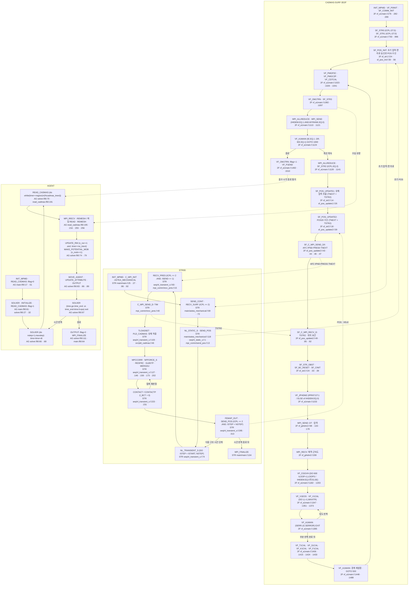

# CADMAS-SURF/3D 아키텍처 소스맵

> CADMAS-SURF/3D 의 **진실의 원천 진입점**. 메인 드라이버 `vf_a1main.f` 가 정의하는 해석대상·수치기법·시간적분 루프 구조와 240 Fortran 파일의 명명규칙·데이터모델을 정리. 경로 루트(이하 모든 `vf_*.f` 인용): `raw/source_code/Multiscale-and-Multiphysics-Integrated-Simulator-for-Tsunami/Simulators/CADMAS-SURF-3D/Source code/`.

3D의 실제 Fortran 240개 중 기본 빌드 목록은 236개다 (`3D/Makefile:16–87`; [KU1-816 최종 근거](../../../_staging/recovery/compare/CADMAS-SURF-conclusion-verify-KU1.md)). [11-04 대조 정정]

## 1. 정체 — 헤더 주석 verbatim (vf_a1main.f:3-9)

```
CDT   VF_A1MAIN:CADMAS-SURF/3D-MGのメインルーチン
CD      (1)解析対象:自由表面を含む3次元非圧縮性流体
CD      (2)解析方法:差分法,SMAC法,VOF法
CD      (3)座標系  :デカルト座標系
CD      (4)言語    :Fortran90(配列の動的アロケートのため)
```

권위있는 1차 정의:
- **해석대상**: 자유표면을 포함하는 **3차원 비압축성 유체** (`vf_a1main.f:6`)
- **해석방법**: **差分法(유한차분) + SMAC法 + VOF法** (`vf_a1main.f:7`) — 압력-속도 결합은 **SMAC**(Simplified Marker And Cell), 자유수면 추적은 **VOF**
- **좌표계**: 데카르트(직교) (`vf_a1main.f:8`)
- **언어**: Fortran90 (동적 배열 할당 목적, FORTRAN77 코딩 준수 — 영문 매뉴얼 Ch1 (a))
- **버전 출력**: 현재 소스는 별도 문자열 `*** ver4.9.1 ***`을 출력한다 (`3D/vf_a1main.f:366`; [KS2-800 수정안](../../../_staging/recovery/compare/cadmas-3d-manual-program-vs-code.md#4-노트-대조와-수정안)). [11-04 대조 정정]
- **시작 배너**: 시작 배너는 `IVR001=  0`과 `IVR002=  1`을 쓴다 (`3D/VF_A0PRM.h:2`, `3D/vf_a1main.f:1208–1209`; [KS2-800 수정안](../../../_staging/recovery/compare/cadmas-3d-manual-program-vs-code.md#4-노트-대조와-수정안)). [11-04 대조 정정]
- **병렬**: `MGRANK`/`MYRANK`/`NPROCS` MPI rank (`vf_a1main.f:18` `INCLUDE 'mpif.h'`, MPMD 초기화 `init_mpmd` :351). "MG" = Multi-Grid(다중격자 nesting, 親/子격자) — `VF_PMG*` 패밀리.

3D의 날짜 표지는 `2012.03 start`·`2012.03 end`이다 (`3D/vf_a1main.f:33–35`). [11-04 대조 정정]
3D2F의 날짜 표지는 `2016.09 start`·`2016.09 end`이다 (`3D2F/vf_a1main.f:33–35`; [KU1-816·222 수정안과 판 근거](../../../_staging/recovery/compare/CADMAS-SURF-version-verify-AD4.md)). [11-04 대조 정정]

## 2. 파일 명명규칙 (240 Fortran, `vf_<class><name>.f`)

`vf_` = **VOF**(Volume of Fluid) 코드 접두. 두번째 토큰이 서브시스템:

| 접두 | 서브시스템 | 대표 파일 |
|---|---|---|
| `vf_a*` | 메인·관리(admin) | `vf_a1main`(메인) `vf_a2dflt`(디폴트값) `vf_a2err` `vf_a2cput`(타이머) |
| `vf_b*` | 경계조건 — `bw`=경계면, `bs`=표면셀 | `vf_bwuwn`(법선속도) `vf_bwuwt`(접선속도) `vf_bwff`(VOF경계) `vf_bsuwn`(표면셀+조파소스) |
| `vf_c*` | compute/setup·조파·난류점성 | `vf_cinit` `vf_cgrid` `vf_cdtcal`(Δt) `vf_cforce`(파력) `vf_cwmak0/1/2`(조파) `vf_cnut0`(νt) `vf_cglv`(관성공극) |
| `vf_f*` | **F함수(VOF 자유수면)** | `vf_f1cal`(드라이버) `vf_fconv`(이류) `vf_feuler`(시간적분) `vf_fnfini/fnfprv`(NF 재구성) `vf_fcut01`(클리핑) `vf_fbubup`(기포) `vf_fdropf`(물방울) |
| `vf_v*` | 속도(velocity) — SMAC | `vf_v1cal`(드라이버) `vf_veuler`(예측자) `vf_vflxd[uvw]`(운동량 플럭스) `vf_vpcoef`(Poisson 계수) `vf_vpsol`(Poisson solve) `vf_vmodif`(속도보정) `vf_vgene`(소스·drag) |
| `vf_k*` | k-ε 난류 | `vf_k1cal`(드라이버) `vf_kgene`(생성·소산) |
| `vf_m*`,`vf_mz*` | 선형 solver | `vf_m1bcgs`(BiCGSTAB) `vf_mzdcmp`(ILU분해) `vf_mzminv`(전처리 적용) |
| `vf_s*`,`vf_t*` | 스칼라농도(s)·온도(t) 수송 | `vf_s1cal` `vf_t1cal` `vf_sconvd`(이류) `vf_sdiff`(확산) `vf_seuler` |
| `vf_p*`,`vf_pmg*` | `vf_p*`는 MPI 통신과 영역분할을 처리한다. `vf_pmg*`는 부모·자식 격자의 중첩 자료 교환을 처리한다. | `vf_p0init` `vf_p1sumd`(reduce) `vf_pmgp2c`/`pmgc2p`(親↔子 전송). 근거: `3D/vf_a1main.f:923–933`, [KS2-801 최종 근거](../../../_staging/recovery/compare/CADMAS-SURF-conclusion-verify-KS2.md). [11-04 대조 정정] |
| `vf_i*` | 입력 파서 | `vf_ii1inp`(메인) `vf_iimdl`(모델) `vf_iiporo`(공극) `vf_iigrid` `vf_iiboun` |
| `vf_o*` | 출력 — `ol`리스트 `og`도화 `om`멀티에이전트 `or`상세 `ot`시계열 | `vf_ol1trn` `vf_og1trn` `vf_om1trn` `vf_or1trn` `vf_ot1trn` |
| `vf_w*` | 파(wave theory) 구현 | `vf_wstk0`(Stokes) `vf_wcnd0`(cnoidal) `vf_wsfmb2`(stream-function B) |
| `vf_z*`,`vf_zxmg/zxmp*` | 유틸·MPI 래퍼 | `vf_zsetr3`(배열초기화) `vf_zgetim` `vf_zxmp_*`(MPI 추상화) |
| `vf_stoc_*` | STOC 광역모델 결합 glue | `vf_stoc_init/recv/send` |

`vf_pmg*` 호출은 압력 선형계의 multigrid solve를 뜻하지 않는다 (`3D/vf_a1main.f:923–933`; [KS2-801 최종 근거](../../../_staging/recovery/compare/CADMAS-SURF-conclusion-verify-KS2.md)). [11-04 대조 정정]

## 3. 데이터모델 (vf_a1main.f:38-218 변수사전)

3차원 배열의 크기는 `(NUMI,NUMJ,NUMK)`이다 (`3D/vf_a1main.f:232–236`; [KS2-802 수정안](../../../_staging/recovery/compare/cadmas-3d-manual-program-vs-code.md#4-노트-대조와-수정안)). [11-04 대조 정정]

주요 물리 배열은 `ALLOCATABLE`이다 (`3D/vf_a1main.f:231–238`; [KS2-802 수정안](../../../_staging/recovery/compare/cadmas-3d-manual-program-vs-code.md#4-노트-대조와-수정안)). [11-04 대조 정정]
난류·온도·농도·공기압 배열은 활성 옵션에 따라 할당한다 ([KS2-802 수정안](../../../_staging/recovery/compare/cadmas-3d-manual-program-vs-code.md#4-노트-대조와-수정안)). [11-04 대조 정정]
경계 배열의 메모리 크기는 `NUMBX=MAX(NUMB,1)`을 쓴다 ([KS2-802 수정안](../../../_staging/recovery/compare/cadmas-3d-manual-program-vs-code.md#4-노트-대조와-수정안)). [11-04 대조 정정]
3D2F 전역 배열의 실제 선언 위치는 `VF_A2ARRAY` 모듈이다 (`3D2F/vf_a1main.f:13`, `3D2F/vf_a2array.f90:1–8`; [KF2-047 최종 근거](../../../_staging/recovery/compare/CADMAS-SURF-conclusion-verify-KF2.md)). [11-04 대조 정정]
3D MAIN의 직접 배열 선언과 3D2F의 `use vf_a2array` 차이가 판 근거다 (`3D/vf_a1main.f:231–238`, `3D2F/vf_a1main.f:13`; [KF2-047 최종 근거](../../../_staging/recovery/compare/CADMAS-SURF-conclusion-verify-KF2.md)). [11-04 대조 정정]

| 변수 | 의미 | 인용 |
|---|---|---|
| `UU,VV,WW` | x/y/z 속도 (staggered) | `vf_a1main.f:59-61` |
| `PP` | 압력 | `vf_a1main.f:62` |
| `FF` | **VOF 함수 F** (유체체적률) | `vf_a1main.f:63` |
| `ANU` | 분자동점성 + 渦동점성(νt)의 합 | `vf_a1main.f:64` |
| `CM0,CD0` | 관성력계수·저항계수 (포러스 body) | `vf_a1main.f:65-66` |
| `GGV` / `GGX,GGY,GGZ` | **공극률** / x·y·z **면적투과율** | `vf_a1main.f:67-70` |
| `GLV` = `GGV+(1-GGV)*CM` 외 GLX/Y/Z | 관성 가중 공극(가상질량) | `vf_a1main.f:71-74` |
| `AK,AE` / `ANUT` | 난류에너지 k·산일 ε / 渦점성 νt | `vf_a1main.f:92-94` |
| `TT` / `CC` | 온도 / 스칼라농도(LEQC종) | `vf_a1main.f:97·103` |
| `SRCUV` | 造波소스용 속도 | `vf_a1main.f:120` |
| `TBUB`,`DROP*` | 기포상승·물방울 자유낙하 처리 | `vf_a1main.f:81-87` |

**NF 셀상태 인덱스** (VOF 자유수면 분류, `vf_a1main.f:124-133`):
- `-1`=장애물셀, `0`=유체셀, `1~6`=표면셀(유체가 각각 x-/x+/y-/y+/z-/z+ 측), `8`=기체셀

**INDB 경계조건 코드** (`vf_a1main.f:159-168`, `INDB(3,L)`=속도·압력 BC):
`0`미정의 `1`슬립 `2`논슬립 `3`속도고정 `4`프리 `5`**造波경계** `6`**대수칙** `7`**방사경계** `8`**완전조면** (`3D/vf_a1main.f:159–168`). [11-04 대조 정정]
`INDB(4,L)`의 0은 미정의이다 (`3D/vf_a1main.f:169–174`). [11-04 대조 정정]
VOF 경계 코드는 1 값 고정, 2 자유, 5 조파, 7 방사이다 (`3D/vf_a1main.f:169–174`, `3D/vf_iiboun.f:219–234`; [RF-006 최종 근거](../../../_staging/recovery/compare/CADMAS-SURF-conclusion-verify-RF.md), [KS2-803 최종 근거](../../../_staging/recovery/compare/CADMAS-SURF-conclusion-verify-KS2.md)). [11-04 대조 정정]
VOF F 경계는 값 지정·영 기울기·조파·방사를 구분한다 (`3D/vf_bwff.f:43–85`; [KS1-721 최종 근거](../../../_staging/recovery/compare/CADMAS-SURF-conclusion-verify-KS1.md)). [11-04 대조 정정]

3D2F 코드가 이동 장애물 셀 -2를 추가한다 (`3D2F/vf_a1main.f:137–147`, `3D2F/vf_cgindx.f:96–102`; [KF2-308 최종 근거](../../../_staging/recovery/compare/CADMAS-SURF-conclusion-verify-KF2.md)). [11-04 대조 정정]
3D2F `INDB`는 액상 경계와 별도로 기상 속도·압력 경계 종류를 저장한다 (`3D2F/vf_a1main.f:171–206`, `3D2F/vf_iiboun.f:214–221`; [KF2-313 최종 근거](../../../_staging/recovery/compare/CADMAS-SURF-conclusion-verify-KF2.md)). [11-04 대조 정정]
3D2F `BCU`의 열 1은 혼합 경계값이다 (`3D2F/vf_bwuwn.f:96–101,199–208`; [KF2-363 최종 근거](../../../_staging/recovery/compare/CADMAS-SURF-conclusion-verify-KF2.md)). [11-04 대조 정정]
3D2F의 BCU 실제 크기는 `(NUMB,3)`이다 (`3D2F/vf_a2array.f90:23`, `3D2F/vf_a1main.f:548`; [KF2-270 최종 근거](../../../_staging/recovery/compare/CADMAS-SURF-conclusion-verify-KF2.md)). [11-04 대조 정정]
열 2는 액상 값이다 (`3D2F/vf_bwuwn.f:96–101,199–208`). [11-04 대조 정정]
열 3은 기상 값이다 (`3D2F/vf_bwuwn.f:96–101,199–208`). [11-04 대조 정정]
같은 모양을 `BCV`·`BCW`도 사용한다 (`3D2F/vf_a1main.f:181,197`; [KF2-363 최종 근거](../../../_staging/recovery/compare/CADMAS-SURF-conclusion-verify-KF2.md)). [11-04 대조 정정]

> 3중 읽기: Fortran90 ALLOCATE 의 정합 배열 할당을 위해 입력파일을 `VF_II1INP` 로 **3회 읽음**(읽기→할당→재읽기), `vf_a1main.f:396-663` 의 주석 명시.

## 4. SMAC+VOF 시간적분 루프 (vf_a1main.f:915-1145)

라벨 `500 CONTINUE`(:919)~`GOTO 500`(:1145) 가 메인 시간스텝 루프. 헤더 주석 `SMAC法およびVOF法の計算ループ`(`vf_a1main.f:915`). 1스텝 호출순서:

1. **멀티그리드 親↔子 데이터 전송** — `VF_PMGP2C`(:923)·`VF_PMGC2P`(:929) (격자 nesting)
2. **적응 시간刻み Δt** — `VF_CDTCAL`(:940) (CFL 기반, `IDTTYP≠0`) 또는 고정 `DTCNST`(:938)
3. **종료조건 판정** — `NNOW≥NEND` 또는 `TNOW+0.5Δt≥TEND`(:947), 경과시간 ETIME 초과 시 리스타트(:1002)
4. **출력** — 리스트 `VF_OL1TRN`(:962)·도화 `VF_OG1TRN`(:971)·멀티에이전트 `VF_OM1TRN`(:979)·상세 `VF_OR1TRN`(:982)·시계열 `VF_OT1TRN`(:990)
5. **STOC 정보교환** — `VF_STOC_RECV`(:1011)/`VF_STOC_SEND`(:1012) (`NB_SC>0` 시, 광역모델 결합)
6. **造波소스 갱신** — `VF_CWMSRC`(:1037) (`ISCTYP(1)≠0` 시)
7. **流速·압력 SMAC 서브루프** — `DO 600 ILOOP=1,LOOPS`(:1044) 내 `VF_V1CAL`(:1058) — **SMAC 핵심**(예측자→압력 Poisson→보정). → [smac-velocity-pressure-solver](cadmas-surf3d-smac-velocity-pressure-solver.md)
8. **온도** `VF_T1CAL`(:1077) (`LEQT≠0`)
9. **스칼라농도** `VF_S1CAL`(:1086) (`LEQC>0`)
10. **k-ε 2방정식 난류** `VF_K1CAL`(:1095) (`LEQK≠0`). → [turbulence-and-porous-resistance](cadmas-surf3d-turbulence-and-porous-resistance.md)
11. **VOF 함수 F 계산 + NF 재설정** `VF_F1CAL`(:1104). → [vof-free-surface](cadmas-surf3d-vof-free-surface.md)
12. **NF 변경 후 경계값 재설정** — 대수칙 `VF_BWKELG`(:1120), νt 재계산 `VF_CNUT0`(:1124)·`VF_CNU00`(:1125), 온도·농도 경계(:1129-1142)

종료 플래그를 계산한 뒤 현재 시각의 결과를 출력한다 (`3D/vf_a1main.f:947–990`; [KS2-804 수정안](../../../_staging/recovery/compare/cadmas-3d-manual-program-vs-code.md#4-노트-대조와-수정안)). [11-04 대조 정정]
전역 종료 합의 뒤 시간 갱신 전에 종료한다 (`3D/vf_a1main.f:1000–1007`; [KS2-804 수정안](../../../_staging/recovery/compare/cadmas-3d-manual-program-vs-code.md#4-노트-대조와-수정안)). [11-04 대조 정정]
한 스텝의 시간 간격 DT를 LOOPS로 나눈 DTNOW로 속도·압력 하위 반복을 수행한다 (`DTNOW=DT/DBLE(LOOPS)`, `3D/vf_a1main.f:1029`, `3D/vf_a1main.f:1044–1066`; [KS2-805 수정안](../../../_staging/recovery/compare/cadmas-3d-manual-program-vs-code.md#4-노트-대조와-수정안)). [11-04 대조 정정]
각 하위 반복에서 TNOW를 DTNOW만큼 증가시킨다 (`TNOW =TNOW+DTNOW`, `3D/vf_a1main.f:1047`; [KS2-805 수정안](../../../_staging/recovery/compare/cadmas-3d-manual-program-vs-code.md#4-노트-대조와-수정안)). [11-04 대조 정정]
이후 온도·농도·난류·VOF는 전체 DT를 쓴다 ([KS2-805 수정안](../../../_staging/recovery/compare/cadmas-3d-manual-program-vs-code.md#4-노트-대조와-수정안)). [11-04 대조 정정]

> 진단량(스텝당 리스트 출력): `FSUM`(전유체체적)·`!VD!`(발산)·`ITR`(반복수) — `3D/vf_a1main.f:956–960,1214–1228`. [11-04 대조 정정]

FCUT는 절단 전후 F 차이에 공극 체적을 곱한 부호 있는 전역 합이다 (`3D/vf_fcut01.f:33–56`; [KS3-409 최종 근거](../../../_staging/recovery/compare/CADMAS-SURF-conclusion-verify-KS3.md)). [11-04 대조 정정]
!B!는 ILU 전처리한 우변 벡터의 2-노름이다 (`3D/vf_m1bcgs.f:47–48,110–143,172–218,249–250`; [KS3-409 최종 근거](../../../_staging/recovery/compare/CADMAS-SURF-conclusion-verify-KS3.md)). [11-04 대조 정정]
!R!는 같은 전처리계에서 최종 잔차 벡터의 2-노름이다 (`3D/vf_m1bcgs.f:47–48,110–143,172–218,249–250`; [KS3-409 최종 근거](../../../_staging/recovery/compare/CADMAS-SURF-conclusion-verify-KS3.md)). [11-04 대조 정정]

## 5. 결합 컴포넌트 경계

본 노트는 단상 `CADMAS-SURF/3D`. 2상(기액 VOF)은 `CADMAS-SURF-3D2F`(CADMAS-2F), 구조·지반 FEM 은 `STR3D`, 광역 tsunami 전파(정수압/비정수압)는 PARI `STOC-ML/IC`. 결합 사슬·라이선스·정체 → [README](../README.md).

## 관련 대조 근거

시간간격·부모·자식 격자 보간·STOC 송수신의 소스 근거는 [시간간격·격자 중첩·STOC 결합 노트](cadmas-surf3d-timestep-nesting-stoc-coupling.md)에 정리되어 있다. [11-04 대조 정정]
영문 매뉴얼 Ch2 지배방정식의 항목별 대조 결과는 [3D 이론 대조 보고서](../../../_staging/recovery/compare/cadmas-3d-manual-theory-vs-code.md)에 있다. [11-04 대조 정정]

문서와 코드 차이 표는 [cadmas-3d2f-vs-3d-physics-differences.md](cadmas-3d2f-vs-3d-physics-differences.md)에 있다.
문서와 코드 차이 표는 [cadmas-3d2f-vs-3d-io-mpi-differences.md](cadmas-3d2f-vs-3d-io-mpi-differences.md)에 있다.
문서와 코드 차이 표는 [cadmas-3d2f-vs-3d-coupling-differences.md](cadmas-3d2f-vs-3d-coupling-differences.md)에 있다.


## 문서와 코드 차이 (11-04 대조)

비교한 판: 코드는 github.com/CADMAS-SURF/Multiscale-and-Multiphysics-Integrated-Simulator-for-Tsunami `da7668f`(2024-08-30, 커밋 1개)의 `Simulators/`이다. 문서는 영문 매뉴얼 `CADMAS-SURF3D_Manural_English.pdf`·`CADMAS-2F_Manural_English.pdf`와 `CADMAS-SURF3D_Tutorial_English.pdf`·`CADMAS-2F_Tutorial_English.pdf`, 두 사본의 빌드 지침·`A11111.in` 입력 주석 지침이다.

한국어 결론 문장은 최종 근거 파일의 AI 해석이다. 원문 인용은 문서 원문·코드 원문 열에 구분했다. `3D/`와 `3D2F/`의 기준은 각각 `../raw/source_code/Multiscale-and-Multiphysics-Integrated-Simulator-for-Tsunami/Simulators/CADMAS-SURF-3D/Source code/`와 `../raw/source_code/Multiscale-and-Multiphysics-Integrated-Simulator-for-Tsunami/Simulators/CADMAS-SURF-3D2F/Source code/`이다. 매뉴얼 쪽은 PDF 쪽이다.

| 행 ID | 항목 | 문서 원문 | 코드 원문 | 결론 | 결론 문장 |
|---|---|---|---|---|---|
| 2f-program:KF2-047 | 배열 선언 위치 | 2F manual p.79: `(1) Global variable with common`<br>`(2) Substantial global variable declared by the main routine` | `3D/vf_a1main.f:231–238`; `3D2F/vf_a1main.f:13`; `3D2F/vf_a2array.f90:1–8`; 2F manual p.79<br>`3D2F/vf_a1main.f:13`<br>`use vf_a2array`<br>`3D2F/vf_a2array.f90:1`<br>`MODULE VF_A2ARRAY` | A 판 차이 | 3D2F 전역 배열의 실제 선언 위치는 VF_A2ARRAY 모듈이다. 3D MAIN의 직접 배열 선언과 3D2F의 `use vf_a2array` 차이가 판 근거다. ([최종 근거](../../../_staging/recovery/compare/CADMAS-SURF-conclusion-verify-KF2.md)) |
| 2f-program:KF2-252 | p.101 YY | 2F manual p.101: `YY(MAXG1,NUMJ)`<br>`R*8`<br>`y direction grid coordinate etc.`<br>`(1,J):y(J)`<br>`(2,J):\mathrm{d}y=y(J+1)-y(J)`<br>`(3,J):\mathrm{c}y=(\mathrm{d}y(J)+\mathrm{d}y(J-1))/2.0`<br>`84,J):1.0/\mathrm{d}y`<br>`(5,J):1.0/\mathrm{c}y`<br>`(6,J):1.0/(\mathrm{d}y(J)+\mathrm{d}y(J-1))`<br>`－` | `3D2F/vf_a1main.f:47–51,351`; `3D2F/VF_A0PRM.h:10`; 2F manual p.101<br>`3D2F/vf_a2array.f90:3`<br>`DOUBLE PRECISION, DIMENSION(:,:  ), ALLOCATABLE :: XX ,YY ,ZZ`<br>`3D2F/vf_a1main.f:351`<br>`ALLOCATE(YY  (MAXG1,NUMJ)    ,STAT=IERR)`<br>`3D2F/vf_a1main.f:45`<br>`CD    YY(MAXG1,NUMJ)    : R*8 : y方向格子座標等`<br>`3D2F/vf_a1main.f:46`<br>`CD                              ( 1,J):格子座標y(J)`<br>`3D2F/vf_a1main.f:47`<br>`CD                              ( 2,J):dy=y(J+1)-y(J)`<br>`3D2F/vf_a1main.f:48`<br>`CD                              ( 3,J):cy=(dy(J)+dy(J-1))/2.0`<br>`3D2F/vf_a1main.f:49`<br>`CD                              ( 4,J):1.0/dy`<br>`3D2F/vf_a1main.f:50`<br>`CD                              ( 5,J):1.0/cy`<br>`3D2F/vf_a1main.f:51`<br>`CD                              ( 6,J):1.0/(dy(J)+dy(J-1))` | B 문서 오기 | YY의 역격자 폭 성분 번호는 (4,J)다. ([최종 근거](../../../_staging/recovery/compare/CADMAS-SURF-conclusion-verify-KF2.md)) |
| 2f-program:KF2-270 | p.103 BCU | 2F manual p.103: `BCU(NUMB)`<br>`R*8`<br>`x direction flow velocity`<br>`Figure 0-4-9(2)` | `3D2F/vf_a2array.f90:23`; `3D2F/vf_a1main.f:548`; 3D↔2F vf_a1main.f 배열 선언부 diff; 2F manual p.103<br>`3D2F/vf_a2array.f90:23`<br>`DOUBLE PRECISION, DIMENSION(:,:  ), ALLOCATABLE :: BCU,BCV,BCW,BCP`<br>`3D2F/vf_a1main.f:548`<br>`ALLOCATE(BCU  (NUMB,3    ),STAT=IERR)`<br>`3D2F/vf_a1main.f:88`<br>`CD    BCU(NUMB,3)       : R*8 : x方向流速の境界値` | A 판 차이 | 3D2F의 BCU 실제 크기는 `(NUMB,3)`이다. 3D vf_a1main.f의 BCU 일차원 선언과 3D2F vf_a2array.f90의 이차원 선언 차이가 판 근거다. ([최종 근거](../../../_staging/recovery/compare/CADMAS-SURF-conclusion-verify-KF2.md)) |
| 2f-program:KF2-271 | p.103 BCV | 2F manual p.103: `BCV(NUMB)`<br>`R*8`<br>`Y direction flow velocity`<br>`Figure 0-4-9(2)` | `3D2F/vf_a2array.f90:23`; `3D2F/vf_a1main.f:549`; 3D↔2F vf_a1main.f 배열 선언부 diff; 2F manual p.103<br>`3D2F/vf_a2array.f90:23`<br>`DOUBLE PRECISION, DIMENSION(:,:  ), ALLOCATABLE :: BCU,BCV,BCW,BCP`<br>`3D2F/vf_a1main.f:549`<br>`ALLOCATE(BCV  (NUMB,3    ),STAT=IERR)`<br>`3D2F/vf_a1main.f:89`<br>`CD    BCV(NUMB,3)       : R*8 : y方向流速の境界値` | A 판 차이 | 3D2F의 BCV 실제 크기는 `(NUMB,3)`이다. 3D vf_a1main.f의 BCV 일차원 선언과 3D2F vf_a2array.f90의 이차원 선언 차이가 판 근거다. ([최종 근거](../../../_staging/recovery/compare/CADMAS-SURF-conclusion-verify-KF2.md)) |
| 2f-program:KF2-272 | p.103 BCW | 2F manual p.103: `BCW(NUMB)`<br>`R*8`<br>`z direction flow velocity`<br>`Figure 0-4-9(2)` | `3D2F/vf_a2array.f90:23`; `3D2F/vf_a1main.f:550`; 3D↔2F vf_a1main.f 배열 선언부 diff; 2F manual p.103<br>`3D2F/vf_a2array.f90:23`<br>`DOUBLE PRECISION, DIMENSION(:,:  ), ALLOCATABLE :: BCU,BCV,BCW,BCP`<br>`3D2F/vf_a1main.f:550`<br>`ALLOCATE(BCW  (NUMB,3    ),STAT=IERR)`<br>`3D2F/vf_a1main.f:90`<br>`CD    BCW(NUMB,3)       : R*8 : z方向流速の境界値` | A 판 차이 | 3D2F의 BCW 실제 크기는 `(NUMB,3)`이다. 3D vf_a1main.f의 BCW 일차원 선언과 3D2F vf_a2array.f90의 이차원 선언 차이가 판 근거다. ([최종 근거](../../../_staging/recovery/compare/CADMAS-SURF-conclusion-verify-KF2.md)) |
| 2f-program:KF2-273 | p.103 BCP | 2F manual p.103: `BCP(NUMB)`<br>`R*8`<br>`pressure`<br>`Figure 0-4-9(2)` | `3D2F/vf_a2array.f90:23`; `3D2F/vf_a1main.f:551`; 3D↔2F vf_a1main.f 배열 선언부 diff; 2F manual p.103<br>`3D2F/vf_a2array.f90:23`<br>`DOUBLE PRECISION, DIMENSION(:,:  ), ALLOCATABLE :: BCU,BCV,BCW,BCP`<br>`3D2F/vf_a1main.f:551`<br>`ALLOCATE(BCP  (NUMB,3    ),STAT=IERR)`<br>`3D2F/vf_a1main.f:91`<br>`CD    BCP(NUMB,3)       : R*8 : 圧力の境界値` | A 판 차이 | 3D2F의 BCP 실제 크기는 `(NUMB,3)`이다. 3D vf_a1main.f의 BCP 일차원 선언과 3D2F vf_a2array.f90의 이차원 선언 차이가 판 근거다. ([최종 근거](../../../_staging/recovery/compare/CADMAS-SURF-conclusion-verify-KF2.md)) |
| 2f-program:KF2-275 | p.103 BCVI | 2F manual p.103: `BCVI(NUMB)`<br>`R*8`<br>`Sum  of  molecular  dynamics  viscosity  coefficient and vortical viscosity coefficient`<br>`Figure 0-4-9(2)` | `3D2F/vf_a1main.f:93,553`; `3D2F/vf_a2array.f90:24`; 2F manual p.103; 2F Japanese manual p.92<br>`3D2F/vf_a2array.f90:24`<br>`DOUBLE PRECISION, DIMENSION(:    ), ALLOCATABLE :: BCF,BCVI`<br>`3D2F/vf_a1main.f:553`<br>`ALLOCATE(BCVI (NUMB      ),STAT=IERR)`<br>`3D2F/vf_a1main.f:93`<br>`CD    BCVI(NUMB)        : R*8 : 流速の境界条件(壁面の粗さ)` | B 문서 오기 | 코드의 BCVI는 속도 경계의 벽면 거칠기이다. ([최종 근거](../../../_staging/recovery/compare/CADMAS-SURF-conclusion-verify-KF2.md)) |
| 2f-program:KF2-276 | p.103 TBUB | 2F manual p.103: `TBUB(NUMK)`<br>`R*8`<br>`Inertial force coefficient`<br>`－` | `3D2F/vf_a1main.f:94,383`; `3D2F/vf_a2array.f90:28`; 2F manual p.103; 2F Japanese manual p.92<br>`3D2F/vf_a2array.f90:28`<br>`DOUBLE PRECISION, DIMENSION(:    ), ALLOCATABLE :: TBUB`<br>`3D2F/vf_a1main.f:383`<br>`ALLOCATE(TBUB(NUMK)          ,STAT=IERR)`<br>`3D2F/vf_a1main.f:94`<br>`CD    TBUB(NUMK)        : R*8 : 気泡上昇処理を最後に行った時間` | B 문서 오기 | 코드의 TBUB는 기포 상승 처리를 마지막으로 수행한 시각이다. ([최종 근거](../../../_staging/recovery/compare/CADMAS-SURF-conclusion-verify-KF2.md)) |
| 2f-program:KF2-277 | p.103 DROPTX | 2F manual p.103: `DROPTX(NUMI,NUMJ,NUMK)`<br>`R*8`<br>`Resistance coefficient`<br>`Figure 0-4-7(2)` | `3D2F/vf_a1main.f:95,384`; `3D2F/vf_a2array.f90:29`; 2F manual p.103; 2F Japanese manual p.92<br>`3D2F/vf_a2array.f90:29`<br>`DOUBLE PRECISION, DIMENSION(:,:,:), ALLOCATABLE :: DROPTX,DROPTY`<br>`3D2F/vf_a1main.f:384`<br>`ALLOCATE(DROPTX(NUMI,NUMJ,NUMK),STAT=IERR)`<br>`3D2F/vf_a1main.f:95`<br>`CD    DROPTX(@FOR-3D@)  : R*8 : 自由落下処理を最後に行った時間(x)` | B 문서 오기 | 코드의 DROPTX는 x 자유낙하 처리를 마지막으로 수행한 시각이다. ([최종 근거](../../../_staging/recovery/compare/CADMAS-SURF-conclusion-verify-KF2.md)) |
| 2f-program:KF2-278 | p.103 DROPTY | 2F manual p.103: `DROPTY(NUMI,NUMJ,NUMK)`<br>`R*8`<br>`Porosity`<br>`Figure 0-4-7(2)` | `3D2F/vf_a1main.f:96,385`; `3D2F/vf_a2array.f90:29`; 2F manual p.103; 2F Japanese manual p.92<br>`3D2F/vf_a2array.f90:29`<br>`DOUBLE PRECISION, DIMENSION(:,:,:), ALLOCATABLE :: DROPTX,DROPTY`<br>`3D2F/vf_a1main.f:385`<br>`ALLOCATE(DROPTY(NUMI,NUMJ,NUMK),STAT=IERR)`<br>`3D2F/vf_a1main.f:96`<br>`CD    DROPTY(@FOR-3D@)  : R*8 : 自由落下処理を最後に行った時間(y)` | B 문서 오기 | 코드의 DROPTY는 y 자유낙하 처리를 마지막으로 수행한 시각이다. ([최종 근거](../../../_staging/recovery/compare/CADMAS-SURF-conclusion-verify-KF2.md)) |
| 2f-program:KF2-279 | p.103 DROPTZ | 2F manual p.103: `DROPTZ(NUMI,NUMJ,NUMK)`<br>`R*8`<br>`X-direction area transmittance`<br>`Figure 0-4-7(2)` | `3D2F/vf_a1main.f:97,386`; `3D2F/vf_a2array.f90:30`; 2F manual p.103; 2F Japanese manual p.92<br>`3D2F/vf_a2array.f90:30`<br>`DOUBLE PRECISION, DIMENSION(:,:,:), ALLOCATABLE :: DROPTZ,DROPUU`<br>`3D2F/vf_a1main.f:386`<br>`ALLOCATE(DROPTZ(NUMI,NUMJ,NUMK),STAT=IERR)`<br>`3D2F/vf_a1main.f:97`<br>`CD    DROPTZ(@FOR-3D@)  : R*8 : 自由落下処理を最後に行った時間(z)` | B 문서 오기 | 코드의 DROPTZ는 z 자유낙하 처리를 마지막으로 수행한 시각이다. ([최종 근거](../../../_staging/recovery/compare/CADMAS-SURF-conclusion-verify-KF2.md)) |
| 2f-program:KF2-280 | p.103 DROPU | 2F manual p.103: `DROPU(NUMI,NUMJ,NUMK)`<br>`R*8`<br>`Y-direction area transmittance`<br>`Figure 0-4-7(2)` | `3D2F/vf_a1main.f:98,387`; `3D2F/vf_a2array.f90:30`; 2F manual p.103; 2F Japanese manual p.92<br>`3D2F/vf_a2array.f90:30`<br>`DOUBLE PRECISION, DIMENSION(:,:,:), ALLOCATABLE :: DROPTZ,DROPUU`<br>`3D2F/vf_a1main.f:387`<br>`ALLOCATE(DROPUU(NUMI,NUMJ,NUMK),STAT=IERR)`<br>`3D2F/vf_a1main.f:98`<br>`CD    DROPUU(@FOR-3D@)  : R*8 : 自由落下のx方向速度` | B 문서 오기 | 코드의 DROPUU는 x 자유낙하 속도이다. ([최종 근거](../../../_staging/recovery/compare/CADMAS-SURF-conclusion-verify-KF2.md)) |
| 2f-program:KF2-281 | p.103 DROPV | 2F manual p.103: `DROPV(NUMI,NUMJ,NUMK)`<br>`R*8`<br>`Z-direction area transmittance`<br>`Figure 0-4-7(2)` | `3D2F/vf_a1main.f:99,388`; `3D2F/vf_a2array.f90:31`; 2F manual p.103; 2F Japanese manual p.92<br>`3D2F/vf_a2array.f90:31`<br>`DOUBLE PRECISION, DIMENSION(:,:,:), ALLOCATABLE :: DROPVV,DROPWW`<br>`3D2F/vf_a1main.f:388`<br>`ALLOCATE(DROPVV(NUMI,NUMJ,NUMK),STAT=IERR)`<br>`3D2F/vf_a1main.f:99`<br>`CD    DROPVV(@FOR-3D@)  : R*8 : 自由落下のy方向速度` | B 문서 오기 | 코드의 DROPVV는 y 자유낙하 속도이다. ([최종 근거](../../../_staging/recovery/compare/CADMAS-SURF-conclusion-verify-KF2.md)) |
| 2f-program:KF2-282 | p.103 DROPW | 2F manual p.103: `DROPW(NUMI,NUMJ,NUMK)`<br>`R*8`<br>`=GGV+(1-GGV)*CM`<br>`Figure 0-4-7(2)` | `3D2F/vf_a1main.f:100,389`; `3D2F/vf_a2array.f90:31`; 2F manual p.103; 2F Japanese manual p.92<br>`3D2F/vf_a2array.f90:31`<br>`DOUBLE PRECISION, DIMENSION(:,:,:), ALLOCATABLE :: DROPVV,DROPWW`<br>`3D2F/vf_a1main.f:389`<br>`ALLOCATE(DROPWW(NUMI,NUMJ,NUMK),STAT=IERR)`<br>`3D2F/vf_a1main.f:100`<br>`CD    DROPWW(@FOR-3D@)  : R*8 : 自由落下のz方向速度` | B 문서 오기 | 코드의 DROPWW는 z 자유낙하 속도이다. ([최종 근거](../../../_staging/recovery/compare/CADMAS-SURF-conclusion-verify-KF2.md)) |
| 2f-program:KF2-283 | p.103 GGVOLD | 2F manual p.103: `GGVOLD(IPRNP)`<br>`R*8`<br>`=GGX+(1-GGX)*CM`<br>`－` | `3D2F/vf_a1main.f:101,656`; `3D2F/vf_a2array.f90:32`; 2F manual p.103; 2F Japanese manual p.92<br>`3D2F/vf_a2array.f90:32`<br>`DOUBLE PRECISION, DIMENSION(:    ), ALLOCATABLE :: GGVOLD,GGVNOW`<br>`3D2F/vf_a1main.f:656`<br>`ALLOCATE(GGVOLD(IPRNP),STAT=IERR)`<br>`3D2F/vf_a1main.f:101`<br>`CD    GGVOLD(IPRNP)     : R*8 : 前の時刻ブロックの空隙率` | B 문서 오기 | 코드의 GGVOLD는 전 시각 블록의 공극률이다. ([최종 근거](../../../_staging/recovery/compare/CADMAS-SURF-conclusion-verify-KF2.md)) |
| 2f-program:KF2-284 | p.103 GGVNOW | 2F manual p.103: `GGVNOW(IPRNP)`<br>`R*8`<br>`=GGY+(1-GGY)*CM`<br>`－` | `3D2F/vf_a1main.f:102,657`; `3D2F/vf_a2array.f90:32`; 2F manual p.103; 2F Japanese manual p.92<br>`3D2F/vf_a2array.f90:32`<br>`DOUBLE PRECISION, DIMENSION(:    ), ALLOCATABLE :: GGVOLD,GGVNOW`<br>`3D2F/vf_a1main.f:657`<br>`ALLOCATE(GGVNOW(IPRNP),STAT=IERR)`<br>`3D2F/vf_a1main.f:102`<br>`CD    GGVNOW(IPRNP)     : R*8 : 現在の時刻ブロックの空隙率` | B 문서 오기 | 코드의 GGVNOW는 현재 시각 블록의 공극률이다. ([최종 근거](../../../_staging/recovery/compare/CADMAS-SURF-conclusion-verify-KF2.md)) |
| 2f-program:KF2-285 | p.103 GGV0 | 2F manual p.103: `GGV0(NUMI,NUMJ,NUMK)`<br>`R*8`<br>`=GGZ+(1-GGZ)*CM`<br>`Figure 0-4-7(2)` | `3D2F/vf_a1main.f:108,681`; `3D2F/vf_a2array.f90:36`; 2F manual p.103; 2F Japanese manual p.92<br>`3D2F/vf_a2array.f90:36`<br>`DOUBLE PRECISION, DIMENSION(:,:,:), ALLOCATABLE :: GGV0,GLV0,GVL0`<br>`3D2F/vf_a1main.f:681`<br>`ALLOCATE(GGV0(NUMI,NUMJ,NUMK),STAT=IERR)`<br>`3D2F/vf_a1main.f:108`<br>`CD    GGV0(@FOR-3D@)    : R*8 : 空隙率(時間依存用)` | B 문서 오기 | 코드의 GGV0는 시간 의존 공극률이다. ([최종 근거](../../../_staging/recovery/compare/CADMAS-SURF-conclusion-verify-KF2.md)) |
| 2f-program:KF2-286 | p.103 GLV0 | 2F manual p.103: `GLV0(NUMI,NUMJ,NUMK)`<br>`R*8`<br>`boundary value of x direction flow velocity`<br>`Figure 0-4-7(2)` | `3D2F/vf_a1main.f:109,682`; `3D2F/vf_a2array.f90:36`; 2F manual p.103; 2F Japanese manual p.92<br>`3D2F/vf_a2array.f90:36`<br>`DOUBLE PRECISION, DIMENSION(:,:,:), ALLOCATABLE :: GGV0,GLV0,GVL0`<br>`3D2F/vf_a1main.f:682`<br>`ALLOCATE(GLV0(NUMI,NUMJ,NUMK),STAT=IERR)`<br>`3D2F/vf_a1main.f:109`<br>`CD    GLV0(@FOR-3D@)    : R*8 : =GGV+(1-GGV)*CM(時間依存用)` | B 문서 오기 | 코드의 GLV0는 시간 의존 셀 관성 계수이다. ([최종 근거](../../../_staging/recovery/compare/CADMAS-SURF-conclusion-verify-KF2.md)) |
| 2f-program:KF2-287 | p.103 ANUT | 2F manual p.103: `ANUT(NUMI,NUMJ,NUMK)`<br>`R*8`<br>`Boundary value of flow velocity in y direction`<br>`Figure 0-4-7(2)` | `3D2F/vf_a1main.f:111,391`; `3D2F/vf_a2array.f90:37`; 2F manual p.103; 2F Japanese manual p.92<br>`3D2F/vf_a2array.f90:37`<br>`DOUBLE PRECISION, DIMENSION(:,:,:), ALLOCATABLE :: ANUT,AK,AE`<br>`3D2F/vf_a1main.f:391`<br>`ALLOCATE(ANUT(NUMI,NUMJ,NUMK),STAT=IERR)`<br>`3D2F/vf_a1main.f:111`<br>`CD    ANUT(@FOR-3D@)    : R*8 : 渦動粘性係数νt` | B 문서 오기 | 코드의 ANUT는 와점성계수이다. ([최종 근거](../../../_staging/recovery/compare/CADMAS-SURF-conclusion-verify-KF2.md)) |
| 2f-program:KF2-288 | p.103 AK | 2F manual p.103: `AK(NUMI,NUMJ,NUMK)`<br>`R*8`<br>`Boundary value of flow velocity in z direction`<br>`Figure 0-4-7(2)` | `3D2F/vf_a1main.f:112,392`; `3D2F/vf_a2array.f90:37`; 2F manual p.103; 2F Japanese manual p.93<br>`3D2F/vf_a2array.f90:37`<br>`DOUBLE PRECISION, DIMENSION(:,:,:), ALLOCATABLE :: ANUT,AK,AE`<br>`3D2F/vf_a1main.f:392`<br>`ALLOCATE(AK  (NUMI,NUMJ,NUMK),STAT=IERR)`<br>`3D2F/vf_a1main.f:112`<br>`CD    AK(@FOR-3D@)      : R*8 : 乱流エネルギ` | B 문서 오기 | 코드의 AK는 난류에너지이다. ([최종 근거](../../../_staging/recovery/compare/CADMAS-SURF-conclusion-verify-KF2.md)) |
| 2f-program:KF2-289 | p.103 AE | 2F manual p.103: `AE(NUMI,NUMJ,NUMK)`<br>`R*8`<br>`Boundary value of pressure`<br>`Figure 0-4-7(2)` | `3D2F/vf_a1main.f:113,393`; `3D2F/vf_a2array.f90:37`; 2F manual p.103; 2F Japanese manual p.93<br>`3D2F/vf_a2array.f90:37`<br>`DOUBLE PRECISION, DIMENSION(:,:,:), ALLOCATABLE :: ANUT,AK,AE`<br>`3D2F/vf_a1main.f:393`<br>`ALLOCATE(AE  (NUMI,NUMJ,NUMK),STAT=IERR)`<br>`3D2F/vf_a1main.f:113`<br>`CD    AE(@FOR-3D@)      : R*8 : 乱流エネルギ散逸` | B 문서 오기 | 코드의 AE는 난류에너지 소산율이다. ([최종 근거](../../../_staging/recovery/compare/CADMAS-SURF-conclusion-verify-KF2.md)) |
| 2f-program:KF2-290 | p.104 BCK | 2F manual p.104: `BCK(NUMB)`<br>`R*8`<br>`Boundary value of VOF function F`<br>`Figure 0-4-9(2)` | `3D2F/vf_a1main.f:114,555`; `3D2F/vf_a2array.f90:38`; 2F manual p.104; 2F Japanese manual p.93<br>`3D2F/vf_a2array.f90:38`<br>`DOUBLE PRECISION, DIMENSION(:,:  ), ALLOCATABLE :: BCK,BCE`<br>`3D2F/vf_a1main.f:555`<br>`ALLOCATE(BCK (  NUMB,3 ),STAT=IERR)`<br>`3D2F/vf_a1main.f:114`<br>`CD    BCK(NUMB,3)       : R*8 : 乱流エネルギの境界値` | B 문서 오기 | 코드의 BCK는 난류에너지 경계값이다. ([최종 근거](../../../_staging/recovery/compare/CADMAS-SURF-conclusion-verify-KF2.md)) |
| 2f-program:KF2-291 | p.104 BCE | 2F manual p.104: `BCE(NUMB)`<br>`R*8`<br>`Flow velocity boundary condition (wall surface  roughness)`<br>`Figure 0-4-9(2)` | `3D2F/vf_a1main.f:115,556`; `3D2F/vf_a2array.f90:38`; 2F manual p.104; 2F Japanese manual p.93<br>`3D2F/vf_a2array.f90:38`<br>`DOUBLE PRECISION, DIMENSION(:,:  ), ALLOCATABLE :: BCK,BCE`<br>`3D2F/vf_a1main.f:556`<br>`ALLOCATE(BCE (  NUMB,3 ),STAT=IERR)`<br>`3D2F/vf_a1main.f:115`<br>`CD    BCE(NUMB,3)       : R*8 : 乱流エネルギ散逸の境界値` | B 문서 오기 | 코드의 BCE는 난류에너지 소산율 경계값이다. ([최종 근거](../../../_staging/recovery/compare/CADMAS-SURF-conclusion-verify-KF2.md)) |
| 2f-program:KF2-292 | p.104 TT | 2F manual p.104: `TT(NUMI,NUMJ,NUMK)`<br>`R*8`<br>`Time  when  the  bubble  rising  process  was  finally performed`<br>`Figure 0-4-7(2)` | `3D2F/vf_a1main.f:116,396`; `3D2F/vf_a2array.f90:40`; 2F manual p.104; 2F Japanese manual p.93<br>`3D2F/vf_a2array.f90:40`<br>`DOUBLE PRECISION, DIMENSION(:,:,:), ALLOCATABLE :: TT,ALM`<br>`3D2F/vf_a1main.f:396`<br>`ALLOCATE(TT  (NUMI,NUMJ,NUMK),STAT=IERR)`<br>`3D2F/vf_a1main.f:116`<br>`CD    TT(@FOR-3D@)      : R*8 : 温度` | B 문서 오기 | 코드의 TT는 온도이다. ([최종 근거](../../../_staging/recovery/compare/CADMAS-SURF-conclusion-verify-KF2.md)) |
| 2f-program:KF2-293 | p.104 ALM | 2F manual p.104: `ALM(NUMI,NUMJ,NUMK)`<br>`R*8`<br>`Time  at  which  free-fall  processing  was  last  performed (x)`<br>`Figure 0-4-7(2)` | `3D2F/vf_a1main.f:117,397`; `3D2F/vf_a2array.f90:40`; 2F manual p.104; 2F Japanese manual p.93<br>`3D2F/vf_a2array.f90:40`<br>`DOUBLE PRECISION, DIMENSION(:,:,:), ALLOCATABLE :: TT,ALM`<br>`3D2F/vf_a1main.f:397`<br>`ALLOCATE(ALM (NUMI,NUMJ,NUMK),STAT=IERR)`<br>`3D2F/vf_a1main.f:117`<br>`CD    ALM(@FOR-3D@)     : R*8 : 熱伝導率と乱流熱伝導率の和` | B 문서 오기 | 코드의 ALM는 열전도율과 난류 열전도율의 합이다. ([최종 근거](../../../_staging/recovery/compare/CADMAS-SURF-conclusion-verify-KF2.md)) |
| 2f-program:KF2-294 | p.104 BCT | 2F manual p.104: `BCT(NUMB)`<br>`R*8`<br>`Time  at  which  free-fall  processing  was  last  performed (y)`<br>`Figure 0-4-9(2)` | `3D2F/vf_a1main.f:118,559`; `3D2F/vf_a2array.f90:41`; 2F manual p.104; 2F Japanese manual p.93<br>`3D2F/vf_a2array.f90:41`<br>`DOUBLE PRECISION, DIMENSION(:    ), ALLOCATABLE :: BCT`<br>`3D2F/vf_a1main.f:559`<br>`ALLOCATE(BCT (  NUMB   ),STAT=IERR)`<br>`3D2F/vf_a1main.f:118`<br>`CD    BCT(NUMB)         : R*8 : 温度の境界値` | B 문서 오기 | 코드의 BCT는 온도 경계값이다. ([최종 근거](../../../_staging/recovery/compare/CADMAS-SURF-conclusion-verify-KF2.md)) |
| 2f-program:KF2-295 | p.104 BCTI | 2F manual p.104: `BCTI(2,NUMB)`<br>`R*8`<br>`Time  at  which  free-fall  processing  was  last  performed (z)`<br>`Fall falling x direction velocity`<br>`Y direction velocity of free fall`<br>`Figure 0-4-9(2)` | `3D2F/vf_a1main.f:119–121,560`; `3D2F/vf_a2array.f90:42`; 2F manual p.104; 2F Japanese manual p.93<br>`3D2F/vf_a2array.f90:42`<br>`DOUBLE PRECISION, DIMENSION(:,:  ), ALLOCATABLE :: BCTI`<br>`3D2F/vf_a1main.f:560`<br>`ALLOCATE(BCTI(2,NUMB   ),STAT=IERR)`<br>`3D2F/vf_a1main.f:119`<br>`CD    BCTI(2,NUMB)      : R*8 : 温度の境界条件`<br>`3D2F/vf_a1main.f:120`<br>`CD                              (1,L):熱伝達係数or熱流束`<br>`3D2F/vf_a1main.f:121`<br>`CD                              (2,L):外部温度` | B 문서 오기 | 코드의 BCTI는 열전달계수 또는 열유속과 외부 온도이다. ([최종 근거](../../../_staging/recovery/compare/CADMAS-SURF-conclusion-verify-KF2.md)) |
| 2f-program:KF2-296 | p.104 CC | 2F manual p.104: `CC(NUMI,NUMJ,NUMK,LEQC)`<br>`R*8`<br>`Z direction velocity of free fall`<br>`Figure 0-4-7(2)` | `3D2F/vf_a1main.f:122,400`; `3D2F/vf_a2array.f90:43`; 2F manual p.104; 2F Japanese manual p.93<br>`3D2F/vf_a2array.f90:43`<br>`DOUBLE PRECISION, DIMENSION(:,:,:,:), ALLOCATABLE :: CC,DD`<br>`3D2F/vf_a1main.f:400`<br>`ALLOCATE(CC(NUMI,NUMJ,NUMK,LEQC),STAT=IERR)`<br>`3D2F/vf_a1main.f:122`<br>`CD    CC(@FOR-3D@,LEQC) : R*8 : 濃度` | B 문서 오기 | 코드의 CC는 농도이다. ([최종 근거](../../../_staging/recovery/compare/CADMAS-SURF-conclusion-verify-KF2.md)) |
| 2f-program:KF2-297 | p.104 DD | 2F manual p.104: `DD(NUMI,NUMJ,NUMK,LEQC)`<br>`R*8`<br>`Porosity of previous time block`<br>`Figure 0-4-7(2)` | `3D2F/vf_a1main.f:123,401`; `3D2F/vf_a2array.f90:43`; 2F manual p.104; 2F Japanese manual p.93<br>`3D2F/vf_a2array.f90:43`<br>`DOUBLE PRECISION, DIMENSION(:,:,:,:), ALLOCATABLE :: CC,DD`<br>`3D2F/vf_a1main.f:401`<br>`ALLOCATE(DD(NUMI,NUMJ,NUMK,LEQC),STAT=IERR)`<br>`3D2F/vf_a1main.f:123`<br>`CD    DD(@FOR-3D@,LEQC) : R*8 : 拡散係数と乱流拡散係数の和` | B 문서 오기 | 코드의 DD는 분자 확산계수와 난류 확산계수의 합이다. ([최종 근거](../../../_staging/recovery/compare/CADMAS-SURF-conclusion-verify-KF2.md)) |
| 2f-program:KF2-298 | p.104 BCC | 2F manual p.104: `BCC(NUMB,LEQC)`<br>`R*8`<br>`Porosity of current time block`<br>`Figure 0-4-9(2)` | `3D2F/vf_a1main.f:124,563`; `3D2F/vf_a2array.f90:44`; 2F manual p.104; 2F Japanese manual p.93<br>`3D2F/vf_a2array.f90:44`<br>`DOUBLE PRECISION, DIMENSION(:    ,:), ALLOCATABLE :: BCC`<br>`3D2F/vf_a1main.f:563`<br>`ALLOCATE(BCC (  NUMB,LEQC),STAT=IERR)`<br>`3D2F/vf_a1main.f:124`<br>`CD    BCC(NUMB,LEQC)    : R*8 : 濃度の境界値` | B 문서 오기 | 코드의 BCC는 농도 경계값이다. ([최종 근거](../../../_staging/recovery/compare/CADMAS-SURF-conclusion-verify-KF2.md)) |
| 2f-program:KF2-299 | p.104 BCCI | 2F manual p.104: `BCCI(2,NUMB,LEQC)`<br>`R*8`<br>`Porosity (for time dependence)`<br>`=  GGV  +  (1  -  GGV)  *  CM  (for  time  dependence)`<br>`Vortical viscosity coefficient ν t`<br>`Figure 0-4-9(2)` | `3D2F/vf_a1main.f:125–127,564`; `3D2F/vf_a2array.f90:45`; 2F manual p.104; 2F Japanese manual p.93<br>`3D2F/vf_a2array.f90:45`<br>`DOUBLE PRECISION, DIMENSION(:,:  ,:), ALLOCATABLE :: BCCI`<br>`3D2F/vf_a1main.f:564`<br>`ALLOCATE(BCCI(2,NUMB,LEQC),STAT=IERR)`<br>`3D2F/vf_a1main.f:125`<br>`CD    BCCI(2,NUMB,LEQC) : R*8 : 濃度の境界条件`<br>`3D2F/vf_a1main.f:126`<br>`CD                              (1,L):物質移動係数or拡散流束`<br>`3D2F/vf_a1main.f:127`<br>`CD                              (2,L):外部濃度` | B 문서 오기 | 코드의 BCCI는 물질전달계수 또는 확산유속과 외부 농도이다. ([최종 근거](../../../_staging/recovery/compare/CADMAS-SURF-conclusion-verify-KF2.md)) |
| 2f-program:KF2-300 | p.104 DMTBTT | 2F manual p.104: `DMTBTT(MTBTT)`<br>`R*8`<br>`Turbulent energy`<br>`－` | `3D2F/vf_a1main.f:128,719`; `3D2F/vf_a2array.f90:46`; 2F manual p.104; 2F Japanese manual p.93<br>`3D2F/vf_a2array.f90:46`<br>`DOUBLE PRECISION, DIMENSION(:    ), ALLOCATABLE :: DMTBTT`<br>`3D2F/vf_a1main.f:719`<br>`ALLOCATE(DMTBTT(MTBTT)      ,STAT=IERR)`<br>`3D2F/vf_a1main.f:128`<br>`CD    DMTBTT(MTBTT)     : R*8 : マトリクスデータの無次元位相` | B 문서 오기 | 코드의 DMTBTT는 행렬 자료의 무차원 위상이다. ([최종 근거](../../../_staging/recovery/compare/CADMAS-SURF-conclusion-verify-KF2.md)) |
| 2f-program:KF2-301 | p.104 DMTBZZ | 2F manual p.104: `DMTBZZ(MTBZZ)`<br>`R*8`<br>`Turbulent energy dissipation`<br>`－` | `3D2F/vf_a1main.f:129,724`; `3D2F/vf_a2array.f90:47`; 2F manual p.104; 2F Japanese manual p.93<br>`3D2F/vf_a2array.f90:47`<br>`DOUBLE PRECISION, DIMENSION(:    ), ALLOCATABLE :: DMTBZZ`<br>`3D2F/vf_a1main.f:724`<br>`ALLOCATE(DMTBZZ(MTBZZ)      ,STAT=IERR)`<br>`3D2F/vf_a1main.f:129`<br>`CD    DMTBZZ(MTBZZ)     : R*8 : マトリクスデータのz座標(平均水位をゼロ)` | B 문서 오기 | 코드의 DMTBZZ는 평균 수위를 0으로 한 행렬 자료 z 좌표이다. ([최종 근거](../../../_staging/recovery/compare/CADMAS-SURF-conclusion-verify-KF2.md)) |
| 2f-program:KF2-302 | p.104 DMTBHH | 2F manual p.104: `DMTBHH(MTBTT)`<br>`R*8`<br>`Boundary value of turbulent energy`<br>`－` | `3D2F/vf_a1main.f:130,721`; `3D2F/vf_a2array.f90:48`; 2F manual p.104; 2F Japanese manual p.93<br>`3D2F/vf_a2array.f90:48`<br>`DOUBLE PRECISION, DIMENSION(:    ), ALLOCATABLE :: DMTBHH`<br>`3D2F/vf_a1main.f:721`<br>`ALLOCATE(DMTBHH(MTBTT)      ,STAT=IERR)`<br>`3D2F/vf_a1main.f:130`<br>`CD    DMTBHH(MTBTT)     : R*8 : マトリクスデータの水位` | B 문서 오기 | 코드의 DMTBHH는 행렬 자료 수위이다. ([최종 근거](../../../_staging/recovery/compare/CADMAS-SURF-conclusion-verify-KF2.md)) |
| 2f-program:KF2-303 | p.104 DMTBUN | 2F manual p.104: `DMTBUN(MTBZZ,MTBTT)`<br>`R*8`<br>`Boundary value of turbulent energy dissipation`<br>`－` | `3D2F/vf_a1main.f:131,725`; `3D2F/vf_a2array.f90:49`; 2F manual p.104; 2F Japanese manual p.93<br>`3D2F/vf_a2array.f90:49`<br>`DOUBLE PRECISION, DIMENSION(:,:  ), ALLOCATABLE :: DMTBUN`<br>`3D2F/vf_a1main.f:725`<br>`ALLOCATE(DMTBUN(MTBZZ,MTBTT),STAT=IERR)`<br>`3D2F/vf_a1main.f:131`<br>`CD    DMTBUN(MTBZZ,MTBTT) : R*8 : マトリクスデータの水平方向流速` | B 문서 오기 | 코드의 DMTBUN는 행렬 자료 수평 유속이다. ([최종 근거](../../../_staging/recovery/compare/CADMAS-SURF-conclusion-verify-KF2.md)) |
| 2f-program:KF2-304 | p.104 DMTBUT | 2F manual p.104: `DMTBUT(MTBZZ,MTBTT)`<br>`R*8`<br>`temperature`<br>`－` | `3D2F/vf_a1main.f:132,726`; `3D2F/vf_a2array.f90:50`; 2F manual p.104; 2F Japanese manual p.94<br>`3D2F/vf_a2array.f90:50`<br>`DOUBLE PRECISION, DIMENSION(:,:  ), ALLOCATABLE :: DMTBUT`<br>`3D2F/vf_a1main.f:726`<br>`ALLOCATE(DMTBUT(MTBZZ,MTBTT),STAT=IERR)`<br>`3D2F/vf_a1main.f:132`<br>`CD    DMTBUT(MTBZZ,MTBTT) : R*8 : マトリクスデータの鉛直方向流速` | B 문서 오기 | 코드의 DMTBUT는 행렬 자료 수직 유속이다. ([최종 근거](../../../_staging/recovery/compare/CADMAS-SURF-conclusion-verify-KF2.md)) |
| 2f-program:KF2-305 | p.104 DBUF | 2F manual p.104: `DBUF(NUMBUF*MAXBUF)`<br>`R*8`<br>`Sum  of  thermal  conductivity  and  turbulent  thermal conductivity`<br>`－` | `3D2F/vf_a1main.f:133,403`; `3D2F/vf_a2array.f90:51`; 2F manual p.104; 2F Japanese manual p.94<br>`3D2F/vf_a2array.f90:51`<br>`DOUBLE PRECISION, DIMENSION(:    ), ALLOCATABLE :: DBUF`<br>`3D2F/vf_a1main.f:403`<br>`ALLOCATE(DBUF(NUMBUF*MAXBUF) ,STAT=IERR)`<br>`3D2F/vf_a1main.f:133`<br>`CD    DBUF(NUMBUF*MAXBUF) : R*8 : 並列用のバッファ` | B 문서 오기 | 코드의 DBUF는 실수 병렬 버퍼이다. ([최종 근거](../../../_staging/recovery/compare/CADMAS-SURF-conclusion-verify-KF2.md)) |
| 2f-program:KF2-306 | p.104 WK01-17 | 2F manual p.104: `WK01-17(NUMI,NUMJ,NUMK)`<br>`R*8`<br>`Temperature boundary value`<br>`－` | `3D2F/vf_a1main.f:135,404–421`; `3D2F/vf_a2array.f90:54–59`; 2F manual p.104; 2F Japanese manual p.94<br>`3D2F/vf_a2array.f90:54`<br>`DOUBLE PRECISION, DIMENSION(:,:,:), ALLOCATABLE :: WK01,WK02,WK03`<br>`3D2F/vf_a1main.f:404`<br>`ALLOCATE(WK01(NUMI,NUMJ,NUMK),STAT=IERR)`<br>`3D2F/vf_a1main.f:405`<br>`ALLOCATE(WK02(NUMI,NUMJ,NUMK),STAT=IERR)`<br>`3D2F/vf_a1main.f:406`<br>`ALLOCATE(WK03(NUMI,NUMJ,NUMK),STAT=IERR)`<br>`3D2F/vf_a1main.f:407`<br>`ALLOCATE(WK04(NUMI,NUMJ,NUMK),STAT=IERR)`<br>`3D2F/vf_a1main.f:408`<br>`ALLOCATE(WK05(NUMI,NUMJ,NUMK),STAT=IERR)`<br>`3D2F/vf_a1main.f:409`<br>`ALLOCATE(WK06(NUMI,NUMJ,NUMK),STAT=IERR)`<br>`3D2F/vf_a1main.f:410`<br>`ALLOCATE(WK07(NUMI,NUMJ,NUMK),STAT=IERR)`<br>`3D2F/vf_a1main.f:411`<br>`ALLOCATE(WK08(NUMI,NUMJ,NUMK),STAT=IERR)`<br>`3D2F/vf_a1main.f:412`<br>`ALLOCATE(WK09(NUMI,NUMJ,NUMK),STAT=IERR)`<br>`3D2F/vf_a1main.f:413`<br>`ALLOCATE(WK10(NUMI,NUMJ,NUMK),STAT=IERR)`<br>`3D2F/vf_a1main.f:414`<br>`ALLOCATE(WK11(NUMI,NUMJ,NUMK),STAT=IERR)`<br>`3D2F/vf_a1main.f:415`<br>`ALLOCATE(WK12(NUMI,NUMJ,NUMK),STAT=IERR)`<br>`3D2F/vf_a1main.f:416`<br>`ALLOCATE(WK13(NUMI,NUMJ,NUMK),STAT=IERR)`<br>`3D2F/vf_a1main.f:417`<br>`ALLOCATE(WK14(NUMI,NUMJ,NUMK),STAT=IERR)`<br>`3D2F/vf_a1main.f:418`<br>`ALLOCATE(WK15(NUMI,NUMJ,NUMK),STAT=IERR)`<br>`3D2F/vf_a1main.f:419`<br>`ALLOCATE(WK16(NUMI,NUMJ,NUMK),STAT=IERR)`<br>`3D2F/vf_a1main.f:420`<br>`ALLOCATE(WK17(NUMI,NUMJ,NUMK),STAT=IERR)`<br>`3D2F/vf_a1main.f:135`<br>`CD    WK01-18(@FOR-3D@) : R*8 : ワーク配列` | B 문서 오기 | WK01–WK17은 실수 작업 배열이다. 코드에는 추가 WK18도 있다. ([최종 근거](../../../_staging/recovery/compare/CADMAS-SURF-conclusion-verify-KF2.md)) |
| 2f-program:KF2-307 | p.105 WKBC | 2F manual p.105: `WKBC(NUMB)`<br>`R*8`<br>`Temperature boundary condition`<br>`－` | `3D2F/vf_a1main.f:136,566,1244–1252`; `3D2F/vf_a2array.f90:60`; 2F manual p.105; 2F Japanese manual p.94<br>`3D2F/vf_a2array.f90:60`<br>`DOUBLE PRECISION, DIMENSION(:    ), ALLOCATABLE :: WKBC`<br>`3D2F/vf_a1main.f:566`<br>`ALLOCATE(WKBC (NUMB*3    ),STAT=IERR)`<br>`3D2F/vf_a1main.f:136`<br>`CD    WKBC(NUMB*3)      : R*8 : ワーク配列` | B 문서 오기 | WKBC는 경계 실수 작업 배열이다. 초기 할당 길이는 NUMB*3이다. NUMB 변경 후 재할당에서 `IF (2*LEQC.GT.3) THEN`이면 길이는 2*NUMB*LEQC다. 그 외에는 NUMB*3이다. ([최종 근거](../../../_staging/recovery/compare/CADMAS-SURF-conclusion-verify-KF2.md)) |
| 2f-program:KF2-308 | p.106 NF | 2F manual p.106: `NF(NUMI,NUMJ,NUMK)`<br>`I*4`<br>`Index indicating the state of the cell`<br>`= -1: Obstacle cell`<br>`= 0: fluid cell`<br>`= 1: Surface cell: x Fluid in negative direction`<br>`= 2: Surface cell: x Fluid in positive direction`<br>`= 3: Surface cell: y Fluid in negative direction`<br>`= 4: Surface cell: y Fluid in positive direction`<br>`= 5: Surface cell: z Fluid in negative direction`<br>`= 6: Surface cell: z Fluid in positive direction`<br>`= 8: Gas cell`<br>`Figure 0-4-7(2)` | `3D2F/vf_a1main.f:137–147,422`; `3D2F/vf_cgindx.f:96–102`; 2F manual p.106<br>`3D2F/vf_a2array.f90:61`<br>`INTEGER         , DIMENSION(:,:,:), ALLOCATABLE :: NF  ,INDX`<br>`3D2F/vf_a1main.f:422`<br>`ALLOCATE(NF  (NUMI,NUMJ,NUMK),STAT=IERR)`<br>`3D2F/vf_a1main.f:137`<br>`CD    NF(@FOR-3D@)      : I*4 : セルの状態を示すインデックス`<br>`3D2F/vf_a1main.f:138`<br>`CD                              =-2:移動障害物セル`<br>`3D2F/vf_a1main.f:139`<br>`CD                              =-1:障害物セル`<br>`3D2F/vf_a1main.f:140`<br>`CD                              = 0:流体セル`<br>`3D2F/vf_a1main.f:141`<br>`CD                              = 1:表面セル:x負方向に流体`<br>`3D2F/vf_a1main.f:142`<br>`CD                              = 2:表面セル:x正方向に流体`<br>`3D2F/vf_a1main.f:143`<br>`CD                              = 3:表面セル:y負方向に流体`<br>`3D2F/vf_a1main.f:144`<br>`CD                              = 4:表面セル:y正方向に流体`<br>`3D2F/vf_a1main.f:145`<br>`CD                              = 5:表面セル:z負方向に流体`<br>`3D2F/vf_a1main.f:146`<br>`CD                              = 6:表面セル:z正方向に流体`<br>`3D2F/vf_a1main.f:147`<br>`CD                              = 8:気体セル` | C 문서 누락 | 셀 상태의 -1·0·1–6·8과 여섯 액상 방향은 같다. 코드가 이동 장애물 셀 -2를 추가한다. 문서는 이 값을 적지 않는다. ([최종 근거](../../../_staging/recovery/compare/CADMAS-SURF-conclusion-verify-KF2.md)) |
| 2f-program:KF2-309 | p.106 INDX | 2F manual p.106: `INDX(NUMI,NUMJ,NUMK)`<br>`I*4`<br>`Index indicating the state of the x plane`<br>`= -1: Obstacle surface`<br>`= 0: normal plane`<br>`> = 1: Boundary (pointer to INDB)`<br>`Figure 0-4-8(1)` | `3D2F/vf_a1main.f:148–153,423`; `3D2F/vf_cgindx.f:199–205,228–237`; 2F manual p.106<br>`3D2F/vf_a2array.f90:61`<br>`INTEGER         , DIMENSION(:,:,:), ALLOCATABLE :: NF  ,INDX`<br>`3D2F/vf_a1main.f:423`<br>`ALLOCATE(INDX(NUMI,NUMJ,NUMK),STAT=IERR)`<br>`3D2F/vf_a1main.f:148`<br>`CD    INDX(@FOR-3D@)    : I*4 : x面の状態を示すインデックス`<br>`3D2F/vf_a1main.f:149`<br>`CD                              =-2  :移動障害物面`<br>`3D2F/vf_a1main.f:150`<br>`CD                              =-1  :障害物面`<br>`3D2F/vf_a1main.f:151`<br>`CD                              = 0  :通常面`<br>`3D2F/vf_a1main.f:152`<br>`CD                              >=1  :境界面(INDBへのポインタ)`<br>`3D2F/vf_a1main.f:153`<br>`CD                              > NUMB0 :移動障害物の境界面(INDBへのポインタ)` | C 문서 누락 | 주석의 뜻은 x 면 상태 인덱스이다. 문서에 있는 선택값·방향은 같다. 코드의 이동 장애물 값 -2와 NUMB0를 넘는 경계 포인터 설명은 문서에 없다. ([최종 근거](../../../_staging/recovery/compare/CADMAS-SURF-conclusion-verify-KF2.md)) |
| 2f-program:KF2-310 | p.106 INDY | 2F manual p.106: `INDY(NUMI,NUMJ,NUMK)`<br>`I*4`<br>`Index showing the state of y plane`<br>`= -1: Obstacle surface`<br>`= 0: normal plane`<br>`> = 1: Boundary (pointer to INDB)`<br>`Figure 0-4-8(1)` | `3D2F/vf_a1main.f:154–159,424`; `3D2F/vf_cgindx.f:262–268,291–300`; 2F manual p.106<br>`3D2F/vf_a2array.f90:62`<br>`INTEGER         , DIMENSION(:,:,:), ALLOCATABLE :: INDY,INDZ,INDC`<br>`3D2F/vf_a1main.f:424`<br>`ALLOCATE(INDY(NUMI,NUMJ,NUMK),STAT=IERR)`<br>`3D2F/vf_a1main.f:154`<br>`CD    INDY(@FOR-3D@)    : I*4 : y面の状態を示すインデックス`<br>`3D2F/vf_a1main.f:155`<br>`CD                              =-2  :移動障害物面`<br>`3D2F/vf_a1main.f:156`<br>`CD                              =-1  :障害物面`<br>`3D2F/vf_a1main.f:157`<br>`CD                              = 0  :通常面`<br>`3D2F/vf_a1main.f:158`<br>`CD                              >=1  :境界面(INDBへのポインタ)`<br>`3D2F/vf_a1main.f:159`<br>`CD                              > NUMB0 :移動障害物の境界面(INDBへのポインタ)` | C 문서 누락 | 주석의 뜻은 y 면 상태 인덱스이다. 문서에 있는 선택값·방향은 같다. 코드의 이동 장애물 값 -2와 NUMB0를 넘는 경계 포인터 설명은 문서에 없다. ([최종 근거](../../../_staging/recovery/compare/CADMAS-SURF-conclusion-verify-KF2.md)) |
| 2f-program:KF2-311 | p.106 INDZ | 2F manual p.106: `INDZ(NUMI,NUMJ,NUMK)`<br>`I*4`<br>`Index indicating the state of z plane`<br>`= -1: Obstacle surface`<br>`= 0: normal plane`<br>`> = 1: Boundary (pointer to INDB)`<br>`Figure 0-4-9(1)` | `3D2F/vf_a1main.f:160–165,425`; `3D2F/vf_cgindx.f:325–331,354–360`; 2F manual p.106<br>`3D2F/vf_a2array.f90:62`<br>`INTEGER         , DIMENSION(:,:,:), ALLOCATABLE :: INDY,INDZ,INDC`<br>`3D2F/vf_a1main.f:425`<br>`ALLOCATE(INDZ(NUMI,NUMJ,NUMK),STAT=IERR)`<br>`3D2F/vf_a1main.f:160`<br>`CD    INDZ(@FOR-3D@)    : I*4 : z面の状態を示すインデックス`<br>`3D2F/vf_a1main.f:161`<br>`CD                              =-2  :移動障害物面`<br>`3D2F/vf_a1main.f:162`<br>`CD                              =-1  :障害物面`<br>`3D2F/vf_a1main.f:163`<br>`CD                              = 0  :通常面`<br>`3D2F/vf_a1main.f:164`<br>`CD                              >=1  :境界面(INDBへのポインタ)`<br>`3D2F/vf_a1main.f:165`<br>`CD                              > NUMB0 :移動障害物の境界面(INDBへのポインタ)` | C 문서 누락 | 주석의 뜻은 z 면 상태 인덱스이다. 문서에 있는 선택값·방향은 같다. 코드의 이동 장애물 값 -2와 NUMB0를 넘는 경계 포인터 설명은 문서에 없다. ([최종 근거](../../../_staging/recovery/compare/CADMAS-SURF-conclusion-verify-KF2.md)) |
| 2f-program:KF2-312 | p.106 INDC | 2F manual p.106: `INDC(NUMI,NUMJ,NUMK)`<br>`I*4`<br>`Index indicating the calculation state of the cell`<br>`= -1: Non-calculated cell (obstacle or gas)`<br>`= 0: calculation cell (fluid or surface)`<br>`Figure 0-4-10` | `3D/vf_cindc.f:40–49`와 `3D2F/vf_cindc.f:40–49`의 사본 diff; `3D2F/vf_a1main.f:426`; 2F manual p.106<br>`3D2F/vf_a2array.f90:62`<br>`INTEGER         , DIMENSION(:,:,:), ALLOCATABLE :: INDY,INDZ,INDC`<br>`3D2F/vf_a1main.f:426`<br>`ALLOCATE(INDC(NUMI,NUMJ,NUMK),STAT=IERR)`<br>`3D2F/vf_a1main.f:166`<br>`CD    INDC(@FOR-3D@)    : I*4 : セルの計算状態を示すインデックス`<br>`3D2F/vf_cindc.f:42–43`<br>`ELSEIF (NF(I,J,K).EQ. 8) THEN`<br>`INDC(I,J,K)=0` | A 판 차이 | 3D2F의 VF_CINDC는 기체 셀도 계산 대상으로 설정한다. `3D/vf_cindc.f:42–43`과 `3D2F/vf_cindc.f:42–43`의 `INDC(I,J,K)=-1`과 `INDC(I,J,K)=0` 차이가 판 근거다. ([최종 근거](../../../_staging/recovery/compare/CADMAS-SURF-conclusion-verify-KF2.md)) |
| 2f-program:KF2-313 | p.107 INDB | 2F manual p.107–108: `INDB(MAXB1,NUMB)`<br>`I*4`<br>`Boundary index`<br>`(1, L): One-dimensional representation of the  I, J, K coordinates of the boundary surface`<br>`(I+NUMI*(J-1)+NUMI*NUMJ*(K-1))`<br>`(2, L): Orientation direction`<br>`= 1: Structure on negative side of x direction`<br>`= 2: Structure on the x-direction positive side`<br>`= 3: Structure on negative side in y direction`<br>`=  4:  Structure  on  the  positive  side  in  y  direction`<br>`= 5: structure on the negative side in the z  direction`<br>`=  6:  Structure  on  the  positive  side  in  z  direction`<br>`(3, L): Boundary conditions of flow velocity  / pressure`<br>`= 0: undefined`<br>`= 1: Slip`<br>`= 2: Non slip`<br>`= 3: Fixed flow rate`<br>`= 4: Free`<br>`= 5: wave boundary`<br>`= 6: logarithmic law`<br>`= 7: Radiation boundary`<br>`= 8: Perfect rough boundary`<br>`(4, L): boundary condition of VOF function  F`<br>`= 0: undefined`<br>`= 1: fixed value`<br>`= 2: Free`<br>`= 5: wave boundary`<br>`= 7: Radiation boundary`<br>`Figure 0-4-9(2)` | `3D2F/vf_a1main.f:171–206,567`; `3D2F/vf_iiboun.f:214–221`; 2F manual p.107–108<br>`3D2F/vf_a2array.f90:63`<br>`INTEGER         , DIMENSION(:,:  ), ALLOCATABLE :: INDB`<br>`3D2F/vf_a1main.f:567`<br>`ALLOCATE(INDB (MAXB1,NUMB),STAT=IERR)`<br>`3D2F/vf_a1main.f:171`<br>`CD    INDB(MAXB1,NUMB)  : I*4 : 境界面のインデックス`<br>`3D2F/vf_a1main.f:172`<br>`CD                              (1,L):境界面のI,J,K座標の1次元表記`<br>`3D2F/vf_a1main.f:173`<br>`CD                                    (I+NUMI*(J-1)+NUMI*NUMJ*(K-1))`<br>`3D2F/vf_a1main.f:174`<br>`CD                              (2,L):境界面の向き`<br>`3D2F/vf_a1main.f:175`<br>`CD                                =1:x方向負側に構造物`<br>`3D2F/vf_a1main.f:176`<br>`CD                                =2:x方向正側に構造物`<br>`3D2F/vf_a1main.f:177`<br>`CD                                =3:y方向負側に構造物`<br>`3D2F/vf_a1main.f:178`<br>`CD                                =4:y方向正側に構造物`<br>`3D2F/vf_a1main.f:179`<br>`CD                                =5:z方向負側に構造物`<br>`3D2F/vf_a1main.f:180`<br>`CD                                =6:z方向正側に構造物`<br>`3D2F/vf_a1main.f:181`<br>`CD                              (3,L):流速・圧力の境界条件(液相)`<br>`3D2F/vf_a1main.f:182`<br>`CD                                =0:未定義`<br>`3D2F/vf_a1main.f:183`<br>`CD                                =1:スリップ`<br>`3D2F/vf_a1main.f:184`<br>`CD                                =2:ノンスリップ`<br>`3D2F/vf_a1main.f:185`<br>`CD                                =3:流速固定`<br>`3D2F/vf_a1main.f:186`<br>`CD                                =4:フリー`<br>`3D2F/vf_a1main.f:187`<br>`CD                                =5:造波境界`<br>`3D2F/vf_a1main.f:188`<br>`CD                                =6:対数則`<br>`3D2F/vf_a1main.f:189`<br>`CD                                =7:放射境界`<br>`3D2F/vf_a1main.f:190`<br>`CD                                =8:完全粗面境界`<br>`3D2F/vf_a1main.f:191`<br>`CD                              (4,L):VOF関数Fの境界条件`<br>`3D2F/vf_a1main.f:192`<br>`CD                                =0:未定義`<br>`3D2F/vf_a1main.f:193`<br>`CD                                =1:値固定`<br>`3D2F/vf_a1main.f:194`<br>`CD                                =2:フリー`<br>`3D2F/vf_a1main.f:195`<br>`CD                                =5:造波境界`<br>`3D2F/vf_a1main.f:196`<br>`CD                                =7:放射境界`<br>`3D2F/vf_a1main.f:197`<br>`CD                              (5,L):流速・圧力の境界条件(気相)`<br>`3D2F/vf_a1main.f:198`<br>`CD                                =0:未定義`<br>`3D2F/vf_a1main.f:199`<br>`CD                                =1:スリップ`<br>`3D2F/vf_a1main.f:200`<br>`CD                                =2:ノンスリップ`<br>`3D2F/vf_a1main.f:201`<br>`CD                                =3:流速固定`<br>`3D2F/vf_a1main.f:202`<br>`CD                                =4:フリー`<br>`3D2F/vf_a1main.f:203`<br>`CD                                =5:造波境界`<br>`3D2F/vf_a1main.f:204`<br>`CD                                =6:対数則`<br>`3D2F/vf_a1main.f:205`<br>`CD                                =7:放射境界`<br>`3D2F/vf_a1main.f:206`<br>`CD                                =8:完全粗面境界` | C 문서 누락 | 3D2F INDB는 액상 경계와 별도로 기상 속도·압력 경계 종류를 저장한다. ([최종 근거](../../../_staging/recovery/compare/CADMAS-SURF-conclusion-verify-KF2.md)) |
| 2f-program:KF2-315 | p.108 INDBK | 2F manual p.108: `INDBK(NUMB)`<br>`I*4`<br>`Boundary condition of turbulent energy`<br>`=  -2:  Gradient  zero  (do  not  evaluate  advection term)`<br>`=  -1:  Value  fixed  (no  advection  term  is  evaluated)`<br>`= 0: undefined`<br>`= 1: Fixed value (evaluate advection term)`<br>`= 2: Evaluate gradient zero advection term)`<br>`= 6: logarithmic law`<br>`= 8: Perfect rough boundary`<br>`Figure 0-4-9(2)` | `3D/vf_a1main.f:177`; 3D↔2F vf_a1main.f 선언부 diff; `3D2F/vf_a1main.f:209–211,569`; `3D2F/vf_a2array.f90:65`; `3D2F/VF_A0PRM.h:11`; 2F manual p.108<br>`3D2F/vf_a2array.f90:65`<br>`INTEGER         , DIMENSION(:,:  ), ALLOCATABLE :: INDBK,INDBE`<br>`3D2F/vf_a1main.f:569`<br>`ALLOCATE(INDBK(MAXBK1,NUMB),STAT=IERR)`<br>`3D2F/vf_a1main.f:209`<br>`CD    INDBK(MAXBK1,NUMB): I*4 : 乱流エネルギの境界条件`<br>`3D2F/vf_a1main.f:210`<br>`CD                             (1,*):液相`<br>`3D2F/vf_a1main.f:211`<br>`CD                             (2,*):気相`<br>`3D2F/vf_a1main.f:212`<br>`CD                                =-2:勾配ゼロ(移流項を評価しない)`<br>`3D2F/vf_a1main.f:213`<br>`CD                                =-1:値固定(移流項を評価しない)`<br>`3D2F/vf_a1main.f:214`<br>`CD                                = 0:未定義`<br>`3D2F/vf_a1main.f:215`<br>`CD                                = 1:値固定(移流項を評価する)`<br>`3D2F/vf_a1main.f:216`<br>`CD                                = 2:勾配ゼロ移流項を評価する)`<br>`3D2F/vf_a1main.f:217`<br>`CD                                = 6:対数則`<br>`3D2F/vf_a1main.f:218`<br>`CD                                = 8:完全粗面境界` | A 판 차이 | 3D2F의 INDBK는 액상·기상 경계조건을 나누어 저장한다. 첫 배열 크기는 2다. 3D vf_a1main.f의 INDBK(NUMB)와 3D2F의 두 상 선언 차이가 판 근거다. ([최종 근거](../../../_staging/recovery/compare/CADMAS-SURF-conclusion-verify-KF2.md)) |
| 2f-program:KF2-316 | p.108 INDBE | 2F manual p.108: `INDBE(NUMB)`<br>`I*4`<br>`Boundary  conditions  of  turbulent  energy  dissipation`<br>`=  -2:  Gradient  zero  (do  not  evaluate  advection term)`<br>`=  -1:  Value  fixed  (no  advection  term  is  evaluated)`<br>`= 0: undefined`<br>`= 1: Fixed value (evaluate advection term)`<br>`= 2: Evaluate gradient zero advection term)`<br>`= 6: logarithmic law`<br>`= 8: Perfect rough boundary`<br>`Figure 0-4-9(2)` | `3D/vf_a1main.f:185`; 3D↔2F vf_a1main.f 선언부 diff; `3D2F/vf_a1main.f:219–221,570`; `3D2F/vf_a2array.f90:65`; `3D2F/VF_A0PRM.h:11`; 2F manual p.108<br>`3D2F/vf_a2array.f90:65`<br>`INTEGER         , DIMENSION(:,:  ), ALLOCATABLE :: INDBK,INDBE`<br>`3D2F/vf_a1main.f:570`<br>`ALLOCATE(INDBE(MAXBE1,NUMB),STAT=IERR)`<br>`3D2F/vf_a1main.f:219`<br>`CD    INDBE(MAXBE1,NUMB): I*4 : 乱流エネルギ散逸の境界条件`<br>`3D2F/vf_a1main.f:220`<br>`CD                             (1,*):液相`<br>`3D2F/vf_a1main.f:221`<br>`CD                             (2,*):気相`<br>`3D2F/vf_a1main.f:222`<br>`CD                                =-2:勾配ゼロ(移流項を評価しない)`<br>`3D2F/vf_a1main.f:223`<br>`CD                                =-1:値固定(移流項を評価しない)`<br>`3D2F/vf_a1main.f:224`<br>`CD                                = 0:未定義`<br>`3D2F/vf_a1main.f:225`<br>`CD                                = 1:値固定(移流項を評価する)`<br>`3D2F/vf_a1main.f:226`<br>`CD                                = 2:勾配ゼロ移流項を評価する)`<br>`3D2F/vf_a1main.f:227`<br>`CD                                = 6:対数則`<br>`3D2F/vf_a1main.f:228`<br>`CD                                = 8:完全粗面境界` | A 판 차이 | 3D2F의 INDBE는 액상·기상 경계조건을 나누어 저장한다. 첫 배열 크기는 2다. 3D vf_a1main.f의 INDBE(NUMB)와 3D2F의 두 상 선언 차이가 판 근거다. ([최종 근거](../../../_staging/recovery/compare/CADMAS-SURF-conclusion-verify-KF2.md)) |
| 2f-program:KF2-320 | p.110 NWK01 | 2F manual p.110: `NWK01(NUMI,NUMJ,NUMK)`<br>`I*4`<br>`Work array`<br>`－` | `3D2F/vf_a2array.f90:73`; `3D2F/vf_a1main.f:254,429`; 2F manual p.110; 2F Japanese manual p.98<br>`3D2F/vf_a2array.f90:73`<br>`INTEGER         , DIMENSION(:,:,:), ALLOCATABLE :: NWK1`<br>`3D2F/vf_a1main.f:429`<br>`ALLOCATE(NWK1(NUMI,NUMJ,NUMK),STAT=IERR)`<br>`3D2F/vf_a1main.f:254`<br>`CD    NWK1(@FOR-3D@)    : I*4 : ワーク配列` | B 문서 오기 | 정수 작업 배열의 실제 이름은 NWK1이다. ([최종 근거](../../../_staging/recovery/compare/CADMAS-SURF-conclusion-verify-KF2.md)) |
| 2f-program:KF2-327 | p.110 DRHODP | 2F manual p.110: `DRHODP(NUMI,NUMJ,NUMK)`<br>`R*8`<br>`Partial differentiation by density of pressure`<br>`Figure 0-4-7(2)` | `3D2F/vf_a1main.f:70,365`; `3D2F/user_eos.f:29–34`; 2F manual p.110; 2F Japanese manual p.99<br>`3D2F/vf_a2array.f90:12`<br>`DOUBLE PRECISION, DIMENSION(:,:,:), ALLOCATABLE :: DRHODP`<br>`3D2F/vf_a1main.f:365`<br>`ALLOCATE(DRHODP(NUMI,NUMJ,NUMK),STAT=IERR)`<br>`3D2F/vf_a1main.f:70`<br>`CD    DRHODP(@FOR-3D@)  : R*8 : (dρ/dp)/ρ [1/Pa]` | B 문서 오기 | DRHODP는 (dρ/dp)/ρ를 저장한다. 단위는 1/Pa이다. ([최종 근거](../../../_staging/recovery/compare/CADMAS-SURF-conclusion-verify-KF2.md)) |
| 2f-program:KF2-363 | p.103에 없는 속도 경계값 세 열의 의미 | 2F manual p.103: (문서에 속도 경계값 세 열의 의미를 적은 문장 없음) | `3D2F/vf_bwuwn.f:96–101,199–208`; `3D2F/vf_a1main.f:181,197`; 2F manual p.103<br>`3D2F/vf_bwuwn.f:201–202`<br>`BCU(L,1) =BCF(L)*BCU(L,2)+(1.0D0-BCF(L))*BCU(L,3)`<br>`UU(I,J,K)=BCU(L,1)` | C 문서 누락 | 열 1은 혼합 경계값이다. 열 2는 액상 값이다. 열 3은 기상 값이다. 같은 모양을 BCV·BCW도 사용한다. 문서의 NUMB 벡터 설명은 세 열의 결합식을 적지 않는다. x 방향 식은 `BCU(L,1) =BCF(L)*BCU(L,2)+(1.0D0-BCF(L))*BCU(L,3)`이다. ([최종 근거](../../../_staging/recovery/compare/CADMAS-SURF-conclusion-verify-KF2.md)) |
| 3d-input:KS3-409 | 현재 노트의 FCUT·!B! 정의 | `05fdbedb:models/CADMAS-SURF/source-analysis/cadmas-surf3d-architecture-source-map.md:105`: `클리핑 질량오차`<br>`Poisson 잔차` | `05fdbedb:models/CADMAS-SURF/source-analysis/cadmas-surf3d-architecture-source-map.md:105`; `3D/vf_fcut01.f:33–56`; `3D/vf_m1bcgs.f:47–48,110–143,172–218,249–250`; `3D/vf_vpsol.f:65–70`; `3D/vf_a1main.f:956–960,1221–1226`; 3D manual p.140<br>`3D/vf_fcut01.f:40`<br>`V=XX(2,I)*YY(2,J)*ZZ(2,K)*GGV(I,J,K)`<br>`3D/vf_m1bcgs.f:249–250`<br>`BNORM=SQRT(BNORM)`<br>`XNORM=SQRT(XNORM)` | B 문서 오기 | FCUT는 절단 전후 F 차이에 공극 체적을 곱한 부호 있는 전역 합이다. !B!는 ILU 전처리한 우변 벡터의 2-노름이다. !R!는 같은 전처리계에서 최종 잔차 벡터의 2-노름이다. ([최종 근거](../../../_staging/recovery/compare/CADMAS-SURF-conclusion-verify-KS3.md)) |
| 3d-program:KS2-012 | p.60 그림 “Update analysis time”, “L=1, NLOOP”, “Velocity /Pressure calculation” | 3D manual p.60: `Update analysis time`<br>`L=1, NLOOP`<br>`Velocity /Pressure calculation` | 3D manual p.60; `3D/vf_a1main.f:1029`; `3D/vf_a1main.f:1030`; `3D/vf_a1main.f:1044`; `3D/vf_a1main.f:1047`<br>`3D/vf_a1main.f:1029`<br>`DTNOW=DT/DBLE(LOOPS)`<br>`3D/vf_a1main.f:1030`<br>`NNOW =NNOW+1`<br>`3D/vf_a1main.f:1044`<br>`DO 600 ILOOP=1,LOOPS`<br>`3D/vf_a1main.f:1047`<br>`TNOW =TNOW+DTNOW` | F 표기 차이 | 그림의 NLOOP은 반복 횟수 설명이다. 실제 변수명은 LOOPS이고 반복자는 ILOOP이다. 시간과 횟수의 관계는 같다. ([최종 근거](../../../_staging/recovery/compare/CADMAS-SURF-conclusion-verify-KS2.md)) |
| 3d-program:KS2-609 | p.60 그림의 “End judgment”와 시간 갱신 상자 | 3D manual p.60: `End judgment` | 3D manual p.60; `3D/vf_a1main.f:947`; `3D/vf_a1main.f:799–805`; `3D/vf_a1main.f:1029–1030`; `3D/vf_a1main.f:1047`; `3D/vf_a1main.f:796`<br>`3D/vf_a1main.f:947`<br>`IF (NNOW.GE.NEND .OR. (TNOW+0.5D0*DT).GE.TEND) IEND(1)=1`<br>`3D/vf_a1main.f:799–805`<br>`NNOW     =0`<br>`DTNOW    =0.0D0`<br>`TNOW     =0.0D0`<br>`RLPTRN(4)=RLPTRN(1)`<br>`RGRTRN(4)=RGRTRN(1)`<br>`RRSTRN(4)=RRSTRN(1)`<br>`RTRTRN(4)=RTRTRN(1)`<br>`3D/vf_a1main.f:1029–1030`<br>`DTNOW=DT/DBLE(LOOPS)`<br>`NNOW =NNOW+1`<br>`3D/vf_a1main.f:1047`<br>`TNOW =TNOW+DTNOW` | C 문서 누락 | 종료 조건은 `IF (NNOW.GE.NEND .OR. (TNOW+0.5D0*DT).GE.TEND) IEND(1)=1`이다. `IF (IRETYP.LT.0) THEN`에서 NNOW·TNOW·DTNOW를 0으로 설정한다. 같은 분기에서 각 출력 예정 시각을 시작 시각으로 설정한다. 문서 흐름도에는 이 조건이 없다. ([최종 근거](../../../_staging/recovery/compare/CADMAS-SURF-conclusion-verify-KS2.md)) |
| 3d-program:KS2-610 | p.59–60의 “Data input etc.” | 3D manual p.59–60: `Data input etc.` | 3D manual p.59–60; `3D/vf_a1main.f:402–408`; `3D/vf_a1main.f:565–571`; `3D/vf_a1main.f:655–663`<br>`3D/vf_a1main.f:402–408`<br>`CALL VF_II1INP(XX,YY,ZZ,CM0,CD0,GGV,GGX,GGY,GGZ,`<br>`C----------------------------------------------------------2011.04 start`<br>`&               XPF,YPF,ZPF,IPF,JPF,KPF,`<br>`C----------------------------------------------------------2011.04 end`<br>`&               BCU,BCV,BCW,BCP,BCF,BCVI,BCK,BCE,BCT,BCTI,BCC,BCCI,`<br>`&               NF,INDX,INDY,INDZ,INDB,INDBK,INDBE,INDBT,INDBC,`<br>`&               DBUF,IBUF,XXWK,YYWK,ZZWK)`<br>`3D/vf_a1main.f:565–571`<br>`CALL VF_II1INP(XX,YY,ZZ,CM0,CD0,GGV,GGX,GGY,GGZ,`<br>`C----------------------------------------------------------2011.04 start`<br>`&               XPF,YPF,ZPF,IPF,JPF,KPF,`<br>`C----------------------------------------------------------2011.04 end`<br>`&               BCU,BCV,BCW,BCP,BCF,BCVI,BCK,BCE,BCT,BCTI,BCC,BCCI,`<br>`&               NF,INDX,INDY,INDZ,INDB,INDBK,INDBE,INDBT,INDBC,`<br>`&               DBUF,IBUF,XXWK,YYWK,ZZWK)`<br>`3D/vf_a1main.f:655–663`<br>`C----------------------------------------------------------2011.04 end`<br>`C     * 読み込み(3)`<br>`CALL VF_II1INP(XX,YY,ZZ,CM0,CD0,GGV,GGX,GGY,GGZ,`<br>`C----------------------------------------------------------2011.04 start`<br>`&               XPF,YPF,ZPF,IPF,JPF,KPF,`<br>`C----------------------------------------------------------2011.04 end`<br>`&               BCU,BCV,BCW,BCP,BCF,BCVI,BCK,BCE,BCT,BCTI,BCC,BCCI,`<br>`&               NF,INDX,INDY,INDZ,INDB,INDBK,INDBE,INDBT,INDBC,`<br>`&               DBUF,IBUF,XXWK,YYWK,ZZWK)` | C 문서 누락 | 입력은 세 번 읽는다. 격자 크기, 경계면 수, 그 밖의 자료를 단계적으로 정하고 사이에 배열을 할당한다. ([최종 근거](../../../_staging/recovery/compare/CADMAS-SURF-conclusion-verify-KS2.md)) |
| 3d-program:KS2-801 | 기존 노트의 MPI·격자 중첩 설명 | `05fdbedb:models/CADMAS-SURF/source-analysis/cadmas-surf3d-architecture-source-map.md:55`: `병렬(MPI)·압력 멀티그리드 nesting` | `3D/vf_a1main.f:923–933`; `05fdbedb:models/CADMAS-SURF/source-analysis/cadmas-surf3d-architecture-source-map.md:39,53,55,92`<br>`3D/vf_a1main.f:923–933`<br>`CALL VF_PMGP2C(XX,YY,ZZ,UU,VV,WW,FF,`<br>`C----------------------------------------------------------2011.04 start`<br>`&                 GGV,GGX,GGY,XPF,YPF,ZPF,IPF,JPF,KPF,`<br>`C----------------------------------------------------------2011.04 end`<br>`&                 BCU,BCV,BCW,BCF,DBUF,NF,INDX,INDY,INDB)`<br>`c        write(100+mgrank,*)'call pmgc2p,nnow=',nnow`<br>`CALL VF_PMGC2P(XX,YY,ZZ,UU,VV,WW,FF,`<br>`C----------------------------------------------------------2011.04 start`<br>`&                 GGV,GGX,GGY,XPF,YPF,ZPF,IPF,JPF,KPF,`<br>`C----------------------------------------------------------2011.04 end`<br>`&                 BCU,BCV,BCW,BCF,DBUF,NF,INDX,INDY,INDB)` | B 문서 오기 | vf_p*는 MPI 통신과 영역분할을 처리한다. vf_pmg*는 부모·자식 격자의 중첩 자료 교환을 처리한다. 이 호출은 압력 선형계의 multigrid solve를 뜻하지 않는다. ([최종 근거](../../../_staging/recovery/compare/CADMAS-SURF-conclusion-verify-KS2.md)) |
| 3d-program:KS2-803 | 기존 노트의 VOF 경계 설명 | `05fdbedb:models/CADMAS-SURF/source-analysis/cadmas-surf3d-architecture-source-map.md:84`: `VOF F 경계`<br>`방사만` | `3D/vf_a1main.f:173-174`; `3D/vf_a1main.f:169–174`; `3D/vf_bwff.f:43–44`; `3D/vf_bwff.f:47`; `05fdbedb:models/CADMAS-SURF/source-analysis/cadmas-surf3d-architecture-source-map.md:84`<br>`3D/vf_a1main.f:169–174`<br>`CD                              (4,L):VOF関数Fの境界条件`<br>`CD                                =0:未定義`<br>`CD                                =1:値固定`<br>`CD                                =2:フリー`<br>`CD                                =5:造波境界`<br>`CD                                =7:放射境界`<br>`3D/vf_bwff.f:43–44`<br>`IF     (IB.EQ.1) THEN`<br>`BCF(L)=BCF(L)`<br>`3D/vf_bwff.f:47`<br>`ELSEIF (IB.EQ.2) THEN` | B 문서 오기 | INDB(4,L)의 0은 미정의이다. 1은 고정값이다. 2는 자유 조건이다. 5는 조파 경계이다. 7은 방사 경계이다. ([최종 근거](../../../_staging/recovery/compare/CADMAS-SURF-conclusion-verify-KS2.md)) |
| 3d-theory:KS1-721 | 기존 노트의 계면 법선 | `05fdbedb:models/CADMAS-SURF/source-analysis/cadmas-surf3d-architecture-source-map.md:84`: `VOF F 경계`<br>`방사만` | `05fdbedb:models/CADMAS-SURF/source-analysis/cadmas-surf3d-architecture-source-map.md:84`; `3D/vf_bwff.f:43–85`; 3D manual p.22<br>`3D/vf_bwff.f:43–59`<br>`IF     (IB.EQ.1) THEN`<br>`BCF(L)=BCF(L)`<br>`CD      -- フリー --`<br>`ELSEIF (IB.EQ.2) THEN`<br>`IF     (NS.EQ.1) THEN`<br>`BCF(L)=FF(I  ,J,K)`<br>`ELSEIF (NS.EQ.2) THEN`<br>`BCF(L)=FF(I-1,J,K)`<br>`ELSEIF (NS.EQ.3) THEN`<br>`BCF(L)=FF(I,J  ,K)`<br>`ELSEIF (NS.EQ.4) THEN`<br>`BCF(L)=FF(I,J-1,K)`<br>`ELSEIF (NS.EQ.5) THEN`<br>`BCF(L)=FF(I,J,K  )`<br>`ELSEIF (NS.EQ.6) THEN`<br>`BCF(L)=FF(I,J,K-1)`<br>`3D/vf_bwff.f:63–69`<br>`ELSEIF (IB.EQ.5) THEN`<br>`IF     (NS.EQ.1) THEN`<br>`BCF(L)=FF(I  ,J,K)`<br>`ELSEIF (NS.EQ.2) THEN`<br>`BCF(L)=FF(I-1,J,K)`<br>`ELSEIF (NS.EQ.3) THEN`<br>`BCF(L)=FF(I,J  ,K)` | B 문서 오기 | VOF F 경계는 값 지정·영 기울기·조파·방사를 구분한다. ([최종 근거](../../../_staging/recovery/compare/CADMAS-SURF-conclusion-verify-KS1.md)) |
| callflow:RF-006 | 아키텍처 노트의 VOF 경계 코드 | `05fdbedb:models/CADMAS-SURF/source-analysis/cadmas-surf3d-architecture-source-map.md:84`: `VOF F 경계`<br>`방사만` | `05fdbedb:models/CADMAS-SURF/source-analysis/cadmas-surf3d-architecture-source-map.md:84`. `3D/vf_a1main.f:169–174`, `3D/vf_iiboun.f:219–234`.<br>`3D/vf_a1main.f:169–174`<br>`=1:値固定`<br>`=2:フリー`<br>`3D/vf_iiboun.f:219–234`<br>`IB=1`<br>`IB=2` | B 문서 오기 | VOF 경계 코드는 1 값 고정, 2 자유, 5 조파, 7 방사이다. ([최종 근거](../../../_staging/recovery/compare/CADMAS-SURF-conclusion-verify-RF.md)) |
| tutorials-build:KU1-816 | 3D의 기본 빌드 제외 파일 | (문서에 실제 소스 수와 기본 빌드 목록 수를 비교한 문장 없음) | `3D/Makefile:16–87`; `3D/dummy.f90:1,8`; `3D/vf_pcdc2p.f:1–2`; `3D/vf_pcdp2c.f:1–2`; `3D/vf_zgetln_mpversion.f:1`; 3D 파일 목록<br>`3D/dummy.f90:1`<br>`integer(4) function getcwd(dirname)`<br>`3D/dummy.f90:8`<br>`integer(4) function chdir(dirname)`<br>`3D/vf_pcdc2p.f:1–2`<br>`SUBROUTINE VF_PCDC2P(XX,YY,ZZ,UU,VV,WW,FF,`<br>`&                     BCU,BCV,BCW,BCF,DBUF,NF,INDX,INDY,INDB)`<br>`3D/vf_pcdp2c.f:1–2`<br>`SUBROUTINE VF_PCDP2C(XX,YY,ZZ,UU,VV,WW,FF,`<br>`&                     BCU,BCV,BCW,BCF,DBUF,NF,INDX,INDY,INDB)`<br>`3D/vf_zgetln_mpversion.f:1`<br>`SUBROUTINE VF_ZGETLN(IS,IE,MWD,NWD,IFIL,IEOF,TEXT)`<br>`3D/Makefile:84`<br>`OBJS   = $(SRCS:.f=.o) $(DUMMY)` | C 문서 누락 | 3D의 실제 Fortran 240개 중 기본 빌드 목록은 236개다. ([최종 근거](../../../_staging/recovery/compare/CADMAS-SURF-conclusion-verify-KU1.md)) |


## 계산 흐름도 (11-04 대조)

출처는 [CADMAS-SURF 호출 흐름 보고서 §4](../../../_staging/recovery/flow/CADMAS-SURF-callflow.md#4-계산-흐름도)이다.
렌더 확인 근거는 같은 보고서의 [Claude 렌더 확인 (11-04)](../../../_staging/recovery/flow/CADMAS-SURF-callflow.md#claude-렌더-확인-11-04)이다.

### 3D 시작부터 종료까지

그림은 2026-11-04 mmdc로 렌더 확인했다.




```mermaid
flowchart TD
 a01["INIT_MPMD<br/>3D vf_a1main.f:351"]
 a02["VF_P0INIT · VF_PMGINP<br/>3D vf_a1main.f:357 · :367"]
 a03["VF_A2DFLT · VF_STOC_INIT<br/>3D vf_a1main.f:390 · :394"]
 a04["VF_II1INP · 배열 할당<br/>3D vf_a1main.f:402 · :565 · :657"]
 a05["VF_IP1INP · VF_CGLV · VF_CGLXYZ<br/>3D vf_a1main.f:701 · :723 · :724"]
 a06["VF_CSETUP · VF_OL1INI<br/>3D vf_a1main.f:784 · :790"]
 a07["VF_CINIT (IRETYP.LT.0)<br/>3D vf_a1main.f:815"]
 a08["VF_IR1INP (ELSE)<br/>3D vf_a1main.f:835"]
 a09["VF_STOC_RECV · VF_STOC_SEND (NB_SC.GT.0)<br/>3D vf_a1main.f:851 · :853"]
 a10["VF_OG1INI · VF_OR1INI · VF_OM1INI · VF_OT1INI<br/>3D vf_a1main.f:858 · :862 · :865 · :868"]
 a11["VF_PMGP2C · VF_PMGC2P<br/>3D vf_a1main.f:923 · :929"]
 a12["VF_A1MAIN: DT=DTCNST (IDTTYP.EQ.0)<br/>3D vf_a1main.f:938"]
 a13["VF_CDTCAL (ELSE)<br/>3D vf_a1main.f:940"]
 a14["VF_A1MAIN 종료 후보<br/>(NNOW.GE.NEND .OR. (TNOW+0.5D0*DT).GE.TEND)<br/>3D vf_a1main.f:947"]
 a15["VF_OL1TRN · VF_OG1TRN · VF_OM1TRN · VF_OR1TRN · VF_OT1TRN<br/>3D vf_a1main.f:962 · :971 · :979 · :982 · :990"]
 a16["VF_P0TIME · MPI_ALLREDUCE<br/>(WTM2-WTM1.GT.ETIME)<br/>3D vf_a1main.f:1000 · :1003"]
 a17["VF_A1MAIN (IE.EQ.1 .OR. IEE.EQ.1)<br/>GOTO 1000<br/>3D vf_a1main.f:1007"]
 a18["VF_STOC_RECV · VF_STOC_SEND (NB_SC.GT.0)<br/>3D vf_a1main.f:1011 · :1012"]
 a19["MPI_ALLREDUCE: DT의 MPI_MIN<br/>3D vf_a1main.f:1018"]
 a20["VF_BWUWN · VF_BWUWT · VF_BWFF (NB_SC.GT.0)<br/>3D vf_a1main.f:1021 · :1025 · :1026"]
 a21["VF_IP1INP (IPRNT.GT.1) · VF_CWMSRC (ISCTYP(1).NE.0)<br/>3D vf_a1main.f:1033 · :1037"]
 a22["VF_V1CAL (DO 600 ILOOP=1,LOOPS)<br/>3D vf_a1main.f:1044 · :1058"]
 a23["VF_T1CAL (LEQT.NE.0) · VF_S1CAL (LEQC.GT.0)<br/>3D vf_a1main.f:1077 · :1086"]
 a24["VF_K1CAL (LEQK.NE.0)<br/>3D vf_a1main.f:1095"]
 a25["VF_F1CAL<br/>3D vf_a1main.f:1104"]
 a26["VF_BWKELG · VF_CNUT0 · VF_CNU00 (LEQK.NE.0)<br/>VF_BWSS (LEQT.NE.0 / DO 710 LC=1,LEQC)<br/>3D vf_a1main.f:1120 · :1124 · :1125 · :1132 · :1140"]
 a27["VF_A1MAIN: GOTO 500<br/>3D vf_a1main.f:1145"]
 a28["VF_OR1TRN (IEE.EQ.1)<br/>3D vf_a1main.f:1170"]
 a29["VF_OM1TRN: iflag=-1<br/>3D vf_a1main.f:1179"]
 a30["VF_A2CLOS · VF_P0END<br/>3D vf_a1main.f:1191 · :1194"]
 a01 --> a02 --> a03 --> a04 --> a05 --> a06
 a06 --> a07 --> a09
 a06 --> a08 --> a09
 a09 --> a10 --> a11
 a11 --> a12 --> a14
 a11 --> a13 --> a14
 a14 --> a15 --> a16 --> a17
 a17 -->|"종료"| a28 --> a29 --> a30
 a17 -->|"계산 계속"| a18 --> a19 --> a20 --> a21 --> a22 --> a23 --> a24 --> a25 --> a26 --> a27 --> a11
```

### 3D 한 시간 단계 내부

그림은 2026-11-04 mmdc로 렌더 확인했다.




```mermaid
flowchart TD
 b01["VF_A1MAIN (DO 600 ILOOP=1,LOOPS)<br/>TNOW =TNOW+DTNOW<br/>3D vf_a1main.f:1044 · :1047"]
 b02["VF_CGGV · VF_CGLV (IPRNT.GT.1)<br/>3D vf_a1main.f:1053 · :1054"]
 b03["VF_BSUWN3 · VF_BWUWT (ILOOP.GE.2)<br/>3D vf_v1cal.f:116 · :117"]
 b04["VF_VFLXDU · VF_VFLXDV · VF_VFLXDW<br/>3D vf_v1cal.f:155 · :169 · :183"]
 b05["VF_VGENE: 압력구배·저항·중력·부력·조파 소스<br/>3D vf_v1cal.f:199 · :204"]
 b06["VF_VEULER: 잠정 UU·VV·WW<br/>3D vf_v1cal.f:218 · :224"]
 b07["VF_CGGXYZ · VF_CGLXYZ (IPRNT.GT.1)<br/>3D vf_v1cal.f:234 · :245"]
 b08["VF_BWUWN: 조파·방사 경계<br/>3D vf_v1cal.f:251"]
 b09["VF_VPCOEF: 7대각·우변<br/>3D vf_v1cal.f:261 · :266"]
 b10["VF_VPSOL<br/>3D vf_v1cal.f:278"]
 b11["VF_M1BCGS · VF_MZDCMP · VF_MZMINV<br/>3D vf_vpsol.f:65 · vf_m1bcgs.f:101 · :111"]
 b12["VF_VMODIF: UU·VV·WW·PP 보정<br/>3D vf_v1cal.f:287"]
 b13["VF_BSUWT · VF_BSUWT2 · VF_BSUWN · VF_BWUWT · VF_BWPP<br/>3D vf_v1cal.f:293 · :294 · :295 · :296 · :297"]
 b14["VF_A1MAIN: 600 CONTINUE<br/>3D vf_a1main.f:1068"]
 b15["VF_T1CAL (LEQT.NE.0)<br/>3D vf_a1main.f:1077"]
 b16["VF_S1CAL (LEQC.GT.0)<br/>3D vf_a1main.f:1086"]
 b17["VF_K1CAL (LEQK.NE.0)<br/>3D vf_a1main.f:1095"]
 b18["VF_FCONV (ISCMFF.EQ.0) / VF_FCONVS (ELSE)<br/>3D vf_f1cal.f:139 · :142"]
 b19["VF_STOC_FCONV (NB_SC.GT.0)<br/>3D vf_f1cal.f:149"]
 b20["VF_FGENE · VF_FEULER<br/>3D vf_f1cal.f:155 · :160 · :162"]
 b21["VF_FSEABT (ISEABT.NE.0) · VF_BWFFSF<br/>3D vf_f1cal.f:167 · :180"]
 b22["VF_FMOD1 · VF_FCUT01<br/>3D vf_f1cal.f:185 · :188"]
 b23["VF_BWFF · VF_BSUWN3 · VF_BSUWEM<br/>3D vf_f1cal.f:192 · :193 · :194"]
 b24["VF_FNFINI · VF_FBUBUP (WBUB.GE.ZERO) · VF_FNFINI<br/>3D vf_f1cal.f:207 · :209 · :210"]
 b25["VF_FDROPF (IDROP.GE.1) · VF_FNFINI<br/>3D vf_f1cal.f:213 · :216"]
 b26["VF_FNFPRV · VF_CINDC<br/>3D vf_f1cal.f:218 · :219"]
 b27["VF_FPVCIP · VF_FPVCPP (PVCP0.GE.ZERO)<br/>3D vf_f1cal.f:225 · :226"]
 b28["VF_BSPPFL · VF_BSUWT · VF_BSUWT2 · VF_BSUWN3 · VF_BSPP · VF_BWUWT · VF_BWPP<br/>3D vf_f1cal.f:230 · :234 · :235 · :236 · :237 · :238 · :239"]
 b29["VF_BWKELG · VF_BSSS · VF_CNUT0 · VF_CNU00 · VF_BWKE · VF_BWUWT (LEQK.NE.0)<br/>3D vf_a1main.f:1120 · :1122 · :1124 · :1125 · :1126 · :1127"]
 b30["VF_BSSS · VF_CLM00 · VF_CDD00 · VF_BWSS<br/>(LEQT.NE.0 / LEQK.NE.0 / DO 710 LC=1,LEQC)<br/>3D vf_a1main.f:1130 · :1131 · :1138 · :1140"]
 b01 --> b02 --> b03 --> b04 --> b05 --> b06 --> b07 --> b08 --> b09 --> b10 --> b11 --> b12 --> b13 --> b14
 b14 -->|"DO 600"| b01
 b14 -->|"부분 반복 뒤"| b15 --> b16 --> b17 --> b18 --> b19 --> b20 --> b21 --> b22 --> b23 --> b24 --> b25 --> b26 --> b27 --> b28 --> b29 --> b30
```

### 2F·STR·AG 연성 흐름

그림은 2026-11-04 mmdc로 렌더 확인했다.


