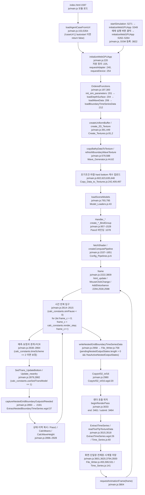

> Canonical: [`../README.md`](../README.md) (모델 정체) · 소스 맵 [`celeris-source-map.md`](celeris-source-map.md).
> 본 노트 = **per-timestep 파이프라인 + 제어흐름 그래프**. 인용 경로는 `Celeris-WebGPU/` 루트 상대 (`js/main.js:NNN`).
> 비교한 본판은 plynett/plynett.github.io main `ebca435`(2026-07-20)다. [11-04 대조 정정]

Celeris-WebGPU는 단일 모놀리식 오케스트레이터 `js/main.js`(~6800 lines)가 WebGPU compute 패스를 고정 순서로 디스패치한다. JS는 스케줄링·텍스처 복사만, 수치 커널은 WGSL. 이 노트는 그 디스패치 시퀀스를 소스 라인 기준으로 재구성한다.

---

## 1. 프레임 루프 → 프레임당 타임스텝 (동적 조정)

`frame()`은 `requestAnimationFrame(frame)`로 재호출되는 클로저 (`js/main.js:2222`, 재귀 호출 `js/main.js:3804`). 프레임 내부에서 compute 루프는 `render_step`회 반복:

```
for (frame_c = 0; frame_c < render_step; frame_c++)   // js/main.js:2615
    { … 1 timestep (predictor [+corrector]) … }
```

- compute 루프는 `simPause < 0`일 때만 실행 (`js/main.js:2614`).
- **`render_step` 동적 조정** (`js/main.js:2247-2277`): `adapt_render_step==1 && setRenderStep==0`이면 1초마다 step당 clock time를 측정해 GPU가 빠르면 `render_step += 1`, 응답성이 나빠지면 `Math.max(1, render_step-1)`로 back-off (`:1578`,`:1583`). 즉 **렌더 1회당 시뮬 스텝 수**를 런타임에 조율 — 화면 갱신은 줄이고 GPU 점유를 최대화.
- 사용자가 render_step를 수동 설정하면(`setRenderStep`) 자동 탐색 비활성 (`js/main.js:5102`).
- `total_time = frame_count * calc_constants.dt + calc_constants.start_time_shift;`로 모의 시간을 계산한다(`js/main.js:2624`). [11-04 대조 정정]
- 자동 상태별 CFL 적응은 없다. UI는 dt를 다시 계산할 수 있다. 큐 완료 대기는 `if (nowFlush - lastGpuSyncTime > 600000)`에서 실행한다. 전체 시간의 재계산 문제는 CD1-1302로 구분한다. (`js/main.js:2226–2228,2294–2332,2624`) [11-04 대조 정정]
- 실행 중 Courant 변경으로 dt가 바뀌면 `total_time = frame_count * calc_constants.dt + calc_constants.start_time_shift;`가 과거 단계의 시간까지 새 dt로 계산한다. 이 시간 재계산은 코드 결함 후보다. 강도는 중간이다. (`js/main.js:2305–2332,2624`) [11-04 대조 정정]

---

## 2. 활성 수력 패스 순서 (predictor 1스텝)

아래는 `NLSW_or_Bous>0`(Boussinesq) + `useBreakingModel==1` 기준 실제 디스패치 순서. 각 라인은 `runComputeShader_EncStack`(`Run_Compute_Shader.js:55`, encoder에 적재) 또는 `runComputeShader`(`:3`, 즉시 submit). encoder는 중간중간 `device.queue.submit(...finish())`로 끊어 제출.

```text
[predictor — pred_or_corrector=1 (js/main.js:2672)]
 Pass0                       js/main.js:2638   이웃 수심 (dry/wet 헬퍼)
 Pass1 (or Pass1_HighOrder)  js/main.js:2641   face 재구성 (수심·유속·스칼라)
 SedTrans_Pass1   [if Sed]   js/main.js:2645   sed 농도 face 재구성
 Pass2 (or HighOrder_HLLC)   js/main.js:2649   face 수치 flux (표준 HLL / 고차 HLLC)
 Pass_Breaking    [if brk]   js/main.js:2653   breaking age/intensity, eddy visc
   └ copy txtemp_Breaking→txBreaking            js/main.js:2654
 ── submit encoder stack ──  js/main.js:2658
 [COULWAVE only] Pass3A_COULWAVE, Pass3B_COULWAVE  js/main.js:2662-2663
   └ copy2DDataTo3DTexture ×6 → txCW_groupings    js/main.js:2664-2669
 Pass3_{Bous|NLSW}           js/main.js:2679 / :2682   flux divergence·friction·
                                              pressure·breaking·dispersion·predictor update
   └ copy dU_by_dt→predictedGradients           js/main.js:2685
 SedTrans_Pass3   [if Sed]   js/main.js:2689
 BoundaryPass                js/main.js:2694   BC + wet/dry cleanup (explicit state)
   └ copy txtemp_boundary→current_stateUVstar   js/main.js:2696
 [COULWAVE] Update_TriDiag_coef (UpdateTrid)    js/main.js:2704   비선형 계수 갱신
 ── submit encoder stack ──  js/main.js:2708
 runTridiagSolver:           js/main.js:2717    (NLSW: copy만, Bous: PCR)
   TriDiag_PCRx ×Px loop  →  Run_Tridiag_Solver.js:48–63
   TriDiag_PCRy ×Py loop  →  Run_Tridiag_Solver.js:73–88
 BoundaryPass (NewState)     js/main.js:2729   tridiag 후 eta,P,Q BC 재적용 (Bous만)
   └ copy txtemp_boundary→txNewState            js/main.js:2732
 [Bous] F_G_star history shift                  js/main.js:2735-2736
 [disturbanceType==5] AddDisturbance+Updateneardry+UpdateTrid  js/main.js:2741-2745
 ── submit encoder stack ──  js/main.js:2755
```

`Update_TriDiag_coef`(코드상 `UpdateTrid`)는 **Celeris-Bous(=1)에서는 predictor에서 매 스텝 재호출하지 않는다** — 초기화 시 1회, 그리고 깊이가 변할 때(disturbance·sediment)만 갱신 (`js/main.js:2745`,`:2141`). COULWAVE(=2)는 비선형 계수라 tridiag 직전 매 스텝 갱신 (`js/main.js:2704`,`:2089`).

타임스텝 말미 공통 후처리 (corrector 유무 무관, `js/main.js:2867-2928`). **nested grid 활성 시** Sed 종료와 history shift 사이에 `captureNestedGridBoundaryOutputsIfNeeded` 가 추가된다 (`js/main.js:2893` → callee `:2181-2208`, 입력 `txNewState`·`txBottom` `:2153`, 셰이더 `shaders/ExtractNestedBoundaryTimeSeries.wgsl`). 나머지 패스의 상대 순서는 그대로다:

```text
 [if Sed] SedTrans_UpdateBottom → txBottom 갱신, Updateneardry,
          [Bous=1] UpdateTrid (깊이 변화 반영)        js/main.js:2879-2887
 gradient history shift: oldGradients→oldOldGradients,
                         predictedGradients→oldGradients   js/main.js:2896-2897
 상태 복사: txNewState→txState,
             current_stateUVstar→txstateUVstar            js/main.js:2900-2901
 [if Sed] Sed history shift + 상태 복사                  js/main.js:2905-2907
 ── 진단(diagnostics) ──
 Pass1 (cell-side 텍스처 재계산, 유속 출력용)              js/main.js:2913
 CalcMeans → txMeans/txMeans_Speed/txMeans_Momflux        js/main.js:2915-2920
 CalcWaveHeight → txWaveHeight                            js/main.js:2924-2925
 ── submit encoder stack ──                               js/main.js:2928
```

반정밀도 캐시는 `js/main.js:2980`에 있다. 점 시계열 추출은 `js/main.js:3515`에 있다. 둘 다 시간단계 반복 밖의 프레임 처리다. 렌더 패스는 `js/main.js:3033`에서 시작한다. [11-04 대조 정정]

---

## 3. 모드 분기 — `NLSW_or_Bous` (0/1/2) · `Accuracy_mode`

셰이더 **선택은 초기화 1회**(fetch+pipeline 생성), 디스패치 시점엔 미리 만든 파이프라인 변수를 분기 선택.

이 표는 본판 경로다(`js/main.js:1539–1551`). [11-04 대조 정정]
transect 판은 고차 flux에 HLLEM을 사용한다(`transect_version/js/main.js:1033–1045`; `transect_version/shaders/Pass2_HighOrder.wgsl:191`). [11-04 대조 정정]
transect 판은 각 계산·복사를 즉시 submit한다(`transect_version/js/Run_Compute_Shader.js:25,51`). [11-04 대조 정정]
transect 판은 y PCR을 실행하지 않는다(`transect_version/js/Run_Tridiag_Solver.js:31–75`). [11-04 대조 정정]

| config | 값 | 효과 | 인용 |
|---|---|---|---|
| `Accuracy_mode` | 1 | Pass1 → `Pass1_HighOrder.wgsl` (4th-order MUSCL-TVD), Pass2 → `Pass2_HighOrder_HLLC.wgsl` | `js/main.js:1539-1551` |
| | 0 | `Pass1.wgsl`, `Pass2.wgsl` (저차) | 동일 |
| `NLSW_or_Bous` | 0 | NLSW. Pass3 = `Pass3_Pipeline_NLSW`; **tridiag 생략**(copy만) | `js/main.js:2682`, `Run_Tridiag_Solver.js:37–39` |
| | 1 | Celeris Boussinesq. Pass3 = `Pass3_Bous.wgsl`, `Update_TriDiag_coef.wgsl`, `TriDiag_PCRx/y.wgsl` | `js/main.js:1565`,`:1357`,`:1368` |
| | 2 | COULWAVE. Pass3 = `Pass3_COULWAVE.wgsl`(+Pass3A/B), `Update_TriDiag_coef_COULWAVE.wgsl`, `TriDiag_PCRx/y_COULWAVE.wgsl` | `js/main.js:1570`,`:1354`,`:1366` |

디스패치 분기 패턴 (predictor·corrector 동일):
- Pass3: `if (NLSW_or_Bous > 0) Pass3_Pipeline_Bous else Pass3_Pipeline_NLSW` (`js/main.js:2678-2683`). `Pass3_Pipeline_Bous`는 셰이더 코드만 NLSW=1→Celeris / =2→COULWAVE로 미리 분기됨 (`js/main.js:1564-1571`, 동일 bind-group layout `Pass3_BindGroupLayout` 재사용 `:1399–1400`).
- COULWAVE 전용 grouping 패스(Pass3A/B + `copy2DDataTo3DTexture` ×6)는 `if (NLSW_or_Bous == 2)`로 가드 (`js/main.js:2661-2670`).
- PCR 솔버 진입 자체가 `NLSW_or_Bous==0`이면 copy로 단락 (`Run_Tridiag_Solver.js:37`).

> 즉 **mode = "어떤 .wgsl을 컴파일했나"(초기화 분기) + "어떤 Pipeline 변수를 디스패치하나"(루프 분기)** 이중 구조. 한 세션에서 mode 변경 = 셰이더 재fetch·재컴파일 필요.

---

## 4. `timeScheme==2` predictor/corrector + history 텍스처 시프트

`timeScheme` (Pass3 uniform `js/main.js:2353`): `0`=단일 explicit, `≠0`=Adams-Bashforth (current/old/older 도함수). `pred_or_corrector` (uniform `:1928`): `1`=predictor, `2`=corrector.

predictor는 항상 실행(§2). **corrector substep은 `if (timeScheme==2)`에서만** (`js/main.js:2757`). corrector는 predictor 결과를 시드로 동일 패스 시퀀스를 한 번 더:

현 보정은 한 번이다(`js/main.js:2757–2865`). [11-04 대조 정정]
논문의 반복 보정·첫 두 단계 Euler·별도 F* 증분과 구분한다(`Tavakkol 2017 p.3` §2.3; `js/main.js:2672–2679,2757`). [11-04 대조 정정]
프레임당 계산 횟수 조정은 물리 `dt`의 적응 조정과 다르다(`js/main.js:2247–2281,2624`). [11-04 대조 정정]

```text
[corrector — js/main.js:2757, pred_or_corrector=2 (:2061)]
 copy txNewState→txState   (예측값을 gradient 기준으로)   js/main.js:2766
 Pass0, Pass1, [SedTrans_Pass1], Pass2, [Pass_Breaking]  js/main.js:2772-2789
 [COULWAVE] Pass3A/B + grouping copies                   js/main.js:2795-2803
 Pass3_{Bous|NLSW} (corrector update)                    js/main.js:2812 / :2070
 [SedTrans_Pass3]                                        js/main.js:2820
 BoundaryPass → current_stateUVstar                      js/main.js:2824-2826
 [COULWAVE] UpdateTrid                                   js/main.js:2834
 runTridiagSolver                                        js/main.js:2847
 BoundaryPass(NewState) → txNewState  [Bous]             js/main.js:2858-2861
```

corrector는 더 큰 dt(≈2배)와 정확도를 위해 계산량 2배를 추가 (`js/main.js:2757` 주석).

예측 쇄파·COULWAVE B는 직전 시간 단계의 마지막 Pass3가 남긴 도함수를 읽는다. 첫 시간 단계에는 이전 Pass3 결과가 없다. 보정 호출은 이번 예측 Pass3의 도함수를 읽는다. Pass2도 이번 쇄파 갱신보다 먼저 `txBreaking`을 읽는다(`shaders/Pass_Breaking.wgsl:55`; `shaders/Pass3B_COULWAVE.wgsl:191`; `js/main.js:2649–2679,2783–2815`). [11-04 대조 정정]

**history 텍스처 시프트** (3차 AB의 도함수 이력):

| 시프트 | 시점 | 인용 |
|---|---|---|
| `dU_by_dt → predictedGradients` | predictor Pass3 직후 | `js/main.js:2685` |
| `F_G_star_oldGradients → F_G_star_oldOldGradients`, `predictedF_G_star → F_G_star_oldGradients` | predictor·tridiag 후 (Bous 전용 dispersive 헬퍼) | `js/main.js:2735-2736` |
| `oldGradients → oldOldGradients`, `predictedGradients → oldGradients` | 타임스텝 말미 (corrector 후) | `js/main.js:2896-2897` |
| `txNewState → txState`, `current_stateUVstar → txstateUVstar` | 상태 복사 (말미) | `js/main.js:2900-2901`. [11-04 대조 정정] |
| Sed: `oldGradients_Sed→oldOldGradients_Sed`, `predictedGradients_Sed→oldGradients_Sed`, `txNewState_Sed→txState_Sed` | 말미 (Sed 전용) | `js/main.js:2905-2907` |

즉 도함수 ring buffer를 GPU 텍스처 copy로 한 칸씩 밀어 다음 스텝의 `oldGradients`/`oldOldGradients`를 채운다 (별도 ALU 없이 `copyTextureToTexture`).

---

## 5. JS 핸들러 호출 그래프

Handler_*.js는 **루프에서 매번 호출되지 않는다**. 각 핸들러는 `create_<Pass>_BindGroupLayout` + `create_<Pass>_BindGroup`(텍스처/버퍼 바인딩)를 export, **초기화 시 1회** 호출되어 BindGroup·uniform 객체를 만든다 (예: `Handler_Pass3.js:create_Pass3_BindGroup(...)` 21개 텍스처 바인딩). 루프는 그 결과를 `Run_Compute_Shader.js`/`Run_Tridiag_Solver.js`로 디스패치할 뿐.

| 패스 | Handler (bind-group 정의) | 루프 디스패치 경유 | 가드 |
|---|---|---|---|
| Pass0 | `Handler_Pass0.js` | `runComputeShader_EncStack` :2638 | 항상 [11-04 대조 정정] |
| Pass1 | `Handler_Pass1.js` | EncStack :2641,:2775,:2913 | 예측과 말미 진단은 매 시간단계에 실행한다. 보정 호출은 `if (calc_constants.timeScheme == 2)` 안에 있다(`js/main.js:2757`). [11-04 대조 정정] [11-04 전수 검증 정정] |
| Pass2 | `Handler_Pass2.js` | EncStack :2649 | 항상 [11-04 대조 정정] |
| Pass_Breaking | `Handler_PassBreaking.js` | EncStack :2653 | `useBreakingModel==1` [11-04 대조 정정] |
| Pass3 / Pass3A·B | `Handler_Pass3.js` | EncStack :2679/:2682; A·B는 즉시 `runComputeShader` :2662–2663 | mode 분기 [11-04 대조 정정] |
| BoundaryPass | `Handler_BoundaryPass.js` | EncStack :2694,:2729 | 항상 / Bous [11-04 대조 정정] |
| UpdateTrid | `Handler_UpdateTrid.js` | EncStack :2704,:2745,:2886 | COULWAVE / 깊이변화 [11-04 대조 정정] |
| TriDiag PCRx/y | `Handler_Tridiag.js` | **`Run_Tridiag_Solver.js`** (Px/Py 루프) :2717 | `NLSW_or_Bous>0` [11-04 대조 정정] |
| Updateneardry | `Handler_Updateneardry.js` | EncStack :2743,:2882 | disturbance / Sed [11-04 대조 정정] |
| AddDisturbance | `Handler_AddDisturbance.js` | EncStack :2741 | `if(calc_constants.disturbanceType == 5 && total_time <= 1.0e5 * calc_constants.dt)` 안에서 실행한다(`js/main.js:2739–2741`). [11-04 대조 정정] [11-04 전수 검증 정정] |
| SedTrans_Pass1/3/UpdateBottom | `Handler_SedTrans_*.js` | EncStack :2645,:2689,:2879 | `useSedTransModel==1` [11-04 대조 정정] |
| CalcMeans | `Handler_CalcMeans.js` | EncStack :2915 | 항상 (진단) [11-04 대조 정정] |
| CalcWaveHeight | `Handler_CalcWaveHeight.js` | EncStack :2924 | 항상 (진단) [11-04 대조 정정] |
| Copytxf32_txf16 | `Handler_Copytxf32_txf16.js` | `runComputeShader` :2980 | 프레임당 1 [11-04 대조 정정] |
| ExtractTimeSeries | `Handler_ExtractTimeSeries.js` | `runComputeShader` :3515 | 프레임당 1 [11-04 대조 정정] |
| Render / Skybox / Model | `Handler_Render.js`,`Handler_Skybox.js` | RenderPass :3033 | viewType 분기 [11-04 대조 정정] |

**디스패치 실행 모델** (`Run_Compute_Shader.js`):
- `runComputeShader_EncStack(:55)` = 공유 `commandEncoder`에 compute pass 적재(submit 안 함) → main.js가 `device.queue.submit([enc.finish()])`로 묶어 제출 (배칭으로 드라이버 왕복 감소).
- `runComputeShader(:3)` = 자체 encoder 생성+즉시 submit (COULWAVE Pass3A/B, Copytxf32, ExtractTimeSeries 등 단발).
- `runCopyTextures(_EncStack)(:38/:78)` = `copyTextureToTexture` (history 시프트·상태 복사·temp→canonical 환원). [11-04 대조 정정]
- **PCR 솔버**(`Run_Tridiag_Solver.js`): X-solve `p=0..Px-1`, Y-solve `p=0..Py-1` (`Px=ceil(log2(WIDTH))`, `Py=ceil(log2(HEIGHT))`, `constants_load_calc.js:511-512`), step `s=1<<p`. ping-pong bind group을 `p`에 따라 선택(`BaseToA`/`BToA`/기본, `:57`,`:82`)해 계수 copy-back 없이 핸드오프, 마지막에 `txtemp2_PCR{x,y}→txNewState` 환원(`:66`,`:91`).

---

## 6. 운용적 의의

solver와 렌더가 **동일 GPU에 co-resident** — compute 패스가 쓴 텍스처를 CPU 왕복 없이 그대로 렌더 패스가 읽어, README가 명시하듯 "interactive frame rates"에서 NLSW/Boussinesq 파랑(breaking·run-up·inundation)을 "in real time" 브라우저에서 시뮬·시각화한다 (`README.md:3`,`:7`,`:15`). 이는 FUNWAVE(Fortran/MPI 배치 → 사후 가시화)와 대비되는 **faster-than-real-time interactive** 운용 철학으로, `render_step` 동적 조정(§1)이 그 대화성을 유지하는 핵심 기제다.


## 실행 흐름도 (11-04 대조)

[원본 흐름도와 렌더 확인 기록](../../../_staging/recovery/flow/Celeris-callflow.md#4-흐름도).

### 1. 시작부터 시간 반복·출력까지

그림은 2026-11-04 mmdc로 렌더 확인했다.


### 2. 표준 Boussinesq 한 시간 단계

그림은 2026-11-04 mmdc로 렌더 확인했다.


```mermaid
flowchart TD
  B0["Pass0 / Pass0.wgsl:22<br/>js/main.js:2638"]
  B1["Pass1 / Pass1_HighOrder<br/>js/main.js:2641<br/>Pass1.wgsl:55 / Pass1_HighOrder.wgsl:151<br/>셰이더 선택 js/main.js:1539–1544<br/>(calc_constants.Accuracy_mode == 1 이면 고차)"]
  B2["Pass2 / Pass2_HighOrder_HLLC<br/>js/main.js:2649<br/>Pass2.wgsl:60 / Pass2_HighOrder_HLLC.wgsl:147<br/>셰이더 선택 js/main.js:1546–1550<br/>(calc_constants.Accuracy_mode == 1 이면 HLLC)"]
  B3["Pass_Breaking / 임시값 복사<br/>js/main.js:2653–2654<br/>Pass_Breaking.wgsl:31<br/>(calc_constants.useBreakingModel == 1)"]
  B4["예측 선택 pred_or_corrector = 1<br/>Pass3_Bous / Pass3_Bous.wgsl:96<br/>js/main.js:2672–2679<br/>(calc_constants.NLSW_or_Bous &gt; 0)"]
  B5["dU_by_dt → predictedGradients 복사<br/>js/main.js:2685"]
  B6["첫 BoundaryPass / 중간 상태 복사<br/>js/main.js:2694–2697<br/>BoundaryPass.wgsl:281"]
  B7["runTridiagSolver x 반복<br/>js/main.js:2717 → Run_Tridiag_Solver.js:37,40,48<br/>(calc_constants.NLSW_or_Bous == 0 아님: else 가지)<br/>for (let p = 0; p &lt; calc_constants.Px; p++)"]
  B8["TriDiag_PCRx / 계수 바인드 그룹 교대<br/>Run_Tridiag_Solver.js:57,59<br/>TriDiag_PCRx.wgsl:20"]
  B9["x 해 복사 / y 반복<br/>Run_Tridiag_Solver.js:66,73<br/>for (let p = 0; p &lt; calc_constants.Py; p++)"]
  B10["TriDiag_PCRy / 계수 바인드 그룹 교대<br/>Run_Tridiag_Solver.js:82,84<br/>TriDiag_PCRy.wgsl:20"]
  B11["y 해 복사 / 둘째 BoundaryPass / 상태 복사<br/>Run_Tridiag_Solver.js:91<br/>js/main.js:2728–2732<br/>(BoundaryPass는 calc_constants.NLSW_or_Bous &gt; 0)"]
  B12["FG 이력 복사<br/>js/main.js:2735–2736"]
  B13["AddDisturbance / Update_neardry / UpdateTrid<br/>js/main.js:2741–2745<br/>(calc_constants.disturbanceType == 5 &amp;&amp; total_time &lt;= 1.0e5 * calc_constants.dt)"]
  B14["보정 분기<br/>js/main.js:2757<br/>(calc_constants.timeScheme == 2)"]
  B15["txNewState → txState 복사<br/>js/main.js:2766"]
  B16["Pass0 / Pass1 / Pass2<br/>js/main.js:2772,2775,2783<br/>Pass0.wgsl:22 / Pass1.wgsl:55 / Pass2.wgsl:60<br/>고차 선택은 B1·B2와 같음"]
  B17["Pass_Breaking / 임시값 복사<br/>js/main.js:2787–2788<br/>(calc_constants.useBreakingModel == 1)"]
  B18["보정 선택 pred_or_corrector = 2<br/>Pass3_Bous / Pass3_Bous.wgsl:96<br/>js/main.js:2806–2812"]
  B19["첫 BoundaryPass / 중간 상태 복사<br/>js/main.js:2824–2827<br/>BoundaryPass.wgsl:281"]
  B20["runTridiagSolver / x PCR → y PCR<br/>js/main.js:2847<br/>Run_Tridiag_Solver.js:48,59,66,73,84,91<br/>반복 조건은 B7·B9와 같음"]
  B21["둘째 BoundaryPass / 상태 복사<br/>js/main.js:2857–2861<br/>BoundaryPass.wgsl:281<br/>(BoundaryPass는 calc_constants.NLSW_or_Bous &gt; 0)"]
  B22["captureNestedGridBoundaryOutputsIfNeeded<br/>js/main.js:2893<br/>ExtractNestedBoundaryTimeSeries.wgsl:37"]
  B23["상태·도함수 이력 복사<br/>js/main.js:2896–2901"]
  B24["Pass1 / CalcMeans / 평균 복사<br/>js/main.js:2913–2920<br/>CalcMeans.wgsl:29"]
  B25["CalcWaveHeight / 파고 복사 / submit<br/>js/main.js:2924–2928<br/>CalcWaveHeight.wgsl:15"]
  B0 --> B1 --> B2 --> B3 --> B4 --> B5 --> B6 --> B7
  B7 --> B8 --> B7
  B7 --> B9
  B9 --> B10 --> B9
  B9 --> B11 --> B12 --> B13 --> B14
  B14 --> B15 --> B16 --> B17 --> B18 --> B19 --> B20 --> B21 --> B22
  B14 --> B22
  B22 --> B23 --> B24 --> B25
```

### 3. NLSW·COULWAVE·퇴적물의 삽입·대체 위치

그림은 2026-11-04 mmdc로 렌더 확인했다.


```mermaid
flowchart TD
  C0["Pass0 / Pass1<br/>js/main.js:2638,2641 / 보정 :2772,2775"]
  C1["SedTrans_Pass1 / SedTrans_Pass1.wgsl:52<br/>js/main.js:2645 / 보정 :2779<br/>(calc_constants.useSedTransModel == 1)"]
  C2["Pass2 / Pass_Breaking<br/>js/main.js:2649,2653 / 보정 :2783,2787<br/>(calc_constants.useBreakingModel == 1 이면 쇄파)"]
  C3["모델 선택<br/>js/main.js:2661 / 보정 :2795<br/>(calc_constants.NLSW_or_Bous == 2)"]
  C4["Pass3A_COULWAVE / Pass3A_COULWAVE.wgsl:23<br/>js/main.js:2662 / 보정 :2796"]
  C5["Pass3B_COULWAVE / Pass3B_COULWAVE.wgsl:25<br/>js/main.js:2663 / 보정 :2797"]
  C6["copy2DDataTo3DTexture 여섯 층<br/>js/main.js:2664–2669 / 보정 :2798–2803<br/>Copy_Data_to_Textures.js:605"]
  C7["Pass3_COULWAVE / Pass3_COULWAVE.wgsl:96<br/>js/main.js:2679 / 보정 :2812<br/>(calc_constants.NLSW_or_Bous &gt; 0)<br/>Pass3_Pipeline_Bous 셰이더 선택 :1568–1570 (calc_constants.NLSW_or_Bous == 2)"]
  C8["Pass3_NLSW / Pass3_NLSW_Spherical<br/>js/main.js:2681–2682 / 보정 :2814–2815<br/>(else 가지: calc_constants.NLSW_or_Bous &gt; 0 아님)<br/>선택 :1558–1563<br/>(calc_constants.grid_type == 2 이면 구면)"]
  C9["예측 도함수 복사<br/>js/main.js:2685<br/>보정에는 이 복사가 없음"]
  C10["SedTrans_Pass3 / SedTrans_Pass3.wgsl:52<br/>js/main.js:2689 / 보정 :2820<br/>(calc_constants.useSedTransModel == 1)"]
  C11["첫 BoundaryPass / 상태·쇄파·퇴적물 복사<br/>js/main.js:2694–2699 / 보정 :2824–2829<br/>BoundaryPass.wgsl:281"]
  C12["UpdateTrid / Update_TriDiag_coef_COULWAVE.wgsl:23<br/>js/main.js:2704 / 보정 :2834<br/>(calc_constants.NLSW_or_Bous == 2)<br/>셰이더 선택 :1590–1591"]
  C13["runTridiagSolver<br/>js/main.js:2717 / 보정 :2847<br/>Run_Tridiag_Solver.js:3"]
  C14["NLSW 우회 복사 current_stateUVstar → txNewState<br/>Run_Tridiag_Solver.js:37–38<br/>(calc_constants.NLSW_or_Bous == 0)"]
  C15["COULWAVE x/y PCR<br/>Run_Tridiag_Solver.js:48,73<br/>TriDiag_PCRx_COULWAVE.wgsl:22<br/>TriDiag_PCRy_COULWAVE.wgsl:22<br/>셰이더 선택 js/main.js:1578–1580 (calc_constants.NLSW_or_Bous == 2)"]
  C16["둘째 BoundaryPass<br/>js/main.js:2729 / 보정 :2858<br/>(calc_constants.NLSW_or_Bous &gt; 0)"]
  C17["txtemp_boundary → txNewState 복사<br/>js/main.js:2732 / 보정 :2861"]
  C18["예측 뒤 FG 이력·처방 지형·보정 선택<br/>js/main.js:2735–2757<br/>(calc_constants.timeScheme == 2 이면 :2766–2864)"]
  C19["SedTrans_UpdateBottom / SedTrans_UpdateBottom.wgsl:30<br/>js/main.js:2879<br/>(calc_constants.useSedTransModel == 1)"]
  C20["지형·누적 변화 복사 / Update_neardry / 지형 복사<br/>js/main.js:2880–2883<br/>Update_neardry.wgsl:13"]
  C21["UpdateTrid / Update_TriDiag_coef.wgsl:22<br/>js/main.js:2886<br/>(calc_constants.NLSW_or_Bous == 1)"]
  C22["중첩 추출·상태 이력 복사·진단<br/>js/main.js:2893–2928<br/>CalcMeans.wgsl:29 / CalcWaveHeight.wgsl:15"]
  C0 --> C1 --> C2 --> C3
  C0 --> C2
  C3 --> C4 --> C5 --> C6 --> C7 --> C9
  C3 --> C8 --> C9
  C9 --> C10 --> C11
  C9 --> C11
  C11 --> C12 --> C13
  C11 --> C13
  C13 --> C14 --> C17
  C13 --> C15 --> C16 --> C17
  C17 --> C18 --> C19 --> C20 --> C21 --> C22
  C18 --> C22
```

## 문서와 코드 차이 (11-04 대조)

코드는 plynett/plynett.github.io main `ebca435`(2026-07-20)의 Celeris-WebGPU다. 문서는 같은 커밋의 docs/·README다. 논문은 Tavakkol & Lynett 2017(CPC), Tavakkol & Lynett 2020(CPC), Lynett et al. 2026(JWPCOE) 중 각 행에 적힌 판이다.

한국어 결론은 recovery 대조의 AI 분석이다. 코드 경로는 `models/Celeris/raw/source_code/Celeris-WebGPU/`를 기준으로 한다. 노트 인용은 반영 전 커밋 `d8157c80`을 기준으로 한다.
| 행 ID | 항목 | 문서 원문 | 코드 원문 | 결론 | 결론 문장 |
|---|---|---|---|---|---|
| callflow:RF-005 | 수렴까지 보정 반복 | Tavakkol 2017 p.3 §2.3 `iterated for a predefined number of times, or until the variables converge.` | `254d71c:js/main.js:329`와 현재 `js/main.js:2757`의 `if (calc_constants.timeScheme == 2)` | A 판 차이 | 이전 구현(논문이 밝힌 구현) 기준, 그 코드는 이 저장소 이력에 없다. 현재 WebGPU는 timeScheme 2에서 보정을 한 번 수행한다. 보정 수렴 반복은 없다. (문서 판: Tavakkol & Lynett 2017(CPC).)<br>확인한 원문: Tavakkol 2017 p.1, p.3 §2.3 식 (18)–(20) 뒤 문단; `254d71c:js/main.js:329–345`; `js/main.js:2757–2865`<br>[최종 근거](../../../_staging/recovery/compare/Celeris-conclusion-verify-CP3RF.md) |
| callflow:RF-015 | 쇄파·COULWAVE 입력 시점 | `docs/source/shaders/Pass_Breaking_wgsl.md:11` ``Inputs include current state, bathymetry, `dU_by_dt`, hydrodynamic fluxes, and previous breaking state. Outputs are:`` | `shaders/Pass_Breaking.wgsl:55` `let detadt = textureLoad(dU_by_dt, idx, 0).x;`; `js/main.js:2653`이 2679행보다 앞 | C 문서 누락 | 예측 쇄파·COULWAVE B는 직전 시간 단계의 마지막 Pass3가 남긴 도함수를 읽는다. 첫 시간 단계에는 이전 Pass3 결과가 없다. 보정 호출은 이번 예측 Pass3의 도함수를 읽는다. Pass2도 이번 쇄파 갱신보다 먼저 txBreaking을 읽는다.<br>확인한 원문: `docs/source/shaders/Pass_Breaking_wgsl.md:11–18`; `shaders/Pass_Breaking.wgsl:55`; `shaders/Pass3B_COULWAVE.wgsl:191`; `js/main.js:2649–2679,2685,2783–2812,2895–2901`<br>[최종 근거](../../../_staging/recovery/compare/Celeris-conclusion-verify-CP3RF.md) |
| callflow:RF-019 | 2026 Fig.1의 보조 계산 생략 | Lynett et al. 2026 p.5 Fig.1은 Pass1에서 시작한다. 그림은 PCR 뒤 Boundary Pass 한 번을 그린다. | `js/main.js:2638` Pass0; 2653행 쇄파; 2662–2663행 COULWAVE A/B; 2694행 첫 경계; 2915/2924행 진단 | C 문서 누락 | Fig.1은 주 계산 골격이다. 실제 직접 호출표에는 보조 패스와 첫 경계도 넣는다.<br>확인한 원문: Lynett 2026 p.5 Fig.1; `js/main.js:2638,2644–2655,2661–2670,2694,2728–2732,2913–2924`<br>[최종 근거](../../../_staging/recovery/compare/Celeris-conclusion-verify-CP3RF.md) |
| docs-architecture:CD1-139 | ` ARCHITECTURE.md:57 ` ` 13. ` | ` ARCHITECTURE.md:57 ` ` 13. ` | ` js/main.js:2913 ` `                 runComputeShader_EncStack(device, commandEncoderStack, Pass1_uniformBuffer, Pass1_uniforms, Pass1_Pipeline, Pass1_BindGroup, calc_constants.DispatchX, calc_constants.DispatchY); `<br>` js/main.js:2914 ` `                 //CalcMeans_view.setInt32(0, calc_constants.n_time_steps_means, true);          // i32 moved above `<br>` js/main.js:2915 ` `                 runComputeShader_EncStack(device, commandEncoderStack, CalcMeans_uniformBuffer, CalcMeans_uniforms, CalcMeans_Pipeline, CalcMeans_BindGroup, calc_constants.DispatchX, calc_constants.DispatchY); `<br>` js/main.js:2916 ` `                  `<br>` js/main.js:2917 ` `                 // Stack command encoder for copy operations `<br>` js/main.js:2918 ` `                 runCopyTextures_EncStack(commandEncoderStack, calc_constants, txtemp_Means, txMeans) `<br>` js/main.js:2919 ` `                 runCopyTextures_EncStack(commandEncoderStack, calc_constants, txtemp_Means_Speed, txMeans_Speed) `<br>` js/main.js:2920 ` `                 runCopyTextures_EncStack(commandEncoderStack, calc_constants, txtemp_Means_Momflux, txMeans_Momflux) `<br>` js/main.js:2921 ` `  `<br>` js/main.js:2922 ` `                 //calc_constants.n_time_steps_waveheight += 1;  // moved above `<br>` js/main.js:2923 ` `                 //CalcWaveHeight_view.setInt32(0, calc_constants.n_time_steps_waveheight, true);          // i32 moved above `<br>` js/main.js:2924 ` `                 runComputeShader_EncStack(device, commandEncoderStack, CalcWaveHeight_uniformBuffer, CalcWaveHeight_uniforms, CalcWaveHeight_Pipeline, CalcWaveHeight_BindGroup, calc_constants.DispatchX, calc_constants.DispatchY); `<br>` js/main.js:2925 ` `                 runCopyTextures_EncStack(commandEncoderStack, calc_constants, txtemp_WaveHeight, txWaveHeight) `<br>` js/main.js:2980 ` `         runComputeShader(device, Copytxf32_txf16_uniformBuffer, Copytxf32_txf16_uniforms, Copytxf32_txf16_Pipeline, Copytxf32_txf16_BindGroup, calc_constants.DispatchX, calc_constants.DispatchY); ` | B 문서 오기 | `if (calc_constants.simPause < 0)` 조건 안의 시간 반복에서 평균·파고 통계를 갱신한다. 반정밀도 캐시는 시간 반복 밖에서 프레임마다 갱신한다. 점 시계열 추출도 시간 반복 밖의 프레임 후반에서 수행한다.<br>확인한 원문: `ARCHITECTURE.md:57`<br>`js/main.js:2913–2925`<br>`js/main.js:2980`<br>`ARCHITECTURE.md:59`<br>`js/main.js:2614–2615`<br>`js/main.js:2930–2931`<br>`js/main.js:3512–3518`<br>`984091f:ARCHITECTURE.md:57–59`<br>`984091f:js/main.js:1666–1667`<br>`984091f:js/main.js:1953–1977`<br>`984091f:js/main.js:2350–2354`<br>[최종 근거](../../../_staging/recovery/compare/Celeris-conclusion-verify-CD1a.md) |
| docs-architecture:CD1-140 | ` ARCHITECTURE.md:57 ` ` Diagnostic passes: means, maximums, wave-height statistics, time-series extraction, and render-cache packing. ` | ` ARCHITECTURE.md:57 ` ` Diagnostic passes: means, maximums, wave-height statistics, time-series extraction, and render-cache packing. ` | ` js/main.js:2913 ` `                 runComputeShader_EncStack(device, commandEncoderStack, Pass1_uniformBuffer, Pass1_uniforms, Pass1_Pipeline, Pass1_BindGroup, calc_constants.DispatchX, calc_constants.DispatchY); `<br>` js/main.js:2914 ` `                 //CalcMeans_view.setInt32(0, calc_constants.n_time_steps_means, true);          // i32 moved above `<br>` js/main.js:2915 ` `                 runComputeShader_EncStack(device, commandEncoderStack, CalcMeans_uniformBuffer, CalcMeans_uniforms, CalcMeans_Pipeline, CalcMeans_BindGroup, calc_constants.DispatchX, calc_constants.DispatchY); `<br>` js/main.js:2916 ` `                  `<br>` js/main.js:2917 ` `                 // Stack command encoder for copy operations `<br>` js/main.js:2918 ` `                 runCopyTextures_EncStack(commandEncoderStack, calc_constants, txtemp_Means, txMeans) `<br>` js/main.js:2919 ` `                 runCopyTextures_EncStack(commandEncoderStack, calc_constants, txtemp_Means_Speed, txMeans_Speed) `<br>` js/main.js:2920 ` `                 runCopyTextures_EncStack(commandEncoderStack, calc_constants, txtemp_Means_Momflux, txMeans_Momflux) `<br>` js/main.js:2921 ` `  `<br>` js/main.js:2922 ` `                 //calc_constants.n_time_steps_waveheight += 1;  // moved above `<br>` js/main.js:2923 ` `                 //CalcWaveHeight_view.setInt32(0, calc_constants.n_time_steps_waveheight, true);          // i32 moved above `<br>` js/main.js:2924 ` `                 runComputeShader_EncStack(device, commandEncoderStack, CalcWaveHeight_uniformBuffer, CalcWaveHeight_uniforms, CalcWaveHeight_Pipeline, CalcWaveHeight_BindGroup, calc_constants.DispatchX, calc_constants.DispatchY); `<br>` js/main.js:2925 ` `                 runCopyTextures_EncStack(commandEncoderStack, calc_constants, txtemp_WaveHeight, txWaveHeight) `<br>` js/main.js:2980 ` `         runComputeShader(device, Copytxf32_txf16_uniformBuffer, Copytxf32_txf16_uniforms, Copytxf32_txf16_Pipeline, Copytxf32_txf16_BindGroup, calc_constants.DispatchX, calc_constants.DispatchY); ` | B 문서 오기 | `if (calc_constants.simPause < 0)` 조건 안의 시간 반복에서 평균·파고 통계를 갱신한다. 반정밀도 캐시는 시간 반복 밖에서 프레임마다 갱신한다. 점 시계열 추출도 시간 반복 밖의 프레임 후반에서 수행한다.<br>확인한 원문: `ARCHITECTURE.md:57`<br>`js/main.js:2913–2925`<br>`js/main.js:2980`<br>`ARCHITECTURE.md:59`<br>`js/main.js:2614–2615`<br>`js/main.js:2930–2931`<br>`js/main.js:3512–3518`<br>`984091f:ARCHITECTURE.md:57–59`<br>`984091f:js/main.js:1666–1667`<br>`984091f:js/main.js:1953–1977`<br>`984091f:js/main.js:2350–2354`<br>[최종 근거](../../../_staging/recovery/compare/Celeris-conclusion-verify-CD1a.md) |
| docs-architecture:CD1-490 | `docs/architecture/SIMULATION_PIPELINE.md:39` | ` docs/architecture/SIMULATION_PIPELINE.md:39 ` ` Diagnostics run: face velocities are refreshed, means and wave heights are updated, and render variables are packed. ` | ` js/main.js:2913 ` `                 runComputeShader_EncStack(device, commandEncoderStack, Pass1_uniformBuffer, Pass1_uniforms, Pass1_Pipeline, Pass1_BindGroup, calc_constants.DispatchX, calc_constants.DispatchY); `<br>` js/main.js:2914 ` `                 //CalcMeans_view.setInt32(0, calc_constants.n_time_steps_means, true);          // i32 moved above `<br>` js/main.js:2915 ` `                 runComputeShader_EncStack(device, commandEncoderStack, CalcMeans_uniformBuffer, CalcMeans_uniforms, CalcMeans_Pipeline, CalcMeans_BindGroup, calc_constants.DispatchX, calc_constants.DispatchY); `<br>` js/main.js:2916 ` `                  `<br>` js/main.js:2917 ` `                 // Stack command encoder for copy operations `<br>` js/main.js:2918 ` `                 runCopyTextures_EncStack(commandEncoderStack, calc_constants, txtemp_Means, txMeans) `<br>` js/main.js:2919 ` `                 runCopyTextures_EncStack(commandEncoderStack, calc_constants, txtemp_Means_Speed, txMeans_Speed) `<br>` js/main.js:2920 ` `                 runCopyTextures_EncStack(commandEncoderStack, calc_constants, txtemp_Means_Momflux, txMeans_Momflux) `<br>` js/main.js:2921 ` `  `<br>` js/main.js:2922 ` `                 //calc_constants.n_time_steps_waveheight += 1;  // moved above `<br>` js/main.js:2923 ` `                 //CalcWaveHeight_view.setInt32(0, calc_constants.n_time_steps_waveheight, true);          // i32 moved above `<br>` js/main.js:2924 ` `                 runComputeShader_EncStack(device, commandEncoderStack, CalcWaveHeight_uniformBuffer, CalcWaveHeight_uniforms, CalcWaveHeight_Pipeline, CalcWaveHeight_BindGroup, calc_constants.DispatchX, calc_constants.DispatchY); `<br>` js/main.js:2925 ` `                 runCopyTextures_EncStack(commandEncoderStack, calc_constants, txtemp_WaveHeight, txWaveHeight) `<br>` js/main.js:2926 ` `                  `<br>` js/main.js:2927 ` `                 // submit encoder stack for copy operations after corrector step `<br>` js/main.js:2928 ` `                 device.queue.submit([commandEncoderStack.finish()]); `<br>` js/main.js:2980 ` `         runComputeShader(device, Copytxf32_txf16_uniformBuffer, Copytxf32_txf16_uniforms, Copytxf32_txf16_Pipeline, Copytxf32_txf16_BindGroup, calc_constants.DispatchX, calc_constants.DispatchY); ` | B 문서 오기 | 면 속도·통계는 시간단계마다 갱신한다. 렌더 캐시는 반복문 밖에서 프레임마다 한 번 만든다.<br>확인한 원문: `docs/architecture/SIMULATION_PIPELINE.md:39`<br>`docs/architecture/SIMULATION_PIPELINE.md:14–15`<br>`js/main.js:2614–2615`<br>`js/main.js:2910–2931`<br>`js/main.js:2979–2980`<br>`afc1fe7:docs/architecture/SIMULATION_PIPELINE.md:14–15,39`; `afc1fe7:js/main.js:2282–2306`<br>[최종 근거](../../../_staging/recovery/compare/Celeris-conclusion-verify-CD1c.md) |
| docs-architecture:CD1-868 | setRenderStep | ` docs/architecture/CONFIGURATION.md:89 `  | ` js/constants_load_calc.js:572 ` `     calc_constants.setRenderStep = 0; // sim always starts trying to find best render step, eases into simulation ` | C 문서 누락 | setRenderStep은 인용한 식과 조건으로 다시 계산한다. 초기화 대입문은 ``calc_constants.setRenderStep = 0; // sim always starts trying to find best render step, eases into simulation``이다.<br>확인한 원문: `docs/architecture/CONFIGURATION.md:87–101`<br>`js/constants_load_calc.js:572`<br>`js/main.js:2247,2614–2615`<br>[최종 근거](../../../_staging/recovery/compare/Celeris-conclusion-verify-CD1e.md) |
| docs-architecture:CD1-886 | elapsedTime | ` docs/architecture/CONFIGURATION.md:89 `  | ` js/constants_load_calc.js:611 ` `     calc_constants.elapsedTime = 0.0; ` | C 문서 누락 | init_sim_parameters()는 다음 대입을 수행한다: `calc_constants.elapsedTime = 0.0;`<br>확인한 원문: `docs/architecture/CONFIGURATION.md:89`<br>`js/constants_load_calc.js:611`<br>`docs/architecture/CONFIGURATION.md:87–99`<br>`js/main.js:3537–3545`<br>[최종 근거](../../../_staging/recovery/compare/Celeris-conclusion-verify-CD1f.md) |
| docs-architecture:CD1-887 | elapsedTime_update | ` docs/architecture/CONFIGURATION.md:89 `  | ` js/constants_load_calc.js:612 ` `     calc_constants.elapsedTime_update = 0.0; ` | C 문서 누락 | init_sim_parameters()는 다음 대입을 수행한다: `calc_constants.elapsedTime_update = 0.0;`<br>확인한 원문: `docs/architecture/CONFIGURATION.md:89`<br>`js/constants_load_calc.js:612`<br>`docs/architecture/CONFIGURATION.md:87–99`<br>`js/main.js:3537–3545`<br>[최종 근거](../../../_staging/recovery/compare/Celeris-conclusion-verify-CD1f.md) |
| docs-architecture:CD1-921 | 경계 시계열의 절대 시간에 관한 설명(대상 8문서에 해당 구체식·검사 문장 없음) | 경계 시계열의 절대 시간에 관한 설명(대상 8문서에 해당 구체식·검사 문장 없음) | ` js/File_Loader.js:457 ` `     // Added by Codex: Reset the global clock shift unless active type-5 files define one below. `<br>` js/File_Loader.js:458 ` `     calc_constants.start_time_shift = 0.0; `<br>` js/File_Loader.js:459 ` `  `<br>` js/File_Loader.js:460 ` `     const sides = ["west", "east", "south", "north"]; `<br>` js/File_Loader.js:461 ` `     let sharedTimes = null; `<br>` js/File_Loader.js:462 ` `     for (const side of sides) { `<br>` js/File_Loader.js:463 ` ``         if (calc_constants[`${side}_boundary_type`] != 5) { ``<br>` js/File_Loader.js:464 ` ``             calc_constants[`ts_${side}_num_points`] = 0; ``<br>` js/File_Loader.js:465 ` `             continue; `<br>` js/File_Loader.js:502 ` `     if (sharedTimes != null) { `<br>` js/File_Loader.js:503 ` `         boundaryTimeSeriesData.sharedTimes = sharedTimes; `<br>` js/File_Loader.js:504 ` `         boundaryTimeSeriesData.zeroTimeIndex = sharedTimes.length; `<br>` js/File_Loader.js:505 ` `         // Added by Codex: Use the first boundary time as the absolute-clock offset for nested simulations. `<br>` js/File_Loader.js:506 ` `         calc_constants.start_time_shift = sharedTimes[0]; `<br>` js/File_Loader.js:507 ` ``         console.log(`Boundary time-series start_time_shift set to ${calc_constants.start_time_shift} seconds.`); ``<br>` js/main.js:2622 ` `                 // total_time = frame_count * calc_constants.dt;  //simulation time - at this point, we know values at times n-1 and previous.  We are predicted values at n `<br>` js/main.js:2623 ` `                 // Added by Codex: Reference all physical model times to the first loaded boundary time-series time when nested forcing is active. `<br>` js/main.js:2624 ` `                 total_time = frame_count * calc_constants.dt + calc_constants.start_time_shift;  //simulation time - at this point, we know values at times n-1 and previous.  We are predicted values at n `<br>` js/main.js:2625 ` `                 total_time_since_http_update = frame_count_since_http_update * calc_constants.dt; // simulation time sinze last change to interface `<br>` js/main.js:2626 ` `  `<br>` js/main.js:2627 ` `                 // set time in uniform buffers for compute shaders here, so that command encoders can be stacked `<br>` js/main.js:2628 ` `                 PassBreaking_view.setFloat32(36, total_time - calc_constants.dt, true);   //f32 - update time, minus dt as we are here finding dissipation at the previous time level `<br>` js/main.js:2629 ` `                 BoundaryPass_view.setFloat32(20, total_time, true);           // set current time `<br>` js/main.js:2630 ` `                 // Added by Codex: Update the shared type-5 boundary time-series bracket once per simulation step. `<br>` js/main.js:2631 ` `                 updateBoundaryTimeSeriesUniforms(BoundaryPass_view, total_time); ` | C 문서 누락 | 처음에는 start_time_shift를 0으로 초기화한다. 활성 시계열이 있으면 첫 시간을 사용한다. 모의 시간에 이 값을 더한다.<br>확인한 원문: `js/File_Loader.js:457–465`<br>`js/File_Loader.js:502–507`<br>`js/main.js:2622–2631`<br>`docs/architecture/CONFIGURATION.md:53`<br>`docs/architecture/DATA_AND_TEXTURES.md:117–121`<br>[최종 근거](../../../_staging/recovery/compare/Celeris-conclusion-verify-CD1f.md) [11-04 전수 검증 정정] |
| docs-architecture:CD1-1019 | simPause-select / 1 / Pause | `README.md:19,47` | ` index.html:374 ` `                          <select id="simPause-select" name="simPauseValue"> `<br>` index.html:375 ` `                              <option value="1">Pause</option> `<br>` index_nots.html:334 ` `                          <select id="simPause-select" name="simPauseValue"> `<br>` index_nots.html:335 ` `                              <option value="1">Pause</option> `<br>` river.html:298 ` `                          <select id="simPause-select" name="simPauseValue"> `<br>` river.html:299 ` `                              <option value="1">Pause</option> `<br>` MC_examples.html:307 ` `                          <select id="simPause-select" name="simPauseValue"> `<br>` MC_examples.html:308 ` `                              <option value="1">Pause</option> `<br>` transect_version/index.html:305 ` `                          <select id="simPause-select" name="simPauseValue"> `<br>` transect_version/index.html:306 ` `                              <option value="1">Pause</option> ` | C 문서 누락 | simPause-select의 선택값 1는 Pause로 표시한다.<br>확인한 원문: `index.html:374–375`<br>`index_nots.html:334–335`<br>`river.html:298–299`<br>`MC_examples.html:307–308`<br>`transect_version/index.html:305–306`<br>`js/main.js:4754,2614–2620`<br>`README.md:19,47`<br>[최종 근거](../../../_staging/recovery/compare/Celeris-conclusion-verify-CD1f.md) |
| docs-architecture:CD1-1020 | simPause-select / -1 / Resume | `README.md:19,47` | ` index.html:374 ` `                          <select id="simPause-select" name="simPauseValue"> `<br>` index.html:376 ` `                              <option value="-1">Resume</option> `<br>` index_nots.html:334 ` `                          <select id="simPause-select" name="simPauseValue"> `<br>` index_nots.html:336 ` `                              <option value="-1">Resume</option> `<br>` river.html:298 ` `                          <select id="simPause-select" name="simPauseValue"> `<br>` river.html:300 ` `                              <option value="-1">Resume</option> `<br>` MC_examples.html:307 ` `                          <select id="simPause-select" name="simPauseValue"> `<br>` MC_examples.html:309 ` `                              <option value="-1">Resume</option> `<br>` transect_version/index.html:305 ` `                          <select id="simPause-select" name="simPauseValue"> `<br>` transect_version/index.html:307 ` `                              <option value="-1">Resume</option> ` | C 문서 누락 | simPause-select의 선택값 -1는 Resume로 표시한다.<br>확인한 원문: `index.html:374`<br>`index.html:376`<br>`index_nots.html:334`<br>`index_nots.html:336`<br>`river.html:298`<br>`river.html:300`<br>`MC_examples.html:307`<br>`MC_examples.html:309`<br>`transect_version/index.html:305`<br>`transect_version/index.html:307`<br>`js/main.js:4754,2614–2620`<br>`README.md:19,47`<br>[최종 근거](../../../_staging/recovery/compare/Celeris-conclusion-verify-CD1f.md) |
| docs-architecture:CD1-1238 | render_step-input / value=없음 | 대상 8문서에 HTML 세부 항목 없음 | ` index.html:1490 ` `                     <input type="number" id="render_step-input" name="render_stepValue" min="0"> `<br>` index_nots.html:1388 ` `                     <input type="number" id="render_step-input" name="render_stepValue" min="0"> `<br>` river.html:1362 ` `                     <input type="number" id="render_step-input" name="render_stepValue" min="0"> `<br>` MC_examples.html:1361 ` `                     <input type="number" id="render_step-input" name="render_stepValue" min="0"> `<br>` transect_version/index.html:1364 ` `                     <input type="number" id="render_step-input" name="render_stepValue" min="0"> ` | C 문서 누락 | render_step-input의 HTML value 속성은 없음이다.<br>확인한 원문: `index.html:1490`; `index_nots.html:1388`; `river.html:1362`; `MC_examples.html:1361`; `transect_version/index.html:1364`<br>[최종 근거](../../../_staging/recovery/compare/Celeris-conclusion-verify-CD1h.md) |
| docs-architecture:CD1-1302 | 시간간격 UI 변경과 전체 모의 시간에 관한 호출·조건 대조 설명(문서 원문 인용이 아님) | 시간간격 UI 변경과 전체 모의 시간에 관한 호출·조건 대조 설명(문서 원문 인용이 아님) | ` js/main.js:2294 ` `         if (calc_constants.html_update > 0) { `<br>` js/main.js:2328 ` `                 calc_constants.dt = calc_constants.Courant_num * minPhysicalGridSpacing / Math.sqrt(calc_constants.g * calc_constants.base_depth); `<br>` js/main.js:2329 ` `                 copySphericalMetricDataToTexture(calc_constants, device, txSphericalMetrics); `<br>` js/main.js:2330 ` `             } else { `<br>` js/main.js:2331 ` `                 calc_constants.dt = calc_constants.Courant_num * Math.min(calc_constants.dx,calc_constants.dy) / Math.sqrt(calc_constants.g * calc_constants.base_depth); `<br>` js/main.js:2332 ` `             } `<br>` js/main.js:2333 ` `             // Added by Codex: End grid-type-specific timestep refresh for HTML-driven updates. `<br>` js/main.js:2334 ` `             calc_constants.TWO_THETA = calc_constants.Theta * 2.0; `<br>` js/main.js:2618 ` `                 frame_count += 1; `<br>` js/main.js:2619 ` `                 frame_count_since_http_update += 1; `<br>` js/main.js:2620 ` `                 frame_count_time_series += 1; `<br>` js/main.js:2621 ` `  `<br>` js/main.js:2622 ` `                 // total_time = frame_count * calc_constants.dt;  //simulation time - at this point, we know values at times n-1 and previous.  We are predicted values at n `<br>` js/main.js:2623 ` `                 // Added by Codex: Reference all physical model times to the first loaded boundary time-series time when nested forcing is active. `<br>` js/main.js:2624 ` `                 total_time = frame_count * calc_constants.dt + calc_constants.start_time_shift;  //simulation time - at this point, we know values at times n-1 and previous.  We are predicted values at n `<br>` js/main.js:2625 ` `                 total_time_since_http_update = frame_count_since_http_update * calc_constants.dt; // simulation time sinze last change to interface `<br>` js/main.js:2495 ` `             startTime_update = new Date();  // This captures the current time, or the time at the start of rendering `<br>` js/main.js:2496 ` `             frame_count_since_http_update = 0; `<br>` js/main.js:2497 ` `  `<br>` js/main.js:2498 ` `             calc_constants.html_update = -1; `<br>` js/main.js:4675 ` `         { id: 'courant-button', input: 'courant-input', property: 'Courant_num' }, ` | E 코드 결함 후보 (중간) | 실행 중 Courant 변경으로 dt가 바뀌면 `total_time = frame_count * calc_constants.dt + calc_constants.start_time_shift;`가 과거 단계의 시간까지 새 dt로 계산한다. 이 시간 재계산은 코드 결함 후보다. 강도는 중간이다.<br>확인한 원문: `js/main.js:2294,2328-2334,2495-2498,2618-2625,4675`; `js/main.js:1719-1721,2629-2631`; `bb99fee:js/main.js` 시계 변경 줄. `rg -n "frame_count =\|start_time_shift =\|total_time =" js/main.js js/constants_load_calc.js`로 재설정 경로 확인.<br>[최종 근거](../../../_staging/recovery/compare/Celeris-conclusion-verify-CD1h.md) [11-04 전수 검증 정정] |
| docs-architecture:CD1-1308 | `d8157c80:models/Celeris/README.md:18` | ` d8157c80:models/Celeris/README.md:18 ` ` - **수치 기법**: **확장(extended) Boussinesq 방정식**, **hybrid finite-volume / finite-difference**, GPU 병렬(Direct3D → WebGPU). 시간적분 3rd-order Adams-Bashforth(adaptive, Tavakkol-Lynett 2019) ` | ` js/constants_load_calc.js:31 ` `     Courant_num: 0.15,  // Target Courant number. ~0.25 for P-C, ~0.05 for explicit methods. `<br>` js/constants_load_calc.js:32 ` `     timeScheme: 2,  // Time integration choices: 0: Euler, 1: 3rd-order A-B predictor, 2: A-B 4th-order predictor+corrector. `<br>` js/constants_load_calc.js:33 ` `     pred_or_corrector: 1,  // variable which tells render loop which stage solver is in `<br>` js/constants_load_calc.js:34 ` `  `<br>` js/constants_load_calc.js:35 ` `     // Wave model parameters `<br>` js/constants_load_calc.js:36 ` `     NLSW_or_Bous: 0,  // Choose 0 for Non-linear Shallow Water (NLSW), 1 for Madsen Boussinesq, 2 for Fully Non-linear Boussinesq (COULWAVE equations) `<br>` js/constants_load_calc.js:37 ` `     Bcoef: 1.0 / 15.0,  // Dispersion parameter, 1/15 is optimum value for this set of equations. `<br>` js/constants_load_calc.js:38 ` `     Bous_alpha: -0.531,  // extended Boussinesq (Nwogu) parameter, `<br>` shaders/Pass3_Bous.wgsl:399 ` `     if (globals.timeScheme == 0) { `<br>` shaders/Pass3_Bous.wgsl:400 ` `         newState = in_state_here_UV + globals.dt * d_by_dt; `<br>` shaders/Pass3_Bous.wgsl:401 ` `  `<br>` shaders/Pass3_Bous.wgsl:402 ` `     } else if (globals.pred_or_corrector == 1) { `<br>` shaders/Pass3_Bous.wgsl:403 ` `  `<br>` shaders/Pass3_Bous.wgsl:404 ` `         newState = in_state_here_UV + globals.dt / 12.0 * (23.0 * d_by_dt - 16.0 * oldies + 5.0 * oldOldies); `<br>` shaders/Pass3_Bous.wgsl:405 ` `  `<br>` shaders/Pass3_Bous.wgsl:406 ` `     } else if (globals.pred_or_corrector == 2) { `<br>` shaders/Pass3_Bous.wgsl:407 ` `  `<br>` shaders/Pass3_Bous.wgsl:408 ` `         let predicted = textureLoad(predictedGradients, idx, 0); `<br>` shaders/Pass3_Bous.wgsl:409 ` `         newState = in_state_here_UV + globals.dt / 24.0 * (9.0 * d_by_dt + 19.0 * predicted - 5.0 * oldies + oldOldies); `<br>` shaders/Pass3_Bous.wgsl:410 ` `     } ` | B 문서 오기 | 현재 WebGPU 기본 시간적분은 AB3 predictor와 AM4 corrector다. dt는 Courant_num과 격자·중력·base_depth에서 계산한다. render_step의 적응은 렌더 사이 시간단계 수를 바꾼다.<br>확인한 원문: `d8157c80:models/Celeris/README.md:18`; `js/constants_load_calc.js:31-38`; `shaders/Pass3_Bous.wgsl:399-410`; `f6fd78b:js/constants_load_calc.js:27-29,404`; `f6fd78b:shaders/Pass3_Bous.wgsl:399-410`; Lynett 2026 PDF p.4 쪽 이미지.<br>[최종 근거](../../../_staging/recovery/compare/Celeris-conclusion-verify-CD1h.md) |
| docs-architecture:CD1-1334 | `d8157c80:models/Celeris/source-analysis/celeris-pipeline-graph.md:30` | ` d8157c80:models/Celeris/source-analysis/celeris-pipeline-graph.md:30 ` `` - `total_time = frame_count * dt + start_time_shift` (`js/main.js:2624`) — `start_time_shift` 는 type-5 boundary time-series 입력의 공통 시간벡터 첫 시각이며, 그런 입력이 없으면 0 이라 기존 식과 같다 (`js/File_Loader.js:458, 506`; 경계 uniform·보간 사용 `js/main.js:2629, 2631`) — `dt`는 고정 (Courant 기반, `constants_load_calc.js`에서 산출). 프레임 시작 시 `await device.queue.onSubmittedWorkDone()`로 큐 플러시 (`js/main.js:2228`). `` | ` js/main.js:2224 ` `         // flush the GPU command queue every 10 minutes to prevent memory issues and potential GPU connection loss `<br>` js/main.js:2225 ` `         nowFlush = Date.now(); `<br>` js/main.js:2226 ` `         if (nowFlush - lastGpuSyncTime > 600000) {   // once per 10 minutes `<br>` js/main.js:2227 ` `             console.log("Flushing GPU queue / clearing internal GPU resources"); `<br>` js/main.js:2228 ` `             await device.queue.onSubmittedWorkDone(); `<br>` js/main.js:2229 ` `             lastGpuSyncTime = nowFlush; `<br>` js/main.js:2328 ` `                 calc_constants.dt = calc_constants.Courant_num * minPhysicalGridSpacing / Math.sqrt(calc_constants.g * calc_constants.base_depth); `<br>` js/main.js:2329 ` `                 copySphericalMetricDataToTexture(calc_constants, device, txSphericalMetrics); `<br>` js/main.js:2330 ` `             } else { `<br>` js/main.js:2331 ` `                 calc_constants.dt = calc_constants.Courant_num * Math.min(calc_constants.dx,calc_constants.dy) / Math.sqrt(calc_constants.g * calc_constants.base_depth); `<br>` js/main.js:2332 ` `             } `<br>` js/main.js:2333 ` `             // Added by Codex: End grid-type-specific timestep refresh for HTML-driven updates. `<br>` js/main.js:2334 ` `             calc_constants.TWO_THETA = calc_constants.Theta * 2.0; `<br>` js/main.js:2622 ` `                 // total_time = frame_count * calc_constants.dt;  //simulation time - at this point, we know values at times n-1 and previous.  We are predicted values at n `<br>` js/main.js:2623 ` `                 // Added by Codex: Reference all physical model times to the first loaded boundary time-series time when nested forcing is active. `<br>` js/main.js:2624 ` `                 total_time = frame_count * calc_constants.dt + calc_constants.start_time_shift;  //simulation time - at this point, we know values at times n-1 and previous.  We are predicted values at n `<br>` js/main.js:2625 ` `                 total_time_since_http_update = frame_count_since_http_update * calc_constants.dt; // simulation time sinze last change to interface ` | B 문서 오기 | 자동 상태별 CFL 적응은 없다. UI는 dt를 다시 계산할 수 있다. 큐 완료 대기는 `if (nowFlush - lastGpuSyncTime > 600000)`에서 실행한다. 전체 시간의 재계산 문제는 CD1-1302로 구분한다.<br>확인한 원문: `d8157c80:models/Celeris/source-analysis/celeris-pipeline-graph.md:30`; `js/main.js:2224-2229,2328-2334,2622-2625`; `d8157c80:models/Celeris/source-analysis/celeris-pipeline-graph.md:30`.<br>[최종 근거](../../../_staging/recovery/compare/Celeris-conclusion-verify-CD1h.md) |
| docs-architecture:CD1-1336 | `d8157c80:models/Celeris/source-analysis/celeris-pipeline-graph.md:86` | ` d8157c80:models/Celeris/source-analysis/celeris-pipeline-graph.md:86 ` `` 이후 프레임 단위(루프 밖): `Copytxf32_txf16`(f16 렌더 텍스처, `:2184`) → render pass(2D quad / 3D vertexgrid, `:2240`/`:2197`) → `ExtractTimeSeries`(툴팁·시계열, `:2652`). `` | ` js/main.js:2980 ` `         runComputeShader(device, Copytxf32_txf16_uniformBuffer, Copytxf32_txf16_uniforms, Copytxf32_txf16_Pipeline, Copytxf32_txf16_BindGroup, calc_constants.DispatchX, calc_constants.DispatchY); `<br>` js/main.js:2981 ` `               `<br>` js/main.js:2982 ` `         // Define the settings for the render pass. `<br>` js/main.js:2983 ` `         Render_view.setFloat32(116, total_time, true);             // f32   `<br>` js/main.js:2984 ` `         if (calc_constants.viewType == 1) `<br>` js/main.js:3512 ` `         ExtractTimeSeries_view.setInt32(16, calc_constants.mouse_current_canvas_indX, true);             // i32 `<br>` js/main.js:3513 ` `         ExtractTimeSeries_view.setInt32(20, calc_constants.mouse_current_canvas_indY, true);             // i32 `<br>` js/main.js:3514 ` `         ExtractTimeSeries_view.setFloat32(24,  total_time_time_series, true);             // f32, total_time `<br>` js/main.js:3515 ` `         runComputeShader(device, ExtractTimeSeries_uniformBuffer, ExtractTimeSeries_uniforms, ExtractTimeSeries_Pipeline, ExtractTimeSeries_BindGroup, calc_constants.NumberOfTimeSeries + 1, 1);  //extract tooltip and time series data into a 1D texture         `<br>` js/main.js:3516 ` `         // readToolTipTextureData(device, txTimeSeries_Data, frame_count_time_series);  //  read the tooltip / time series data and place into variables `<br>` js/main.js:3517 ` `         // Added by Codex: Tag asynchronous readback with the active reset epoch. `<br>` js/main.js:3518 ` `         readToolTipTextureData(device, txTimeSeries_Data, frame_count_time_series, calc_constants.timeSeriesDataEpoch);  //  read the tooltip / time series data and place into variables ` | B 문서 오기 | 반정밀도 캐시는 `js/main.js:2980`에 있다. 점 시계열 추출은 `js/main.js:3515`에 있다. 둘 다 시간단계 반복 밖의 프레임 처리다.<br>확인한 원문: `d8157c80:models/Celeris/source-analysis/celeris-pipeline-graph.md:86`; `js/main.js:2980-2984,3512-3518`; `d8157c80:models/Celeris/source-analysis/celeris-pipeline-graph.md:80-86`.<br>[최종 근거](../../../_staging/recovery/compare/Celeris-conclusion-verify-CD1h.md) |
| docs-architecture:CD1-1390 | 이동 바닥 적용 시간 제한에 관한 설명(대상 8문서에 해당 구체식·분기 상세 문장 없음) | 이동 바닥 적용 시간 제한에 관한 설명(대상 8문서에 해당 구체식·분기 상세 문장 없음) | ` js/main.js:2738 ` `                 // add prescriptive depth change `<br>` js/main.js:2739 ` `                 if(calc_constants.disturbanceType == 5 && total_time <= 1.0e5 * calc_constants.dt) { // only add disturbance for first 100,000 time steps, to save some work `<br>` js/main.js:2740 ` `  `<br>` js/main.js:2741 ` `                     runComputeShader_EncStack(device, commandEncoderStack, AddDisturbance_uniformBuffer, AddDisturbance_uniforms, AddDisturbance_Pipeline, AddDisturbance_BindGroup, calc_constants.DispatchX, calc_constants.DispatchY);  // add impulse `<br>` js/main.js:2742 ` `                     runCopyTextures_EncStack(commandEncoderStack, calc_constants, txtemp_bottom, txBottom)  `<br>` js/main.js:2743 ` `                     runComputeShader_EncStack(device, commandEncoderStack, Updateneardry_uniformBuffer, Updateneardry_uniforms, Updateneardry_Pipeline, Updateneardry_BindGroup, calc_constants.DispatchX, calc_constants.DispatchY);  //need to update neardry `<br>` js/main.js:2744 ` `                     runCopyTextures_EncStack(commandEncoderStack, calc_constants, txtemp_bottom, txBottom) `<br>` js/main.js:2745 ` `                     runComputeShader_EncStack(device, commandEncoderStack, UpdateTrid_uniformBuffer, UpdateTrid_uniforms, UpdateTrid_Pipeline, UpdateTrid_BindGroup, calc_constants.DispatchX, calc_constants.DispatchY);  //need to update tridiagonal coefficients due to change inn depth `<br>` shaders/AddDisturbance.wgsl:106 ` ` fn depth_motion(xloc_in: f32, yloc_in: f32, bottom: f32, time: f32, dt: f32, bottom_initial: f32) -> vec4<f32> { `<br>` shaders/AddDisturbance.wgsl:107 ` `      `<br>` shaders/AddDisturbance.wgsl:108 ` `     var time_local = time; `<br>` shaders/AddDisturbance.wgsl:109 ` `     if (time_local > 1.0e5*dt) { `<br>` shaders/AddDisturbance.wgsl:110 ` `         time_local = 1.0e5*dt; `<br>` shaders/AddDisturbance.wgsl:111 ` `     } `<br>` shaders/AddDisturbance.wgsl:112 ` `  `<br>` shaders/AddDisturbance.wgsl:113 ` `     let change_timescale = globals.disturbance_change_timescale; `<br>` shaders/AddDisturbance.wgsl:114 ` `     let time_shift = globals.disturbance_time_shift; `<br>` shaders/AddDisturbance.wgsl:115 ` `     let max_displacement = globals.disturbance_max_distance; ` | C 문서 누락 | 매 시간단계의 바닥 운동 호출 조건은 `if(calc_constants.disturbanceType == 5 && total_time <= 1.0e5 * calc_constants.dt)`다. depth_motion은 `if (time_local > 1.0e5*dt)`일 때 `time_local = 1.0e5*dt;`로 시간을 고정한다.<br>확인한 원문: `js/main.js:2738-2745`; `shaders/AddDisturbance.wgsl:106-115`<br>[최종 근거](../../../_staging/recovery/compare/Celeris-conclusion-verify-CD1h.md) [11-04 전수 검증 정정] |
| docs-source:CD2-454 | `docs/source/js/main_js.md:124` | `docs/source/js/main_js.md:124` `` - Sediment update can modify `txBottom`, so it must be followed by near-dry refresh and, for dispersive modes, tridiagonal coefficient refresh. `` | `js/main.js:2878` `                 if(calc_constants.useSedTransModel == 1){ `<br>`js/main.js:2879` `                     runComputeShader_EncStack(device, commandEncoderStack, SedTrans_UpdateBottom_uniformBuffer, SedTrans_UpdateBottom_uniforms, SedTrans_UpdateBottom_Pipeline, SedTrans_UpdateBottom_BindGroup, calc_constants.DispatchX, calc_constants.DispatchY); `<br>`js/main.js:2880` `                     runCopyTextures_EncStack(commandEncoderStack, calc_constants, txtemp_SedTrans_Botttom, txBottom) `<br>`js/main.js:2881` `                     runCopyTextures_EncStack(commandEncoderStack, calc_constants, txtemp_SedTrans_Change, txBotChange_Sed) `<br>`js/main.js:2882` `                     runComputeShader_EncStack(device, commandEncoderStack, Updateneardry_uniformBuffer, Updateneardry_uniforms, Updateneardry_Pipeline, Updateneardry_BindGroup, calc_constants.DispatchX, calc_constants.DispatchY);  //need to update tridiagonal coefficients due to change inn depth `<br>`js/main.js:2883` `                     runCopyTextures_EncStack(commandEncoderStack, calc_constants, txtemp_bottom, txBottom) `<br>`js/main.js:2884` `                     if (calc_constants.NLSW_or_Bous == 1) { // only need to update neardry and tridiagonal coefficients for Celeris Boussinesq equations `<br>`js/main.js:2885` `                      //   console.log('Updating neardry & tridiag coef sediment transport depth change') `<br>`js/main.js:2886` `                         runComputeShader_EncStack(device, commandEncoderStack, UpdateTrid_uniformBuffer, UpdateTrid_uniforms, UpdateTrid_Pipeline, UpdateTrid_BindGroup, calc_constants.DispatchX, calc_constants.DispatchY);  //need to update tridiagonal coefficients due to change inn depth `<br>`js/main.js:2887` `                     } `<br>`js/main.js:2702` `                 if (calc_constants.NLSW_or_Bous == 2) { `<br>`js/main.js:2703` `                     // COULWAVE Model - need to update nonlinear tridaig coefficents before running tridiag solver `<br>`js/main.js:2704` `                     runComputeShader_EncStack(device, commandEncoderStack, UpdateTrid_uniformBuffer, UpdateTrid_uniforms, UpdateTrid_Pipeline, UpdateTrid_BindGroup, calc_constants.DispatchX, calc_constants.DispatchY);  //need to update tridiagonal coefficients due to change inn depth `<br>`js/main.js:2705` `                 } ` | C 문서 누락 | 퇴적물 하상 후 표준 Boussinesq 계수는 즉시 갱신한다. COULWAVE 계수는 각 PCR 전에 갱신한다.<br>확인한 원문: `docs/source/js/main_js.md:124`<br>`js/main.js:2702–2705,2832–2835,2878–2887`<br>[최종 근거](../../../_staging/recovery/compare/Celeris-conclusion-verify-CD2.md) |
| docs-source:CD2-460 | `d8157c80:models/Celeris/README.md:18` | `d8157c80:models/Celeris/README.md:18` ` - **수치 기법**: **확장(extended) Boussinesq 방정식**, **hybrid finite-volume / finite-difference**, GPU 병렬(Direct3D → WebGPU). 시간적분 3rd-order Adams-Bashforth(adaptive, Tavakkol-Lynett 2019) ` | `js/constants_load_calc.js:484` `         calc_constants.dt = calc_constants.Courant_num * minPhysicalGridSpacing / Math.sqrt(calc_constants.g * calc_constants.base_depth); `<br>`js/constants_load_calc.js:485` `     } else { `<br>`js/constants_load_calc.js:486` `         calc_constants.dt = calc_constants.Courant_num * Math.min(calc_constants.dx,calc_constants.dy) / Math.sqrt(calc_constants.g * calc_constants.base_depth); `<br>`shaders/Pass3_NLSW.wgsl:257` `     if (globals.timeScheme == 0) { `<br>`shaders/Pass3_NLSW.wgsl:258` `         newState = in_state_here_UV + globals.dt * d_by_dt; `<br>`shaders/Pass3_NLSW.wgsl:259` `  `<br>`shaders/Pass3_NLSW.wgsl:260` `     } else if (globals.pred_or_corrector == 1) { `<br>`shaders/Pass3_NLSW.wgsl:261` `         newState = in_state_here_UV + globals.dt / 12.0 * (23.0 * d_by_dt - 16.0 * oldies + 5.0 * oldOldies); `<br>`shaders/Pass3_NLSW.wgsl:262` `  `<br>`shaders/Pass3_NLSW.wgsl:263` `     } else if (globals.pred_or_corrector == 2) { `<br>`shaders/Pass3_NLSW.wgsl:264` `         let predicted = textureLoad(predictedGradients, idx, 0); `<br>`shaders/Pass3_NLSW.wgsl:265` `         newState = in_state_here_UV + globals.dt / 24.0 * (9.0 * d_by_dt + 19.0 * predicted - 5.0 * oldies + oldOldies); `<br>`shaders/Pass3_NLSW.wgsl:266` `     } `<br>`d8157c80:models/Celeris/source-analysis/celeris-pipeline-graph.md:30` `` - `total_time = frame_count * dt + start_time_shift` (`js/main.js:2624`) — `start_time_shift` 는 type-5 boundary time-series 입력의 공통 시간벡터 첫 시각이며, 그런 입력이 없으면 0 이라 기존 식과 같다 (`js/File_Loader.js:458, 506`; 경계 uniform·보간 사용 `js/main.js:2629, 2631`) — `dt`는 고정 (Courant 기반, `constants_load_calc.js`에서 산출). 프레임 시작 시 `await device.queue.onSubmittedWorkDone()`로 큐 플러시 (`js/main.js:2228`). `` | B 문서 오기 | 현재 WebGPU 코드는 설정에서 dt를 산출한다. Euler 또는 AB 예측·AM형 수정 분기를 수행한다.<br>확인한 원문: `d8157c80:models/Celeris/README.md:18`<br>`d8157c80:models/Celeris/source-analysis/celeris-pipeline-graph.md:30`<br>`f6fd78b:js/constants_load_calc.js:404`<br>`f6fd78b:shaders/Pass3_Bous.wgsl:399–409`<br>`js/constants_load_calc.js:484–486`<br>`shaders/Pass3_NLSW.wgsl:257–266`<br>[최종 근거](../../../_staging/recovery/compare/Celeris-conclusion-verify-CD2.md) |
| docs-source:CD2-463 | `d8157c80:models/Celeris/source-analysis/celeris-pipeline-graph.md:30` | `d8157c80:models/Celeris/source-analysis/celeris-pipeline-graph.md:30` `` - `total_time = frame_count * dt + start_time_shift` (`js/main.js:2624`) — `start_time_shift` 는 type-5 boundary time-series 입력의 공통 시간벡터 첫 시각이며, 그런 입력이 없으면 0 이라 기존 식과 같다 (`js/File_Loader.js:458, 506`; 경계 uniform·보간 사용 `js/main.js:2629, 2631`) — `dt`는 고정 (Courant 기반, `constants_load_calc.js`에서 산출). 프레임 시작 시 `await device.queue.onSubmittedWorkDone()`로 큐 플러시 (`js/main.js:2228`). `` | `js/main.js:2224` `         // flush the GPU command queue every 10 minutes to prevent memory issues and potential GPU connection loss `<br>`js/main.js:2225` `         nowFlush = Date.now(); `<br>`js/main.js:2226` `         if (nowFlush - lastGpuSyncTime > 600000) {   // once per 10 minutes `<br>`js/main.js:2227` `             console.log("Flushing GPU queue / clearing internal GPU resources"); `<br>`js/main.js:2228` `             await device.queue.onSubmittedWorkDone(); `<br>`js/main.js:2229` `             lastGpuSyncTime = nowFlush; ` | C 문서 누락 | 프레임 시작의 GPU 대기는 마지막 동기화에서 600000ms를 초과했을 때 실행한다.<br>확인한 원문: `d8157c80:models/Celeris/source-analysis/celeris-pipeline-graph.md:30`<br>`js/main.js:2224–2229`<br>[최종 근거](../../../_staging/recovery/compare/Celeris-conclusion-verify-CD2.md) |
| lynett2026:CP3-041 | Fig. 1의 생략 패스 | Lynett 2026 p.5 Fig. 1: “Pass 1 – Reconstruction”; “Pass 2 – Flux Calculation”; “Pass 3 – Calculation of dispersive terms”; “Tridiagonal Pass”; “Boundary Pass” | `js/main.js:2694` `runComputeShader_EncStack(device, commandEncoderStack, BoundaryPass_uniformBuffer, BoundaryPass_uniforms, BoundaryPass_Pipeline, BoundaryPass_BindGroup, calc_constants.DispatchX, calc_constants.DispatchY);`와 `:2729` `runComputeShader_EncStack(device, commandEncoderStack, BoundaryPass_uniformBuffer, BoundaryPass_uniforms, BoundaryPass_Pipeline, BoundaryPass_BindGroup_NewState, calc_constants.DispatchX, calc_constants.DispatchY);` | C 문서 누락 | 첫 경계 패스는 모든 물리 모델에서 실행한다. `if (calc_constants.NLSW_or_Bous > 0) {`에서 풀이 뒤 경계 패스를 다시 실행한다. Fig.1에는 첫 경계와 Pass0·쇄파·COULWAVE 보조 패스가 생략되어 있다.<br>확인한 원문: Lynett 2026 p.5 Fig.1; `js/main.js:2638–2679,2694–2732,2757–2859`<br>[최종 근거](../../../_staging/recovery/compare/Celeris-conclusion-verify-CP3RF.md) |
| lynett2026:CP3-084 | 추가 시간 스킴 | Lynett 2026 p.4 Time Integration | `js/constants_load_calc.js:32` `timeScheme: 2,  // Time integration choices: 0: Euler, 1: 3rd-order A-B predictor, 2: A-B 4th-order predictor+corrector.`; `shaders/Pass3_Bous.wgsl:399–400` `if (globals.timeScheme == 0) {`<br>`newState = in_state_here_UV + globals.dt * d_by_dt;` | C 문서 누락 | timeScheme=0은 Euler이다. timeScheme=1은 AB3 예측 전용이다. timeScheme=2는 AB3 예측과 AM4 보정 한 번을 사용한다.<br>확인한 원문: Lynett 2026 p.4 Time Integration; `js/constants_load_calc.js:32–33`; `shaders/Pass3_Bous.wgsl:399–410`; `js/main.js:2757`<br>[최종 근거](../../../_staging/recovery/compare/Celeris-conclusion-verify-CP3RF.md) |
| lynett2026:CP3-099 | 시계열 경계·nested 출력 | Lynett 2026 p.1 게재일 | `shaders/BoundaryPass.wgsl:517` `if (globals.west_boundary_type == 5 && idx.x <= 2) {`; `js/main.js:2893` `captureNestedGridBoundaryOutputsIfNeeded(commandEncoderStack, total_time);`; `js/constants_load_calc.js:578` `const nestedOutputMaxSamples = Math.max(1, Math.floor(calc_constants.nestedGridOutput_max_samples \|\| 8192));` | A 판 차이 | bb99fee(2026-07-02)은 시계열 경계와 중첩 격자 출력을 추가했다. c4be488(2026-07-13)은 여러 중첩 출력 사각형을 추가했다. 두 변경은 논문 게재 후이다.<br>확인한 원문: Lynett 2026 p.1 게재일; `bb99fee:shaders/BoundaryPass.wgsl:517–521`; `bb99fee:js/main.js:2687`; `c4be488:js/main.js:2883` 및 두 커밋 diff; `js/main.js:2893`<br>[최종 근거](../../../_staging/recovery/compare/Celeris-conclusion-verify-CP3RF.md) |
| lynett2026:CP3-108 | 제출·동기화·binding | Lynett 2026 p.4–5 실행 흐름 | `js/main.js:2226–2228` `if (nowFlush - lastGpuSyncTime > 600000) {   // once per 10 minutes`<br>`console.log("Flushing GPU queue / clearing internal GPU resources");`<br>`await device.queue.onSubmittedWorkDone();`; `js/Run_Compute_Shader.js:58` `device.queue.writeBuffer(uniformBuffer, 0, uniforms);` | C 문서 누락 | 동기화는 `if (nowFlush - lastGpuSyncTime > 600000) {`에서 수행한다. 묶음 제출과 즉시 제출을 구분한다.<br>확인한 원문: Lynett 2026 p.4–5 실행 흐름; `js/main.js:2224–2229,2247–2281`; `js/Run_Compute_Shader.js:3–25,55–74`<br>[최종 근거](../../../_staging/recovery/compare/Celeris-conclusion-verify-CP3RF.md) |
| lynett2026:CP3-116 | 현재 노트의 큐 대기 주기 | `d8157c80:models/Celeris/source-analysis/celeris-pipeline-graph.md:30` “프레임 시작 시 `await device.queue.onSubmittedWorkDone()`로 큐 플러시” | `js/main.js:2226–2228` `if (nowFlush - lastGpuSyncTime > 600000) {`<br>`await device.queue.onSubmittedWorkDone();` | B 문서 오기 | 프레임 시작부에서 `if (nowFlush - lastGpuSyncTime > 600000) {`이면 GPU 작업 완료를 기다린다.<br>확인한 원문: `d8157c80:models/Celeris/source-analysis/celeris-pipeline-graph.md:30`; `f6fd78b:js/main.js:1542–1547`; `js/main.js:2224–2229`<br>[최종 근거](../../../_staging/recovery/compare/Celeris-conclusion-verify-CP3RF.md) |
| tavakkol2017:CP1-039 | 반복 보정 | Tavakkol 2017 p.3 `iterated for a predefined number of times, or until the variables converge` | `js/main.js:2757` `if (calc_constants.timeScheme == 2)  // only called when using Predictor+Corrector method.  Adding corrector allows for a time step twice as large (also adds twice the computation) and provides a more accurate solution`; `:2806` `calc_constants.pred_or_corrector = 2;` | A 판 차이 | 현재 호스트는 선택한 보정 단계를 한 번 호출한다. 이전 구현(논문이 밝힌 구현) 기준, 그 코드는 이 저장소 이력에 없다. (문서 판: Tavakkol & Lynett 2017(CPC).)<br>확인한 원문: Tavakkol 2017 p.3 §2.3; `js/main.js:2757–2865`; `6f1272f:shaders/Pass3_Bous.wgsl:267–269`<br>[최종 근거](../../../_staging/recovery/compare/Celeris-conclusion-verify-CP1.md) |
| tavakkol2017:CP1-040 | 시작 두 단계 Euler | Tavakkol 2017 p.3 `a first order Euler time integration is used for those two steps` ($n=1,2$) | `shaders/Pass3_Bous.wgsl:399–400` `if (globals.timeScheme == 0) {`<br>`newState = in_state_here_UV + globals.dt * d_by_dt;`; `js/main.js:2618` `frame_count += 1;` | A 판 차이 | 현재 첫 두 단계의 Euler 자동 전환은 구현되어 있지 않다. 이전 구현(논문이 밝힌 구현) 기준, 그 코드는 이 저장소 이력에 없다. (문서 판: Tavakkol & Lynett 2017(CPC).)<br>확인한 원문: Tavakkol 2017 p.3 §2.3; `6f1272f:shaders/Pass3_Bous.wgsl:261–269`; `shaders/Pass3_Bous.wgsl:399–409`; `js/main.js:2614–2624,2672–2679,2757–2815`<br>[최종 근거](../../../_staging/recovery/compare/Celeris-conclusion-verify-CP1.md) |
| tavakkol2020:CP2-043 | 해석기 상속 관계 | Tavakkol 2020 p.4 “TL17Driver.cs”; “KP07Driver.cs”; “KP07Base.cs”; “Solver.cs”; “virtual ... TimeStep()” | `js/main.js:2679`의 `Pass3_Pipeline_Bous` 호출; `:2682`의 `Pass3_Pipeline_NLSW` 호출 | A 판 차이 | 현재는 모드 분기와 공통 패스이다. Unity 상속 계층을 현재 파일 구조로 인용하지 않는다. 이전 구현(논문이 밝힌 구현) 기준, 그 코드는 이 저장소 이력에 없다. (문서 판: Tavakkol & Lynett 2020(CPC).)<br>확인한 원문: Tavakkol 2020 p.4; `js/main.js:2678–2683`<br>[최종 근거](../../../_staging/recovery/compare/Celeris-conclusion-verify-CP2.md) |
| tavakkol2020:CP2-045 | Unity 오브젝트와 프레임 갱신 | Tavakkol 2020 p.4 “Main Camera, GameManager, Engine, and Canvas”; “singleton”; “Instance”; “Update”; “over 140,000”; “Unity3D 2018 ... Visual Studio 2018” | `js/main.js:1685` `const gridWidth = calc_constants.WIDTH;  // Number of vertices along the width`; `README.md:61`의 브라우저 진입 | A 판 차이 | 현재 코드는 DOM·JS·WebGPU 렌더 루프를 사용한다. `Canvas` GameObject와 HTML canvas를 동일 객체로 부르지 않는다. 이전 구현(논문이 밝힌 구현) 기준, 그 코드는 이 저장소 이력에 없다. (문서 판: Tavakkol & Lynett 2020(CPC).)<br>확인한 원문: Tavakkol 2020 p.4; `js/main.js:1685–1686,3804`; `README.md:61`<br>[최종 근거](../../../_staging/recovery/compare/Celeris-conclusion-verify-CP2.md) |
| tavakkol2020:CP2-055 | NLSW pass3과 시간 적분 | Tavakkol 2020 p.6 “pass3 ... sums up the fluxes and source terms”; “then a time integration method” | `js/main.js:2682`의 `Pass3_Pipeline_NLSW` 호출; `shaders/Pass3_NLSW.wgsl:250` `let d_by_dt = (xflux_west - xflux_here) * globals.one_over_dx + (yflux_south - yflux_here) * globals.one_over_dy + source_term + vorticity_dissipation;`<br>`shaders/Pass3_NLSW.wgsl:261` `newState = in_state_here_UV + globals.dt / 12.0 * (23.0 * d_by_dt - 16.0 * oldies + 5.0 * oldOldies);`<br>`shaders/Pass3_Bous.wgsl:394–409`는 대응하는 Boussinesq 경로이다. | A 판 차이 | 현재 NLSW pass3 셰이더는 우변 조립과 시간 적분을 함께 수행한다. Base는 pass3 뒤에 별도 시간 적분 함수를 호출한다고 설명한다. Base의 계산 함수도 GPU 셰이더를 구동하는 호스트 함수이다. 이전 구현(논문이 밝힌 구현) 기준, 그 코드는 이 저장소 이력에 없다. (문서 판: Tavakkol & Lynett 2020(CPC).)<br>확인한 원문: Tavakkol 2020 p.6; `js/main.js:2682`; `shaders/Pass3_NLSW.wgsl:248–265`; `shaders/Pass3_Bous.wgsl:394–409`<br>[최종 근거](../../../_staging/recovery/compare/Celeris-conclusion-verify-CP2.md) [11-04 전수 검증 보완] |
| tavakkol2020:CP2-138 | 단계별 경계 재적용 | Tavakkol 2020 p.6은 boundaryCondition 호출을 적지만 현재의 단계별 호출을 모두 적지 않는다. | `js/main.js:2694`의 `BoundaryPass_BindGroup` 호출; `js/main.js:2728` `if (calc_constants.NLSW_or_Bous > 0) {` 안의 `js/main.js:2729`는 둘째 경계 호출이다. `js/main.js:2824,2858`은 보정 단계의 대응 호출이다. | C 문서 누락 | 분산 모드는 예측 단계에서 PCR 전·후 경계를 적용한다. `timeScheme==2`이면 보정 단계에서도 반복한다.<br>확인한 원문: Tavakkol 2020 p.6; `js/main.js:2694,2717–2730,2757,2824,2857–2858`<br>[최종 근거](../../../_staging/recovery/compare/Celeris-conclusion-verify-CP2.md) [11-04 전수 검증 정정] |
| tavakkol2020:CP2-158 | 프레임당 반복 수·일시정지 | Tavakkol 2020 p.4은 “pre-defined number of steps”를 적는다. 자동 조정 옵션은 적지 않는다. | `js/constants_load_calc.js:248–250` `render_step: 1, // number of compute steps to run for every render step, the biggest the number the choppier the viz, but also the faster it runs` / `setRenderStep: 0, // flag to automatically find best render_step when = 0` / `simPause: -1, // check variable, simulation is paused when this value is =1, running when = -1` | C 문서 누락 | 프레임당 계산 횟수 조정은 물리 `dt`의 적응 조정과 다르다. 일시정지와 출력 대기 시간도 구별한다.<br>확인한 원문: Tavakkol 2020 p.4; `js/constants_load_calc.js:248–250,370`; `js/main.js:2247–2267`<br>[최종 근거](../../../_staging/recovery/compare/Celeris-conclusion-verify-CP2.md) |
