# EFDC

## Status

queued foundation phase

## Why EFDC Next

EFDC is a strong candidate for the next active model because the local problem context is already calibration-heavy: water level may match while currents do not, and the practical bottleneck is not abstract solver theory but diagnosis of boundary conditions, bathymetry representation, friction zoning, turbulence settings, and comparison basis.

## Intended Scope

- solver orientation

초기화는 VARINIT·INPUT·AINIT 순서이다. (`aaefdc.f90:407` — `call VARINIT`; `aaefdc.f90:412` — `call INPUT`; `aaefdc.f90:810` — `call AINIT`) VARINIT는 스캔 뒤 VARALLOC을 호출한다. (`aaefdc.f90:407` — `call VARINIT`; `varinit.f90:213` — `call VARALLOC                                 ! *** Each process needs to allocate variables`) IS2TIM=0은 HDMT를 호출한다. (`aaefdc.f90:3189` — `if( IS2TIM == 0 ) CALL HDMT`; `aaefdc.f90:3190` — `if( IS2TIM >= 1 ) CALL HDMT2T`) IS2TIM>=1은 HDMT2T를 호출한다. (`aaefdc.f90:3189` — `if( IS2TIM == 0 ) CALL HDMT`; `aaefdc.f90:3190` — `if( IS2TIM >= 1 ) CALL HDMT2T`)

- major file and setup vocabulary
- calibration order for tide and current problems
- bathymetry and boundary-condition interpretation
- observation-versus-model comparison discipline
- first failure patterns and playbooks for current mismatch

## What This Note Should Eventually Hold

- solver identity and practical domain fit
- important inputs and outputs
- calibration-sensitive parameter groups
- common setup traps for estuary and harbor cases
- links to current-mismatch diagnosis notes
- links to failure patterns, heuristics, and playbooks

## First Foundation Targets

- parameter glossary v1
- calibration foundation note
- boundary-condition foundation note
- observation-comparison principles note
- current-mismatch diagnosis note

## Why EFDC Belongs In This Wiki

EFDC work benefits from the same durable structure as ADCIRC, but the center of gravity is different. The most reusable assets are likely to be:
- repeated calibration sequences
- recurring mismatch patterns
- observation-comparison rules
- estuary/harbor-specific boundary and bathymetry lessons

## First Narrow Theme Candidates

- tide matches but current does not
- friction zoning versus bathymetry error
- open-boundary forcing interpretation
- wetting/drying sensitivity in shallow harbor and estuary settings
- fair comparison between observed and modeled current vectors or depth-averaged speed

## 시간 단계 호출 흐름

코드 인용의 상대 경로 기준은 `models/EFDC/raw/source_code/EFDCPlus_Stable/EFDC/`이다. 상자의 파일·행은 호출 또는 단계 제어 위치이다. 괄호 안은 조건이다. 조건을 충족하지 않으면 해당 상자를 생략한다. 그림은 주요 계산 경로를 표시한다.

```mermaid
flowchart TB
 A["EFDC aaefdc.f90:37 (시작)"] --> B["VARINIT aaefdc.f90:407 (항상)"]
 B --> C["VARALLOC varinit.f90:213 (스캔 뒤)"]
 C --> D["INPUT aaefdc.f90:412 (항상)"]
 D --> E["AINIT aaefdc.f90:810 (항상)"]
 E --> R["Restart_In aaefdc.f90:1654 (ISRESTI ≥ 1)"]
 R --> BI["BEDINIT aaefdc.f90:2294 (ISTRAN 6/7 ≥ 1)"]
 BI --> BU["CALBUOY aaefdc.f90:2905 (BSC ＞ 1e-6)"]
 BU --> WI["WQ3DINP aaefdc.f90:3088 (ISTRAN 8 ≥ 1)"]
 WI --> J2["HDMT2T aaefdc.f90:3190 (IS2TIM ≥ 1)"]
 WI --> J3["HDMT aaefdc.f90:3189 (IS2TIM = 0)"]
 J2 --> N2["HDMT2T hdmt2t.f90:470 (TIMEDAY ≤ TIMEEND에서 계속)"]
 N2 --> DT2["CALSTEPD hdmt2t.f90:477<br/>hdmt2t.f90:472 `if( ISDYNSTP == 0 )then`의 ELSE<br/>hdmt2t.f90:476 `if( NLOOP > NRAMPUP )then` [10-12 전수 검증 정정]"]
 DT2 --> TOP2["UPDATETOPO hdmt2t.f90:523 (BATHY.IFLAG ＞ 0)<br/>UPDATEFIELD hdmt2t.f90:524 (ROUGH.IFLAG ＞ 0)"]
 TOP2 --> Q2["CALQVS hdmt2t.f90:529 (지형·조도 갱신 뒤)"]
 Q2 --> AV2["Advance_GOTM hdmt2t.f90:537 (KC ＞ 1, ISGOTM ＞ 0)<br/>CALAVB hdmt2t.f90:579 (KC ＞ 1, ISGOTM ≤ 0)"]
 AV2 --> WV2["WINDWAVECAL hdmt2t.f90:588 (ISWAVE ＞ 2, LSEDZLJ)<br/>WAVEBL hdmt2t.f90:590 (그 외 ISWAVE = 1)<br/>WAVESXY hdmt2t.f90:591 (그 외 ISWAVE = 2)<br/>WINDWAVETUR hdmt2t.f90:592 (그 외 ISWAVE ≥ 3, NWSER ＞ 0)"]
 WV2 --> TS2["CALTSXY hdmt2t.f90:601 (항상)"]
 TS2 --> CS2["CALCSER hdmt2t.f90:608 (항상)<br/>CALVEGSER hdmt2t.f90:609 (항상)<br/>CALPSER hdmt2t.f90:613 (NPSER ≥ 1)"]
 CS2 --> EX2["CALEXP2T hdmt2t.f90:619 (항상)"]
 EX2 --> PU2["CALPUV2C hdmt2t.f90:627 (외부 모드)"]
 PU2 --> CG2["Congrad_MPI calpuv2c.f90:660 (다중 프로세스, MDCHH = 0)<br/>CONGRAD calpuv2c.f90:662 (단일 프로세스, MDCHH = 0)<br/>CONGRADC calpuv2c.f90:663 (단일 프로세스, MDCHH ≥ 1)"]
 CG2 --> WD2["CALPUV2C calpuv2c.f90:997 (습윤건조 상태 변경 검사)"]
 WD2 --> RE2["CALPUV2C calpuv2c.f90:1001 (ICORDRY_Global ＞ 0, NCORDRY ＜ 500: 계수 재조립)"]
 RE2 --> CG2
 WD2 --> UV2["CALUVW hdmt2t.f90:650 (KC ＞ 1)<br/>CALUVW hdmt2t.f90:660 (KC = 1)"]
 UV2 --> PN2["CALPNHS caluvw.f90:1319 (KC ＞ 1, ISPNHYDS ≥ 1)"]
 PN2 --> CO2["CALCONC hdmt2t.f90:684 (ISTRANACTIVE ＞ 0 또는 ISGOTM ＞ 0)"]
 CO2 --> TR2["Transport/calconc.f90:194 `do IW = 1,NACTIVEWC`<br/>CALTRAN_QUICKEST Transport/calconc.f90:200 (ISQUICK = 1)<br/>CALTRAN Transport/calconc.f90:203 (그 외) [10-12 전수 검증 보완]"]
 TR2 --> AD2["Transport/calconc.f90:227 `do IW = 1,NACTIVEWC`<br/>Transport/calconc.f90:228 `if( ISKIP(IW) == 0 .AND. ISQUICK == 0 )then`<br/>CALTRAN_AD Transport/calconc.f90:230 [10-12 전수 검증 보완]"]
 AD2 --> HE2["CALHEAT Transport/calconc.f90:482 (ISTRAN 2 ≥ 1)<br/>CALDYE Transport/calconc.f90:488 (ISTRAN 3 ≥ 1)"]
 HE2 --> SE2["SSEDTOX Transport/calconc.f90:520 (ISTRAN 6/7 ≥ 1, SEDSTART 이후, SEDTIME ≥ SEDSTEP)"]
 SE2 --> WQ2["WQ3D hdmt2t.f90:735 (ISWQFLUX = 1, ISTRAN 8 ≥ 1)<br/>CALSFT hdmt2t.f90:736 (ISWQFLUX = 1, ISTRAN 4 ≥ 1)"]
 WQ2 --> BD2["CALBUOY hdmt2t.f90:758 (BSC ＞ 1e-6)"]
 BD2 --> TB2["CALHDMF hdmt2t.f90:827 (ISHDMF ≥ 1)<br/>CALTBXY hdmt2t.f90:835 (항상)"]
 TB2 --> QQ2["CALQQ2T hdmt2t.f90:994 (KC ＞ 1, ISGOTM ≤ 0)"]
 QQ2 --> LP2["TMSR hdmt2t.f90:1047 (master·활성·범위·출력 주기)<br/>CALMMT hdmt2t.f90:1059 (평균 또는 WASP 활성, RESSTEP ＞ 0)<br/>DRIFTER_CALC hdmt2t.f90:1066 (ISPD ＞ 0, 활성 기간)"]
 LP2 --> O2["nc_output_HF hdmt2t.f90:1079<br/>hdmt2t.f90:1073 `if( HFREOUT == 1 )then`<br/>hdmt2t.f90:1075 `if( process_id == master_id )then`<br/>hdmt2t.f90:1078 `if( DEL <= DELT .and. TIMEDAY <= HFREDAYEN(NS) )then`<br/>hdmt2t.f90:1079 `if( NCDFOUT > 0 ) call nc_output_hf(0,ns)`<br/>nc_output hdmt2t.f90:1098 (netCDF 주기·기간)<br/>hdmt2t.f90:1093 `if( NCDFOUT > 0 )then`<br/>hdmt2t.f90:1097 `if( process_id == master_id )then`<br/>EE_LINKAGE hdmt2t.f90:1128 (ISPPH = 1, 스냅샷 시각)<br/>hdmt2t.f90:1127 `if( process_id == master_id )then`<br/>Restart_Out hdmt2t.f90:1141 (ABS ISRESTO ≥ 1, 재시작 시각) [10-12 전수 검증 보완]"]
 O2 --> N2
 J3 --> N3["HDMT hdmt.f90:443 (TIMEDAY ＜ TIMEEND에서 시각 증가)"]
 N3 --> TOP3["UPDATETOPO hdmt.f90:577 (BATHY.IFLAG ＞ 0)<br/>UPDATEFIELD hdmt.f90:578 (ROUGH.IFLAG ＞ 0)"]
 TOP3 --> Q3["CALQVS hdmt.f90:589 (시각 증가 또는 보정 재진입)"]
 Q3 --> AV3["Advance_GOTM hdmt.f90:598 (KC ＞ 1, ISGOTM ＞ 0)<br/>CALAVB hdmt.f90:652 (KC ＞ 1, ISGOTM ≤ 0)"]
 AV3 --> WV3["WINDWAVECAL hdmt.f90:662 (ISTL = 3, ISWAVE ＞ 2, LSEDZLJ)<br/>WAVEBL hdmt.f90:664 (ISTL = 3, 그 외 ISWAVE = 1)<br/>WAVESXY hdmt.f90:665 (ISTL = 3, 그 외 ISWAVE = 2)<br/>WINDWAVETUR hdmt.f90:666 (ISTL = 3, 그 외 ISWAVE ≥ 3, NWSER ＞ 0)"]
 WV3 --> CS3["CALCSER hdmt.f90:673 (항상)<br/>CALVEGSER hdmt.f90:674 (항상)<br/>CALPSER hdmt.f90:677 (NPSER ≥ 1)"]
 CS3 --> EX3["CALEXP hdmt.f90:684 (항상)"]
 EX3 --> PU3["CALPUV9C hdmt.f90:690 (외부 모드·습윤건조)"]
 PU3 --> TS3["CALTSXY hdmt.f90:749 (ISTL = 3; 이어 :757~758에서 DU/DV에 새 바람 주입)"]
 TS3 --> UV3["CALUVW hdmt.f90:772 (KC ＞ 1)<br/>CALUVW hdmt.f90:791 (KC = 1)"]
 UV3 --> CO3["CALCONC hdmt.f90:814 (ISTRANACTIVE ＞ 0 또는 ISGOTM ＞ 0)"]
 CO3 --> SE3["SSEDTOX Transport/calconc.f90:533 (ISTRAN 6/7 ≥ 1, SEDSTART 이후, NCTBC = 1)"]
 SE3 --> WQ3["WQ3D hdmt.f90:1022 (ISWQFLUX = 1, ISTL = 3, 짝수 NCTBC, ISTRAN 8 ≥ 1)<br/>CALSFT hdmt.f90:1023 (같은 주기, ISTRAN 4 ≥ 1)"]
 WQ3 --> END3["CALBUOY hdmt.f90:1049 (BSC ＞ 1e-6; 보정은 :1051)<br/>CALHDMF3 hdmt.f90:1096 (ISTL ≠ 2, ISHDMF ≥ 1)<br/>CALTBXY hdmt.f90:1148 (항상)<br/>CALQQ1 hdmt.f90:1284 (KC ＞ 1, ISGOTM ≤ 0)"]
 END3 --> CM3["CALMMT hdmt.f90:1326 (평균 또는 WASP 활성, RESSTEP ＞ 0, ISTL = 3, 짝수 NCTBC)"]
 CM3 --> COR3["HDMT hdmt.f90:1335 (NCTBC = NTSTBC → ISTL = 2, DELT = DT)"]
 COR3 --> Q3
 CM3 --> O3["TMSR hdmt.f90:1363 (활성·출력 주기)<br/>CALMMT hdmt.f90:1373 (평균 또는 WASP 활성, RESSTEP ＞ 0, ISICM = 0)<br/>DRIFTER_CALC hdmt.f90:1383 (ISPD ＞ 0, 활성 기간)<br/>EE_LINKAGE hdmt.f90:1444 (ISPPH = 1, ISTL = 3, 스냅샷 시각)<br/>hdmt.f90:1443 `if( process_id == master_id )then` [10-12 전수 검증 보완]"]
 O3 --> N3
```

### 직전 단계 값을 읽는 지점(지연)

이 목록은 코드 순서에서 확인한 것이며, 결과에 주는 영향은 모델 실행으로 확인하지 않았다.

선후는 실행한 분기 안에서 판정한다. 주기 호출을 건너뛰면 마지막 호출의 값이 유지된다. 3TL 보정은 같은 물리 시각의 앞 계산 결과를 읽을 수 있다.

| 변수 | 소비(먼저) | 생산(나중) |
| --- | --- | --- |
| RAINT·EVAPT | `Transport/calqvs.f90:1618` — `QSUM(L,KC) = QSUM(L,KC) + DXYP(L)*(RAINT(L)-EVAPT(L))` | `caltsxy.f90:446` — `RAINT(L)   = RAINTT(1)` `caltsxy.f90:447` — `EVAPT(L)   = EVAPTT(1)` |
| WNDVELE·WNDVELN | `Waves/mod_windwave.f90:196` — `WINX = WNDVELE(L)    ! *** X IS TRUE EAST` `Waves/mod_windwave.f90:197` — `WINY = WNDVELN(L)    ! *** Y IS TRUE NORTH` | `caltsxy.f90:768` — `WNDVELE(L) = WNDFAC*WNDVELE(L)` `caltsxy.f90:769` — `WNDVELN(L) = WNDFAC*WNDVELN(L)` |
| TSX·TSY (3TL 일반 단계의 외부 모드) | (`hdmt.f90:690` — `call CALPUV9C`) (`calpuv9c.f90:256` — `FUHDYE(L) = UHDY1E(L) - DELTD2*SUB(L)*HRUO(L)*HUTMP(L)*(P1(L)-P1(LW)) + SUB(L)*DELT*DXIU(L)*(DXYU(L)*(TSX1(L)-RITB1*TBX1(L)) + FCAXE(L) + FPGXE(L) - SNLT*FXE(L))`; `calpuv9c.f90:257` — `FVHDXE(L) = VHDX1E(L) - DELTD2*SVB(L)*HRVO(L)*HVTMP(L)*(P1(L)-P1(LS)) + SVB(L)*DELT*DYIV(L)*(DXYV(L)*(TSY1(L)-RITB1*TBY1(L)) - FCAYE(L) + FPGYE(L) - SNLT*FYE(L))`) | `caltsxy.f90:809` — `TSX(L) = 1.225E-3*CD10*U10*TSEAST             ! *** TSX IS THE WIND SHEAR IN THE U DIRECTION (M2/S2)` `caltsxy.f90:810` — `TSY(L) = 1.225E-3*CD10*U10*TSNORT             ! *** TSY IS THE WIND SHEAR IN THE V DIRECTION (M2/S2)` |
| FXVEG·FYVEG | `calexp2t.f90:750` — `FXVEG(L,K) = UMAGTMP*SUB3D(L,K)*FXVEG(L,K)   ![m/s] q_xC_d` `calexp2t.f90:751` — `FYVEG(L,K) = VMAGTMP*SVB3D(L,K)*FYVEG(L,K)   ![m/s] q_yC_d` | `caltbxy.f90:799` — `FXVEG(L,K) = 0.25*CPVEGU*(DXP(L) *(BDLPSQ(M) *HVGTC/PVEGZ(M)) +   &          ! *** dimensionless` `caltbxy.f90:800` — `DXP(LW)*(BDLPSQ(MW)*HVGTW/PVEGZ(MW)))*DXIU(L)` `caltbxy.f90:801` — `FYVEG(L,K) = 0.25*CPVEGV*(DYP(L) *(BDLPSQ(M) *HVGTC/PVEGZ(M)) +   &          ! *** dimensionless` `caltbxy.f90:802` — `DYP(LS)*(BDLPSQ(MS)*HVGTS/PVEGZ(MS)))*DYIV(L)` |
| QQ·QQL·DML·QQSQR (Mellor–Yamada 계수 계산; GOTM은 앞쪽 호출) | `calavb.f90:105` — `AB(L,K) = SFAB0*DML(L,K)*HP(L)*QQSQR(L,K) + AVBXY(L)` `calavb.f90:106` — `AV(L,K) = SFAV0*DML(L,K)*HP(L)*QQSQR(L,K) + AVOXY(L)` | `calqq2t.f90:444` — `QQ(L,K)  = max(QQHDH,QQMIN)` `calqq2t.f90:454` — `QQL(L,K) = max(QQHDH,QQLMIN)` `calqq2t.f90:463` — `DML(L,K) = DMLTMP` `hdmt2t.f90:1027` — `QQSQR(L,K) = SQRT(QQ(L,K))` 인용한 105–106줄은 `if( ISAVCOMP == 0 )then`의 상수 계수 분기를 지나 `elseif( BSC <= 1.E-6 )then` 안의 `if( ISFAVB == 0 .or. N == 1 )then`에서 계산한다. (`calavb.f90:81` — `if( ISAVCOMP == 0 )then`; `calavb.f90:96` — `elseif( BSC <= 1.E-6 )then`; `calavb.f90:100` — `if( ISFAVB == 0 .or. N == 1 )then`) [10-12 전수 검증 보완] 코드는 그 다음 줄에서 AV와 AB에 HPI를 곱한다. (`calavb.f90:107` — `AV(L,K) = AV(L,K)*HPI(L)`; `calavb.f90:108` — `AB(L,K) = AB(L,K)*HPI(L)`) [10-12 전수 검증 보완] 인용한 DMLTMP 직접 대입은 `if( DELB > 1.0E-12 .and. ISLLIM == 2 )then`의 ELSE에 속한다. (`calqq2t.f90:458` — `if( DELB > 1.0E-12 .and. ISLLIM == 2 )then`) [10-12 전수 검증 보완] 그 IF 분기는 `DML(L,K) = min(DMLMAX,DMLTMP)`를 적용한다. (`calqq2t.f90:460` — `DML(L,K) = min(DMLMAX,DMLTMP)`) [10-12 전수 검증 보완] |
| PTEM·RHOW·B (앞쪽 CALEXP2T 경압 항의 B 읽기) | (`calexp2t.f90:1339` — `FBBX(L,K) = SUB3D(L,K)*GP*HU(L)*( HU(L)*( (B(L,K+1)-B(LW,K+1))*SGZU(L,K+1) + (B(L,K)-B(LW,K))*SGZU(L,K) )                                &`) | `calbuoy.f90:97` — `PTEM(L,K) = gsw_pt_from_t (sa, tm, PSW, p_ref)` `calbuoy.f90:178` — `RHOW(L,K) = RHO1                ! *** Density [kg/m^3]` `calbuoy.f90:179` — `B(L,K) = (RHO1/RHOO)-1._8       ! *** Buoyancy [dimensionless]` 인용한 온위 변환은 `if( ISTRAN(2) > 0 )then` 안의 `if( ISGOTM > 0 .or. IBSC == 2 )then`에서 실행한다. (`calbuoy.f90:88` — `if( ISTRAN(2) > 0 )then`; `calbuoy.f90:89` — `if( ISGOTM > 0 .or. IBSC == 2 )then`) [10-12 전수 검증 보완] 내부 조건의 ELSE는 `PTEM(L,K) = TEM(L,K)`를 대입한다. (`calbuoy.f90:104` — `PTEM(L,K) = TEM(L,K)`) [10-12 전수 검증 보완] 인용한 178–179줄의 밀도·부력 대입은 `elseif( ISTRAN(1) >= 1 .and. ISTRAN(2) >= 1 )then`에 속한다. (`calbuoy.f90:159` — `elseif( ISTRAN(1) >= 1 .and. ISTRAN(2) >= 1 )then`) [10-12 전수 검증 보완] |
| FMDUX·FMDUY | `calexp2t.f90:895` — `FX(L,K) = FX(L,K) - SDX(L)*( FMDUX(L,K) + FMDUY(L,K) )` | `calhdmf.f90:310` — `FMDUX0(L,K) = ( DYP(L) *HP(L) *AH(L,K) *DXU1(L,K) - DYP(LW)*HP(LW)*AH(LW,K)*DXU1(LW,K) )*SUB(L)` `calhdmf.f90:311` — `FMDUY0(L,K) = ( DXU(LN)*HU(LN)*AH(LN,K)*SXY(LN,K) - DXU(L) *HU(L) *AH(L,K) *SXY(L,K)   )*SUB(L)*SVB(L)*SVB(LN)` `calhdmf.f90:344` — `FMDUX(L,K) = FMDUX(L,K) + SIGN(MAX(1E-8,MIN( ABS(FMDUX0(L,K)-FMDUX(L,K)), ABS(0.25*FMDUX(L,K)) )), FMDUX0(L,K)-FMDUX(L,K) )                                             ! SQRT(FMDUX(L,K)*MAX(FMDUX0,1E-8))` `calhdmf.f90:345` — `FMDUY(L,K) = FMDUY(L,K) + SIGN(MAX(1E-8,MIN( ABS(FMDUY0(L,K)-FMDUY(L,K)), ABS(0.25*FMDUY(L,K)) )), FMDUY0(L,K)-FMDUY(L,K) )                                             ! SQRT(FMDUX(L,K)*MAX(FMDUX0,1E-8))` `calhdmf.f90:358` — `FMDUX(L,K) = FMDUX0(L,K)` `calhdmf.f90:359` — `FMDUY(L,K) = FMDUY0(L,K)` |
| STBX·STBY → RCXX·RCYY | `caluvw.f90:327` — `RCXX(L) = STBX(L)*SQRT(Q1*Q2)` `caluvw.f90:330` — `RCYY(L) = STBY(L)*SQRT(Q1*Q2)` | `caltbxy.f90:542` — `STBX(L) = (VKC/(LOG( HUDZBR ) - 0.8))**2` `caltbxy.f90:543` — `STBY(L) = (VKC/(LOG( HVDZBR ) - 0.8))**2` 인용한 STBX·STBY 식은 GOTM 마찰 분기를 지나 `elseif( ICALTB == 0 )then` 안의 `if( LOCALWAVEMASK(L) .or. QQWV2(L) <= 1.E-12 )  THEN`에서 계산한다. (`caltbxy.f90:511` — `if( ISGOTM > 0 .and. IFRICTION == 1 )then`; `caltbxy.f90:524` — `elseif( ICALTB == 0 )then`; `caltbxy.f90:528` — `if( LOCALWAVEMASK(L) .or. QQWV2(L) <= 1.E-12 )  THEN`) [10-12 전수 검증 보완] 코드는 두 계산값에 CDMAXU·CDMAXV 상한을 적용한다. (`caltbxy.f90:545` — `STBX(L) = min(CDMAXU, STBX(L) )`; `caltbxy.f90:546` — `STBY(L) = min(CDMAXV, STBY(L) )`) [10-12 전수 검증 보완] 인용한 RCXX·RCYY 소비식은 KC=1 우회 뒤 `if( ISTL == 3 )then`의 ELSE 안에서 `if( AVCON1 < 0.00001 .or. ICALTB == 0 )then`일 때 실행한다. (`caluvw.f90:279` — `if( KC == 1 ) GOTO 30`; `caluvw.f90:306` — `if( ISTL == 3 )then`; `caluvw.f90:317` — `if( AVCON1 < 0.00001 .or. ICALTB == 0 )then`) [10-12 전수 검증 보완] |
| TBX·TBY | `calpuv2c.f90:224` — `FUHDYE(L) = UHDYE(L) - DELTD2*SUB(L)*HRUO(L)*HU(L)*(P(L)-P(LW)) + SUB(L)*DELT*DXIU(L)*(DXYU(L)*(TSX(L)-RITB1*TBX(L)) + FCAXE(L) + FPGXE(L) - SNLT*FXE(L))   ! *** m3/s` `calpuv2c.f90:226` — `FVHDXE(L) = VHDXE(L) - DELTD2*SVB(L)*HRVO(L)*HV(L)*(P(L)-P(LS)) + SVB(L)*DELT*DYIV(L)*(DXYV(L)*(TSY(L)-RITB1*TBY(L)) - FCAYE(L) + FPGYE(L) - SNLT*FYE(L))   ! *** m3/s` | `hdmt2t.f90:847` — `TBX(:) = ( STBX(:)*SQRT(VU(:)*VU(:) + TVAR3W(:)*TVAR3W(:)) )*TVAR3W(:)` `hdmt2t.f90:848` — `TBY(:) = ( STBY(:)*SQRT(UV(:)*UV(:) + TVAR3S(:)*TVAR3S(:)) )*TVAR3S(:)` 인용한 제곱형 저면 응력은 `if( ICALTB > 0 .and. ISAVCOMP == 0 )then`의 ELSE에 속한다. (`hdmt2t.f90:843` — `if( ICALTB > 0 .and. ISAVCOMP == 0 )then`) [10-12 전수 검증 보완] 그 IF 분기는 AVCON1을 사용한 선형 응력을 계산한다. (`hdmt2t.f90:844` — `TBX(:) = AVCON1*HUI(:)*TVAR3W(:)`; `hdmt2t.f90:845` — `TBY(:) = AVCON1*HVI(:)*TVAR3S(:)`) [10-12 전수 검증 보완] |
| LMASKDRY·LWET·LDRY (앞쪽 CALEXP2T의 식생 셀 목록 갱신) | (`calexp2t.f90:705` — `if( ISDRY > 0 .and. LADRY > 0 )then`) | `calpuv2c.f90:1194` — `LMASKDRY(L) = .TRUE.` `calpuv2c.f90:1213` — `LMASKDRY(L) = .FALSE.` `calpuv2c.f90:1340` — `LWET(LAWET) = L` `calpuv2c.f90:1345` — `LDRY(LADRY) = L` 이 소비 경로의 바깥 조건은 `if( ISVEG > 0 )then`이다. (`calexp2t.f90:700` — `if( ISVEG > 0 )then`) [10-12 전수 검증 정정] LDRY는 `if( ISDRY == 0 )then`의 ELSE에서 LMASKDRY가 거짓이고 `elseif( OLDMASK(L) .or. N < NTSTBC+1 )then`인 셀만 기록한다. (`calpuv2c.f90:1331` — `if( ISDRY == 0 )then`; `calpuv2c.f90:1338` — `if( LMASKDRY(L) )then`; `calpuv2c.f90:1342` — `elseif( OLDMASK(L) .or. N < NTSTBC+1 )then`) [10-12 전수 검증 보완] LMASKDRY를 FALSE로 바꾸는 경로는 ISDRY>0·HP<HDRY·QSUME=0·이전과 현재의 네 면 닫힘을 함께 요구한다. (`calpuv2c.f90:1192` — `if( ISDRY > 0 )then`; `calpuv2c.f90:1198` — `if( HP(L) < HDRY )then`; `calpuv2c.f90:1199` — `if( QSUME(L) /= 0.0 ) CYCLE`; `calpuv2c.f90:1212` — `if( IFACE == 4 )then`) [10-12 전수 검증 보완] |
| BELV: 퇴적층 변화 (퇴적 주기 호출 시 갱신) | `calpuv2c.f90:975` — `P(L) = G*(HP(L) + BELV(L))` | `SedTran-Original/ssedtox.f90:1303` — `BELV(L) = ZELBEDA(L) + HBEDA(L)` |
| efflux_vel·활성 선박 (앞쪽 운동량; 후류는 퇴적 갱신과 별도 속도 갱신 경로에서 호출) | `calexp2t.f90:427` — `if( ISPROPWASH == 2 .and. NACTIVESHIPS > 0 )then` `calexp2t.f90:676` — `if( all_ships(i).efflux_vel > 0.0 )then` | `Propwash/Propwash_Calc_Sequence.f90:73` — `all_ships(i).efflux_vel = 0.0` `Propwash/Propwash_Calc_Sequence.f90:80` — `nactiveships = nactiveships + 1` `Propwash/Mod_Active_Ship.f90:874` — `self.efflux_vel = efflux_vel * efflux_mag_mult                                       ! *** efflux_mag_mult is a factor to account for subgrid turbulent losses` HDMT2T는 `if( ISTRANACTIVE > 0 .or. ISGOTM > 0 )then`의 ELSE에서 propwash_on이 참이면 인자 1로 후류를 호출한다. (`hdmt2t.f90:682` — `if( ISTRANACTIVE > 0 .or. ISGOTM > 0 )then`; `hdmt2t.f90:688` — `call Propwash_Calc_Sequence(1)`) [10-12 전수 검증 정정] CALCONC도 ISPROPWASH=2의 퇴적 비활성·퇴적 갱신 전 경로에서 인자 1을 호출한다. (`Transport/calconc.f90:493` — `if( ISPROPWASH == 2 )then`; `Transport/calconc.f90:497` — `if( IS2TIM > 0 .or. NCTBC /= 1 )then`; `Transport/calconc.f90:501` — `if( IS2TIM > 0 .or. NCTBC /= 1 )then`; `Transport/calconc.f90:498` — `call Propwash_Calc_Sequence(1)`; `Transport/calconc.f90:502` — `call Propwash_Calc_Sequence(1)`) [10-12 전수 검증 정정] |

## 코드 결함 후보 (정적 판독)

이 목록은 원문 정적 판독에서 코드가 자기 주석·문서·다른 경로·단위와 어긋나는 곳이다. 결함 확정은 개발자 확인이 필요하다.

| 위치(경로:줄 + 원문) | 무엇이 어긋나는가 | 근거 둘 이상(자기 주석, 같은 판 문서, 다른 코드 경로, 단위) | 영향 범위(어떤 입력·분기에서만 나타나는가) | 근거 강도(강함/중간/약함, 그 이유) | 출처 보고서 행 ID |
| --- | --- | --- | --- | --- | --- |
| `models/EFDC/raw/source_code/EFDCPlus_Stable/EFDC/input.f90:942` — `elseif( NPFORT >= 1 )then` `models/EFDC/raw/source_code/EFDCPlus_Stable/EFDC/input.f90:954` — `elseif( NPFORT == 2 )then` `models/EFDC/raw/source_code/EFDCPlus_Stable/EFDC/input.f90:955` — `read(1,*,IOSTAT = ISO) IECHO(M), CECHO(M),PFAM(NP,M),PFPH(NP,M),PFX2(NP,M)` | EFDC+ 12.5의 C17 이차 공간변화 읽기는 앞선 조건문에 막히는 결함 후보를 가진다. | 같은 12 계열 조석 문서는 이차 입력을 요구한다. C18은 초기값 0인 PFX2를 사용한다. GVC의 독립 IF는 PFX2를 읽는다. `models/EFDC/raw/manuals/confluence/spaces/ECIG/pages/Overview/EFDC_Cards/Card_Image_16.md:32` — `\* NPFORT: FORCING TYPE, 0=CONSTANT, 1=LINEAR, 2= QUADRATIC VARIATION` `models/EFDC/raw/source_code/EFDC-GVC/input.f:413` — `IF(NPFORT.EQ.2)THEN` `models/EFDC/raw/source_code/EFDC-GVC/input.f:414` — `READ(1,*,IOSTAT=ISO)NDUM,CDUM,PFAM(NP,M),PFPH(NP,M),PFX2(NP,M)` `models/EFDC/raw/source_code/EFDCPlus_Stable/EFDC/input.f90:942` — `elseif( NPFORT >= 1 )then` `models/EFDC/raw/source_code/EFDCPlus_Stable/EFDC/input.f90:954` — `elseif( NPFORT == 2 )then` `models/EFDC/raw/source_code/EFDCPlus_Stable/EFDC/input.f90:955` — `read(1,*,IOSTAT = ISO) IECHO(M), CECHO(M),PFAM(NP,M),PFPH(NP,M),PFX2(NP,M)` `models/EFDC/raw/source_code/EFDCPlus_Stable/EFDC/input.f90:1048` — `elseif( NPFORT == 2 )then` `models/EFDC/raw/source_code/EFDCPlus_Stable/EFDC/input.f90:1055` — `BOTTOM = PFX2(NPFORS,M)*(1.0-PFX2(NPFORS,M))` `models/EFDC/raw/source_code/EFDCPlus_Stable/EFDC/input.f90:933` — `call AllocateDSI( PFX2,     NPFORM, MTM, 0.0)` `models/EFDC/raw/manuals/confluence/spaces/EK/pages/EFDC_Explorer_12_Knowledge_Base/EFDC_Explorer_12_User_Guide/Model_Control_Form/External_Forcing_Data/Harmonic_Tides.md:30` — `In the *Forcing Type* frame the user has three options; constant, linear variation and quadratic variation. It is generally recommended to use a constant forcing. With the other two options the user must specify additional one or two amplitude and phase for each tidal constituent, respectively.` | NPFORT=2의 이차 공간변화 입력과 PFX2 소비 경로에 한정한다. | 강함. 선행 조건의 분기 차단과 후속 PFX2 소비 경로가 함께 확인된다. | [EFDC-input-cards-vs-code §5 행 498, 2405, 2441](../../../_staging/recovery/compare/EFDC-input-cards-vs-code.md:2556) |
| `models/EFDC/raw/source_code/EFDCPlus_Stable/EFDC/input.f90:2155` — `SSG = 2.65         ! *** DEFAULT GRAIN DENSITY USING QUARTZ` `models/EFDC/raw/source_code/EFDCPlus_Stable/EFDC/input.f90:2097` — `read(1,*,IOSTAT = ISO)SEDO(NS),SEDBO(NS),SDEN(NS),SSG(NS),WSEDO(NS),SEDN(NS),SEXP(NS),TAUD(NS),ISEDSCOR(NS),ISPROBDEP(NS)` | EFDC+ 12.5는 C39에서 읽은 cohesive SSG를 2.65로 덮어쓰는 결함 후보를 가진다. | 자기 주석은 2.65를 석영의 기본값으로 정의한다. C41은 noncohesive 부분만 다시 입력한다. `models/EFDC/raw/manuals/confluence/spaces/ECIG/pages/Overview/EFDC_Cards/Card_Image_39.md:28` — `\* SSG: SEDIMENT SPECIFIC GRAVITY` `models/EFDC/raw/source_code/EFDCPlus_Stable/EFDC/input.f90:2090` — `!C39*  READ COHESIVE SEDIMENT parameter SET 1 REPEAT DATA LINE NSED TIMES` `models/EFDC/raw/source_code/EFDCPlus_Stable/EFDC/input.f90:2097` — `read(1,*,IOSTAT = ISO)SEDO(NS),SEDBO(NS),SDEN(NS),SSG(NS),WSEDO(NS),SEDN(NS),SEXP(NS),TAUD(NS),ISEDSCOR(NS),ISPROBDEP(NS)` `models/EFDC/raw/source_code/EFDCPlus_Stable/EFDC/input.f90:2155` — `SSG = 2.65         ! *** DEFAULT GRAIN DENSITY USING QUARTZ` `models/EFDC/raw/source_code/EFDCPlus_Stable/EFDC/input.f90:2157` — `!C41*  READ NONCOHESIVE SEDIMENT parameter SET 1 REPEAT DATA LINE NSND TIMES` `models/EFDC/raw/source_code/EFDCPlus_Stable/EFDC/input.f90:2163` — `NS = NSED + NX` `models/EFDC/raw/source_code/EFDCPlus_Stable/EFDC/input.f90:2164` — `read(1,*,IOSTAT = ISO) SEDO(NS), SEDBO(NS), SDEN(NS), SSG(NS), SEDDIA(NS), WSEDO(NS), SEDN(NS), SEXP(NS), TAUD(NS), ISEDSCOR(NS), SEDS(NS).WCLIMIT` | C39에서 cohesive SSG를 입력한 경우에 한정한다. 입력값이 2.65와 다르면 덮어쓰기로 값이 달라진다. | 강함. 배열 전체 대입과 부분 재입력이 입력값 소실을 직접 보여준다. | [EFDC-input-cards-vs-code §5 행 970, 2482](../../../_staging/recovery/compare/EFDC-input-cards-vs-code.md:2571) |
|  `models/EFDC/raw/source_code/EFDCPlus_Stable/EFDC/Transport/caldye.f90:76` — `if( DYES(MD).TREF > 0. .and. ISTRAN(2) > 0 .and. DYES(MD).KRATE0 > 0.0 )then` `models/EFDC/raw/source_code/EFDCPlus_Stable/EFDC/Transport/caldye.f90:78` — `DAGE = DYESTEP/86400.` `models/EFDC/raw/source_code/EFDCPlus_Stable/EFDC/Transport/caldye.f90:82` — `DYE(L,K,MD) = DYE(L,K,MD) - ( DYES(MD).KRATE0**(TEM(L,K)-DYES(MD).TREF) + DYE(L,K,MD)*DYES(MD).KRATE1**(TEM(L,K)-DYES(MD).TREF) )*DAGE` | EFDC+ 12.5의 C46E 온도 반응식은 자체 반응률 정의와 시간단위가 맞지 않는 결함 후보를 가진다. | 선언 주석은 KRATE0·KRATE1을 기준온도 반응률로 정의한다. 온도 독립 경로는 KRATE1과 초 단위 DYESTEP을 곱한다. 반응률 단위와 온도차 거듭제곱도 충돌한다. `_staging/recovery/read/EFDC/manuals/pdfs/EFDC_Manual.pdf/p037-054.md:28` — `(1/s)` `models/EFDC/raw/source_code/EFDCPlus_Stable/EFDC/mod_var_global.f90:781` — `real    :: KRATE0               !< 0th order decay/growth rate at reference temperature (TREF) degc (1/day)` `models/EFDC/raw/source_code/EFDCPlus_Stable/EFDC/mod_var_global.f90:782` — `real    :: KRATE1               !< First order decay/growth rate at reference temperature (TREF) degc (1/day)` `models/EFDC/raw/source_code/EFDCPlus_Stable/EFDC/Transport/caldye.f90:76` — `if( DYES(MD).TREF > 0. .and. ISTRAN(2) > 0 .and. DYES(MD).KRATE0 > 0.0 )then` `models/EFDC/raw/source_code/EFDCPlus_Stable/EFDC/Transport/caldye.f90:78` — `DAGE = DYESTEP/86400.` `models/EFDC/raw/source_code/EFDCPlus_Stable/EFDC/Transport/caldye.f90:82` — `DYE(L,K,MD) = DYE(L,K,MD) - ( DYES(MD).KRATE0**(TEM(L,K)-DYES(MD).TREF) + DYE(L,K,MD)*DYES(MD).KRATE1**(TEM(L,K)-DYES(MD).TREF) )*DAGE` `models/EFDC/raw/source_code/EFDCPlus_Stable/EFDC/Transport/caldye.f90:89` — `CDYETMP = EXP(-DYES(MD).KRATE1*DYESTEP)     ! *** Exponential decay` `models/EFDC/raw/source_code/EFDCPlus_Stable/EFDC/Transport/caldye.f90:91` — `CDYETMP = 1./(1.+DYESTEP*DYES(MD).KRATE1)   ! *** Growth rate` `models/EFDC/raw/source_code/EFDCPlus_Stable/EFDC/Transport/caldye.f90:30` — `DYESTEP = DYESTEP + DELT` `models/EFDC/raw/source_code/EFDCPlus_Stable/EFDC/input.f90:432` — `DT = TIDALP*FLOAT(NFLTMT)/FLOAT(NTSPTC)` `models/EFDC/raw/manuals/confluence/spaces/ECIG/pages/Overview/EFDC_Cards/Card_Image_8.md:18` — `\* TREF: REFERENCE TIME PERIOD IN sec (i.e. 44714.16S OR 86400S)` `models/EFDC/raw/source_code/EFDCPlus_Stable/EFDC/hdmt.f90:533` — `DT      = DDT` `models/EFDC/raw/source_code/EFDCPlus_Stable/EFDC/hdmt.f90:534` — `DT2     = 2.*DT` `models/EFDC/raw/source_code/EFDCPlus_Stable/EFDC/hdmt.f90:535` — `DELT    = DT2` `models/EFDC/raw/source_code/EFDCPlus_Stable/EFDC/hdmt.f90:549` — `TIMESEC  = TIMESEC  + DDT` `models/EFDC/raw/source_code/EFDCPlus_Stable/EFDC/hdmt.f90:550` — `TIMEDAY  = TIMESEC/86400._8` | `if( DYES(MD).TREF > 0. .and. ISTRAN(2) > 0 .and. DYES(MD).KRATE0 > 0.0 )then`의 온도 의존 반응에 한정한다. TEM=TREF이고 두 반응률이 양수이면 거듭제곱은 각각 1이다. | 강함. 자기 주석과 별도 반응 경로 및 단위 분석이 같은 불일치를 지지한다. | [EFDC-input-cards-vs-code §5 행 1326, 1327, 2443](../../../_staging/recovery/compare/EFDC-input-cards-vs-code.md:2588) [10-12 결론 검증 보완] |
| `models/EFDC/raw/source_code/EFDCPlus_Stable/EFDC/Transport/caldye.f90:47` — `TTHICK(L,K) = DELT*HPKI(L,K)` `models/EFDC/raw/source_code/EFDCPlus_Stable/EFDC/Transport/caldye.f90:55` — `CLEFT = 1.0 + DYES(MD).SETTLE*TTHICK(L,K)` | EFDC+ 12.5의 염료 침강식은 m/day로 적힌 SETTLE를 초 단위 시간간격에 직접 곱하는 결함 후보를 가진다. | 매뉴얼과 자기 선언 주석은 SETTLE를 m/day로 정의한다. DELT는 초이고 HPKI는 1/m이다. 코드의 SETTLE·DELT·HPKI 항은 m/s 입력일 때 무차원이다. `_staging/recovery/read/EFDC/manuals/pdfs/EFDC_Manual.pdf/p037-054.md:28` — `(M/DAY)` `models/EFDC/raw/source_code/EFDCPlus_Stable/EFDC/mod_var_global.f90:785` — `real    :: SETTLE               !< Settling rate (m/day)` `models/EFDC/raw/source_code/EFDCPlus_Stable/EFDC/Transport/caldye.f90:47` — `TTHICK(L,K) = DELT*HPKI(L,K)` `models/EFDC/raw/source_code/EFDCPlus_Stable/EFDC/Transport/caldye.f90:55` — `CLEFT = 1.0 + DYES(MD).SETTLE*TTHICK(L,K)` `models/EFDC/raw/source_code/EFDCPlus_Stable/EFDC/input.f90:2763` — `DYES(MD).SETTLE, DYES(MD).ICFLAG, DYES(MD).IC, DYES(MD).WCLIMIT` `models/EFDC/raw/source_code/EFDCPlus_Stable/EFDC/Transport/caldye.f90:30` — `DYESTEP = DYESTEP + DELT` `models/EFDC/raw/source_code/EFDCPlus_Stable/EFDC/Transport/caldye.f90:78` — `DAGE = DYESTEP/86400.` `models/EFDC/raw/source_code/EFDCPlus_Stable/EFDC/aaefdc.f90:2960` — `HPKI(L,K) = 1./HPK(L,K)` `models/EFDC/raw/source_code/EFDCPlus_Stable/EFDC/mod_var_global.f90:452` — `real,allocatable,dimension(:,:) :: HPK           !< Water layer thickness (m)` `models/EFDC/raw/source_code/EFDCPlus_Stable/EFDC/mod_var_global.f90:453` — `real,allocatable,dimension(:,:) :: HPKI          !< 1/HPK` `models/EFDC/raw/source_code/EFDCPlus_Stable/EFDC/input.f90:432` — `DT = TIDALP*FLOAT(NFLTMT)/FLOAT(NTSPTC)` `models/EFDC/raw/manuals/confluence/spaces/ECIG/pages/Overview/EFDC_Cards/Card_Image_8.md:18` — `\* TREF: REFERENCE TIME PERIOD IN sec (i.e. 44714.16S OR 86400S)` `models/EFDC/raw/source_code/EFDCPlus_Stable/EFDC/hdmt.f90:533` — `DT      = DDT` `models/EFDC/raw/source_code/EFDCPlus_Stable/EFDC/hdmt.f90:534` — `DT2     = 2.*DT` `models/EFDC/raw/source_code/EFDCPlus_Stable/EFDC/hdmt.f90:535` — `DELT    = DT2` `models/EFDC/raw/source_code/EFDCPlus_Stable/EFDC/hdmt.f90:549` — `TIMESEC  = TIMESEC  + DDT` `models/EFDC/raw/source_code/EFDCPlus_Stable/EFDC/hdmt.f90:550` — `TIMEDAY  = TIMESEC/86400._8` | 염료 침강에서 문서·선언의 m/day 단위로 SETTLE를 입력한 경우에 한정한다. | 강함. 문서·자기 주석과 시간·두께의 단위가 변환 누락을 지지한다. | [EFDC-input-cards-vs-code §5 행 1332](../../../_staging/recovery/compare/EFDC-input-cards-vs-code.md:2590) |
| `models/EFDC/raw/source_code/EFDCPlus_Stable/EFDC/input.f90:7086` — `if( ISWDINT == 2 )then` `models/EFDC/raw/source_code/EFDCPlus_Stable/EFDC/input.f90:7088` — `TSWND(NW).VAL(M,1) = WINDSCT*TSWND(NW).VAL(M,1)` `models/EFDC/raw/source_code/EFDCPlus_Stable/EFDC/input.f90:7089` — `TSWND(NW).VAL(M,2) = WINDSCT*TSWND(NW).VAL(M,2)` `models/EFDC/raw/source_code/EFDCPlus_Stable/EFDC/caltsxy.f90:243` — `DEGM1     = 90.-TSWND(NW).VAL(M1,2)` `models/EFDC/raw/source_code/EFDCPlus_Stable/EFDC/caltsxy.f90:247` — `WINDE1    = TSWND(NW).VAL(M1,1)*COS(DEGM1/57.29578)` | EFDC+ 12.5의 ISWDINT=2 경로는 북향 속도를 풍향각으로 해석하는 결함 후보를 가진다. | 입력 경로는 두 열에 속도 배율을 곱한다. 계산 경로는 둘째 열에서 각도 90을 뺀다. GVC는 동·북 성분을 직접 사용한다. `models/EFDC/raw/manuals/confluence/spaces/ECIG/pages/Overview/Input_Files/Time_Series_Files/Time_Series_Input_File_Formats/wser.md:24` — `C WINDSCT(NW) =WIND SPEED CONVERSION TO M/SEC` `models/EFDC/raw/manuals/confluence/spaces/ECIG/pages/Overview/Input_Files/Time_Series_Files/Time_Series_Input_File_Formats/wser.md:32` — `C                         2 WINDS IS EAST VELOCITY, WINDD IS NORTH VELOCITY` `models/EFDC/raw/source_code/EFDC-GVC/caltsxy.for:150` — `IF(ISWDINT(NA).LE.1)THEN` `models/EFDC/raw/source_code/EFDC-GVC/caltsxy.for:164` — `WINDE1=WINDS(M1,NA)` `models/EFDC/raw/source_code/EFDC-GVC/caltsxy.for:165` — `WINDN1=WINDD(M1,NA)` `models/EFDC/raw/source_code/EFDCPlus_Stable/EFDC/input.f90:7086` — `if( ISWDINT == 2 )then` `models/EFDC/raw/source_code/EFDCPlus_Stable/EFDC/input.f90:7088` — `TSWND(NW).VAL(M,1) = WINDSCT*TSWND(NW).VAL(M,1)` `models/EFDC/raw/source_code/EFDCPlus_Stable/EFDC/input.f90:7089` — `TSWND(NW).VAL(M,2) = WINDSCT*TSWND(NW).VAL(M,2)` `models/EFDC/raw/source_code/EFDCPlus_Stable/EFDC/caltsxy.f90:243` — `DEGM1     = 90.-TSWND(NW).VAL(M1,2)` `models/EFDC/raw/source_code/EFDCPlus_Stable/EFDC/caltsxy.f90:247` — `WINDE1    = TSWND(NW).VAL(M1,1)*COS(DEGM1/57.29578)` | `if( ISWDINT == 2 )then`에서 동·북 속도 성분을 입력한 경우에 한정한다. | 강함. 입력·계산 경로의 계약과 속도·각도 단위가 함께 충돌한다. | [EFDC-input-cards-vs-code §5 행 2137](../../../_staging/recovery/compare/EFDC-input-cards-vs-code.md:2620) |
| `models/EFDC/raw/source_code/EFDCPlus_Stable/EFDC/calpnhs.f90:69` — `WZ(L,K) = W(L,K)+GI*ZZ(L,K)*( DELTI*(P(L)-P1(L)) &` `models/EFDC/raw/source_code/EFDCPlus_Stable/EFDC/calpnhs.f90:72` — `+ (1.-ZZ(L,K))*( DELTI*(BELV(L)-BELV1(L)) &` | CALPNHS가 계면 수직속도 W와 층 중심 좌표 ZZ를 결합하는 처리는 층 위치가 어긋나는 코드 결함 후보이다. | [aaefdc.f90:1516](../raw/source_code/EFDCPlus_Stable/EFDC/aaefdc.f90:1516)은 `Z(L,K)  = Z(L,K-1) +     DZC(L,K)`를 계산한다. :1517은 `ZZ(L,K) = Z(L,K)   - 0.5*DZC(L,K)`를 계산한다. CALUVW는 계면 W를 누적한다. `_staging/recovery/read/EFDC/manuals/pdfs/EFDC_Theory_Document_Ver_12.pdf/p019-036.md:22` — `w=w^{*}-z\left(\frac{\partial\zeta}{\partial t}+\frac{u}{m_x}\frac{\partial\zeta}{\partial x}+\frac{v}{m_y}\frac{\partial\zeta}{\partial y}\right)+(1-z)\left(\frac{u}{m_x}\frac{\partial h}{\partial x}+\frac{v}{m_y}\frac{\partial h}{\partial y}\right)` `models/EFDC/raw/source_code/EFDCPlus_Stable/EFDC/calpnhs.f90:69` — `WZ(L,K) = W(L,K)+GI*ZZ(L,K)*( DELTI*(P(L)-P1(L)) &` `models/EFDC/raw/source_code/EFDCPlus_Stable/EFDC/calpnhs.f90:72` — `+ (1.-ZZ(L,K))*( DELTI*(BELV(L)-BELV1(L)) &` `models/EFDC/raw/source_code/EFDCPlus_Stable/EFDC/aaefdc.f90:1516` — `Z(L,K)  = Z(L,K-1) +     DZC(L,K)   ! *** TOP OF LAYER Z` `models/EFDC/raw/source_code/EFDCPlus_Stable/EFDC/aaefdc.f90:1517` — `ZZ(L,K) = Z(L,K)   - 0.5*DZC(L,K)   ! *** MID LAYER Z` `models/EFDC/raw/source_code/EFDCPlus_Stable/EFDC/caluvw.f90:733` — `W(L,K) = W(L,K-1) - 0.5*DXYIP(L)  &` `models/EFDC/raw/source_code/EFDCPlus_Stable/EFDC/caluvw.f90:734` — `*( UHDY(LE,K) - UHDY(L,K) + UHDYEK(L,K) + UHDY1(LE,K)-UHDY1(L,K) + UHDY1EK(L,K)   &` `models/EFDC/raw/source_code/EFDCPlus_Stable/EFDC/caluvw.f90:735` — `+ VHDX(LN,K) - VHDX(L,K) + VHDXEK(L,K) + VHDX1(LN,K)-VHDX1(L,K) + VHDX1EK(L,K) ) &` `models/EFDC/raw/source_code/EFDCPlus_Stable/EFDC/caluvw.f90:736` — `+ ( QSUM(L,K) - DZC(L,K)*QSUME(L) )*DXYIP(L)` | CALPNHS의 비정수압 물리 수직속도 역변환에 한정한다. 움직이는 바닥의 BELV 시간항 추가는 결함 근거에 포함하지 않는다. | 강함. 좌표 정의 주석과 별도 W 계산 경로가 평가 위치 불일치를 지지한다. | [EFDC-theory-hydro-vs-code §5 행 eq-2-11](../../../_staging/recovery/compare/EFDC-theory-hydro-vs-code.md:626) [10-12 결론 검증 보완] |
| `models/EFDC/raw/source_code/EFDCPlus_Stable/EFDC/mod_hydstructure.f90:273` — `HCR =  HUD - 0.5*HRAD               ! *** Critical depth` `models/EFDC/raw/source_code/EFDCPlus_Stable/EFDC/mod_hydstructure.f90:275` — `VCR = SQRT(9.81*HRAD)` `models/EFDC/raw/source_code/EFDCPlus_Stable/EFDC/mod_hydstructure.f90:276` — `QCR = VCR*FAREA` | 개수로 암거의 임계유속에 수리수심 A/T 대신 수리반경 A/P를 사용하는 처리는 코드 결함 후보이다. | 같은 판 문서는 임계 조건에 A/T를 사용한다. 코드의 단면 정의는 HRAD=A/P이다. 별도 자유 월류 경로도 직사각형 임계수심을 반영한다. `_staging/recovery/read/EFDC/manuals/pdfs/EFDC_Theory_Document_Ver_12.pdf/p037-054.md:16` — `\displaystyle H_{HW}=y_c+\frac{V_c^2}{2g}` `_staging/recovery/read/EFDC/manuals/pdfs/EFDC_Theory_Document_Ver_12.pdf/p037-054.md:16` — `\displaystyle \frac{V_c^2}{2g}=\frac{D}{2}` `_staging/recovery/read/EFDC/manuals/pdfs/EFDC_Theory_Document_Ver_12.pdf/p037-054.md:16` — `\displaystyle D=\frac{A}{T}` `_staging/recovery/read/EFDC/manuals/pdfs/EFDC_Theory_Document_Ver_12.pdf/p037-054.md:16` — `\displaystyle y_c=H_{HW}-\frac{D}{2}` `models/EFDC/raw/source_code/EFDCPlus_Stable/EFDC/mod_hydstructure.f90:273` — `HCR =  HUD - 0.5*HRAD               ! *** Critical depth` `models/EFDC/raw/source_code/EFDCPlus_Stable/EFDC/mod_hydstructure.f90:275` — `VCR = SQRT(9.81*HRAD)` `models/EFDC/raw/source_code/EFDCPlus_Stable/EFDC/mod_hydstructure.f90:276` — `QCR = VCR*FAREA` `models/EFDC/raw/source_code/EFDCPlus_Stable/EFDC/mod_hydstructure.f90:912` — `TWID = RA` `models/EFDC/raw/source_code/EFDCPlus_Stable/EFDC/mod_hydstructure.f90:914` — `WETPER = TWID + 2.*YH` `models/EFDC/raw/source_code/EFDCPlus_Stable/EFDC/mod_hydstructure.f90:956` — `HRAD = FAREA/WETPER                          ! *** HYDRAULIC RADIUS` `_staging/recovery/read/EFDC/manuals/pdfs/EFDC_Theory_Document_Ver_12.pdf/p037-054.md:16` — `Q_{cr}=V_cA` `models/EFDC/raw/source_code/EFDCPlus_Stable/EFDC/mod_hydstructure.f90:913` — `FAREA  = TWID*YH` | 암거의 임계수심·임계유량 계산에 한정한다. 개수로 직사각형에서는 젖은둘레 P와 수면폭 T가 다르다. | 강함. 문서·단면 정의와 별도 임계류 경로가 A/T와 A/P의 차이를 지지한다. | [EFDC-theory-hydro-vs-code §5 행 eq-2-72, eq-2-73, eq-2-74, eq-2-75](../../../_staging/recovery/compare/EFDC-theory-hydro-vs-code.md:648) |
| `models/EFDC/raw/source_code/EFDCPlus_Stable/EFDC/mod_hydstructure.f90:494` — `HUD = ZHU - USINV + 0.5*HB  ! *** HUD based on centerline` `models/EFDC/raw/source_code/EFDCPlus_Stable/EFDC/mod_hydstructure.f90:495` — `QHS = CDD*FAREA*(2.*G*HUD)**0.5` | 자유 오리피스 분기의 반 높이 덧셈은 중심선 수두라는 주석과 문턱 기준 수두 정의에 모순되는 코드 결함 후보이다. | 자기 주석은 중심선 기준 수두를 명시한다. 같은 경로의 USINV는 문턱 표고이고 HB는 개구 높이이다. `_staging/recovery/read/EFDC/manuals/pdfs/EFDC_Theory_Document_Ver_12.pdf/p037-054.md:19` — `\displaystyle Q=C_2A\sqrt{2g(H_{HW}+0.5B)}` `models/EFDC/raw/source_code/EFDCPlus_Stable/EFDC/mod_hydstructure.f90:237` — `USINV = HS_USELEV(IHYD) + SOPEN         ! 2017-11-06, NTL: ACCOUNTS FOR SILL LEVEL CHANGE` `models/EFDC/raw/source_code/EFDCPlus_Stable/EFDC/mod_hydstructure.f90:262` — `HUD = ZHU - USINV` `models/EFDC/raw/source_code/EFDCPlus_Stable/EFDC/mod_hydstructure.f90:480` — `HB = HOPEN                ! Accounts for gate opening` `models/EFDC/raw/source_code/EFDCPlus_Stable/EFDC/mod_hydstructure.f90:494` — `HUD = ZHU - USINV + 0.5*HB  ! *** HUD based on centerline` `models/EFDC/raw/source_code/EFDCPlus_Stable/EFDC/mod_hydstructure.f90:495` — `QHS = CDD*FAREA*(2.*G*HUD)**0.5` | 자유 오리피스 분기에서 개구 높이 HB가 0이 아닐 때에 한정한다. | 강함. 중심선 주석과 기준 표고·개구 높이 정의가 반 높이의 덧셈과 충돌한다. | [EFDC-theory-hydro-vs-code §5 행 eq-2-86](../../../_staging/recovery/compare/EFDC-theory-hydro-vs-code.md:649) |
| `models/EFDC/raw/source_code/EFDCPlus_Stable/EFDC/Transport/caldye.f90:76` — `if( DYES(MD).TREF > 0. .and. ISTRAN(2) > 0 .and. DYES(MD).KRATE0 > 0.0 )then` `models/EFDC/raw/source_code/EFDCPlus_Stable/EFDC/Transport/caldye.f90:78` — `DAGE = DYESTEP/86400.` `models/EFDC/raw/source_code/EFDCPlus_Stable/EFDC/Transport/caldye.f90:82` — `DYE(L,K,MD) = DYE(L,K,MD) - ( DYES(MD).KRATE0**(TEM(L,K)-DYES(MD).TREF) + DYE(L,K,MD)*DYES(MD).KRATE1**(TEM(L,K)-DYES(MD).TREF) )*DAGE` | C46E 온도 반응과 같은 후보이다. | [이 표의 C46E 정본](#cv-e-dye-reaction)을 따른다. | `if( DYES(MD).TREF > 0. .and. ISTRAN(2) > 0 .and. DYES(MD).KRATE0 > 0.0 )then`의 온도 의존 반응에 한정한다. | 같은 근거의 중복 판정이다. | [EFDC-theory-hydro-vs-code §5 행 eq-4-4, K27, confluence-33](../../../_staging/recovery/compare/EFDC-theory-hydro-vs-code.md:673) [10-12 결론 검증 보완] |
| `models/EFDC/raw/source_code/EFDCPlus_Stable/EFDC/Transport/mod_heat.f90:1375` — `ICETEMP(L) = min(ICETEMP(L),0.001/ICETHICK(L))` `models/EFDC/raw/source_code/EFDCPlus_Stable/EFDC/Transport/mod_heat.f90:1376` — `DICETHI = -CP*ICETEMP(L)*ICETHICK(L)*MELTFACTOR/LHF*ICESTEP/DELTICE` | 문서가 식 5.27의 조정 배율로 정의한 MELTFACTOR만으로 설명되지 않는 비열·1/2·시간 비 처리는 융해량 계산의 결함 후보이다. | 같은 판 문서와 선언은 MELTFACTOR를 식 5.27의 조정 배율로 정의한다. 코드는 물의 열량에도 사용하는 CP와 ICESTEP/DELTICE를 곱한다. 기본 배율 1은 CP*ICESTEP/DELTICE=c_pi/2를 보장하지 않는다. `_staging/recovery/read/EFDC/manuals/pdfs/EFDC_Theory_Document_Ver_12.pdf/p073-090.md:21` — `H_{sn}+H_{an}-H_{br}-H_e-H_c+q_i=\rho_i L_f\frac{d\theta_{ai}}{dt},\quad\text{for }T_s=0{}^\circ C` `_staging/recovery/read/EFDC/manuals/pdfs/EFDC_Theory_Document_Ver_12.pdf/p073-090.md:22` — `\rho_i c_{pi}\frac{T_s(t)}{2}\theta(t)=\rho_i L_f\Delta\theta_{ai}` `models/EFDC/raw/source_code/EFDCPlus_Stable/EFDC/Transport/mod_heat.f90:39` — `real, save, PRIVATE :: LHF     = 333507.0                ! *** LATENT HEAT OF FUSION FOR ICE (J/KG)` `models/EFDC/raw/source_code/EFDCPlus_Stable/EFDC/Transport/mod_heat.f90:40` — `real, save, PRIVATE :: CP      = 4179.0                  ! *** SPECIFIC HEAT (J/KG/degC)    (Previously EFDC used 4179.0)   4184` `models/EFDC/raw/source_code/EFDCPlus_Stable/EFDC/Transport/mod_heat.f90:1374` — `! *** ICE MELT DUE TO ICE WARMING FROM AIR/ICE INTERFACE.  ICE IS PURE WATER SO, TF = 0.0` `models/EFDC/raw/source_code/EFDCPlus_Stable/EFDC/Transport/mod_heat.f90:1375` — `ICETEMP(L) = min(ICETEMP(L),0.001/ICETHICK(L))` `models/EFDC/raw/source_code/EFDCPlus_Stable/EFDC/Transport/mod_heat.f90:1376` — `DICETHI = -CP*ICETEMP(L)*ICETHICK(L)*MELTFACTOR/LHF*ICESTEP/DELTICE` `models/EFDC/raw/manuals/confluence/spaces/EK/pages/EFDC_Explorer_12_Knowledge_Base/EFDC_Explorer_12_User_Guide/Model_Control_Form/Modules/Temperature/Ice.md:57` — `Ice Melt Factor` `models/EFDC/raw/source_code/EFDCPlus_Stable/EFDC/mod_var_global.f90:1790` — `real ::  MELTFACTOR    !< ICE MELT FACTOR.  < 1.0 TO REDUCE THE SPEED OF ICE MELT` | ICECOMP에서 계산한 표면온도를 사용하는 얼음 가열 융해량에 한정한다. | 중간. 문서의 배율 정의와 코드의 비열·시간 비가 어긋난다. 실제 융해량은 실행으로 확인하지 않았다. | [EFDC-theory-hydro-vs-code §5 행 eq-5-24, eq-5-27, K19](../../../_staging/recovery/compare/EFDC-theory-hydro-vs-code.md:685) [10-12 결론 검증 보완] |
| `models/EFDC/raw/source_code/EFDCPlus_Stable/EFDC/Transport/mod_heat.f90:1405` — `if( TEM(L,KC) > 0.0 )then` `models/EFDC/raw/source_code/EFDCPlus_Stable/EFDC/Transport/mod_heat.f90:1407` — `HICE   = -HWI*TEM(L,KC)*RHOILHFI` | 염분으로 TF가 0이 아닐 때 얼음 피복 융해 경로마다 Tw와 Tw−Tf를 다르게 사용하는 처리는 코드 결함 후보이다. | 같은 루틴은 염분으로 음의 TF를 설정한다. 다른 얼음 피복 경로는 같은 HWI에 Tw−Tf를 곱한다. 이 경로는 Tw>0에서 Tw만 사용한다. `_staging/recovery/read/EFDC/manuals/pdfs/EFDC_Theory_Document_Ver_12.pdf/p073-090.md:22` — `q_i-q_{iw}=\rho_i L_f\frac{d\theta_{iw}}{dt}` `models/EFDC/raw/source_code/EFDCPlus_Stable/EFDC/Transport/mod_heat.f90:1386` — `TICEBOT = min(ICETEMP(L) + TEM(L,KC),0.0)       ! *** ADJUST ICE TEMPERATURE FOR WATER CONTACT` `models/EFDC/raw/source_code/EFDCPlus_Stable/EFDC/Transport/mod_heat.f90:1387` — `HICE    = ICEK*(TF-TICEBOT)/ICETHICK(L)         ! *** W/M2` `models/EFDC/raw/source_code/EFDCPlus_Stable/EFDC/Transport/mod_heat.f90:1388` — `DICETHI = DELTICE*HICE*RHOILHFI` `models/EFDC/raw/source_code/EFDCPlus_Stable/EFDC/Transport/mod_heat.f90:1405` — `if( TEM(L,KC) > 0.0 )then` `models/EFDC/raw/source_code/EFDCPlus_Stable/EFDC/Transport/mod_heat.f90:1407` — `HICE   = -HWI*TEM(L,KC)*RHOILHFI` `models/EFDC/raw/source_code/EFDCPlus_Stable/EFDC/Transport/mod_heat.f90:1179` — `TF = -0.0545*SAL(L,KC)` `models/EFDC/raw/source_code/EFDCPlus_Stable/EFDC/Transport/mod_heat.f90:1234` — `if( ICETHICK(L)  > 0.0 .and. K == KC )then` `models/EFDC/raw/source_code/EFDCPlus_Stable/EFDC/Transport/mod_heat.f90:1235` — `TMPVAL     = -DELTICE*HWI*(TEM(L,K)-TF)*RHOILHFI` | 얼음 피복이 있고 염분으로 TF가 0이 아닐 때의 물–얼음 융해 경로에 한정한다. TICEBOT 보정의 타당성은 포함하지 않는다. | 강함. 같은 루틴의 빙점 정의와 별도 융해 경로가 기준온도 불일치를 지지한다. | [EFDC-theory-hydro-vs-code §5 행 eq-5-28](../../../_staging/recovery/compare/EFDC-theory-hydro-vs-code.md:687) |
| `models/EFDC/raw/source_code/EFDCPlus_Stable/EFDC/Transport/mod_heat.f90:1666` — `SOLBOT = EXP(-GAMMAI*ICETHICK(L))` `models/EFDC/raw/source_code/EFDCPlus_Stable/EFDC/Transport/mod_heat.f90:1667` — `BETAI = 1.0 - SOLBOT` `models/EFDC/raw/source_code/EFDCPlus_Stable/EFDC/Transport/mod_heat.f90:1668` — `REFICE  = (1. - ALBEDOI)/(1.-REFL)*SOLBOT` `models/EFDC/raw/source_code/EFDCPlus_Stable/EFDC/Transport/mod_heat.f90:1669` — `RADTOP(L,KC) = SOLSWRT(L)*REFICE` | C46B에서 읽은 표면 흡수 분율 BETAI를 지수 감쇠율로 덮어쓰고 수층 입사량에서 제외하는 처리는 코드 결함 후보이다. | 자기 선언과 같은 판 문서는 BETAI를 독립 표면 흡수 분율로 정의한다. C46B는 BETAI를 별도 입력으로 읽는다. 수층 입사량에는 독립 (1−β_i)가 없다. `_staging/recovery/read/EFDC/manuals/pdfs/EFDC_Theory_Document_Ver_12.pdf/p073-090.md:22` — `H_{ps}=H_s(1-\alpha_i)(1-\beta_i)\exp[-\gamma_i\theta(t)]` `models/EFDC/raw/source_code/EFDCPlus_Stable/EFDC/Transport/mod_heat.f90:1666` — `SOLBOT = EXP(-GAMMAI*ICETHICK(L))` `models/EFDC/raw/source_code/EFDCPlus_Stable/EFDC/Transport/mod_heat.f90:1667` — `BETAI = 1.0 - SOLBOT` `models/EFDC/raw/source_code/EFDCPlus_Stable/EFDC/Transport/mod_heat.f90:1668` — `REFICE  = (1. - ALBEDOI)/(1.-REFL)*SOLBOT` `models/EFDC/raw/source_code/EFDCPlus_Stable/EFDC/Transport/mod_heat.f90:1669` — `RADTOP(L,KC) = SOLSWRT(L)*REFICE` `models/EFDC/raw/source_code/EFDCPlus_Stable/EFDC/mod_var_global.f90:1785` — `real ::  BETAI         !< FRACTION OF SOLAR RADIATION ABSORBED IN THE ICE SURFACE` `models/EFDC/raw/source_code/EFDCPlus_Stable/EFDC/input.f90:2647` — `read(1,*,IOSTAT = ISO) HWI, ICEK, ALBEDOI, BETAI, GAMMAI, MINICETHICK, RHOI, ISRHEVAP, RISEVEL, MELTFACTOR, AFWI, BFWI, CFWI` | SET_LIGHT의 얼음 투과 계산에 한정한다. C46B에서 입력한 표면 흡수 분율 BETAI를 계산에서 잃는다. | 강함. 자기 정의·입력 경로와 수층 입사량 계산이 입력 인자의 소실을 지지한다. | [EFDC-theory-hydro-vs-code §5 행 eq-5-30](../../../_staging/recovery/compare/EFDC-theory-hydro-vs-code.md:689) |
| `models/EFDC/raw/source_code/EFDCPlus_Stable/EFDC/SedTran-Original/calsnd.f90:244` — `WSETA(L,K,NS) = WSEDO(NS)*CSNDSET(SNDT(L,K+1),SDEN(NS),ISNDVW)` `models/EFDC/raw/source_code/EFDCPlus_Stable/EFDC/SedTran-Original/csndset.f90:21` — `CSNDSET = (1.-SDEN*SND)**ROPT` | 입자 밀도가 다른 비점착성 등급을 혼합할 때 총 농도에 현재 등급의 역밀도를 곱하는 간섭침강 처리는 코드 결함 후보이다. | 같은 판 문서는 등급별 농도·밀도의 체적분율 합을 사용한다. CALBUOY도 등급별 역밀도를 곱해 합산한다. `_staging/recovery/read/EFDC/manuals/pdfs/EFDC_Theory_Document_Ver_12.pdf/p091-108.md:13` — `w_{sj}=\left(1-\displaystyle\sum_i^I\dfrac{C_i}{\rho_{si}}\right)^n w_{soj}` `models/EFDC/raw/source_code/EFDCPlus_Stable/EFDC/SedTran-Original/calsnd.f90:244` — `WSETA(L,K,NS) = WSEDO(NS)*CSNDSET(SNDT(L,K+1),SDEN(NS),ISNDVW)` `models/EFDC/raw/source_code/EFDCPlus_Stable/EFDC/SedTran-Original/csndset.f90:21` — `CSNDSET = (1.-SDEN*SND)**ROPT` `models/EFDC/raw/source_code/EFDCPlus_Stable/EFDC/calbuoy.f90:214` — `TVAR1S(L,K) = TVAR1S(L,K) + SDEN(NS)*SND(L,K,NN)` | 입자 밀도가 다른 비점착성 등급을 혼합한 CALSND 간섭침강에 한정한다. | 강함. 문서의 혼합 체적분율과 별도 밀도 계산 경로가 현재 등급의 역밀도 사용과 충돌한다. | [EFDC-theory-hydro-vs-code §5 행 eq-6-17](../../../_staging/recovery/compare/EFDC-theory-hydro-vs-code.md:693) |
| `models/EFDC/raw/source_code/EFDCPlus_Stable/EFDC/SedTran-SEDZLJ/s_bedload.f90:120` — `if( USW(L,NS) < 4.0 )then                                 ! *** "USW(L,NS) < 4.0" is an out of range check` `models/EFDC/raw/source_code/EFDCPlus_Stable/EFDC/SedTran-SEDZLJ/s_bedload.f90:121` — `if( TAU(L) <= TCRE(NS) .or. USW(L,NS) <= 0.0 )then` `models/EFDC/raw/source_code/EFDCPlus_Stable/EFDC/SedTran-SEDZLJ/s_bedload.f90:126` — `PSUS(L,NS) = max((LOG(USW(L,NS))-LOG(SQRT(TCRSUS(NS))/DWS(NS)))/(LOG(4.0)-LOG(SQRT(TCRSUS(NS))/DWS(NS))),0.0)` | SEDZLJ는 독립 입력한 임계응력과 침강속도에서 부유 분율 PSUS가 1을 넘을 수 있어 코드 결함 후보이다. | 같은 판 문서는 PSUS를 부유 분율로 정의한다. 입력 문서는 두 임계응력을 독립 열로 제공한다. 다른 경로의 (ONE−PSUS)·ETOT는 PSUS>1에서 소류사 침식 몫이 음수가 된다. `_staging/recovery/read/EFDC/manuals/pdfs/EFDC_Theory_Document_Ver_12.pdf/p109-126.md:19` — `\dfrac{q_s}{q_t}=\begin{cases}0,&\tau^b<\tau_{cs}\\\dfrac{\ln(u_*/w_s)-\ln\left(\sqrt{\tau_{cs}/\rho_w}/w_s\right)}{\ln(4)-\ln\left(\sqrt{\tau_{cs}/\rho_w}/w_s\right)},&\tau^b>\tau_{cs}\ \text{and }\dfrac{u_*}{w_s}<4\\1,&\dfrac{u_*}{w_s}>4\end{cases}` `models/EFDC/raw/source_code/EFDCPlus_Stable/EFDC/SedTran-SEDZLJ/s_bedload.f90:120` — `if( USW(L,NS) < 4.0 )then                                 ! *** "USW(L,NS) < 4.0" is an out of range check` `models/EFDC/raw/source_code/EFDCPlus_Stable/EFDC/SedTran-SEDZLJ/s_bedload.f90:121` — `if( TAU(L) <= TCRE(NS) .or. USW(L,NS) <= 0.0 )then` `models/EFDC/raw/source_code/EFDCPlus_Stable/EFDC/SedTran-SEDZLJ/s_bedload.f90:126` — `PSUS(L,NS) = max((LOG(USW(L,NS))-LOG(SQRT(TCRSUS(NS))/DWS(NS)))/(LOG(4.0)-LOG(SQRT(TCRSUS(NS))/DWS(NS))),0.0)` `models/EFDC/raw/source_code/EFDCPlus_Stable/EFDC/SedTran-SEDZLJ/s_bedload.f90:130` — `PSUS(L,NS) = 1.0` `models/EFDC/raw/source_code/EFDCPlus_Stable/EFDC/SedTran-SEDZLJ/s_sedic.f90:448` — `DWS(K) = DWSIN(K)` `models/EFDC/raw/source_code/EFDCPlus_Stable/EFDC/SedTran-SEDZLJ/s_sedzlj.f90:683` — `TEMP = (ONE-PSUS(L,NS))*ETOT(NS)                      ! *** Calculate erosion into bedload             (g/cm^2)` | `if( USW(L,NS) < 4.0 )then`의 로그 분기에 한정한다. 독립 입력 TCRE·TCRSUS·DWS에서 PSUS가 1을 넘을 수 있다. 보고서의 정적 대입 예는 TCRE=1, TCRSUS=25, DWS=1, TAU=4이다. | 강함. 독립 입력 계약과 분율 범위 및 후속 질량 분배에 대한 정적 반례가 있다. | [EFDC-theory-hydro-vs-code §5 행 eq-6-124](../../../_staging/recovery/compare/EFDC-theory-hydro-vs-code.md:716) |
| `models/EFDC/raw/source_code/EFDCPlus_Stable/EFDC/SedTran-SEDZLJ/s_sedzlj.f90:191` — `CSEDVR(NS) = (0.18*2.65*TRANS(L,NS)/DISTAR(NS)*0.65)    ! *** van Rijn's (1981, Eq. 21) equilibrium bedload concentration (here TRANS is the transport parameter for bedload calculations)` | SEDZLJ의 평형 소류사 농도식은 입력 SEDDENS 대신 고정 상수 2.65를 사용한다. E를 유지한다. | 같은 판 문서의 평형농도 식은 입자 밀도 ρ_s를 사용한다. 입력 경로는 SEDDENS를 받는다. 소류사 속도 경로도 입력 SEDDENS를 사용한다. `_staging/recovery/read/EFDC/manuals/pdfs/EFDC_Theory_Document_Ver_12.pdf/p109-126.md:24` — `C_e=0.117\dfrac{\rho_sT}{d_*}` `models/EFDC/raw/source_code/EFDCPlus_Stable/EFDC/SedTran-SEDZLJ/s_sedzlj.f90:191` — `CSEDVR(NS) = (0.18*2.65*TRANS(L,NS)/DISTAR(NS)*0.65)    ! *** van Rijn's (1981, Eq. 21) equilibrium bedload concentration (here TRANS is the transport parameter for bedload calculations)` `models/EFDC/raw/source_code/EFDCPlus_Stable/EFDC/SedTran-SEDZLJ/s_sedic.f90:260` — `read(10,*) WATERDENS, SEDDENS(CORE)          ! *** read in the water density and sediment solid's density` `models/EFDC/raw/source_code/EFDCPlus_Stable/EFDC/SedTran-SEDZLJ/s_bedload.f90:150` — `BLVEL(L,NS) = 1.5*TRANS(L,NS)**0.6*SQRT(((SEDDENS(NCORENO(IL(L),JL(L)))/WATERDENS) -1.0)*980.0*D50(NS)/10000.0)    ! *** eqn. 20a  (cm/s)` | SEDZLJ의 평형 소류사 농도에서 입력 SEDDENS가 2.65와 다른 경우에 한정한다. | 중간. 문서와 입력·속도 경로가 고정 밀도와 어긋난다. 석영 기본값으로 단순화했을 가능성은 설계 의도로 확정하지 않았다. | [EFDC-theory-hydro-vs-code §5 행 eq-6-146](../../../_staging/recovery/compare/EFDC-theory-hydro-vs-code.md:723) |
| `models/EFDC/raw/source_code/EFDCPlus_Stable/EFDC/calavb.f90:358` — `AQ(L,KSZ(L)) = 0.314*DML(L,KSZ(L))**QQSQR(L,KSZ(L)) + AVOXYHPI(L)` | 난류 확산 하부 경계의 DML**QQSQR는 다른 경계의 곱셈 및 AQ 단위와 모순되는 코드 결함 후보이다. | 다른 층과 상부 경계는 DML·QQSQR의 곱을 사용한다. 무차원 DML을 속도 단위 QQSQR만큼 거듭제곱해도 AQ의 속도 단위를 얻지 못한다. 문서: `_staging/recovery/read/EFDC/manuals/pdfs/EFDC_Theory_Document_Ver_12.pdf/p019-036.md:25` `models/EFDC/raw/source_code/EFDCPlus_Stable/EFDC/calavb.f90:320` — `AQ(L,K) = 0.205*(AV(L,K-1)+AV(L,K))` `models/EFDC/raw/source_code/EFDCPlus_Stable/EFDC/calavb.f90:352` — `AQ(L,K) = 0.314*( DML(L,K-1)*QQSQR(L,K-1)+DML(L,K)*QQSQR(L,K) ) + AVOXYHPI(L)` `models/EFDC/raw/source_code/EFDCPlus_Stable/EFDC/calavb.f90:358` — `AQ(L,KSZ(L)) = 0.314*DML(L,KSZ(L))**QQSQR(L,KSZ(L)) + AVOXYHPI(L)` `models/EFDC/raw/source_code/EFDCPlus_Stable/EFDC/calavb.f90:359` — `AQ(L,KC)     = 0.314*DML(L,KC    )* QQSQR(L,KC    ) + AVOXYHPI(L)` `models/EFDC/raw/source_code/EFDCPlus_Stable/EFDC/calqq2t.f90:100` — `if( ISTOPT(0) == 3 )SQLDSQ = 0.377/0.628` `models/EFDC/raw/source_code/EFDCPlus_Stable/EFDC/calavb.f90:336` — `if( ISTOPT(0) == 3 .or. ISSQL == 1 )then` | CALAVB의 `if( ISTOPT(0) == 3 .or. ISSQL == 1 )then` 경로에서 하부 경계 AQ의 DML**QQSQR를 계산할 때에 한정한다. | 강함. 인접·상부 경계의 계산과 AQ 단위 분석이 같은 거듭제곱 오류 후보를 지지한다. | [EFDC-theory-hydro-vs-code §5 행 B04](../../../_staging/recovery/compare/EFDC-theory-hydro-vs-code.md:743) [10-12 결론 검증 보완] |
| `models/EFDC/raw/source_code/EFDCPlus_Stable/EFDC/SedTran-Original/bedload.f90:355` — `elseif( ISBLFUC == 2 )then` `models/EFDC/raw/source_code/EFDCPlus_Stable/EFDC/SedTran-Original/bedload.f90:366` — `QSBDLDX(L,NX) = 0.5*SUB(L)*(QSBDLDP(L)*UCELLCTR(L) + QSBDLDP(LW)*UCELLCTR(LW))` `models/EFDC/raw/source_code/EFDCPlus_Stable/EFDC/SedTran-Original/bedload.f90:367` — `QSBDLDY(L,NX) = 0.5*SVB(L)*(QSBDLDP(L)*VCELLCTR(L) + QSBDLDP(LS)*UCELLCTR(LS))` | ISBLFUC=2의 y 소류사 플럭스가 남측 셀의 U 성분을 사용하는 줄은 코드 결함 후보이다. | 자기 주석은 셀 중심 벡터 성분의 면 평균을 명시한다. 다른 분기의 y 플럭스는 VCELLCTR를 사용한다. 문서: `_staging/recovery/read/EFDC/manuals/pdfs/EFDC_Theory_Document_Ver_12.pdf/p091-108.md:16` `models/EFDC/raw/source_code/EFDCPlus_Stable/EFDC/SedTran-Original/bedload.f90:341` — `QSBDLDY(L,NX) = SVB(L)*QSBDLDP(L)*VCELLCTR(L)` `models/EFDC/raw/source_code/EFDCPlus_Stable/EFDC/SedTran-Original/bedload.f90:355` — `elseif( ISBLFUC == 2 )then` `models/EFDC/raw/source_code/EFDCPlus_Stable/EFDC/SedTran-Original/bedload.f90:356` — `! *** CALCULATE CELL FACE TRANSPORT RATES BY AVERAGING VECTOR COMPONENTS FROM CELL CENTERS TO FACES` `models/EFDC/raw/source_code/EFDCPlus_Stable/EFDC/SedTran-Original/bedload.f90:366` — `QSBDLDX(L,NX) = 0.5*SUB(L)*(QSBDLDP(L)*UCELLCTR(L) + QSBDLDP(LW)*UCELLCTR(LW))` `models/EFDC/raw/source_code/EFDCPlus_Stable/EFDC/SedTran-Original/bedload.f90:367` — `QSBDLDY(L,NX) = 0.5*SVB(L)*(QSBDLDP(L)*VCELLCTR(L) + QSBDLDP(LS)*UCELLCTR(LS))` | `elseif( ISBLFUC == 2 )then`의 y 면 소류사 플럭스 평균에 한정한다. | 강함. 벡터 평균 주석과 별도 y 플럭스 경로가 남측 U 성분 사용과 충돌한다. | [EFDC-theory-hydro-vs-code §5 행 B20](../../../_staging/recovery/compare/EFDC-theory-hydro-vs-code.md:756) [10-12 결론 검증 보완] |
| `models/EFDC/raw/source_code/EFDCPlus_Stable/EFDC/SedTran-SEDZLJ/s_shear.f90:315` — `if( SHEAR > TAU(L)*(1.+GROWTH) )then` `models/EFDC/raw/source_code/EFDCPlus_Stable/EFDC/SedTran-SEDZLJ/s_shear.f90:316` — `TAU(L) = TAU(L) + GROWTH*(SHEAR-TAU(L))` `models/EFDC/raw/source_code/EFDCPlus_Stable/EFDC/SedTran-SEDZLJ/s_shear.f90:321` — `TAU(L) = SHEAR` | SEDZLJ의 응력 갱신은 주석의 10% 상한을 넘고 분기 경계에서 목표 응력과 반대로 변하는 코드 결함 후보이다. | 자기 주석은 이전 응력 대비 10% 상한을 명시한다. 다른 구조물 경로는 이전 값의 1.05배로 직접 제한한다. 보고서의 정적 대입은 분기 경계 역전과 10% 초과를 보여준다. 문서: `_staging/recovery/read/EFDC/manuals/pdfs/EFDC_Theory_Document_Ver_12.pdf/p109-126.md:14` `models/EFDC/raw/source_code/EFDCPlus_Stable/EFDC/SedTran-SEDZLJ/s_shear.f90:47` — `GROWTH = 0.1_8` `models/EFDC/raw/source_code/EFDCPlus_Stable/EFDC/SedTran-SEDZLJ/s_shear.f90:314` — `! *** Limit the rate of growth to 10% of previous value for bed shear (current and wave)` `models/EFDC/raw/source_code/EFDCPlus_Stable/EFDC/SedTran-SEDZLJ/s_shear.f90:315` — `if( SHEAR > TAU(L)*(1.+GROWTH) )then` `models/EFDC/raw/source_code/EFDCPlus_Stable/EFDC/SedTran-SEDZLJ/s_shear.f90:316` — `TAU(L) = TAU(L) + GROWTH*(SHEAR-TAU(L))` `models/EFDC/raw/source_code/EFDCPlus_Stable/EFDC/SedTran-SEDZLJ/s_shear.f90:321` — `TAU(L) = SHEAR` `models/EFDC/raw/source_code/EFDCPlus_Stable/EFDC/mod_hydstructure.f90:330` — `! *** limit the rate of growth/reduction (5%)` | SEDZLJ 응력 갱신에서 주석의 이전 값 대비 10% 증가 상한을 구현하려는 경우에 한정한다. 분기 조건은 `if( SHEAR > TAU(L)*(1.+GROWTH) )then`이다. | 강함. 자기 주석과 별도 증가율 제한 경로 및 분기 경계의 정적 반례가 있다. | [EFDC-theory-hydro-vs-code §5 행 B22](../../../_staging/recovery/compare/EFDC-theory-hydro-vs-code.md:757) [10-12 결론 검증 보완] |
| `models/EFDC/raw/source_code/EFDCPlus_Stable/EFDC/Eutrophication/mod_zoopl.f90:469` — `RPOPZ = (ZOOPL(NZO).FPRDZ*ZOOPL(NZO).WQDZ(L) + ZOOPL(NZO).FPRPZ*ZOOPL(NZO).WQPZ(L) &` `models/EFDC/raw/source_code/EFDCPlus_Stable/EFDC/Eutrophication/mod_zoopl.f90:470` — `- FRRP(L,NZO)*ZOOPL(NZO).WQGZ(L))*WQV(L,K,NWQVZ+NZO)*ZOOPL(NZO).APCZ` `models/EFDC/raw/source_code/EFDCPlus_Stable/EFDC/Eutrophication/mod_zoopl.f90:503` — `RPONZ = (ZOOPL(NZO).FNRDZ*ZOOPL(NZO).WQDZ(L) + ZOOPL(NZO).FNRPZ*ZOOPL(NZO).WQPZ(L) &` `models/EFDC/raw/source_code/EFDCPlus_Stable/EFDC/Eutrophication/mod_zoopl.f90:504` — `- FRRP(L,NZO)*ZOOPL(NZO).WQGZ(L))*WQV(L,K,NWQVZ+NZO)*ZOOPL(NZO).ANCZ` `models/EFDC/raw/source_code/EFDCPlus_Stable/EFDC/Eutrophication/mod_zoopl.f90:475` — `LPOPZ = (ZOOPL(NZO).FPLDZ*ZOOPL(NZO).WQDZ(L) + ZOOPL(NZO).FPLPZ*ZOOPL(NZO).WQPZ(L) &` `models/EFDC/raw/source_code/EFDCPlus_Stable/EFDC/Eutrophication/mod_zoopl.f90:476` — `- FRLP(L,NZO)*ZOOPL(NZO).WQGZ(L))*WQV(L,K,NWQVZ+NZO)*ZOOPL(NZO).APCZ` `models/EFDC/raw/source_code/EFDCPlus_Stable/EFDC/Eutrophication/mod_zoopl.f90:509` — `LPONZ = (ZOOPL(NZO).FNLDZ*ZOOPL(NZO).WQDZ(L) + ZOOPL(NZO).FNLPZ*ZOOPL(NZO).WQPZ(L) &` `models/EFDC/raw/source_code/EFDCPlus_Stable/EFDC/Eutrophication/mod_zoopl.f90:510` — `- FRLP(L,NZO)*ZOOPL(NZO).WQGZ(L))*WQV(L,K,NWQVZ+NZO)*ZOOPL(NZO).ANCZ` | EFDC+ 12.5의 동물플랑크톤 섭식항은 먹이의 인·질소 농도가 0이어도 탄소 먹이에 따라 해당 원소를 차감할 수 있다. | 같은 판 문서의 섭식은 먹이 원소 농도에 비례한다. 코드 소멸항은 포식자 APCZ·ANCZ에 비례한다. 수질 갱신의 0 하한은 음수 농도만 없앤다. 문서: `_staging/recovery/read/EFDC/manuals/pdfs/EFDC_Theory_Document_Ver_12.pdf/p163-180.md:25` 문서: `_staging/recovery/read/EFDC/manuals/pdfs/EFDC_Theory_Document_Ver_12.pdf/p181-198.md:13` `models/EFDC/raw/source_code/EFDCPlus_Stable/EFDC/Eutrophication/mod_zoopl.f90:428` — `FRLP(L,NZO)  = ZOOPL(NZO).ULZ*LPOCAZ(L,NZO)/(PRAZ(L,NZO) + 1.E-18)` `models/EFDC/raw/source_code/EFDCPlus_Stable/EFDC/Eutrophication/mod_zoopl.f90:429` — `FRRP(L,NZO)  = ZOOPL(NZO).URZ*RPOCAZ(L,NZO)/(PRAZ(L,NZO) + 1.E-18)` `models/EFDC/raw/source_code/EFDCPlus_Stable/EFDC/Eutrophication/mod_zoopl.f90:469` — `RPOPZ = (ZOOPL(NZO).FPRDZ*ZOOPL(NZO).WQDZ(L) + ZOOPL(NZO).FPRPZ*ZOOPL(NZO).WQPZ(L) &` `models/EFDC/raw/source_code/EFDCPlus_Stable/EFDC/Eutrophication/mod_zoopl.f90:470` — `- FRRP(L,NZO)*ZOOPL(NZO).WQGZ(L))*WQV(L,K,NWQVZ+NZO)*ZOOPL(NZO).APCZ` `models/EFDC/raw/source_code/EFDCPlus_Stable/EFDC/Eutrophication/mod_zoopl.f90:503` — `RPONZ = (ZOOPL(NZO).FNRDZ*ZOOPL(NZO).WQDZ(L) + ZOOPL(NZO).FNRPZ*ZOOPL(NZO).WQPZ(L) &` `models/EFDC/raw/source_code/EFDCPlus_Stable/EFDC/Eutrophication/mod_zoopl.f90:504` — `- FRRP(L,NZO)*ZOOPL(NZO).WQGZ(L))*WQV(L,K,NWQVZ+NZO)*ZOOPL(NZO).ANCZ` `models/EFDC/raw/source_code/EFDCPlus_Stable/EFDC/Eutrophication/mod_zoopl.f90:70` — `call fson_get(item, "stoichiometry.nitrogen_to_carbon_ratio", ZOOPL(NZO).ANCZ)` `models/EFDC/raw/source_code/EFDCPlus_Stable/EFDC/Eutrophication/mod_zoopl.f90:71` — `call fson_get(item, "stoichiometry.phosphorus_to_carbon_ratio", ZOOPL(NZO).APCZ)` `models/EFDC/raw/source_code/EFDCPlus_Stable/EFDC/Eutrophication/mod_zoopl.f90:357` — `RPOCAZ(L,NZO) = max(0., WQV(L,K,IROC) - ZOOPL(NZO).CTZ)` `models/EFDC/raw/source_code/EFDCPlus_Stable/EFDC/Eutrophication/mod_zoopl.f90:358` — `LPOCAZ(L,NZO) = max(0., WQV(L,K,ILOC) - ZOOPL(NZO).CTZ)` `models/EFDC/raw/source_code/EFDCPlus_Stable/EFDC/Eutrophication/mod_zoopl.f90:368` — `ZOOPL(NZO).WQGZ(L) = ZOOPL(NZO).RMAXZ(IMWQZT(L))*WQTDGZ(IWQZT(L),NZO)*PRAZ(L,NZO)/(PRAZ(L,NZO) + ZOOPL(NZO).KHCZ + 1.E-18)` `models/EFDC/raw/source_code/EFDCPlus_Stable/EFDC/Eutrophication/mod_zoopl.f90:475` — `LPOPZ = (ZOOPL(NZO).FPLDZ*ZOOPL(NZO).WQDZ(L) + ZOOPL(NZO).FPLPZ*ZOOPL(NZO).WQPZ(L) &` `models/EFDC/raw/source_code/EFDCPlus_Stable/EFDC/Eutrophication/mod_zoopl.f90:476` — `- FRLP(L,NZO)*ZOOPL(NZO).WQGZ(L))*WQV(L,K,NWQVZ+NZO)*ZOOPL(NZO).APCZ` `models/EFDC/raw/source_code/EFDCPlus_Stable/EFDC/Eutrophication/mod_zoopl.f90:509` — `LPONZ = (ZOOPL(NZO).FNLDZ*ZOOPL(NZO).WQDZ(L) + ZOOPL(NZO).FNLPZ*ZOOPL(NZO).WQPZ(L) &` `models/EFDC/raw/source_code/EFDCPlus_Stable/EFDC/Eutrophication/mod_zoopl.f90:510` — `- FRLP(L,NZO)*ZOOPL(NZO).WQGZ(L))*WQV(L,K,NWQVZ+NZO)*ZOOPL(NZO).ANCZ` `models/EFDC/raw/source_code/EFDCPlus_Stable/EFDC/Eutrophication/mod_wq.f90:3983` — `if( IWQZPL > 0 ) WQRR(L) = WQRR(L) + DTWQ*SRPOPZ(L,K)` `models/EFDC/raw/source_code/EFDCPlus_Stable/EFDC/Eutrophication/mod_wq.f90:4003` — `WQV(L,K,IROP) = max(WQRR(L)*WQKK(L),0.0)` `models/EFDC/raw/source_code/EFDCPlus_Stable/EFDC/Eutrophication/mod_wq.f90:4199` — `if( IWQZPL > 0 ) WQRR(L) = WQRR(L) + DTWQ*SRPONZ(L,K)` `models/EFDC/raw/source_code/EFDCPlus_Stable/EFDC/Eutrophication/mod_wq.f90:4219` — `WQV(L,K,IRON) = max(WQRR(L)*WQKK(L),0.0)` | 동물플랑크톤 섭식 경로에 한정한다. 반환항이 0이고 포식자 생물량·섭식계수가 양수인 조건에서 먹이 유기 인·질소가 0이어도 탄소 먹이는 양수가 될 수 있다. | 강함. 먹이 원소가 없는 비음수 경계에서 소멸항이 생기는 정적 반례와 실제 갱신 경로가 있다. | [EFDC-theory-wq-vs-code §5 행 L110, L111, L122, L123](../../../_staging/recovery/compare/EFDC-theory-wq-vs-code.md:713) |
| `models/EFDC/raw/source_code/EFDCPlus_Stable/EFDC/Eutrophication/mod_wq.f90:3593` — `WQNIT(L) = WQTDNIT(IWQT(L)) * O2WQ(L) / (WQKHNDO + O2WQ(L) + 1.E-18) * RNH4WQ(L) / (WQKHNN + RNH4WQ(L) + 1.E-18)` `models/EFDC/raw/source_code/EFDCPlus_Stable/EFDC/Eutrophication/mod_wq.f90:2724` — `WQNIT(L) = WQTDNIT(IWQT(L)) * (O2WQ(L) / (WQKHNDO + O2WQ(L) + 1.E-18)) * (RNH4WQ_ / (WQKHNN + RNH4WQ_ + 1.E-18))` | EFDC+ 12.5의 질산화 계수는 문서 식 8.83의 KHNitN 대신 현재 NH4를 분자에 사용하므로, 고농도 총속도가 포화되지 않는 코드 결함 후보이다. | 같은 판 식 8.81·8.83·8.84는 NH4 제한항 분자에 반포화상수를 두고 총속도를 포화시킨다. 별도 코드 경로도 현재 NH4를 분자에 두고 손실계수에 NH4를 다시 곱한다. 문서: `_staging/recovery/read/EFDC/manuals/pdfs/EFDC_Theory_Document_Ver_12.pdf/p181-198.md:17` 문서: `_staging/recovery/read/EFDC/manuals/pdfs/EFDC_Theory_Document_Ver_12.pdf/p235-252.md:18` 문서: `_staging/recovery/read/EFDC/manuals/pdfs/EFDC_Theory_Document_Ver_12.pdf/p181-198.md:18` `models/EFDC/raw/source_code/EFDCPlus_Stable/EFDC/Eutrophication/mod_wq.f90:3593` — `WQNIT(L) = WQTDNIT(IWQT(L)) * O2WQ(L) / (WQKHNDO + O2WQ(L) + 1.E-18) * RNH4WQ(L) / (WQKHNN + RNH4WQ(L) + 1.E-18)` `models/EFDC/raw/source_code/EFDCPlus_Stable/EFDC/Eutrophication/mod_wq.f90:4357` — `WQF14 = - DTWQO2*WQNIT(L)` `models/EFDC/raw/source_code/EFDCPlus_Stable/EFDC/Eutrophication/mod_wq.f90:5466` — `!    ,'  MAXIMUM NITRIFICATION RATE (/DAY)        = ',WQNITM &` `models/EFDC/raw/source_code/EFDC-GVC/wqske1.for:578` — `WQNIT(L) = WQTDNIT(IWQT(L)) * O2WQ(L) / (WQKHNDO + O2WQ(L)      ! DSI` `models/EFDC/raw/source_code/EFDC-GVC/wqske1.for:579` — `&        + 1.E-18) * RNH4WQ(L) / (WQKHNN + RNH4WQ(L) + 1.E-18)` `models/EFDC/raw/source_code/EFDCPlus_Stable/EFDC/Eutrophication/mod_wq.f90:2724` — `WQNIT(L) = WQTDNIT(IWQT(L)) * (O2WQ(L) / (WQKHNDO + O2WQ(L) + 1.E-18)) * (RNH4WQ_ / (WQKHNN + RNH4WQ_ + 1.E-18))` `models/EFDC/raw/source_code/EFDCPlus_Stable/EFDC/Eutrophication/mod_wq.f90:2814` — `WQKK(L) = 1.0 / (1.0 + DTWQO2*WQNIT(L))` `models/EFDC/raw/source_code/EFDCPlus_Stable/EFDC/Eutrophication/mod_wq.f90:2815` — `WQRR(L) = WQVO(L,K,11) + DTWQ*WQRR(L) &` `models/EFDC/raw/source_code/EFDCPlus_Stable/EFDC/Eutrophication/mod_wq.f90:2816` — `- DTWQO2*( WQNIT(L)*WQVO(L,K,11) )` | NH4 손실계수 WQNIT에 NH4를 다시 곱하는 질산화 경로에 한정한다. 고농도 NH4에서 문서의 총속도 포화가 성립하지 않는다. | 강함. 같은 판 문서의 총속도 극한과 두 코드 경로의 NH4 차수가 충돌한다. | [EFDC-theory-wq-vs-code §5 행 L133, L135, L536, L641](../../../_staging/recovery/compare/EFDC-theory-wq-vs-code.md:715) |
| `models/EFDC/raw/source_code/EFDCPlus_Stable/EFDC/Eutrophication/mod_rpem.f90:349` — `RJRPRS(L) = RKRPRS*RISS(L)/(RISS(L)+RISSS+1E-18)` `models/EFDC/raw/source_code/EFDCPlus_Stable/EFDC/Eutrophication/mod_rpem.f90:371` — `WQRPR(L) = FACIMP*(WQRPR(L)+DTWQ*FPRPR*PRPS(L)*WQRPS(L)-DTWQ*RJRPRS(L))` | EFDC+ 12.5의 광 의존 뿌리·지상부 이동은 문서의 일차율 입력을 적용하면 뿌리 생체량 인자가 빠지는 결함 후보이다. | 같은 판 표와 식은 이동량에 뿌리 생체량 RPR을 곱한다. 1/day 계수만으로는 생체량 갱신에 필요한 g C/m²/day를 얻지 못한다. 문서: `_staging/recovery/read/EFDC/manuals/pdfs/EFDC_Theory_Document_Ver_12.pdf/p199-216.md:20` 문서: `_staging/recovery/read/EFDC/manuals/pdfs/EFDC_Theory_Document_Ver_12.pdf/p199-216.md:21` 문서: `_staging/recovery/read/EFDC/manuals/pdfs/EFDC_Theory_Document_Ver_12.pdf/p181-198.md:30` `models/EFDC/raw/source_code/EFDCPlus_Stable/EFDC/Eutrophication/mod_rpem.f90:349` — `RJRPRS(L) = RKRPRS*RISS(L)/(RISS(L)+RISSS+1E-18)` `models/EFDC/raw/source_code/EFDCPlus_Stable/EFDC/Eutrophication/mod_rpem.f90:371` — `WQRPR(L) = FACIMP*(WQRPR(L)+DTWQ*FPRPR*PRPS(L)*WQRPS(L)-DTWQ*RJRPRS(L))` `models/EFDC/raw/source_code/EFDCPlus_Stable/EFDC/Eutrophication/mod_rpem.f90:828` — `call fson_get(json_data, "rooted_plant.growth.root_to_shoot_carbon_transport.light_dependent_transfer_rate", rKRPRS)` | RPEM의 광 의존 뿌리·지상부 이동에서 입력 이동계수를 문서의 1/day 계약으로 사용하는 경우에 한정한다. | 강함. 문서의 생체량 인자와 입력 단위가 같은 누락을 지지한다. 다른 단위 계약은 보고서에서 찾지 못했다. | [EFDC-theory-wq-vs-code §5 행 L214, L550](../../../_staging/recovery/compare/EFDC-theory-wq-vs-code.md:738) |
| `models/EFDC/raw/source_code/EFDCPlus_Stable/EFDC/Eutrophication/mod_rpem.f90:508` — `TMPWAT = RKHPRPR*WQV(L,K,10)                                    ! ??, BUT (38) MEANS PO4DW, DISSOLVED ONLY, NO` `models/EFDC/raw/source_code/EFDCPlus_Stable/EFDC/Eutrophication/mod_rpem.f90:510` — `FRPSPW(L) = TMPWAT/(TMPWAT+TMPBED+1E-18)                        ! EQ. (38)` | ISWQLVL=0에서는 인덱스 10이 정상 대응한다. ISWQLVL≠0에서 이 RPEM 계산이 실행되면 DON을 읽는 결함 후보 E이다. | 자기 주석은 용존 인산염 사용을 지적한다. 인덱스 정의 경로는 ISWQLVL≠0에서 IP4D=7과 IDON=10을 설정한다. 다른 RPEM 경로는 WQPO4D를 사용한다. 문서: `_staging/recovery/read/EFDC/manuals/pdfs/EFDC_Theory_Document_Ver_12.pdf/p199-216.md:26` `models/EFDC/raw/source_code/EFDCPlus_Stable/EFDC/Eutrophication/mod_rpem.f90:508` — `TMPWAT = RKHPRPR*WQV(L,K,10)                                    ! ??, BUT (38) MEANS PO4DW, DISSOLVED ONLY, NO` `models/EFDC/raw/source_code/EFDCPlus_Stable/EFDC/Eutrophication/mod_rpem.f90:510` — `FRPSPW(L) = TMPWAT/(TMPWAT+TMPBED+1E-18)                        ! EQ. (38)` `models/EFDC/raw/source_code/EFDCPlus_Stable/EFDC/mod_scaninp.f90:1631` — `if( ISWQLVL == 0 )then` `models/EFDC/raw/source_code/EFDCPlus_Stable/EFDC/mod_scaninp.f90:1641` — `IP4D = 10` `models/EFDC/raw/source_code/EFDCPlus_Stable/EFDC/mod_scaninp.f90:1654` — `else` `models/EFDC/raw/source_code/EFDCPlus_Stable/EFDC/mod_scaninp.f90:1661` — `IP4D = 7` `models/EFDC/raw/source_code/EFDCPlus_Stable/EFDC/mod_scaninp.f90:1664` — `IDON = 10` `models/EFDC/raw/source_code/EFDCPlus_Stable/EFDC/Eutrophication/mod_rpem.f90:190` — `TOP = WQPO4D(L,K)+RATIOP*SM2PO4(L)` | ISWQLVL≠0에서 해당 RPEM 인 흡수 계산이 실행될 때에 한정한다. ISWQLVL=0에서는 고정 인덱스 10이 IP4D와 같다. | 강함. 자기 주석과 인덱스 정의 및 별도 인산염 경로가 DON 오지정을 지지한다. | [EFDC-theory-wq-vs-code §5 행 L241](../../../_staging/recovery/compare/EFDC-theory-wq-vs-code.md:744) |
| `models/EFDC/raw/source_code/EFDCPlus_Stable/EFDC/Eutrophication/mod_rpem.f90:483` — `+ FNRRPE*WQRPERN(L) + FNRLRPE*WQRPELN(L) + FNRLRPD*WQRPDLN(L) )` `models/EFDC/raw/source_code/EFDCPlus_Stable/EFDC/Eutrophication/mod_rpem.f90:1379` — `WQRPDLN  = 0` | EFDC+ 12.5의 RPEM 쇄설물 질소 반환은 WQRPDLN을 갱신하지 않는 결함 후보이다. | 같은 판 문서는 쇄설물 질소 반환을 수주에 더한다. 같은 코드의 탄소·인 손실량은 계산하지만 대응 질소 변수는 초기화만 한다. `models/EFDC/raw/manuals/confluence/spaces/EK/pages/EFDC_Explorer_12_Knowledge_Base/EFDC_Explorer_12_User_Guide/Model_Control_Form/Modules/Water_Quality_EEMS12/Rooted_Macrophytes_Options_EEMS12.md:28` — `The *Rates*tab allows the user to set growth and respiration rates, among other parameters, for shoots, roots, and detritus, as shown in [Rooted Macrophytes Options (EEMS12)#Figure 4](https://eemodelingsystem.atlassian.net/wiki/spaces/EK/pages/2220785665#RootedMacrophytesOptions(EEMS12)-Figure4).` `models/EFDC/raw/manuals/confluence/spaces/EK/pages/EFDC_Explorer_12_Knowledge_Base/EFDC_Explorer_12_User_Guide/Model_Control_Form/Modules/Water_Quality_EEMS12/Rooted_Macrophytes_Options_EEMS12.md:34` — `The *Nutrient Limits*tab allows the user to set parameters for growth and respiration rate limitations, as shown in [Rooted Macrophytes Options (EEMS12)#Figure 5](https://eemodelingsystem.atlassian.net/wiki/spaces/EK/pages/2220785665#RootedMacrophytesOptions(EEMS12)-Figure5).` `models/EFDC/raw/manuals/confluence/spaces/EK/pages/EFDC_Explorer_12_Knowledge_Base/EFDC_Explorer_12_User_Guide/Model_Control_Form/Modules/Water_Quality_EEMS12/Rooted_Macrophytes_Options_EEMS12.md:40` — `Root and shoot temperatures may be set in the *Root & Shoot Temperature* tab as shown in [Rooted Macrophytes Options (EEMS12)#Figure 6](https://eemodelingsystem.atlassian.net/wiki/spaces/EK/pages/2220785665#RootedMacrophytesOptions(EEMS12)-Figure6).` `models/EFDC/raw/manuals/confluence/spaces/EK/pages/EFDC_Explorer_12_Knowledge_Base/EFDC_Explorer_12_User_Guide/Model_Control_Form/Modules/Water_Quality_EEMS12/Rooted_Macrophytes_Options_EEMS12.md:46` — `Constants for epiphyte growth respiration, light limitation, and temperature effects for growth and respiration may be set in the *Epiphytes* tab as shown in [Rooted Macrophytes Options (EEMS12)#Figure 7](https://eemodelingsystem.atlassian.net/wiki/spaces/EK/pages/2220785665#RootedMacrophytesOptions(EEMS12)-Figure7).` `models/EFDC/raw/manuals/confluence/spaces/EK/pages/EFDC_Explorer_12_Knowledge_Base/EFDC_Explorer_12_User_Guide/Model_Control_Form/Modules/Water_Quality_EEMS12/Rooted_Macrophytes_Options_EEMS12.md:52` — `The *Nutrient Fractions* tab allows the user to set nutrient fractions. It has five sub-tabs: S*hoot, Root, Epiphyte, Shoot Detritus,* and *G-class,* as shown in [Rooted Macrophytes Options (EEMS12)#Figure 8](https://eemodelingsystem.atlassian.net/wiki/spaces/EK/pages/2220785665#RootedMacrophytesOptions(EEMS12)-Figure8).` 문서: `_staging/recovery/read/EFDC/manuals/pdfs/EFDC_Theory_Document_Ver_12.pdf/p199-216.md:27` 문서: `_staging/recovery/read/EFDC/manuals/pdfs/EFDC_Theory_Document_Ver_12.pdf/p199-216.md:28` `models/EFDC/raw/source_code/EFDCPlus_Stable/EFDC/Eutrophication/mod_rpem.f90:414` — `WQRPDL(L) = RLRPD*WQRPD(L)                                      ! *** WQRPDL - Detritus carbon biomass loss rate` `models/EFDC/raw/source_code/EFDCPlus_Stable/EFDC/Eutrophication/mod_rpem.f90:420` — `WQRPDLP(L) = RPSPC*WQRPDL(L)                                    ! *** WQRPDLP - Detritus phosphorus biomass loss rate` `models/EFDC/raw/source_code/EFDCPlus_Stable/EFDC/Eutrophication/mod_rpem.f90:425` — `WQRPSLN(L) = RPSNC*WQRPSL(L)                                    ! *** WQRPSLN - Shoot nitrogen biomass loss due to non-respiration processes` `models/EFDC/raw/source_code/EFDCPlus_Stable/EFDC/Eutrophication/mod_rpem.f90:482` — `WQV(L,K,IRON) = WQV(L,K,IRON) + DTDHWQ*( FNRRPS*WQRPSRN(L) + FNRLRPS*WQRPSLN(L)                 &   ! *** RPON   (FNRRPS, FNRLRPS, FNRRPE are carbon fractions loss to RPON)` `models/EFDC/raw/source_code/EFDCPlus_Stable/EFDC/Eutrophication/mod_rpem.f90:483` — `+ FNRRPE*WQRPERN(L) + FNRLRPE*WQRPELN(L) + FNRLRPD*WQRPDLN(L) )` `models/EFDC/raw/source_code/EFDCPlus_Stable/EFDC/Eutrophication/mod_rpem.f90:1379` — `WQRPDLN  = 0` | RPEM 쇄설물 질소 손실을 수주에 반환하는 경로에 한정한다. WQRPDLN은 초기값 0에 머문다. | 강함. 문서 반환식과 다른 원소의 대응 계산 및 질소 변수 검색 결과가 누락을 지지한다. | [EFDC-theory-wq-vs-code §5 행 L242, L244, L246, L248, L586, L612, L646](../../../_staging/recovery/compare/EFDC-theory-wq-vs-code.md:745) |
| `models/EFDC/raw/source_code/EFDCPlus_Stable/EFDC/Eutrophication/mod_rpem.f90:536` — `TOP1 = (WQV(L,K,INHX) + SM2NH4(L))*(WQV(L,K,INOX) + SM2NO3(L))                ! WHY USE WATER COLUMN AND BED, BOTH OF THEM?` `models/EFDC/raw/source_code/EFDCPlus_Stable/EFDC/Eutrophication/mod_rpem.f90:544` — `PNRPS(L) = TOP1/(BOT1*BOT2) + TOP2/(BOT2*BOT3)                           ! EQ. (44A)` `models/EFDC/raw/source_code/EFDCPlus_Stable/EFDC/Eutrophication/mod_rpem.f90:574` — `WQV(L,K,INHX) = WQV(L,K,INHX) - DTDHWQ*(RPENC*TMPNH4E*PRPE(L)*WQRPE(L) + RPSNC*TMPNH4S*FRPSNW(L)*PRPS(L)*WQRPS(L))  ! NH4, EQ. COMPLETED` | EFDC+ 12.5의 RPEM은 두 매질을 합친 NH4 선호도를 수주에도 적용하므로, 수주 NH4가 0인 경계에서 NH4 소비항을 만들 수 있다. | 자기 주석은 두 매질 농도의 합산을 의문으로 표시한다. 부착조류 경로는 수주 농도만 사용한다. 수주 0 하한은 소비량을 생장에 맞춰 되돌리지 않는다. 문서: `_staging/recovery/read/EFDC/manuals/pdfs/EFDC_Theory_Document_Ver_12.pdf/p199-216.md:28` `models/EFDC/raw/source_code/EFDCPlus_Stable/EFDC/Eutrophication/mod_rpem.f90:536` — `TOP1 = (WQV(L,K,INHX) + SM2NH4(L))*(WQV(L,K,INOX) + SM2NO3(L))                ! WHY USE WATER COLUMN AND BED, BOTH OF THEM?` `models/EFDC/raw/source_code/EFDCPlus_Stable/EFDC/Eutrophication/mod_rpem.f90:540` — `BOT3 = WQV(L,K,INHX) + SM2NH4(L) + (WQV(L,K,INOX) + SM2NO3(L))` `models/EFDC/raw/source_code/EFDCPlus_Stable/EFDC/Eutrophication/mod_rpem.f90:544` — `PNRPS(L) = TOP1/(BOT1*BOT2) + TOP2/(BOT2*BOT3)                           ! EQ. (44A)` `models/EFDC/raw/source_code/EFDCPlus_Stable/EFDC/Eutrophication/mod_rpem.f90:527` — `TMPWAT = RKHNRPR*(WQV(L,K,INHX) + WQV(L,K,INOX))` `models/EFDC/raw/source_code/EFDCPlus_Stable/EFDC/Eutrophication/mod_rpem.f90:528` — `TMPBED = RKHNRPS*(SM2NH4(L)+SM2NO3(L))` `models/EFDC/raw/source_code/EFDCPlus_Stable/EFDC/Eutrophication/mod_rpem.f90:529` — `FRPSNW(L) = TMPWAT/(TMPWAT+TMPBED+1E-18)                              ! EQ. (45)` `models/EFDC/raw/source_code/EFDCPlus_Stable/EFDC/Eutrophication/mod_rpem.f90:537` — `TOP2 = RKHNPRPS*(WQV(L,K,INHX) + SM2NH4(L))` `models/EFDC/raw/source_code/EFDCPlus_Stable/EFDC/Eutrophication/mod_rpem.f90:538` — `BOT1 = RKHNPRPS + (WQV(L,K,INHX) + SM2NH4(L))` `models/EFDC/raw/source_code/EFDCPlus_Stable/EFDC/Eutrophication/mod_rpem.f90:539` — `BOT2 = RKHNPRPS + (WQV(L,K,INOX) + SM2NO3(L))` `models/EFDC/raw/source_code/EFDCPlus_Stable/EFDC/Eutrophication/mod_rpem.f90:570` — `TMPNH4S = PNRPS(L)` `models/EFDC/raw/source_code/EFDCPlus_Stable/EFDC/Eutrophication/mod_rpem.f90:574` — `WQV(L,K,INHX) = WQV(L,K,INHX) - DTDHWQ*(RPENC*TMPNH4E*PRPE(L)*WQRPE(L) + RPSNC*TMPNH4S*FRPSNW(L)*PRPS(L)*WQRPS(L))  ! NH4, EQ. COMPLETED` `models/EFDC/raw/source_code/EFDCPlus_Stable/EFDC/Eutrophication/mod_rpem.f90:576` — `WQV(L,K,INHX) = max(WQV(L,K,INHX),0.)` `models/EFDC/raw/source_code/EFDCPlus_Stable/EFDC/Eutrophication/mod_rpem.f90:553` — `TOP1 = WQV(L,K,INHX)*WQV(L,K,INOX)` `models/EFDC/raw/source_code/EFDCPlus_Stable/EFDC/Eutrophication/mod_rpem.f90:554` — `TOP2 = RKHNPRPE*WQV(L,K,INHX)` `models/EFDC/raw/source_code/EFDCPlus_Stable/EFDC/Eutrophication/mod_rpem.f90:561` — `PNRPE(L) = TOP1/(BOT1*BOT2)+TOP2/(BOT2*BOT3)                    ! EQ. (44B)` `models/EFDC/raw/source_code/EFDCPlus_Stable/EFDC/Eutrophication/mod_rpem.f90:694` — `TMPNH4S   = PNRPS(L)` `models/EFDC/raw/source_code/EFDCPlus_Stable/EFDC/Eutrophication/mod_rpem.f90:697` — `SM2NH4(L) = SM2NH4(L) - DTDHWQ*RPSNC*TMPNH4S*TMPBED*PRPS(L)*WQRPS(L)   ! EQ. (42B), COMPLETED` `models/EFDC/raw/source_code/EFDCPlus_Stable/EFDC/Eutrophication/mod_rpem.f90:698` — `SM2NO3(L) = SM2NO3(L) - DTDHWQ*RPSNC*TMPNO3S*TMPBED*PRPS(L)*WQRPS(L)   ! EQ. (43B)` | RPEM의 매질별 지상부 질소 흡수에 한정한다. 수주에 NO3만 있고 퇴적층에 NH4만 있는 비음수 상태에서 지상부 생장과 RPSNC가 양수이면 없는 수주 NH4를 소비할 수 있다. | 강함. 자기 주석·별도 생물군 경로와 없는 수주 NH4를 소비하는 정적 반례가 있다. | [EFDC-theory-wq-vs-code §5 행 L252, L648](../../../_staging/recovery/compare/EFDC-theory-wq-vs-code.md:747) |
| `models/EFDC/raw/source_code/EFDCPlus_Stable/EFDC/Eutrophication/mod_diagen.f90:1035` — `if( ALGAES(NAL).ISILICA > 0 ) SMDFSI(L) = SMDFSI(L) + (ALGAES(NAL).WQASC*WQDFB(L,NAL) + WQDFSI(L) + SMJDSI) * SMDTOH(ISMZMAP(L))` | EFDC+ 12.5의 퇴적층 규소 공급은 공통 공급량을 규소 조류군마다 반복하는 결함 후보이다. | 같은 판 문서는 공통 입자 규소와 JDSi를 한 번 더한다. 탄소·인·질소 경로는 조류 공급을 합산한 뒤 공통 공급을 루프 밖에서 한 번 더한다. 문서: `_staging/recovery/read/EFDC/manuals/pdfs/EFDC_Theory_Document_Ver_12.pdf/p217-234.md:15` 문서: `_staging/recovery/read/EFDC/manuals/pdfs/EFDC_Theory_Document_Ver_12.pdf/p217-234.md:27` 문서: `_staging/recovery/read/EFDC/manuals/pdfs/EFDC_Theory_Document_Ver_12.pdf/p217-234.md:30` `models/EFDC/raw/source_code/EFDCPlus_Stable/EFDC/Eutrophication/mod_diagen.f90:1035` — `if( ALGAES(NAL).ISILICA > 0 ) SMDFSI(L) = SMDFSI(L) + (ALGAES(NAL).WQASC*WQDFB(L,NAL) + WQDFSI(L) + SMJDSI) * SMDTOH(ISMZMAP(L))` `models/EFDC/raw/source_code/EFDCPlus_Stable/EFDC/Eutrophication/mod_diagen.f90:773` — `SMDFNA = SMDFNA + SMFNBA(NAL,M)*ALGAES(NAL).WQANCA*WQDFB(L,NAL)  ! *** RPON` `models/EFDC/raw/source_code/EFDCPlus_Stable/EFDC/Eutrophication/mod_diagen.f90:778` — `SMDFN(L,M) = SMDFNA + SMFNR(ISMZMAP(L),M)*WQDFRN(L)                ! *** RPON` `models/EFDC/raw/source_code/EFDCPlus_Stable/EFDC/Eutrophication/mod_diagen.f90:786` — `SMDFN(L,1) = SMDFN(L,1) + WQDFLN(L)  ! *** LPON` | 규소를 사용하는 조류군이 여러 개이고 공통 WQDFSI·SMJDSI 공급이 있는 diagenesis 경로에 한정한다. | 강함. 문서 공급식과 다른 원소의 루프 구조가 공통 공급의 반복 가산을 지지한다. | [EFDC-theory-wq-vs-code §5 행 L264, L300, L313](../../../_staging/recovery/compare/EFDC-theory-wq-vs-code.md:749) |
| `models/EFDC/raw/source_code/EFDCPlus_Stable/EFDC/Transport/calvolterm.f90:129` — `DISFRAC = 1./(1. + PFTW)                                         ! *** Dissolved fraction` | EFDC+ 12.5의 휘발 계산은 정규화한 입자상 분율에 1/(1+p)를 다시 적용하는 결함 후보이다. | CALTOX는 입자상 분율을 먼저 정규화한다. 자기 주석은 PFTW를 입자상 분율, DISFRAC을 용존 분율로 정의한다. 1/(1+PFTW) 재적용은 두 분율의 합을 1로 만들지 않는다. 문서: `_staging/recovery/read/EFDC/manuals/pdfs/EFDC_Theory_Document_Ver_12.pdf/p127-144.md:28` `models/EFDC/raw/source_code/EFDCPlus_Stable/EFDC/ChemFate/caltox.f90:781` — `TOXPFTW(L,K,NT) = ( TOXPFTW(L,K,NT)/(1. + TOXPFTW(L,K,NT)) ) - TOXPFW(L,K,NFD,NT)` `models/EFDC/raw/source_code/EFDCPlus_Stable/EFDC/ChemFate/caltox_kinetics.f90:224` — `PFTWC = TOXPFTW(L,KC,NT)              ! *** Solids partitioning fraction` `models/EFDC/raw/source_code/EFDCPlus_Stable/EFDC/ChemFate/caltox_kinetics.f90:225` — `VOLTERM = CALVOLTERM(HP(L), HPKI(L,KC), STCUV(L), UHE(L), VHE(L), HU(L), HV(L), TEM(L,KC), SAL(L,KC),     &` `models/EFDC/raw/source_code/EFDCPlus_Stable/EFDC/ChemFate/caltox_kinetics.f90:226` — `TATMT(L), PATMT(L), WINDST(L), VOL_VEL_MAX, VOL_DEP_MIN, TOXMW, TOXS(NT).VOL.HE, TOXS(NT).VOL.AIRCON,  &` `models/EFDC/raw/source_code/EFDCPlus_Stable/EFDC/ChemFate/caltox_kinetics.f90:227` — `TOXS(NT).VOL.TCOEFF, TOXS(NT).VOL.MULT, TOX(L,KC,NT), TOXS(NT).VOL.KL_OPT, PFTWC)` `models/EFDC/raw/source_code/EFDCPlus_Stable/EFDC/Transport/calvolterm.f90:129` — `DISFRAC = 1./(1. + PFTW)                                         ! *** Dissolved fraction` `models/EFDC/raw/source_code/EFDCPlus_Stable/EFDC/Transport/calvolterm.f90:133` — `VOLTERM = MULT*KV*HPKCI*( CONC - AIRCON*0.001 )` `models/EFDC/raw/source_code/EFDCPlus_Stable/EFDC/Transport/calvolterm.f90:50` — `! *** PFTW:        Solids partitioning fraction (-)` `models/EFDC/raw/source_code/EFDC-GVC/toxchem.for:274` — `VOLA_TXW(L) = KLA*((TOXFDFW(L,KC,NT)*TOX(L,KC,NT)) -` `models/EFDC/raw/source_code/EFDC-GVC/toxchem.for:275` — `+           ATMOS/KAW)` | 정규화한 TOXPFTW를 CALVOLTERM의 PFTW로 전달하는 수주 휘발 경로에 한정한다. | 강함. 호출 전 정규화와 자기 분율 정의가 재정규화 식과 충돌한다. | [EFDC-theory-wq-vs-code §5 행 L382, L656](../../../_staging/recovery/compare/EFDC-theory-wq-vs-code.md:771) |
| `models/EFDC/raw/source_code/EFDCPlus_Stable/EFDC/mhkpwr.f90:212` — `FMHK = (B(L,K)+1.0)/DXMHK*0.5*THRSTCOEF*VELUP*VELUP*HP(L)*DZC(L,K)*WIDTHMHK(M)*LAYFRACM(K)*DENMHK(M)  ! area is ASSUMED square` `models/EFDC/raw/source_code/EFDCPlus_Stable/EFDC/mhkpwr.f90:214` — `PMHK(L,K) = FMHK*FLOWSPEED(K) !ThrustCoef*\|u\|u^2*area [m^5/s^3] (will yield different power outputs depending on UPSTREAM)` `models/EFDC/raw/source_code/EFDCPlus_Stable/EFDC/mhkpwr.f90:223` — `PMHK(L,K) = PMHK(L,K)*(B(L,K)+1.0)*1000.0` | EFDC+ 12.5의 MHK 출력은 밀도 보정 중복과 출력 단위의 길이 환산이 충돌하는 결함 후보를 포함한다. | 같은 판 문서의 출력식은 밀도 인자를 한 번 사용한다. 자기 주석과 DENMHK·B의 선언 단위는 실제 식의 차원과 다르다. 별도 출력 경로는 kW와 MW-hr로 표시한다. 문서: `_staging/recovery/read/EFDC/manuals/pdfs/EFDC_Theory_Document_Ver_12.pdf/p235-252.md:25` `models/EFDC/raw/source_code/EFDCPlus_Stable/EFDC/mhkpwr.f90:194` — `DXMHK = DYP(L)` `models/EFDC/raw/source_code/EFDCPlus_Stable/EFDC/mhkpwr.f90:211` — `! FMHK = 0.5*ThrustCoef*Area*(U_inf)^2 where U_inf is the upstream velocity, VELUP [m^4/s^2]` `models/EFDC/raw/source_code/EFDCPlus_Stable/EFDC/mhkpwr.f90:212` — `FMHK = (B(L,K)+1.0)/DXMHK*0.5*THRSTCOEF*VELUP*VELUP*HP(L)*DZC(L,K)*WIDTHMHK(M)*LAYFRACM(K)*DENMHK(M)  ! area is ASSUMED square` `models/EFDC/raw/source_code/EFDCPlus_Stable/EFDC/mhkpwr.f90:214` — `PMHK(L,K) = FMHK*FLOWSPEED(K) !ThrustCoef*\|u\|u^2*area [m^5/s^3] (will yield different power outputs depending on UPSTREAM)` `models/EFDC/raw/source_code/EFDCPlus_Stable/EFDC/mhkpwr.f90:223` — `PMHK(L,K) = PMHK(L,K)*(B(L,K)+1.0)*1000.0` `models/EFDC/raw/source_code/EFDCPlus_Stable/EFDC/mod_var_global.f90:2400` — `real,allocatable,dimension(:)      :: DENMHK       !< density of MHK devices (#/cell) (MHKTYPE)` `models/EFDC/raw/source_code/EFDCPlus_Stable/EFDC/calbuoy.f90:137` — `B(L,K) = (RHO1/RHOO)-1._8       ! *** Buoyancy [dimensionless]` `models/EFDC/raw/source_code/EFDCPlus_Stable/EFDC/mhkpwr.f90:248` — `EMHK(MHKCOUNT,L) = EMHK(MHKCOUNT,L) + DT*SUM(PMHK(L,KSZ(L):KC))*2.7778E-10  ! factor converts to MW-hr` `models/EFDC/raw/source_code/EFDCPlus_Stable/EFDC/showval.f90:319` — `if( LMHK .and. ETIME > 0.01 ) WRITE(*,'("MHK POWER OUTPUT   ",F10.4," kW")') SUM(PMHK(:,:))*1E-3` | MHK의 PMHK·EMHK 출력 경로에 한정한다. FMHK와 최종 PMHK가 B+1을 각각 곱한다. DXMHK로 나눈 계산에는 출력 단위에 필요한 길이 환산이 남는다. | 강함. 문서 밀도 인자·선언 단위와 별도 출력 단위가 같은 충돌을 지지한다. | [EFDC-theory-wq-vs-code §5 행 L441](../../../_staging/recovery/compare/EFDC-theory-wq-vs-code.md:784) |
| `models/EFDC/raw/source_code/EFDCPlus_Stable/EFDC/calqq2t.f90:231` — `PQQMHKI(L,K) = TMPQQI*(FXMHK(L,K)+FXMHK(L,K+1)+FYMHK(L,K)+FYMHK(L,K+1))` `models/EFDC/raw/source_code/EFDCPlus_Stable/EFDC/calqq2t.f90:232` — `PQQMHKE(L,K) = TMPQQE*(FXMHK(L,K)*U(L,K)*U(L,K) + FXMHK(L,K+1)*U(L,K+1)*U(L,K+1) &` `models/EFDC/raw/source_code/EFDCPlus_Stable/EFDC/calqq2t.f90:233` — `+ FYMHK(L,K)*V(L,K)*V(L,K) + FYMHK(L,K+1)*V(L,K+1)*V(L,K+1))` | EFDC+ 12.5의 MHK 난류항은 방향 부호를 가진 힘 성분을 생성·소멸에 사용하므로 결함 후보이다. | 같은 판 문서는 비음수 유속 크기와 출력을 사용한다. PMHK 경로는 FMHK·FLOWSPEED를 쓰지만 난류항은 방향 부호를 가진 힘 성분을 쓴다. 문서: `_staging/recovery/read/EFDC/manuals/pdfs/EFDC_Theory_Document_Ver_12.pdf/p235-252.md:28` 문서: `_staging/recovery/read/EFDC/manuals/pdfs/EFDC_Theory_Document_Ver_12.pdf/p235-252.md:29` `models/EFDC/raw/source_code/EFDCPlus_Stable/EFDC/mhkpwr.f90:214` — `PMHK(L,K) = FMHK*FLOWSPEED(K) !ThrustCoef*\|u\|u^2*area [m^5/s^3] (will yield different power outputs depending on UPSTREAM)` `models/EFDC/raw/source_code/EFDCPlus_Stable/EFDC/mhkpwr.f90:219` — `FXMHK(L ,K) = FXMHK(L ,K) + AWEIGHTXW*SUB(L )*FMHK*UVEC/FLOWSPEED(K)               ! SUB(L)*FMHK(L,K)*(Uvel/q) [m^4/s^2]` `models/EFDC/raw/source_code/EFDCPlus_Stable/EFDC/mhkpwr.f90:221` — `FYMHK(L ,K) = FYMHK(L ,K) + AWEIGHTYS*SVB(L )*FMHK*VVEC/FLOWSPEED(K)               ! y components of "forces" [m^4/s^2]` `models/EFDC/raw/source_code/EFDCPlus_Stable/EFDC/calqq2t.f90:231` — `PQQMHKI(L,K) = TMPQQI*(FXMHK(L,K)+FXMHK(L,K+1)+FYMHK(L,K)+FYMHK(L,K+1))` `models/EFDC/raw/source_code/EFDCPlus_Stable/EFDC/calqq2t.f90:232` — `PQQMHKE(L,K) = TMPQQE*(FXMHK(L,K)*U(L,K)*U(L,K) + FXMHK(L,K+1)*U(L,K+1)*U(L,K+1) &` `models/EFDC/raw/source_code/EFDCPlus_Stable/EFDC/calqq2t.f90:233` — `+ FYMHK(L,K)*V(L,K)*V(L,K) + FYMHK(L,K+1)*V(L,K+1)*V(L,K+1))` `models/EFDC/raw/source_code/EFDCPlus_Stable/EFDC/calqq2t.f90:280` — `PQQL = DELT*HP(L)*(CTE3TMP*PQQB + CTE1*(PQQU+PQQV) + CE4VEG*PQQVEGE(L,K) + CE4MHK*PQQMHKE(L,K) + CE4SUP*PQQSUPE(L,K))` | MHK 난류 생성·소멸 계산에 한정한다. 유속 방향이 바뀌면 속력이 같아도 FXMHK·FYMHK 기반 계수의 부호가 바뀔 수 있다. | 강함. 문서의 비음수 크기와 별도 출력·힘 계산 경로가 방향 부호 의존을 지지한다. | [EFDC-theory-wq-vs-code §5 행 L465, L466, L467, L468, L469](../../../_staging/recovery/compare/EFDC-theory-wq-vs-code.md:789) |
| `models/EFDC/raw/source_code/EFDCPlus_Stable/EFDC/Eutrophication/mod_zoopl.f90:112` — `call fson_get(item, "predation.fraction_of_silica.SU", ZOOPL(NZO).FSPPZ)` `models/EFDC/raw/source_code/EFDCPlus_Stable/EFDC/Eutrophication/mod_zoopl.f90:113` — `call fson_get(item, "predation.fraction_of_silica.SU", ZOOPL(NZO).FSAPZ)` | EFDC+ 12.5의 동물플랑크톤 포식 입력은 두 실리카 반환율에 같은 SU 키를 사용하는 결함 후보를 포함한다. | 같은 판 표는 두 반환율을 서로 다르게 정의한다. 사망 반환 입력은 SU와 SA를 구별하지만 포식 반환 입력은 둘 다 SU를 읽는다. `models/EFDC/raw/manuals/confluence/spaces/EK/pages/EFDC_Explorer_12_Knowledge_Base/EFDC_Explorer_12_User_Guide/Model_Control_Form/Modules/Water_Quality_EEMS12/Zooplankton_Module_EEMS12.md:20` — `RMC on the  *Zooplankton*sub-menu items and then select *Setting* to go to the *Zooplankton* form ([Figure 2](#ZooplanktonModule(EEMS12)-Figure2)). The user can enter the number of zooplankton groups and put the name for each one.  Here, users can also add or remove *Zooplankton* groups by clicking the *Add New* or *Delete* button respectively.` `models/EFDC/raw/manuals/confluence/spaces/EK/pages/EFDC_Explorer_12_Knowledge_Base/EFDC_Explorer_12_User_Guide/Model_Control_Form/Modules/Water_Quality_EEMS12/Zooplankton_Module_EEMS12.md:25` — `In the *Genera*l sub-tab ([Figure 3](#ZooplanktonModule(EEMS12)-Figure3)), the user is able to set the general parameter for zooplankton. If there are more than two zooplankton groups, the user can check the predator or prey flag.` `models/EFDC/raw/manuals/confluence/spaces/EK/pages/EFDC_Explorer_12_Knowledge_Base/EFDC_Explorer_12_User_Guide/Model_Control_Form/Modules/Water_Quality_EEMS12/Zooplankton_Module_EEMS12.md:31` — `A zooplankton’s parameters are classified flowing its kinetics processes: *grazing, metabolism, predation, death*. The user should configure the values in the *Grazing *([Figure 4](#ZooplanktonModule(EEMS12)-Figure4))*, Basal Metabolism *([Figure 5](#ZooplanktonModule(EEMS12)-Figure5))*, Predation *([Figure 6](#ZooplanktonModule(EEMS12)-Figure6))**, and *Death ([Figure 7](#ZooplanktonModule(EEMS12)-Figure7))* tabs.` 문서: `_staging/recovery/read/EFDC/manuals/pdfs/EFDC_Theory_Document_Ver_12.pdf/p235-252.md:15` `models/EFDC/raw/source_code/EFDCPlus_Stable/EFDC/Eutrophication/mod_zoopl.f90:112` — `call fson_get(item, "predation.fraction_of_silica.SU", ZOOPL(NZO).FSPPZ)` `models/EFDC/raw/source_code/EFDCPlus_Stable/EFDC/Eutrophication/mod_zoopl.f90:113` — `call fson_get(item, "predation.fraction_of_silica.SU", ZOOPL(NZO).FSAPZ)` `models/EFDC/raw/source_code/EFDCPlus_Stable/EFDC/Eutrophication/mod_zoopl.f90:129` — `call fson_get(item, "death.fraction_of_silica.SU", ZOOPL(NZO).FSPDZ)` `models/EFDC/raw/source_code/EFDCPlus_Stable/EFDC/Eutrophication/mod_zoopl.f90:130` — `call fson_get(item, "death.fraction_of_silica.SA", ZOOPL(NZO).FSADZ)` | 동물플랑크톤 포식 후 실리카 반환율 FSPPZ·FSAPZ의 JSON 입력에 한정한다. | 강함. 같은 판 매개변수 표와 별도 사망 입력 경로가 키 중복을 지지한다. | [EFDC-theory-wq-vs-code §5 행 L525, L584, L608](../../../_staging/recovery/compare/EFDC-theory-wq-vs-code.md:803) |
| `models/EFDC/raw/source_code/EFDCPlus_Stable/EFDC/Transport/calvolterm.f90:49` — `! *** WCCON:       Constituent concentration    (g/m3;mg/l)` `models/EFDC/raw/source_code/EFDCPlus_Stable/EFDC/Transport/calvolterm.f90:133` — `VOLTERM = MULT*KV*HPKCI*( CONC - AIRCON*0.001 )` | EFDC+ 12.5의 휘발 계산은 수주·대기 농도의 단위 계약이 충돌하는 결함 후보를 포함한다. | 호출자 TOX의 단위는 mg/m³이고 수신자 WCCON 주석은 g/m³이다. AIRCON의 µg/L는 mg/m³와 수치가 같지만 코드가 0.001을 곱한다. 문서: `_staging/recovery/read/EFDC/manuals/pdfs/EFDC_Theory_Document_Ver_12.pdf/p127-144.md:28` `models/EFDC/raw/source_code/EFDCPlus_Stable/EFDC/mod_var_global.f90:753` — `real,target,allocatable,dimension(:,:,:) :: TOX    !< Toxic contaminant concentration     (mg/m3) or (Mass/L**3)` `models/EFDC/raw/source_code/EFDCPlus_Stable/EFDC/mod_var_global.f90:773` — `real :: AIRCON    = 0.0         !< Atmospheric concentration  (ug/l)` `models/EFDC/raw/source_code/EFDCPlus_Stable/EFDC/ChemFate/caltox_kinetics.f90:225` — `VOLTERM = CALVOLTERM(HP(L), HPKI(L,KC), STCUV(L), UHE(L), VHE(L), HU(L), HV(L), TEM(L,KC), SAL(L,KC),     &` `models/EFDC/raw/source_code/EFDCPlus_Stable/EFDC/ChemFate/caltox_kinetics.f90:226` — `TATMT(L), PATMT(L), WINDST(L), VOL_VEL_MAX, VOL_DEP_MIN, TOXMW, TOXS(NT).VOL.HE, TOXS(NT).VOL.AIRCON,  &` `models/EFDC/raw/source_code/EFDCPlus_Stable/EFDC/ChemFate/caltox_kinetics.f90:227` — `TOXS(NT).VOL.TCOEFF, TOXS(NT).VOL.MULT, TOX(L,KC,NT), TOXS(NT).VOL.KL_OPT, PFTWC)` `models/EFDC/raw/source_code/EFDCPlus_Stable/EFDC/Transport/calvolterm.f90:49` — `! *** WCCON:       Constituent concentration    (g/m3;mg/l)` `models/EFDC/raw/source_code/EFDCPlus_Stable/EFDC/Transport/calvolterm.f90:133` — `VOLTERM = MULT*KV*HPKCI*( CONC - AIRCON*0.001 )` | TOX를 CALVOLTERM에 그대로 전달하고 선언의 수주·대기 농도 단위를 따르는 입력에 한정한다. 주석 오기와 실제 입력 변환 문제의 구별은 EE 입력 사례 확인이 필요하다. | 중간. 변수 계약과 단위 변환은 충돌한다. 실제 EE 입력 사례로 주석 오기와 변환 문제를 구별하지 않았다. | [EFDC-theory-wq-vs-code §5 행 L558](../../../_staging/recovery/compare/EFDC-theory-wq-vs-code.md:814) |
| `models/EFDC/raw/source_code/EFDCPlus_Stable/EFDC/Eutrophication/mod_rpem.f90:633` — `DTDHWQ = DTWQ/SMHSED(1)` | EFDC+ 12.5의 RPEM 퇴적층 공급은 첫 구역 두께를 고정 사용하므로 구역별 두께가 다를 때 결함 후보이다. | 같은 판 문서의 B는 공급을 받는 퇴적층의 두께이다. diagenesis는 셀의 ISMZMAP으로 두께를 고르지만 RPEM은 SMHSED(1)을 고정 사용한다. 문서: `_staging/recovery/read/EFDC/manuals/pdfs/EFDC_Theory_Document_Ver_12.pdf/p199-216.md:25` `models/EFDC/raw/source_code/EFDCPlus_Stable/EFDC/Eutrophication/mod_rpem.f90:633` — `DTDHWQ = DTWQ/SMHSED(1)` `models/EFDC/raw/source_code/EFDCPlus_Stable/EFDC/Eutrophication/mod_diagen.f90:822` — `SMDGFN(L) = SMHSED(ISMZMAP(L)) * (SMTDND(ISMT(L),1)*SMPON(L,1)  + SMTDND(ISMT(L),2)*SMPON(L,2))` `models/EFDC/raw/source_code/EFDCPlus_Stable/EFDC/Eutrophication/mod_diagen.f90:824` — `SMDGFC(L) = SMHSED(ISMZMAP(L)) * (SMTDCD(ISMT(L),1)*SMPOC(L,1)  + SMTDCD(ISMT(L),2)*SMPOC(L,2))` | RPEM 퇴적층 공급에서 구역별 SMHSED 두께가 다른 경우에 한정한다. | 강함. 문서의 수용층 두께와 별도 구역 선택 경로가 첫 구역 고정과 충돌한다. | [EFDC-theory-wq-vs-code §5 행 L613](../../../_staging/recovery/compare/EFDC-theory-wq-vs-code.md:828) [10-12 결론 검증 보완] |
| `SedTran-Original/calsnd.f90:455` → `csndeqc.f90:86–88` | IOPT=3의 무차원 기준높이를 농도식의 길이 분모로 쓰는 E 후보이다. | `csndzeq.f90:60`은 수심으로 나눈다. `csndeqc.f90:86`은 길이 단위 입경을 이 값으로 나눈다. 후속 `calsnd.f90:491–501`의 보정은 무차원이다. | `ISNDEQ(NS) == 3`, `USTAR >= WS`, `WS > 0.`인 농도 계산에 한정한다. | 정적 단위 충돌을 확인했다. 설계 의도와 실행 영향은 미확인이다. | [EFDC-theory-hydro-vs-code §5 행 eq-6-67](../../../_staging/recovery/compare/EFDC-theory-hydro-vs-code.md:701) [10-12 결론 검증 보완] |
