# FUNWAVE-TVD 소스 맵

> 분석 대상 TVD 원자료는 `b4c322e`(2025-01-24)이다. `main.F`는 `VERSION 3.0` 주석을 유지한다(`FUNWAVE-TVD/src/main.F:47`). 출처: [aux-docs-build §4 FN1-901](../../../_staging/recovery/compare/funwave-aux-docs-build-vs-code.md#4-노트-대조와-수정안). [10-18 대조 정정]
> 정체·빌드는 [README](../README.md)·[funwave-build-and-blackwell-port](funwave-build-and-blackwell-port.md)에 있다.

## 1. 지배방정식·수치기법 (manual §2-3)

- **완전비선형 Boussinesq** (Wei-Kirby 1995 / Chen 2006), reference-level zα 속도. conservative well-balanced form(Shi et al. 2012a Cartesian / Kirby 2012 spherical).
- **MUSCL-TVD finite-volume + adaptive Runge-Kutta** 시간적분, **HLL Riemann** flux.
- **wetting-drying** moving boundary(HLL 결합), **쇄파 2방식**: viscosity(eddy viscosity) + shock-capturing(질량보존 bore).

## 2. 실행 흐름 (main.F 653줄)

`READ_INPUT`은 `io.F`에 정의되어 있다(`FUNWAVE-TVD/src/io.F:149`). `mod_input.F`는 `INPUT_READ` 모듈의 `READ_*` parser를 제공한다. 출처: [v21-manual §4 FV1-576](../../../_staging/recovery/compare/funwave-v21-manual-vs-code.md#4-노트-대조와-수정안). [10-18 대조 정정]
`ALLOCATE_VARIABLES`는 초기화 전에 호출한다(`FUNWAVE-TVD/src/main.F:204,214`). [10-18 대조 정정]
`OUTPUT` 호출이 시간루프 뒤쪽에서 첫머리로 옮겨졌다(`FUNWAVE-TVD/src/main.F:288`). 출력 위치 변경 커밋은 `562cb98`(2018-11-27)이다. 출처: [v21-manual §5 FV1-199·577](../../../_staging/recovery/compare/funwave-v21-manual-vs-code.md#5-차이-결론). [10-18 대조 정정]
각 RK 단계에서 `IF(DISPERSION)THEN`이 참이면 `Cal_Dispersion`을 먼저 호출한다(`FUNWAVE-TVD/src/main.F:382-384`). 이어서 `FLUXES`, `SourceTerms`, `ESTIMATE_HUV`를 호출한다(`FUNWAVE-TVD/src/main.F:394,404,414`). `FLUXES`는 `WAVE_SPEED`를 먼저 호출한다(`FUNWAVE-TVD/src/fluxes.F:64-65`). `IF(CONSTR(1:3)=='HLL')THEN`이면 `FLUX_AT_INTERFACE_HLL`을 호출한다(`FUNWAVE-TVD/src/fluxes.F:109-110`). `ELSE`에서는 `FLUX_AT_INTERFACE`를 호출한다(`FUNWAVE-TVD/src/fluxes.F:111-112`). 출처: [aux-docs-build §4 FN1-920](../../../_staging/recovery/compare/funwave-aux-docs-build-vs-code.md#4-노트-대조와-수정안). [10-18 대조 정정] [10-18 전수 검증 정정]
`Eta`는 `ESTIMATE_HUV`에서 명시적으로 갱신한다(`FUNWAVE-TVD/src/etauv_solver.F:270`). `DISPERSION`이 참이면 삼중대각 풀이로 `U`·`V`를 복원한다(`FUNWAVE-TVD/src/etauv_solver.F:398,465,545`). `DISPERSION`이 거짓이면 `Ubar`·`Vbar`를 수심 하한으로 나누어 `U`·`V`를 복원한다(`FUNWAVE-TVD/src/etauv_solver.F:561-562`). 출처: [callflow §6 RF-045](../../../_staging/recovery/flow/FUNWAVE-callflow.md#6-기존-노트-대조와-수정안). [10-18 대조 정정]

## 3. 모듈 맵 (38 .F, 역할별) [10-18 대조 정정]

현재 TVD `src/*.F`는 38개이다. 기본 빌드의 `MODS`·`MAIN` 목록은 34개를 선택한다(`FUNWAVE-TVD/GNUMake/Essential/Make_Essential:204-211`). 기본 목록은 `fluxes.F`·`mixing.F`·`mod_foam.F`를 선택하며 `fluxes_21v.F`·`fluxes_33v.F`·`mixing_salatin.F`·`mod_foam_upwinding.F`를 포함하지 않는다. 출처: [aux-docs-build §4 FN1-902](../../../_staging/recovery/compare/funwave-aux-docs-build-vs-code.md#4-노트-대조와-수정안), [v21-manual §5 FV1-458](../../../_staging/recovery/compare/funwave-v21-manual-vs-code.md#5-차이-결론). [10-18 대조 정정]

| 영역 | 파일 | 역할 |
|---|---|---|
| **driver** | main.F (653) | 초기화 + 시간진행 orchestration |
| **flux (TVD)** | fluxes.F (2475) · fluxes_21v/33v.F | MUSCL 재구성 + HLL Riemann flux (high-order) |
| **분산(Boussinesq)** | dispersion.F (506) · etauv_solver.F (604) · **tridiagnal.F (579)** | `Eta`는 명시적으로 갱신한다. `DISPERSION`이 참이면 삼중대각 풀이로 `U`·`V`를 복원한다. 출처: [callflow §6 RF-045](../../../_staging/recovery/flow/FUNWAVE-callflow.md#6-기존-노트-대조와-수정안). [10-18 대조 정정] |
| **쇄파** | breaker.F (354) | viscosity + shock-capturing breaking |
| **조파** | wavemaker.F (3299) | WK_IRR/WK_REG/**WK_DATA2D**(2D 스펙트럼)/INI_* (소스선·내부조파) |
| **흡수경계** | sponge.F (939) | LD + friction-type + viscous-type sponge (v2.2 sawtooth 대응) |
| **경계/마스크** | bc.F (1275) · masks.F (251) | 경계조건 + wet/dry mask |
| **미분/평균** | derivatives.F (413) · mixing.F (305) · mixing_salatin.F | `mixing.F`의 현재 역할은 평균·파고 계산이다. `mixing_salatin.F`도 `nu_smg`를 생산하지 않는다. 출처: [v21-manual §4 FV1-578](../../../_staging/recovery/compare/funwave-v21-manual-vs-code.md#4-노트-대조와-수정안). [10-18 대조 정정] |
| **병렬/IO** | parallel.F (547) · mod_parallel_field_io.F · io.F (5064) · samples.F (634) · statistics.F | MPI domain decomp + 입출력 + station + 통계 |
| **nesting** | nesting.F (599) · sources.F | grid nesting + source |
| **강제력 모듈** | mod_tide·mod_meteo·mod_vessel·mod_sediment·mod_tracer·mod_precipitation·mod_foam·mod_subgrid·mod_bathy_correction·mod_time_spectra | 조석·기상·선박·표사·tracer·강수·foam·subgrid·지형보정·시간스펙트럼 |
| **전역/입력** | mod_global(461) · mod_param(93) · mod_input(351) | 전역변수·파라미터·input.txt 파서 |

## 4. 툴 (tools/)

- `input_generation/PreProcessing_FUNWAVE.m` — 도메인 설정·local↔UTM·수심 보간 (입력 생성 MATLAB)
- `read_format/read_binary.m`·`read_nc.m` — 출력(binary/NetCDF) 읽기
- `plot_googlemap/plot_google_map.m` — 결과 Google Map overlay
- `filter/` — 후처리 필터

## 5. 메뉴얼

- `raw/manuals/funwave_tvd_3.0.md` (opendataloader-pdf 변환, gitignore 로컬) — 발췌·인용은 [`../manual-notes/funwave-tvd-manual.md`](../manual-notes/funwave-tvd-manual.md)
- 보관 `funwave_tvd_3.0.pdf p.1` 표지는 `Version 3.0`, `Release Dec 2016`이다. 현재 코드 README는 beta version이라고 적고 공개 사본 HEAD는 `b4c322e`(2025-01-24)다. 출처: [v21-manual §4 FV1-579](../../../_staging/recovery/compare/funwave-v21-manual-vs-code.md#4-노트-대조와-수정안). [10-18 대조 정정]
- `doc/`의 다른 문서는 `funwave_tvd_2.1_manual.pdf`, `Intro-to-FUNWAVE-CHL-TN.pdf`, `funwave_code_analysis.pdf`다.

## 문서와 코드 차이 (10-18 대조)

문서 판: FUNWAVE-TVD 3.0 문서 "Release Dec 2016", 공개 저장소 PDF 마지막 변경 `fef45a7`(2018-02-24); 2.1 매뉴얼·code_analysis `b9c035d`(2016-11-03); Intro-TN 2015-07. 코드 판: 공개 저장소 `github.com/fengyanshi/FUNWAVE-TVD` HEAD `b4c322e`(2025-01-24), `FUNWAVE-TVD/src/main.F:47` `!    VERSION 3.0`; GPU 판 `github.com/dryuanye/FUNWAVE-GPU` `7f892ba`(2019-11-26)과 로컬 수정 3파일(`Makefile_cuda`, `mod_cuda.F`, `etauv_solver_gpu.F`).

결론과 원문 인용은 [theory-numerics §5](../../../_staging/recovery/compare/funwave-theory-numerics-vs-code.md#5-차이-결론), [inputs §5](../../../_staging/recovery/compare/funwave-inputs-vs-code.md#5-차이-결론), [v21-manual §5](../../../_staging/recovery/compare/funwave-v21-manual-vs-code.md#5-차이-결론), [v21-examples §5](../../../_staging/recovery/compare/funwave-v21-examples-vs-code.md#5-차이-결론), [aux-docs-build §5](../../../_staging/recovery/compare/funwave-aux-docs-build-vs-code.md#5-차이-결론), [gpu-vs-tvd §5](../../../_staging/recovery/compare/funwave-gpu-vs-tvd.md#5-차이-결론), [callflow §8](../../../_staging/recovery/flow/FUNWAVE-callflow.md#8-차이-결론)을 따른다.
`gpu-vs-tvd` 행의 문서 원문 칸은 보고서의 TVD 코드 원문을 싣는다.

| 행 ID | 항목 | 문서 원문 | 코드 원문 | 결론 | 결론 문장 |
|---|---|---|---|---|---|
| theory-numerics:FT1-245 | 3.0 p.25·27에는 RK 단계 안의 직접 감쇠 위치와 조파 강제 시각이 없다. | `funwave_tvd_3.0.pdf p.25·27` | `FUNWAVE-TVD/src/main.F:320` `CALL ESTIMATE_DT(Mloc,Nloc,DX,DY,U,V,H,MinDepthFrc,DT,CFL,TIME)` `FUNWAVE-TVD/src/misc.F:294` `TIME=TIME+DT` `FUNWAVE-TVD/src/main.F:380` `DO ISTAGE=1,3` `FUNWAVE-TVD/src/main.F:483` `IF(DIRECT_SPONGE)THEN` `FUNWAVE-TVD/src/main.F:484` `CALL SPONGE_DAMPING` | C | 물리 시간은 RK 단계 루프 전에 한 번 증가한다. `DIRECT_SPONGE`가 참이면 각 RK 단계 끝에 직접 감쇠를 호출한다. 내부 질량 조파의 시간식은 세 단계에서 같은 TIME 값을 사용한다. C 판정은 3.0 p.25·27의 이 호출 순서 생략에 한정한다. [10-18 결론 검증 정정] [10-18 결론 검증 보완] |
| theory-numerics:FT1-289 | 현재 노트 §4 FT1-289 | `05fdbedb:models/FUNWAVE/source-analysis/funwave-source-map.md:24`(반영 전 노트 줄) `READ_INPUT(mod_input)`; 27행 `FLUXES(MUSCL-TVD) → dispersion+tridiagonal solve` | `FUNWAVE-TVD/src/io.F:149` `SUBROUTINE READ_INPUT` `FUNWAVE-TVD/src/main.F:383` `CALL Cal_Dispersion` `FUNWAVE-TVD/src/main.F:394` `CALL FLUXES` `FUNWAVE-TVD/src/main.F:404` `CALL SourceTerms   ! put sourceterms after fluxes in order to get eta_t` `FUNWAVE-TVD/src/main.F:414` `CALL ESTIMATE_HUV(ISTAGE)` | B | READ_INPUT은 io.F에 정의되어 있다. RK 단계는 분산 계산과 플럭스 계산 뒤에 소스와 보존 변수를 갱신한다. 보존 변수 갱신 뒤 유속 역변환을 호출한다. [10-18 결론 검증 보완] [10-18 git 이력 판정] [10-18 표본 정정] |
| inputs:FI1-148 | Predictor_Corrector 선택 | `funwave_tvd_3.0.pdf p.40`: “Runge_Kutta or Predictor_Corrector (not suggested for this version).” | `FUNWAVE-TVD/src/io.F:2806` `CALL READ_STRING(Time_Scheme,FILE_NAME,'Time_Scheme',ierr)` `FUNWAVE-TVD/src/io.F:2808` `Time_Scheme = 'Runge_Kutta'` `FUNWAVE-TVD/src/main.F:379–380` `! 3-ORDER RUNGE-KUTTA TIME STEPPING` / `DO ISTAGE=1,3` | B | Time_Scheme 문자열은 주 시간 적분 경로를 바꾸지 않는다. 주 프로그램은 세 RK 단계를 실행한다. 2.1 PDF p.28의 CORRECTOR 비권고는 선택 문자열이 주 루프를 바꾼다는 근거가 아니다. FI1-311도 같다. [10-18 결론 검증 보완] [10-18 git 이력 판정] |
| inputs:FI1-319 | READ_INPUT 정의 파일 | `05fdbedb:models/FUNWAVE/source-analysis/funwave-source-map.md:24`(반영 전 노트 줄): `READ_INPUT(mod_input)` | `7b93138:src/io.F:95` `SUBROUTINE READ_INPUT` `7b93138:src/mod_input.F:53` `MODULE INPUT_READ` `7b93138:src/main.F:217` `CALL Cal_Dispersion` `7b93138:src/main.F:220` `CALL FLUXES` `7b93138:src/main.F:228` `CALL SourceTerms   ! put sourceterms after fluxes in order to get eta_t` `7b93138:src/main.F:230` `CALL ESTIMATE_HUV(ISTAGE)` `fef45a7:src/io.F:121` `SUBROUTINE READ_INPUT` | B | READ_INPUT은 io.F에 정의되어 있다. RK 단계는 분산 계산과 플럭스 계산 뒤에 소스와 보존 변수를 갱신한다. FI1-320의 호출 순서와 정의 위치를 구분한다. [10-18 결론 검증 보완] [10-18 git 이력 판정] [10-18 표본 정정] |
| inputs:FI1-320 | 노트의 dispersion·flux 순서 | `05fdbedb:models/FUNWAVE/source-analysis/funwave-source-map.md:27`(반영 전 노트 줄): “FLUXES(MUSCL-TVD) → dispersion+tridiagonal solve” | `7b93138:src/io.F:95` `SUBROUTINE READ_INPUT` `7b93138:src/mod_input.F:53` `MODULE INPUT_READ` `7b93138:src/main.F:217` `CALL Cal_Dispersion` `7b93138:src/main.F:220` `CALL FLUXES` `7b93138:src/main.F:228` `CALL SourceTerms   ! put sourceterms after fluxes in order to get eta_t` `7b93138:src/main.F:230` `CALL ESTIMATE_HUV(ISTAGE)` `fef45a7:src/io.F:121` `SUBROUTINE READ_INPUT` `fef45a7:src/main.F:241` `CALL Cal_Dispersion` `fef45a7:src/main.F:244` `CALL FLUXES` | B | READ_INPUT은 io.F에 정의되어 있다. RK 단계는 분산 계산과 플럭스 계산 뒤에 소스와 보존 변수를 갱신한다. 분산 계산은 `IF(DISPERSION)THEN`에서 호출한다. FI1-319는 READ_INPUT의 정의 위치다. [10-18 결론 검증 보완] [10-18 git 이력 판정] [10-18 표본 정정] |
| v21-manual:FV1-197 | p.26–31 | `funwave_tvd_2.1_manual.pdf p.26–31`: “MAIN”. | `FUNWAVE-TVD/src/main.F:45` `Program FUNWAVE_TVD` | F | 문서의 `MAIN`은 주 프로그램의 역할 표기다. 코드 파일은 `src/main.F`이고 Fortran 프로그램 단위 이름은 `FUNWAVE_TVD`다. 같은 주 프로그램을 가리키는 이름의 층위가 다르므로 F로 둔다. [10-18 결론 검증 정정] |
| v21-manual:FV1-199 | 흐름도의 OUTPUT 위치 | `funwave_tvd_2.1_manual.pdf p.27` Figure 2: “STATISTICS”; “OUTPUT WHEN NEEDED” | `b9c035d:src/main.F:261` `CALL OUTPUT` `FUNWAVE-TVD/src/main.F:286–288` `!     move output here to get the initial condition 11/27/2018` / `CALL OUTPUT` | A | OUTPUT 호출이 시간루프 뒤쪽에서 첫머리로 옮겨졌다(`562cb98`, 2018-11-27). [10-18 결론 검증 보완] [10-18 git 이력 판정] |
| v21-manual:FV1-458 | 선택 소스와 대체 소스 | `funwave_tvd_2.1_manual.pdf p.34` | `FUNWAVE-TVD/GNUMake/Essential/Make_Essential:204` `MODS  = mod_param.F mod_global.F mod_input.F mod_vessel.F mod_bathy_correction.F \` `FUNWAVE-TVD/GNUMake/Essential/Make_Essential:205` `mod_meteo.F mod_parallel_field_io.F mod_sediment.F mod_tide.F mod_foam.F \` `FUNWAVE-TVD/GNUMake/Essential/Make_Essential:206` `mod_tracer.F mod_subgrid.F mod_precipitation.F mod_time_spectra.F` `FUNWAVE-TVD/GNUMake/Essential/Make_Essential:207` `` `FUNWAVE-TVD/GNUMake/Essential/Make_Essential:208` `MAIN  = main.F bc.F fluxes.F init.F io.F tridiagnal.F       \` `FUNWAVE-TVD/GNUMake/Essential/Make_Essential:209` `breaker.F derivatives.F dispersion.F etauv_solver.F \` `FUNWAVE-TVD/GNUMake/Essential/Make_Essential:210` `sponge.F sources.F masks.F parallel.F statistics.F \` `FUNWAVE-TVD/GNUMake/Essential/Make_Essential:211` `wavemaker.F mixing.F nesting.F misc.F samples.F\` | C | 2.1 매뉴얼 p.34에는 현재 기본 소스의 선택 목록이 없다. 기본 목록은 fluxes.F·mixing.F·mod_foam.F를 선택하며 fluxes_21v.F·fluxes_33v.F·mixing_salatin.F·mod_foam_upwinding.F를 포함하지 않는다. code_analysis p.8–9·11·15에 나타나는 fluxes_21v.F는 문서가 분석한 파일이며 현재 Makefile의 선택 근거가 아니다. 대체 foam 파일의 입력은 FV1-675–681이다. [10-18 결론 검증 보완] |
| v21-manual:FV1-574 | 노트 source-analysis/funwave-source-map.md:5 | `models/FUNWAVE/source-analysis/funwave-source-map.md:5` `` verification_method: "models/FUNWAVE/raw/source_code/FUNWAVE-TVD/src/*.F 직접 read (39 파일) + doc/funwave_tvd_3.0.pdf(→raw/manuals MD 변환). 라인 인용은 src 기준. 2026-06-13." `` | `b4c322e:src`의 `.F` 경로 38개. `FUNWAVE-TVD/GNUMake/Essential/Make_Essential:204` `MODS  = mod_param.F mod_global.F mod_input.F mod_vessel.F mod_bathy_correction.F \` `FUNWAVE-TVD/GNUMake/Essential/Make_Essential:205` `mod_meteo.F mod_parallel_field_io.F mod_sediment.F mod_tide.F mod_foam.F \` `FUNWAVE-TVD/GNUMake/Essential/Make_Essential:206` `mod_tracer.F mod_subgrid.F mod_precipitation.F mod_time_spectra.F` `FUNWAVE-TVD/GNUMake/Essential/Make_Essential:207` `` `FUNWAVE-TVD/GNUMake/Essential/Make_Essential:208` `MAIN  = main.F bc.F fluxes.F init.F io.F tridiagnal.F       \` `FUNWAVE-TVD/GNUMake/Essential/Make_Essential:209` `breaker.F derivatives.F dispersion.F etauv_solver.F \` `FUNWAVE-TVD/GNUMake/Essential/Make_Essential:210` `sponge.F sources.F masks.F parallel.F statistics.F \` `FUNWAVE-TVD/GNUMake/Essential/Make_Essential:211` `wavemaker.F mixing.F nesting.F misc.F samples.F\` | B | 현재 TVD `src/*.F` 파일 수는 38개다. 집계 기준은 해당 디렉터리의 `.F` 파일 glob다. 이 수를 적은 노트 5행과 31행의 39를 38로 고치는 결론을 기록한다. [10-18 결론 검증 보완] [10-18 git 이력 판정] |
| v21-manual:FV1-575 | 노트 source-analysis/funwave-source-map.md:13 | `models/FUNWAVE/source-analysis/funwave-source-map.md:13` `` > FUNWAVE-TVD v3.0 소스(`raw/source_code/FUNWAVE-TVD/src/`, gitignore 로컬) 구조 분석. 정체·빌드는 [`../README.md`](../README.md)·[`funwave-build-and-blackwell-port.md`](funwave-build-and-blackwell-port.md). `` | `FUNWAVE-TVD/src/main.F:47` `!    VERSION 3.0` `FUNWAVE-TVD/README.md:2` `This version is a beta version. Please report any bugs if you find in your case.` | C | 노트 13행의 v3.0 표기에는 코드 시점을 보탠다. `main.F`의 VERSION 3.0 주석과 README의 beta 안내는 함께 존재한다. 공개 사본 HEAD는 `b4c322e`(2025-01-24)다. 이 C는 노트가 보관 3.0 문서와 현재 소스 시점을 구분하지 않은 데 한정된다. [10-18 결론 검증 보완] |
| v21-manual:FV1-576 | 노트 source-analysis/funwave-source-map.md:24 | `models/FUNWAVE/source-analysis/funwave-source-map.md:24` `` READ_INPUT(mod_input) → INDEX → INITIALIZATION(init.F) `` | `FUNWAVE-TVD/src/io.F:149` `SUBROUTINE READ_INPUT` `FUNWAVE-TVD/src/main.F:383` `CALL Cal_Dispersion` `FUNWAVE-TVD/src/main.F:394` `CALL FLUXES` `FUNWAVE-TVD/src/main.F:404` `CALL SourceTerms   ! put sourceterms after fluxes in order to get eta_t` `FUNWAVE-TVD/src/main.F:414` `CALL ESTIMATE_HUV(ISTAGE)` `FUNWAVE-TVD/src/mod_input.F:53` `MODULE INPUT_READ` `FUNWAVE-TVD/src/main.F:204` `CALL ALLOCATE_VARIABLES` | B | READ_INPUT의 정의 파일을 io.F로 고친다. mod_input.F는 INPUT_READ 모듈의 READ_* parser를 제공한다. ALLOCATE_VARIABLES 단계를 INITIALIZATION 앞에 적는다. [10-18 결론 검증 보완] [10-18 git 이력 판정] |
| v21-manual:FV1-577 | 흐름도의 OUTPUT 위치 — source-analysis/funwave-source-map.md:27 | `models/FUNWAVE/source-analysis/funwave-source-map.md:27` ``        → FLUXES(MUSCL-TVD) → dispersion+tridiagonal solve → SPONGE_DAMPING → MIXING_STUFF `` | `b9c035d:src/main.F:261` `CALL OUTPUT` `FUNWAVE-TVD/src/main.F:288` `CALL OUTPUT` `FUNWAVE-TVD/src/io.F:149` `SUBROUTINE READ_INPUT` `FUNWAVE-TVD/src/main.F:383` `CALL Cal_Dispersion` `FUNWAVE-TVD/src/main.F:394` `CALL FLUXES` `FUNWAVE-TVD/src/main.F:404` `CALL SourceTerms   ! put sourceterms after fluxes in order to get eta_t` `FUNWAVE-TVD/src/main.F:414` `CALL ESTIMATE_HUV(ISTAGE)` | A | 현재 시간 반복의 OUTPUT을 먼저 적는다(`562cb98`, 2018-11-27). 각 RK 단계는 CAL_DISPERSION, FLUXES, SourceTerms, ESTIMATE_HUV 순으로 실행한다. [10-18 결론 검증 보완] [10-18 git 이력 판정] |
| v21-manual:FV1-578 | Smagorinsky nu_smg 생산 경로 — 노트 source-analysis/funwave-source-map.md:42 | `models/FUNWAVE/source-analysis/funwave-source-map.md:42` `` \| **미분/혼합** \| derivatives.F (413) · mixing.F (305) · mixing_salatin.F \| 공간미분 + subgrid mixing \| `` | `FUNWAVE-TVD/src/io.F:3232–3234` `CALL READ_FLOAT(C_smg,FILE_NAME,'C_smg',ierr)` `FUNWAVE-TVD/src/init.F:437` `nu_smg = ZERO` `FUNWAVE-TVD/src/sources.F:367–377` `# if defined (MIXING)` `cab9425:init.F:332` `nu_smg = ZERO` `FUNWAVE-TVD/src/sources.F:367` `# if defined (MIXING)` | E (중간) | mixing.F의 현재 역할은 평균·파고 계산이다. mixing_salatin.F도 nu_smg를 생산하지 않는다. Smagorinsky 생산 누락은 중간 강도의 코드 결함 후보다. 기본 Makefile은 MIXING을 정의하지 않는다. 공개 이력의 생산식 부재만으로 구현 누락과 오래된 문서 약속을 분리하기 어려워 중간으로 판정한다. 같은 원인은 FV1-277·444·510·578을 참조한다. [10-18 결론 검증 정정] [10-18 결론 검증 보완] [10-18 git 이력 판정] |
| v21-manual:FV1-579 | 노트 source-analysis/funwave-source-map.md:58 | `models/FUNWAVE/source-analysis/funwave-source-map.md:58` `` - doc/: funwave_tvd_3.0.pdf(현행) · 2.1_manual · Intro-to-FUNWAVE-CHL-TN · funwave_code_analysis `` | `FUNWAVE-TVD/src/main.F:47` `!    VERSION 3.0` `FUNWAVE-TVD/README.md:2` `This version is a beta version. Please report any bugs if you find in your case.` `funwave_tvd_3.0.pdf p.1`: `Version 3.0`, `Release Dec 2016` | C | 노트 58행의 ‘현행’에는 대상 판을 명시한다. 보관 PDF 표지는 Version 3.0, Release Dec 2016이다. 현재 코드 README는 beta version이라고 적고 공개 사본 HEAD는 `b4c322e`(2025-01-24)다. 이 C는 노트의 문서·소스 시점 구분 누락이다. FV1-575와 같은 범위다. [10-18 결론 검증 정정] [10-18 결론 검증 보완] |
| v21-examples:FV2-309 | 시간 적분 문자열 | `funwave_tvd_2.1_manual.pdf p.39`·`funwave_tvd_3.0.pdf p.40`·`Intro-to-FUNWAVE-CHL-TN.pdf p.13`: `Time_Scheme` | `FUNWAVE-TVD/src/io.F:2806` `CALL READ_STRING(Time_Scheme,FILE_NAME,'Time_Scheme',ierr)` `FUNWAVE-TVD/src/main.F:379` `! 3-ORDER RUNGE-KUTTA TIME STEPPING` `FUNWAVE-TVD/src/main.F:380` `DO ISTAGE=1,3` | C | 현재 main은 Time_Scheme 문자열로 분기하지 않고 `DO ISTAGE=1,3`을 실행한다. 예제의 Runge_Kutta는 이 경로와 맞는다. 다른 문자열을 입력해 Predictor_Corrector를 선택하는 기능은 이 읽기에서 생기지 않는다. [10-18 결론 검증 보완] |
| aux-docs-build:FN1-204 | Figure 2 hot-start 절차 | `Intro-to-FUNWAVE-CHL-TN.pdf p.16`: “READ HOTSTART DATA”; “WRITE HOTSTART DATA WHEN NEEDED” | `FUNWAVE-TVD/src/mod_global.F:145` `INTEGER :: FileNumber_HOTSTART` `FUNWAVE-TVD/src/main.F:214` `CALL INITIALIZATION` `cab9425:io.F:258` `CALL READ_LOGICAL(INI_UVZ,FILE_NAME,'INI_UVZ',ierr)` `cab9425:io.F:259` `IF(INI_UVZ)THEN` `cab9425:io.F:260` `CALL READ_STRING(ETA_FILE,FILE_NAME,'ETA_FILE',ierr)` `cab9425:io.F:273` `CALL READ_FLOAT(HotStartTime,FILE_NAME,'HotStartTime',ierr)` `cab9425:main.F:150` `IF(INI_UVZ)THEN` `cab9425:main.F:151` `TIME=HotStartTime` `7948152:src/io.F:284` `CALL READ_LOGICAL(INI_UVZ,FILE_NAME,'INI_UVZ',ierr)` `7948152:src/io.F:285` `IF(INI_UVZ)THEN` `7948152:src/io.F:286` `CALL READ_STRING(ETA_FILE,FILE_NAME,'ETA_FILE',ierr)` `7948152:src/io.F:299` `CALL READ_FLOAT(HotStartTime,FILE_NAME,'HotStartTime',ierr)` `7948152:src/main.F:153` `IF(INI_UVZ)THEN` `7948152:src/main.F:154` `TIME=HotStartTime` `FUNWAVE-TVD/src/main.F:188` `IF(INI_UVZ)THEN` `FUNWAVE-TVD/src/main.F:189` `TIME=HotStartTime` `24a88c3:doc/funwave_tvd_3.0.tex:1070` `\item HOT\_START:  logical parameter, T for hot start, F for cold start. Note that hot start in the present version is not available. However, a user can use the option INI\_UVZ to restart the model. For this mode, time derivative terms are ignored at the hot start.` | D | Figure 2의 전체 hot-start 읽기·쓰기 절차는 구현되어 있지 않다. INI_UVZ는 초기장과 시작 시간을 읽는 별도 경로이다. [10-18 결론 검증 정정] [10-18 결론 검증 보완] [10-18 git 이력 판정] |
| aux-docs-build:FN1-205 | Figure 2 시간 루프·MASK 위치 | `Intro-to-FUNWAVE-CHL-TN.pdf p.16`: “UPDATE ETA UBAR VBAR MASK”; “ESTIMATE DT”; “CALCULATE DISPERSION TERMS”; “CALCULATE FLUXES”; “CALCULATE SOURCE TERMS”; “RUNGE-KUTTA SOLVER” | `bfc2f8c:main.F:194` `CALL UPDATE_MASK` `FUNWAVE-TVD/src/main.F:380` `DO ISTAGE=1,3` `FUNWAVE-TVD/src/main.F:383` `CALL Cal_Dispersion` `FUNWAVE-TVD/src/main.F:394` `CALL FLUXES` `FUNWAVE-TVD/src/main.F:404` `CALL SourceTerms   ! put sourceterms after fluxes in order to get eta_t` `FUNWAVE-TVD/src/main.F:414` `CALL ESTIMATE_HUV(ISTAGE)` `FUNWAVE-TVD/src/main.F:417` `CALL UPDATE_MASK` `7948152:src/main.F:194` `CALL UPDATE_MASK` `7948152:src/main.F:214` `DO ISTAGE=1,3` `38b74cc:src/main.F:322` `DO ISTAGE=1,3` `38b74cc:src/main.F:358` `! etascreen was added, update_mask was moved here from outside RK` `38b74cc:src/main.F:359` `CALL UPDATE_MASK` | A | 현재 코드는 각 Runge-Kutta 단계에서 유속·수면고 복원 뒤 UPDATE_MASK를 호출한다(`38b74cc`, 2020-02-17). [10-18 결론 검증 보완] [10-18 git 이력 판정] [10-18 전수 검증 정정] |
| aux-docs-build:FN1-206 | Figure 2 반복·스펀지·출력 | `Intro-to-FUNWAVE-CHL-TN.pdf p.16`: “RK & ITERATION”; “SPONGE DAMPING IF NEEDED”; “STATISTICS”; “OUTPUT WHEN NEEDED” `funwave_tvd_3.0.pdf p.11`: “We completely removed the option for the implicit iteration procedure” `funwave_tvd_3.0.pdf p.32`: “ITERATION” “is not used any more” | `FUNWAVE-TVD/src/mod_param.F:87` `# if defined (ITERATION)` `FUNWAVE-TVD/src/io.F:74` `IF(SCREEN_COUNT>=SCREEN_INTV)THEN` `FUNWAVE-TVD/src/io.F:76` `CALL STATISTICS` `FUNWAVE-TVD/src/io.F:99` `CALL PREVIEW` `FUNWAVE-TVD/src/main.F:483` `IF(DIRECT_SPONGE)THEN` `FUNWAVE-TVD/src/main.F:484` `CALL SPONGE_DAMPING` `FUNWAVE-TVD/src/io.F:97` `IF(PLOT_COUNT>=PLOT_INTV)THEN` | A (최초 커밋 이전 판) | Figure 2의 `RK & ITERATION`은 제거된 반복 절차를 포함한다. 3.0 p.11·32·33은 반복 옵션의 제거를 명시한다. 현재 `IF(DIRECT_SPONGE)THEN`은 스펀지 감쇠를 선택한다. `IF(SCREEN_COUNT>=SCREEN_INTV)THEN`은 통계 출력을 선택한다. 반복 절차의 판 차이는 FN1-028과 같다. [10-18 결론 검증 정정] [10-18 결론 검증 보완] 최초 공개 커밋 `cab9425`(2016-03-02)의 `cab9425:main.F:203`도 3단계 RK이며 공개 이력에는 수렴 반복 루프의 삭제 커밋이 없다. |
| aux-docs-build:FN1-398 | 분석 파일과 실제 빌드 선택 | `funwave_code_analysis.pdf p.8,12–15`: Figure 18: `File fluxes_21v.F`; Figure 7: FLUXES의 두 Define 위치 | `FUNWAVE-TVD/GNUMake/Essential/Make_Essential:208` `MAIN  = main.F bc.F fluxes.F init.F io.F tridiagnal.F       \` `FUNWAVE-TVD/GNUMake/Essential/Make_Essential:209` `breaker.F derivatives.F dispersion.F etauv_solver.F \` `FUNWAVE-TVD/GNUMake/Essential/Make_Essential:210` `sponge.F sources.F masks.F parallel.F statistics.F \` `FUNWAVE-TVD/GNUMake/Essential/Make_Essential:211` `wavemaker.F mixing.F nesting.F misc.F samples.F\` `FUNWAVE-TVD/src/fluxes.F:71` `ELSEIF(HIGH_ORDER(1:3)=='FMI') THEN   !ykchoi (08/28/2016)` `FUNWAVE-TVD/src/fluxes.F:81` `ELSEIF(HIGH_ORDER(1:3)=='WEN') THEN    !ykchoi` `FUNWAVE-TVD/src/fluxes.F:89` `ELSEIF(HIGH_ORDER(1:3)=='MLP') THEN    !ykchoi` `FUNWAVE-TVD/src/fluxes_21v.F:57` `IF(HIGH_ORDER(1:3)=='FOU') THEN` `FUNWAVE-TVD/src/fluxes_21v.F:58` `CALL CONSTRUCTION_HO` `FUNWAVE-TVD/src/fluxes_21v.F:63` `CALL DelxyFun` `FUNWAVE-TVD/src/fluxes_21v.F:64` `CALL CONSTRUCTION` `FUNWAVE-TVD/src/fluxes_21v.F:70` `IF(CONSTR(1:3)=='HLL')THEN` | C | code_analysis p.8은 두 FLUXES 정의를 보여 준다. p.15 Figure 18은 fluxes_21v.F를 명시한다. p.13–14 흐름도는 fluxes_21v.F의 분기와 대응한다. 이 보고서는 해당 흐름도와 빌드에서 선택하는 fluxes.F의 관계를 설명하지 않는다. 누락 범위는 이 정적 분석 보고서의 빌드 선택 설명이다. [10-18 결론 검증 정정] [10-18 결론 검증 보완] |
| aux-docs-build:FN1-722 | 선택하지 않는 대체 소스 | `funwave_code_analysis.pdf p.8·9·11·15` | `FUNWAVE-TVD/GNUMake/Essential/Make_Essential:204` `MODS  = mod_param.F mod_global.F mod_input.F mod_vessel.F mod_bathy_correction.F \` `FUNWAVE-TVD/GNUMake/Essential/Make_Essential:205` `mod_meteo.F mod_parallel_field_io.F mod_sediment.F mod_tide.F mod_foam.F \` `FUNWAVE-TVD/GNUMake/Essential/Make_Essential:206` `mod_tracer.F mod_subgrid.F mod_precipitation.F mod_time_spectra.F` `FUNWAVE-TVD/GNUMake/Essential/Make_Essential:207` `` `FUNWAVE-TVD/GNUMake/Essential/Make_Essential:208` `MAIN  = main.F bc.F fluxes.F init.F io.F tridiagnal.F       \` `FUNWAVE-TVD/GNUMake/Essential/Make_Essential:209` `breaker.F derivatives.F dispersion.F etauv_solver.F \` `FUNWAVE-TVD/GNUMake/Essential/Make_Essential:210` `sponge.F sources.F masks.F parallel.F statistics.F \` `FUNWAVE-TVD/GNUMake/Essential/Make_Essential:211` `wavemaker.F mixing.F nesting.F misc.F samples.F\` | C | Make_Essential:204–211의 MODS·MAIN은 fluxes_21v.F·fluxes_33v.F·mixing_salatin.F·mod_foam_upwinding.F를 선택하지 않는다. C는 현재 기본 빌드의 대체 소스 선택 규약에 한정한다. code_analysis의 과거 파일 목록만으로 현재 빌드에서 이 파일들이 실행된다고 판단할 수 없다. [10-18 결론 검증 보완] |
| aux-docs-build:FN1-902 | TVD 파일 수 | `funwave-source-map.md:5` `verification_method: "models/FUNWAVE/raw/source_code/FUNWAVE-TVD/src/*.F 직접 read (39 파일) + doc/funwave_tvd_3.0.pdf(→raw/manuals MD 변환). 라인 인용은 src 기준. 2026-06-13."` | `b4c322e:src`의 `.F` 경로 38개. `FUNWAVE-TVD/GNUMake/Essential/Make_Essential:204` `MODS  = mod_param.F mod_global.F mod_input.F mod_vessel.F mod_bathy_correction.F \` `FUNWAVE-TVD/GNUMake/Essential/Make_Essential:205` `mod_meteo.F mod_parallel_field_io.F mod_sediment.F mod_tide.F mod_foam.F \` `FUNWAVE-TVD/GNUMake/Essential/Make_Essential:206` `mod_tracer.F mod_subgrid.F mod_precipitation.F mod_time_spectra.F` `FUNWAVE-TVD/GNUMake/Essential/Make_Essential:207` `` `FUNWAVE-TVD/GNUMake/Essential/Make_Essential:208` `MAIN  = main.F bc.F fluxes.F init.F io.F tridiagnal.F       \` `FUNWAVE-TVD/GNUMake/Essential/Make_Essential:209` `breaker.F derivatives.F dispersion.F etauv_solver.F \` `FUNWAVE-TVD/GNUMake/Essential/Make_Essential:210` `sponge.F sources.F masks.F parallel.F statistics.F \` `FUNWAVE-TVD/GNUMake/Essential/Make_Essential:211` `wavemaker.F mixing.F nesting.F misc.F samples.F\` | B | 현재 TVD src/*.F는 38개이다. 기본 빌드의 MODS·MAIN 목록은 34개를 선택한다. [10-18 결론 검증 보완] [10-18 git 이력 판정] |
| aux-docs-build:FN1-920 | 보존 변수·호출 순서 | `funwave-source-map.md:24` `READ_INPUT(mod_input) → INDEX → INITIALIZATION(init.F)` `funwave-source-map.md:27` `→ FLUXES(MUSCL-TVD) → dispersion+tridiagonal solve → SPONGE_DAMPING → MIXING_STUFF` | `FUNWAVE-TVD/src/io.F:149` `SUBROUTINE READ_INPUT` `FUNWAVE-TVD/src/main.F:383` `CALL Cal_Dispersion` `FUNWAVE-TVD/src/main.F:394` `CALL FLUXES` `FUNWAVE-TVD/src/main.F:404` `CALL SourceTerms   ! put sourceterms after fluxes in order to get eta_t` `FUNWAVE-TVD/src/main.F:414` `CALL ESTIMATE_HUV(ISTAGE)` `FUNWAVE-TVD/src/main.F:382` `IF(DISPERSION)THEN` `FUNWAVE-TVD/src/fluxes.F:64` `CALL WAVE_SPEED(Mloc,Nloc,Mloc1,Nloc1,UxL,UxR,VyL,VyR,HxL,HxR,HyL,HyR, &` `FUNWAVE-TVD/src/fluxes.F:65` `SxL,SxR,SyL,SyR)` `FUNWAVE-TVD/src/fluxes.F:109` `IF(CONSTR(1:3)=='HLL')THEN` `FUNWAVE-TVD/src/fluxes.F:110` `CALL FLUX_AT_INTERFACE_HLL` `FUNWAVE-TVD/src/fluxes.F:111` `ELSE` `FUNWAVE-TVD/src/fluxes.F:112` `CALL FLUX_AT_INTERFACE` `FUNWAVE-TVD/src/fluxes.F:154` `CALL HLL(Mloc1,Nloc,SxL,SxR,PL,PR,EtaRxL,EtaRxR,P)` | B | READ_INPUT은 io.F에 정의되어 있다. 각 RK 단계에서 `IF(DISPERSION)THEN`이 참이면 `Cal_Dispersion`을 먼저 호출한다. 이어서 `FLUXES`, `SourceTerms`, `ESTIMATE_HUV`를 호출한다. `FLUXES`는 `WAVE_SPEED`를 먼저 호출한다. `IF(CONSTR(1:3)=='HLL')THEN`이면 `FLUX_AT_INTERFACE_HLL`을 호출한다. `ELSE`에서는 `FLUX_AT_INTERFACE`를 호출한다. [10-18 결론 검증 정정] [10-18 결론 검증 보완] [10-18 git 이력 판정] [10-18 전수 검증 정정] |
| gpu-vs-tvd:FG1-053 | main.F / FUNWAVE_TVD | `FUNWAVE-TVD/src/main.F:45` `Program FUNWAVE_TVD` `FUNWAVE-TVD/src/main.F:218` `IF(WaveMaker(1:12)=='TIME_SPECTRA') THEN` `FUNWAVE-TVD/src/main.F:219` `CALL TIME_SPECTRA_INITIAL` `FUNWAVE-TVD/src/main.F:222` `CALL TIDE_INITIAL` `FUNWAVE-TVD/src/main.F:224` `IF(WaveMaker(1:12)=='TIME_SPECTRA') THEN` | `FUNWAVE-GPU/src/main.F:45` `Program FUNWAVE_TVD` | A | 현재 TVD driver는 조석·TIME_SPECTRA·FOAM·PRECIPITATION 등 분기 뒤 추가한 기능을 호출한다. 지형 갱신의 호출 위치도 바뀐다. 변경 이력: `36738b1 2019-07-02`, `334bb51 2019-12-06`, `a5a676e 2020-02-17`, `4e1960d 2020-05-29`, `9f2ff9f 2020-12-31`, `2784fd3 2022-10-19`, `170024b 2022-10-25`, `0718397 2023-04-10`, `dacd6c8 2023-04-11`, `39fa19d 2023-09-10`, `fd8df46 2024-01-27`, `00def6c 2024-03-24`. |
| callflow:RF-043 | 소스 맵·인프라 노트의 실행 순서 | `funwave-source-map.md:24` `READ_INPUT(mod_input) → INDEX → INITIALIZATION(init.F)` `funwave-source-map.md:27` `→ FLUXES(MUSCL-TVD) → dispersion+tridiagonal solve → SPONGE_DAMPING → MIXING_STUFF` | `FUNWAVE-TVD/src/io.F:149` `SUBROUTINE READ_INPUT` `FUNWAVE-TVD/src/main.F:383` `CALL Cal_Dispersion` `FUNWAVE-TVD/src/main.F:394` `CALL FLUXES` `FUNWAVE-TVD/src/main.F:404` `CALL SourceTerms   ! put sourceterms after fluxes in order to get eta_t` `FUNWAVE-TVD/src/main.F:414` `CALL ESTIMATE_HUV(ISTAGE)` `FUNWAVE-TVD/src/main.F:204` `CALL ALLOCATE_VARIABLES` `FUNWAVE-TVD/src/main.F:288` `CALL OUTPUT` | B | READ_INPUT은 io.F에 정의되어 있다. ALLOCATE_VARIABLES는 초기화 전에 호출한다. `IF(DISPERSION)THEN`에서 수행하는 분산 계산은 FLUXES보다 먼저 실행한다. 출력 위치 변경은 RF-001의 A 판정이며 이 행의 B는 정의 파일·호출 순서 오류에 적용한다. [10-18 결론 검증 정정] [10-18 결론 검증 보완] [10-18 git 이력 판정] |
| callflow:RF-044 | 소스 맵의 .F 파일 수 | `funwave-source-map.md:5` `src/*.F 직접 read (39 파일)` `funwave-source-map.md:31` `## 3. 모듈 맵 (39 .F, 역할별)` | `b4c322e:src`의 `.F` 경로 38개. | B | 현재 TVD src의 Fortran 파일 수는 38개이다. [10-18 결론 검증 보완] [10-18 git 이력 판정] |
| callflow:RF-045 | 삼중대각 풀이의 수면 복원 표기 | `funwave-source-map.md:37` `tridiagonal solve(η,U,V 복원)` | `FUNWAVE-TVD/src/etauv_solver.F:270` `Eta(I,J)=ALPHA(ISTEP)*Eta0(I,J)+BETA(ISTEP)*(Eta(I,J)+DT*R1(I,J))` `FUNWAVE-TVD/src/etauv_solver.F:465` `call TRIDx(myA,myC,myD,myF)` `U(Ibeg:Iend,Jbeg:Jend) = myF(Ibeg:Iend,Jbeg:Jend)` `# else` `call TRIDx_ser(myA,myC,myD,myF)` `U(Ibeg:Iend,Jbeg:Jend) = myF(Ibeg:Iend,Jbeg:Jend)` `FUNWAVE-TVD/src/etauv_solver.F:545` `CALL TRIDy_periodic (myA,myC,myD,myF)` `V(Ibeg:Iend,Jbeg:Jend) = myF(Ibeg:Iend,Jbeg:Jend)` `ELSE ! no periodic` `# if defined (PARALLEL)` `CALL TRIDy(myA,myC,myD,myF)` `V(Ibeg:Iend,Jbeg:Jend) = myF(Ibeg:Iend,Jbeg:Jend)` `# else` `CALL TRIDy_ser(myA,myC,myD,myF)` `V(Ibeg:Iend,Jbeg:Jend) = myF(Ibeg:Iend,Jbeg:Jend)` `7b93138:src/etauv_solver.F:196` `Eta(I,J)=ALPHA(ISTEP)*Eta0(I,J)+BETA(ISTEP)*(Eta(I,J)+DT*R1(I,J))` `7b93138:src/etauv_solver.F:355` `call TRIDx(myA,myC,myD,myF)` `fef45a7:src/etauv_solver.F:225` `Eta(I,J)=ALPHA(ISTEP)*Eta0(I,J)+BETA(ISTEP)*(Eta(I,J)+DT*R1(I,J))` `fef45a7:src/etauv_solver.F:400` `call TRIDx(myA,myC,myD,myF)` `fef45a7:src/etauv_solver.F:401` `U(Ibeg:Iend,Jbeg:Jend) = myF(Ibeg:Iend,Jbeg:Jend)` `FUNWAVE-TVD/src/etauv_solver.F:398` `IF(DISPERSION)THEN` `FUNWAVE-TVD/src/etauv_solver.F:561–562` `U(I,J)=Ubar(I,J)/Max(H(I,J),MinDepthFrc)` / `V(I,J)=Vbar(I,J)/Max(H(I,J),MinDepthFrc)` | B | Eta는 ESTIMATE_HUV에서 명시적으로 갱신한다. DISPERSION이 참이면 삼중대각 풀이로 U·V를 복원한다. DISPERSION이 거짓이면 Ubar·Vbar를 수심 하한으로 나누어 U·V를 복원한다. [10-18 결론 검증 보완] [10-18 git 이력 판정] |

## 계산 흐름도 (10-18 대조)

원문은 [callflow §4](../../../_staging/recovery/flow/FUNWAVE-callflow.md#4-mermaid-흐름도)다.
렌더 확인 기록은 [callflow 렌더 확인 (10-18, Claude)](../../../_staging/recovery/flow/FUNWAVE-callflow.md#렌더-확인-10-18-claude)다.

(a) TVD 전체 — 렌더 확인함(10-18)

```mermaid
flowchart TD
  a0["MPI_INIT<br/>src/main.F:168 (PARALLEL)"]
  a1["READ_INPUT<br/>src/io.F:149"]
  a2["INDEX<br/>src/misc.F:54"]
  a3["ALLOCATE_VARIABLES<br/>src/init.F:54"]
  a4["INITIALIZATION / INITIAL_UVZ<br/>src/init.F:280,1283 (INI_UVZ에서 초기장 읽기)"]
  a5["TIME_SPECTRA_INITIAL<br/>src/mod_time_spectra.F:108 (WaveMaker(1:12)=='TIME_SPECTRA')"]
  a6["TIDE_INITIAL<br/>src/mod_tide.F:97"]
  a7["TIME_SPECTRA_PROTECTION<br/>src/mod_time_spectra.F:274 (WaveMaker(1:12)=='TIME_SPECTRA')"]
  a8["VESSEL_INITIAL<br/>src/mod_vessel.F:122 (VESSEL)"]
  a9["METEO_INITIAL<br/>src/mod_meteo.F:111 (METEO)"]
  a10["SEDIMENT_INITIAL<br/>src/mod_sediment.F:136 (SEDIMENT)"]
  a11["ALLOCATE_FOAM / INITIALIZATION_FOAM<br/>src/mod_foam.F:40,57 (FOAM)"]
  a12["PRECIPITATION_INITIAL<br/>src/mod_precipitation.F:89 (PRECIPITATION)"]
  a13["TRACER_INITIAL<br/>src/mod_tracer.F:93 (TRACKING)"]
  a14{"FUNWAVE_TVD 시간 반복<br/>src/main.F:284 (TIME&lt;TOTAL_TIME)"}
  a15["OUTPUT<br/>src/io.F:52"]
  a16["STATISTICS<br/>src/statistics.F:52 (SCREEN_COUNT&gt;=SCREEN_INTV)"]
  a17["STATIONS / STATIONS_SPHERICAL_IJ<br/>src/io.F:3786,4132,3969 (NumberStations&gt;0; 출력 간격; 좌표 플래그)"]
  a18["PREVIEW<br/>src/io.F:4304 (TIME&gt;=PLOT_START_TIME; PLOT_COUNT&gt;=PLOT_INTV)"]
  a19["OUTPUT_VESSEL / OUTPUT_SEDIMENT / OUTPUT_TRACKING / OUTPUT_FOAM<br/>src/io.F:4939,4992,5032; src/mod_tracer.F:548 (각 모듈 플래그; 각 출력 간격)"]
  a20["EXCHANGE / OneWayCoupling<br/>src/bc.F:426; src/nesting.F:357 (COUPLING은 중첩만)"]
  a21["ESTIMATE_DT<br/>src/misc.F:216"]
  a22["FUNWAVE_TVD RK 계산<br/>src/main.F:380 (ISTAGE=1,3; 세부 흐름은 그림 b)"]
  a23["MORPHOLOGICAL_CHANGE<br/>src/mod_sediment.F:1519 (SEDIMENT; Bed_Change)"]
  a24["MIXING_STUFF / CALCULATE_MEAN<br/>src/mixing.F:53,108 (평균은 TIME&gt;=STEADY_TIME)"]
  a25["TRACK_XY<br/>src/mod_tracer.F:372 (TRACKING)"]
  a26["MAX_MIN_PROPERTY<br/>src/misc.F:307 (OUT_Hmax.OR.OUT_Hmin.OR.OUT_Umax.OR.OUT_MFmax.OR.OUT_VORmax.OR.OUT_Time)"]
  a27["CHECK_BLOWUP<br/>src/misc.F:394"]
  a28["STATIONS / STATIONS_SPHERICAL_IJ<br/>src/main.F:540,542 (NumberStations&gt;0; 종료 후 최종 호출)"]
  a29["CPU_TIME / MPI_Wtime<br/>src/main.F:562,560 (PARALLEL 분기)"]
  a30["MPI_FINALIZE<br/>src/main.F:578 (PARALLEL)"]
  a31["FUNWAVE_TVD 종료<br/>src/main.F:581"]
  a0 --> a1
  a1 --> a2
  a2 --> a3
  a3 --> a4
  a4 --> a5
  a5 --> a6
  a6 --> a7
  a7 --> a8
  a8 --> a9
  a9 --> a10
  a10 --> a11
  a11 --> a12
  a12 --> a13
  a13 --> a14
  a14 -->|참| a15
  a15 --> a16
  a16 --> a17
  a17 --> a18
  a18 --> a19
  a19 --> a20
  a20 --> a21
  a21 --> a22
  a22 --> a23
  a23 --> a24
  a24 --> a25
  a25 --> a26
  a26 --> a27
  a27 -->|다음 시간 단계| a14
  a14 -->|거짓| a28
  a28 --> a29
  a29 --> a30
  a30 --> a31
```

(b) TVD 한 시간 단계 — 렌더 확인함(10-18)

```mermaid
flowchart TD
  b0["OUTPUT / SOLITARY_WAVE_LEFT_BOUNDARY<br/>src/main.F:288,291 (고립파 경계는 WaveMaker(1:7)=='LEF_SOL')"]
  b1["FUNWAVE_TVD 기준값 저장<br/>src/main.F:295"]
  b2["EXCHANGE<br/>src/bc.F:426"]
  b3["OneWayCoupling<br/>src/nesting.F:357 (COUPLING)"]
  b4["ESTIMATE_DT<br/>src/misc.F:216"]
  b5["VESSEL_FORCING / METEO_FORCING<br/>src/mod_vessel.F:458; src/mod_meteo.F:352 (VESSEL; METEO)"]
  b6["TIDE_DATA / TIME_SPECTRA_INTERPOLATION<br/>src/mod_tide.F:851; src/mod_time_spectra.F:316 (TideBcType(1:4)=='DATA'; WaveMaker(1:12)=='TIME_SPECTRA')"]
  b7["PRECIPITATION_DISTRIBUTION<br/>src/mod_precipitation.F:240 (PRECIPITATION)"]
  b8["FUNWAVE_TVD RK 진입<br/>src/main.F:380 (ISTAGE=1,3)"]
  b9["CAL_DISPERSION<br/>src/dispersion.F:62 (DISPERSION)"]
  b10["FLUXES<br/>src/fluxes.F:52"]
  b11["CONSTRUCTION_HO<br/>src/fluxes.F:1324 (HIGH_ORDER(1:3)=='FOU')"]
  b12["CONSTRUCTION_HO_minmod<br/>src/fluxes.F:816 (HIGH_ORDER(1:3)=='FMI')"]
  b13["CONSTRUCTION_WENO<br/>src/fluxes.F:2121 (CARTESIAN; HIGH_ORDER(1:3)=='WEN')"]
  b14["CONSTRUCTION_HO_MLP<br/>src/fluxes.F:1761 (HIGH_ORDER(1:3)=='MLP')"]
  b15["DelxyFun / CONSTRUCTION<br/>src/fluxes.F:204,452 (위 재구성 조건의 ELSE)"]
  b16["WAVE_SPEED<br/>src/fluxes.F:352"]
  b17["FLUX_AT_INTERFACE_HLL<br/>src/fluxes.F:150 (CONSTR(1:3)=='HLL')"]
  b18["FLUX_AT_INTERFACE<br/>src/fluxes.F:128 (CONSTR(1:3)/='HLL')"]
  b19["BOUNDARY_CONDITION<br/>src/bc.F:53"]
  b20["SourceTerms<br/>src/sources.F:56 (마찰식은 MANNING; 분산식은 CARTESIAN/ZALPHA)"]
  b21["ESTIMATE_HUV<br/>src/etauv_solver.F:53"]
  b22["GET_Eta_U_V_HU_HV<br/>src/etauv_solver.F:365"]
  b23["TRIDx / TRIDx_ser<br/>src/tridiagnal.F:413,375 (DISPERSION; PARALLEL 분기)"]
  b24["TRIDy_periodic / TRIDy / TRIDy_ser<br/>src/tridiagnal.F:59,502,338 (DISPERSION; PERIODIC; PARALLEL 분기)"]
  b25["UPDATE_MASK<br/>src/masks.F:51 (충격 포착 전환은 VISCOSITY_BREAKING의 ELSE)"]
  b26["TIDE_BC<br/>src/mod_tide.F:315 (TIDAL_BC_ABS)"]
  b27["SEDIMENT_ADVECTION_DIFFUSION<br/>src/mod_sediment.F:990 (SEDIMENT)"]
  b28["WAVE_BREAKING<br/>src/breaker.F:60 (내부는 SHOW_BREAKING / WAVEMAKER_VIS)"]
  b29["FOAM_FLUX / FOAM_UPDATE / FOAM_BC<br/>src/mod_foam.F:435,274,369 (FOAM)"]
  b30["EXCHANGE<br/>src/bc.F:426"]
  b31["OneWayCoupling<br/>src/nesting.F:357 (COUPLING)"]
  b32["ABSORBING_GENERATING_BC<br/>src/sponge.F:77 (WaveMaker(1:3)=='ABS' .OR. WaveMaker(1:12)=='TIME_SPECTRA')"]
  b33["IRREGULAR_LEFT_BC<br/>src/wavemaker.F:2560 (WaveMaker(1:11)=='LEFT_BC_IRR')"]
  b34["SPONGE_DAMPING<br/>src/sponge.F:52 (DIRECT_SPONGE)"]
  b35{"FUNWAVE_TVD RK 반복 끝<br/>src/main.F:487 ENDDO (DO ISTAGE=1,3, src/main.F:380)"}
  b36["MORPHOLOGICAL_CHANGE<br/>src/mod_sediment.F:1519 (SEDIMENT; Bed_Change)"]
  b37["MIXING_STUFF / CALCULATE_MEAN<br/>src/mixing.F:53,108 (평균은 TIME&gt;=STEADY_TIME)"]
  b38["TRACK_XY<br/>src/mod_tracer.F:372 (TRACKING)"]
  b39["MAX_MIN_PROPERTY / CHECK_BLOWUP<br/>src/misc.F:307,394 (극값은 main.F:513의 출력 선택 조건)"]
  b40["FUNWAVE_TVD 시간 단계 끝<br/>src/main.F:535"]
  b0 --> b1
  b1 --> b2
  b2 --> b3
  b3 --> b4
  b4 --> b5
  b5 --> b6
  b6 --> b7
  b7 --> b8
  b8 --> b9
  b9 --> b10
  b10 --> b11
  b11 --> b16
  b10 --> b12
  b12 --> b16
  b10 --> b13
  b13 --> b16
  b10 --> b14
  b14 --> b16
  b10 --> b15
  b15 --> b16
  b16 --> b17
  b16 --> b18
  b17 --> b19
  b18 --> b19
  b19 --> b20
  b20 --> b21
  b21 --> b22
  b22 -->|분산| b23
  b23 --> b24
  b24 --> b25
  b22 -->|비분산| b25
  b25 --> b26
  b26 --> b27
  b27 --> b28
  b28 --> b29
  b29 --> b30
  b30 --> b31
  b31 --> b32
  b32 --> b33
  b33 --> b34
  b34 --> b35
  b35 -->|다음 ISTAGE| b9
  b35 -->|ISTAGE=3 뒤| b36
  b36 --> b37
  b37 --> b38
  b38 --> b39
  b39 --> b40
```

(c) GPU 한 시간 단계 — 렌더 확인함(10-18). 그림의 `src/moment_gpu.F:1136`은 `CONSTRUCTION_GPU` 내부의 `implicit none`이다. 정의문은 `FUNWAVE-GPU/src/moment_gpu.F:1135`에 있다. [10-18 전수 검증 보완]

```mermaid
flowchart TD
  c0["var_d2h_output<br/>src/mod_cuda.F:171 (USE_CUDA; main.F:242의 출력 시점 조건)"]
  c1["OUTPUT / SOLITARY_WAVE_LEFT_BOUNDARY<br/>src/main.F:249,252 (고립파 경계는 LEF_SOL)"]
  c2["FUNWAVE_TVD 장치 기준값 저장<br/>src/main.F:257"]
  c3["UPDATE_MASK_GPU<br/>src/masks_gpu.F:127"]
  c4["EXCHANGE_GPU<br/>src/exchange_gpu.F:800"]
  c5["OneWayCoupling<br/>src/nesting.F:357 (COUPLING; 호스트 루틴)"]
  c6["ESTIMATE_DT_GPU<br/>src/mod_cuda.F:225 (MGPU이면 MPI_ALLREDUCE)"]
  c7["FUNWAVE_TVD RK 진입<br/>src/main.F:303 (ISTAGE=1,3)"]
  c8["cal_dispersion_gpu<br/>src/moment_gpu.F:22 (DISPERSION)"]
  c9["cal_dispersion_step1/step1p5/step2/step3_kernel<br/>src/moment_gpu.F:194,268,323,402 (DISPERSION; CARTESIAN 분기)"]
  c10["EXCHANGE_DISPERSION_GPU<br/>src/exchange_gpu.F:340 (DISPERSION)"]
  c11["cal_dispersion_step4_kernel<br/>src/moment_gpu.F:518,521 (DISPERSION; CARTESIAN 분기)"]
  c12["phi_exch_cuda<br/>src/mgpu_utilities.F:104 (MGPU; CARTESIAN .OR. ZALPHA; U4_d,V4_d)"]
  c13["cal_dispersion_step5/step6_kernel<br/>src/moment_gpu.F:634,682 (CARTESIAN; Gamma2&gt;0)"]
  c14["fluxes_gpu<br/>src/moment_gpu.F:798"]
  c15["CONSTRUCTION_HO_GPU<br/>src/moment_gpu.F:1443 (HIGH_ORDER(1:3)=='FOU')"]
  c16["DelxyFun_gpu / CONSTRUCTION_GPU<br/>src/moment_gpu.F:1000,1136 (HIGH_ORDER의 ELSE)"]
  c17["wave_speed_gpu<br/>src/moment_gpu.F:1064"]
  c18["FLUX_AT_INTERFACE_HLL_GPU<br/>src/moment_gpu.F:842 (CONSTR(1:3)=='HLL')"]
  c19["FLUX_AT_INTERFACE_GPU<br/>src/moment_gpu.F:821 (CONSTR(1:3)/='HLL')"]
  c20["BOUNDARY_CONDITION_FLUXES_GPU<br/>src/exchange_gpu.F:152"]
  c21["SourceTerms_GPU<br/>src/moment_gpu.F:2700"]
  c22["SourceTerms_WaveMaker_kernel / SourceTerms_step1_kernel / SourceTerms_step2_kernel<br/>src/moment_gpu.F:2200,2300,2612 (step2는 CARTESIAN; 점성·확산 스펀지 조건)"]
  c23["ESTIMATE_HUV_GPU / HUV_BAR_KERNEL<br/>src/etauv_solver_gpu.F:86,1204"]
  c24["triDx_init_kernel / triDy_init_kernel<br/>src/etauv_solver_gpu.F:1427,1589 (DISPERSION; TriSolver==0)"]
  c25["triDx_triDy_cuda / periodic_triDx_triDy_cuda<br/>src/etauv_solver_gpu.F:565,597 (TriSolver==0; PERIODIC 분기)"]
  c26["triDxDy_mgpu_cuda_v1 / triDxDy_mgpu_cuda_v2<br/>src/etauv_solver_gpu.F:183,321 (MGPU; PERIODIC 분기)"]
  c27["triDx_cusparse_init_kernel / triDy_cusparse_init_kernel<br/>src/etauv_solver_gpu.F:1502,1683 (DISPERSION; TriSolver==1)"]
  c28["triDx_cusparse / triDy_cusparse<br/>src/etauv_solver_gpu.F:897,933 (TriSolver==1)"]
  c29["post_tridiagonal_kernel<br/>src/etauv_solver_gpu.F:1975"]
  c30["SEDIMENT_ADVECTION_DIFFUSION / MORPHOLOGICAL_CHANGE<br/>src/mod_sediment.F:503,843 (SEDIMENT; 지형 변화는 Bed_Change)"]
  c31["WAVE_BREAKING_GPU<br/>src/breaker_gpu.F:30 (SHOW_BREAKING / WAVEMAKER_VIS)"]
  c32["EXCHANGE_GPU<br/>src/exchange_gpu.F:800"]
  c33["OneWayCoupling<br/>src/nesting.F:357 (COUPLING; 호스트 루틴)"]
  c34["ABSORBING_GENERATING_BC / IRREGULAR_LEFT_BC<br/>src/sponge.F:77; src/wavemaker.F:2366 (ABS / LEFT_BC_IRR; 호스트 루틴)"]
  c35["SPONGE_DAMPING_GPU<br/>src/sponge_gpu.F:34 (DIRECT_SPONGE)"]
  c36{"FUNWAVE_TVD RK 반복 끝<br/>src/main.F:371 ENDDO (DO ISTAGE=1,3, src/main.F:303)"}
  c37["MIXING_STUFF_GPU / CALCULATE_MEAN_GPU<br/>src/mixing_gpu.F:143,115 (평균은 TIME&gt;=STEADY_TIME)"]
  c38["TRACK_XY<br/>src/mod_tracer.F:371 (TRACKING; 호스트 루틴)"]
  c39["MAX_MIN_PROPERTY / CHECK_BLOWUP<br/>src/misc.F:306,402 (극값은 main.F:386의 출력 선택 조건)"]
  c40["FUNWAVE_TVD 시간 단계 끝<br/>src/main.F:400"]
  c0 --> c1
  c1 --> c2
  c2 --> c3
  c3 --> c4
  c4 --> c5
  c5 --> c6
  c6 --> c7
  c7 --> c8
  c8 --> c9
  c9 --> c10
  c10 --> c11
  c11 --> c12
  c12 --> c13
  c13 --> c14
  c7 -->|비분산| c14
  c14 --> c15
  c14 --> c16
  c15 --> c17
  c16 --> c17
  c17 --> c18
  c17 --> c19
  c18 --> c20
  c19 --> c20
  c20 --> c21
  c21 --> c22
  c22 --> c23
  c23 -->|분산 Thomas| c24
  c24 --> c25
  c25 -->|MGPU| c26
  c26 --> c29
  c25 -->|단일 GPU| c29
  c23 -->|분산 cuSPARSE| c27
  c27 --> c28
  c28 --> c29
  c23 -->|비분산 나눗셈| c29
  c29 --> c30
  c30 --> c31
  c31 --> c32
  c32 --> c33
  c33 --> c34
  c34 --> c35
  c35 --> c36
  c36 -->|다음 ISTAGE| c8
  c36 -->|ISTAGE=3 뒤| c37
  c37 --> c38
  c38 --> c39
  c39 --> c40
```

## 6. 연결

- [README](../README.md) · [funwave-build-and-blackwell-port](funwave-build-and-blackwell-port.md).
- 기본 GPU 경로는 x 방향 transpose와 행·열별 자체 Thomas 풀이를 사용한다. cuSPARSE batched 호출은 `TriSolver=1`의 별도 경로다. MGPU에서는 sweep의 MPI 계수 전달이 남는다. 출처: [gpu-vs-tvd §4 FG1-802 참조](../../../_staging/recovery/compare/funwave-gpu-vs-tvd.md#4-노트-대조와-수정안). [10-18 대조 정정]
- 정온도 적용: [`../../../concepts/waves/06-model-application.md`](../../../concepts/waves/06-model-application.md) §1.1 · [harbor-tranquility-kds64](../../../concepts/waves/harbor-tranquility-kds64.md)
- 관련 비정수압 모델: [xbeach_nonh](../../XBeach/source-analysis/xbeach_nonh.md)의 압력 보정 설명을 참조한다. [10-18 전수 검증 정정]
