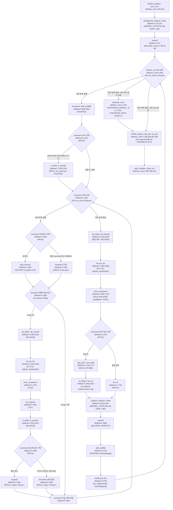
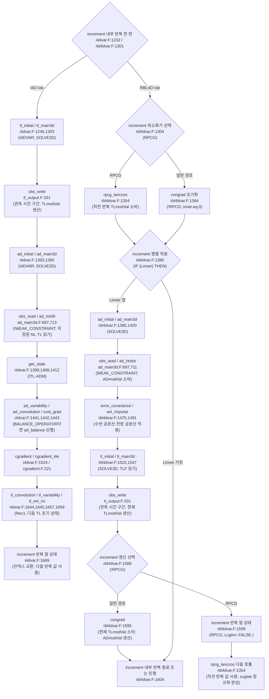

## Scope

ROMS의 I4DVAR·RBL4DVAR·R4DVAR 계산 흐름을 정리한다. R4DVAR는 관측 공간의 strong/weak indirect representer 경로이다. 출처는 [자료동화 호출 흐름 보고서](../../../_staging/recovery/flow/ROMS-callflow-da.md) §2·§6이다.

## Source basis

이 노트의 현재 호출 위치는 원본 저장소 HEAD `57aecf58`(2026-09-18)을 기준으로 한다. 현재 계산 본체는 `ROMS/Drivers/i4dvar.F`·`r4dvar.F`·`rbl4dvar.F`이다. 출처는 [자료동화 호출 흐름 보고서](../../../_staging/recovery/flow/ROMS-callflow-da.md)이다.

- `ROMS/Drivers/i4dvar_roms.h`, `i4dvar.F` — I4DVAR (strong constraint, incremental).
- `ROMS/Drivers/rbl4dvar_roms.h`, `rbl4dvar.F` — RBL4DVAR (restricted B, Lanczos).
- `ROMS/Drivers/r4dvar_roms.h`, `r4dvar.F`, `tl_r4dvar_roms.h` — R4DVAR / weak-constraint.
- `ROMS/Adjoint/ad_misfit.F`, `ad_main3d.F` — observation misfit, adjoint kernel.
- `ROMS/Tangent/tl_main3d.F` — TLM kernel.
- `ROMS/External/wc13.h`, `roms_wc13.in` — WC13 example configuration.

## A. Driver families

| Family | Driver entry | Outer-loop dispatch | Description |
|---|---|---|---|
| I4DVAR | `i4dvar_roms.h:245` (`ROMS_run`) | `:292` calls `background/increment/analysis` | Strong-constraint incremental |
| RBL4DVAR | `rbl4dvar_roms.h:248` | `:308` | Restricted-B preconditioned Lanczos |
| R4DVAR | `r4dvar_roms.h:248` | `:307` | 관측 공간의 strong/weak indirect representer |

`W4DVAR`는 `ROMS/Include/globaldefs.h:294–298`에서 `R4DVAR`로 변환되는 호환 옵션 이름이다.

현재 계산 루틴의 정의 위치는 다음과 같다.

- I4DVAR의 background·increment·analysis 정의는 `ROMS/Drivers/i4dvar.F:562,792,1727`이다.
- RBL4DVAR의 background·increment·analysis 정의는 `ROMS/Drivers/rbl4dvar.F:411,656,2569`이다.
- R4DVAR의 background·increment·analysis 정의는 `ROMS/Drivers/r4dvar.F:172,405,1409`이다.

`32c79b74`(2026-04-25)의 I4DVAR 정의는 551·781·1716줄이다. `f03bcbbf`(2026-06-10)가 `MULTI_SCALE_B`의 USE 분기를 추가했다. 출처는 [자료동화 호출 흐름 보고서](../../../_staging/recovery/flow/ROMS-callflow-da.md) §2·§6의 RF2-023이다.

## B. Inner loop (cost minimization)

증분 비용은 `J = Jb + Jo`이다. 각 항은 `1/2`를 갖는다. 출처는 `ROMS/Utility/obs_cost.F:150`과 [4D-Var 대조 보고서](../../../_staging/recovery/compare/roms-da-4dvar-vs-code.md) §4의 DA1-802이다.

- 배경 비용 호출은 `ROMS/Drivers/i4dvar.F:1488`의 `CALL back_cost (ng, tile, LTLM2)`이다.
- `ad_misfit.F:194-196` — observation misfit forcing built from `(NLmodVal + TLmodVal - ObsVal)`.

### B-preconditioning

`ROMS/Drivers/i4dvar.F:1441–1443`은 `ad_variability`·`ad_convolution`·`cost_grad`를 호출한다. `BALANCE_OPERATOR`이면 `ROMS/Drivers/i4dvar.F:1439`의 `ad_balance`가 먼저 온다.

`ROMS/Drivers/i4dvar.F:1644–1645`는 `tl_convolution`·`tl_variability`를 호출한다. `BALANCE_OPERATOR`이면 `ROMS/Drivers/i4dvar.F:1647`의 `tl_balance`를 추가한다.

공분산 제곱근을 통한 v-space 변환은 기본 경로이다. `Lprecond`는 외부 반복 2부터 수행하는 추가 전조건화를 켠다. `Lritz=T`는 Ritz이고 `Lritz=F`는 spectral이다. 출처는 `ROMS/Utility/cgradient.F:703`과 [4D-Var 대조 보고서](../../../_staging/recovery/compare/roms-da-4dvar-vs-code.md) §4의 DA1-801이다.

- 기본 `ad_convolution / tl_convolution` 은 single-scale explicit Gaussian diffusion (default). **Multi-scale anisotropic implicit B operator (Matérn class, PR #75)** 는 §I 참조 — `MULTI_SCALE_B` CPP 활성화 시 새 `multiscale_*` 모듈로 분기.

### R / Cobs (observation error)

- Solver equation comments: `ad_congrad.F:62-92`, `ad_rpcg_lanczos.F:68-113`.
- Actual ObsErr weighting in `ad_misfit.F:194-196`.

### CG / Lanczos solvers

- I4DVAR는 `ROMS/Drivers/i4dvar.F:1524`에서 `cgradient`를 호출한다.
- I4DVAR의 내부 반복 범위는 `0:Ninner`이다 (`ROMS/Drivers/i4dvar.F:1232`).
- RBL4DVAR의 `RPCG` 경로는 `ROMS/Drivers/rbl4dvar.F:1354`에서 `rpcg_lanczos`를 호출한다.
- RBL4DVAR의 비RPCG 경로는 `ROMS/Drivers/rbl4dvar.F:1364,1595`에서 `congrad`를 호출한다.

`32c79b74`의 RBL4DVAR 호출 위치는 1343·1353·1584줄이다. `f03bcbbf`(2026-06-10) 변경 뒤 현재 위치는 1354·1364·1595줄이다. 출처는 [representer 대조 보고서](../../../_staging/recovery/compare/roms-da-representer-vs-code.md) §4의 RT2-386이다.

## C. Outer loop

| Driver | Loop entry |
|---|---|
| I4DVAR | `i4dvar_roms.h:292` |
| RBL4DVAR | `rbl4dvar_roms.h:308` |
| R4DVAR | `r4dvar_roms.h:307` |

I4DVAR는 매 외부 반복에서 background·increment·analysis를 호출한다 (`ROMS/Drivers/i4dvar_roms.h:292–314`). R4DVAR와 RBL4DVAR는 `outer=0`의 background 뒤 외부 반복을 시작한다 (`ROMS/Drivers/r4dvar_roms.h:293–323`, `ROMS/Drivers/rbl4dvar_roms.h:295–325`).

I4DVAR의 최소화 순서는 TL 적분, AD 적분, 경사 변환, `cost_grad`, `cgradient`, 다음 상태 저장이다. R4DVAR의 순서는 무강제 RPM, 관측 공간 최소화, 최종 계수의 AD·공분산 적용, 분석 RPM이다. RBL4DVAR의 `RPCG` 순서는 직전 TL 결과 소비, 최소화 갱신, 조건부 AD·TL 행렬 작용이다. RBL4DVAR의 일반 경로는 AD·TL 행렬 작용 뒤에 `congrad`를 호출한다. 출처는 [자료동화 호출 흐름 보고서](../../../_staging/recovery/flow/ROMS-callflow-da.md) §6의 수정안이다.

`SOLVE3D`의 내부 반복 호출 위치는 다음과 같다.

- I4DVAR의 TL 호출은 `ROMS/Drivers/i4dvar.F:1303`이다.
- I4DVAR의 AD 호출은 `ROMS/Drivers/i4dvar.F:1365`이다.
- RBL4DVAR의 TL 호출은 `ROMS/Drivers/rbl4dvar.F:1547`이다.
- RBL4DVAR의 AD 호출은 `ROMS/Drivers/rbl4dvar.F:1420`이다.

RBL4DVAR의 2차원 TL 대체 호출은 `ROMS/Drivers/rbl4dvar.F:1549`이다. RBL4DVAR의 2차원 AD 대체 호출은 `ROMS/Drivers/rbl4dvar.F:1422`이다. `f03bcbbf`(2026-06-10)의 다중 상관 길이 추가가 RBL4DVAR 호출 위치를 옮겼다. 출처는 [representer 대조 보고서](../../../_staging/recovery/compare/roms-da-representer-vs-code.md) §4의 RT2-387·RT2-388이다.

각 phase의 계산 창은 `RunInterval`이다. 출처는 [자료동화 호출 흐름 보고서](../../../_staging/recovery/flow/ROMS-callflow-da.md) §2.1이다.

## D. Observation operator / innovations / residuals

- Observation file: `OBSname == roms_obs.nc` in `s4dvar.in:598`.
- Split-driver scripts rewrite to `..._obs_...nc`: `submit_split_i4dvar.sh:431` (and r4dvar/rbl4dvar analogs).
- `obs_write`는 innovation에 `ObsScale`과 `(ObsVal(iobs)-NLmodVal(iobs))`의 곱을 저장한다 (`ROMS/Utility/obs_write.F:1451–1452`).
- `ad_misfit`의 내부 반복 잔차는 `(NLmodVal(iobs)+TLmodVal(iobs)-ObsVal(iobs))`이다 (`ROMS/Adjoint/ad_misfit.F:194–195`). 관측 파일의 `ObsErr`는 관측오차 분산이다 (`ROMS/Utility/obs_read.F:273–284`). I4DVAR의 작업 배열은 그 역수를 저장한다 (`ROMS/Utility/obs_read.F:286–290`). `WEAK_CONSTRAINT`의 dual 경로는 분산 값을 유지한다 (`ROMS/Utility/obs_read.F:286–290`). [10-14 전수 검증 보완]
- Split drivers load `ObsVal/ObsErr` from `OBS(ng)%name`: `rbl4dvar.F:847-861`, `r4dvar.F:617-631`.
- `wrtMisfit` switch for residual output: `i4dvar.F:406-413`, `rbl4dvar.F:1515-1522`.
- I4DVAR의 DAV 관측 잔차 비용 쓰기는 `ROMS/Drivers/i4dvar.F:741–754,2423–2436`이다. RBL4DVAR의 DAV 관측 잔차 penalty 쓰기는 `ROMS/Drivers/rbl4dvar.F:2786–2799`이다. [10-14 전수 검증 정정]

현행 I4DVAR는 `NLcost_function`에 `FOURDVAR(ng)%NLobsCost(0:)`를 저장한다 (`ROMS/Drivers/i4dvar.F:2424–2425`). 출처는 [4D-Var 대조 보고서](../../../_staging/recovery/compare/roms-da-4dvar-vs-code.md) §4의 DA1-803이다. 용어 근거는 [출력 대조 보고서](../../../_staging/recovery/compare/roms-outputs-metadata-vs-code.md) §4의 OMD-N015이다.

## E. Tangent linear model (TLM)

> 본 노트는 4D-Var 알고리즘의 dispatch·cost·minimization을 정리한다. TLM/ADM/RPM 모델 구조는 [roms_adjoint_framework.md](roms_adjoint_framework.md)를 참조한다.

- Main TLM kernel: `tl_main3d.F:3` (`SUBROUTINE tl_main3d`).
- Forward stepping at `:185`; data ingestion `tl_get_data` at `:210`.
- BASIC STATE fields (`set_depth/set_massflux`) processed at `:229-247`.
- Drivers wire nonlinear history as basis trajectory (`i4dvar.F:1026-1043`).

I4DVAR와 RBL4DVAR는 비선형 기본 상태를 갱신한다. R4DVAR의 TLM 내부 반복은 `DATALESS_LOOPS`가 없는 경로에 해당한다. 이 경로의 기본 상태는 첫 외부 반복에서 NLM 궤적이다. 이후 외부 반복에서는 직전 분석 RPM 궤적이다. `ROMS/Drivers/r4dvar.F:826–830`은 `IF (my_outer.eq.1) THEN`에서 `HIS2FWD`를 선택한다. ELSE에서는 `TLM2FWD`를 선택한다. 출처는 [자료동화 호출 흐름 보고서](../../../_staging/recovery/flow/ROMS-callflow-da.md) §6의 RF2-034이다.

## F. Adjoint model

- Main AD kernel: `ad_main3d.F:3`.
- Reverse-time integration explicit: `STEP_LOOP : DO istep=Nsteps,1,-1` at `:266` (comments `:191-199`).
- Sensitivity forcing from observations at `:697` (`obs_read`) then `:711-714`:
  - `ad_htobs` → weak-constraint.
  - `ad_misfit` → strong-constraint.

## G. Trajectory storage (memory vs disk)

- Disk trajectory files per outer loop: HIS at `i4dvar.F:1030-1043`, QCK at `:1051-1063`, adjoint history at `:1192-1200`.
- Memory vs split-file behavior: split mode repeatedly reads DAV/ITL/TLM/ADM NetCDF because values "are in memory in the unsplit algorithm" (`i4dvar.F:862-867, 993-996`; `rbl4dvar.F:790-793, 805-809`).
- I/O-size/performance tradeoff: explicit multi-file rationale "split ... to reduce size" at `i4dvar.F:1137-1138`; delayed sync/close for performance at `r4dvar.F:367-373`.

비분할 I4DVAR도 ITL과 ADM을 저장하고 다시 읽는다 (`ROMS/Drivers/i4dvar.F:1397–1412`). ITL 읽기는 0번 내부 반복의 Rec1, 이후의 Rec3, 누적 증분 Rec4를 구별한다. ADM 쓰기는 `ROMS/Drivers/i4dvar.F:1596–1600`이다. ITL Rec3 쓰기는 `ROMS/Drivers/i4dvar.F:1608–1613`이다. ITL Rec1 쓰기는 `ROMS/Drivers/i4dvar.F:1655–1660`이다. 쓰기 호출의 `MyRank`와 `-1`은 `DISTRIBUTE` 유무로 선택한다. 출처는 [자료동화 호출 흐름 보고서](../../../_staging/recovery/flow/ROMS-callflow-da.md) §6의 RF2-024이다.

## H. Practical examples (WC13)

- WC13 compile/test config: `wc13.h` (case CPP options), `roms_wc13.in:1224` (`APARNAM = i4dvar.in`).
- Batch workflows: `submit_split_i4dvar.sh`, `submit_split_r4dvar.sh`, `submit_split_rbl4dvar.sh`. Standard/norm files and obs substitution at `submit_split_i4dvar.sh:120-131, 151, 431`.
- The `roms_test` exercise PDFs are not in this tree; only URL/comment reference at `submit_mixres_rbl4dvar.sh:60`.

## I. Multi-scale background error covariance (`MULTI_SCALE_B`, merged)

PR #75 는 `f03bcbb` 로 **merge 완료**(upstream develop `57aecf5` 에 포함). 새 implicit multi-scale anisotropic **B** operator. Weaver et al. (2013, 2016, 2018) 의 Matérn-class implicit diffusion formulation 을 ROMS 4D-Var 에 통합. 출처: PR description + 첨부 `multi_scale_B_v1.pdf` (15p, 2026-05-28 fetch). 한국 적용 검토는 [`web-refs/roms-official-resources.md §8.1.5`](../web-refs/roms-official-resources.md) 참조.

### I.1 Mathematical formulation (PDF §1)

Matérn class $d$-차원 correlation function (eq 1):

$$c_d(r) = \frac{2^{1-\nu}}{\Gamma(\nu)} \left(\frac{r}{L}\right)^{\nu} K_\nu\left(\frac{r}{L}\right)$$

- $L$: scale parameter, $K_\nu$: 2종 modified Bessel function 차수 $\nu$, $r$: 점 사이 거리
- Multi-scale 결합 (eq 2): $f_{d,P}(r) = \sum_{p=1}^{P} \gamma_p\, c_{d,p}(r)$ with $\sum_p \gamma_p = 1$
- 음수 $\gamma_p$ 도 허용 가능 (negative lobe correlation) — Gregori et al. (2008) 조건 필요

**Correlation = implicit diffusion** (PDF §1 핵심 통찰):

2D 확산 방정식 $\partial\eta/\partial s - \nabla(\kappa\nabla\eta) = 0$ (eq 3) 의 $M$ steps 후 implicit form (eq 4):

$$\eta(x,y,0) = (1 - \nabla\kappa\nabla)^M\, \eta(x,y,M)$$

(1)과 (4)의 관계: $M = \nu + d/2$, 2D 이면 $d=2$, $\kappa = L^2$. Daley length scale $D = \sqrt{-d / \nabla^2 c_d(r)|_{r=0}}$ 와 $D^2 = (2M-d-2)\kappa$ ($\kappa$ 등방). 이방성 경우 $\boldsymbol{\kappa}$ diffusion tensor → $\mathbf{D} = (2M-d-2)\boldsymbol{\kappa}$ 요소가 squared length scales.

**2D 에서 $M$ 짝수, $M > 2$ 필수**. $M \geq 10$ → 본질적으로 Gaussian (현재 default explicit B 와 동등). $M$ 작으면 longer-tailed (heavy-tail) Matérn.

Open boundary 에서는 $d=1$ 1D diffusion 으로 별도 처리.

### I.2 ROMS implicit solver (PDF §2)

(4) 풀이에 **CG (Conjugate Gradient) + CI (Chebyshev Iteration) 조합** 채택 (Weaver et al. 2016, 2018):

- CG 단독: symmetry 보존을 위해 Cholesky factorization 필요 (CG solver의 adjoint 필요) + parallel 에서 scalar product 비용 큼
- CI 단독: easily adjointable + scalar product 불필요. 단 $(1-\nabla\kappa\nabla)$ 의 max/min eigenvalue 추정 필요
- **ROMS 채택**: CG (Lanczos formulation with random vectors) 로 eigenvalue 추정 → CI 로 implicit diffusion 풀이. eigen spectrum 은 grid·$\kappa$ 고정 시 변하지 않으므로 normalization 단계에서 한 번 추정 후 재사용.

### I.3 신규 multi-scale 파일 매핑 (merged 소스 기준)

PR #75 의 `ROMS/Utility/multiscale_*` (전체 7개 신규 파일, 합계 +18,628 라인). PDF §2-3 의 algorithm role 과 매핑 ([`web-refs/roms-official-resources.md §8.1`](../web-refs/roms-official-resources.md) verbatim line count):

| 파일 | 라인 | PDF 매핑 |
|---|---|---|
| `multiscale_Klaplacian.h` | +6,365 | (4) 의 $(1 - \nabla\kappa\nabla)$ horizontal K-Laplacian operator. Matérn correlation 의 implicit form 핵심 빌딩 블록 |
| `multiscale_Vdiff.h` | +3,173 | Vertical diffusion (vertical correlation은 horizontal 과 separable 가정, PDF §3 NOTE) |
| `multiscale_CIsolver.h` | +2,741 | Chebyshev iteration solver — PDF §2 의 (4) 풀이 main routine (Weaver 2016/2018) |
| `multiscale_eigen.F` | +2,310 | $(1-\nabla\kappa\nabla)$ max/min eigenvalue 추정 (CI bounding 용). Lanczos CG with random vectors |
| `multiscale_CGsolver.h` | +1,518 | CG solver — eigenvalue 추정 단계 전용 (correlation solve 는 CI 가 담당) |
| `roms_multiscale.F` | 1,513 | **모듈 본체**. multi-scale B 객체(`Nscale`, `Bwgt`, `Mlap`, scale별 상태)를 보유·초기화 (`roms_multiscale.F:152-159, 570-574`). 헤더 주석이 Weaver 2016/2018 · Mirouze 2016 을 명시 (`:12-26`) |

> **정정**: PDF 기반 추론으로 적었던 `multiscale_driver.h` · `multiscale_sum_B.h` 두 파일은 merged 소스에 **존재하지 않는다**. 실제 배치는 다음과 같다.
> - scale 루프(`DO ns=1,Nscale(ng)`)는 `ROMS/Utility/convolve_multi.h:186, 335, 805, 959`
> - eq (2) 의 가중합은 `ROMS/Utility/normalization_multi.h` 가 `self%Bwgt(is,ns)*cff` 형태로 state variable 별 수행 (`:628, 774, 920, 1089, 1257`)
> - 모듈 상태와 orchestration 은 `roms_multiscale.F`
>
> 라인 수는 PR diff 의 추가 줄이라 merge 후 파일 줄 수와 다르다 — 현재 실측은
> `multiscale_Klaplacian.h` 6,529 · `multiscale_Vdiff.h` 3,179 · `multiscale_CIsolver.h` 2,793 ·
> `multiscale_eigen.F` 2,310 · `multiscale_CGsolver.h` 1,544 · `roms_multiscale.F` 1,513 (총 6 파일).

**Algorithm flow** (PDF §3 + 위 파일 역할 추론):

1. 사용자가 `s4dvar.in` 에 `Nscale`, `Mlap[p,state-var]`, `Bwgt[p,state-var]`, `Hdecay*X/Y[state-var]` 지정
2. `convolve_multi.h` 가 `MULTISCALE_LOOP : DO ns=1,Nscale(ng)` 로 scale 루프 진입 (`:186`)
3. 각 $p$ scale 에 대해:
   - `multiscale_eigen.F` → `multiscale_CGsolver.h` (Lanczos CG with random vectors, `NiterCG` iter) → eigenvalue bounds 산출
   - `multiscale_CIsolver.h` (NiterCI/2 forward + NiterCI/2 adjoint) → `multiscale_Klaplacian.h` 호출하며 (4) 풀이 → $c_{d,p}$
4. `normalization_multi.h` 가 $\gamma_p = \texttt{Bwgt}[p]$ 와 $c_{d,p}$ 를 state variable 별로 가중합 → $B$ operator 완성 (`:628` 등)
5. `multiscale_Vdiff.h` 가 vertical 차원 별도 처리

아래 §I.3 표와 flow 는 merge 된 소스(`57aecf5`)로 대조했다. PDF 기반 추론이던 부분은 실제 파일 구성으로 교체했다.

### I.4 `s4dvar.in` parameters (PDF §3.A, §3.C)

PR #75 의 `s4dvar.in` +293 -86 diff 의 신규 키:

| Parameter | 의미 | 제약 |
|---|---|---|
| `Nscale` | 결합할 correlation function 개수 ($P$ in eq 2) | $\geq 1$ |
| `Mlap[p, state-var]` | 각 scale·state variable 별 $M$ 값 | **짝수**, $M > 2$ |
| `Bwgt[p, state-var]` | 각 scale·state variable 별 weight $\gamma_p$ | state variable 별 $\sum_p = 1$ |
| `HdecayMX[v]`, `HdecayMY[v]` | model error 의 $D_x, D_y$ (Daley length scale, **m**) | per state variable per scale |
| `HdecayIX[v]`, `HdecayIY[v]` | initial condition error 의 $D_x, D_y$ | per state variable per scale |
| `HdecayFX[v]`, `HdecayFY[v]` | surface forcing error 의 $D_x, D_y$ | per state variable per scale |
| `HdecayB[v]` | open boundary 의 Daley length scale ($x$ or $y$ — orientation 따라) | 1D |
| `NiterCG` | CG solver iteration (eigenvalue 추정용) | per scale |
| `NiterCI` | CI solver iteration (correlation solve) | **짝수** (NiterCI/2 forward + adjoint) |

NOTE: vertical correlation 은 변경 없음 (separable 가정).

### I.5 Tuning workflow (PDF §3.C)

NiterCG/NiterCI 값 결정 절차:

1. `define MULTI_SCALE_DEBUG` CPP 활성화 + normalization factor 계산 모드 (`Nmethod=1`, `Nrandom=1`)
2. residual norm $\epsilon_k = \|r_k\|_2 / \|b\|_2$ 출력 — 각 CG/CI iteration $k$ 별
3. $\epsilon_k$ 작을수록 좋음 ($\epsilon_k = 0$ 이 exact). CI 의 $\epsilon$ 은 NiterCI/2 forward 만 계산되므로 CG 보다 클 것 (rule of thumb: $\text{NiterCI} \approx \text{NiterCG}$)
4. WC13 예시 (PDF Fig 2): $D_x=D_y=50\text{km}, M=20$ → 50 iter 에 $\epsilon \sim 10^{-30+}$. 즉 NiterCG ~30 으로 충분
5. 튜닝 완료 후 **반드시 `undefine MULTI_SCALE_DEBUG`** — 미정의 시 매 $B$ 호출 마다 diagnostic 출력 폭주 + CI 가 scalar product 2개 추가 계산 → 성능 저하

### I.6 WC13 검증 결과 (PDF §4, Fig 11)

WC13 (California Current ~30 km grid, 30 levels) 에서 3가지 **B** 모델 비교 (4D-Var cost function $J$ vs inner-loop iter):

- Red: single isotropic, $(D_x, D_y, M) = (50, 50, 20)$
- Blue: 2-scale isotropic, $(D_1, M_1, \gamma_1) = (30, 4, 0.8)$ + $(90, 20, 0.2)$
- Black dashed: 3-scale anisotropic, $(D_x, D_y, M, \gamma) = (30, 30, 20, 0.1)$, $(65, 30, 20, 0.2)$, $(100, 30, 4, 0.7)$

모두 25 iter 안 수렴. **PDF 명시 "not to advocate for one choice ... but rather to illustrate that the code is fully functional"** — 즉 PR #75 단계는 functionality 검증 위주. 최적 **B** 선택은 application-specific tuning 영역.

### I.7 Negative-lobe correlation 예시 (PDF §4 Fig 9-10)

2개 Matérn 결합 (eq 5):

$$f(r) = \gamma_1 \frac{2^{1-\nu_1}}{\Gamma(\nu_1)}\left(\frac{r}{L_1}\right)^{\nu_1} K_{\nu_1}\left(\frac{r}{L_1}\right) + \gamma_2 \frac{2^{1-\nu_2}}{\Gamma(\nu_2)}\left(\frac{r}{L_2}\right)^{\nu_2} K_{\nu_2}\left(\frac{r}{L_2}\right)$$

Gregori et al. (2008) 조건:

$$[1 - \max(1, (L_1/L_2)^d)]^{-1} \leq \gamma_1 \leq [1 - \min(1, (L_2/L_1)^{2\nu_2})]^{-1}$$

$M_1 = M_2 = 20, D_1 = 90, D_2 = 80\,\text{km}, d = 2$ → $-3.76 \leq \gamma_1 \leq 1.01$. $\gamma_1 = -3.76, \gamma_2 = 4.76$ 선택 시 ~120 km 에서 양→음 전이.

활용 시나리오: 작은 스케일 positive correlation + 큰 스케일에서 anti-correlation (예: 대척 eddy structure 표현). 단 negative-lobe 는 physical interpretation 신중.

### I.8 한국 적용 cross-ref

NIFS KOOS-EJS (동해예측시스템) ROMS 기반 4D-Var 의 multi-scale B 적용 가능성은 [`web-refs/roms-official-resources.md §8.1.5`](../web-refs/roms-official-resources.md). 핵심:

- 동해 mesoscale eddy (50-100 km) + sub-mesoscale (5-20 km) 동시 표현 → 다중 scale B 가 적합
- 후속 평가 항목: 현재 KOOS-EJS B 가 single-scale 인지, multi-scale 도입 benefit 정량화

## J. PR #75 후속 commit 5건 (2026-05-27 ~ 05-31, verified 2026-06-01)

§I 의 multi-scale B 후속 활동. 5 commit GitHub API 직접 fetch.

| # | SHA | 일시 | 메시지 | Files |
|---|---|---|---|---|
| 1 | `7a1f5d9d` | 2026-05-27 15:04 UTC | Updated 4D-Var algorithms | 24 files |
| 2 | `b7312fb1` | 2026-05-27 21:54 UTC | Added B-correlation CDL template file | 2 files |
| 3 | `952d7eab` | 2026-05-28 18:07 UTC | Added function for tracers management | 3 files |
| 4 | `16601076` | 2026-05-31 17:10 UTC | Added Dirac parameters | 7 files |
| 5 | `23919237` | 2026-05-31 19:30 UTC | Corrected parallel bug | 1 file (`read_asspar.F`) |

### J.1 4D-Var algorithms updated (`7a1f5d9d`, 24 files)

핵심 변경 (verified by GitHub API file list):

- `ROMS/Drivers/i4dvar.F` (+104 -42), `r4dvar.F` (+106 -41), `rbl4dvar.F` (+110 -51) — three primary 4D-Var drivers 전면 갱신
- `ROMS/Drivers/correlation.h` (+3) — correlation driver header 추가
- `ROMS/Tangent/tl_def_ini.F` (+12) — tangent linear initialization definition 보강
- `ROMS/Utility/def_*.F` (10 files: def_dai/diags/error/extract/floats/hessian/impulse/info/lanczos/state) — 각 +12 라인 균일 추가 → 신규 NetCDF definition 헤더 (Multi-scale B 출력 통합)

→ R4DVAR / RBL4DVAR 는 `error_covariance` → `convolve.F:91` 의 `#ifdef MULTI_SCALE_B` 경로로 multi 구현에 연결된다. **I4DVAR 는 소스 수준에서 인자 수가 맞지 않는다** — `i4dvar.F:1442, 1644` 의 호출은 5인자(`ad_convolution(ng,tile,LADJ2,Lweak,2)`)인데 `ad_convolution_multi.h:139` 의 진입점은 scale 인덱스 `ns` 를 포함한 6인자다(`ad_convolution_mono.h:121` 은 5인자). NetCDF 출력 routine 11개 동시 수정은 별개로 유지된다.

접선 호출에도 같은 5인수·6인수 차이가 있다 (`ROMS/Drivers/i4dvar.F:1644`, `ROMS/Tangent/tl_convolution_multi.h:139,149`). `MULTI_SCALE_B`가 없는 monoscale 경로는 정상 계약과 맞는다. 이 결함 후보의 근거 강도는 강함이다. 출처는 [자료동화 호출 흐름 보고서](../../../_staging/recovery/flow/ROMS-callflow-da.md) §6의 RF2-026이다.

### J.2 B-correlation CDL template (`b7312fb1`, 2 files)

```
added    +208  -0  Data/ROMS/CDL/s4dvar_Bcorrelation.cdl
modified +50  -2   ROMS/Utility/def_info.F
```

신규 CDL (NetCDF Common Data Language) template `s4dvar_Bcorrelation.cdl` — B 상관행렬의 검증·진단 NetCDF 파일 구조. `def_info.F` 가 변수 메타데이터 정의 부에서 이 template 사용.

### J.3 Tracers management (`952d7eab`, 3 files)

```
added    +94  -0   ROMS/Utility/tracer_metadata.F
modified +97  -12  ROMS/Utility/read_asspar.F
modified +3   -0   ROMS/Utility/set_pio.F
```

신규 `tracer_metadata.F` (94 lines) — tracer 식별·메타데이터 관리 module. `read_asspar.F` 가 4D-Var assimilation parameter 읽을 때 호출하도록 +85 라인 확장. `set_pio.F` 의 parallel I/O 등록에도 추가.

### J.4 Dirac parameters (`16601076`, 7 files) — **§I.4 s4dvar.in 확장**

```
modified +52  -11  ROMS/External/s4dvar.in
modified +123 -4   ROMS/Utility/read_asspar.F
modified +117 -21  ROMS/Functionals/ana_perturb.h
modified +14  -7   ROMS/Utility/checkdefs.F
modified +12  -0   ROMS/Modules/mod_scalars.F
modified +1   -0   ROMS/Drivers/correlation.h
modified +1   -0   ROMS/Modules/CMakeLists.txt
```

`s4dvar.in` 직접 diff (line +253-269 신규 11 Dirac() 키워드, GitHub API verbatim):

```fortran
! Dirac delta function (i,j,k) locations for testing correlations parameters.
  Dirac(isFsur) == 25 20                ! free-surface
  Dirac(isUbar) == 15 30                ! 2D U-momentum
  Dirac(isVbar) == 15 35                ! 2D V-momentum
  Dirac(isUvel) == 15 30 30             ! 3D U-momentum
  Dirac(isVvel) == 15 35 30             ! 3D V-momentum
  Dirac(isTvar) == 30 20 30 \           ! temperature
                   20 40 30             ! salinity
  Dirac(isTsur) == 20  15   \           ! surface heat flux
                   25  20               ! surface salt flux
  Dirac(isUstr) == 18  30               ! surface U-momentum stress
  Dirac(isVstr) == 18  35               ! surface V-momentum stress
```

**Dirac delta function locations** — Multi-scale B correlation 검증용 single grid point delta function. (i,j) 또는 (i,j,k) 격자 좌표에 δ를 두고 correlation function 응답 (negative-lobe 포함, §I.7)을 진단.

부수 변경 `s4dvar.in` line +281-289 (Mlap iteration count) :

```diff
- Mlap(isFsur) == 20    ! Mlap MUST be > 2 and EVEN, > O(10) for Gaussian
+ Mlap(isFsur) == 10    ! Free-surface
- Mlap(isUbar) == 20
+ Mlap(isUbar) == 10
... (모든 state variable 동일하게 20 → 10)
```

`s4dvar.in` line +316:

```diff
-        NiterCG == 50
+        NiterCG == 20
```

입력값과 알고리즘 경로의 변경은 코드 사실이다. 출처는 [자료동화 호출 흐름 보고서](../../../_staging/recovery/flow/ROMS-callflow-da.md) §6의 RF2-033이다.

`ana_perturb.h` (+117 -21) — analytic perturbation routine 이 Dirac δ initialization 지원. `checkdefs.F` 는 CPP 검증 강화.

### J.5 Parallel bug fix (`23919237`, 1 file)

```
modified +5 -6 ROMS/Utility/read_asspar.F
```

`read_asspar.F` 의 read race-condition 또는 broadcast 누락 buf bug 수정. 1 file·11 lines 변경의 단순 fix이나, **multi-scale B + Dirac 통합 후 MPI 환경에서 발견된 parallel bug** — `952d7eab` (tracers management) 와 `16601076` (Dirac) 에서 `read_asspar.F` 를 크게 확장한 결과 발생한 regression 일 가능성 큼 (동일 file).

### J.6 §I 와의 관계

| §I (PDF 기반) | §J (PR commit 기반, 2026-06-01) |
|---|---|
| 7개 신규 `multiscale_*` core file (§I.3) | 추가 안 됨 — 동일 |
| `s4dvar.in` Mlap 20 / NiterCG 50 | `Mlap` 10 / `NiterCG` 20으로 입력값 변경 (J.4) |
| Dirac delta 검증 (PDF 미언급) | **11 Dirac() 키워드 신규** (J.4) |
| Bcorrelation CDL (PDF 미언급) | **신규 NetCDF template** (J.2) |
| 단일 unified driver 가정 | 세 driver (I/R/RBL 4D-Var) 동시 갱신 (J.1) |
| | tracer_metadata.F 신규 (J.3) |
| | parallel bug fix (J.5) |

입력값과 알고리즘 경로의 변경은 코드 사실이다. 출처는 [자료동화 호출 흐름 보고서](../../../_staging/recovery/flow/ROMS-callflow-da.md) §6의 RF2-033이다.

### J.7 KOOS-EJS 적용 후속

§I.8 의 KOOS-EJS multi-scale B 평가 시:
- 기존 §I.4 default (Mlap=20, NiterCG=50) 대신 **갱신된 default (Mlap=10, NiterCG=20)** 부터 시작
- Dirac δ 도구 (§J.4) 로 동해 mesoscale + sub-mesoscale scale별 correlation function 정량 시각화
- multi-scale B는 R4DVAR와 RBL4DVAR 경로에 연결된다.
- I4DVAR와 `MULTI_SCALE_B`를 함께 켜면 convolution의 호출 인수 수와 필수 인수 수가 다른 결함 후보이다 (§J.1).

## Decision Guide

| Use case | Choice |
|---|---|
| Sparse data, short window, smooth IC update only | I4DVAR (strong constraint) |
| Strong constraint with better preconditioning, tougher convergence | RBL4DVAR |
| Long window, model-error matters, can afford I/O | R4DVAR 약제약 (`W4DVAR`는 호환 옵션 이름) |
| Quick smoke test | WC13 example (`roms_wc13.in`) |
| Scaling DA across cluster | Split-file mode (reads from disk between phases) |
| Single-machine debug | 비분할 I4DVAR도 ITL·ADM 파일을 사용한다 (§G) |
| Verify innovation processing | Set `wrtMisfit=T`, inspect DAV file |
| Observation outliers | Inflate `ObsErr` per-type in `obs.nc` |
| Background covariance localization | Tune `Hdecay/Vdecay` correlation lengths in `s4dvar.in` |

## Working Rules

- Run a strong-constraint I4DVAR first, even if your target is weak-constraint — it builds the basic-state trajectory and shakes out observation file mistakes cheaply.
- Outer loops typically 1–3; inner loops 10–50 (CG iterations). Cost grows linearly with outer × inner.
- Always check the cost-function reduction across outer loops. `J_final / J_initial < 0.5` is normal; > 0.95 means the system is not converging (bad B, bad obs, or trivial increment).
- Run the TLM-AD pair with the inner-product test at least once after any source change. Asymmetry > 1e-10 in double precision is a bug.
- Background covariance correlation lengths: scale-of-eddies in horizontal (10–50 km coastal, 100–300 km open ocean), 50–200 m vertical. Too short ⇒ noisy increments; too long ⇒ smeared.
- For weak-constraint, check that model-error covariance `Q` is non-trivial. Default `Q=B` reduces to strong-constraint in disguise.

## Common Pitfalls

- ▢ Forgetting to update the basic-state trajectory between cycles — TLM linearizes about a stale state and innovations diverge.
- ▢ ObsErr too small (e.g., reporting RMS instead of representativeness error) — inner loop tries to overfit and explodes.
- ▢ Localization not used in B — increments leak across basin, decorrelating obs influence.
- ▢ Mixing I4DVAR with R4DVAR namelist parameters — drivers share `s4dvar.in` partly but not all keys.
- 비분할 I4DVAR도 ITL과 ADM을 저장하고 다시 읽는다 (§G).
- ▢ Verifying innovation only at the end of the run — turn on `wrtMisfit` always; cheap and diagnostic.
- `W4DVAR`는 `ROMS/Include/globaldefs.h:294–298`에서 `R4DVAR`로 변환되는 호환 옵션 이름이다.

## Next expansion

- TLM-AD inner-product test recipe (line-by-line).
- WC13 walkthrough with concrete cost-function trajectory plots.
- Localization tooling for B (`s4dvar.in` correlation parameters).
- Hybrid 4D-EnVar discussion if/when ROMS picks up that path.

## References

- Moore et al. 2011 (ROMS 4D-Var trio: I4DVAR, R4DVAR, RBL4DVAR).
- Courtier et al. 1994 (incremental 4D-Var).
- Bennett 2002 (representer method, weak constraint).
- Source: paths above.

**§I Multi-scale B 추가 (PR #75 첨부 `multi_scale_B_v1.pdf` 인용)**:

- Gregori, Porcu, Mateu, Sasvárai 2008 — *Ann. Inst. Stat. Math.* 60, 865–882. (Negative-lobe permissibility 조건)
- Mirouze & Weaver 2010 — *Q.J.R.M.S.* 136, 1421–1443. (Implicit diffusion correlation representation)
- Mirouze, Blockley, Lea, Martin, Bell 2016 — *Tellus A* 68, 29744. DOI: 10.3402/tellusa.v68.29744. (Multiple length scale correlation operator)
- Weaver & Mirouze 2013 — *Q.J.R.M.S.* 139, 242–260. (Diffusion equation 의 isotropic/anisotropic correlation 적용)
- Weaver, Tshimanga, Piacentini 2016 — *Q.J.R.M.S.* 142, 455–471. (Chebyshev iteration solver)
- Weaver, Gürol, Tshimanga, Chrust, Piacentini 2018 — *Q.J.R.M.S.* 144, 2067–2088. ("Time"-parallel diffusion-based correlation operators)
- PR #75: [PR #75 기록](../web-refs/roms-official-resources.md) (**merged** → `f03bcbb`, upstream develop `57aecf5`)
- PDF: [multi_scale_B_v1.pdf 인용 기록](../web-refs/roms-official-resources.md)

## Provenance

Generated 2026-05-03 from Codex `gpt-5.3-codex` analysis of `models/roms/source_code/roms`. Auto-draft = false; review_required = true.

§I Multi-scale B 추가 2026-05-28 by Claude Opus 4.7 (1M context): PR #75 첨부 PDF (15p) 직접 fetch 후 본문 인용. 7개 `multiscale_*` 파일 algorithm 매핑은 PDF + web-refs §8.1 GitHub API fetch 기반.

## 자료동화 계산 흐름 (10-14 대조)

출처는 [자료동화 호출 흐름 보고서](../../../_staging/recovery/flow/ROMS-callflow-da.md) §4이다.
세 그림은 `SOLVE3D` 경로를 표시한다.
상자의 위치는 해당 호출 또는 루틴 정의 위치이다.
전처리 선택과 Fortran 반복 조건은 상자 안에 적는다.
`MULTI_SCALE_B`와 I4D-Var를 함께 선택할 때의 인자 수 문제는 RF2-026을 적용한다.

### I4D-Var 전체

```mermaid
flowchart TD
  A["ROMS_initialize<br/>i4dvar_roms.h:78<br/>(I4DVAR && !SPLIT_I4DVAR)"]
  B["prior_error<br/>i4dvar.F:2494<br/>(LgetSTD, LgetNRM)"]
  C{"ROMS_run 외부 반복<br/>i4dvar_roms.h:292<br/>(DO my_outer=1,Nouter)"}
  D["background_initialize<br/>i4dvar.F:610<br/>(!(MODEL_COUPLING && ESMF_LIB))"]
  E["initial<br/>i4dvar.F:471"]
  F["main3d<br/>i4dvar.F:682<br/>(SOLVE3D; HIS 기본 상태 저장)"]
  G["increment<br/>i4dvar_roms.h:308"]
  H["edit_multifile<br/>i4dvar.F:1151<br/>(HIS2FWD)"]
  I{"increment 내부 반복<br/>i4dvar.F:1232<br/>(DO my_inner=0,Ninner)"}
  J["tl_initial<br/>i4dvar.F:1246"]
  K["tl_main3d<br/>i4dvar.F:1303<br/>(SOLVE3D)"]
  L["ad_initial<br/>i4dvar.F:1350"]
  M["ad_main3d<br/>i4dvar.F:1365<br/>(SOLVE3D)"]
  N["get_state<br/>i4dvar.F:1399,1408,1412<br/>(ITL·ADM 기록 읽기)"]
  O["ad_balance<br/>i4dvar.F:1439<br/>(BALANCE_OPERATOR)"]
  P["ad_variability<br/>i4dvar.F:1441"]
  Q["ad_convolution<br/>i4dvar.F:1442"]
  R["cost_grad<br/>i4dvar.F:1443"]
  S["cgradient<br/>i4dvar.F:1524"]
  T["ad_wrt_his<br/>i4dvar.F:1597,1599<br/>(DISTRIBUTE 분기; 경사 저장)"]
  U["tl_wrt_ini<br/>i4dvar.F:1610,1612<br/>(Rec3; v-space)"]
  V["tl_convolution<br/>i4dvar.F:1644"]
  W["tl_variability<br/>i4dvar.F:1645"]
  X["tl_balance<br/>i4dvar.F:1647<br/>(BALANCE_OPERATOR)"]
  Y["tl_wrt_ini<br/>i4dvar.F:1657,1659<br/>(Rec1; x-space)"]
  Z["increment 인덱스 교환<br/>i4dvar.F:1669<br/>(Lnew·Lold 교환, Nrun 증가)"]
  AA["analysis / get_state<br/>i4dvar_roms.h:314<br/>i4dvar.F:1861,1865"]
  AB["ini_adjust<br/>i4dvar.F:1869"]
  AC["wrt_ini<br/>i4dvar.F:1881,1883<br/>(INI 분석 초기 상태)"]
  AD["sum_grad / tl_wrt_ini<br/>i4dvar.F:1902,1910,1912<br/>(Rec4 누적 v-space)"]
  AE["close_file<br/>i4dvar.F:1991<br/>(FWD)"]
  AF["posterior_analysis_initialize / initial<br/>i4dvar.F:2009,2250"]
  AG["main3d<br/>i4dvar.F:2388<br/>(SOLVE3D; 최종 분석 적분)"]
  AH["netcdf_put_fvar<br/>i4dvar.F:2423<br/>(NLcost_function, Nouter+1)"]
  AI["ROMS_finalize / def_dai<br/>i4dvar_roms.h:329,352<br/>(exit_flag.eq.NoError)"]
  AJ["wrt_dai<br/>i4dvar_roms.h:356,358<br/>(DISTRIBUTE 분기)"]
  AK["stats_modobs / close_out<br/>i4dvar_roms.h:371,373,433"]
  A --> B --> C

  C -->|"외부 반복 실행"| D --> E --> F --> G --> H --> I
  I -->|"내부 반복 실행"| J --> K --> L --> M --> N
  N -->|"균형 사용"| O --> P
  N -->|"균형 생략"| P
  P --> Q --> R --> S --> T --> U --> V --> W
  W -->|"균형 사용"| X --> Y
  W -->|"균형 생략"| Y
  Y --> Z --> I
  I -->|"내부 반복 종료"| AA --> AB --> AC --> AD --> AE --> C
  C -->|"외부 반복 종료"| AF --> AG --> AH --> AI --> AJ --> AK
```



### RBL4D-Var 전체



### 내부 반복 한 번의 TL·AD·최소화




## 문서와 코드 차이 (10-14 대조)

결론 근거는 [빌드 대조 보고서](../../../_staging/recovery/compare/roms-build-options-history-vs-code.md)·[4D-Var 대조 보고서](../../../_staging/recovery/compare/roms-da-4dvar-vs-code.md)·[representer 대조 보고서](../../../_staging/recovery/compare/roms-da-representer-vs-code.md)·[입력 대조 보고서](../../../_staging/recovery/compare/roms-inputs-vs-code.md)·[출력 대조 보고서](../../../_staging/recovery/compare/roms-outputs-metadata-vs-code.md)·[자료동화 호출 흐름 보고서](../../../_staging/recovery/flow/ROMS-callflow-da.md)의 최종 결론이다.
원문 인용의 위키 링크 구분자는 HTML 문자 참조로 표기한다.

문서 판은 ROMS 위키 wikitext(2026-05-03 받음, 쪽별 revid는 [manifest.json](../raw/manuals/wiki/manifest.json))이다. 코드 판은 원본 저장소 HEAD `57aecf58`(2026-09-18, roms-4.2 이후 4.3 개발)이다.

| 행 ID | 항목 | 문서 원문 | 코드 원문 | 결론 | 결론 문장 |
|---|---|---|---|---|---|
| build-options-history:RBH-2166 | mod_obs.F | Modules.wiki:68 `<section begin=mod_obs.F />;<span id="mod_obs.F"></span>&#91;&#91;mod_obs.F&#93;&#93;`<br>Modules.wiki:69 `:If either &#91;&#91;Options#ASSIMILATION \| ASSIMILATION&#93;&#93; or &#91;&#91;Options#NUDGING \| NUDGING&#93;&#93; is '''#defined''', this contains variables for the observed fields.<section end=mod_obs.F />` | 일치 판: roms-3.3 (5c711cef).<br>5c711cef:ROMS/Modules/mod_obs.F:2 `      MODULE mod_obs`<br>5c711cef:ROMS/Modules/mod_obs.F:3 `#if defined ASSIMILATION \|\| defined NUDGING`<br>5c711cef:ROMS/Modules/mod_obs.F:75 `# if defined ASSIMILATION_SSH \|\| defined NUDGING_SSH`<br>63b208cc 2011-04-22 src:ticket:503의 `git show --name-status -- ROMS/Modules/mod_obs.F` 결과는 `D ROMS/Modules/mod_obs.F`다.<br>현재 4D-Var 관측 배열: 57aecf58:ROMS/Modules/mod_fourdvar.F:232 `        real(r8), allocatable :: ObsVal(:)`<br>57aecf58:ROMS/Modules/mod_fourdvar.F:233 `        real(dp), allocatable :: Tobs(:)`<br>확정 판정: [ROMS-git-verify-A5.md](../../../_staging/recovery/compare/ROMS-git-verify-A5.md).<br>ROMS/Modules/mod_fourdvar.F:4 `#if defined FOUR_DVAR \|\| defined VERIFICATION` | A 판 차이 | mod_obs.F는 옛 ASSIMILATION 또는 NUDGING 경로의 모듈이다. `63b208cc`(2011-04-22)는 이 파일을 삭제했다. 현재 4D-Var 관측 배열은 mod_fourdvar에 있다. mod_fourdvar의 본문은 FOUR_DVAR 또는 VERIFICATION 조건 안에 있다. |
| da-4dvar:DA1-106 | 4DVar_Normalization_Tutorial.wiki:17 | 4DVar_Normalization_Tutorial.wiki:17 `then by convolving with the squared-root adjoint and tangent linear diffusion operators.` 2010쪽:17도 같다. 반복 원문: I4DVAR_Tutorial.wiki:35 `The normalization coefficients are computed by perturbing each model grid cell with a delta function scaled by the area (2D state variables) or volume (3D state variables), and then by convolving with the squared-root adjoint and tangent linear diffusion operators.` I4DVAR_Tutorial_2010.wiki:34 `The normalization coefficients are computed by perturbing each model grid cell with a delta function scaled by the area (2D state variables) or volume (3D state variables), and then by convolving with the squared-root adjoint and tangent linear diffusion operators.` I4DVAR_Observation_Impact_Tutorial.wiki:41 `The normalization coefficients are computed by perturbing each model grid cell with a delta function scaled by the area (2D state variables) or volume (3D state variables), and then by convolving with the squared-root adjoint and tangent linear diffusion operators.` I4DVAR_Observation_Impact_Tutorial_2010.wiki:41 `The normalization coefficients are computed by perturbing each model grid cell with a delta function scaled by the area (2D state variables) or volume (3D state variables), and then by convolving with the squared-root adjoint and tangent linear diffusion operators.` Array_Modes_Tutorial.wiki:43 `The normalization coefficients are computed by perturbing each model grid cell with a delta function scaled by the area (2D state variables) or volume (3D state variables), and then by convolving with the squared-root adjoint and tangent linear diffusion operators.` Array_Modes_Tutorial_2010.wiki:43 `The normalization coefficients are computed by perturbing each model grid cell with a delta function scaled by the area (2D state variables) or volume (3D state variables), and then by convolving with the squared-root adjoint and tangent linear diffusion operators.` 4DVar_Normalization_Tutorial_2010.wiki:17 `The '''exact method''' is very expensive on large grids. The normalization coefficients are computed by perturbing each model grid cell with a delta function scaled by the area (2D state variables) or volume (3D state variables), and then by convolving with the squared-root adjoint and tangent linear diffusion operators.` | ROMS/Utility/normalization_mono.h:533 `A2d(ic,jc)=1.0_r8` ROMS/Utility/normalization_mono.h:538 `CALL ad_conv_r2d_tile (ng, tile, iADM,                &` ROMS/Utility/normalization_mono.h:558 `A2d(i,j)=A2d(i,j)*Hscale(i,j)` ROMS/Utility/normalization_mono.h:564 `Gdotp=dot_prod2d (ng, tile, iADM, r2dvar,             &` ROMS/Utility/normalization.F:65–69 mono·multi 선택 조건. ROMS/Utility/normalization_mono.h:564–573 `Gdotp=dot_prod2d (ng, tile, iADM, r2dvar,` / `&                              A2d, A2d)` / `cff=1.0_r8/SQRT(Gdotp)` / `HnormR(ic,jc,ifile)=cff`. | F 표기 차이 | MULTI_SCALE_B를 정의하지 않은 exact 정규화 경로는 수반 제곱근 적용 결과의 제곱 노름으로 AA^T 대각을 계산한다. |
| da-4dvar:DA1-109 | 4DVar_Normalization_Tutorial.wiki:19 | 4DVar_Normalization_Tutorial.wiki:19 `convolved with the squared-root adjoint and tangent diffusion operators over a specified number of iterations, &#91;&#91;Variables#Nrandom\|Nrandom&#93;&#93;.` 2010쪽:19도 같다. 반복 원문: I4DVAR_Tutorial.wiki:35 `convolved with the squared-root adjoint and tangent diffusion operators over a specified number of iterations, Nrandom.` I4DVAR_Tutorial_2010.wiki:34 `convolved with the squared-root adjoint and tangent diffusion operators over a specified number of iterations, Nrandom.` I4DVAR_Observation_Impact_Tutorial.wiki:41 `convolved with the squared-root adjoint and tangent diffusion operators over a specified number of iterations, Nrandom.` I4DVAR_Observation_Impact_Tutorial_2010.wiki:41 `convolved with the squared-root adjoint and tangent diffusion operators over a specified number of iterations, Nrandom.` Array_Modes_Tutorial.wiki:43 `convolved with the squared-root adjoint and tangent diffusion operators over a specified number of iterations, Nrandom.` Array_Modes_Tutorial_2010.wiki:43 `convolved with the squared-root adjoint and tangent diffusion operators over a specified number of iterations, Nrandom.` | ROMS/Utility/normalization_mono.h:3650 `RANDOM_R2D : DO iter=1,Nrandom` ROMS/Utility/normalization_mono.h:3664 `CALL tl_conv_r2d_tile (ng, tile, iTLM,                    &` ROMS/Utility/normalization_mono.h:3685 `A2dsqr(i,j)=A2dsqr(i,j)+A2d(i,j)*A2d(i,j)` ROMS/Utility/normalization_mono.h:3698 `HnormR(i,j,ifile)=1.0_r8/SQRT(Asqr)` ROMS/Utility/normalization.F:65–69 선택 조건. ROMS/Utility/normalization_mono.h:3599 `FacAvg=1.0_r8/REAL(Nrandom,r8)` 및 3694–3698 제곱 평균과 정규화 계수. | F 표기 차이 | MULTI_SCALE_B를 정의하지 않은 randomization 정규화는 `E(ξξ^T)=I`에서 Aξ의 제곱 평균으로 AA^T 대각을 추정한다. |
| da-4dvar:DA1-118 | 4DVar_Normalization_Tutorial.wiki:57 | 4DVar_Normalization_Tutorial.wiki:57 `the model will compute and write all the error covariance normalization coefficients.` 2010쪽:57도 같다. 4DVar_Normalization_Tutorial_2010.wiki:57 `Notice that the switches &#91;&#91;Variables#LdefNRM\|LdefNRM&#93;&#93; and &#91;&#91;Variables#LwrtNRM\|LwrtNRM&#93;&#93; are all '''true''' (T) so the model will compute and write all the error covariance normalization coefficients.<br /><br />The normalization coefficients need to be computed only once for a particular application provided that the grid, land/sea masking (if any), and decorrelation scales (&#91;&#91;Variables#HdecayI\|HdecayI&#93;&#93;, &#91;&#91;Variables#VdecayI\|VdecayI&#93;&#93;, &#91;&#91;Variables#HdecayB\|HdecayB&#93;&#93;, &#91;&#91;Variables#VdecayB\|VdecayB&#93;&#93;, and &#91;&#91;Variables#HdecayF\|HdecayF&#93;&#93;) remain the same. Notice that large spatial changes in the normalization coefficient structure are observed near the open boundaries and land/sea masking regions.` | ROMS/Drivers/correlation.h:311 `IF ((LdefNRM(2,ng).or.LwrtNRM(2,ng)).and.(NSA.eq.2)) THEN` ROMS/Drivers/correlation.h:316 `#ifdef ADJUST_BOUNDARY` ROMS/Drivers/correlation.h:324 `#if defined ADJUST_WSTRESS \|\| defined ADJUST_STFLUX` ROMS/Drivers/correlation.h:302 `GET_NORMALIZATION : IF (ANY(LwrtNRM(:,ng))) THEN` 및 306–330 초기·모델오차·경계·표면강제 파일의 정의 조건. | C 문서 누락 | 모두 T로 설정해도 정규화 파일 처리는 NSA와 ADJUST CPP 조건을 따른다. |
| da-4dvar:DA1-200 | I4DVAR.wiki:7 | I4DVAR.wiki:7 `This driver in ROMS is referred to as &#91;&#91;cgradient_lanczos.h&#93;&#93;` | ROMS/Utility/cgradient.F:3 `MODULE cgradient_mod` ROMS/Utility/cgradient.F:5 `#ifdef I4DVAR` | A 판 차이 | cgradient_lanczos.h의 include 선택은 roms-3.2와 맞는다. `5a16bf27`(2009-11-04)은 그 구현을 cgradient.F에 통합했다. 현재 I4DVAR 최소화기는 cgradient.F이다. |
| da-4dvar:DA1-206 | I4DVAR.wiki:40 | I4DVAR.wiki:40–42 식 (2) 같은 쪽:36 `<math>{\bf y}_k=\prod_{j=1}^{k-1} {\bf P}_j{\bf v}^k</math>` | ROMS/Utility/cgradient.F:6896 `fac2=(SQRT(cg_Ritz(Ninner+1-nvec,nol))-1.0_r8)*Dotprod(0)` ROMS/Utility/cgradient.F:6898 `fac2=(1.0_r8/SQRT(cg_Ritz(Ninner+1-nvec,nol))-1.0_r8)*      &` | F 표기 차이 | 위키의 양의 제곱근 P와 코드의 역제곱근 적용은 서로 역방향의 공간 변환이다. |
| da-4dvar:DA1-207 | I4DVAR.wiki:48 | I4DVAR.wiki:48–51 식 (3) 같은 쪽:56 `<math>w_i={\bf e}^T_m{\bf w}_i\delta_{m-1}/\theta_i</math>` 및 `<math>\delta_{m-1}={{\rm q}^j_{m-1}}^T{\bf A}{\rm q}^j_m</math>` I4DVAR.wiki:56 `In (2) and (3), <math>i</math> refers to the inner-loop and <math>m</math> is the number of inner-loops used per outer-loop; <math>(\lambda_i,{\bf u}_i)</math> are estimates of the eigenvalue/eigenvector pairs of the Hessian matrix <math>{\bf A}</math>; <math>(\theta_i,{\bf z}_i)</math> are the Ritz value/Ritz vector pairs of <math>{\bf A}</math>; and <math>{\bf q}^j_m</math> is the Lanczos vector for the <math>m^{\rm th}</math> inner-loop of outer-loop <math>j</math>. The factor <math>w_i</math> arises from the formal error in the Ritz vectors <math>{\bf z}_i</math> of the Hessian matrix <math>{\bf A}</math> and is given by <math>w_i={\bf e}^T_m{\bf w}_i\delta_{m-1}/\theta_i</math>, where <math>{\bf Q}_j{\bf w}_i={\bf z}_i</math> and <math>{\bf Q}_j</math> is the matrix of Lanczos vectors from outer-loop <math>j</math>, the vector <math>{\bf e}_m=(0,\ldots,1,\ldots,0)</math> has zero elements except for the <math>m^{\rm th}</math> element which has a value of 1, and <math>\delta_{m-1}={{\rm q}^j_{m-1}}^T{\bf A}{\rm q}^j_m</math> (Fisher, 1997).` | ROMS/Utility/cgradient.F:6703 `rec=Ninner+1` ROMS/Utility/cgradient.F:6786 `facritz=beta_lcz(Ninner+1,nol)*zv_lcz(Ninner,Ninner+1-nvec)` ROMS/Utility/cgradient.F:6904 `fac2=fac2+facritz/SQRT(cg_Ritz(Ninner+1-nvec,nol))` ROMS/Drivers/i4dvar.F:1232 `INNER_LOOP : DO my_inner=0,Ninner` ROMS/Utility/cgradient.F:67 `!    H Q(k) = Q(k) T(k) + Gamma(k) q(k+1) transpose[e(k)]              !` | F 표기 차이 | Ritz 전조건화의 잔차 항은 위키의 0부터 세는 내부 반복 번호를 코드의 1부터 세는 Lanczos 열 번호로 변환하면 일치한다. |
| da-4dvar:DA1-210 | I4DVAR.wiki:68 | I4DVAR.wiki:68 `<math>\epsilon=\lambda_1^{-1}\\|{\bf A}{\bf u}_i-\lambda_i {\bf u}_i\\|</math>` I4DVAR.wiki:68 `As noted by &#91;&#91;Bibliography#TshimangaJ_2008a\|Tshimanga ''et al.'' (2008)&#93;&#93;, the accuracy of the Hessian eigenvectors <math>{\bf u}_i</math> that should be employed during spectral preconditioning is an important factor controlling the behavior the preconditioner. If the <math>{\bf u}_i</math> are normalized to have unit norm, then formally, the error can be defined as <math>\epsilon=\lambda_1^{-1}\\|{\bf A}{\bf u}_i-\lambda_i {\bf u}_i\\|</math> where <math>\lambda_1</math> is the estimate of the largest eigenvalue of the Hessian matrix <math>{\bf A}</math>. &#91;&#91;Bibliography#TshimangaJ_2008a\|Tshimanga ''et al.'' (2008)&#93;&#93; found that if eigenvectors with unacceptably large <math>\epsilon</math> are used in the spectral preconditioner, the performance of the preconditioner can be significantly degraded. The same is true in ROMS as described below. ` | ROMS/Utility/cgradient.F:1130 `cg_RitzErr(i,outLoop)=ABS(cg_beta(innLoop+1,outLoop)*       &` ROMS/Utility/cgradient.F:1131 `&                                cg_zv(innLoop,i))` ROMS/Utility/cgradient.F:1149 `&                              cg_Ritz(Ninner,outLoop)` ROMS/Utility/cgradient.F:6887 `!  Note: cg_Ritz contains the Ritz values written in ASCENDING order.` 최대 고유값 인덱스 해석의 직접 근거. | F 표기 차이 | Ritz 상대 잔차는 `\|beta_(Ninner+1)e_m^T w_i\|`를 최대 고유값으로 나눈 값이다. |
| da-4dvar:DA1-213 | I4DVAR.wiki:74 | I4DVAR.wiki:74 `the cost function, <math>J^k_{\rm NL}</math>, computed directly from the NLROMS solution during each outer-loop.` I4DVAR.wiki:79–84 식 (4)는 배경 비용과 비선형 관측 비용을 더한다. | ROMS/Drivers/i4dvar.F:2424 `&                              'NLcost_function',                  &` ROMS/Drivers/i4dvar.F:2425 `&                              FOURDVAR(ng)%NLobsCost(0:),         &` | C 문서 누락 | NLcost_function은 비선형 관측 잔차 비용이며 총 J_NL에는 누적 배경 비용도 필요하다. |
| da-4dvar:DA1-214 | I4DVAR_Tutorial.wiki:65 | I4DVAR_Tutorial.wiki:65 `<math>J_{min}=N_{obs}/2</math>` 2010쪽:61도 같다 I4DVAR.wiki:90 `theoretical minimum value of <math>J</math> given by half the number of observations` | ROMS/Drivers/i4dvar.F:1535 `!  is ideally equal to half the number of observations assimilated` ROMS/Drivers/i4dvar.F:1536 `!  (Optimality=1=2*Jmin/Nobs), for a linear system.` ROMS/Drivers/i4dvar.F:1547 `Optimality(ng)=2.0_r8*FOURDVAR(ng)%CostFun(0)/              &` ROMS/Drivers/i4dvar.F:1548–1549 분모 `(FOURDVAR(ng)%ObsCount(0)-` / `&                      FOURDVAR(ng)%ObsReject(0))`. | C 문서 누락 | `Nobs/2`는 선형계·오차 통계 가정의 이상적 최적성 기준이며 solver의 자동 종료 조건이 아니다. |
| da-4dvar:DA1-217 | I4DVAR_Tutorial.wiki:35 | I4DVAR_Tutorial.wiki:35 `&#91;&#91;Variables#VdecayV\|VdecayV&#93;&#93;` 2010쪽:34 및 영향 실습 양쪽:41도 같다. 반복 원문: I4DVAR_Tutorial.wiki:35 `&#91;&#91;Variables#VdecayV\|VdecayV&#93;&#93;` I4DVAR_Tutorial_2010.wiki:34 `&#91;&#91;Variables#VdecayV\|VdecayV&#93;&#93;` I4DVAR_Observation_Impact_Tutorial.wiki:41 `&#91;&#91;Variables#VdecayV\|VdecayV&#93;&#93;` I4DVAR_Observation_Impact_Tutorial_2010.wiki:41 `&#91;&#91;Variables#VdecayV\|VdecayV&#93;&#93;` Array_Modes_Tutorial.wiki:43 `&#91;&#91;Variables#VdecayV\|VdecayV&#93;&#93;` Array_Modes_Tutorial_2010.wiki:43 `&#91;&#91;Variables#VdecayV\|VdecayV&#93;&#93;` | ROMS/Utility/read_asspar.F:1063 `CASE ('VdecayB(isUvel)')` | B 문서 오기 | 경계 수직 상관 길이의 키워드는 VdecayB이며 VdecayV는 오기이다. |
| da-4dvar:DA1-218 | I4DVAR_Tutorial.wiki:35 | I4DVAR_Tutorial.wiki:35 `&#91;&#91;Variables#LdefNRM\|LdefNRM&#93;&#93; == T T T T`와 같은 줄 `are all '''false''' (F)` | ROMS/Drivers/correlation.h:302 `GET_NORMALIZATION : IF (ANY(LwrtNRM(:,ng))) THEN` | B 문서 오기 | 기작성 정규화 파일을 읽는 I4DVAR 실습에서는 `LdefNRM`·`LwrtNRM`을 F로 둔다. |
| da-4dvar:DA1-301 | I4DVAR_ANA_SENSITIVITY.wiki:25 | I4DVAR_ANA_SENSITIVITY.wiki:25 `<math>{\cal H} = {\partial^{2}J}/{\partial\psi^2} = {\bf B}^{-1} {\bf G}^T {\bf O}^{-1} {\bf G}</math>` I4DVAR_ANA_SENSITIVITY.wiki:25 `The &#91;&#91;I4DVAR&#93;&#93; analysis can be written in the more traditional form as <math>{\bf\Psi_a} = {\bf\Psi_b} + {\bf K} {\bf d}</math> (&#91;&#91;Bibliography#DaleyR_1991a \| Daley, 1991&#93;&#93;), where <math>\psi_a = {\bf K} {\bf d}</math>, the Kalman gain matrix <math>{\bf K} = {\cal H}^{-1} {\bf G}^T {\bf O}^{-1}</math>, and <math>{\cal H} = {\partial^{2}J}/{\partial\psi^2} = {\bf B}^{-1} {\bf G}^T {\bf O}^{-1} {\bf G}</math> is the Hessian matrix. The entire &#91;&#91;I4DVAR&#93;&#93; procedure is therefore neatly embodied in <math>\bf K</math>. At the cost function minimum, (1) can be written as <math>J = \frac{1}{2} {\bf d}^T ({\bf I} - {\bf K}^T {\bf G}^T) {\bf O}^{-1} {\bf d}</math> which yields the sensitivity of the &#91;&#91;I4DVAR&#93;&#93; cost function to the observations.` | ROMS/Utility/cost_grad.F:17 `!      GRADv(J) = SUM deltaV + B^(T/2) GRADx(Jo)                (2)    !` ROMS/Utility/cost_grad.F:311 `ad_zeta(i,j,Lout)=tl_zeta(i,j,Linp1)+                         &` | B 문서 오기 | I4DVAR Hessian은 `B^-1+G^T O^-1 G`이다. |
| da-4dvar:DA1-304 | I4DVAR_ANA_SENSITIVITY.wiki:30 | I4DVAR_ANA_SENSITIVITY.wiki:30 식 (3)의 `- {\bf Q}_{k}` :34 `<math>{\bf K} = - {\bf Q}_k {\bf T}_{k}^{-1} {\bf Q}_{k}^{T} {\bf G}^T {\bf O}^{-1}</math>` 및 K^T의 음수 I4DVAR_ANA_SENSITIVITY.wiki:34 `where <math>{\bf Q}_k = ({\bf q}_i)</math> is the matrix of <math>k</math> orthogonal Lanczos vectors, and <math>{\bf T}_k</math> is a known tridiagonal matrix. Each of the <math>k-</math>iterations of &#91;&#91;I4DVAR&#93;&#93; employed in finding the minimum of <math>J</math> yields one column <math>{\bf q}_i</math> of <math>{\bf Q}_k</math>. From (3) we can identify the Kalman gain matrix as <math>{\bf K} = - {\bf Q}_k {\bf T}_{k}^{-1} {\bf Q}_{k}^{T} {\bf G}^T {\bf O}^{-1}</math> in which case <math>{\bf K}^T = - {\bf O}^{-1} {\bf G} {\bf Q}_k {\bf T}_{k}^{-1} {\bf Q}_{k}^{T}</math> represents the adjoint of the entire &#91;&#91;I4DVAR&#93;&#93; system. The action of <math>{\bf K}^T</math> on the vector <math>{\bf G}^T {\bf O}^{-1} {\bf d}</math> in (3) can be readily computed since the Lanczos vectors <math>{\bf q}_i</math> and the matrix <math>{\bf T}_k</math> are available at the end of each &#91;&#91;I4DVAR&#93;&#93; assimilation cycle.` | ROMS/Utility/cgradient.F:95 `!    T(k) Z(k) = - transpose[Q(k)] g(0)                                !` ROMS/Adjoint/ad_misfit.F:195 `&                   (NLmodVal(iobs)+TLmodVal(iobs)-ObsVal(iobs))` ROMS/Utility/ini_lanczos.F:498 `bvector(1)=DotProd(1)/zbeta` | B 문서 오기 | `d=y-G(Ψ_b)` 정의에서 분석 증분의 Kalman 이득 부호는 양수이다. |
| da-4dvar:DA1-318 | I4DVAR_Observation_Impact_Tutorial.wiki:42 | I4DVAR_Observation_Impact_Tutorial.wiki:42 `In 4D-Var (observartion space minimization), the Lanczos vectors are stored in the output 4D-Var NetCDF file <span class="twilightBlue">wc13_adj_001.nc</span>.` 2010쪽:42도 같다. | ROMS/Utility/cgradient.F:21 `!    M = I + SUM_i [ (mu_i-1) h_i transpose(h_i)],                     !` ROMS/Utility/ini_lanczos.F:25 `!        the inner loop (0:Ninner).  The input NetCDF file contains    !` ROMS/Drivers/obs_sen_i4dvar_analysis.h:681 `!  are in v-space.` | B 문서 오기 | I4DVAR의 Lanczos 벡터는 관측 공간 벡터가 아니라 상태 제어변수의 v-space 벡터이다. |
| da-4dvar:DA1-408 | Array_Modes_Tutorial.wiki:43 | Array_Modes_Tutorial.wiki:43 `&#91;&#91;Variables#LdefNRM\|LdefNRM&#93;&#93; == T T T T        ! Create a new normalization` 및 같은 줄 `are all '''false''' (F)` | ROMS/Drivers/correlation.h:302 `GET_NORMALIZATION : IF (ANY(LwrtNRM(:,ng))) THEN` | B 문서 오기 | 기작성 정규화 파일을 읽는 배열 모드 실습에서는 `LdefNRM`·`LwrtNRM`을 F로 둔다. |
| da-4dvar:DA1-411 | s4dvar.in.wiki:27 | s4dvar.in.wiki:27의 CLIPPING cutoff 설명 | ROMS/Drivers/array_modes.h:1461 `CALL rep_clip (ng, iTLM, outer, Ninner-1)` ROMS/Utility/array_modes.F:259 `real(r8), dimension(NinnLoop) :: zu` ROMS/Utility/array_modes.F:304 `DO ivec=Nvct,Ninner` ROMS/Utility/array_modes.F:305 `zu(ivec)=zu(ivec)/cg_Ritz(ivec,outLoop)` ROMS/Utility/array_modes.F:3,259,276–299, ROMS/Drivers/array_modes.h:1453–1465. | E 코드 결함 후보 (강함) | WEAK_CONSTRAINT·CLIPPING·RPCG를 정의하고 ARRAY_MODES 분기를 선택하지 않으면 rep_clip에 `Ninner-1`을 전달한다. 이때 zu 배열 길이보다 큰 Ninner 인덱스를 쓰는 결함 후보가 있다. 근거 강도는 강함이다. |
| da-4dvar:DA1-605 | mld_uniform | User/External/s4dvar.in:355 `mld_uniform == -75.0d0           ! Uniform mixed layer depth value` 의미·차원 원문: User/External/s4dvar.in:936 `! mld_uniform       Uniform mixed-layer depth value` | ROMS/Utility/read_asspar.F:1150 `CASE ('mld_uniform')` ROMS/Utility/read_asspar.F:1151 `Npts=load_r(Nval, Rval, Ngrids, mld_uniform(ng))` ROMS/Utility/inp_decode.F:79,1350–1365, ROMS/Utility/read_asspar.F:1148–1152,1193–1199, ROMS/Modules/mod_scalars.F:3391–3393, ROMS/Utility/background_std.F:493. | E 코드 결함 후보 (강함) | STD_MODEL을 정의하고 COMPUTE_MLD를 정의하지 않은 빌드에서 mld_uniform 입력은 격자 배열 대신 mld_uniform(ng) 하나를 넘긴다. 입력 순서에 따라 ng가 격자 범위를 벗어날 수 있는 결함 후보이다. 근거 강도는 강함이다. |
| da-4dvar:DA1-612 | S_bgqc(isTvar) | s4dvar.in.wiki:122 `&#91;&#91;Variables#S_bgqc\|S_bgqc(isTvar)&#93;&#93; == 4.0d0  4.0d0                           ! 1:NT tracers` User/External/s4dvar.in:380 `S_bgqc(isTvar) == 16.0d0  16.0d0                         ! 1:NT tracers` | ROMS/Utility/read_asspar.F:1215 `CASE ('S_bgqc(isTvar)')` ROMS/Utility/read_asspar.F:1216 `Npts=load_r(Nval, Rval, MT, Ngrids, Rtracer)` ROMS/Utility/read_asspar.F:1219 `S_bgqc(isTvar(itrc),ng)=Rtracer(itrc,ng)` | A 판 차이 | S_bgqc(isTvar)의 예제값 4는 roms-3.9와 맞는다. `5c27056f`(2021-03-25)는 예제값을 16으로 바꿨다. 입력값은 표준편차 수의 제곱이다. |
| da-4dvar:DA1-615 | P_bgqc | s4dvar.in.wiki:125 `&#91;&#91;Variables#P_bgq\|P_bgqc&#93;&#93; == 4.0d0 4.0d0            ! Standard deviation threshold [1:&#91;&#91;Variables#Nprovenance\|Nprovenance&#93;&#93;]` User/External/s4dvar.in:396 `P_bgqc == 16.0d0 16.0d0` 의미·차원 원문: User/External/s4dvar.in:989 `!  P_bgqc         Threshold, squared number of standard deviations to use in` User/External/s4dvar.in:990 `!                 the quality control rejection of observations in terms of` User/External/s4dvar.in:991 `!                 the provenance index, 1:Nprovenance values are expected for` User/External/s4dvar.in:992 `!                 each nested grid. Used when bgqc_type = 2.` | ROMS/Utility/read_asspar.F:1233 `CASE ('P_bgqc')` ROMS/Utility/read_asspar.F:1234 `Mval=MAXVAL(Nprovenance)` ROMS/Utility/read_asspar.F:1235 `Npts=load_r(Nval, Rval, Mval, Ngrids, P_bgqc)` | A 판 차이 | P_bgqc의 예제값 4는 roms-3.9와 맞는다. `5c27056f`(2021-03-25)는 예제값을 16으로 바꿨다. 입력값은 표준편차 수의 제곱이다. |
| da-4dvar:DA1-623 | STDnameM | s4dvar.in.wiki:143 `&#91;&#91;Variables#STDnameM\|STDnameM&#93;&#93; == ocean_std_m.nc` User/External/s4dvar.in:439 `STDnameM == roms_std_m.nc` 의미·차원 원문: s4dvar.in.wiki:142 `*Input model, initial conditions, boundary conditions, and surface forcing standard deviation file names: [1:&#91;&#91;Variables#Ngrids\|Ngrids&#93;&#93;] values expected.` User/External/s4dvar.in:1031 `!  STDnameM       Input model error covariance` User/External/s4dvar.in:1032 `!                   standard deviation file name.` | ROMS/Utility/read_asspar.F:1299 `CASE ('STDnameM')` ROMS/Utility/read_asspar.F:1301 `Npts=load_s1d(Nval, Cval, Cdim, line, label, igrid,       &` | A 판 차이 | STDnameM의 배포 예제 파일명은 ocean_std_m.nc에서 roms_std_m.nc로 바뀌었다. 파일명 키워드는 유지된다. 예제 파일명 변경 커밋은 `65558c0d`(2019-01-26)이다. |
| da-4dvar:DA1-624 | STDnameI | s4dvar.in.wiki:143 `&#91;&#91;Variables#STDnameI\|STDnameI&#93;&#93; == ocean_std_i.nc` User/External/s4dvar.in:440 `STDnameI == roms_std_i.nc` 의미·차원 원문: User/External/s4dvar.in:1034 `!  STDnameI       Input initial conditions error covariance` User/External/s4dvar.in:1035 `!                   standard deviation file name.` | ROMS/Utility/read_asspar.F:1295 `CASE ('STDnameI')` ROMS/Utility/read_asspar.F:1297 `Npts=load_s1d(Nval, Cval, Cdim, line, label, igrid,       &` | A 판 차이 | STDnameI의 배포 예제 파일명은 ocean_std_i.nc에서 roms_std_i.nc로 바뀌었다. 파일명 키워드는 유지된다. 예제 파일명 변경 커밋은 `65558c0d`(2019-01-26)이다. |
| da-4dvar:DA1-625 | STDnameB | s4dvar.in.wiki:143 `&#91;&#91;Variables#STDnameB\|STDnameB&#93;&#93; == ocean_std_b.nc` User/External/s4dvar.in:441 `STDnameB == roms_std_b.nc` 의미·차원 원문: User/External/s4dvar.in:1037 `!  STDnameB       Input open boundary conditions error covariance` User/External/s4dvar.in:1038 `!                   standard deviation file name.` | ROMS/Utility/read_asspar.F:1303 `CASE ('STDnameB')` ROMS/Utility/read_asspar.F:1305 `Npts=load_s1d(Nval, Cval, Cdim, line, label, igrid,       &` | A 판 차이 | STDnameB의 배포 예제 파일명은 ocean_std_b.nc에서 roms_std_b.nc로 바뀌었다. 파일명 키워드는 유지된다. 예제 파일명 변경 커밋은 `65558c0d`(2019-01-26)이다. |
| da-4dvar:DA1-626 | STDnameF | s4dvar.in.wiki:143 `&#91;&#91;Variables#STDnameF\|STDnameF&#93;&#93; == ocean_std_f.nc` User/External/s4dvar.in:442 `STDnameF == roms_std_f.nc` 의미·차원 원문: User/External/s4dvar.in:1040 `!  STDnameF       Input surface forcing error covariance` User/External/s4dvar.in:1041 `!                   standard deviation file name.` | ROMS/Utility/read_asspar.F:1307 `CASE ('STDnameF')` ROMS/Utility/read_asspar.F:1309 `Npts=load_s1d(Nval, Cval, Cdim, line, label, igrid,       &` | A 판 차이 | STDnameF의 배포 예제 파일명은 ocean_std_f.nc에서 roms_std_f.nc로 바뀌었다. 파일명 키워드는 유지된다. 예제 파일명 변경 커밋은 `65558c0d`(2019-01-26)이다. |
| da-4dvar:DA1-628 | NRMnameM | s4dvar.in.wiki:146 `&#91;&#91;Variables#NRMnameM\|NRMnameM&#93;&#93; == ocean_nrm_m.nc` User/External/s4dvar.in:454 `NRMnameM == roms_nrm_m.nc` 의미·차원 원문: s4dvar.in.wiki:145 `*Input/output model, initial conditions, boundary conditions, and surface forcing error covariance normalization factors file name: [1:&#91;&#91;Variables#Ngrids\|Ngrids&#93;&#93;] values expected.` User/External/s4dvar.in:1046 `!  NRMnameM       Input/output model error covariance` User/External/s4dvar.in:1047 `!                   normalization factors file name.` | ROMS/Utility/read_asspar.F:1321 `CASE ('NRMnameM')` ROMS/Utility/read_asspar.F:1323 `Npts=load_s1d(Nval, Cval, Cdim, line, label, igrid,       &` | A 판 차이 | NRMnameM의 배포 예제 파일명은 ocean_nrm_m.nc에서 roms_nrm_m.nc로 바뀌었다. 파일명 키워드는 유지된다. 예제 파일명 변경 커밋은 `65558c0d`(2019-01-26)이다. |
| da-4dvar:DA1-629 | NRMnameI | s4dvar.in.wiki:146 `&#91;&#91;Variables#NRMnameI\|NRMnameI&#93;&#93; == ocean_nrm_i.nc` User/External/s4dvar.in:455 `NRMnameI == roms_nrm_i.nc` 의미·차원 원문: User/External/s4dvar.in:1049 `!  NRMnameI       Input/output initial conditions error covariance` User/External/s4dvar.in:1050 `!                   normalization factors file name.` | ROMS/Utility/read_asspar.F:1317 `CASE ('NRMnameI')` ROMS/Utility/read_asspar.F:1319 `Npts=load_s1d(Nval, Cval, Cdim, line, label, igrid,       &` | A 판 차이 | NRMnameI의 배포 예제 파일명은 ocean_nrm_i.nc에서 roms_nrm_i.nc로 바뀌었다. 파일명 키워드는 유지된다. 예제 파일명 변경 커밋은 `65558c0d`(2019-01-26)이다. |
| da-4dvar:DA1-630 | NRMnameB | s4dvar.in.wiki:146 `&#91;&#91;Variables#NRMnameB\|NRMnameB&#93;&#93; == ocean_nrm_b.nc` User/External/s4dvar.in:456 `NRMnameB == roms_nrm_b.nc` 의미·차원 원문: User/External/s4dvar.in:1052 `!  NRMnameB       Input/output open boundary conditions error covariance` User/External/s4dvar.in:1053 `!                   normalization factors file name.` | ROMS/Utility/read_asspar.F:1325 `CASE ('NRMnameB')` ROMS/Utility/read_asspar.F:1327 `Npts=load_s1d(Nval, Cval, Cdim, line, label, igrid,       &` | A 판 차이 | NRMnameB의 배포 예제 파일명은 ocean_nrm_b.nc에서 roms_nrm_b.nc로 바뀌었다. 파일명 키워드는 유지된다. 예제 파일명 변경 커밋은 `65558c0d`(2019-01-26)이다. |
| da-4dvar:DA1-631 | NRMnameF | s4dvar.in.wiki:146 `&#91;&#91;Variables#NRMnameF\|NRMnameF&#93;&#93; == ocean_nrm_f.nc` User/External/s4dvar.in:457 `NRMnameF == roms_nrm_f.nc` 의미·차원 원문: User/External/s4dvar.in:1055 `!  NRMnameF       Input/output surface forcing error covariance` User/External/s4dvar.in:1056 `!                   normalization factors file name.` | ROMS/Utility/read_asspar.F:1329 `CASE ('NRMnameF')` ROMS/Utility/read_asspar.F:1331 `Npts=load_s1d(Nval, Cval, Cdim, line, label, igrid,       &` | A 판 차이 | NRMnameF의 배포 예제 파일명은 ocean_nrm_f.nc에서 roms_nrm_f.nc로 바뀌었다. 파일명 키워드는 유지된다. 예제 파일명 변경 커밋은 `65558c0d`(2019-01-26)이다. |
| da-4dvar:DA1-632 | OBSname | s4dvar.in.wiki:149 `&#91;&#91;Variables#OBSname\|OBSname&#93;&#93; == ocean_obs.nc` User/External/s4dvar.in:461 `OBSname == roms_obs.nc` 의미·차원 원문: s4dvar.in.wiki:148 `*Input/output observation file name: [1:&#91;&#91;Variables#Ngrids\|Ngrids&#93;&#93;] values expected.` User/External/s4dvar.in:1058 `!  OBSname        Input/Output observations data file name.` | ROMS/Utility/read_asspar.F:1333 `CASE ('OBSname')` ROMS/Utility/read_asspar.F:1335 `Npts=load_s1d(Nval, Cval, Cdim, line, label, igrid,       &` | A 판 차이 | OBSname의 배포 예제 파일명은 ocean_obs.nc에서 roms_obs.nc로 바뀌었다. 파일명 키워드는 유지된다. 예제 파일명 변경 커밋은 `65558c0d`(2019-01-26)이다. |
| da-4dvar:DA1-650 | s4dvar.in.wiki:30 | s4dvar.in.wiki:30 `Upper bound on the relative error of the gradient for the Lanczos conjugate gradient algorithm.` User/External/s4dvar.in:602 `!  GradErr        Upper bound on the relative error of the gradient.` | ROMS/Utility/read_asspar.F:173 `GradErr=Rvalue(1)` ROMS/Utility/cgradient.F:5078 `cg_Greduc(innLoop,outLoop)=SQRT(dot(0))/cg_Gnorm(outLoop)` | A 판 차이 | GradErr는 과거 Lanczos 코드의 Ritz 값 수렴 판정에 사용되었다. 그 사용은 2008-11-02(`40d074c6`)에 삭제되었다. 현재 GradErr는 입력과 기록에 남아 있다. 현재 최소화기는 GradErr로 경사 오차를 제한하거나 반복을 조기 종료하지 않는다. |
| da-4dvar:DA1-651 | User/External/s4dvar.in:524 | User/External/s4dvar.in:524–525 `Minimum d(T)/d(z) above which the balanced salinity` / `(deltaS_b) is computed` | ROMS/Tangent/tl_balance.F:397 `IF (ABS(cff).lt.dTdz_min(ng)) THEN` ROMS/Tangent/tl_balance.F:398 `dzdT=0.0_r8` ROMS/Tangent/tl_balance.F:400 `dzdT=1.0_r8/cff` ROMS/Tangent/tl_balance.F:4,339–345 CPP·실행 조건, 395–403 평균 기울기와 분기 전체. | B 문서 오기 | 염분 균형을 선택한 경로에서 `IF (ABS(cff).lt.dTdz_min(ng)) THEN`이면 역기울기를 0으로 둔다. 임계값과 같은 경우는 역기울기 계산 경로에 포함된다. |
| da-4dvar:DA1-653 | User/External/s4dvar.in:501 | User/External/s4dvar.in:501–502 `! Error covariance matrix balance operator parameters.  These parameters are` / `! only used when BALANCE_OPERATOR and ZETA_ELLIPTIC are activated.` | ROMS/Utility/read_asspar.F:153 `#  if defined BALANCE_OPERATOR && defined ZETA_ELLIPTIC` ROMS/Tangent/tl_balance.F:785 `# else` ROMS/Tangent/tl_balance.F:789 `IF (LNM_flag.eq.0) THEN` | B 문서 오기 | `LNM_depth`의 비타원 균형 경로와 Nbico의 ZETA_ELLIPTIC 조건을 구분한다. |
| da-4dvar:DA1-654 | User/External/s4dvar.in:541 | User/External/s4dvar.in:541 `!                 is used to integrate the non-hydrostatic equation.` | ROMS/Tangent/tl_balance.F:787 `!  Integrate hydrostatic equation from bottom to surface.` ROMS/Tangent/tl_balance.F:715–717,785–810 선택 조건과 817–835 LNM_depth 비교·적분·보간 계산. | B 문서 오기 | ZETA_ELLIPTIC을 정의하지 않은 자유수면 균형의 `ELSE IF (LNM_flag.eq.1) THEN` 경로는 `LNM_depth`를 정수압 적분에 사용한다. |
| da-4dvar:DA1-655 | User/External/s4dvar.in:875 | User/External/s4dvar.in:875 `!  VdecayI        Model error covariance, [1:Ngrids],` | ROMS/Utility/read_asspar.F:968 `Npts=load_r(Nval, Rval, Ngrids, Vdecay(1,isUvel,:))` | B 문서 오기 | VdecayI는 초기조건 오차 상관 길이이다. |
| da-4dvar:DA1-656 | User/External/s4dvar.in:894 | User/External/s4dvar.in:894 `!  VdecayB        Model error covariance, [4,1:Ngrids],` | ROMS/Utility/read_asspar.F:1064 `Npts=load_r(Nval, Rval, 4, Ngrids, VdecayB(isUvel,:,:))` | B 문서 오기 | VdecayB는 경계조건 오차 상관 길이이다. |
| da-4dvar:DA1-657 | s4dvar.in.wiki:121 | s4dvar.in.wiki:121 `typically, 4 standard deviations` :124 `say, 4 standard deviations` User/External/s4dvar.in:978 `!                 16 for rejecting observations based on 2 standard deviations.` | ROMS/Utility/obs_write.F:1145 `thresh=BgThresh(iobs)*(1.0_r8+df2)` ROMS/Utility/obs_write.F:1146 `IF (df1*df1.gt.thresh) THEN` | B 문서 오기 | BGQC 임계값 16은 결합 표준편차 4배의 제곱 기준이다. |
| da-4dvar:DA1-658 | User/External/s4dvar.in:973 | User/External/s4dvar.in:973 `!                    S_bgqc(isTvar)             NT tracers (4,NT,Ngrids)` | ROMS/Utility/read_asspar.F:1216 `Npts=load_r(Nval, Rval, MT, Ngrids, Rtracer)` ROMS/Utility/read_asspar.F:1219 `S_bgqc(isTvar(itrc),ng)=Rtracer(itrc,ng)` | B 문서 오기 | S_bgqc(isTvar)의 입력 차원에는 경계 차원 4가 없다. |
| da-4dvar:DA1-659 | s4dvar.in.wiki:65 | s4dvar.in.wiki:65 `If '''TRUE''', these factors are computed and written to &#91;&#91;Variables#NRMname\|NRMname&#93;&#93;(1:4) NetCDF files. If '''FALSE''', they are read from &#91;&#91;Variables#NRMname\|NRMname&#93;&#93;(1:4) NetCDF file.` User/External/s4dvar.in:173–182도 같은 설명이다. | ROMS/Utility/def_norm.F:151 `DEFINE : IF (LdefNRM(ifile,ng)) THEN` ROMS/Utility/def_norm.F:1094 `QUERY : IF (.not.LdefNRM(ifile,ng)) THEN` ROMS/Utility/normalization_mono.h:3590 `LWRITE_NRM : IF (LwrtNRM(ifile,ng)) THEN` | C 문서 누락 | `LdefNRM`과 `LwrtNRM`은 역할이 다르다. `LdefNRM=F`, `LwrtNRM=T`는 기존 파일에 새 정규화 값을 계산하여 쓴다. 두 값 모두 F인 경로와 구분해야 한다. 위키는 이 조합의 동작을 생략했다. |
| da-4dvar:DA1-660 | User/External/s4dvar.in:10 | User/External/s4dvar.in:10 `! Input parameters can be entered in ANY order, provided that the parameter   !` | ROMS/Utility/read_asspar.F:1224 `IF (.not.allocated(Iprovenance)) THEN` ROMS/Utility/read_asspar.F:1225 `allocate ( Iprovenance(MAXVAL(Nprovenance),Ngrids))` ROMS/Utility/read_asspar.F:1232 `Npts=load_i(Nval, Rval, Mval, Ngrids, Iprovenance)` ROMS/Utility/read_asspar.F:213–230 NextraObs 입력에서 ExtraIndex·ExtraName을 할당하고 뒤의 키에서 사용하는 순서. 1222–1235 Nprovenance와 Iprovenance·P_bgqc의 할당·입력 의존성. | B 문서 오기 | NextraObs·Nprovenance는 그 수에 의존하는 값보다 먼저 입력해야 한다. |
| da-4dvar:DA1-661 | User/External/s4dvar.in:150 | User/External/s4dvar.in:150 `! If NextraVar > 1, enter one observation type name per line and` :702 `!                   ExtraName = radials  \` | ROMS/Modules/mod_fourdvar.F:2324 `SELECT CASE (TRIM(uppercase(ExtraName(i))))` ROMS/Modules/mod_fourdvar.F:2325 `CASE ('RADIAL')` | B 문서 오기 | 추가 관측 수 키는 NextraObs이며 구현한 종류 이름은 RADIAL이다. |
| da-4dvar:DA1-669 | User/External/s4dvar.in:885 | User/External/s4dvar.in:885 `!                   HdecayB(:,isFsur)             free-surface` 및 :886–890의 같은 키 표기 | ROMS/Utility/read_asspar.F:1009 `CASE ('HdecayB(isFsur)')` ROMS/Utility/read_asspar.F:1010 `Npts=load_r(Nval, Rval, 4, Ngrids, HdecayB(isFsur,:,:))` | B 문서 오기 | 수평 경계 상관 길이의 입력 키는 HdecayB(is...)이며 (:,is...)는 입력 키가 아니다. |
| da-4dvar:DA1-700 | 지정 위키와 User/External/s4dvar.in은 MULTI_SCALE_B의 새 수평 키워드 묶음을 적지 않는다. | 지정 위키와 User/External/s4dvar.in은 MULTI_SCALE_B의 새 수평 키워드 묶음을 적지 않는다. | ROMS/Utility/normalization.F:65 `# ifdef MULTI_SCALE_B` ROMS/Utility/normalization.F:66 `#  include "normalization_multi.h"` ROMS/Utility/read_asspar.F:486 `CASE ('Nscale')` ROMS/Utility/read_asspar.F:543 `CASE ('Mlap(isFsur)')` ROMS/Utility/read_asspar.F:618 `CASE ('Bwgt(isFsur)')` ROMS/Utility/normalization.F:65–69 `# ifdef MULTI_SCALE_B` / `#  include "normalization_multi.h"` / `# else` / `#  include "normalization_mono.h"`. | C 문서 누락 | MULTI_SCALE_B 경로에는 multiscale 수평 키워드가 추가된다. MULTI_SCALE_B를 정의하면 normalization_multi.h를 선택하고, 정의하지 않으면 normalization_mono.h를 선택한다. |
| da-4dvar:DA1-701 | 지정 위키는 정규화 파일의 multiscale K-Laplacian 고유값 자료를 적지 않는다. | 지정 위키는 정규화 파일의 multiscale K-Laplacian 고유값 자료를 적지 않는다. | ROMS/Drivers/correlation.h:332 `#ifdef MULTI_SCALE_B` ROMS/Drivers/correlation.h:346 `CALL multiscale_eigen (ng, tile, Lnew(ng), ifac)` ROMS/Drivers/correlation.h:352 `CALL multiscale_eigen_write (MSB(ng), ng, iTLM)` ROMS/Drivers/correlation.h:302,332–352 실행·CPP 조건. ROMS/Utility/multiscale_eigen.F:4,15–23,739–743 CG 호출. ROMS/Utility/roms_multiscale.F:373 `PROCEDURE :: tl_CG_2d      => multiscale_CG_2d_tl`. ROMS/Utility/multiscale_CGsolver.h:319–339 DSTEQR과 `eigMax(iterDiff)=MAXVAL(cg_Rv)` / `eigMin(iterDiff)=MINVAL(cg_Rv)`. | C 문서 누락 | MULTI_SCALE_B 정규화 경로는 CI solver에 필요한 K-Laplacian의 극단 Ritz 값을 CG 반복으로 추정해 기록한다. 4D-Var 비용 Hessian의 고유값과 구분한다. |
| da-4dvar:DA1-704 | 지정 위키는 RPCG의 음의 Ritz 값 검사 대상 배열을 적지 않는다. | 지정 위키는 RPCG의 음의 Ritz 값 검사 대상 배열을 적지 않는다. | ROMS/Utility/rpcg_lanczos.F:995 `cg_RitzErr(ivec,outLoop)=ABS(cg_beta(innLoop,outLoop)*    &` ROMS/Utility/rpcg_lanczos.F:1002 `IF (cg_RitzErr(ivec,outLoop).lt.0.0_dp) THEN` ROMS/Utility/rpcg_lanczos.F:1003 `WRITE (stdout,*) ' RPCG_LANCZOS - negative Ritz value', &` ROMS/Utility/cgradient.F:1137 `IF (cg_Ritz(i,outLoop).lt.0.0_r8) THEN` ROMS/Utility/rpcg_lanczos.F:775–779,964–1007, ROMS/Utility/cgradient.F:1136–1140. | E 코드 결함 후보 (중간) | WEAK_CONSTRAINT·RPCG 경로의 `IF (innLoop.eq.NinnLoop) THEN`과 `IF (LhessianEV.or.Lprecond) THEN` 아래에서 음의 Ritz 검사는 ABS로 계산한 RitzErr를 비교한다. 배열 선택 결함 후보를 유지한다. 근거 강도는 중간이다. |
| da-4dvar:DA1-705 | 지정 위키는 I4DVAR Lanczos의 비양수 곡률 종료값을 적지 않는다. | 지정 위키는 I4DVAR Lanczos의 비양수 곡률 종료값을 적지 않는다. | ROMS/Utility/cgradient.F:861 `IF (cg_delta(innLoop,outLoop).le.0.0_r8) THEN` ROMS/Utility/cgradient.F:865 `exit_flag=8` ROMS/Utility/cgradient.F:1139 `exit_flag=8` | C 문서 누락 | 비양수 delta 또는 음의 Ritz 고유값은 오류 8로 종료한다. GradErr는 이 종료 검사에 사용하지 않는다. |
| da-4dvar:DA1-706 | 지정 위키와 입력 glossary의 dSdT 단순 비율 식은 필터 단계를 적지 않는다. | 지정 위키와 입력 glossary의 dSdT 단순 비율 식은 필터 단계를 적지 않는다. | ROMS/Tangent/tl_balance.F:408 `DO order=1,Norder/2` ROMS/Tangent/tl_balance.F:420 `dSdT(k)=dSdT(k)-filter_coef(Norder/2)*dSdT_filter(k)` ROMS/Tangent/tl_balance.F:4,339–345 CPP·실행 조건, 395–403 기울기와 임계값, 408–420 Shapiro 계산. | C 문서 누락 | TANGENT·BALANCE_OPERATOR·SALINITY 경로에서 `IF (balance(isTvar(isalt))) THEN`이면 dSdT에 Shapiro 필터를 적용한다. `IF (ABS(cff).lt.dTdz_min(ng)) THEN`은 평균 온도 기울기의 절댓값을 검사한다. |
| da-4dvar:DA1-707 | 위키와 입력은 경계 운동량 두 성분을 켜야 한다고 적는다. 자동 보정 대입은 적지 않는다. | 위키와 입력은 경계 운동량 두 성분을 켜야 한다고 적는다. 자동 보정 대입은 적지 않는다. | ROMS/Utility/read_asspar.F:1421 `IF (.not.Lobc(ib,isUbar,ng).and.Lobc(ib,isVbar,ng)) THEN` ROMS/Utility/read_asspar.F:1422 `Lobc(ib,isUbar,ng)=.TRUE.` ROMS/Utility/read_asspar.F:1435 `Lobc(ib,isFsur,ng)=.TRUE.` ROMS/Utility/read_asspar.F:1438 `Lobc(ib,isUvel,ng)=.TRUE.` | C 문서 누락 | ADJUST_BOUNDARY에서 reader는 한 성분의 T를 상대 성분에 전파한다. SOLVE3D의 2차원 운동량 조정은 자유수면·3차원 두 성분도 자동으로 켠다. 입력 F가 그대로 남는다고 가정하지 않는다. |
| da-4dvar:DA1-708 | 입력 glossary는 염분 균형의 의존성을 적는다. 자동 보정과 3D의 barotropic balance 해제는 적지 않는다. | 입력 glossary는 염분 균형의 의존성을 적는다. 자동 보정과 3D의 barotropic balance 해제는 적지 않는다. | ROMS/Utility/read_asspar.F:1473 `balance(isTvar(isalt))=.TRUE.` ROMS/Utility/read_asspar.F:1479 `balance(isTvar(itemp))=.TRUE.` ROMS/Utility/read_asspar.F:1483 `balance(isUvel)=.TRUE.` ROMS/Utility/read_asspar.F:1486 `balance(isVbar)=.FALSE.` ROMS/Utility/read_asspar.F:1464–1493 전체 BALANCE_OPERATOR·SOLVE3D·SALINITY 분기와 보정 조건. | C 문서 누락 | BALANCE_OPERATOR의 3D·SALINITY 경로는 자유수면·V 균형에 필요한 염분·온도 균형을 켠다. 3D에서는 V 균형이 U 균형을 켜고 Vbar 균형은 해제한다. 2D에서는 Vbar 균형이 Ubar 균형을 켠다. |
| da-4dvar:DA1-709 | s4dvar.in.wiki:118 | s4dvar.in.wiki:118–125는 BGQC 종류와 임계값을 적는다. 결합 분산의 검사식을 적지 않는다. | ROMS/Utility/obs_write.F:1134 `df1=(ObsVal(iobs)-NLmodVal(iobs))/BgErr(iobs)` ROMS/Utility/obs_write.F:1135 `df2=(1.0_r8/ObsErr(iobs))/(BgErr(iobs)*BgErr(iobs))` ROMS/Utility/obs_write.F:1145 `thresh=BgThresh(iobs)*(1.0_r8+df2)` ROMS/Utility/obs_write.F:1146 `IF (df1*df1.gt.thresh) THEN` ROMS/Utility/obs_write.F:1147 `ObsScale(iobs)=0.0_r8` ROMS/Utility/obs_write.F:243 `real(r8), parameter :: IniVal = 0.0_r8` 및 1121–1133 CPP·실행 조건. | C 문서 누락 | I4DVAR의 BGQC는 결합 분산 기준으로 잔차를 검사한다. `IF (wrtObsScale(ng).and.wrtNLmod(ng)) THEN`과 `IF (ObsScale(iobs).ne.IniVal) THEN` 조건에서 탈락 관측의 ObsScale을 0으로 둔다. 감도·VERIFICATION 빌드는 이 BGQC 경로에서 제외된다. |
| da-4dvar:DA1-710 | 비용 함수 위키는 O 또는 R을 관측오차 공분산 행렬로 적는다. 현행 가중 배열의 대각 가정을 적지 않는다. | 비용 함수 위키는 O 또는 R을 관측오차 공분산 행렬로 적는다. 현행 가중 배열의 대각 가정을 적지 않는다. | ROMS/Utility/obs_read.F:288 `ObsErr(iobs)=1.0_r8/ObsErr(iobs)` ROMS/Utility/obs_cost.F:150 `cff=0.5_r8*ObsScale(iobs)*ObsErr(iobs)*                     &` ROMS/Utility/obs_read.F:279–290 관측오차 읽기와 `# ifndef WEAK_CONSTRAINT` 아래의 역수 변환. | C 문서 누락 | 이 경로의 O^-1 적용은 관측별 scalar 역분산 곱이다. 일반 비대각 관측 공분산 행렬의 곱을 수행한다고 쓰지 않는다. WEAK_CONSTRAINT의 ObsErr는 원 분산을 유지한다. |
| da-4dvar:DA1-711 | 위키와 입력은 Lprecond의 종류를 적는다. RPCG 거부와 WEAK_CONSTRAINT의 LhessianEV 보정을 적지 않는다. | 위키와 입력은 Lprecond의 종류를 적는다. RPCG 거부와 WEAK_CONSTRAINT의 LhessianEV 보정을 적지 않는다. | ROMS/Utility/read_asspar.F:187 `IF ( LhessianEV.and.Lprecond ) THEN` ROMS/Utility/read_asspar.F:188 `LhessianEV=.FALSE.` ROMS/Utility/read_asspar.F:2649 `#  if defined WEAK_CONSTRAINT && defined RPCG` ROMS/Utility/read_asspar.F:2655 `IF (Lprecond) THEN` ROMS/Utility/read_asspar.F:2662 `exit_flag=5` ROMS/Utility/read_asspar.F:183–190 `CASE ('Lprecond')` 안의 보정과 2649–2663 별도의 입력 후 거부 조건. | C 문서 누락 | WEAK_CONSTRAINT에서 `Lprecond`를 읽을 때 `IF ( LhessianEV.and.Lprecond ) THEN`이면 LhessianEV를 F로 바꾼다. WEAK_CONSTRAINT와 RPCG를 함께 정의한 빌드에서는 입력 후 `Lprecond=T`이면 오류 5로 종료한다. |
| da-4dvar:DA1-712 | User/External/s4dvar.in:345 | User/External/s4dvar.in:345 `Sigma_max(isVvel) == 0.06d0            ! V-velocity maximum STD` | ROMS/Utility/read_asspar.F:1165 `Npts=load_r(Nval, Rval, Ngrids, Sigma_max(isVvel,:))` ROMS/Utility/read_asspar.F:2281 `WRITE (out,190) Sigma_max(isUvel,ng), 'Sigma_max(isVvel)',    &` ROMS/Utility/background_std.F:565 `&                  Sigma_max(isVvel,ng))` ROMS/Utility/read_asspar.F:1164–1165,1500,2265–2282, ROMS/Utility/background_std.F:563–565. ROMS/Utility/read_asspar.F:1504,1631,2265,2272 보고의 선행 CPP 조건. | E 코드 결함 후보 (강함) | FOUR_DVAR·STD_MODEL·SOLVE3D를 정의하고 TLM_CHECK를 정의하지 않은 빌드의 화면 보고에서 `Sigma_max(isVvel)` 항목에 `Sigma_max(isUvel)`를 출력하는 결함 후보이다. 실제 V 표준편차 계산은 V 값을 사용한다. 근거 강도는 강함이다. |
| da-4dvar:DA1-713 | 지정 위키는 I4DVAR와 MULTI_SCALE_B의 convolution 인수 차이를 적지 않는다. | 지정 위키는 I4DVAR와 MULTI_SCALE_B의 convolution 인수 차이를 적지 않는다. | ROMS/Drivers/i4dvar.F:1442 `CALL ad_convolution (ng, tile, LADJ2, Lweak, 2)` ROMS/Drivers/i4dvar.F:1644 `CALL tl_convolution (ng, tile, Lcon, Lweak, 2)` ROMS/Adjoint/ad_convolution_multi.h:139 `SUBROUTINE ad_convolution (ng, tile, ns, Linp, Lweak, ifac)` ROMS/Tangent/tl_convolution_multi.h:139 `SUBROUTINE tl_convolution (ng, tile, ns, Linp, Lweak, ifac)` ROMS/Drivers/i4dvar.F:4,127–134, ROMS/Adjoint/ad_convolution.F:95–98, ROMS/Tangent/tl_convolution.F:95–98, ROMS/Adjoint/ad_convolution_mono.h:121, ROMS/Adjoint/ad_convolution_multi.h:147–149, ROMS/Tangent/tl_convolution_multi.h:147–149. | E 코드 결함 후보 (강함) | I4DVAR와 MULTI_SCALE_B를 함께 켜면 convolution의 호출 인수 수와 필수 인수 수가 다른 결함 후보이다. 근거 강도는 강함이다. |
| da-4dvar:DA1-800 | models/ROMS/source-analysis/roms_4dvar.md:87 | models/ROMS/source-analysis/roms_4dvar.md:87 ``- Innovation calculation: `(NLmodVal + TLmodVal - ObsVal)` in `ad_misfit.F:194-196`.`` | ROMS/Utility/obs_write.F:1451 `innovation(iobs)=ObsScale(iobs)*                            &` ROMS/Utility/obs_write.F:1452 `&                       (ObsVal(iobs)-NLmodVal(iobs))` ROMS/Adjoint/ad_misfit.F:195 `&                   (NLmodVal(iobs)+TLmodVal(iobs)-ObsVal(iobs))` | B 문서 오기 | obs_write는 innovation에 ObsScale과 `(ObsVal(iobs)-NLmodVal(iobs))`의 곱을 저장한다. ad_misfit의 내부 반복 잔차는 `(NLmodVal(iobs)+TLmodVal(iobs)-ObsVal(iobs))`이다. |
| da-4dvar:DA1-801 | models/ROMS/source-analysis/roms_4dvar.md:51 | models/ROMS/source-analysis/roms_4dvar.md:51 ``- `i4dvar.F:1412-1433` — `GRADx(Jo)` to `GRADv` via `ad_variability` then `ad_convolution`.`` models/ROMS/source-analysis/roms_4dvar.md:52 ``- `i4dvar.F:1619-1637` — `deltaV` to `deltaX` via `tl_convolution` then `tl_variability` (and `tl_balance` if active).`` | ROMS/Drivers/i4dvar.F:1441 `CALL ad_variability (ng, tile, LADJ2, Lweak)` ROMS/Drivers/i4dvar.F:1645 `CALL tl_variability (ng, tile, Lcon, Lweak)` ROMS/Utility/cgradient.F:703 `IF (Lprecond.and.(outLoop.gt.1)) THEN` | C 문서 누락 | 공분산 제곱근을 통한 v-space 변환은 기본 경로이다. `Lprecond`는 외부 반복 2부터 수행하는 추가 전조건화를 켠다. `Lritz=T`는 Ritz이고 F는 spectral이다. |
| da-4dvar:DA1-670 | User/External/s4dvar.in:518 | User/External/s4dvar.in:518 `!                   FOURDVAR(nd) % bp_r2d(LBi:UBi,LBj:UBj,Nbico(ng))` | ROMS/Modules/mod_fourdvar.F:1817 `allocate ( FOURDVAR(ng) % bp_r2d(LBi:UBi,LBj:UBj,Nbico(ng)) )` | B 문서 오기 | glossary의 bp_r2d 격자 인덱스는 nd가 아니라 ng이다. |
| da-4dvar:DA1-672 | s4dvar.in.wiki:116 | s4dvar.in.wiki:116 `&#91;&#91;Variables#HdeccayF\|HdecayF(isTsur)&#93;&#93;` | ROMS/Utility/read_asspar.F:1138 `CASE ('HdecayF(isTsur)')` | B 문서 오기 | HdecayF 링크 식별자의 HdeccayF를 HdecayF로 고친다. |
| da-4dvar:DA1-673 | s4dvar.in.wiki:125 | s4dvar.in.wiki:125 `&#91;&#91;Variables#P_bgq\|P_bgqc&#93;&#93;` | ROMS/Utility/read_asspar.F:1233 `CASE ('P_bgqc')` | B 문서 오기 | P_bgqc 링크 식별자의 마지막 c를 복원한다. |
| da-4dvar:DA1-674 | User/External/s4dvar.in:830 | User/External/s4dvar.in:830 `!                 mean and unit variance, approximately. These factors ensure` User/External/s4dvar.in:831 `!                 that the error covariance diagonal elements are equal to` User/External/s4dvar.in:832 `!                 unity.` | ROMS/Utility/normalization_mono.h:3698 `HnormR(i,j,ifile)=1.0_r8/SQRT(Asqr)` | B 문서 오기 | 정규화가 단위 대각으로 만드는 대상은 오차 상관행렬이다. |
| da-4dvar:DA1-720 | 지정 위키와 User/External/s4dvar.in은 Dirac 위치 키워드를 나열하지 않는다. | 지정 위키와 User/External/s4dvar.in은 Dirac 위치 키워드를 나열하지 않는다. | ROMS/Utility/read_asspar.F:404 `CASE ('Dirac(isFsur)')` ROMS/Utility/read_asspar.F:405 `Npts=load_i(Nval, Rval, 2, Ngrids, delta2)` ROMS/Utility/read_asspar.F:411 `CASE ('Dirac(isUbar)')` ROMS/Utility/read_asspar.F:412 `Npts=load_i(Nval, Rval, 2, Ngrids, delta2)` ROMS/Utility/read_asspar.F:418 `CASE ('Dirac(isVbar)')` ROMS/Utility/read_asspar.F:419 `Npts=load_i(Nval, Rval, 2, Ngrids, delta2)` ROMS/Utility/read_asspar.F:426 `CASE ('Dirac(isUvel)')` ROMS/Utility/read_asspar.F:427 `Npts=load_i(Nval, Rval, 3, Ngrids, delta3)` ROMS/Utility/read_asspar.F:433 `CASE ('Dirac(isVvel)')` ROMS/Utility/read_asspar.F:434 `Npts=load_i(Nval, Rval, 3, Ngrids, delta3)` ROMS/Utility/read_asspar.F:440 `CASE ('Dirac(isTvar)')` ROMS/Utility/read_asspar.F:441 `Npts=load_i(Nval, Rval, 3, MT, Ngrids, delta3T)` ROMS/Utility/read_asspar.F:452 `CASE ('Dirac(isUstr)')` ROMS/Utility/read_asspar.F:453 `Npts=load_i(Nval, Rval, 2, Ngrids, delta2)` ROMS/Utility/read_asspar.F:459 `CASE ('Dirac(isVstr)')` ROMS/Utility/read_asspar.F:460 `Npts=load_i(Nval, Rval, 2, Ngrids, delta2)` ROMS/Utility/read_asspar.F:468 `CASE ('Dirac(isTsur)')` ROMS/Utility/read_asspar.F:469 `Npts=load_i(Nval, Rval, 2, MT, Ngrids, delta2T)` ROMS/Utility/read_asspar.F:425 `#  ifdef SOLVE3D`, 451 `#  ifdef ADJUST_WSTRESS`, 467 `#  if defined ADJUST_STFLUX && defined SOLVE3D`. | C 문서 누락 | `Dirac(isFsur/isUbar/isVbar/isUstr/isVstr/isTsur)`는 두 수평 인덱스를 읽는다. SOLVE3D의 `Dirac(isUvel/isVvel/isTvar)`는 세 공간 인덱스를 읽는다. 표면강제 키는 ADJUST_WSTRESS 또는 `ADJUST_STFLUX && SOLVE3D` 조건이다. exact 정규화의 모든 격자점 순회와 지정 Dirac 위치 입력을 구분한다. |
| da-4dvar:DA1-721 | 지정 문서는 multiscale Laplacian 차수의 상태별 입력을 적지 않는다. | 지정 문서는 multiscale Laplacian 차수의 상태별 입력을 적지 않는다. | ROMS/Utility/read_asspar.F:543 `CASE ('Mlap(isFsur)')` ROMS/Utility/read_asspar.F:544 `Npts=load_i(Nval, Rval, Mscale, Ngrids, Miter)` ROMS/Utility/read_asspar.F:550 `CASE ('Mlap(isUbar)')` ROMS/Utility/read_asspar.F:551 `Npts=load_i(Nval, Rval, Mscale, Ngrids, Miter)` ROMS/Utility/read_asspar.F:557 `CASE ('Mlap(isVbar)')` ROMS/Utility/read_asspar.F:558 `Npts=load_i(Nval, Rval, Mscale, Ngrids, Miter)` ROMS/Utility/read_asspar.F:565 `CASE ('Mlap(isUvel)')` ROMS/Utility/read_asspar.F:566 `Npts=load_i(Nval, Rval, Mscale, Ngrids, Miter)` ROMS/Utility/read_asspar.F:572 `CASE ('Mlap(isVvel)')` ROMS/Utility/read_asspar.F:573 `Npts=load_i(Nval, Rval, Mscale, Ngrids, Miter)` ROMS/Utility/read_asspar.F:579 `CASE ('Mlap(isTvar)')` ROMS/Utility/read_asspar.F:580 `Npts=load_i(Nval, Rval, MT, Mscale, Ngrids, MiterT)` ROMS/Utility/read_asspar.F:591 `CASE ('Mlap(isUstr)')` ROMS/Utility/read_asspar.F:592 `Npts=load_i(Nval, Rval, Mscale, Ngrids, Miter)` ROMS/Utility/read_asspar.F:598 `CASE ('Mlap(isVstr)')` ROMS/Utility/read_asspar.F:599 `Npts=load_i(Nval, Rval, Mscale, Ngrids, Miter)` ROMS/Utility/read_asspar.F:607 `CASE ('Mlap(isTsur)')` ROMS/Utility/read_asspar.F:608 `Npts=load_i(Nval, Rval, MT, Mscale, Ngrids, MiterT)` | C 문서 누락 | MULTI_SCALE_B에서 `Mlap`의 상태별 값을 `Nlap(state,scale,grid)`에 넣는다. 3D와 추적자는 SOLVE3D 조건이다. 응력과 표면 추적자 플럭스는 해당 ADJUST 조건이다. |
| da-4dvar:DA1-722 | 지정 문서는 multiscale의 상태별 공분산 가중 입력을 적지 않는다. | 지정 문서는 multiscale의 상태별 공분산 가중 입력을 적지 않는다. | ROMS/Utility/read_asspar.F:618 `CASE ('Bwgt(isFsur)')` ROMS/Utility/read_asspar.F:619 `Npts=load_r(Nval, Rval, Mscale, Ngrids, Bscale)` ROMS/Utility/read_asspar.F:625 `CASE ('Bwgt(isUbar)')` ROMS/Utility/read_asspar.F:626 `Npts=load_r(Nval, Rval, Mscale, Ngrids, Bscale)` ROMS/Utility/read_asspar.F:632 `CASE ('Bwgt(isVbar)')` ROMS/Utility/read_asspar.F:633 `Npts=load_r(Nval, Rval, Mscale, Ngrids, Bscale)` ROMS/Utility/read_asspar.F:640 `CASE ('Bwgt(isUvel)')` ROMS/Utility/read_asspar.F:641 `Npts=load_r(Nval, Rval, Mscale, Ngrids, Bscale)` ROMS/Utility/read_asspar.F:647 `CASE ('Bwgt(isVvel)')` ROMS/Utility/read_asspar.F:648 `Npts=load_r(Nval, Rval, Mscale, Ngrids, Bscale)` ROMS/Utility/read_asspar.F:654 `CASE ('Bwgt(isTvar)')` ROMS/Utility/read_asspar.F:655 `Npts=load_r(Nval, Rval, MT, Mscale, Ngrids, BscaleT)` ROMS/Utility/read_asspar.F:666 `CASE ('Bwgt(isUstr)')` ROMS/Utility/read_asspar.F:667 `Npts=load_r(Nval, Rval, Mscale, Ngrids, Bscale)` ROMS/Utility/read_asspar.F:673 `CASE ('Bwgt(isVstr)')` ROMS/Utility/read_asspar.F:674 `Npts=load_r(Nval, Rval, Mscale, Ngrids, Bscale)` ROMS/Utility/read_asspar.F:682 `CASE ('Bwgt(isTsur)')` ROMS/Utility/read_asspar.F:683 `Npts=load_r(Nval, Rval, MT, Mscale, Ngrids, BscaleT)` | C 문서 누락 | MULTI_SCALE_B에서 Bwgt의 상태별 값을 `Bwgt(state,scale,grid)`에 넣는다. `Mlap`과 같은 제어변수 CPP 조건을 사용한다. |
| da-4dvar:DA1-723 | 지정 문서는 multiscale convolution solver의 두 반복 수를 적지 않는다. | 지정 문서는 multiscale convolution solver의 두 반복 수를 적지 않는다. | ROMS/Utility/read_asspar.F:693 `CASE ('NiterCG')` ROMS/Utility/read_asspar.F:694 `Npts=load_i(Nval, Rval, Mscale, Ngrids, Miter)` ROMS/Utility/read_asspar.F:700 `CASE ('NiterCI')` ROMS/Utility/read_asspar.F:701 `Npts=load_i(Nval, Rval, Mscale, Ngrids, Miter)` | C 문서 누락 | MULTI_SCALE_B에서 NiterCG와 NiterCI를 scale·grid별로 읽는다. Ninner·Nouter의 4D-Var 비용 최소화 반복 수와 다른 입력이다. |
| da-4dvar:DA1-724 | 지정 문서는 multiscale 수평 상관 길이의 X·Y 키를 적지 않는다. | 지정 문서는 multiscale 수평 상관 길이의 X·Y 키를 적지 않는다. | ROMS/Utility/read_asspar.F:709 `CASE ('HdecayMX(isFsur)')` ROMS/Utility/read_asspar.F:710 `Npts=load_r(Nval, Rval, Mscale, Ngrids, Bscale)` ROMS/Utility/read_asspar.F:716 `CASE ('HdecayMY(isFsur)')` ROMS/Utility/read_asspar.F:717 `Npts=load_r(Nval, Rval, Mscale, Ngrids, Bscale)` ROMS/Utility/read_asspar.F:723 `CASE ('HdecayMX(isUbar)')` ROMS/Utility/read_asspar.F:724 `Npts=load_r(Nval, Rval, Mscale, Ngrids, Bscale)` ROMS/Utility/read_asspar.F:730 `CASE ('HdecayMY(isUbar)')` ROMS/Utility/read_asspar.F:731 `Npts=load_r(Nval, Rval, Mscale, Ngrids, Bscale)` ROMS/Utility/read_asspar.F:737 `CASE ('HdecayMX(isVbar)')` ROMS/Utility/read_asspar.F:738 `Npts=load_r(Nval, Rval, Mscale, Ngrids, Bscale)` ROMS/Utility/read_asspar.F:744 `CASE ('HdecayMY(isVbar)')` ROMS/Utility/read_asspar.F:745 `Npts=load_r(Nval, Rval, Mscale, Ngrids, Bscale)` ROMS/Utility/read_asspar.F:761 `CASE ('HdecayMX(isUvel)')` ROMS/Utility/read_asspar.F:762 `Npts=load_r(Nval, Rval, Mscale, Ngrids, Bscale)` ROMS/Utility/read_asspar.F:768 `CASE ('HdecayMY(isUvel)')` ROMS/Utility/read_asspar.F:769 `Npts=load_r(Nval, Rval, Mscale, Ngrids, Bscale)` ROMS/Utility/read_asspar.F:775 `CASE ('HdecayMX(isVvel)')` ROMS/Utility/read_asspar.F:776 `Npts=load_r(Nval, Rval, Mscale, Ngrids, Bscale)` ROMS/Utility/read_asspar.F:782 `CASE ('HdecayMY(isVvel)')` ROMS/Utility/read_asspar.F:783 `Npts=load_r(Nval, Rval, Mscale, Ngrids, Bscale)` ROMS/Utility/read_asspar.F:789 `CASE ('HdecayMX(isTvar)')` ROMS/Utility/read_asspar.F:790 `Npts=load_r(Nval, Rval, MT, Mscale, Ngrids, BscaleT)` ROMS/Utility/read_asspar.F:799 `CASE ('HdecayMY(isTvar)')` ROMS/Utility/read_asspar.F:800 `Npts=load_r(Nval, Rval, MT, Mscale, Ngrids, BscaleT)` ROMS/Utility/read_asspar.F:854 `CASE ('HdecayIX(isFsur)')` ROMS/Utility/read_asspar.F:855 `Npts=load_r(Nval, Rval, Mscale, Ngrids, Bscale)` ROMS/Utility/read_asspar.F:861 `CASE ('HdecayIY(isFsur)')` ROMS/Utility/read_asspar.F:862 `Npts=load_r(Nval, Rval, Mscale, Ngrids, Bscale)` ROMS/Utility/read_asspar.F:868 `CASE ('HdecayIX(isUbar)')` ROMS/Utility/read_asspar.F:869 `Npts=load_r(Nval, Rval, Mscale, Ngrids, Bscale)` ROMS/Utility/read_asspar.F:875 `CASE ('HdecayIY(isUbar)')` ROMS/Utility/read_asspar.F:876 `Npts=load_r(Nval, Rval, Mscale, Ngrids, Bscale)` ROMS/Utility/read_asspar.F:882 `CASE ('HdecayIX(isVbar)')` ROMS/Utility/read_asspar.F:883 `Npts=load_r(Nval, Rval, Mscale, Ngrids, Bscale)` ROMS/Utility/read_asspar.F:889 `CASE ('HdecayIY(isVbar)')` ROMS/Utility/read_asspar.F:890 `Npts=load_r(Nval, Rval, Mscale, Ngrids, Bscale)` ROMS/Utility/read_asspar.F:906 `CASE ('HdecayIX(isUvel)')` ROMS/Utility/read_asspar.F:907 `Npts=load_r(Nval, Rval, Mscale, Ngrids, Bscale)` ROMS/Utility/read_asspar.F:913 `CASE ('HdecayIY(isUvel)')` ROMS/Utility/read_asspar.F:914 `Npts=load_r(Nval, Rval, Mscale, Ngrids, Bscale)` ROMS/Utility/read_asspar.F:920 `CASE ('HdecayIX(isVvel)')` ROMS/Utility/read_asspar.F:921 `Npts=load_r(Nval, Rval, Mscale, Ngrids, Bscale)` ROMS/Utility/read_asspar.F:927 `CASE ('HdecayIY(isVvel)')` ROMS/Utility/read_asspar.F:928 `Npts=load_r(Nval, Rval, Mscale, Ngrids, Bscale)` ROMS/Utility/read_asspar.F:934 `CASE ('HdecayIX(isTvar)')` ROMS/Utility/read_asspar.F:935 `Npts=load_r(Nval, Rval, MT, Mscale, Ngrids, BscaleT)` ROMS/Utility/read_asspar.F:944 `CASE ('HdecayIY(isTvar)')` ROMS/Utility/read_asspar.F:945 `Npts=load_r(Nval, Rval, MT, Mscale, Ngrids, BscaleT)` ROMS/Utility/read_asspar.F:1080 `CASE ('HdecayFX(isUstr)')` ROMS/Utility/read_asspar.F:1081 `Npts=load_r(Nval, Rval, Mscale, Ngrids, Bscale)` ROMS/Utility/read_asspar.F:1087 `CASE ('HdecayFY(isUstr)')` ROMS/Utility/read_asspar.F:1088 `Npts=load_r(Nval, Rval, Mscale, Ngrids, Bscale)` ROMS/Utility/read_asspar.F:1094 `CASE ('HdecayFX(isVstr)')` ROMS/Utility/read_asspar.F:1095 `Npts=load_r(Nval, Rval, Mscale, Ngrids, Bscale)` ROMS/Utility/read_asspar.F:1101 `CASE ('HdecayFY(isVstr)')` ROMS/Utility/read_asspar.F:1102 `Npts=load_r(Nval, Rval, Mscale, Ngrids, Bscale)` ROMS/Utility/read_asspar.F:1117 `CASE ('HdecayFX(isTsur)')` ROMS/Utility/read_asspar.F:1118 `Npts=load_r(Nval, Rval, MT, Mscale, Ngrids, BscaleT)` ROMS/Utility/read_asspar.F:1127 `CASE ('HdecayFY(isTsur)')` ROMS/Utility/read_asspar.F:1128 `Npts=load_r(Nval, Rval, MT, Mscale, Ngrids, BscaleT)` ROMS/Utility/read_asspar.F:708–720,853–865 모델오차·초기조건의 실제 X/Y 대입. 1078–1091 및 1115–1118 표면강제 CPP 조건. | C 문서 누락 | MULTI_SCALE_B는 HdecayMX/MY·IX/IY·FX/FY를 scale·grid별로 읽는다. M은 모델오차 인덱스 2이다. I와 표면강제 F는 해당 상태의 인덱스 1이다. 응력의 F 키는 ADJUST_WSTRESS 조건이며, 추적자 플럭스의 F 키는 ADJUST_STFLUX와 SOLVE3D 조건이다. |
| da-4dvar:DA1-725 | 지정 문서는 공간적으로 다른 multiscale의 scale 파일을 적지 않는다. | 지정 문서는 공간적으로 다른 multiscale의 scale 파일을 적지 않는다. | ROMS/Utility/read_asspar.F:1376 `CASE ('SVCname')` ROMS/Utility/read_asspar.F:1378 `Npts=load_s1d(Nval, Cval, Cdim, line, label, igrid,       &` | C 문서 누락 | `MULTI_SCALE_B && NONUNIFORM_SCALES`에서 SVCname 파일 구조를 읽는다. 지정 실습의 단일 균일 상관 길이를 모든 빌드의 입력 규약으로 일반화하지 않는다. |
| da-4dvar:DA1-726 | 지정 s4dvar.in 문서는 IMPname 키를 나열하지 않는다. | 지정 s4dvar.in 문서는 IMPname 키를 나열하지 않는다. | ROMS/Utility/read_asspar.F:1391 `CASE ('IMPname')` ROMS/Utility/read_asspar.F:1393 `Npts=load_s1d(Nval, Cval, Cdim, line, label, igrid,       &` ROMS/Utility/read_asspar.F:1394 `&                      Ngrids, Nfiles, out_lib, IMP)` ROMS/Modules/mod_iounits.F:45 `!    IMP       Input coarser grid impulses  in mixed-resolution 4D-Var !` ROMS/Utility/read_asspar.F:2637–2640 `#  if defined SPLIT_RBL4DVAR` / `' Input Coarser Grid Impulses File:  ', TRIM(fname)`. | C 문서 누락 | IMPname은 혼합 해상도 4D-Var의 coarse 격자 입력 impulse 파일 이름이다. read_asspar는 out_lib와 함께 파일 구조에 등록한다. 이 등록만으로 실제 출력 동작을 단정하지 않는다. |
| da-4dvar:DA1-727 | 지정 입력 template은 saddle-point 파일 키를 나열하지 않는다. | 지정 입력 template은 saddle-point 파일 키를 나열하지 않는다. | ROMS/Utility/read_asspar.F:1358 `CASE ('SPTname')` ROMS/Utility/read_asspar.F:1360 `Npts=load_s1d(Nval, Cval, Cdim, line, label, igrid,       &` ROMS/Utility/read_asspar.F:1362 `CASE ('SPAname')` ROMS/Utility/read_asspar.F:1364 `Npts=load_s1d(Nval, Cval, Cdim, line, label, igrid,       &` ROMS/Utility/read_asspar.F:1366 `CASE ('SCTname')` ROMS/Utility/read_asspar.F:1368 `Npts=load_s1d(Nval, Cval, Cdim, line, label, igrid,       &` ROMS/Utility/read_asspar.F:1370 `CASE ('SCAname')` ROMS/Utility/read_asspar.F:1372 `Npts=load_s1d(Nval, Cval, Cdim, line, label, igrid,       &` | C 문서 누락 | SP4DVAR 조건에서 SPTname·SPAname·SCTname·SCAname을 읽는다. 이는 공용 s4dvar.in reader의 추가 키 목록이다. SP4DVAR 알고리즘 내부를 이번 I4DVAR 완료 조건으로 확대하지 않는다. |
| da-representer:RT2-014 | 옛 문서의 hydrostactic | `PSAS_Observation_Impact_Tutorial_2010.wiki:40` `T-S empirical formulas, hydrostactic balance, and geostrophic balance`<br>`PSAS_Observation_Sensitivity_Tutorial_2010.wiki:40` `T-S empirical formulas, hydrostactic balance, and geostrophic balance`<br>`PSAS_Tutorial_2010.wiki:35` `T-S empirical formulas, hydrostactic balance, and geostrophic balance`<br>`R4DVAR_Observation_Impact_Tutorial.wiki:40` `T-S empirical formulas, hydrostactic balance, and geostrophic balance`<br>`R4DVAR_Observation_Impact_Tutorial_2010.wiki:40` `T-S empirical formulas, hydrostactic balance, and geostrophic balance`<br>`R4DVAR_Observation_Sensitivity_Tutorial.wiki:40` `T-S empirical formulas, hydrostactic balance, and geostrophic balance`<br>`R4DVAR_Observation_Sensitivity_Tutorial_2010.wiki:40` `T-S empirical formulas, hydrostactic balance, and geostrophic balance`<br>`R4DVAR_Tutorial.wiki:33` `T-S empirical formulas, hydrostactic balance, and geostrophic balance`<br>`R4DVAR_Tutorial_2010.wiki:33` `T-S empirical formulas, hydrostactic balance, and geostrophic balance` | `ROMS/Tangent/tl_balance.F:36` `!  formulas, hydrostatic balance, and geostrophic balance.             !` | B 문서 오기 | 정역학 균형은 `hydrostatic balance`로 적는다. |
| da-representer:RT2-025 | 정확한 방법의 절차 | ` PSAS_Observation_Impact_Tutorial_2010.wiki:41 ` ` The normalization coefficients are computed by perturbing each model grid cell with a delta function scaled by the area (2D state variables) or volume (3D state variables), and then by convolving with the squared-root adjoint and tangent linear diffusion operators. `<br>` PSAS_Observation_Sensitivity_Tutorial_2010.wiki:41 ` ` The normalization coefficients are computed by perturbing each model grid cell with a delta function scaled by the area (2D state variables) or volume (3D state variables), and then by convolving with the squared-root adjoint and tangent linear diffusion operators. `<br>` PSAS_Tutorial_2010.wiki:36 ` ` The normalization coefficients are computed by perturbing each model grid cell with a delta function scaled by the area (2D state variables) or volume (3D state variables), and then by convolving with the squared-root adjoint and tangent linear diffusion operators. `<br>` R4DVAR_Observation_Impact_Tutorial.wiki:41 ` ` The normalization coefficients are computed by perturbing each model grid cell with a delta function scaled by the area (2D state variables) or volume (3D state variables), and then by convolving with the squared-root adjoint and tangent linear diffusion operators. `<br>` R4DVAR_Observation_Impact_Tutorial_2010.wiki:41 ` ` The normalization coefficients are computed by perturbing each model grid cell with a delta function scaled by the area (2D state variables) or volume (3D state variables), and then by convolving with the squared-root adjoint and tangent linear diffusion operators. `<br>` R4DVAR_Observation_Sensitivity_Tutorial.wiki:41 ` ` The normalization coefficients are computed by perturbing each model grid cell with a delta function scaled by the area (2D state variables) or volume (3D state variables), and then by convolving with the squared-root adjoint and tangent linear diffusion operators. `<br>` R4DVAR_Observation_Sensitivity_Tutorial_2010.wiki:41 ` ` The normalization coefficients are computed by perturbing each model grid cell with a delta function scaled by the area (2D state variables) or volume (3D state variables), and then by convolving with the squared-root adjoint and tangent linear diffusion operators. `<br>` R4DVAR_Tutorial.wiki:34 ` ` The normalization coefficients are computed by perturbing each model grid cell with a delta function scaled by the area (2D state variables) or volume (3D state variables), and then by convolving with the squared-root adjoint and tangent linear diffusion operators. `<br>` R4DVAR_Tutorial_2010.wiki:34 ` ` The normalization coefficients are computed by perturbing each model grid cell with a delta function scaled by the area (2D state variables) or volume (3D state variables), and then by convolving with the squared-root adjoint and tangent linear diffusion operators. `<br>` RBL4D-Var_Analysis_Observation_Impact_Tutorial.wiki:44 ` ` The normalization coefficients are computed by perturbing each model grid cell with a delta function scaled by the area (2D state variables) or volume (3D state variables), and then by convolving with the squared-root adjoint and tangent linear diffusion operators. `<br>` RBL4D-Var_Analysis_Observation_Sensitivity_Tutorial.wiki:44 ` ` The normalization coefficients are computed by perturbing each model grid cell with a delta function scaled by the area (2D state variables) or volume (3D state variables), and then by convolving with the squared-root adjoint and tangent linear diffusion operators. `<br>` RBL4D-Var_Tutorial.wiki:39 ` ` The normalization coefficients are computed by perturbing each model grid cell with a delta function scaled by the area (2D state variables) or volume (3D state variables), and then by convolving with the squared-root adjoint and tangent linear diffusion operators. ` | ` ROMS/Utility/normalization_mono.h:506 ` ` Hscale(i,j)=1.0_r8/SQRT(GRID(ng)%om_r(i,j)*             & `<br>` ROMS/Utility/normalization_mono.h:507 ` ` &                                  GRID(ng)%on_r(i,j)) `<br>` ROMS/Utility/normalization_mono.h:511 ` ` DO jc=Jmin,Jmax `<br>` ROMS/Utility/normalization_mono.h:512 ` ` DO ic=Imin,Imax `<br>` ROMS/Utility/normalization_mono.h:533 ` ` A2d(ic,jc)=1.0_r8 `<br>` ROMS/Utility/normalization_mono.h:538 ` ` CALL ad_conv_r2d_tile (ng, tile, iADM,                & `<br>` ROMS/Utility/normalization_mono.h:558 ` ` A2d(i,j)=A2d(i,j)*Hscale(i,j) `<br>` ROMS/Utility/normalization_mono.h:564 ` ` Gdotp=dot_prod2d (ng, tile, iADM, r2dvar,             & `<br>` ROMS/Utility/normalization_mono.h:566 ` ` &                              A2d, A2d) `<br>` ROMS/Utility/normalization_mono.h:567 ` ` cff=1.0_r8/SQRT(Gdotp) `<br>` ROMS/Utility/normalization_mono.h:6344 ` ` cff=A1(i,j)*A2(i,j) `<br>` ROMS/Utility/normalization_mono.h:6345 ` ` my_DotProd=my_DotProd+cff `<br>`ROMS/Utility/normalization.F:65` `# ifdef MULTI_SCALE_B`<br>`ROMS/Utility/normalization.F:66` `#  include "normalization_multi.h"`<br>`ROMS/Utility/normalization.F:67` `# else`<br>`ROMS/Utility/normalization.F:68` `#  include "normalization_mono.h"`<br>`ROMS/Utility/normalization.F:69` `# endif`<br>`ROMS/Utility/normalization_mono.h:164` `IF (Nmethod(ng).eq.0) THEN`<br>`ROMS/Utility/normalization_mono.h:165` `CALL normalization_tile (ng, tile,                              &`<br>`ROMS/Utility/normalization_mono.h:1317` `cff=GRID(ng)%om_r(i,j)*GRID(ng)%on_r(i,j)`<br>`ROMS/Utility/normalization_mono.h:1319` `Vscale(i,j,k)=1.0_r8/SQRT(cff*GRID(ng)%Hz(i,j,k))`<br>`ROMS/Utility/normalization_mono.h:1353` `A3d(ic,jc,kc)=1.0_r8`<br>`ROMS/Utility/normalization_mono.h:1358` `CALL ad_conv_r3d_tile (ng, tile, iADM,            &`<br>`ROMS/Utility/normalization_mono.h:1389` `A3d(i,j,k)=A3d(i,j,k)*Vscale(i,j,k)`<br>`ROMS/Utility/normalization_mono.h:1396` `Gdotp=dot_prod3d (ng, tile, iADM, r3dvar,         &`<br>`ROMS/Utility/normalization_mono.h:1397` `&                                  LBi, UBi, LBj, UBj, 1, N(ng),   &`<br>`ROMS/Utility/normalization_mono.h:1398` `&                                  A3d, A3d)`<br>`ROMS/Utility/normalization_mono.h:1399` `cff=1.0_r8/SQRT(Gdotp)` | F 표기 차이 | MULTI_SCALE_B를 정의하지 않은 정규화 경로에서 `IF (Nmethod(ng).eq.0) THEN`은 단위 delta에 수반 제곱근 필터와 면적·체적의 역제곱근 계량을 적용한다. 코드는 그 결과의 제곱노름에서 정규화 계수를 계산한다. |
| da-representer:RT2-028 | 근사 방법의 면적·체적과 반복 | `PSAS_Observation_Impact_Tutorial_2010.wiki:41` `Then, they are scaled by the inverse squared-root of the cell area (2D state variable) or volume (3D state variable) and convolved with the squared-root adjoint and tangent diffusion operators over a specified number of iterations, Nrandom.`<br>`PSAS_Observation_Sensitivity_Tutorial_2010.wiki:41` `Then, they are scaled by the inverse squared-root of the cell area (2D state variable) or volume (3D state variable) and convolved with the squared-root adjoint and tangent diffusion operators over a specified number of iterations, Nrandom.`<br>`PSAS_Tutorial_2010.wiki:36` `Then, they are scaled by the inverse squared-root of the cell area (2D state variable) or volume (3D state variable) and convolved with the squared-root adjoint and tangent diffusion operators over a specified number of iterations, Nrandom.`<br>`R4DVAR_Observation_Impact_Tutorial.wiki:41` `Then, they are scaled by the inverse squared-root of the cell area (2D state variable) or volume (3D state variable) and convolved with the squared-root adjoint and tangent diffusion operators over a specified number of iterations, Nrandom.`<br>`R4DVAR_Observation_Impact_Tutorial_2010.wiki:41` `Then, they are scaled by the inverse squared-root of the cell area (2D state variable) or volume (3D state variable) and convolved with the squared-root adjoint and tangent diffusion operators over a specified number of iterations, Nrandom.`<br>`R4DVAR_Observation_Sensitivity_Tutorial.wiki:41` `Then, they are scaled by the inverse squared-root of the cell area (2D state variable) or volume (3D state variable) and convolved with the squared-root adjoint and tangent diffusion operators over a specified number of iterations, Nrandom.`<br>`R4DVAR_Observation_Sensitivity_Tutorial_2010.wiki:41` `Then, they are scaled by the inverse squared-root of the cell area (2D state variable) or volume (3D state variable) and convolved with the squared-root adjoint and tangent diffusion operators over a specified number of iterations, Nrandom.`<br>`R4DVAR_Tutorial.wiki:34` `Then, they are scaled by the inverse squared-root of the cell area (2D state variable) or volume (3D state variable) and convolved with the squared-root adjoint and tangent diffusion operators over a specified number of iterations, Nrandom.`<br>`R4DVAR_Tutorial_2010.wiki:34` `Then, they are scaled by the inverse squared-root of the cell area (2D state variable) or volume (3D state variable) and convolved with the squared-root adjoint and tangent diffusion operators over a specified number of iterations, Nrandom.`<br>`RBL4D-Var_Analysis_Observation_Impact_Tutorial.wiki:44` `Then, they are scaled by the inverse squared-root of the cell area (2D state variable) or volume (3D state variable) and convolved with the squared-root adjoint and tangent diffusion operators over a specified number of iterations, Nrandom.`<br>`RBL4D-Var_Analysis_Observation_Sensitivity_Tutorial.wiki:44` `Then, they are scaled by the inverse squared-root of the cell area (2D state variable) or volume (3D state variable) and convolved with the squared-root adjoint and tangent diffusion operators over a specified number of iterations, Nrandom.`<br>`RBL4D-Var_Tutorial.wiki:39` `Then, they are scaled by the inverse squared-root of the cell area (2D state variable) or volume (3D state variable) and convolved with the squared-root adjoint and tangent diffusion operators over a specified number of iterations, Nrandom.` | `ROMS/Utility/normalization_mono.h:3774` `Hscale(i,j)=1.0_r8/SQRT(GRID(ng)%om_u(i,j)*             &`<br>`ROMS/Utility/normalization_mono.h:3775` `&                                  GRID(ng)%on_u(i,j))`<br>`ROMS/Utility/normalization_mono.h:3779` `RANDOM_U2D : DO iter=1,Nrandom`<br>`ROMS/Utility/normalization_mono.h:3780` `CALL white_noise2d (ng, iTLM, u2dvar, Rscheme(ng),        &`<br>`ROMS/Utility/normalization_mono.h:3787` `A2d(i,j)=A2d(i,j)*Hscale(i,j)`<br>`ROMS/Utility/normalization_mono.h:3793` `CALL tl_conv_u2d_tile (ng, tile, iTLM,                    &`<br>`ROMS/Utility/normalization_mono.h:3812` `A2davg(i,j)=A2davg(i,j)+A2d(i,j)`<br>`ROMS/Utility/normalization_mono.h:3813` `A2dsqr(i,j)=A2dsqr(i,j)+A2d(i,j)*A2d(i,j)`<br>`ROMS/Utility/normalization_mono.h:3822` `Aavg=FacAvg*A2davg(i,j)`<br>`ROMS/Utility/normalization_mono.h:3823` `Asqr=FacAvg*A2dsqr(i,j)`<br>`ROMS/Utility/normalization_mono.h:3826` `HnormU(i,j,ifile)=1.0_r8/SQRT(Asqr)`<br>`ROMS/Utility/normalization_mono.h:4030` `cff=GRID(ng)%om_u(i,j)*GRID(ng)%on_u(i,j)*0.5_r8`<br>`ROMS/Utility/normalization_mono.h:4034` `Vscale(i,j,k)=1.0_r8/                                 &`<br>`ROMS/Utility/normalization_mono.h:4035` `&                          SQRT(cff*(GRID(ng)%Hz(i-1,j,k)+         &`<br>`ROMS/Utility/normalization_mono.h:4036` `&                                    GRID(ng)%Hz(i  ,j,k)))`<br>`ROMS/Utility/normalization.F:65` `# ifdef MULTI_SCALE_B`<br>`ROMS/Utility/normalization.F:66` `#  include "normalization_multi.h"`<br>`ROMS/Utility/normalization.F:67` `# else`<br>`ROMS/Utility/normalization.F:68` `#  include "normalization_mono.h"`<br>`ROMS/Utility/normalization.F:69` `# endif`<br>`ROMS/Utility/normalization_mono.h:203` `ELSE IF (Nmethod(ng).eq.1) THEN`<br>`ROMS/Utility/normalization_mono.h:204` `CALL randomization_tile (ng, tile,                              &`<br>`ROMS/Utility/normalization_mono.h:3599` `FacAvg=1.0_r8/REAL(Nrandom,r8)` | B 문서 오기 | MULTI_SCALE_B를 정의하지 않은 정규화 경로에서 `ELSE IF (Nmethod(ng).eq.1) THEN`은 면적·체적의 역제곱근을 곱한 난수에 접선 선형 제곱근 필터를 적용한다. 코드는 Nrandom개 결과의 제곱평균에서 정규화 계수를 계산한다. |
| da-representer:RT2-033 | LdefNRM T/F 충돌 | ` RBL4D-Var_Analysis_Observation_Impact_Tutorial.wiki:44 ` ` LdefNRM&#93;&#93; == T T T T `<br>` RBL4D-Var_Analysis_Observation_Sensitivity_Tutorial.wiki:44 ` ` LdefNRM&#93;&#93; == T T T T `<br>` RBL4D-Var_Tutorial.wiki:39 ` ` LdefNRM&#93;&#93; == T T T T `<br>` RBL4D-Var_Analysis_Observation_Impact_Tutorial.wiki:44 ` ` Notice that the switches &#91;&#91;Variables#LdefNRM\|LdefNRM&#93;&#93; and &#91;&#91;Variables#LwrtNRM\|LwrtNRM&#93;&#93; are all '''false''' (F) since we already computed these coefficients. `<br>` RBL4D-Var_Analysis_Observation_Sensitivity_Tutorial.wiki:44 ` ` Notice that the switches &#91;&#91;Variables#LdefNRM\|LdefNRM&#93;&#93; and &#91;&#91;Variables#LwrtNRM\|LwrtNRM&#93;&#93; are all '''false''' (F) since we already computed these coefficients. `<br>` RBL4D-Var_Tutorial.wiki:39 ` ` Notice that the switches &#91;&#91;Variables#LdefNRM\|LdefNRM&#93;&#93; and &#91;&#91;Variables#LwrtNRM\|LwrtNRM&#93;&#93; are all '''false''' (F) since we already computed these coefficients. ` | ` ROMS/Utility/read_asspar.F:246 ` ` Npts=load_l(Nval, Cval, 4, Ngrids, LdefNRM) `<br>` ROMS/Drivers/r4dvar.F:1930 ` ` GET_NORMALIZATION : IF (ANY(LwrtNRM(:,ng))) THEN `<br>` ROMS/Drivers/r4dvar.F:1983 ` ` LdefNRM(1:4,ng)=.FALSE. ` | B 문서 오기 | 사전 계산된 정규화 파일을 읽는 예제는 `LdefNRM`을 F F F F로 적는다. |
| da-representer:RT2-034 | LwrtNRM T/F 충돌 | ` RBL4D-Var_Analysis_Observation_Impact_Tutorial.wiki:44 ` ` LwrtNRM&#93;&#93; == T T T T `<br>` RBL4D-Var_Analysis_Observation_Sensitivity_Tutorial.wiki:44 ` ` LwrtNRM&#93;&#93; == T T T T `<br>` RBL4D-Var_Tutorial.wiki:39 ` ` LwrtNRM&#93;&#93; == T T T T `<br>` RBL4D-Var_Analysis_Observation_Impact_Tutorial.wiki:44 ` ` Notice that the switches &#91;&#91;Variables#LdefNRM\|LdefNRM&#93;&#93; and &#91;&#91;Variables#LwrtNRM\|LwrtNRM&#93;&#93; are all '''false''' (F) since we already computed these coefficients. `<br>` RBL4D-Var_Analysis_Observation_Sensitivity_Tutorial.wiki:44 ` ` Notice that the switches &#91;&#91;Variables#LdefNRM\|LdefNRM&#93;&#93; and &#91;&#91;Variables#LwrtNRM\|LwrtNRM&#93;&#93; are all '''false''' (F) since we already computed these coefficients. `<br>` RBL4D-Var_Tutorial.wiki:39 ` ` Notice that the switches &#91;&#91;Variables#LdefNRM\|LdefNRM&#93;&#93; and &#91;&#91;Variables#LwrtNRM\|LwrtNRM&#93;&#93; are all '''false''' (F) since we already computed these coefficients. ` | ` ROMS/Utility/read_asspar.F:248 ` ` Npts=load_l(Nval, Cval, 4, Ngrids, LwrtNRM) `<br>` ROMS/Drivers/r4dvar.F:1930 ` ` GET_NORMALIZATION : IF (ANY(LwrtNRM(:,ng))) THEN `<br>` ROMS/Drivers/r4dvar.F:1981 ` ` CALL normalization (ng, tile, ifac) `<br>` ROMS/Drivers/r4dvar.F:1984 ` ` LwrtNRM(1:4,ng)=.FALSE. `<br>` ROMS/Drivers/r4dvar.F:1988 ` ` ELSE `<br>` ROMS/Drivers/r4dvar.F:1991 ` ` CALL get_state (ng, 14, 14, NRM(1,ng), NRMrec, 1) ` | B 문서 오기 | 사전 계산된 정규화 파일을 읽는 예제는 `LwrtNRM`을 F F F F로 적는다. |
| da-representer:RT2-060 | VdecayV 오기 | `PSAS_Observation_Impact_Tutorial_2010.wiki:41` `Variables#VdecayV`<br>`PSAS_Observation_Sensitivity_Tutorial_2010.wiki:41` `Variables#VdecayV`<br>`PSAS_Tutorial_2010.wiki:36` `Variables#VdecayV`<br>`R4DVAR_Observation_Impact_Tutorial.wiki:41` `Variables#VdecayV`<br>`R4DVAR_Observation_Impact_Tutorial_2010.wiki:41` `Variables#VdecayV`<br>`R4DVAR_Observation_Sensitivity_Tutorial.wiki:41` `Variables#VdecayV`<br>`R4DVAR_Observation_Sensitivity_Tutorial_2010.wiki:41` `Variables#VdecayV`<br>`R4DVAR_Tutorial.wiki:34` `Variables#VdecayV`<br>`R4DVAR_Tutorial_2010.wiki:34` `Variables#VdecayV`<br>`RBL4D-Var_Analysis_Observation_Impact_Tutorial.wiki:44` `Variables#VdecayV`<br>`RBL4D-Var_Analysis_Observation_Sensitivity_Tutorial.wiki:44` `Variables#VdecayV`<br>`RBL4D-Var_Tutorial.wiki:39` `Variables#VdecayV` | `ROMS/Utility/read_asspar.F:1063` `CASE ('VdecayB(isUvel)')`<br>`ROMS/Utility/read_asspar.F:1064` `Npts=load_r(Nval, Rval, 4, Ngrids, VdecayB(isUvel,:,:))`<br>`ROMS/Utility/read_asspar.F:1065` `CASE ('VdecayB(isVvel)')`<br>`ROMS/Utility/read_asspar.F:1066` `Npts=load_r(Nval, Rval, 4, Ngrids, VdecayB(isVvel,:,:))` | B 문서 오기 | 경계 조건의 수직 상관 길이는 VdecayB로 적는다. |
| da-representer:RT2-085 | 정식 primal·dual 동일성 | `PSAS_Tutorial_2010.wiki:12` `Formally, the primal and dual formulations yield identical estimates of the ocean circulation`<br>`RBL4D-Var_Tutorial.wiki:15` `Formally, the primal and dual formulations yield identical estimates of the ocean circulation` | `ROMS/Utility/congrad.F:66` `!              (H M_n B (M_n)' H' + Cobs) * w_n = d_n                  !`<br>`ROMS/Utility/congrad.F:68` `!              d_n = yo - H * Xb_n                                     !`<br>`ROMS/Utility/congrad.F:78` `!             dx_n = B M' H' w_n                                       !`<br>`ROMS/Utility/congrad.F:80` `!  so that Xa = Xb + dx_n.                                             !` | F 표기 차이 | primal·dual의 동일성은 같은 선형 문제를 정확히 푸는 정식 관계로 한정한다. |
| da-representer:RT2-087 | 비용함수 J·Jb·Jo | `PSAS_Tutorial_2010.wiki:57` `J=\frac{1}{2}\,\delta{\bf z}^{T}\,{\bf D}^{-1} \delta{\bf z}\,+\,\,`<br>`PSAS_Tutorial_2010.wiki:58` `\frac{1}{2}\,{\left({\bf G}\, \delta{\bf z} - {\bf d}\right)}^{T}\,{\bf R}^{-1}\,`<br>`PSAS_Tutorial_2010.wiki:59` `\left({\bf G}\,\delta{\bf z} - {\bf d}\right) = J_{b} + J_{o}`<br>`R4DVAR_Tutorial.wiki:55` `J=\frac{1}{2}\,\delta{\bf z}^{T}\,{\bf D}^{-1} \delta{\bf z}\,+\,\,`<br>`R4DVAR_Tutorial.wiki:56` `\frac{1}{2}\,{\left({\bf G}\, \delta{\bf z} - {\bf d}\right)}^{T}\,{\bf R}^{-1}\,`<br>`R4DVAR_Tutorial.wiki:57` `\left({\bf G}\,\delta{\bf z} - {\bf d}\right) = J_{b} + J_{o}`<br>`R4DVAR_Tutorial_2010.wiki:55` `J=\frac{1}{2}\,\delta{\bf z}^{T}\,{\bf D}^{-1} \delta{\bf z}\,+\,\,`<br>`R4DVAR_Tutorial_2010.wiki:56` `\frac{1}{2}\,{\left({\bf G}\, \delta{\bf z} - {\bf d}\right)}^{T}\,{\bf R}^{-1}\,`<br>`R4DVAR_Tutorial_2010.wiki:57` `\left({\bf G}\,\delta{\bf z} - {\bf d}\right) = J_{b} + J_{o}`<br>`RBL4D-Var_Tutorial.wiki:61` `J=\frac{1}{2}\,\delta{\bf z}^{T}\,{\bf D}^{-1} \delta{\bf z}\,+\,\,`<br>`RBL4D-Var_Tutorial.wiki:62` `\frac{1}{2}\,{\left({\bf G}\, \delta{\bf z} - {\bf d}\right)}^{T}\,{\bf R}^{-1}\,`<br>`RBL4D-Var_Tutorial.wiki:63` `\left({\bf G}\,\delta{\bf z} - {\bf d}\right) = J_{b} + J_{o}` | `ROMS/Utility/congrad.F:956` `Jb=0.0_dp`<br>`ROMS/Utility/congrad.F:960` `Jb=Jb+zd(iobs)*zht(iobs)-2.0_dp*cff*zhv(iobs)+            &`<br>`ROMS/Utility/congrad.F:961` `&           cff*gdgw(iobs)`<br>`ROMS/Utility/congrad.F:971` `cff=zhv(iobs)-zd(iobs)`<br>`ROMS/Utility/congrad.F:972` `Jobs=Jobs+cff*cff/ObsErr(iobs)`<br>`ROMS/Utility/congrad.F:983` `Jact=Jb+Jobs`<br>`ROMS/Utility/congrad.F:1940` `&                      'Jb', Jb,                                   &`<br>`ROMS/Utility/congrad.F:1948` `&                      'Jobs', Jobs,                               &`<br>`ROMS/Utility/congrad.F:1956` `&                      'Jact', Jact,                               &`<br>`ROMS/Utility/rpcg_lanczos.F:673` `Jb=Jb0(outLoop-1)`<br>`ROMS/Utility/rpcg_lanczos.F:674` `Jact=Jb`<br>`ROMS/Utility/rpcg_lanczos.F:677` `Jact=Jact+ObsErr(iobs)*vgrad0s(iobs)*vgrad0s(iobs)`<br>`ROMS/Utility/rpcg_lanczos.F:681` `Jb=Jb+ztemp2(ivec)*ztemp2(ivec)`<br>`ROMS/Utility/rpcg_lanczos.F:696` `Jobs=Jact-Jb` | F 표기 차이 | dual solver의 출력 penalty를 위키 비용함수와 비교할 때 Jb·Jobs·Jact에 1/2를 적용한다. |
| da-representer:RT2-088 | 이론적 Jmin | `PSAS_Tutorial_2010.wiki:62` `<math>J_{min}=N_{obs}/2</math>`<br>`R4DVAR_Tutorial.wiki:60` `<math>J_{min}=N_{obs}/2</math>`<br>`R4DVAR_Tutorial_2010.wiki:60` `<math>J_{min}=N_{obs}/2</math>`<br>`RBL4D-Var_Tutorial.wiki:66` `<math>J_{min}=N_{obs}/2</math>` | `ROMS/Modules/mod_fourdvar.F:472` `!  Optimal, normalized cost funtion minimum.  If the statistical`<br>`ROMS/Modules/mod_fourdvar.F:473` `!  hypotheses between the background and observations errors`<br>`ROMS/Modules/mod_fourdvar.F:474` `!  is consistemt, the cost function value at the minimum, Jmin,`<br>`ROMS/Modules/mod_fourdvar.F:475` `!  is idealy equal to half the number of observations assimilated`<br>`ROMS/Modules/mod_fourdvar.F:476` `!  (Optimality=1=2*Jmin/Nobs), for a linear system.`<br>`ROMS/Drivers/i4dvar.F:1534` `!  observations errors: the cost function value at the minimum, Jmin,`<br>`ROMS/Drivers/i4dvar.F:1535` `!  is ideally equal to half the number of observations assimilated`<br>`ROMS/Drivers/i4dvar.F:1536` `!  (Optimality=1=2*Jmin/Nobs), for a linear system.` | F 표기 차이 | `Jmin=Nobs/2`는 선형계와 오차 통계 가설의 일관성을 전제한 이상적 기준값이다. |
| da-representer:RT2-363 | 강제약·약제약의 NSA 판정 |  | `ROMS/Utility/read_phypar.F:4740` `#if defined FOUR_DVAR \|\| defined IMPULSE`<br>`ROMS/Utility/read_phypar.F:4745` `# if defined CORRELATION \|\| defined WEAK_CONSTRAINT`<br>`ROMS/Utility/read_phypar.F:4746` `#  ifdef SP4DVAR`<br>`ROMS/Utility/read_phypar.F:4747` `NSA=2`<br>`ROMS/Utility/read_phypar.F:4749` `IF (nADJ(ng).lt.ntimes(ng)) THEN`<br>`ROMS/Utility/read_phypar.F:4750` `NSA=2`<br>`ROMS/Utility/read_phypar.F:4751` `ELSE`<br>`ROMS/Utility/read_phypar.F:4752` `NSA=1`<br>`ROMS/Drivers/r4dvar.F:1872` `IF (NSA.eq.2) THEN`<br>`ROMS/Drivers/r4dvar.F:1873` `CALL get_state (ng, 11, 11, STD(2,ng), STDrec, Tindex)`<br>`ROMS/Drivers/r4dvar.F:1994` `IF (NSA.eq.2) THEN`<br>`ROMS/Drivers/r4dvar.F:1995` `CALL get_state (ng, 15, 15, NRM(2,ng), NRMrec, 2)` | C 문서 누락 | R4DVAR·RBL4DVAR의 모델오차 약제약은 `nADJ<ntimes`와 `NSA=2`로 판정한다. |
| da-representer:RT2-364 | TLM 저장 간격·재순환 제한 |  | `ROMS/Utility/read_phypar.F:4762` `#ifdef WEAK_CONSTRAINT`<br>`ROMS/Utility/read_phypar.F:4763` `# ifndef ARRAY_MODES`<br>`ROMS/Utility/read_phypar.F:4777` `#  else`<br>`ROMS/Utility/read_phypar.F:4778` `nTLM(ng)=nHIS(ng)`<br>`ROMS/Utility/read_phypar.F:4779` `LcycleTLM(ng)=.FALSE.`<br>`ROMS/Utility/read_phypar.F:4783` `#if defined TIME_CONV && defined WEAK_CONSTRAINT`<br>`ROMS/Utility/read_phypar.F:4787` `NrecTC(ng)=(ntimes(ng)/nADJ(ng))+1`<br>`ROMS/Utility/read_phypar.F:4762` `#ifdef WEAK_CONSTRAINT`<br>`ROMS/Utility/read_phypar.F:4763` `# ifndef ARRAY_MODES`<br>`ROMS/Utility/read_phypar.F:4769` `#  ifdef SP4DVAR`<br>`ROMS/Utility/read_phypar.F:4770` `nTLM(ng)=ntimes(ng)/Nsaddle`<br>`ROMS/Utility/read_phypar.F:4777` `#  else`<br>`ROMS/Utility/read_phypar.F:4778` `nTLM(ng)=nHIS(ng)`<br>`ROMS/Utility/read_phypar.F:4779` `LcycleTLM(ng)=.FALSE.`<br>`ROMS/Utility/read_phypar.F:4780` `#  endif`<br>`ROMS/Utility/read_phypar.F:4781` `# endif`<br>`ROMS/Utility/read_phypar.F:4782` `#endif`<br>`ROMS/Utility/read_phypar.F:4783` `#if defined TIME_CONV && defined WEAK_CONSTRAINT`<br>`ROMS/Utility/read_phypar.F:4787` `NrecTC(ng)=(ntimes(ng)/nADJ(ng))+1` | C 문서 누락 | WEAK_CONSTRAINT를 정의하고 ARRAY_MODES와 SP4DVAR를 정의하지 않으면 `nTLM(ng)=nHIS(ng)`와 `LcycleTLM(ng)=.FALSE.`를 대입한다. TIME_CONV와 WEAK_CONSTRAINT를 함께 정의하면 `NrecTC(ng)=(ntimes(ng)/nADJ(ng))+1`을 계산한다. |
| da-representer:RT2-367 | RPCG·MINRES의 해법 선택 |  | `ROMS/Utility/congrad.F:4` `#if defined WEAK_CONSTRAINT && \`<br>`ROMS/Utility/congrad.F:5` `!(defined RPCG            \|\| \`<br>`ROMS/Utility/congrad.F:6` `defined R_SYMMETRY      \|\| \`<br>`ROMS/Utility/congrad.F:7` `defined SP4DVAR)`<br>`ROMS/Utility/congrad.F:577` `# ifdef MINRES`<br>`ROMS/Utility/rpcg_lanczos.F:4` `#if defined WEAK_CONSTRAINT && defined RPCG`<br>`ROMS/Drivers/rbl4dvar.F:1304` `# ifdef RPCG`<br>`ROMS/Drivers/rbl4dvar.F:1354` `CALL rpcg_lanczos (ng, iTLM, my_outer, inner, Ninner, Lcgini)`<br>`ROMS/Drivers/rbl4dvar.F:1356` `# else`<br>`ROMS/Drivers/rbl4dvar.F:1364` `CALL congrad (ng, iRPM, my_outer, inner, Ninner, Lcgini)`<br>`ROMS/Drivers/rbl4dvar.F:1588` `# ifndef RPCG`<br>`ROMS/Drivers/rbl4dvar.F:1595` `CALL congrad (ng, iTLM, my_outer, inner, Ninner, Lcgini)` | C 문서 누락 | RBL4D-Var의 solver 선택을 RPCG 분기와 비-RPCG congrad·MINRES 분기로 나눠 적는다. |
| da-representer:RT2-368 | RPCG 벡터의 추가 성분과 반복 수 |  | `ROMS/Utility/rpcg_lanczos.F:231` `pgrad(Ndatum(ng)+1)=1.0_dp`<br>`ROMS/Utility/rpcg_lanczos.F:232` `vgrad0(Ndatum(ng)+1)=pgrad(Ndatum(ng)+1)`<br>`ROMS/Utility/rpcg_lanczos.F:233` `vgrad0s(Ndatum(ng)+1)=vgrad0(Ndatum(ng)+1)`<br>`ROMS/Drivers/rbl4dvar.F:1301` `INNER_LOOP : DO my_inner=0,Ninner`<br>`ROMS/Drivers/rbl4dvar.F:1304` `# ifdef RPCG`<br>`ROMS/Drivers/rbl4dvar.F:1305` `IF (inner.ne.Ninner) THEN`<br>`ROMS/Drivers/obs_sen_rbl4dvar_analysis.h:1571` `# ifdef RPCG`<br>`ROMS/Drivers/obs_sen_rbl4dvar_analysis.h:1572` `CALL rep_matrix (ng, iTLM, outer, Ninner-1)`<br>`ROMS/Drivers/obs_sen_rbl4dvar_analysis.h:1598` `# ifdef RPCG`<br>`ROMS/Drivers/obs_sen_rbl4dvar_analysis.h:1599` `AD_INNER_LOOP : DO my_inner=Ninner,0,-1` | C 문서 누락 | RPCG의 추가 성분과 `Ninner-1` 관측 영향 벡터 수를 solver 설명에 적는다. |
| da-representer:RT2-369 | dual ObsErr와 primal ObsErr 의미 |  | `ROMS/Utility/obs_read.F:272` `# ifdef WEAK_CONSTRAINT`<br>`ROMS/Utility/obs_read.F:273` `!  Read in observation error covariance.`<br>`ROMS/Utility/obs_read.F:274` `# else`<br>`ROMS/Utility/obs_read.F:275` `!  Read in observation error covariance. To avoid successive divisions,`<br>`ROMS/Utility/obs_read.F:276` `!  convert to inverse observation error covariance.`<br>`ROMS/Utility/obs_read.F:279` `CALL netcdf_get_fvar (ng, model, OBS(ng)%name, Vname(1,idOerr), &`<br>`ROMS/Utility/obs_read.F:286` `# ifndef WEAK_CONSTRAINT`<br>`ROMS/Utility/obs_read.F:288` `ObsErr(iobs)=1.0_r8/ObsErr(iobs)`<br>`ROMS/Utility/congrad.F:291` `IF (ObsErr(iobs).ne.0.0_r8) THEN`<br>`ROMS/Utility/congrad.F:292` `pgrad(iobs)=pgrad(iobs)/SQRT(ObsErr(iobs))`<br>`ROMS/Utility/rpcg_lanczos.F:221` `IF (ObsErr(iobs).ne.0.0_r8) THEN`<br>`ROMS/Utility/rpcg_lanczos.F:222` `pgrad(iobs)=pgrad(iobs)/ObsErr(iobs)` | C 문서 누락 | dual 경로의 ObsErr는 관측오차 분산이다. 비-dual 경로의 역분산 처리와 구분한다. |
| da-representer:RT2-370 | 관측 배제와 영 분산 조건 |  | `ROMS/Utility/obs_cost.F:101` `IF ((ivar.gt.0).and.(ObsScale(iobs).gt.0.0_r8).and.           &`<br>`ROMS/Utility/obs_cost.F:102` `&        (ObsErr(iobs).ne.0.0_r8)) THEN`<br>`ROMS/Utility/obs_cost.F:103` `cff=ObsScale(iobs)*(TLmodVal(iobs)-ObsVal(iobs))**2/        &`<br>`ROMS/Utility/obs_cost.F:104` `&          ObsErr(iobs)`<br>`ROMS/Utility/rep_matrix.F:385` `IF (ObsErr(iobs).NE.0.0_r8) THEN`<br>`ROMS/Utility/rep_matrix.F:388` `&                        ObsScale(iobs)*                           &`<br>`ROMS/Utility/rep_matrix.F:391` `&                        ObsErr(iobs)` | C 문서 누락 | 관측 가중치에는 ObsScale과 ObsErr≠0 조건을 함께 적는다. |
| da-representer:RT2-371 | BGQC 임계값과 관측 출처 |  | `ROMS/Utility/obs_write.F:312` `#  ifdef BGQC`<br>`ROMS/Utility/obs_write.F:318` `IF (bgqc_type(ng).eq.1) THEN          ! state variable index QC`<br>`ROMS/Utility/obs_write.F:322` `BgThresh(iobs)=S_bgqc(i,ng)`<br>`ROMS/Utility/obs_write.F:327` `ELSE IF (bgqc_type(ng).eq.2) THEN     ! provenance index QC`<br>`ROMS/Utility/obs_write.F:329` `BgThresh(iobs)=bgqc_large         ! do not reject`<br>`ROMS/Utility/obs_write.F:332` `BgThresh(iobs)=P_bgqc(i,ng)`<br>`ROMS/Utility/obs_write.F:1141` `df1=(ObsVal(iobs)-NLmodVal(iobs))/BgErr(iobs)`<br>`ROMS/Utility/obs_write.F:1142` `df2=ObsErr(iobs)/(BgErr(iobs)*BgErr(iobs))`<br>`ROMS/Utility/obs_write.F:1145` `thresh=BgThresh(iobs)*(1.0_r8+df2)`<br>`ROMS/Utility/obs_write.F:1146` `IF (df1*df1.gt.thresh) THEN`<br>`ROMS/Utility/obs_write.F:1147` `ObsScale(iobs)=0.0_r8`<br>`ROMS/Utility/obs_write.F:1121` `# if defined BGQC && !(defined I4DVAR_ANA_SENSITIVITY \|\| \`<br>`ROMS/Utility/obs_write.F:1122` `defined VERIFICATION)`<br>`ROMS/Utility/obs_write.F:1130` `IF (wrtObsScale(ng).and.wrtNLmod(ng)) THEN`<br>`ROMS/Utility/obs_write.F:1132` `IF (ObsScale(iobs).ne.IniVal) THEN`<br>`ROMS/Utility/obs_write.F:1133` `#  if defined I4DVAR`<br>`ROMS/Utility/obs_write.F:1134` `df1=(ObsVal(iobs)-NLmodVal(iobs))/BgErr(iobs)`<br>`ROMS/Utility/obs_write.F:1135` `df2=(1.0_r8/ObsErr(iobs))/(BgErr(iobs)*BgErr(iobs))`<br>`ROMS/Utility/obs_write.F:1136` `#  elif defined WEAK_CONSTRAINT`<br>`ROMS/Utility/obs_write.F:1137` `#    ifdef R4DVAR`<br>`ROMS/Utility/obs_write.F:1138` `df1=(ObsVal(iobs)-TLmodVal(iobs))/BgErr(iobs)`<br>`ROMS/Utility/obs_write.F:1139` `df2=ObsErr(iobs)/(BgErr(iobs)*BgErr(iobs))`<br>`ROMS/Utility/obs_write.F:1140` `#    else`<br>`ROMS/Utility/obs_write.F:1141` `df1=(ObsVal(iobs)-NLmodVal(iobs))/BgErr(iobs)`<br>`ROMS/Utility/obs_write.F:1142` `df2=ObsErr(iobs)/(BgErr(iobs)*BgErr(iobs))`<br>`ROMS/Utility/obs_write.F:1143` `#    endif`<br>`ROMS/Utility/obs_write.F:1144` `#  endif`<br>`ROMS/Utility/obs_write.F:1145` `thresh=BgThresh(iobs)*(1.0_r8+df2)`<br>`ROMS/Utility/obs_write.F:1146` `IF (df1*df1.gt.thresh) THEN`<br>`ROMS/Utility/obs_write.F:1147` `ObsScale(iobs)=0.0_r8` | C 문서 누락 | BGQC는 bgqc_type에 따라 상태별 또는 출처별 임계값을 선택한다. 관측 배제에는 전처리 조건과 wrtObsScale·wrtNLmod·ObsScale의 실행 조건을 함께 적용한다. R4DVAR는 TLmodVal을, 다른 WEAK_CONSTRAINT 분기는 NLmodVal을 배경 비교값으로 쓴다. |
| da-representer:RT2-372 | 관측 깊이 변환과 원본 파일 갱신 |  | `ROMS/Utility/obs_read.F:209` `!  Read in observation depth, Zobs.  If negative, depth is meter. If`<br>`ROMS/Utility/obs_read.F:210` `!  greater than zero, Zobs is in model fractional vertical levels`<br>`ROMS/Utility/obs_read.F:211` `!  (1 <= Zobs <= N). If Zobs < 0, its fractional level value is`<br>`ROMS/Utility/obs_read.F:212` `!  computed in routine "extract_obs3d" and over-written so it can`<br>`ROMS/Utility/obs_read.F:213` `!  be written into the observation NetCDF file for latter use.`<br>`ROMS/Utility/obs_write.F:1734` `IF ((Nrun.eq.1).and.                                              &`<br>`ROMS/Utility/obs_write.F:1735` `&    (wrtNLmod(ng).or.wrtTLmod(ng).or.wrtRPmod(ng))) THEN`<br>`ROMS/Utility/obs_write.F:1736` `CALL netcdf_put_fvar (ng, model, OBS(ng)%name,                  &`<br>`ROMS/Utility/obs_write.F:1737` `&                        Vname(1,idObsZ),                          &`<br>`ROMS/Utility/obs_write.F:1738` `&                        Zobs(Mstr:),                              &`<br>`ROMS/Utility/obs_write.F:1740` `&                        ncid = OBS(ng)%ncid,                      &`<br>`ROMS/Utility/extract_obs.F:368` `IF (Zobs(iobs).gt.0.0_r8) THEN`<br>`ROMS/Utility/extract_obs.F:369` `k1=MAX(1,INT(Zobs(iobs)))          ! Positions in fractional`<br>`ROMS/Utility/extract_obs.F:370` `k2=MIN(INT(Zobs(iobs))+1,N(ng))    ! levels`<br>`ROMS/Utility/extract_obs.F:373` `ELSE`<br>`ROMS/Utility/extract_obs.F:376` `IF (Zobs(iobs).ge.Ztop) THEN`<br>`ROMS/Utility/extract_obs.F:381` `Zobs(iobs)=REAL(N(ng),r8)        ! above its middle depth.`<br>`ROMS/Utility/extract_obs.F:382` `ELSE IF (Zbot.ge.Zobs(iobs)) THEN`<br>`ROMS/Utility/extract_obs.F:385` `ObsVetting(iobs)=0.0_r8`<br>`ROMS/Utility/extract_obs.F:396` `r2=(Zobs(iobs)-Adepth(i1,j1,k1))/dz`<br>`ROMS/Utility/extract_obs.F:398` `Zobs(iobs)=REAL(k1,r8)+r2        ! overwrite`<br>`ROMS/Utility/obs_write.F:1709` `# ifdef SOLVE3D`<br>`ROMS/Utility/obs_write.F:1734` `IF ((Nrun.eq.1).and.                                              &`<br>`ROMS/Utility/obs_write.F:1735` `&    (wrtNLmod(ng).or.wrtTLmod(ng).or.wrtRPmod(ng))) THEN` | C 문서 누락 | SOLVE3D 관측 처리에서 양의 Zobs는 분수 격자 층이고 0 이하의 Zobs는 깊이 좌표다. 코드는 유효 깊이를 분수 격자 층으로 바꾸고, `Nrun=1`과 해당 쓰기 조건에서 OBS 입력 파일에 기록한다. |
| da-representer:RT2-373 | 정규화의 변수 선택 초기값 |  | `ROMS/Modules/mod_scalars.F:4727` `Cnorm=.FALSE.`<br>`ROMS/Modules/mod_scalars.F:4735` `CnormB=.FALSE.`<br>`ROMS/Utility/read_asspar.F:250` `IF (isFsur.eq.0) THEN`<br>`ROMS/Utility/read_asspar.F:252` `exit_flag=5`<br>`ROMS/Utility/read_asspar.F:274` `CASE ('CnormM(isUvel)')`<br>`ROMS/Utility/read_asspar.F:275` `IF (isUvel.eq.0) THEN`<br>`ROMS/Utility/read_asspar.F:277` `exit_flag=5`<br>`ROMS/Utility/read_asspar.F:354` `IF (isUstr.eq.0) THEN`<br>`ROMS/Utility/read_asspar.F:356` `exit_flag=5` | C 문서 누락 | 정규화 변수 선택의 .FALSE. 초기값과 활성 상태 인덱스 검사를 적는다. |
| da-representer:RT2-374 | 정규화 계산 뒤 스위치 복구 |  | `ROMS/Drivers/r4dvar.F:1930` `GET_NORMALIZATION : IF (ANY(LwrtNRM(:,ng))) THEN`<br>`ROMS/Drivers/r4dvar.F:1979` `ifac=2`<br>`ROMS/Drivers/r4dvar.F:1981` `CALL normalization (ng, tile, ifac)`<br>`ROMS/Drivers/r4dvar.F:1983` `LdefNRM(1:4,ng)=.FALSE.`<br>`ROMS/Drivers/r4dvar.F:1984` `LwrtNRM(1:4,ng)=.FALSE.`<br>`ROMS/Drivers/r4dvar.F:1988` `ELSE`<br>`ROMS/Drivers/r4dvar.F:1991` `CALL get_state (ng, 14, 14, NRM(1,ng), NRMrec, 1)` | C 문서 누락 | 정규화 계산 경로는 종료 전에 `LdefNRM`과 `LwrtNRM`을 .FALSE.로 바꾼다. 사전 파일 읽기는 IF 진입 시 ANY(`LwrtNRM`(:,ng))가 거짓인 별도 분기다. |
| da-representer:RT2-380 | MULTI_SCALE_B의 공분산 분기 |  | `ROMS/Utility/convolve.F:65` `!! The multiscale concept, expressed as B = SUM(Wi*Bi), represents a   !`<br>`ROMS/Utility/convolve.F:68` `!! The weight coefficients Wi are constrained to sum to unity. The     !`<br>`ROMS/Utility/convolve.F:91` `# ifdef MULTI_SCALE_B`<br>`ROMS/Utility/convolve.F:92` `#  include "convolve_multi.h"`<br>`ROMS/Utility/convolve.F:93` `# else`<br>`ROMS/Utility/convolve.F:94` `#  include "convolve_mono.h"`<br>`ROMS/Utility/normalization.F:65` `# ifdef MULTI_SCALE_B`<br>`ROMS/Utility/normalization.F:66` `#  include "normalization_multi.h"`<br>`ROMS/Utility/normalization.F:67` `# else`<br>`ROMS/Utility/normalization.F:68` `#  include "normalization_mono.h"`<br>`ROMS/Include/cppdefs.h:423` `** MULTI_SCALE_B           if multiscale background-error covariance modeling**`<br>`ROMS/Include/cppdefs.h:425` `** NONUNIFORM_SCALES       if spatially-varying decorrelation length scales  **`<br>`ROMS/Utility/convolve.F:2` `#ifdef FOUR_DVAR`<br>`ROMS/Utility/read_asspar.F:1375` `#  if defined MULTI_SCALE_B && defined NONUNIFORM_SCALES`<br>`ROMS/Utility/read_asspar.F:1376` `CASE ('SVCname')`<br>`ROMS/Utility/read_asspar.F:1377` `label='SVC - Spatially-varying correlation length scales'`<br>`ROMS/Utility/read_asspar.F:1378` `Npts=load_s1d(Nval, Cval, Cdim, line, label, igrid,       &`<br>`ROMS/Utility/read_asspar.F:1379` `&                      Ngrids, Nfiles, inp_lib, SVC)` | C 문서 누락 | FOUR_DVAR의 MULTI_SCALE_B 경로는 convolve_multi.h와 normalization_multi.h를 선택한다. `#  if defined MULTI_SCALE_B && defined NONUNIFORM_SCALES`에서는 SVCname으로 공간별 상관 길이 파일을 읽는다. |
| da-representer:RT2-385 | W4DVAR 별도 행 | ` models/ROMS/source-analysis/roms_4dvar.md:33 ` `` \| W4DVAR \| (no standalone file) \| `tl_r4dvar_roms.h:352` (`driver='tl_w4dvar'`) \| Weak-constraint via R4DVAR family \| `` | ` ROMS/Include/globaldefs.h:294 ` ` #ifdef W4DVAR `<br>` ROMS/Include/globaldefs.h:295 ` ` # ifndef R4DVAR `<br>` ROMS/Include/globaldefs.h:296 ` ` #  define R4DVAR ` | B 문서 오기 | W4DVAR는 globaldefs.h:294..298에서 R4DVAR로 변환되는 호환 옵션 이름이다. |
| da-representer:RT2-386 | solver 호출 위치 | ` models/ROMS/source-analysis/roms_4dvar.md:63 ` `` - RBL4DVAR ⇒ `rpcg_lanczos` (`rbl4dvar.F:1343`) or `congrad` (`:1353, 1584`). `` | ` ROMS/Drivers/rbl4dvar.F:1354 ` ` CALL rpcg_lanczos (ng, iTLM, my_outer, inner, Ninner, Lcgini) `<br>` ROMS/Drivers/rbl4dvar.F:1364 ` ` CALL congrad (ng, iRPM, my_outer, inner, Ninner, Lcgini) `<br>` ROMS/Drivers/rbl4dvar.F:1595 ` ` CALL congrad (ng, iTLM, my_outer, inner, Ninner, Lcgini) ` | A 판 차이 | RBL4DVAR solver 호출의 현재 인용 줄은 1354·1364·1595이다. 이 행의 차이는 인용 위치의 판 차이이다. 인용된 호출문은 유지된다. git 이력 근거: `f03bcbbf 2026-06-10  Implementing multi-scale background error covariance matrix (#75)`은 앞부분에 다중 상관 길이 처리를 추가했다. |
| da-representer:RT2-387 | TLM 호출 위치 | ` models/ROMS/source-analysis/roms_4dvar.md:75 ` `` - RBL4DVAR: `rbl4dvar.F:1535-1539`. `` | ` ROMS/Drivers/rbl4dvar.F:1546 ` ` # ifdef SOLVE3D `<br>` ROMS/Drivers/rbl4dvar.F:1547 ` ` CALL tl_main3d (RunInterval) `<br>` ROMS/Drivers/rbl4dvar.F:1548 ` ` # else `<br>` ROMS/Drivers/rbl4dvar.F:1549 ` ` CALL tl_main2d (RunInterval) ` | A 판 차이 | RBL4DVAR TLM 호출의 현재 인용 줄은 1547·1549이다. 이 행의 차이는 인용 위치의 판 차이이다. 인용된 호출문은 유지된다. git 이력 근거: `f03bcbbf 2026-06-10  Implementing multi-scale background error covariance matrix (#75)`은 앞부분에 다중 상관 길이 처리를 추가했다. |
| da-representer:RT2-388 | ADM 호출 위치 | ` models/ROMS/source-analysis/roms_4dvar.md:79 ` `` - RBL4DVAR: `rbl4dvar.F:1408-1412`. `` | ` ROMS/Drivers/rbl4dvar.F:1419 ` ` # ifdef SOLVE3D `<br>` ROMS/Drivers/rbl4dvar.F:1420 ` ` CALL ad_main3d (RunInterval) `<br>` ROMS/Drivers/rbl4dvar.F:1421 ` ` # else `<br>` ROMS/Drivers/rbl4dvar.F:1422 ` ` CALL ad_main2d (RunInterval) ` | A 판 차이 | RBL4DVAR ADM 호출의 현재 인용 줄은 1420·1422이다. 이 행의 차이는 인용 위치의 판 차이이다. 인용된 호출문은 유지된다. git 이력 근거: `f03bcbbf 2026-06-10  Implementing multi-scale background error covariance matrix (#75)`은 앞부분에 다중 상관 길이 처리를 추가했다. |
| inputs:RI1-0921 | NSFF의 analysis interval | User/External/roms.in:1792 `!                1+NTIMES/NSFF records. NSFF must be a factor of NTIMES or` | ROMS/Utility/read_phypar.F:754 `# ifdef RBL4DVAR_FCT_SENSITIVITY`<br>ROMS/Utility/read_phypar.F:756 `Nfrec(ng)=1+ntimes_ana(ng)/nSFF(ng)`<br>ROMS/Utility/read_phypar.F:753 `#if defined ADJUST_STFLUX \|\| defined ADJUST_WSTRESS` | C 문서 누락 | ADJUST_STFLUX 또는 ADJUST_WSTRESS를 정의한 구성에서 NSFF의 레코드 수 계산을 수행한다. 그 안에서 RBL4DVAR_FCT_SENSITIVITY를 정의하면 ntimes 대신 ntimes_ana를 사용한다. |
| inputs:RI1-0923 | NOBC의 analysis interval | User/External/roms.in:1804 `!                1+NTIMES/NOBC records. NOBC must be a factor of NTIMES or` | ROMS/Utility/read_phypar.F:739 `# ifdef RBL4DVAR_FCT_SENSITIVITY`<br>ROMS/Utility/read_phypar.F:741 `Nbrec(ng)=1+ntimes_ana(ng)/nOBC(ng)`<br>ROMS/Utility/read_phypar.F:738 `#ifdef ADJUST_BOUNDARY` | C 문서 누락 | ADJUST_BOUNDARY를 정의한 구성에서 NOBC의 레코드 수 계산을 수행한다. 그 안에서 RBL4DVAR_FCT_SENSITIVITY를 정의하면 ntimes 대신 ntimes_ana를 사용한다. |
| inputs:RI1-0986 | FORWARD_FLUXES 필수 출력 | 대상 문서는 입력 이름과 의미를 설명한다. 이 후처리 식·검사·덮어쓰기 조건은 적지 않는다. | ROMS/Utility/read_phypar.F:4508 `# if defined FORWARD_FLUXES && \`<br>ROMS/Utility/read_phypar.F:4509 `(defined BULK_FLUXES    \|\| defined FRC_COUPLING)`<br>ROMS/Utility/read_phypar.F:4516 `Qout(idUsms,ng)=.TRUE.`<br>ROMS/Utility/read_phypar.F:4517 `Qout(idVsms,ng)=.TRUE.`<br>ROMS/Utility/read_phypar.F:4518 `# ifdef ATM_PRESS`<br>ROMS/Utility/read_phypar.F:4519 `Qout(idPair,ng)=.TRUE.`<br>ROMS/Utility/read_phypar.F:4521 `# ifdef SOLVE3D`<br>ROMS/Utility/read_phypar.F:4522 `Qout(idSrad,ng)=.TRUE.`<br>ROMS/Utility/read_phypar.F:4523 `Qout(idTsur(itemp),ng)=.TRUE.`<br>ROMS/Utility/read_phypar.F:4524 `#  if defined EMINUSP \|\| defined FRC_COUPLING`<br>ROMS/Utility/read_phypar.F:4525 `Qout(idEmPf,ng)=.TRUE.` | C 문서 누락 | FORWARD_FLUXES와 BULK_FLUXES 또는 FRC_COUPLING에서 필요한 Qout를 TRUE로 덮어쓴다. ATM_PRESS·SOLVE3D·EMINUSP 조건에 따라 추가 플럭스를 켠다. |
| inputs:RI1-0987 | FORWARD_MIXING 필수 출력 | 대상 문서는 입력 이름과 의미를 설명한다. 이 후처리 식·검사·덮어쓰기 조건은 적지 않는다. | ROMS/Utility/read_phypar.F:4531 `#if defined FORWARD_MIXING && defined SOLVE3D    && \`<br>ROMS/Utility/read_phypar.F:4532 `(defined GLS_MIXING     \|\| defined LMD_MIXING \|\| \`<br>ROMS/Utility/read_phypar.F:4533 `defined MY25_MIXING)`<br>ROMS/Utility/read_phypar.F:4539 `Hout(idSdif,ng)=.TRUE.`<br>ROMS/Utility/read_phypar.F:4540 `Hout(idTdif,ng)=.TRUE.`<br>ROMS/Utility/read_phypar.F:4541 `Hout(idVvis,ng)=.TRUE.` | C 문서 누락 | FORWARD_MIXING&&SOLVE3D와 GLS_MIXING·LMD_MIXING·MY25_MIXING 중 하나에서 Hout의 세 mixing 변수를 TRUE로 만든다. |
| inputs:RI1-0992 | adjoint 출력 순환 해제 | 대상 문서는 입력 이름과 의미를 설명한다. 이 후처리 식·검사·덮어쓰기 조건은 적지 않는다. | ROMS/Utility/read_phypar.F:4665 `#if defined I4DVAR \|\| defined WEAK_CONSTRAINT`<br>ROMS/Utility/read_phypar.F:4669 `LcycleADJ(ng)=.FALSE.` | C 문서 누락 | I4DVAR 또는 WEAK_CONSTRAINT에서 LcycleADJ를 FALSE로 덮어쓴다. |
| inputs:RI1-0993 | 4D-Var 출력 주기 재설정 | 대상 문서는 입력 이름과 의미를 설명한다. 이 후처리 식·검사·덮어쓰기 조건은 적지 않는다. | ROMS/Utility/read_phypar.F:4702 `#if defined I4DVAR`<br>ROMS/Utility/read_phypar.F:4707 `nADJ(ng)=ntimes(ng)`<br>ROMS/Utility/read_phypar.F:4709 `#if defined RBL4DVAR \|\| defined R4DVAR`<br>ROMS/Utility/read_phypar.F:4714 `IF (nADJ(ng).gt.ntimes(ng)) THEN`<br>ROMS/Utility/read_phypar.F:4715 `nADJ(ng)=ntimes(ng)`<br>ROMS/Utility/read_phypar.F:4718 `#if defined I4DVAR \|\| defined RBL4DVAR \|\| defined R4DVAR`<br>ROMS/Utility/read_phypar.F:4729 `IF (nRST(ng).gt.ntimes(ng)) THEN`<br>ROMS/Utility/read_phypar.F:4730 `nRST(ng)=ntimes(ng)` | C 문서 누락 | I4DVAR는 nADJ를 ntimes로 설정한다. RBL4DVAR·R4DVAR는 큰 nADJ를 ntimes로 제한한다. 세 옵션은 큰 nRST도 ntimes로 제한한다. |
| inputs:RI1-0995 | weak constraint snapshot 주기 | 대상 문서는 입력 이름과 의미를 설명한다. 이 후처리 식·검사·덮어쓰기 조건은 적지 않는다. | ROMS/Utility/read_phypar.F:4762 `#ifdef WEAK_CONSTRAINT`<br>ROMS/Utility/read_phypar.F:4763 `# ifndef ARRAY_MODES`<br>ROMS/Utility/read_phypar.F:4769 `#  ifdef SP4DVAR`<br>ROMS/Utility/read_phypar.F:4770 `nTLM(ng)=ntimes(ng)/Nsaddle`<br>ROMS/Utility/read_phypar.F:4771 `nADJ(ng)=nTLM(ng)`<br>ROMS/Utility/read_phypar.F:4772 `nSPT(ng)=nTLM(ng)`<br>ROMS/Utility/read_phypar.F:4773 `nSPA(ng)=nTLM(ng)`<br>ROMS/Utility/read_phypar.F:4774 `nSCT(ng)=nTLM(ng)`<br>ROMS/Utility/read_phypar.F:4775 `nSCA(ng)=nTLM(ng)`<br>ROMS/Utility/read_phypar.F:4776 `LcycleTLM(ng)=.FALSE.`<br>ROMS/Utility/read_phypar.F:4777 `#  else`<br>ROMS/Utility/read_phypar.F:4778 `nTLM(ng)=nHIS(ng)`<br>ROMS/Utility/read_phypar.F:4779 `LcycleTLM(ng)=.FALSE.` | C 문서 누락 | WEAK_CONSTRAINT&&!ARRAY_MODES에서 TLM snapshot 주기를 덮어쓴다. SP4DVAR는 ntimes/Nsaddle을 사용한다. 그 외에는 nHIS를 사용한다. LcycleTLM은 FALSE로 바꾼다. |
| inputs:RI1-0996 | FOUR_DVAR 다중 ADJ·TLM 파일 해제 | 대상 문서는 입력 이름과 의미를 설명한다. 이 후처리 식·검사·덮어쓰기 조건은 적지 않는다. | ROMS/Utility/read_phypar.F:4789 `#if defined FOUR_DVAR`<br>ROMS/Utility/read_phypar.F:4798 `ndefADJ(ng)=0`<br>ROMS/Utility/read_phypar.F:4799 `# if defined I4DVAR \|\| defined I4DVAR_ANA_SENSITIVITY`<br>ROMS/Utility/read_phypar.F:4800 `ndefTLM(ng)=0` | C 문서 누락 | FOUR_DVAR에서 `ndefADJ(ng)=0`으로 덮어쓴다. 그 안에서 I4DVAR 또는 I4DVAR_ANA_SENSITIVITY를 정의하면 `ndefTLM(ng)=0`으로 덮어쓴다. |
| inputs:RI1-0999 | 후방 오차 분석의 Nouter 제한 | 대상 문서는 입력 이름과 의미를 설명한다. 이 후처리 식·검사·덮어쓰기 조건은 적지 않는다. | ROMS/Utility/read_phypar.F:8023 `#if defined WEAK_CONSTRAINT   && \`<br>ROMS/Utility/read_phypar.F:8024 `(defined POSTERIOR_EOFS    \|\| defined POSTERIOR_ERROR_F \|\| \`<br>ROMS/Utility/read_phypar.F:8025 `defined POSTERIOR_ERROR_I)`<br>ROMS/Utility/read_phypar.F:8033 `IF (Nouter.gt.1) THEN`<br>ROMS/Utility/read_phypar.F:8038 `exit_flag=5`<br>ROMS/Utility/read_phypar.F:8039 `RETURN` | C 문서 누락 | WEAK_CONSTRAINT와 POSTERIOR_EOFS·POSTERIOR_ERROR_F·POSTERIOR_ERROR_I 중 하나에서 `Nouter>1`을 거부한다. |
| outputs-metadata:OMD-V020 | Variables balance | Variables.wiki:201 `;<span id="balance"></span>balance`<br>Variables.wiki:202 `:Balance operator logical switches for state variables to consider in the error covariance off-diagonal multivariate constraints:`<br>Variables.wiki:203 `::<div class="box"><span class="blue">balance</span>(&#91;&#91;#isSalt\|isSalt&#93;&#93;) = T,         salinity<br /><span class="blue">balance</span>(&#91;&#91;#isFsur\|isFsur&#93;&#93;) = T,         free-surface<br /><span class="blue">balance</span>(&#91;&#91;#isVbar\|isVbar&#93;&#93;) = F,         2D momentum (ubar, vbar)<br /><span class="blue">balance</span>(&#91;&#91;#isVvel\|isVvel&#93;&#93;) = T,         3D momentum (u, v)</div>`<br>Variables.wiki:204 `:Guidlines:`<br>Variables.wiki:205 `:#The salinity contribution, <span class="blue">balance</span>(&#91;&#91;#isSalt\|isSalt&#93;&#93;), depends only on temperature. Notice that temperature is used establish the balanced part of the other state variables.`<br>Variables.wiki:206 `:#The free-surface contribution, <span class="blue">balance</span>(&#91;&#91;#isFsur\|isFsur&#93;&#93;), depends on salinity since we need to compute balanced density and integrate properly using &#91;&#91;#LNM_flag\|LNM_flag&#93;&#93; and &#91;&#91;#LNM_depth\|LNM_depth&#93;&#93;. This implies that <span class="blue">balance</span>(&#91;&#91;#isSalt\|isSalt&#93;&#93;) needs to be '''TRUE''' too. It is independent of the 2D or 3D balance velocity terms.`<br>Variables.wiki:207 `:#The 3D momentum, <span class="blue">balance</span>(&#91;&#91;#isVvel\|isVvel&#93;&#93;), depends on salinity since we need to compute balanced density.  This implies that <span class="blue">balance</span>(&#91;&#91;#isSalt\|isSalt&#93;&#93;) needs to be '''TRUE''' too.`<br>Variables.wiki:208 `:'''dimension =''' '''balance'''(&#91;&#91;#NV\|NV&#93;&#93;)`<br>Variables.wiki:209 `:'''routine =''' &#91;&#91;ad_balance.F&#93;&#93;, &#91;&#91;mod_scalars.F&#93;&#93;, &#91;&#91;read_asspar.F&#93;&#93;, &#91;&#91;tl_balance.F&#93;&#93;, &#91;&#91;zeta_balance.F&#93;&#93;`<br>Variables.wiki:210 `:'''keyword =''' balance`<br>Variables.wiki:211 `:'''input =''' &#91;&#91;s4dvar.in&#93;&#93;` | ROMS/Modules/mod_scalars.F:1355 `        logical, allocatable :: balance(:)`<br>ROMS/Modules/mod_scalars.F:1292 `#if defined FOUR_DVAR \|\| defined VERIFICATION`<br>ROMS/Modules/mod_scalars.F:3315 `        allocate ( balance(MstateVar) )`<br>ROMS/Utility/read_asspar.F:384 `            CASE ('balance(isSalt)')`<br>ROMS/Utility/read_asspar.F:385 `              Npts=load_l(Nval, Cval, 1, Lvalue)`<br>ROMS/Utility/read_asspar.F:133 `# if defined FOUR_DVAR  \|\| defined VERIFICATION \|\| \`<br>ROMS/Utility/read_asspar.F:134 `    (defined HESSIAN_SV && defined BNORM)`<br>ROMS/Utility/read_asspar.F:383 `#  ifdef SALINITY`<br>ROMS/Modules/mod_scalars.F:4725 `      balance=.FALSE.`<br>ROMS/Utility/def_info.F:2645 `      Vinfo( 2)='balance operator level of no motion flag'`<br>ROMS/Utility/def_info.F:56 `#ifdef FOUR_DVAR`<br>ROMS/Utility/def_info.F:2624 `# ifdef BALANCE_OPERATOR` | B 문서 오기 | balance 배열의 길이는 MstateVar다. 문서의 NV는 I/O 메타데이터 상한이므로 같은 차원이 아니다. 문서의 T/F 조합은 사용자 선택 예제다. 초기값은 `balance=.FALSE.`다. |
| outputs-metadata:OMD-V030 | Variables CnormF | Variables.wiki:288 `;<span id="CnormF"></span>CnormF`<br>Variables.wiki:289 `:Compute (T/F) surface forcing error covariance normalization factors:`<br>Variables.wiki:290 `::<div class="box">CnormF(&#91;&#91;#isTsur\|isTsur&#93;&#93;)   tracer flux (&#91;&#91;#NT\|NT&#93;&#93; values exppected)<br />CnormF(&#91;&#91;#isUstr\|isUstr&#93;&#93;)   wind U-stress<br />CnormF(&#91;&#91;#isVstr\|isVstr&#93;&#93;)   wind V-stress</div>`<br>Variables.wiki:291 `:'''dimension =''' '''CnormF'''(2 + &#91;&#91;#NT\|NT&#93;&#93;)`<br>Variables.wiki:292 `:'''routine =''' &#91;&#91;read_asspar.F&#93;&#93;`<br>Variables.wiki:293 `:'''keyword =''' CnormF`<br>Variables.wiki:294 `:'''input =''' &#91;&#91;s4dvar.in&#93;&#93;` | ROMS/Utility/read_asspar.F:353 `            CASE ('CnormF(isUstr)')`<br>ROMS/Utility/read_asspar.F:354 `              IF (isUstr.eq.0) THEN`<br>ROMS/Utility/read_asspar.F:2 `#if defined FOUR_DVAR \|\| defined VERIFICATION`<br>ROMS/Utility/read_asspar.F:133 `# if defined FOUR_DVAR  \|\| defined VERIFICATION \|\| \`<br>ROMS/Utility/read_asspar.F:134 `    (defined HESSIAN_SV && defined BNORM)`<br>ROMS/Utility/read_asspar.F:352 `#  ifdef ADJUST_WSTRESS`<br>ROMS/Utility/read_asspar.F:360 `              Cnorm(1,isUstr)=Lvalue(1)`<br>ROMS/Utility/read_asspar.F:367 `              Npts=load_l(Nval, Cval, 1, Lvalue)`<br>ROMS/Utility/read_asspar.F:368 `              Cnorm(1,isVstr)=Lvalue(1)`<br>ROMS/Utility/read_asspar.F:369 `#  endif`<br>ROMS/Utility/read_asspar.F:370 `#  if defined ADJUST_STFLUX && defined SOLVE3D`<br>ROMS/Utility/read_asspar.F:371 `            CASE ('CnormF(isTsur)')`<br>ROMS/Utility/read_asspar.F:372 `              IF (MAXVAL(isTsur).eq.0) THEN`<br>ROMS/Utility/read_asspar.F:373 `                IF (Master) WRITE (out,210) 'isTsur'`<br>ROMS/Utility/read_asspar.F:374 `                exit_flag=5`<br>ROMS/Utility/read_asspar.F:375 `                RETURN`<br>ROMS/Utility/read_asspar.F:376 `              END IF`<br>ROMS/Utility/read_asspar.F:377 `              Npts=load_l(Nval, Cval, MT, Ltracer)`<br>ROMS/Utility/read_asspar.F:378 `              DO itrc=1,MT`<br>ROMS/Utility/read_asspar.F:379 `                i=isTsur(itrc)`<br>ROMS/Utility/read_asspar.F:380 `                Cnorm(1,i)=Ltracer(itrc)` | F 표기 차이 | CnormF는 표면 forcing별 논리형 입력 키워드다. 바람 응력은 ADJUST_WSTRESS에서 Cnorm(1,isUstr)·Cnorm(1,isVstr)에 저장한다. 트레이서 플럭스는 ADJUST_STFLUX와 SOLVE3D에서 Cnorm(1,isTsur(itrc))에 저장한다. 입력 이름과 내부 배열 이름의 차이로 판정한다. 별도 Fortran 배열 CnormF가 존재한다는 뜻으로 읽지 않는다. |
| outputs-metadata:OMD-V031 | Variables CnormI | Variables.wiki:296 `;<span id="CnormI"></span>CnormI`<br>Variables.wiki:297 `:Compute (T/F) initial conditions error covariance normalization factors:`<br>Variables.wiki:298 `::<div class="box">CnormI(&#91;&#91;#isFsur\|isFsur&#93;&#93;)   free-surface<br />CnormI(&#91;&#91;#isUbar\|isUbar&#93;&#93;)   2D U-momentum<br />CnormI(&#91;&#91;#isVbar\|isVbar&#93;&#93;)   2D V-momentum<br />CnormI(&#91;&#91;#isUvel\|isUvel&#93;&#93;)   3D U-momentum<br />CnormI(&#91;&#91;#isVvel\|isVvel&#93;&#93;)   3D V-momentum<br />CnormI(&#91;&#91;#isTvar\|isTvar&#93;&#93;)   tracers (&#91;&#91;#NT\|NT&#93;&#93; values exppected)</div>`<br>Variables.wiki:299 `:'''dimension =''' '''CnormI'''(&#91;&#91;#MstateVar\|MstateVar&#93;&#93;)`<br>Variables.wiki:300 `:'''routine =''' &#91;&#91;read_asspar.F&#93;&#93;`<br>Variables.wiki:301 `:'''keyword =''' CnormI`<br>Variables.wiki:302 `:'''input =''' &#91;&#91;s4dvar.in&#93;&#93;` | ROMS/Utility/read_asspar.F:302 `            CASE ('CnormI(isFsur)')`<br>ROMS/Utility/read_asspar.F:303 `              Npts=load_l(Nval, Cval, 1, Lvalue)`<br>ROMS/Utility/read_asspar.F:2 `#if defined FOUR_DVAR \|\| defined VERIFICATION`<br>ROMS/Utility/read_asspar.F:133 `# if defined FOUR_DVAR  \|\| defined VERIFICATION \|\| \`<br>ROMS/Utility/read_asspar.F:134 `    (defined HESSIAN_SV && defined BNORM)`<br>ROMS/Utility/read_asspar.F:304 `              Cnorm(1,isFsur)=Lvalue(1)` | F 표기 차이 | CnormI는 초기조건별 논리형 입력 키워드다. 자유수면의 입력값은 Cnorm(1,isFsur)에 저장한다. 문서의 초기조건 선택 의미와 일치하며 입력 이름과 내부 배열 이름의 차이다. |
| outputs-metadata:OMD-V032 | Variables CnormM | Variables.wiki:304 `;<span id="CnormM"></span>CnormM`<br>Variables.wiki:305 `:Compute (T/F) model error covariance normalization factors:`<br>Variables.wiki:306 `::<div class="box">CnormM(&#91;&#91;#isFsur\|isFsur&#93;&#93;)   free-surface<br />CnormM(&#91;&#91;#isUbar\|isUbar&#93;&#93;)   2D U-momentum<br />CnormM(&#91;&#91;#isVbar\|isVbar&#93;&#93;)   2D V-momentum<br />CnormM(&#91;&#91;#isUvel\|isUvel&#93;&#93;)   3D U-momentum<br />CnormM(&#91;&#91;#isVvel\|isVvel&#93;&#93;)   3D V-momentum<br />CnormM(&#91;&#91;#isTvar\|isTvar&#93;&#93;)   tracers (&#91;&#91;#NT\|NT&#93;&#93; values exppected)</div>`<br>Variables.wiki:307 `:'''dimension =''' '''CnormM'''(&#91;&#91;#MstateVar\|MstateVar&#93;&#93;)`<br>Variables.wiki:308 `:'''routine =''' &#91;&#91;read_asspar.F&#93;&#93;`<br>Variables.wiki:309 `:'''keyword =''' CnormM`<br>Variables.wiki:310 `:'''input =''' &#91;&#91;s4dvar.in&#93;&#93;` | ROMS/Utility/read_asspar.F:249 `            CASE ('CnormM(isFsur)')`<br>ROMS/Utility/read_asspar.F:250 `              IF (isFsur.eq.0) THEN`<br>ROMS/Utility/read_asspar.F:2 `#if defined FOUR_DVAR \|\| defined VERIFICATION`<br>ROMS/Utility/read_asspar.F:133 `# if defined FOUR_DVAR  \|\| defined VERIFICATION \|\| \`<br>ROMS/Utility/read_asspar.F:134 `    (defined HESSIAN_SV && defined BNORM)`<br>ROMS/Utility/read_asspar.F:256 `              Cnorm(2,isFsur)=Lvalue(1)`<br>ROMS/Utility/read_asspar.F:249 `            CASE ('CnormM(isFsur)')`<br>ROMS/Utility/read_asspar.F:250 `              IF (isFsur.eq.0) THEN`<br>ROMS/Utility/read_asspar.F:251 `                IF (Master) WRITE (out,210) 'isFsur'`<br>ROMS/Utility/read_asspar.F:252 `                exit_flag=5`<br>ROMS/Utility/read_asspar.F:253 `                RETURN`<br>ROMS/Utility/read_asspar.F:254 `              END IF`<br>ROMS/Utility/read_asspar.F:255 `              Npts=load_l(Nval, Cval, 1, Lvalue)`<br>ROMS/Utility/read_asspar.F:256 `              Cnorm(2,isFsur)=Lvalue(1)` | F 표기 차이 | CnormM는 모델 오차별 논리형 입력 키워드다. 자유수면 index가 유효하면 Cnorm(2,isFsur)에 입력값을 저장한다. 문서의 모델 오차 선택 의미와 일치하며 입력 이름과 내부 배열 이름의 차이다. |
| outputs-metadata:OMD-V105 | Variables HdecayB | Variables.wiki:854 `;<span id="HdecayB"></span>HdecayB`<br>Variables.wiki:855 `:Boundary conditions error covariance horizontal, isotropic decorrelation scales (m). A value is expected for each boundary edge in the following order:`<br>Variables.wiki:856 `:::1: west&emsp;&emsp;&emsp;2: south&emsp;&emsp;&emsp;3:east&emsp;&emsp;&emsp;4: north`<br>Variables.wiki:857 `::<div class="box">HdecayB(&#91;&#91;#isFsur\|isFsur&#93;&#93;)   free-surface<br />HdecayB(&#91;&#91;#isUbar\|isUbar&#93;&#93;)   2D U-momentum<br />HdecayB(&#91;&#91;#isVbar\|isVbar&#93;&#93;)   2D V-momentum<br />HdecayB(&#91;&#91;#isUvel\|isUvel&#93;&#93;)   3D U-momentum<br />HdecayB(&#91;&#91;#isVvel\|isVvel&#93;&#93;)   3D V-momentum<br />HdecayB(&#91;&#91;#isTvar\|isTvar&#93;&#93;)   tracers (&#91;&#91;#NT\|NT&#93;&#93;, &#91;&#91;#Ngrids\|Ngrids&#93;&#93; values expected)</div>`<br>Variables.wiki:858 `:'''dimension =''' '''HdecayB'''(4,&#91;&#91;#MstateVar\|MstateVar&#93;&#93;, &#91;&#91;#Ngrids\|Ngrids&#93;&#93;)`<br>Variables.wiki:859 `:'''units =''' meters`<br>Variables.wiki:860 `:'''routine =''' &#91;&#91;metrics.F&#93;&#93;, &#91;&#91;mod_netcdf.F&#93;&#93;, &#91;&#91;mod_scalars.F&#93;&#93;, &#91;&#91;normalization.F&#93;&#93;, &#91;&#91;read_asspar.F&#93;&#93;`<br>Variables.wiki:861 `:'''keyword =''' HdecayB`<br>Variables.wiki:862 `:'''input =''' &#91;&#91;s4dvar.in&#93;&#93;` | ROMS/Modules/mod_scalars.F:1385 `        real(r8), allocatable :: HdecayB(:,:,:,:)`<br>ROMS/Modules/mod_scalars.F:1292 `#if defined FOUR_DVAR \|\| defined VERIFICATION`<br>ROMS/Modules/mod_scalars.F:1364 `# ifdef MULTI_SCALE_B`<br>ROMS/Modules/mod_scalars.F:3343 `        allocate ( HdecayB(MstateVar,4,Ngrids) )`<br>ROMS/Modules/mod_scalars.F:3324 `# ifndef MULTI_SCALE_B`<br>ROMS/Modules/mod_pio_netcdf.F:1934 `          CASE ('HdecayB')`<br>ROMS/Modules/mod_pio_netcdf.F:1935 `            IF (model.eq.10) THEN`<br>ROMS/Modules/mod_pio_netcdf.F:3 `#if defined PIO_LIB && defined DISTRIBUTE`<br>ROMS/Modules/mod_pio_netcdf.F:1439 `#ifdef FOUR_DVAR`<br>ROMS/Modules/mod_pio_netcdf.F:1445 `# ifdef ADJUST_BOUNDARY`<br>ROMS/Utility/read_asspar.F:1010 `              Npts=load_r(Nval, Rval, 4, Ngrids, HdecayB(isFsur,:,:))`<br>ROMS/Utility/read_asspar.F:133 `# if defined FOUR_DVAR  \|\| defined VERIFICATION \|\| \`<br>ROMS/Utility/read_asspar.F:134 `    (defined HESSIAN_SV && defined BNORM)`<br>ROMS/Utility/read_asspar.F:69 `#  ifdef ADJUST_BOUNDARY`<br>ROMS/Utility/read_asspar.F:980 `#   ifdef MULTI_SCALE_B`<br>ROMS/Utility/read_asspar.F:1008 `#   else`<br>ROMS/Modules/mod_scalars.F:4737 `      HdecayB=IniVal`<br>ROMS/Utility/metrics.F:1380 `            NHstepsB(ibry,is)=NINT(HdecayB(is,ibry,ng)*                 &`<br>ROMS/Utility/metrics.F:1378 `#  ifndef MULTI_SCALE_B`<br>ROMS/Modules/mod_scalars.F:3341 `# ifndef MULTI_SCALE_B`<br>ROMS/Modules/mod_scalars.F:3342 `      IF (.not.allocated(HdecayB)) THEN`<br>ROMS/Modules/mod_scalars.F:3343 `        allocate ( HdecayB(MstateVar,4,Ngrids) )`<br>ROMS/Modules/mod_scalars.F:3344 `        Dmem(1)=Dmem(1)+4.0_r8*REAL(MstateVar*Ngrids,r8)`<br>ROMS/Modules/mod_scalars.F:3345 `      END IF`<br>ROMS/Modules/mod_scalars.F:3346 `# endif`<br>ROMS/Utility/read_asspar.F:539 `              IF (.not.allocated(HdecayB)) THEN`<br>ROMS/Utility/read_asspar.F:540 `                allocate ( HdecayB(MstateVar,Mscale,4,Ngrids) )`<br>ROMS/Utility/read_asspar.F:541 `                HdecayB=0.0_r8` | B 문서 오기 | MULTI_SCALE_B가 없는 경로는 HdecayB(MstateVar,4,Ngrids)다. 문서의 HdecayB(4,MstateVar,Ngrids)는 앞 두 축 순서가 반대다. MULTI_SCALE_B 경로는 HdecayB(MstateVar,Mscale,4,Ngrids)를 할당한다. |
| outputs-metadata:OMD-V106 | Variables HdecayF | Variables.wiki:864 `;<span id="HdecayF"></span>HdecayF`<br>Variables.wiki:865 `:Surface forcing error covariance horizontal, isotropic decorrelation scales (m):`<br>Variables.wiki:866 `::<div class="box">HdecayF(&#91;&#91;#isTsur\|isTsur&#93;&#93;)   tracers flux (&#91;&#91;#NT\|NT&#93;&#93;, &#91;&#91;#Ngrids\|Ngrids&#93;&#93; values expected)<br />HdecayF(&#91;&#91;#isUstr\|isUstr&#93;&#93;)   wind U-stress<br />HdecayF(&#91;&#91;#isVstr\|isVstr&#93;&#93;)   wind V-stress</div>`<br>Variables.wiki:867 `:'''dimension =''' '''HdecayF'''(2 + &#91;&#91;#NT\|NT&#93;&#93;, &#91;&#91;#Ngrids\|Ngrids&#93;&#93;)`<br>Variables.wiki:868 `:'''units =''' meters`<br>Variables.wiki:869 `:'''routine =''' &#91;&#91;metrics.F&#93;&#93;, &#91;&#91;mod_netcdf.F&#93;&#93;, &#91;&#91;mod_scalars.F&#93;&#93;, &#91;&#91;normalization.F&#93;&#93;, &#91;&#91;read_asspar.F&#93;&#93;`<br>Variables.wiki:870 `:'''keyword =''' HdecayF`<br>Variables.wiki:871 `:'''input =''' &#91;&#91;s4dvar.in&#93;&#93;` | ROMS/Utility/read_asspar.F:1109 `            CASE ('HdecayF(isUstr)')`<br>ROMS/Utility/read_asspar.F:1110 `              Npts=load_r(Nval, Rval, Ngrids, Hdecay(1,isUstr,:))`<br>ROMS/Utility/read_asspar.F:2 `#if defined FOUR_DVAR \|\| defined VERIFICATION`<br>ROMS/Utility/read_asspar.F:133 `# if defined FOUR_DVAR  \|\| defined VERIFICATION \|\| \`<br>ROMS/Utility/read_asspar.F:134 `    (defined HESSIAN_SV && defined BNORM)`<br>ROMS/Utility/read_asspar.F:352 `#  ifdef ADJUST_WSTRESS`<br>ROMS/Utility/read_asspar.F:1079 `#   ifdef MULTI_SCALE_B`<br>ROMS/Utility/read_asspar.F:1108 `#   else`<br>ROMS/Utility/read_asspar.F:1078 `#  ifdef ADJUST_WSTRESS`<br>ROMS/Utility/read_asspar.F:1079 `#   ifdef MULTI_SCALE_B`<br>ROMS/Utility/read_asspar.F:1080 `            CASE ('HdecayFX(isUstr)')`<br>ROMS/Utility/read_asspar.F:1081 `              Npts=load_r(Nval, Rval, Mscale, Ngrids, Bscale)`<br>ROMS/Utility/read_asspar.F:1082 `              DO ng=1,Ngrids`<br>ROMS/Utility/read_asspar.F:1083 `                DO ns=1,Nscale(ng)`<br>ROMS/Utility/read_asspar.F:1084 `                  HdecayX(1,isUstr,ns,ng)=Bscale(ns,ng)`<br>ROMS/Utility/read_asspar.F:1108 `#   else`<br>ROMS/Utility/read_asspar.F:1109 `            CASE ('HdecayF(isUstr)')`<br>ROMS/Utility/read_asspar.F:1110 `              Npts=load_r(Nval, Rval, Ngrids, Hdecay(1,isUstr,:))`<br>ROMS/Utility/read_asspar.F:1111 `            CASE ('HdecayF(isVstr)')`<br>ROMS/Utility/read_asspar.F:1112 `              Npts=load_r(Nval, Rval, Ngrids, Hdecay(1,isVstr,:))`<br>ROMS/Utility/read_asspar.F:1113 `#   endif`<br>ROMS/Utility/read_asspar.F:1114 `#  endif`<br>ROMS/Utility/read_asspar.F:1115 `#  if defined ADJUST_STFLUX && defined SOLVE3D` | F 표기 차이 | HdecayF는 표면 forcing 상관길이의 입력 이름이다. ADJUST_WSTRESS에서 MULTI_SCALE_B를 정의하지 않으면 HdecayF(isUstr)·HdecayF(isVstr)를 Hdecay의 첫 축 1에 저장한다. 입력 이름과 내부 배열 이름의 차이다. MULTI_SCALE_B에서는 HdecayFX·HdecayFY 입력과 규모 축을 따로 사용한다. |
| outputs-metadata:OMD-V107 | Variables HdecayI | Variables.wiki:873 `;<span id="HdecayI"></span>HdecayI`<br>Variables.wiki:874 `:Initial conditions error covariance horizontal, isotropic decorrelation scales (m):`<br>Variables.wiki:875 `::<div class="box">HdecayI(&#91;&#91;#isFsur\|isFsur&#93;&#93;)   free-surface<br />HdecayI(&#91;&#91;#isUbar\|isUbar&#93;&#93;)   2D U-momentum<br />HdecayI(&#91;&#91;#isVbar\|isVbar&#93;&#93;)   2D V-momentum<br />HdecayI(&#91;&#91;#isUvel\|isUvel&#93;&#93;)   3D U-momentum<br />HdecayI(&#91;&#91;#isVvel\|isVvel&#93;&#93;)   3D V-momentum<br />HdecayI(&#91;&#91;#isTvar\|isTvar&#93;&#93;)   tracers (&#91;&#91;#NT\|NT&#93;&#93;, &#91;&#91;#Ngrids\|Ngrids&#93;&#93; values expected)</div>`<br>Variables.wiki:876 `:'''dimension =''' '''HdecayI'''(&#91;&#91;#MstateVar\|MstateVar&#93;&#93;, &#91;&#91;#Ngrids\|Ngrids&#93;&#93;)`<br>Variables.wiki:877 `:'''units =''' meters`<br>Variables.wiki:878 `:'''routine =''' &#91;&#91;metrics.F&#93;&#93;, &#91;&#91;mod_netcdf.F&#93;&#93;, &#91;&#91;mod_scalars.F&#93;&#93;, &#91;&#91;normalization.F&#93;&#93;, &#91;&#91;read_asspar.F&#93;&#93;`<br>Variables.wiki:879 `:'''keyword =''' HdecayI`<br>Variables.wiki:880 `:'''input =''' &#91;&#91;s4dvar.in&#93;&#93;` | ROMS/Utility/read_asspar.F:897 `            CASE ('HdecayI(isFsur)')`<br>ROMS/Utility/read_asspar.F:898 `              Npts=load_r(Nval, Rval, Ngrids, Hdecay(1,isFsur,:))`<br>ROMS/Utility/read_asspar.F:2 `#if defined FOUR_DVAR \|\| defined VERIFICATION`<br>ROMS/Utility/read_asspar.F:133 `# if defined FOUR_DVAR  \|\| defined VERIFICATION \|\| \`<br>ROMS/Utility/read_asspar.F:134 `    (defined HESSIAN_SV && defined BNORM)`<br>ROMS/Utility/read_asspar.F:853 `#  ifdef MULTI_SCALE_B`<br>ROMS/Utility/read_asspar.F:896 `#  else`<br>ROMS/Utility/read_asspar.F:853 `#  ifdef MULTI_SCALE_B`<br>ROMS/Utility/read_asspar.F:854 `            CASE ('HdecayIX(isFsur)')`<br>ROMS/Utility/read_asspar.F:855 `              Npts=load_r(Nval, Rval, Mscale, Ngrids, Bscale)`<br>ROMS/Utility/read_asspar.F:856 `              DO ng=1,Ngrids`<br>ROMS/Utility/read_asspar.F:857 `                DO ns=1,Nscale(ng)`<br>ROMS/Utility/read_asspar.F:858 `                  HdecayX(1,isFsur,ns,ng)=Bscale(ns,ng)`<br>ROMS/Utility/read_asspar.F:861 `            CASE ('HdecayIY(isFsur)')`<br>ROMS/Utility/read_asspar.F:862 `              Npts=load_r(Nval, Rval, Mscale, Ngrids, Bscale)`<br>ROMS/Utility/read_asspar.F:863 `              DO ng=1,Ngrids`<br>ROMS/Utility/read_asspar.F:864 `                DO ns=1,Nscale(ng)`<br>ROMS/Utility/read_asspar.F:865 `                  HdecayY(1,isFsur,ns,ng)=Bscale(ns,ng)`<br>ROMS/Utility/read_asspar.F:896 `#  else` | F 표기 차이 | HdecayI는 초기조건 상관길이의 입력 이름이다. MULTI_SCALE_B를 정의하지 않으면 HdecayI(isFsur)를 Hdecay(1,isFsur,:)에 저장한다. 입력 이름과 내부 배열 이름의 차이다. MULTI_SCALE_B에서는 HdecayIX·HdecayIY와 규모 축을 사용한다. |
| outputs-metadata:OMD-V108 | Variables HdecayM | Variables.wiki:882 `;<span id="HdecayM"></span>HdecayM`<br>Variables.wiki:883 `:Model error covariance horizontal, isotropic decorrelation scales (m):`<br>Variables.wiki:884 `::<div class="box">HdecayM(&#91;&#91;#isFsur\|isFsur&#93;&#93;)   free-surface<br />HdecayM(&#91;&#91;#isUbar\|isUbar&#93;&#93;)   2D U-momentum<br />HdecayM(&#91;&#91;#isVbar\|isVbar&#93;&#93;)   2D V-momentum<br />HdecayM(&#91;&#91;#isUvel\|isUvel&#93;&#93;)   3D U-momentum<br />HdecayM(&#91;&#91;#isVvel\|isVvel&#93;&#93;)   3D V-momentum<br />HdecayM(&#91;&#91;#isTvar\|isTvar&#93;&#93;)   tracers (&#91;&#91;#NT\|NT&#93;&#93;, &#91;&#91;#Ngrids\|Ngrids&#93;&#93; values expected)</div>`<br>Variables.wiki:885 `:'''dimension =''' '''HdecayM'''(&#91;&#91;#MstateVar\|MstateVar&#93;&#93;, &#91;&#91;#Ngrids\|Ngrids&#93;&#93;)`<br>Variables.wiki:886 `:'''units =''' meters`<br>Variables.wiki:887 `:'''routine =''' &#91;&#91;metrics.F&#93;&#93;, &#91;&#91;mod_netcdf.F&#93;&#93;, &#91;&#91;mod_scalars.F&#93;&#93;, &#91;&#91;normalization.F&#93;&#93;, &#91;&#91;read_asspar.F&#93;&#93;`<br>Variables.wiki:888 `:'''keyword =''' HdecayM`<br>Variables.wiki:889 `:'''input =''' &#91;&#91;s4dvar.in&#93;&#93;` | ROMS/Modules/mod_pio_netcdf.F:1794 `          CASE ('HdecayM')`<br>ROMS/Modules/mod_pio_netcdf.F:1795 `#  endif`<br>ROMS/Modules/mod_pio_netcdf.F:3 `#if defined PIO_LIB && defined DISTRIBUTE`<br>ROMS/Modules/mod_pio_netcdf.F:1439 `#ifdef FOUR_DVAR`<br>ROMS/Modules/mod_pio_netcdf.F:1477 `# ifdef WEAK_CONSTRAINT`<br>ROMS/Modules/mod_pio_netcdf.F:1791 `#  ifdef MULTI_SCALE_B`<br>ROMS/Modules/mod_pio_netcdf.F:1793 `#  else`<br>ROMS/Utility/def_info.F:2545 `        Vinfo( 1)='HdecayM'`<br>ROMS/Utility/def_info.F:2524 `# ifdef MULTI_SCALE_B`<br>ROMS/Utility/def_info.F:2544 `# else`<br>ROMS/Utility/read_asspar.F:752 `            CASE ('HdecayM(isFsur)')`<br>ROMS/Utility/read_asspar.F:753 `              Npts=load_r(Nval, Rval, Ngrids, Hdecay(2,isFsur,:))`<br>ROMS/Utility/read_asspar.F:708 `#  ifdef MULTI_SCALE_B`<br>ROMS/Utility/read_asspar.F:709 `            CASE ('HdecayMX(isFsur)')`<br>ROMS/Utility/read_asspar.F:710 `              Npts=load_r(Nval, Rval, Mscale, Ngrids, Bscale)`<br>ROMS/Utility/read_asspar.F:711 `              DO ng=1,Ngrids`<br>ROMS/Utility/read_asspar.F:712 `                DO ns=1,Nscale(ng)`<br>ROMS/Utility/read_asspar.F:713 `                  HdecayX(2,isFsur,ns,ng)=Bscale(ns,ng)`<br>ROMS/Utility/read_asspar.F:714 `                END DO`<br>ROMS/Utility/read_asspar.F:715 `              END DO`<br>ROMS/Utility/read_asspar.F:716 `            CASE ('HdecayMY(isFsur)')`<br>ROMS/Utility/read_asspar.F:717 `              Npts=load_r(Nval, Rval, Mscale, Ngrids, Bscale)`<br>ROMS/Utility/read_asspar.F:718 `              DO ng=1,Ngrids`<br>ROMS/Utility/read_asspar.F:719 `                DO ns=1,Nscale(ng)`<br>ROMS/Utility/read_asspar.F:720 `                  HdecayY(2,isFsur,ns,ng)=Bscale(ns,ng)`<br>ROMS/Utility/read_asspar.F:751 `#  else`<br>ROMS/Utility/read_asspar.F:752 `            CASE ('HdecayM(isFsur)')`<br>ROMS/Utility/read_asspar.F:753 `              Npts=load_r(Nval, Rval, Ngrids, Hdecay(2,isFsur,:))` | F 표기 차이 | HdecayM는 모델 오차 상관길이의 입력·출력 이름이다. MULTI_SCALE_B를 정의하지 않으면 HdecayM(isFsur)를 Hdecay(2,isFsur,:)에 저장한다. 입력·출력 이름과 내부 배열 이름의 차이다. MULTI_SCALE_B에서는 HdecayMX·HdecayMY와 규모 축을 사용한다. |
| outputs-metadata:OMD-V159 | Variables LNM_depth | Variables.wiki:1231 `;<span id="LNM_depth"></span>LNM_depth`<br>Variables.wiki:1232 `:Level of no motion depth (m; positive) used to compute the balanced free-surface contribution in the error covariance balance operator. It is only relevant when &#91;&#91;#LNM_flag\|LNM_flag&#93;&#93;=1, &#91;&#91;#balance\|balance(isFsur)&#93;&#93;=T, and &#91;&#91;Options#ZETA_ELLIPTIC\|ZETA_ELLIPTIC&#93;&#93; is '''NOT''' activated. It is used to integrate the non-hydrostatic equation. &#91;&#91;#Ngrids\|Ngrids&#93;&#93; values are expected.`<br>Variables.wiki:1233 `:'''dimension =''' '''LNM_depth'''(&#91;&#91;#Ngrids\|Ngrids&#93;&#93;)`<br>Variables.wiki:1234 `:'''units =''' meters`<br>Variables.wiki:1235 `:'''routine =''' &#91;&#91;ad_balance.F&#93;&#93;, &#91;&#91;mod_scalars.F&#93;&#93;, &#91;&#91;read_asspar.F&#93;&#93;, &#91;&#91;tl_balance.F&#93;&#93;`<br>Variables.wiki:1236 `:'''keyword =''' LNM_depth`<br>Variables.wiki:1237 `:'''input =''' &#91;&#91;s4dvar.in&#93;&#93;` | ROMS/Modules/mod_scalars.F:1341 `        real(r8), allocatable :: LNM_depth(:)`<br>ROMS/Modules/mod_scalars.F:1292 `#if defined FOUR_DVAR \|\| defined VERIFICATION`<br>ROMS/Modules/mod_scalars.F:3310 `        allocate ( LNM_depth(Ngrids) )`<br>ROMS/Utility/read_asspar.F:157 `            CASE ('LNM_depth')`<br>ROMS/Utility/read_asspar.F:158 `              Npts=load_r(Nval, Rval, Ngrids, LNM_depth)`<br>ROMS/Utility/read_asspar.F:133 `# if defined FOUR_DVAR  \|\| defined VERIFICATION \|\| \`<br>ROMS/Utility/read_asspar.F:134 `    (defined HESSIAN_SV && defined BNORM)`<br>ROMS/Adjoint/ad_balance.F:590 `                      fac=(LNM_depth(ng)-zphi1)/(zphi-zphi1)`<br>ROMS/Adjoint/ad_balance.F:4 `#if defined TANGENT && defined BALANCE_OPERATOR`<br>ROMS/Adjoint/ad_balance.F:407 `# ifdef ZETA_ELLIPTIC`<br>ROMS/Adjoint/ad_balance.F:516 `# else`<br>ROMS/Tangent/tl_balance.F:21 `!  The background/model error covariance is represented as:            !`<br>ROMS/Tangent/tl_balance.F:22 `!                                                                      !`<br>ROMS/Tangent/tl_balance.F:787 `!  Integrate hydrostatic equation from bottom to surface.`<br>ROMS/Tangent/tl_balance.F:810 `        ELSE IF (LNM_flag.eq.1) THEN`<br>ROMS/Tangent/tl_balance.F:4 `#if defined TANGENT && defined BALANCE_OPERATOR`<br>ROMS/Tangent/tl_balance.F:715 `      IF (balance(isFsur)) THEN`<br>ROMS/Tangent/tl_balance.F:717 `# ifdef ZETA_ELLIPTIC`<br>ROMS/Tangent/tl_balance.F:785 `# else`<br>ROMS/Tangent/tl_balance.F:787 `!  Integrate hydrostatic equation from bottom to surface.`<br>ROMS/Tangent/tl_balance.F:810 `        ELSE IF (LNM_flag.eq.1) THEN`<br>ROMS/Tangent/tl_balance.F:811 `          cff1=1.0_r8/rho0`<br>ROMS/Tangent/tl_balance.F:812 `          DO j=Jstr,Jend`<br>ROMS/Tangent/tl_balance.F:813 `            DO i=Istr,Iend`<br>ROMS/Tangent/tl_balance.F:814 `              DO k=1,N(ng)`<br>ROMS/Tangent/tl_balance.F:815 `                zwtop=ABS(z_w(i,j,k  ))`<br>ROMS/Tangent/tl_balance.F:816 `                zwbot=ABS(z_w(i,j,k-1))`<br>ROMS/Tangent/tl_balance.F:817 `                IF (zwbot.lt.LNM_depth(ng)) THEN`<br>ROMS/Tangent/tl_balance.F:818 `                  tl_cff=-cff1*tl_rho(i,j,k)*Hz(i,j,k)`<br>ROMS/Tangent/tl_balance.F:819 `#  ifdef MASKING`<br>ROMS/Tangent/tl_balance.F:820 `                  tl_cff=tl_cff*rmask(i,j)`<br>ROMS/Tangent/tl_balance.F:821 `#  endif`<br>ROMS/Tangent/tl_balance.F:822 `                  tl_zeta(i,j,Linp)=tl_zeta(i,j,Linp)+tl_cff`<br>ROMS/Tangent/tl_balance.F:823 `                ELSE IF ((Zwbot.gt.LNM_depth(ng)).and.                  &`<br>ROMS/Tangent/tl_balance.F:824 `     &                   (LNM_depth(ng).ge.Zwtop)) THEN    ! interpolate` | B 문서 오기 | TANGENT와 BALANCE_OPERATOR의 balance(isFsur) 경로에서 ZETA_ELLIPTIC이 없고 LNM_flag.eq.1이면 `LNM_depth` 또는 더 얕은 바닥부터 표면까지 밀도 증분을 적분한다. 인용한 tl_cff와 tl_zeta 갱신은 정수압 적분이다. 문서의 non-hydrostatic equation은 hydrostatic equation으로 고쳐야 한다. |
| outputs-metadata:OMD-Cs4dvar_Bcorrelation-V021 | s4dvar_Bcorrelation.cdl 변수 vbar_Bcorr | Data/ROMS/CDL/s4dvar_Bcorrelation.cdl:103 `	double vbar_Bcorr(Nscale, axis, eta_v, xi_v) ;`<br>Data/ROMS/CDL/s4dvar_Bcorrelation.cdl:104 `		vbar_Bcorr:long_name = "u-barotropic horizontal background-error decorrelation length scales" ;`<br>Data/ROMS/CDL/s4dvar_Bcorrelation.cdl:105 `		vbar_Bcorr:units = "meter" ;`<br>Data/ROMS/CDL/s4dvar_Bcorrelation.cdl:106 `		vbar_Bcorr:standard_name = "barotropic_sea_water_y_velocity" ;`<br>Data/ROMS/CDL/s4dvar_Bcorrelation.cdl:107 `		vbar_Bcorr:grid = "grid" ;`<br>Data/ROMS/CDL/s4dvar_Bcorrelation.cdl:108 `		vbar_Bcorr:location = "edge2" ;`<br>Data/ROMS/CDL/s4dvar_Bcorrelation.cdl:109 `		vbar_Bcorr:axis = "1: abscissa, 2: ordinate" ;`<br>Data/ROMS/CDL/s4dvar_Bcorrelation.cdl:110 `		vbar_Bcorr:coordinates = "lon_v lat_v axis Nscale" ;`<br>Data/ROMS/CDL/s4dvar_Bcorrelation.cdl:111 `		vbar_Bcorr:_FillValue = 1.e+37 ;` | ROMS/External/varinfo.yaml:8875 `  - variable:       vbar_Bcorr                                       # Input`<br>ROMS/External/varinfo.yaml:8881 `    index_code:     icVbar`<br>ROMS/Utility/roms_multiscale.F:1107 `          Cname=TRIM(BscaleVarName(i))`<br>ROMS/Utility/roms_multiscale.F:1108 `          foundit=find_string(var_name, n_var, Cname, varid)`<br>ROMS/Utility/roms_multiscale.F:1110 `          MS_LOOP : DO ns=1,Nscale`<br>ROMS/Utility/roms_multiscale.F:1177 `              gtype=Iinfo(1,IDmeta,ng)`<br>ROMS/Utility/roms_multiscale.F:1178 `              status=nf90_fread3d(ng, model, ncname, SVC(ng)%ncid,      &`<br>ROMS/Utility/roms_multiscale.F:1180 `     &                            1, gtype, Vsize,                      &`<br>ROMS/Utility/roms_multiscale.F:1125 `                CASE ('vbar_Bcorr')` | B 문서 오기 | 수평 격자·axis·Nscale 차원과 meter 단위가 대응한다. axis는 2개다. `Nscale=1`인 이 예제의 조회 조건은 맞다. `Nscale>1`의 읽기 결함 후보는 이 표의 OMD-K028에서 별도 판정한다. long_name의 u-barotropic은 v-barotropic의 오기다. [10-14 전수 검증 정정] |
| outputs-metadata:OMD-K025 | forcing 표준편차 단위 변환 | 지정 문서에 이 조건·검사를 적지 않는다. | ROMS/Utility/get_state_std_nf90.h:633 `        IF (get_var(idUsms).and.(model.eq.13)) THEN`<br>ROMS/Utility/get_state_std_nf90.h:637 `            gtype=var_flag(varid)*u2dvar`<br>ROMS/Utility/get_state_std_nf90.h:638 `            scale=1.0_dp/rho0                   ! N/m2 (Pa) to m2/s2`<br>ROMS/Utility/get_state_std_nf90.h:643 `     &                        scale, Fmin, Fmax,                        &`<br>ROMS/Utility/get_state_std_nf90.h:756 `          IF (get_var(idTsur(itrc)).and.(model.eq.13).and.              &`<br>ROMS/Utility/get_state_std_nf90.h:757 `     &        Lstflux(itrc,ng)) THEN`<br>ROMS/Utility/get_state_std_nf90.h:762 `              IF (itrc.eq.itemp) THEN`<br>ROMS/Utility/get_state_std_nf90.h:763 `                scale=1.0_dp/(rho0*Cp)        ! W/m2 to Celsius m/s`<br>ROMS/Utility/get_state_std_nf90.h:765 `                scale=1.0_dp`<br>ROMS/Utility/get_state_std_nf90.h:771 `     &                          scale, Fmin, Fmax,                      &`<br>ROMS/Utility/get_state.F:557 `#if defined FOUR_DVAR \|\| (defined HESSIAN_SV && defined BNORM)`<br>ROMS/Utility/get_state.F:563 `      STD_STATE: IF ((model.eq.10).or.                                  &`<br>ROMS/Utility/get_state.F:564 `     &               (model.eq.11).or.                                  &`<br>ROMS/Utility/get_state.F:565 `     &               (model.eq.12).or.                                  &`<br>ROMS/Utility/get_state.F:566 `     &               (model.eq.13)) THEN`<br>ROMS/Utility/get_state.F:567 `# include "get_state_std_nf90.h"`<br>ROMS/Utility/get_state_std_nf90.h:629 `#ifdef ADJUST_WSTRESS`<br>ROMS/Utility/get_state_std_nf90.h:633 `        IF (get_var(idUsms).and.(model.eq.13)) THEN`<br>ROMS/Utility/get_state_std_nf90.h:634 `          foundit=find_string(var_name, n_var, TRIM(Vname(1,idUsms)),   &`<br>ROMS/Utility/get_state_std_nf90.h:635 `     &                        varid)`<br>ROMS/Utility/get_state_std_nf90.h:636 `          IF (foundit) THEN`<br>ROMS/Utility/get_state_std_nf90.h:637 `            gtype=var_flag(varid)*u2dvar`<br>ROMS/Utility/get_state_std_nf90.h:638 `            scale=1.0_dp/rho0                   ! N/m2 (Pa) to m2/s2`<br>ROMS/Utility/get_state_std_nf90.h:751 `#if defined ADJUST_STFLUX && defined SOLVE3D`<br>ROMS/Utility/get_state_std_nf90.h:755 `        DO itrc=1,NT(ng)`<br>ROMS/Utility/get_state_std_nf90.h:756 `          IF (get_var(idTsur(itrc)).and.(model.eq.13).and.              &`<br>ROMS/Utility/get_state_std_nf90.h:757 `     &        Lstflux(itrc,ng)) THEN`<br>ROMS/Utility/get_state_std_nf90.h:758 `            foundit=find_string(var_name, n_var,                        &`<br>ROMS/Utility/get_state_std_nf90.h:759 `     &                          TRIM(Vname(1,idTsur(itrc))), varid)`<br>ROMS/Utility/get_state_std_nf90.h:760 `            IF (foundit) THEN`<br>ROMS/Utility/get_state_std_nf90.h:761 `              gtype=var_flag(varid)*r2dvar`<br>ROMS/Utility/get_state_std_nf90.h:762 `              IF (itrc.eq.itemp) THEN`<br>ROMS/Utility/get_state_std_nf90.h:763 `                scale=1.0_dp/(rho0*Cp)        ! W/m2 to Celsius m/s`<br>ROMS/Utility/get_state_std_nf90.h:764 `              ELSE`<br>ROMS/Utility/get_state_std_nf90.h:765 `                scale=1.0_dp`<br>ROMS/Utility/get_state_std_nf90.h:766 `              END IF` | C 문서 누락 | 표준편차 읽기 헤더의 `model.eq.13` 경로에서 ADJUST_WSTRESS이면 선택된 응력에 `scale=1.0_dp/rho0`를 사용한다. ADJUST_STFLUX와 SOLVE3D에서는 선택되고 Lstflux가 참인 트레이서 플럭스를 읽는다. 온도이면 `scale=1.0_dp/(rho0*Cp)`를 쓰며 그 외에는 `scale=1.0_dp`를 쓴다. 이 호출은 일반 forcing의 Fscale을 다시 곱하지 않는다. [10-14 전수 검증 정정] |
| outputs-metadata:OMD-K026 | 관측 파일 필수 변수 | 지정 문서에 이 조건·검사를 적지 않는다. | ROMS/Utility/obs_initial.F:193 `        IF (.not.got_var(idOtyp)) THEN`<br>ROMS/Utility/obs_initial.F:199 `        IF (.not.got_var(idObsT)) THEN`<br>ROMS/Utility/obs_initial.F:205 `# ifdef SOLVE3D`<br>ROMS/Utility/obs_initial.F:206 `        IF (.not.got_var(idObsD)) THEN`<br>ROMS/Utility/obs_initial.F:213 `        IF (.not.got_var(idObsX)) THEN`<br>ROMS/Utility/obs_initial.F:219 `        IF (.not.got_var(idObsY)) THEN`<br>ROMS/Utility/obs_initial.F:225 `# ifdef SOLVE3D`<br>ROMS/Utility/obs_initial.F:226 `        IF (.not.got_var(idObsZ)) THEN`<br>ROMS/Utility/obs_initial.F:233 `        IF (.not.got_var(idOerr)) THEN`<br>ROMS/Utility/obs_initial.F:239 `        IF (.not.got_var(idOval)) THEN`<br>ROMS/Utility/obs_initial.F:193 `        IF (.not.got_var(idOtyp)) THEN`<br>ROMS/Utility/obs_initial.F:194 `          IF (Master) WRITE (stdout,20) TRIM(Vname(1,idOtyp)),          &`<br>ROMS/Utility/obs_initial.F:195 `     &                                  TRIM(OBS(ng)%name)`<br>ROMS/Utility/obs_initial.F:196 `          exit_flag=2`<br>ROMS/Utility/obs_initial.F:197 `          RETURN`<br>ROMS/Utility/obs_initial.F:198 `        END IF`<br>ROMS/Utility/obs_initial.F:199 `        IF (.not.got_var(idObsT)) THEN`<br>ROMS/Utility/obs_initial.F:200 `          IF (Master) WRITE (stdout,20) TRIM(Vname(1,idObsT)),          &`<br>ROMS/Utility/obs_initial.F:201 `     &                                  TRIM(OBS(ng)%name)`<br>ROMS/Utility/obs_initial.F:202 `          exit_flag=2`<br>ROMS/Utility/obs_initial.F:203 `          RETURN`<br>ROMS/Utility/obs_initial.F:205 `# ifdef SOLVE3D`<br>ROMS/Utility/obs_initial.F:206 `        IF (.not.got_var(idObsD)) THEN`<br>ROMS/Utility/obs_initial.F:207 `          IF (Master) WRITE (stdout,20) TRIM(Vname(1,idObsD)),          &`<br>ROMS/Utility/obs_initial.F:208 `     &                                  TRIM(OBS(ng)%name)`<br>ROMS/Utility/obs_initial.F:209 `          exit_flag=2`<br>ROMS/Utility/obs_initial.F:210 `          RETURN`<br>ROMS/Utility/obs_initial.F:211 `        END IF`<br>ROMS/Utility/obs_initial.F:213 `        IF (.not.got_var(idObsX)) THEN`<br>ROMS/Utility/obs_initial.F:214 `          IF (Master) WRITE (stdout,20) TRIM(Vname(1,idObsX)),          &`<br>ROMS/Utility/obs_initial.F:215 `     &                                  TRIM(OBS(ng)%name)`<br>ROMS/Utility/obs_initial.F:216 `          exit_flag=2`<br>ROMS/Utility/obs_initial.F:217 `          RETURN`<br>ROMS/Utility/obs_initial.F:218 `        END IF`<br>ROMS/Utility/obs_initial.F:219 `        IF (.not.got_var(idObsY)) THEN`<br>ROMS/Utility/obs_initial.F:220 `          IF (Master) WRITE (stdout,20) TRIM(Vname(1,idObsY)),          &`<br>ROMS/Utility/obs_initial.F:221 `     &                                  TRIM(OBS(ng)%name)`<br>ROMS/Utility/obs_initial.F:222 `          exit_flag=2`<br>ROMS/Utility/obs_initial.F:223 `          RETURN`<br>ROMS/Utility/obs_initial.F:224 `        END IF`<br>ROMS/Utility/obs_initial.F:225 `# ifdef SOLVE3D`<br>ROMS/Utility/obs_initial.F:226 `        IF (.not.got_var(idObsZ)) THEN`<br>ROMS/Utility/obs_initial.F:227 `          IF (Master) WRITE (stdout,20) TRIM(Vname(1,idObsZ)),          &`<br>ROMS/Utility/obs_initial.F:228 `     &                                  TRIM(OBS(ng)%name)`<br>ROMS/Utility/obs_initial.F:229 `          exit_flag=2`<br>ROMS/Utility/obs_initial.F:230 `          RETURN`<br>ROMS/Utility/obs_initial.F:231 `        END IF`<br>ROMS/Utility/obs_initial.F:233 `        IF (.not.got_var(idOerr)) THEN`<br>ROMS/Utility/obs_initial.F:234 `          IF (Master) WRITE (stdout,20) TRIM(Vname(1,idOerr)),          &`<br>ROMS/Utility/obs_initial.F:235 `     &                                  TRIM(OBS(ng)%name)`<br>ROMS/Utility/obs_initial.F:236 `          exit_flag=2`<br>ROMS/Utility/obs_initial.F:237 `          RETURN`<br>ROMS/Utility/obs_initial.F:238 `        END IF`<br>ROMS/Utility/obs_initial.F:239 `        IF (.not.got_var(idOval)) THEN`<br>ROMS/Utility/obs_initial.F:240 `          IF (Master) WRITE (stdout,20) TRIM(Vname(1,idOval)),          &`<br>ROMS/Utility/obs_initial.F:241 `     &                                  TRIM(OBS(ng)%name)`<br>ROMS/Utility/obs_initial.F:242 `          exit_flag=2`<br>ROMS/Utility/obs_initial.F:243 `          RETURN` | C 문서 누락 | 관측 초기화의 필수 변수 검사에서 obs_type·obs_time·obs_Xgrid·obs_Ygrid·obs_error·obs_value 중 하나가 없으면 `exit_flag=2`로 반환한다. SOLVE3D이면 obs_depth·obs_Zgrid도 같은 검사를 거친다. |
| outputs-metadata:OMD-K027 | 관측 meta 선택 읽기 | 지정 문서에 이 조건·검사를 적지 않는다. | ROMS/Utility/obs_read.F:262 `        IF (haveObsMeta(ng)) THEN`<br>ROMS/Utility/obs_read.F:263 `          CALL netcdf_get_fvar (ng, model, OBS(ng)%name,                &`<br>ROMS/Utility/obs_read.F:264 `     &                          Vname(1,idOmet),                        &` | C 문서 누락 | 관측 meta가 있을 때만 obs_meta를 읽는다. obs_meta는 일반 물리장과 같은 필수 변수가 아니다. |
| outputs-metadata:OMD-K028 | MULTI_SCALE_B의 규모별 Bcorr 읽기 | Data/ROMS/CDL/s4dvar_Bcorrelation.cdl:12 `        axis = 2;`<br>Data/ROMS/CDL/s4dvar_Bcorrelation.cdl:13 `	ocean_time = UNLIMITED ; // (0 currently)`<br>Data/ROMS/CDL/s4dvar_Bcorrelation.cdl:84 `	double zeta_Bcorr(Nscale, axis, eta_rho, xi_rho) ;`<br>Data/ROMS/CDL/s4dvar_Bcorrelation.cdl:11 `	Nscale = 1 ;` | ROMS/Utility/roms_multiscale.F:326 `!    (lon, lat, axis, Nscale)      for regular variables and`<br>ROMS/Utility/roms_multiscale.F:328 `!  The "axis" dimension has a value of 2, where 1 corresponds to the`<br>ROMS/Utility/roms_multiscale.F:902 `        allocate ( self % zeta_Bcorr(LBi:UBi,LBj:UBj,2,Nscale(ng)) )`<br>ROMS/Utility/roms_multiscale.F:1110 `          MS_LOOP : DO ns=1,Nscale`<br>ROMS/Utility/roms_multiscale.F:1114 `                  Bscale(is:,js:,1:) => self%zeta_Bcorr(is:ie,js:je,    &`<br>ROMS/Utility/roms_multiscale.F:1115 `     &                                                  1:2,ns)`<br>ROMS/Utility/roms_multiscale.F:1177 `              gtype=Iinfo(1,IDmeta,ng)`<br>ROMS/Utility/roms_multiscale.F:1178 `              status=nf90_fread3d(ng, model, ncname, SVC(ng)%ncid,      &`<br>ROMS/Utility/roms_multiscale.F:1179 `     &                            Cname, varid,                         &`<br>ROMS/Utility/roms_multiscale.F:1180 `     &                            1, gtype, Vsize,                      &`<br>ROMS/Utility/roms_multiscale.F:1181 `     &                            LBi, UBi, LBj, UBj, 1, 2,             &`<br>ROMS/Utility/roms_multiscale.F:1223 `          END DO MS_LOOP`<br>ROMS/Utility/nf_fread3d.F:317 `        start(1)=Imin+Ioff`<br>ROMS/Utility/nf_fread3d.F:321 `        start(3)=LBk+Koff`<br>ROMS/Utility/nf_fread3d.F:323 `        start(4)=tindex`<br>ROMS/Utility/nf_fread3d.F:324 `        total(4)=1`<br>ROMS/Utility/nf_fread3d.F:326 `        status=nf90_get_var(ncid, ncvarid, wrk, start, total)`<br>ROMS/Utility/read_asspar.F:485 `#  ifdef MULTI_SCALE_B`<br>ROMS/Utility/read_asspar.F:486 `            CASE ('Nscale')`<br>ROMS/Utility/read_asspar.F:487 `              Npts=load_i(Nval, Rval, Ngrids, Nscale)`<br>ROMS/Utility/read_asspar.F:488 `              Mscale=MAXVAL(Nscale)`<br>ROMS/Utility/roms_multiscale.F:3 `#ifdef MULTI_SCALE_B`<br>ROMS/Utility/roms_multiscale.F:307 `# ifdef NONUNIFORM_SCALES`<br>ROMS/Utility/nf_fread3d.F:78 `#if defined PARALLEL_IO && defined DISTRIBUTE`<br>ROMS/Utility/nf_fread3d.F:323 `        start(4)=tindex`<br>ROMS/Utility/nf_fread3d.F:762 `        start(4)=tindex`<br>ROMS/Drivers/correlation.h:290 `#if defined MULTI_SCALE_B && defined NONUNIFORM_SCALES`<br>ROMS/Drivers/correlation.h:291 `!`<br>ROMS/Drivers/correlation.h:292 `!  Read in horizontal, spatially-varying correlation length scales.`<br>ROMS/Drivers/correlation.h:293 `!`<br>ROMS/Drivers/correlation.h:294 `          DO tile=first_tile(ng),last_tile(ng),+1`<br>ROMS/Drivers/correlation.h:295 `            CALL multiscale_get_scales (MSB(ng), ng, tile, iTLM)`<br>ROMS/Drivers/correlation.h:296 `            IF (FoundError(exit_flag, NoError, __LINE__, MyFile)) RETURN`<br>ROMS/Utility/roms_multiscale.F:1001 `# ifdef NONUNIFORM_SCALES`<br>ROMS/Utility/roms_multiscale.F:1104 `      CONTROL_VAR : DO i=1,MstateVar`<br>ROMS/Utility/roms_multiscale.F:1105 `        IF (icSvar(i).gt.0) THEN`<br>ROMS/Utility/roms_multiscale.F:1106 `          IDmeta=icSvar(i)`<br>ROMS/Utility/roms_multiscale.F:1107 `          Cname=TRIM(BscaleVarName(i))`<br>ROMS/Utility/roms_multiscale.F:1108 `          foundit=find_string(var_name, n_var, Cname, varid)`<br>ROMS/Utility/roms_multiscale.F:1109 `!`<br>ROMS/Utility/roms_multiscale.F:1110 `          MS_LOOP : DO ns=1,Nscale`<br>ROMS/Utility/roms_multiscale.F:1111 `            LREAD_CORRELATION : IF (foundit) THEN`<br>f03bcbbf:ROMS/Utility/roms_multiscale.F:1160 `              status=nf90_fread3d(ng, model, ncname, SVC(ng)%ncid,      &`<br>f03bcbbf:ROMS/Utility/roms_multiscale.F:1161 `     &                            Cname, varid,                         &`<br>f03bcbbf:ROMS/Utility/roms_multiscale.F:1162 `     &                            1, gtype, Vsize,                      &`<br>f03bcbbf:ROMS/Utility/roms_multiscale.F:1163 `     &                            LBi, UBi, LBj, UBj, 1, 2,             &` | E 코드 결함 후보 (강함) | E를 유지한다. 근거 강도는 강함이다. MULTI_SCALE_B와 NONUNIFORM_SCALES를 함께 정의하면 correlation 드라이버에서 multiscale_get_scales에 도달한다. `icSvar(i).gt.0`이고 해당 변수가 파일에 있으면 `ns=1,Nscale`을 순회한다. 각 ns의 배열 포인터에 nf90_fread3d의 레코드 인자 1로 읽은 값을 저장한다. reader는 `start(4)=tindex`로 Nscale 축을 선택한다. 따라서 `Nscale>1`이면 첫 규모 자료가 각 ns 슬롯에 반복된다. `Nscale=1`인 제공 CDL에서는 차이가 없다. 두 전처리 옵션이 없거나 해당 변수를 읽지 않는 경우도 이 후보의 적용 범위 밖이다. f03bcbbf(2026-06-10)가 이 호출을 도입했다. f65a834a(2026-08-29)의 포인터 초기화 변경은 레코드 인자를 고치지 않았다. |
| callflow-da:RF2-002 | Lanczos 구현 파일명 | `I4DVAR.wiki:7` `&#91;&#91;cgradient_lanczos.h&#93;&#93;`. | `roms-3.2:ROMS/Utility/cgradient.F:34–35`는 `#if defined IS4DVAR` 아래 `#  include "cgradient_lanczos.h"`를 선택한다. `5a16bf27`(2009-11-04)은 헤더를 삭제하고 구현을 `cgradient.F`에 통합했다. 현재 `ROMS/Utility/cgradient.F:204`는 `SUBROUTINE cgradient (ng, tile, model, innLoop, outLoop)`이다. `ROMS/Drivers/i4dvar.F:1524`는 `CALL cgradient (ng, tile, iTLM, my_inner, my_outer)`이다. [확정 판정](../../../_staging/recovery/compare/ROMS-git-verify-A8.md). | A 판 차이 | cgradient_lanczos.h는 ROMS 3.2의 Lanczos 구현 헤더다. `5a16bf27`(2009-11-04) 변경은 Lanczos 구현을 cgradient.F에 통합했다. 현재 I4DVAR는 cgradient를 호출한다. |
| callflow-da:RF2-003 | IS4DVAR 연결 대상의 절차 | `IS4DVAR.wiki:1` `#REDIRECT &#91;&#91;Variational Data Assimilation&#93;&#93;`. 연결 대상은 `Variational_Data_Assimilation.wiki:7`의 `==Introduction==`에서 끝난다. | `ROMS/Drivers/i4dvar_roms.h:308` `CALL increment (my_outer, RunInterval)`은 실제 계산 단계이다. | C 문서 누락 | 이 개요 쪽과 리다이렉트는 반복 절차의 근거를 제공하지 않는다. |
| callflow-da:RF2-004 | RBL 정규화 스위치 T와 F | `RBL4D-Var_Tutorial.wiki:39`의 `LdefNRM&#93;&#93; == T T T T`·`LwrtNRM&#93;&#93; == T T T T`와 같은 줄의 `are all '''false''' (F)`가 충돌한다. | `ROMS/Drivers/rbl4dvar.F:2955`는 `GET_NORMALIZATION : IF (ANY(LwrtNRM(:,ng))) THEN`이다. `ROMS/Drivers/rbl4dvar.F:3006`은 `CALL normalization (ng, tile, ifac)`이고 `ROMS/Drivers/rbl4dvar.F:3009–3010`은 계산 뒤 두 스위치를 거짓으로 바꾼다. `ROMS/Drivers/rbl4dvar.F:3014–3017`의 ELSE 경로는 기존 NRM을 읽는다. | B 문서 오기 | 기존 정규화 계수를 읽는 실습에는 `LdefNRM`과 `LwrtNRM`을 F로 적는다. `LwrtNRM`(:,ng) 중 하나라도 참이면 계산·쓰기 분기로 들어간다. 계산 후 스위치를 거짓으로 바꾸는 동작은 입력값 F와 구별한다. |
| callflow-da:RF2-009 | dual 0번 반복과 hot start | `R4DVAR_Tutorial.wiki:16` `The number of inner-loops is controlled by the parameter`. | `ROMS/Drivers/r4dvar.F:879` `# ifndef DATALESS_LOOPS` 아래 `ROMS/Drivers/r4dvar.F:1004`는 `INNER_LOOP : DO my_inner=0,Ninner`이다. `ROMS/Drivers/r4dvar.F:1020` `IF ((my_inner.ne.0).or.(Nrun.ne.1)) THEN`과 `ROMS/Drivers/r4dvar.F:1021` `IF (((my_inner.eq.0).and.LhotStart).or.(my_inner.ne.0)) THEN`이 Linner를 결정한다. `ROMS/Drivers/r4dvar.F:1028`은 `INNER_COMPUTE : IF (Linner) THEN`이다. RBL의 비RPCG 경로는 `ROMS/Drivers/rbl4dvar.F:1356–1380`에서 같은 조건을 inner로 검사한다. | C 문서 누락 | DATALESS_LOOPS가 없는 R4와 비RPCG RBL의 일반 dual 경로는 0번 반복을 초기화에 사용한다. 0번 AD·TL 행렬 작용은 Nrun이 1이 아니고 LhotStart가 참일 때만 수행한다. 이후 내부 반복은 Linner를 참으로 설정한다. |
| callflow-da:RF2-010 | GradErr에 따른 경사 오차 제한 | `Variables.wiki:767` `Upper bound on the relative error of the gradient for the Lanczos conjugate gradient algorithm.`. | `762eef46:ROMS/Utility/cgradient_lanczos.h:624`는 `zbndlm=GradErr*zritz(Iter)`이다. `40d074c6^:ROMS/Utility/cgradient_lanczos.h:640`은 `RitzMaxErr=GradErr*cg_Ritz(innLoop,outLoop)`이고 `40d074c6^:ROMS/Utility/cgradient_lanczos.h:642`는 `IF (cg_RitzErr(i,outLoop).le.RitzMaxErr) THEN`이다. `40d074c6`(2008-11-02)은 이 사용을 삭제했다. 현재 전체 트리의 `rg -i '\b(ad_?\|tl_?\|rp_?)?Grad_?Err\b'` 결과는 선언·입력·로그·NetCDF 기록·입력 예제뿐이다. `ROMS/Utility/read_asspar.F:173` `GradErr=Rvalue(1)`과 `ROMS/Utility/wrt_info.F:958–960`의 기록은 남아 있다. [확정 판정](../../../_staging/recovery/compare/ROMS-git-verify-D1.md). | A 판 차이 | GradErr는 과거 Lanczos 코드의 Ritz 값 수렴 판정에 사용되었다. 그 사용은 2008-11-02(`40d074c6`)에 삭제되었다. 현재 GradErr는 입력과 기록에 남아 있다. 현재 최소화기는 GradErr로 경사 오차를 제한하거나 반복을 조기 종료하지 않는다. |
| callflow-da:RF2-011 | RPCG의 직전 TL 값 소비 | `RBL4D-Var_Tutorial.wiki:72` `for each inner loop iteration`. | `ROMS/Drivers/rbl4dvar.F:1304–1309`는 RPCG에서 `IF (inner.ne.Ninner) THEN`에 따라 Linner를 정한다. `ROMS/Drivers/rbl4dvar.F:1354`의 rpcg_lanczos 호출은 `ROMS/Drivers/rbl4dvar.F:1380`의 `INNER_COMPUTE : IF (Linner) THEN`보다 앞선다. SOLVE3D 경로의 AD·TL 호출은 `ROMS/Drivers/rbl4dvar.F:1420,1547`이고 2차원 대체 호출은 `ROMS/Drivers/rbl4dvar.F:1422,1549`이다. `ROMS/Utility/rpcg_lanczos.F:267–279,350–389`는 초기화 다음 호출부터 직전 TLmodVal을 정규화 계산에 사용한다. `ROMS/Utility/rpcg_lanczos.F:831–840`은 다음 호출에서 완성할 Lanczos 벡터를 저장한다. | C 문서 누락 | RPCG는 0번 초기화 뒤의 호출에서 직전 반복의 TL 결과로 Lanczos 벡터 계산을 완성한다. 마지막 내부 반복에서는 최소화기를 호출하지만 INNER_COMPUTE의 새 AD·TL 행렬 작용은 생략한다. 내부 반복 뒤의 최종 분석용 AD 호출과 구별한다. |
| callflow-da:RF2-012 | 계산 중간 상태 파일의 선후 | `R4DVAR_Tutorial.wiki:24`와 `RBL4D-Var_Tutorial.wiki:29`는 `Initial Conditions Norm File:`을 포함한 입력 파일 목록이다. | I4의 `ROMS/Drivers/i4dvar.F:1151`은 `CALL edit_multifile ('HIS2FWD')`이다. `ROMS/Tangent/tl_get_data.F:1245–1262`는 FORWARD_READ 경로에서 FWD를 get_2dfld로 읽는다. `ROMS/Drivers/i4dvar.F:1397–1412`는 0번의 Rec1, 이후의 Rec3, 누적 증분 Rec4와 ADM(ng)%Rindex를 각각 get_state에 넘긴다. `ROMS/Drivers/i4dvar.F:1655–1660`은 DISTRIBUTE 유무에 따라 MyRank 또는 -1을 사용하여 Lcon 상태를 ITL Rec1에 쓴다. | C 문서 누락 | 위키 입력 파일 목록에 없는 중간 상태의 저장·재읽기 순서를 보충한다. I4는 HIS를 FWD로 연결한 뒤 기본 상태를 읽는다. I4는 ITL 기록 번호와 ADM 기록 번호를 get_state에 넘긴다. 파일 기록 번호는 메모리 시간 인덱스와 구별한다. |
| callflow-da:RF2-016 | dual 비용 진단의 감소 보장 | `R4DVAR_Tutorial.wiki:66` `for each inner loop iteration`. | `ROMS/Utility/congrad.F:733–754`는 Jopt·Jdata·Jmod와 실제 비용 Jb·Jobs·Jact를 구별한다. `ROMS/Utility/congrad.F:753–754`는 `!         to their final values and WILL NOT necessary decrease`<br>`!         with increasing iteration number.`이다. `ROMS/Utility/congrad.F:756–775`에 Jopt·Jdata·Jmod 계산이 있고 `ROMS/Utility/congrad.F:1034–1044`는 두 비용 묶음을 각각 출력한다. | C 문서 누락 | Jopt·Jdata·Jmod와 실제 비용 진단을 구별한다. 이 값의 매 반복 감소를 보장한다고 쓰지 않는다. |
| callflow-da:RF2-017 | 현재 multiscale 공분산 경로 | `RBL4D-Var_Tutorial.wiki:38` `'''B''' is modeled as the solution of a diffusion equation`. | `roms-4.2:ROMS/Adjoint/ad_convolution.F:873–875`와 현재 `ROMS/Adjoint/ad_convolution_mono.h:783–786`은 확산 방정식 설명을 유지한다. 현재 `ROMS/Adjoint/ad_convolution_mono.h:791–807`은 `ad_conv_r2d_tile`을 호출한다. `ROMS/Adjoint/ad_conv_2d.F:231–237,253–256`에 수반 확산 계산이 있다. `f03bcbbf`(2026-06-10)가 추가한 현재 `ROMS/Adjoint/ad_convolution.F:95–99`는 `# ifdef MULTI_SCALE_B` 아래 multi 헤더를, `# else` 아래 mono 헤더를 포함한다. [확정 판정](../../../_staging/recovery/compare/ROMS-git-verify-A8.md). | C 문서 누락 | 위키의 확산 연산 설명은 현재 monoscale 경로에도 유효하다. 2026-06-10 변경으로 추가한 MULTI_SCALE_B 분기 설명을 보충한다. 기존 설명 자체를 판 차이로 판정하지 않는다. |
| callflow-da:RF2-023 | 기존 노트의 병합 전 줄 번호 | `models/ROMS/source-analysis/roms_4dvar.md:62`는 `i4dvar.F:1513`을 적는다. | `f03bcbbf^`는 `32c79b74`(2026-04-25)이다. 그 판의 `ROMS/Drivers/i4dvar.F:1513`은 `CALL cgradient (ng, tile, iTLM, my_inner, my_outer)`이다. `roms-4.2`의 같은 호출은 1498줄이다. `f03bcbbf`(2026-06-10)의 `ROMS/Drivers/i4dvar.F:127–130`은 MULTI_SCALE_B의 USE 분기를 추가했다. 현재 같은 호출은 `ROMS/Drivers/i4dvar.F:1524`이다. [확정 판정](../../../_staging/recovery/compare/ROMS-git-verify-A8.md). | A 판 차이 | 노트의 i4dvar.F:1513은 f03bcbbf의 부모 판에서 같은 cgradient 호출을 가리킨다. `f03bcbbf`(2026-06-10) 변경 뒤 현재 호출 위치는 i4dvar.F:1524이다. |
| callflow-da:RF2-024 | 비분할 실행의 ITL·ADM 파일 사용 | `models/ROMS/source-analysis/roms_4dvar.md:114` `split mode repeatedly reads DAV/ITL/TLM/ADM NetCDF`. | 현재 비분할 I4의 `ROMS/Drivers/i4dvar.F:1397–1412`는 ITL과 ADM을 get_state로 읽는다. `ROMS/Drivers/i4dvar.F:1596–1600`은 DISTRIBUTE 유무에 따라 ad_wrt_his를 호출한다. `ROMS/Drivers/i4dvar.F:1608–1613`은 LTLM2 상태를 ITL Rec3에 쓴다. `ROMS/Drivers/i4dvar.F:1655–1660`은 Lcon 상태를 ITL Rec1에 쓴다. | C 문서 누락 | 비분할 I4도 ITL과 ADM을 저장하고 다시 읽는다. ITL 읽기는 0번 내부 반복의 Rec1, 이후의 Rec3, 누적 증분 Rec4를 구별한다. 분할 실행에서만 추가로 읽는 값과 이 공통 파일 경로를 구별한다. |
| callflow-da:RF2-026 | I4와 MULTI_SCALE_B의 호출 인자 수 | — | `ROMS/Drivers/i4dvar.F:1442` `CALL ad_convolution (ng, tile, LADJ2, Lweak, 2)`와 `ROMS/Drivers/i4dvar.F:1644` `CALL tl_convolution (ng, tile, Lcon, Lweak, 2)`는 각각 5인자이다. `f03bcbbf`(2026-06-10)는 MULTI_SCALE_B 분기와 6인자 인터페이스를 추가했지만 이 호출을 유지했다. 현재 `ROMS/Adjoint/ad_convolution_multi.h:139` `SUBROUTINE ad_convolution (ng, tile, ns, Linp, Lweak, ifac)`와 `ROMS/Tangent/tl_convolution_multi.h:139`의 같은 인자 목록에서 `ns`는 필수이다(`ROMS/Tangent/tl_convolution_multi.h:149` `integer, intent(in) :: ng, tile, Linp, ifac, ns`). `ROMS/Adjoint/ad_convolution_mono.h:121`과 `ROMS/Tangent/tl_convolution_mono.h:121`은 각각 기존 5인자를 받는다. `ROMS/Adjoint/ad_convolution.F:95–99`와 `ROMS/Tangent/tl_convolution.F:95–99`가 multi·mono를 선택한다. `ROMS/Include/globaldefs.h:361–426,582–591`은 I4DVAR에 TANGENT·ADJOINT·FOUR_DVAR를 정의한다. `globaldefs.h`·`checkdefs.F`의 옵션 검색에는 I4DVAR와 MULTI_SCALE_B를 함께 제거하거나 거부하는 조건이 없다. `ROMS/Utility/convolve_multi.h:198,217`의 다른 호출은 ns를 넘긴다. [확정 판정](../../../_staging/recovery/compare/ROMS-git-verify-E2.md). | E 코드 결함 후보 (강함) | I4DVAR와 MULTI_SCALE_B를 함께 선택하면 호출과 피호출의 인자 수가 다르다. 이 후보는 2026년 다중 규모 인터페이스 추가 후에 적용한다. MULTI_SCALE_B가 없는 I4DVAR 호출은 mono 정의와 맞는다. E를 유지한다. 근거 강도는 강함이다. [10-14 전수 검증 정정] |
| callflow-da:RF2-027 | congrad의 음수 Ritz 검사 | — | `ROMS/Utility/congrad.F:4–7`은 WEAK_CONSTRAINT를 요구하며 RPCG·R_SYMMETRY·SP4DVAR를 제외한다. `ROMS/Utility/congrad.F:228` `MASTER_THREAD : IF (Master) THEN` 안에서 `ROMS/Utility/congrad.F:1100` `IF (innLoop.eq.NinnLoop) THEN`과 `ROMS/Utility/congrad.F:1101` `IF (LhessianEV.or.Lprecond) THEN`을 통과하면 최종 고유쌍 검사를 수행한다. `ROMS/Utility/congrad.F:1131–1132`는 `cg_RitzErr(ivec,outLoop)=ABS(cg_beta(innLoop+1,outLoop)*  &`<br>`     &                                 cg_zv(innLoop,ivec,outLoop))`이다. `ROMS/Utility/congrad.F:1138`은 `IF (cg_RitzErr(ivec,outLoop).lt.0.0_dp) THEN`이다. `ROMS/Utility/congrad.F:1135`의 주석과 `ROMS/Utility/congrad.F:1139`의 오류 문구는 음수 Ritz 값을 말한다. `79b6ac0b`(2008-12-16)의 `ROMS/Utility/congrad.F:522–530`이 이 검사를 추가했다. `b5419942`(2024-07-10)는 비교 상수의 정밀도만 r8에서 dp로 바꿨다. 앞선 `ROMS/Utility/congrad.F:524`의 `IF (cg_delta(innLoop,outLoop).le.0.0_dp) THEN`은 곡률 검사이다. `ROMS/Utility/cgradient.F:1137`은 `IF (cg_Ritz(i,outLoop).lt.0.0_r8) THEN`으로 Ritz 값 자체를 검사한다. [확정 판정](../../../_staging/recovery/compare/ROMS-git-verify-E2.md). | E 코드 결함 후보 (강함) | congrad의 음수 Ritz 검사문은 고유값 대신 절댓값 오차 경계를 비교한다. 정밀도 변경 뒤에도 조건은 유한값에서 성립하지 않는다. 이 후보는 마지막 내부 반복의 LhessianEV 또는 `Lprecond` 검사 경로에 해당한다. E를 유지한다. 근거 강도는 강함이다. |
| callflow-da:RF2-028 | rpcg_lanczos의 음수 Ritz 검사 | — | `ROMS/Utility/rpcg_lanczos.F:4` `#if defined WEAK_CONSTRAINT && defined RPCG`와 `ROMS/Utility/rpcg_lanczos.F:146` `MASTER_THREAD : IF (Master) THEN`이 상위 조건이다. `ROMS/Utility/rpcg_lanczos.F:964` `IF (innLoop.eq.NinnLoop) THEN`과 `ROMS/Utility/rpcg_lanczos.F:965` `IF (LhessianEV.or.Lprecond) THEN` 아래 `ROMS/Utility/rpcg_lanczos.F:995–996`은 `cg_RitzErr(ivec,outLoop)=ABS(cg_beta(innLoop,outLoop)*    &`<br>`     &                                 cg_zv(innLoop-1,ivec,outLoop))`이다. `ROMS/Utility/rpcg_lanczos.F:1002`는 `IF (cg_RitzErr(ivec,outLoop).lt.0.0_dp) THEN`이다. `52ded4a6`(2016-07-09)의 `ROMS/Utility/rpcg_lanczos.F:953–961`이 이 검사를 추가했다. `b5419942`(2024-07-10)는 비교 상수의 정밀도만 바꿨다. 앞선 `ROMS/Utility/rpcg_lanczos.F:775`의 `IF (cg_delta(innLoop,outLoop).le.0.0_dp) THEN`은 곡률 검사이다. `ROMS/Utility/read_asspar.F:2649–2665`는 RPCG의 Lprecond를 거부하지만 `ROMS/Utility/read_asspar.F:177–179`는 LhessianEV 입력을 받는다. Lprecond가 거짓이고 LhessianEV가 참인 경로는 남는다. [확정 판정](../../../_staging/recovery/compare/ROMS-git-verify-E2.md). | E 코드 결함 후보 (강함) | rpcg_lanczos의 음수 Ritz 검사문은 절댓값 오차 경계를 비교한다. 해당 조건은 유한값에서 음수 Ritz 값을 검출할 수 없다. RPCG의 `Lprecond` 입력 제한은 LhessianEV를 통한 최종 검사 경로를 제거하지 않는다. E를 유지한다. 근거 강도는 강함이다. |
| callflow-da:RF2-034 | TLM 기본 상태를 항상 NLM 궤적으로 설명 | `models/ROMS/source-analysis/roms_4dvar.md:101` `The TLM is **linearized about the nonlinear trajectory**`. | R4의 `ROMS/Drivers/r4dvar.F:826`은 `IF (my_outer.eq.1) THEN`이다. `ROMS/Drivers/r4dvar.F:827`은 `CALL edit_multifile ('HIS2FWD')`이고 ELSE의 `ROMS/Drivers/r4dvar.F:829`는 `CALL edit_multifile ('TLM2FWD')`이다. `ROMS/Drivers/r4dvar.F:1587–1597`은 첫 반복의 NLM과 이후 반복의 RPM 기본 상태를 직접 설명한다. `ROMS/Drivers/r4dvar.F:879,1384`의 TLM 내부 반복에는 `# ifndef DATALESS_LOOPS` 조건이 있다. | B 문서 오기 | R4의 TLM 내부 반복은 DATALESS_LOOPS가 없는 경로에 해당한다. 이 경로의 기본 상태는 첫 외부 반복에서 NLM 궤적이다. 이후 외부 반복에서는 직전 분석 RPM 궤적이다. |
| callflow-da:RF2-036 | I4 위키와 코드의 관측 잔차 표기 | `I4DVAR.wiki:25` `({\bf G}^{k-1}\delta{\bf x}^k-{\bf d}_o^{k-1})^T`와 `I4DVAR.wiki:32` `<math>{\bf d}_o^{k-1}={\bf y}-{\cal G}({\bf x}^{k-1})</math>`. | `ROMS/Adjoint/ad_misfit.F:4–5`는 ADJOINT·FOUR_DVAR·OBSERVATIONS를 요구하고 WEAK_CONSTRAINT를 제외한다. `ROMS/Adjoint/ad_misfit.F:194–195`는 `ADmodVal(iobs)=ObsErr(iobs)*                                  &`<br>`     &                   (NLmodVal(iobs)+TLmodVal(iobs)-ObsVal(iobs))`이다. 해석: `TLmodVal-(ObsVal-NLmodVal) = NLmodVal+TLmodVal-ObsVal`. | F 표기 차이 | 위키 비용식의 관측 잔차와 코드의 ObsErr를 곱하기 전 잔차는 같은 값이다. 위키의 innovation 벡터 d_o 자체를 코드 잔차와 같다고 읽지 않는다. F를 유지한다. |
