# ROMS Main Driver Dispatch — Drivers/ + Master/

> 출처: [`models/ROMS/raw/source_code/roms/ROMS/Drivers/`](../raw/source_code/roms/ROMS/Drivers/) (46 files) + [`models/ROMS/raw/source_code/roms/Master/`](../raw/source_code/roms/Master/) 직접 디렉토리 구조.

## 1. Drivers/ — 41개 드라이버 헤더 분류

현재 Drivers에는 헤더 41개를 포함한 파일 46개가 있다.
수량은 현재 파일명 목록에서 센 값이다.
출처는 [빌드 대조 보고서의 RBH-3497·RBH-3498](../../../_staging/recovery/compare/roms-build-options-history-vs-code.md#43-관련-분석-노트와-모델-readme)이다.

### 1.1 Forward (Nonlinear) drivers

| Driver | 역할 |
|---|---|
| `nl_roms.h` | Nonlinear forward — 일반 hindcast/forecast 실행. |

### 1.2 Adjoint family (데이터 동화)

| Driver | 역할 |
|---|---|
| `ad_roms.h` | ADM_DRIVER는 일반 독립 수반 driver를 선택한다. (`Master/roms_kernel.F:190–191`) |
| `adsen_roms.h` | AD_SENSITIVITY는 지정 함수의 수반 감도 driver를 선택한다. (`Master/roms_kernel.F:114–115`) |
| `afte_roms.h` | Adjoint Finite-Time Eigenmodes |
| `fte_roms.h` | Forward Finite-Time Eigenmodes |
| `fsv_roms.h` | Forcing Singular Vectors |

함수 초기 forcing과 시간 구간을 포함하는 감도 절차는 adsen_roms.h로 연결한다.
출처는 [4DVAR 대조 보고서의 DA1-809](../../../_staging/recovery/compare/roms-da-4dvar-vs-code.md#4-노트-대조와-수정안)이다.

### 1.3 4D-Var family

| Driver | 역할 |
|---|---|
| `i4dvar.F` + `i4dvar_roms.h` | Incremental 4DVAR — [동화 메커니즘](roms_4dvar.md). |
| `r4dvar_roms.h` + `r4dvar.F` | R4DVAR는 관측 공간의 강제약·약제약 간접 Representer 드라이버다. (`ROMS/Drivers/r4dvar_roms.h:10–16`) |
| `correlation.h` | Correlation length scale (background error) |
| `hessian_op_roms.h` | HESSIAN_SV 분기는 hessian_op_roms.h를 포함한다. (`Master/roms_kernel.F:125–126`) |
| `hessian_so_roms.h` | STOCHASTIC_OPT 분기 안에서 HESSIAN_SO가 정의되면 hessian_so_roms.h를 포함한다. (`Master/roms_kernel.F:131–133`) |

두 Hessian 파일의 설명은 각각 singular vectors와 stochastic optimals이다. (`ROMS/Drivers/hessian_op_roms.h:10–12`, `ROMS/Drivers/hessian_so_roms.h:10`)
HESSIAN_FSV의 include 대상 hessian_fsv_roms.h는 현재 저장소에 없다.
출처는 [빌드 대조 보고서의 RBH-3499·RBH-3500](../../../_staging/recovery/compare/roms-build-options-history-vs-code.md#43-관련-분석-노트와-모델-readme)이다.
globaldefs는 R4DVAR 계열에 WEAK_CONSTRAINT를 정의한다. (`ROMS/Include/globaldefs.h:559–575`)
이 내부 매크로만으로 강제약 용도를 배제하지 않는다.
출처는 [Representer 대조 보고서의 RT2-389](../../../_staging/recovery/compare/roms-da-representer-vs-code.md#4-노트-대조와-수정안)과 [동화 호출 흐름의 RF2-031](../../../_staging/recovery/flow/ROMS-callflow-da.md#6-기존-노트-대조와-수정안)이다.

### 1.4 JEDI integration

| Driver | 역할 |
|---|---|
| `jedi_roms.h` | JEDI (Joint Effort for Data Assimilation) 통합 — ROMS-JEDI repo connector |

### 1.5 Special-purpose·감도·split drivers

| Driver | 역할 또는 선택 원문 |
|---|---|
| `array_modes.h` | Array Modes (배열 mode analysis) |
| `obs_sen_i4dvar_analysis.h` | `Master/roms_kernel.F:155`의 `#elif defined I4DVAR_ANA_SENSITIVITY` 뒤에서 포함한다. (`Master/roms_kernel.F:156`) |
| `split_i4dvar_roms.h` | `Master/roms_kernel.F:169`의 `#elif defined SPLIT_I4DVAR` 뒤에서 포함한다. (`Master/roms_kernel.F:170`) |
| `so_roms.h` | `ROMS/Drivers/so_roms.h:10` `!  ROMS Stochastic Optimal Driver:                                     !` |
| `pert_roms.h` | `ROMS/Drivers/pert_roms.h:10` `!  ROMS Tangent Linear and Adjoint Models Sanity Test:                 !` |
| `tlcheck_roms.h` | `ROMS/Drivers/tlcheck_roms.h:10` `!  ROMS Tangent Linear Model Linearization Test:                       !` |

표에 생략한 파일에도 드라이버 소스가 있다.
출처는 [빌드 대조 보고서의 RBH-3501](../../../_staging/recovery/compare/roms-build-options-history-vs-code.md#43-관련-분석-노트와-모델-readme)과 [4DVAR 대조 보고서의 DA1-807](../../../_staging/recovery/compare/roms-da-4dvar-vs-code.md#4-노트-대조와-수정안)이다.

## 2. Driver 선택 메커니즘

cppdefs.h는 응용 헤더 뒤에 globaldefs.h를 읽는다. (`ROMS/Include/cppdefs.h:753–754,763`)
globaldefs.h는 NONLINEAR를 정의한 뒤 일부 드라이버 옵션에서 해제한다. (`ROMS/Include/globaldefs.h:450–465`)
NONLINEAR 정의만으로 드라이버를 식별할 수 없다.
roms_kernel.F의 선행 분기와 TLM_DRIVER·RPM_DRIVER·ADM_DRIVER 분기가 모두 거짓이면 nl_roms.h를 포함한다. (`Master/roms_kernel.F:184–193`)
이 드라이버의 ROMS_run은 SOLVE3D에 따라 main3d 또는 main2d를 호출한다. (`ROMS/Drivers/nl_roms.h:305–309`)
출처는 [비선형 호출 흐름의 RF1-027](../../../_staging/recovery/flow/ROMS-callflow-nonlinear.md#6-기존-노트-대조와-수정안)이다.

현재 이름은 I4DVAR이다.
IS4DVAR는 globaldefs.h가 I4DVAR로 연결하는 구식 호환 옵션이다. (`ROMS/Include/globaldefs.h:264–266`)
선행 드라이버 분기가 선택되지 않고 SPLIT_I4DVAR가 없으면 선택기는 i4dvar_roms.h를 포함한다. (`Master/roms_kernel.F:153–154`)
선택 조건의 원문은 `#elif defined I4DVAR && !defined SPLIT_I4DVAR`이다.
출처는 [빌드 대조 보고서의 RBH-3502](../../../_staging/recovery/compare/roms-build-options-history-vs-code.md#43-관련-분석-노트와-모델-readme)과 [비선형 호출 흐름의 RF1-028](../../../_staging/recovery/flow/ROMS-callflow-nonlinear.md#6-기존-노트-대조와-수정안)이다.

상세 옵션은 [공식 자료 노트](../web-refs/roms-official-resources.md)를 참조한다.

## 3. Master/ — 단독 실행·MCT·native ESMF/NUOPC·CMEPS

ROMS의 모델 결합에는 MCT와 native ESMF/NUOPC driver 경로가 있다.
CMEPS는 ROMS cap을 외부 UFS 구동기에 연결한다.
출처는 [결합 대조 보고서의 RCN-1957](../../../_staging/recovery/compare/roms-coupling-nesting-parallel-vs-code.md#4-노트-대조와-수정안)이다.

| 파일 | 역할 |
|---|---|
| `master.F` | `#if defined MODEL_COUPLING && !defined CMEPS` 조건에서 MCT_LIB 또는 ESMF_LIB에 따라 driver를 포함한다. (`Master/master.F:16–20`) |
| `coupler.F` | 같은 조건에서 mct_coupler.h 또는 esmf_coupler.h를 포함한다. (`Master/coupler.F:16–20`) |
| `cmeps_roms.h` | CMEPS (Community Mediator for Earth Prediction Systems) interface |
| `esmf_atm.F` | Atmosphere ESMF interface 일반 |
| `esmf_atm_wrf.h` | WRF coupling — WRF 대기 모델과 결합 |
| `esmf_atm_coamps.h` | COAMPS 대기 모델 coupling |
| `esmf_atm_regcm.h` | RegCM coupling |
| `esmf_atm_void.h` | Atmosphere void (대기 외부 forcing 없이 단독) |

coupler.F의 23행은 빈 모듈이 있는 ELSE 경로이다.
출처는 [결합 대조 보고서의 RCN-1956](../../../_staging/recovery/compare/roms-coupling-nesting-parallel-vs-code.md#4-노트-대조와-수정안)이다.
CMEPS를 정의하면 Master/esmf_roms.F가 cmeps_roms.h를 포함한다. (`Master/esmf_roms.F:29–30`)
출처는 [결합 대조 보고서의 RCN-1958](../../../_staging/recovery/compare/roms-coupling-nesting-parallel-vs-code.md#4-노트-대조와-수정안)이다.

## 4. Split-explicit time-stepping

비선형 3D 경로는 질량 플럭스를 먼저 계산한다. (`ROMS/Nonlinear/main3d.F:357`)
TS_FIXED가 거짓이면 밀도도 이 위치에서 계산한다. (`ROMS/Nonlinear/main3d.F:358–359`)
omega와 wvelocity 호출은 rhs3d보다 앞에 있다. (`ROMS/Nonlinear/main3d.F:543–544,641`)
wvelocity 호출에는 출력 간격 조건이 없다.
두 FB 옵션이 모두 거짓인 Legacy 경로에서는 set_zeta도 rhs3d보다 앞에 있다. (`ROMS/Nonlinear/main3d.F:564–565`)
rhs3d 내부에서는 pre_step3d 뒤에 prsgrd를 호출한다. (`ROMS/Nonlinear/rhs3d.F:86,92`)
짧은 단계 반복 뒤에는 깊이와 3D 운동량을 계산한다. (`ROMS/Nonlinear/main3d.F:972,999`)
추적자 수정 호출은 TS_FIXED가 거짓일 때 실행한다. (`ROMS/Nonlinear/main3d.F:1058,1067`)
출처는 [비선형 호출 흐름의 RF1-021](../../../_staging/recovery/flow/ROMS-callflow-nonlinear.md#6-기존-노트-대조와-수정안)이다.

각 모드의 세부는 [2D 순압 노트](roms_barotropic_2d.md)와 [3D 경압 노트](roms_baroclinic_3d.md)에 있다.

## 5. 운영 워크플로 — 응용 헤더와 실행 경로

응용별 `<app>.h`에서 CPP 옵션을 선택한다.
cppdefs.h는 ROMS_HEADER로 지정한 응용 헤더를 포함한다. (`ROMS/Include/cppdefs.h:753–754`)
출처는 [빌드 대조 보고서의 RBH-3503](../../../_staging/recovery/compare/roms-build-options-history-vs-code.md#43-관련-분석-노트와-모델-readme)이다.
기본 비선형 드라이버의 ROMS_run은 SOLVE3D에 따라 main3d 또는 main2d를 호출한다. (`ROMS/Drivers/nl_roms.h:305–309`)
출처는 [비선형 호출 흐름의 RF1-027](../../../_staging/recovery/flow/ROMS-callflow-nonlinear.md#6-기존-노트-대조와-수정안)이다.
모델 결합의 MCT와 native ESMF/NUOPC driver 경로는 3절에 적었다.
출처는 [결합 대조 보고서의 RCN-1957](../../../_staging/recovery/compare/roms-coupling-nesting-parallel-vs-code.md#4-노트-대조와-수정안)이다.

## 6. 대조로 연결한 근거

비선형 시간 단계의 호출 위치는 아래 계산 흐름도에 있다.
출처는 [비선형 호출 흐름 보고서의 계산 흐름도](../../../_staging/recovery/flow/ROMS-callflow-nonlinear.md#4-계산-흐름도)이다.
MCT·native ESMF/NUOPC·CMEPS의 진입 조건은 3절에 있다.
출처는 [결합 대조 보고서의 RCN-1956·RCN-1957·RCN-1958](../../../_staging/recovery/compare/roms-coupling-nesting-parallel-vs-code.md#4-노트-대조와-수정안)이다.

## 7. 관련 자료

- [`roms_barotropic_2d`](roms_barotropic_2d.md) — 2D barotropic mode (split-explicit fast)
- [`roms_baroclinic_3d`](roms_baroclinic_3d.md) — 3D baroclinic mode (split-explicit slow)
- [`roms_4dvar`](roms_4dvar.md) — i4dvar driver 의 동화 메커니즘
- [`roms_nonlinear_physics_modules`](roms_nonlinear_physics_modules.md) — Nonlinear/ 의 physics dispatcher (신설)
- [`roms_atmospheric_forcing`](roms_atmospheric_forcing.md) — 대기 forcing 일반 (a9618df promote)
- [`roms-official-resources`](../web-refs/roms-official-resources.md) — Shchepetkin-McWilliams 2005·Haidvogel 2008 인용
- [`concepts/sst/06-model-application.md`](../../../concepts/sst/06-model-application.md) — ROMS SST module + 한국 NIFS KOOS-EJS

## 비선형 계산 흐름 (10-14 대조)

출처는 [비선형 호출 흐름 보고서의 4절](../../../_staging/recovery/flow/ROMS-callflow-nonlinear.md#4-계산-흐름도)이다.

### 시작부터 종료까지

이 그림은 기본 `nl_roms.h` 드라이버를 선택하고 `STEP2D_FB_AB3_AM4`와 `STEP2D_FB_LF_AM3`가 모두 거짓인 단독 실행의 Legacy 경로를 그린다. (`ROMS/Nonlinear/main3d.F:665,716,810–819`, `ROMS/Nonlinear/main2d.F:426,458,519–527`) [10-14 전수 검증 정정]
괄호 안 조건이 거짓인 호출은 건너뛴다.

```mermaid
flowchart TD
  A["MyROMS 진입<br>Master/master.F:26, Master/roms.h:1<br>(MODEL_COUPLING && !CMEPS 조건 거짓)"]
  B["mpi_init 또는 mpi_init_thread<br>Master/roms.h:86,80 (DISTRIBUTE && MPI)"]
  C["ROMS_initialize<br>Master/roms.h:111; Drivers/nl_roms.h:61 (exit_flag.eq.NoError)"]
  D["initialize_parallel<br>Drivers/nl_roms.h:119 (first)"]
  E["inp_par<br>Drivers/nl_roms.h:138; Utility/inp_par.F:55 (first)"]
  F["read_PhyPar<br>Utility/inp_par.F:143; Utility/read_phypar.F:2"]
  G["read_IcePar, read_BioPar, read_SedPar<br>Utility/inp_par.F:168,179,190 (개별 CPP 옵션)"]
  H["set_contact와 추가 입력 루틴<br>Utility/inp_par.F:200,506,517,528,539,551<br>(NESTING, 동화, FLOATS, STATIONS, VEGETATION)"]
  I["checkdefs<br>Utility/inp_par.F:920 (Master.and.Lwrite)"]
  J["ROMS_allocate_arrays, ROMS_initialize_arrays<br>Drivers/nl_roms.h:180,181 (first)"]
  K["initial<br>Drivers/nl_roms.h:209; Nonlinear/initial.F:2"]
  L["set_grid<br>Nonlinear/initial.F:277 (SetGridConfig(ng))"]
  M["set_scoord, set_weights<br>Utility/set_grid.F:112,124 (SOLVE3D)"]
  N["ini_hmixcoef<br>Nonlinear/initial.F:293"]
  O["ana_initial 또는 get_state<br>Nonlinear/initial.F:358,428,444<br>(ANA_INITIAL, INI_FILE, nrrec 조건)"]
  P["set_depth0, set_zeta_timeavg, set_depth<br>Nonlinear/initial.F:563,564,565 (SOLVE3D)"]
  Q["set_massflux, omega, rho_eos<br>Nonlinear/initial.F:576,590,591 (SOLVE3D)"]
  R["get_idata, get_data<br>Nonlinear/initial.F:683,684<br>(FOUR_DVAR || !TANGENT || !ADJOINT; !CORRELATION)"]
  S["ROMS_run<br>Master/roms.h:124; Drivers/nl_roms.h:247 (exit_flag.eq.NoError)"]
  T["ntimesteps<br>Nonlinear/main3d.F:215, main2d.F:137"]
  U["main3d 단계 앞 처리<br>Nonlinear/main3d.F:227,246,263,344 (SOLVE3D)"]
  V["main2d 단계 앞 처리<br>Nonlinear/main2d.F:160,175,227,234 (!SOLVE3D)"]
  W["output<br>Nonlinear/main3d.F:600 또는 main2d.F:392"]
  X["main3d 또는 main2d 종료 검사<br>Nonlinear/main3d.F:603 또는 main2d.F:395<br>(마지막 출력 패스 또는 오류)"]
  Y["main3d 단계 적분<br>Nonlinear/main3d.F:641,848,897,999,1067 (SOLVE3D)"]
  Z["main2d 단계 적분<br>Nonlinear/main2d.F:551,599 (!SOLVE3D; Legacy)"]
  AA["main3d 또는 main2d 시각 증가<br>Nonlinear/main3d.F:1167 또는 main2d.F:730"]
  AB["def_his → wrt_his<br>Nonlinear/output.F:191,217 (각 호출의 출력 조건)<br>[10-14 전수 검증 정정]"]
  AC["def_quick → wrt_quick, def_avg → wrt_avg, def_rst → wrt_rst 등<br>Nonlinear/output.F:392,424,499,519,692,703 (파일별 정의·쓰기 조건)<br>[10-14 전수 검증 정정]"]
  AD["ROMS_finalize<br>Master/roms.h:131; Drivers/nl_roms.h:320"]
  AE["wrt_rst<br>Drivers/nl_roms.h:387,389 (exit_flag.eq.1; LwrtRST)"]
  AF["memory, close_inp, close_out<br>Drivers/nl_roms.h:418,424,426"]
  AG["finalize_pio<br>Master/roms.h:133 (PIO_LIB && DISTRIBUTE)"]
  AH["ROMS_deallocate_arrays<br>Master/roms.h:135"]
  AI["mpi_finalize<br>Master/roms.h:137 (DISTRIBUTE && MPI)"]
  AJ["MyROMS 종료<br>Master/roms.h:147,149 (오류이면 ERROR STOP)"]
  A --> B --> C --> D --> E --> F --> G --> H --> I --> J --> K --> L --> M --> N --> O --> P --> Q --> R --> S --> T
  T --> U --> W
  T --> V --> W
  W --> AB --> AC --> X
  X -->|계산 계속; SOLVE3D| Y --> AA
  X -->|계산 계속; !SOLVE3D| Z --> AA
  AA -->|"STEP_LOOP 계속; SOLVE3D [10-14 전수 검증 정정]"| U
  AA -->|"STEP_LOOP 계속; !SOLVE3D [10-14 전수 검증 정정]"| V
  AA -->|"STEP_LOOP 완료; 다음 격자 층·바깥 반복 [10-14 전수 검증 정정]"| T
  AA -->|RunInterval 완료| AD
  X -->|반환| AD
  AD --> AE --> AF --> AG --> AH --> AI --> AJ
```

### `main3d` 한 시간 단계

이 그림은 두 FB 옵션이 모두 거짓인 Legacy 경로를 그린다.
`NONLINEAR && SOLVE3D`를 공통 조건으로 적용한다.

```mermaid
flowchart TD
  A["main3d 인덱스 설정<br>Nonlinear/main3d.F:227-229"]
  B["get_data<br>Nonlinear/main3d.F:246 (ProcessInputData(ng))"]
  C["set_data<br>Nonlinear/main3d.F:263 (ProcessInputData(ng))"]
  D["post_initial<br>Nonlinear/main3d.F:344 (iic(ng).eq.ntstart(ng); !JEDI)"]
  E["set_massflux<br>Nonlinear/main3d.F:357"]
  F["rho_eos<br>Nonlinear/main3d.F:359 (!TS_FIXED)"]
  G["equilibrium_tide, diag<br>Nonlinear/main3d.F:362,364 (TIDE_GENERATING_FORCES의 조석 호출)"]
  H["ocn2atm_coupling, ocn2wav_coupling<br>Nonlinear/main3d.F:385,404 (MCT_LIB와 결합 시각 조건)"]
  I["wec_dissip, wec_roller, wec_stokes<br>Nonlinear/main3d.F:421,424,426 (WEC_VF와 하위 옵션)"]
  J["bulk_flux, bblm<br>Nonlinear/main3d.F:448,452 (BULK_FLUXES, BBL_MODEL)"]
  K["set_vbc, set_tides<br>Nonlinear/main3d.F:454,456 (조석은 SSH_TIDES || UV_TIDES)"]
  L["nesting, seaice, obc_adjust, frc_adjust<br>Nonlinear/main3d.F:470,481,496,516 (해당 CPP·실행 조건)"]
  M["ana_vmix 또는 lmd_vmix 또는 bvf_mix<br>Nonlinear/main3d.F:534,536,538 (ANA_VMIX 우선; LMD_MIXING; BVF_MIXING)"]
  N["hmixing<br>Nonlinear/main3d.F:541 (DIFF_3DCOEF || VISC_3DCOEF)"]
  O["omega, wvelocity<br>Nonlinear/main3d.F:543,544"]
  P["set_zeta, set_diags, set_avg<br>Nonlinear/main3d.F:565,568,571 (Legacy; DIAGNOSTICS; AVERAGES)"]
  Q["nesting<br>Nonlinear/main3d.F:586 (NESTING; CompositeGrid)"]
  R["output<br>Nonlinear/main3d.F:600"]
  S["main3d 종료 검사<br>Nonlinear/main3d.F:603-605"]
  T["nesting<br>Nonlinear/main3d.F:626 (NESTING; RefinedGrid; nputD)"]
  U["rhs3d<br>Nonlinear/main3d.F:641; Nonlinear/rhs3d.F:25"]
  V["pre_step3d<br>Nonlinear/rhs3d.F:86"]
  W["prsgrd<br>Nonlinear/rhs3d.F:92"]
  X["t3dmix2, t3dmix4, rhs3d_tile, uv3dmix2, uv3dmix4<br>Nonlinear/rhs3d.F:113,121,142,201,209 (개별 혼합 CPP 조건)"]
  Y["my25_prestep 또는 gls_prestep<br>Nonlinear/main3d.F:643,645 (MY25_MIXING 우선; GLS_MIXING)"]
  Z["nesting<br>Nonlinear/main3d.F:660 (NESTING; CompositeGrid; nrhst)"]
  AA["main3d LOOP_2D<br>Nonlinear/main3d.F:819 (my_iif=1,MAXVAL(nfast)+1)"]
  AB["main3d 예측 인덱스<br>Nonlinear/main3d.F:829-837"]
  AC["step2d 예측 호출<br>Nonlinear/main3d.F:848"]
  AD["step2d_tile 평균 누적<br>Nonlinear/step2d_LF_AM3.h:780-848 (SOLVE3D)"]
  AE["step2d_tile 보조 단계 검사<br>Nonlinear/step2d_LF_AM3.h:921 (iif(ng).gt.nfast(ng))"]
  AF["step2d_tile 수위 적분, zetabc_tile<br>Nonlinear/step2d_LF_AM3.h:937,1095"]
  AG["step2d_tile 운동량 적분, u2dbc_tile, v2dbc_tile<br>Nonlinear/step2d_LF_AM3.h:2568,2936,2941"]
  AH["nesting 예측 접촉점<br>Nonlinear/main3d.F:869 (NESTING; n2dPS)"]
  AI["main3d 수정 인덱스<br>Nonlinear/main3d.F:884-888"]
  AJ["step2d 수정 호출<br>Nonlinear/main3d.F:897 (iif(ng).lt.(nfast(ng)+1))"]
  AK["nesting 수정 접촉점<br>Nonlinear/main3d.F:918 (NESTING; n2dCS)"]
  AL["main3d 짧은 반복 종료·다음 반복<br>Nonlinear/main3d.F:927"]
  AM["nesting 마스크와 평균<br>Nonlinear/main3d.F:944,957 (NESTING; nmask 조건; n2dfx)"]
  AN["set_depth<br>Nonlinear/main3d.F:972 (두 FB 옵션 거짓)"]
  AO["step3d_uv<br>Nonlinear/main3d.F:999"]
  AP["nesting 운동량·플럭스<br>Nonlinear/main3d.F:1013 (NESTING; n3duv)"]
  AQ["omega<br>Nonlinear/main3d.F:1026"]
  AR["my25_corstep 또는 gls_corstep<br>Nonlinear/main3d.F:1028,1030 (MY25_MIXING 우선; GLS_MIXING)"]
  AS["wec_wave_mix, biology, sediment, marsh_dynamics<br>Nonlinear/main3d.F:1033,1036,1039,1054 (개별 CPP 조건)"]
  AT["step3d_t<br>Nonlinear/main3d.F:1067 (!TS_FIXED)"]
  AU["t3dbc_tile, 경계 뒤 너징·마스크<br>Nonlinear/step3d_t.F:1858,1866,1887 (!TS_FIXED)"]
  AV["nesting 추적자 접촉점<br>Nonlinear/main3d.F:1080 (NESTING; !TS_FIXED; n3dTV)"]
  AW["nesting 두 방향 교환<br>Nonlinear/main3d.F:1104 (NESTING; !ONE_WAY; do_twoway)"]
  AX["nesting 제공 격자 추출<br>Nonlinear/main3d.F:1121 (NESTING; DonorToFiner(ng))"]
  AY["step_floats<br>Nonlinear/main3d.F:1147 (FLOATS; Lfloats(ng))"]
  AZ["main3d 시각 증가, time_string<br>Nonlinear/main3d.F:1167-1170"]
  BA["main3d 반환<br>Nonlinear/main3d.F:605,1179"]
  A --> B --> C --> D --> E --> F --> G --> H --> I --> J --> K --> L --> M --> N --> O --> P --> Q --> R --> S
  S -->|적분| T --> U --> V --> W --> X --> Y --> Z --> AA --> AB --> AC --> AD --> AE
  S -->|마지막 출력 패스 또는 오류| BA
  AE -->|실제 적분| AF --> AG --> AH --> AI
  AI -->|"iif(ng).lt.(nfast(ng)+1)"| AJ --> AK --> AL
  AE -->|보조 단계 반환| AH
  AI -->|보조 단계; 수정 호출 없음| AK
  AL -->|다음 my_iif| AB
  AL -->|LOOP_2D 완료| AM --> AN --> AO --> AP --> AQ --> AR --> AS --> AT --> AU --> AV --> AW --> AX --> AY --> AZ
  AZ -->|다음 큰 단계| A
  AZ -->|RunInterval 완료| BA
```

### `main2d` 한 시간 단계

이 그림은 `NONLINEAR && !SOLVE3D`이고 두 FB 옵션이 모두 거짓인 경로를 그린다.
한 시간 단계에 예측·수정 한 쌍을 수행한다.

```mermaid
flowchart TD
  A["main2d 단계 시작<br>Nonlinear/main2d.F:143,149"]
  B["get_data, set_data<br>Nonlinear/main2d.F:160,175"]
  C["ini_zeta, ini_fields<br>Nonlinear/main2d.F:227,234 (iic(ng).eq.ntstart(ng))"]
  D["set_avg, set_diags, equilibrium_tide, diag<br>Nonlinear/main2d.F:260,263,266,268 (개별 CPP 조건)"]
  E["ocn2atm_coupling<br>Nonlinear/main2d.F:289 (ATM_COUPLING && MCT_LIB; 시각 조건)"]
  F["obc_adjust, load_obc, frc_adjust, load_frc<br>Nonlinear/main2d.F:308,309,327,328 (ADJUST_BOUNDARY; ADJUST_WSTRESS)"]
  G["ocn2wav_coupling<br>Nonlinear/main2d.F:347 (WAV_COUPLING && MCT_LIB; 시각 조건)"]
  H["set_vbc, set_tides<br>Nonlinear/main2d.F:362,364 (조석은 SSH_TIDES || UV_TIDES)"]
  I["nesting 바닥 응력<br>Nonlinear/main2d.F:378 (NESTING; CompositeGrid)"]
  J["output<br>Nonlinear/main2d.F:392"]
  K["main2d 종료 검사<br>Nonlinear/main2d.F:395-397"]
  L["nesting 접촉점 입력<br>Nonlinear/main2d.F:418 (NESTING; RefinedGrid; nputD)"]
  M["main2d 예측 인덱스<br>Nonlinear/main2d.F:533-544 (iif(ng)=1; nfast(ng)=1)"]
  N["step2d 예측<br>Nonlinear/main2d.F:551"]
  O["step2d_tile 수심·플럭스<br>Nonlinear/step2d_LF_AM3.h:704,711,728"]
  P["step2d_tile 수위 적분<br>Nonlinear/step2d_LF_AM3.h:937,961,988"]
  Q["zetabc_tile<br>Nonlinear/step2d_LF_AM3.h:1095"]
  R["step2d_tile 운동량 적분<br>Nonlinear/step2d_LF_AM3.h:2568,2631,2682"]
  S["u2dbc_tile, v2dbc_tile, obc_flux_tile<br>Nonlinear/step2d_LF_AM3.h:2936,2941,2951 (VolCons의 마지막 호출)"]
  T["nesting 예측 접촉점<br>Nonlinear/main2d.F:571 (NESTING; n2dPS)"]
  U["main2d 수정 인덱스<br>Nonlinear/main2d.F:586-590"]
  V["step2d 수정<br>Nonlinear/main2d.F:599"]
  W["step2d_tile 수정의 수위·수위 경계·운동량·운동량 경계<br>Nonlinear/step2d_LF_AM3.h:988,1095,2682,2936,2941"]
  X["nesting 마스크·수정 접촉점<br>Nonlinear/main2d.F:620,639 (NESTING; nmask 조건; n2dCS)"]
  Y["nesting 두 방향 교환, 제공 격자 추출<br>Nonlinear/main2d.F:667,684 (NESTING; !ONE_WAY; DonorToFiner)"]
  Z["step_floats<br>Nonlinear/main2d.F:710 (FLOATS; Lfloats(ng))"]
  AA["main2d 시각 증가, time_string<br>Nonlinear/main2d.F:730-733"]
  AB["main2d 반환<br>Nonlinear/main2d.F:397,742"]
  A --> B --> C --> D --> E --> F --> G --> H --> I --> J --> K
  K -->|적분| L --> M --> N --> O --> P --> Q --> R --> S --> T --> U --> V --> W --> X --> Y --> Z --> AA
  K -->|마지막 출력 패스 또는 오류| AB
  AA -->|다음 시간 단계| A
  AA -->|RunInterval 완료| AB
```

## 문서와 코드 차이 (10-14 대조)

문서 판: ROMS 위키 wikitext, 2026-05-03 받음, 쪽별 revid는 [manifest.json](../raw/manuals/wiki/manifest.json). 코드 판: 원본 저장소 HEAD `57aecf58`, 2026-09-18, roms-4.2 이후 4.3 개발.

| 행 ID | 항목 | 문서 원문 | 코드 원문 | 결론 | 결론 문장 |
|---|---|---|---|---|---|
| build-options-history:RBH-2151 | mod_coupler.F | `Modules.wiki:23` `<section begin=mod_coupler.F />;mod_coupler.F` `Modules.wiki:24` `:If either Options#MODEL_COUPLING \| MODEL_COUPLING or Options#ESMF_LIB \| ESMF_LIB is '''#defined''', this will set up the requisite fields and data structures for the coupling.<section end=mod_coupler.F />` | `roms-3.6:ROMS/Modules/mod_coupler.F:2` `      MODULE mod_coupler` `roms-3.6:ROMS/Modules/mod_coupler.F:4` `#if defined MODEL_COUPLING \|\| defined ESMF_LIB` `roms-3.6:ROMS/Modules/mod_coupler.F:13` `# if defined ESMF_COUPLING \|\| defined ESMF_LIB` `4b22f48b:ROMS/Modules/mod_coupler.F:4` `#if defined MODEL_COUPLING && defined MCT_LIB` `57aecf58:ROMS/Modules/mod_coupler.F:4` `#if defined MODEL_COUPLING && defined MCT_LIB` | A 판 차이 | 옛 mod_coupler 자료 구조의 조건은 MODEL_COUPLING 또는 ESMF_LIB였다. 현재 조건은 MODEL_COUPLING과 MCT_LIB다. git 판정: `4b22f48b` (2017-07-31). [보고서](../../../_staging/recovery/compare/roms-build-options-history-vs-code.md#5-차이-결론) |
| build-options-history:RBH-3498 | Drivers 헤더라는 개수 단위 | `models/ROMS/source-analysis/roms_main_driver_dispatch.md:22` `## 1. Drivers/ — 46 driver headers 분류` | `ROMS/Drivers/CMakeLists.txt:1` `# git $Id$` `ROMS/Drivers/i4dvar.F:1` `#include "cppdefs.h"` | B 문서 오기 | 제목의 수량을 41개 드라이버 헤더로 고친다. [보고서](../../../_staging/recovery/compare/roms-build-options-history-vs-code.md#5-차이-결론) |
| build-options-history:RBH-3499 | R4DVAR 제약 종류 | `models/ROMS/source-analysis/roms_main_driver_dispatch.md:47` ``\| `r4dvar.F` (likely) \| Strong constraint 4DVAR \|`` | `ROMS/Include/globaldefs.h:559` `#if !defined WEAK_CONSTRAINT          && \` `ROMS/Include/globaldefs.h:560` `    (defined ARRAY_MODES              \|\| \` `ROMS/Include/globaldefs.h:561` `     defined CLIPPING                 \|\| \` `ROMS/Include/globaldefs.h:562` `     defined SP4DVAR                  \|\| \` `ROMS/Include/globaldefs.h:563` `     defined RBL4DVAR                 \|\| \` `ROMS/Include/globaldefs.h:564` `     defined RBL4DVAR_FCT_SENSITIVITY \|\| \` `ROMS/Include/globaldefs.h:565` `     defined RBL4DVAR_ANA_SENSITIVITY \|\| \` `ROMS/Include/globaldefs.h:566` `     defined R4DVAR                   \|\| \` `ROMS/Include/globaldefs.h:567` `     defined R4DVAR_ANA_SENSITIVITY   \|\| \` `ROMS/Include/globaldefs.h:568` `     defined R_SYMMETRY               \|\| \` `ROMS/Include/globaldefs.h:569` `     defined SPLIT_RBL4DVAR           \|\| \` `ROMS/Include/globaldefs.h:570` `     defined SPLIT_R4DVAR             \|\| \` `ROMS/Include/globaldefs.h:571` `     defined SPLIT_SP4DVAR            \|\| \` `ROMS/Include/globaldefs.h:572` `     defined SP4DVAR                  \|\| \` `ROMS/Include/globaldefs.h:573` `     defined TL_RBL4DVAR              \|\| \` `ROMS/Include/globaldefs.h:574` `     defined TL_R4DVAR)` `Master/roms_kernel.F:114` `#if defined AD_SENSITIVITY` `Master/roms_kernel.F:117` `#elif defined AFT_EIGENMODES` `Master/roms_kernel.F:119` `#elif defined FT_EIGENMODES` `Master/roms_kernel.F:121` `#elif defined FORCING_SV` `Master/roms_kernel.F:123` `#elif defined OPT_PERTURBATION` `Master/roms_kernel.F:125` `#elif defined HESSIAN_SV` `Master/roms_kernel.F:127` `#elif defined HESSIAN_FSV` `Master/roms_kernel.F:129` `#elif defined OPT_OBSERVATIONS` `Master/roms_kernel.F:131` `#elif defined STOCHASTIC_OPT` `Master/roms_kernel.F:137` `#elif defined SO_SEMI` `Master/roms_kernel.F:140` `#elif defined CORRELATION` `Master/roms_kernel.F:142` `#elif defined INNER_PRODUCT \|\| defined SANITY_CHECK` `Master/roms_kernel.F:144` `#elif defined PICARD_TEST` `Master/roms_kernel.F:146` `#elif defined R_SYMMETRY` `Master/roms_kernel.F:148` `#elif defined TLM_CHECK` `Master/roms_kernel.F:151` `#elif defined ARRAY_MODES \|\| defined CLIPPING` `Master/roms_kernel.F:153` `#elif defined I4DVAR && !defined SPLIT_I4DVAR` `Master/roms_kernel.F:155` `#elif defined I4DVAR_ANA_SENSITIVITY` `ROMS/Include/globaldefs.h:575` `# define WEAK_CONSTRAINT` `Master/roms_kernel.F:165` `#elif defined R4DVAR && !defined SPLIT_R4DVAR` `Master/roms_kernel.F:166` `# include "r4dvar_roms.h"` `ROMS/Drivers/r4dvar_roms.h:10` `!  ROMS Strong/Weak Constraint 4-Dimensional Variational Data          !` `ROMS/Drivers/r4dvar_roms.h:11` `!            Assimilation Driver: Indirect Representer Approach        !` `ROMS/Drivers/r4dvar_roms.h:12` `!                                 (R4D-Var).                           !` `ROMS/Drivers/r4dvar_roms.h:14` `!  This driver is used for the dual formulation (observation space),   !` `ROMS/Drivers/r4dvar_roms.h:15` `!  strong or weak constraint 4D-Var where errors may be considered     !` `ROMS/Drivers/r4dvar_roms.h:16` `!  in both model and observations.                                     !` | B 문서 오기 | R4DVAR는 간접 표현자 방식의 강제약·약제약 동화 드라이버로 설명한다. globaldefs는 이 계열에 WEAK_CONSTRAINT를 정의한다. 이 내부 매크로만으로 강제약 용도를 배제하지 않는다. [보고서](../../../_staging/recovery/compare/roms-build-options-history-vs-code.md#5-차이-결론) |
| build-options-history:RBH-3500 | Hessian 계열의 드라이버 이름 | `models/ROMS/source-analysis/roms_main_driver_dispatch.md:49` ``\| `hessian_op_roms.h` + `hessian_so_roms.h` \| Hessian-Optimal / Hessian Singular vectors \|`` | `Master/roms_kernel.F:114` `#if defined AD_SENSITIVITY` `Master/roms_kernel.F:117` `#elif defined AFT_EIGENMODES` `Master/roms_kernel.F:119` `#elif defined FT_EIGENMODES` `Master/roms_kernel.F:121` `#elif defined FORCING_SV` `Master/roms_kernel.F:123` `#elif defined OPT_PERTURBATION` `Master/roms_kernel.F:125` `#elif defined HESSIAN_SV` `Master/roms_kernel.F:127` `#elif defined HESSIAN_FSV` `Master/roms_kernel.F:129` `#elif defined OPT_OBSERVATIONS` `Master/roms_kernel.F:131` `#elif defined STOCHASTIC_OPT` `Master/roms_kernel.F:132` `# ifdef HESSIAN_SO` `Master/roms_kernel.F:134` `# else` `Master/roms_kernel.F:126` `# include "hessian_op_roms.h"` `Master/roms_kernel.F:128` `# include "hessian_fsv_roms.h"` `Master/roms_kernel.F:133` `#   include "hessian_so_roms.h"` `Master/roms_kernel.F:135` `#   include "so_roms.h"` `ROMS/Drivers/hessian_op_roms.h:10` `!  ROMS Optimal Pertubations (Singular Vectors) Driver:                !` `ROMS/Drivers/hessian_op_roms.h:12` `!  This driver computes the singular vectors of the propagator R(0,t)  !` `ROMS/Drivers/hessian_so_roms.h:10` `!  ROMS Stochastic Optimal Driver:                                     !` | B 문서 오기 | HESSIAN_SV 분기는 hessian_op_roms.h를 포함한다. STOCHASTIC_OPT 분기 안에서 HESSIAN_SO가 정의되면 hessian_so_roms.h를 포함한다. 두 파일의 설명은 각각 singular vectors와 stochastic optimals이다. HESSIAN_FSV의 include 대상 hessian_fsv_roms.h는 현재 저장소에 없다. [보고서](../../../_staging/recovery/compare/roms-build-options-history-vs-code.md#5-차이-결론) |
| build-options-history:RBH-3501 | 남은 파일을 빌드 산출물로 설명한 문장 | `models/ROMS/source-analysis/roms_main_driver_dispatch.md:63` `(46 file 중 나머지는 build artifact, variant configuration 등)` | `Master/roms_kernel.F:114` `#if defined AD_SENSITIVITY` `Master/roms_kernel.F:117` `#elif defined AFT_EIGENMODES` `Master/roms_kernel.F:119` `#elif defined FT_EIGENMODES` `Master/roms_kernel.F:121` `#elif defined FORCING_SV` `Master/roms_kernel.F:123` `#elif defined OPT_PERTURBATION` `Master/roms_kernel.F:125` `#elif defined HESSIAN_SV` `Master/roms_kernel.F:127` `#elif defined HESSIAN_FSV` `Master/roms_kernel.F:129` `#elif defined OPT_OBSERVATIONS` `Master/roms_kernel.F:131` `#elif defined STOCHASTIC_OPT` `Master/roms_kernel.F:132` `# ifdef HESSIAN_SO` `Master/roms_kernel.F:134` `# else` `Master/roms_kernel.F:137` `#elif defined SO_SEMI` `Master/roms_kernel.F:140` `#elif defined CORRELATION` `Master/roms_kernel.F:142` `#elif defined INNER_PRODUCT \|\| defined SANITY_CHECK` `Master/roms_kernel.F:144` `#elif defined PICARD_TEST` `Master/roms_kernel.F:146` `#elif defined R_SYMMETRY` `Master/roms_kernel.F:148` `#elif defined TLM_CHECK` `Master/roms_kernel.F:122` `# include "fsv_roms.h"` `Master/roms_kernel.F:135` `#   include "so_roms.h"` `Master/roms_kernel.F:143` `# include "pert_roms.h"` `Master/roms_kernel.F:149` `# include "tlcheck_roms.h"` `ROMS/Drivers/so_roms.h:1` `      MODULE roms_kernel_mod` `ROMS/Drivers/so_roms.h:10` `!  ROMS Stochastic Optimal Driver:                                     !` `ROMS/Drivers/pert_roms.h:1` `      MODULE roms_kernel_mod` `ROMS/Drivers/pert_roms.h:10` `!  ROMS Tangent Linear and Adjoint Models Sanity Test:                 !` `ROMS/Drivers/tlcheck_roms.h:1` `      MODULE roms_kernel_mod` `ROMS/Drivers/tlcheck_roms.h:10` `!  ROMS Tangent Linear Model Linearization Test:                       !` | B 문서 오기 | 표에 생략한 파일에도 드라이버 소스가 있다. so_roms.h·pert_roms.h·tlcheck_roms.h는 각각 모듈과 드라이버 설명을 담은 소스이다. 이 파일들을 빌드 산출물로 일반화하지 않는다. [보고서](../../../_staging/recovery/compare/roms-build-options-history-vs-code.md#5-차이-결론) |
| build-options-history:RBH-3502 | 이전 IS4DVAR 옵션의 노트 예시 | `models/ROMS/source-analysis/roms_main_driver_dispatch.md:78` `#define IS4DVAR  # → i4dvar.F + i4dvar_roms.h` `models/ROMS/source-analysis/roms_main_driver_dispatch.md:79` `#define ADJOINT  # adjoint kernel 활성` | `ROMS/Include/globaldefs.h:264` `#ifdef IS4DVAR` `ROMS/Include/globaldefs.h:265` `# ifndef I4DVAR` `Master/roms_kernel.F:114` `#if defined AD_SENSITIVITY` `Master/roms_kernel.F:117` `#elif defined AFT_EIGENMODES` `Master/roms_kernel.F:119` `#elif defined FT_EIGENMODES` `Master/roms_kernel.F:121` `#elif defined FORCING_SV` `Master/roms_kernel.F:123` `#elif defined OPT_PERTURBATION` `Master/roms_kernel.F:125` `#elif defined HESSIAN_SV` `Master/roms_kernel.F:127` `#elif defined HESSIAN_FSV` `Master/roms_kernel.F:129` `#elif defined OPT_OBSERVATIONS` `Master/roms_kernel.F:131` `#elif defined STOCHASTIC_OPT` `Master/roms_kernel.F:137` `#elif defined SO_SEMI` `Master/roms_kernel.F:140` `#elif defined CORRELATION` `Master/roms_kernel.F:142` `#elif defined INNER_PRODUCT \|\| defined SANITY_CHECK` `Master/roms_kernel.F:144` `#elif defined PICARD_TEST` `Master/roms_kernel.F:146` `#elif defined R_SYMMETRY` `Master/roms_kernel.F:148` `#elif defined TLM_CHECK` `Master/roms_kernel.F:151` `#elif defined ARRAY_MODES \|\| defined CLIPPING` `Master/roms_kernel.F:153` `#elif defined I4DVAR && !defined SPLIT_I4DVAR` `ROMS/Include/globaldefs.h:266` `#  define I4DVAR` `Master/roms_kernel.F:154` `# include "i4dvar_roms.h"` `roms-4.0:ROMS/Include/globaldefs.h:264` `#ifdef IS4DVAR` `roms-4.0:ROMS/Include/globaldefs.h:265` `# ifndef I4DVAR` `roms-4.0:ROMS/Include/globaldefs.h:266` `#  define I4DVAR` `roms-4.0:ROMS/Include/globaldefs.h:267` `# endif` `roms-4.0:ROMS/Include/globaldefs.h:268` `#endif` `roms-4.0:Master/roms_kernel.F:154` `#elif defined I4DVAR && !defined SPLIT_I4DVAR` `roms-4.0:Master/roms_kernel.F:155` `# include "i4dvar_roms.h"` `roms-4.0:ROMS/Drivers/i4dvar.F:2` `      MODULE i4dvar_mod` `roms-4.0:ROMS/Drivers/i4dvar.F:4` `#ifdef I4DVAR` `9e75e6e9:ROMS/Include/globaldefs.h:217` `#ifdef IS4DVAR` `9e75e6e9:ROMS/Include/globaldefs.h:218` `# ifndef I4DVAR` `9e75e6e9:ROMS/Include/globaldefs.h:219` `#  define I4DVAR` `9e75e6e9:ROMS/Include/globaldefs.h:220` `# endif` `9e75e6e9:ROMS/Include/globaldefs.h:221` `#endif` `68c7aa40:Master/roms_kernel.F:151` `#elif defined I4DVAR && !defined SPLIT_I4DVAR` `68c7aa40:Master/roms_kernel.F:152` `#  include "i4dvar_roms.h"` | F 표기 차이 | IS4DVAR는 현재도 I4DVAR를 정의하는 호환 이름이다. 선행 드라이버 분기가 선택되지 않고 SPLIT_I4DVAR가 없으면 선택기는 i4dvar_roms.h를 포함한다. 노트 예시의 동작은 유지된다. 현재 선택 조건을 설명할 때는 I4DVAR로 표기한다. [보고서](../../../_staging/recovery/compare/roms-build-options-history-vs-code.md#5-차이-결론) |
| build-options-history:RBH-3503 | cppdefs 중앙 파일 직접 수정 절차 | `models/ROMS/source-analysis/roms_main_driver_dispatch.md:115` ``1. `cppdefs.h` 에 `#define NONLINEAR` (+ 기타 옵션 — TS_DIF2/4·UV_VIS2/4·KPP·MY25 등)`` | `ROMS/Include/cppdefs.h:753` `#if defined ROMS_HEADER` `ROMS/Include/cppdefs.h:754` `# include ROMS_HEADER` `ROMS/Include/cppdefs.h:763` `#include "globaldefs.h"` `ROMS/Bin/build_roms.sh:161` `export   ROMS_APPLICATION=UPWELLING` `ROMS/Bin/build_roms.sh:311` ` export     MY_HEADER_DIR=${MY_PROJECT_DIR}` `ROMS/Include/cppdefs.h:746` `**  If building a new application, choose an unique CPP flag for it and      **` `ROMS/Include/cppdefs.h:747` `**  create its associated include file (*.h) to specify the appropriate      **` `ROMS/Include/cppdefs.h:748` `**  configuration options.                                                   **` | B 문서 오기 | 응용별 `<app>.h`에서 CPP 옵션을 선택한다. cppdefs.h는 ROMS_HEADER로 지정한 응용 헤더를 포함한다. 새 응용의 옵션을 중앙 cppdefs.h에 직접 나열하는 절차로 설명하지 않는다. [보고서](../../../_staging/recovery/compare/roms-build-options-history-vs-code.md#5-차이-결론) |
| callflow-da:RF2-031 | R4를 strong만으로 적은 노트 | `models/ROMS/source-analysis/roms_main_driver_dispatch.md:47` `Strong constraint 4DVAR` | `ROMS/Drivers/r4dvar.F:1872` `IF (NSA.eq.2) THEN` | B 문서 오기 | R4는 관측 공간의 strong/weak indirect representer 경로이다. [보고서](../../../_staging/recovery/flow/ROMS-callflow-da.md#8-차이-결론) |
| callflow-nonlinear:RF1-001 | 실행 진입 헤더와 드라이버 이름 | — | `Master/master.F:26` `# include "roms.h"` `Master/roms_kernel.F:193` `#  include "nl_roms.h"` `9a7138ff:Master/master.F:27` `# include "ocean.h"` `9a7138ff:Master/ocean_control.F:189` `#  include "nl_ocean.h"` | A 판 차이 | ROMS 3.9의 단독 실행 진입 헤더는 ocean.h이고 기본 비선형 드라이버는 nl_ocean.h이다. `68c7aa40` (2021-05-10)의 이름 변경 뒤에는 각각 roms.h와 nl_roms.h이다. [보고서](../../../_staging/recovery/flow/ROMS-callflow-nonlinear.md#8-차이-결론) |
| callflow-nonlinear:RF1-027 | NONLINEAR 정의와 기본 드라이버 선택 | `models/ROMS/source-analysis/roms_main_driver_dispatch.md:70` `#define NONLINEAR  # → nl_roms.h 사용` `models/ROMS/source-analysis/roms_main_driver_dispatch.md:115` ``1. `cppdefs.h` 에 `#define NONLINEAR` (+ 기타 옵션 — TS_DIF2/4·UV_VIS2/4·KPP·MY25 등)`` `models/ROMS/source-analysis/roms_main_driver_dispatch.md:108` ``이 dispatcher 는 `nl_roms.h` driver 의 main loop 에서 호출:`` `models/ROMS/source-analysis/roms_main_driver_dispatch.md:109` ``- `ROMS/Nonlinear/main3d.F` (또는 main2d.F) 에서 barotropic loop ↔ baroclinic loop 분리`` `models/ROMS/source-analysis/roms_main_driver_dispatch.md:116` ``2. `nl_roms.h` driver 활성 → standalone main`` | `ROMS/Include/globaldefs.h:450` `#define NONLINEAR` `Master/roms_kernel.F:193` `#  include "nl_roms.h"` `ROMS/Include/cppdefs.h:753` `#if defined ROMS_HEADER` `ROMS/Include/cppdefs.h:754` `# include ROMS_HEADER` `ROMS/Include/cppdefs.h:763` `#include "globaldefs.h"` `ROMS/Include/globaldefs.h:465` `# undef NONLINEAR` `Master/roms_kernel.F:153` `#elif defined I4DVAR && !defined SPLIT_I4DVAR` `Master/roms_kernel.F:184` `#else` `Master/roms_kernel.F:186` `# if defined TLM_DRIVER` `Master/roms_kernel.F:188` `# elif defined RPM_DRIVER` `Master/roms_kernel.F:190` `# elif defined ADM_DRIVER` `ROMS/Drivers/nl_roms.h:306` `CALL main3d (MyRunInterval)` | B 문서 오기 | cppdefs.h는 응용 헤더 뒤에 globaldefs.h를 읽는다. globaldefs.h는 NONLINEAR를 정의한 뒤 일부 드라이버 옵션에서 해제한다. NONLINEAR 정의만으로 드라이버를 식별할 수 없다. roms_kernel.F의 선행 분기와 TLM_DRIVER·RPM_DRIVER·ADM_DRIVER 분기가 모두 거짓이면 nl_roms.h를 포함한다. 이 드라이버의 ROMS_run은 SOLVE3D에 따라 main3d 또는 main2d를 호출한다. [보고서](../../../_staging/recovery/flow/ROMS-callflow-nonlinear.md#8-차이-결론) |
| callflow-nonlinear:RF1-028 | IS4DVAR·I4DVAR 이름 | `models/ROMS/source-analysis/roms_main_driver_dispatch.md:78` `#define IS4DVAR  # → i4dvar.F + i4dvar_roms.h` | `ROMS/Include/globaldefs.h:264` `#ifdef IS4DVAR` | F 표기 차이 | IS4DVAR는 현재 I4DVAR로 연결하는 호환 별칭이다. 현재 이름과 호환 이름을 함께 적는다. [보고서](../../../_staging/recovery/flow/ROMS-callflow-nonlinear.md#8-차이-결론) |
| coupling-nesting-parallel:RCN-001 | WRF 공개판 지원 | `Atmospheric_Model.wiki:3` `This is not currently part of the public release.` `Model_Coupling.wiki:148` `currently being tested, to be released in the future` `Model_Coupling_MCT.wiki:33` `currently being tested, to be released in the future` | `Master/mct_driver.h:148` `CALL module_wrf_top_wrf_init (MyCOMM)` `Master/mct_coupler.h:84` `# ifdef WRF_COUPLING` `roms-2.0:Drivers/master.F:3` `#include "ocean.h"` `4a631f7d:Drivers/air_ocean.h:97` `        CALL wrf_init (MyCOMM)` `roms-2.1:Drivers/air_ocean.h:97` `        CALL wrf_init (MyCOMM)` `9ce141f5:Master/mct_coupler.h:135` `        CALL module_wrf_top_wrf_init (MyCOMM)` `57aecf58:Master/mct_driver.h:142` `#ifdef WRF_COUPLING` `57aecf58:Master/mct_driver.h:148` `        CALL module_wrf_top_wrf_init (MyCOMM)` | A 판 차이 | WRF 미포함 설명에 대응하는 공개판은 roms-2.0이다. WRF 초기화 호출은 roms-2.1에 존재한다. 현재 WRF_COUPLING 경로는 mct_driver.h에서 WRF를 호출한다. 2017년 커밋은 최초 추가가 아니라 파일 재구성이다. MCT 경로는 MODEL_COUPLING·MCT_LIB·WRF_COUPLING을 전제로 한다. git 판정: `4a631f7d` (2004-05-05). git 판정: `4b22f48b` (2017-07-31). [보고서](../../../_staging/recovery/compare/roms-coupling-nesting-parallel-vs-code.md#5-차이-결론) |
| coupling-nesting-parallel:RCN-164 | SST 병합 식의 첨자 오기 | `coupling.in.wiki:51` `SST_esm(;,;)` `coupling_esmf.in.wiki:71` `SST_esm(;,;)` | `Master/esmf_atm_wrf.h:3511` `Fval=WEIGHTS(Iatmos)%Cdat(i,j)*Fval+                  &` `Master/esmf_atm_wrf.h:3512` `&                 WEIGHTS(Iatmos)%Cesm(i,j)*Focn(i,j)` | B 문서 오기 | SST 병합 식의 SST_esm 첨자는 (:,:)로 적는다. [보고서](../../../_staging/recovery/compare/roms-coupling-nesting-parallel-vs-code.md#5-차이-결론) |
| coupling-nesting-parallel:RCN-192 | NUOPC_Cap ESM_CplSet%DataCoupledSets | `NUOPC_Cap.wiki:20` `logical, allocatable :: DataCoupledSets(:,:)  ! DATA linked sets` | `Master/mod_esmf_esm.F:142` `integer, allocatable :: DataCoupledSets(:,:)  ! DATA linked sets` `Master/mod_esmf_esm.F:2764` `COUPLED(Idata)%DataCoupledSets(jg,Jcomp)=ng` | B 문서 오기 | DataCoupledSets는 logical 스위치 배열이 아니라 integer 격자 번호 배열이다. [보고서](../../../_staging/recovery/compare/roms-coupling-nesting-parallel-vs-code.md#5-차이-결론) |
| coupling-nesting-parallel:RCN-282 | NUOPC_Cap ESM_Field%scale_factor | `NUOPC_Cap.wiki:26` `real (dp) :: scale_factor             ! field scale factor` | `Master/mod_esmf_esm.F:267` `real (r8) :: scale_factor             ! field scale factor` `ROMS/Modules/mod_kinds.F:25` `integer, parameter :: dp = ESMF_KIND_R8                ! 64-bit` `ROMS/Modules/mod_kinds.F:28` `integer, parameter :: r8 = ESMF_KIND_R4                ! 32-bit` `ROMS/Modules/mod_kinds.F:30` `integer, parameter :: r8 = ESMF_KIND_R8                ! 64-bit` | B 문서 오기 | native ESM_Field%scale_factor는 `real(r8)`이다. `ESMF_LIB`에서 `SINGLE_PRECISION`을 정의하면 r8는 ESMF_KIND_R4이고 dp는 ESMF_KIND_R8이다. `SINGLE_PRECISION`을 정의하지 않으면 두 kind는 같다. [보고서](../../../_staging/recovery/compare/roms-coupling-nesting-parallel-vs-code.md#5-차이-결론) |
| coupling-nesting-parallel:RCN-283 | NUOPC_Cap ESM_Field%add_offset | `NUOPC_Cap.wiki:26` `real (dp) :: add_offset               ! field add offset value` | `Master/mod_esmf_esm.F:268` `real (r8) :: add_offset               ! field add offset value` `ROMS/Modules/mod_kinds.F:25` `integer, parameter :: dp = ESMF_KIND_R8                ! 64-bit` `ROMS/Modules/mod_kinds.F:28` `integer, parameter :: r8 = ESMF_KIND_R4                ! 32-bit` `ROMS/Modules/mod_kinds.F:30` `integer, parameter :: r8 = ESMF_KIND_R8                ! 64-bit` | B 문서 오기 | native ESM_Field%add_offset는 `real(r8)`이다. `ESMF_LIB`에서 `SINGLE_PRECISION`을 정의하면 r8는 ESMF_KIND_R4이고 dp는 ESMF_KIND_R8이다. `SINGLE_PRECISION`을 정의하지 않으면 두 kind는 같다. [보고서](../../../_staging/recovery/compare/roms-coupling-nesting-parallel-vs-code.md#5-차이-결론) |
| coupling-nesting-parallel:RCN-284 | NUOPC_Cap ESM_Field%Tmin | `NUOPC_Cap.wiki:26` `real (dp) :: Tmin                     ! DATA time minimum value` | `Master/mod_esmf_esm.F:269` `real (r8) :: Tmin                     ! DATA time minimum value` `ROMS/Modules/mod_kinds.F:25` `integer, parameter :: dp = ESMF_KIND_R8                ! 64-bit` `ROMS/Modules/mod_kinds.F:28` `integer, parameter :: r8 = ESMF_KIND_R4                ! 32-bit` `ROMS/Modules/mod_kinds.F:30` `integer, parameter :: r8 = ESMF_KIND_R8                ! 64-bit` | B 문서 오기 | native ESM_Field%Tmin는 `real(r8)`이다. `ESMF_LIB`에서 `SINGLE_PRECISION`을 정의하면 r8는 ESMF_KIND_R4이고 dp는 ESMF_KIND_R8이다. `SINGLE_PRECISION`을 정의하지 않으면 두 kind는 같다. [보고서](../../../_staging/recovery/compare/roms-coupling-nesting-parallel-vs-code.md#5-차이-결론) |
| coupling-nesting-parallel:RCN-285 | NUOPC_Cap ESM_Field%Tmax | `NUOPC_Cap.wiki:26` `real (dp) :: Tmax                     ! DATA time maximum value` | `Master/mod_esmf_esm.F:270` `real (r8) :: Tmax                     ! DATA time maximum value` `ROMS/Modules/mod_kinds.F:25` `integer, parameter :: dp = ESMF_KIND_R8                ! 64-bit` `ROMS/Modules/mod_kinds.F:28` `integer, parameter :: r8 = ESMF_KIND_R4                ! 32-bit` `ROMS/Modules/mod_kinds.F:30` `integer, parameter :: r8 = ESMF_KIND_R8                ! 64-bit` | B 문서 오기 | native ESM_Field%Tmax는 `real(r8)`이다. `ESMF_LIB`에서 `SINGLE_PRECISION`을 정의하면 r8는 ESMF_KIND_R4이고 dp는 ESMF_KIND_R8이다. `SINGLE_PRECISION`을 정의하지 않으면 두 kind는 같다. [보고서](../../../_staging/recovery/compare/roms-coupling-nesting-parallel-vs-code.md#5-차이-결론) |
| coupling-nesting-parallel:RCN-286 | NUOPC_Cap ESM_Field%Tstr | `NUOPC_Cap.wiki:26` `real (dp) :: Tstr                     ! DATA lower time-snapshot` | `Master/mod_esmf_esm.F:271` `real (r8) :: Tstr                     ! DATA lower time-snapshot` `ROMS/Modules/mod_kinds.F:25` `integer, parameter :: dp = ESMF_KIND_R8                ! 64-bit` `ROMS/Modules/mod_kinds.F:28` `integer, parameter :: r8 = ESMF_KIND_R4                ! 32-bit` `ROMS/Modules/mod_kinds.F:30` `integer, parameter :: r8 = ESMF_KIND_R8                ! 64-bit` | B 문서 오기 | native ESM_Field%Tstr는 `real(r8)`이다. `ESMF_LIB`에서 `SINGLE_PRECISION`을 정의하면 r8는 ESMF_KIND_R4이고 dp는 ESMF_KIND_R8이다. `SINGLE_PRECISION`을 정의하지 않으면 두 kind는 같다. [보고서](../../../_staging/recovery/compare/roms-coupling-nesting-parallel-vs-code.md#5-차이-결론) |
| coupling-nesting-parallel:RCN-287 | NUOPC_Cap ESM_Field%Tend | `NUOPC_Cap.wiki:26` `real (dp) :: Tend                     ! DATA upper time-snapshot` | `Master/mod_esmf_esm.F:272` `real (r8) :: Tend                     ! DATA upper time-snapshot` `ROMS/Modules/mod_kinds.F:25` `integer, parameter :: dp = ESMF_KIND_R8                ! 64-bit` `ROMS/Modules/mod_kinds.F:28` `integer, parameter :: r8 = ESMF_KIND_R4                ! 32-bit` `ROMS/Modules/mod_kinds.F:30` `integer, parameter :: r8 = ESMF_KIND_R8                ! 64-bit` | B 문서 오기 | native ESM_Field%Tend는 `real(r8)`이다. `ESMF_LIB`에서 `SINGLE_PRECISION`을 정의하면 r8는 ESMF_KIND_R4이고 dp는 ESMF_KIND_R8이다. `SINGLE_PRECISION`을 정의하지 않으면 두 kind는 같다. [보고서](../../../_staging/recovery/compare/roms-coupling-nesting-parallel-vs-code.md#5-차이-결론) |
| coupling-nesting-parallel:RCN-288 | NUOPC_Cap ESM_Field%Tintrp | `NUOPC_Cap.wiki:26` `real (dp) :: Tintrp(2)                ! interpolation time (day)` | `Master/mod_esmf_esm.F:273` `real (r8) :: Tintrp(2)                ! interpolation time (days)` `ROMS/Modules/mod_kinds.F:25` `integer, parameter :: dp = ESMF_KIND_R8                ! 64-bit` `ROMS/Modules/mod_kinds.F:28` `integer, parameter :: r8 = ESMF_KIND_R4                ! 32-bit` `ROMS/Modules/mod_kinds.F:30` `integer, parameter :: r8 = ESMF_KIND_R8                ! 64-bit` | B 문서 오기 | native ESM_Field%Tintrp는 `real(r8)`이다. `ESMF_LIB`에서 `SINGLE_PRECISION`을 정의하면 r8는 ESMF_KIND_R4이고 dp는 ESMF_KIND_R8이다. `SINGLE_PRECISION`을 정의하지 않으면 두 kind는 같다. [보고서](../../../_staging/recovery/compare/roms-coupling-nesting-parallel-vs-code.md#5-차이-결론) |
| coupling-nesting-parallel:RCN-289 | NUOPC_Cap ESM_Field%Vtime | `NUOPC_Cap.wiki:26` `real (dp) :: Vtime(2)                 ! latest two-time values` | `Master/mod_esmf_esm.F:274` `real (r8) :: Vtime(2)                 ! latest two-time values` `ROMS/Modules/mod_kinds.F:25` `integer, parameter :: dp = ESMF_KIND_R8                ! 64-bit` `ROMS/Modules/mod_kinds.F:28` `integer, parameter :: r8 = ESMF_KIND_R4                ! 32-bit` `ROMS/Modules/mod_kinds.F:30` `integer, parameter :: r8 = ESMF_KIND_R8                ! 64-bit` | B 문서 오기 | native ESM_Field%Vtime는 `real(r8)`이다. `ESMF_LIB`에서 `SINGLE_PRECISION`을 정의하면 r8는 ESMF_KIND_R4이고 dp는 ESMF_KIND_R8이다. `SINGLE_PRECISION`을 정의하지 않으면 두 kind는 같다. [보고서](../../../_staging/recovery/compare/roms-coupling-nesting-parallel-vs-code.md#5-차이-결론) |
| coupling-nesting-parallel:RCN-315 | NUOPC_Cap ESM_Model%name | `NUOPC_Cap.wiki:32` `character (len=:), allocatable :: name    ! component name` | `Master/mod_esmf_esm.F:350` `character (len=100) :: name               ! model name` | B 문서 오기 | native ESM_Model%name은 길이 100 문자열이다. [보고서](../../../_staging/recovery/compare/roms-coupling-nesting-parallel-vs-code.md#5-차이-결론) |
| coupling-nesting-parallel:RCN-414 | NUOPC_Cap Nmodels | `NUOPC_Cap.wiki:41` `integer, parameter :: Nmodels = 5` | `Master/mod_esmf_esm.F:413` `integer :: Nmodels = 5` | B 문서 오기 | native Nmodels은 parameter 상수가 아닌 integer 변수이다. [보고서](../../../_staging/recovery/compare/roms-coupling-nesting-parallel-vs-code.md#5-차이-결론) |
| coupling-nesting-parallel:RCN-415 | NUOPC_Cap NgridsA | `NUOPC_Cap.wiki:42` `integer, parameter :: NgridsA = 1                  ! Atmosphere Model` | `Master/mod_esmf_esm.F:422` `integer :: NgridsA = 1                  ! Atmosphere Model` | B 문서 오기 | native NgridsA은 parameter 상수가 아닌 integer 변수이다. [보고서](../../../_staging/recovery/compare/roms-coupling-nesting-parallel-vs-code.md#5-차이-결론) |
| coupling-nesting-parallel:RCN-416 | NUOPC_Cap NgridsD | `NUOPC_Cap.wiki:42` `integer, parameter :: NgridsD = 1                  ! DATA Model` | `Master/mod_esmf_esm.F:423` `integer :: NgridsD = 1                  ! DATA Model` | B 문서 오기 | native NgridsD은 parameter 상수가 아닌 integer 변수이다. [보고서](../../../_staging/recovery/compare/roms-coupling-nesting-parallel-vs-code.md#5-차이-결론) |
| coupling-nesting-parallel:RCN-417 | NUOPC_Cap NgridsI | `NUOPC_Cap.wiki:42` `integer, parameter :: NgridsI = 1                  ! Sea-ice Model` | `Master/mod_esmf_esm.F:424` `integer :: NgridsI = 1                  ! Sea-ice Model` | B 문서 오기 | native NgridsI은 parameter 상수가 아닌 integer 변수이다. [보고서](../../../_staging/recovery/compare/roms-coupling-nesting-parallel-vs-code.md#5-차이-결론) |
| coupling-nesting-parallel:RCN-418 | NUOPC_Cap NgridsR | `NUOPC_Cap.wiki:42` `integer, parameter :: NgridsR = 1                  ! ROMS` | `Master/mod_esmf_esm.F:425` `integer :: NgridsR = 1                  ! ROMS` | B 문서 오기 | native NgridsR은 parameter 상수가 아닌 integer 변수이다. [보고서](../../../_staging/recovery/compare/roms-coupling-nesting-parallel-vs-code.md#5-차이-결론) |
| coupling-nesting-parallel:RCN-419 | NUOPC_Cap NgridsW | `NUOPC_Cap.wiki:42` `integer, parameter :: NgridsW = 1                  ! Wave Model` | `Master/mod_esmf_esm.F:426` `integer :: NgridsW = 1                  ! Wave Model` | B 문서 오기 | native NgridsW은 parameter 상수가 아닌 integer 변수이다. [보고서](../../../_staging/recovery/compare/roms-coupling-nesting-parallel-vs-code.md#5-차이-결론) |
| coupling-nesting-parallel:RCN-420 | NUOPC_Cap Idriver | `NUOPC_Cap.wiki:43` `integer, parameter :: Idriver = 0` | `Master/mod_esmf_esm.F:432` `integer :: Idriver = 0` | B 문서 오기 | native Idriver은 parameter 상수가 아닌 integer 변수이다. [보고서](../../../_staging/recovery/compare/roms-coupling-nesting-parallel-vs-code.md#5-차이-결론) |
| coupling-nesting-parallel:RCN-421 | NUOPC_Cap Iroms | `NUOPC_Cap.wiki:43` `integer, parameter :: Iroms   = 1` | `Master/mod_esmf_esm.F:433` `integer :: Iroms   = 1` | B 문서 오기 | native Iroms은 parameter 상수가 아닌 integer 변수이다. [보고서](../../../_staging/recovery/compare/roms-coupling-nesting-parallel-vs-code.md#5-차이-결론) |
| coupling-nesting-parallel:RCN-422 | NUOPC_Cap Iatmos | `NUOPC_Cap.wiki:43` `integer, parameter :: Iatmos  = 2` | `Master/mod_esmf_esm.F:434` `integer :: Iatmos  = 2` | B 문서 오기 | native Iatmos은 parameter 상수가 아닌 integer 변수이다. [보고서](../../../_staging/recovery/compare/roms-coupling-nesting-parallel-vs-code.md#5-차이-결론) |
| coupling-nesting-parallel:RCN-423 | NUOPC_Cap Idata | `NUOPC_Cap.wiki:43` `integer, parameter :: Idata   = 3` | `Master/mod_esmf_esm.F:435` `integer :: Idata   = 3` | B 문서 오기 | native Idata은 parameter 상수가 아닌 integer 변수이다. [보고서](../../../_staging/recovery/compare/roms-coupling-nesting-parallel-vs-code.md#5-차이-결론) |
| coupling-nesting-parallel:RCN-424 | NUOPC_Cap Iseaice | `NUOPC_Cap.wiki:43` `integer, parameter :: Iseaice = 4` | `Master/mod_esmf_esm.F:436` `integer :: Iseaice = 4` | B 문서 오기 | native Iseaice은 parameter 상수가 아닌 integer 변수이다. [보고서](../../../_staging/recovery/compare/roms-coupling-nesting-parallel-vs-code.md#5-차이-결론) |
| coupling-nesting-parallel:RCN-425 | NUOPC_Cap Iwave | `NUOPC_Cap.wiki:43` `integer, parameter :: Iwave   = 5` | `Master/mod_esmf_esm.F:437` `integer :: Iwave   = 5` | B 문서 오기 | native Iwave은 parameter 상수가 아닌 integer 변수이다. [보고서](../../../_staging/recovery/compare/roms-coupling-nesting-parallel-vs-code.md#5-차이-결론) |
| coupling-nesting-parallel:RCN-478 | NUOPC_Cap CPLname | `NUOPC_Cap.wiki:63` `character (len=256), allocatable :: CPLname` | `Master/mod_esmf_esm.F:647` `character (len=256) :: CPLname` | B 문서 오기 | native CPLname은 길이 256의 고정 문자열이다. [보고서](../../../_staging/recovery/compare/roms-coupling-nesting-parallel-vs-code.md#5-차이-결론) |
| coupling-nesting-parallel:RCN-483 | NUOPC_Cap CouplerLog | `NUOPC_Cap.wiki:65` `character (len= 8), parameter :: CouplerLog = 'log.coupler'` | `Master/mod_esmf_esm.F:660` `character (len=11), parameter :: CouplerLog = 'log.coupler'` | B 문서 오기 | CouplerLog 문자열 길이는 11이다. [보고서](../../../_staging/recovery/compare/roms-coupling-nesting-parallel-vs-code.md#5-차이-결론) |
| coupling-nesting-parallel:RCN-490 | NUOPC_Cap TOL_dp | `NUOPC_Cap.wiki:67` `real (dp), parameter :: TOL_dp = 0.5E20_dp` | `Master/mod_esmf_esm.F:679` `real (dp), parameter :: TOL_dp = 0.001E20_dp` `roms-4.1:Master/mod_esmf_esm.F:679` `      real (dp), parameter :: TOL_dp = 0.5E20_dp` `3488bc47:Master/mod_esmf_esm.F:680` `      real (dp), parameter :: TOL_dp = 0.001E20_dp` `57aecf58:Master/mod_esmf_esm.F:679` `      real (dp), parameter :: TOL_dp = 0.001E20_dp` | A 판 차이 | TOL_dp의 0.5E20 값은 roms-4.1과 맞는다. `3488bc47` (2024-02-23) 이후의 값은 0.001E20이다. [보고서](../../../_staging/recovery/compare/roms-coupling-nesting-parallel-vs-code.md#5-차이-결론) |
| coupling-nesting-parallel:RCN-491 | NUOPC_Cap TOL_r4 | `NUOPC_Cap.wiki:67` `real (r4), parameter :: TOL_r4 = 0.5E20_r4` | `Master/mod_esmf_esm.F:680` `real (r4), parameter :: TOL_r4 = 0.001E20_r4` `roms-4.1:Master/mod_esmf_esm.F:680` `      real (r4), parameter :: TOL_r4 = 0.5E20_r4` `3488bc47:Master/mod_esmf_esm.F:681` `      real (r4), parameter :: TOL_r4 = 0.001E20_r4` `57aecf58:Master/mod_esmf_esm.F:680` `      real (r4), parameter :: TOL_r4 = 0.001E20_r4` | A 판 차이 | TOL_r4의 0.5E20 값은 roms-4.1과 맞는다. `3488bc47` (2024-02-23) 이후의 값은 0.001E20이다. [보고서](../../../_staging/recovery/compare/roms-coupling-nesting-parallel-vs-code.md#5-차이-결론) |
| coupling-nesting-parallel:RCN-492 | NUOPC_Cap TOL_r8 | `NUOPC_Cap.wiki:67` `real (r8), parameter :: TOL_r8 = 0.5E20_r8` | `Master/mod_esmf_esm.F:681` `real (r8), parameter :: TOL_r8 = 0.001E20_r8` `roms-4.1:Master/mod_esmf_esm.F:681` `      real (r8), parameter :: TOL_r8 = 0.5E20_r8` `3488bc47:Master/mod_esmf_esm.F:682` `      real (r8), parameter :: TOL_r8 = 0.001E20_r8` `57aecf58:Master/mod_esmf_esm.F:681` `      real (r8), parameter :: TOL_r8 = 0.001E20_r8` | A 판 차이 | TOL_r8의 0.5E20 값은 roms-4.1과 맞는다. `3488bc47` (2024-02-23) 이후의 값은 0.001E20이다. [보고서](../../../_staging/recovery/compare/roms-coupling-nesting-parallel-vs-code.md#5-차이-결론) |
| coupling-nesting-parallel:RCN-524 | NUOPC_Cap_UFS TOL_dp | `NUOPC_Cap_UFS.wiki:37` `real (dp), parameter :: TOL_dp = 0.5E20_dp` | `Master/cmeps_roms.h:437` `real (dp), parameter :: TOL_dp = 0.001E20_dp` `roms-4.1:Master/cmeps_roms.F:412` `      real (dp), parameter :: TOL_dp = 0.5E20_dp` `3488bc47:Master/cmeps_roms.h:437` `      real (dp), parameter :: TOL_dp = 0.001E20_dp` `57aecf58:Master/cmeps_roms.h:437` `      real (dp), parameter :: TOL_dp = 0.001E20_dp` | A 판 차이 | TOL_dp의 0.5E20 값은 roms-4.1과 맞는다. `3488bc47` (2024-02-23) 이후의 값은 0.001E20이다. [보고서](../../../_staging/recovery/compare/roms-coupling-nesting-parallel-vs-code.md#5-차이-결론) |
| coupling-nesting-parallel:RCN-525 | NUOPC_Cap_UFS TOL_r4 | `NUOPC_Cap_UFS.wiki:37` `real (r4), parameter :: TOL_r4 = 0.5E20_r4` | `Master/cmeps_roms.h:438` `real (r4), parameter :: TOL_r4 = 0.001E20_r4` `roms-4.1:Master/cmeps_roms.F:413` `      real (r4), parameter :: TOL_r4 = 0.5E20_r4` `3488bc47:Master/cmeps_roms.h:438` `      real (r4), parameter :: TOL_r4 = 0.001E20_r4` `57aecf58:Master/cmeps_roms.h:438` `      real (r4), parameter :: TOL_r4 = 0.001E20_r4` | A 판 차이 | TOL_r4의 0.5E20 값은 roms-4.1과 맞는다. `3488bc47` (2024-02-23) 이후의 값은 0.001E20이다. [보고서](../../../_staging/recovery/compare/roms-coupling-nesting-parallel-vs-code.md#5-차이-결론) |
| coupling-nesting-parallel:RCN-526 | NUOPC_Cap_UFS TOL_r8 | `NUOPC_Cap_UFS.wiki:37` `real (r8), parameter :: TOL_r8 = 0.5E20_r8` | `Master/cmeps_roms.h:439` `real (r8), parameter :: TOL_r8 = 0.001E20_r8` `roms-4.1:Master/cmeps_roms.F:414` `      real (r8), parameter :: TOL_r8 = 0.5E20_r8` `3488bc47:Master/cmeps_roms.h:439` `      real (r8), parameter :: TOL_r8 = 0.001E20_r8` `57aecf58:Master/cmeps_roms.h:439` `      real (r8), parameter :: TOL_r8 = 0.001E20_r8` | A 판 차이 | TOL_r8의 0.5E20 값은 roms-4.1과 맞는다. `3488bc47` (2024-02-23) 이후의 값은 0.001E20이다. [보고서](../../../_staging/recovery/compare/roms-coupling-nesting-parallel-vs-code.md#5-차이-결론) |
| coupling-nesting-parallel:RCN-544 | CMEPS nested coupled state 제한 | `NUOPC_Cap_UFS.wiki:105` `does not support coupling of nested grids.` `NUOPC_Cap_UFS.wiki:107` `can be modified easily` | `Master/cmeps_roms.h:771` `linked_grid=1` `Master/cmeps_roms.h:1815` `# ifdef ADD_NESTED_STATE` `Master/cmeps_roms.h:1825` `CALL NUOPC_AddNestedState (ImportState,                     &` `Master/cmeps_roms.h:1939` `# ifdef ADD_NESTED_STATE` `Master/cmeps_roms.h:763–772` `IF (YML%has('linked_grid')) THEN` | C 문서 누락 | CMEPS cap은 YAML의 linked_grid로 결합할 격자 번호 하나를 고른다. 이 키가 없으면 `linked_grid=1`이다. nested state 등록 코드는 `ADD_NESTED_STATE` 조건에 있다. [보고서](../../../_staging/recovery/compare/roms-coupling-nesting-parallel-vs-code.md#5-차이-결론) |
| coupling-nesting-parallel:RCN-545 | native 모듈 파일명의 확장자 | `NUOPC_Cap.wiki:141` `\| Master/mod_esmf_esm.h` | `Master/mod_esmf_esm.F:67` `USE mod_kinds` | B 문서 오기 | native 지원 모듈의 경로는 Master/mod_esmf_esm.F이다. [보고서](../../../_staging/recovery/compare/roms-coupling-nesting-parallel-vs-code.md#5-차이-결론) |
| coupling-nesting-parallel:RCN-546 | COAMPS 중복 행 | `NUOPC_Cap.wiki:145` `\| Master/esmf_atm_coamps.h` `NUOPC_Cap.wiki:149` `\| Master/esmf_atm_coamps.h` | `Master/esmf_atm.F:25` `#   include "esmf_atm_coamps.h"` | B 문서 오기 | COAMPS cap 파일은 지원 표에서 한 번만 나열한다. [보고서](../../../_staging/recovery/compare/roms-coupling-nesting-parallel-vs-code.md#5-차이-결론) |
| coupling-nesting-parallel:RCN-547 | RegCM·CICE·WAM 지원 표 조건 | `NUOPC_Cap.wiki:153` `\| Master/esmf_atm_regcm.h` `NUOPC_Cap.wiki:165` `\| Master/esmf_ice_cice.h` `NUOPC_Cap.wiki:173` `\| Master/esmf_wav_wam.h` | `Master/esmf_atm.F:26` `#  elif defined REGCM_COUPLING` `Master/esmf_ice.F:24` `#  if defined CICE_COUPLING_NOT_YET` `Master/esmf_wav.F:28` `#  elif defined WAM_COUPLING` `Master/esmf_ice.F:23` `# if defined ICE_COUPLING` | C 문서 누락 | RegCM과 WAM cap은 각각 ATM_COUPLING·WAV_COUPLING 안의 해당 모델 선택 분기에 있다. CICE cap은 ICE_COUPLING 안의 CICE_COUPLING_NOT_YET 분기에서 포함된다. [보고서](../../../_staging/recovery/compare/roms-coupling-nesting-parallel-vs-code.md#5-차이-결론) |
| coupling-nesting-parallel:RCN-562 | connected_to 의미와 false | `coupling_esmf_atm.yaml.wiki:50` `\|The source component to which the field is connected.` `roms_cmeps.yaml.wiki:51` `\|The source component to which the field is connected.` | `ROMS/Utility/get_metadata.F:581` `IF (lowercase(S(i)%connected_to).eq.'false') THEN` `ROMS/Utility/get_metadata.F:584` `S(i)%connected=.TRUE.` `Master/mod_esmf_esm.F:4172` `&                                     S(id)%connected_to),         &` `Master/mod_esmf_esm.F:4170` `!                                      source model (used for reporting)` | C 문서 누락 | connected_to 문자열과 Coupled의 격자 연결 스위치를 구분한다. [보고서](../../../_staging/recovery/compare/roms-coupling-nesting-parallel-vs-code.md#5-차이-결론) |
| coupling-nesting-parallel:RCN-563 | import 단위 변환 식 | `coupling_esmf_atm.yaml.wiki:103` `:field (destination_units) = field (source_units) * scale + add_offset` `roms_cmeps.yaml.wiki:116` `:field (destination_units) = field (source_units) * scale + add_offset` | `Master/esmf_roms.h:3243` `Fval=scale*ptr2d(i,j)+add_offset` `Master/cmeps_roms.h:5336` `Fval=scale*ptr2d(i,j)+add_offset` `Master/esmf_roms.h:3242–3246` `IF (ABS(ptr2d(i,j)).lt.TOL_dp) THEN` | F 표기 차이 | 인용한 수신 경로는 `IF (ABS(ptr2d(i,j)).lt.TOL_dp) THEN`일 때 `Fval=scale*ptr2d(i,j)+add_offset`를 계산한다. 이 변환식은 위키의 `field (source_units) * scale + add_offset`와 같다. 이 조건을 만족하지 않으면 Fval은 0이다. 플럭스에는 별도의 romsScale을 적용한다. [보고서](../../../_staging/recovery/compare/roms-coupling-nesting-parallel-vs-code.md#5-차이-결론) |
| coupling-nesting-parallel:RCN-569 | regrid_method=conservative2 | `coupling_esmf_atm.yaml.wiki:67` `\|conservative2` `Model_Coupling.wiki:34` `conservative2` `Model_Coupling_ESMF.wiki:30` `conservative2` | `Master/mod_esmf_esm.F:4201` `CASE ('CONSERVATIVE2')` `Master/mod_esmf_esm.F:4202` `itype=Iconsv2` `Master/esmf_coupler.h:937` `ELSE IF (itSrc.eq.Iconsv1) THEN` `Master/esmf_coupler.h:943` `ELSE` `Master/esmf_coupler.h:948` `CALL ESMF_Finalize (endflag=ESMF_END_ABORT)` `Master/esmf_coupler.h:931` `IF (.not.rh1Exist) THEN` | B 문서 오기 | 메타데이터의 CONSERVATIVE2는 Iconsv2로 변환된다. 일반 native connector가 `IF (.not.rh1Exist) THEN`에서 RouteHandle을 만들 때 Iconsv2는 지원 분기에 없어 중단한다. 기존 RouteHandle 사용과 2steps 경로는 이 판정에서 구분한다. [보고서](../../../_staging/recovery/compare/roms-coupling-nesting-parallel-vs-code.md#5-차이-결론) |
| coupling-nesting-parallel:RCN-599 | forecast_length의 ROMS cap 사용 | `roms_cmeps.yaml.wiki:7` `forecast_length: &ForecastLength PT96H       # 6 hours (ISO 8601)` | `Master/cmeps_roms.h:2178` `CALL ESMF_ClockGet (ClockInfo(Idriver)%Clock,                   &` `Master/cmeps_roms.h:2196` `ClockInfo(Idriver)%StopTime = StopTime` `57aecf58:ESM/roms_cmeps.yaml:94` `forecast_length: &ForecastLength PT96H       # 6 hours (ISO 8601)` `57aecf58:Master/cmeps_roms.h:2178` `        CALL ESMF_ClockGet (ClockInfo(Idriver)%Clock,                   &` `57aecf58:Master/cmeps_roms.h:2179` `     &                      startTime=startTime,                        &` `57aecf58:Master/cmeps_roms.h:2180` `     &                      stopTime=stopTime,                          &` `57aecf58:Master/cmeps_roms.h:2181` `     &                      currTime=CurrTime,                          &` `57aecf58:Master/cmeps_roms.h:2182` `     &                      timeStep=TimeStep,                          &` `57aecf58:Master/cmeps_roms.h:2196` `        ClockInfo(Idriver)%StopTime = StopTime` | B 문서 오기 | ROMS cap의 종료 시각은 driver Clock에서 받는다. forecast_length YAML 키는 현재 cap이 직접 읽는 설정이 아니다. [보고서](../../../_staging/recovery/compare/roms-coupling-nesting-parallel-vs-code.md#5-차이-결론) |
| coupling-nesting-parallel:RCN-600 | coupling_step의 ROMS cap 사용 | `roms_cmeps.yaml.wiki:7` `coupling_step:   &dt 180.0d0                 # 3 minutes (PT180S)` | `Master/cmeps_roms.h:2182` `&                      timeStep=TimeStep,                          &` `Master/cmeps_roms.h:2193` `ClockInfo(Idriver)%TimeStep = TimeStep` `57aecf58:ESM/roms_cmeps.yaml:96` `coupling_step: &dt 180.0d0                   # 3 minutes (PT180S)` `57aecf58:Master/cmeps_roms.h:2178` `        CALL ESMF_ClockGet (ClockInfo(Idriver)%Clock,                   &` `57aecf58:Master/cmeps_roms.h:2179` `     &                      startTime=startTime,                        &` `57aecf58:Master/cmeps_roms.h:2180` `     &                      stopTime=stopTime,                          &` `57aecf58:Master/cmeps_roms.h:2181` `     &                      currTime=CurrTime,                          &` `57aecf58:Master/cmeps_roms.h:2182` `     &                      timeStep=TimeStep,                          &` `57aecf58:Master/cmeps_roms.h:2193` `        ClockInfo(Idriver)%TimeStep = TimeStep` | B 문서 오기 | ROMS cap의 결합 간격은 driver Clock에서 받는다. coupling_step YAML 키는 현재 cap이 직접 읽는 설정이 아니다. [보고서](../../../_staging/recovery/compare/roms-coupling-nesting-parallel-vs-code.md#5-차이-결론) |
| coupling-nesting-parallel:RCN-671 | 교환 필드 zlvl | `coupling.in.wiki:104` `\|zlvl\|\|atmos\|\|cice\|\|atmospheric height lowest level` `coupling_esmf.in.wiki:118` `\|zlvl        \|\| atmos \|\| cice              \|\| atmspheric height lowest level` | `Master/esmf_ice_cice.h:2144` `CASE ('zlvl', 'inst_height_lowest')` `Master/esmf_ice.F:24` `#  if defined CICE_COUPLING_NOT_YET` `Master/esmf_ice.F:23–27` `# if defined ICE_COUPLING` | C 문서 누락 | 길이 단위는 m이다. CICE cap은 ICE_COUPLING 안의 CICE_COUPLING_NOT_YET 분기에서 포함된다. [보고서](../../../_staging/recovery/compare/roms-coupling-nesting-parallel-vs-code.md#5-차이-결론) |
| coupling-nesting-parallel:RCN-672 | 교환 필드 rhoa | `coupling.in.wiki:106` `\|rhoa\|\|atmos\|\|cice\|\|surface air density` `coupling_esmf.in.wiki:120` `\|rhoa        \|\| atmos \|\| cice              \|\| surface air density` | `Master/esmf_ice_cice.h:2164` `CASE ('rhoa', 'air_density_height_lowest')` `Master/esmf_ice.F:24` `#  if defined CICE_COUPLING_NOT_YET` `Master/esmf_ice.F:23–27` `# if defined ICE_COUPLING` | C 문서 누락 | 밀도 단위는 kg m-3이다. CICE cap은 ICE_COUPLING 안의 CICE_COUPLING_NOT_YET 분기에서 포함된다. [보고서](../../../_staging/recovery/compare/roms-coupling-nesting-parallel-vs-code.md#5-차이-결론) |
| coupling-nesting-parallel:RCN-673 | 교환 필드 potT | `coupling.in.wiki:108` `\|potT\|\|atmos\|\|cice\|\|* surface air potential temperature` `coupling_esmf.in.wiki:122` `\|potT        \|\| atmos \|\| cice              \|\| '''*''' surface air potential temperature` | `Master/esmf_ice_cice.h:2818` `potT(i,j,blk)=Tair(i,j,blk)*                             &` `Master/esmf_ice.F:24` `#  if defined CICE_COUPLING_NOT_YET` `Master/esmf_ice.F:23–27` `# if defined ICE_COUPLING` `Master/esmf_ice_cice.h:2813` `IF (got_pair.and.got_tair) THEN` `Master/esmf_ice_cice.h:2818–2819` `potT(i,j,blk)=Tair(i,j,blk)*` | C 문서 누락 | CICE cap은 `IF (got_pair.and.got_tair) THEN`에서 원문의 `potT(i,j,blk)=Tair(i,j,blk)*` / `&                       (100000.0_dp/Pair(i,j,blk))**0.286_dp`를 계산한다. potT는 직접 재격자화하는 필드가 아니다. 이 cap은 ICE_COUPLING 안의 CICE_COUPLING_NOT_YET 분기에서 포함된다. [보고서](../../../_staging/recovery/compare/roms-coupling-nesting-parallel-vs-code.md#5-차이-결론) |
| coupling-nesting-parallel:RCN-674 | 교환 필드 flw | `coupling.in.wiki:110` `\|flw\|\|atmos\|\|cice\|\|mean downwelling longwave flux` `coupling_esmf.in.wiki:124` `\|flw         \|\| atmos \|\| cice              \|\| mean downwelling longwave flux` | `Master/esmf_ice_cice.h:2246` `CASE ('flw', 'mdlwfx', 'mean_down_lw_flx')` `Master/esmf_ice.F:24` `#  if defined CICE_COUPLING_NOT_YET` `Master/esmf_ice.F:23–27` `# if defined ICE_COUPLING` | C 문서 누락 | 하향 장파 수신 CASE가 있다. CICE cap은 ICE_COUPLING 안의 CICE_COUPLING_NOT_YET 분기에서 포함된다. [보고서](../../../_staging/recovery/compare/roms-coupling-nesting-parallel-vs-code.md#5-차이-결론) |
| coupling-nesting-parallel:RCN-675 | 교환 필드 swvdr | `coupling.in.wiki:112` `\|swvdr\|\|atmos\|\|cice\|\|visible direct downward shortwave flux` `coupling_esmf.in.wiki:126` `\|swvdr       \|\| atmos \|\| cice              \|\| visible direct downward shortwave flux` | `Master/esmf_ice_cice.h:2266` `CASE ('swvdr', 'sw_flux_vis_dir', 'mean_down_sw_vis_dir_flx')` `Master/esmf_ice.F:24` `#  if defined CICE_COUPLING_NOT_YET` `Master/esmf_ice.F:23–27` `# if defined ICE_COUPLING` | C 문서 누락 | 가시광 직달 단파 수신 CASE가 있다. CICE cap은 ICE_COUPLING 안의 CICE_COUPLING_NOT_YET 분기에서 포함된다. [보고서](../../../_staging/recovery/compare/roms-coupling-nesting-parallel-vs-code.md#5-차이-결론) |
| coupling-nesting-parallel:RCN-676 | 교환 필드 swvdf | `coupling.in.wiki:114` `\|swvdf\|\|atmos\|\|cice\|\|visible diffusive downward shortwave flux` `coupling_esmf.in.wiki:128` `\|swvdf       \|\| atmos \|\| cice              \|\| visible diffusive downward shortwave flux` | `Master/esmf_ice_cice.h:2287` `CASE ('swvdf', 'sw_flux_vis_dif', 'mean_down_sw_vis_dif_flx')` `Master/esmf_ice.F:24` `#  if defined CICE_COUPLING_NOT_YET` `Master/esmf_ice.F:23–27` `# if defined ICE_COUPLING` | C 문서 누락 | 가시광 산란 단파 수신 CASE가 있다. CICE cap은 ICE_COUPLING 안의 CICE_COUPLING_NOT_YET 분기에서 포함된다. [보고서](../../../_staging/recovery/compare/roms-coupling-nesting-parallel-vs-code.md#5-차이-결론) |
| coupling-nesting-parallel:RCN-677 | 교환 필드 swidr | `coupling.in.wiki:116` `\|swidr\|\|atmos\|\|cice\|\|infrared direct downward shortwave flux` `coupling_esmf.in.wiki:130` `\|swidr       \|\| atmos \|\| cice              \|\| infrared direct downward shortwave flux` | `Master/esmf_ice_cice.h:2308` `CASE ('swidr', 'sw_flux_nir_dir', 'mean_down_sw_ir_dir_flx')` `Master/esmf_ice.F:24` `#  if defined CICE_COUPLING_NOT_YET` `Master/esmf_ice.F:23–27` `# if defined ICE_COUPLING` | C 문서 누락 | 근적외선 직달 단파 수신 CASE가 있다. CICE cap은 ICE_COUPLING 안의 CICE_COUPLING_NOT_YET 분기에서 포함된다. [보고서](../../../_staging/recovery/compare/roms-coupling-nesting-parallel-vs-code.md#5-차이-결론) |
| coupling-nesting-parallel:RCN-678 | 교환 필드 swidf | `coupling.in.wiki:118` `\|swidf\|\|atmos\|\|cice\|\|infrared diffusive downward shortwave flux` `coupling_esmf.in.wiki:132` `\|swidf       \|\| atmos \|\| cice              \|\| infrared diffusive downward shortwave flux` | `Master/esmf_ice_cice.h:2329` `CASE ('swidf', 'sw_flux_nir_dif', 'mean_down_sw_ir_dif_flx')` `Master/esmf_ice.F:24` `#  if defined CICE_COUPLING_NOT_YET` `Master/esmf_ice.F:23–27` `# if defined ICE_COUPLING` | C 문서 누락 | 근적외선 산란 단파 수신 CASE가 있다. CICE cap은 ICE_COUPLING 안의 CICE_COUPLING_NOT_YET 분기에서 포함된다. [보고서](../../../_staging/recovery/compare/roms-coupling-nesting-parallel-vs-code.md#5-차이-결론) |
| coupling-nesting-parallel:RCN-679 | 교환 필드 frain | `coupling.in.wiki:120` `\|frain\|\|atmos\|\|cice\|\|mean liquid precipitation rate` `coupling_esmf.in.wiki:134` `\|frain       \|\| atmos \|\| cice              \|\| mean liquid precipitation rate` | `Master/esmf_ice_cice.h:2438` `CASE ('frain', 'lprec', 'mean_prec_rate')` `Master/esmf_ice.F:24` `#  if defined CICE_COUPLING_NOT_YET` `Master/esmf_ice.F:23–27` `# if defined ICE_COUPLING` | C 문서 누락 | 액체 강수 수신 CASE가 있다. CICE cap은 ICE_COUPLING 안의 CICE_COUPLING_NOT_YET 분기에서 포함된다. [보고서](../../../_staging/recovery/compare/roms-coupling-nesting-parallel-vs-code.md#5-차이-결론) |
| coupling-nesting-parallel:RCN-680 | 교환 필드 fsnow | `coupling.in.wiki:122` `\|fsnow\|\|atmos\|\|cice\|\|mean frozen/snow precipitation rate` `coupling_esmf.in.wiki:136` `\|fsnow       \|\| atmos \|\| cice              \|\| mean frozen/snow precipitation rate` | `Master/esmf_ice_cice.h:2458` `CASE ('fsnow', 'fprec', 'mean_fprec_rate')` `Master/esmf_ice.F:24` `#  if defined CICE_COUPLING_NOT_YET` `Master/esmf_ice.F:23–27` `# if defined ICE_COUPLING` | C 문서 누락 | 고체 강수 수신 CASE가 있다. CICE cap은 ICE_COUPLING 안의 CICE_COUPLING_NOT_YET 분기에서 포함된다. [보고서](../../../_staging/recovery/compare/roms-coupling-nesting-parallel-vs-code.md#5-차이-결론) |
| coupling-nesting-parallel:RCN-681 | 교환 필드 aero_atm | `coupling.in.wiki:124` `\|aero_atm\|\|atmos\|\|cice\|\|meam aerosol deposition rate` `coupling_esmf.in.wiki:138` `\|aero_atm    \|\| atmos \|\| cice              \|\| meam aerosol deposition rate` | `Master/esmf_ice_cice.h:2655` `CASE DEFAULT` `Master/esmf_ice_cice.h:2663` `rc=ESMF_RC_NOT_FOUND` `57aecf58:ESM/coupling_esmf.in:268` `! aero_atm    atmos   cice               meam aerosol deposition rate` `d2530aaa^:ESM/coupling_esmf.dat:655` `'faero_atm'` `d2530aaa^:ESM/coupling_esmf.dat:656` `  'mean_aerosol_deposition_rate'                   ! standard name` `d2530aaa^:ESM/coupling_esmf.dat:657` `  'aerosol deposition rate, coupling interval average'` `d2530aaa^:ESM/coupling_esmf.dat:658` `  'faero_atm', 'ATM'                               ! source variable, ATM` | A 판 차이 | 문서의 aero_atm에 대응하는 과거 메타데이터 이름은 faero_atm이다. 그 등록은 2022-02-27에 삭제되었다. 현재 트리에는 aero_atm의 ESM 입력 주석만 남아 있다. git 판정: `d2530aaa` (2022-02-27). [보고서](../../../_staging/recovery/compare/roms-coupling-nesting-parallel-vs-code.md#5-차이-결론) |
| coupling-nesting-parallel:RCN-682 | 교환 필드 ifrac | `coupling.in.wiki:128` `\|ifrac\|\|cice\|\|atmos\|\|fractional ice area` `coupling_esmf.in.wiki:142` `\|ifrac       \|\| cice  \|\| atmos             \|\| fractional ice area` | `Master/esmf_ice_cice.h:3069` `CASE ('ifrac', 'ice_fraction')` `Master/esmf_ice.F:24` `#  if defined CICE_COUPLING_NOT_YET` `Master/esmf_ice.F:23–27` `# if defined ICE_COUPLING` | C 문서 누락 | CICE cap은 ICE_COUPLING 안의 CICE_COUPLING_NOT_YET 분기에서 포함된다. [보고서](../../../_staging/recovery/compare/roms-coupling-nesting-parallel-vs-code.md#5-차이-결론) |
| coupling-nesting-parallel:RCN-683 | 교환 필드 vice | `coupling.in.wiki:130` `\|vice\|\|cice\|\|atmos\|\|ice volume per unit area` `coupling_esmf.in.wiki:144` `\|vice        \|\| cice  \|\| atmos             \|\| ice volume per unit area` | `Master/esmf_ice_cice.h:3370` `CASE ('vice', 'mean_ice_volume')` `Master/esmf_ice.F:24` `#  if defined CICE_COUPLING_NOT_YET` `Master/esmf_ice.F:23–27` `# if defined ICE_COUPLING` | C 문서 누락 | 단위는 m이다. CICE cap은 ICE_COUPLING 안의 CICE_COUPLING_NOT_YET 분기에서 포함된다. [보고서](../../../_staging/recovery/compare/roms-coupling-nesting-parallel-vs-code.md#5-차이-결론) |
| coupling-nesting-parallel:RCN-684 | 교환 필드 vsno | `coupling.in.wiki:132` `\|vsno\|\|cice\|\|atmos\|\|snow volume per unit area` `coupling_esmf.in.wiki:146` `\|vsno        \|\| cice  \|\| atmos             \|\| snow volume per unit area` | `Master/esmf_ice_cice.h:3386` `CASE ('vsno', 'mean_snow_volume')` `Master/esmf_ice.F:24` `#  if defined CICE_COUPLING_NOT_YET` `Master/esmf_ice.F:23–27` `# if defined ICE_COUPLING` | C 문서 누락 | 단위는 m이다. CICE cap은 ICE_COUPLING 안의 CICE_COUPLING_NOT_YET 분기에서 포함된다. [보고서](../../../_staging/recovery/compare/roms-coupling-nesting-parallel-vs-code.md#5-차이-결론) |
| coupling-nesting-parallel:RCN-685 | 교환 필드 sit | `coupling.in.wiki:134` `\|sit\|\|cice\|\|atmos\|\|surface ice/snow temperature` `coupling_esmf.in.wiki:148` `\|sit         \|\| cice  \|\| atmos             \|\| surface ice/snow temperature` | `Master/esmf_ice_cice.h:3085` `CASE ('sit', 'sea_ice_temperature')` `Master/esmf_ice.F:24` `#  if defined CICE_COUPLING_NOT_YET` `Master/esmf_ice.F:23–27` `# if defined ICE_COUPLING` | C 문서 누락 | CICE cap은 ICE_COUPLING 안의 CICE_COUPLING_NOT_YET 분기에서 포함된다. [보고서](../../../_staging/recovery/compare/roms-coupling-nesting-parallel-vs-code.md#5-차이-결론) |
| coupling-nesting-parallel:RCN-686 | 교환 필드 alvdr | `coupling.in.wiki:136` `\|alvdr\|\|cice\|\|atmos\|\|fractional visible band direct albedo` `coupling_esmf.in.wiki:150` `\|alvdr       \|\| cice  \|\| atmos             \|\| fractional visible band direct albedo` | `Master/esmf_ice_cice.h:3106` `CASE ('alvdr', 'inst_ice_vis_dir_albedo')` `Master/esmf_ice.F:24` `#  if defined CICE_COUPLING_NOT_YET` `Master/esmf_ice.F:23–27` `# if defined ICE_COUPLING` | C 문서 누락 | CICE cap은 ICE_COUPLING 안의 CICE_COUPLING_NOT_YET 분기에서 포함된다. [보고서](../../../_staging/recovery/compare/roms-coupling-nesting-parallel-vs-code.md#5-차이-결론) |
| coupling-nesting-parallel:RCN-687 | 교환 필드 alvdf | `coupling.in.wiki:138` `\|alvdf\|\|cice\|\|atmos\|\|fractional visible band diffusive albedo` `coupling_esmf.in.wiki:152` `\|alvdf       \|\| cice  \|\| atmos             \|\| fractional visible band diffusive albedo` | `Master/esmf_ice_cice.h:3123` `CASE ('alvdf', 'inst_ice_vis_dif_albedo')` `Master/esmf_ice.F:24` `#  if defined CICE_COUPLING_NOT_YET` `Master/esmf_ice.F:23–27` `# if defined ICE_COUPLING` | C 문서 누락 | CICE cap은 ICE_COUPLING 안의 CICE_COUPLING_NOT_YET 분기에서 포함된다. [보고서](../../../_staging/recovery/compare/roms-coupling-nesting-parallel-vs-code.md#5-차이-결론) |
| coupling-nesting-parallel:RCN-688 | 교환 필드 alidr | `coupling.in.wiki:140` `\|alidr\|\|cice\|\|atmos\|\|fractional near-infrared band direct albedo` `coupling_esmf.in.wiki:154` `\|alidr       \|\|  cice \|\|  atmos            \|\|  fractional near-infrared band direct albedo` | `Master/esmf_ice_cice.h:3140` `CASE ('alidr', 'inst_ice_ir_dir_albedo')` `Master/esmf_ice.F:24` `#  if defined CICE_COUPLING_NOT_YET` `Master/esmf_ice.F:23–27` `# if defined ICE_COUPLING` | C 문서 누락 | CICE cap은 ICE_COUPLING 안의 CICE_COUPLING_NOT_YET 분기에서 포함된다. [보고서](../../../_staging/recovery/compare/roms-coupling-nesting-parallel-vs-code.md#5-차이-결론) |
| coupling-nesting-parallel:RCN-689 | 교환 필드 alidf | `coupling.in.wiki:142` `\|alidf\|\|cice\|\|atmos\|\|fractional near-infrared band diffusive albedo` `coupling_esmf.in.wiki:156` `\|alidf       \|\| cice  \|\| atmos             \|\| fractional near-infrared band diffusive albedo` | `Master/esmf_ice_cice.h:3157` `CASE ('alidf', 'inst_ice_ir_dif_albedo')` `Master/esmf_ice.F:24` `#  if defined CICE_COUPLING_NOT_YET` `Master/esmf_ice.F:23–27` `# if defined ICE_COUPLING` | C 문서 누락 | CICE cap은 ICE_COUPLING 안의 CICE_COUPLING_NOT_YET 분기에서 포함된다. [보고서](../../../_staging/recovery/compare/roms-coupling-nesting-parallel-vs-code.md#5-차이-결론) |
| coupling-nesting-parallel:RCN-690 | 교환 필드 strairxT | `coupling.in.wiki:144` `\|strairxT\|\|cice\|\|atmos\|\|zonal stress on ice by air` `coupling_esmf.in.wiki:158` `\|strairxT    \|\| cice  \|\| atmos             \|\| zonal stress on ice by air` | `Master/esmf_ice_cice.h:3402` `CASE ('strairxT', 'stress_on_air_ice_zonal')` `Master/esmf_ice.F:24` `#  if defined CICE_COUPLING_NOT_YET` `Master/esmf_ice.F:23–27` `# if defined ICE_COUPLING` | C 문서 누락 | ANGLET으로 동향 성분을 만든다. CICE cap은 ICE_COUPLING 안의 CICE_COUPLING_NOT_YET 분기에서 포함된다. [보고서](../../../_staging/recovery/compare/roms-coupling-nesting-parallel-vs-code.md#5-차이-결론) |
| coupling-nesting-parallel:RCN-691 | 교환 필드 strairyT | `coupling.in.wiki:146` `\|strairyT\|\|cice\|\|atmos\|\|meridional stress on ice by air` `coupling_esmf.in.wiki:160` `\|strairyT    \|\| cice  \|\| atmos             \|\| meridional stress on ice by air` | `Master/esmf_ice_cice.h:3421` `CASE ('strairyT', 'stress_on_air_ice_merid')` `Master/esmf_ice.F:24` `#  if defined CICE_COUPLING_NOT_YET` `Master/esmf_ice.F:23–27` `# if defined ICE_COUPLING` | C 문서 누락 | ANGLET으로 북향 성분을 만든다. CICE cap은 ICE_COUPLING 안의 CICE_COUPLING_NOT_YET 분기에서 포함된다. [보고서](../../../_staging/recovery/compare/roms-coupling-nesting-parallel-vs-code.md#5-차이-결론) |
| coupling-nesting-parallel:RCN-692 | 교환 필드 fsens | `coupling.in.wiki:148` `\|fsens\|\|cice\|\|atmos\|\|ice sensible heat flux` `coupling_esmf.in.wiki:162` `\|fsens       \|\| cice  \|\| atmos             \|\| ice sensible heat flux` | `Master/esmf_ice_cice.h:3274` `CASE ('fsens', 'mean_sensi_heat_flx_atm_into_ice')` `Master/esmf_ice.F:24` `#  if defined CICE_COUPLING_NOT_YET` `Master/esmf_ice.F:23–27` `# if defined ICE_COUPLING` | C 문서 누락 | CICE cap은 ICE_COUPLING 안의 CICE_COUPLING_NOT_YET 분기에서 포함된다. [보고서](../../../_staging/recovery/compare/roms-coupling-nesting-parallel-vs-code.md#5-차이-결론) |
| coupling-nesting-parallel:RCN-693 | 교환 필드 flat | `coupling.in.wiki:150` `\|flat\|\|cice\|\|atmos\|\|ice latent heat flux` `coupling_esmf.in.wiki:164` `\|flat        \|\| cice  \|\| atmos             \|\| ice latent heat flux` | `Master/esmf_ice_cice.h:3290` `CASE ('flat', 'mean_laten_heat_flx_atm_into_ice')` `Master/esmf_ice.F:24` `#  if defined CICE_COUPLING_NOT_YET` `Master/esmf_ice.F:23–27` `# if defined ICE_COUPLING` | C 문서 누락 | CICE cap은 ICE_COUPLING 안의 CICE_COUPLING_NOT_YET 분기에서 포함된다. [보고서](../../../_staging/recovery/compare/roms-coupling-nesting-parallel-vs-code.md#5-차이-결론) |
| coupling-nesting-parallel:RCN-694 | 교환 필드 evap | `coupling.in.wiki:152` `\|evap\|\|cice\|\|atmos\|\|mean evaporative water flux` `coupling_esmf.in.wiki:166` `\|evap        \|\| cice  \|\| atmos             \|\| mean evaporative water flux` | `Master/esmf_ice_cice.h:3306` `CASE ('evap', 'mean_evap_rate_atm_into_ice')` `Master/esmf_ice.F:24` `#  if defined CICE_COUPLING_NOT_YET` `Master/esmf_ice.F:23–27` `# if defined ICE_COUPLING` | C 문서 누락 | CICE cap은 ICE_COUPLING 안의 CICE_COUPLING_NOT_YET 분기에서 포함된다. [보고서](../../../_staging/recovery/compare/roms-coupling-nesting-parallel-vs-code.md#5-차이-결론) |
| coupling-nesting-parallel:RCN-695 | 교환 필드 flwout | `coupling.in.wiki:154` `\|flwout\|\|cice\|\|atmos\|\|mean outgoing upward longwave radiation` `coupling_esmf.in.wiki:168` `\|flwout      \|\| cice  \|\| atmos             \|\| mean outgoing upward longwave radiation` | `Master/esmf_ice_cice.h:3258` `CASE ('flwout', 'mean_up_lw_flx_ice')` `Master/esmf_ice.F:24` `#  if defined CICE_COUPLING_NOT_YET` `Master/esmf_ice.F:23–27` `# if defined ICE_COUPLING` | C 문서 누락 | CICE cap은 ICE_COUPLING 안의 CICE_COUPLING_NOT_YET 분기에서 포함된다. [보고서](../../../_staging/recovery/compare/roms-coupling-nesting-parallel-vs-code.md#5-차이-결론) |
| coupling-nesting-parallel:RCN-696 | 교환 필드 fhocn | `coupling.in.wiki:158` `\|fhocn\|\|cice\|\|roms\|\|net heat flux to ocean` `coupling_esmf.in.wiki:172` `\|fhocn       \|\| cice  \|\| roms              \|\| net heat flux to ocean` | `Master/esmf_ice_cice.h:3322` `CASE ('fhocn', 'net_heat_flx_to_ocn')` `Master/esmf_roms.h:4138` `CASE DEFAULT` `Master/esmf_ice.F:23–27` `# if defined ICE_COUPLING` | B 문서 오기 | CICE 송신 CASE는 있다. ROMS cap에는 fhocn 수신 CASE가 없다. 이 표의 ROMS 연결은 구현하지 않았다. CICE cap은 ICE_COUPLING 안의 CICE_COUPLING_NOT_YET 분기에서 포함된다. [보고서](../../../_staging/recovery/compare/roms-coupling-nesting-parallel-vs-code.md#5-차이-결론) |
| coupling-nesting-parallel:RCN-697 | 교환 필드 fresh | `coupling.in.wiki:160` `\|fresh\|\|cice\|\|roms\|\|fresh water flux to ocean` `coupling_esmf.in.wiki:174` `\|fresh       \|\| cice  \|\| roms              \|\| fresh water flux to ocean` | `Master/esmf_ice_cice.h:3338` `CASE ('fresh', 'fresh_water_flx_to_ocean')` `Master/esmf_roms.h:4138` `CASE DEFAULT` `Master/esmf_ice.F:23–27` `# if defined ICE_COUPLING` | B 문서 오기 | CICE 송신 CASE는 있다. ROMS cap에는 fresh 수신 CASE가 없다. CICE cap은 ICE_COUPLING 안의 CICE_COUPLING_NOT_YET 분기에서 포함된다. [보고서](../../../_staging/recovery/compare/roms-coupling-nesting-parallel-vs-code.md#5-차이-결론) |
| coupling-nesting-parallel:RCN-698 | 교환 필드 fpond | `coupling.in.wiki:162` `\|fpond\|\|cice\|\|roms\|\|fresh water flux to ice ponds` `coupling_esmf.in.wiki:176` `\|fpond       \|\| cice  \|\| roms              \|\| fresh water flux to ice ponds` | `Master/esmf_roms.h:4138` `CASE DEFAULT` `Master/esmf_roms.h:4147` `rc=ESMF_RC_NOT_FOUND` `Master/esmf_roms.h:4874` `CASE DEFAULT` `Master/esmf_roms.h:4879` `rc=ESMF_RC_NOT_FOUND` `57aecf58:ESM/coupling_esmf.in:287` `! fpond       cice    roms               fresh water flux to ice ponds` `57aecf58:Master/esmf_roms.h:4138` `            CASE DEFAULT` `57aecf58:Master/esmf_roms.h:4147` `                rc=ESMF_RC_NOT_FOUND` `d2530aaa^:ESM/coupling_esmf.dat:1127` `'fpond'                                            ! short name` | A 판 차이 | fpond의 구형 교환 메타데이터는 삭제되었다. 현재 ROMS cap에는 fpond 송수신 CASE가 없다. git 판정: `d2530aaa` (2022-02-27). [보고서](../../../_staging/recovery/compare/roms-coupling-nesting-parallel-vs-code.md#5-차이-결론) |
| coupling-nesting-parallel:RCN-699 | 교환 필드 fsalt | `coupling.in.wiki:164` `\|fsalt\|\|cice\|\|roms\|\|salt flux to ocean` `coupling_esmf.in.wiki:178` `\|fsalt       \|\| cice  \|\| roms              \|\| salt flux to ocean` | `Master/esmf_ice_cice.h:3354` `CASE ('fsalt', 'salt_flx_to_ocean')` `Master/esmf_roms.h:4138` `CASE DEFAULT` `Master/esmf_ice.F:23–27` `# if defined ICE_COUPLING` | B 문서 오기 | CICE 송신 CASE는 있다. ROMS cap에는 fsalt 수신 CASE가 없다. CICE cap은 ICE_COUPLING 안의 CICE_COUPLING_NOT_YET 분기에서 포함된다. [보고서](../../../_staging/recovery/compare/roms-coupling-nesting-parallel-vs-code.md#5-차이-결론) |
| coupling-nesting-parallel:RCN-700 | 교환 필드 strocnxT | `coupling.in.wiki:166` `\|strocnxT\|\|cice\|\|roms\|\|zonal stress on ice by ocean` `coupling_esmf.in.wiki:180` `\|strocnxT    \|\| cice  \|\| roms              \|\| zonal stress on ice by ocean` | `Master/esmf_ice_cice.h:3440` `CASE ('strocnxT', 'stress_on_ocn_ice_zonal')` `Master/esmf_roms.h:4138` `CASE DEFAULT` `Master/esmf_ice.F:23–27` `# if defined ICE_COUPLING` `Master/esmf_ice_cice.h:3447–3450` `ui=-strocnxT(i,j,blk)` | B 문서 오기 | CICE 송신 CASE는 있다. ROMS cap에는 strocnxT 수신 CASE가 없다. CICE 송신은 부호를 뒤집어 지리 방향으로 회전한다. CICE cap은 ICE_COUPLING 안의 CICE_COUPLING_NOT_YET 분기에서 포함된다. [보고서](../../../_staging/recovery/compare/roms-coupling-nesting-parallel-vs-code.md#5-차이-결론) |
| coupling-nesting-parallel:RCN-701 | 교환 필드 strocnyT | `coupling.in.wiki:168` `\|strocnyT\|\|cice\|\|roms\|\|meridional stress on ice by ocean` `coupling_esmf.in.wiki:182` `\|strocnyT    \|\| cice  \|\| roms              \|\| meridional stress on ice by ocean` | `Master/esmf_ice_cice.h:3459` `CASE ('strocnyT', 'stress_on_ocn_ice_merid')` `Master/esmf_roms.h:4138` `CASE DEFAULT` `Master/esmf_ice.F:23–27` `# if defined ICE_COUPLING` | B 문서 오기 | CICE 송신 CASE는 있다. ROMS cap에는 strocnyT 수신 CASE가 없다. CICE cap은 ICE_COUPLING 안의 CICE_COUPLING_NOT_YET 분기에서 포함된다. [보고서](../../../_staging/recovery/compare/roms-coupling-nesting-parallel-vs-code.md#5-차이-결론) |
| coupling-nesting-parallel:RCN-702 | 교환 필드 fswthru | `coupling.in.wiki:170` `\|fswthru\|\|cice\|\|roms\|\|shortwave flux, ice to ocean` `coupling_esmf.in.wiki:184` `\|fswthru     \|\| cice  \|\| roms              \|\| shortwave flux, ice to ocean` | `Master/esmf_ice_cice.h:3173` `CASE ('fswthru', 'sw_pen_to_ocean')` `Master/esmf_roms.h:4138` `CASE DEFAULT` `Master/esmf_ice.F:23–27` `# if defined ICE_COUPLING` | B 문서 오기 | CICE 송신 CASE는 있다. ROMS cap에는 fswthru 수신 CASE가 없다. CICE cap은 ICE_COUPLING 안의 CICE_COUPLING_NOT_YET 분기에서 포함된다. [보고서](../../../_staging/recovery/compare/roms-coupling-nesting-parallel-vs-code.md#5-차이-결론) |
| coupling-nesting-parallel:RCN-703 | 교환 필드 fswthruvdr | `coupling.in.wiki:172` `\|fswthruvdr\|\|cice\|\|roms\|\|visible direct band net shortwave, ice to ocean` `coupling_esmf.in.wiki:186` `\|fswthruvdr  \|\| cice  \|\| roms              \|\| visible direct band net shortwave, ice to ocean` | `Master/esmf_ice_cice.h:3190` `CASE ('fswthruvdr', 'net_sw_vis_dir_flx')` `Master/esmf_roms.h:4138` `CASE DEFAULT` `Master/esmf_ice.F:23–27` `# if defined ICE_COUPLING` | B 문서 오기 | CICE 송신 CASE는 있다. ROMS cap에는 fswthruvdr 수신 CASE가 없다. CICE cap은 ICE_COUPLING 안의 CICE_COUPLING_NOT_YET 분기에서 포함된다. [보고서](../../../_staging/recovery/compare/roms-coupling-nesting-parallel-vs-code.md#5-차이-결론) |
| coupling-nesting-parallel:RCN-704 | 교환 필드 fswthruvdf | `coupling.in.wiki:174` `\|fswthruvdf\|\|cice\|\|roms\|\|visible diffusive band net shortwave, ice to ocean` `coupling_esmf.in.wiki:188` `\|fswthruvdf  \|\| cice  \|\| roms              \|\| visible diffusive band net shortwave, ice to ocean` | `Master/esmf_ice_cice.h:3207` `CASE ('fswthruvdf', 'net_sw_vis_dif_flx')` `Master/esmf_roms.h:4138` `CASE DEFAULT` `Master/esmf_ice.F:23–27` `# if defined ICE_COUPLING` | B 문서 오기 | CICE 송신 CASE는 있다. ROMS cap에는 fswthruvdf 수신 CASE가 없다. CICE cap은 ICE_COUPLING 안의 CICE_COUPLING_NOT_YET 분기에서 포함된다. [보고서](../../../_staging/recovery/compare/roms-coupling-nesting-parallel-vs-code.md#5-차이-결론) |
| coupling-nesting-parallel:RCN-705 | 교환 필드 fswthruidr | `coupling.in.wiki:176` `\|fswthruidr\|\|cice\|\|roms\|\|infrared direct band net shortwave, ice to ocean` `coupling_esmf.in.wiki:190` `\|fswthruidr  \|\| cice  \|\| roms              \|\| infrared direct band net shortwave, ice to ocean` | `Master/esmf_ice_cice.h:3224` `CASE ('fswthruidr', 'net_sw_ir_dir_flx')` `Master/esmf_roms.h:4138` `CASE DEFAULT` `Master/esmf_ice.F:23–27` `# if defined ICE_COUPLING` | B 문서 오기 | CICE 송신 CASE는 있다. ROMS cap에는 fswthruidr 수신 CASE가 없다. CICE cap은 ICE_COUPLING 안의 CICE_COUPLING_NOT_YET 분기에서 포함된다. [보고서](../../../_staging/recovery/compare/roms-coupling-nesting-parallel-vs-code.md#5-차이-결론) |
| coupling-nesting-parallel:RCN-706 | 교환 필드 fswthruidf | `coupling.in.wiki:178` `\|fswthruidf\|\|cice\|\|roms\|\|infrared diffusive band net shortwave, ice to ocean` `coupling_esmf.in.wiki:192` `\|fswthruidf  \|\| cice  \|\| roms              \|\| infrared diffusive band net shortwave, ice to ocean` | `Master/esmf_ice_cice.h:3241` `CASE ('fswthruidf', 'net_sw_ir_dif_flx')` `Master/esmf_roms.h:4138` `CASE DEFAULT` `Master/esmf_ice.F:23–27` `# if defined ICE_COUPLING` | B 문서 오기 | CICE 송신 CASE는 있다. ROMS cap에는 fswthruidf 수신 CASE가 없다. CICE cap은 ICE_COUPLING 안의 CICE_COUPLING_NOT_YET 분기에서 포함된다. [보고서](../../../_staging/recovery/compare/roms-coupling-nesting-parallel-vs-code.md#5-차이-결론) |
| coupling-nesting-parallel:RCN-707 | 교환 필드 frzmlt | `coupling.in.wiki:182` `\|frzmlt\|\|roms\|\|cice\|\|freezing/melting potential` `coupling_esmf.in.wiki:196` `\|frzmlt      \|\| roms  \|\| cice              \|\| freezing/melting potential` | `Master/esmf_ice_cice.h:2556` `CASE ('frzmlt', 'freezing_melting_potential')` `Master/esmf_roms.h:4874–4879` `CASE DEFAULT` `Master/esmf_ice.F:23–27` `# if defined ICE_COUPLING` | B 문서 오기 | CICE 수신 CASE는 있다. ROMS cap에는 frzmlt 송신 CASE가 없다. CICE cap은 ICE_COUPLING 안의 CICE_COUPLING_NOT_YET 분기에서 포함된다. [보고서](../../../_staging/recovery/compare/roms-coupling-nesting-parallel-vs-code.md#5-차이-결론) |
| coupling-nesting-parallel:RCN-708 | 교환 필드 hmix | `coupling.in.wiki:184` `\|hmix\|\|roms\|\|cice\|\|mixed layer depth` `coupling_esmf.in.wiki:198` `\|hmix        \|\| roms  \|\| cice              \|\| mixed layer depth` | `Master/esmf_ice_cice.h:2537` `CASE ('hmix', 'mixed_layer_depth')` `Master/esmf_roms.h:4874–4879` `CASE DEFAULT` `Master/esmf_ice.F:23–27` `# if defined ICE_COUPLING` | B 문서 오기 | CICE 수신 CASE는 있다. ROMS cap에는 hmix 송신 CASE가 없다. CICE cap은 ICE_COUPLING 안의 CICE_COUPLING_NOT_YET 분기에서 포함된다. [보고서](../../../_staging/recovery/compare/roms-coupling-nesting-parallel-vs-code.md#5-차이-결론) |
| coupling-nesting-parallel:RCN-709 | 교환 필드 SSH | `coupling.in.wiki:186` `\|SSH\|\|roms\|\|cice, waves\|\|sea surface height` `coupling_esmf.in.wiki:200` `\|SSH         \|\| roms  \|\| cice,  waves      \|\| sea surface height` | `Master/esmf_roms.h:4713` `CASE ('ssh', 'SSH')` `Master/esmf_ice.F:24` `#  if defined CICE_COUPLING_NOT_YET` `Master/esmf_ice.F:23–27` `# if defined ICE_COUPLING` | C 문서 누락 | ROMS cap은 m 단위 자유수면을 송신한다. CICE cap은 ICE_COUPLING 안의 CICE_COUPLING_NOT_YET 분기에서 포함된다. [보고서](../../../_staging/recovery/compare/roms-coupling-nesting-parallel-vs-code.md#5-차이-결론) |
| coupling-nesting-parallel:RCN-710 | 교환 필드 SST | `coupling.in.wiki:188` `\|SST\|\|roms\|\|atmos, cice\|\|sea surface temperature` `coupling_esmf.in.wiki:202` `\|SST         \|\| roms  \|\| atmos, cice       \|\| sea surface temperature` | `Master/esmf_roms.h:4673` `CASE ('sst', 'SST')` `Master/esmf_ice.F:24` `#  if defined CICE_COUPLING_NOT_YET` `Master/esmf_ice.F:23–27` `# if defined ICE_COUPLING` | C 문서 누락 | ROMS의 SST 송신은 `OCEAN(ng)%t(i,j,N(ng),nstp(ng),itemp)`를 Celsius로 사용한다. EXCLUDE_SPONGE와 DATA_COUPLING이 정의되고 ANA_SPONGE가 정의되지 않은 분기에서는 `LtracerSponge(itemp,ng).and.MIXING(ng)%diff_factor(i,j).gt.1.0_dp`인 점을 MISSING_dp로 바꾼다. CICE cap은 ICE_COUPLING 안의 CICE_COUPLING_NOT_YET 분기에서 포함된다. [보고서](../../../_staging/recovery/compare/roms-coupling-nesting-parallel-vs-code.md#5-차이-결론) |
| coupling-nesting-parallel:RCN-711 | 교환 필드 SSS | `coupling.in.wiki:190` `\|SSS\|\|roms\|\|cice\|\|sea surface salinity` `coupling_esmf.in.wiki:204` `\|SSS         \|\| roms  \|\| cice              \|\| sea surface salinity` | `Master/esmf_ice_cice.h:2594` `CASE ('sss', 's_surf', 's_surf_ppt')` `Master/esmf_roms.h:4874–4879` `CASE DEFAULT` `Master/esmf_ice.F:23–27` `# if defined ICE_COUPLING` | B 문서 오기 | CICE 수신 CASE는 있다. ROMS cap에는 SSS 또는 sss 송신 CASE가 없다. CICE cap은 ICE_COUPLING 안의 CICE_COUPLING_NOT_YET 분기에서 포함된다. [보고서](../../../_staging/recovery/compare/roms-coupling-nesting-parallel-vs-code.md#5-차이-결론) |
| coupling-nesting-parallel:RCN-712 | 교환 필드 ss_tltx | `coupling.in.wiki:192` `\|ss_tltx\|\|roms\|\|cice\|\|* sea surface slope, x-direction` `coupling_esmf.in.wiki:206` `\|ss_tltx     \|\| roms  \|\| cice              \|\| '''*''' sea surface slope, x-direction` | `Master/esmf_ice_cice.h:2524` `ss_tltx(i,j,blk)= slopex*COS(ANGLET(i,j,blk))+        &` `Master/esmf_ice.F:24` `#  if defined CICE_COUPLING_NOT_YET` `Master/esmf_ice.F:23–27` `# if defined ICE_COUPLING` | C 문서 누락 | CICE cap이 ssh로부터 기울기를 계산한다. 별도의 재격자화 필드가 아니다. CICE cap은 ICE_COUPLING 안의 CICE_COUPLING_NOT_YET 분기에서 포함된다. [보고서](../../../_staging/recovery/compare/roms-coupling-nesting-parallel-vs-code.md#5-차이-결론) |
| coupling-nesting-parallel:RCN-713 | 교환 필드 ss_tlty | `coupling.in.wiki:194` `\|ss_tlty\|\|roms\|\|cice\|\|* sea surface slope, y-direction'` `coupling_esmf.in.wiki:208` `\|ss_tlty     \|\| roms  \|\| cice              \|\| '''*''' sea surface slope, y-direction` | `Master/esmf_ice_cice.h:2526` `ss_tlty(i,j,blk)=-slopex*SIN(ANGLET(i,j,blk))+        &` `Master/esmf_ice.F:24` `#  if defined CICE_COUPLING_NOT_YET` `Master/esmf_ice.F:23–27` `# if defined ICE_COUPLING` | C 문서 누락 | CICE cap이 ssh로부터 기울기를 계산한다. 별도의 재격자화 필드가 아니다. CICE cap은 ICE_COUPLING 안의 CICE_COUPLING_NOT_YET 분기에서 포함된다. [보고서](../../../_staging/recovery/compare/roms-coupling-nesting-parallel-vs-code.md#5-차이-결론) |
| coupling-nesting-parallel:RCN-714 | 교환 필드 Tf | `coupling.in.wiki:196` `\|Tf\|\|roms\|\|cice\|\|freezing temperature` `coupling_esmf.in.wiki:210` `\|Tf          \|\| roms  \|\| cice              \|\| freezing temperature` | `Master/esmf_roms.h:4138` `CASE DEFAULT` `Master/esmf_roms.h:4147` `rc=ESMF_RC_NOT_FOUND` `Master/esmf_roms.h:4874` `CASE DEFAULT` `Master/esmf_roms.h:4879` `rc=ESMF_RC_NOT_FOUND` `57aecf58:ESM/coupling_esmf.in:304` `! Tf          roms    cice               freezing temperature` `57aecf58:Master/esmf_roms.h:4138` `            CASE DEFAULT` `57aecf58:Master/esmf_roms.h:4147` `                rc=ESMF_RC_NOT_FOUND` `d2530aaa^:ESM/coupling_esmf.dat:761` `'Tf'                                               ! short name` | A 판 차이 | Tf의 구형 교환 메타데이터는 삭제되었다. 현재 ROMS cap에는 Tf 송수신 CASE가 없다. git 판정: `d2530aaa` (2022-02-27). [보고서](../../../_staging/recovery/compare/roms-coupling-nesting-parallel-vs-code.md#5-차이-결론) |
| coupling-nesting-parallel:RCN-715 | 교환 필드 Ubar | `coupling.in.wiki:198` `\|Ubar\|\|roms\|\|waves\|\|vertically integrated U-momentum` `coupling_esmf.in.wiki:212` `\|Ubar        \|\| roms  \|\| waves             \|\| vertically integrated U-momentum` | `Master/esmf_roms.h:4755` `&                            OCEAN(ng)%ubar(:,:,knew(ng)),         &` | B 문서 오기 | ROMS는 깊이 평균 속도 ubar를 지리 방향으로 회전해 m/s 단위로 보낸다. 수심을 곱한 수송량을 보내지 않는다. [보고서](../../../_staging/recovery/compare/roms-coupling-nesting-parallel-vs-code.md#5-차이-결론) |
| coupling-nesting-parallel:RCN-716 | 교환 필드 Vbar | `coupling.in.wiki:200` `\|Vbar\|\|roms\|\|waves\|\|vertically integrated V-momentum` `coupling_esmf.in.wiki:214` `\|Vbar        \|\| roms  \|\| waves             \|\| vertically integrated V-momentum` | `Master/esmf_roms.h:4735` `CASE ('Ubar', 'Vbar')` | B 문서 오기 | ROMS는 깊이 평균 속도 vbar를 지리 방향으로 회전해 m/s 단위로 보낸다. 수심을 곱한 수송량을 보내지 않는다. [보고서](../../../_staging/recovery/compare/roms-coupling-nesting-parallel-vs-code.md#5-차이-결론) |
| coupling-nesting-parallel:RCN-717 | 교환 필드 Usur | `coupling.in.wiki:202` `\|Usur\|\|roms\|\|cice\|\|zonal surface ocean curent` `coupling_esmf.in.wiki:216` `\|Usur        \|\| roms  \|\| cice              \|\| zonal surface ocean curent` | `Master/esmf_roms.h:4804` `&                            OCEAN(ng)%u(:,:,N(ng),nstp(ng)),     &` `Master/esmf_ice.F:24` `#  if defined CICE_COUPLING_NOT_YET` `Master/esmf_ice.F:23–27` `# if defined ICE_COUPLING` | C 문서 누락 | ROMS cap은 N(ng) 표층의 u·v를 `ROMS_Rotate (ng, tile, grid2geo_rho, ...)` 호출에 전달한다. CICE cap은 ICE_COUPLING 안의 CICE_COUPLING_NOT_YET 분기에서 포함된다. [보고서](../../../_staging/recovery/compare/roms-coupling-nesting-parallel-vs-code.md#5-차이-결론) |
| coupling-nesting-parallel:RCN-718 | 교환 필드 Vsur | `coupling.in.wiki:204` `\|Vsur\|\|roms\|\|cice\|\|meridional surface ocean curent` `coupling_esmf.in.wiki:218` `\|Vsur        \|\| roms  \|\| cice              \|\| meridional surface ocean curent` | `Master/esmf_roms.h:4805` `&                            OCEAN(ng)%v(:,:,N(ng),nstp(ng)),     &` `Master/esmf_ice.F:24` `#  if defined CICE_COUPLING_NOT_YET` `Master/esmf_ice.F:23–27` `# if defined ICE_COUPLING` | C 문서 누락 | ROMS cap은 N(ng) 표층의 u·v를 `ROMS_Rotate (ng, tile, grid2geo_rho, ...)` 호출에 전달한다. CICE cap은 ICE_COUPLING 안의 CICE_COUPLING_NOT_YET 분기에서 포함된다. [보고서](../../../_staging/recovery/compare/roms-coupling-nesting-parallel-vs-code.md#5-차이-결론) |
| coupling-nesting-parallel:RCN-1416 | IRENE SST 결합식 | `Model_Coupling_IRENE.wiki:22` `<math display="block">\hbox{SST}_\hbox{ATM}(:,:)=W_\hbox{ROMS}(:,:)*\hbox{SST}_\hbox{ROMS}(:,:)+W_\hbox{DATA}(:,:)*\hbox{SST}_\hbox{DATA}(:,:)</math>` | `Master/esmf_atm_wrf.h:3511` `Fval=WEIGHTS(Iatmos)%Cdat(i,j)*Fval+                  &` `Master/esmf_atm_wrf.h:3512` `&                 WEIGHTS(Iatmos)%Cesm(i,j)*Focn(i,j)` `Master/esmf_atm_wrf.h:3489–3518` `IF (got_ocn.and.got_dat) THEN` `Master/esmf_atm_wrf.h:3507` `Fval=Fdat(i,j)                   ! initialize with DATA` `Master/esmf_atm.F:2` `#if defined MODEL_COUPLING && defined ESMF_LIB` `Master/esmf_atm.F:23` `# if defined ATM_COUPLING` `Master/esmf_atm.F:28` `#  elif defined WRF_COUPLING` | F 표기 차이 | IRENE의 SST 식은 두 성분의 유효한 SST를 함께 사용하는 WRF cap 분기의 가중합과 같다. [보고서](../../../_staging/recovery/compare/roms-coupling-nesting-parallel-vs-code.md#5-차이-결론) |
| coupling-nesting-parallel:RCN-1417 | IRENE 가중치 합 1.0 | `Model_Coupling_IRENE.wiki:24` `where <math>W_\hbox{ROMS}(:,:)+W_\hbox{DATA}(:,:)=1.0</math> are the weight coefficients that guarantee a smooth transition between the '''ROMS''' and '''DATA''' values, as illustrated below.` `Model_Coupling_IRENE.wiki:30` `These weights are computed and plotted using the script '''coupling/wrf_weights.m''' from the '''ROMS''' Matlab repository.` | `Master/esmf_atm_wrf.h:3511` `Fval=WEIGHTS(Iatmos)%Cdat(i,j)*Fval+                  &` `Master/esmf_atm_wrf.h:3489–3518` `IF (got_ocn.and.got_dat) THEN` `Master/esmf_atm_wrf.h:3507` `Fval=Fdat(i,j)                   ! initialize with DATA` `Master/esmf_atm.F:2` `#if defined MODEL_COUPLING && defined ESMF_LIB` `Master/esmf_atm.F:23` `# if defined ATM_COUPLING` `Master/esmf_atm.F:28` `#  elif defined WRF_COUPLING` | C 문서 누락 | IRENE의 SST 가중치 합 1.0은 사용자가 준비할 입력 조건이다. [보고서](../../../_staging/recovery/compare/roms-coupling-nesting-parallel-vs-code.md#5-차이-결론) |
| coupling-nesting-parallel:RCN-1854 | NUOPC cap VTK DebugLevel | `NUOPC_Cap.wiki:52` `** Coupling debugging flag: [0] no debugging, [1] reports informative messages, or [2] '1' plus writes grid information in '''VTK''' format,  [3] '2' plus writes exchage fields into '''NetCDF''' files. 
      integer :: DebugLevel = 0
` `NUOPC_Cap_UFS.wiki:30` `** Coupling debugging flag: [0] no debugging, [1] reports informative messages, or [2] '1' plus writes grid information in '''VTK''' format,  [3] '2' plus writes exchage fields into '''NetCDF''' files. 
      integer :: DebugLevel = 0
` `wiki-20260503:NUOPC_Cap.wiki:52` `[2] '1' plus writes grid information in '''VTK''' format` `wiki-20260503:NUOPC_Cap_UFS.wiki:30` `[2] '1' plus writes grid information in '''VTK''' format` | `Master/esmf_roms.h:1984` `IF (DebugLevel.ge.4) THEN` `Master/cmeps_roms.h:3548` `IF (DebugLevel.ge.4) THEN` `roms-4.1:Master/esmf_roms.F:1897` `        IF (DebugLevel.ge.4) THEN` `roms-4.1:Master/cmeps_roms.F:2801` `        IF (DebugLevel.ge.4) THEN` `46f7ff39:Master/esmf_roms.F:1848` `        IF (DebugLevel.ge.4) THEN` `98adef8a:Master/cmeps_roms.F:2801` `        IF (DebugLevel.ge.4) THEN` `57aecf58:Master/esmf_roms.h:1984` `        IF (DebugLevel.ge.4) THEN` `57aecf58:Master/cmeps_roms.h:3548` `        IF (DebugLevel.ge.4) THEN` | B 문서 오기 | ROMS native cap과 UFS cap은 최초 구현부터 VTK 출력에 DebugLevel.ge.4 조건을 사용한다. 위키의 값 2는 문서 오기이다. [보고서](../../../_staging/recovery/compare/roms-coupling-nesting-parallel-vs-code.md#5-차이-결론) |
| coupling-nesting-parallel:RCN-1924 | native 격자 위치·보간 방법 기본 선택 | — | `Master/mod_esmf_esm.F:4189` `gtype=Icenter` `Master/mod_esmf_esm.F:4206` `itype=Ibilin` `Master/mod_esmf_esm.F:4223` `etype=Enone` `Master/mod_esmf_esm.F:4178` `val=uppercase(TRIM(MODELS(i)%ImportField(j)%src_gtype))` `Master/mod_esmf_esm.F:4193` `val=uppercase(TRIM(MODELS(i)%ImportField(j)%RegridMethod))` `Master/mod_esmf_esm.F:4210` `val=uppercase(TRIM(MODELS(i)%ImportField(j)%ExtrapMethod))` | C 문서 누락 | 인식되지 않는 src_gtype은 격자 중심 위치인 Icenter로 처리한다. 인식되지 않는 regrid_method와 extrapolate_method는 각각 Ibilin과 Enone으로 처리한다. [보고서](../../../_staging/recovery/compare/roms-coupling-nesting-parallel-vs-code.md#5-차이-결론) |
| coupling-nesting-parallel:RCN-1925 | TimeFrac 양수 검사 | — | `Master/mod_esmf_esm.F:3637` `IF (COUPLED(j)%LinkedGrid(ng,i).and.(i.ne.j)) THEN` `Master/mod_esmf_esm.F:3642` `IF (TimeFrac.gt.0) THEN` `Master/mod_esmf_esm.F:3649` `rc=ESMF_RC_VAL_WRONG` `Master/mod_esmf_esm.F:1547` `Lwrite=MasterPET` `Master/mod_esmf_esm.F:3212` `IF (Lwrite) THEN` | C 문서 누락 | MasterPET의 설정 출력 경로는 활성화된 다른 성분과의 연결에서 TimeFrac가 양수인지 검사한다. 0 이하이면 `rc=ESMF_RC_VAL_WRONG`을 설정하고 반환한다. [보고서](../../../_staging/recovery/compare/roms-coupling-nesting-parallel-vs-code.md#5-차이-결론) |
| coupling-nesting-parallel:RCN-1926 | native 시작 창의 advance 억제 | — | `Master/esmf_roms.h:2598` `IF ((MODELS(Iroms)%ImportCalls.eq.0).and.                         &` `Master/esmf_roms.h:2600` `Ladvance=.FALSE.` `Master/esmf_roms.h:2604` `IF (TcurrentInSeconds.eq.ClockInfo(Idriver)%Time_Start) THEN` `Master/esmf_roms.h:2605` `Ladvance=.FALSE.` | C 문서 누락 | TIME_INTERP에서는 첫 import 전이고 수신 필드가 있을 때 시작 창의 advance를 억제한다. TIME_INTERP가 꺼지고 REGRESS_STARTCLOCK이 켜지면 시작 시각에서 advance를 억제한다. [보고서](../../../_staging/recovery/compare/roms-coupling-nesting-parallel-vs-code.md#5-차이-결론) |
| coupling-nesting-parallel:RCN-1927 | CMEPS 시작 창의 advance 억제 | — | `Master/cmeps_roms.h:4199` `# ifdef TIME_INTERP` `Master/cmeps_roms.h:4202` `Ladvance=.FALSE.` `Master/cmeps_roms.h:4205` `#  ifdef REGRESS_STARTCLOCK` `Master/cmeps_roms.h:4207` `Ladvance=.FALSE.` | C 문서 누락 | TIME_INTERP에서는 첫 import 전이고 수신 필드가 있을 때 시작 창의 advance를 억제한다. TIME_INTERP가 꺼지고 REGRESS_STARTCLOCK이 켜지면 시작 시각에서 advance를 억제한다. [보고서](../../../_staging/recovery/compare/roms-coupling-nesting-parallel-vs-code.md#5-차이-결론) |
| coupling-nesting-parallel:RCN-1932 | 알 수 없는 native 수신 필드 거부 | — | `Master/esmf_roms.h:4138` `CASE DEFAULT` `Master/esmf_roms.h:4144` `exit_flag=9` `Master/esmf_roms.h:4147` `rc=ESMF_RC_NOT_FOUND` | C 문서 누락 | 수신 CASE가 없으면 `exit_flag=9`와 ESMF_RC_NOT_FOUND를 설정한다. 표의 이름만 추가해 새 필드를 교환할 수 없다. [보고서](../../../_staging/recovery/compare/roms-coupling-nesting-parallel-vs-code.md#5-차이-결론) |
| coupling-nesting-parallel:RCN-1933 | SST sponge 제외 | — | `Master/esmf_roms.h:4678` `# if defined EXCLUDE_SPONGE && \` `Master/esmf_roms.h:4680` `IF (LtracerSponge(itemp,ng).and.                      &` `Master/esmf_roms.h:4682` `Fval=MISSING_dp` `Master/esmf_roms.h:4679` `(defined DATA_COUPLING  && !defined ANA_SPONGE)` `Master/esmf_roms.h:4681` `&                MIXING(ng)%diff_factor(i,j).gt.1.0_dp) THEN` | C 문서 누락 | EXCLUDE_SPONGE와 DATA_COUPLING이 켜지고 ANA_SPONGE가 꺼진 경우, tracer sponge가 활성화되어 있고 diff_factor가 1보다 큰 점의 SST를 MISSING_dp로 내보낸다. [보고서](../../../_staging/recovery/compare/roms-coupling-nesting-parallel-vs-code.md#5-차이-결론) |
| coupling-nesting-parallel:RCN-1937 | CMEPS scalar field | — | `Master/cmeps_roms.h:865` `!  Allocate ExportState structure. It is still needed if there are no` `Master/cmeps_roms.h:867` `!  'cpl_scalars' (see nems.configure) used by cmeps.` `Master/cmeps_roms.h:1726` `ScalarFieldName='cpl_scalars'` `Master/cmeps_roms.h:870` `allocate ( MODELS(Iroms)%ExportState(Ngrids) )` `Master/cmeps_roms.h:1723` `IF (isPresent.and.isSet) THEN` | C 문서 누락 | 일반 export 필드가 없어도 cpl_scalars용 ExportState를 할당한다. ScalarFieldName의 fallback은 cpl_scalars이다. [보고서](../../../_staging/recovery/compare/roms-coupling-nesting-parallel-vs-code.md#5-차이-결론) |
| coupling-nesting-parallel:RCN-1938 | CMEPS import TIME_INTERP_NOT 속성 분기 | — | `Master/cmeps_roms.h:3936` `# ifdef TIME_INTERP_NOT` `Master/cmeps_roms.h:3900` `DO ifld=1,ImportCount` `Master/cmeps_roms.h:3927` `&                             name=TRIM(ImportNameList(ifld)),` `Master/cmeps_roms.h:3941` `CALL ESMF_AttributeAdd (field,` | C 문서 누락 | CMEPS의 이 import field 속성 생성 분기는 TIME_INTERP_NOT가 켜져야 포함된다. TIME_INTERP만으로 이 분기가 활성화되는 것은 아니다. [보고서](../../../_staging/recovery/compare/roms-coupling-nesting-parallel-vs-code.md#5-차이-결론) |
| coupling-nesting-parallel:RCN-1951 | MCT helper 모듈의 원문 부재 | — | `Master/mct_roms_wrf.h:218` `USE ROMS_import_mod, ONLY : ROMS_import2d` `Master/mct_roms_wrf.h:219` `USE ROMS_export_mod, ONLY : ROMS_export2d` `Master/mct_roms_swan.h:220` `USE ROMS_import_mod, ONLY : ROMS_import2d` `Master/mct_roms_swan.h:221` `USE ROMS_export_mod, ONLY : ROMS_export2d` | C 문서 누락 | 현재 코드 저장소에는 ROMS_import_mod와 ROMS_export_mod의 USE만 있고 모듈 정의는 없다. MCT helper 구현을 별도로 제공해야 한다. [보고서](../../../_staging/recovery/compare/roms-coupling-nesting-parallel-vs-code.md#5-차이-결론) |
| coupling-nesting-parallel:RCN-1952 | CONCURRENT connector PETlist 길이 | `Model_Coupling.wiki:29` `In sequential mode, all of the coupled model components are executed on all of the processors one after the other sequentially. In concurrent mode, each coupled model component executes on its own set of non-overlapping processors.` | `Master/mod_esmf_esm.F:1969` `MODELS(Iroms)%nPETs=Ivalue(1)` `Master/mod_esmf_esm.F:1971` `allocate ( MODELS(Iroms)%PETlist(Ivalue(1)) )` `Master/mod_esmf_esm.F:3190` `nPETs=MODELS(i)%nPETs+MODELS(j)%nPETs` `Master/mod_esmf_esm.F:3193` `allocate ( CONNECTORS(i,j)%PETlist(nPETs) )` `Master/mod_esmf_esm.F:3199` `DO k=1,MODELS(i)%nPETs` `Master/mod_esmf_esm.F:3201` `CONNECTORS(i,j)%PETlist(ic)=MODELS(j)%PETlist(k)` `46f7ff39:Master/mod_esmf_esm.F:3179` `                nPETs=MODELS(i)%nPETs+MODELS(j)%nPETs` `46f7ff39:Master/mod_esmf_esm.F:3187` `                ic=MODELS(i)%nPETs` `46f7ff39:Master/mod_esmf_esm.F:3188` `                DO k=1,MODELS(i)%nPETs` `46f7ff39:Master/mod_esmf_esm.F:3190` `                  CONNECTORS(i,j)%PETlist(ic)=MODELS(j)%PETlist(k)` `57aecf58:Master/mod_esmf_esm.F:3190` `                nPETs=MODELS(i)%nPETs+MODELS(j)%nPETs` `57aecf58:Master/mod_esmf_esm.F:3193` `                  allocate ( CONNECTORS(i,j)%PETlist(nPETs) )` `57aecf58:Master/mod_esmf_esm.F:3199` `                DO k=1,MODELS(i)%nPETs` `57aecf58:Master/mod_esmf_esm.F:3201` `                  CONNECTORS(i,j)%PETlist(ic)=MODELS(j)%PETlist(k)` `57aecf58:Master/mod_esmf_esm.F:1969` `                MODELS(Iroms)%nPETs=Ivalue(1)` `57aecf58:Master/mod_esmf_esm.F:1971` `                  allocate ( MODELS(Iroms)%PETlist(Ivalue(1)) )` `Master/mod_esmf_esm.F:1772` `IF (ANY(LvalueR)) THEN` `Master/mod_esmf_esm.F:1773` `CONNECTORS(Iatmos,Iroms)%IsActive=.TRUE.` | E 코드 결함 후보 | CONCURRENT connector는 destination PETlist를 source nPETs만큼 복사하는 결함 후보이다. 두 모델의 PET 수가 다를 때 복사 길이가 맞지 않는다. 근거 강도: 강함. [보고서](../../../_staging/recovery/compare/roms-coupling-nesting-parallel-vs-code.md#5-차이-결론) |
| coupling-nesting-parallel:RCN-1953 | MCT WRF heat 인수 구분 쉼표 | — | `Master/mct_roms_wrf.h:501` `#ifndef BULK_FLUXES` `Master/mct_roms_wrf.h:509` `CALL ROMS_import2d (ng, MyRank,                             &` `Master/mct_roms_wrf.h:511` `&                          Asize, A                                &` `Master/mct_roms_wrf.h:512` `&                          IstrR, IendR, JstrR, JendR,             &` `Master/mct_roms_wrf.h:333` `&                          Asize, A,                               &` `9ce141f5:Master/mct_roms_wrf.h:499` `            CALL ROMS_import2d (ng, MyRank,                             &` `9ce141f5:Master/mct_roms_wrf.h:500` `     &                          id, gtype, scale, add_offset,           &` `9ce141f5:Master/mct_roms_wrf.h:501` `     &                          Asize, A                                &` `9ce141f5:Master/mct_roms_wrf.h:502` `     &                          IstrR, IendR, JstrR, JendR,             &` `57aecf58:Master/mct_roms_wrf.h:501` `#ifndef BULK_FLUXES` `57aecf58:Master/mct_roms_wrf.h:509` `            CALL ROMS_import2d (ng, MyRank,                             &` `57aecf58:Master/mct_roms_wrf.h:510` `     &                          id, gtype, scale, add_offset,           &` `57aecf58:Master/mct_roms_wrf.h:511` `     &                          Asize, A                                &` `57aecf58:Master/mct_roms_wrf.h:512` `     &                          IstrR, IendR, JstrR, JendR,             &` `57aecf58:Master/mct_roms_wrf.h:492` `            CALL ROMS_import2d (ng, tile,                               &` `57aecf58:Master/mct_roms_wrf.h:493` `     &                          id, gtype, scale, add_offset,           &` `57aecf58:Master/mct_roms_wrf.h:494` `     &                          Asize, A,                               &` `57aecf58:Master/mct_roms_wrf.h:495` `     &                          IstrR, IendR, JstrR, JendR,             &` `Master/mct_coupler.h:117` `# ifdef WRF_COUPLING` `Master/mct_coupler.h:118` `#  include "mct_roms_wrf.h"` | E 코드 결함 후보 | MCT WRF 결합의 BULK_FLUXES 비활성 heat 호출에는 A 다음 쉼표가 빠진 결함 후보가 있다. 근거 강도: 강함. [보고서](../../../_staging/recovery/compare/roms-coupling-nesting-parallel-vs-code.md#5-차이-결론) |
| coupling-nesting-parallel:RCN-1956 | driver 메인과 coupler 모듈 | `models/ROMS/source-analysis/roms_main_driver_dispatch.md:90` `` \| `coupler.F` \| ESMF coupler 메인 entry \| `` | `Master/master.F:18` `#  include "mct_driver.h"` `Master/master.F:20` `#  include "esmf_driver.h"` `Master/coupler.F:23` `MODULE coupler_mod` `Master/master.F:16` `#if defined MODEL_COUPLING && !defined CMEPS` `Master/coupler.F:18` `#  include "mct_coupler.h"` `Master/coupler.F:20` `#  include "esmf_coupler.h"` | B 문서 오기 | MODEL_COUPLING이 켜지고 CMEPS가 꺼진 경로에서 Master/master.F는 MCT 또는 native ESMF driver를 포함한다. Master/coupler.F는 해당 결합 모듈을 포함한다. [보고서](../../../_staging/recovery/compare/roms-coupling-nesting-parallel-vs-code.md#5-차이-결론) |
| coupling-nesting-parallel:RCN-1957 | MCT 누락 | `models/ROMS/source-analysis/roms_main_driver_dispatch.md:86` `` `Master/` 디렉토리는 **ESMF (Earth System Modeling Framework) coupler** + standalone main 엔트리: `` `models/ROMS/source-analysis/roms_main_driver_dispatch.md:98` `` → ROMS 의 **multi-model coupling** 은 ESMF 표준 기반. 본 위키 보유 `raw/source_code/WRF/` 가 WRF coupling reference. `` `models/ROMS/source-analysis/roms_main_driver_dispatch.md:117` `` 3. `Master/` coupler 사용 시 ESMF coupler entry → WRF/COAMPS 결합 `` `NUOPC_Cap_UFS.wiki:5` `This document describes the stand-alone ROMS` | `Master/master.F:17` `# if defined MCT_LIB` `Master/coupler.F:18` `#  include "mct_coupler.h"` `Master/master.F:16` `#if defined MODEL_COUPLING && !defined CMEPS` `Master/esmf_roms.F:2` `#if defined MODEL_COUPLING && defined ESMF_LIB` `Master/esmf_roms.F:29` `# if defined CMEPS` `Master/esmf_roms.F:30` `#  include "cmeps_roms.h"` | C 문서 누락 | ROMS의 모델 결합에는 MCT와 native ESMF/NUOPC driver 경로가 있다. CMEPS는 ROMS cap을 외부 UFS 구동기에 연결한다. [보고서](../../../_staging/recovery/compare/roms-coupling-nesting-parallel-vs-code.md#5-차이-결론) |
| coupling-nesting-parallel:RCN-1985 | UFS cap 모듈 파일명 | `NUOPC_Cap_UFS.wiki:11` `The cmeps_roms.F module declares several derived-type structures to facilitate the management of all internal objects and variables:` | `Master/esmf_roms.F:30` `#  include "cmeps_roms.h"` `8d63d887^:Master/cmeps_roms.F:2` `MODULE cmeps_roms_mod` `Master/esmf_roms.F:29` `# if defined CMEPS` | A 판 차이 | 위키의 cmeps_roms.F는 과거 파일명이다. `8d63d887` (2023-09-13)에서 cmeps_roms.h로 이름을 바꾸었으며, 현재 CMEPS 경로는 Master/esmf_roms.F에서 이를 포함한다. [보고서](../../../_staging/recovery/compare/roms-coupling-nesting-parallel-vs-code.md#5-차이-결론) |
| coupling-nesting-parallel:RCN-1994 | 필드 표 확장 절차 | `coupling.in.wiki:61` `* Use the following string codes to set the fields to export/import for each coupled model. An '''*''' in the field description indicates a field that is computed from an exchanged field and is not regridded.` `coupling_esmf.in.wiki:75` `Export/Import fields names (abbreviated string codes). Use the following string codes to set the fields to export/import for each coupled model. Currently, the fields below are processed. However, the list can be expanded easily.` `coupling_esmf.in.wiki:77` `\|+ style="caption-side:bottom"\|'''(*)''' Computed from an exchanged field, not regridded.` | `Master/esmf_roms.h:4138` `CASE DEFAULT` `Master/esmf_roms.h:4147` `rc=ESMF_RC_NOT_FOUND` `Master/esmf_ice_cice.h:2818` `potT(i,j,blk)=Tair(i,j,blk)*                             &` `Master/esmf_ice_cice.h:2813` `IF (got_pair.and.got_tair) THEN` `Master/esmf_ice_cice.h:2819` `&                       (100000.0_dp/Pair(i,j,blk))**0.286_dp` | C 문서 누락 | 별표는 교환받은 필드에서 계산하는 값을 뜻한다. 새 필드를 추가할 때는 metadata 이름뿐 아니라 해당 cap의 수신 CASE와 필요한 CPP 조건·변수도 맞춰야 한다. [보고서](../../../_staging/recovery/compare/roms-coupling-nesting-parallel-vs-code.md#5-차이-결론) |
| da-4dvar:DA1-005 | Options.wiki:111 | `Options.wiki:111` `:'''routine = ''' ocean_control.F` | `Master/roms_kernel.F:191` `#  include "ad_roms.h"` | A | Master/ocean_control.F는 `68c7aa40` (2021-05-10)에서 Master/roms_kernel.F로 바뀌었다. [보고서](../../../_staging/recovery/compare/roms-da-4dvar-vs-code.md#5-차이-결론) |
| da-4dvar:DA1-807 | models/ROMS/source-analysis/roms_main_driver_dispatch.md:63 | `models/ROMS/source-analysis/roms_main_driver_dispatch.md:63` ` (46 file 중 나머지는 build artifact, variant configuration 등) ` `models/ROMS/source-analysis/roms_main_driver_dispatch.md:63` `(46 file 중 나머지는 build artifact, variant configuration 등)` | `Master/roms_kernel.F:155` `#elif defined I4DVAR_ANA_SENSITIVITY` | B | 표에 감도 driver와 split driver를 추가한다. 표에 없는 driver를 build artifact로 일괄 분류하지 않는다. [보고서](../../../_staging/recovery/compare/roms-da-4dvar-vs-code.md#5-차이-결론) |
| da-representer:RT2-389 | R4D-Var 제약과 likely | `models/ROMS/source-analysis/roms_main_driver_dispatch.md:47` ` ` | `ROMS/Drivers/r4dvar_roms.h:14` ` ` `ROMS/Drivers/r4dvar_roms.h:15` ` ` `ROMS/Drivers/r4dvar_roms.h:16` ` ` `Master/roms_kernel.F:165` ` ` `Master/roms_kernel.F:166` ` ` | B 문서 오기 | R4DVAR는 r4dvar_roms.h와 r4dvar.F를 사용하는 관측 공간의 강제약·약제약 간접 Representer 드라이버다. [보고서](../../../_staging/recovery/compare/roms-da-representer-vs-code.md#5-차이-결론) |
| inputs:RI1-1070 | DT의 MCT coupling steps 식 | — | `ROMS/Utility/read_phypar.F:595` `#if defined MODEL_COUPLING && defined MCT_LIB` `ROMS/Utility/read_phypar.F:596` `IF (.not.allocated(CoupleSteps)) THEN` `ROMS/Utility/read_phypar.F:597` `allocate (CoupleSteps(Nmodels,Ngrids))` `ROMS/Utility/read_phypar.F:598` `CoupleSteps=0` `ROMS/Utility/read_phypar.F:599` `END IF` `ROMS/Utility/read_phypar.F:600` `DO ng=1,Ngrids` `ROMS/Utility/read_phypar.F:601` `DO i=1,Nmodels` `ROMS/Utility/read_phypar.F:602` `CoupleSteps(i,ng)=MAX(1,                              &` `ROMS/Utility/read_phypar.F:603` `&                                  INT(TimeInterval(Iocean,i)/     &` `ROMS/Utility/read_phypar.F:604` `&                                  dt(ng)))` | C 문서 누락 | MODEL_COUPLING&&MCT_LIB의 CoupleSteps는 TimeInterval/dt의 INT 값에 최소 1을 적용한다. [보고서](../../../_staging/recovery/compare/roms-inputs-vs-code.md#5-차이-결론) |
| mixing-bc-forcing:RMF1-604 | AIR_OCEAN 함수·입력 | `Options.wiki:132–133` `:'''routine = '''  master.F, air_ocean.h` `:'''input = ''' coupling.in<section end=AIR_OCEAN />` | `Master/master.F:17–27` `# if defined MCT_LIB` `#  include "mct_driver.h"` `# elif defined ESMF_LIB` `#  include "esmf_driver.h"` `# else` `      PROGRAM master         !  ROMS is coupled with other external` `      END PROGRAM master     !  software and drivers not written by us` `# endif` `#else` `# include "roms.h"` `#endif` `roms-3.0:Master/master.F:17` `#if defined AIR_OCEAN` `roms-3.0:Master/master.F:18` `# include "air_ocean.h"` `roms-3.0:Master/master.F:19` `#elif defined WAVES_OCEAN` `roms-3.0:Master/master.F:20` `# include "waves_ocean.h"` `roms-3.0:Master/air_ocean.h:53` `      CALL mpi_init (MyError)` `roms-3.0:Master/air_ocean.h:68` `      CALL read_CouplePar (iNLM)` `roms-3.0:Master/air_ocean.h:81` `      CALL ext_mct_ioinit (MyString, MyError)` `roms-3.0:Master/air_ocean.h:82` `      CALL mpi_comm_split (MPI_COMM_WORLD, MyColor, MyKey, MyCOMM,      &` `roms-3.0:Master/air_ocean.h:83` `     &                     MyError)` `55c2f307:Master/master.F:20` `#   include "mct_air_ocean.h"` `9ce141f5:Master/master.F:18` `#  include "mct_coupler.h"` `Master/master.F:16` `#if defined MODEL_COUPLING && !defined CMEPS` `ROMS/Include/globaldefs.h:843` `#if defined COAMPS_COUPLING &#124;&#124; \` `ROMS/Include/globaldefs.h:844` `    defined REGCM_COUPLING  &#124;&#124; \` `ROMS/Include/globaldefs.h:845` `    defined WRF_COUPLING` `ROMS/Include/globaldefs.h:846` `# define ATM_COUPLING` | A 판 차이 | air_ocean.h의 진입 경로는 `55c2f307` (2008-03-18)에서 mct_air_ocean.h로 바뀌었다. `9ce141f5` (2008-04-01)는 mct_coupler.h를 도입했다. `4b22f48b` (2017-07-31)는 대기 결합 이름을 ATM_COUPLING으로 바꿨다. 현재 master는 MCT와 ESMF driver를 구분한다. [보고서](../../../_staging/recovery/compare/roms-mixing-bc-forcing-vs-code.md#5-차이-결론) |
| outputs-metadata:OMD-SO022 | 표준 출력 예제 10 | `Standard_Output.wiki:10` `
<nowiki> Node #  0 (pid=   13399) is active.` | `ROMS/Utility/timers.F:113` `#ifdef DISTRIBUTE` `ROMS/Utility/timers.F:115` `# ifdef ROMS_STDOUT` `ROMS/Utility/timers.F:122` `          IF (Master) THEN` `ROMS/Utility/timers.F:123` `            DO node=1,nPETs` `ROMS/Utility/timers.F:124` `              WRITE (stdout,10) ' Node #', node-1,                      &` `ROMS/Utility/timers.F:125` `     &                      ' (pid=',Pids(node),') is active.'` `ROMS/Utility/timers.F:129` `# else` `ROMS/Utility/timers.F:130` `          WRITE (stdout,10) ' Node #', PETrank,                         &` `ROMS/Utility/timers.F:131` `     &                      ' (pid=',proc(0,MyModel,ng),') is active.'` `ROMS/Utility/timers.F:139` ` 10     FORMAT (a,i5,a,i8,a)` | F 표기 차이 | DISTRIBUTE 경로의 Node 번호·pid 활성 메시지다. 현재 FORMAT의 정수 필드 폭은 i5와 i8이다. 이 값과 경로는 2008년 BENCHMARK의 출력 예제다. 코드 기본값 또는 현재 실행 결과로 해석하지 않는다. [보고서](../../../_staging/recovery/compare/roms-outputs-metadata-vs-code.md#5-차이-결론) |
| outputs-metadata:OMD-SO023 | 표준 출력 예제 11 | `Standard_Output.wiki:11` ` Node #  2 (pid=   13401) is active.` | `ROMS/Utility/timers.F:113` `#ifdef DISTRIBUTE` `ROMS/Utility/timers.F:115` `# ifdef ROMS_STDOUT` `ROMS/Utility/timers.F:122` `          IF (Master) THEN` `ROMS/Utility/timers.F:123` `            DO node=1,nPETs` `ROMS/Utility/timers.F:124` `              WRITE (stdout,10) ' Node #', node-1,                      &` `ROMS/Utility/timers.F:125` `     &                      ' (pid=',Pids(node),') is active.'` `ROMS/Utility/timers.F:129` `# else` `ROMS/Utility/timers.F:130` `          WRITE (stdout,10) ' Node #', PETrank,                         &` `ROMS/Utility/timers.F:131` `     &                      ' (pid=',proc(0,MyModel,ng),') is active.'` `ROMS/Utility/timers.F:139` ` 10     FORMAT (a,i5,a,i8,a)` | F 표기 차이 | DISTRIBUTE 경로의 Node 번호·pid 활성 메시지다. 현재 FORMAT의 정수 필드 폭은 i5와 i8이다. 이 값과 경로는 2008년 BENCHMARK의 출력 예제다. 코드 기본값 또는 현재 실행 결과로 해석하지 않는다. [보고서](../../../_staging/recovery/compare/roms-outputs-metadata-vs-code.md#5-차이-결론) |
| outputs-metadata:OMD-SO024 | 표준 출력 예제 12 | `Standard_Output.wiki:12` ` Node #  3 (pid=   13402) is active.` | `ROMS/Utility/timers.F:113` `#ifdef DISTRIBUTE` `ROMS/Utility/timers.F:115` `# ifdef ROMS_STDOUT` `ROMS/Utility/timers.F:122` `          IF (Master) THEN` `ROMS/Utility/timers.F:123` `            DO node=1,nPETs` `ROMS/Utility/timers.F:124` `              WRITE (stdout,10) ' Node #', node-1,                      &` `ROMS/Utility/timers.F:125` `     &                      ' (pid=',Pids(node),') is active.'` `ROMS/Utility/timers.F:129` `# else` `ROMS/Utility/timers.F:130` `          WRITE (stdout,10) ' Node #', PETrank,                         &` `ROMS/Utility/timers.F:131` `     &                      ' (pid=',proc(0,MyModel,ng),') is active.'` `ROMS/Utility/timers.F:139` ` 10     FORMAT (a,i5,a,i8,a)` | F 표기 차이 | DISTRIBUTE 경로의 Node 번호·pid 활성 메시지다. 현재 FORMAT의 정수 필드 폭은 i5와 i8이다. 이 값과 경로는 2008년 BENCHMARK의 출력 예제다. 코드 기본값 또는 현재 실행 결과로 해석하지 않는다. [보고서](../../../_staging/recovery/compare/roms-outputs-metadata-vs-code.md#5-차이-결론) |
| outputs-metadata:OMD-SO025 | 표준 출력 예제 13 | `Standard_Output.wiki:13` ` Node #  1 (pid=   13400) is active.` | `ROMS/Utility/timers.F:113` `#ifdef DISTRIBUTE` `ROMS/Utility/timers.F:115` `# ifdef ROMS_STDOUT` `ROMS/Utility/timers.F:122` `          IF (Master) THEN` `ROMS/Utility/timers.F:123` `            DO node=1,nPETs` `ROMS/Utility/timers.F:124` `              WRITE (stdout,10) ' Node #', node-1,                      &` `ROMS/Utility/timers.F:125` `     &                      ' (pid=',Pids(node),') is active.'` `ROMS/Utility/timers.F:129` `# else` `ROMS/Utility/timers.F:130` `          WRITE (stdout,10) ' Node #', PETrank,                         &` `ROMS/Utility/timers.F:131` `     &                      ' (pid=',proc(0,MyModel,ng),') is active.'` `ROMS/Utility/timers.F:139` ` 10     FORMAT (a,i5,a,i8,a)` | F 표기 차이 | DISTRIBUTE 경로의 Node 번호·pid 활성 메시지다. 현재 FORMAT의 정수 필드 폭은 i5와 i8이다. 이 값과 경로는 2008년 BENCHMARK의 출력 예제다. 코드 기본값 또는 현재 실행 결과로 해석하지 않는다. [보고서](../../../_staging/recovery/compare/roms-outputs-metadata-vs-code.md#5-차이-결론) |
| tools-guides:RTG-102 | 발산 후 재시작 파일 기록 | `Frequently_Asked_Questions.wiki:175` `If found, it will save a record to the restart file and die.` | `ROMS/Drivers/nl_roms.h:373` `      IF (exit_flag.eq.1) THEN` `ROMS/Drivers/nl_roms.h:375` `          IF (LwrtRST(ng)) THEN` `ROMS/Drivers/nl_roms.h:387` `            CALL wrt_rst (ng, MyRank)` `ROMS/Drivers/nl_roms.h:389` `            CALL wrt_rst (ng, -1)` | C | 발산 종료 경로는 LwrtRST가 참인 격자의 상태를 재시작 파일에 기록한다. [보고서](../../../_staging/recovery/compare/roms-tools-guides-vs-code.md#5-차이-결론) |
