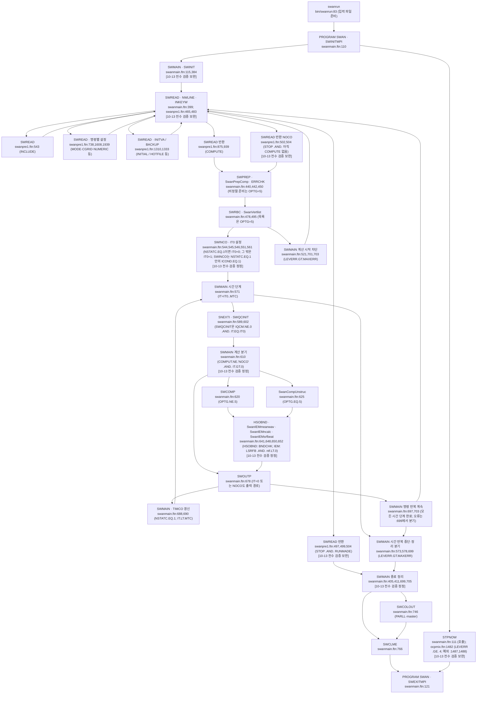
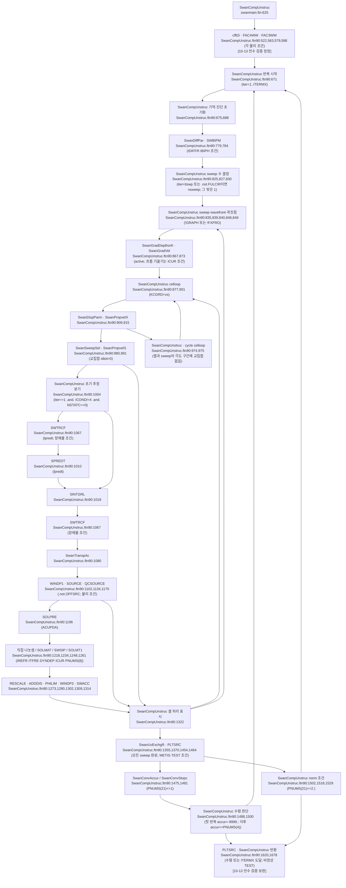

# SWAN — wave physics, numerics, and I/O foundation

## Scope note

A foundation reference for SWAN (Simulating WAves Nearshore) covering:
- the **action balance equation** that SWAN solves,
- the **propagation** scheme (geographic and spectral space, sweeping algorithm),
- the **source/sink** physical processes available,
- the **boundary condition** options,
- the **stationary vs nonstationary** mode decision,
- key **numerical scheme** choices (BSBT/SORDUP/SecondOrder/Lock-up).

This note treats SWAN's content end-to-end so subsequent notes can dive into specific subsystems (wind input, breaking, nesting, output) without re-establishing context.

> 실행 호출 흐름은 [R8](../../../_staging/recovery/flow/SWAN-callflow.md)에 있다. SWAN의 명령 읽기와 시간 단계 반복은 아래 계산 흐름 절에 옮겼다.

## Source basis

문서 원문은 [swantech](../raw/manuals/pdfs/swantech.pdf), [swanuse](../raw/manuals/pdfs/swanuse.pdf), [swanimp](../raw/manuals/pdfs/swanimp.pdf), [swanpgr](../raw/manuals/pdfs/swanpgr.pdf)이다. 웹 인용은 `models/SWAN/raw/manuals/website/`를 기준으로 한다. 코드 인용은 `models/SWAN/raw/source_code/swan/`을 기준으로 한다. [10-13 전수 검증 정정]

코드는 `src/swanmain.ftn:965`의 `VERNUM = 41.51`을 선언한다. `src/swanmain.ftn:967`의 `CALL BUGFIX ('A')`와 `src/swanmain.ftn:968`의 `CALL BUGFIX ('B')`가 패치를 표시한다. patch B의 실제 변경 커밋은 `0dabfa4`(2026-07-13)이다. 원본 저장소 HEAD는 `43e9bbb`(2026-07-13)이다. [R8 판독 기준](../../../_staging/recovery/flow/SWAN-callflow.md#판독-기준과-요약).

## 1. The action balance equation

SWAN is a **third-generation phase-averaged spectral wave model** based on the action balance equation. It computes the evolution of the wave action density `N(σ,θ;x,y,t)` (action = energy / relative frequency) as a function of geographic position, time, frequency, and propagation direction `[file=pdf:swan:swantech section="Chapter 1 Introduction > 1.4 Scope of this document" page=10]`.

The governing equation is:
```
∂N/∂t + ∂(cx·N)/∂x + ∂(cy·N)/∂y + ∂(cσ·N)/∂σ + ∂(cθ·N)/∂θ = Stot/σ
```
where `cx, cy, cσ, cθ` are the propagation velocities in geographic (`x,y`) and spectral (`σ,θ`) space, and `Stot` is the sum of source/sink terms.

**Why action density rather than energy density?** Action `N = E/σ` is conserved in slowly varying media even when energy is not. The wave-action conservation form is the standard for spectral wave models (WAM, WAVEWATCH III, SWAN).

**Why relative frequency `σ`?** Internally SWAN uses the relative (intrinsic) frequency to keep formulations clean in current. Output to the user can be transformed to absolute frequency `[file=website:swan:node61 section="Transformation from relative to absolute frequency"]` — relevant when validating against fixed-position wave-buoy measurements.

## 2. Propagation

### 2.1 Geographic space (cx, cy)

In the absence of currents, propagation velocity equals group velocity `(cg,x, cg,y)`. With currents, the velocities differ because the wave crest moves at phase speed but the energy moves at group speed `[file=pdf:swan:swantech section="Chapter 3 Numerical approaches > 3.5"]`.

### 2.2 Spectral space (cσ, cθ)

Refraction (cθ) and shifting in frequency (cσ) come from spatial gradients of depth and current. These spectral velocities are zero in deep water with no current.

### 2.3 방향 sweep과 전파 기법

SWAN's solver uses **directional sweeping** in geographic space, processing four quadrants of (cx, cy) signs in sequence:
- Quadrant 1: cx > 0 and cy > 0
- Quadrant 2: cx < 0 and cy > 0
- Quadrant 3: cx < 0 and cy < 0
- Quadrant 4: cx > 0 and cy < 0

정렬 격자의 정상 기본은 SORDUP이다. 정렬 격자의 비정상 기본은 S&L이다. `src/swanmain.ftn:1179–1180`의 원문은 `PROPSS = 2`와 `PROPSN = 3`이다. 국소 BSBT 전환 조건은 `src/swancom1.ftn:3136`의 `IF (COMPDA(KCGRD(IC),JDP2).LE.DEPMIN) PROPSL = 1`, `:3139`의 `IF (COMPDA(KCGRD(IC),JDP1).LE.DEPMIN) PROPSL = 1`, `:3232`의 `IF (LINK(ILINK).GT.0) PROPSL = 1`이다. 3139행은 `:3137`의 `IF (NSTATC.GT.0) THEN` 안에 있다. 비정렬 공간 수송은 BSBT이다. 비정렬 경로의 `src/SwanTranspAc.ftn90:129`는 SwanTranspX를 호출한다. `src/SwanTranspX.ftn90:43`의 원문은 `!   Computes transport in x-y space using the lowest order upwind scheme`이다. PROP BSBT는 `src/swanpre1.ftn:793–795`에서 두 모드를 BSBT로 지정한다. DIFFRACTION은 `src/swanmain.ftn:4090`의 `IF ( IDIFFR.EQ.1 ) THEN` 안에서 `:4094–4095`의 `PROPSN = 1`과 `PROPSS = 1`로 두 선택을 덮어쓴다. [R1 §4](../../../_staging/recovery/compare/swan-theory-numerics-vs-code.md#4-노트-대조와-수정안), [R5 §4](../../../_staging/recovery/compare/swan-inputs-physics-numerics-vs-code.md#4-노트-대조와-수정안). [10-13 전수 검증 보완]

### 2.4 Action-density limiter and under-relaxation

To stabilize source terms (especially wind input and quadruplet interactions), SWAN applies an **action density limiter** that bounds the per-iteration change of N `[file=pdf:swan:swantech section="Chapter 3.7 Action density limiter and under-relaxation" page=98]`:
```
∆Ni,j,l,m  ←  ∆Ni,j,l,m / max(1, |∆Ni,j,l,m|/limit)
```
In practice this matters mostly for stationary mode where iteration convergence depends on it. Most users do not need to tune it.

## 3. Source and sink processes

SWAN's source-term ledger `Stot = Sin + Snl3 + Snl4 + Sds + Sother` covers:

| Process | Symbol | Representative formulation | Activation flag |
|---------|--------|----------------------------|-----------------|
| Wind input | `Sin` | Snyder/Komen, Janssen, Yan, ST6, Rogers — choice via GEN1/GEN2/GEN3 | `GEN3` for full third-generation |
| Whitecapping | `Sds,w` | Hasselmann, Westhuysen, ST6 | `WCAP` |
| Quadruplet wave-wave (4-wave) | `Snl4` | DIA (Discrete Interaction Approximation) | `QUADrupl` |
| Triad wave-wave (3-wave) | `Snl3` | LTA (Lumped Triad Approximation) | `TRIad` |
| Depth-induced breaking | `Sds,br` | Battjes-Janssen, alpha/gamma | `BREaking` |
| Bottom friction | `Sds,b` | JONSWAP, Madsen, Collins | `FRICtion` |
| Vegetation, mud, sea ice, turbulence | `Sds,*` | various | optional |
| Bragg scattering | `Sbr` | Ardhuin & Herbers (2002) | optional |

The full process list with on/off flags per release is in `[file=website:swan:node13 section="Activation of physical processes"]`. SWAN ships a curated default per `MODE STATIONARY` / `NONSTATIONARY` setup; users override individual processes via dedicated commands.

**Practical note on whitecapping** — Whitecapping in SWAN is primarily steepness-controlled (pulse-based, Hasselmann 1974 / WAMDI 1988). For stratified shallow seas the default is usually fine; for fetch-limited cases consider the ST6 set of source terms.

**Practical note on triads** — Triad interactions transfer energy from primary peak to super-harmonics. Important in the surf zone. Off by default; activate via `TRIad` in the command file when modeling shoaling/breaking near the coast.

## 4. Boundary and initial conditions

The action balance equation is hyperbolic and requires **wave boundary conditions** at up-wave open boundaries `[file=pdf:swan:swantech section="Chapter 4 Wave boundary and initial conditions" page=125]`. Options (cited via `BOUND` command in the command file):

| Option | Meaning | Use case |
|--------|---------|----------|
| Parametric 1D (JONSWAP, PM, Gaussian) | Hs, Tp, γ; SWAN expands to 2D internally | First-pass synthetic forcing |
| Parametric 2D | Hs, Tp, γ + directional spread | When directional content matters |
| 2D spectrum from file (`BCspectra`) | full energy spectrum E(σ,θ) | Nesting from another SWAN/WAVEWATCH run |
| Per-point 1D / 2D from file | spatially varying along boundary | Realistic large-domain coupling |

Land boundaries automatically reflect/absorb according to land-water mask. Water boundaries beyond the model domain absorb energy that propagates outward.

For **nesting**, write a coarse-grid run with `NGRID` outputs (boundary spectrum file), then use `BOUND NEST 'sname' 'fname'` in the fine-grid run. Source code path: `swan/src/swanpre2.ftn` lines 2479 (BOUNDARY), 1984 (NESTOUT) — see also the code-qa skill output.

### 4.1 Initial conditions

Stationary runs do not need initial conditions — SWAN iterates from zero. Nonstationary runs accept:
- `INITial DEFAULT` — internally seed from JONSWAP at boundary
- `INITial PARametric` — synthetic Hs/Tp seed
- `INITial HOTStart` — restart from `.hot` file produced by previous run

## 5. Stationary vs nonstationary mode

The `MODE` command selects:

| Mode | When to use | Time stepping |
|------|-------------|---------------|
| `STATIONARY` | quasi-equilibrium wave field with steady forcing (typical engineering hindcast for a fixed wind state) | iterates within one snapshot until convergence |
| `NONSTATIONARY` | time-varying winds (storm passage), time-varying currents, evolving boundary | implicit time stepping with `DT` from command file |

Decision points:
- **Wind/forcing changes appreciably across the simulation window** → nonstationary.
- **Single design event, snapshot wind** → stationary (much cheaper).
- **Coupled with hydrodynamics (ADCIRC-SWAN, Delft3D-WAVE)** → nonstationary required.

Convergence of stationary runs is monitored via residual on Hs / change-per-iteration. Nonstationary uses a fixed `DT` (e.g., 10–30 min for storm passages); too large and nonlinear source terms get under-resolved.

`[file=website:swan:node34 section="Lock-up"]` discusses stationary lock-up — SWAN waits for the action density to stabilize before proceeding.

## 6. Output

SWAN writes via `BLOCK`, `TABLE`, `SPECout`, `NESTout` commands. Common outputs:
- 2D fields (`BLOCK`): Hs, Tp, mean direction, peak direction, wave length, etc.
- Time series at points (`TABLE`): same parameters at lat/lon stations
- Full 2D spectra (`SPECout`): energy spectrum E(σ,θ) at points, for downstream analysis or nesting
- Boundary nest files (`NESTout`): 2D spectra along a line, for downstream finer-grid runs

Output grids can differ from the computational grid `[file=website:swan:node12 section="Output grids"]`. This decouples model resolution from analysis resolution.

## 7. Decision Guide — SWAN run type

| Question | Stationary | Nonstationary |
|----------|-----------|---------------|
| Wind stationary across run window? | Yes | No |
| Storm passage / time-varying forcing? | No | Yes |
| Coupled with circulation (ADCIRC/Delft3D)? | No | Yes |
| Triad / breaking on shallow flat bathymetry? | OK | OK (triad needs short DT) |
| Computational budget tight? | Stationary cheaper | Nonstationary expensive |

| Bottom condition | Recommended scheme |
|-----------------|---------------------|
| 정렬 격자 정상 계산의 기본 전파법 | SORDUP이다. `src/swanmain.ftn:1179` `PROPSS = 2` [10-13 전수 검증 정정] |
| High shoaling rates, surf zone | SecondOrder + TRIad on |
| Long swells, low frequencies | tighten frequency discretization (`SET FREQ`) |

## 8. Working Rules

1. **Define the spectral grid before everything.** Frequency range (typically 0.04–1.0 Hz) and direction sectors (24 or 36 sectors) drive every later cost. Doubling sectors doubles run time.
2. **Boundary condition is the dominant uncertainty.** A stationary run with parametric JONSWAP and wrong `Hs/Tp` produces precisely-wrong wave heights inland. Validate boundary against buoy or coarse-grid spectrum first.
3. **Triads are off by default.** In surf-zone shoaling work, you must explicitly turn `TRIad` on or you'll under-predict secondary peaks.
4. **For nesting, NEVER mix domains with different spectral grids.** SWAN requires the same `SET FREQ`/`SET DIR` between coarse and fine.
5. **Stationary-mode iteration limit (`SET MAXIT`) matters for convergence on stiff source terms.** Increase if Hs residuals don't drop.

## 9. Common Pitfalls

- **JONSWAP `γ` typo** — Default γ=3.3 is reasonable for wind-driven wave but wrong for swell. Set explicitly.
- **Stationary on storm event** — looks fine but propagates an "average" wave, missing the surge phase.
- **Mixing GEN3 with bottom-friction-off** — GEN3 wind input grows with fetch; without dissipation the spectrum runs away.
- **Output points outside the computational grid** — silently dropped from `TABLE` output. Verify station list against grid bounding box.

## 10. Next Expansion

- Per-source-term deep dive (Sin formulations, ST6 vs WAM, Battjes-Janssen variants).
- Nesting workflow (NGRID → BOUND NEST) with file format details.
- ADCIRC-SWAN unstructured coupling notes (separate file; relevant for users running the unstructured-mesh SWAN variant via the ADCIRC-SWAN testsuite).
- Output post-processing (BLOCK to NetCDF, TABLE to ASCII, SPECout consumption).
- 정렬 격자의 격자점 처리는 SWOMPU가 맡는다. 비정렬 격자의 셀 처리는 SwanCompUnstruc 안에 있다. [R8 §2](../../../_staging/recovery/flow/SWAN-callflow.md#2-계산-순서).

## References

### Primary (PDFs)

- `[file=pdf:swan:swantech]` — Scientific/Technical documentation (governing equations, numerics).
- `[file=pdf:swan:swanuse]` — User Manual (commands, file formats).
- `[file=pdf:swan:swanimp]` — Implementation Manual.
- `[file=pdf:swan:swanpgr]` — Programmer Manual.

### Online doc (per-chapter HTML, swanmodel.sourceforge.io)

- `[file=website:swan:node12]` — Output grids.
- `[file=website:swan:node13]` — Activation of physical processes (per-process flag matrix).
- `[file=website:swan:node27]` — Boundary and initial conditions.
- `[file=website:swan:node34]` — Lock-up (stationary convergence).
- `[file=website:swan:node61]` — Transformation from relative to absolute frequency.
- `[file=website:swan:node64]` — Wave boundary and initial conditions.

### Key swantech sections

- Chapter 1.4 (page 10) — model scope.
- Chapter 2.2 (pages 18–19) — propagation kinematics.
- Chapter 2.3 (pages 21–52) — source and sink terms.
- Chapter 3.2 (pages 79–83) — discretization and BSBT.
- Chapter 3.5 (pages 93–96) — sweeping algorithm.
- Chapter 3.7 (pages 98–100) — action density limiter.
- Chapter 4 (pages 125–126) — boundary conditions.

## Provenance

| Field | Value |
|-------|-------|
| Authored by | Claude Opus 4.7 (this session) |
| Generated | 2026-05-06 |
| RAG retrieval | rag_proxy on `manuals` filtered `model=swan` (902 chunks across pdf+website doc_types) |
| Coverage | wave physics, numerics, sources, BC, modes, output (foundation level — does not enumerate every command) |
| Review status | 2026-10-13 recovery 대조 보고서 R1–R8 반영 |
| Companion notes (planned) | swan-source-terms-detailed, swan-nesting-workflow, swan-adcirc-coupling |

## 계산 흐름 (10-13 recovery 흐름 분석)

### 시작·명령 읽기·출력·종료

SWMAIN은 명령 읽기 반복과 시간 단계 반복을 가진다. [R8 §4.1](../../../_staging/recovery/flow/SWAN-callflow.md).



### 정렬 격자 한 시간 단계

정렬 경로는 SOURCE·QCSOURCE 뒤에 ACTION으로 전파항을 조립한다. [R8 §4.2](../../../_staging/recovery/flow/SWAN-callflow.md).

```mermaid
flowchart TD
  A["SWCOMP<br/>swanmain.ftn:620 (SNEXTI 뒤)"] --> B["FAC4WW · FAC3WW · INSAC · XNL_INIT<br/>swancom1.ftn:959,967,1438,1479 (각 물리 스위치)<br/>[10-13 전수 검증 정정]"]
  B --> C["SWCOMP 반복 시작<br/>swancom1.ftn:1487 (ITER=1..ITERMX)"]
  C --> D["SWCOMP 기억·진단 초기화<br/>swancom1.ftn:1497,1545"]
  D --> E["SWCOMP 초기 추정 스위치 변경·복원<br/>swancom1.ftn:1619,1637 (PRECOR; ITER=1 또는 2)"]
  E --> F["DIFPAR · SWBIPM<br/>swancom1.ftn:1676,1681 (IDIFFR·IBIPH 조건)"]
  F --> G["SWCOMP sweep 시작<br/>swancom1.ftn:1698,1699 (DO 410 SWPDIR = 1, 4; -jac: DO 410 ISWP = 0, 3)"]
  G --> H["SWRECVAC<br/>swancom1.ftn:1964,1968 (!WFR!MPI; 행·노드 조건)<br/>[10-13 전수 검증 정정]"]
  H --> I["SWOMPU<br/>swancom1.ftn:2000"]
  I --> J["SWOMPU stencil·건조점 검사<br/>swancom1.ftn:3042,3289 (건조점 AC2=0·RETURN)"]
  J --> K["SWAPAR · SPROXY · SWGEOM · SWPSEL<br/>swancom1.ftn:3343,3351,3361,3369"]
  K --> L["SPROSD · DSPHER<br/>swancom1.ftn:3384,3402 (DSPHER는 KSPHER.GT.0 .AND. IREFR.NE.0)"]
  L --> LA["SWOMPU 방향 범위 분기<br/>swancom1.ftn:3409 (IDTOT.GT.0)"]
  LA --> LB["WINDP1<br/>swancom1.ftn:3423 (IWIND.GE.1)"]
  LB --> M["SWOMPU 초기 추정 분기<br/>swancom1.ftn:3460 (ICOND.NE.4 .AND. ITER.EQ.1 .AND. NSTATC.EQ.0)"]
  M --> N["SWTRCF<br/>swancom1.ftn:3532 (LPREDT; 장애물 조건)"]
  N --> P["SPREDT<br/>swancom1.ftn:3466 (LPREDT)"]
  P --> Q["SINTGRL<br/>swancom1.ftn:3477"]
  M --> Q
  Q --> R["SWTRCF<br/>swancom1.ftn:3532 (장애물 조건)"]
  R --> S["SOURCE · QCSOURCE<br/>swancom1.ftn:3548,3590 (IGEN·IQCM 조건)"]
  S --> T["ACTION<br/>swancom1.ftn:3614"]
  T --> U["SOLPRE<br/>swancom1.ftn:3644 (ACUPDA)"]
  U --> V["직접 나눗셈 / SWSIP / SOLMT1 / SOLMAT<br/>swancom1.ftn:3671,3693,3709,3726 (IREFR·ITFRE·DYNDEP·ICUR·PNUMS(8))"]
  V --> W["RESCALE · ADDDIS · PHILIM/HJLIM · WINDP3<br/>swancom1.ftn:3754,3762,3794,3801,3816"]
  W --> X["SWCOMP 다음 격자점<br/>swancom1.ftn:2046"]
  J --> X
  LA --> X
  T --> X
  X --> I
  X --> Y["SWSENDAC · SWEXCHG · SWSYNC<br/>swancom1.ftn:2058,2062,2084,2089,2107 (SWSENDAC: !WFR!MPI 행 끝; !JAC 교환·동기화: ISWP.EQ.3; !WFR!MPI 교환: 네 sweep 뒤)"]
  Y --> H
  Y --> G
  Y --> Z["PLTSRC · SETUPP<br/>swancom1.ftn:2238,2256 (모든 sweep 완료; TEST·LSETUP 조건)"]
  Z --> AA["SACCUR / SWSTPC<br/>swancom1.ftn:2271,2278 (PNUMS(21))"]
  AA --> AB["SWCOMP 반복 종료 판단<br/>swancom1.ftn:2352,2353 ((ITER.NE.1 .OR. PNUMS(21).EQ.0.) .AND. ACCUR.GE.PNUMS(4))"]
  AB --> C
  AB --> AC["PLTSRC · SWCOMP 반환<br/>swancom1.ftn:2436,2480 (수렴 또는 ITERMX 도달; 비정상 TEST)"]
```



### 비정렬 격자 한 시간 단계

비정렬 경로는 SwanTranspAc 뒤에 SOURCE·QCSOURCE를 호출한다. [R8 §4.3](../../../_staging/recovery/flow/SWAN-callflow.md).



## 코드 결함 후보 (정적 판독)

이 목록은 원문 정적 판독에서 코드가 자기 주석·문서·외부 원문·다른 경로·단위와 어긋나는 곳이다. 결함 확정은 개발자 확인이 필요하다. `P`는 [문제·패치 안내](../raw/manuals/website/problems_and_fixes/problems_and_fixes.htm)를 뜻한다. `A`는 [41.51.A 패치 원문](../raw/manuals/website/problems_and_fixes/patches/41.51.A)을 뜻한다. `M`은 [수정 이력](../raw/manuals/website/modifications/modifications.htm)을 뜻한다. 각 약칭 뒤의 숫자는 해당 로컬 파일의 줄 번호이다. [10-13 전수 검증 보완]

| 행 ID | 위치(파일:줄 원문) | 내용 | 강도 | 근거(git 판정 포함) |
|---|---|---|---|---|
| R1:TN-076 | `43e9bbb:src/swancom1.ftn:9813` `SACC2 (INDX) = MAX ( 1.E-20 , (XMOM1/XMOM0) )`<br>`43e9bbb:src/swancom1.ftn:9854` `TMABS = ABS ( (PI2/SACC2(INDX)) - (PI2/SACC1(INDX)) )`<br>`43e9bbb:src/swancom1.ftn:9855` `TMREL = TMABS / SACC2(INDX)                                40.93`<br>`43e9bbb:src/swancom1.ftn:9873` `IF ( IQCM.EQ.0 ) THEN                                      41.90`<br>`43e9bbb:src/swancom1.ftn:9878` `&                     (TMREL.LE.PNUMS(1) .OR. TMABS.LE.PNUMS(3)) )   40.93`<br>`43e9bbb:src/swancom1.ftn:9882` `LCONV = HSREL.LE.PNUMS(1) .OR. HSABS.LE.PNUMS(2)     41.90`<br>`43e9bbb:src/SwanConvStopc.ftn90:219` `tmrel  = PNUMS( 1) * tmcurr(ivert)` | 정렬 STOPC는 주기 차이를 평균 각주파수로 나눈다. 이 식은 주기 상대오차의 차원과 맞지 않는다. `IF ( IQCM.EQ.0 ) THEN`인 일반 경로의 수렴 조건에 쓰인다. QC의 파고 전용 수렴 판정에는 쓰이지 않는다. 기본 주기 허용값 1000은 영향을 가릴 수 있다. 비정렬 경로는 주기로 허용오차를 만든다. E 강함을 유지한다. | 강함 | swantech PDF 91쪽 / 인쇄 83쪽, (3.23): $\lvert\Delta T_{m01}^s\rvert/T_{m01}^{s-1}<\varepsilon_T^r\ \mathrm{or}\ \lvert\Delta T_{m01}^s\rvert<\varepsilon_T^a$.<br>`b2ae30e 2022-08-10 initial release`.<br>저장소 최초 코드 반입이다.<br>`b2ae30e:src/swancom1.ftn:9606` `TMREL = TMABS / SACC2(INDX)                                40.93`<br>`git log -G` 검색식 `TMREL = TMABS`은 `b2ae30e`만 반환했다.<br>`7ee8981:src/swancom1.ftn:9855` `TMREL = TMABS / SACC2(INDX)                                40.93`<br>HEAD와 patch B까지 해당 식·분기가 유지된다.<br>웹 검색어는 TMREL, stopping criterion, Tm01이다. M:1308의 주기 곡률 추가는 이 나눗셈의 수정 기록이 아니다. A는 HSAC1 초기값을 바꾼다.<br>[git E 판정](../../../_staging/recovery/compare/SWAN-git-verify-E.md) |
| R1:TN-162 | `43e9bbb:src/swanser.ftn:4432` `ATOT1  = ATOT1  + FL1(ID,IS)`<br>`43e9bbb:src/swanser.ftn:4435` `ASTOT1 = ASTOT1 + FL1(ID,IS) * SPCSIG(IS)`<br>`43e9bbb:src/swanser.ftn:4290` `!     40.00, Apr. 98: procedure to maintain peakedness introduced`<br>`43e9bbb:src/swanser.ftn:4303` `!     interpolated average direction and frequency are determined`<br>`43e9bbb:src/swanmain.ftn:6945` `CALL SINTRP (W1, W2, BSPECS(1,1,K1,1), BSPECS(1,1,K2,1),`<br>`43e9bbb:src/swanmain.ftn:6946` `&                    AC2(1,1,INDXGR), SPCDIR, SPCSIG)`<br>`43e9bbb:src/swanmain.ftn:6950` `SIG2 = SPCSIG(IS) ** 2`<br>`43e9bbb:src/swanmain.ftn:6952` `ETOT = ETOT + SIG2 * AC2(ID,IS,INDXGR)` | SINTRP의 작용 모멘트는 로그 주파수 격자의 주파수별 적분 폭을 생략한다. 입력은 구간 총량이 아니라 작용밀도이다. 문서 식 (3.85)의 모멘트와 다르다. peak 유지용 내부 지표라는 설계 가능성을 반영해 E 중간을 유지한다. | 중간 | swantech PDF 121–122쪽 / 인쇄 113–114쪽, (3.85): $m_{i,k}=\int N_i(\sigma,\theta)\sigma^k\,d\sigma d\theta$, $i=1,2,\ k=0,1$.<br>`b2ae30e 2022-08-10 initial release`.<br>저장소 최초 코드 반입이다.<br>`b2ae30e:src/swanser.ftn:4863` `ATOT1  = ATOT1  + FL1(ID,IS)`<br>`git log -G` 검색식 `ATOT1  = ATOT1`은 `b2ae30e`만 반환했다.<br>`7ee8981:src/swanser.ftn:4432` `ATOT1  = ATOT1  + FL1(ID,IS)`<br>HEAD와 patch B까지 해당 식·분기가 유지된다.<br>웹 검색어는 SINTRP, interpolation, peakedness, moment이다. M의 보간 수정 항목은 장애물·건조점·곡선격자 처리이다. P·A·M에 이 가중치의 수정 기록은 없다.<br>[git E 판정](../../../_staging/recovery/compare/SWAN-git-verify-E.md) [10-13 전수 검증 보완] |
| R1:TN-163 | `43e9bbb:src/swanser.ftn:4432` `ATOT1  = ATOT1  + FL1(ID,IS)`<br>`43e9bbb:src/swanser.ftn:4435` `ASTOT1 = ASTOT1 + FL1(ID,IS) * SPCSIG(IS)`<br>`43e9bbb:src/swanser.ftn:4491` `ASIG1  = ASTOT1 / ATOT1`<br>`43e9bbb:src/swanser.ftn:4499` `DELSG1 = ALOG (ASIG1 / ASIG) / FRINTF`<br>`43e9bbb:src/swanser.ftn:4290` `!     40.00, Apr. 98: procedure to maintain peakedness introduced` | SINTRP의 평균 주파수는 작용밀도의 단순 합을 분모로 쓴다. 문서 식 (3.86)의 주파수별 적분 폭을 포함한 평균과 다르다. 계산한 평균의 비는 주파수 이동량에 직접 쓰인다. TN-162와 같은 원인의 E 중간이다. | 중간 | swantech PDF 122쪽 / 인쇄 114쪽, (3.86): $\bar\sigma_i=m_{i,1}/m_{i,0}$.<br>`b2ae30e 2022-08-10 initial release`.<br>저장소 최초 코드 반입이다.<br>`b2ae30e:src/swanser.ftn:4922` `ASIG1  = ASTOT1 / ATOT1`<br>`git log -G` 검색식 `ASIG1  = ASTOT1`은 `b2ae30e`만 반환했다.<br>`7ee8981:src/swanser.ftn:4491` `ASIG1  = ASTOT1 / ATOT1`<br>HEAD와 patch B까지 해당 식·분기가 유지된다.<br>웹 검색어는 SINTRP, average frequency, moment이다. P·A·M에 평균 주파수 가중치의 수정 기록은 없다.<br>[git E 판정](../../../_staging/recovery/compare/SWAN-git-verify-E.md) |
| R1:TN-165 | `43e9bbb:src/swanser.ftn:4433` `AXTOT1 = AXTOT1 + FL1(ID,IS) * SPCDIR(ID,2)`<br>`43e9bbb:src/swanser.ftn:4434` `AYTOT1 = AYTOT1 + FL1(ID,IS) * SPCDIR(ID,3)`<br>`43e9bbb:src/swanser.ftn:4465` `DELD1  = REAL(ATAN2(DBLE(AXTOT*AYTOT1 - AYTOT*AXTOT1),          30.82`<br>`43e9bbb:src/swanser.ftn:4466` `&                        DBLE(AXTOT*AXTOT1 + AYTOT*AYTOT1))) / DDIR  30.82`<br>`43e9bbb:src/swanser.ftn:4309` `!     in full circle cases interpolation crosses the boundary 0-360 degr.` | SINTRP의 방향 모멘트는 로그 주파수 격자의 주파수별 적분 폭을 생략한다. 주파수별 파향이 다르면 문서 식 (3.88)·(3.89)의 평균 방향과 달라진다. 원형 방향 경계 연결은 이 적분 폭 생략을 보정하지 않는다. TN-162와 같은 원인의 E 중간이다. | 중간 | swantech PDF 122쪽 / 인쇄 114쪽, (3.88): $m_{i,x}=\int N_i\cos\theta\,d\sigma d\theta$; (3.89): $m_{i,y}=\int N_i\sin\theta\,d\sigma d\theta$.<br>`b2ae30e 2022-08-10 initial release`.<br>저장소 최초 코드 반입이다.<br>`b2ae30e:src/swanser.ftn:4864` `AXTOT1 = AXTOT1 + FL1(ID,IS) * SPCDIR(ID,2)`<br>`git log -G` 검색식 `AXTOT1 = AXTOT1`은 `b2ae30e`만 반환했다.<br>`7ee8981:src/swanser.ftn:4433` `AXTOT1 = AXTOT1 + FL1(ID,IS) * SPCDIR(ID,2)`<br>HEAD와 patch B까지 해당 식·분기가 유지된다.<br>웹 검색어는 SINTRP, direction, interpolation이다. P·A·M에 방향 모멘트의 주파수별 폭 수정 기록은 없다.<br>[git E 판정](../../../_staging/recovery/compare/SWAN-git-verify-E.md) |
| R1:TC-010 | `43e9bbb:src/SwanIntgratSpc.ftn90:40` `!   Determine p-th moment of energy density spectrum with respect to a part of frequency space`<br>`43e9bbb:src/SwanIntgratSpc.ftn90:41` `!   (the integrand may contain power p of relative or absolute frequency, wave number or group velocity)`<br>`43e9bbb:src/SwanIntgratSpc.ftn90:104` `q = p + 1.`<br>`43e9bbb:src/SwanIntgratSpc.ftn90:161` `ftail = 1. / (PWTAIL(1) - q)`<br>`43e9bbb:src/SwanIntgratSpc.ftn90:238` `ftail = 1. / (PWTAIL(1) - 1.)`<br>`43e9bbb:src/SwanIntgratSpc.ftn90:253` `omeg2 = spcsig(MSC) + wpar(MSC) * us`<br>`43e9bbb:src/SwanIntgratSpc.ftn90:256` `pmom = pmom + ehfr * (omeg2**p * spcsig(MSC) - ctail) * DDIR * ftail`<br>`43e9bbb:src/SwanIntgratSpc.ftn90:313` `ftail = 1. / (PWTAIL(1) - 1.)`<br>`43e9bbb:src/SwanIntgratSpc.ftn90:336` `pmom = pmom + ehfr * (wpar(MSC)**p * spcsig(MSC) - ctail) * DDIR * ftail`<br>`43e9bbb:src/SwanIntgratSpc.ftn90:323` `ctail = (1./GRAV)**p * fmax**(2*p+1) * (spcsig(MSC)/fmax)**PWTAIL(1)`<br>`43e9bbb:src/SwanIntgratSpc.ftn90:327` `ctail = (0.5*GRAV)**p * fmax**(1-p) * (spcsig(MSC)/fmax)**PWTAIL(1)` | SwanIntgratSpc의 절대주파수·파수·군속도 꼬리 적분은 가중치의 차수를 분모에 반영하지 않는다. 유속이 0이면 상대주파수와 절대주파수는 같지만 수렴 가능한 $p\ne0$의 두 꼬리 모멘트가 다르다. 유한 상한 보정은 차수를 반영하므로 최고 주파수의 가중치를 상수로 고정한 일관된 근사라는 해석과도 맞지 않는다. 범위 지정 출력에서 호출되며 해당 식을 끄는 전처리 표지는 없다. E 강함을 유지한다. | 강함 | 절대주파수·파수·군속도 모멘트의 꼬리 적분.<br>`b2ae30e 2022-08-10 initial release`.<br>저장소 최초 코드 반입이다.<br>`b2ae30e:src/SwanIntgratSpc.ftn90:238` `ftail = 1. / (PWTAIL(1) - 1.)`<br>`git log -G` 검색식 `ftail =`은 `b2ae30e`만 반환했다.<br>`7ee8981:src/SwanIntgratSpc.ftn90:238` `ftail = 1. / (PWTAIL(1) - 1.)`<br>HEAD와 patch B까지 해당 식·분기가 유지된다.<br>웹 검색어는 SwanIntgratSpc, moment, tail, absolute frequency이다. P·A·M에 이 꼬리 분모의 수정 기록은 없다.<br>[git E 판정](../../../_staging/recovery/compare/SWAN-git-verify-E.md) |
| R1:TC-011 | `43e9bbb:src/SwanIntgratSpc.ftn90:64` `real, intent(in)                     :: fmax     ! user-specified upper bound of frequency space for integration`<br>`43e9bbb:src/SwanIntgratSpc.ftn90:65` `real, intent(in)                     :: fmin     ! user-specified lower bound of frequency space for integration`<br>`43e9bbb:src/SwanIntgratSpc.ftn90:119` `elseif ( spcsig(is) > fmax ) then`<br>`43e9bbb:src/SwanIntgratSpc.ftn90:121` `dsf = fmax - spcsig(is-1)`<br>`43e9bbb:src/SwanIntgratSpc.ftn90:125` `elseif ( spcsig(is) > fmin ) then`<br>`43e9bbb:src/SwanIntgratSpc.ftn90:127` `dsf = spcsig(is) - fmin`<br>`43e9bbb:src/SwanIntgratSpc.ftn90:145` `if ( spcsig(is) > fmax ) exit`<br>`43e9bbb:src/swanpre1.ftn:2307` `IF ( OUTPAR(INDX(1)+20).GT.OUTPAR(INDX(1)+35) )`<br>`43e9bbb:src/swanpre1.ftn:2308` `&               CALL MSGERR (2,'fmin cannot be larger than fmax')    40.87` | SwanIntgratSpc는 적분 하한과 상한이 같은 주파수 구간 안에 있으면 하한을 적용하지 않는다. 상한 분기의 적분은 그 구간의 왼쪽 격자점에서 시작한다. 파서는 하한·상한의 순서만 검사한다. 범위 지정 출력이 이 함수를 호출하며 이후 하한 보정과 해당 식의 전처리 표지는 없다. E 강함을 유지한다. | 강함 | 한 주파수 구간 안에 놓인 적분 하한·상한.<br>`b2ae30e 2022-08-10 initial release`.<br>저장소 최초 코드 반입이다.<br>`b2ae30e:src/SwanIntgratSpc.ftn90:119` `elseif ( spcsig(is) > fmax ) then`<br>`git log -G` 검색식 `elseif \( spcsig\(is\) > fmax \)`은 `b2ae30e`만 반환했다.<br>`7ee8981:src/SwanIntgratSpc.ftn90:119` `elseif ( spcsig(is) > fmax ) then`<br>HEAD와 patch B까지 해당 식·분기가 유지된다.<br>웹 검색어는 integration, interval, fmin, fmax이다. M:163–166의 지정 구간 기능 소개는 이 경계 분기의 수정 기록이 아니다. P·A·M에 동일 수정 기록은 없다.<br>[git E 판정](../../../_staging/recovery/compare/SWAN-git-verify-E.md) |
| R1:TC-023 | `43e9bbb:src/swancom5.ftn:3656` `CAXCEN = ABS ( CAX(ID,IS,1) )`<br>`43e9bbb:src/swancom5.ftn:3657` `CAYCEN = ABS ( CAY(ID,IS,1) )`<br>`43e9bbb:src/swancom5.ftn:3660` `TX     = RDX(1) * CAXCEN + RDX(2) * CAXCEN`<br>`43e9bbb:src/swancom5.ftn:3661` `TY     = RDY(1) * CAYCEN + RDY(2) * CAYCEN`<br>`43e9bbb:src/swancom5.ftn:3664` `CFLCEN = TS / MAX( 1.E-20 , ( TX + TY ) )`<br>`43e9bbb:src/swancom1.ftn:5437` `IF ( (DYNDEP .OR. ICUR.EQ.1) .AND. ITFRE.NE.0 ) THEN                40.41 40.00`<br>`43e9bbb:src/swancom1.ftn:5451` `ELSE IF ( INT(PNUMS(8)) .EQ. 2 ) THEN`<br>`43e9bbb:src/swancom1.ftn:5458` `CALL STRSSB (IDDLOW  ,IDDTOP  ,`<br>`43e9bbb:src/swancom1.ftn:5461` `&                 ANYBLK  ,RDX     ,RDY     ,TRAC0            )      41.07 40.41 30.21`<br>`43e9bbb:src/swancom5.ftn:188` `DET    =  DY2*DX1 - DY1*DX2`<br>`43e9bbb:src/swancom5.ftn:189` `RDX(1) =  DY2/DET`<br>`43e9bbb:src/swancom5.ftn:190` `RDY(1) = -DX2/DET`<br>`43e9bbb:src/swancom5.ftn:191` `RDX(2) = -DY1/DET`<br>`43e9bbb:src/swancom5.ftn:192` `RDY(2) =  DX1/DET`<br>`43e9bbb:src/swancom5.ftn:1695` `FAC = FAC2 * ( ABS((RDX(1)+RDX(2))*CAX(ID,IS,1)) +`<br>`43e9bbb:src/swancom5.ftn:1696` `&                        ABS((RDY(1)+RDY(2))*CAY(ID,IS,1)) )`<br>`43e9bbb:src/swancom5.ftn:3524` `!            1)  Cs can be limited`<br>`43e9bbb:src/swancom5.ftn:3525` `!            2)  Action in bin can be set equal zero` | STRSSB의 CFL 공간 분모는 속도에만 절댓값을 적용한다. 역기저의 부호가 다른 sweep에서는 공간 전달률이 상쇄될 수 있다. 호출 조건은 `IF ( (DYNDEP .OR. ICUR.EQ.1) .AND. ITFRE.NE.0 ) THEN` 안의 `ELSE IF ( INT(PNUMS(8)) .EQ. 2 ) THEN`이다. 이 E 중간 후보는 명시 주파수 경로에 한정한다. 기본 음해법에는 적용되지 않는다. | 중간 | 명시 주파수 CFL 분모의 기하학적 부호.<br>`b2ae30e 2022-08-10 initial release`.<br>저장소 최초 코드 반입이다.<br>`b2ae30e:src/swancom5.ftn:3660` `TX     = RDX(1) * CAXCEN + RDX(2) * CAXCEN`<br>`git log -G` 검색식 `TX     = RDX\|CFLCEN = TS`은 `b2ae30e`만 반환했다.<br>`7ee8981:src/swancom5.ftn:3660` `TX     = RDX(1) * CAXCEN + RDX(2) * CAXCEN`<br>HEAD와 patch B까지 해당 식·분기가 유지된다.<br>웹 검색어는 STRSSB, CFL, explicit frequency, propagation이다. P·A·M에 공간 분모의 부호 수정 기록은 없다.<br>[git E 판정](../../../_staging/recovery/compare/SWAN-git-verify-E.md) |
| R2:SS-089 | `43e9bbb:src/mod_xnl4v5.ftn90:2738` `real, intent(in)     :: n(nsig,nang)  ! N(nsig,nang) Action density`<br>`43e9bbb:src/mod_xnl4v5.ftn90:2796` `!  compute sums for total energy andwave number`<br>`43e9bbb:src/mod_xnl4v5.ftn90:2803` `dnn  = n(isig,iang)*dsigma(isig)*delta`<br>`43e9bbb:src/mod_xnl4v5.ftn90:2805` `sumk = sumk + 1./sqkk*dnn`<br>`43e9bbb:src/mod_xnl4v5.ftn90:2813` `kms = (sum0/sumk)**2`<br>`43e9bbb:src/mod_xnl4v5.ftn90:6065` `call q_dscale(a,q_sig,q_a,nkq,naq,s_depth,q_grav,dfac1)`<br>`43e9bbb:src/mod_xnl4v5.ftn90:6066` `call q_dscale(a,q_sig,q_a,nkq,naq,q_depth,q_grav,dfac2)`<br>`43e9bbb:src/mod_xnl4v5.ftn90:6068` `q_scale = dfac1/dfac2`<br>`43e9bbb:src/swancom4.ftn:2960` `AQUAD(ISIG,IDIR) = ASWAN(IDIR,ISIG,IGRID)`<br>`43e9bbb:src/mod_xnl4v5.ftn90:5954` `if(igrid==0) then`<br>`43e9bbb:src/mod_xnl4v5.ftn90:5962` `goto 9999`<br>`43e9bbb:src/mod_xnl4v5.ftn90:7659` `t13    = t13*q_scale` | 해석: XNL의 `Q_DSCALE`은 에너지 평균 파수를 구한다는 주석과 달리 작용 밀도로 가중한다. 문서 (2.47)의 에너지 가중 평균과 넓은 스펙트럼에서 다르다. 단일 주파수에서는 두 평균이 같다. SWAN 호출부는 `AQUAD(ISIG,IDIR) = ASWAN(IDIR,ISIG,IGRID)`로 작용 밀도를 넘긴다(`swancom4.ftn:2960`). XNL WAM 배율 경로와 최근접 수심 격자 보정에 이 평균이 쓰인다. 최근접 검색을 끈 경로는 `q_scale=1`이다. 현재 수심의 격자를 바로 찾는 경로도 최근접 보정을 우회한다. 해당 계산에는 전처리 배제 표시가 없다. 결함 후보의 범위는 이 XNL 경로이며 기본 DIA에는 적용되지 않는다. `git log -G`는 관련 식을 `b2ae30e`(2022-08-10, `initial release`)까지 추적한다. `7ee8981`·patch B `0dabfa4`·HEAD에서 같은 식이 유지된다. 이 날짜는 저장소 최초 반입일이다. | 강함 | swantech PDF 41쪽 / 인쇄 33쪽, (2.89) $S_{nl4}^{d}=S_{nl4}^{d_N}R(k_pd)/R(k_pd_N)$.<br>`b2ae30e 2022-08-10 initial release`.<br>저장소 최초 코드 반입이다.<br>`b2ae30e:src/mod_xnl4v5.ftn90:2803` `dnn  = n(isig,iang)*dsigma(isig)*delta`<br>`git log -G` 검색식 `dnn  = n\(\|q_scale =`은 `b2ae30e`만 반환했다.<br>`7ee8981:src/mod_xnl4v5.ftn90:2803` `dnn  = n(isig,iang)*dsigma(isig)*delta`<br>HEAD와 patch B까지 해당 식·분기가 유지된다.<br>웹 검색어는 XNL, depth scaling, nearest grid, quadruplet이다. M:1234에는 `Xnl` 일반 수정 기록이 있다. 이 항목은 작용·에너지 가중치의 차이를 특정하지 않는다. P·A에는 이 가중치 수정이 없다. HEAD의 Q_DSCALE에는 같은 작용밀도 가중치가 남는다.<br>[git E 판정](../../../_staging/recovery/compare/SWAN-git-verify-E.md) |
| R2:SS-516 | `43e9bbb:src/mod_xnl4v5.ftn90:6763` `if(iq_interp==2) then`<br>`43e9bbb:src/mod_xnl4v5.ftn90:6774` `nprod = qn13p*(qn4-qn2) + qn2*qn4*qn13d`<br>`43e9bbb:src/mod_xnl4v5.ftn90:6780` `qd1    = qn3*(qn4-qn2) + qn2*qn4*qn3`<br>`43e9bbb:src/mod_xnl4v5.ftn90:6781` `qd3    = qn1*(qn4-qn2) - qn2*qn4*qn1`<br>`43e9bbb:src/mod_xnl4v5.ftn90:6886` `qd1    = qn3*(qn4-qn2) - qn2*qn4`<br>`43e9bbb:src/mod_xnl4v5.ftn90:6887` `qd3    = qn1*(qn4-qn2) + qn2*qn4`<br>`43e9bbb:src/mod_xnl4v5.ftn90:5659` `iq_interp  = 1            ! bi-linear interpolation`<br>`43e9bbb:src/mod_xnl4v5.ftn90:5786` `if(trim(cpar)=='INTERP')   iq_interp  = int(rpar)`<br>`43e9bbb:src/swancom4.ftn:2978` `CALL XNL_MAIN( AQUAD,SIGMA,DIRR,NSIG,NDIR,DEPTH(IGRID),IQUAD,`<br>`43e9bbb:src/swancom4.ftn:2979` `&               XNL,DIAG,INODE,IERROR )`<br>`43e9bbb:src/swancom4.ftn:2987` `SNL(IDIR,ISIG,IGRID) = XNL(ISIG,IDIR)`<br>`43e9bbb:src/swancom4.ftn:2993` `RETURN` | 해석: XNL 최근접 보간의 대각 도함수에는 3차 원천항의 1차 미분에 맞지 않는 3차 항이 남는다. 같은 원천항을 미분한 이중 선형 경로의 6886–6887행은 2차식이다. 기본 `INTERP=1`은 문제 분기를 사용하지 않는다. 설정 파일의 `INTERP=2`는 문제 분기에 도달한다. 해당 계산에는 전처리 배제 표시가 없다. SWAN 호출부는 반환된 `DIAG`를 원천항 갱신에 사용하지 않는다. 따라서 결함 후보의 강도는 약함이다. `git log -G`는 이 식을 `b2ae30e`(2022-08-10, `initial release`)까지 추적한다. `7ee8981`·patch B `0dabfa4`·HEAD `43e9bbb`에서도 식이 유지된다. 저장소 최초 반입일을 오류 발생일로 단정하지 않는다. | 약함 | XNL 최근접 보간의 diagonal 도함수에 3차 항이 남는다.<br>`b2ae30e 2022-08-10 initial release`.<br>저장소 최초 코드 반입이다.<br>`b2ae30e:src/mod_xnl4v5.ftn90:6780` `qd1    = qn3*(qn4-qn2) + qn2*qn4*qn3`<br>`git log -G` 검색식 `qd1    =`은 `b2ae30e`만 반환했다.<br>`7ee8981:src/mod_xnl4v5.ftn90:6780` `qd1    = qn3*(qn4-qn2) + qn2*qn4*qn3`<br>HEAD와 patch B까지 해당 식·분기가 유지된다.<br>웹 검색어는 XNL, diagonal, nearest, interpolation이다. M:1234의 `Xnl` 일반 수정은 최근접 보간의 도함수를 특정하지 않는다. P·A에는 해당 식의 수정이 없다. HEAD의 최근접 분기는 기존 식을 유지한다.<br>[git E 판정](../../../_staging/recovery/compare/SWAN-git-verify-E.md) |
| R3:QC-086 | `43e9bbb:src/SwanQCM.ftn90:1063` `uxp = ux2 (KCGRD(1))`<br>`43e9bbb:src/SwanQCM.ftn90:1064` `uyp = uy2 (KCGRD(1))`<br>`43e9bbb:src/SwanQCM.ftn90:1072` `rft = 0.`<br>`43e9bbb:src/SwanQCM.ftn90:1073` `sft = 0.`<br>`43e9bbb:src/SwanQCM.ftn90:1081` `u = SVALQI ( x, y, 2, UXB, 0, ix, iy )`<br>`43e9bbb:src/SwanQCM.ftn90:1082` `v = SVALQI ( x, y, 3, UYB, 0, ix, iy )`<br>`43e9bbb:src/SwanQCM.ftn90:1084` `if ( .not. u /= 0. .and. .not. v /= 0. ) cycle`<br>`43e9bbb:src/SwanQCM.ftn90:1097` `rft(i,j) = uu - uxp`<br>`43e9bbb:src/SwanQCM.ftn90:1098` `sft(i,j) = vv - uyp`<br>`43e9bbb:src/swanmain.ftn:5560` `IF (.NOT.INGRD .AND. ZERO.EQ.0) THEN`<br>`43e9bbb:src/swanmain.ftn:5561` `SVALQI = 0.` | 주변 흐름이 정확히 0이고 현재점 흐름이 0이 아니면 창 함수를 곱하기 전 유속 차이는 $-\vec u(x,y)$다. 코드는 초기값 0을 남긴다. 1070행의 “compute modulation of currents” 및 비영 흐름에서의 차분 경로와 모순된다. 입력 밖의 0을 피하려는 가능성은 있지만 실제 영 유속과 구분하는 조건은 없다. `src/SwanQCM.ftn90:1377–1389`에서 `IQCM > 0` 및 `ICUR == 1`인 호출 경로에 도달한다. `src/swanmain.ftn:5560–5561`의 영역 밖 0 반환과 실제 영 유속을 호출부가 구별하지 않는다. 이 조건문은 `b2ae30e`의 1080행과 `7ee8981`·`43e9bbb`의 1084행에 있다. [SWAN-git-verify-E.md](../../../_staging/recovery/compare/SWAN-git-verify-E.md)의 E 유지(강함)를 반영한다. QC 유속 변조는 주변 두 성분이 정확히 0이면 차분을 생략한다. 현재점 유속이 비영이면 실제 영 유속 지점의 변조량을 잘못 0으로 둔다. | 강함 | swantech PDF 113쪽, 인쇄 105쪽, 번호 없음: $\Delta\vec u=\mathcal W(x')\mathcal W(y')[\vec u(x+x',y+y')-\vec u(x,y)]$.<br>`b2ae30e 2022-08-10 initial release`.<br>저장소 최초 코드 반입이다.<br>`b2ae30e:src/SwanQCM.ftn90:1080` `if ( .not. u /= 0. .and. .not. v /= 0. ) cycle`<br>`git log -G` 검색식 `not. u /= 0`은 `b2ae30e`만 반환했다.<br>`7ee8981:src/SwanQCM.ftn90:1084` `if ( .not. u /= 0. .and. .not. v /= 0. ) cycle`<br>HEAD와 patch B까지 해당 식·분기가 유지된다.<br>웹 검색어는 QCM, coherent, current, zero이다. M:68은 QCM 도입을 기록한다. P·A·M에 영 유속을 건너뛰는 조건의 수정 기록은 없다.<br>[git E 판정](../../../_staging/recovery/compare/SWAN-git-verify-E.md) [10-13 전수 검증 정정] |
| R3:BC-005 | `43e9bbb:src/swancom1.ftn:5437` `IF ( (DYNDEP .OR. ICUR.EQ.1) .AND. ITFRE.NE.0 ) THEN                40.41 40.00`<br>`43e9bbb:src/swancom1.ftn:5451` `ELSE IF ( INT(PNUMS(8)) .EQ. 2 ) THEN`<br>`43e9bbb:src/swancom5.ftn:3670` `IF ( CFLCEN .GT. CFLMAX ) THEN`<br>`43e9bbb:src/swancom5.ftn:3680` `IF ( IS .EQ. 1 ) THEN`<br>`43e9bbb:src/swancom5.ftn:3681` `!             *** for first point an upwind scheme is used ***`<br>`43e9bbb:src/swancom5.ftn:3688` `FLEFT = 0.`<br>`43e9bbb:src/swancom5.ftn:3309` `IF ( IS .EQ. 1 .AND. C2.LT.0.) THEN`<br>`43e9bbb:src/swancom5.ftn:3311` `DIAG12 = - PCD1 - PCD2` | 명시적 `STRSSB`는 최저 주파수 외부 면 유량을 부호와 무관하게 0으로 둔다. 음의 $c_\sigma$에 따른 저주파 유출도 없다. 반대 근거로 3681행의 상류법 주석과 CFL 차단을 확인했다. 둘 다 이 외부 면의 유출을 복원하지 않는다. 같은 판 문서와 `STRSSI` 경로가 모두 유출을 허용한다. `src/swancom1.ftn:5437`의 `(DYNDEP .OR. ICUR.EQ.1) .AND. ITFRE.NE.0` 및 `INT(PNUMS(8)) .EQ. 2`에서 호출한다. `b2ae30e`·`7ee8981`·`43e9bbb`의 `src/swancom5.ftn:3688`에 같은 `FLEFT = 0.`이 남는다. [SWAN-git-verify-E.md](../../../_staging/recovery/compare/SWAN-git-verify-E.md)의 E 유지(강함)를 반영한다. STRSSB는 최저 주파수 바깥 면 유량을 항상 0으로 두어 저주파 쪽 유출도 차단한다. | 강함 | swantech PDF 125쪽, 인쇄 117쪽, 같은 흡수 경계 조건.<br>`b2ae30e 2022-08-10 initial release`.<br>저장소 최초 코드 반입이다.<br>`b2ae30e:src/swancom5.ftn:3688` `FLEFT = 0.`<br>`git log -G` 검색식 `FLEFT = 0\.`은 `b2ae30e`만 반환했다.<br>`7ee8981:src/swancom5.ftn:3688` `FLEFT = 0.`<br>HEAD와 patch B까지 해당 식·분기가 유지된다.<br>웹 검색어는 STRSSB, absorbing, lowest frequency, boundary이다. P·A·M에 명시 주파수 최저 경계 유량의 수정 기록은 없다.<br>[git E 판정](../../../_staging/recovery/compare/SWAN-git-verify-E.md) |
| R3:CP-003 | `43e9bbb:src/swanser.ftn:3712` `IF (LRFRD.EQ.1) THEN`<br>`43e9bbb:src/swanser.ftn:3714` `REF0 = FD1 +                                                    40.13`<br>`43e9bbb:src/swanser.ftn:3715` `&           FD2/PI * ATAN2(PI*FD3*(SPCSIG(IS)-FD4),FD2)              40.13`<br>`43e9bbb:src/swanser.ftn:3718` `!         >>> should REF0 not be squared? <<<`<br>`43e9bbb:src/swanser.ftn:3761` `&          REF0 * W1 * PRDIF(ABS(IDR)) * AC2(IDA,IS,KCGRD(1))`<br>`43e9bbb:src/swanser.ftn:3318` `REFLCOEF = SQRTREF * SQRTREF                                40.09`<br>`43e9bbb:src/swanser.ftn:3547` `!     REF0     inp  reflection coefficient in terms of action density`<br>`43e9bbb:src/swanser.ftn:3087` `!          NOTE: these factors only to be applied to constant coeffs      41.71` | 이 경로는 제곱하지 않은 `REF0`를 작용밀도에 곱한다. 고정 반사는 3318행에서 제곱한다. swantech PDF 63쪽 / 인쇄 55쪽은 고정 반사계수의 자유고 배율을 설명한다. 파고비의 명시적 정의는 swanuse PDF 84쪽 / 인쇄 76쪽의 `[reflc]` 설명인 `ratio of reflected significant wave height over incoming significant wave height`에 있다. 반대 근거: FD 계수를 에너지비로 정의했을 가능성은 있다. 그러나 코드 주석이 제곱 누락을 직접 의심한다. `src/swanser.ftn:3087`의 `!          NOTE: these factors only to be applied to constant coeffs`는 자유고 배율을 일정 계수에만 적용한다고 명시한다. 따라서 RFD에서 자유고 배율이 사라지는 사실은 제곱 누락의 근거로 사용하지 않는다. `src/swanpre1.ftn:1181–1197`은 RFD 입력을 `LRFRD=1`로 저장한다. `src/swanser.ftn:3712`의 `IF (LRFRD.EQ.1) THEN`에서 계산한 값은 3761행에서 실제 작용밀도에 곱해진다. 3547행의 `REF0 ... reflection coefficient in terms of action density` 선언 주석은 반대 근거다. FD 입력을 파고비로 확정하지 않으므로 E·중간을 유지한다. git 최초 반입 `b2ae30e:src/swanser.ftn:4157–4161`에도 제곱 없는 식과 의문 주석이 있다. `7ee8981` 및 `43e9bbb`의 3714–3718행까지 유지된다. 노트에는 일정 반사의 제곱과 RFD의 직접 곱셈을 구분하고 제곱 누락 후보의 강도는 중간이라고 적는다. | 중간 | 주파수 의존 반사<br>`b2ae30e 2022-08-10 initial release`.<br>저장소 최초 코드 반입이다.<br>`b2ae30e:src/swanser.ftn:4157` `REF0 = FD1 +                                                    40.13`<br>`git log -G` 검색식 `REF0 = FD1\|should REF0`은 `b2ae30e`만 반환했다.<br>`7ee8981:src/swanser.ftn:3714` `REF0 = FD1 +                                                    40.13`<br>HEAD와 patch B까지 해당 식·분기가 유지된다.<br>웹 검색어는 frequency dependent reflection, RFD, reflection이다. M:1140은 0°/360° 반사각 연결 수정이다. M:1386–1387은 일반적인 반사 개선이다. P·A·M에 REF0 제곱의 수정 기록은 없다.<br>[git E 판정](../../../_staging/recovery/compare/SWAN-git-verify-E.md) [10-13 전수 검증 보완] |
| R3:CP-004 | `43e9bbb:src/swanpre1.ftn:1217` `IF ( GAMT.LT.0. .OR. GAMR.LT.0. ) THEN                         41.71`<br>`43e9bbb:src/swanpre1.ftn:1220` `ELSEIF ( GAMT.LT.0.1 ) THEN                                    41.71`<br>`43e9bbb:src/swanpre1.ftn:1222` `GAMT = 0.1                                                  41.71`<br>`43e9bbb:src/swanpre1.ftn:1223` `ELSEIF ( GAMR.LT.0.1 ) THEN                                    41.71`<br>`43e9bbb:src/swanpre1.ftn:1224` `CALL MSGERR(1,'gammar may not be smaller than 0.1')         41.71`<br>`43e9bbb:src/swanpre1.ftn:1225` `GAMR = 0.1                                                  41.71`<br>`43e9bbb:src/swanser.ftn:3089` `FBR = 0.5 * ( 1. + TANH(2.*FVH/GAMR) )                         41.71` | `IF ( GAMT.LT.0. .OR. GAMR.LT.0. ) THEN`은 음수만 오류로 보고한다. $0\leq GAMT<0.1$, $0\leq GAMR<0.1$이면 `ELSEIF ( GAMT.LT.0.1 ) THEN`만 실행하므로 `GAMR`를 보정하지 않는다. 두 값이 0이면 GAMR가 0인 채 `src/swanser.ftn:3089`의 `FBR = 0.5 * ( 1. + TANH(2.*FVH/GAMR) )`에 들어간다. FREE 입력은 `src/swanpre1.ftn:1212–1216`에서 이 경로를 활성화한다. 전처리로 제거되는 분기가 아니다. git 최초 반입 `b2ae30e:src/swanpre1.ftn:1200–1208`과 `7ee8981`·`43e9bbb`의 1217–1225행이 같다. E·강함을 유지한다. 노트에는 두 비음수 형상계수가 동시에 0.1 미만일 때 GAMT만 보정되고 GAMR의 분모가 보호되지 않는다고 적는다. | 강함 | FREEBOARD 형상계수 하한<br>`b2ae30e 2022-08-10 initial release`.<br>저장소 최초 코드 반입이다.<br>`b2ae30e:src/swanpre1.ftn:1206` `ELSEIF ( GAMR.LT.0.1 ) THEN                                    41.71`<br>`git log -G` 검색식 `GAMT.LT.0.1\|GAMR.LT.0.1`은 `b2ae30e`만 반환했다.<br>`7ee8981:src/swanpre1.ftn:1223` `ELSEIF ( GAMR.LT.0.1 ) THEN                                    41.71`<br>HEAD와 patch B까지 해당 식·분기가 유지된다.<br>웹 검색어는 FREEBOARD, GAMMAT, GAMMAR, shape parameter이다. M:82는 자유고 의존 반사의 도입 기록이다. P·A·M에 두 하한 검사의 배타 분기 수정은 없다.<br>[git E 판정](../../../_staging/recovery/compare/SWAN-git-verify-E.md) |
| R3:CP-007 | `43e9bbb:src/swancom5.ftn:5652` `EKTOTL = EKTOTL + KLOC (IS) * EAD`<br>`43e9bbb:src/swancom5.ftn:5653` `ECGTOT = ECGTOT + CGLOC(IS) * EAD`<br>`43e9bbb:src/swancom5.ftn:5658` `IF (MSC .GT. 3) THEN`<br>`43e9bbb:src/swancom5.ftn:5661` `PPTAIL = PWTAIL(1) - 1. - 2.`<br>`43e9bbb:src/swancom5.ftn:5662` `CKTAIL = 1. / (PPTAIL * (1. + PPTAIL * (FRINTH-1.)))`<br>`43e9bbb:src/swancom5.ftn:5664` `EKTOTL = EKTOTL + CKTAIL * EAD`<br>`43e9bbb:src/swancom5.ftn:5665` `ECGTOT = ECGTOT + CKTAIL * EAD`<br>`43e9bbb:src/swancom5.ftn:5672` `K (IND) = EKTOTL / ETOT`<br>`43e9bbb:src/swancom5.ftn:5673` `CG(IND) = ECGTOT / ETOT`<br>`43e9bbb:src/swanpre1.ftn:3093` `IDIFFR = 0` | 꼬리 항에는 각각 `KLOC(MSC)`와 `CGLOC(MSC)` 단위가 없다. 에너지에 파수 또는 속도를 곱한 내부 합에 에너지 단위의 값이 더해진다. 같은 함수의 5652–5653행 및 `src/SwanIntgratSpc.ftn90:336`의 `wpar(MSC)**p` 경로와 모순된다. 반대 근거: `MSC>3`에서만 꼬리 분기를 실행한다. GEN4는 회절 자체를 끈다. `src/swancom5.ftn:5662`의 `CKTAIL = 1. / (PPTAIL * (1. + PPTAIL * (FRINTH-1.)))`는 무차원이다. 일반 회절에서는 이 조건이 단위 오류를 복원하지 않는다. 실제 호출은 `src/swancom1.ftn:1675–1677`의 `IF ( IDIFFR.GT.0 )`와 `CALL DIFPAR`다. 이 호출과 꼬리 합에는 전처리 제외 표지가 없다. git 최초 반입 `b2ae30e`부터 `7ee8981:src/swancom5.ftn:5658–5665`, `43e9bbb`까지 같은 합이 유지된다. E·강함을 유지한다. 노트에는 이 후보를 `MSC>3`인 일반 회절 경로에 한정하고, 내부 합과 꼬리 항의 파수·군속도 단위가 다르다고 적는다. | 강함 | 회절 평균 파수·군속도의 고주파 꼬리<br>`b2ae30e 2022-08-10 initial release`.<br>저장소 최초 코드 반입이다.<br>`b2ae30e:src/swancom5.ftn:5665` `ECGTOT = ECGTOT + CKTAIL * EAD`<br>`git log -G` 검색식 `ECGTOT = ECGTOT\|EKTOTL = EKTOTL`은 `b2ae30e`만 반환했다.<br>`7ee8981:src/swancom5.ftn:5665` `ECGTOT = ECGTOT + CKTAIL * EAD`<br>HEAD와 patch B까지 해당 식·분기가 유지된다.<br>웹 검색어는 diffraction, wave number, group velocity, tail이다. M:1399는 회절 계수 이산화의 일반 수정이다. P·A·M에 이 꼬리 항의 단위 수정은 없다.<br>[git E 판정](../../../_staging/recovery/compare/SWAN-git-verify-E.md) |
| R3:CP-012 | `43e9bbb:src/SwanQCM.ftn90:1541` `dir = atan2 ( ky(iky), kx(ikx) )`<br>`43e9bbb:src/SwanQCM.ftn90:1568` `jkb = ( dir - spcdir(1,1) ) / DDIR`<br>`43e9bbb:src/SwanQCM.ftn90:1570` `if ( jkb < 0. ) then`<br>`43e9bbb:src/SwanQCM.ftn90:1571` `outsid = .true.`<br>`43e9bbb:src/SwanQCM.ftn90:1583` `if ( outsid ) then`<br>`43e9bbb:src/SwanQCM.ftn90:1584` `ctb = 0.`<br>`43e9bbb:src/swanpre1.ftn:1778` `SPDIR1 = ALPC + 0.5 * DDIR                                      30.72 40.13`<br>`43e9bbb:src/swanpre1.ftn:4706` `SPCDIR(ID,1) = SPDIR1 + FLOAT(ID-1)*DDIR                         20.43`<br>`43e9bbb:src/swancom5.ftn:3957` `IIDM = MOD (IDDUM-2+MDC, MDC) + 1` | 직교 격자 `ALPC=0`, 전 방향에서 `ATAN2`의 음의 각도는 양의 스펙트럼 원점보다 작다. 코드가 $2\pi$를 더하지 않아 아래 반평면의 유효 성분을 외부로 판정한다. 반대 근거: 방향 부채꼴에서는 외부 0 처리가 필요하다. 그러나 이 루틴에 `FULCIR` 예외가 없다. 4장의 원형 공간 조건 및 `STRSD`의 modulo 경로와 모순된다. 비구조 변환 1859행에도 같은 처리다. `src/swancom1.ftn:3589–3590`의 QC 호출 뒤 `SwanQCM.ftn90:1396`에서 이 변환을 수행한다. `src/swancom5.ftn:3956–3957`은 `IF (FULCIR .OR. ID.GT.1) THEN`에서 `IIDM = MOD (IDDUM-2+MDC, MDC) + 1`을 쓰지만 QC 변환에는 이 주기 연결이 없다. git 최초 반입 `b2ae30e`의 1563행과 `7ee8981`·`43e9bbb`의 1568–1574행은 같은 분기다. E·강함을 유지한다. 노트에는 ALPC=0인 전 방향 격자에서도 음의 ATAN2 각도를 영역 밖으로 판정해 0으로 만든다고 적는다. | 강함 | 파수→방향 변환의 주기 연결 누락<br>`b2ae30e 2022-08-10 initial release`.<br>저장소 최초 코드 반입이다.<br>`b2ae30e:src/SwanQCM.ftn90:1563` `jkb = ( dir - spcdir(1,1) ) / DDIR`<br>`git log -G` 검색식 `jkb = \( dir\|dir = atan2`은 `b2ae30e`만 반환했다.<br>`7ee8981:src/SwanQCM.ftn90:1568` `jkb = ( dir - spcdir(1,1) ) / DDIR`<br>HEAD와 patch B까지 해당 식·분기가 유지된다.<br>웹 검색어는 QCM, direction, periodic, 360이다. M:1140의 반사각 연결 수정은 장애물 반사 경로이다. P·A·M에 QC 변환의 각도 주기 연결 수정은 없다.<br>[git E 판정](../../../_staging/recovery/compare/SWAN-git-verify-E.md) |
| R3:CP-013 | `43e9bbb:src/SwanQCM.ftn90:1475` `real, dimension(mkyc,mkxc), intent(out)    :: dwdx   ! x-derivative of Wigner distribution`<br>`43e9bbb:src/SwanQCM.ftn90:1476` `real, dimension(mkyc,mkxc), intent(out)    :: dwdy   ! y-derivative of Wigner distribution`<br>`43e9bbb:src/SwanQCM.ftn90:1608` `if (PROPSL == 2 ) then`<br>`43e9bbb:src/SwanQCM.ftn90:1630` `elseif (PROPSL == 1 ) then`<br>`43e9bbb:src/SwanQCM.ftn90:1652` `endif`<br>`43e9bbb:src/swanmain.ftn:1180` `PROPSN = 3                                                          33.08`<br>`43e9bbb:src/swanmain.ftn:6354` `IF (NSTATC.EQ.1) THEN                                               40.31`<br>`43e9bbb:src/swanmain.ftn:6355` `PROPSC = PROPSN                                                   40.31`<br>`43e9bbb:src/swancom1.ftn:3052` `PROPSL = PROPSC                                                   33.09`<br>`43e9bbb:src/swancom1.ftn:3589` `IF ( IQCM.GT.0 .OR. IGEN.EQ.4 ) THEN                              41.90`<br>`43e9bbb:src/SwanQCM.ftn90:1396` `call SWQCWIG ( W, dwdx, dwdy, ac2, dep2, rdx, rdy, spcdir, spcsig )`<br>`43e9bbb:src/SwanQCM.ftn90:1404` `call SWQCSCAT ( memqcm, W(1,1,1), dwdx, dwdy, sigft, cgft, uxft, uyft, dep2, kwave, cgo, spcdir, spcsig )`<br>`43e9bbb:src/SwanQCM.ftn90:2218` `ctb = cax * dwdx(iky,ikx) + cay * dwdy(iky,ikx)`<br>`43e9bbb:src/swancom1.ftn:3136` `IF (COMPDA(KCGRD(IC),JDP2).LE.DEPMIN) PROPSL = 1              33.10` | `SWQCWIG`는 `PROPSL=3`에서 `dwdx,dwdy`를 대입하지 않는다. 1475–1476행은 두 배열을 `intent(out)`으로 선언한다. 호출부 1396행 뒤 1404행이 이를 산란항으로 넘긴다. 반대 근거: 경계·장애물 근처는 `PROPSL=1`로 낮추는 경로가 있다. 격자 내부의 S&L 스텐실은 3을 유지한다. swantech §3.9(PDF 112쪽 / 인쇄 104쪽)의 비정상 S&L 권고와 PDF 114쪽 / 인쇄 106쪽의 기울기 계산 설명 및 같은 함수의 1·2 분기와 모순된다. 도달 경로는 `src/swanmain.ftn:6354–6355`의 `IF (NSTATC.EQ.1) THEN` → `PROPSC = PROPSN`, `src/swancom1.ftn:3052`의 `PROPSL = PROPSC`, 3589–3590행의 QC 호출이다. 젖은 내부 S&L 스텐실은 3136·3139행의 BSBT 전환을 거치지 않는다. `SwanQCM.ftn90:2218`은 이어서 `ctb = cax * dwdx(iky,ikx) + cay * dwdy(iky,ikx)`로 배열을 읽는다. 전처리 제외 조건은 없다. git 최초 반입 `b2ae30e`의 1625행과 `7ee8981`·`43e9bbb`의 1630행까지 1·2 분기만 유지된다. E·강함을 유지한다. 노트에는 비정상 S&L 내부점에서 정의되지 않은 기울기를 산란항이 읽는다고 적는다. | 강함 | `PROPSL=3`의 QC 기울기<br>`b2ae30e 2022-08-10 initial release`.<br>저장소 최초 코드 반입이다.<br>`b2ae30e:src/SwanQCM.ftn90:1625` `elseif (PROPSL == 1 ) then`<br>`git log -G` 검색식 `PROPSL ==`은 `b2ae30e`만 반환했다.<br>`7ee8981:src/SwanQCM.ftn90:1630` `elseif (PROPSL == 1 ) then`<br>HEAD와 patch B까지 해당 식·분기가 유지된다.<br>웹 검색어는 QCM, S&L, Wigner, gradient이다. P·A·M에 PROPSL=3의 기울기 대입 추가는 없다. A의 배열 초기화 수정은 SWQCWIG의 intent(out) 배열을 고치지 않는다.<br>[git E 판정](../../../_staging/recovery/compare/SWAN-git-verify-E.md) [10-13 전수 검증 보완] |
| R3:CP-014 | `43e9bbb:src/SwanQCM.ftn90:361` `if ( .not. kxlen /= 0. .and. .not. kylen /= 0. ) then`<br>`43e9bbb:src/SwanQCM.ftn90:376` `hmin = min ( dp, hmin )`<br>`43e9bbb:src/SwanQCM.ftn90:377` `hmax = max ( dp, hmax )`<br>`43e9bbb:src/SwanQCM.ftn90:388` `! next, compute minimum and maximum absolute wave numbers ...`<br>`43e9bbb:src/SwanQCM.ftn90:390` `call KSCIP1 ( 1, spcsig(  1), hmin, k, cg, arr, arr )`<br>`43e9bbb:src/SwanQCM.ftn90:391` `kmin = k(1)`<br>`43e9bbb:src/SwanQCM.ftn90:393` `call KSCIP1 ( 1, spcsig(MSC), hmax, k, cg, arr, arr )`<br>`43e9bbb:src/SwanQCM.ftn90:394` `kmax = k(1)`<br>`43e9bbb:src/SwanQCM.ftn90:400` `kxmin = -kmax`<br>`43e9bbb:src/SwanQCM.ftn90:401` `kxmax =  kmax`<br>`43e9bbb:src/SwanQCM.ftn90:1540` `sig = sqrt( k * GRAV * tanh(k*dp) )` | 해석: 고정 $\sigma$에서 $\sigma^2=gk\tanh(kh)$의 해 $k$는 수심이 깊어질수록 작아진다. 전체 최소는 최저 주파수·최대 수심에서 구해야 한다. 전체 최대는 최고 주파수·최소 수심에서 구해야 한다. 코드 주석의 극값 목적과 swantech PDF 70쪽 / 인쇄 62쪽 식 (2.149)의 분산 관계에 반한다. 반대 근거: 일정 수심이면 문제가 사라진다. 사용자 지정 범위는 이 자동 경로를 우회한다. 자동 구성 조건은 `src/SwanQCM.ftn90:361`의 `if ( .not. kxlen /= 0. .and. .not. kylen /= 0. ) then`이다. 376–377행의 젖은 격자 수심 극값으로 390·393행을 실행한다. 전처리 제외 조건은 없다. git 최초 반입 `b2ae30e`, `7ee8981:src/SwanQCM.ftn90:390–394`, `43e9bbb`에 같은 수심 선택이 남아 있다. E·강함을 유지한다. 노트에는 수심이 변하는 영역의 전체 파수 범위를 구하려면 최소 파수에 최대 수심, 최대 파수에 최소 수심을 써야 한다고 적는다. | 강함 | 자동 파수 범위의 수심 선택<br>`b2ae30e 2022-08-10 initial release`.<br>저장소 최초 코드 반입이다.<br>`b2ae30e:src/SwanQCM.ftn90:390` `call KSCIP1 ( 1, spcsig(  1), hmin, k, cg, arr, arr )`<br>`git log -G` 검색식 `call KSCIP1.*hmin\|call KSCIP1.*hmax`은 `b2ae30e`만 반환했다.<br>`7ee8981:src/SwanQCM.ftn90:390` `call KSCIP1 ( 1, spcsig(  1), hmin, k, cg, arr, arr )`<br>HEAD와 patch B까지 해당 식·분기가 유지된다.<br>웹 검색어는 QCM, wave number grid, minimum depth, maximum depth이다. P·A·M에 자동 파수 범위의 수심 교환 수정은 없다.<br>[git E 판정](../../../_staging/recovery/compare/SWAN-git-verify-E.md) [10-13 전수 검증 보완] |
| R3:CP-015 | `43e9bbb:src/SwanQCM.ftn90:521` `dkx  = sdev / rfac`<br>`43e9bbb:src/SwanQCM.ftn90:522` `dky  = sdev / rfac`<br>`43e9bbb:src/SwanQCM.ftn90:526` `dkx  = kxlen / float(mkxc)`<br>`43e9bbb:src/SwanQCM.ftn90:527` `dky  = kylen / float(mkyc)`<br>`43e9bbb:src/SwanQCM.ftn90:561` `clen = PI2 / max(dkx,dky)`<br>`43e9bbb:src/SwanQCM.ftn90:578` `dxps = clen / real(ncoz) / 2.`<br>`43e9bbb:src/SwanQCM.ftn90:1078` `x = xp + xpsc(i)`<br>`43e9bbb:src/SwanQCM.ftn90:1079` `y = yp + xpsc(j)`<br>`43e9bbb:src/SwanQCM.ftn90:2234` `ctb = ctb + 2. * ( sig + kxl*imag(u) + kyl*imag(v) ) * W(iky-jk,ikx-ik) - cax * dwdx(iky-jk,ikx-ik) - cay * dwdy(iky-jk,ikx-ik)`<br>`43e9bbb:src/swanpre1.ftn:3597` `CALL INREAL ('KXLEN', PSCAT(5), 'REQ', 0.)`<br>`43e9bbb:src/swanpre1.ftn:3598` `CALL INREAL ('KYLEN', PSCAT(6), 'REQ', 0.)`<br>`43e9bbb:src/swanpre1.ftn:3599` `CALL ININTG ('MKXC' , mkxc    , 'STA', -1)`<br>`43e9bbb:src/swanpre1.ftn:3600` `CALL ININTG ('MKYC' , mkyc    , 'STA', -1)` | x′·y′ FFT는 같은 간격이므로 두 q간격은 모두 $2\max(dkx,dky)$다. 그러나 이동 인덱스는 각각 `dkx,dky` 한 칸을 쓴다. 둘이 다르면 한 축에서 $q/2$와 W 이동량이 달라진다. 반대 근거: 기본 WIDTH 격자는 등방이다. 수동 격자 파서 3595–3600행은 이 동등성을 강제하지 않는다. swantech PDF 113쪽 / 인쇄 105쪽 식 (3.45)의 이동량 및 등방 경로의 정확한 대응과 모순된다. `src/SwanQCM.ftn90:1078–1079`는 `x = xp + xpsc(i)`, `y = yp + xpsc(j)`로 같은 공간 간격을 두 축에 쓴다. `src/swanpre1.ftn:3597–3600`은 `KXLEN`, `KYLEN`, `MKXC`, `MKYC`를 따로 받는다. 이 경로를 전처리로 끄지 않는다. git 최초 반입 `b2ae30e`부터 `7ee8981:src/SwanQCM.ftn90:561`, `43e9bbb`까지 `clen = PI2 / max(dkx,dky)`가 유지된다. E·강함을 유지한다. 노트에는 수동 격자의 `dkx≠dky`에서만 두 이동 간격이 맞지 않으며 WIDTH 기본 격자는 이 후보를 피한다고 적는다. | 강함 | 사용자 비등방 파수 격자<br>`b2ae30e 2022-08-10 initial release`.<br>저장소 최초 코드 반입이다.<br>`b2ae30e:src/SwanQCM.ftn90:561` `clen = PI2 / max(dkx,dky)`<br>`git log -G` 검색식 `clen = PI2\|W\(iky-jk,ikx-ik\)`은 `b2ae30e`만 반환했다.<br>`7ee8981:src/SwanQCM.ftn90:561` `clen = PI2 / max(dkx,dky)`<br>HEAD와 patch B까지 해당 식·분기가 유지된다.<br>웹 검색어는 QCM, scattering, grid, anisotropic이다. P·A·M에 파수 두 축 간격의 일치 검사나 개별 FFT 간격 보정은 없다.<br>[git E 판정](../../../_staging/recovery/compare/SWAN-git-verify-E.md) [10-13 전수 검증 보완] |
| R4:T1-011 | `43e9bbb:src/swanmain.ftn:7092` `IF (IFLDYN(7) .EQ. 1) THEN`<br>`43e9bbb:src/swanmain.ftn:7093` `CALL FLFILE ( 7, 0, WLEVL, (/0./),                                40.31`<br>`43e9bbb:src/swanmain.ftn:7094` `&               JWLV1, JWLV2, JWLV3, 0, 0, 0,`<br>`43e9bbb:src/swanmain.ftn:8787` `UU = SVALQI (XP, YP, IGR1, ARR, 0, IX, IY)                    40.31 30.90`<br>`43e9bbb:src/swanmain.ftn:8788` `IF (IGR2.EQ.0) THEN`<br>`43e9bbb:src/swanmain.ftn:8789` `COMPDA(INDX,JX3) = UU`<br>`43e9bbb:src/swanmain.ftn:5560` `IF (.NOT.INGRD .AND. ZERO.EQ.0) THEN`<br>`43e9bbb:src/swanmain.ftn:5561` `SVALQI = 0.`<br>`43e9bbb:src/swanmain.ftn:4896` `WLVL = SVALQI (XP, YP, 7, WLEVL, 1 ,IX ,IY)                   40.31 30.90` | 비정상 수위의 다음 입력장을 읽어 공간 보간할 때 정규 입력 격자의 영역 허용폭 밖에서 새 수위장 `JX3`을 0으로 만든다. 초기 읽기의 경계값 외삽과 다르다. 시간 보간 중의 `JX2`는 이전 값과 이 0을 가중 합한다. 스칼라 수위의 실제 호출 경로가 확인되어 강함으로 판정한다. | 강함 | swanuse PDF 19쪽 / 인쇄 11쪽: 스칼라는 “identical to … nearest boundary”; 유속·풍속은 “0 m/s … outside”.<br>`b2ae30e 2022-08-10 initial release`.<br>저장소 최초 코드 반입이다.<br>`b2ae30e:src/swanmain.ftn:8532` `UU = SVALQI (XP, YP, IGR1, ARR, 0, IX, IY)                    40.31 30.90`<br>`git log -G` 검색식 `UU = SVALQI`은 `b2ae30e`만 반환했다.<br>`7ee8981:src/swanmain.ftn:8786` `UU = SVALQI (XP, YP, IGR1, ARR, 0, IX, IY)                    40.31 30.90`<br>HEAD와 patch B까지 해당 식·분기가 유지된다.<br>웹 검색어는 water level, boundary, interpolation, SVALQI이다. M:1488은 공간 수위장 읽기의 일반 수정이다. P·A·M에 비정상 스칼라의 ZERO 인자 수정은 없다.<br>[git E 판정](../../../_staging/recovery/compare/SWAN-git-verify-E.md) |
| R4:T1-097 | `43e9bbb:src/swanmain.ftn:6607` `IF (IQUAD .GE. 1) THEN                                              30.72`<br>`43e9bbb:src/swanmain.ftn:6609` `IF (.NOT. FULCIR) THEN                                             30.72`<br>`43e9bbb:src/swanmain.ftn:6610` `IF ((SPDIR2-SPDIR1) .LT. (PI/12.)) THEN                           30.72`<br>`43e9bbb:src/swanmain.ftn:6612` `CALL MSGERR(2,'sector of less than 30 degrees should be'     )  30.72`<br>`43e9bbb:src/swanmain.ftn:6617` `CALL MSGERR(1,'It is not recommended to use quadruplets'     )  30.72`<br>`43e9bbb:src/swanmain.ftn:6618` `CALL MSGERR(1,'in combination with calculations on a sector.')  30.72`<br>`43e9bbb:src/swanpre1.ftn:1786` `SPDIR1 = SPDIR1 * PI / 180.                                     30.50`<br>`43e9bbb:src/swanpre1.ftn:1787` `SPDIR2 = SPDIR2 * PI / 180.                                     30.50` | 4파 상호작용과 SECTOR를 함께 쓸 때 구체적인 경고 문장은 30°를 말한다. 실제 분기 문턱은 15°이다. 각도 검사와 진단문이 불일치하는 중간 강도 결함 후보이다. 15° 이상에는 일반 SECTOR 경고가 남는다. 문서의 양쪽 30° 여유 조건은 별개이다. | 중간 | swanuse PDF 40쪽 / 인쇄 32쪽: “30° wider on each side”. 직접 비교할 코드 내부 경고는 “sector of less than 30 degrees”이다.<br>`b2ae30e 2022-08-10 initial release`.<br>저장소 최초 코드 반입이다.<br>`b2ae30e:src/swanmain.ftn:6393` `IF ((SPDIR2-SPDIR1) .LT. (PI/12.)) THEN                           30.72`<br>`git log -G` 검색식 `SPDIR2-SPDIR1.*PI/12`은 `b2ae30e`만 반환했다.<br>`7ee8981:src/swanmain.ftn:6609` `IF ((SPDIR2-SPDIR1) .LT. (PI/12.)) THEN                           30.72`<br>HEAD와 patch B까지 해당 식·분기가 유지된다.<br>웹 검색어는 SECTOR, 30 degrees, quadruplets이다. M:1462–1463은 SECTOR의 행렬·우변 구성 수정이다. P·A·M에 각도 문턱이나 이 메시지의 수정은 없다.<br>[git E 판정](../../../_staging/recovery/compare/SWAN-git-verify-E.md) |
| R4:T1-174 | `43e9bbb:src/swanpre2.ftn:3017` `!                 \|           \| -> XY  < [x] [y] >           \|     \|`<br>`43e9bbb:src/swanpre2.ftn:3079` `CALL READXY ('XP','YP',XP,YP, 'REP', -1.E10, -1.E10)`<br>`43e9bbb:src/swanser.ftn:156` `CALL INDBLE (NAMX, XTMP, KONT, DBLE(XSTA)+DBLE(XOFFS))`<br>`43e9bbb:src/ocpcre.ftn:608` `LENNM = LEN(NAAM)`<br>`43e9bbb:src/ocpcre.ftn:609` `IF (NAAM.NE.ELTEXT(1:LENNM)) GOTO 20`<br>`43e9bbb:src/ocpcre.ftn:617` `12  IF (ELTYPE.EQ.'REAL') THEN`<br>`43e9bbb:src/ocpcre.ftn:618` `R      = ELREAL` | BOUND SEGMENT XY의 이름 입력은 문서의 X·Y와 달리 XP·YP를 요구한다. INDBLE은 이 이름을 축약어로 매칭하지 않는다. 위치 숫자 입력은 수용한다. 코드 자체 문법 주석도 X·Y이므로 주석과 구현이 불일치한다. | 강함 | swanuse PDF 56쪽·58쪽 / 인쇄 48쪽·50쪽: `XY < [x] [y] >`; swanuse PDF 132쪽 / 인쇄 124쪽: “Copy the name of the variable … literally followed by an = sign”.<br>`b2ae30e 2022-08-10 initial release`.<br>저장소 최초 코드 반입이다.<br>`b2ae30e:src/swanpre2.ftn:2969` `CALL READXY ('XP','YP',XP,YP, 'REP', -1.E10, -1.E10)`<br>`git log -G` 검색식 `READXY \('XP','YP',XP,YP, 'REP'`은 `b2ae30e`만 반환했다.<br>`7ee8981:src/swanpre2.ftn:3070` `CALL READXY ('XP','YP',XP,YP, 'REP', -1.E10, -1.E10)`<br>HEAD와 patch B까지 해당 식·분기가 유지된다.<br>웹 검색어는 SEGMENT, READXY, boundary, coordinates이다. P·A·M에 SEGMENT의 X·Y 입력 이름 수정은 없다.<br>[git E 판정](../../../_staging/recovery/compare/SWAN-git-verify-E.md) |
| R4:T1-182 | `43e9bbb:src/swanpre2.ftn:2845` `!                                                   \|-> CRAY \|`<br>`43e9bbb:src/swanpre2.ftn:4614` `ELSE IF (KEYWIS('UNF')) THEN`<br>`43e9bbb:src/swanpre2.ftn:4615` `CALL INKEYW ('REQ', ' ')`<br>`43e9bbb:src/swanpre2.ftn:4619` `CALL IGNORE ('CRAY')`<br>`43e9bbb:src/swanpre2.ftn:4620` `BTYPE = 'WAMC'`<br>`43e9bbb:src/swanpre2.ftn:4641` `CALL INDBLE('XGC',XLON0,'STA',-999.D0)                              40.01`<br>`43e9bbb:src/swanpre2.ftn:4642` `CALL INDBLE('YGC',XLAT0,'STA',-999.D0)                              40.01`<br>`43e9bbb:src/ocpcre.ftn:318` `IF ((KONT.EQ.'STA').OR.(KONT.EQ.'NSKP')) THEN`<br>`43e9bbb:src/ocpcre.ftn:342` `IF (ELTYPE.EQ.'INT') THEN`<br>`43e9bbb:src/ocpcre.ftn:343` `CALL MSGERR (2, 'Data field skipped:'//ELTEXT)`<br>`43e9bbb:src/ocpcre.ftn:344` `GOTO 510`<br>`43e9bbb:src/ocpcre.ftn:346` `IF (ELTYPE.EQ.'REAL') THEN`<br>`43e9bbb:src/ocpcre.ftn:347` `CALL MSGERR (2, 'Data field skipped:'//ELTEXT)` | WAM UNFORMATTED 뒤에서 기본 CRAY를 생략하고 위치 숫자를 쓰면 INKEYW의 REQ 읽기가 그 숫자를 건너뛴다. 뒤의 CRAY 기본 분기는 이미 소비한 좌표를 복원하지 않는다. CRAY를 명시한 경우와 줄 끝에서 기본 분기로 가는 경우는 이 숫자 소비 문제와 구분한다. | 강함 | swanuse PDF 61쪽 / 인쇄 53쪽의 문법표는 `UNFormatted` 아래 `-> CRAY`를 표시한다.<br>`b2ae30e 2022-08-10 initial release`.<br>저장소 최초 코드 반입이다.<br>`b2ae30e:src/swanpre2.ftn:4443` `CALL INKEYW ('REQ', ' ')`<br>`git log -G` 검색식 `INKEYW \('REQ', ' '\)`은 `b2ae30e`만 반환했다.<br>`7ee8981:src/swanpre2.ftn:4610` `CALL INKEYW ('REQ', ' ')`<br>HEAD와 patch B까지 해당 식·분기가 유지된다.<br>웹 검색어는 WAM, CRAY, UNFORMATTED이다. M:1423·1512는 WAM 읽기의 일반 수정이다. P·A·M에 CRAY 생략 시 키워드 요구를 바꾸는 수정은 없다.<br>[git E 판정](../../../_staging/recovery/compare/SWAN-git-verify-E.md) |
| R4:T1-194 | `43e9bbb:src/swanpre1.ftn:6158` `!               \|  PAR  [hs] [per] [dir] [dd]`<br>`43e9bbb:src/swanpre1.ftn:6184` `CALL INREAL ('HSIG', SPPARM(1), 'REQ', 0.)`<br>`43e9bbb:src/swanpre2.ftn:3621` `CALL INREAL ('HS',  SPPARM(1), 'REQ', 0.)`<br>`43e9bbb:src/ocpcre.ftn:476` `CALL INDBLE (NAAM, RDBL, KONT, DRSTA)                               30.82`<br>`43e9bbb:src/ocpcre.ftn:608` `LENNM = LEN(NAAM)`<br>`43e9bbb:src/ocpcre.ftn:609` `IF (NAAM.NE.ELTEXT(1:LENNM)) GOTO 20`<br>`43e9bbb:src/ocpcre.ftn:617` `12  IF (ELTYPE.EQ.'REAL') THEN`<br>`43e9bbb:src/ocpcre.ftn:618` `R      = ELREAL` | INITIAL PAR의 이름 입력은 문서의 HS와 달리 HSIG를 요구한다. HS=는 INDBLE의 이름 비교를 통과하지 못한다. 위치 숫자 입력은 수용한다. 코드 자체 문법 주석의 HS와 구현의 HSIG도 불일치한다. | 강함 | swanuse PDF 64쪽 / 인쇄 56쪽: `PAR [hs] [per] [dir] [dd]`; Appendix B의 이름 지정 규칙은 swanuse PDF 132쪽 / 인쇄 124쪽의 `Copy the name of the variable` 및 `literally followed by an = sign`이다.<br>`b2ae30e 2022-08-10 initial release`.<br>저장소 최초 코드 반입이다.<br>`b2ae30e:src/swanpre1.ftn:5963` `CALL INREAL ('HSIG', SPPARM(1), 'REQ', 0.)`<br>`git log -G` 검색식 `INREAL \('HSIG'`은 `b2ae30e`만 반환했다.<br>`7ee8981:src/swanpre1.ftn:6184` `CALL INREAL ('HSIG', SPPARM(1), 'REQ', 0.)`<br>HEAD와 patch B까지 해당 식·분기가 유지된다.<br>웹 검색어는 INITIAL, HSIG, HS, parameter이다. P·A·M에 INITIAL PAR의 파고 이름 수정은 없다.<br>[git E 판정](../../../_staging/recovery/compare/SWAN-git-verify-E.md) [10-13 전수 검증 보완] |
| R5:PN-061 | `43e9bbb:src/swanpre1.ftn:1217` `IF ( GAMT.LT.0. .OR. GAMR.LT.0. ) THEN                         41.71`<br>`43e9bbb:src/swanpre1.ftn:1220` `ELSEIF ( GAMT.LT.0.1 ) THEN                                    41.71`<br>`43e9bbb:src/swanpre1.ftn:1222` `GAMT = 0.1                                                  41.71`<br>`43e9bbb:src/swanpre1.ftn:1223` `ELSEIF ( GAMR.LT.0.1 ) THEN                                    41.71`<br>`43e9bbb:src/swanpre1.ftn:1225` `GAMR = 0.1                                                  41.71`<br>`43e9bbb:src/swanser.ftn:3089` `FBR = 0.5 * ( 1. + TANH(2.*FVH/GAMR) )                         41.71` | GAMT=GAMR=0인 FREEBOARD 입력은 GAMT만 0.1로 보정한다. GAMR는 저장·재읽기 뒤 `IF ( LFREE.EQ.1 ) THEN`에서 반사식의 분모로 사용된다. 선택 전처리로 꺼지는 행이 아니다. 최초 반입 `b2ae30e`(2022-08-10), 41.51의 `7ee8981`, 현재 `43e9bbb`에서 같은 분기다. CP-004와 같은 강한 결함 후보이다. | 강함 | OBSTACLE FREEBOARD 두 gamma의 허용값. swanuse PDF 84쪽–85쪽 / 인쇄 76쪽–77쪽: 두 계수 모두 `This parameter should be higher than zero.`<br>`b2ae30e 2022-08-10 initial release`.<br>저장소 최초 코드 반입이다.<br>`b2ae30e:src/swanpre1.ftn:1203` `ELSEIF ( GAMT.LT.0.1 ) THEN                                    41.71`<br>`git log -G` 검색식 `GAMT.LT.0.1\|GAMR.LT.0.1`은 `b2ae30e`만 반환했다.<br>`7ee8981:src/swanpre1.ftn:1220` `ELSEIF ( GAMT.LT.0.1 ) THEN                                    41.71`<br>HEAD와 patch B까지 해당 식·분기가 유지된다.<br>웹 검색어는 FREEBOARD, GAMMAT, GAMMAR이다. P·A·M에 이 배타적인 하한 검사 수정은 없다. CP-004와 같은 원인이다.<br>[git E 판정](../../../_staging/recovery/compare/SWAN-git-verify-E.md) |
| R5:PN-085 | `43e9bbb:src/swancom1.ftn:9691` `!     TMREL :     relative value of Tm`<br>`43e9bbb:src/swancom1.ftn:9813` `SACC2 (INDX) = MAX ( 1.E-20 , (XMOM1/XMOM0) )`<br>`43e9bbb:src/swancom1.ftn:9854` `TMABS = ABS ( (PI2/SACC2(INDX)) - (PI2/SACC1(INDX)) )`<br>`43e9bbb:src/swancom1.ftn:9855` `TMREL = TMABS / SACC2(INDX)                                40.93`<br>`43e9bbb:src/swancom1.ftn:9878` `&                     (TMREL.LE.PNUMS(1) .OR. TMABS.LE.PNUMS(3)) )   40.93`<br>`43e9bbb:src/SwanConvStopc.ftn90:219` `tmrel  = PNUMS( 1) * tmcurr(ivert)`<br>`43e9bbb:src/swancom1.ftn:9882` `LCONV = HSREL.LE.PNUMS(1) .OR. HSABS.LE.PNUMS(2)     41.90` | 구조 격자의 일반 STOPC는 `TMREL = TMABS / SACC2(INDX)`를 사용한다. SACC2는 평균 각주파수이므로 TMREL은 무차원 주기 상대오차가 아니다. `PNUMS(21).EQ.1.`에서 호출하며 IQCM=0의 주기 검사에서 사용한다. QC는 이 값을 판정에 쓰지 않는다. 기본 DTABS=1000의 OR 조건이 차이를 가릴 수 있다. 최초 반입 `b2ae30e`(2022-08-10), `7ee8981`, `43e9bbb`에서 식이 유지된다. 선택 전처리 접두사는 없다. | 강함 | 구조 격자의 평균 주기 상대 변화. swanuse PDF 94쪽 / 인쇄 86쪽의 무차원 `[drel] = 0.01 [−]`와 생략된 주기 조건([R5:PN-084](../../../_staging/recovery/compare/swan-inputs-physics-numerics-vs-code.md#5-차이-결론)).<br>`b2ae30e 2022-08-10 initial release`.<br>저장소 최초 코드 반입이다.<br>`b2ae30e:src/swancom1.ftn:9606` `TMREL = TMABS / SACC2(INDX)                                40.93`<br>`git log -G` 검색식 `TMREL = TMABS`은 `b2ae30e`만 반환했다.<br>`7ee8981:src/swancom1.ftn:9855` `TMREL = TMABS / SACC2(INDX)                                40.93`<br>HEAD와 patch B까지 해당 식·분기가 유지된다.<br>웹 검색어는 TMREL, Tm01, stopping criterion이다. M:1308의 곡률 추가와 A의 HSAC1 초기화는 이 나눗셈의 수정이 아니다. TN-076과 같은 원인이다.<br>[git E 판정](../../../_staging/recovery/compare/SWAN-git-verify-E.md) [10-13 전수 검증 보완] |
| R5:PN-127 | `43e9bbb:src/swancom5.ftn:5029` `ARADSTR          = 0.                                               40.85`<br>`43e9bbb:src/swancom5.ftn:5030` `DO 100 ISC = 1, MSC`<br>`43e9bbb:src/swancom5.ftn:5033` `DO 90 IDC = 1, MDC`<br>`43e9bbb:src/swancom5.ftn:5081` `ARADSTR     = ARADSTR     + ACONTR                          40.85`<br>`43e9bbb:src/swancom5.ftn:5110` `ARADSTR    = ARADSTR    - ACONTR                              40.85`<br>`43e9bbb:src/swancom5.ftn:5112` `ARADSTR    = ABS(ARADSTR)                                     40.85`<br>`43e9bbb:src/swancom5.ftn:5088` `AREDIST(II) = AREDIST(II) + ABS(ACONTR)                     40.85` | RADSTR은 빈별 잔차의 절댓값을 더하지 않는다. 전체 누적값에 `ARADSTR    = ABS(ARADSTR)`를 반복 적용한다. 잔차 2, −1의 정적 대입은 순서에 따라 1 또는 3이다. 문서 식은 모두 3이다. RADSTR 요청은 LADDS를 통해 ADDDIS 호출에 도달한다. 선택 전처리 접두사는 없다. 최초 반입 `b2ae30e`(2022-08-10), `7ee8981`, `43e9bbb`에서 식이 유지된다. 강한 결함 후보이다. | 강함 | RADSTR. swanuse PDF 126쪽 / 인쇄 118쪽: `∫₀²π ∫σlow^σhigh \|Sₜₒₜ − ∂E/∂t − ∇x⃗·[(c⃗g+U⃗)E] − ∇(σ,θ)·(c⃗(σ,θ)E)\|dσdθ`.<br>`b2ae30e 2022-08-10 initial release`.<br>저장소 최초 코드 반입이다.<br>`b2ae30e:src/swancom5.ftn:5112` `ARADSTR    = ABS(ARADSTR)                                     40.85`<br>`git log -G` 검색식 `ARADSTR    = ABS`은 `b2ae30e`만 반환했다.<br>`7ee8981:src/swancom5.ftn:5112` `ARADSTR    = ABS(ARADSTR)                                     40.85`<br>HEAD와 patch B까지 해당 식·분기가 유지된다.<br>웹 검색어는 RADSTR, radiation stress, residual, output이다. M:1309–1314는 잔차 출력의 도입 기록이다. P·A·M에 ABS의 누산 위치 수정은 없다.<br>[git E 판정](../../../_staging/recovery/compare/SWAN-git-verify-E.md) |
| R5:PN-128 | `43e9bbb:src/swanout1.ftn:4270` `IF (OUTPAR(11).EQ.0) THEN                                      40.87`<br>`43e9bbb:src/swanout1.ftn:4277` `SKK  = SIG2 * (WK(IS))**OUTPAR(3)                        40.00`<br>`43e9bbb:src/swanout1.ftn:4279` `ETOT  = ETOT + SIG2 * ACLOC(ID,IS)                     20.59`<br>`43e9bbb:src/swanout1.ftn:4280` `EKTOT = EKTOT + SKK * ACLOC(ID,IS)                     20.59`<br>`43e9bbb:src/swanout1.ftn:4302` `WLMEAN = PI2 * (ETOT / EKTOT) ** (1./OUTPAR(3))          40.00`<br>`43e9bbb:src/swanout1.ftn:4312` `ETOT  = SwanIntgratSpc(OUTPAR(3)-1., FMIN , FMAX, SPCSIG,   40.87`<br>`43e9bbb:src/swanout1.ftn:4315` `EKTOT = SwanIntgratSpc(OUTPAR(3)   , FMIN , FMAX, SPCSIG,   40.87`<br>`43e9bbb:src/swanout1.ftn:4319` `WLMEAN = PI2 * ETOT / EKTOT                              40.87`<br>`43e9bbb:src/swanmain.ftn:3522` `OUTPAR(3) = 1.`<br>`43e9bbb:src/swanpre1.ftn:2288` `IF (QR(5).NE.-999.) OUTPAR(3) = QR(5)                   40.87` | WLEN의 전체 범위는 `WLMEAN = PI2 * (ETOT / EKTOT) ** (1./OUTPAR(3))`이다. 구간 지정은 `WLMEAN = PI2 * ETOT / EKTOT`이며 ETOT은 p−1차, EKTOT은 p차 파수 모멘트다. 기본 p=1에서는 정의가 같지만 사용자가 p를 바꾸면 일반적으로 달라진다. FMIN/FMAX 입력으로 두 경로에 도달한다. 두 식은 모두 길이 차원이다. 선택 전처리 접두사는 없다. 최초 반입 `b2ae30e`(2022-08-10), `7ee8981`, `43e9bbb`에서 차이가 유지된다. | 강함 | WLEN과 POWER. swanuse PDF 127쪽 / 인쇄 119쪽: `WLEN = 2π [∫∫kᵖE(σ,θ)dσdθ / ∫∫kᵖ⁻¹E(σ,θ)dσdθ]⁻¹`, `p = 1`.<br>`b2ae30e 2022-08-10 initial release`.<br>저장소 최초 코드 반입이다.<br>`b2ae30e:src/swanout1.ftn:4214` `WLMEAN = PI2 * (ETOT / EKTOT) ** (1./OUTPAR(3))          40.00`<br>`git log -G` 검색식 `WLMEAN = PI2`은 `b2ae30e`만 반환했다.<br>`7ee8981:src/swanout1.ftn:4302` `WLMEAN = PI2 * (ETOT / EKTOT) ** (1./OUTPAR(3))          40.00`<br>HEAD와 patch B까지 해당 식·분기가 유지된다.<br>웹 검색어는 WLEN, wavelength, moment이다. M:1287은 WLEN의 0 나눗셈 방지이다. P·A·M에 두 평균 정의를 통일하는 수정은 없다.<br>[git E 판정](../../../_staging/recovery/compare/SWAN-git-verify-E.md) |
| R6:O-012 | `43e9bbb:src/swanpre2.ftn:811` `IF (KEYWIS('EASY')) THEN`<br>`43e9bbb:src/swanpre2.ftn:838` `DO KK = 1, NVTX`<br>`43e9bbb:src/swanpre2.ftn:839` `READ(NDS, 100, END=950, ERR=910) XG(I),YG(I),VM(I)`<br>`43e9bbb:src/swanpre2.ftn:1008` `100  FORMAT((6X,2E22.15,I3))                                             40.80`<br>`43e9bbb:src/swanpre2.ftn:883` `DO KK = 1, NVTX`<br>`43e9bbb:src/swanpre2.ftn:884` `READ(NDS, *, END=950, ERR=910) I,XG(I),YG(I),VM(I)` | NGRID EASYMESH는 KK를 증가시키면서 XG(I), YG(I), VM(I)에 저장한다. `100  FORMAT((6X,2E22.15,I3))`은 정점 번호 칸을 건너뛰므로 I에 번호를 대입하지 않는다. Triangle 경로는 같은 READ에서 I를 먼저 읽는다. 정점 배열 인덱스의 강한 정적 결함 후보이다. | 강함 | swanuse PDF 102쪽 / 인쇄 94쪽: EASYMESH: `the necessary grid information is read from two files as produced by Easymesh.`.<br>`b2ae30e 2022-08-10 initial release`.<br>저장소 최초 코드 반입이다.<br>`b2ae30e:src/swanpre2.ftn:839` `READ(NDS, 100, END=950, ERR=910) XG(I),YG(I),VM(I)`<br>`git log -G` 검색식 `XG\(I\),YG\(I\),VM\(I\)`은 `b2ae30e`만 반환했다.<br>`7ee8981:src/swanpre2.ftn:839` `READ(NDS, 100, END=950, ERR=910) XG(I),YG(I),VM(I)`<br>HEAD와 patch B까지 해당 식·분기가 유지된다.<br>웹 검색어는 NGRID, EASYMESH, nesting, vertices이다. M:1133의 중첩 위치 검색 수정은 이 정점 READ 수정이 아니다. P·A·M에 KK·I 인덱스의 수정 기록은 없다.<br>[git E 판정](../../../_staging/recovery/compare/SWAN-git-verify-E.md) |
| R6:O-052 | `43e9bbb:src/swanout1.ftn:3267` `!     20.59, Sep. 95: average wave number can be determined with`<br>`43e9bbb:src/swanout1.ftn:3268` `!                     other powers of k (i.e. OUTPAR(3))`<br>`43e9bbb:src/swanout1.ftn:4270` `IF (OUTPAR(11).EQ.0) THEN                                      40.87`<br>`43e9bbb:src/swanout1.ftn:4302` `WLMEAN = PI2 * (ETOT / EKTOT) ** (1./OUTPAR(3))          40.00`<br>`43e9bbb:src/swanout1.ftn:4312` `ETOT  = SwanIntgratSpc(OUTPAR(3)-1., FMIN , FMAX, SPCSIG,   40.87`<br>`43e9bbb:src/swanout1.ftn:4315` `EKTOT = SwanIntgratSpc(OUTPAR(3)   , FMIN , FMAX, SPCSIG,   40.87`<br>`43e9bbb:src/swanout1.ftn:4319` `WLMEAN = PI2 * ETOT / EKTOT                              40.87`<br>`43e9bbb:src/swanmain.ftn:3522` `OUTPAR(3) = 1.` | WLEN은 주파수 범위를 생략하면 2π(K₀/Kₚ)¹/ᵖ를 쓴다. 범위를 지정하면 문서와 같은 2πKₚ₋₁/Kₚ를 쓴다. p≠1에서 평균의 정의가 달라지는 강한 정적 결함 후보이다. p=1에서는 식의 형태가 같아진다. 이때도 적분 구간·수치 적분·꼬리 처리까지 같다는 뜻은 아니다. p=0에서는 범위 생략 식에 1/p가 남는다. 두 분기를 끄는 전처리 표식은 없다. | 강함 | swanuse PDF 127쪽 / 인쇄 119쪽: `WLEN = 2π(∫∫kᵖE(σ,θ)dσdθ / ∫∫kᵖ⁻¹E(σ,θ)dσdθ)⁻¹`. 기본 p=1. 단위 m.<br>`b2ae30e 2022-08-10 initial release`.<br>저장소 최초 코드 반입이다.<br>`b2ae30e:src/swanout1.ftn:4231` `WLMEAN = PI2 * ETOT / EKTOT                              40.87`<br>`git log -G` 검색식 `WLMEAN = PI2`은 `b2ae30e`만 반환했다.<br>`7ee8981:src/swanout1.ftn:4319` `WLMEAN = PI2 * ETOT / EKTOT                              40.87`<br>HEAD와 patch B까지 해당 식·분기가 유지된다.<br>웹 검색어는 WLEN, wavelength, zero이다. M:1287의 0 나눗셈 수정은 평균 정의 변경이 아니다. P·A·M에 두 정의의 통일 기록은 없다. PN-128과 같은 원인이다.<br>[git E 판정](../../../_staging/recovery/compare/SWAN-git-verify-E.md) |
| R6:O-063 | `43e9bbb:src/swanout1.ftn:4237` `FMIN = PI2*OUTPAR(28)                                       40.87`<br>`43e9bbb:src/swanout1.ftn:4240` `IF (ICUR.EQ.1)                                              40.87`<br>`43e9bbb:src/swanout1.ftn:4241` `&           ETOT=SwanIntgratSpc(0.,FMIN, FMAX, SPCSIG, SPCDIR(1,1),  40.87`<br>`43e9bbb:src/swanout1.ftn:4242` `&                               WK, ECS, 0., 0., ACLOC, 1)           40.87`<br>`43e9bbb:src/swanout1.ftn:4247` `CEX = CEX/DDIR                                              40.87`<br>`43e9bbb:src/swanout1.ftn:4248` `CEY = CEY/DDIR                                              40.87`<br>`43e9bbb:src/swanout1.ftn:4251` `IF (ICUR.EQ.1) THEN`<br>`43e9bbb:src/swanout1.ftn:4252` `CEX = CEX + ETOT * UXLOC`<br>`43e9bbb:src/swanout1.ftn:4256` `SX = CEX * DDIR`<br>`43e9bbb:src/SwanIntgratSpc.ftn90:141` `pmom = pmom + ead * ecs(id) * DDIR`<br>`43e9bbb:src/swanout1.ftn:4205` `IF (ICUR.EQ.0) THEN`<br>`43e9bbb:src/swanout1.ftn:4206` `UXLOC = 0.`<br>`43e9bbb:src/swanout1.ftn:4207` `UYLOC = 0.`<br>`43e9bbb:src/swanout1.ftn:4231` `ETOT = ETOT + DSIG * SIG2 * ACLOC(ID,ISIGM)` | TRANSP의 지정 구간 적분은 ETOT에 포함된 DDIR을 제거하지 않고 흐름 수송항에 사용한다. 마지막 방향 적분에서 DDIR이 다시 곱해진다. ICUR=1이며 흐름 수송항이 0이 아닌 지정 구간 출력의 강한 정적 결함 후보이다. 전체 범위 경로와 무흐름 경로에는 이 중복 계수가 없다. INRHOG의 ρg 단위 변환은 중복 DDIR을 상쇄하지 않는다. 이 분기에 전처리 표식은 없다. | 강함 | 같은 swanuse PDF 127쪽 / 인쇄 119쪽의 Pₓ·Pᵧ 식. QUANTITY의 fmin/fmax는 적분 경계를 바꾼다.<br>`b2ae30e 2022-08-10 initial release`.<br>저장소 최초 코드 반입이다.<br>`b2ae30e:src/swanout1.ftn:4159` `CEX = CEX/DDIR                                              40.87`<br>`git log -G` 검색식 `CEX = CEX/DDIR\|CEX = CEX \+ ETOT`은 `b2ae30e`만 반환했다.<br>`7ee8981:src/swanout1.ftn:4247` `CEX = CEX/DDIR                                              40.87`<br>HEAD와 patch B까지 해당 식·분기가 유지된다.<br>웹 검색어는 TRANSP, energy transport, interval, current이다. M:1213에는 `TRANSP` 계산 수정 기록이 있다. 이 항목은 지정 구간의 흐름항과 DDIR을 특정하지 않는다. M:1393은 장애물 투과 수송의 초기화 수정이다. P·A에는 이 정규화 수정이 없다. HEAD의 ETOT·CEX 처리에는 중복 DDIR이 남는다.<br>[git E 판정](../../../_staging/recovery/compare/SWAN-git-verify-E.md) |
| R6:O-077 | `43e9bbb:src/swancom5.ftn:5029` `ARADSTR          = 0.                                               40.85`<br>`43e9bbb:src/swancom5.ftn:5030` `DO 100 ISC = 1, MSC`<br>`43e9bbb:src/swancom5.ftn:5033` `DO 90 IDC = 1, MDC`<br>`43e9bbb:src/swancom5.ftn:5073` `ARADSTR     = ARADSTR     - ACONTR                          40.85`<br>`43e9bbb:src/swancom5.ftn:5081` `ARADSTR     = ARADSTR     + ACONTR                          40.85`<br>`43e9bbb:src/swancom5.ftn:5110` `ARADSTR    = ARADSTR    - ACONTR                              40.85`<br>`43e9bbb:src/swancom5.ftn:5112` `ARADSTR    = ABS(ARADSTR)                                     40.85`<br>`43e9bbb:src/swancom5.ftn:5114` `90    CONTINUE`<br>`43e9bbb:src/swancom5.ftn:5115` `100  CONTINUE`<br>`43e9bbb:src/swancom5.ftn:5088` `AREDIST(II) = AREDIST(II) + ABS(ACONTR)                     40.85` | RADSTR의 ABS는 각 bin의 잔차에 적용되지 않는다. 이전 bin까지의 누적값과 현재 잔차를 합친 값에 반복 적용된다. 문서의 bin별 절댓값 적분과 다른 강한 정적 결함 후보이다. 앞선 누적값이 0일 때 잔차 +1, −2의 순서는 1을 남긴다. 순서를 바꾸면 3을 남긴다. 두 순서의 bin별 절댓값 합은 모두 3이다. 이 누적 구문에는 전처리 표식이 없다. | 강함 | swanuse PDF 126쪽 / 인쇄 118쪽: $\int_0^{2\pi}\int_{\sigma_{\mathrm{low}}}^{\sigma_{\mathrm{high}}}\left\lvert S_{\mathrm{tot}} - \frac{\partial E}{\partial t} - \nabla_{\vec{x}}\cdot\left[(\vec{c}_g+\vec{U})E\right] - \nabla_{(\sigma,\theta)}\cdot(\vec{c}_{(\sigma,\theta)}E)\right\rvert d\sigma d\theta$. 단위 W/m² 또는 m²/s.<br>`b2ae30e 2022-08-10 initial release`.<br>저장소 최초 코드 반입이다.<br>`b2ae30e:src/swancom5.ftn:5112` `ARADSTR    = ABS(ARADSTR)                                     40.85`<br>`git log -G` 검색식 `ARADSTR    = ABS`은 `b2ae30e`만 반환했다.<br>`7ee8981:src/swancom5.ftn:5112` `ARADSTR    = ABS(ARADSTR)                                     40.85`<br>HEAD와 patch B까지 해당 식·분기가 유지된다.<br>웹 검색어는 RADSTR, residual, radiation stress이다. M:1313–1314는 잔차 출력 소개이다. P·A·M에 빈별 잔차 절댓값으로의 수정은 없다. PN-127과 같은 원인이다.<br>[git E 판정](../../../_staging/recovery/compare/SWAN-git-verify-E.md) |
| R6:O-099 | `43e9bbb:src/SwanSpectPart.ftn:1447` `XP(4,NPO) = MOD( 630.-ATAN2(SUMEY(IP),SUMEX(IP))/DEGRAD , 360. )  41.62`<br>`43e9bbb:src/swanout1.ftn:4873` `VOQ(IP,VOQR(130)) = XPT(4,1)                            41.72 41.62`<br>`43e9bbb:src/swanout1.ftn:4878` `VOQ(IP,VOQR(130+IPT)) = XPT(4,IPTSW)                    41.72 41.62`<br>`43e9bbb:src/swanout1.ftn:3902` `IF (BNAUT) THEN                                             30.70`<br>`43e9bbb:src/swanout1.ftn:3905` `DIRDEG = (ALCQ + ATAN2(EEY,EEX)) * 180./PI               10.15`<br>`43e9bbb:src/swanout1.ftn:3912` `VOQ(IP,VOQR(IVTYPE)) = DEGCNV( DIRDEG )                     32.01`<br>`43e9bbb:src/swanout2.ftn:1590` `WRITE (OUTLIN(LINKAR:LINKAR+LFIELD-1), FMT=FSTR)`<br>`43e9bbb:src/swanout2.ftn:1591` `&             VOQ(IP,VOQR(IVTYPE))` | PTDIR은 파티션의 nautical 방향값을 일반 출력에 그대로 복사한다. Cartesian 요청과 출력 프레임 회전의 변환을 거치지 않는다. 내부 nautical 저장은 일반 출력의 변환 누락을 해소하지 않는다. 일반 파향 출력과 다른 강한 정적 결함 후보이다. 요청·복사 경로에는 전처리 표식이 없다. | 강함 | swanuse PDF 114쪽 / 인쇄 106쪽: `For Cartesian convention: relative to x-axis of the problem coordinate system (counterclockwise)`.<br>`b2ae30e 2022-08-10 initial release`.<br>저장소 최초 코드 반입이다.<br>`b2ae30e:src/SwanSpectPart.ftn:1447` `XP(4,NPO) = MOD( 630.-ATAN2(SUMEY(IP),SUMEX(IP))/DEGRAD , 360. )  41.62`<br>`git log -G` 검색식 `XP\(4,NPO\)`은 `b2ae30e`만 반환했다.<br>`7ee8981:src/SwanSpectPart.ftn:1447` `XP(4,NPO) = MOD( 630.-ATAN2(SUMEY(IP),SUMEX(IP))/DEGRAD , 360. )  41.62`<br>HEAD와 patch B까지 해당 식·분기가 유지된다.<br>웹 검색어는 PTDIR, partition, direction, nautical이다. M:1139는 바람파 파티션 번호 수정이다. M:1142는 파티션의 netCDF 출력 추가이다. P·A·M에 일반 출력의 방향 규약 변환 수정은 없다.<br>[git E 판정](../../../_staging/recovery/compare/SWAN-git-verify-E.md) |
| R6:O-110 | `43e9bbb:src/swanpre2.ftn:1890` `RTYPE  = 'SPEC'`<br>`43e9bbb:src/swanpre2.ftn:1903` `ELSEIF (RTYPE(3:3).EQ.'E') THEN`<br>`43e9bbb:src/swanpre2.ftn:1904` `RTYPE(3:3) = 'B'`<br>`43e9bbb:src/swanout2.ftn:1934` `IF (RTYPE(3:3).EQ.'R' .OR. RTYPE(3:3).EQ.'L') THEN                41.85`<br>`43e9bbb:src/swanout2.ftn:1937` `WRITE (NREF, 102) 'AFREQ', 'absolute frequencies in Hz'         40.00`<br>`43e9bbb:src/swanout2.ftn:2010` `IF (RTYPE(4:4).EQ.'C') THEN`<br>`43e9bbb:src/swanout2.ftn:2011` `IF (RTYPE.EQ.'SPEC') THEN`<br>`43e9bbb:src/swanout2.ftn:2012` `OTYPE = -2`<br>`43e9bbb:src/swanout2.ftn:2014` `OTYPE = 2`<br>`43e9bbb:src/swanout2.ftn:2279` `IF (ICUR.EQ.0 .OR. OTYPE.GT.0`<br>`43e9bbb:src/swanout2.ftn:2280` `&                                    ) THEN`<br>`43e9bbb:src/swanout2.ftn:2282` `!           spectrum as function of relative frequency (SPCSIG)`<br>`43e9bbb:src/swanout1.ftn:470` `IF ( .NOT.LSRFB .OR.`<br>`43e9bbb:src/swanout1.ftn:471` `&         (RTYPE(3:3).NE.'L' .AND. RTYPE(3:3).NE.'B') ) THEN` | ASCII ABS L은 SPBC 또는 SPB1로 저장된다. 머리말은 AFREQ이지만 값 계산에는 상대 주파수용 양의 OTYPE을 넘긴다. LSRFB가 거짓인 일반 스펙트럼 경로에서도 이 요청에 도달한다. 흐름이 있으면 축의 의미와 값 계산이 달라지는 강한 정적 결함 후보이다. 무흐름에서는 두 주파수가 같아 이 차이가 드러나지 않는다. NetCDF 출력은 별도 분기로 빠진다. | 강함 | swanuse PDF 117쪽 / 인쇄 109쪽의 ABS/REL 선택과 L 선택. ABS의 원문은 `means that spectra are computed as function of absolute frequency`이다.<br>`b2ae30e 2022-08-10 initial release`.<br>저장소 최초 코드 반입이다.<br>`b2ae30e:src/swanout2.ftn:2003` `IF (RTYPE.EQ.'SPEC') THEN`<br>`git log -G` 검색식 `IF \(RTYPE.EQ.'SPEC'\) THEN`은 `b2ae30e`만 반환했다.<br>`7ee8981:src/swanout2.ftn:2007` `IF (RTYPE.EQ.'SPEC') THEN`<br>HEAD와 patch B까지 해당 식·분기가 유지된다.<br>웹 검색어는 ABS, REL, spectrum, long wave, Doppler이다. M:1216에는 `Doppler shift` 스펙트럼 수정 기록이 있다. 이 항목은 ABS L의 RTYPE을 특정하지 않는다. P·A에는 이 비교식의 수정이 없다. HEAD도 전체 문자열을 비교한다.<br>[git E 판정](../../../_staging/recovery/compare/SWAN-git-verify-E.md) [10-13 전수 검증 정정] |
| R6:O-112 | `43e9bbb:src/swanpre2.ftn:1901` `IF (RTYPE(3:3).EQ.'R') THEN`<br>`43e9bbb:src/swanpre2.ftn:1902` `RTYPE(3:3) = 'L'`<br>`43e9bbb:src/swn_outnc.ftn90:89` `logical                                  :: is2d = .false., relative = .false.`<br>`43e9bbb:src/swn_outnc.ftn90:608` `if (RTYPE(3:3) .eq. 'R') lspcaux%relative = .true.`<br>`43e9bbb:src/swn_outnc.ftn90:677` `if ( lspcaux%relative ) then`<br>`43e9bbb:src/swn_outnc.ftn90:680` `otype = -2`<br>`43e9bbb:src/swn_outnc.ftn90:684` `if ( lspcaux%relative ) then`<br>`43e9bbb:src/swn_outnc.ftn90:687` `otype = -1`<br>`43e9bbb:src/swanout2.ftn:1934` `IF (RTYPE(3:3).EQ.'R' .OR. RTYPE(3:3).EQ.'L') THEN                41.85`<br>`43e9bbb:src/swanout2.ftn:1877` `!NCF      NCF = INDEX( FILENM, '.NC' ).NE.0 .OR.                              41.40`<br>`43e9bbb:src/swanout2.ftn:1878` `!NCF     &      INDEX (FILENM, '.nc' ).NE.0                                   41.40`<br>`43e9bbb:src/swanout2.ftn:1880` `!NCF      IF ( NCF ) THEN                                                     41.40`<br>`43e9bbb:src/swanout2.ftn:1882` `!NCF         CALL swn_outnc_spec ( RTYPE, OQI, OQR, MIP, VOQR,` | NetCDF REL L은 세 번째 문자가 L이므로 relative를 참으로 설정하지 못한다. 기본 relative=false가 유지되어 절대 주파수용 음의 OTYPE을 선택한다. 일반 REL의 R 판별은 이 누락을 보정하지 않는다. -netcdf 빌드의 .nc 스펙트럼 요청에 적용하는 강한 정적 결함 후보이다. LSRFB가 거짓인 일반 경로에서도 도달한다. 흐름이 없으면 절대·상대 주파수의 수치 차이는 없다. | 강함 | swanuse PDF 116쪽–117쪽 / 인쇄 108쪽–109쪽는 REL과 L을 조합할 수 있게 제시한다. `.nc`는 NetCDF 출력이다.<br>`b2ae30e 2022-08-10 initial release`.<br>저장소 최초 코드 반입이다.<br>`b2ae30e:src/swn_outnc.ftn90:614` `if (RTYPE(3:3) .eq. 'R') lspcaux%relative = .true.`<br>`git log -G` 검색식 `RTYPE\(3:3\).*relative`은 `b2ae30e`만 반환했다.<br>`7ee8981:src/swn_outnc.ftn90:608` `if (RTYPE(3:3) .eq. 'R') lspcaux%relative = .true.`<br>HEAD와 patch B까지 해당 식·분기가 유지된다.<br>웹 검색어는 netCDF, REL, relative spectrum이다. A의 수정은 ASCII 파일을 netCDF의 임시 파일로 처리하는 문제이다. M:1197 등의 일반 netCDF 수정 제목에는 REL L 플래그 수정이 특정되어 있지 않다. HEAD에도 같은 비교식이 남는다.<br>[git E 판정](../../../_staging/recovery/compare/SWAN-git-verify-E.md) |
| R6:O-138 | `43e9bbb:src/swanout1.ftn:1986` `IVTYPE=76`<br>`43e9bbb:src/swanout1.ftn:1987` `JCOMPDA=JDSXI ! give J-name here, JDSXI/JAICE2/JHICE2`<br>`43e9bbb:src/swanout1.ftn:1994` `CALL SWIPOL(COMPDA(1,JCOMPDA),OVEXCV(IVTYPE),XC,YC, MIP,`<br>`43e9bbb:src/swanout1.ftn:1995` `&                CROSS,VOQ(1,VOQR(IVTYPE)) ,KGRPNT, COMPDA(1,JDP2))`<br>`43e9bbb:src/swanout1.ftn:2006` `ENDIF`<br>`43e9bbb:src/swancom5.ftn:5124` `DSXICE(KCGRD(1)) = DSXICE(KCGRD(1)) + ADISSIP(8)     ! ice dissip           41.75`<br>`43e9bbb:src/swmod1.ftn:926` `!  (76) [  'm2/s'] changes to 'W/m2' if INRHOG=1`<br>`43e9bbb:src/swanmain.ftn:2557` `OVUNIT(IVTYPE)  = 'm2/s'`<br>`43e9bbb:src/swanmain.ftn:3691` `DATA IUNT /7, 9, 54, 55, 56, 57, 60, 61, 62, 63,`<br>`43e9bbb:src/swanmain.ftn:3692` `&           64, 65, 66, 67, 68, 69, 72, 73, 74, 75/`<br>`43e9bbb:src/swanmain.ftn:3773` `IF ( INRHOG.EQ.1 ) THEN`<br>`43e9bbb:src/swanmain.ftn:3776` `OVUNIT(IVTYPE) = 'W/m2'`<br>`43e9bbb:src/swanout1.ftn:1979` `IF (.NOT.EQREAL(F1,OVEXCV(75))) VOQ(IP,VOQR(75))=F1*RHO*GRAV` | DISICE는 INRHOG=1에서도 소산값에 RHO*GRAV를 곱하지 않는다. 단위 표시도 m2/s로 남는다. 이는 자체 단위 선언 주석과 다른 소산 출력에 모순된다. DISICE 요청으로 해당 분기에 도달하며 이를 끄는 전처리 표식은 없다. 문서의 SET 의존 에너지 변환과 다른 강한 정적 결함 후보이다. | 강함 | swanuse PDF 112쪽 / 인쇄 104쪽: `energy dissipation due to sea ice`, `(in W/m² or m²/s, depending on command SET).`<br>`b2ae30e 2022-08-10 initial release`.<br>저장소 최초 코드 반입이다.<br>`b2ae30e:src/swanout1.ftn:1988` `CALL SWIPOL(COMPDA(1,JCOMPDA),OVEXCV(IVTYPE),XC,YC, MIP,`<br>`git log -G` 검색식 `JCOMPDA=JDSXI\|COMPDA\(1,JCOMPDA\)`은 `b2ae30e`만 반환했다.<br>`7ee8981:src/swanout1.ftn:1994` `CALL SWIPOL(COMPDA(1,JCOMPDA),OVEXCV(IVTYPE),XC,YC, MIP,`<br>HEAD와 patch B까지 해당 식·분기가 유지된다.<br>웹 검색어는 DISICE, sea ice, true energy, units이다. M:1163은 일부 출력 단위 수정이다. M:1146은 해빙 소산식 추가이다. P·A·M에 DISICE의 INRHOG 변환을 추가한 기록은 없다.<br>[git E 판정](../../../_staging/recovery/compare/SWAN-git-verify-E.md) |
| R6:O-139 | `43e9bbb:src/swanmain.ftn:2517` `IVTYPE = 73`<br>`43e9bbb:src/swanmain.ftn:2520` `OVLNAM(IVTYPE) = 'Turbulent viscosity'`<br>`43e9bbb:src/swanmain.ftn:2521` `OVUNIT(IVTYPE) = 'm2/s'`<br>`43e9bbb:src/swanmain.ftn:2589` `IVTYPE = 79`<br>`43e9bbb:src/swanmain.ftn:2593` `OVUNIT(IVTYPE) = 'm2/s'`<br>`43e9bbb:src/swanmain.ftn:2601` `IVTYPE = 80`<br>`43e9bbb:src/swanmain.ftn:2605` `OVUNIT(IVTYPE) = 'm2/s'`<br>`43e9bbb:src/swanmain.ftn:3692` `&           64, 65, 66, 67, 68, 69, 72, 73, 74, 75/`<br>`43e9bbb:src/swanmain.ftn:3773` `IF ( INRHOG.EQ.1 ) THEN`<br>`43e9bbb:src/swanmain.ftn:3775` `IVTYPE = IUNT(J)`<br>`43e9bbb:src/swanmain.ftn:3776` `OVUNIT(IVTYPE) = 'W/m2'`<br>`43e9bbb:src/swanout1.ftn:2222` `IF (.NOT.EQREAL(F1,OVEXCV(79))) VOQ(IP,VOQR(79))=F1*RHO*GRAV`<br>`43e9bbb:src/swanout1.ftn:2249` `IF (.NOT.EQREAL(F1,OVEXCV(80))) VOQ(IP,VOQR(80))=F1*RHO*GRAV` | INRHOG=1에서 TURB는 점성계수 값에 W/m² 표시를 붙인다. REDB·REDC는 RHO*GRAV를 곱한 값에 m²/s 표시를 유지한다. INRHOG=0의 올바른 기본 단위는 이 조건부 불일치를 해소하지 않는다. 단위의 정의 차이로 설명되지 않는 강한 정적 결함 후보이다. 값 변환·단위 변경 분기에는 전처리 표식이 없다. | 강함 | Appendix C swanuse PDF 142쪽 / 인쇄 134쪽는 세 이름을 싣는다. 물리 의미는 [R6:O-137](../../../_staging/recovery/compare/swan-outputs-vs-code.md#5-차이-결론)과 같다.<br>`b2ae30e 2022-08-10 initial release`.<br>저장소 최초 코드 반입이다.<br>`b2ae30e:src/swanmain.ftn:3626` `&           64, 65, 66, 67, 68, 69, 72, 73, 74, 75/`<br>`git log -G` 검색식 `DATA IUNT\|64, 65, 66, 67, 68, 69, 72, 73, 74, 75`은 `b2ae30e`만 반환했다.<br>`7ee8981:src/swanmain.ftn:3691` `&           64, 65, 66, 67, 68, 69, 72, 73, 74, 75/`<br>HEAD와 patch B까지 해당 식·분기가 유지된다.<br>웹 검색어는 TURB, REDB, REDC, true energy, units이다. M:1163의 일부 출력 단위 수정과 같은 주제이다. 현재 IUNT 목록에는 73이 남고 79·80은 빠져 있다. P·A·M에 이 세 항목의 수정 기록은 없다.<br>[git E 판정](../../../_staging/recovery/compare/SWAN-git-verify-E.md) [10-13 전수 검증 보완] |
| R6:O-140 | `43e9bbb:src/swancom2.ftn:3525` `DO 300 IPTST = 1, NPTST`<br>`43e9bbb:src/swancom2.ftn:3529` `INDX  = KGRPNT(LXDMP,LYDMP)`<br>`43e9bbb:src/swancom2.ftn:3731` `IF (IFS2D.GT.0) THEN`<br>`43e9bbb:src/swancom2.ftn:3732` `IF (DEP2(INDX).LE.0.) THEN`<br>`43e9bbb:src/swancom2.ftn:3733` `DO LOOP = 1, 10`<br>`43e9bbb:src/swancom2.ftn:3734` `WRITE (IFS2D, 80) 'NODATA'                                  40.03`<br>`43e9bbb:src/swanpre2.ftn:6589` `! NB: If list of variables is expanded, the following hardwired integers`<br>`43e9bbb:src/swanpre2.ftn:6590` `!   must be increased:`<br>`43e9bbb:src/swanpre2.ftn:6591` `IF(IWCAP.NE.8)THEN                                                41.75 40.88`<br>`43e9bbb:src/swanpre2.ftn:6592` `ICHECK1=13`<br>`43e9bbb:src/swanpre2.ftn:6594` `ICHECK1=14`<br>`43e9bbb:src/swanpre2.ftn:6596` `WRITE (IFS2D, 132) ICHECK1                                        41.75 40.55`<br>`43e9bbb:src/swancom2.ftn:3768` `CALL WRSPEC (IFS2D, PLICE (1,1,IPTST))                        41.75`<br>`43e9bbb:src/swancom2.ftn:3772` `CALL WRSPEC (IFS2D, PLBRAG(1,1,IPTST))                        41.80`<br>`43e9bbb:src/swancom2.ftn:3773` `CALL WRSPEC (IFS2D, PLQCS (1,1,IPTST))                        41.90` | TEST S2D는 `IF (DEP2(INDX).LE.0.) THEN`에서 NODATA를 10개 기록한다. 머리말은 13개 물리량을 선언하며 IWCAP=8이면 14개를 선언한다. 등록된 건조 시험점이 PLTSRC에 도달하는 경로가 있다. 이 건조점 분기에는 전처리 표식이 없다. 뒤따르는 지점·시간의 블록 해석을 어긋나게 할 수 있는 강한 정적 결함 후보이다. | 강함 | swanuse PDF 120쪽 / 인쇄 112쪽: `The format of this file is defined in Appendix D.`. Appendix D swanuse PDF 151쪽 / 인쇄 143쪽의 `NODATA`는 미정의 스펙트럼을 나타낸다.<br>`b2ae30e 2022-08-10 initial release`.<br>저장소 최초 코드 반입이다.<br>`b2ae30e:src/swancom2.ftn:3643` `DO LOOP = 1, 10`<br>`git log -G` 검색식 `DO LOOP = 1, 10`은 `b2ae30e`만 반환했다.<br>`7ee8981:src/swancom2.ftn:3733` `DO LOOP = 1, 10`<br>HEAD와 patch B까지 해당 식·분기가 유지된다.<br>웹 검색어는 S2D, testfiles, NODATA, land points이다. M:1135는 ST6의 첫 반복과 후속 반복의 열 수 수정이다. M:1554–1556은 육지점 원천항 스펙트럼 출력의 옛 수정 항목이다. 두 항목은 현재 10회 반복을 머리말 수에 맞춘 수정 증거가 아니다. P·A에도 해당 수정은 없다.<br>[git E 판정](../../../_staging/recovery/compare/SWAN-git-verify-E.md) |
| R7:H-1162e | `43e9bbb:src/swanpre1.ftn:2774` `LWINDR = 1                                                        30.10`<br>`43e9bbb:src/swanpre1.ftn:3051` `ELSE IF (KEYWIS ('FIT')) THEN                                   41.33`<br>`43e9bbb:src/swanpre1.ftn:3052` `IDRAG = 2                                                    41.33`<br>`43e9bbb:src/swanpre1.ftn:2811` `LWINDM = 1                                                        30.10`<br>`43e9bbb:src/swanpre1.ftn:2812` `IF (LWINDR .GT. 0) IWIND = LWINDM                                 30.10`<br>`43e9bbb:src/swanpre1.ftn:2846` `LWINDM = 2                                                        30.10`<br>`43e9bbb:src/swanpre1.ftn:2847` `IF (LWINDR .GT. 0) IWIND = LWINDM                                 30.10`<br>`43e9bbb:src/swanmain.ftn:3790` `IF (IDRAG.GT.3) IDRAG = 2`<br>`43e9bbb:src/swanmain.ftn:3792` `IF (IBOT.EQ.5) IDRAG = 1                                            41.51`<br>`43e9bbb:src/swancom3.ftn:760` `PARAMETER (UREF=31.5, PP=0.55, QQ=2.97, RR=-1.49)                   41.33`<br>`43e9bbb:src/swancom3.ftn:906` `IF ( IWIND .EQ. 1 .OR. IWIND .EQ. 2 ) THEN`<br>`43e9bbb:src/swancom3.ftn:924` `ELSE IF ( IDRAG.EQ.2 ) THEN`<br>`43e9bbb:src/swancom3.ftn:927` `CDRAG = ( PP + QQ*UTL + RR*UTL*UTL ) * 0.001`<br>`43e9bbb:src/swancom3.ftn:928` `CDRAG = MIN ( CDCAP, CDRAG )`<br>`43e9bbb:src/swancom3.ftn:977` `UFRIC = SQRT ( CDRAG ) * WIND10`<br>`43e9bbb:src/swancom3.ftn:986` `ELSE IF (IWIND .GE. 3 ) THEN`<br>`43e9bbb:src/swancom3.ftn:1007` `IF ( WIND10 .GT. 50.7 ) THEN`<br>`43e9bbb:src/swancom3.ftn:1008` `UFRIC = 1.9441` | WIND, GEN3 DRAG FIT, GEN1 또는 GEN2 순서로 설정하면 `IWIND`가 1 또는 2이고 `IDRAG`가 2인 조합이 남는다. RIPPLES를 쓰면 `IF (IBOT.EQ.5) IDRAG = 1`이 이를 바꾼다. RIPPLES를 쓰지 않고 `IF ( IDTOT.GT.0 ) THEN`을 통과하는 계산점에서는 WINDP1의 FIT 분기에 도달할 수 있다. 해류에 대한 상대풍속 `WIND10=70`을 인용된 식에 대입하면 CDRAG는 약 −0.00020802469이다. 이 음수가 SQRT에 들어간다. `IF ( WIND10 .GT. 50.7 ) THEN` 보호는 GEN3 분기에만 있다. 이 조합의 결함 후보는 중간 강도이다. | 중간 | `models/SWAN/raw/manuals/website/modifications/modifications.htm:1162` `prevention friction velocity from dropping to zero at very large wind speeds in wind drag formulation Zijlema et al. (2012)`<br>`b2ae30e 2022-08-10 initial release`.<br>저장소 최초 코드 반입이다.<br>`b2ae30e:src/swancom3.ftn:977` `UFRIC = SQRT ( CDRAG ) * WIND10`<br>`git log -G` 검색식 `UFRIC = SQRT \( CDRAG \)\|WIND10 .GT. 50.7\|CDRAG = \( PP`은 `b2ae30e`만 반환했다.<br>`7ee8981:src/swancom3.ftn:977` `UFRIC = SQRT ( CDRAG ) * WIND10`<br>HEAD와 patch B까지 해당 식·분기가 유지된다.<br>M:1162의 원문은 `prevention friction velocity from dropping to zero at very large wind speeds in wind drag formulation Zijlema et al. (2012)`이다. 이 항목은 41.20 patch A에 속한다. P·A에 GEN1·GEN2 경로의 추가 보호는 없다. 현재 GEN3 보호와 별개로 GEN1·GEN2의 SQRT는 유지된다.<br>[git E 판정](../../../_staging/recovery/compare/SWAN-git-verify-E.md) |
| R8:T1-011 | `43e9bbb:src/swancom1.ftn:9691` `!     TMREL :     relative value of Tm`<br>`43e9bbb:src/swancom1.ftn:9813` `SACC2 (INDX) = MAX ( 1.E-20 , (XMOM1/XMOM0) )`<br>`43e9bbb:src/swancom1.ftn:9854` `TMABS = ABS ( (PI2/SACC2(INDX)) - (PI2/SACC1(INDX)) )`<br>`43e9bbb:src/swancom1.ftn:9855` `TMREL = TMABS / SACC2(INDX)                                40.93`<br>`43e9bbb:src/swancom1.ftn:9873` `IF ( IQCM.EQ.0 ) THEN                                      41.90`<br>`43e9bbb:src/swancom1.ftn:9878` `&                     (TMREL.LE.PNUMS(1) .OR. TMABS.LE.PNUMS(3)) )   40.93`<br>`43e9bbb:src/swancom1.ftn:9882` `LCONV = HSREL.LE.PNUMS(1) .OR. HSABS.LE.PNUMS(2)     41.90`<br>`43e9bbb:src/SwanConvStopc.ftn90:187` `tmcurr(ivert) = max ( 1.e-20, PI2*(m0/m1) )`<br>`43e9bbb:src/SwanConvStopc.ftn90:219` `tmrel  = PNUMS( 1) * tmcurr(ivert)` | 정렬 STOPC의 TMREL은 주기 차이를 평균 각주파수로 나눈다. 이 값의 차원은 s²이며 무차원 상대오차가 아니다. 자체 주석과 비정렬 주기 기준 비교에 모두 모순된다. 일반 STOPC 경로의 강한 결함 후보이다. QC 분기는 이 값을 합격 조건에 쓰지 않는다. 기본 DTABS·CURVT=1000.은 주기 조건을 완화하지만 단위를 보정하지 않는다. 두 입력을 바꾸는 경로는 `swanpre1.ftn:1948–1949`에 있다. | 강함 | swantech PDF 90쪽·인쇄 82쪽 식 (3.21): $T_{m01}=2\pi\frac{m_0}{m_1}$.<br>`b2ae30e 2022-08-10 initial release`.<br>저장소 최초 코드 반입이다.<br>`b2ae30e:src/swancom1.ftn:9606` `TMREL = TMABS / SACC2(INDX)                                40.93`<br>`git log -G` 검색식 `TMREL = TMABS`은 `b2ae30e`만 반환했다.<br>`7ee8981:src/swancom1.ftn:9855` `TMREL = TMABS / SACC2(INDX)                                40.93`<br>HEAD와 patch B까지 해당 식·분기가 유지된다.<br>웹 검색어는 TMREL, STOPC, Tm01이다. M의 주기 곡률 변경과 A의 초기화 변경은 이 식의 수정이 아니다. TN-076·PN-085와 같은 원인이다.<br>[git E 판정](../../../_staging/recovery/compare/SWAN-git-verify-E.md) |

## 문서와 코드 차이 (10-13 대조)

swantech·swanuse·swanimp의 문서 판은 SWAN Cycle III 41.51이다. swanpgr의 문서 판은 Version 1.3이다. 웹 원문은 수정 이력과 패치이다. 코드의 VERNUM은 41.51이다. 원본 저장소 HEAD는 `43e9bbb`(2026-07-13)이다. patch B의 실제 변경 커밋은 `0dabfa4`(2026-07-13)이다. [R8 판독 기준](../../../_staging/recovery/flow/SWAN-callflow.md#판독-기준과-요약). [10-13 전수 검증 정정]

| 행 ID | 항목 | 문서 원문 | 코드 원문 | 결론 | 결론 문장 |
|---|---|---|---|---|---|
| R4:T1-039 | COMPUTE 뒤 명령 | swanuse PDF 33쪽 / 인쇄 25쪽: “all commands after COMPUTE are ignored by SWAN, except HOTFILE and STOP” | `src/swanmain.ftn:399` `CALL SWREAD (COMPUT)`이 반복문 안에 있다. | B 문서 오기 | COMPUTE 이후에도 명령 읽기를 재개한다. [R4](../../../_staging/recovery/compare/swan-inputs-setup-vs-code.md#5-차이-결론) [10-13 전수 검증 정정] |
| R5:PN-099 | COMPUTE 개수 | 여러 COMPUTE와 INIT. swanuse PDF 120쪽 / 인쇄 112쪽: `wave state at the end of one computation is used as initial state for the next one, unless a command INIT appears in between the two COMPUTE commands`. | `src/swanpre1.ftn:924` `'No more than 300 COMPUTE commands are allowed'`. | C | 입력기는 COMPUTE 300개 상한을 검사한다. [R5](../../../_staging/recovery/compare/swan-inputs-physics-numerics-vs-code.md#5-차이-결론) [10-13 전수 검증 보완] |
| R8:T1-001 | COMPUTE 뒤 명령 | swanuse PDF 33쪽·인쇄 25쪽: “all commands after COMPUTE are ignored by SWAN, except HOTFILE and STOP”. 같은 책 PDF 120쪽·인쇄 112쪽은 “In the case MODE NONSTATIONARY several commands COMPUTE can appear” 및 “unless a command INIT appears in between the two COMPUTE commands”라고 적는다. 웹 `website/online_doc/swanuse/node21.html:53–54`와 `node34.html:102–104`도 같은 두 설명을 싣는다 | `src/swanmain.ftn:394–399`, `:703`의 명령 반복은 `CALL SWREAD (COMPUT)`를 다시 호출한다. `src/swanpre1.ftn:939` `RETURN`은 COMPUTE 처리를 끝낸다. `:1309–1312`의 `IF (KEYWIS ('INIT')) THEN`, `CALL INITVA( AC2, SPCSIG, SPCDIR, KGRPNT )`, `GO TO 100`은 INITIAL을 처리한다. | B | COMPUTE를 마친 SWMAIN은 SWREAD를 다시 호출한다. 사용자 매뉴얼의 MODE NONSTATIONARY 다중 COMPUTE·중간 INIT 설명은 코드와 일치한다. 같은 매뉴얼의 COMPUTE 뒤 명령을 모두 무시한다는 문장은 이 동작과 충돌한다. [R8](../../../_staging/recovery/flow/SWAN-callflow.md#8-차이-결론) |
