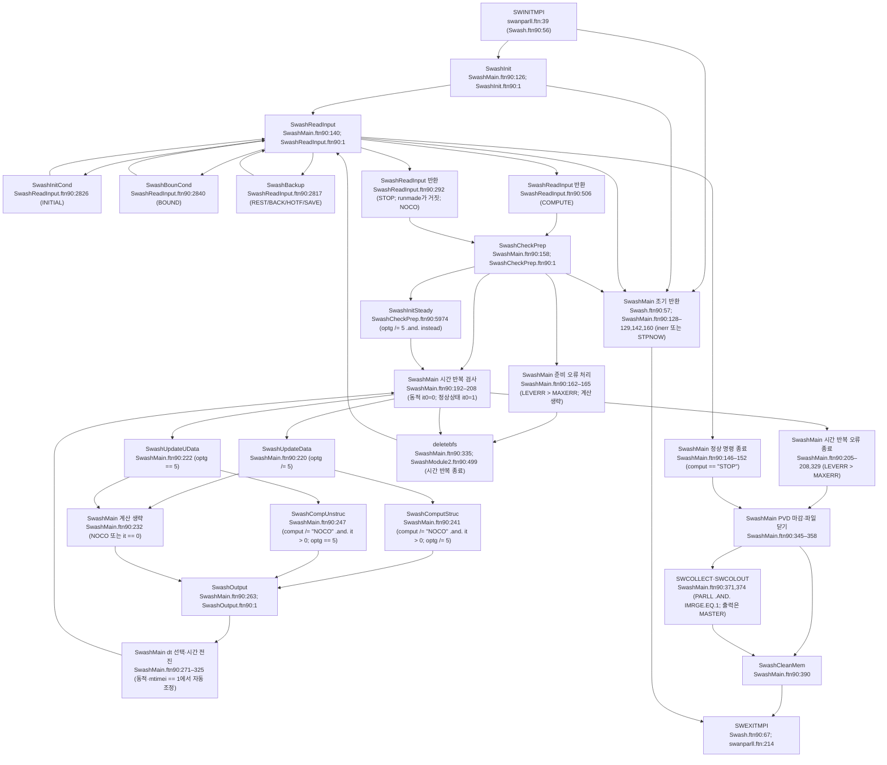
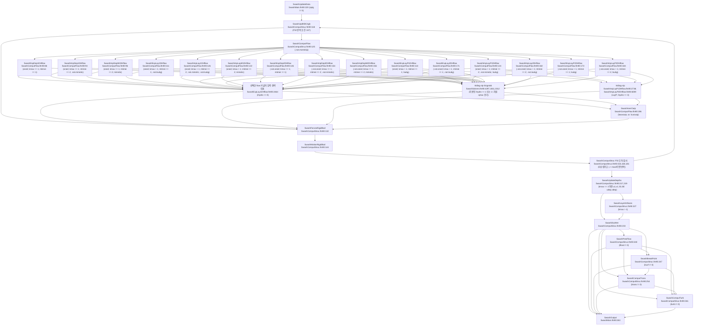
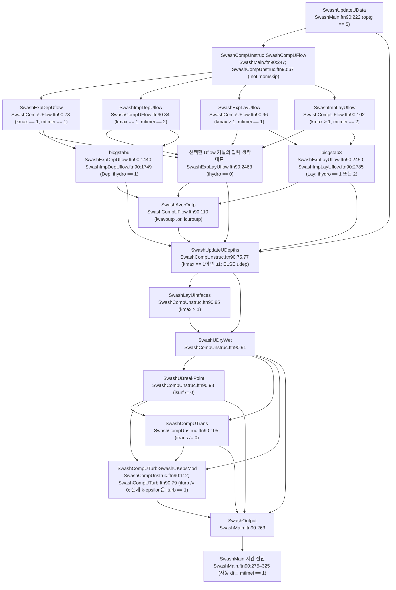

# SWASH time-stepping driver + field update

> Main 시간루프와 한 스텝의 orchestration(BC갱신 → flow solve → depth/mask 갱신 → transport/turbulence), 그리고 이를 떠받치는 전역 data module을 정리. 경로: `raw/source_code/swash/src/`. 비정수압 압력 projection의 내부 메커닉은 [swash-nonhydrostatic-pressure-solver.md] 참조 — 여기서는 호출 흐름(update orchestration)만 다룬다.

## 1. 전체 콜 그래프 (한 스텝)

```
SwashMain (timeloop)                          SwashMain.ftn90:201
 ├─ SwashUpdateData(it)  [구조격자, optg/=5]   :220
 │   or SwashUpdateUData(it) [비구조, optg==5] :222
 └─ if comput/='NOCO' .and. it>0:
     SwashComputStruc    [구조]                :241
       or SwashCompUnstruc [비구조]            :247
```

`SwashMain`의 시간루프 입구에서 `optg` (격자 종류)로 분기: `optg /= 5` → 구조격자 경로(`SwashUpdateData`/`SwashComputStruc`), `optg == 5` → 비구조 삼각망 경로(`SwashUpdateUData`/`SwashCompUnstruc`) — SwashMain.ftn90:219-249. 각 호출 사이마다 `SWSYNC`(노드 동기화)와 `STPNOW()` 체크 — SwashMain.ftn90:213-265.

Purpose verbatim:
- `SwashMain`: *"Main subroutine ... performs initialization ... pre processing ... simulation run ... post processing"* — SwashMain.ftn90:38-46.
- `SwashComputStruc`: *"Performs one full simulation step with structured grid"* — SwashComputStruc.ftn90:40-42.
- `SwashCompUnstruc`: *"Performs one full simulation step with unstructured grid"* — SwashCompUnstruc.ftn90:38-40.

## 2. SwashMain — 시간루프 driver

`repeatloop`(명령 단위) 안에 `timeloop`(시간 적분 단위) 중첩 — SwashMain.ftn90:135,201.

| 단계 | 동작 | file:line |
|---|---|---|
| 초기화 | `SwashInit` | :126 |
| 명령 읽기 | `SwashReadInput(comput)`; `comput=='STOP'`이면 `norm_end` 쓰고 exit | :140-153 |
| 준비 | `SwashCheckPrep` (입력 일관성) | :158 |
| 시작 카운터 | `nstatc==1`(동적)→`it0=0`, 아니면 `it0=1` | :192-196 |
| 루프 종료 | `real(timco) > real(tfinc)`이면 exit | :203 |
| BC/필드 갱신 | `SwashUpdateData(it)` / `SwashUpdateUData(it)` | :219-223 |
| 시뮬레이션 | `it>0 .and. comput/='NOCO'` 일 때만 compute | :232-253 |
| 출력 | `SwashOutput` | :263 |
| 시간 전진 | `timco = timco + dt`; `it=it+1` | :303,320,324 |

`it0=0` 의미: 동적 계산은 `it=0`(=초기 BC 적용·출력만, compute는 `it>0` 조건 :232로 skip)부터 시작.

### 2.1 적응 시간스텝 (명시적 적분만)

`mtimei == 1`(explicit/leap-frog)일 때만 CFL 기반 dt 조정 — SwashMain.ftn90:275:
- `cflmax > pnums(3)` → `dt = 0.5*dt` (halving), `istep=0` 리셋 — :277-284.
- `cflmax < pnums(2)` → 지난 20 스텝 동안 dt가 일정했을 때(`.not. istep < 20`)만 `dt = 2.0*dt` (doubling) — :285-297.

동적 명시적 적분에서 `cflmax > pnums(3)`이면 `dt`를 즉시 반감한다 (`src/SwashMain.ftn90:271–283`). `cflmax < pnums(2)`이면 `if ( .not. istep < 20 ) then`을 만족할 때만 `dt`를 배증한다 (`src/SwashMain.ftn90:285–295`). 이 조건은 같은 `dt`를 20단계 유지한다는 뜻이다 (`src/SwashMain.ftn90:289`). `istep`은 시간 전진 뒤 `istep = istep + 1`로 증가한다 (`src/SwashMain.ftn90:303–325`). 반암시적 적분(`mtimei == 2`)은 이 자동 조정 블록을 거치지 않는다 (`src/SwashMain.ftn90:275–301`). `mtimei`와 `pnums`는 `SwashCommdata3`에 선언되어 있다 (`src/SwashModule1.ftn90:250,629–631,661–666`). [10-15 대조 정정] [10-15 전수 검증 정정]

반감·배증 설명은 swashuse PDF p.99에 있다 (theory-unstructured:ST2-151). [10-15 대조 정정]
이 쪽과 swashtech PDF p.98에는 20단계 조건이 없다 (`src/SwashMain.ftn90:271–291`; theory-unstructured:ST2-151; guide-syntax-build:SG1-105·SG1-926). [10-15 대조 정정]
비구조 기본 시간 방법은 반음해다 (swashuse PDF p.100; theory-unstructured:ST2-151). [10-15 대조 정정]

### 2.2 종료/정리

루프 종료 후: PVD collection 파일 마감 :345-351, `PRINTF` 제외 모든 열린 unit close :355-358, 병렬 시 `IMRGE==1`이면 `SWCOLLECT`/`SWCOLOUT`으로 서브도메인 출력 병합 :364-377, `SwashCleanMem`으로 전 배열 해제 :390.

### 2.3 백업 명령의 진입점

백업 명령은 `SwashReadInput`이 `SwashBackup`으로 보낸다 (`src/SwashReadInput.ftn90:2811–2817`; callflow:RF-012). [10-15 대조 정정]
`SwashOutput`의 시간 단계 출력과 호출 위치가 다르다 (`src/SwashMain.ftn90:263`; callflow:RF-012). [10-15 대조 정정]
비구조 백업·재시작은 정점 수로 셀 수위와 면 속도 배열을 순회한다 (`src/SwashBackup.ftn90:300,310,316`; `src/SwashInitCond.ftn90:392,399,404`; callflow:RF-016, E 강함). [10-15 대조 정정]
일반 삼각망에서는 상태 일부를 빠뜨리거나 배열 범위를 벗어날 수 있다 (`src/SwashInitCompUgrid.ftn90:119,121`; callflow:RF-016). [10-15 대조 정정]

## 3. SwashComputStruc — 구조격자 한 스텝 orchestration

핵심 시퀀스 (SwashComputStruc.ftn90):

| 순서 | 호출 | 조건 | file:line |
|---|---|---|---|
| 1 | `SwashUpdKBCrigb` (강체 운동학 BC) | FSI loop 내 | :118 |
| 2 | **`SwashComputFlow`** (SWE 풀기) | `.not.momskip` | :125 |
| 3 | `SwashForcesRigidBod` | | :132 |
| 4 | `SwashMotionRigidBod` | | :144 |
| 5 | `SwashUpdateDepths` | `kmax==1`→`(u1,v1)`, else `(udep,vdep)` | :216-220 |
| 6 | `SwashLayerIntfaces` | `kmax>1` | :227 |
| 7 | `SwashDryWet` (wetting/drying mask) | | :233 |
| 8 | `SwashPresFlow` (pressurized mask) | `ifloat /= 0` | :240 |
| 9 | `SwashBreakPoint` (breaking mask) | `isurf /= 0` | :247 |
| 10 | `SwashComputTrans` (수송) | `itrans /= 0` | :254 |
| 11 | `SwashComputTurb` (3D 난류) | `iturb /= 0` | :261 |

스텝 1-4는 **FSI(fluid-structure interaction) iteration loop** (label `10`, :107-183): floating body 변위 수렴(`resm > epslin`)까지 flow+force+motion 반복. `maxit = nint(pship(9))`, 허용오차 `epslin` = `pship(8)` 스케일 — :92-100. body가 없으면(`mbod=0`) 루프는 1회로 수렴. 비수렴 경고/통계는 `ifloat==2 .and. INODE==MASTER`에서 출력 — :187-211.

## 4. SwashCompUnstruc — 비구조 한 스텝 orchestration

구조 경로의 단순화판 (FSI/floating body 없음) — SwashCompUnstruc.ftn90:

| 순서 | 호출 | 조건 | file:line |
|---|---|---|---|
| 1 | **`SwashCompUFlow`** | `.not.momskip` | :67 |
| 2 | `SwashUpdateUDepths` | `kmax==1`→`u1`, else `udep` | :74-78 |
| 3 | `SwashLayUIntfaces` | `kmax>1` | :85 |
| 4 | `SwashUDryWet` | | :91 |
| 5 | `SwashUBreakPoint` | `isurf /= 0` | :98 |
| 6 | `SwashCompUTrans` | `itrans /= 0` | :105 |
| 7 | `SwashCompUTurb` | `iturb /= 0` | :112 |

## 5. SwashComputFlow — SWE solver dispatch (구조격자)

Purpose: *"Computes water level and flow velocities by means of solving the shallow water equations"* — SwashComputFlow.ftn90:38-40. Method: *"Time integration is based on a semi-implicit approach that is unconditionally stable ... Alternatively, water level gradients and the depth-integrated continuity equation are treated explicitly using the leap-frog technique"* — :42-47.

분기 매트릭스 — `oned`(1D/2D) × `kmax`(층수) × `mtimei`(시간적분) × `mimetic`/`lsubg`:

| 차원 | 층 | mtimei=1 (explicit) | mtimei=2 (semi-implicit) |
|---|---|---|---|
| 1D | `kmax==1` | `SwashExpDep1DHflow` :86 | `SwashImpDep1DHflow` / mimetic→`SwashImpDepM1DHflow` :94-96 |
| 1D | `kmax>1` | `SwashExpLay1DHflow` / lsubg→`SwashExpLayP1DHflow` :111-113 | `SwashImpLayM/P/1DHflow` :121-126 |
| 2D | `kmax==1` | `SwashExpDep2DHflow` :146 | `SwashImpDep2DHflow` / mimetic→`SwashImpDepM2DHflow` :153-156 |
| 2D | `kmax>1` | `SwashExpLay2DHflow` / lsubg→`SwashExpLayP2DHflow` :170-173 | `SwashImpLay2DHflow` / lsubg→`SwashImpLayP2DHflow` :181-184 |

`Dep`=depth-averaged(`kmax==1`), `Lay`=layer-averaged(`kmax>1`), `M`=mimetic, `P`=subgrid(`lsubg`). 솔버 인자로 `u1,u0,ua,up,qx,qm,q,dq,gmatu,rho,ui,dqgrd` 등 전역 Flowdata 배열을 명시 전달 — :86,94. `q`=비정수압, `dq`=압력 보정, `gmatu`=u-point 압력 gradient matrix, `ui`=projection 중간속도 (§9 참조). 끝에 출력용 setup/wave-height/current가 필요하면 `SwashAverOutp(1)` — :196.

`SwashCompUFlow`(비구조)는 같은 dispatch의 삼각망 판: `kmax==1`/`mtimei` 4-way로 `SwashExpDepUflow`/`SwashImpDepUflow`/`SwashExpLayUflow`/`SwashImpLayUflow` — SwashCompUFlow.ftn90:70-106. 인자에 `uvc`(circumcenter 속도), `qn`(face mass flux), `quf` 등 비구조 전용 배열 — :78,84.

## 6. SwashUpdateData — BC + 입력필드 갱신 (구조격자)

Purpose: *"Updates flow data, boundary conditions and input fields"* — SwashUpdateData.ftn90:52-54. Method가 지원 BC를 verbatim 열거: *"1) water level / 2) velocity or discharge / 3) Riemann invariant or Sommerfeld radiation or weakly reflective / 4) outflow in case of supercritical flow"* — :58-63.

### 6.1 Old-time 저장 (핵심 update 흐름)

`nstatc == 1`(동적)일 때 현재→이전 시간레벨 복사 — :219-285:
- `s0 = s1`, `u0 = u1`, (2D) `v0 = v1` — :224-226. (`relwav`이면 `so = s0` 먼저 — :223.)
- 비정수압(`ihydro/=0`): `kmax==1 .or. ihydro==3` → `w0bot=w1bot;w0top=w1top` (1DH/2DH bottom·top w), else `w0=w1` (+`lsubg`이면 `u0p/v0p/w0p`) — :228-244.
- `hso = hs`, `kmax>1`→`hkso=hks`, `icreep/=0`→`zkso=zks` — :248-250.
- 이동 강체(`ifloat==2`): 변위/속도/가속도/힘/토크/계류 연장 6쌍 `*0 = *1` — :253-274.
- Coriolis AB2 부트스트랩: `it==1` → `epsab2=pcor(2); pcor(2)=-0.5` (1스텝 explicit Euler), `it>1` → `pcor(2)=epsab2` (modified AB2) — :276-283.

이 old-time 저장이 leap-frog/AB2 시간적분의 전제. `s0/u0/v0/w0`는 솔버(§5)에서 이전 레벨로 소비된다.
FSI 재진입은 이 저장을 반복하지 않는다 (`src/SwashUpdateData.ftn90:221–250`; `src/SwashComputStruc.ftn90:107–181`; [callflow §6.2](../../../_staging/recovery/flow/SWASH-callflow.md#62-노트-수정안)). [10-15 대조 정정]

### 6.2 BC 처리 → 입력필드 → 파생량

순서 (SwashUpdateData.ftn90):
1. Fourier/시계열 기반 경계값 계산 (MASTER에서 `SwashReadBndval`) — :289-328.
2. `bndval` scatter, 격자 경계점에 경계값 결정; 단파/속박파/Stokes/transfer는 `it==0`에만 1회 — :343,742-754.
3. closed boundary에서 법선속도 0: `ibl/ibr==1`→`u1=0`, `ibb/ibt==1`→`v1=0` (반복격자 아닐 때) — :2170-2201.
4. 서브도메인 교환 `SWEXCHG(s1/u1/v1)` + 반복격자 `periodic` — :2205-2214.
5. 내부조파 source `SwashIntWavgen` (`iwvgen/=0`, `it==0`) — :2218-2251.
6. 입력필드 갱신 `SwashUpdateFld(...)`: 속도(2,3)/마찰(4)/바람(5,6)/수위(7)/대기압(13) — :2490-2518.
7. `SwashUpdFlowFlds` (필드→flow 변수) — :2524.
8. 마찰 `SwashLogLaw`/`SwashBotFrict`, 바람응력 `SwashWindStress`, 대기압 `SwashUpdPress`, 수평/수직 점성, Reynolds 응력, 포러스/식생/밀도 — :2531-2594.

구조 격자에서 난류 모델이 활성화되면 유동은 이번 단계의 난류 계산보다 앞서 rtur로 만든 수직 점성계수를 사용한다 (`src/SwashUpdateData.ftn90:2571`; `src/SwashVertVisc.ftn90:72`; callflow:RF-010). [10-15 대조 정정]
첫 계산 단계에는 초기 난류 상태를 사용한다 (callflow:RF-010). [10-15 대조 정정]
이후에는 직전 단계에서 계산한 난류 상태를 사용한다 (callflow:RF-010). [10-15 대조 정정]
새 난류 상태는 다음 단계의 점성계수 갱신에 반영된다 (`src/SwashComputStruc.ftn90:254,261`; callflow:RF-010). [10-15 대조 정정]

`SwashUpdateUData`(비구조)는 동일 패턴: BC 지원은 1)-3)만 (outflow 없음, Method :48-52), old-time 저장에 `bcso=bcs`(face 수위), `ltrans>0`→`bcrpo=bcrp` 추가 — :214-251, 파생량은 `SwashULogLaw`/`SwashUBotFrict`/`SwashUWindStress`/`SwashUpdUPress`/`SwashUHorzVisc` 등 U-접두 변형 — :1331-1383.

## 7. 입력필드 매핑·시간보간 — SwashUpdateFld

Purpose: *"Updates user-defined input fields, maps onto computational grid and interpolates in time"* — SwashUpdateFld.ftn90:38-40.

3-time-level 버퍼 `arrfx(:,1/2/3)`: `1`=직전, `2`=현재(보간결과), `3`=마지막 읽은 값. 흐름 (:104-262):
1. shift: `arrfx(:,1) = arrfx(:,2)` — :106.
2. `timco > ifltim(igr1)`인 동안 새 필드 read (`INAR2D`, MASTER) + `SWBROADC` → 계산격자 매핑(`SVALQI` 보간 또는 직접 인덱싱) → `arrfx(:,3)`; 벡터면 회전 `uu*cosfc+vv*sinfc` — :117-226.
3. **시간선형보간**: `wf3 = (timco-timlr)/(ifltim-timlr)`, `wf1=1-wf3`, `arrfx(i,2)=wf1*arrfx(i,1)+wf3*arrfx(i,3)` — :230-239.
4. 벡터는 크기 손실 방지: 보간 후 방향만 쓰고 크기는 `fac=wf1*|f1|+wf3*|f3|`로 재정규화 — :246-253.

`outval`(격자밖 값)은 필드종류로 분기: 속도/바람(2,5)=0, 마찰/수위/대기압(4,7,13)=`NEAREST` — :109-113. 구조/비구조 매핑 분기 `optg/=5` vs nverts 루프 — :167-224.

## 8. flow 변수 초기화/갱신 — SwashUpdFlowFlds / SwashUpdUFlowFlds

Purpose(구조): *"Initializes / updates flow variables based on space varying input fields"* — SwashUpdFlowFlds.ftn90:38-40.

- 수위: `initsf .or. ifldyn(7)==1`이면 wl-point에 `wlevf` 보간 (1D 2점평균, 2D 4점평균) → `s1`; `SWEXCHG`/`periodic`; `initsf=.false.` — :75-138.
- u-속도: `inituf .or. ifldyn(2)==1`이면 `uxf`→`u1(:,1)`; 비스태거드면 곡선격자 변환 `(ycgrid diff)/guu` — :141-204. `kmax>1`이면 연직 균일가정으로 `u1(:,k)=udep` 확장 — :215-227.
- v-속도: 2D·`initvf .or. ifldyn(3)==1` 유사 처리 — :233-305.

비구조판 `SwashUpdUFlowFlds`(:81-123): 셀 3정점 평균으로 `s1(icell)`, face에 법선투영 `u1(iface,1)=nx*ux+ny*uy` (vertex 속도 평균) — :93,116.

## 9. bottom depth 결정 — SwashFlowDP / SwashFlowUDP

Purpose: *"Determines bottom values in water level and velocity points"* — SwashFlowDP.ftn90:38-40.

`dpsopt`로 wl-point bottom `dps` 산정 (1=min, 2=mean, 3=max, 4=local) — SwashFlowDP.ftn90:98-106(1D), :151-159(2D). dry 가드: `s1 < epsdry-dps`이면 `s1 = 0.99*epsdry-dps` — :108-112. velocity-point는 **tiled** 최소값: `dpu(nm)=min(dps(nm),dps(nmu))`, `dpv` 동일 — :240,265,284. virtual point 미러링·`SWEXCHG`·`periodic` 포함 — :123-225.

비구조판 `SwashFlowUDP`(:81-170): `dpsopt==1`은 face=min(vertex), centroid=min(face) tiled; `dpsopt==2`는 centroid=3정점평균, face=min(인접셀); `MAX/SHIFT`는 미지원 `msgerr(2,...)` — :168.

## 10. pressurized-flow mask & 대기압 — SwashPresFlow / SwashUpdPress / SwashUpdUPress

`SwashPresFlow` (Purpose: *"Updates mask arrays for pressurized flow in water level and velocity points"* — :38-40): `s1 < -flos`(floating object draft 초과)이면 `presp=0`(free surface) else `1`(pressurized) — :80-88. u/v-point는 양쪽 wl-point가 모두 0일 때만 0: `presp(nm)==0 .and. presp(nmu)==0` → `presu=0` — :106-114. `SWEXCHGI`/`periodici`로 정수 mask 교환 — :94,156. `SwashComputStruc`에서 `ifloat/=0`일 때만 호출 — SwashComputStruc.ftn90:240.

`SwashUpdPress` (Purpose: *"Initializes / updates atmospheric pressure ... Also correct water level on open boundaries"* — :38-41): `ifldyn(13)==1`이면 `presf`→`patm` 보간(1D 2점/2D 4점) + 경계 미러/periodic — :84-217. 그리고 `prmean>0`이면 수위 보정 경계조건(`ibl/ibr/ibb/ibt==2`인 water-level opening): `s1 += (prmean-patm)/(rhow*grav)` (inverse barometer) — :221-258. 비구조판 `SwashUpdUPress`는 셀 3정점 평균 `patm`, 경계 face btype==2에서 `bcs += (prmean-patm)/(rhow*grav)` — SwashUpdUPress.ftn90:81-112.

## 11. 전역 data module

### 11.1 SwashFlowdata — flow 상태 중앙 저장소

Purpose: *"Module containing data for flow computation"* — SwashFlowdata.ftn90:38-40. 거의 모든 compute/update 서브루틴이 `use SwashFlowdata`로 공유.

| 그룹 | 대표 변수 | file:line |
|---|---|---|
| 격자 인덱스 한계 | `mf/mfu/ml/mlu`, `nf/nfu/nl/nlu` (virtual/internal 경계) | :58-77 |
| mask | `presp/presu/presv`(pressurized), `wets/wetu/wetv`(wet-dry), `brks`(breaking) | :79-125 |
| 수위/속도 (2-level) | `s0/s1`, `u0/u1`, `v0/v1`, `w0/w1` | :307-352 |
| depth | `dps`(wl), `dpu/dpv`(u/v tiled), `hs/hso`(water depth) | :198-200,243-248 |
| 비정수압 | `q`(압력), `dq`(보정), `qv`, `dqgrd/dqgrdu/dqgrdv` | :201-205,273-275 |
| gradient/divergence matrix | `gmatu/gmatv/gmatw`, `dmat/dmatu`, `amatp`(Poisson), `rhsp` | :193-222,137,288 |
| projection 중간속도 | `ui/vi` | :331,341 |
| BC 타입 | `ibb/ibl/ibr/ibt` (1=closed,2=wl,3=vel,5=disch,6=Riemann,7=weakly refl,8=Sommerfeld,10=outflow) | :82-98 |
| 강체/floating | `flos/flou/flov`(draft), `lfbs`, `skc` | :99,211-213,309 |
| 층 (3D) | `hks/hkso`, `zks/zkso`(interface), `wom`(relative w) | :226-369 |

`s0/s1`·`u0/u1` 등 2-time-level 명명이 §6.1 old-time 저장의 대상.

### 11.2 SwashSolvedata — 선형솔버 작업공간

Purpose: *"Module containing data for the linear solvers"* — SwashSolvedata.ftn90:38-40. `iamout`(출력량 0-3 :58), `icond`(BiCGSTAB 전처리 선택 :63), CSR 포맷 배열 `ia/ja/ax2`(BiCGSTAB) vs `ias/jas/axs`(PCG) :68-82, 전처리 `prec*`/`cmat`(SIP·ILU·RILU) :84-95, nested Newton 변수 `amata/ba/da/p0/p1/q0/q1/sol*` :79-110, CG/BiCGSTAB 작업벡터 `r/s/z/p/t/u/v/w` :89-119. `iamout`은 `SwashComputStruc`이 FSI 수렴 출력 제어에 사용 — SwashComputStruc.ftn90:50,170.

### 11.3 SwashModule1 (SwashCommdata1) — 단위·출력 메타

`SwashCommdata1`은 *"data of units and output"* — SwashModule1.ftn90:48-50. 단위 문자열 `uc/ud/...uv` :71-82, 출력변수 메타 `nmovar=120`개 (`ovsvty` 타입, `ovexcv` 예외값, `ovkeyw/ovlnam/ovsnam/ovunit` 이름) :64-118, 출력 frame 기하 `alcq/xpq/...` :94-113. `SwashCommdata2`·`SwashCommdata3`·`SwashCommdata4`·`SwashTimecomm`도 같은 파일에 선언되어 있다 (`src/SwashModule1.ftn90:125,250,769,860`). [10-15 전수 검증 보완]

### 11.4 SwashModule2 — 출력/BC/일반배열 모듈 3종

한 파일에 3 모듈 (SwashModule2.ftn90:1-7):
- `outp_data` (*"Contains data needed during generation of output"* :48-50): `max_outp_req=250`, `mopa=31` :64-66, PVD/VTK 속성(v41.95) :46.
- `m_bndspec` (BC 명세, :294): linked-list delete 인터페이스 `deletebfl/bfs/bgp` :474-476.
- `m_genarr` (*"Creates several allocatable arrays for Swash computation"* :595-597): **`kgrpnt`**(active 격자점 주소 인덱스 테이블, 모든 구조격자 루프의 핵심) :620, 입력필드 3-level 버퍼 `uxf/uyf/wlevf/presf/fricf`(§7 매핑 타깃) :680-684, 곡선격자 메트릭 `guu/gvv/gsqs/xcgrid/ycgrid` :650-693, 층 두께 `hlay` :657, 경계 prescribe 플래그 `slimp/srimp/...` :695-699.

## 12. 발견·주의

- **dt 적응은 explicit 전용**: `mtimei==1`에서만 CFL 더블/헐빙 — SwashMain.ftn90:275. 암시적은 dt 고정. doubling은 20-step 안정 후에만(`.not. istep<20`) — :287.
- **`it=0` 특수 스텝**: 동적계산은 `it0=0`(SwashMain.ftn90:193)에서 시작하나 compute는 `it>0`에서만(:232) — `it=0`은 초기 BC/단파·Stokes 1회 셋업 + 출력 전용.
- **old-time 저장은 update 안에**: leap-frog/AB2의 `s0/u0/...`·Coriolis `pcor(2)` 부트스트랩이 `SwashUpdateData`(:219-285)에서 일어남 — compute 직전 단계임에 유의.
- **구조 vs 비구조 대칭**: 거의 모든 driver/update 서브루틴이 `Swash*`(구조)와 `Swash*U*`/`SwashU*`(비구조) 쌍으로 존재 (UpdateData↔UpdateUData, ComputFlow↔CompUFlow, FlowDP↔FlowUDP, UpdPress↔UpdUPress). 비구조는 outflow BC·floating body·icreep(creep) 미지원이 차이.
- **압력 projection 자체**는 본 노트 범위 밖 — `SwashComputFlow`가 호출하는 `SwashImp*flow` 내부에서 `q/dq/gmatu/ui` 사용. 메커닉은 [swash-nonhydrostatic-pressure-solver.md] 참조. 여기서는 호출·인자 전달만 인용 — SwashComputFlow.ftn90:94,154.

## 계산 흐름도 (10-15 대조)

출처: [callflow §4 흐름도](../../../_staging/recovery/flow/SWASH-callflow.md#4-흐름도).

### 시작부터 종료까지



### 구조 격자 한 시간 단계



### 비구조 격자 한 시간 단계




## 문서와 코드 차이 (10-15 대조)

출처: [callflow](../../../_staging/recovery/flow/SWASH-callflow.md), [theory-unstructured](../../../_staging/recovery/compare/swash-theory-unstructured-vs-code.md), [inputs-setup](../../../_staging/recovery/compare/swash-inputs-setup-vs-code.md), [inputs-physics-numerics](../../../_staging/recovery/compare/swash-inputs-physics-numerics-vs-code.md), [outputs](../../../_staging/recovery/compare/swash-outputs-vs-code.md), [guide-syntax-build](../../../_staging/recovery/compare/swash-guide-syntax-build-vs-code.md)의 최종 결론과 원문 인용.

문서 판은 SWASH 12.01 매뉴얼 swashuse·swashtech이다. 두 매뉴얼의 마지막 변경은 공개 저장소의 `7949227 2026-05-06 "release v12.01"`이다. 코드의 판 문자열은 `VERNUM = 12.01`이다 (`src/SwashInit.ftn90:79`). 코드 기준은 공개 저장소 main의 `a486d5f 2026-05-26`이다. 코드에는 12.01 배포 뒤의 `608ffd7`·`9554c98` 변경이 포함되어 있다. 이 판 정보는 [git 이력 판정 §1–2](../../../_staging/recovery/compare/SWASH-git-verify-AD.md#1-요약)에 근거한다. [10-15 전수 검증 보완]

| 행 ID | 항목 | 문서 원문 | 코드 원문 | 결론 | 결론 문장 |
|---|---|---|---|---|---|
| callflow:RF-002 | 기술 문서 9장의 계산 순서 | `swashtech PDF p.111` `This chapter is under preparation.`. 같은 문서 swashtech PDF p.98은 `We first solve the momentum equation.` 뒤 연속방정식 풀이를 설명한다. `swashuse PDF p.123–124`는 COMPUTE·INITIAL·STOP의 명령 순서를 설명한다. | `src/SwashComputStruc.ftn90:254` `if ( itrans /= 0 ) call SwashComputTrans`; `src/SwashComputStruc.ftn90:261` `if ( iturb /= 0 ) call SwashComputTurb`. | C 문서 누락 | 누락 판정은 기술 문서 9장의 전체 계산 순서에 한정한다. 기술 문서 6장의 비점성 천수방정식 풀이와 사용자 설명서의 명령 순서 설명은 존재한다. 수송·난류를 포함한 실제 호출 순서는 드라이버 코드에 근거한다. [10-15 결론 검증 보완] |
| callflow:RF-010 | 드라이버 노트의 점성계수·난류 상태 시차 | 대조 전 드라이버 노트 §6.2는 `수평/수직 점성` 호출을 적었다. 해당 호출 설명은 현재 `models/SWASH/source-analysis/swash-timestepping-update-driver.md:157`에 있다. | `src/SwashReadInput.ftn90:1253–1273`의 VISC 명령은 `iturb`를 1·2·3으로 설정한다. `src/SwashUpdateData.ftn90:2571` `if ( iturb /= 0 ) call SwashVertVisc`; `src/SwashVertVisc.ftn90:72` `vnu3d(:,:) = cmu * rtur(:,:,1) * rtur(:,:,1) / ( rtur(:,:,2) + eps )`. 이후 `src/SwashComputStruc.ftn90:125`의 유동 계산과 `src/SwashComputStruc.ftn90:261` `if ( iturb /= 0 ) call SwashComputTurb`가 이어진다. | C 문서 누락 | 구조 격자에서 난류 모델이 활성화되면 유동은 이번 단계의 난류 계산보다 앞서 rtur로 만든 수직 점성계수를 사용한다. 첫 계산 단계에는 초기 난류 상태를 사용한다. 이후에는 직전 단계에서 계산한 난류 상태를 사용한다. 새 난류 상태는 다음 단계의 점성계수 갱신에 반영된다. 누락 판정은 대조 전 드라이버 노트 §6.2의 시차 설명에 한정한다. [10-15 결론 검증 정정] [10-15 결론 검증 보완] [10-15 전수 검증 정정] |
| callflow:RF-012 | 드라이버 노트의 백업 진입점 | 대조 전 드라이버 노트의 `SwashOutput` 출력 행은 현재 `models/SWASH/source-analysis/swash-timestepping-update-driver.md:52`에 있다. | `src/SwashReadInput.ftn90:2811` `if ( KEYWIS('REST') .or. KEYWIS ('BACK') .or. KEYWIS('HOTF') .or. KEYWIS('SAVE') ) then`; `src/SwashReadInput.ftn90:2817` `call SwashBackup`. 시간 단계 출력은 `src/SwashMain.ftn90:263` `call SwashOutput`이다. `7949227` 뒤의 `608ffd7`·`9554c98`은 이 호출 구간을 바꾸지 않았다. | C 문서 누락 | 백업은 명령 읽기 경로에서 호출한다. 대조 전 드라이버 노트의 시간 단계 출력 행에는 별도 백업 진입점이 빠져 있었다. 백업을 SwashOutput의 하위 호출로 묶지 않는다. RF-013의 명령 문서 누락과 RF-016의 비구조 결함 후보를 함께 참조한다. [10-15 결론 검증 보완] [10-15 git 이력 판정] [10-15 전수 검증 정정] |
| guide-syntax-build:SG1-101 | swashuse PDF p.135: The time integration is of explicit type | swashuse PDF p.135: `The time integration is of explicit type` | `src/SwashReadInput.ftn90:1864–1865` `if ( KEYWIS('IMPL') ) then` / `mtimei = 2`; `src/SwashCheckPrep.ftn90:607–612` `if ( mtimei < 0 ) then` / `if ( optg /= 5 ) then` / `mtimei = 1` / `if ( mimetic ) mtimei = 2` / `else` / `mtimei = 2` `8756667:src/SwashReadInput.ftn90:1375–1383`에도 IMPL 분기가 있다. swashuse PDF p.99–100은 명시·반암시 선택과 격자별 기본값을 설명한다. | C 문서 누락 | 시간적분은 명시적 또는 반암시적으로 선택한다. 반암시 선택은 최초 공개 코드부터 존재하므로 판 차이 A가 아니다. swashuse PDF p.99–100은 두 방법을 설명한다. swashuse PDF p.135의 문장은 명시적 적분을 선택한 경우라는 범위를 생략하므로 B에서 해당 쪽의 조건 생략 C로 정정한다. [10-15 결론 검증 정정] [10-15 결론 검증 보완] [10-15 git 이력 판정] |
| guide-syntax-build:SG1-105 | swashuse PDF p.136: the time step is doubled when this number is smaller than another constant Crmin | swashuse PDF p.136: `the time step is doubled when this number is smaller than another constant Crmin` | `src/SwashMain.ftn90:285–291` `else if ( cflmax < pnums(2) ) then` / `!` / `if ( .not. istep < 20 ) then` / `!` / `! only increase actual time step if the time step has been constant for the last 20 integration steps` / `!` / `dt = 2.0*dt` | C 문서 누락 | 시간간격 배증은 동적 명시적 적분 경로에서 `cflmax < pnums(2)`와 `if ( .not. istep < 20 ) then`을 함께 만족할 때 실행된다. swashuse PDF p.136과 swashuse PDF p.99의 설명은 일정 시간간격으로 20단계를 지난다는 조건을 생략한다. 두 매뉴얼 전체 판독 기록과 README.md·misc/swash.edt에서도 이 대기 조건의 설명은 검색되지 않는다. 같은 시간간격 제어를 적은 SG1-913과 판정이 같다. [10-15 결론 검증 보완] |
| guide-syntax-build:SG1-901 | 20단계 후 시간간격 증가 | swashuse PDF p.99의 자동 시간간격 설명에는 배증 전 20단계 유지 조건이 없다. | `src/SwashMain.ftn90:277–303` `if ( cflmax > pnums(3) ) then` / `!` / `dt = 0.5*dt` / `write (msgstr,'(a,f12.5,a)') 'time step is halved! New time step: ',dt, ' sec'` / `call msgerr ( 1, trim(msgstr) )` / `!` / `istep = 0` / `!` / `else if ( cflmax < pnums(2) ) then` / `!` / `if ( .not. istep < 20 ) then` / `!` / `! only increase actual time step if the time step has been constant for the last 20 integration steps` / `!` / `dt = 2.0*dt` / `write (msgstr,'(a,f12.5,a)') 'time step is doubled! New time step: ',dt,' sec'` / `call msgerr ( 1, trim(msgstr) )` / `!` / `istep = 0` / `!` / `endif` / `!` / `endif` / `!` / `endif` / `!` / `timco = timco + dt` `src/SwashMain.ftn90:271–275`의 비정상·명시적 적분 조건. | C 문서 누락 | `nstatc == 1`과 `mtimei == 1`에서 Courant 상한을 넘으면 시간간격을 반으로 줄인다. 하한 미만이면 `if ( .not. istep < 20 ) then`에서만 두 배로 늘린다. 시간간격 변경 때 istep를 0으로 되돌린다. 변경은 `timco = timco + dt`보다 앞이다. C는 20단계 유지 조건의 누락이며 SG1-105·913과 같다. [10-15 결론 검증 보완] |
| inputs-physics-numerics:SI2-255 | 수위 하한·가상점·별칭 | swashuse PDF p.97–98에는 수위 하한식과 DPS 별칭이 없다. | `src/SwashFlowDP.ftn90:108–110`: `if ( s1(nm) < epsdry - dps(nm) ) then` / `!` / `s1(nm) = 0.99*epsdry - dps(nm)`; 123–124: `dps(nmf ) = dps(nmfu)` / `dps(nmlu) = dps(nml )`; `src/SwashReadInput.ftn90:2144`: `if ( KEYWIS ('DPS') .or. KEYWIS ('BOTC') ) then`; swashuse PDF p.161 부록은 `DPSopt MIN\|MEAN\|MAX\|SHIFt`를 표시한다. | C | 바닥 초기화가 수위도 수정한다. 가상 수위점의 바닥 값은 인접 내부 값으로 복사한다. C는 swashuse PDF p.97–98 본문의 이 초기화 절차 누락으로 한정한다. DPS 계열 명령 이름은 swashuse PDF p.161 부록에 있으므로 별칭 전체가 문서에 없다고 쓰지 않는다. [10-15 결론 검증 정정] |
| inputs-physics-numerics:SI2-285 | 물리 계산과 마스크 갱신 순서 | swashuse PDF p.73–100에는 한 적분 단계의 호출 순서가 없다. | `src/SwashComputStruc.ftn90:233`: `call SwashDryWet`; `src/SwashComputStruc.ftn90:247` `if ( isurf /= 0 ) call SwashBreakPoint`; `src/SwashComputStruc.ftn90:254` `if ( itrans /= 0 ) call SwashComputTrans`; `src/SwashComputStruc.ftn90:261` `if ( iturb /= 0 ) call SwashComputTurb`; `src/SwashDryWet.ftn90:85`: `if ( hu(nm) > epshu ) then`; `src/SwashUDryWet.ftn90:84`: `if ( hu(iface) > epshu ) then` | C | 실제 습윤·건조 마스크를 갱신한 뒤 쇄파용 압력 마스크를 갱신한다. 이후 수송과 난류를 계산한다. `!TIMG`의 시간 측정 호출을 지워도 계산 호출은 유지된다. |
| inputs-physics-numerics:SI2-286 | NONE·전처리 갱신 주기 | swashuse PDF p.89–93에는 전처리 갱신 플래그의 산정식이 없다. | `src/SwashUpdateData.ftn90:207–214`: `ifpco = nint(pnums(28))` / `!` / `if ( ifpco < 0 ) then` / `lprecon = .false.` / `else if ( mod(it-1,ifpco) == 0 ) then` / `lprecon = .true.` / `else` / `lprecon = .false.`; `src/SwashCheckPrep.ftn90:5495`: `if ( icond == 3 .and. pnums(28) < 0. ) prec(:,:,1) = 1.`; swashuse PDF p.160 부록은 `[precfq]`와 `NONE`을 표시한다. 의미·활성 조건은 SI2-207과 함께 판정한다. | C | 음수 빈도는 전처리 갱신을 끈다. 그 밖의 주기는 `mod(it-1,ifpco)`로 결정한다. NONE은 단위 대각 값을 준비한다. C는 swashuse PDF p.89–93 본문의 갱신 조건 설명 누락이다. 이 조건에는 주기 0을 배제하는 검사가 없다. [10-15 결론 검증 보완] |
| inputs-setup:SI1-064 | 첫 입력 시간 전에는 0 | swashuse PDF p.22 “SWASH assumes zero values at times before the earliest begin time of the input parameters” | `src/SwashCheckPrep.ftn90:2024` `if ( istat == 0 ) fricf = 0.`; `src/SwashCheckPrep.ftn90:2634` `fricf(indx,2) = cf`; `src/SwashUpdateFld.ftn90:106` `arrfx(:,1) = arrfx(:,2)`; `src/SwashUpdateFld.ftn90:115–117` `timlr = timco - dt`<br>`100 if ( .not. timco > ifltim(igr1) ) goto 110`; `src/SwashUpdateFld.ftn90:230–232` `110 dval = ( timco - timlr ) / ( ifltim(igr1) - timlr )`<br>`wf3 = real(dval)`<br>`wf1 = 1. - wf3`; `src/SwashUpdateFld.ftn90:237` `uu = wf1 * arrfx(i,1) + wf3 * arrfx(i,3)` | B | 해석: 준비 코드는 첫 마찰장을 현재 값에 이미 넣는다. 아직 다음 장을 읽지 않은 상태에서 세 번째 열은 0이다. 첫 `SwashUpdateFld` 호출에서 `timco < TBEGINP`이면 결과는 첫 장에 `1-dt/(TBEGINP-timco+dt)`를 곱한 값이다. 일반적으로 0이 아니다. 이 해석은 [inputs-setup 보고서 §5](../../../_staging/recovery/compare/swash-inputs-setup-vs-code.md#5-차이-결론)의 반대 근거 검색과 첫 호출의 정적 추적에 근거한다. 단일 문서 불일치만으로 E를 부여하지 않는다. git 이력: `8756667:src/SwashUpdateFld.ftn90:106` `arrfx(:,1) = arrfx(:,2)`. 초기 입력 전의 시간 보간식은 최초 공개판부터 같다. 문서의 0 대입이 이후 보간식으로 바뀐 이력은 없다. 첫 입력 시각 전의 마찰장은 준비 단계의 첫 값과 보간식으로 정해진다. 일반적으로 0이 아니다. ([AD 판정표](../../../_staging/recovery/compare/SWASH-git-verify-AD.md)) [10-15 결론 검증 보완] [10-15 git 이력 판정] [10-15 전수 검증 정정] |
| inputs-setup:SI1-065 | 입력 종료 뒤 마지막 값 유지 | swashuse PDF p.22 “constant values (the last values) at times after the end time of each input parameter” | `src/SwashUpdateFld.ftn90:119–125` `timlr = ifltim(igr1)`<br>`ifltim(igr1) = ifltim(igr1) + iflint(igr1)`<br>`if ( ifltim(igr1) > iflend(igr1) ) then`<br>`ifltim(igr1) = 1.e10`<br>`if ( igr2 > 0 ) ifltim(igr2) = ifltim(igr1)`<br>`goto 110`<br>`endif`; `src/SwashUpdateFld.ftn90:237` `uu = wf1 * arrfx(i,1) + wf3 * arrfx(i,3)` | B | 해석: 종료 뒤 분모를 `1.e10-timlr`로 바꾸어 이전 계산값과 마지막 입력값 사이를 계속 보간한다. 이전 계산값이 마지막 입력값과 다르면 마지막 값을 즉시 유지하지 않는다. 마지막 입력 시간과 계산 시간이 정확히 일치하는 경우에는 두 값이 같아 차이가 사라질 수 있다. git 이력: `8756667:src/SwashUpdateFld.ftn90:121` `if ( ifltim(igr1) > iflend(igr1) ) then`. 입력 종료 뒤 시각을 1.e10으로 바꾸는 보간 경로는 최초 공개판부터 있다. 마지막 장을 즉시 고정하던 코드의 제거는 없다. 입력 종료 뒤에도 이전 계산값과 마지막 입력값 사이의 보간이 남는다. ([AD 판정표](../../../_staging/recovery/compare/SWASH-git-verify-AD.md)) [10-15 결론 검증 보완] [10-15 git 이력 판정] |
| inputs-setup:SI1-527 | 현재·바람 시간 보간의 크기 보정 | swashuse PDF p.20 “tri−linear interpolation”은 이 보정을 적지 않는다. | `src/SwashUpdateFld.ftn90:242` `vtot = sqrt (uu*uu + vv*vv)`; `src/SwashUpdateFld.ftn90:248–253` `fac1 = sqrt (arrfx(i,1)**2 + arrfy(i,1)**2)`<br>`fac3 = sqrt (arrfx(i,3)**2 + arrfy(i,3)**2)`<br>`fac  = wf1 * fac1 + wf3 * fac3`<br>`!`<br>`arrfx(i,2) = fac * uu / vtot`<br>`arrfy(i,2) = fac * vv / vtot`<br>`src/SwashUpdateFld.ftn90:246` `if ( vtot > 0. ) then`; `src/SwashUpdateFld.ftn90:255–258`의 else는 `arrfx(i,2) = uu`와 `arrfy(i,2) = vv`를 대입한다. | C | 벡터는 먼저 성분을 선형 보간한다. `vtot > 0.`이면 두 입력 벡터 크기의 선형 보간값으로 크기를 다시 맞춘다. `vtot`가 양수가 아니면 보간한 성분을 그대로 저장한다. 스칼라 보간과 이 조건부 크기 보정을 구분한다. [10-15 결론 검증 정정] |
| inputs-setup:SI1-567 | 연성 수렴의 절대·상대 혼합 | swashuse PDF p.72는 사용자 tol보다 운동 변화가 작아지면 수렴한다고 적는다. | `src/SwashComputStruc.ftn90:92–96` `xfotmx    = maxval(abs(xfot0))`<br>`xformx    = maxval(abs(xfor0))`<br>`reps      = pship(8)`<br>`epslin(1) = max(reps,reps*xfotmx)`<br>`epslin(2) = max(reps,reps*xformx)` | C | 이전 시간 병진·회전 변위가 기준을 확대할 수 있다. 실제 기준은 각각 `max(tol,tol×이전 최대 변위)`이다. 회전은 라디안 기준이다. |
| inputs-setup:SI1-568 | relax 범위·비연성 반복 1회·미수렴 출력 | swashuse PDF p.72는 최대 반복 횟수의 기본값을 50회로 적는다. 같은 쪽은 완화계수 0.3을 권고한다. swashuse PDF p.73은 `0 ≤ [relax] ≤ 1`을 적는다. 이 쪽의 완화계수 기본값은 0.3이다. | `src/SwashCheckPrep.ftn90:1436–1443` `if ( pship(10) < 0. .or. pship(10) > 1. ) then`<br>`call msgerr (1, 'incorrect under-relaxation value for FSI coupling')`<br>`pship(10) = 0.3`<br>`endif`<br>`else`<br>`! no iteration process required!`<br>`pship(8) = 0.`<br>`pship(9) = 1.`; `src/SwashComputStruc.ftn90:189–191` `if ( resm(1) > epslin(1) .and. iamout > 0 ) then`<br>`!`<br>`write (PRINTF, '(a)') ' ++ FSI coupling: no convergence in linear displacement'`; `src/SwashComputStruc.ftn90:187` `if ( ifloat == 2 .and. INODE == MASTER ) then` | C | 이동 강체에서 relax 밖값을 0.3으로 고친다. 이동 강체가 아니면 `tol=0`·`maxiter=1`로 바꾼다. 이동 강체의 미수렴 알림은 MASTER 노드에서 `iamout>0`일 때 일반 PRINT에 쓴다. 미수렴 출력 경로는 MSGERR로 오류 수준을 올리지 않는다. relax의 허용 범위 자체는 swashuse PDF p.73에 있다. C는 범위 밖 값의 0.3 보정, 비연성 반복 1회 및 미수렴의 PRINT 처리에 한정한다. [10-15 결론 검증 정정] [10-15 전수 검증 정정] |
| outputs:SO1-276 | COMPUTE 없는 STOP | swashuse PDF p.124의 STOP 설명에는 COMPUTE가 없을 때의 NOCO 반환 경로가 없다. | `src/SwashReadInput.ftn90:290–292` `else` / `write (PRINTF,*)' ** No computation requested **'` / `comput = 'NOCO'`; `src/SwashMain.ftn90:146` `if ( comput == 'STOP' ) then`; `src/SwashMain.ftn90:232` `if ( comput /= 'NOCO' .and. it > 0 ) then`; 7949227(2026-05-06, release v12.01) 뒤의 608ffd7·9554c98 diff는 이 행의 판정 대상 조건을 변경하지 않았다. [AD §3의 12.01 뒤 변경과 무관한 SO1 목록](../../../_staging/recovery/compare/SWASH-git-verify-AD.md). | C 문서 누락 | COMPUTE가 없으면 STOP은 NOCO로 반환한다. Main의 즉시 종료 조건에 들어가지 않는다. 계산 커널은 건너뛰지만 준비·출력 경로는 남는다. [10-15 결론 검증 보완] [10-15 git 이력 판정] [10-15 전수 검증 정정] |
| outputs:SO1-277 | PRINT 설정·PVD 종료 | 문서에 없음. | `src/SwashMain.ftn90:183` `if ( ITEST > 0 ) call SwashPrintSettings`; `src/SwashMain.ftn90:348–349` `write (nds,'(a)') trim(pvdlin3)` / `write (nds,'(a)') trim(pvdlin4)`; `src/SwashPrintGridInfo.ftn90:158–160` `write(PRINTF,200) mingsiz` / `write(PRINTF,300) maxgsiz` / `write(PRINTF,400) avegsiz`; `src/SwashMain.ftn90:347` `if ( nds > 0 ) then`; `src/SwashModule2.ftn90:125–126`의 `pvdlin3 = '  </Collection>'`, `pvdlin4 = '</VTKFile>'` | C 문서 누락 | 입력 오류 수준이 허용 범위에 있고 ITEST가 양수이면 계산 설정을 출력한다. 비정형 격자 정보는 SwashPrintGridInfo가 쓴다. 반복 계산 루프를 벗어난 뒤 열린 PVD 장치(`nds > 0`)에 닫는 태그를 쓴다. [10-15 결론 검증 보완] [10-15 전수 검증 정정] |
| theory-unstructured:ST2-135 | 코리올리와 운동에너지 | swashtech PDF p.95: `\mathbf u_c\cdot\mathbf c_c=0`; `conserves the depth-integrated kinetic energy both locally and globally.`; swashuse PDF p.83의 CORIOLIS 설명; misc/swash.edt:186 `!   CORIolis  [fpar] [epsab2]` | `src/SwashExpDepUflow.ftn90:882` `corf(iface) = -(0.5+epsab2) * cfu(iface,1)`; `src/SwashExpDepUflow.ftn90:957` `corf(iface) = corf(iface) + (1.5+epsab2) * cfu(iface,1)`; `src/SwashReadInput.ftn90:1382–1385`의 `if ( KEYWIS ('CORI') ) then`, `coriolis = .true.`, `call INREAL ('EPSAB2', pcor(2), 'STA', 0.1)`; `src/SwashExpDepUflow.ftn90:865` `if ( coriolis ) then`; `src/SwashExpDepUflow.ftn90:867` `epsab2 = pcor(2)` | C 문서 누락 | 해석: swashtech PDF p.95는 반이산 Coriolis 힘의 무일성을 설명한다. `CORIOLIS`로 활성화한 명시적 유동 경로는 과거 힘과 현재 힘을 modified AB2 가중치로 조합한다. `epsab2` 인수 자체는 swash.edt에 있다. C는 swashtech PDF p.95와 swashuse PDF p.83에 없는 시간 가중식 및 반이산 에너지 증명과의 관계로 한정한다. 공간 힘의 무일성이 이 시간 갱신의 정확한 에너지 보존을 보장하지는 않는다. [10-15 결론 검증 보완] |
| theory-unstructured:ST2-151 | 매 단계 시간 간격 변경 절차 | swashtech PDF p.98: `∆t is changed after each time step according to a CFL condition based on the wave celerity.`; swashuse PDF p.99: `The time step is halved when this number becomes larger than a preset constant [cflhig] < 1, and the time step is doubled when this number is smaller than another constant [cfllow]` | `src/SwashMain.ftn90:277–279` `if ( cflmax > pnums(3) ) then`, `!`, `dt = 0.5*dt`; `src/SwashMain.ftn90:285–291` `else if ( cflmax < pnums(2) ) then`, `!`, `if ( .not. istep < 20 ) then`, `!`, `! only increase actual time step if the time step has been constant for the last 20 integration steps`, `!`, `dt = 2.0*dt`; `src/SwashMain.ftn90:271` `if ( nstatc == 1 ) then`; `src/SwashMain.ftn90:275` `if ( mtimei == 1 ) then` | C 문서 누락 | 해석: 비정상 계산의 명시적 시간 적분에서 상한을 넘으면 시간 간격을 반감한다. 하한보다 작으면 같은 시간 간격을 20단계 유지한 뒤에만 배증한다. 반감·배증 절차와 명시적 적용 맥락은 swashuse PDF p.99에 있다. C는 swashtech PDF p.98과 swashuse PDF p.99에서 빠진 20단계 대기 조건으로 좁힌다. 비구조 기본 반음해 경로와 구분한다(ST2-140). [10-15 결론 검증 정정] [10-15 결론 검증 보완] |
| theory-unstructured:ST2-349 | 바닥 입력의 셀 평균·면 최솟값 | swashtech PDF p.68·98은 셀별 바닥과 면 최솟값을 설명한다. swashuse PDF p.97–98의 BOTCEL 설명은 구조 격자의 꼭짓점 보간을 다룬다. | `src/SwashInit.ftn90:394` `dpsopt     =  2`; `src/SwashFlowUDP.ftn90:137` `dps(icell) = ( depf(v(1)) + depf(v(2)) + depf(v(3)) )/ 3.`; `src/SwashFlowUDP.ftn90:156` `dpu(iface) = min( dps(icell1), dps(icell2) )`; `src/SwashFlowUDP.ftn90:160` `dpu(iface) = dps(icell1)` | C 문서 누락 | 기본 `dpsopt=2`는 셀 꼭짓점 세 값의 평균을 만든다. 경계면은 실제 셀의 바닥 값을 사용한다. C는 비구조 격자의 세 꼭짓점 평균과 경계면 대입식에 한정한다. BOTCEL 지원 범위의 문서 오기는 ST2-350이다. [10-15 결론 검증 보완] |
| theory-unstructured:ST2-350 | 다른 바닥 선택·미지원 선택 | swashuse PDF p.97: `CANNOT BE USED IN CASE OF UNSTRUCTURED GRIDS.`. 이 전면 금지는 비구조 MIN·MEAN 분기와 다르다. | `src/SwashFlowUDP.ftn90:81` `if ( dpsopt == 1 ) then`; `src/SwashFlowUDP.ftn90:92` `dpu(iface) = min( depf(v(1)), depf(v(2)) )`; `src/SwashFlowUDP.ftn90:110` `dep = min( dep, dpu(iface) )`; `src/SwashFlowUDP.ftn90:114` `dps(icell) = dep`; `src/SwashFlowUDP.ftn90:168` `call msgerr(2, 'option BOTCEL = MAX and SHIFT not supported')`; `src/SwashReadInput.ftn90:2144–2154`의 BOTCEL 파서는 MIN·MEAN·MAX·SHIFT를 각각 1·2·3·4로 읽는다. `src/SwashFlowUDP.ftn90:124–160`은 MEAN을 처리한다. | B 문서 오기 | 비구조 BOTCEL은 MIN과 MEAN을 처리한다. MAX와 SHIFT에는 오류를 낸다. 문서의 전면 금지는 B다. 기본 MEAN의 보간식은 ST2-349에 기록했다. [SWASH-git-verify-AD.md §3 SI2-248](../../../_staging/recovery/compare/SWASH-git-verify-AD.md)에 대응한다. `8756667 2022-09-03 initial release`의 `src/SwashFlowUDP.ftn90:81,124,168`에 같은 선택 분기가 있다. `7949227 2026-05-06 release v12.01`에도 존재한다. 뒤의 `608ffd7`·`9554c98`은 이 분기를 바꾸지 않았다. [10-15 결론 검증 정정] [10-15 git 이력 판정] |
| theory-unstructured:ST2-377 | 코리올리의 modified AB2·기본 보정 | swashtech PDF p.94–95는 코리올리 공간 이산화를 설명한다. swashuse PDF p.83은 CORIOLIS 명령을 설명한다. misc/swash.edt:186에는 EPSAB2 입력이 있다. | `src/SwashInit.ftn90:309` `pcor(2) = 0.1`; `src/SwashReadInput.ftn90:1385` `call INREAL ('EPSAB2', pcor(2), 'STA', 0.1)`; `src/SwashExpDepUflow.ftn90:867` `epsab2 = pcor(2)`; `src/SwashExpDepUflow.ftn90:882` `corf(iface) = -(0.5+epsab2) * cfu(iface,1)`; `src/SwashExpDepUflow.ftn90:957` `corf(iface) = corf(iface) + (1.5+epsab2) * cfu(iface,1)`; `src/SwashReadInput.ftn90:1382–1385`의 CORIOLIS 선택은 coriolis를 켠다. `src/SwashExpDepUflow.ftn90:865`의 `if ( coriolis ) then` 안에서 시간 가중치를 적용한다. | C 문서 누락 | 기본 가중치는 현재 힘 1.6과 이전 힘 −0.6이다. 공간 회전의 내적 0만으로 이 시간 방법의 에너지 변화가 0이라고 결론내리지 않는다. C는 modified AB2 시간 가중치와 기본 보정값에 한정한다. [SWASH-git-verify-AD.md §3의 후속 변경 무관 목록](../../../_staging/recovery/compare/SWASH-git-verify-AD.md)에 포함된다. 문서 마지막 변경은 `7949227 2026-05-06 release v12.01`이다. 뒤의 `608ffd7`·`9554c98`은 이 행의 조건·식을 바꾸지 않았다. 판 차이 A의 근거가 아니다. [10-15 결론 검증 보완] [10-15 git 이력 판정] |
| theory-unstructured:ST2-417 | 시간 변화 입력장·힘 계수의 재계산 | swashuse PDF p.22·41–48은 시간 변화 마찰·바람·기압 입력을 설명한다. swashtech PDF p.113에는 갱신 절차가 없다. | `src/SwashUpdateUData.ftn90:1303–1305` `if ( ifldyn(4) == 1 ) then`, `call SwashUpdateFld ( 4, 0, fric  , (/0./),    1.,    0., fricf , (/0./), xcgrid, ycgrid, kgrpnt )`, `if (STPNOW()) return`; `src/SwashUpdateUData.ftn90:1311` `call SwashUpdateFld ( 5, 6, wxi   , wyi   , coswc, sinwc, wxf   , wyf   , xcgrid, ycgrid, kgrpnt )`; `src/SwashUpdateUData.ftn90:1325` `call SwashUpdateFld (13, 0, pres  , (/0./),    1.,    0., presf , (/0./), xcgrid, ycgrid, kgrpnt )`; `src/SwashUpdateUData.ftn90:1331` `call SwashUpdUFlowFlds`; `src/SwashUpdateUData.ftn90:1337–1340` `if ( irough == 4 .and. kmax > 1 ) then`, `call SwashULogLaw`, `else if ( it > 0 .and. (ifldyn(4) == 1 .or. irough == 3 .or. irough == 4) ) then`, `call SwashUBotFrict ( u0 )` | C 문서 누락 | 동적 마찰·바람·기압 입력을 새 시각으로 갱신한다. `irough=4`이고 `kmax>1`이면 SwashULogLaw를 호출한다. 그 외에는 `it > 0 .and. (ifldyn(4) == 1 .or. irough == 3 .or. irough == 4)` 조건에서 SwashUBotFrict를 다시 호출한다. 따라서 모든 수심 의존 마찰을 매 단계 재계산한다고 일반화하지 않는다. C는 비구조 입력장 갱신 순서와 마찰계수 재계산의 조건에 한정한다. [10-15 결론 검증 정정] |
