# ShorelineS 소스 아키텍처 맵

> `functions/` 136 .m 의 골격. 경로: `models/ShorelineS/raw/source_code/shorelines/functions/`. 진입점 = `ShorelineS.m`(293줄) — `[S,O]=ShorelineS(S0)` 단일 호출, 입력 = 케이스 구조체 S(스크립트가 채움), 출력 = 결과 구조체 O.

## 1. 초기화 순서 (`functions/ShorelineS.m:55-75`)

초기화 호출 범위는 ShorelineS.m:55–75이다. 코드는 initialize_time을 prepare_coastline보다 먼저 호출한다. (functions/ShorelineS.m:57 `[TIME]    = initialize_time(S);`; functions/ShorelineS.m:58 `[COAST]   = prepare_coastline(S);`; [R3 §1](../../../_staging/recovery/flow/ShorelineS-callflow.md#1-초기화-순서))

## 2. 한 시간 단계의 순서

시간 루프 조건은 `while TIME.tnow<TIME.tend || (TIME.tnow==TIME.tend && TIME.tc==0)`이다. (functions/ShorelineS.m:81 `while TIME.tnow<TIME.tend || (TIME.tnow==TIME.tend && TIME.tc==0)`)

| Phase | 호출 위치와 원문 | 처리 순서 |
|---|---|---|
| PHASE 0 | functions/ShorelineS.m:94 `[COAST,STRUC,GROYNE]=prepare_grid_groyne(COAST,STRUC,S.yesplot);` | PHASE 0는 prepare_grid_groyne를 호출한다. |
| PHASE 1 | functions/ShorelineS.m:158 `[TRANSP]=transport(TRANSP,WAVE,TIDE,STRUC);` functions/ShorelineS.m:188 `[TIME]=get_timestep(TIME,COAST,TRANSP,WAVE);` functions/ShorelineS.m:104–191 | PHASE 1은 각 구간의 격자와 속성을 준비한다. PHASE 1은 기후·파랑·수위·조석을 준비한다. PHASE 1은 해안선·전빈 방위와 활성 단면고를 계산한다. PHASE 1은 굴절과 회절을 처리한다. PHASE 1은 그 뒤에 바람을 불러온다. PHASE 1은 상대 파향·쇄파·투수 구조물·임계각을 처리한다. PHASE 1은 수송·하천·mud·차폐·호안·평활·상류 보정·돌제 우회·사구·경계조건을 순서대로 계산한다. PHASE 1은 구간별 안정성 간격과 _mc 필드를 수집한다. [10-12 전수 검증 정정] |
| 공통 dt | functions/ShorelineS.m:200 `[TIME,WAVE]=get_coastlineupdate_timestep(TIME, BATHY, WAVE, FORMAT);` | 모델은 모든 구간의 수송 계산 뒤에 공통 dt를 정한다. |
| PHASE 2 | functions/ShorelineS.m:217 `[COAST,WAVE,TRANSP]=get_segmentdata(COAST,WAVE,TRANSP,DUNE,MUD,i_mc);` functions/ShorelineS.m:226 `[COAST,GROYNE,STRUC,TRANSP]=coastline_change(COAST,WAVE,TRANSP,DUNE,MUD,STRUC,GROYNE,TIME,NOUR,FNOUR,CC);` | PHASE 2는 각 구간의 _mc 필드를 복원한다. PHASE 2는 양빈율을 계산한 뒤 해안선을 이동시킨다. 모델은 그 뒤에 DUNE와 MUD의 속성을 동기화한다. |
| PHASE 3 | functions/ShorelineS.m:242 `[COAST,SPIT]=find_overwash_mc(COAST,WAVE,SPIT,STRUC,TRANSP,DUNE,MUD,TIME);` functions/ShorelineS.m:254 `[COAST]=merge_coastlines_mc(COAST);` | PHASE 3은 월류, 수로 이동, 돌제 재연결, 자기 교차 처리, 구간 병합, NaN 정리를 수행한다. |
| PHASE 4 | functions/ShorelineS.m:266 `[O,P]=save_shorelines_netcdf(O,P,TIME,COAST,WAVE,TRANSP,DUNE,MUD);` functions/ShorelineS.m:268 `[O,P]=save_shorelines(O,P,TIME,COAST,WAVE,TRANSP,STRUC,NOUR,FNOUR,GROYNE,DUNE,MUD);` | PHASE 4는 저장과 그림 함수를 호출한다. 모델은 그 뒤에 수심 결합 함수를 호출한다. |

모델은 여러 구간을 순서대로 처리한다. 수송과 해안선 이동은 별도의 구간 반복이다. (functions/ShorelineS.m:101 `for i_mc=1:COAST.n_mc`; functions/ShorelineS.m:214 `for i_mc=1:COAST.n_mc`)

저장·그림 호출 뒤에 update_shoreline과 update_bathy를 호출한다. update_shoreline은 `if S.tideinteraction` 조건에서 해안선 좌표를 갱신한다. update_bathy의 날짜 조건에는 V03의 지역 tnow 참조 문제가 있다. ([R3:N04](../../../_staging/recovery/flow/ShorelineS-callflow.md#8-차이-결론); functions/update_bathy.m:34 `if ~isempty(S.bathyupdate)&& S.dt==(BATHY.tupdate-tnow)/365`; functions/ShorelineS.m:276 `[FORMAT,COAST]=update_shoreline(S,COAST,FORMAT);`; functions/ShorelineS.m:279 `[S,BATHY]=update_bathy(S,BATHY,TIME,COAST);`; functions/update_shoreline.m:39 `if S.tideinteraction`) [10-12 전수 검증 보완]

TIME.adt_record는 최종 dt 결정 전의 adt를 기록한다. 시간 전진은 최종 TIME.dt를 사용한다. (functions/ShorelineS.m:197 `TIME.adt_record(TIME.it+1)=TIME.adt;`; functions/ShorelineS.m:200 `[TIME,WAVE]=get_coastlineupdate_timestep(TIME, BATHY, WAVE, FORMAT);`; functions/get_nexttimestep.m:45 `TIME.tnow=TIME.tnow + TIME.dt*365;     %calculate the current time after each time step`)

### 사구의 시간 구간

매뉴얼은 dtdune의 상한을 해안선 시간 간격으로 정한다. 현재 소스는 사구 계산을 켠 경로에서 최종 dt 결정 전의 시간 구간과 TIME.dt를 읽는다. 수위 부시간 단계는 `if ~isempty(DUNE.dt) && TIME.it~=0` 조건에서 구성한다. (functions/introduce_runup.m:100 `tnow=TIME.tnow+WAVE.dtrewind(1);`; functions/introduce_runup.m:101 `tprev=TIME.tprev+WAVE.dtrewind(1);`; functions/introduce_runup.m:110 `dt=min(DUNE.dt*365,tnow-tprev);`; functions/dune_flux.m:87 `dt       = TIME.dt;`; functions/introduce_runup.m:109 `if ~isempty(DUNE.dt) && TIME.it~=0`; 매뉴얼 PDF 15쪽 / 인쇄 15 of 66, §3.2.4; functions/ShorelineS.m:182 `[DUNE,COAST]=dune_flux(COAST,DUNE,WIND,RUNUP,TRANSP,TIME,CC);`; functions/ShorelineS.m:200 `[TIME,WAVE]=get_coastlineupdate_timestep(TIME, BATHY, WAVE, FORMAT);`) [10-12 전수 검증 보완]

### QSmax와 공통 시간 간격

get_timestep의 기본 안정성 기준값은 매뉴얼 식 (7)의 오른쪽과 같은 분모 4Qmax를 사용한다. 실제 dt는 추가 제한을 거친다. (functions/get_timestep.m:58 `wghtNR=repmat(WAVE.Prob,[1,size(TRANSP.QSmax,2)]);`; functions/get_timestep.m:59 `TRANSP.QSmax=sum(TRANSP.QSmax.*wghtNR,1);`; functions/get_timestep.m:61 `adt=dsmin^2*h0min / (4*max(abs(TRANSP.QSmax)));`; 매뉴얼 PDF 14쪽 / 인쇄 14 of 66, 식 (7); functions/get_coastlineupdate_timestep.m:71–75) [10-12 전수 검증 보완]

모델은 모든 구간의 수송 계산 뒤에 공통 dt를 정한다. (functions/ShorelineS.m:200 `[TIME,WAVE]=get_coastlineupdate_timestep(TIME, BATHY, WAVE, FORMAT);`)

### 구간별 수집과 복원

PHASE 1은 구간별 안정성 간격과 _mc 필드를 수집한다. PHASE 2는 각 구간의 _mc 필드를 복원한다. (functions/collect_variables.m:68 `COAST.([(fieldnm{1}{kk}),'_mc'])=COAST.(fieldnm{1}{kk});`; functions/ShorelineS.m:217 `[COAST,WAVE,TRANSP]=get_segmentdata(COAST,WAVE,TRANSP,DUNE,MUD,i_mc);`; functions/get_timestep.m:67 `if COAST.i_mc>1`; functions/get_timestep.m:68 `adt=min(adt,TIME.adt);   % make sure to use the minimum adt that is computed for all coastal segments`; functions/ShorelineS.m:191 `[COAST,WAVE,TRANSP]=collect_variables(COAST,WAVE,TRANSP,DUNE,MUD,GROYNE,TIME,i_mc);`) [10-12 전수 검증 보완]

update_props는 월류·수로 이동·병합 전에 DUNE와 MUD를 갱신한다. 다음 시간 단계의 interpolate_props가 이 자료를 다시 보간한다. (functions/ShorelineS.m:231 `[COAST,DUNE,MUD] = update_props(COAST,DUNE,MUD);`; functions/ShorelineS.m:242 `[COAST,SPIT]=find_overwash_mc(COAST,WAVE,SPIT,STRUC,TRANSP,DUNE,MUD,TIME);`; functions/ShorelineS.m:245 `[CHANNEL,COAST]=move_channel(CHANNEL,COAST,TIME);`; functions/ShorelineS.m:107 `[COAST]=interpolate_props(COAST,DUNE,MUD,TIME);`) [10-12 전수 검증 보완]

## 3. Transport 축

- transport.m에는 CERC/CERC1, CERC2, CERC3, KAMP, MILH, VR14, RAY, TIDEPROF의 여덟 분기가 있다. (functions/transport.m:140 `if strcmpi(upper(TRANSP.trform),'CERC') || strcmpi(upper(TRANSP.trform),'CERC1')`; [수송식 분기](shorelines-transport-formulations.md#1-공식-분기-전수-transportm140-223))
- 전용 파일 9: `transport.m`(본체)·`transport_boundary_condition`·`transport_bypass`(groyne 우회)·`transport_groynesubmerged`·`transport_revetment`·`transport_shadow_treat`(차폐)·`transport_soulsbyvanrijn`·`transport_mud`(점착성 해안)·`transport_tidewave`.
- 상한 각도/최대 transport 각: `get_Sphimax.m`.

## 4. 파랑 축 (C티어)

`wave_angles`·`wave_breakingheight`·`wave_cur_1D`·`wave_diffraction`+`wave_diffraction_coeff`(구조물 배후 회절)·`wave_refraction`·`wave_shoalref`(천수+굴절)·`wave_transmission`(투과성 구조물) + 외부 파랑장 보간 `get_interpolated_wavefield_*` 3종.

## 5. 프로세스 모듈 축 (C티어)

| 모듈 | 파일 |
|---|---|
| 사구 | `dune_erosion`·`dune_flux`·`dune_growth`·`extract_berm` |
| 스핏/월류 | `prepare_spit`·`find_overwash_mc` |
| 양빈 | `get_nourishments`·shoreface 양빈 `get_fnourishment{,_diffusion,_fraction,_rate}` |
| 조석 | `tide_1d_ana_anycomp`·`interpolate_tide`·`make_tide/` |
| 하천·수로·삼각주 | `get_riverdischarges`·`move_channel`·`prepare_channel`·`prepare_delta` |
| 기후변화(SLR) | `introduce_climatechange`·`prepare_climatechange` |
| 해안선 위상 | `merge_coastlines{,_mc}`·`insert_section`·`select_multi_polygon`·`snap_coastline_to_data`·`cleanup_nans` |

DELTA 준비 함수는 있다. 현재 ShorelineS.m 시간 루프는 DELTA를 소비하지 않는다. ([R3:N19](../../../_staging/recovery/flow/ShorelineS-callflow.md#8-차이-결론))

## 6. 입출력·지원

- 입출력·유틸: `readkeys`·`get_inputfiledata`·`collect_variables`·`struct2log`·`save_shorelines{,_netcdf}`·`nc_readfromgroup`·보간/기하 `get_*` 다수(`get_disper` 분산관계 포함)·`interpNANs{,DIR}`.
- 시각화: `plot_*` 7종·`make_video`. Octave 호환: `isoctave`.
- 진입 래퍼: `runShorelineS.m`.

## 7. 분모·티어 판정 (AUDIT-LEDGER §14 근거)

- **functions/ .m = 136**(ls 실측). T티어(vendored 외부 라이브러리) = **0** — 전부 자체 MATLAB 구현(파일명 전수 검토, 외부 패키지 디렉토리 부재).
- C티어(물리·수치 코어) 후보 ≈ transport 9 + wave 9+3 + coastline/update 3 + phase 모듈군(§5) ≈ **40±** / 나머지 S티어.
- 임계각은 공식별 직접값 또는 포물선 탐색으로 얻으며, 고각 제한과 최대 표사 계산에 함께 사용한다. ([수송식 노트](shorelines-transport-formulations.md), R1:K031)
- 현재 코드의 월류 탐색선은 해안선의 육측 법선이다. ([파랑·사구·월류 노트](shorelines-wave-dune-spit-modules.md), R3:M15)

## 코드 결함 후보 (정적 판독)

이 목록은 원문 정적 판독에서 코드가 자기 주석·문서·외부 원문·다른 경로·단위와 어긋나는 곳이다. 결함 확정은 개발자 확인이 필요하다. [10-12 Claude 정정: 다른 모델 대표 노트와 같은 머리 문장으로 복원] 근거 강도는 [R1 최종 판정](../../../_staging/recovery/compare/ShorelineS-theory-vs-code.md#5-차이-결론), [R2 최종 판정](../../../_staging/recovery/compare/ShorelineS-inputs-vs-code.md#5-차이-결론), [R3 최종 판정](../../../_staging/recovery/flow/ShorelineS-callflow.md#8-차이-결론)을 따른다. [10-12 전수 검증 정정]

| 위치(경로:줄 + 원문) | 무엇이 어긋나는가 | 근거 둘 이상(자기 주석, 같은 판 문서, 외부 원문, 다른 코드 경로, 단위) | 영향 범위(어떤 입력·분기에서만 나타나는가) | 근거 강도와 이유 | 도입 커밋(git 판정) | 출처 행 ID |
|---|---|---|---|---|---|---|
| functions/transport.m:160 `QS = TRANSP.qscal .* 365*24*60*60 .* b3 .* TRANSP.g.^0.5 .* (TRANSP.gamma).^-0.52 .* WAVE.HSbr.^2.5 .* (sind(2.*WAVE.dPHIbr)-(2/TRANSP.tanbetasetup)*cosd(WAVE.dPHIbr).* dHS); % use HS and dPHI, and dHS as second-order component dHS` | SPM 계열의 쇄파지수 지수는 -1/2이다. 코드의 -0.52는 경미한 코드 결함 후보 또는 문서에 설명되지 않은 보정으로 분류한다. 2020 Table 1의 b를 SPM 계수로 대응하면 쇄파지수 지수는 -0.5이다. 코드의 -0.52는 M036과 같은 결함 후보이다. | 매뉴얼 PDF 26쪽 / 인쇄 26 of 66, 식 (36): $Q_S=K_2q_{scal}t_{sc}H_{S,br}^{5/2}\sin2(\phi_{br})$ 논문 2020 PDF 4쪽 / 인쇄 4, Table 1: $Q_s=bH_{sb}^{5/2}\sin2(\phi_{locb})$ functions/transport.m:158 `b3 = 1/16 * k  .* TRANSP.rhow ./ ((TRANSP.rhos-TRANSP.rhow) .* (1-TRANSP.porosity));     % b3 by default is 0.023 for CERC3 using k=0.35, rhos=2650, rhow=1025 and porosity=0.4` USACE (2002), CEM Part III, Ch. 2, 식 (III-2-7b): κ^(-1/2). ([R1 외부 1](../../../_staging/recovery/compare/ShorelineS-theory-vs-code.md#external-1)) | CERC3 연안 표사. | 중간. 근거는 2차 문헌 기준이다. 코드의 -0.52는 경미한 코드 결함 후보 또는 문서에 설명되지 않은 보정으로 분류한다. | — | R1:M036 · R1:FT1c |
| functions/wave_transmission.m:94 `Kt=1-exp(-0.65*(-1*Rc/Hs)-1.09*(Hs/transmcrestwidth))+0.047*((transmcrestwidth*-1*Rc)/(Lwave*transmd50))-0.067*(-1*Rc*Hs)/(transmcrestwidth*transmd50);` | 원문의 잠김 깊이는 d_s=-Rc이다. 매뉴얼 식 (58)에는 이 부호 변환의 오기가 있다. 코드의 지수 변환은 맞지만 두 선형 항의 부호는 원문과 반대이므로 코드 결함 후보이다. | 매뉴얼 PDF 40쪽 / 인쇄 40 of 66, 식 (58): $K_t=1-\left(e^{-0.65R_c/H_i-1.09H_i/B}+0.047\left(\frac{BR_c}{LD_{50}}\right)-0.067\left(\frac{R_cH_i}{BD_{50}}\right)\right)$ functions/wave_transmission.m:80 `Rc=transmcrestheight-SWLstruc;  % Rc is positive when the crest is higher than the water level, meaning lower Kt for higher Rc. Typically it would be between -2m below water and +1m above water level` Seabrook & Hall (1998), 인쇄 2010~2011쪽 식 (4): $K_t=1-(e^{-0.65d_s/H_i-1.09H_i/B}+0.047Bd_s/(LD_{50a})-0.067d_sH_i/(BD_{50a}))$. ([R1 외부 2](../../../_staging/recovery/compare/ShorelineS-theory-vs-code.md#external-2)) | Seabrook-Hall 투과. | 강함. 근거는 1차 문헌이다. 매뉴얼 식 (58)에는 이 부호 변환의 오기가 있다. | — | R1:M058 |
| functions/dune_growth.m:75 `mwe=kw*sqrt(d50r/d50)*rhoa*us.^2.*max(us-uc,0)/g;` | 매뉴얼과 Hallin 식의 입경 항은 sqrt(D50/D50ref)이다. 코드의 sqrt(d50r/d50)는 역수이므로 코드 결함 후보이다. | 매뉴얼 PDF 49쪽 / 인쇄 49 of 66, 식 (70): $m_{WE}=K_W\sqrt{D_{50}/D_{50r}}\rho_a\frac{u_*^2}{g}(u_*-u_{*c})$ functions/dune_growth.m:71 `us=k.*uwindi./log(z/z0);                                                    % wind shear velocity (m/s)` Hallin (2019), PDF 52쪽 / 인쇄 49쪽 식 (3.23): $m_{WE}=K_W\sqrt{D_{50}/D_{50ref}}\rho_a(u_*^2/g)(u_*-u_{*c})$. $u_*<u_{*c}$이면 $m_{WE}=0$이다. ([R1 외부 4](../../../_staging/recovery/compare/ShorelineS-theory-vs-code.md#external-4)) | 풍성 표사 잠재량. | 입경 비율 판정은 강함이다. 근거는 1차 문헌이다. Sherman 재보정 계수와의 결합에 관한 근거 강도는 중간이다. 코드의 sqrt(d50r/d50)는 역수이므로 코드 결함 후보이다. | — | R1:M070 |
| functions/dune_erosion.m:116 `qd(ero)=min(qd(ero),qdmax(ero));  % To limit erosion/overwash per dtnum` functions/dune_erosion.m:120 `tillfrac=max(1-qdmax(ero)./qd(ero),0); % fraction of erosion that is not anymore available as sand in the dune, but should come from the cohesive till layer behind the sand` | 38fbf988은 qd1 분리를 없애고 qd 자체를 먼저 제한했다. 이 순서는 양의 qd에서 점착성 침식 비율을 0으로 만든다. 이 행은 강한 코드 결함 후보로 유지한다. | 매뉴얼 PDF 53쪽 / 인쇄 53 of 66, Figure 7-5, 번호 없는 둘째 식: $\mathit{Verosion}=f(CStill)\qquad\mathit{Xtill}=0$ functions/dune_erosion.m:106 `% erosion beyond xtill it will have cohesive behaviour` functions/dune_erosion.m:110 `qdmax=xtill.*DH/dtnum;` functions/dune_erosion.m:121 `qd2=spyr * tillfrac.*4.*cstill(ero).*(wldf(ero)).* min(wldf(ero),DH(ero))./ TPc(ero);` | 이 순서는 양의 qd에서 점착성 침식 비율을 0으로 만든다. | 강함. 이 순서는 양의 qd에서 점착성 침식 비율을 0으로 만든다. | 38fbf988 2024-09-25 Final TKI cleaned version 38fbf988:functions/dune_erosion.m:109 `qd(ero)=min(qd(ero),qdmax(ero));  % To limit erosion/overwash per dtnum` 38fbf988:functions/dune_erosion.m:113 `tillfrac=max(1-qdmax(ero)./qd(ero),0); % fraction of erosion that is not anymore available as sand in the dune, but should come from the cohesive till layer behind the sand` 38fbf988:functions/dune_erosion.m:114 `qd2=spyr * tillfrac.*4.*cstill(ero).*(wldf(ero)).* min(wldf(ero),DH(ero))./ TPc(ero);` | R1:MU20b |
| functions/dune_erosion.m:123 `qds(ero)=qd(ero)+min(1,max(1-perctill(ero)/100,0)).*qd2;` | 38fbf988은 모래 공급의 기준값을 qd1에서 qd2가 포함된 qd로 바꿨다. qd2가 양수이고 모래 비율이 양수이면 qds가 총 침식량보다 커진다. 이 행은 강한 코드 결함 후보로 유지한다. | 매뉴얼 PDF 53쪽 / 인쇄 53 of 66, Figure 7-5, 번호 없는 셋째 식: $\mathit{Vsupply}=\mathit{Verosion}*\%\mathit{sand}$ functions/dune_erosion.m:25 `%    perctill        : percentage of till (0 to 100) of the cohesive dune, with the sand percentage being 100-perctill` functions/dune_erosion.m:122 `qd(ero)=qd(ero)+qd2;` functions/dune_erosion.m:128 `qss(ero)=qds(ero)./(1+alfa(ero));` | qd2가 양수이고 모래 비율이 양수이면 qds가 총 침식량보다 커진다. | 강함. qd2가 양수이고 모래 비율이 양수이면 qds가 총 침식량보다 커진다. | 38fbf988 2024-09-25 Final TKI cleaned version 38fbf988:functions/dune_erosion.m:115 `qd(ero)=qd(ero)+qd2;` 38fbf988:functions/dune_erosion.m:116 `qds(ero)=qd(ero)+min(1,max(1-perctill(ero)/100,0)).*qd2;` | R1:MU20c |
| functions/find_shadows_mc.m:99 `[xx1,yy1,indc]=get_intersections(x_mc,y_mc,xw,yw);` | cb44a903에서 추가한 두 반환값 경로는 개별 파선 대신 전체 파선 행렬을 교차 함수에 넘긴다. 이 행은 강한 코드 결함 후보로 유지한다. | functions/find_shadows_mc.m:93 `% identify if the waves are blocked by any other section` functions/find_shadows_mc.m:96 `[xx1]=get_intersections(x_mc,y_mc,xw(:,i),yw(:,i));` functions/get_intersections.m:77 `xj0=xj0(:)';` functions/wave_diffraction.m:494 `[shadowS,jstruc]=find_shadows_mc(xp(:)',yp(:)',xs(:)',ys(:)',mod(dirtip(1:3,jj)',360));` | 반환값이 하나가 아닌 else 분기에서 전체 파선 행렬을 사용한다. functions/find_shadows_mc.m:94 `if nargout==1` functions/find_shadows_mc.m:98 `else` functions/find_shadows_mc.m:99 `[xx1,yy1,indc]=get_intersections(x_mc,y_mc,xw,yw);` | 강함. cb44a903에서 추가한 두 반환값 경로는 개별 파선 대신 전체 파선 행렬을 교차 함수에 넘긴다. | cb44a903 2025-09-25 Update to recent changes cb44a903:functions/find_shadows_mc.m:92 `for i=1:size(PHIbr,2)` cb44a903:functions/find_shadows_mc.m:94 `if nargout==1` cb44a903:functions/find_shadows_mc.m:96 `[xx1]=get_intersections(x_mc,y_mc,xw(:,i),yw(:,i));` cb44a903:functions/find_shadows_mc.m:99 `[xx1,yy1,indc]=get_intersections(x_mc,y_mc,xw,yw);` | R1:K015 [10-12 전수 검증 정정] |
| functions/find_overwash_mc.m:153 `dx= dn_sea*sind(COAST.PHIcxy_mc(j));` functions/find_overwash_mc.m:154 `dy= dn_sea*cosd(COAST.PHIcxy_mc(j));` | cb44a903은 해측 이동의 법선을 해측점 i의 접선 차분에서 배후점 j의 저장 방위로 바꿨다. 마주보는 해안에서는 이동 방향이 뒤집힌다. 이 행은 강한 코드 결함 후보로 유지한다. | functions/find_overwash_mc.m:147 `% apply shift to seaward point` functions/find_overwash_mc.m:119 `j                  = ind_mc(ids(1));` functions/coastline_change.m:380 `COAST.dx(i)=-dn*(COAST.y(ip1)-COAST.y(im1))/(2*COAST.ds(i));` functions/coastline_change.m:381 `COAST.dy(i)= dn*(COAST.x(ip1)-COAST.x(im1))/(2*COAST.ds(i));` | 마주보는 해안에서는 이동 방향이 뒤집힌다. functions/find_overwash_mc.m:136 `dn_sea  = -TIME.dt/SPIT.owtimescale*max(SPIT.spitwidth-SPIT.width(i),0)*max(cosd(phiw_coast(i)-COAST.PHIcxy(i)),0);` | 강함. 마주보는 해안에서는 이동 방향이 뒤집힌다. | cb44a903 2025-09-25 Update to recent changes cb44a903:functions/find_overwash_mc.m:119 `j                  = ind_mc(ids(1));` cb44a903:functions/find_overwash_mc.m:148 `if 0 % old approach` cb44a903:functions/find_overwash_mc.m:153 `dx= dn_sea*sind(COAST.PHIcxy_mc(j));` cb44a903:functions/find_overwash_mc.m:154 `dy= dn_sea*cosd(COAST.PHIcxy_mc(j));` | R1:K022 |
| functions/initialize_defaultvalues.m:178 `S.k=[];                                                                    % coefficient 3 for shoreface nourishments supply over time` functions/initialize_defaultvalues.m:194 `S.k=0.41;                                                                  % von Karman's coefficient` | 38fbf988의 입력 이름 통합은 양빈의 S.K를 사구의 S.k와 충돌시켰다. 기본값 0.41은 양빈 자동 경험식의 선택을 막는다. 이 행은 강한 코드 결함 후보로 유지한다. 38fbf98(2024-09-25)은 양빈 S.K를 S.k로 바꾸면서 사구 계수와 충돌시켰다. 최종 기본값은 0.41이다. E를 강함으로 유지한다. 양빈 자동 계수 분기는 S.k=[]에서 선택된다. 현재 기본값 0.41은 같은 필드를 쓰는 사구 기본값이 덮어쓴 결과다. N21의 E를 강함으로 유지한다. | 매뉴얼 PDF 63쪽 / 인쇄 63 of 66: `k [] coefficient 3 for shoreface nourishments supply over time` 매뉴얼 PDF 64쪽 / 인쇄 64 of 66: `k 0.41 von Karman's coefficient` functions/prepare_fnourishment.m:104 `if isempty(S.k)` functions/prepare_fnourishment.m:107 `FNOUR.K(i) = S.k(i);` functions/prepare_dunes.m:95 `DUNE.k=S.k;` | 양빈 자동 계수 분기는 S.k=[]에서 선택된다. 현재 기본값 0.41은 같은 필드를 쓰는 사구 기본값이 덮어쓴 결과다. | 강함. 기본값 0.41은 양빈 자동 경험식의 선택을 막는다. | 38fbf988 2024-09-25 Final TKI cleaned version 38fbf988:functions/initialize_defaultvalues.m:167 `S.k=[];                                                                    % coefficient 3 for shoreface nourishments supply over time` 38fbf988:functions/initialize_defaultvalues.m:183 `S.k=0.41;                                                                  % von Karman's coefficient` 38fbf988:functions/prepare_fnourishment.m:107 `FNOUR.K(i) = S.k(i);` 38fbf988:functions/prepare_dunes.m:95 `DUNE.k = S.k;` | R1:K024 · R2:P116 · R2:N21 |
| functions/introduce_climatechange.m:84 `slrrate = diff(CC.SLR(:))./diff(CC.timenum(:));` | 해면상승 시계열의 예외 변화율 식은 f5f12430부터 일 단위 차분을 사용한다. dt==0 경로는 이를 연 단위 소비식에 전달한다. 이 행은 강한 코드 결함 후보로 유지한다. 이 행은 이론 보고서 K025와 같은 예외 변화율 식을 가리킨다. dt==0 경로는 일 단위 변화율을 연 단위 소비식에 전달한다. 이 행은 강한 코드 결함 후보로 유지한다. | functions/introduce_climatechange.m:20 `%        .SLRo     : rate of sea level rise at considered time instance [m/yr]` functions/introduce_climatechange.m:65 `dt      = (TIME.tnow-TIME.tprev)/365.;` functions/introduce_climatechange.m:79 `CC.SLRo = (slr-slrprev)/dt;   % instantanious rate for coastline_change` functions/coastline_change.m:365 `dn=(COAST.dndt(i)+COAST.dndtnour(i)-CC.SLRo/COAST.tanbeta)*TIME.dt;` | dt==0 경로는 일 단위 변화율을 연 단위 소비식에 전달한다. functions/introduce_climatechange.m:85 `if TIME.tnow<=min(CC.timenum(:)) \|\| TIME.tprev<=min(CC.timenum(:)) \|\| dt==0` | 강함. dt==0 경로는 이를 연 단위 소비식에 전달한다. | f5f12430 2024-06-14 Midsummer 2024 beta release f5f12430:functions/introduce_climatechange.m:81 `slrrate = diff(CC.SLR(:))./diff(CC.timenum(:));` f5f12430:functions/introduce_climatechange.m:82 `if TIME.tnow<=min(CC.timenum(:)) \|\| TIME.tprev<=min(CC.timenum(:)) \|\| dt==0` f5f12430:functions/introduce_climatechange.m:83 `CC.SLRo = slrrate(1);   % instantanious rate for coastline_change` | R1:K025 · R3:V04 |
| functions/prepare_climatechange.m:73 `CC.timenum=datenum(num2str(CCraw(:,1)),'yyyymmdd');` functions/prepare_climatechange.m:94 `CC.timenum=[];` functions/prepare_climatechange.m:134 `CC.timenum=datenum(num2str(CCraw(:,1)),'yyyymmdd');` | 공용 CC.timenum의 덮어쓰기는 f5f12430부터 존재한다. 상수·표 혼합과 서로 다른 표 날짜는 앞 입력의 시간축을 잃게 한다. 이 행은 중간 강도의 코드 결함 후보로 유지한다. ccslr·cchs·ccdir는 CC.timenum 하나를 덮어쓴다. 상수·표 혼합은 표의 절대 수위를 상승률 경로로 전달할 수 있다. 서로 다른 표 시간축은 앞 입력의 보간 축도 바꾼다. E를 강함으로 유지한다. | functions/prepare_climatechange.m:63 `CC.timenum=[];` functions/introduce_climatechange.m:56 `if isempty(CC.timenum)` functions/introduce_climatechange.m:59 `CC.SLRo   = CC.SLR;              % rate of sea level rise at considered time instance (m/yr)` functions/introduce_climatechange.m:74 `if length(CC.timenum(:))==length(CC.SLR(:))` | 상수·표 혼합은 표의 절대 수위를 상승률 경로로 전달할 수 있다. 서로 다른 표 시간축은 앞 입력의 보간 축도 바꾼다. | R1:K026은 중간 강도이다. R2:K21은 강함이다. 상수·표 혼합과 서로 다른 표 날짜는 앞 입력의 시간축을 잃게 한다. | f5f12430 2024-06-14 Midsummer 2024 beta release f5f12430:functions/prepare_climatechange.m:73 `CC.timenum=datenum(num2str(CCraw(:,1)),'yyyymmdd');` f5f12430:functions/prepare_climatechange.m:93 `if isscalar(S.ccHS)` f5f12430:functions/prepare_climatechange.m:94 `CC.timenum=[];` f5f12430:functions/prepare_climatechange.m:105 `CC.timenum=datenum(num2str(CCraw(:,1)),'yyyymmdd');` f5f12430:functions/prepare_climatechange.m:124 `CC.timenum=[];` | R1:K026 · R2:K21 |
| functions/transport.m:195 `QS = -WAVE.c1.*WAVE.dPHItdp .* exp(-(WAVE.c2.*WAVE.dPHItdp).^2) + WAVE.QSoffset;` functions/transport.m:212 `TIDE.x,TIDE.zb,TRANSP.acal,TRANSP.n);` | qscal은 여섯 bulk 수송 분기에 적용된다. RAY·TIDEPROF의 qscal 누락은 모든 수송식에 적용한다는 코드 주석과 모순된다. E를 강함으로 유지한다. qscal의 전역 적용 서술은 현재 RAY·TIDEPROF 경로와 맞지 않는다. 두 분기에 qscal을 적용하는 후속 수정은 없다. N25의 E를 강함으로 유지한다. | 매뉴얼 PDF 61쪽 / 인쇄 61 of 66: `qscal 1 calibration factor of the transport (works for all transport formulas)` functions/initialize_defaultvalues.m:81 `S.qscal=1;                                                                 % calibration factor of the transport (works for all transport formulas)` functions/prepare_transport.m:106 `TRANSP.qscal=S.qscal;                                                              % Calibration factor of the transport (works for all transport formulas)` functions/transport.m:143 `QS = TRANSP.qscal .* TRANSP.b .* WAVE.HStdp.^2.5 .* (sind(2*WAVE.dPHItdp)-(2/TRANSP.tanbetasetup)*cosd(WAVE.dPHItdp).* dHS); % use HS and dPHI, and dHS as second-order component dHS (note that the HStdp here is equal to HSoffshore, with the addition of wave diffraction)` functions/transport.m:233 `TRANSP.(fieldQS)=QS;` | RAY·TIDEPROF의 qscal 누락은 모든 수송식에 적용한다는 코드 주석과 모순된다. | 강함. RAY·TIDEPROF의 qscal 누락은 모든 수송식에 적용한다는 코드 주석과 모순된다. | RAY: f5f12430 2024-06-14 Midsummer 2024 beta release. TIDEPROF: 38fbf988 2024-09-25 Final TKI cleaned version. f5f1243:functions/transport.m:157 `QS = -WAVE.c1.*WAVE.dPHItdp .* exp(-(WAVE.c2.*WAVE.dPHItdp).^2) + WAVE.QSoffset;` 38fbf98:functions/transport.m:173 `elseif ~isempty(findstr(lower(TRANSP.trform),'tideprof'))` 38fbf98:functions/transport.m:180 `[QS(i),Slong_mean,Slong,v,vt,vw,Hrms,h] = transport_tidewave ...` | R2:P029 · R2:N25 |
| functions/prepare_structures.m:146 `xyhard=load(S.ldbstructures);` | ldbstructures의 수치 행렬 입력은 load 호출로 전달된다. 파일명 또는 xhard/yhard 입력은 별도 경로를 사용한다. 문서와 기본값 주석이 허용한 행렬 처리의 E를 강함으로 유지한다. | 매뉴얼 PDF 62쪽 / 인쇄 62 of 66: `ldbstructures '' file with hard structures ( with [Nx2]) / or [Nx2] matrix` functions/initialize_defaultvalues.m:121 `S.ldbstructures='';                                                        % file with hard structures (ASCII FILE WITHOUT HEADER with [Nx2]) / or [Nx2] matrix <- leave empty to use interactive mode!` functions/prepare_coastline.m:100 `if ischar(S.ldbcoastline)` functions/prepare_coastline.m:103 `xy_mc=S.ldbcoastline;` | ldbstructures의 수치 행렬 입력은 load 호출로 전달된다. functions/prepare_structures.m:132 `if S.struct \|\| ~isempty(S.ldbstructures)` functions/prepare_structures.m:145 `elseif ~isempty(S.ldbstructures)` | 강함. 파일명 또는 xhard/yhard 입력은 별도 경로를 사용한다. | 8d664945 2018-05-24 Add files via upload 8d66494:functions/prepare_structures.m:6 `elseif ~isempty(S.LDBstructures)` 8d66494:functions/prepare_structures.m:7 `xy_hard=load(S.LDBstructures);` | R2:P065 |
| functions/prepare_nourishment.m:163 `NOUR.tstart(1:n)=datenum(S.reftime);` functions/prepare_nourishment.m:164 `NOUR.tend(1:n)=datenum(S.endofsimulation);` | 다각형 양빈에서 파일을 사용하지 않는 기본 유량 분기는 미정의 n을 참조한다. 이 문제는 f5f1243(2024-06-14)부터 남아 있다. E를 강함으로 유지한다. | 매뉴얼 PDF 63쪽 / 인쇄 63 of 66: `nourrate 100 rate of nourishing (not used if .NOR file is available)` functions/initialize_defaultvalues.m:170 `S.nourrate=100;                                                            % rate of nourishing (not used if .NOR file is available)` functions/prepare_nourishment.m:165 `NOUR.rate(1:NOUR.nnour)=S.nourrate;` | 다각형 양빈에서 파일을 사용하지 않는 기본 유량 분기는 미정의 n을 참조한다. functions/prepare_nourishment.m:155 `if readmatfile==0` functions/prepare_nourishment.m:158 `if ~isempty(S.nourratefile)             % when using arrays of dates and nourishment rates` | 강함. 이 문제는 f5f1243(2024-06-14)부터 남아 있다. | f5f12430 2024-06-14 Midsummer 2024 beta release f5f1243:functions/prepare_nourishment.m:124 `NOUR.tstart(1:n)=datenum(S.reftime);` f5f1243:functions/prepare_nourishment.m:126 `NOUR.rate_m3_per_yr(1:NOUR.n_nour)=S.nourrate;` | R2:P109 |
| functions/update_bathy.m:34 `if ~isempty(S.bathyupdate)&& S.dt==(BATHY.tupdate-tnow)/365` | bathyupdate를 지정하면 update_bathy 조건은 미정의 tnow를 참조한다. 빈 기본값은 이 조건의 뒤쪽을 건너뛴다. E를 강함으로 유지한다. update_bathy의 정의하지 않은 지역 tnow 참조는 f5f12430부터 존재한다. 수심 갱신 날짜를 지정하면 해당 조건을 평가한다. 이 행은 강한 코드 결함 후보로 유지한다. | 매뉴얼 PDF 65쪽 / 인쇄 65 of 66: `bathyupdate '' the dates when the bathymetry should be updated {'yyyy-mm-dd'}` functions/update_bathy.m:1 `function [S,BATHY]=update_bathy(S,BATHY,TIME,COAST)` functions/initialize_time.m:82 `TIME.tnow=TIME.timenum0;` functions/get_coastlineupdate_timestep.m:75 `(BATHY.tupdate-TIME.tnow)/365]);` | 수심 갱신 날짜를 지정하면 해당 조건을 평가한다. 빈 기본값은 이 조건의 뒤쪽을 건너뛴다. | 강함. 빈 기본값은 이 조건의 뒤쪽을 건너뛴다. | f5f12430 2024-06-14 Midsummer 2024 beta release f5f1243:functions/update_bathy.m:32 `if ~isempty(S.bathy_update)&& S.dt==(BATHY.tupdate-tnow)/365` | R2:P179 · R3:V03 |
| functions/prepare_channel.m:83 `xy_channel=load(S.ldbchannel);` | ldbchannel의 직접 수치 행렬은 load 호출로 전달된다. 파일과 xrmc/yrmc 입력은 별도 경로를 사용한다. E를 강함으로 유지한다. | 매뉴얼 PDF 65쪽 / 인쇄 65 of 66: `ldbchannel [] file with initial channel axis x and y coordinates, or directly a [Nx2] matrix (option 1)` functions/initialize_defaultvalues.m:256 `S.ldbchannel=[];                                                           % file with initial channel axis x and y coordinates, or directly a [Nx2] matrix (option 1)` functions/prepare_channel.m:69 `if strcmpi(S.ldbchannel,'manual') \|\| strcmpi(S.ldbchannel,'interactive')` | ldbchannel의 직접 수치 행렬은 load 호출로 전달된다. 파일과 xrmc/yrmc 입력은 별도 경로를 사용한다. | 강함. 파일과 xrmc/yrmc 입력은 별도 경로를 사용한다. | f5f12430 2024-06-14 Midsummer 2024 beta release f5f1243:functions/prepare_channel.m:66 `elseif ~isempty(S.LDBchannel)` f5f1243:functions/prepare_channel.m:67 `xy_channel=load(S.LDBchannel);` | R2:P185 |
| functions/prepare_delta.m:72 `xyspit=load(S.ldbspit);` | ldbspit의 직접 수치 행렬은 load 호출로 전달된다. xfloodpol 분기의 직접 좌표 입력은 별도 경로다. E를 강함으로 유지한다. | 매뉴얼 PDF 65쪽 / 인쇄 65 of 66: `ldbspit '' file with x and y coordinates of the spit polygon [Nx2] or directly provide a matrix` functions/initialize_defaultvalues.m:267 `S.ldbspit='';                                                              % file with x and y coordinates of the spit polygon [Nx2] or directly provide a matrix` | ldbspit의 직접 수치 행렬은 load 호출로 전달된다. xfloodpol 분기의 직접 좌표 입력은 별도 경로다. | 강함. xfloodpol 분기의 직접 좌표 입력은 별도 경로다. | f5f12430 2024-06-14 Midsummer 2024 beta release f5f1243:functions/prepare_delta.m:68 `xy_spit=load(S.LDBspit);` | R2:P195 |
| functions/prepare_coastline.m:106 `COAST.xyoffset = [floor(min(xy_mc(:,1))/1000)*1000 , floor(min(xy_mc(:,2))/1000)*1000];` functions/prepare_coastline.m:108 `COAST.x_mc=xy_mc(:,1)' - S.xyoffset(1);   %COAST.x_mc=xy_mc(end:-1:1,1)';   % SHIFT COASLTINE` functions/prepare_coastline.m:109 `COAST.y_mc=xy_mc(:,2)' - S.xyoffset(2);   %COAST.y_mc=xy_mc(end:-1:1,2)';   % SHIFT COASLTINE` | xyoffset=[]의 자동값은 COAST.xyoffset에 저장된다. 좌표 이동은 빈 S.xyoffset을 읽는다. E를 강함으로 유지한다. | 매뉴얼 PDF 65쪽 / 인쇄 65 of 66: `xyoffset [0,0] shift in X,Y locaton for plotting` functions/initialize_defaultvalues.m:277 `S.xyoffset=[0,0];                                                          % shift in X,Y locaton for plotting <- leave empty to automatically shift grid <- use [0,0] for no shift` functions/initialize_plot.m:39 `S.xlimits = [min(xlims)-0.05*diff(xlims),max(xlims)+0.05*diff(xlims)] - S.xyoffset(1);` | xyoffset=[]의 자동값은 COAST.xyoffset에 저장된다. 좌표 이동은 빈 S.xyoffset을 읽는다. functions/prepare_coastline.m:105 `if isempty(S.xyoffset)` | 강함. 좌표 이동은 빈 S.xyoffset을 읽는다. | f5f12430 2024-06-14 Midsummer 2024 beta release 1f74031:functions/prepare_coastline.m:5 `S.XYoffset = [floor(min(xy_mc(:,1))/1000)*1000 , floor(min(xy_mc(:,2))/1000)*1000];` f5f1243:functions/prepare_coastline.m:70 `COAST.XYoffset = [floor(min(xy_mc(:,1))/1000)*1000 , floor(min(xy_mc(:,2))/1000)*1000];` f5f1243:functions/prepare_coastline.m:72 `COAST.x_mc=xy_mc(:,1)' - S.XYoffset(1);   %COAST.x_mc=xy_mc(end:-1:1,1)';   % SHIFT COASLTINE` | R2:P204 |
| functions/get_upwindcorrection.m:64 `TRANSP.twopoints=S.TRANSP.twopoints; % ensuring backward compatibility` | 수치 twopoints는 이 호환 분기를 건너뛴다. 구조체 twopoints는 함수에 없는 S를 참조한다. E를 중간으로 유지한다. | functions/get_upwindcorrection.m:1 `function [TRANSP]=get_upwindcorrection(COAST,WAVE,TRANSP)` | 수치 twopoints는 이 호환 분기를 건너뛴다. 구조체 twopoints는 함수에 없는 S를 참조한다. functions/get_upwindcorrection.m:63 `if isstruct(TRANSP.twopoints)` | 중간. 구조체 twopoints는 함수에 없는 S를 참조한다. | f5f12430 2024-06-14 Midsummer 2024 beta release f5f1243:functions/get_upwindcorrection.m:1 `function [TRANSP]=get_upwindcorrection(COAST,WAVE,TRANSP,SPIT)` f5f1243:functions/get_upwindcorrection.m:66 `TRANSP.twopoints=S.TRANSP.twopoints; % ensuring backward compatibility` | R2:U01 |
| functions/prepare_runupconditions.m:145 `xywave=load(S.WaveLocfile);` | ShorelineS 진입 경로는 WaveLocfile을 wavelocfile로 바꾼다. prepare_runupconditions는 WaveLocfile을 검사한다. 이전 이름 처리의 E를 중간으로 유지한다. | functions/initialize_defaultvalues.m:336 `fieldnew=lower(fieldnew);` functions/initialize_defaultvalues.m:337 `S0.(fieldnew)=S0.(fieldnms{ii});` functions/prepare_runupconditions.m:100 `if isfield(S,'watlocfile')` | ShorelineS 진입 경로는 WaveLocfile을 wavelocfile로 바꾼다. prepare_runupconditions는 WaveLocfile을 검사한다. functions/prepare_runupconditions.m:144 `if isfield(S,'WaveLocfile')` | 중간. prepare_runupconditions는 WaveLocfile을 검사한다. | 기존 WaveLocfile 분기: f5f12430 2024-06-14 Midsummer 2024 beta release. 입력 소문자화 충돌: 38fbf988 2024-09-25 Final TKI cleaned version. f5f1243:functions/prepare_runupconditions.m:105 `if isfield(S,'WaveLocfile')` | R2:U12 |
| functions/prepare_windconditions.m:77 `WIND.wndfile = S.Windclimfile;` | ShorelineS 진입 경로는 Windclimfile을 windclimfile로 바꾼다. prepare_windconditions는 대문자 이름을 검사한다. 이전 이름 처리의 E를 중간으로 유지한다. | functions/initialize_defaultvalues.m:336 `fieldnew=lower(fieldnew);` functions/initialize_defaultvalues.m:337 `S0.(fieldnew)=S0.(fieldnms{ii});` functions/prepare_windconditions.m:17 `%        .Windclimfile : alternative, filename (backup option)` functions/prepare_waveconditions.m:98 `WAVE.wvcfile=S.waveclimfile;` | ShorelineS 진입 경로는 Windclimfile을 windclimfile로 바꾼다. prepare_windconditions는 대문자 이름을 검사한다. functions/prepare_windconditions.m:76 `if isfield(S,'Windclimfile') && isempty(WIND.wndfile)` | 중간. prepare_windconditions는 대문자 이름을 검사한다. | 기존 대체 입력 분기: f5f12430 2024-06-14 Midsummer 2024 beta release. 입력 소문자화 충돌: 38fbf988 2024-09-25 Final TKI cleaned version. f5f1243:functions/prepare_windconditions.m:44 `if isfield(S,'Windclimfile') && isempty(WIND.WNDfile)` | R2:U14 |
| functions/transport.m:140 `if strcmpi(upper(TRANSP.trform),'CERC') \|\| strcmpi(upper(TRANSP.trform),'CERC1')` functions/wave_refraction.m:82 `elseif ~isempty(COAST.PHIf) && ~strcmpi(TRANSP.trform,'CERC')` functions/wave_breakingheight.m:80 `if ~strcmpi(TRANSP.trform,'RAY') && ~strcmpi(TRANSP.trform,'CERC') && ~strcmpi(TRANSP.trform,'CERC2')` functions/wave_angles.m:95 `if strcmpi(TRANSP.trform,'CERC')` | CERC1 별칭은 38fbf98(2024-09-25)에 수송식 분기에 추가됐다. 파랑 변환과 임계각 조건은 CERC만 따로 처리한다. E를 강함으로 유지한다. CERC와 CERC1의 별칭은 수송식 선택에 적용된다. 파랑 변환과 임계각의 이름 처리 차이는 남아 있다. N07의 E를 강함으로 유지한다. | 매뉴얼 PDF 25쪽 / 인쇄 25 of 66: `CERC1` functions/transport.m:139 `%% Transport : CERC with the offshore wave height and direction` functions/wave_refraction.m:100 `WAVE.PHItdp=WAVE.PHIo;` functions/wave_refraction.m:101 `WAVE.HStdp=WAVE.HSo;` | CERC와 CERC1의 별칭은 수송식 선택에 적용된다. 파랑 변환과 임계각의 이름 처리 차이는 남아 있다. | 강함. 파랑 변환과 임계각 조건은 CERC만 따로 처리한다. | 38fbf988 2024-09-25 Final TKI cleaned version 38fbf98:functions/transport.m:121 `if strcmpi(TRANSP.trform,'CERC') \|\| strcmpi(TRANSP.trform,'CERC1')` | R2:K03 · R2:N07 |
| functions/readkeys.m:59 `m=find(val==';'\|val=='%');` | f2f449b(2025-10-03)은 readkeys의 자르기 대상에 세미콜론을 추가했다. 이 조건은 다중 행 배열 내부의 세미콜론도 자른다. 설정 파일 경로의 E를 강함으로 유지한다. | 매뉴얼 PDF 9쪽 / 인쇄 9 of 66: `runShorelineS(inputfile)` 매뉴얼 PDF 14쪽 / 인쇄 14 of 66: `phif=[x1,y1,phif1; x2,y2,phif2; etc]` 매뉴얼 PDF 14 원문: `phif=[x1,y1,phif1; x2,y2,phif2; etc]`. functions/runShorelineS.m:45 `S=readkeys(runfile);` functions/readkeys.m:63 `values{number}=val(1:m-1);` functions/readkeys.m:73 `eval(['data.',keyword,'=',value,';']);` | 이 조건은 다중 행 배열 내부의 세미콜론도 자른다. | 강함. 이 조건은 다중 행 배열 내부의 세미콜론도 자른다. | f2f449b2 2025-10-03 Update readkeys.m b615349:functions/readkeys.m:59 `m=find(val=='%');` f2f449b:functions/readkeys.m:59 `m=find(val==';'\|val=='%');` | R2:F01 |
| functions/prepare_structures.m:189 `STRUC.transmd50=charac(5,:);` | 4행 투과 구조물 파일에서 열 수가 구조물 수와 같으면 코드가 5행을 읽는다. 열 수가 작은 분기의 기본 D50 처리와 모순된다. E를 강함으로 유지한다. | 매뉴얼 PDF 63쪽 / 인쇄 63 of 66: `D50 of armour layer, needed for Seabrook and Hall.` functions/prepare_structures.m:174 `if size(charac(1,:),2)<STRUC.nhard` functions/prepare_structures.m:179 `if length(charac(:,1)) == 4` functions/prepare_structures.m:180 `STRUC.transmd50(1:STRUC.nhard)=S.transmd50; % default value` functions/prepare_structures.m:184 `elseif size(charac(1,:),2)==STRUC.nhard` | 4행 투과 구조물 파일에서 열 수가 구조물 수와 같으면 코드가 5행을 읽는다. | 강함. 열 수가 작은 분기의 기본 D50 처리와 모순된다. | f5f12430 2024-06-14 Midsummer 2024 beta release f5f1243:functions/prepare_structures.m:157 `elseif size(charac(1,:),2)==STRUC.n_hard` f5f1243:functions/prepare_structures.m:162 `STRUC.transmd50=charac(5,:);` | R2:F20 |
| compiled/input.txt:22 `LDBplot = {'../script/Data/LDB_161/1984-01-09-1984-07-07_IM_L4_UTM.txt','1984','k:'...` compiled/input.txt:23 `'../script/Data/LDB_161/1984-10-23-1985-04-21_IM_L4_UTM.txt','1985','b:'...` compiled/input.txt:24 `'../script/Data/LDB_161/1988-08-31-1989-02-27_IM_L4_UTM.txt','1988','g:'...` compiled/input.txt:25 `'../script/Data/LDB_161/2003-02-06-2003-08-05_IM_L4_UTM.txt','2003','r:'...` | compiled/input.txt의 LDBplot 예제는 b615349(2025-09-25)부터 행 구분자가 없다. 줄 연결 뒤에도 파일별 행 구성이 복원되지 않는다. 예제 입력의 E를 강함으로 유지한다. | functions/readkeys.m:48 `s=[s(1:cont-1),strip(nxt)];` functions/plot_coast.m:398 `for mm=1:size(FORMAT.ldbplot,1)` functions/initialize_plot.m:128 `FORMAT.ldbplot=S.ldbplot;` | 줄 연결 뒤에도 파일별 행 구성이 복원되지 않는다. | 강함. 줄 연결 뒤에도 파일별 행 구성이 복원되지 않는다. | b6153498 2025-09-25 Modifications for compiling b615349:test/input.txt:22 `LDBplot = {'/workspaces/shorelines/data/LDB_161/1984-01-09-1984-07-07_IM_L4_UTM.txt','1984','k:'...` b615349:test/input.txt:23 `'/workspaces/shorelines/data/LDB_161/1984-10-23-1985-04-21_IM_L4_UTM.txt','1985','b:'...` | R2:V11 |
| functions/get_segmentdata.m:134 `[ COAST.dndt_mud ] = get_one_polygon( COAST.dndt_mudmc,i_mc);` | 38fbf988은 mud 변화율을 읽는 필드 이름에서 밑줄을 제거했다. 생산 경로는 dndt_mud_mc를 유지한다. 이 행은 강한 코드 결함 후보로 유지한다. | functions/transport_mud.m:195 `COAST.dndt_mud = dndt;` functions/collect_variables.m:53 `fieldsmud={'Bf','Bm','Bfm','dndt_mud','dBfdt','dBmdt','dBfmdt'};` functions/collect_variables.m:68 `COAST.([(fieldnm{1}{kk}),'_mc'])=COAST.(fieldnm{1}{kk});` | functions/get_segmentdata.m:133 `if MUD.used` | 강함. 생산 경로는 dndt_mud_mc를 유지한다. | 38fbf988 2024-09-25 Final TKI cleaned version 38fbf988:functions/get_segmentdata.m:132 `[ COAST.dndt_mud ] = get_one_polygon( COAST.dndt_mudmc,i_mc);` | R3:V01 |
| functions/introduce_perm_structures.m:61 `WAVE.HSo(shadowP)=WAVE.HSo(shadowP)*WAVE.wavetransm(i_mc);` | 투수 구조물 계수의 구조체 불일치는 f5f12430부터 존재한다. 주 실행 경로는 STRUC.wavetransm을 만들고 WAVE.wavetransm을 읽는다. 이 행은 강한 코드 결함 후보로 유지한다. | functions/prepare_structures.m:104 `STRUC.wavetransm=S.wavetransm;` functions/prepare_waveconditions.m:63 `WAVE=struct;` functions/introduce_perm_structures.m:18 `%       .wavetransm  : Array with transmission coefficients per section` | functions/introduce_perm_structures.m:56 `if STRUC.perm` | 강함. 주 실행 경로는 STRUC.wavetransm을 만들고 WAVE.wavetransm을 읽는다. | f5f12430 2024-06-14 Midsummer 2024 beta release f5f12430:functions/introduce_perm_structures.m:53 `WAVE.HSo(shadowP)=WAVE.HSo(shadowP)*WAVE.wavetransm(i_mc);` f5f12430:functions/prepare_structures.m:84 `STRUC.wavetransm=S.wavetransm;` | R3:V02 |
| functions/collect_variables.m:106 `WAVE.(fieldnm{2}{kk})=sum(WAVE.(fieldnm{2}{kk}).*repmat(WAVE.Prob,[1,size(WAVE.(fieldnm{2}{kk}),2)]),1);` | cb44a903은 첫 구간의 방향 벡터 평균과 나머지 구간의 방향 산술 평균을 함께 도입했다. 여러 파랑 조건에서 평균 정의가 구간 번호에 따라 달라진다. 이 행은 중간 강도의 코드 결함 후보로 유지한다. | functions/collect_variables.m:73 `if ~isempty(findstr(fieldnm{2}{kk},'PHI')) && kk<=3` functions/collect_variables.m:74 `% add up for wave directions` functions/collect_variables.m:79 `sdr = sum(sind(WAVE.(fieldnm{2}{kk})).*wghtNR.*wghtHS,1);` functions/collect_variables.m:80 `cdr = sum(cosd(WAVE.(fieldnm{2}{kk})).*wghtNR.*wghtHS,1);` functions/collect_variables.m:81 `WAVE.(fieldnm{2}{kk})=mod(atan2d(sdr,cdr),360);` | 여러 파랑 조건에서 평균 정의가 구간 번호에 따라 달라진다. functions/collect_variables.m:105 `if size(WAVE.(fieldnm{2}{kk}),1)~=1` | 중간. 여러 파랑 조건에서 평균 정의가 구간 번호에 따라 달라진다. | cb44a903 2025-09-25 Update to recent changes cb44a903:functions/collect_variables.m:66 `if i_mc==1` cb44a903:functions/collect_variables.m:73 `if ~isempty(findstr(fieldnm{2}{kk},'PHI')) && kk<=3` cb44a903:functions/collect_variables.m:79 `sdr = sum(sind(WAVE.(fieldnm{2}{kk})).*wghtNR.*wghtHS,1);` cb44a903:functions/collect_variables.m:80 `cdr = sum(cosd(WAVE.(fieldnm{2}{kk})).*wghtNR.*wghtHS,1);` cb44a903:functions/collect_variables.m:81 `WAVE.(fieldnm{2}{kk})=mod(atan2d(sdr,cdr),360);` cb44a903:functions/collect_variables.m:105 `if size(WAVE.(fieldnm{2}{kk}),1)~=1` cb44a903:functions/collect_variables.m:106 `WAVE.(fieldnm{2}{kk})=sum(WAVE.(fieldnm{2}{kk}).*repmat(WAVE.Prob,[1,size(WAVE.(fieldnm{2}{kk}),2)]),1);` | R3:V05 |
| functions/wave_refraction.m:82 `elseif ~isempty(COAST.PHIf) && ~strcmpi(TRANSP.trform,'CERC')` | CERC2의 명시적 굴절 경로는 f5f12430부터 존재한다. 이 경로는 근해 변환 결과를 외해 입력으로 설명한 수송식에 넘길 수 있다. 이 행은 중간 강도의 코드 결함 후보로 유지한다. | functions/transport.m:28 `%         .dPHItdp     : relative angle of waves with respect to the coastline (corrected to 0 in shadow zones) at nearshore location (or offshore for CERC1 and CERC2)` functions/transport.m:146 `%% Transport : CERC with the offshore wave height and direction, including an implicit refraction from offshore to nearshore within the transport formulation` functions/wave_refraction.m:94 `WAVE.PHItdp=mod(COAST.PHIf+real(asind(c_tdp./c_deep.*sind(relANGLE))),360);` functions/wave_refraction.m:96 `WAVE.HStdp=WAVE.HSo.*max(real(sqrt(n_deep.*c_deep.*cosd(relANGLE)./(n_tdp .*c_tdp .*cosd(relANGLEtdp)))),eps);` functions/transport.m:152 `QS = TRANSP.qscal .* 365*24*60*60*b2.*WAVE.HStdp.^(12/5).*WAVE.TP.^(1/5).* (cosd(WAVE.dPHItdp).^(6/5).*sind(WAVE.dPHItdp)-(2/TRANSP.tanbetasetup)*cosd(WAVE.dPHItdp).* dHS); % use HS and dPHI, and dHS as second-order component dHS` | 외부 파랑 결합을 끄고 COAST.PHIf가 비어 있지 않은 CERC2 경로에 적용한다. functions/wave_refraction.m:63 `if WAVE.waveinteraction` functions/wave_refraction.m:82 `elseif ~isempty(COAST.PHIf) && ~strcmpi(TRANSP.trform,'CERC')` | 중간. 이 경로는 근해 변환 결과를 외해 입력으로 설명한 수송식에 넘길 수 있다. | f5f12430 2024-06-14 Midsummer 2024 beta release f5f12430:functions/wave_refraction.m:78 `elseif ~isempty(COAST.PHIf) && ~strcmpi(TRANSP.trform,'CERC')` f5f12430:functions/wave_refraction.m:92 `WAVE.PHItdp=mod(COAST.PHIf+real(asind(c_tdp./c_deep.*sind(relANGLE))),360);` f5f12430:functions/wave_refraction.m:94 `WAVE.HStdp=WAVE.HSo.*max(real(sqrt(n_deep.*c_deep.*cosd(relANGLE)./(n_tdp .*c_tdp .*cosd(relANGLEtdp)))),eps);` f5f12430:functions/transport.m:114 `%% Transport : CERC with the offshore wave height and direction, including an implicit refraction from offshore to nearshore within the transport formulation` f5f12430:functions/transport.m:119 `QS = TRANSP.qscal .* 365*24*60*60*b2.*WAVE.HStdp.^(12/5).*WAVE.TP.^(1/5).* (cosd(WAVE.dPHItdp).^(6/5).*sind(WAVE.dPHItdp)-2*cosd(WAVE.dPHItdp).* dHS); % use HS and dPHI, and dHS as second-order component dHS` | R3:V06 [10-12 전수 검증 정정] |

출처: [R1 E 행](../../../_staging/recovery/compare/ShorelineS-theory-vs-code.md#5-차이-결론), [R2 E 행](../../../_staging/recovery/compare/ShorelineS-inputs-vs-code.md#5-차이-결론), [R3 V01–V06](../../../_staging/recovery/flow/ShorelineS-callflow.md#8-차이-결론), [git 판정](../../../_staging/recovery/compare/ShorelineS-git-verify.md#3-e-행-판정-표), [입력 git 판정](../../../_staging/recovery/compare/ShorelineS-git-verify-inputs.md#3-e-행-판정-표).

## 문서와 코드 차이 (10-12 대조)

문서 판: 매뉴얼 v1.0 2024-10-15, FAQ 2023-10-01, 논문 2018·2020. 코드 판: 원본 저장소 HEAD f3ec8638, 코드 파일은 7bf4481 2025-10-07과 같음.

문서 쪽 차이는 [manual-notes/shorelines-technical-manual-v1.md](../manual-notes/shorelines-technical-manual-v1.md#문서와-코드-차이-10-12-대조), [manual-notes/shorelines-faq-operational.md](../manual-notes/shorelines-faq-operational.md#문서와-코드-차이-10-12-대조), [manual-notes/shorelines-roelvink2020-frontiers.md](../manual-notes/shorelines-roelvink2020-frontiers.md#문서와-코드-차이-10-12-대조)의 표 참조.

| 행 ID | 항목 | 문서 원문 | 코드 원문 | 결론 | 결론 문장 |
|---|---|---|---|---|---|
| R1:K014 | 양빈 공간 분배와 이전 양빈 잔존량 | — | functions/get_nourishments.m:56 `if TIME.tnow>=NOUR.tstart(i_n) && TIME.tnow<=NOUR.tend(i_n)` functions/get_nourishments.m:58 `in=inpolygon(COAST.x,COAST.y,x_n,y_n);` functions/get_nourishments.m:60 `cl=(hypot(diff(COAST.x(in)),diff(COAST.y(in))));` functions/get_nourishments.m:63 `NOUR.rate_density=NOUR.rate_density+in*NOUR.rate(i_n)/clsum;` functions/get_nourishments.m:90 `s=[0,cumsum((diff(xc).^2+diff(yc).^2).^0.5)];` functions/get_nourishments.m:92 `ds=[ds0(1),(ds0(1:end-1)+ds0(2:end))/2,ds0(end)];` functions/get_nourishments.m:100 `dxnour(i_mc)=sum(ds(idx{i_mc}));` functions/get_nourishments.m:173 `fraction = dxnour./max(sum(dxnour),1e-5);` functions/get_nourishments.m:175 `NOUR.rate_density(idx{COAST.i_mc})=NOUR.rate_density(idx{COAST.i_mc})+NOUR.rate(i_n)./dxnour(COAST.i_mc).*fraction(COAST.i_mc);` functions/get_fnourishment.m:62 `[fraction,i_mc_rel,idx,dxnour]   = get_fnourishment_fraction(xn,yn,COAST.x_mc,COAST.y_mc,COAST.n_mc,COAST.ds_mc,COAST.shadow_mc);` functions/get_fnourishment.m:69 `if TIME.tnow >= FNOUR.tstart(n) && FNOUR.tstart(n) <= TIME.timenum0 && TIME.nt == 0` functions/get_fnourishment.m:74 `dt        = 1 * 24 * 3600; % timestep used for the foreshore nourishment evolution [s]` functions/get_fnourishment.m:75 `delta_t   = (TIME.timenum0 - FNOUR.tstart(n)) * 24 * 3600; % time between nourishment start and start of modeltime [in s]` functions/get_fnourishment.m:76 `dtsteps   = ceil(delta_t/dt); % number of steps` functions/get_fnourishment.m:79 `FNOUR.Vt(n,t) = V0 * Fac;` functions/get_fnourishment.m:80 `FNOUR.Vt_mc{i_mc}(n,t) = V0 * Fac * fraction(i_mc);` functions/get_fnourishment.m:98 `V1          = FNOUR.Vt(n,t) * fraction(i_mc);` functions/get_fnourishment.m:99 `V1dens      = V1 / dxnour(i_mc); % [m3/m]` functions/get_fnourishment.m:101 `dt          = TIME.dt * 365 * 24 * 60 * 60; % yrs -> [s]` functions/get_fnourishment.m:105 `FNOUR.q{t,i_mc}(n,idx{i_mc}) = Qend * 60 * 60 * 24 * 365; % set the rate of supply by the shoreface nourishment to the coast [m3/m/yr]` functions/get_fnourishment.m:106 `FNOUR.Vt_mc{i_mc}(n,t+1) = V2dens * dxnour(i_mc);         % the new volume of the shoreface nourishment after supply to the coast [m3]` functions/get_fnourishment.m:110 `FNOUR.Vt_mc{i_mc}(n,t+1) = max(FNOUR.Vt_mc{i_mc}(n,t+1),eps);` functions/get_fnourishment_fraction.m:74 `% Check for shadow zones` functions/get_fnourishment_fraction.m:75 `[ shadowS ]    = get_one_polygon(shadow_mc,i_mc);` functions/get_fnourishment_fraction.m:76 `id_shadow      = find( shadowS == 1 );` functions/get_fnourishment_fraction.m:78 `idx{i_mc}(Lia) = [];` functions/get_fnourishment_fraction.m:83 `dxnour(i_mc) = sum(dsc(idx{i_mc}));` functions/get_fnourishment_fraction.m:103 `fraction = dxnour./sum(dxnour);` | C 문서 누락 | 양빈은 위치별 해안 길이로 공급량을 분배하며, 이전 전면 해역 양빈의 잔존량과 그림자 제외를 별도로 계산한다. |
| R1:K016 | 전면 해역 양빈 입자의 침강 속도 | — | functions/get_fallvelocity.m:32 `nu     = (1.14-0.031*(temp-15)+0.00068*(temp-15)^2)*10^-6;  % approximately 1e-6 at 20c;` functions/get_fallvelocity.m:33 `g      = 9.81;` functions/get_fallvelocity.m:34 `rhow   = max(1000+(0.8-(temp*0.002))*sal,1000);` functions/get_fallvelocity.m:35 `s      = rhos/rhow;` functions/get_fallvelocity.m:36 `Dster  = D50*((s-1)*g/(nu^2))^(1/3);` functions/get_fallvelocity.m:37 `ws     = nu/D50*(sqrt(10.36^2 + 1.049*Dster.^3)-10.36);` | C 문서 누락 | 전면 해역 양빈의 침강 속도는 입경뿐 아니라 온도·염분에 따른 물 밀도와 동점성을 사용한다. |
| R1:K023 | 기후 파고·파향·해수면 보정 | 매뉴얼 PDF 23~24쪽 / 인쇄 23~24 of 66의 입력 설명에 식이 없다. | functions/introduce_climatechange.m:58 `dt=(TIME.tnow-TIME.timenum0)/365.;` functions/introduce_climatechange.m:59 `CC.SLRo   = CC.SLR;              % rate of sea level rise at considered time instance (m/yr)` functions/introduce_climatechange.m:60 `CC.HScor  = 1 + CC.HS * dt;      % relative increase of Hs at considered moment w.r.t. t0 [-]` functions/introduce_climatechange.m:61 `CC.PHIcor = CC.DIR * dt;         % rotation of the wave direction at considered moment w.r.t. t0 [delta °]` functions/introduce_climatechange.m:65 `dt      = (TIME.tnow-TIME.tprev)/365.;` functions/introduce_climatechange.m:77 `slr     = interp1(CC.timenum(:),CC.SLR(:),TIME.tnow);   % SLR amount since simulation start in [m]` functions/introduce_climatechange.m:78 `slrprev = interp1(CC.timenum(:),CC.SLR(:),max(TIME.tprev,min(CC.timenum)));` functions/introduce_climatechange.m:79 `CC.SLRo = (slr-slrprev)/dt;   % instantanious rate for coastline_change` functions/introduce_climatechange.m:98 `hsfactor     = interp1(CC.timenum(:),CC.HS(:),TIME.tnow);` functions/introduce_climatechange.m:102 `CC.HScor = 1+hsfactor;` functions/introduce_climatechange.m:106 `sinrate      = interp1(CC.timenum(:),sind(CC.DIR(:)),TIME.tnow);` functions/introduce_climatechange.m:107 `cosrate      = interp1(CC.timenum(:),cosd(CC.DIR(:)),TIME.tnow);` functions/introduce_climatechange.m:108 `dirchange    = atan2d(sinrate,cosrate);` functions/introduce_climatechange.m:112 `CC.PHIcor = dirchange;` functions/introduce_wave.m:265 `WAVE.HSo=max(Hs,eps)*CC.HScor;` functions/introduce_wave.m:266 `WAVE.PHIo=mod(PHIw+CC.PHIcor,360.);` functions/introduce_wave.m:274 `WAVE.PHIeq=mod(PHIequi+CC.PHIcor,360.);` functions/introduce_wave.m:275 `WAVE.c1=c1*CC.HScor.^2;` 코드 해석: 상수율 경로는 $\Delta t_{yr}=(t-t_0)/365$; $f_H=1+r_H\Delta t_{yr}$; $\Delta\phi=r_\phi\Delta t_{yr}$이다. 시계열 경로는 수위의 시간 차분과 파고 변화율·방향 벡터 보간을 사용한다. | C 문서 누락 | 기후변화는 파고의 상대 배율과 파향 변화량 및 해수면 상승률을 각 계산 경로에 적용한다. [10-12 전수 검증 정정] |
| R1:K024 | 양빈 확산 계수와 von Karman 입력 충돌 | — | functions/initialize_defaultvalues.m:178 `S.k=[];                                                                    % coefficient 3 for shoreface nourishments supply over time` functions/initialize_defaultvalues.m:194 `S.k=0.41;                                                                  % von Karman's coefficient` functions/prepare_fnourishment.m:99 `FNOUR.n         = size(fnor,1);` functions/prepare_fnourishment.m:101 `for i = 1:FNOUR.n` functions/prepare_fnourishment.m:104 `if isempty(S.k)` functions/prepare_fnourishment.m:105 `FNOUR.K(i) = get_fnourishment_diffusion( FNOUR.V(i) / FNOUR.L(i) ); % K-formulation derived for density` functions/prepare_fnourishment.m:107 `FNOUR.K(i) = S.k(i);` functions/prepare_dunes.m:95 `DUNE.k=S.k;` functions/dune_growth.m:71 `us=k.*uwindi./log(z/z0);                                                    % wind shear velocity (m/s)` f5f12430:functions/initialize_defaultvalues.m:163 `S.K=[];                                                                    %` f5f12430:functions/initialize_defaultvalues.m:179 `S.k=0.41;                                                                  % Von Karman's coefficient` 38fbf988:functions/initialize_defaultvalues.m:167 `S.k=[];                                                                    % coefficient 3 for shoreface nourishments supply over time` 38fbf988:functions/initialize_defaultvalues.m:183 `S.k=0.41;                                                                  % von Karman's coefficient` 38fbf988:functions/prepare_fnourishment.m:107 `FNOUR.K(i) = S.k(i);` | E 코드 결함 후보 | 38fbf988의 입력 이름 통합은 양빈의 S.K를 사구의 S.k와 충돌시켰다. 기본값 0.41은 양빈 자동 경험식의 선택을 막는다. 이 행은 강한 코드 결함 후보로 유지한다. |
| R1:K025 | 시계열 해수면의 예외 상승률 단위 | — | functions/initialize_defaultvalues.m:116 `S.ccslr=[];                                                                % climate impacted rise in sea level (SLR). This can be a constant rate of sea level rise (e.g. S.ccslr=0.002 m/yr) or a table with the absolute sea level against time [Nx2]. Wherein 'time in datenum format' and 'sea level with respect to initial situation'). Note that the rates per year are computed automatically! For example, the rate of SLR goes up from 2mm/yr to 10mm/yr in this table: S.ccslr=[t1, 0.002; t2,0.003; t3,0.005; t4,0.01]; The S.tanbeta is used as 'slope angle' for the BRUUN rule.` functions/introduce_climatechange.m:20 `%        .SLRo     : rate of sea level rise at considered time instance [m/yr]` functions/introduce_climatechange.m:65 `dt      = (TIME.tnow-TIME.tprev)/365.;` functions/introduce_climatechange.m:76 `if dt>0.0 && TIME.tprev>=min(CC.timenum(:)) && TIME.tnow<=max(CC.timenum(:))` functions/introduce_climatechange.m:79 `CC.SLRo = (slr-slrprev)/dt;   % instantanious rate for coastline_change` functions/introduce_climatechange.m:84 `slrrate = diff(CC.SLR(:))./diff(CC.timenum(:));` functions/introduce_climatechange.m:85 `if TIME.tnow<=min(CC.timenum(:)) \|\| TIME.tprev<=min(CC.timenum(:)) \|\| dt==0` functions/introduce_climatechange.m:86 `CC.SLRo = slrrate(1);   % instantanious rate for coastline_change` functions/introduce_climatechange.m:88 `CC.SLRo = slrrate(end);   % instantanious rate for coastline_change` functions/coastline_change.m:365 `dn=(COAST.dndt(i)+COAST.dndtnour(i)-CC.SLRo/COAST.tanbeta)*TIME.dt;` f5f12430:functions/introduce_climatechange.m:81 `slrrate = diff(CC.SLR(:))./diff(CC.timenum(:));` f5f12430:functions/introduce_climatechange.m:82 `if TIME.tnow<=min(CC.timenum(:)) \|\| TIME.tprev<=min(CC.timenum(:)) \|\| dt==0` f5f12430:functions/introduce_climatechange.m:83 `CC.SLRo = slrrate(1);   % instantanious rate for coastline_change` f3ec8638:functions/initialize_time.m:93 `TIME.tprev=TIME.tnow;` | E 코드 결함 후보 | 해면상승 시계열의 예외 변화율 식은 f5f12430부터 일 단위 차분을 사용한다. dt==0 경로는 이를 연 단위 소비식에 전달한다. 이 행은 강한 코드 결함 후보로 유지한다. |
| R1:K026 | 기후변화 변수의 공용 시간축 | — | functions/initialize_defaultvalues.m:116 `S.ccslr=[];                                                                % climate impacted rise in sea level (SLR). This can be a constant rate of sea level rise (e.g. S.ccslr=0.002 m/yr) or a table with the absolute sea level against time [Nx2]. Wherein 'time in datenum format' and 'sea level with respect to initial situation'). Note that the rates per year are computed automatically! For example, the rate of SLR goes up from 2mm/yr to 10mm/yr in this table: S.ccslr=[t1, 0.002; t2,0.003; t3,0.005; t4,0.01]; The S.tanbeta is used as 'slope angle' for the BRUUN rule.` functions/initialize_defaultvalues.m:117 `S.cchs=[];                                                                 % climate impacted increase of the wave height (HS). This can be a constant rate per year (e.g. S.cchs=0.001, which is +0.1% increase in HS per year) or a table with for various time instances the relative change in wave height with respect to the initial situation [Nx2]. Wherein 'time in datenum format' and 'relative change in wave height w.r.t. initial situation' as a factor. For example, the HS may increase by up to 40% up till 't4' in this table S.cchs=[t1, 0.0; t2,0.1; t3,0.25; t4,0.4];` functions/initialize_defaultvalues.m:118 `S.ccdir=[];                                                                % climate impacted change in wave direction (DIR). This can be a constant rate (e.g. S.ccdir=0.05 °/yr) or a table with the wave direction change with respect to the initial situation against time [Nx2]. Wherein 'time in datenum format' and 'relative change in wave direction w.r.t. initial situation' as a # degrees. For example, the wave direction may be adjsuted by up to 0° up till +3° at 't4' in this table S.ccdir=[t1, 0°; t2,+0.5°; t3,+1.5°; t4,+3°];` functions/prepare_climatechange.m:62 `if isscalar(S.ccslr)` functions/prepare_climatechange.m:63 `CC.timenum=[];` functions/prepare_climatechange.m:73 `CC.timenum=datenum(num2str(CCraw(:,1)),'yyyymmdd');` functions/prepare_climatechange.m:93 `if isscalar(S.cchs)` functions/prepare_climatechange.m:94 `CC.timenum=[];` functions/prepare_climatechange.m:105 `CC.timenum=datenum(num2str(CCraw(:,1)),'yyyymmdd');` functions/prepare_climatechange.m:119 `CC.HS=interpNANs(CCraw(:,2));    % relative change of HS with respect to initial situation at t0 [fraction]` functions/prepare_climatechange.m:123 `if isscalar(S.ccdir)` functions/prepare_climatechange.m:124 `CC.timenum=[];` functions/prepare_climatechange.m:134 `CC.timenum=datenum(num2str(CCraw(:,1)),'yyyymmdd');` functions/prepare_climatechange.m:148 `CC.DIR=interpNANsDIR(CCraw(:,2));    % relative change of DIR with respect to initial situation at t0 [fraction]` functions/introduce_climatechange.m:56 `if isempty(CC.timenum)` functions/introduce_climatechange.m:59 `CC.SLRo   = CC.SLR;              % rate of sea level rise at considered time instance (m/yr)` functions/introduce_climatechange.m:60 `CC.HScor  = 1 + CC.HS * dt;      % relative increase of Hs at considered moment w.r.t. t0 [-]` functions/introduce_climatechange.m:61 `CC.PHIcor = CC.DIR * dt;         % rotation of the wave direction at considered moment w.r.t. t0 [delta °]` functions/introduce_climatechange.m:74 `if length(CC.timenum(:))==length(CC.SLR(:))` functions/introduce_climatechange.m:96 `if length(CC.timenum(:))==length(CC.HS(:))` functions/introduce_climatechange.m:105 `if length(CC.timenum(:))==length(CC.DIR(:))` f5f12430:functions/prepare_climatechange.m:73 `CC.timenum=datenum(num2str(CCraw(:,1)),'yyyymmdd');` f5f12430:functions/prepare_climatechange.m:93 `if isscalar(S.ccHS)` f5f12430:functions/prepare_climatechange.m:94 `CC.timenum=[];` f5f12430:functions/prepare_climatechange.m:105 `CC.timenum=datenum(num2str(CCraw(:,1)),'yyyymmdd');` f5f12430:functions/prepare_climatechange.m:124 `CC.timenum=[];` | E 코드 결함 후보 | 공용 CC.timenum의 덮어쓰기는 f5f12430부터 존재한다. 상수·표 혼합과 서로 다른 표 날짜는 앞 입력의 시간축을 잃게 한다. 이 행은 중간 강도의 코드 결함 후보로 유지한다. |
| R1:K028 | 수로 중앙선·폭 부족분·하천 공급 | 매뉴얼 PDF 55쪽 / 인쇄 55 of 66에 수로 이동의 계산식이 없다. | functions/move_channel.m:131 `% shift the river line to the middle` functions/move_channel.m:132 `xrnew(ir)=x_d(ir,1)+dxr;` functions/move_channel.m:133 `yrnew(ir)=y_d(ir,1)+dyr;` functions/move_channel.m:135 `width(ir)=b/2;` functions/move_channel.m:174 `nmouthpts=3;` functions/move_channel.m:175 `dnmouth=CHANNEL.disch_rate/2/nmouthpts/ds0/COAST.h0*TIME.dt;` functions/move_channel.m:177 `dn(ic1-1:ic1+1)=dnmouth;` functions/move_channel.m:179 `dn(ic2-1:ic2+1)=dnmouth;` functions/move_channel.m:183 `if width(ir)<CHANNEL.width(iriv)/2` functions/move_channel.m:184 `dw=CHANNEL.fac(iriv)*(width(ir)-CHANNEL.width(iriv)/2);` functions/move_channel.m:187 `dn(ic)=dn(ic)+dw;` functions/move_channel.m:189 `dn(icp1)=dn(icp1)-dw/2;` functions/move_channel.m:190 `dn(icp2)=dn(icp2)-dw/2;` functions/move_channel.m:197 `dn(ic)=dn(ic)+dw;` functions/move_channel.m:199 `dn(icp1)=dn(icp1)-dw/2;` functions/move_channel.m:200 `dn(icp2)=dn(icp2)-dw/2;` functions/move_channel.m:214 `B=hypot(COAST.x_mc(icp1)-COAST.x_mc(icm1),COAST.y_mc(icp1)-COAST.y_mc(icm1));` functions/move_channel.m:215 `dx(ic)=-dn(ic)*(COAST.y_mc(icp1)-COAST.y_mc(icm1))/B;` functions/move_channel.m:216 `dy(ic)= dn(ic)*(COAST.x_mc(icp1)-COAST.x_mc(icm1))/B;` 코드 해석: 폭 배열은 b/2이다. $dw=\mathrm{fac}(width-\mathrm{CHANNEL.width}/2)$이다. 양안의 해측 두 이웃에 -dw/2를 더한다. | C 문서 누락 | 수로 폭은 반폭 부족분을 단계별로 조정하며 하천 토사량은 시간 간격과 활동 단면 높이로 변위로 바꾼다. [10-12 전수 검증 정정] |
| R1:K039 | 전면 해역 양빈의 대표 파랑 | — | functions/get_fnourishment_rate.m:37 `if dtsteps==1` functions/get_fnourishment_rate.m:39 `H = sqrt( mean( WAVE.HSo(idx_mc).^2 ) );` functions/get_fnourishment_rate.m:40 `T = sqrt( mean( WAVE.TP(idx_mc).^2 ) );` functions/get_fnourishment_rate.m:44 `if isfield(WAVE.WVC,'Hs') && size(WAVE.WVC,2) == 1 && dtsteps>1` functions/get_fnourishment_rate.m:46 `H = sqrt( mean( WAVE.WVC.Hs.^2 ) );` functions/get_fnourishment_rate.m:47 `T = sqrt( mean( WAVE.WVC.Tp.^2 ) );` functions/get_fnourishment_rate.m:73 `labda    = labda0 * ( H / (w*T ) ) ^ mb;            % response coefft2cient [-]` functions/get_fnourishment_rate.m:74 `q(t2)    = ( V(t) * (1-exp(-1*K*labda*dt)) ) / dt;  % rate of supply of the nourishment to the beach [m3/m/s]` functions/get_fnourishment_rate.m:75 `dVdt(t2) = -1*q(t2);                                % rate of erosion of the nourishment [m3/m/s]` functions/get_fnourishment_rate.m:76 `V(t2)    = V(t) + dVdt(t2)*dt;                      % new volume density of the foreshore nourishment [m3/m]` functions/get_fnourishment_rate.m:80 `Qend = q(end);        % [m3/m/s]` functions/get_fnourishment_rate.m:81 `Vend = V(dtsteps+1);  % [m3/m]` functions/get_fnourishment_rate.m:82 `Fac  = Vend / V(1);   % [-]` | C 문서 누락 | 전면 해역 양빈 공급은 파고와 주기의 제곱 평균 제곱근 및 단계별 잔존량을 사용한다. |
| R2:U02 | S.imgfilename | — | functions/initialize_plot.m:79 `FORMAT.IMGfilename=S.imgfilename;` | C 문서 누락 | imgfilename은 기본값 없는 배경 이미지 입력이다. |
| R2:U03 | S.worldfilename | — | functions/initialize_plot.m:80 `FORMAT.WORLDfilename=S.worldfilename;` | C 문서 누락 | worldfilename은 imgfilename과 함께 주는 좌표 파일 입력이다. |
| R2:U04 | S.timenum0 | — | functions/initialize_time.m:77 `timenum0=S.timenum0;` functions/initialize_time.m:69 `if ~isfield(S,'timenum0')` functions/initialize_time.m:70 `if ~isempty(S.reftime)` | C 문서 누락 | timenum0는 reftime보다 우선하는 MATLAB 날짜 수치 입력이다. |
| R2:U05 | S.tend | — | functions/initialize_time.m:85 `elseif isempty(S.tend)` functions/initialize_time.m:88 `TIME.tend=S.tend;` functions/initialize_time.m:83 `if ~isfield(S,'tend')` | C 문서 누락 | tend 필드가 있고 값이 비어 있지 않으면 endofsimulation보다 우선하는 MATLAB 날짜 수치 입력으로 쓴다. |
| R2:U08 | S.ldbnour | — | functions/prepare_nourishment.m:85 `S.ldbnourish=S.ldbnour;` | C 문서 누락 | ldbnour는 ldbnourish가 비었을 때 쓰는 이전 양빈 입력 이름이다. |
| R2:U15 | S.bathyname | — | functions/update_bathy.m:37 `S.bathyname=strcat('modified_it',num2str(TIME.it),'.dep');` functions/update_bathy.m:89 `wldep('write',S.bathyname,'',dps)` functions/update_bathy.m:90 `S.depfile=S.bathyname;` | C 문서 누락 | bathyname은 수심 갱신 함수가 만드는 내부 파일명이다. |
| R2:U16 | S.gridfile | — | functions/update_bathy.m:38 `grid=wlgrid('read',S.gridfile);` | C 문서 누락 | gridfile은 수심 갱신에 필요한 결합 격자 파일 입력이다. |
| R2:U17 | S.xg | — | functions/update_bathy.m:41 `S.xg=x;` functions/update_bathy.m:58 `xg=S.xg;` functions/update_shoreline.m:47 `xg=S.xg;` | C 문서 누락 | xg는 결합 격자의 생성값이자 조석 지형 갱신 경로의 참조값이다. |
| R2:U18 | S.yg | — | functions/update_bathy.m:42 `S.yg=y;` functions/update_bathy.m:59 `yg=S.yg;` functions/update_shoreline.m:48 `yg=S.yg;` | C 문서 누락 | yg는 xg와 짝인 결합 격자 좌표다. |
| R2:U19 | S.depfile | — | functions/update_bathy.m:45 `zb=-wldep('read',S.depfile,grid);` functions/update_bathy.m:90 `S.depfile=S.bathyname;` | C 문서 누락 | depfile은 결합 수심 입력 파일명이다. 갱신 함수는 이후 파일명을 바꾼다. |
| R2:U20 | S.zg | — | functions/update_bathy.m:47 `S.zg=zb;` functions/update_bathy.m:94 `S.zg=zg;` functions/update_shoreline.m:42 `sedero=S.zg-S.zg0;` | C 문서 누락 | zg는 결합 바닥 고도의 내부 생성값이다. |
| R2:U21 | S.landmax | — | functions/update_bathy.m:83 `zg(IN)=min(A*(dist(IN)).^(2/3),S.landmax);` functions/update_bathy.m:84 `zgu(IN)=min(A*(dist(IN)).^(2/3),S.landmax);` | C 문서 누락 | landmax는 수심 갱신 경로의 육지 고도 상한 입력이다. |
| R2:U22 | S.seamin | — | functions/update_shoreline.m:40 `distmax=abs(S.seamin/S.seaslope);` | C 문서 누락 | seamin은 tideinteraction 경로가 읽는 고도 범위 입력이다. |
| R2:U23 | S.seaslope | — | functions/update_shoreline.m:40 `distmax=abs(S.seamin/S.seaslope);` | C 문서 누락 | seaslope는 tideinteraction 경로가 읽는 경사 입력이다. |
| R2:U24 | S.zg0 | — | functions/update_shoreline.m:42 `sedero=S.zg-S.zg0;` | C 문서 누락 | zg0는 tideinteraction 경로의 기준 바닥 고도 입력이다. |
| R2:U25 | S.dsdn | — | functions/update_shoreline.m:54 `dV=(sedero(j,i))*S.dsdn(j,i);` | C 문서 누락 | dsdn은 tideinteraction 경로에서 update_shoreline.m:54가 sedero에 곱해 체적 dV를 만드는 격자 셀 값이다. functions 안에 정의와 기본값이 없다. [10-12 표본 조정] |
| R2:K01 | 대문자와 밑줄 입력 이름 | FAQ PDF 1쪽 / 인쇄 쪽 없음: `S.x_mc and S.y_mc` | functions/initialize_defaultvalues.m:334 `if ~isempty(findstr(fieldnms{ii},'_')) \|\| sum(lower(fieldnms{ii})~=fieldnms{ii})~=0` functions/initialize_defaultvalues.m:335 `fieldnew=regexprep(fieldnms{ii},'_','');` functions/initialize_defaultvalues.m:336 `fieldnew=lower(fieldnew);` functions/initialize_defaultvalues.m:346 `S.(fieldnms{ii}) = S0.(fieldnms{ii});` | F 표기 차이 | 입력 필드 이름의 대문자와 밑줄은 초기화에서 소문자와 밑줄 없는 이름으로 정규화된다. |
| R2:K02 | interpolationmethod 문자열 별칭 | 매뉴얼 PDF 17쪽 / 인쇄 17 of 66: `'alongshoremapping'` 매뉴얼 PDF 17쪽 / 인쇄 17 of 66: `'weighteddistance'` | functions/get_interpolation_on_grid.m:128 `if ~isempty(findstr(method,'weight')) \|\| ~isempty(findstr(method,'distance'))` functions/get_interpolation_on_grid.m:129 `method='weighted_distance';` functions/get_interpolation_on_grid.m:130 `elseif ~isempty(findstr(method,'alongshore')) \|\| ~isempty(findstr(method,'mapping'))` functions/get_interpolation_on_grid.m:131 `method='alongshore_mapping';` | F 표기 차이 | 매뉴얼 본문의 밑줄 없는 보간법 문자열도 코드가 같은 보간법으로 변환한다. |
| R2:K13 | KSFN | 매뉴얼 PDF 46쪽 / 인쇄 46 of 66: `with keyword KSFN` | functions/initialize_defaultvalues.m:343 `if ~isfield(S,fieldnms{ii}) && ~strcmpi(fieldnms{ii},'x_mc') && ~strcmpi(fieldnms{ii},'y_mc')` functions/initialize_defaultvalues.m:346 `S.(fieldnms{ii}) = S0.(fieldnms{ii});` functions/initialize_defaultvalues.m:178 `S.k=[];                                                                    % coefficient 3 for shoreface nourishments supply over time` functions/initialize_defaultvalues.m:194 `S.k=0.41;                                                                  % von Karman's coefficient` f5f1243:functions/prepare_fnourishment.m:106 `if isempty(S.K)` | D 문서에만 있음 | KSFN은 이력 전체에서 입력 소비 경로가 없다. 과거 양빈 입력은 S.K였다. 현재 S.k의 별도 충돌은 P116에 기록한다. K13의 D를 확정한다. |
| R2:K15 | 기후변화 표의 시간 열 | FAQ PDF 10쪽 / 인쇄 쪽 없음: `time in datenum format` 매뉴얼 PDF 23쪽 / 인쇄 23 of 66: `'yyyymmdd' format` | functions/prepare_climatechange.m:73 `CC.timenum=datenum(num2str(CCraw(:,1)),'yyyymmdd');` functions/prepare_climatechange.m:105 `CC.timenum=datenum(num2str(CCraw(:,1)),'yyyymmdd');` functions/prepare_climatechange.m:134 `CC.timenum=datenum(num2str(CCraw(:,1)),'yyyymmdd');` | B 문서 오기 | 기후변화 표의 첫 열에는 문서 우선순위에 따라 yyyymmdd 날짜를 쓴다. FAQ의 datenum 입력 설명을 적용하지 않는다. |
| R2:K17 | 권고 시간간격 | 매뉴얼 PDF 15쪽 / 인쇄 15 of 66: `A typical timestep for a coastline model is 3 hours to 1 day.` | — | H 코드 대조 대상 아님 | 3시간~1일은 매뉴얼의 전형 시간간격이다. 코드의 고정 허용 범위로 쓰지 않는다. |
| R2:K19 | FAQ의 NetCDF 출력 미구현 서술 | FAQ PDF 14쪽 / 인쇄 쪽 없음: `But this is still not yet worked out.` FAQ PDF 14의 원문은 `Writing files that can slowly grow over time (e.g. NetCDF) may be a solution. But this is still not yet worked out.`이다. | functions/ShorelineS.m:265 `if O.netcdf==1 % write to 'shorelines_output.nc'` functions/ShorelineS.m:266 `[O,P]=save_shorelines_netcdf(O,P,TIME,COAST,WAVE,TRANSP,DUNE,MUD);` functions/initialize_defaultvalues.m:300 `S.netcdf=0;                                                                % switch for using nc-files (1) or the mat-files (0) as output` 1f74031:functions/ShorelineS.m:600 `print('-djpeg','-r300',[S.outputdir,filesep,fname]);` 1f74031:functions/ShorelineS.m:608 `S.xyt(it+1).x_mc=x_mc;` cb44a90:functions/ShorelineS.m:265 `if O.netcdf==1 % write to 'shorelines_output.nc'` cb44a90:functions/ShorelineS.m:266 `[O,P]=save_shorelines_netcdf(O,P,TIME,COAST,WAVE,TRANSP,DUNE,MUD);` cb44a90:functions/save_shorelines_netcdf.m:189 `netcdf.putVar(O.ncid, O.ncIDs(i), rec, 1, datavals);` | A 판 차이 | 2023-10-01 FAQ의 NetCDF 미구현 서술은 당시 공개 코드와 맞는다. cb44a90(2025-09-25)은 NetCDF 출력 경로를 추가했다. 현재 사본은 S.netcdf=1에서 이 경로를 선택한다. |
| R2:K20 | 입력 표의 부록 이름 | 매뉴얼 PDF 8쪽 / 인쇄 8 of 66: `see Appendix C` 매뉴얼 PDF 61쪽 / 인쇄 61 of 66: `B Overview of model input parameters` | — | B 문서 오기 | 입력 기본값 표는 매뉴얼 Appendix B의 PDF 61~66쪽이다. |
| R2:K21 | ccslr·cchs·ccdir의 공유 시간축 | 매뉴얼 PDF 23쪽 / 인쇄 23 of 66: `Sea level rise can be a constant rate` 매뉴얼 PDF 23쪽 / 인쇄 23 of 66: `sea level rise with respect to the initial SL value against time [Nx2]` | functions/prepare_climatechange.m:63 `CC.timenum=[];` functions/prepare_climatechange.m:73 `CC.timenum=datenum(num2str(CCraw(:,1)),'yyyymmdd');` functions/prepare_climatechange.m:87 `CC.SLR=interpNANs(CCraw(:,2));      % correct derivative determined in introduce_climatechange` functions/prepare_climatechange.m:94 `CC.timenum=[];` functions/prepare_climatechange.m:105 `CC.timenum=datenum(num2str(CCraw(:,1)),'yyyymmdd');` functions/prepare_climatechange.m:124 `CC.timenum=[];` functions/prepare_climatechange.m:134 `CC.timenum=datenum(num2str(CCraw(:,1)),'yyyymmdd');` functions/introduce_climatechange.m:56 `if isempty(CC.timenum)` functions/introduce_climatechange.m:59 `CC.SLRo   = CC.SLR;              % rate of sea level rise at considered time instance (m/yr)` functions/introduce_climatechange.m:74 `if length(CC.timenum(:))==length(CC.SLR(:))` functions/introduce_climatechange.m:77 `slr     = interp1(CC.timenum(:),CC.SLR(:),TIME.tnow);   % SLR amount since simulation start in [m]` functions/introduce_climatechange.m:79 `CC.SLRo = (slr-slrprev)/dt;   % instantanious rate for coastline_change` functions/introduce_climatechange.m:93 `CC.SLRo=0.0;` functions/introduce_climatechange.m:96 `if length(CC.timenum(:))==length(CC.HS(:))` functions/introduce_climatechange.m:98 `hsfactor     = interp1(CC.timenum(:),CC.HS(:),TIME.tnow);` f5f1243:functions/prepare_climatechange.m:62 `if isscalar(S.ccSLR)` f5f1243:functions/prepare_climatechange.m:63 `CC.timenum=[];` | E 코드 결함 후보 | ccslr·cchs·ccdir는 CC.timenum 하나를 덮어쓴다. 상수·표 혼합은 표의 절대 수위를 상승률 경로로 전달할 수 있다. 서로 다른 표 시간축은 앞 입력의 보간 축도 바꾼다. E를 강함으로 유지한다. |
| R2:V02 | start | — | compiled/input.txt:4 `start=0` functions/initialize_defaultvalues.m:343 `if ~isfield(S,fieldnms{ii}) && ~strcmpi(fieldnms{ii},'x_mc') && ~strcmpi(fieldnms{ii},'y_mc')` functions/initialize_defaultvalues.m:346 `S.(fieldnms{ii}) = S0.(fieldnms{ii});` | D 문서에만 있음 | 예제 start는 이력 전체에서 S 입력 소비 경로가 없다. D를 확정한다. |
| R2:V11 | LDBplot | — | compiled/input.txt:22 `LDBplot = {'../script/Data/LDB_161/1984-01-09-1984-07-07_IM_L4_UTM.txt','1984','k:'...` compiled/input.txt:23 `'../script/Data/LDB_161/1984-10-23-1985-04-21_IM_L4_UTM.txt','1985','b:'...` compiled/input.txt:24 `'../script/Data/LDB_161/1988-08-31-1989-02-27_IM_L4_UTM.txt','1988','g:'...` compiled/input.txt:25 `'../script/Data/LDB_161/2003-02-06-2003-08-05_IM_L4_UTM.txt','2003','r:'...` functions/readkeys.m:48 `s=[s(1:cont-1),strip(nxt)];` functions/plot_coast.m:398 `for mm=1:size(FORMAT.ldbplot,1)` functions/initialize_plot.m:128 `FORMAT.ldbplot=S.ldbplot;` b615349:test/input.txt:22 `LDBplot = {'/workspaces/shorelines/data/LDB_161/1984-01-09-1984-07-07_IM_L4_UTM.txt','1984','k:'...` b615349:test/input.txt:23 `'/workspaces/shorelines/data/LDB_161/1984-10-23-1985-04-21_IM_L4_UTM.txt','1985','b:'...` | E 코드 결함 후보 | compiled/input.txt의 LDBplot 예제는 b615349(2025-09-25)부터 행 구분자가 없다. 줄 연결 뒤에도 파일별 행 구성이 복원되지 않는다. 예제 입력의 E를 강함으로 유지한다. |
| R2:V31 | nt | — | compiled/input.txt:48 `nt=5000                      % number of timesteps` functions/initialize_defaultvalues.m:343 `if ~isfield(S,fieldnms{ii}) && ~strcmpi(fieldnms{ii},'x_mc') && ~strcmpi(fieldnms{ii},'y_mc')` functions/initialize_defaultvalues.m:346 `S.(fieldnms{ii}) = S0.(fieldnms{ii});` 1f74031:functions/ShorelineS.m:181 `timenum = timenum0+[0:S.nt]*S.dt*365;` 1f74031:functions/ShorelineS.m:228 `for it=0:S.nt` | A 판 차이 | nt는 과거 모델 본문에서 시간열과 반복 횟수를 정했다. f5f1243(2024-06-14)은 해당 소비를 삭제했다. A로 재분류한다. |
| R2:V35 | nourrate | — | compiled/input.txt:52 `nourrate=100                 % nourishment rate in polygon (m3/m/y)` functions/prepare_nourishment.m:165 `NOUR.rate(1:NOUR.nnour)=S.nourrate;` functions/get_nourishments.m:63 `NOUR.rate_density=NOUR.rate_density+in*NOUR.rate(i_n)/clsum;` functions/prepare_nourishment.m:155 `if readmatfile==0` | B 문서 오기 | compiled/input.txt의 nourrate 주석 단위는 m3/year로 정리한다. |
| R2:V36 | nourstart | — | compiled/input.txt:53 `nourstart=0                  % start time of nourishment (y)` functions/initialize_defaultvalues.m:343 `if ~isfield(S,fieldnms{ii}) && ~strcmpi(fieldnms{ii},'x_mc') && ~strcmpi(fieldnms{ii},'y_mc')` functions/initialize_defaultvalues.m:346 `S.(fieldnms{ii}) = S0.(fieldnms{ii});` 1f74031:functions/ShorelineS.m:443 `if it>S.nourstart` | A 판 차이 | nourstart는 과거 모델 본문에서 양빈 시작 조건으로 소비됐다. f5f1243(2024-06-14)은 해당 조건을 삭제했다. A로 재분류한다. |
| R2:N09 | 매뉴얼과 노트의 작성 시점 | 매뉴얼 PDF 5쪽 / 인쇄 5 of 66: `15 October 2024` [R2:N09이 보존한 수정 전 manual-notes/shorelines-technical-manual-v1.md:149](../../../_staging/recovery/compare/ShorelineS-inputs-vs-code.md:672) `` 기존 `source-analysis/` 5노트는 이 매뉴얼이 나오기 전(2026-07)에 코드를 직접 읽어 작성했다. 대조 결과를 셋으로 나눈다. `` | — | B 문서 오기 | 매뉴얼 발행일은 2024-10-15다. 노트 작성 순서로 코드와 매뉴얼의 판 차이를 추정하지 않는다. [10-12 전수 검증 정정] |
| R2:N10 | 기본 출력 파일명 | 매뉴얼 PDF 56쪽 / 인쇄 56 of 66: `output.mat` [R2:N10이 보존한 수정 전 manual-notes/shorelines-technical-manual-v1.md:145](../../../_staging/recovery/compare/ShorelineS-inputs-vs-code.md:673) `` **출력** (p56 §9.1): `output.mat`(`outputdir`, `storageinterval` 일 단위)에 **O 구조체**(원시, 격자 크기가 시간에 따라 변함, **순간값**)와 **P 구조체**(격자 재보간)를 함께 저장. O 구조체가 순간값이므로 **누적 수송은 출력 간격이 충분히 촘촘할 때만 계산 가능하다**. `` | functions/initialize_defaultvalues.m:294 `S.outputfile = 'shorelines_output';                                        % default filename (either the .mat or .nc extension will be added)` functions/initialize_output.m:51 `O.outputfile=S.outputfile;` functions/initialize_output.m:54 `O.outputfile = [filnm,'.mat'];` functions/initialize_output.m:56 `O.outputfile = [filnm,'.nc'];` | C 문서 누락 | 매뉴얼은 output.mat를 적는다. 사본 기본값은 shorelines_output.mat다. netcdf=1이면 shorelines_output.nc다. [10-12 전수 검증 정정] |
| R2:N12 | 아키텍처 trform 목록 | 매뉴얼 PDF 25쪽 / 인쇄 25 of 66: `CERC1` [R2:N12이 보존한 수정 전 source-analysis/shorelines-architecture-map.md:50](../../../_staging/recovery/compare/ShorelineS-inputs-vs-code.md:675) `` - **공식 선택**: `S.trform` = `'CERC' \| 'KAMP' \| 'MILH' \| 'VR14'` (`prepare_transport.m:9,104`). CERC 계수 `S.b`(:105), VR14 swell 백분율 `S.pswell`(:120). `` | functions/transport.m:140 `if strcmpi(upper(TRANSP.trform),'CERC') \|\| strcmpi(upper(TRANSP.trform),'CERC1')` functions/transport.m:147 `elseif ~isempty(findstr(lower(TRANSP.trform),'cerc2'))` functions/transport.m:156 `elseif ~isempty(findstr(lower(TRANSP.trform),'cerc3'))` functions/transport.m:165 `elseif ~isempty(findstr(lower(TRANSP.trform),'kamp'))` functions/transport.m:174 `elseif ~isempty(findstr(lower(TRANSP.trform),'milh'))` functions/transport.m:182 `elseif ~isempty(findstr(lower(TRANSP.trform),'vr14'))` functions/transport.m:194 `elseif ~isempty(findstr(lower(TRANSP.trform),'ray'))` functions/transport.m:199 `elseif ~isempty(findstr(lower(TRANSP.trform),'tideprof'))` | C 문서 누락 | 아키텍처 입력 선택지는 transport의 여덟 분기와 연결한다. [10-12 전수 검증 정정] |
| R2:N17 | 수로 폭·응답계수 기본값 | 매뉴얼 PDF 55쪽 / 인쇄 55 of 66: `default of 0.08` [R2:N17이 보존한 수정 전 manual-notes/shorelines-technical-manual-v1.md:143](../../../_staging/recovery/compare/ShorelineS-inputs-vs-code.md:678) `` **수로 유지** (p55 §8.2): `LDBchannel`(또는 `xrmc`/`yrmc`)로 **석호/하천 내부 → 입구 바깥** 경로를 주면 임계폭 미만일 때 토사를 해측으로 밀어낸다. `channelwidth`, `channelfac` 기본 **0.08**. `` | functions/initialize_defaultvalues.m:252 `S.channelwidth=550;                                                        % target channel width` functions/initialize_defaultvalues.m:253 `S.channelfac=0.08;                                                         % adaptation factor, scales the response of the channel` functions/prepare_channel.m:101 `CHANNEL.width=S.channelwidth;` functions/prepare_channel.m:102 `CHANNEL.fac=S.channelfac;` | B 문서 오기 | channelwidth 기본값은 550이다. channelfac 기본값은 0.08이다. [10-12 전수 검증 정정] |
| R2:N21 | 양빈 확산계수 자동 경로 | 매뉴얼 PDF 47쪽 / 인쇄 47 of 66: `leaving the diffusion coefficient empty (i.e. K=[])` [R2:N21이 보존한 수정 전 manual-notes/shorelines-technical-manual-v1.md:130](../../../_staging/recovery/compare/ShorelineS-inputs-vs-code.md:682) `` **양빈 2종** (p44-47 §6.2): 정선 양빈(`nourish`, `.nor` 7열: x1,y1,x2,y2,시작,종료,체적)은 총체적÷기간÷연장÷`Dc` 로 정선 전진율로 환산되며 **하천 공급·sink·bar-welding 표현에도 쓴다**. 전빈 양빈(`fnourish`, `.fnor`)은 확산계수 $K_{SFN}$ 로 서서히 공급 — Hallin et al.(2019) 지수감쇠(식 67-68), $\lambda_0=0.56\times10^{-6}$·$m_b=-0.5$. 미지정 시 $K_{SFN}=\max(-4.86\times10^{-5}V_0+0.035,\ 0.001)$ (식 66). `` [R2:N21이 보존한 수정 전 manual-notes/shorelines-technical-manual-v1.md:216](../../../_staging/recovery/compare/ShorelineS-inputs-vs-code.md:682) `` \| 양빈 \| `nourish`=0 · `growth`=1 · `nourrate`=100 · `fnourish`=0 · `mb`=-0.5 · `labda0`=5.6e-7 \| `` | functions/initialize_defaultvalues.m:178 `S.k=[];                                                                    % coefficient 3 for shoreface nourishments supply over time` functions/initialize_defaultvalues.m:194 `S.k=0.41;                                                                  % von Karman's coefficient` functions/prepare_fnourishment.m:104 `if isempty(S.k)` functions/prepare_fnourishment.m:107 `FNOUR.K(i) = S.k(i);` functions/prepare_dunes.m:95 `DUNE.k=S.k;` f5f1243:functions/initialize_defaultvalues.m:163 `S.K=[];                                                                    %` f5f1243:functions/initialize_defaultvalues.m:179 `S.k=0.41;                                                                  % Von Karman's coefficient` 38fbf98:functions/initialize_defaultvalues.m:167 `S.k=[];                                                                    % coefficient 3 for shoreface nourishments supply over time` | E 코드 결함 후보 | 양빈 자동 계수 분기는 S.k=[]에서 선택된다. 현재 기본값 0.41은 같은 필드를 쓰는 사구 기본값이 덮어쓴 결과다. N21의 E를 강함으로 유지한다. [10-12 전수 검증 정정] |
| R2:N22 | 현재 입력 차이 목록의 연결 | [R2:N22이 보존한 수정 전 manual-notes/shorelines-technical-manual-v1.md:175](../../../_staging/recovery/compare/ShorelineS-inputs-vs-code.md:683) `` 매뉴얼 본문과 Appendix B 기본값 표가 어긋나는 지점이 셋 있다. **전부 코드를 직접 읽어 판정했다.** `` | — | C 문서 누락 | 기존 세 항목 기록과 이번 입력 대조 목록을 구분한다. 이번 결과는 행 ID로 연결한다. [10-12 전수 검증 정정] |
| R2:N24 | 전형 격자·시간간격 | FAQ PDF 1쪽 / 인쇄 쪽 없음: `Typical grid cell size (S.ds0) of 50-100 m` 매뉴얼 PDF 15쪽 / 인쇄 15 of 66: `A typical timestep for a coastline model is 3 hours to 1 day.` [R2:N24이 보존한 수정 전 manual-notes/shorelines-faq-operational.md:22](../../../_staging/recovery/compare/ShorelineS-inputs-vs-code.md:684) `` - **전형 `S.ds0` = 50–100 m**. "grid resolutions of ~10 meter pose some difficulties for a stable model run" — 10 m 급은 안정성 곤란 명시. `` [R2:N24이 보존한 수정 전 manual-notes/shorelines-faq-operational.md:29](../../../_staging/recovery/compare/ShorelineS-inputs-vs-code.md:684) `` - 고정 dt: `S.tc=0` + `S.dt`[yr]. **전형 dt = 3시간~1일**. 고정 dt 사용 시 dt 내 파랑조건들을 **'에너지 벡터' 합산 평균**으로 집약. `` | — | H 코드 대조 대상 아님 | 격자 50–100 m와 시간간격 3시간~1일은 전형 적용값이다. [10-12 전수 검증 정정] |
| R3:M01 | 초기 격자와 기준 시각의 순서 | 매뉴얼 v1.0 PDF 60쪽 / 인쇄 60 of 66: `Initializing Coastline Grid` 매뉴얼 v1.0 PDF 60쪽 / 인쇄 60 of 66: `Reference time "tnow"` FMarS2020 PDF 5쪽 / 인쇄 5: `Initializing Coastline Grid` | functions/ShorelineS.m:57 `[TIME]    = initialize_time(S);` functions/ShorelineS.m:58 `[COAST]   = prepare_coastline(S);` functions/ShorelineS.m:104 `[COAST]=make_sgrid_mc(COAST,TIME,i_mc);` 0894269e:functions/ShorelineS.m:58 `[TIME]    = initialize_time(S);` 0894269e:functions/ShorelineS.m:59 `[COAST]   = prepare_coastline(S);` f5f12430:functions/ShorelineS.m:58 `[TIME]    = initialize_time(S);` f5f12430:functions/ShorelineS.m:59 `[COAST]   = prepare_coastline(S);` 1f74031f:functions/ShorelineSm4.m:135 `[x_mc,y_mc]=initialize_grid(x_mc,y_mc,S.ds0);` 1f74031f:functions/ShorelineSm4.m:143 `tnow=timenum0;` | B 문서 오기 | 매뉴얼 Figure A-3의 시간 초기화 순서는 발행 시점 코드와 다르다. 코드는 initialize_time을 prepare_coastline보다 먼저 호출한다. |
| R3:M02 | 적응 시간 간격 계산의 위치 | 매뉴얼 v1.0 PDF 60쪽 / 인쇄 60 of 66: `Smoothing Coastline Grid` 매뉴얼 v1.0 PDF 60쪽 / 인쇄 60 of 66: `Adaptive Time Step Computation "adt"` 매뉴얼 v1.0 PDF 60쪽 / 인쇄 60 of 66: `Wave Transformation` FMarS2020 PDF 5쪽 / 인쇄 5: `Adaptive Time Step Computation "adt"` | functions/ShorelineS.m:158 `[TRANSP]=transport(TRANSP,WAVE,TIDE,STRUC);` functions/ShorelineS.m:188 `[TIME]=get_timestep(TIME,COAST,TRANSP,WAVE);` functions/ShorelineS.m:200 `[TIME,WAVE]=get_coastlineupdate_timestep(TIME, BATHY, WAVE, FORMAT);` 0894269e:functions/ShorelineS.m:134 `[WAVE]=wave_refraction(WAVE,COAST,TRANSP);` 0894269e:functions/ShorelineS.m:159 `[TRANSP]=transport(TRANSP,WAVE,TIDE,STRUC);` 0894269e:functions/ShorelineS.m:189 `[TIME]=get_timestep(TIME,COAST,TRANSP);` 0894269e:functions/ShorelineS.m:201 `[TIME,WAVE]=get_coastlineupdate_timestep(TIME, BATHY, WAVE, FORMAT);` 1f74031f:functions/ShorelineSm4.m:177 `[adt]=adaptive_time_step(x_mc,y_mc,S,phiw);` 1f74031f:functions/ShorelineSm4.m:189 `[s,x,y,x_mc,y_mc,ar]=make_sgrid_mc(x_mc,y_mc,S.ds0,i_mc,S.smoothfac);` | B 문서 오기 | 매뉴얼 Figure A-3의 적응 시간 간격 계산 위치는 발행 시점 코드와 다르다. 구간별 get_timestep은 수송 계산 뒤에 있다. 공통 dt는 구간 반복 밖에서 정한다. |
| R3:M03 | 구간 반복의 범위 | 매뉴얼 v1.0 PDF 60쪽 / 인쇄 60 of 66: `Loop for Each Coastline Section` 매뉴얼 v1.0 PDF 60쪽 / 인쇄 60 of 66: `Merge or Split Coastlines` ICEC2018 PDF 3쪽 / 인쇄 3: `After the loop over all coast sections, we plot and store results, and continue the time loop.` | functions/ShorelineS.m:101 `for i_mc=1:COAST.n_mc` functions/ShorelineS.m:214 `for i_mc=1:COAST.n_mc` functions/ShorelineS.m:242 `[COAST,SPIT]=find_overwash_mc(COAST,WAVE,SPIT,STRUC,TRANSP,DUNE,MUD,TIME);` functions/ShorelineS.m:251 `for i_mc=1:COAST.n_mc` functions/ShorelineS.m:254 `[COAST]=merge_coastlines_mc(COAST);` 0894269e:functions/ShorelineS.m:102 `for i_mc=1:COAST.n_mc` 0894269e:functions/ShorelineS.m:215 `for i_mc=1:COAST.n_mc` 0894269e:functions/ShorelineS.m:228 `end % loop over sections` 0894269e:functions/ShorelineS.m:242 `[COAST,SPIT]=find_overwash_mc(COAST,WAVE,SPIT,STRUC,TRANSP,DUNE,MUD,TIME);` 0894269e:functions/ShorelineS.m:254 `[COAST]=merge_coastlines_mc(COAST);` 241a78e5:functions/ShorelineSm4.m:182 `for i_mc=1:n_mc` 241a78e5:functions/ShorelineSm4.m:250 `[x,y,S]=coastline_change(S,s,QS,x,y,cyclic,n,tplot,tnow,tend,adt,nour,it,WVC);` 241a78e5:functions/ShorelineSm4.m:252 `[ x,y, spit,width] = find_spit_width_v2( s,x,y,phiw,shadow,S.spit_width );` 241a78e5:functions/ShorelineSm4.m:257 `[ xnew,ynew ]=merge_coastlines( x,y );` | B 문서 오기 | 매뉴얼 Figure A-3의 단일 구간 반복은 발행 시점 코드와 다르다. 코드는 수송 반복과 해안선 이동 반복을 분리한다. 월류와 구간 간 병합은 이동 반복 밖에서 수행한다. |
| R3:M04 | 파랑 차폐와 수송 차폐의 위치 | 매뉴얼 v1.0 PDF 60쪽 / 인쇄 60 of 66: `Wave Shadowing` 매뉴얼 v1.0 PDF 60쪽 / 인쇄 60 of 66: `Longshore Transport Computation` | functions/wave_diffraction.m:494 `[shadowS,jstruc]=find_shadows_mc(xp(:)',yp(:)',xs(:)',ys(:)',mod(dirtip(1:3,jj)',360));` functions/ShorelineS.m:158 `[TRANSP]=transport(TRANSP,WAVE,TIDE,STRUC);` functions/ShorelineS.m:167 `[TRANSP,WAVE]=transport_shadow_treat(COAST,STRUC,WAVE,TRANSP);` functions/transport_shadow_treat.m:184 `TRANSP.QS(TRANSP.shadowS)=0;` functions/ShorelineS.m:136 `[STRUC,WAVE]=wave_diffraction(STRUC,COAST,WAVE,GROYNE,RUNUP);` | C 문서 누락 | 회절 기하의 차폐 검사는 수송 전에 수행한다. transport_shadow_treat는 수송 계산 뒤에 TRANSP.QS를 제한한다. |
| R3:M05 | 시간 루프의 종료 조건 | 매뉴얼 v1.0 PDF 60쪽 / 인쇄 60 of 66: `As long as the updated time "tnow" < end of simulation time "tend"` | functions/ShorelineS.m:81 `while TIME.tnow<TIME.tend \|\| (TIME.tnow==TIME.tend && TIME.tc==0)` | C 문서 누락 | 시간 루프는 `TIME.tnow<TIME.tend \|\| (TIME.tnow==TIME.tend && TIME.tc==0)`을 사용한다. |
| R3:M06 | 시각 전진에 사용하는 간격 | 매뉴얼 v1.0 PDF 60쪽 / 인쇄 60 of 66: `Updated Time"tnow" = tnow+adt` | functions/get_coastlineupdate_timestep.m:71 `dtnew=min([tc*TIME.adt,...` functions/get_coastlineupdate_timestep.m:85 `TIME.dt=dtnew;` functions/get_nexttimestep.m:45 `TIME.tnow=TIME.tnow + TIME.dt*365;     %calculate the current time after each time step` functions/get_coastlineupdate_timestep.m:72 `(WVCtime-TIME.tnow)/365,...` functions/get_coastlineupdate_timestep.m:73 `(tend-TIME.tnow)/365,...` functions/get_coastlineupdate_timestep.m:74 `(FORMAT.tplot-TIME.tnow)/365,...` functions/get_coastlineupdate_timestep.m:75 `(BATHY.tupdate-TIME.tnow)/365]);` functions/get_coastlineupdate_timestep.m:82 `if TIME.tc>0` functions/get_coastlineupdate_timestep.m:119 `TIME.dt=TIME.dt0;` | C 문서 누락 | TIME.tc가 양수인 경로는 안정성 간격과 예정 시각으로 dtnew를 제한한다. 고정 간격 경로는 TIME.dt0를 사용하거나 안정성에 따라 분할한다. get_nexttimestep은 최종 TIME.dt에 365를 곱하여 TIME.tnow에 더한다. |
| R3:M07 | 적응 시간 간격의 기준값 | 매뉴얼 v1.0 PDF 14쪽 / 인쇄 14 of 66: `\varepsilon_{max}=2Q_{max}/D_c` 매뉴얼 v1.0 PDF 14쪽 / 인쇄 14 of 66: `\Delta t < D_c\Delta s^2/(4Q_{max})` 매뉴얼 v1.0 PDF 14쪽 식 (5): $\frac{\varepsilon\Delta t}{\Delta s^2}<\frac{1}{2}$. | functions/get_timestep.m:54 `dsmin=min(diff(COAST.s));` functions/get_timestep.m:55 `h0min=min(COAST.h0);` functions/get_timestep.m:61 `adt=dsmin^2*h0min / (4*max(abs(TRANSP.QSmax)));` functions/get_timestep.m:51 `if TIME.tc<0` functions/get_timestep.m:52 `adt=TIME.dt;` functions/get_timestep.m:56 `if ~isnan(max(abs(TRANSP.QSmax)))` functions/get_timestep.m:57 `if size(TRANSP.QSmax,1)>1` functions/get_timestep.m:58 `wghtNR=repmat(WAVE.Prob,[1,size(TRANSP.QSmax,2)]);` functions/get_timestep.m:59 `TRANSP.QSmax=sum(TRANSP.QSmax.*wghtNR,1);` | F 표기 차이 | get_timestep의 기본 안정성 기준값은 매뉴얼 식 (7)의 오른쪽과 같은 분모 4Qmax를 사용한다. 실제 dt는 추가 제한을 거친다. |
| R3:M08 | 고정 간격의 임시 분할 | 매뉴얼 v1.0 PDF 15쪽 / 인쇄 15 of 66: `a fixed timestep can be used by setting tc=0` FAQ PDF 2쪽 / 인쇄 쪽 없음: `a fixed timestep can be used by setting S.tc=0` | functions/get_coastlineupdate_timestep.m:96 `elseif TIME.dtsteps>0 && TIME.tc==0` functions/get_coastlineupdate_timestep.m:111 `elseif TIME.dt0>(tc*TIME.adt) && TIME.tc==0` functions/get_coastlineupdate_timestep.m:114 `fac=ceil(TIME.dt0/(tc*TIME.adt));` functions/get_coastlineupdate_timestep.m:116 `TIME.dt=TIME.dt0/fac;` functions/initialize_time.m:59 `TIME.dt=S.dt;                                                              % timestep [years]` functions/initialize_time.m:60 `TIME.dt0=TIME.dt;` functions/get_coastlineupdate_timestep.m:65 `tc=1;` functions/get_coastlineupdate_timestep.m:66 `if TIME.tc>0` functions/get_coastlineupdate_timestep.m:67 `tc=TIME.tc;` | C 문서 누락 | TIME.dt0는 사용자가 정한 기준 시간 간격이다. TIME.tc가 0인 경로도 안정성 간격이 작으면 TIME.dt0를 정수 분할한다. TIME.dtsteps는 남은 분할을 관리한다. |
| R3:M09 | 사구 부시간 단계의 시간 구간 | 매뉴얼 v1.0 PDF 15쪽 / 인쇄 15 of 66: `The timestep for the dune dynamics can never be larger than the timestep used for the coastline update` | functions/introduce_runup.m:100 `tnow=TIME.tnow+WAVE.dtrewind(1);` functions/introduce_runup.m:101 `tprev=TIME.tprev+WAVE.dtrewind(1);` functions/introduce_runup.m:110 `dt=min(DUNE.dt*365,tnow-tprev);` functions/dune_flux.m:87 `dt       = TIME.dt;` functions/dune_flux.m:154 `dtdune=dt/dtfractions;` functions/ShorelineS.m:200 `[TIME,WAVE]=get_coastlineupdate_timestep(TIME, BATHY, WAVE, FORMAT);` functions/introduce_runup.m:109 `if ~isempty(DUNE.dt) && TIME.it~=0` functions/dune_flux.m:86 `if DUNE.used` functions/ShorelineS.m:116 `[RUNUP]=introduce_runup(RUNUP,TIME,COAST,DUNE,STRUC,WAVE);` functions/ShorelineS.m:182 `[DUNE,COAST]=dune_flux(COAST,DUNE,WIND,RUNUP,TRANSP,TIME,CC);` | C 문서 누락 | 매뉴얼은 dtdune의 상한을 해안선 시간 간격으로 정한다. 현재 소스는 사구 계산을 켠 경로에서 최종 dt 결정 전의 시간 구간과 TIME.dt를 읽는다. 수위 부시간 단계는 `if ~isempty(DUNE.dt) && TIME.it~=0` 조건에서 구성한다. |
| R3:M10 | 고정 간격 파랑 집약의 시점·조건 | 매뉴얼 v1.0 PDF 15쪽 / 인쇄 15 of 66: `It will add up the ‘energy vectors’ of all these wave conditions, take the mean` FAQ PDF 2쪽 / 인쇄 쪽 없음: `It will add up the ‘energy vectors’ of all these wave conditions, take the mean` | functions/prepare_waveconditions.m:110 `[WVC]=get_aggregatedtimeseries(WVC,TIME);` functions/get_aggregatedtimeseries.m:38 `if ~isempty(D(1).timenum) && TIME.tc==0` functions/get_aggregatedtimeseries.m:47 `factor=max(ceil(timestep/DT0),1);` functions/get_aggregatedtimeseries.m:51 `if factor>2` functions/get_aggregatedtimeseries.m:79 `Dtmp.(fldsc{jj})(tt,1) = (mean(D(kk).(fldsc{jj})(ttrange).^sfac(jj))).^(1./sfac(jj));` functions/get_aggregatedtimeseries.m:90 `Dtmp.(fldvc{jj})(tt,1) = mod(atan2d(sdir1,cdir1),360);` functions/get_aggregatedtimeseries.m:41 `sfac = [2.0 1.0 1.0 1.0 1.0 1.0 1.0]; %scaling factors for scalars` functions/get_aggregatedtimeseries.m:85 `HSfac = sfac(1);` functions/get_aggregatedtimeseries.m:88 `sdir1=mean(sdir0.*D(kk).Hs(ttrange).^HSfac ./ sum(D(kk).Hs(ttrange).^HSfac) );` functions/get_aggregatedtimeseries.m:89 `cdir1=mean(cdir0.*D(kk).Hs(ttrange).^HSfac ./ sum(D(kk).Hs(ttrange).^HSfac) );` | C 문서 누락 | 파랑 시계열 집약은 prepare_waveconditions의 초기화 호출에서 수행한다. get_aggregatedtimeseries는 `if ~isempty(D(1).timenum) && TIME.tc==0`과 내부 `if factor>2` 조건을 모두 만족할 때 자료를 집약한다. |
| R3:M11 | 평활한 전빈 방위 입력의 저장 | 매뉴얼 v1.0 PDF 14쪽 / 인쇄 14 of 66: `The current coastline orientation of the coast can also be used with some smoothing` | functions/get_foreshore_orientation.m:87 `if iscell(COAST.PHIf0) && length(COAST.PHIf0)>=2 % INPUT: at t=0` functions/get_foreshore_orientation.m:103 `COAST.PHIf=PHIfsmooth;` functions/get_foreshore_orientation.m:112 `if COAST.i_mc==COAST.n_mc` functions/get_foreshore_orientation.m:113 `COAST.PHIf0=[COAST.PHIf0{3},COAST.PHIf0{4},COAST.PHIf0{5}];` functions/get_foreshore_orientation.m:125 `if ~isscalar(COAST.PHIf0) && ~iscell(COAST.PHIf0)` functions/get_foreshore_orientation.m:133 `[~,PHIf1,~]=get_interpolation_on_grid('weighted_distance',COAST.xq,COAST.yq,PHIf_x,PHIf_y,[],PHIf0);` functions/get_foreshore_orientation.m:135 `[~,PHIf1,~]=get_interpolation_on_grid('alongshore_mapping',COAST.xq,COAST.yq,PHIf_x,PHIf_y,[],PHIf0);` | C 문서 누락 | 셀로 지정한 phif는 모든 구간의 방위를 모은 뒤 좌표·방위 표로 저장된다. 이후 전빈 방위는 이 저장 표에서 보간된다. |
| R3:M12 | 파랑 기후의 조건 재선택 | 매뉴얼 v1.0 PDF 16쪽 / 인쇄 16 of 66: `A wave condition is drawn randomly by the model at each time step` | functions/introduce_wave.m:168 `if COAST.i_mc==1 && TIME.dtsteps==0` functions/introduce_wave.m:174 `WAVE.iwc=[1:length(WVC(1).Hs)]';` functions/introduce_wave.m:178 `WAVE.iwc=get_randsample(length(WVC(1).Hs),1,WVC(1).Prob);` functions/get_coastlineupdate_timestep.m:87 `elseif TIME.dtsteps==0` functions/get_coastlineupdate_timestep.m:91 `TIME.dtsteps=max(fac-1,0);` functions/introduce_wave.m:172 `if WAVE.mergeconditions==1` | C 문서 누락 | 파랑 기후는 첫 구간에서 dtsteps==0일 때 조건을 새로 선택한다. mergeconditions=1은 모든 조건을 함께 계산한다. 분할이 남으면 기존 선택을 유지한다. |
| R3:M13 | 두 단계 파랑 변환의 수송식별 예외 | 매뉴얼 v1.0 PDF 18쪽 / 인쇄 18 of 66: `The transformation is done in two steps from offshore to the nearshore, and then from the nearshore to the point of breaking.` | functions/wave_refraction.m:82 `elseif ~isempty(COAST.PHIf) && ~strcmpi(TRANSP.trform,'CERC')` functions/wave_refraction.m:98 `else` functions/wave_refraction.m:100 `WAVE.PHItdp=WAVE.PHIo;` functions/wave_breakingheight.m:80 `if ~strcmpi(TRANSP.trform,'RAY') && ~strcmpi(TRANSP.trform,'CERC') && ~strcmpi(TRANSP.trform,'CERC2')` functions/wave_breakingheight.m:122 `WAVE.HSbr=WAVE.HStdp;` functions/wave_breakingheight.m:123 `WAVE.dPHIbr=WAVE.dPHItdp;` functions/wave_refraction.m:63 `if WAVE.waveinteraction` | C 문서 누락 | 외부 파랑 결합을 끈 경로에서 CERC는 일반 첫 굴절 분기를 건너뛴다. wave_breakingheight는 RAY, CERC, CERC2에 대해 쇄파 반복을 건너뛴다. |
| R3:M14 | 일반 내부점의 해안선 이동 식 | 매뉴얼 v1.0 PDF 11쪽 / 인쇄 11 of 66: `\Delta n_i^j=-\frac{1}{D_c}\frac{2(Q_{s,i}^j-Q_{s,i-1}^j)}{L_i}\Delta t` | functions/coastline_change.m:314 `COAST.ds(i)=hypot(COAST.x(ip1)-COAST.x(im1),COAST.y(ip1)-COAST.y(im1))/2;` functions/coastline_change.m:316 `COAST.dSds(i)=(TRANSP.QS(ip1q)-TRANSP.QS(im1q))/COAST.ds(i);` functions/coastline_change.m:317 `COAST.dndt(i)=-COAST.dSds(i)/COAST.h0(i);` functions/coastline_change.m:365 `dn=(COAST.dndt(i)+COAST.dndtnour(i)-CC.SLRo/COAST.tanbeta)*TIME.dt;` functions/coastline_change.m:315 `COAST.ds(i)=max(COAST.ds(i),eps);` | F 표기 차이 | ds 하한이 작동하지 않는 일반 내부점에서는 ds가 Li/2이다. 수송점 인덱스를 대응시키면 연안수송 경사에 의한 이동 항은 매뉴얼 식 (2)와 같다. mud·사구·양빈·해면상승과 돌제 항은 이 대응식에서 별도로 다룬다. |
| R3:M15 | 월류 폭 탐색 방향 | 매뉴얼 v1.0 PDF 48쪽 / 인쇄 48 of 66: `measured in the incident wave direction` | functions/find_overwash_mc.m:85 `% construct line in coast normal direction x_nl, y_nl (normal landward) at each coastline point` functions/find_overwash_mc.m:86 `x_nl=[COAST.x-eps*sind(COAST.PHIcxy);COAST.x-SPIT.spitwidth*sind(COAST.PHIcxy)];` functions/find_overwash_mc.m:87 `y_nl=[COAST.y-eps*cosd(COAST.PHIcxy);COAST.y-SPIT.spitwidth*cosd(COAST.PHIcxy)];` functions/find_overwash_mc.m:136 `dn_sea  = -TIME.dt/SPIT.owtimescale*max(SPIT.spitwidth-SPIT.width(i),0)*max(cosd(phiw_coast(i)-COAST.PHIcxy(i)),0);` functions/find_overwash_mc.m:6 `% The model will for each coastline point construct a transect in the direction of the waves.` | B 문서 오기 | 현재 코드의 월류 탐색선은 해안선의 육측 법선이다. 파향은 탐색선 방향이 아니라 이동량의 cosine 계수에 들어간다. |
| R3:M16 | 월류 이동량의 국소 격자 비율 상한 | 매뉴얼 v1.0 PDF 48쪽 / 인쇄 48 of 66: `Such a distance is not allowed to exceed a given percentage (e.g. 10%) of the local spatial discretization distance` | functions/find_overwash_mc.m:136 `dn_sea  = -TIME.dt/SPIT.owtimescale*max(SPIT.spitwidth-SPIT.width(i),0)*max(cosd(phiw_coast(i)-COAST.PHIcxy(i)),0);` functions/find_overwash_mc.m:139 `dn_sea  = -SPIT.owscale*max(SPIT.spitwidth-SPIT.width(i),0)*max(cosd(phiw_coast(i)-COAST.PHIcxy(i)),0);` functions/find_overwash_mc.m:149 `ds_sea=hypot(COAST.x(ip1)-COAST.x(im1),COAST.y(ip1)-COAST.y(im1));` functions/find_overwash_mc.m:158 `dxt(i+COAST.i1-1)=dxt(i+COAST.i1-1)+dx;` functions/find_overwash_mc.m:169 `dxt(j)= dn_back*sind(COAST.PHIcxy_mc(j))*weight_j;` 8d664945:functions/find_spit_width_v2.m:47 `if width(i)>.1 & width(i)<crit_width & size(P1,2)==2 & shadow(i)==0` 8d664945:functions/find_spit_width_v2.m:54 `if ip>1&&ip<n` 8d664945:functions/find_spit_width_v2.m:67 `dn=min(crit_width-width(i),.1*(s(2)-s(1)));` 1f74031f:functions/ShorelineS.m:504 `[ x,y, spit,width] = find_spit_width_v2( s,x,y,phiw,shadow,S.spit_width );` f5f12430:functions/ShorelineS.m:243 `[COAST,SPIT]=find_overwash_mc(COAST,WAVE,SPIT,STRUC,TRANSP,DUNE,MUD,TIME);` f5f12430:functions/find_overwash_mc.m:113 `dn_sea  = -TIME.dt/SPIT.OWtimescale*(SPIT.spit_width-SPIT.width(i))*max(cosd(phiw_coast(i)-phic),0);` 0894269e:functions/find_overwash_mc.m:125 `dn_sea  = -SPIT.owscale*(SPIT.spitwidth-SPIT.width(i))*max(cosd(phiw_coast(i)-phic),0);` | A 판 차이 | 구형 월류 함수는 이동량을 `.1*(s(2)-s(1))` 이하로 제한했다. 이 상한과 호출 경로는 `f5f12430 2024-06-14 Midsummer 2024 beta release`에서 제거됐다. 매뉴얼 발행 시점의 코드도 이미 폭 부족량에 비례하는 이동량을 사용했다. [10-12 전수 검증 정정] |
| R3:M17 | 속성 동기화와 위상 처리의 선후 | 매뉴얼 v1.0 PDF 60쪽 / 인쇄 60 of 66: `New Coastline Position` 매뉴얼 v1.0 PDF 60쪽 / 인쇄 60 of 66: `Merge or Split Coastlines` | functions/ShorelineS.m:231 `[COAST,DUNE,MUD] = update_props(COAST,DUNE,MUD);` functions/ShorelineS.m:242 `[COAST,SPIT]=find_overwash_mc(COAST,WAVE,SPIT,STRUC,TRANSP,DUNE,MUD,TIME);` functions/ShorelineS.m:245 `[CHANNEL,COAST]=move_channel(CHANNEL,COAST,TIME);` functions/ShorelineS.m:254 `[COAST]=merge_coastlines_mc(COAST);` functions/interpolate_props.m:81 `[var1i,idGRID,distw]=get_interpolation_on_grid(method,x,y,DUNE.xdune,DUNE.ydune,DUNE,fieldnm1,{});` functions/interpolate_props.m:119 `[var1i,~,~]=get_interpolation_on_grid(method,x,y,MUD.xmgv,MUD.ymgv,MUD,fieldnm1,{});` | C 문서 누락 | update_props는 월류·수로 이동·병합 전에 DUNE와 MUD를 갱신한다. 다음 시간 단계의 interpolate_props가 이 자료를 다시 보간한다. |
| R3:M19 | 안정성 보장·통상 간격 주장 | 매뉴얼 v1.0 PDF 14쪽 / 인쇄 14 of 66: `Numerical stability is, however, guaranteed through this adaptive timestep.` 매뉴얼 v1.0 PDF 15쪽 / 인쇄 15 of 66: `A typical timestep for a coastline model is 3 hours to 1 day.` | functions/get_timestep.m:66 `adt=max(adt,1/365/24/60);    % use at least a 1 minute time step` functions/get_timestep.m:72 `adt=min(adt,100*adt0);     % make sure adt is not more than 100 times larger than previous cycle timestep 'adt0'` functions/get_timestep.m:73 `adt=max(adt,0.001*adt0);   % make sure adt is not more than 1000 times smaller than previous cycle timestep 'adt0'` | H 코드 대조 대상 아님 | 매뉴얼 §3.2.2는 적응 시간 간격이 수치 안정성을 보장한다고 서술한다. 매뉴얼 §3.2.3은 통상 시간 간격을 3시간부터 1일까지로 제시한다. 이 행은 문서의 성능·적용 권고를 H로 분류한다. |
| R3:M20 | 격자 평활 식 | 매뉴얼 v1.0 PDF 13쪽 / 인쇄 13 of 66: `s_{i,smooth}=fs_{i-1}+(1-2f)s_i+fs_{i+1}` | functions/make_sgrid_mc.m:170 `elseif COAST.griddingmethod==2` functions/make_sgrid_mc.m:221 `snew(2:end-1)=COAST.smoothfac*snew(1:end-2)+(1.-2*COAST.smoothfac)*snew(2:end-1)+COAST.smoothfac*snew(3:end);` | F 표기 차이 | griddingmethod=2의 snew 평활은 매뉴얼 식 (4)의 세 점 가중합과 같다. |
| R3:M21 | 부록 흐름도 참조 번호 | 매뉴얼 v1.0 PDF 60쪽 / 인쇄 60 of 66: `The flow diagram of the model is depicted in Figure 2.` 매뉴얼 v1.0 PDF 60쪽 / 인쇄 60 of 66: `Figure A-3. Flow diagram of the ShorelineS model.` | — | B 문서 오기 | 매뉴얼 부록 A의 본문 참조 Figure 2는 같은 쪽 Figure A-3로 고친다. |
| R3:N01 | 수정 전 source-analysis/shorelines-architecture-map.md:20 | [R3:N01이 보존한 수정 전 source-analysis/shorelines-architecture-map.md:20](../../../_staging/recovery/flow/ShorelineS-callflow.md:999) ``## 1. 초기화 체인 (`ShorelineS.m:56-76`)`` | functions/ShorelineS.m:55 `[S]       = initialize_defaultvalues(S0);` functions/ShorelineS.m:75 `[O,P,V]   = initialize_output(S,TIME,COAST,DUNE,MUD);` | B 문서 오기 | 초기화 호출 범위는 ShorelineS.m:55–75이다. [10-12 전수 검증 정정] |
| R3:N02 | 수정 전 source-analysis/shorelines-architecture-map.md:35 | [R3:N02이 보존한 수정 전 source-analysis/shorelines-architecture-map.md:35](../../../_staging/recovery/flow/ShorelineS-callflow.md:1000) `` `while TIME.tnow<TIME.tend`(:81) 안에서: `` | functions/ShorelineS.m:81 `while TIME.tnow<TIME.tend \|\| (TIME.tnow==TIME.tend && TIME.tc==0)` | C 문서 누락 | 시간 루프 조건은 `while TIME.tnow<TIME.tend \|\| (TIME.tnow==TIME.tend && TIME.tc==0)`이다. [10-12 전수 검증 정정] |
| R3:N03 | 수정 전 source-analysis/shorelines-architecture-map.md:46 | [R3:N03이 보존한 수정 전 source-analysis/shorelines-architecture-map.md:46](../../../_staging/recovery/flow/ShorelineS-callflow.md:1001) ``- **다중 해안선(멀티폴리곤)**: `_mc` 접미사 함수군(`make_sgrid_mc`·`merge_coastlines_mc`·`find_shadows_mc`·`find_overwash_mc`) — 섬·석호 등 n_mc 개 섹션을 병렬 처리, 병합/분리 허용.`` | functions/ShorelineS.m:101 `for i_mc=1:COAST.n_mc` functions/ShorelineS.m:214 `for i_mc=1:COAST.n_mc` functions/ShorelineS.m:251 `for i_mc=1:COAST.n_mc` | B 문서 오기 | 모델은 여러 구간을 순서대로 처리한다. 수송과 해안선 이동은 별도의 구간 반복이다. [10-12 전수 검증 정정] |
| R3:N04 | 수정 전 source-analysis/shorelines-architecture-map.md:43 | [R3:N04이 보존한 수정 전 source-analysis/shorelines-architecture-map.md:43](../../../_staging/recovery/flow/ShorelineS-callflow.md:1002) ``\| **4 PLOT/STORE** \| :263 \| `update_shoreline`(:276)·출력 저장 \|`` | functions/ShorelineS.m:266 `[O,P]=save_shorelines_netcdf(O,P,TIME,COAST,WAVE,TRANSP,DUNE,MUD);` functions/ShorelineS.m:272 `[V,FORMAT,TIME]=plot_coast(CHANNEL,STRUC,COAST,DUNE,WAVE,TIME,TRANSP,FORMAT,V,FNOUR);` functions/ShorelineS.m:276 `[FORMAT,COAST]=update_shoreline(S,COAST,FORMAT);` functions/ShorelineS.m:279 `[S,BATHY]=update_bathy(S,BATHY,TIME,COAST);` functions/update_shoreline.m:39 `if S.tideinteraction` functions/update_shoreline.m:94 `[COAST.x_mc,COAST.y_mc]=insert_section(x,y,COAST.x_mc,COAST.y_mc,i_mc);` functions/update_bathy.m:34 `if ~isempty(S.bathyupdate)&& S.dt==(BATHY.tupdate-tnow)/365` | C 문서 누락 | 저장·그림 호출 뒤에 update_shoreline과 update_bathy를 호출한다. update_shoreline은 `if S.tideinteraction` 조건에서 해안선 좌표를 갱신한다. update_bathy의 날짜 조건에는 V03의 지역 tnow 참조 문제가 있다. [10-12 전수 검증 정정] |
| R3:N05 | 수정 전 source-analysis/shorelines-architecture-map.md:45 | [R3:N05이 보존한 수정 전 source-analysis/shorelines-architecture-map.md:45](../../../_staging/recovery/flow/ShorelineS-callflow.md:1003) ``- 시간 전진: `get_nexttimestep`(:282). 적응 dt 기록 `TIME.adt_record`(:197).`` | functions/ShorelineS.m:197 `TIME.adt_record(TIME.it+1)=TIME.adt;` functions/ShorelineS.m:200 `[TIME,WAVE]=get_coastlineupdate_timestep(TIME, BATHY, WAVE, FORMAT);` functions/get_nexttimestep.m:45 `TIME.tnow=TIME.tnow + TIME.dt*365;     %calculate the current time after each time step` | C 문서 누락 | TIME.adt_record는 최종 dt 결정 전의 adt를 기록한다. 시간 전진은 최종 TIME.dt를 사용한다. [10-12 전수 검증 정정] |
| R3:N06 | 수정 전 source-analysis/shorelines-transport-formulations.md:18 | [R3:N06이 보존한 수정 전 source-analysis/shorelines-transport-formulations.md:18](../../../_staging/recovery/flow/ShorelineS-callflow.md:1004) ``> `transport.m`(237줄): QS [m³/yr, 공극 포함] 을 파랑조건(nw)×해안점(nq) 행렬로 계산. **문서화된 선택지(주석 :10)는 5종이지만 실분기는 7종**(+RAY·TIDEPROF).`` | functions/transport.m:140 `if strcmpi(upper(TRANSP.trform),'CERC') \|\| strcmpi(upper(TRANSP.trform),'CERC1')` functions/transport.m:147 `elseif ~isempty(findstr(lower(TRANSP.trform),'cerc2'))` functions/transport.m:156 `elseif ~isempty(findstr(lower(TRANSP.trform),'cerc3'))` functions/transport.m:165 `elseif ~isempty(findstr(lower(TRANSP.trform),'kamp'))` functions/transport.m:174 `elseif ~isempty(findstr(lower(TRANSP.trform),'milh'))` functions/transport.m:182 `elseif ~isempty(findstr(lower(TRANSP.trform),'vr14'))` functions/transport.m:194 `elseif ~isempty(findstr(lower(TRANSP.trform),'ray'))` functions/transport.m:199 `elseif ~isempty(findstr(lower(TRANSP.trform),'tideprof'))` | B 문서 오기 | transport.m의 실분기는 8개이다. CERC1은 CERC 분기의 별칭이다. [10-12 전수 검증 정정] |
| R3:N09 | 수정 전 source-analysis/shorelines-coastline-change.md:35 | [R3:N09이 보존한 수정 전 source-analysis/shorelines-coastline-change.md:35](../../../_staging/recovery/flow/ShorelineS-callflow.md:1005) ``- **mud 해안**(MUD.used): 일반 구간은 `dndt = dndt_mud` 로 **대체**(:342), groyne 인접점은 **가산**(:247) — 두 경로 처리 상이(관찰: mud 모드에선 모래 QS 경사항이 일반 구간에서 무시됨; transport_mud 가 파랑·조석·바람 유량 기반 농도수지로 dndt_mud 를 산출하므로 설계 의도로 보이나 groyne 점과의 비대칭은 disclosed). 갯벌 Bf·맹그로브 Bm·개척 맹그로브 Bfm 폭 상태를 [Bmmin,Bmmax] 클램프로 갱신(:344-353).`` | functions/coastline_change.m:247 `COAST.dndt(p1)=COAST.dndt(p1)+COAST.dndt_mud(p1);` functions/coastline_change.m:342 `COAST.dndt=COAST.dndt_mud;` functions/get_segmentdata.m:134 `[ COAST.dndt_mud ] = get_one_polygon( COAST.dndt_mudmc,i_mc);` functions/collect_variables.m:53 `fieldsmud={'Bf','Bm','Bfm','dndt_mud','dBfdt','dBmdt','dBfmdt'};` functions/collect_variables.m:68 `COAST.([(fieldnm{1}{kk}),'_mc'])=COAST.(fieldnm{1}{kk});` functions/get_segmentdata.m:133 `if MUD.used` | C 문서 누락 | mud 해안선 변화율의 가산·대체 분기는 소스에 있다. 이 경로의 get_segmentdata는 dndt_mud_mc와 다른 이름을 읽는다. [10-12 전수 검증 정정] |
| R3:N10 | 수정 전 source-analysis/shorelines-wave-dune-spit-modules.md:30 | [R3:N10이 보존한 수정 전 source-analysis/shorelines-wave-dune-spit-modules.md:30](../../../_staging/recovery/flow/ShorelineS-callflow.md:1006) ``- 산출 qs(총 침식)·qss(모래분)·ql(측방)·qw(바람 되돌림) → coastline_change:325 에서 해빈 결합, `dune_growth`(바람 공급)·`dune_flux` 별도.`` | functions/dune_flux.m:196 `COAST.qs=COAST.qs+qs*Prob;         % compute average qs, i.e. dune erosion that is beneficial for the beach` functions/dune_flux.m:197 `COAST.qss=COAST.qss+qss*Prob;      % compute average qss, i.e. dune erosion that is beneficial for the beach (i.e. the sandy part, discarding the till part)` functions/dune_flux.m:198 `COAST.ql=COAST.ql+ql*Prob;         % compute average ql, i.e. dune erosion that is not beneficial for the beach` functions/coastline_change.m:325 `COAST.dndt=COAST.dndt+(COAST.qss-COAST.qw)./COAST.h0;` functions/coastline_change.m:331 `COAST.wberm(id1)=max(COAST.wberm(id1)+(COAST.dndt(id1)+(COAST.qs(id1)+COAST.ql(id1)-COAST.qw(id1))./(COAST.dcelev(id1)-COAST.dfelev(id1)))*TIME.dt,1);` functions/find_overwash_mc.m:144 `dn_back = TIME.dt*COAST.ql(i)/(COAST.dcelev(i)+SPIT.Dbb);` functions/find_overwash_mc.m:142 `case ('dune_overwash')` | B 문서 오기 | qs는 해빈에 기여하는 사구 침식분이다. qss는 그 모래분이다. ql은 해빈에 직접 기여하지 않는 사구 침식분이다. find_overwash_mc의 dune_overwash 방법은 ql을 배후 퇴적에 사용한다. [10-12 전수 검증 정정] |
| R3:N11 | 수정 전 source-analysis/shorelines-wave-dune-spit-modules.md:34 | [R3:N11이 보존한 수정 전 source-analysis/shorelines-wave-dune-spit-modules.md:34](../../../_staging/recovery/flow/ShorelineS-callflow.md:1007) `- **광선(transect)법**(헤더 :4-10): 각 해안점에서 파향 방향 transect 를 쏘아 타 해안요소와 교차 검사 → 배리어 배후까지 거리 = 배리어 폭.` | functions/find_overwash_mc.m:85 `% construct line in coast normal direction x_nl, y_nl (normal landward) at each coastline point` functions/find_overwash_mc.m:86 `x_nl=[COAST.x-eps*sind(COAST.PHIcxy);COAST.x-SPIT.spitwidth*sind(COAST.PHIcxy)];` functions/find_overwash_mc.m:87 `y_nl=[COAST.y-eps*cosd(COAST.PHIcxy);COAST.y-SPIT.spitwidth*cosd(COAST.PHIcxy)];` functions/find_overwash_mc.m:136 `dn_sea  = -TIME.dt/SPIT.owtimescale*max(SPIT.spitwidth-SPIT.width(i),0)*max(cosd(phiw_coast(i)-COAST.PHIcxy(i)),0);` functions/find_overwash_mc.m:6 `% The model will for each coastline point construct a transect in the direction of the waves.` | B 문서 오기 | 월류 폭 탐색선은 파향이 아니라 해안선의 육측 법선이다. 파향은 이동량 계수에 사용된다. [10-12 전수 검증 정정] |
| R3:N12 | 수정 전 source-analysis/shorelines-diffraction-mud-topology.md:29 | [R3:N12이 보존한 수정 전 source-analysis/shorelines-diffraction-mud-topology.md:29](../../../_staging/recovery/flow/ShorelineS-callflow.md:1008) ``3. **폭 동역학**(:174-193): `QS=upwind C·Q/ρs·spyr` → `dndt_mud=(−dQs/ds−qm+qriv)/d`·맹그로브 `dBm/dt=2qm/dm`·개척 맹그로브 완화 `(Bf−Bfm)/Tfm`·Bf=0 특수분기 2종. 맹그로브 유입 = 조석 프리즘 `P=(0.5Bm+Bfm)(MHW−MSL)` 기반 `qmoverC=700/spyr·P·clamp((Bf−Bfcrit)/Bfcrit,0,1)`(:116-117 — 계수 700 하드코딩).`` | functions/transport_mud.m:195 `COAST.dndt_mud = dndt;` functions/collect_variables.m:53 `fieldsmud={'Bf','Bm','Bfm','dndt_mud','dBfdt','dBmdt','dBfmdt'};` functions/get_segmentdata.m:134 `[ COAST.dndt_mud ] = get_one_polygon( COAST.dndt_mudmc,i_mc);` functions/collect_variables.m:68 `COAST.([(fieldnm{1}{kk}),'_mc'])=COAST.(fieldnm{1}{kk});` functions/get_segmentdata.m:133 `if MUD.used` | C 문서 누락 | transport_mud는 COAST.dndt_mud를 생산한다. PHASE 2의 필드 복원에는 이름 불일치가 있다. [10-12 전수 검증 정정] |
| R3:N13 | 수정 전 manual-notes/shorelines-roelvink2020-frontiers.md:36 | [R3:N13이 보존한 수정 전 manual-notes/shorelines-roelvink2020-frontiers.md:36](../../../_staging/recovery/flow/ShorelineS-callflow.md:1009) ``- 국소각이 임계각 초과 + updrift 측은 미만이면 **downdrift 점 수송을 최대수송(또는 임계각)으로 고정** — 중심차분만으론 불안정, 국소 upwind 처리로 스핏이 매끄럽게 발달(Figure 3 대비). "physics ... same as in Ashton et al. (2001, 2016), Ashton and Murray (2006)" — CEM 거동 계승을 명시. **코드**: `transport.m:125-137`(임계각 클램프)+`get_Sphimax.m`(임계각·QSmax 포물선 반복 탐색).`` | functions/wave_angles.m:130 `if TRANSP.suppresshighangle==1` functions/transport.m:125 `if strcmpi(fieldQS,'QS')` functions/get_upwindcorrection.m:90 `if COAST.clockwise==1 && TRANSP.suppresshighangle~=1` functions/ShorelineS.m:176 `[TRANSP]=get_upwindcorrection(COAST,WAVE,TRANSP);` functions/wave_angles.m:133 `WAVE.dPHItdp(kk,:)=sign(WAVE.dPHItdp(kk,:)).*min([abs(WAVE.dPHItdp(kk,:));WAVE.dPHIcrit],[],1);` functions/transport.m:126 `if TRANSP.suppresshighangle==1` | C 문서 누락 | suppresshighangle=1은 각도를 제한한다. get_upwindcorrection은 `if COAST.clockwise==1 && TRANSP.suppresshighangle~=1` 조건에서 상류 보정을 수행한다. [10-12 전수 검증 정정] |
| R3:N14 | 수정 전 manual-notes/shorelines-roelvink2020-frontiers.md:41 | [R3:N14이 보존한 수정 전 manual-notes/shorelines-roelvink2020-frontiers.md:41](../../../_staging/recovery/flow/ShorelineS-callflow.md:1010) ``- Ashton-Murray(2006)의 **최소 배리어폭** 개념: 임계폭 미만 구간은 해측 침식분을 육측에 퇴적해 폭 유지(Leatherman 1979 인용). **코드**: `find_overwash_mc.m`(파향 transect 교차·spitwidth·거리가중 배분).`` | functions/find_overwash_mc.m:86 `x_nl=[COAST.x-eps*sind(COAST.PHIcxy);COAST.x-SPIT.spitwidth*sind(COAST.PHIcxy)];` functions/find_overwash_mc.m:87 `y_nl=[COAST.y-eps*cosd(COAST.PHIcxy);COAST.y-SPIT.spitwidth*cosd(COAST.PHIcxy)];` functions/find_overwash_mc.m:6 `% The model will for each coastline point construct a transect in the direction of the waves.` functions/find_overwash_mc.m:136 `dn_sea  = -TIME.dt/SPIT.owtimescale*max(SPIT.spitwidth-SPIT.width(i),0)*max(cosd(phiw_coast(i)-COAST.PHIcxy(i)),0);` functions/find_overwash_mc.m:139 `dn_sea  = -SPIT.owscale*max(SPIT.spitwidth-SPIT.width(i),0)*max(cosd(phiw_coast(i)-COAST.PHIcxy(i)),0);` | B 문서 오기 | 노트의 파향 transect 표현은 find_overwash_mc.m:6의 헤더 주석을 따랐다. 활성 탐색선은 COAST.PHIcxy를 사용한 육측 법선이다. default 방법에서 파향은 이동량의 cosine 계수에 들어간다. [10-12 전수 검증 정정] |
| R3:N15 | 수정 전 manual-notes/shorelines-technical-manual-v1.md:68 | [R3:N15이 보존한 수정 전 manual-notes/shorelines-technical-manual-v1.md:68](../../../_staging/recovery/flow/ShorelineS-callflow.md:1011) ``- **고정 시간증분** (p15 §3.2.3): `tc=0`+`dt`(년 단위, `dt=1/365`=1일). 전형 3시간~1일. 고정증분에서는 구간 내 파랑조건을 **'에너지 벡터' 평균**으로 집약한다(3시간 자료·1일 증분이면 8개를 벡터합→평균→가중평균 조건으로 환산).`` | functions/prepare_waveconditions.m:110 `[WVC]=get_aggregatedtimeseries(WVC,TIME);` functions/get_aggregatedtimeseries.m:38 `if ~isempty(D(1).timenum) && TIME.tc==0` functions/get_aggregatedtimeseries.m:51 `if factor>2` functions/get_coastlineupdate_timestep.m:111 `elseif TIME.dt0>(tc*TIME.adt) && TIME.tc==0` functions/get_aggregatedtimeseries.m:47 `factor=max(ceil(timestep/DT0),1);` | C 문서 누락 | 문서는 tc=0을 고정 간격으로 설명한다. 초기화 집약은 `if ~isempty(D(1).timenum) && TIME.tc==0`과 내부 `if factor>2` 조건을 사용한다. 고정 기준 간격은 안정성에 따라 임시 분할될 수 있다. [10-12 전수 검증 정정] |
| R3:N16 | 수정 전 manual-notes/shorelines-technical-manual-v1.md:69 | [R3:N16이 보존한 수정 전 manual-notes/shorelines-technical-manual-v1.md:69](../../../_staging/recovery/flow/ShorelineS-callflow.md:1012) ``- **사구 부증분 `dtdune`** (p15 §3.2.4): 연 단위 분수. 해안선 증분보다 클 수 없다.`` | functions/introduce_runup.m:110 `dt=min(DUNE.dt*365,tnow-tprev);` functions/dune_flux.m:87 `dt       = TIME.dt;` functions/ShorelineS.m:200 `[TIME,WAVE]=get_coastlineupdate_timestep(TIME, BATHY, WAVE, FORMAT);` functions/introduce_runup.m:109 `if ~isempty(DUNE.dt) && TIME.it~=0` functions/dune_flux.m:86 `if DUNE.used` functions/ShorelineS.m:182 `[DUNE,COAST]=dune_flux(COAST,DUNE,WIND,RUNUP,TRANSP,TIME,CC);` | C 문서 누락 | 문서의 dtdune 상한은 해안선 시간 간격이다. 현재 소스는 사구 계산을 켠 경로에서 최종 dt 결정 전에 강제력과 침식률을 계산한다. 수위 부시간 단계는 `if ~isempty(DUNE.dt) && TIME.it~=0` 조건에서 구성한다. [10-12 전수 검증 정정] |
| R3:N17 | 수정 전 manual-notes/shorelines-faq-operational.md:29 | [R3:N17이 보존한 수정 전 manual-notes/shorelines-faq-operational.md:29](../../../_staging/recovery/flow/ShorelineS-callflow.md:1013) ``- 고정 dt: `S.tc=0` + `S.dt`[yr]. **전형 dt = 3시간~1일**. 고정 dt 사용 시 dt 내 파랑조건들을 **'에너지 벡터' 합산 평균**으로 집약.`` | functions/prepare_waveconditions.m:110 `[WVC]=get_aggregatedtimeseries(WVC,TIME);` functions/get_aggregatedtimeseries.m:51 `if factor>2` functions/get_coastlineupdate_timestep.m:111 `elseif TIME.dt0>(tc*TIME.adt) && TIME.tc==0` functions/get_aggregatedtimeseries.m:38 `if ~isempty(D(1).timenum) && TIME.tc==0` functions/get_aggregatedtimeseries.m:47 `factor=max(ceil(timestep/DT0),1);` | C 문서 누락 | FAQ의 고정 간격 설명에 초기화 집약 조건과 안정성에 따른 임시 분할을 함께 적는다. 집약은 `if ~isempty(D(1).timenum) && TIME.tc==0`과 내부 `if factor>2` 조건을 사용한다. [10-12 전수 검증 정정] |
| R3:N18 | 수정 전 README.md:23 | [R3:N18이 보존한 수정 전 README.md:23](../../../_staging/recovery/flow/ShorelineS-callflow.md:1014) ``- **transport 공식 4종 선택**: `S.trform` = **CERC / KAMP(Kamphuis) / MILH(Mil-Homens) / VR14(Van Rijn 2014)** (`functions/prepare_transport.m:9,104`) + Soulsby-Van Rijn 별도 구현(`functions/transport_soulsbyvanrijn.m`) + mud coast(`transport_mud.m`)·tide-wave(`transport_tidewave.m`).`` | functions/transport.m:147 `elseif ~isempty(findstr(lower(TRANSP.trform),'cerc2'))` functions/transport.m:156 `elseif ~isempty(findstr(lower(TRANSP.trform),'cerc3'))` functions/transport.m:194 `elseif ~isempty(findstr(lower(TRANSP.trform),'ray'))` functions/transport.m:199 `elseif ~isempty(findstr(lower(TRANSP.trform),'tideprof'))` functions/transport.m:208 `[QS(1,i),Slong_mean,Slong,v,vt,vw,Hrms,h] = transport_tidewave(TIDE.eta(i,:),TIDE.detads(i,:),TIDE.phi(i,:),TIDE.ss(i), ...` functions/transport.m:209 `TIDE.Ttide,TIDE.nT,TIDE.k(i,:),TIDE.cf,TIDE.hmin, ...` functions/transport.m:210 `Hrms0,Tp,theta0,alpha,gamma, ...` functions/transport.m:211 `TRANSP.ks,TRANSP.d50,TRANSP.d90,TIDE.hclosure, ...` functions/transport.m:212 `TIDE.x,TIDE.zb,TRANSP.acal,TRANSP.n);` functions/transport_tidewave.m:76 `[Slong]=transport_soulsbyvanrijn(h,Tp,k,Hrms,v,ks,hmin,D50,D90,Acal);` | C 문서 누락 | 대표 수송식 소개와 실제 trform 분기 목록을 구분한다. 실제 주 분기는 8개이다. Soulsby–Van Rijn은 TIDEPROF 경로의 하위 함수이다. [10-12 전수 검증 정정] |
| R3:N19 | 수정 전 README.md:25 | [R3:N19이 보존한 수정 전 README.md:25](../../../_staging/recovery/flow/ShorelineS-callflow.md:1015) `- **프로세스 모듈**: 사구(dune_erosion/flux/growth)·스핏/월류(prepare_spit·find_overwash_mc)·조석(tide_1d_ana_anycomp)·바람·runup·기후변화(SLR, introduce_climatechange)·수로/삼각주(channel·delta)·파랑 회절(wave_diffraction).` | functions/ShorelineS.m:72 `[DELTA]   = prepare_delta(S);` functions/ShorelineS.m:245 `[CHANNEL,COAST]=move_channel(CHANNEL,COAST,TIME);` functions/prepare_delta.m:62 `if S.flooddelta & S.channel` functions/prepare_delta.m:83 `[DELTA.xflood,DELTA.yflood,DELTA.flooddeficit,DELTA.fcellarea] = prepare_flooddelta(xfloodpol,yfloodpol,S.dxf,S.dxf,S.overdepth);` | D 문서에만 있음 | DELTA 준비 함수는 있다. 현재 ShorelineS.m 시간 루프는 DELTA를 소비하지 않는다. [10-12 전수 검증 정정] |
| R3:V01 | mud 구간 변화율 복원 | — | functions/transport_mud.m:195 `COAST.dndt_mud = dndt;` functions/collect_variables.m:53 `fieldsmud={'Bf','Bm','Bfm','dndt_mud','dBfdt','dBmdt','dBfmdt'};` functions/collect_variables.m:68 `COAST.([(fieldnm{1}{kk}),'_mc'])=COAST.(fieldnm{1}{kk});` functions/get_segmentdata.m:36 `%      .dndt_mud_mc    : change in mud flat position in [m3/yr/m]` functions/get_segmentdata.m:134 `[ COAST.dndt_mud ] = get_one_polygon( COAST.dndt_mudmc,i_mc);` 38fbf988:functions/get_segmentdata.m:132 `[ COAST.dndt_mud ] = get_one_polygon( COAST.dndt_mudmc,i_mc);` f5f12430:functions/get_segmentdata.m:76 `[ COAST.dndt_mud ] = get_one_polygon( COAST.dndt_mud_mc,i_mc);` functions/get_segmentdata.m:133 `if MUD.used` | E 코드 결함 후보 / 강함 | 38fbf988은 mud 변화율을 읽는 필드 이름에서 밑줄을 제거했다. 생산 경로는 dndt_mud_mc를 유지한다. 이 행은 강한 코드 결함 후보로 유지한다. |
| R3:V02 | 투수 구조물 파고 계수 전달 | — | functions/prepare_structures.m:104 `STRUC.wavetransm=S.wavetransm;` functions/prepare_waveconditions.m:63 `WAVE=struct;` functions/introduce_perm_structures.m:18 `%       .wavetransm  : Array with transmission coefficients per section` functions/introduce_perm_structures.m:61 `WAVE.HSo(shadowP)=WAVE.HSo(shadowP)*WAVE.wavetransm(i_mc);` f5f12430:functions/introduce_perm_structures.m:53 `WAVE.HSo(shadowP)=WAVE.HSo(shadowP)*WAVE.wavetransm(i_mc);` f5f12430:functions/prepare_structures.m:84 `STRUC.wavetransm=S.wavetransm;` functions/introduce_perm_structures.m:56 `if STRUC.perm` functions/ShorelineS.m:152 `[WAVE]=introduce_perm_structures(STRUC,WAVE,COAST);` | E 코드 결함 후보 / 강함 | 투수 구조물 계수의 구조체 불일치는 f5f12430부터 존재한다. 주 실행 경로는 STRUC.wavetransm을 만들고 WAVE.wavetransm을 읽는다. 이 행은 강한 코드 결함 후보로 유지한다. |
| R3:V03 | 수심 갱신 조건의 시각 | — | functions/update_bathy.m:1 `function [S,BATHY]=update_bathy(S,BATHY,TIME,COAST)` functions/update_bathy.m:34 `if ~isempty(S.bathyupdate)&& S.dt==(BATHY.tupdate-tnow)/365` functions/initialize_time.m:82 `TIME.tnow=TIME.timenum0;` functions/get_nexttimestep.m:45 `TIME.tnow=TIME.tnow + TIME.dt*365;     %calculate the current time after each time step` functions/get_coastlineupdate_timestep.m:75 `(BATHY.tupdate-TIME.tnow)/365]);` functions/initialize_defaultvalues.m:249 `S.bathyupdate='';                                                          % the dates when the bathymetry should be updated, the input should be in dates form, can accept more than one  {'yyyy-mm-dd'};` f5f12430:functions/update_bathy.m:32 `if ~isempty(S.bathy_update)&& S.dt==(BATHY.tupdate-tnow)/365` functions/initialize_bathyupdate.m:38 `if ~isempty(S.bathyupdate)  % For bathymetry update` functions/initialize_bathyupdate.m:39 `BATHY.update_time(:)=datenum(S.bathyupdate(:,1),'yyyy-mm-dd');` functions/initialize_bathyupdate.m:41 `BATHY.tupdate=BATHY.update_time(BATHY.tbu);` functions/ShorelineS.m:279 `[S,BATHY]=update_bathy(S,BATHY,TIME,COAST);` | E 코드 결함 후보 / 강함 | update_bathy의 정의하지 않은 지역 tnow 참조는 f5f12430부터 존재한다. 수심 갱신 날짜를 지정하면 해당 조건을 평가한다. 이 행은 강한 코드 결함 후보로 유지한다. |
| R3:V04 | 해면상승 시계열의 초기·범위 밖 변화율 단위 | — | functions/introduce_climatechange.m:65 `dt      = (TIME.tnow-TIME.tprev)/365.;` functions/introduce_climatechange.m:79 `CC.SLRo = (slr-slrprev)/dt;   % instantanious rate for coastline_change` functions/introduce_climatechange.m:84 `slrrate = diff(CC.SLR(:))./diff(CC.timenum(:));` functions/introduce_climatechange.m:85 `if TIME.tnow<=min(CC.timenum(:)) \|\| TIME.tprev<=min(CC.timenum(:)) \|\| dt==0` functions/introduce_climatechange.m:86 `CC.SLRo = slrrate(1);   % instantanious rate for coastline_change` functions/coastline_change.m:365 `dn=(COAST.dndt(i)+COAST.dndtnour(i)-CC.SLRo/COAST.tanbeta)*TIME.dt;` functions/prepare_climatechange.m:83 `if CC.timenum(1)>TIME.timenum0 \|\| CC.timenum(end)<TIME.tend` f5f12430:functions/introduce_climatechange.m:81 `slrrate = diff(CC.SLR(:))./diff(CC.timenum(:));` f5f12430:functions/introduce_climatechange.m:82 `if TIME.tnow<=min(CC.timenum(:)) \|\| TIME.tprev<=min(CC.timenum(:)) \|\| dt==0` f5f12430:functions/introduce_climatechange.m:83 `CC.SLRo = slrrate(1);   % instantanious rate for coastline_change` functions/introduce_climatechange.m:20 `%        .SLRo     : rate of sea level rise at considered time instance [m/yr]` | E 코드 결함 후보 / 강함 | 이 행은 이론 보고서 K025와 같은 예외 변화율 식을 가리킨다. dt==0 경로는 일 단위 변화율을 연 단위 소비식에 전달한다. 이 행은 강한 코드 결함 후보로 유지한다. |
| R3:V05 | 여러 파랑 조건의 구간별 방향 평균 | — | functions/collect_variables.m:73 `if ~isempty(findstr(fieldnm{2}{kk},'PHI')) && kk<=3` functions/collect_variables.m:74 `% add up for wave directions` functions/collect_variables.m:79 `sdr = sum(sind(WAVE.(fieldnm{2}{kk})).*wghtNR.*wghtHS,1);` functions/collect_variables.m:80 `cdr = sum(cosd(WAVE.(fieldnm{2}{kk})).*wghtNR.*wghtHS,1);` functions/collect_variables.m:81 `WAVE.(fieldnm{2}{kk})=mod(atan2d(sdr,cdr),360);` functions/collect_variables.m:105 `if size(WAVE.(fieldnm{2}{kk}),1)~=1` functions/collect_variables.m:106 `WAVE.(fieldnm{2}{kk})=sum(WAVE.(fieldnm{2}{kk}).*repmat(WAVE.Prob,[1,size(WAVE.(fieldnm{2}{kk}),2)]),1);` cb44a903:functions/collect_variables.m:66 `if i_mc==1` cb44a903:functions/collect_variables.m:81 `WAVE.(fieldnm{2}{kk})=mod(atan2d(sdr,cdr),360);` cb44a903:functions/collect_variables.m:106 `WAVE.(fieldnm{2}{kk})=sum(WAVE.(fieldnm{2}{kk}).*repmat(WAVE.Prob,[1,size(WAVE.(fieldnm{2}{kk}),2)]),1);` functions/collect_variables.m:64 `fieldnm{2}={'PHIo','PHItdp','PHIbr','HSo','HStdp','HSbr','dPHIo','dPHItdp','dPHIbr','TP','hbr','dPHIcrit','diff'};` | E 코드 결함 후보 / 중간 | cb44a903은 첫 구간의 방향 벡터 평균과 나머지 구간의 방향 산술 평균을 함께 도입했다. 여러 파랑 조건에서 평균 정의가 구간 번호에 따라 달라진다. 이 행은 중간 강도의 코드 결함 후보로 유지한다. |
| R3:V06 | CERC2 수송 입력의 수심 위치 | — | functions/transport.m:28 `%         .dPHItdp     : relative angle of waves with respect to the coastline (corrected to 0 in shadow zones) at nearshore location (or offshore for CERC1 and CERC2)` functions/transport.m:146 `%% Transport : CERC with the offshore wave height and direction, including an implicit refraction from offshore to nearshore within the transport formulation` functions/wave_refraction.m:82 `elseif ~isempty(COAST.PHIf) && ~strcmpi(TRANSP.trform,'CERC')` functions/wave_refraction.m:94 `WAVE.PHItdp=mod(COAST.PHIf+real(asind(c_tdp./c_deep.*sind(relANGLE))),360);` functions/wave_refraction.m:96 `WAVE.HStdp=WAVE.HSo.*max(real(sqrt(n_deep.*c_deep.*cosd(relANGLE)./(n_tdp .*c_tdp .*cosd(relANGLEtdp)))),eps);` functions/wave_refraction.m:100 `WAVE.PHItdp=WAVE.PHIo;` functions/transport.m:152 `QS = TRANSP.qscal .* 365*24*60*60*b2.*WAVE.HStdp.^(12/5).*WAVE.TP.^(1/5).* (cosd(WAVE.dPHItdp).^(6/5).*sind(WAVE.dPHItdp)-(2/TRANSP.tanbetasetup)*cosd(WAVE.dPHItdp).* dHS); % use HS and dPHI, and dHS as second-order component dHS` f5f12430:functions/wave_refraction.m:78 `elseif ~isempty(COAST.PHIf) && ~strcmpi(TRANSP.trform,'CERC')` f5f12430:functions/transport.m:114 `%% Transport : CERC with the offshore wave height and direction, including an implicit refraction from offshore to nearshore within the transport formulation` functions/wave_refraction.m:63 `if WAVE.waveinteraction` functions/wave_refraction.m:92 `[~,c_deep,~,n_deep]=get_disper(WAVE.ddeep,WAVE.TP);` functions/wave_refraction.m:93 `[~,c_tdp,~,n_tdp]=get_disper(WAVE.dnearshore,WAVE.TP);` functions/wave_refraction.m:101 `WAVE.HStdp=WAVE.HSo;` | E 코드 결함 후보 / 중간 | CERC2의 명시적 굴절 경로는 f5f12430부터 존재한다. 이 경로는 근해 변환 결과를 외해 입력으로 설명한 수송식에 넘길 수 있다. 이 행은 중간 강도의 코드 결함 후보로 유지한다. |

출처: [R1 §4·§5](../../../_staging/recovery/compare/ShorelineS-theory-vs-code.md#5-차이-결론), [R2 §4·§5](../../../_staging/recovery/compare/ShorelineS-inputs-vs-code.md#5-차이-결론), [R3 §7·§8](../../../_staging/recovery/flow/ShorelineS-callflow.md#8-차이-결론).

## 실행 흐름도 (10-12 대조)

### 4.1 초기화와 시간 반복 전체

```mermaid
%%{init: {"theme": "neutral", "themeVariables": {"fontSize": "14px", "fontFamily": "sans-serif"}, "flowchart": {"htmlLabels": false, "wrappingWidth": 480, "useMaxWidth": false}}}%%
flowchart TD
  A0["initialize_defaultvalues<br/>ShorelineS.m:55<br/>initialize_randomgenerator<br/>ShorelineS.m:56<br/>initialize_time<br/>ShorelineS.m:57"]
  A1["prepare_coastline<br/>ShorelineS.m:58<br/>prepare_dunes<br/>ShorelineS.m:59<br/>prepare_climatechange<br/>ShorelineS.m:60"]
  A2["prepare_waveconditions<br/>ShorelineS.m:61<br/>prepare_runupconditions<br/>ShorelineS.m:62<br/>prepare_windconditions<br/>ShorelineS.m:63<br/>prepare_tide<br/>ShorelineS.m:64"]
  A3["prepare_structures<br/>ShorelineS.m:65<br/>prepare_nourishment<br/>ShorelineS.m:66<br/>prepare_fnourishment<br/>ShorelineS.m:67<br/>prepare_transport<br/>ShorelineS.m:68"]
  A4["prepare_mudcoast<br/>ShorelineS.m:69<br/>prepare_spit<br/>ShorelineS.m:70<br/>prepare_channel<br/>ShorelineS.m:71<br/>prepare_delta<br/>ShorelineS.m:72"]
  A5["initialize_bathyupdate<br/>ShorelineS.m:73<br/>initialize_plot<br/>ShorelineS.m:74<br/>initialize_output<br/>ShorelineS.m:75"]
  W["ShorelineS<br/>ShorelineS.m:81<br/>(TIME.tnow#lt;TIME.tend || (TIME.tnow==TIME.tend && TIME.tc==0))"]
  G["prepare_grid_groyne<br/>ShorelineS.m:94"]
  S1["make_sgrid_mc<br/>ShorelineS.m:104<br/>collect_variables<br/>ShorelineS.m:191<br/>(for i_mc=1:COAST.n_mc; 수송 반복의 세부는 4.2)"]
  DT["get_coastlineupdate_timestep<br/>ShorelineS.m:200"]
  S2["get_segmentdata<br/>ShorelineS.m:217<br/>get_nourishments<br/>ShorelineS.m:220<br/>get_fnourishment<br/>ShorelineS.m:223<br/>coastline_change<br/>ShorelineS.m:226<br/>(for i_mc=1:COAST.n_mc)"]
  P["update_props<br/>ShorelineS.m:231"]
  O1["find_overwash_mc<br/>ShorelineS.m:242<br/>move_channel<br/>ShorelineS.m:245<br/>get_reconnectedgroynes<br/>ShorelineS.m:248"]
  O2["merge_coastlines<br/>ShorelineS.m:252<br/>merge_coastlines_mc<br/>ShorelineS.m:254<br/>cleanup_nans<br/>ShorelineS.m:260<br/>(merge_coastlines는 for i_mc=1:COAST.n_mc)"]
  IO["save_shorelines_netcdf<br/>ShorelineS.m:266<br/>save_shorelines<br/>ShorelineS.m:268<br/>plot_coast<br/>ShorelineS.m:272<br/>plot_profiles<br/>ShorelineS.m:273<br/>(저장 경로는 O.netcdf==1 / else)"]
  UP["update_shoreline<br/>ShorelineS.m:276<br/>update_bathy<br/>ShorelineS.m:279<br/>get_nexttimestep<br/>ShorelineS.m:282"]
  POST["extract_shoreline<br/>ShorelineS.m:287"]
  MOV["make_video<br/>ShorelineS.m:291<br/>(S.video==1)"]
  A0 --> A1 --> A2 --> A3 --> A4 --> A5 --> W
  W -->|참| G --> S1 --> DT --> S2 --> P --> O1 --> O2 --> IO --> UP --> W
  W -->|거짓| POST --> MOV
```

### 4.2 한 시간 단계 내부

```mermaid
%%{init: {"theme": "neutral", "themeVariables": {"fontSize": "14px", "fontFamily": "sans-serif"}, "flowchart": {"htmlLabels": false, "wrappingWidth": 480, "useMaxWidth": false}}}%%
flowchart TD
  D0["isoctave<br/>ShorelineS.m:86<br/>save<br/>ShorelineS.m:87<br/>isoctave<br/>ShorelineS.m:88<br/>(S.debug==2)"]
  G["prepare_grid_groyne<br/>ShorelineS.m:94"]
  L1["ShorelineS<br/>ShorelineS.m:101<br/>(for i_mc=1:COAST.n_mc)"]
  F104["make_sgrid_mc<br/>ShorelineS.m:104"]
  F107["interpolate_props<br/>ShorelineS.m:107"]
  F110["introduce_climatechange<br/>ShorelineS.m:110<br/>(i_mc==1)"]
  F113["introduce_wave<br/>ShorelineS.m:113"]
  F116["introduce_runup<br/>ShorelineS.m:116<br/>(DUNE.used || STRUC.transmission==1; 파랑 자료는 DUNE.used)"]
  F119["interpolate_tide<br/>ShorelineS.m:119<br/>(~isempty(TIDE))"]
  F122["get_coastline_orientation<br/>ShorelineS.m:122"]
  F125["get_foreshore_orientation<br/>ShorelineS.m:125"]
  F128["get_active_profile<br/>ShorelineS.m:128"]
  F133["wave_refraction<br/>ShorelineS.m:133<br/>(if WAVE.waveinteraction; elseif ~isempty(COAST.PHIf) && ~strcmpi(TRANSP.trform,'CERC'); else)"]
  F136["wave_diffraction<br/>ShorelineS.m:136<br/>(STRUC.diffraction==1 && ~isempty(STRUC.xhard))"]
  F139["introduce_wind<br/>ShorelineS.m:139<br/>(WIND.dune || WIND.mud)"]
  ANG["ShorelineS<br/>ShorelineS.m:142<br/>ShorelineS<br/>ShorelineS.m:143<br/>(WAVE.dPHIo와 WAVE.dPHItdp 대입)"]
  F146["wave_breakingheight<br/>ShorelineS.m:146"]
  BR["ShorelineS<br/>ShorelineS.m:149<br/>(WAVE.PHIbr 대입)"]
  F152["introduce_perm_structures<br/>ShorelineS.m:152<br/>(STRUC.perm)"]
  F155["wave_angles<br/>ShorelineS.m:155<br/>(TRANSP.trform 분기)"]
  F158["transport<br/>ShorelineS.m:158<br/>(TRANSP.trform 분기)"]
  F161["get_riverdischarges<br/>ShorelineS.m:161<br/>(MUD.used)"]
  F164["transport_mud<br/>ShorelineS.m:164<br/>(MUD.used==1)"]
  F167["transport_shadow_treat<br/>ShorelineS.m:167"]
  F170["transport_revetment<br/>ShorelineS.m:170<br/>(n_str#gt;0 || n_sed#gt;0)"]
  F173["get_smoothangles<br/>ShorelineS.m:173<br/>(COAST.clockwise && nw==1)"]
  F176["get_upwindcorrection<br/>ShorelineS.m:176<br/>(COAST.clockwise==1 && TRANSP.suppresshighangle~=1)"]
  F179["transport_bypass<br/>ShorelineS.m:179<br/>(~isempty(GROYNE.QS))"]
  F182["dune_flux<br/>ShorelineS.m:182<br/>(DUNE.used)"]
  F185["transport_boundary_condition<br/>ShorelineS.m:185<br/>(~COAST.cyclic)"]
  F188["get_timestep<br/>ShorelineS.m:188"]
  F191["collect_variables<br/>ShorelineS.m:191"]
  F194["plot_debug<br/>ShorelineS.m:194<br/>(use_debug==1; 다른 debug 분기는 §2)"]
  F200["get_coastlineupdate_timestep<br/>ShorelineS.m:200"]
  D1["isoctave<br/>ShorelineS.m:203<br/>save<br/>ShorelineS.m:204<br/>isoctave<br/>ShorelineS.m:205<br/>(S.debug==2)"]
  L2["ShorelineS<br/>ShorelineS.m:214<br/>(for i_mc=1:COAST.n_mc)"]
  F217["get_segmentdata<br/>ShorelineS.m:217"]
  F220["get_nourishments<br/>ShorelineS.m:220<br/>(NOUR.nourish==1 / NOUR.nourish==2)"]
  F223["get_fnourishment<br/>ShorelineS.m:223<br/>(FNOUR.fnourish == 1)"]
  F226["coastline_change<br/>ShorelineS.m:226"]
  F231["update_props<br/>ShorelineS.m:231<br/>(DUNE.used / MUD.used)"]
  F242["find_overwash_mc<br/>ShorelineS.m:242<br/>(차폐·구조물 교차·SPIT.method 분기)"]
  F245["move_channel<br/>ShorelineS.m:245<br/>(CHANNEL.used~=0 && ~isempty(CHANNEL.xrmc))"]
  F248["get_reconnectedgroynes<br/>ShorelineS.m:248<br/>(isfield(GROYNE,'idcoast'))"]
  F252["merge_coastlines<br/>ShorelineS.m:252<br/>(for i_mc=1:COAST.n_mc)"]
  F254["merge_coastlines_mc<br/>ShorelineS.m:254"]
  F260["cleanup_nans<br/>ShorelineS.m:260"]
  SN["save_shorelines_netcdf<br/>ShorelineS.m:266<br/>(O.netcdf==1)"]
  SM["save_shorelines<br/>ShorelineS.m:268<br/>(else)"]
  F272["plot_coast<br/>ShorelineS.m:272<br/>(mod(TIME.it,FORMAT.plotinterval)==0)"]
  F273["plot_profiles<br/>ShorelineS.m:273<br/>(mod(TIME.it,FORMAT.plotinterval)==0 && ~isempty(O.xyprofiles))"]
  F276["update_shoreline<br/>ShorelineS.m:276<br/>(S.tideinteraction)"]
  F279["update_bathy<br/>ShorelineS.m:279<br/>(~isempty(S.bathyupdate)&& S.dt==(BATHY.tupdate-tnow)/365)"]
  F282["get_nexttimestep<br/>ShorelineS.m:282"]
  D0 --> G --> L1 --> F104 --> F107 --> F110 --> F113 --> F116 --> F119 --> F122 --> F125 --> F128 --> F133 --> F136 --> F139 --> ANG --> F146 --> BR --> F152 --> F155 --> F158 --> F161 --> F164 --> F167 --> F170 --> F173 --> F176 --> F179 --> F182 --> F185 --> F188 --> F191 --> F194
  F194 -->|다음 구간| F104
  F194 -->|구간 반복 종료| F200 --> D1 --> L2 --> F217 --> F220 --> F223 --> F226
  F226 -->|다음 구간| F217
  F226 -->|구간 반복 종료| F231 --> F242 --> F245 --> F248 --> F252 --> F254 --> F260
  F260 --> SN --> F272
  F260 --> SM --> F272
  F272 --> F273 --> F276 --> F279 --> F282
```

