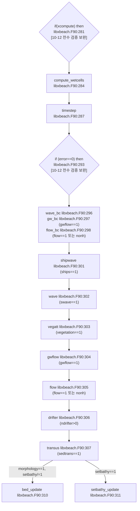

이 노트는 AI가 작성한 연결 검토본이다. 출처를 붙였지만 새 주장에 대한 사람 승인은 아직 받지 않았다. 원본 솔버를 수정하거나 다른 XBeach 판본에 일반화하지 않는다. 아래 행 번호는 `models/XBeach/raw/source_code/trunk/src/xbeachlibrary/` 기준 물리 LF 행이다. 소스 SHA와 정확 인용은 [재판정 원장](../../../_staging/total-read/model-audit/XBeach/connectivity/physics/resolution-20260912/adjudication.json)에 고정했다.

## 스텝 순서와 상태 전달

`executestep`은 wet mask → 시간 선택 → 경계 → 파랑 → 식생 → 지하수 → 유동 → 표사 → 지형 순서로 실행한다. 각 옵션은 별도 guard를 가지며, `bed_update` 호출은 `morphology=1`이면서 `setbathy!=1`일 때다. 내부 지형 갱신은 `morstart <= t < morstop`과 `morfac > 0.999`를 추가로 요구한다. 따라서 아래 결과는 해당 분기가 실행되는 경우에 한정한다. (`libxbeach.F90:280-312`; `morphevolution.F90:632-640`)

위 순서에는 선박과 표류자가 빠져 있다. 선박(`ships==1`)은 경계 다음, 파랑 전에 실행한다(`libxbeach.F90:301`). 표류자(`ndrifter>0`)는 유동 다음, 표사 전에 실행한다(`libxbeach.F90:306`). `setbathy==1`이면 `bed_update` 대신 `setbathy_update`를 실행한다(`libxbeach.F90:310-311`). 이 호출 순서는 `if(xcompute) then`과 `if (error==0) then` 안에서 각 기능의 조건을 만족할 때 적용한다(`libxbeach.F90:281,293`). [10-12 전수 검증 보완] 그림의 화살표는 조건을 만족한 호출의 상대 순서를 나타낸다(`libxbeach.F90:296-311` `if (par%swave==1)`, `if (par%vegetation==1)`). [10-12 전수 검증 보완]

### 직전 단계 값을 읽는 지점(지연)

아래 소비 루틴은 같은 단계의 생산 루틴보다 먼저 실행한다(`libxbeach.F90:284,287,302-305`). 해석: 소비 루틴은 활성 생산 경로가 마지막으로 갱신한 값 또는 초기값을 읽는다(`libxbeach.F90:302-305` `if (par%swave==1)`, `if (par%vegetation==1)`; `wave_timestep.F90:78` `if ((abs(mod(par%t,par%wavint))<0.001d0*par%dt) .or. s%newstatbc==1) then`). [10-12 전수 검증 정정] 이 목록은 코드 순서에서 확인한 것이며, 결과에 주는 영향은 모델 실행으로 확인하지 않았다.

| 변수 | 소비(먼저 실행) | 생산(나중 실행) |
|---|---|---|
| `hh` | `compute_wetcells`: `if(s%hh(i,j)>par%eps+numeps) then`(`wetcells.F90:108`); `wave`는 `if (par%delta>0.d0) then`에서 `s%hhw = max(s%hh+par%delta*s%H,par%eps)`를 쓴다(`wave_timestep.F90:58-59`). [10-12 전수 검증 보완] ELSE에서는 `s%hhw = max(s%hh,par%eps)`를 쓴다(`:60-61`). [10-12 전수 검증 보완] | `flow`: `s%hh  = max(s%zs-s%zb,par%eps)`(`flow_timestep.F90:940`); `setbathy==1`이면 이후 `setbathy_update`도 `s%hh=max(s%zs-s%zb,par%eps)`를 대입한다(`libxbeach.F90:311`; `morphevolution.F90:3200`). [10-12 전수 검증 보완] |
| `H` | `wave`는 `if (par%delta>0.d0) then`에서 `hhw`에 이전 `H`를 사용한다(`wave_timestep.F90:58-59` `s%hhw = max(s%hh+par%delta*s%H,par%eps)`). [10-12 전수 검증 보완] | Surfbeat의 같은 `wave` 호출 안에서 `s%H  = sqrt(s%E/par%rhog8)`를 대입한다(`wave_timestep.F90:83,103,113` `call wave_instationary(s,par)`; `wave_instationary.F90:433`). [10-12 전수 검증 보완] |
| `Dveg` | 실행한 파랑 경로의 소산 항(`wave_instationary.F90:295`; `wave_stationary_directions.F90:444`) | `vegatt`의 `if (par%porcanflow == 1) then`에 대한 ELSE에서 `call swvegatt(s,par)`를 실행한다(`vegetation.F90:319-339`). [10-12 전수 검증 보완] 이 루틴이 `s%Dveg = Dvg`를 대입한다(`:400`). [10-12 전수 검증 보완] |
| `ueu`, `vev`, `vmageu` | 표준 `vegatt`의 `momeqveg` 호출 안에서 `if (s%nsecveg(i,j)>0) then`, `if (ahtold > wacr) then`의 ELSE, `if (par%veguntow == 1) then`을 통과한 항력 계산이 읽는다(`vegetation.F90:319-342,478,502,513-516`). [10-12 전수 검증 보완] | `flow`(`flow_timestep.F90:858,864,926`) |
| `ue`, `ve` | `if (par%porcanflow == 1) then`으로 호출한 `porcanflow`는 `if (s%isCanopy(i,j)==1 .and. s%wetz(i,j)==1) then` 안에서 `U = s%ue(i,j)`, `V = s%ve(i,j)`를 읽는다(`vegetation.F90:319-321,821-833`). [10-12 전수 검증 보완] | `flow`(`flow_timestep.F90:867,872`) |
| `nuh` | 초기 단계 분기 뒤의 일반 시간 간격 계산에서 점성 CFL을 적용한다(`timestep.F90:481` `else`; `:519` `if(s%wetz(i,j)==1) then`; `:523,574`). [10-12 전수 검증 보완] | `flow`는 `if (par%viscosity==0) then`에서 `s%nuh = 0.d0`을 대입한다(`flow_timestep.F90:366-367`). [10-12 전수 검증 보완] ELSE에서는 `if (par%smag == 1) then`에 따라 `call visc_smagorinsky(s,par)` 또는 `s%nuh = par%nuh`를 선택한다(`:372-376`). [10-12 전수 검증 정정] 이후 `swave`·`smag`·`wavemodel`·`nhbreaker` 조건에 따라 쇄파 점성을 반영한다(`:380-414` `if (par%swave == 1) then`, `if (par%smag==0) then`, `elseif (par%swave==0 .and. par%wavemodel==WAVEMODEL_NONH) then`, `select case (par%nhbreaker)`). [10-12 전수 검증 보완] |

`flow` 안에도 순서 비대칭이 있다. 셀 중심 `ue`는 이번 단계의 `ueu`로 만든다(`flow_timestep.F90:858,867`). 셀 중심 `ve`는 `vev`를 새로 대입하기 전에 만든다(`flow_timestep.F90:872`, 새 대입은 `:926`). 해석: 첫 `flow` 호출에서는 `s%vev=0.d0`(`flow_timestep.F90:103`)을 읽는다. [10-12 전수 검증 보완] 해석: 후속 호출에서 `ve`는 직전 `flow` 호출의 `vev`로 만든다(`flow_timestep.F90:872,926`). [10-12 전수 검증 보완] 같은 단계의 `transus`도 그 `ve`를 읽는다(`morphevolution.F90:141` `vmag2     = s%ue**2+s%ve**2`). [10-12 전수 검증 보완] `flow_timestep.F90:103`의 `s%vev=0.d0`은 첫 호출의 할당 블록 안에만 있다. 원본 소스 전체에서 `vev`를 대입하는 곳은 이 둘과 초기화(`initialize.F90:894,1049,1159`)뿐이다.

## 다분급 입경: 셀별 초기화 뒤 로컬 배열 전체 덮어쓰기

초기화에서는 `D50top(i,j)`·`D90top(i,j)`를 해당 셀 최상층 분급비의 가중합으로 만든다. 그러나 `bed_update`의 `ngd>1` 분기는 대입 왼쪽에 `(i,j)`가 없다. 오른쪽 `sum(...)`은 스칼라이므로 매 반복마다 로컬 배열 전체가 같은 값으로 바뀐다. 반복이 비어 있지 않으면 마지막 로컬 셀 `(nx,max(ny,1))`의 값이 로컬 halo를 포함한 배열 전체에 남는다. MPI rank 사이의 값이 동일하다는 뜻은 아니다. (`initialize.F90:1277-1283,1389-1398`; `morphevolution.F90:632-640,1170-1182`)

이 값의 소비도 확인된다. 다분급 White-Colebrook 입경 마찰은 `D90top` 인접값으로 조도를 갱신한다. `gwnonh=1`의 비연결 셀 침투는 `D50top(i,j)`를 넘기며, 국소 침투 함수의 난류 분기에서 Reynolds 수에 사용한다. 따라서 모든 마찰식이나 층류 침투가 같은 영향을 받는다고 말할 수 없다. 공간적으로 동일한 분급비는 이 덮어쓰기를 수치상 드러내지 않을 수 있다. (`bedroughness.F90:220-249`; `groundwater.F90:318-319,605-624,1574-1587`)

다른 소비 경로도 있다. `gwnonh=0`의 정수압 지하수 경로는 `gw_calculate_hydrostatic_w`를 통해 같은 국소 침투 함수에 `D50top`을 넘긴다. McCall 가속도 마찰 분기는 `min(D50top,hu/hv)`를 추가 전단응력에 사용한다. 각각 해당 옵션과 습윤 조건에 한정된다. (`groundwater.F90:512-527,1471-1482,1499-1509`; `bedroughness.F90:275-284,480-495,506-517`)

[최소 재현](../../../_staging/total-read/model-audit/XBeach/connectivity/physics/resolution-20260912/grain_assignment_probe.f90)은 원문 반복문을 그대로 추출하여 `ny=0`과 `ny=2`의 서로 다른 셀 분급비에 적용한다. 이는 Fortran 대입 결과 확인이며 XBeach 전체 계산이나 MPI 실행 검증이 아니다.

## 침식–지하수 교환량: 길이와 속도의 혼합

`infil`의 단위는 m/s이며 표면수에서 지하수로 향하는 값이 양수다. 습윤 퇴적 분기는 `dzbnow*por/dt`를 더한다. 반면 습윤 침식 분기의 `tempexchange=min((zb-gwlevel)*por,0)`는 m 단위인데 이를 `infil`에 그대로 더한다. 같은 `tempexchange`를 수위에 적용하는 것은 길이 갱신이며, 교환속도에 적용한 줄에서는 시간 나눗셈이 없다. (`variables.def:193`; `morphevolution.F90:817-835`)

확인된 결과는 스텝 직후 노출되는 `infil` 상태의 단위 불일치다. 표준 다음 스텝의 `gwflow`는 먼저 `infil=0`으로 초기화하고 교환속도를 새로 합산하고, 이어서 `executestep`이 `flow`를 호출한다. 연속식은 그 새 값을 사용한다. 그러므로 저장된 침식 보정량이 그대로 다음 스텝 연속식으로 누적된다는 주장은 이 경로에서 성립하지 않는다. 전체 질량오차의 크기는 이 정적 추적으로 정하지 않았다. (`groundwater.F90:283-294,538-540`; `libxbeach.F90:304-310`; `flow_timestep.F90:733-751`)

## 지형 갱신 뒤 수심과 다음 wet mask

`flow`는 `hh=max(zs-zb,eps)`를 만든다. 이후 지형–지하수 분기는 `zb`와 다른 양만큼 `zs`를 바꾸며 `bed_update` 안에는 `hh` 재대입이 없다. 다음 스텝의 `compute_wetcells`는 flow보다 먼저 저장된 `hh`로 `wetz`·파랑 wet mask를 만들고, 파랑 함수도 `hh`에서 유효 수심을 계산한다. (`flow_timestep.F90:938-941`; `morphevolution.F90:594-1182`; `libxbeach.F90:280-312`; `wetcells.F90:103-121`; `wave_timestep.F90:53-81`)

예를 들어 습윤 퇴적 셀에서 다른 보정과 수심 하한을 제외하면 `zb`는 `dzbnow`, `zs`는 `(1-por)*dzbnow`만큼 증가하므로 새 기하학적 수심은 이전 `hh - por*dzbnow`다. 저장된 `hh`는 그대로여서 아주 얕은 셀은 새 기하와 다른 wet 판정을 유지할 수 있다. 이것은 조건부 정적 결과이며 모든 셀의 mask 변화나 모든 파랑 모드의 매 스텝 재계산을 뜻하지 않는다. 지하수 없는 습윤 셀의 기본 수위 보정은 `zs`와 `zb`를 같은 양만큼 이동시킨다. 건조·경계·사면붕괴의 모든 분기를 이 예제로 포괄하지 않는다. (`morphevolution.F90:751-769,817-843`; `wetcells.F90:103-121`; `wave_timestep.F90:75-81`)

## Q3D 입력과 실행 분기는 다르다

`nz`는 별도 입력이며 기본값은 1이다. `q3d=1` 또는 `form=FORM_VANRIJN1993`일 때 Q3D 계수를 읽고 `nz=kmax`로 덮는다. 하지만 유동의 수직구조 함수 호출 조건은 **`nz>1 AND form/=FORM_VANRIJN1993`**다. 조건이 거짓이면 `ue_sed=ue`, `ve_sed=ve`다. (`params.F90:122,245,1139-1153`; `flow_timestep.F90:956-986`)

| 입력/상태 | 유동 수직구조 호출 판정 |
|---|---|
| `q3d=1`, `kmax>1`, Van Rijn 1993 이외 | `vsm_u_XB` 분기, 습윤 셀에서 호출 |
| `q3d=1`, `kmax=1` | 깊이평균 속도 대입 |
| Van Rijn 1993 | `kmax/nz`를 설정해도 `vsm_u_XB` 제외; 깊이평균 속도 대입 |
| `q3d=0`, 그 밖의 식, 별도 `nz>1` | 이 호출 guard에는 도달 가능; 전체 설정의 지원·할당 정합성까지 검증한 것은 아님 |

표는 위 인용의 입력 대입 및 `flow` guard를 대조한 결과다. Van Rijn 1993의 연직 농도 적분은 `morphevolution`에 따로 존재하므로 수직구조 함수 제외를 연직 농도 적분 부재로 해석하면 안 된다. (`morphevolution.F90:1748-1757,1815-1830`)

## 외력의 생산·소비 시점 (2026-09-12 R1 보강)

아래는 동일한 동결 소스의 추가 연결 판정이다. [원문 구간과 SHA](../../../_staging/total-read/model-audit/XBeach/connectivity/runtime-20260912/evidence.json)에 결속했으며 이 노트의 미승인 상태는 유지한다.

| 상태 | 생산과 조건 | 소비와 시점 |
|---|---|---|
| 선박 `ph` [m] | `ships==1`의 `shipwave`, 선박 격자의 압력을 `grmap2`로 모델 격자에 사상 | 같은 스텝 `flow`의 `zs+ph` 경사. nonh 압력은 `pres/dp`라는 별도 상태 |
| `Dveg` / `Fvegu,Fvegv` | `vegetation==1`의 `vegatt`; 표준 경로는 `swvegatt`·`momeqveg`, `porcanflow==1`은 별도 분기 | 파랑은 `vegatt`보다 앞서므로 마지막 식생 갱신의 `Dveg`, 유동은 뒤에 있어 같은 스텝 항력 소비 |
| `rainfallrate` [m/s] | 초기 상수/파일 mm/hr 변환; `rainfall==1`의 시간 보간 | 같은 `flow`의 연속식에 가산. `gwflow`는 이 갱신보다 앞서 실행 |
| `D90top` → `cfu/cfv` | 이전 지형 갱신의 입경 상태; White-Colebrook 입경 옵션과 `ngd>1`에서 조도 계산 | `flow`의 `bedroughness_update`가 운동량 계산 전에 사용. 뒤의 `bed_update` 결과는 이후 유동 호출에 전달 |

선박은 첫 처리에서 `zs -= ph`도 수행한다 (`ship.F90:403-410`). 표의 시점은 해당 옵션이 실행되는 경우의 호출 순서이며 스텝 사이 모든 상태가 재초기화된다는 뜻이 아니다. 입경 배열 덮어쓰기의 기존 판정·한계는 위 절을 그대로 따른다. (`libxbeach.F90:293-312`; `ship.F90:287-337,365-373`; `vegetation.F90:318-345,400,563-564`; `wave_instationary.F90:294-295`; `wave_stationary_directions.F90:442-444`; `rainfall.F90:22-70,86-100`; `flow_timestep.F90:120,131-149,176-177,563-612,724-751`; `bedroughness.F90:220-249`)

## 코드 결함 후보 (정적 판독)

이 목록은 원문 정적 판독에서 코드가 자기 주석·문서·다른 경로·단위와 어긋나는 곳이다. 결함 확정은 개발자 확인이 필요하다.

| 위치(경로:줄 + 원문) | 무엇이 어긋나는가 | 근거 둘 이상(자기 주석, 같은 판 문서, 다른 코드 경로, 단위) | 영향 범위(어떤 입력·분기에서만 나타나는가) | 근거 강도(강함/중간/약함, 그 이유) | 출처 보고서 행 ID |
|---|---|---|---|---|---|
| [검증 정본](xbeach_vegetation.md#cv-s-xb-308) | 표준 v 항력의 u점 속력 참조 | 조건·반례·다른 경로의 대조는 정본을 따른다. | 정본의 활성 조건에 한정한다. | E 코드 결함 후보. 정적 판독이다. | [대조 보고서 §5, 308행](../../../_staging/recovery/compare/XBeach-manual-vs-code.md#5-차이-결론) (A절, E 코드 결함 후보, [10-12 G 재판정]) [10-12 결론 검증 보완] |
| [검증 정본](xbeach_vegetation.md#cv-s-xb-524) | 파봉 위 층의 canopy 힘 재사용 | 조건·반례·다른 경로의 대조는 정본을 따른다. | 정본의 활성 조건에 한정한다. | E 코드 결함 후보. 정적 판독이다. | [대조 보고서 §5, 524행](../../../_staging/recovery/compare/XBeach-manual-vs-code.md#5-차이-결론) (B절, E 코드 결함 후보, [10-12 결론 정정]) 별도의 단위 후보는 [CV-S-XB-01 정본](xbeach_vegetation.md#cv-s-xb-01)을 따른다. [10-12 결론 검증 보완] |
