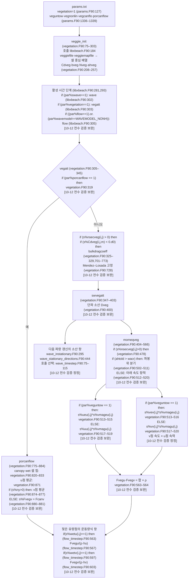

> **2026-09-12 AI 출처 정정**: 활성 정상·방향 계산의 `Dveg` 소비와 파랑/식생/유동 갱신 순서를 명시. 기존 `verification_*`는 이전 검증 이력이며 이번 정정의 새 사람 승인이 아니다. [원문 구간·SHA와 연결 판정](../../../_staging/total-read/model-audit/XBeach/connectivity/runtime-20260912/evidence.json)을 따르며 원본 솔버는 수정하지 않았다.

## Scope

How XBeach models vegetation: per-species multi-section vertical structure, drag-force formulation, short-wave dissipation by vegetation (Mendez-Losada / Suzuki), per-cell vegetation type via `veggiemapfile`, parameter file (`veggiefile`) format (note: `N` not `NDmax`), porous canopy flow option, and how forces couple back into the flow momentum equation. Use this when wiring vegetation forcing for marsh, mangrove, or seagrass cases, or interpreting `Fvegu/Fvegv/Dveg` outputs.

## Source basis

- `vegetation.F90:29-728` — `veggie_init`, `vegatt`, `swvegatt`, `momeqveg`, `bulkdragcoeff`.
- `libxbeach.F90:184, 301-305` — init + per-step call ordering.
- `params.F90:127, 1327-1339` — vegetation switch + file parameters.
- `params.def:447-455` — definitions.
- `readkey.F90:420-424, 625-635` — species-file `key=value` parser.
- `flow_timestep.F90:563-604` — momentum-equation coupling.
- `wave_instationary.F90:294-295`, `wave_stationary_directions.F90:442-444` — current `Dveg` consumers; see [[xbeach-build-mode-connectivity]] for the excluded legacy files.
- `variables.def:271, 277-280` — `vegtype, Nveg, Fvegu/v` definitions.

## 계산 흐름 그림

상자 안 위치는 모두 `models/XBeach/raw/source_code/trunk/src/xbeachlibrary/` 기준 file:line이다(2026-10-02 원문 재확인; 판독 기록 `_staging/recovery/read/XBeach/trunk/src/xbeachlibrary/vegetation.F90.md`). `libxbeach`는 `veggie_init`를 호출한다(`libxbeach.F90:184` `call veggie_init         (s,par)`). [10-12 전수 검증 보완] 초기화 루틴 안의 식생 설정 읽기는 `if (par%vegetation == 1) then`을 요구한다(`vegetation.F90:93` `if (par%vegetation == 1) then`). [10-12 전수 검증 보완] 시간 단계의 호출부는 `if(xcompute) then`과 `if (error==0) then` 안에 있다(`libxbeach.F90:281` `if(xcompute) then`; `libxbeach.F90:293` `if (error==0) then`). [10-12 전수 검증 보완]



그림에서 짚을 점(판독 기록의 코드 사실):

<a id="cv-s-xb-308"></a>- v 방향 항력은 v점 속도 `vev`·`vv`에 u점 속력 `vmageu`·`vmagu`를 곱한다(vegetation.F90:516·520). v점 속력 `vmagev`는 flow_timestep.F90:934에 따로 있다. `porcanflow`는 u점에 `s%Fvegu(i,j) = (Fcanu(i,j)+Fcanu(i+1,j))/2`를 대입한다(`vegetation.F90:871`). [10-12 전수 검증 보완] v점 평균은 `if (s%ny>0) then` 안에서 수행한다(`vegetation.F90:874,877` `s%Fvegv(i,j) = (Fcanv(i,j)+Fcanv(i,j+1))/2`). [10-12 전수 검증 보완] ELSE 분기는 `s%Fvegv = Fcanv`를 대입한다(`vegetation.F90:880-881`). [10-12 전수 검증 보완] 원문 근거: (`vegetation.F90:516` `Fvgtv = max((min(aht,watr)-ahtold),0d0)*0.5d0*s%Cdveg(i,j,m)*s%bveg(i,j,m)*s%Nveg(i,j,m)*(s%vev(i,j)*s%vmageu(i,j))`); (`vegetation.F90:520` `Fvgtv = max((min(aht,watr)-ahtold),0d0)*0.5d0*s%Cdveg(i,j,m)*s%bveg(i,j,m)*s%Nveg(i,j,m)*(s%vv(i,j)*s%vmagu(i,j))`); (`flow_timestep.F90:861` `s%vmagu=sqrt(s%uu**2+s%vu**2)`); (`flow_timestep.F90:931` `s%vmagv=sqrt(s%uv**2+s%vv**2)`). [대조 보고서 §5, 308행](../../../_staging/recovery/compare/XBeach-manual-vs-code.md#5-차이-결론) [10-12 G 재판정] 결론: 코드 결함 후보. 표준 식생 경로가 v 방향 항력에 u점 속력을 사용하는 동작은 축 교환 시 항력이 비대칭이 되는 코드 결함 후보다. [10-12 결론 검증 보완]
- 매뉴얼 식 (2.58)은 층별 항력을 Lagrangian 속도 $u^L$로 쓴다(XBeach_manual_master 인쇄 25쪽·PDF 29쪽). 기본값 `veguntow=1`(params.F90:1338) 경로는 Eulerian 속도 `ueu`·`vev`와 Eulerian 속력 `vmageu`를 쓴다(vegetation.F90:515–516; flow_timestep.F90:858·864·926). `momeqveg`의 ELSE 경로는 `uu`·`vv`(GLM 속도, `ueu = uu - usu`, flow_timestep.F90:858)를 쓴다(vegetation.F90:519–520). [10-12 전수 검증 정정] 매뉴얼은 격자 위치(u점·v점 속력)를 지정하지 않는다. `vegatt`는 `if (par%porcanflow == 1) then`의 ELSE에서 `momeqveg`를 호출한다(`vegetation.F90:319-342` `call momeqveg(s,par)`). [10-12 전수 검증 보완] `momeqveg`는 `if (s%nsecveg(i,j)>0) then`과 `if (ahtold > wacr) then`의 ELSE 안에서 `if (par%veguntow == 1) then`을 판정한다(`vegetation.F90:478,502,513,517`). [10-12 전수 검증 보완] `veguntow`가 1이 아니면 코드는 `uu`·`vv` 경로를 선택한다(`vegetation.F90:517-520` `else`). [10-12 전수 검증 정정] 이론절은 `veguntow`에 따른 Eulerian 분기를 설명하지 않는다. 원문 근거: (`_staging/recovery/read/XBeach/manuals/pdfs/XBeach_manual_master.pdf/p019-036.md:26` `u^L(t)\left\vert u^L(t)\right\vert`); (`_staging/recovery/read/XBeach/manuals/pdfs/XBeach_manual_kingsday.pdf/p019-036.md:26` `u^L(t)\left|u^L(t)\right|`); (`vegetation.F90:515` `Fvgtu = max((min(aht,watr)-ahtold),0d0)*0.5d0*s%Cdveg(i,j,m)*s%bveg(i,j,m)*s%Nveg(i,j,m)*(s%ueu(i,j)*s%vmageu(i,j))`); (`flow_timestep.F90:858` `s%ueu = s%uu - usu`); (`params.F90:1338` `par%veguntow      = readkey_int   ('params.txt', 'veguntow', 1,0,1,silent=.true.)`); (`models/XBeach/raw/manuals/readthedocs/en/latest/input_parameters.html:2713` `<td><p><p>Include undertow in phase-averaged vegetati</p>`); (`models/XBeach/raw/manuals/readthedocs/en/latest/input_parameters.html:2715` `<td><p><p>1</p>`). [대조 보고서 §5, 295행](../../../_staging/recovery/compare/XBeach-manual-vs-code.md#5-차이-결론) 결론: 문서 누락. 표준 식생 경로는 기본값인 `veguntow=1`에서 Eulerian 속도로 평균류·장파 항력을 계산한다.
- `FvgCau`·`FvgCav`는 스칼라다(vegetation.F90:418). `momeqveg`는 호출마다 두 변수를 0으로 만든다(vegetation.F90:452–453). 따라서 이전 시간 단계 값은 남지 않는다. 문서의 층별 항력식과 입력 설명은 지역 변수의 호출별 초기화 위치를 지정하지 않는다. 원문 근거: (`vegetation.F90:452` `FvgCav = 0.d0`); (`vegetation.F90:453` `FvgCau = 0.d0`); (`vegetation.F90:475` `do j=1,s%ny+1`); (`vegetation.F90:342` `call momeqveg(s,par)`); (`_staging/recovery/read/XBeach/manuals/pdfs/XBeach_manual_master.pdf/p019-036.md:26` `F_v(t)=\sum_{i=1}^{n_v}F_{v,i}(t)`); (`models/XBeach/raw/manuals/readthedocs/en/latest/input_parameters.html:2667` `<td><p><p>Include incanopy flow [1] or not [0]</p>`). [대조 보고서 §5, 510행](../../../_staging/recovery/compare/XBeach-manual-vs-code.md#5-차이-결론) 결론: 문서 누락. `momeqveg`는 호출마다 `FvgCau`와 `FvgCav`를 0으로 초기화한다.
<a id="cv-s-xb-524"></a>- 파봉 위 층의 분기(`ahtold > wacr`)는 두 변수를 다시 대입하지 않는다(vegetation.F90:502–511). `vegcanflo=1`이면 이 층은 같은 호출 안에서 마지막으로 대입한 스칼라 값을 항력 합에 다시 더한다(`vegetation.F90:539-540,554-556` `Fvgu(i,j) = Fvgu(i,j) + FvgCau`, `Fvgv(i,j) = Fvgv(i,j) + FvgCav`). [10-12 전수 검증 정정] 셀마다 코드는 `ahtold = 0.d0`에서 시작한다(`vegetation.F90:477`). [10-12 전수 검증 보완] 첫 층이 새 canopy 힘을 대입한다는 판정은 `wacr`가 음수가 아닌 경우에 한정한다(`vegetation.F90:502` `if (ahtold > wacr) then`; `:512` `else`; `:539-540` `FvgCau = FvgCan*costhm(i,j)`, `FvgCav = FvgCan*sinthm(i,j)`). [10-12 전수 검증 정정] 이 재사용의 실제 크기는 모델 실행으로 확인하지 않았다. 원문 근거: (`vegetation.F90:502` `if (ahtold > wacr) then ! if plant section is entirely above wave crest, then do nothing`); (`vegetation.F90:536` `FvgCan = max((min(aht,watr)-ahtold),0d0)/s%hh(i,j)*0.5d0*s%Cdveg(i,j,m)*s%bveg(i,j,m)*s%Nveg(i,j,m)*ucan**2`); (`vegetation.F90:554` `if (par%vegcanflo == 1) then ! add in canopy flow (Luhar et al., 2010)`). [10-12 결론 정정] [대조 보고서 §5, 524행](../../../_staging/recovery/compare/XBeach-manual-vs-code.md#5-차이-결론) 결론: 코드 결함 후보. `vegcanflo==1`인 파봉 위 층이 같은 호출의 앞선 층에서 계산한 0이 아닌 canopy 힘을 다시 더하는 동작은 결함 후보다. [10-12 결론 검증 보완]

<a id="cv-s-xb-01"></a>**CV-S-XB-01 — E 코드 결함 후보.** 표준 식생 경로의 canopy 힘은 합산하는 장파·평균류 항력과 차원이 다르다. `variables.def:82,121,274–277`은 k·urms·Cdveg·bveg·Nveg의 단위를 정한다. `params.def:103,502`는 Trep를 초, px를 π로 정의한다. `vegetation.F90:441,535`에서 ucan의 차원은 m/s이다. `:536`은 `FvgCan = max((min(aht,watr)-ahtold),0d0)/s%hh(i,j)*0.5d0*s%Cdveg(i,j,m)*s%bveg(i,j,m)*s%Nveg(i,j,m)*ucan**2`이다. 해석: FvgCan의 차원은 m/s²이다. 반면 `:515,519`의 Fvgtu는 잠긴 높이를 hh로 나누지 않으므로 m²/s²이다.<br>`vegetation.F90:539–540`의 방향 분해 뒤 `:555–556`은 두 종류의 항을 같은 Fvgu·Fvgv에 더한다. `:563–564`는 합에 rho만 곱한다. `flow_timestep.F90:567,603`은 이 힘을 다시 rho·hu 또는 rho·hv로 나눈다. 단위 불일치는 변수 선언과 실제 소비식으로 확인했다. raw 전체에서 canopy 힘 합산 전에 hh를 다시 곱하는 보정이나 단위 변경 의도는 찾지 못했다. `vegcanflo=0`이면 이 합산 경로를 쓰지 않는다. 후보는 `porcanflow/=1`, `vegcanflo==1`, 식생이 잠긴 층과 0이 아닌 ucan이 있는 경우에 한정한다. 수치 영향은 실행하지 않았다. [대조 보고서 §5 CV-S-XB-01](../../../_staging/recovery/compare/XBeach-manual-vs-code.md#cv-s-xb-01) [10-12 결론 검증 보완]
- `swave==1`인 호출부는 `vegetation==1`의 `vegatt`보다 먼저 `wave`를 실행한다(`libxbeach.F90:302` `if (par%swave==1)                                       call wave           (s,par)`; `libxbeach.F90:303` `if (par%vegetation==1)                                  call vegatt         (s,par)`). [10-12 전수 검증 보완] 해석: 파랑 소산은 표준 `vegatt`가 마지막으로 갱신한 `Dveg`를 읽는다(`vegetation.F90:319` `if (par%porcanflow == 1) then`; `vegetation.F90:339` `call swvegatt(s,par)`; `wave_timestep.F90:78` `if ((abs(mod(par%t,par%wavint))<0.001d0*par%dt) .or. s%newstatbc==1) then`). [10-12 전수 검증 정정] `porcanflow` 분기는 `swvegatt`를 호출하지 않는다(`vegetation.F90:319` `if (par%porcanflow == 1) then`; `vegetation.F90:321` `else ! use standard vegetation module`; `vegetation.F90:322` `! First compute drag coefficient (if not user-defined)`; `vegetation.F90:339` `call swvegatt(s,par)`). [10-12 전수 검증 보완]

## A. Entry / call sequence

`vegetation.F90` exposes `veggie_init` and `vegatt` (`:69-70`).

- `veggie_init(s, par)` once during model init (`libxbeach.F90:184`).
- `vegatt(s, par)` per timestep when `par%vegetation==1` (`:301-305`).

**Per-timestep order**:
1. `wave(s, par)`.
2. `vegatt(s, par)`.
3. `flow(s, par)`.

Vegetation drag forces computed **before** flow momentum update. `Dveg` used by waves is from previous vegetation update (except at init) (`vegetation.F90:122-125`).

Inside `vegatt`:
- Standard: `swvegatt` (short-wave dissipation) + `momeqveg` (momentum drag) (`:336-342`).
- If `par%porcanflow==1`: `porcanflow` instead (`:318-321`).

## B. Parameters / input format

Main switch in `params.txt`: `vegetation` (0/1) (`params.F90:127`).

When enabled, must provide:
- `veggiefile` — list of species filenames.
- `veggiemapfile` — spatial vegetation type map.
- `Trep` — representative wave period.
- Optional: `vegnonlin, vegcanflo, veguntow, porcanflow`.

(`params.F90:1327-1339`; `params.def:447-455`).

`veggiefile` structure:
- `par%nveg = count_lines(par%veggiefile)`.
- Each line is one species-spec filename (`vegetation.F90:102-112`).

**Per-species file** uses `key = value...` syntax (`readkey.F90`):

| Key | Description | Line |
|---|---|---|
| `isCanopy` | Canopy-flow flag | `vegetation.F90:161` |
| `nsec` | Number of vertical sections | `:168` |
| `ah` | Vector of section heights | `:180` |
| `bv` | Stem diameter (non-canopy only) | `:182-185` |
| `N` | Stem density | `:182-185` |
| `Cd` | Drag coefficient | `:182-185` |

**Important**: code uses `N`, **not `NDmax`** (older docs). Documented as stems per horizontal area `[m⁻²]` (`vegetation.F90:57`, `variables.def:277`). Read as double vector then `nint(...)` to integer (`:184`).

## C. Drag formulation

For standard vegetation momentum drag, layer-integrated quadratic drag.

**`veguntow=1`** (`vegetation.F90:513-516`):
```fortran
Fvgtu = h_layer * 0.5 * Cdveg * bveg * Nveg * (ueu * vmageu)
Fvgtv = h_layer * 0.5 * Cdveg * bveg * Nveg * (vev * vmageu)
```

**`veguntow=0`** (`:517-520`):
```fortran
Fvgtu = h_layer * 0.5 * Cdveg * bveg * Nveg * (uu * vmagu)
Fvgtv = h_layer * 0.5 * Cdveg * bveg * Nveg * (vv * vmagu)
```

`h_layer = max((min(aht, watr) − ahtold), 0d0)` — the submerged vertical extent of this section.

So the formula is closer to:
```
F = ρ · ∫_(submerged) [0.5 * Cd * b * N * |u|*u dz]
```
not just `0.5*ρ*Cd*N*bv*|u|*u` flat.

Final multiplication by `rho`: `s%Fvegu = Fvgu*par%rho` (`:563-564`). Internal arrays `[N/m²]` (`variables.def:279-280`).

## D. Wave dissipation by vegetation

Computed in `swvegatt` (`vegetation.F90:347`):

1. Loop over vegetation cells + sections (`:370-375`).
2. Clip section height to local water depth (`:379-382`).
3. Compute vertical wave-orbital integral term `hterm` (`:384-385`).
4. Compute dissipation:
   ```
   Dvgt = 0.5/sqrt(π) * ρ * Cdveg * bveg * Nveg
        * (0.5*k*g/sigm)³
        * (hterm − htermold)
        * H³
   ```
   (`:387-388`).

Section explicitly notes correction for elevated layers per **Suzuki et al. 2012** (`:387`).

Module header cites:
- Short-wave + IG-wave + flow + setup attenuation.
- Nonlinear wave effects per Van Rooijen et al. 2016 (`:29-39`).

`Dveg` is stored in `s%Dveg` (`vegetation.F90:400`). Both active wave consumers include `s%Df + s%Dveg`: surfbeat energy propagation (`wave_instationary.F90:294-295`) and the shared stationary/direction calculation (`wave_stationary_directions.F90:442-444`; `wave_timestep.F90:75-114`).

The missing term commented in legacy `wave_directions.F90:290` is not a limitation of the current directional calculation. That file and `wave_stationary.F90` are excluded from the inspected build targets ([[xbeach-build-mode-connectivity]]). Per-step wave calls precede `vegatt`, so the active consumers read the last vegetation update, while `flow` reads the drag computed later in the same step (`libxbeach.F90:293-310`).

**Bulk drag coefficient** (Mendez-Losada 2004) when `Cdveg < 0`:
- `vegatt` calls `bulkdragcoeff` (`:327-329`).
- Hard-wires `myflag = 2` (`:728`) with comment "Mendez and Losada (2004), eq. 40" (`:760-763`); the same block also comments *"Only applicable for Laminaria Hyperborea (kelp)???"* (`:763`).
- ★ **Computed once, then frozen.** The result is written back into `s%Cdveg` (`:329`), so `Cdveg < 0` is false on every later call — the bulk value is fixed at the **first** `vegatt` call and never adapts to later wave conditions (`:327-329`).
- ★ **Inputs come from the short-wave (wave-action) fields**: `Tp = 2π/sigm` (`:731`), `um ∝ s%H` (`:742`), `KC = um·Tp/bv` (`:745`), `Q = KC/alfav^0.76`; for `Q < 7` the code returns the floor `exp(−0.0138·7)/7^0.3 ≈ 0.506` (`:766-770`).
- ★ **Non-hydrostatic mode → Cd ≈ 0.506 everywhere.** `wavemodel=nonh` forces `swave=0` (`params.F90:1560-1563`); `call wave` runs only if `swave==1` (`libxbeach.F90:302`); `s%H` is set to 0 at init (`initialize.F90:556`) and is assigned only inside `wave_*` routines. So under NH `H ≡ 0 → KC = 0 → Q < 7 →` the floor value. `Cdveg < 0` is therefore **not** an adaptive calibration in NH.
- Surfbeat/stationary: `call wave` precedes `vegatt` in the same step (`libxbeach.F90:302-303`), so the frozen value uses the step-1 wave field; cells the incident waves have not yet reached then get the same floor. (Inferred from call order; confirm with a run before relying on it.)

## E. Multi-layer vegetation

**Important distinction**: `nveg` = number of **species** (not vertical layers).
- Set from line count in `veggiefile` (`vegetation.F90:102-104`).

**Vertical layering** is `nsec` per species (`:53, 168`).

The model supports multiple vertical sections:
- Arrays `ah, Cd, bv, N` allocated to length `nsec` (`:174-178`).
- Mapped into 3D fields `Cdveg/ahveg/bveg/Nveg` over `s%nsecvegmax` (`:205-214`).
- Runtime loops `m=1, s%nsecveg(i,j)` in both wave dissipation and momentum drag (`:375, 487`).

For canopy-flow vegetation (`isCanopy=1`), `nsec > 1` is **rejected** (`:169-172`).

## F. Coupling to flow momentum

Vegetation forces written to `s%Fvegu, s%Fvegv` (`vegetation.F90:563-564`).

Flow solver residuals (subtracted from velocity in the update) include:
- u-momentum: `+ s%Fvegu(i,j)/(par%rho*s%hu(i,j))` (`flow_timestep.F90:563-568`).
- v-momentum: `+ s%Fvegv(i,j)/(par%rho*s%hv(i,j))` (`:600-604`).

Velocity update: `s%uu = s%uu − par%dt*dudt` (`:576`). Since `Fvegu` has the sign of `u*|u|`, this term acts as **drag/deceleration**.

## G. Spatial distribution

There is **no separate boolean vegetation mask**. `veggiemapfile` is the spatial distribution:
- Read into integer `s%vegtype(i, j)` over `(nx+1, ny+1)` (`vegetation.F90:130-154`).
- `vegtype = 1` corresponds to first species in `veggiefile` (`:130-131`).

Cells with `vegtype > 0`: receive species' `nsec, Cd, ah, bv, N` (`:223-232`).
Cells with `vegtype <= 0`: no vegetation, all properties zeroed (`:240-245`).

Documented as "vegetation type index" (`variables.def:271`).

## Decision Guide

| Application | Setup |
|---|---|
| Salt marsh wave attenuation | `vegetation=1`, `veggiefile` with grass species. Species-file defaults if keys are omitted: `nsec=1`, `ah=0.1 m`, `bv=0.01 m`, `N=100 m⁻²`, **`Cd=0` (no drag)** (`vegetation.F90:168,180-185`). Site values of `Cd`/`N`/`bv` need a field or literature source — no recommended values are sourced here (`source-needed`). |
| Mangrove forest | Multi-section: roots, trunk, canopy with different `bv, Cd, N` |
| Seagrass meadow (flexible) | `vegnonlin=1` for nonlinear reduction (Van Rooijen 2016) |
| Reef / coral | Same keys; the code only bounds them (`Cd` 0–3, `bv` 0.001–1.0 m, `N` 1–5000; out-of-range values give a warning and are kept, `readkey.F90:430-437`). Reef-specific `Cd`/`bv` values: `source-needed`. |
| One-time bulk `Cd` estimate | `Cdveg < 0` → Mendez-Losada (kelp) bulk drag, **frozen at first call**; under NH it is the floor ≈ 0.506 (§D) |
| Porous canopy (dense vegetation) | `porcanflow=1`, `nsec=1` only |
| Flow-only friction (no wave dissipation) | Use `bedfricfile` instead, not vegetation |
| Wave-only dissipation | Set vegetation but only short waves matter — long-wave/flow effects are coupled |

## Working Rules

- `vegtype=0` cells are fully transparent — useful for vegetation-free patches in a vegetated domain.
- `nsec` may be 1–100 (default 1, `vegetation.F90:168`); canopy species must use `nsec=1` (`:170-173`). How many sections are needed for accuracy is not established here (`source-needed`).
- Stem density `N` is in stems per horizontal m² (not per stem volume). Species-typical densities (e.g. *Spartina*) need an ecological source (`source-needed`).
- The code default is `Cd=0` (`vegetation.F90:185`) — omitting `Cd` silently disables vegetation drag. (Earlier text called `Cd=1.0` "a reasonable default … per Mendez-Losada"; that value is not the code default and the bulk formula in §D does not return 1.0 — corrected 2026-09-29.) `Cdveg=−1` is **not** a wave-adaptive calibration: it is evaluated once at the first call, and under NH returns the floor ≈ 0.506 (§D).
- Vegetation drag **decelerates** flow — verify by output `Fvegu, Fvegv` near vegetated patches.
- For storm hindcasts, vegetation persists through inundation; the model handles submergence automatically via `h_layer = min(aht, watr)`.
- Active stationary and surfbeat single-direction calculations include `Dveg`; their invocation and update timing follow §D.

## Common Pitfalls

- ▢ Using `NDmax` parameter name from old docs — actual key in species file is `N`.
- ▢ `vegtype` map size — must be `(nx+1, ny+1)`, NODE-based.
- ▢ Setting `nsec=2` with `isCanopy=1` — rejected, use `nsec=1` for canopy.
- ▢ `Cdveg=0` (zero, also the default when `Cd` is omitted) — completely disables drag silently. A negative `Cd` (to reach the §D bulk path) prints a "< recommended value of 0" warning but is accepted (`readkey.F90:434-437`). `Cdveg<0` gives a one-time bulk value, not an auto-calibration (§D).
- ▢ Expecting `Cdveg<0` to track storm conditions — it is frozen at the first `vegatt` call (`vegetation.F90:327-329`); with `wavemodel=nonh` it is the constant floor ≈ 0.506.
- ▢ Forgetting `Trep` — vegetation dissipation formula needs representative period.
- ▢ Treating the build-excluded `wave_directions` comment as the behavior of active `wave_stationary_directions`; see §D.
- ▢ Single-species runs with multi-species `veggiemapfile` — non-existent vegtype indices silently zero.

## Next expansion

- Mendez-Losada `bulkdragcoeff` formula details.
- Suzuki 2012 elevated-layer correction validation.
- Comparison: porcanflow vs standard vegetation for dense stands.

## References

- Mendez & Losada 2004 (bulk drag coefficient).
- Suzuki et al. 2012 (elevated-layer wave dissipation).
- Van Rooijen et al. 2016 (nonlinear vegetation effects).
- Source: paths above.

## Provenance

Generated 2026-05-03 from Codex `gpt-5.3-codex` analysis of `models/xbeach/source_code/trunk/src/xbeachlibrary`. Auto-draft = false; review_required = true.
